<!-- AUTOGENERADO por tools/inventario/flujos.mjs. No editar manualmente. -->

# Flujos del módulo `education`

- **Procesos:** 1 · **Máquinas de estado:** 0
- **Operaciones:** 14 (14 con decisiones propias, 0 sin ellas)
- Inventario de endpoints del módulo: [education](../endpoints/education.md)

## Proceso: Módulo 47 — Formación, Evaluación y Acreditación

- **Código:** `education` · **Agrupación:** CASO_DE_USO_README · **Operaciones:** 14
- **Actores:** COURSE_AUTHOR · EDUCATION_ADMIN · LEARNER · SYSTEM
- **Revisión:** AUTO_DETECTADA
- **Fuentes:** `src/modules/education/README.md`

### Para qué sirve

Catálogo de cursos con módulos y lecciones, versionado, instructores, cohortes, inscripciones con progreso, evaluaciones corregidas automáticamente, certificados verificables y créditos CME.

_Fuente: `src/modules/education/README.md:3`_

### Flujo general declarado en el README

```text
curso (published, v1) ── versión ──> vN, el curso apunta a la nueva
     ├─ instructores (un solo titular)
     ├─ cohorte (open) ── se llena ──> closed
     └─ evaluación (published) ── preguntas con respuesta correcta

inscripción (active, 0%) ── lesson-progress (append-only) ──> % recalculado
                                    │
                                    ├─ attempt (in_progress) ── submit ──> graded (passed | failed)
                                    │
                                    └─ complete ──> completed (100% + evaluaciones aprobadas)
                                                        │
                                                        └─ certificate (issued, con código de verificación)
                                                                    │
                                                                    ├─ cme-credits ──> awarded
                                                                    └─ revoke ──> revoked + CME reversed
```

_Fuente: `src/modules/education/README.md:31`_

### Etapas y operaciones

| Etapa | Descripción | Operación | Quién actúa | Riesgo | Tablas |
|---|---|---|---|---|---|
| `UC-47-01` | Publicar curso con módulos y lecciones | POST /education/courses/publish | EDUCATION_ADMIN · COURSE_AUTHOR | MEDIO | 5 |
| `UC-47-02` | Publicar versión del curso | POST /education/courses/{id}/versions/publish | EDUCATION_ADMIN · COURSE_AUTHOR | MEDIO | 4 |
| `UC-47-03` | Asignar instructor | POST /education/courses/{id}/instructors | EDUCATION_ADMIN | MEDIO | 5 |
| `UC-47-04` | Abrir cohorte | POST /education/courses/{id}/cohorts | EDUCATION_ADMIN | MEDIO | 3 |
| `UC-47-05` | Inscribir aprendiz | POST /education/enrollments | EDUCATION_ADMIN · LEARNER | MEDIO | 5 |
| `UC-47-06` | Registrar progreso | POST /education/enrollments/{id}/lesson-progress | LEARNER · EDUCATION_ADMIN · SYSTEM | MEDIO | 6 |
| `UC-47-07` | Diseñar evaluación | POST /education/courses/{id}/assessments | EDUCATION_ADMIN · COURSE_AUTHOR | MEDIO | 4 |
| `UC-47-08` | Iniciar intento | POST /education/assessments/{id}/attempts | LEARNER · EDUCATION_ADMIN | MEDIO | 4 |
| `UC-47-09` | Enviar y calificar | POST /education/attempts/{id}/submit | LEARNER · EDUCATION_ADMIN | MEDIO | 4 |
| `UC-47-10` | Completar curso | POST /education/enrollments/{id}/complete | SYSTEM · EDUCATION_ADMIN · LEARNER | MEDIO | 7 |
| `UC-47-11` | Emitir certificado | POST /education/enrollments/{id}/certificate | SYSTEM · EDUCATION_ADMIN | MEDIO | 4 |
| `UC-47-12` | Acreditar CME | POST /education/certificates/{id}/cme-credits | SYSTEM · EDUCATION_ADMIN | MEDIO | 4 |
| `UC-47-13` | Publicar reseña | POST /education/courses/{id}/reviews | LEARNER · EDUCATION_ADMIN | MEDIO | 3 |
| `UC-47-14` | Revocar y revertir CME | POST /education/certificates/{id}/revoke | EDUCATION_ADMIN | MEDIO | 4 |

### Diagrama — etapas `UC-47-01`, `UC-47-02`, `UC-47-03`…

```mermaid
flowchart LR
  a2(["EDUCATION_ADMIN · COURSE_AUTHOR"]):::actor
  a9(["EDUCATION_ADMIN"]):::actor
  a15(["EDUCATION_ADMIN · LEARNER"]):::actor
  a18(["LEARNER · EDUCATION_ADMIN · SYSTEM"]):::actor
  a24(["LEARNER · EDUCATION_ADMIN"]):::actor
  a28(["SYSTEM · EDUCATION_ADMIN · LEARNER"]):::actor
  a31(["SYSTEM · EDUCATION_ADMIN"]):::actor
  t3[("education.course_modules")]:::tabla
  t4[("education.course_versions")]:::tabla
  t5[("education.courses")]:::tabla
  t6[("education.lessons")]:::tabla
  t10[("education.course_instructors")]:::tabla
  t11[("education.instructors")]:::tabla
  t13[("education.course_cohorts")]:::tabla
  t16[("education.enrollments")]:::tabla
  t19[("education.lesson_progress")]:::tabla
  t21[("education.assessment_questions")]:::tabla
  t22[("education.assessments")]:::tabla
  t25[("education.assessment_attempts")]:::tabla
  t32[("education.certificates")]:::tabla
  t34[("education.cme_credit_records")]:::tabla
  t36[("education.course_reviews")]:::tabla
  subgraph s0["UC-47-01 · Publicar curso con módulos y lecciones"]
    o1["POST /education/courses/publish"]:::op
  end
  subgraph s1["UC-47-02 · Publicar versión del curso"]
    o7["POST /education/courses/{id}/versions/publish"]:::op
  end
  subgraph s2["UC-47-03 · Asignar instructor"]
    o8["POST /education/courses/{id}/instructors"]:::op
  end
  subgraph s3["UC-47-04 · Abrir cohorte"]
    o12["POST /education/courses/{id}/cohorts"]:::op
  end
  subgraph s4["UC-47-05 · Inscribir aprendiz"]
    o14["POST /education/enrollments"]:::op
  end
  subgraph s5["UC-47-06 · Registrar progreso"]
    o17["POST /education/enrollments/{id}/lesson-progress"]:::op
  end
  subgraph s6["UC-47-07 · Diseñar evaluación"]
    o20["POST /education/courses/{id}/assessments"]:::op
  end
  subgraph s7["UC-47-08 · Iniciar intento"]
    o23["POST /education/assessments/{id}/attempts"]:::op
  end
  subgraph s8["UC-47-09 · Enviar y calificar"]
    o26["POST /education/attempts/{id}/submit"]:::op
  end
  t29[("+1 tablas más")]
  subgraph s9["UC-47-10 · Completar curso"]
    o27["POST /education/enrollments/{id}/complete"]:::op
  end
  subgraph s10["UC-47-11 · Emitir certificado"]
    o30["POST /education/enrollments/{id}/certificate"]:::op
  end
  subgraph s11["UC-47-12 · Acreditar CME"]
    o33["POST /education/certificates/{id}/cme-credits"]:::op
  end
  subgraph s12["UC-47-13 · Publicar reseña"]
    o35["POST /education/courses/{id}/reviews"]:::op
  end
  subgraph s13["UC-47-14 · Revocar y revertir CME"]
    o37["POST /education/certificates/{id}/revoke"]:::op
  end
  a2 --> o1
  o1 -->|"CREA"| t3
  o1 -->|"CREA"| t4
  o1 -->|"CREA"| t5
  o1 -->|"LEE"| t5
  o1 -->|"CREA"| t6
  a2 --> o7
  o7 -->|"CREA"| t4
  o7 -->|"LEE"| t4
  o7 -->|"ACTUALIZA"| t5
  o7 -->|"LEE"| t5
  a9 --> o8
  o8 -->|"CREA"| t10
  o8 -->|"LEE"| t10
  o8 -->|"LEE"| t5
  o8 -->|"CREA"| t11
  o8 -->|"LEE"| t11
  a9 --> o12
  o12 -->|"CREA"| t13
  o12 -->|"LEE"| t13
  o12 -->|"LEE"| t5
  a15 --> o14
  o14 -->|"ACTUALIZA"| t13
  o14 -->|"LEE"| t13
  o14 -->|"LEE"| t5
  o14 -->|"CREA"| t16
  o14 -->|"LEE"| t16
  a18 --> o17
  o17 -->|"LEE"| t3
  o17 -->|"ACTUALIZA"| t16
  o17 -->|"LEE"| t16
  o17 -->|"CREA"| t19
  o17 -->|"LEE"| t19
  o17 -->|"LEE"| t6
  a2 --> o20
  o20 -->|"CREA"| t21
  o20 -->|"CREA"| t22
  o20 -->|"LEE"| t3
  o20 -->|"LEE"| t5
  a24 --> o23
  o23 -->|"CREA"| t25
  o23 -->|"LEE"| t25
  o23 -->|"LEE"| t22
  o23 -->|"LEE"| t16
  a24 --> o26
  o26 -->|"ACTUALIZA"| t25
  o26 -->|"LEE"| t25
  o26 -->|"LEE"| t21
  o26 -->|"LEE"| t22
  a28 --> o27
  o27 -->|"LEE"| t25
  o27 -->|"LEE"| t22
  o27 -->|"LEE"| t3
  o27 -->|"ACTUALIZA"| t16
  o27 -->|"LEE"| t16
  o27 -->|"LEE"| t19
  o27 -.-> t29
  a31 --> o30
  o30 -->|"CREA"| t32
  o30 -->|"LEE"| t32
  o30 -->|"LEE"| t5
  o30 -->|"LEE"| t16
  a31 --> o33
  o33 -->|"LEE"| t32
  o33 -->|"CREA"| t34
  o33 -->|"LEE"| t34
  o33 -->|"LEE"| t5
  a24 --> o35
  o35 -->|"CREA"| t36
  o35 -->|"LEE"| t36
  o35 -->|"LEE"| t5
  a9 --> o37
  o37 -->|"ACTUALIZA"| t32
  o37 -->|"LEE"| t32
  o37 -->|"ACTUALIZA"| t34
  o37 -->|"LEE"| t34
  classDef op fill:#fff,stroke:#446
  classDef actor fill:#eef,stroke:#66a
  classDef tabla fill:#ffd,stroke:#aa3
  classDef evento fill:#efe,stroke:#3a3
```

## Árbol de decisión por operación

Cada árbol se deriva del código del handler y de los métodos que invoca (hasta 4 niveles). Una rama que no decide, no escribe y no falla se poda. Los accesos y los efectos consecutivos se agrupan en un solo nodo.

### Operaciones con decisiones propias

#### 1. POST /education/assessments/{id}/attempts

Iniciar un intento de evaluación

| HTTP | Código | Cuándo |
|---|---|---|
| 201 | — | Éxito |
| 400 | `VALIDATION_FAILED` | Los parámetros de ruta son UUID válidos; El cuerpo cumple el DTO (sin propiedades extra) |
| 401 | `UNAUTHENTICATED` | Hay una sesión válida (JWT) |
| 403 | `FORBIDDEN` | El rol está permitido; El tenant se resuelve y pertenece al actor |
| 404 | `NOT_FOUND` | ResourceNotFoundException: Evaluación no encontrada; ResourceNotFoundException: Inscripción no encontrada |
| 409 | `CONFLICT` | ConflictException: Ya hay un intento en curso |
| 422 | `PRECONDITION_FAILED` | PreconditionFailedException: La inscripción es de otro curso; PreconditionFailedException: La inscripción no está activa; PreconditionFailedException: Se agotaron los intentos permitidos |
| 429 | `RATE_LIMITED` | No se supera el límite de solicitudes |

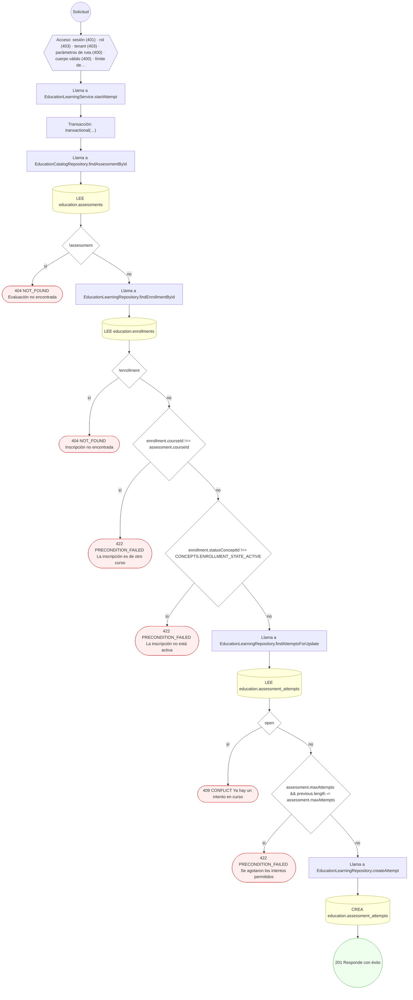

#### 2. POST /education/attempts/{id}/submit

Enviar y calificar el intento

| HTTP | Código | Cuándo |
|---|---|---|
| 200 | — | Éxito |
| 400 | `VALIDATION_FAILED` | Los parámetros de ruta son UUID válidos; El cuerpo cumple el DTO (sin propiedades extra) |
| 401 | `UNAUTHENTICATED` | Hay una sesión válida (JWT) |
| 403 | `FORBIDDEN` | El rol está permitido; El tenant se resuelve y pertenece al actor |
| 404 | `NOT_FOUND` | ResourceNotFoundException: Intento no encontrado; ResourceNotFoundException: Evaluación no encontrada |
| 409 | `CONFLICT` | ConflictException: El intento ya fue corregido |
| 422 | `PRECONDITION_FAILED` | PreconditionFailedException: El tiempo del intento venció |
| 429 | `RATE_LIMITED` | No se supera el límite de solicitudes |

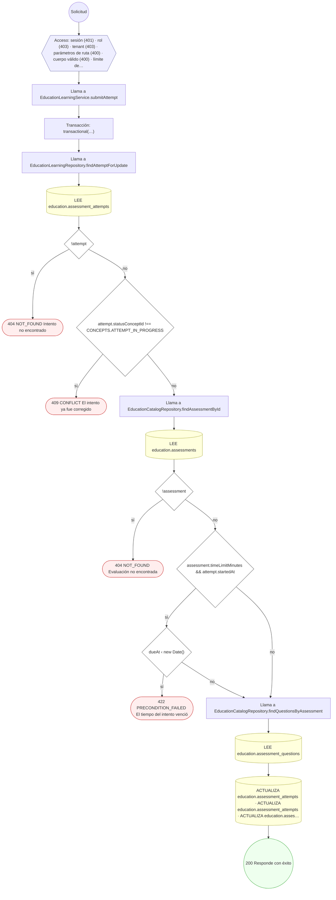

#### 3. POST /education/certificates/{id}/cme-credits

Acreditar las horas CME al profesional

| HTTP | Código | Cuándo |
|---|---|---|
| 201 | — | Éxito |
| 400 | `VALIDATION_FAILED` | Los parámetros de ruta son UUID válidos; El cuerpo cumple el DTO (sin propiedades extra) |
| 401 | `UNAUTHENTICATED` | Hay una sesión válida (JWT) |
| 403 | `FORBIDDEN` | El rol está permitido; El tenant se resuelve y pertenece al actor |
| 404 | `NOT_FOUND` | ResourceNotFoundException: Certificado no encontrado |
| 422 | `PRECONDITION_FAILED` | PreconditionFailedException: El certificado no está vigente; PreconditionFailedException: El certificado no otorga créditos CME; PreconditionFailedException: El curso no declara organismo acreditador |
| 429 | `RATE_LIMITED` | No se supera el límite de solicitudes |

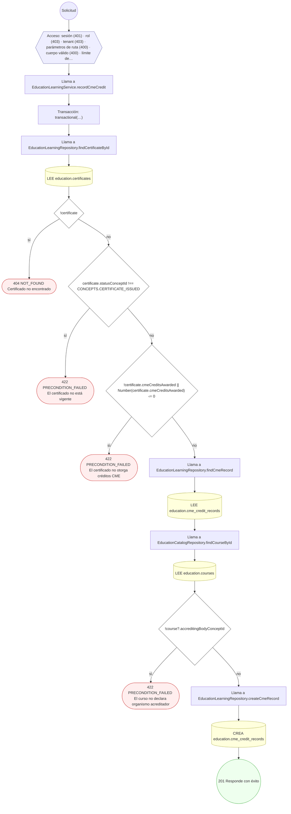

#### 4. POST /education/certificates/{id}/revoke

Revocar el certificado y revertir sus créditos CME

| HTTP | Código | Cuándo |
|---|---|---|
| 200 | — | Éxito |
| 400 | `VALIDATION_FAILED` | Los parámetros de ruta son UUID válidos; El cuerpo cumple el DTO (sin propiedades extra) |
| 401 | `UNAUTHENTICATED` | Hay una sesión válida (JWT) |
| 403 | `FORBIDDEN` | El rol está permitido; El tenant se resuelve y pertenece al actor |
| 404 | `NOT_FOUND` | ResourceNotFoundException: Certificado no encontrado |
| 409 | `CONFLICT` | ConflictException: El certificado ya está revocado |
| 429 | `RATE_LIMITED` | No se supera el límite de solicitudes |

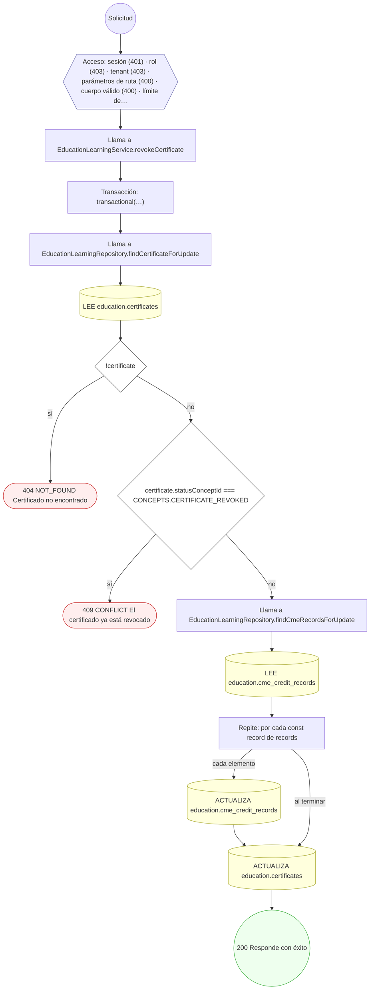

#### 5. POST /education/courses/{id}/assessments

Diseñar una evaluación con sus preguntas

| HTTP | Código | Cuándo |
|---|---|---|
| 201 | — | Éxito |
| 400 | `VALIDATION_FAILED` | Los parámetros de ruta son UUID válidos; El cuerpo cumple el DTO (sin propiedades extra) |
| 401 | `UNAUTHENTICATED` | Hay una sesión válida (JWT) |
| 403 | `FORBIDDEN` | El rol está permitido; El tenant se resuelve y pertenece al actor |
| 404 | `NOT_FOUND` | ResourceNotFoundException: Curso no encontrado |
| 422 | `PRECONDITION_FAILED` | PreconditionFailedException: Una evaluación puntuable necesita respuesta correcta en cada pregunta; PreconditionFailedException: El módulo no pertenece al curso |
| 429 | `RATE_LIMITED` | No se supera el límite de solicitudes |

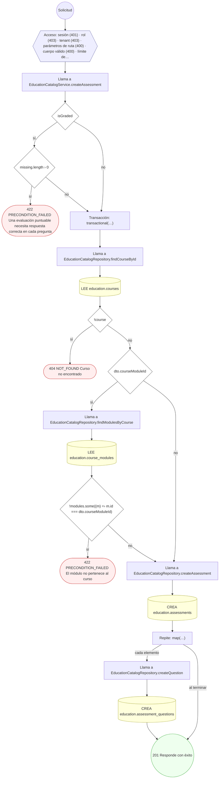

#### 6. POST /education/courses/{id}/cohorts

Abrir una cohorte del curso

| HTTP | Código | Cuándo |
|---|---|---|
| 201 | — | Éxito |
| 400 | `VALIDATION_FAILED` | Los parámetros de ruta son UUID válidos; El cuerpo cumple el DTO (sin propiedades extra) |
| 401 | `UNAUTHENTICATED` | Hay una sesión válida (JWT) |
| 403 | `FORBIDDEN` | El rol está permitido; El tenant se resuelve y pertenece al actor |
| 404 | `NOT_FOUND` | ResourceNotFoundException: Curso no encontrado |
| 409 | `CONFLICT` | ConflictException: Ya existe una cohorte con ese código en el curso |
| 422 | `PRECONDITION_FAILED` | PreconditionFailedException: La cohorte debe terminar después de empezar; PreconditionFailedException: El curso no está publicado |
| 429 | `RATE_LIMITED` | No se supera el límite de solicitudes |

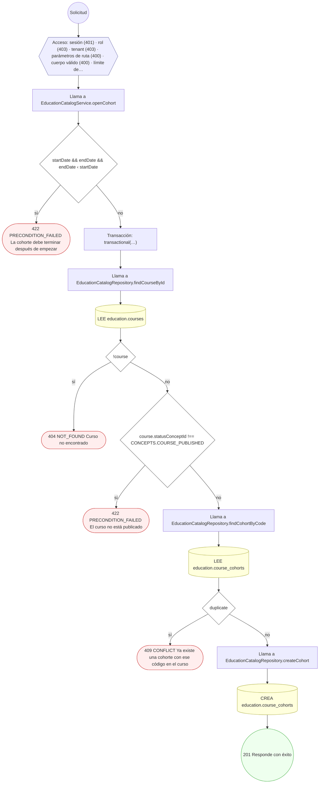

#### 7. POST /education/courses/{id}/instructors

Asignar un instructor al curso

| HTTP | Código | Cuándo |
|---|---|---|
| 201 | — | Éxito |
| 400 | `VALIDATION_FAILED` | Los parámetros de ruta son UUID válidos; El cuerpo cumple el DTO (sin propiedades extra) |
| 401 | `UNAUTHENTICATED` | Hay una sesión válida (JWT) |
| 403 | `FORBIDDEN` | El rol está permitido; El tenant se resuelve y pertenece al actor |
| 404 | `NOT_FOUND` | ResourceNotFoundException: Curso no encontrado |
| 409 | `CONFLICT` | ConflictException: El instructor ya está asignado al curso; ConflictException: El curso ya tiene instructor titular |
| 429 | `RATE_LIMITED` | No se supera el límite de solicitudes |

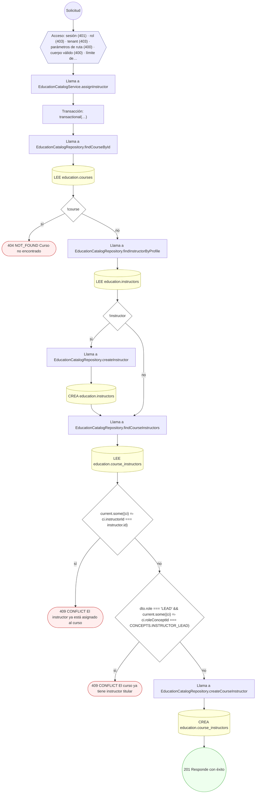

#### 8. POST /education/courses/{id}/reviews

Publicar una reseña del curso

| HTTP | Código | Cuándo |
|---|---|---|
| 201 | — | Éxito |
| 400 | `VALIDATION_FAILED` | Los parámetros de ruta son UUID válidos; El cuerpo cumple el DTO (sin propiedades extra) |
| 401 | `UNAUTHENTICATED` | Hay una sesión válida (JWT) |
| 403 | `FORBIDDEN` | El rol está permitido; El tenant se resuelve y pertenece al actor |
| 404 | `NOT_FOUND` | ResourceNotFoundException: Curso no encontrado |
| 409 | `CONFLICT` | ConflictException: El usuario ya reseñó este curso |
| 429 | `RATE_LIMITED` | No se supera el límite de solicitudes |

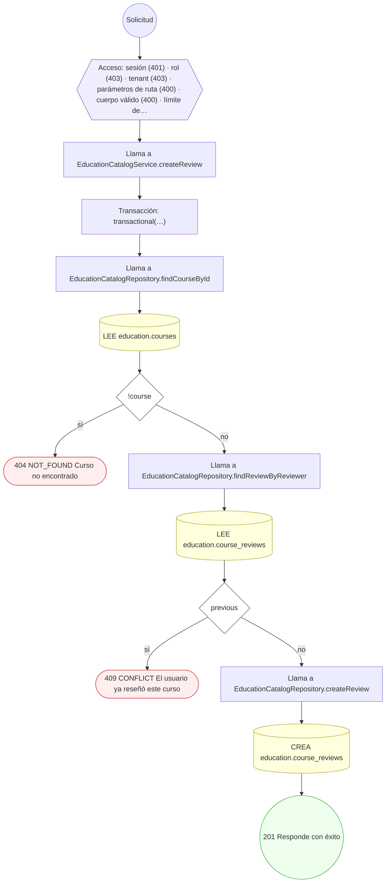

#### 9. POST /education/courses/{id}/versions/publish

Publicar una versión nueva del curso

| HTTP | Código | Cuándo |
|---|---|---|
| 201 | — | Éxito |
| 400 | `VALIDATION_FAILED` | Los parámetros de ruta son UUID válidos; El cuerpo cumple el DTO (sin propiedades extra) |
| 401 | `UNAUTHENTICATED` | Hay una sesión válida (JWT) |
| 403 | `FORBIDDEN` | El rol está permitido; El tenant se resuelve y pertenece al actor |
| 404 | `NOT_FOUND` | ResourceNotFoundException: Curso no encontrado |
| 409 | `CONFLICT` | ConflictException: Esa versión del curso ya existe |
| 422 | `PRECONDITION_FAILED` | PreconditionFailedException: Un curso archivado no admite versiones |
| 429 | `RATE_LIMITED` | No se supera el límite de solicitudes |

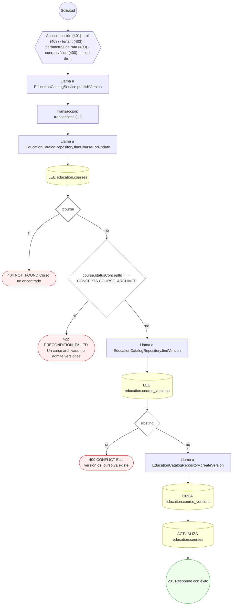

#### 10. POST /education/courses/publish

Publicar un curso con sus módulos y lecciones

| HTTP | Código | Cuándo |
|---|---|---|
| 201 | — | Éxito |
| 400 | `VALIDATION_FAILED` | El cuerpo cumple el DTO (sin propiedades extra) |
| 401 | `UNAUTHENTICATED` | Hay una sesión válida (JWT) |
| 403 | `FORBIDDEN` | El rol está permitido; El tenant se resuelve y pertenece al actor |
| 409 | `CONFLICT` | ConflictException: Ya existe un curso con ese código |
| 422 | `PRECONDITION_FAILED` | PreconditionFailedException: Un curso acreditado necesita declarar sus horas CME |
| 429 | `RATE_LIMITED` | No se supera el límite de solicitudes |

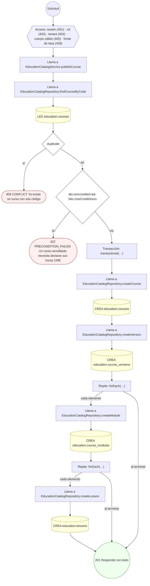

#### 11. POST /education/enrollments

Inscribir a un aprendiz

| HTTP | Código | Cuándo |
|---|---|---|
| 201 | — | Éxito |
| 400 | `VALIDATION_FAILED` | El cuerpo cumple el DTO (sin propiedades extra) |
| 401 | `UNAUTHENTICATED` | Hay una sesión válida (JWT) |
| 403 | `FORBIDDEN` | El rol está permitido; El tenant se resuelve y pertenece al actor |
| 404 | `NOT_FOUND` | ResourceNotFoundException: Curso no encontrado; ResourceNotFoundException: Cohorte no encontrada |
| 409 | `CONFLICT` | ConflictException: El aprendiz ya está inscrito en el curso; ConflictException: La cohorte no tiene plazas disponibles |
| 422 | `PRECONDITION_FAILED` | PreconditionFailedException: Una inscripción comprada necesita su intento de pago; PreconditionFailedException: El curso no está publicado; PreconditionFailedException: La cohorte pertenece a otro curso; PreconditionFailedException: La cohorte no está abierta |
| 429 | `RATE_LIMITED` | No se supera el límite de solicitudes |

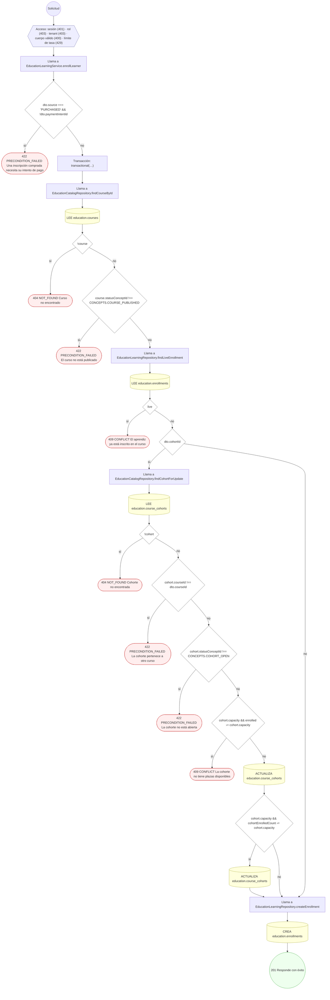

#### 12. POST /education/enrollments/{id}/certificate

Emitir el certificado verificable

| HTTP | Código | Cuándo |
|---|---|---|
| 201 | — | Éxito |
| 400 | `VALIDATION_FAILED` | Los parámetros de ruta son UUID válidos; El cuerpo cumple el DTO (sin propiedades extra) |
| 401 | `UNAUTHENTICATED` | Hay una sesión válida (JWT) |
| 403 | `FORBIDDEN` | El rol está permitido; El tenant se resuelve y pertenece al actor |
| 404 | `NOT_FOUND` | ResourceNotFoundException: Inscripción no encontrada; ResourceNotFoundException: Curso no encontrado |
| 409 | `CONFLICT` | ConflictException: No se pudo generar un número de certificado libre; ConflictException: No se pudo generar un código de verificación libre |
| 422 | `PRECONDITION_FAILED` | PreconditionFailedException: La inscripción no está completada |
| 429 | `RATE_LIMITED` | No se supera el límite de solicitudes |

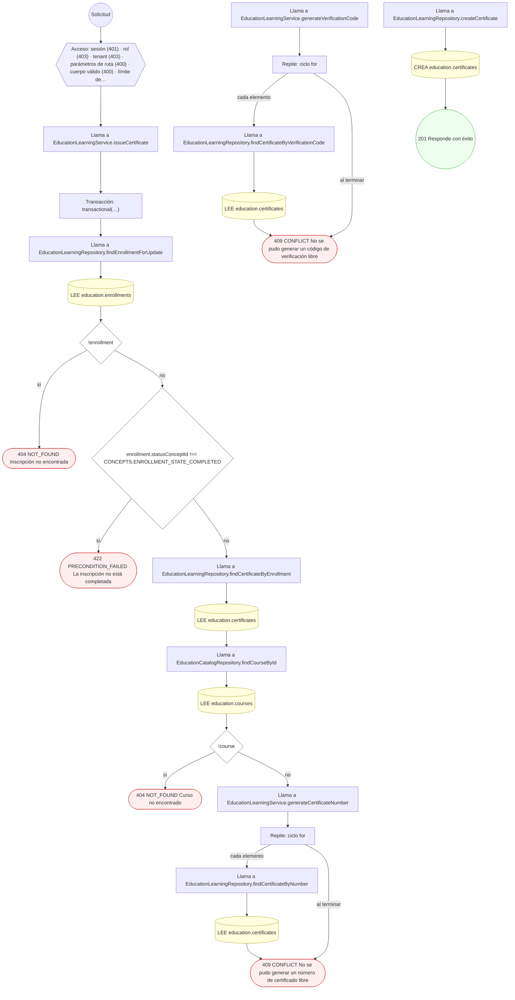

#### 13. POST /education/enrollments/{id}/complete

Completar el curso

| HTTP | Código | Cuándo |
|---|---|---|
| 200 | — | Éxito |
| 400 | `VALIDATION_FAILED` | Los parámetros de ruta son UUID válidos |
| 401 | `UNAUTHENTICATED` | Hay una sesión válida (JWT) |
| 403 | `FORBIDDEN` | El rol está permitido; El tenant se resuelve y pertenece al actor |
| 404 | `NOT_FOUND` | ResourceNotFoundException: Inscripción no encontrada |
| 422 | `PRECONDITION_FAILED` | PreconditionFailedException: La inscripción no está activa; PreconditionFailedException: El curso no está completo; PreconditionFailedException: Quedan evaluaciones sin aprobar |
| 429 | `RATE_LIMITED` | No se supera el límite de solicitudes |

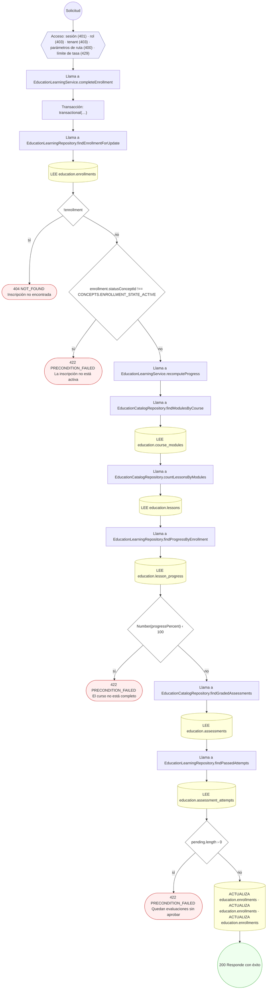

#### 14. POST /education/enrollments/{id}/lesson-progress

Registrar el progreso de una lección

| HTTP | Código | Cuándo |
|---|---|---|
| 201 | — | Éxito |
| 400 | `VALIDATION_FAILED` | Los parámetros de ruta son UUID válidos; El cuerpo cumple el DTO (sin propiedades extra) |
| 401 | `UNAUTHENTICATED` | Hay una sesión válida (JWT) |
| 403 | `FORBIDDEN` | El rol está permitido; El tenant se resuelve y pertenece al actor |
| 404 | `NOT_FOUND` | ResourceNotFoundException: Inscripción no encontrada; ResourceNotFoundException: Lección no encontrada |
| 422 | `PRECONDITION_FAILED` | PreconditionFailedException: La inscripción está cancelada; PreconditionFailedException: El acceso a la inscripción ha caducado |
| 429 | `RATE_LIMITED` | No se supera el límite de solicitudes |

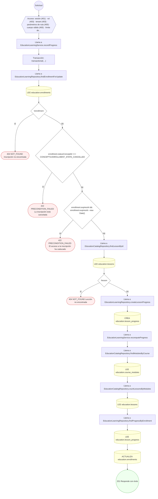

