<!-- AUTOGENERADO por tools/inventario/flujos.mjs. No editar manualmente. -->

# Flujos del módulo `erp`

- **Procesos:** 1 · **Máquinas de estado:** 0
- **Operaciones:** 17 (15 con decisiones propias, 2 sin ellas)
- Inventario de endpoints del módulo: [erp](../endpoints/erp.md)

## Proceso: Módulo 38 — ERP

- **Código:** `erp` · **Agrupación:** MIXTO · **Operaciones:** 17
- **Actores:** ACCOUNTANT · ACCOUNTS_PAYABLE · BUYER · CONTRACT_MANAGER · EMPLOYEE · ERP_ADMIN · HR_ADMIN · SALES · SYSTEM_WORKER · WAREHOUSE
- **Revisión:** AUTO_DETECTADA
- **Fuentes:** `src/modules/erp/README.md`

### Para qué sirve

Back-office: socios de negocio, ciclo de vida contractual, recursos humanos, compras y recepción, conciliación de facturas, ventas y arrendamientos.

_Fuente: `src/modules/erp/README.md:3`_

### Flujo general declarado en el README

```text
socio de negocio ── cuenta bancaria (unverified) ── verify ──> verified
       │
       └─ contrato (draft) ── approval ──> active
                 ├─ amendment  -> vuelve a aprobación pendiente
                 ├─ renewal    -> extiende endDate
                 ├─ termination-> terminated
                 └─ payment-schedules:generate -> cuotas (idempotente)

orden de compra (open) ── goods-receipt ──> received (aceptado vs rechazado)
                       └─ service-entry-sheet
factura ── invoice-match-run ──> matched | variance
```

_Fuente: `src/modules/erp/README.md:35`_

### Etapas y operaciones

| Etapa | Descripción | Operación | Quién actúa | Riesgo | Tablas |
|---|---|---|---|---|---|
| `UC-38-01` | Alta de socio con cuenta bancaria | POST /erp/business-partners | ERP_ADMIN | MEDIO | 3 |
| `UC-38-02` | Verificar cuenta bancaria | POST /erp/business-partners/{id}/bank-accounts/{accId}/verify | ERP_ADMIN | MEDIO | 3 |
| `UC-38-03` | Crear contrato en borrador | POST /erp/contracts | ERP_ADMIN · CONTRACT_MANAGER | MEDIO | 3 |
| `UC-38-04` | Solicitar/resolver aprobación | POST /erp/contracts/{id}/approval-requests | ERP_ADMIN · CONTRACT_MANAGER | MEDIO | 3 |
| `UC-38-05` | Enmendar contrato | POST /erp/contracts/{id}/amendments | ERP_ADMIN · CONTRACT_MANAGER | MEDIO | 2 |
| `UC-38-06` | Renovar contrato | POST /erp/contracts/{id}/renewals | ERP_ADMIN · CONTRACT_MANAGER | MEDIO | 2 |
| `UC-38-07` | Terminar y liquidar | POST /erp/contracts/{id}/terminations | ERP_ADMIN · CONTRACT_MANAGER | MEDIO | 3 |
| `UC-38-08` | Alta de empleado | POST /erp/employees/onboard | ERP_ADMIN · HR_ADMIN | MEDIO | 1 |
| `UC-38-09` | Solicitar y resolver ausencia | POST /erp/employees/{id}/time-off | ERP_ADMIN · HR_ADMIN · EMPLOYEE | MEDIO | 3 |
| `UC-38-10` | Emitir orden de compra | POST /erp/purchase-orders | ERP_ADMIN · BUYER | MEDIO | 3 |
| `UC-38-11` | Recepción de mercancía | POST /erp/purchase-orders/{id}/goods-receipts | ERP_ADMIN · BUYER · WAREHOUSE | MEDIO | 4 |
| `UC-38-12` | Hoja de servicios | POST /erp/purchase-orders/{id}/service-entry-sheets | ERP_ADMIN · BUYER | MEDIO | 2 |
| `UC-38-13` | Three-way match | POST /erp/bills/{billId}/invoice-match-runs | ERP_ADMIN · ACCOUNTS_PAYABLE | MEDIO | 3 |
| `UC-38-14` | Orden de venta | POST /erp/sales-orders | ERP_ADMIN · SALES | MEDIO | 2 |
| `UC-38-15` | Valoración IFRS 16 | POST /erp/lease-contracts/{id}/valuations | ERP_ADMIN · ACCOUNTANT | MEDIO | 1 |
| `UC-38-16` | Cronograma de cuotas | POST /erp/contracts/{id}/payment-schedules/generate | ERP_ADMIN · SYSTEM_WORKER | MEDIO | 3 |
| `ctrl:ErpController` | Operaciones de ErpController que el README no asigna a un caso de uso | POST /erp/employees/{id}/time-off/{reqId}/approve | ERP_ADMIN · HR_ADMIN | MEDIO | 2 |

### Diagrama — etapas `UC-38-01`, `UC-38-02`, `UC-38-03`…

```mermaid
flowchart LR
  a2(["ERP_ADMIN"]):::actor
  a7(["ERP_ADMIN · CONTRACT_MANAGER"]):::actor
  a18(["ERP_ADMIN · HR_ADMIN"]):::actor
  a21(["ERP_ADMIN · HR_ADMIN · EMPLOYEE"]):::actor
  a24(["ERP_ADMIN · BUYER"]):::actor
  a28(["ERP_ADMIN · BUYER · WAREHOUSE"]):::actor
  a34(["ERP_ADMIN · ACCOUNTS_PAYABLE"]):::actor
  a37(["ERP_ADMIN · SALES"]):::actor
  a40(["ERP_ADMIN · ACCOUNTANT"]):::actor
  a43(["ERP_ADMIN · SYSTEM_WORKER"]):::actor
  t3[("erp.business_partner_bank_accounts")]:::tabla
  t4[("erp.business_partners")]:::tabla
  t8[("erp.contracts")]:::tabla
  t10[("erp.contract_approval_requests")]:::tabla
  t12[("erp.contract_amendments")]:::tabla
  t14[("erp.contract_renewals")]:::tabla
  t16[("erp.contract_terminations")]:::tabla
  t19[("erp.employees")]:::tabla
  t22[("erp.time_off_requests")]:::tabla
  t25[("erp.purchase_order_items")]:::tabla
  t26[("erp.purchase_orders")]:::tabla
  t29[("erp.goods_receipt_items")]:::tabla
  t30[("erp.goods_receipts")]:::tabla
  t32[("erp.service_entry_sheets")]:::tabla
  t35[("erp.invoice_match_runs")]:::tabla
  t38[("erp.sales_orders")]:::tabla
  t41[("erp.lease_valuations")]:::tabla
  t44[("erp.contract_payment_schedules")]:::tabla
  subgraph s0["UC-38-01 · Alta de socio con cuenta bancaria"]
    o1["POST /erp/business-partners"]:::op
  end
  subgraph s1["UC-38-02 · Verificar cuenta bancaria"]
    o5["POST /erp/business-partners/{id}/bank-accounts/{accId}/verify"]:::op
  end
  subgraph s2["UC-38-03 · Crear contrato en borrador"]
    o6["POST /erp/contracts"]:::op
  end
  subgraph s3["UC-38-04 · Solicitar/resolver aprobación"]
    o9["POST /erp/contracts/{id}/approval-requests"]:::op
  end
  subgraph s4["UC-38-05 · Enmendar contrato"]
    o11["POST /erp/contracts/{id}/amendments"]:::op
  end
  subgraph s5["UC-38-06 · Renovar contrato"]
    o13["POST /erp/contracts/{id}/renewals"]:::op
  end
  subgraph s6["UC-38-07 · Terminar y liquidar"]
    o15["POST /erp/contracts/{id}/terminations"]:::op
  end
  subgraph s7["UC-38-08 · Alta de empleado"]
    o17["POST /erp/employees/onboard"]:::op
  end
  subgraph s8["UC-38-09 · Solicitar y resolver ausencia"]
    o20["POST /erp/employees/{id}/time-off"]:::op
  end
  subgraph s9["UC-38-10 · Emitir orden de compra"]
    o23["POST /erp/purchase-orders"]:::op
  end
  subgraph s10["UC-38-11 · Recepción de mercancía"]
    o27["POST /erp/purchase-orders/{id}/goods-receipts"]:::op
  end
  subgraph s11["UC-38-12 · Hoja de servicios"]
    o31["POST /erp/purchase-orders/{id}/service-entry-sheets"]:::op
  end
  subgraph s12["UC-38-13 · Three-way match"]
    o33["POST /erp/bills/{billId}/invoice-match-runs"]:::op
  end
  subgraph s13["UC-38-14 · Orden de venta"]
    o36["POST /erp/sales-orders"]:::op
  end
  subgraph s14["UC-38-15 · Valoración IFRS 16"]
    o39["POST /erp/lease-contracts/{id}/valuations"]:::op
  end
  subgraph s15["UC-38-16 · Cronograma de cuotas"]
    o42["POST /erp/contracts/{id}/payment-schedules/generate"]:::op
  end
  subgraph s16["ctrl:ErpController · Operaciones de ErpController que el README no asigna a un…"]
    o45["POST /erp/employees/{id}/time-off/{reqId}/approve"]:::op
  end
  a2 --> o1
  o1 -->|"CREA"| t3
  o1 -->|"CREA"| t4
  o1 -->|"LEE"| t4
  a2 --> o5
  o5 -->|"ACTUALIZA"| t3
  o5 -->|"LEE"| t3
  o5 -->|"LEE"| t4
  a7 --> o6
  o6 -->|"LEE"| t4
  o6 -->|"CREA"| t8
  o6 -->|"LEE"| t8
  a7 --> o9
  o9 -->|"CREA"| t10
  o9 -->|"ACTUALIZA"| t8
  o9 -->|"LEE"| t8
  a7 --> o11
  o11 -->|"CREA"| t12
  o11 -->|"LEE"| t8
  a7 --> o13
  o13 -->|"CREA"| t14
  o13 -->|"LEE"| t8
  a7 --> o15
  o15 -->|"CREA"| t16
  o15 -->|"ACTUALIZA"| t8
  o15 -->|"LEE"| t8
  a18 --> o17
  o17 -->|"CREA"| t19
  a21 --> o20
  o20 -->|"LEE"| t19
  o20 -->|"CREA"| t22
  o20 -->|"LEE"| t22
  a24 --> o23
  o23 -->|"LEE"| t4
  o23 -->|"CREA"| t25
  o23 -->|"CREA"| t26
  a28 --> o27
  o27 -->|"CREA"| t29
  o27 -->|"CREA"| t30
  o27 -->|"ACTUALIZA"| t26
  o27 -->|"LEE"| t26
  a24 --> o31
  o31 -->|"LEE"| t26
  o31 -->|"CREA"| t32
  a34 --> o33
  o33 -->|"CREA"| t35
  o33 -->|"LEE"| t25
  o33 -->|"LEE"| t26
  a37 --> o36
  o36 -->|"LEE"| t4
  o36 -->|"CREA"| t38
  a40 --> o39
  o39 -->|"CREA"| t41
  a43 --> o42
  o42 -->|"CREA"| t44
  o42 -->|"LEE"| t44
  o42 -->|"LEE"| t8
  a18 --> o45
  o45 -->|"ACTUALIZA"| t22
  o45 -->|"LEE"| t22
  classDef op fill:#fff,stroke:#446
  classDef actor fill:#eef,stroke:#66a
  classDef tabla fill:#ffd,stroke:#aa3
  classDef evento fill:#efe,stroke:#3a3
```

## Árbol de decisión por operación

Cada árbol se deriva del código del handler y de los métodos que invoca (hasta 4 niveles). Una rama que no decide, no escribe y no falla se poda. Los accesos y los efectos consecutivos se agrupan en un solo nodo.

### Operaciones con decisiones propias

#### 1. POST /erp/bills/{billId}/invoice-match-runs

Conciliar la factura contra orden y recepción (three-way match)

| HTTP | Código | Cuándo |
|---|---|---|
| 201 | — | Éxito |
| 400 | `VALIDATION_FAILED` | Los parámetros de ruta son UUID válidos; El cuerpo cumple el DTO (sin propiedades extra) |
| 401 | `UNAUTHENTICATED` | Hay una sesión válida (JWT) |
| 403 | `FORBIDDEN` | El rol está permitido; El tenant se resuelve y pertenece al actor |
| 404 | `NOT_FOUND` | ResourceNotFoundException: Orden de compra no encontrada |
| 429 | `RATE_LIMITED` | No se supera el límite de solicitudes |

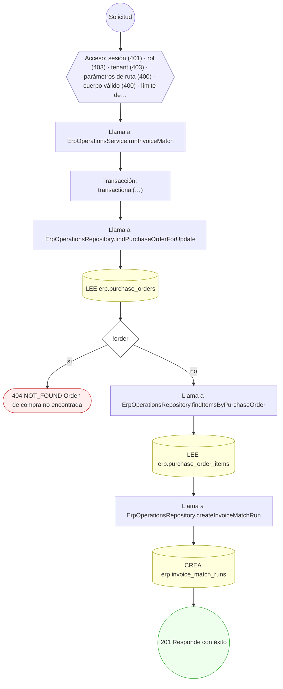

#### 2. POST /erp/business-partners

Alta de socio de negocio con su cuenta bancaria

| HTTP | Código | Cuándo |
|---|---|---|
| 201 | — | Éxito |
| 400 | `VALIDATION_FAILED` | El cuerpo cumple el DTO (sin propiedades extra) |
| 401 | `UNAUTHENTICATED` | Hay una sesión válida (JWT) |
| 403 | `FORBIDDEN` | El rol está permitido; El tenant se resuelve y pertenece al actor |
| 409 | `CONFLICT` | ConflictException: Ya existe un socio con ese número |
| 429 | `RATE_LIMITED` | No se supera el límite de solicitudes |

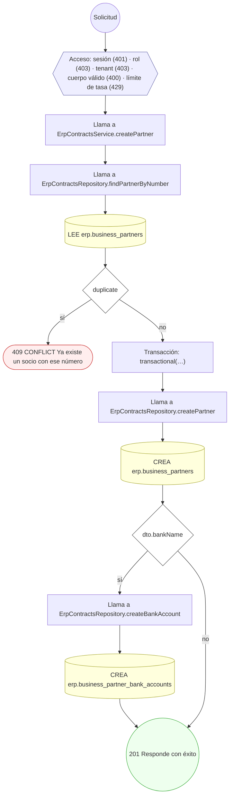

#### 3. POST /erp/business-partners/{id}/bank-accounts/{accId}/verify

Verificar la cuenta bancaria del socio

| HTTP | Código | Cuándo |
|---|---|---|
| 200 | — | Éxito |
| 400 | `VALIDATION_FAILED` | Los parámetros de ruta son UUID válidos |
| 401 | `UNAUTHENTICATED` | Hay una sesión válida (JWT) |
| 403 | `FORBIDDEN` | El rol está permitido; El tenant se resuelve y pertenece al actor |
| 404 | `NOT_FOUND` | ResourceNotFoundException: Socio de negocio no encontrado; ResourceNotFoundException: Cuenta bancaria no encontrada |
| 409 | `CONFLICT` | ConflictException: La cuenta ya está verificada |
| 422 | `PRECONDITION_FAILED` | PreconditionFailedException: La cuenta no pertenece a ese socio |
| 429 | `RATE_LIMITED` | No se supera el límite de solicitudes |

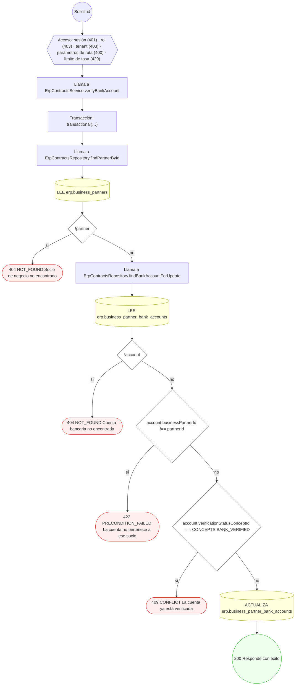

#### 4. POST /erp/contracts

Crear un contrato en borrador

| HTTP | Código | Cuándo |
|---|---|---|
| 201 | — | Éxito |
| 400 | `VALIDATION_FAILED` | El cuerpo cumple el DTO (sin propiedades extra) |
| 401 | `UNAUTHENTICATED` | Hay una sesión válida (JWT) |
| 403 | `FORBIDDEN` | El rol está permitido; El tenant se resuelve y pertenece al actor |
| 404 | `NOT_FOUND` | ResourceNotFoundException: Socio de negocio no encontrado |
| 409 | `CONFLICT` | ConflictException: Ya existe un contrato con ese número |
| 422 | `PRECONDITION_FAILED` | PreconditionFailedException: El contrato debe terminar después de empezar |
| 429 | `RATE_LIMITED` | No se supera el límite de solicitudes |

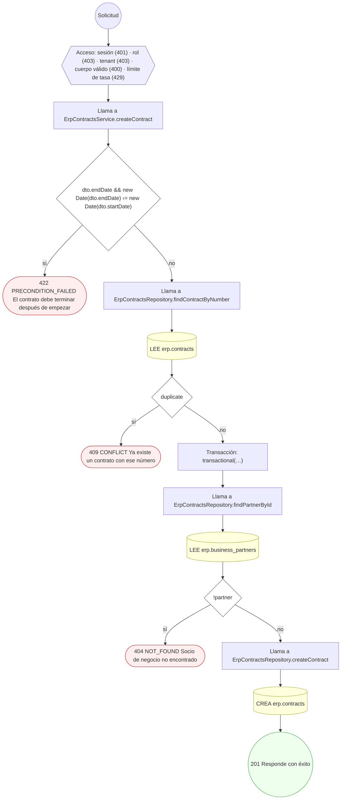

#### 5. POST /erp/contracts/{id}/amendments

Enmendar el contrato

| HTTP | Código | Cuándo |
|---|---|---|
| 201 | — | Éxito |
| 400 | `VALIDATION_FAILED` | Los parámetros de ruta son UUID válidos; El cuerpo cumple el DTO (sin propiedades extra) |
| 401 | `UNAUTHENTICATED` | Hay una sesión válida (JWT) |
| 403 | `FORBIDDEN` | El rol está permitido; El tenant se resuelve y pertenece al actor |
| 404 | `NOT_FOUND` | ResourceNotFoundException: Contrato no encontrado |
| 422 | `PRECONDITION_FAILED` | PreconditionFailedException: El contrato no admite cambios en su estado actual |
| 429 | `RATE_LIMITED` | No se supera el límite de solicitudes |

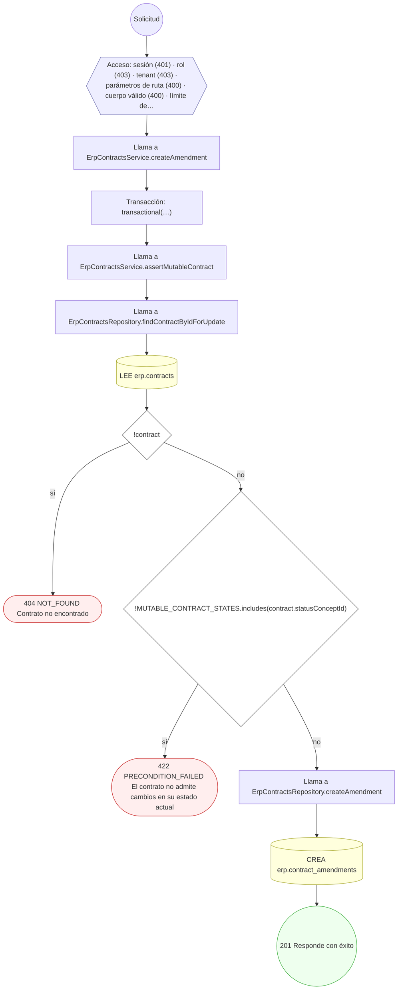

#### 6. POST /erp/contracts/{id}/approval-requests

Solicitar o resolver la aprobación del contrato

| HTTP | Código | Cuándo |
|---|---|---|
| 201 | — | Éxito |
| 400 | `VALIDATION_FAILED` | Los parámetros de ruta son UUID válidos; El cuerpo cumple el DTO (sin propiedades extra) |
| 401 | `UNAUTHENTICATED` | Hay una sesión válida (JWT) |
| 403 | `FORBIDDEN` | El rol está permitido; El tenant se resuelve y pertenece al actor |
| 404 | `NOT_FOUND` | ResourceNotFoundException: Contrato no encontrado |
| 422 | `PRECONDITION_FAILED` | PreconditionFailedException: El contrato está terminado |
| 429 | `RATE_LIMITED` | No se supera el límite de solicitudes |

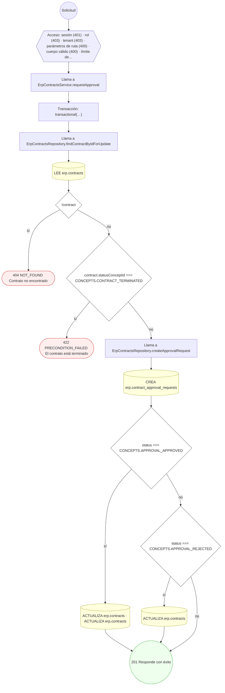

#### 7. POST /erp/contracts/{id}/payment-schedules/generate

Generar el cronograma de cuotas del contrato

| HTTP | Código | Cuándo |
|---|---|---|
| 201 | — | Éxito |
| 400 | `VALIDATION_FAILED` | Los parámetros de ruta son UUID válidos; El cuerpo cumple el DTO (sin propiedades extra) |
| 401 | `UNAUTHENTICATED` | Hay una sesión válida (JWT) |
| 403 | `FORBIDDEN` | El rol está permitido; El tenant se resuelve y pertenece al actor |
| 404 | `NOT_FOUND` | ResourceNotFoundException: Contrato no encontrado |
| 422 | `PRECONDITION_FAILED` | PreconditionFailedException: El contrato no tiene valor total del que derivar las cuotas |
| 429 | `RATE_LIMITED` | No se supera el límite de solicitudes |

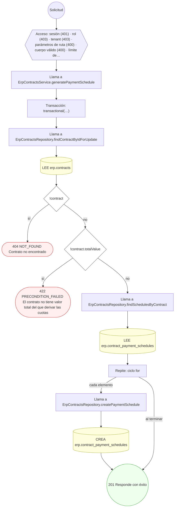

#### 8. POST /erp/contracts/{id}/renewals

Renovar el contrato extendiendo su vigencia

| HTTP | Código | Cuándo |
|---|---|---|
| 201 | — | Éxito |
| 400 | `VALIDATION_FAILED` | Los parámetros de ruta son UUID válidos; El cuerpo cumple el DTO (sin propiedades extra) |
| 401 | `UNAUTHENTICATED` | Hay una sesión válida (JWT) |
| 403 | `FORBIDDEN` | El rol está permitido; El tenant se resuelve y pertenece al actor |
| 404 | `NOT_FOUND` | ResourceNotFoundException: Contrato no encontrado |
| 422 | `PRECONDITION_FAILED` | PreconditionFailedException: El contrato no admite cambios en su estado actual; PreconditionFailedException: La renovación debe extender la vigencia más allá del fin actual |
| 429 | `RATE_LIMITED` | No se supera el límite de solicitudes |

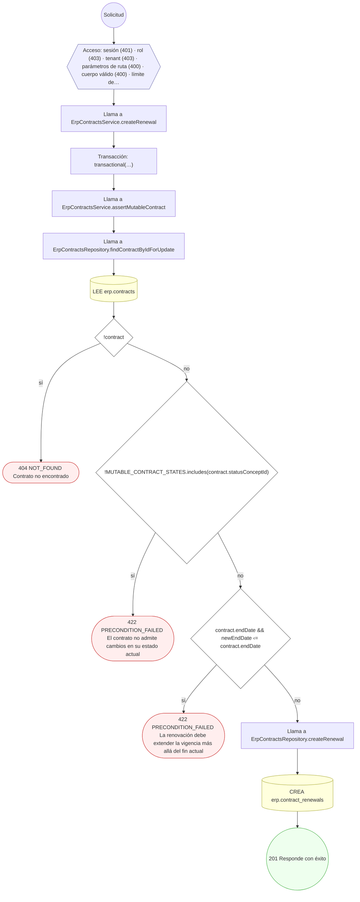

#### 9. POST /erp/contracts/{id}/terminations

Terminar el contrato y liquidarlo

| HTTP | Código | Cuándo |
|---|---|---|
| 201 | — | Éxito |
| 400 | `VALIDATION_FAILED` | Los parámetros de ruta son UUID válidos; El cuerpo cumple el DTO (sin propiedades extra) |
| 401 | `UNAUTHENTICATED` | Hay una sesión válida (JWT) |
| 403 | `FORBIDDEN` | El rol está permitido; El tenant se resuelve y pertenece al actor |
| 404 | `NOT_FOUND` | ResourceNotFoundException: Contrato no encontrado |
| 409 | `CONFLICT` | ConflictException: El contrato ya está terminado |
| 429 | `RATE_LIMITED` | No se supera el límite de solicitudes |

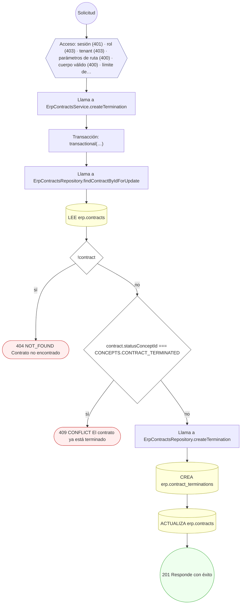

#### 10. POST /erp/employees/{id}/time-off

Solicitar una ausencia

| HTTP | Código | Cuándo |
|---|---|---|
| 201 | — | Éxito |
| 400 | `VALIDATION_FAILED` | Los parámetros de ruta son UUID válidos; El cuerpo cumple el DTO (sin propiedades extra) |
| 401 | `UNAUTHENTICATED` | Hay una sesión válida (JWT) |
| 403 | `FORBIDDEN` | El rol está permitido; El tenant se resuelve y pertenece al actor |
| 404 | `NOT_FOUND` | ResourceNotFoundException: Empleado no encontrado |
| 409 | `CONFLICT` | ConflictException: El empleado ya tiene una ausencia en esas fechas |
| 422 | `PRECONDITION_FAILED` | PreconditionFailedException: La ausencia debe terminar después de empezar |
| 429 | `RATE_LIMITED` | No se supera el límite de solicitudes |

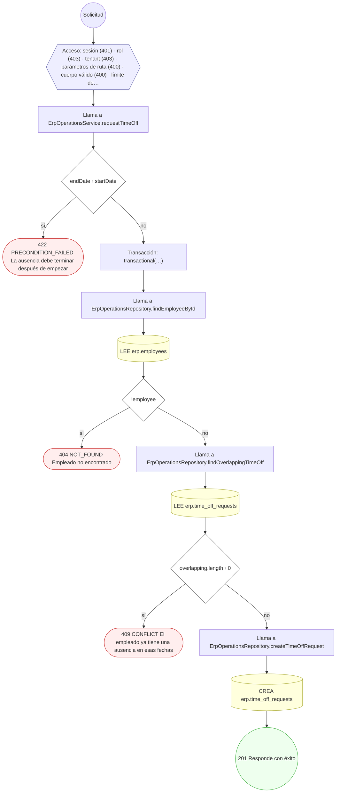

#### 11. POST /erp/employees/{id}/time-off/{reqId}/approve

Aprobar o rechazar la solicitud de ausencia

| HTTP | Código | Cuándo |
|---|---|---|
| 200 | — | Éxito |
| 400 | `VALIDATION_FAILED` | Los parámetros de ruta son UUID válidos; El cuerpo cumple el DTO (sin propiedades extra) |
| 401 | `UNAUTHENTICATED` | Hay una sesión válida (JWT) |
| 403 | `FORBIDDEN` | El rol está permitido; El tenant se resuelve y pertenece al actor |
| 404 | `NOT_FOUND` | ResourceNotFoundException: Solicitud de ausencia no encontrada |
| 409 | `CONFLICT` | ConflictException: La solicitud ya fue resuelta |
| 429 | `RATE_LIMITED` | No se supera el límite de solicitudes |

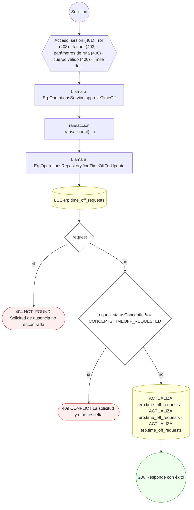

#### 12. POST /erp/purchase-orders

Emitir una orden de compra desde la requisición

| HTTP | Código | Cuándo |
|---|---|---|
| 201 | — | Éxito |
| 400 | `VALIDATION_FAILED` | El cuerpo cumple el DTO (sin propiedades extra) |
| 401 | `UNAUTHENTICATED` | Hay una sesión válida (JWT) |
| 403 | `FORBIDDEN` | El rol está permitido; El tenant se resuelve y pertenece al actor |
| 404 | `NOT_FOUND` | ResourceNotFoundException: Proveedor no encontrado |
| 429 | `RATE_LIMITED` | No se supera el límite de solicitudes |

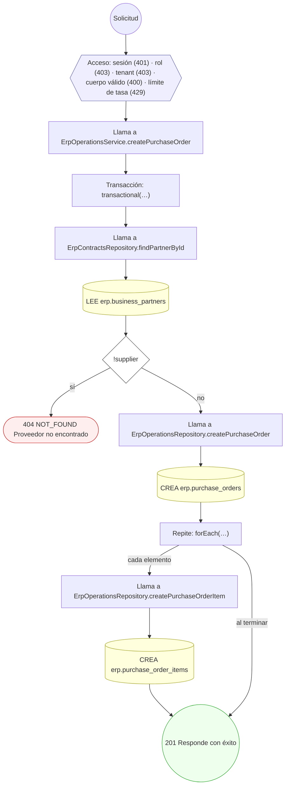

#### 13. POST /erp/purchase-orders/{id}/goods-receipts

Registrar la recepción de mercancía

| HTTP | Código | Cuándo |
|---|---|---|
| 201 | — | Éxito |
| 400 | `VALIDATION_FAILED` | Los parámetros de ruta son UUID válidos; El cuerpo cumple el DTO (sin propiedades extra) |
| 401 | `UNAUTHENTICATED` | Hay una sesión válida (JWT) |
| 403 | `FORBIDDEN` | El rol está permitido; El tenant se resuelve y pertenece al actor |
| 404 | `NOT_FOUND` | ResourceNotFoundException: Orden de compra no encontrada |
| 422 | `PRECONDITION_FAILED` | PreconditionFailedException: La orden de compra está cerrada; PreconditionFailedException: La cantidad aceptada no puede superar la recibida |
| 429 | `RATE_LIMITED` | No se supera el límite de solicitudes |

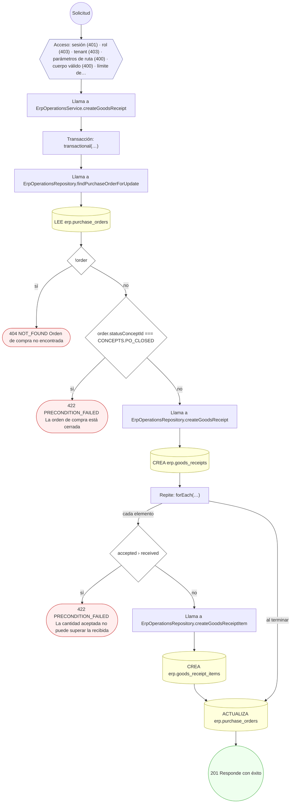

#### 14. POST /erp/purchase-orders/{id}/service-entry-sheets

Registrar la hoja de servicios prestados

| HTTP | Código | Cuándo |
|---|---|---|
| 201 | — | Éxito |
| 400 | `VALIDATION_FAILED` | Los parámetros de ruta son UUID válidos; El cuerpo cumple el DTO (sin propiedades extra) |
| 401 | `UNAUTHENTICATED` | Hay una sesión válida (JWT) |
| 403 | `FORBIDDEN` | El rol está permitido; El tenant se resuelve y pertenece al actor |
| 404 | `NOT_FOUND` | ResourceNotFoundException: Orden de compra no encontrada |
| 429 | `RATE_LIMITED` | No se supera el límite de solicitudes |

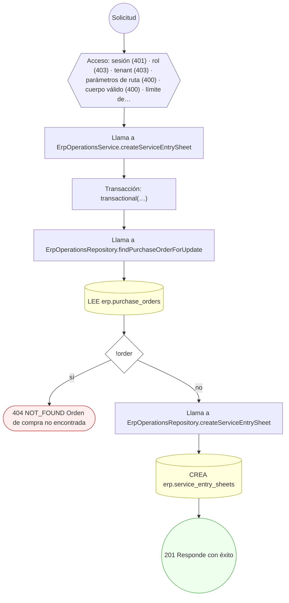

#### 15. POST /erp/sales-orders

Crear una orden de venta

| HTTP | Código | Cuándo |
|---|---|---|
| 201 | — | Éxito |
| 400 | `VALIDATION_FAILED` | El cuerpo cumple el DTO (sin propiedades extra) |
| 401 | `UNAUTHENTICATED` | Hay una sesión válida (JWT) |
| 403 | `FORBIDDEN` | El rol está permitido; El tenant se resuelve y pertenece al actor |
| 404 | `NOT_FOUND` | ResourceNotFoundException: Cliente no encontrado |
| 429 | `RATE_LIMITED` | No se supera el límite de solicitudes |

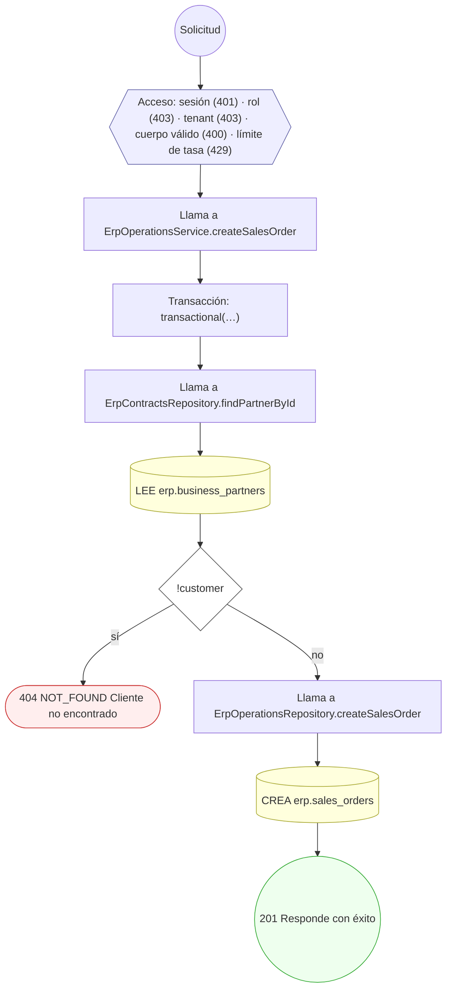

### Operaciones sin decisiones propias

Sólo comprueban el acceso y leen o escriben: no tienen ramas que dibujar. Su detalle está en la ficha de endpoints.

| Operación | Respuestas posibles | Tablas |
|---|---|---|
| POST /erp/employees/onboard | 201, 400, 401, 403, 429 | 1 |
| POST /erp/lease-contracts/{id}/valuations | 201, 400, 401, 403, 429 | 1 |
