<!-- AUTOGENERADO por tools/inventario/flujos.mjs. No editar manualmente. -->

# Flujos del módulo `forms`

- **Procesos:** 1 · **Máquinas de estado:** 0
- **Operaciones:** 25 (22 con decisiones propias, 3 sin ellas)
- Inventario de endpoints del módulo: [forms](../endpoints/forms.md)

## Proceso: Módulo Forms (09) — Dynamic Forms & Extensibility Governance

- **Código:** `forms` · **Agrupación:** MIXTO · **Operaciones:** 25
- **Actores:** CLINICIAN · Cualquier sesión válida · PRACTITIONER · SECURITY_ADMIN
- **Revisión:** AUTO_DETECTADA
- **Fuentes:** `src/modules/forms/README.md`

### Para qué sirve

Formularios dinámicos y gobernanza de extensibilidad: definición de sets/versiones inmutables, campos con reglas y dependencias, localizaciones i18n, asignaciones gobernadas por política, instancias de formulario, captura/curación de valores (value[x] exclusivo, supersede, procedencia) y migración de esquema.

_Fuente: `src/modules/forms/README.md:3`_

### Etapas y operaciones

| Etapa | Descripción | Operación | Quién actúa | Riesgo | Tablas |
|---|---|---|---|---|---|
| `UC-09-01` | Crea set + versión inicial (draft, inmutable) | POST /forms/definition-sets | SECURITY_ADMIN | MEDIO | 3 |
| `UC-09-02` | clínico, practitioner o SECURITY_ADMIN | POST /forms/field-definitions | CLINICIAN · PRACTITIONER · SECURITY_ADMIN | MEDIO | 3 |
| `UC-09-03` | Compone miembros y publica la versión | POST /forms/definition-sets/{id}/versions/{ver}/publish | SECURITY_ADMIN | MEDIO | 5 |
| `UC-09-04` | Define dependencia condicional entre campos | POST /forms/fields/{id}/dependencies | CLINICIAN · PRACTITIONER · SECURITY_ADMIN | MEDIO | 3 |
| `UC-09-05` | Upsert de localización i18n (es/en) | PUT /forms/fields/{id}/localizations/{lang} | CLINICIAN · PRACTITIONER · SECURITY_ADMIN | MEDIO | 4 |
| `UC-09-06` | Asigna campo a target con enforcement de política | POST /forms/assignments | CLINICIAN · PRACTITIONER · SECURITY_ADMIN | MEDIO | 5 |
| `UC-09-07` | Abre instancia de formulario para un recurso | POST /forms/instances | CLINICIAN · PRACTITIONER | MEDIO | 3 |
| `UC-09-08` | Captura valores (value[x] exclusivo) | POST /forms/instances/{id}/values | CLINICIAN · PRACTITIONER | MEDIO | 3 |
| `UC-09-09` | Corrige valor con supersede y snapshot inmutable | PATCH /forms/values/{id} | CLINICIAN · PRACTITIONER | MEDIO | 4 |
| `UC-09-10` | Importa valores externos (batch ETL) con procedencia | POST /forms/values/import | CLINICIAN · PRACTITIONER | MEDIO | 4 |
| `UC-09-11` | Cierra formulario y finaliza valores preliminares | POST /forms/instances/{id}/close | CLINICIAN · PRACTITIONER | MEDIO | 4 |
| `UC-09-12` | Define regla de acceso / enmascarado por campo | POST /forms/fields/{id}/access-rules | SECURITY_ADMIN | MEDIO | 2 |
| `UC-09-13` | Ejecuta migración entre versiones | POST /forms/definition-sets/{id}/migrations/{migrationId}/run | SECURITY_ADMIN | MEDIO | 4 |
| `ctrl:FormsAssignmentsController` | Operaciones de FormsAssignmentsController que el README no asigna a un caso de uso | GET /forms/assignments | CLINICIAN · PRACTITIONER · SECURITY_ADMIN | BAJO | 2 |
|  |  | DELETE /forms/assignments/{id} | CLINICIAN · PRACTITIONER · SECURITY_ADMIN | MEDIO | 2 |
|  |  | PATCH /forms/assignments/{id} | CLINICIAN · PRACTITIONER · SECURITY_ADMIN | MEDIO | 2 |
|  |  | GET /forms/assignments/budget | CLINICIAN · PRACTITIONER · SECURITY_ADMIN | BAJO | 2 |
|  |  | PUT /forms/assignments/order | CLINICIAN · PRACTITIONER · SECURITY_ADMIN | BAJO | 1 |
| `ctrl:FormsDefinitionSetsController` | Operaciones de FormsDefinitionSetsController que el README no asigna a un caso de uso | GET /forms/definition-sets | CLINICIAN · PRACTITIONER · SECURITY_ADMIN | BAJO | 1 |
|  |  | GET /forms/definition-sets/{id} | CLINICIAN · PRACTITIONER · SECURITY_ADMIN | BAJO | 8 |
| `ctrl:FormsFieldsController` | Operaciones de FormsFieldsController que el README no asigna a un caso de uso | PATCH /forms/field-definitions/{id} | CLINICIAN · PRACTITIONER · SECURITY_ADMIN | MEDIO | 4 |
| `ctrl:FormsInstancesController` | Operaciones de FormsInstancesController que el README no asigna a un caso de uso | GET /forms/instances | CLINICIAN · PRACTITIONER | BAJO | 2 |
|  |  | GET /forms/instances/{id} | CLINICIAN · PRACTITIONER | BAJO | 5 |
| `ctrl:FormsMeController` | Operaciones de FormsMeController que el README no asigna a un caso de uso | GET /forms/me/instances | Cualquier sesión válida | BAJO | 2 |
|  |  | GET /forms/me/instances/{id} | Cualquier sesión válida | BAJO | 5 |

### Diagrama 1 de 2 — etapas `UC-09-01`, `UC-09-02`, `UC-09-03`…

```mermaid
flowchart LR
  a2(["SECURITY_ADMIN"]):::actor
  a6(["CLINICIAN · PRACTITIONER · SECURITY_ADMIN"]):::actor
  a20(["CLINICIAN · PRACTITIONER"]):::actor
  t3[("forms.field_definition_set_versions")]:::tabla
  t4[("forms.field_definition_sets")]:::tabla
  t7[("forms.dynamic_field_definitions")]:::tabla
  t8[("forms.field_validation_rules")]:::tabla
  t10[("forms.field_set_members")]:::tabla
  t12[("forms.field_dependencies")]:::tabla
  t14[("forms.field_definition_localizations")]:::tabla
  t16[("forms.dynamic_field_sections")]:::tabla
  t17[("forms.extension_target_policies")]:::tabla
  t18[("forms.field_assignments")]:::tabla
  t21[("clinical.encounters")]:::tabla
  t22[("forms.form_instances")]:::tabla
  t24[("forms.field_value_audit")]:::tabla
  t25[("forms.field_values")]:::tabla
  t28[("forms.field_value_provenance")]:::tabla
  t31[("forms.field_value_access_rules")]:::tabla
  t33[("forms.field_schema_migrations")]:::tabla
  subgraph s0["UC-09-01 · Crea set + versión inicial (draft, inmutable)"]
    o1["POST /forms/definition-sets"]:::op
  end
  subgraph s1["UC-09-02 · clínico, practitioner o SECURITY_ADMIN"]
    o5["POST /forms/field-definitions"]:::op
  end
  subgraph s2["UC-09-03 · Compone miembros y publica la versión"]
    o9["POST /forms/definition-sets/{id}/versions/{ver}/publish"]:::op
  end
  subgraph s3["UC-09-04 · Define dependencia condicional entre campos"]
    o11["POST /forms/fields/{id}/dependencies"]:::op
  end
  subgraph s4["UC-09-05 · Upsert de localización i18n (es/en)"]
    o13["PUT /forms/fields/{id}/localizations/{lang}"]:::op
  end
  subgraph s5["UC-09-06 · Asigna campo a target con enforcement de política"]
    o15["POST /forms/assignments"]:::op
  end
  subgraph s6["UC-09-07 · Abre instancia de formulario para un recurso"]
    o19["POST /forms/instances"]:::op
  end
  subgraph s7["UC-09-08 · Captura valores (value[x] exclusivo)"]
    o23["POST /forms/instances/{id}/values"]:::op
  end
  subgraph s8["UC-09-09 · Corrige valor con supersede y snapshot inmutable"]
    o26["PATCH /forms/values/{id}"]:::op
  end
  subgraph s9["UC-09-10 · Importa valores externos (batch ETL) con procedencia"]
    o27["POST /forms/values/import"]:::op
  end
  subgraph s10["UC-09-11 · Cierra formulario y finaliza valores preliminares"]
    o29["POST /forms/instances/{id}/close"]:::op
  end
  subgraph s11["UC-09-12 · Define regla de acceso / enmascarado por campo"]
    o30["POST /forms/fields/{id}/access-rules"]:::op
  end
  subgraph s12["UC-09-13 · Ejecuta migración entre versiones"]
    o32["POST /forms/definition-sets/{id}/migrations/{migrationId}/run"]:::op
  end
  subgraph s13["ctrl:FormsAssignmentsController · Operaciones de FormsAssignmentsController que…"]
    o34["GET /forms/assignments"]:::op
    o35["DELETE /forms/assignments/{id}"]:::op
    o36["PATCH /forms/assignments/{id}"]:::op
    o37["GET /forms/assignments/budget"]:::op
    o38["PUT /forms/assignments/order"]:::op
  end
  t41[("+2 tablas más")]
  subgraph s14["ctrl:FormsDefinitionSetsController · Operaciones de FormsDefinitionSetsControll…"]
    o39["GET /forms/definition-sets"]:::op
    o40["GET /forms/definition-sets/{id}"]:::op
  end
  a2 --> o1
  o1 -->|"CREA"| t3
  o1 -->|"CREA"| t4
  o1 -->|"LEE"| t4
  a6 --> o5
  o5 -->|"CREA"| t7
  o5 -->|"LEE"| t7
  o5 -->|"CREA"| t8
  a2 --> o9
  o9 -->|"ACTUALIZA"| t3
  o9 -->|"LEE"| t3
  o9 -->|"ACTUALIZA"| t4
  o9 -->|"LEE"| t4
  o9 -->|"CREA"| t10
  a6 --> o11
  o11 -->|"LEE"| t7
  o11 -->|"CREA"| t12
  o11 -->|"LEE"| t12
  a6 --> o13
  o13 -->|"LEE"| t7
  o13 -->|"ACTUALIZA"| t14
  o13 -->|"CREA"| t14
  o13 -->|"LEE"| t14
  a6 --> o15
  o15 -->|"LEE"| t7
  o15 -->|"CREA"| t16
  o15 -->|"LEE"| t17
  o15 -->|"CREA"| t18
  o15 -->|"LEE"| t18
  a20 --> o19
  o19 -->|"LEE"| t21
  o19 -->|"CREA"| t22
  o19 -->|"LEE"| t22
  a20 --> o23
  o23 -->|"CREA"| t24
  o23 -->|"CREA"| t25
  o23 -->|"LEE"| t22
  a20 --> o26
  o26 -->|"CREA"| t24
  o26 -->|"ACTUALIZA"| t25
  o26 -->|"CREA"| t25
  o26 -->|"LEE"| t25
  a20 --> o27
  o27 -->|"CREA"| t24
  o27 -->|"CREA"| t28
  o27 -->|"CREA"| t25
  o27 -->|"LEE"| t22
  a20 --> o29
  o29 -->|"ACTUALIZA"| t25
  o29 -->|"LEE"| t25
  o29 -->|"ACTUALIZA"| t22
  o29 -->|"LEE"| t22
  a2 --> o30
  o30 -->|"LEE"| t7
  o30 -->|"CREA"| t31
  a2 --> o32
  o32 -->|"LEE"| t3
  o32 -->|"LEE"| t4
  o32 -->|"CREA"| t33
  o32 -->|"LEE"| t33
  a6 --> o34
  o34 -->|"LEE"| t16
  o34 -->|"LEE"| t18
  a6 --> o35
  o35 -->|"ACTUALIZA"| t18
  o35 -->|"LEE"| t18
  a6 --> o36
  o36 -->|"ACTUALIZA"| t18
  o36 -->|"LEE"| t18
  a6 --> o37
  o37 -->|"LEE"| t17
  o37 -->|"LEE"| t18
  a6 --> o38
  o38 -->|"LEE"| t18
  a6 --> o39
  o39 -->|"LEE"| t4
  a6 --> o40
  o40 -->|"LEE"| t7
  o40 -->|"LEE"| t16
  o40 -->|"LEE"| t14
  o40 -->|"LEE"| t3
  o40 -->|"LEE"| t4
  o40 -->|"LEE"| t12
  o40 -.-> t41
  classDef op fill:#fff,stroke:#446
  classDef actor fill:#eef,stroke:#66a
  classDef tabla fill:#ffd,stroke:#aa3
  classDef evento fill:#efe,stroke:#3a3
```

### Diagrama 2 de 2 — etapas `ctrl:FormsFieldsController`, `ctrl:FormsInstancesController`, `ctrl:FormsMeController`

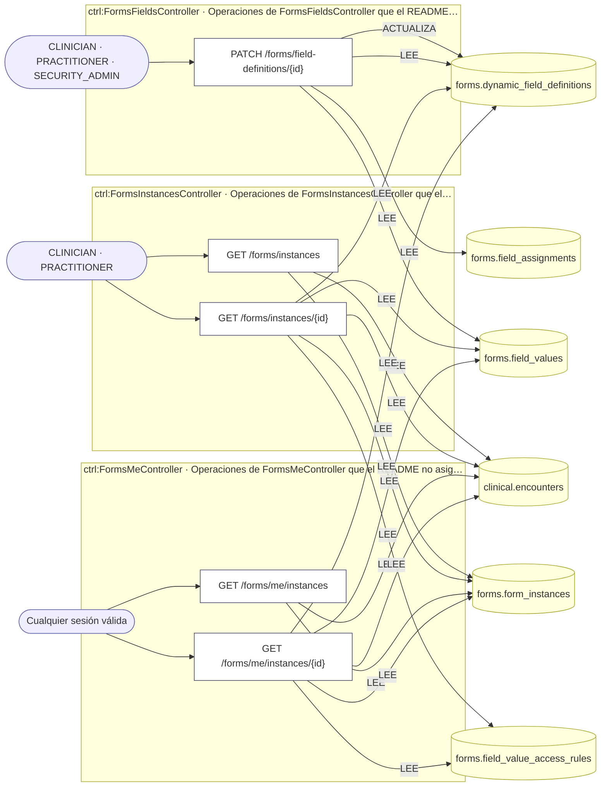

## Árbol de decisión por operación

Cada árbol se deriva del código del handler y de los métodos que invoca (hasta 4 niveles). Una rama que no decide, no escribe y no falla se poda. Los accesos y los efectos consecutivos se agrupan en un solo nodo.

### Operaciones con decisiones propias

#### 1. POST /forms/assignments

Asignar campos a un target con política de extensión

| HTTP | Código | Cuándo |
|---|---|---|
| 201 | — | Éxito |
| 400 | `VALIDATION_FAILED` | El cuerpo cumple el DTO (sin propiedades extra) |
| 401 | `UNAUTHENTICATED` | Hay una sesión válida (JWT) |
| 403 | `FORBIDDEN` | El rol está permitido; El tenant se resuelve y pertenece al actor; ForbiddenException: Sólo se pueden asignar campos dentro de la propia organización; ForbiddenException: Este formulario no admite campos propios: no tiene política de extensión activa; ForbiddenException: La política de este formulario no permite campos del tenant |
| 404 | `NOT_FOUND` | ResourceNotFoundException: Campo no encontrado |
| 422 | `PRECONDITION_FAILED` | PreconditionFailedException: Se excedió el presupuesto de campos del target |
| 429 | `RATE_LIMITED` | No se supera el límite de solicitudes |

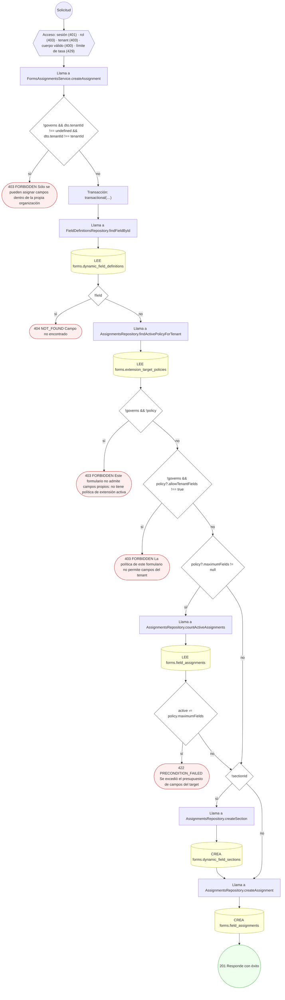

#### 2. DELETE /forms/assignments/{id}

Quitar una asignación propia (baja lógica)

| HTTP | Código | Cuándo |
|---|---|---|
| 200 | — | Éxito |
| 400 | `VALIDATION_FAILED` | Los parámetros de ruta son UUID válidos |
| 401 | `UNAUTHENTICATED` | Hay una sesión válida (JWT) |
| 403 | `FORBIDDEN` | El rol está permitido; El tenant se resuelve y pertenece al actor; ForbiddenException: Los campos del formulario estándar no se editan desde una organización; ForbiddenException: Sólo se pueden editar los campos propios de la organización |
| 404 | `NOT_FOUND` | ResourceNotFoundException: Asignación no encontrada |
| 409 | `CONFLICT` | ConflictException: La asignación ya fue retirada |
| 429 | `RATE_LIMITED` | No se supera el límite de solicitudes |

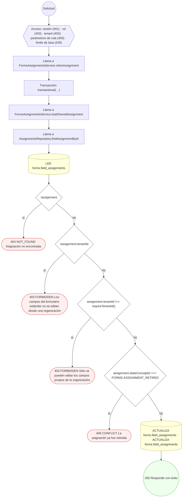

#### 3. PATCH /forms/assignments/{id}

Editar una asignación propia

| HTTP | Código | Cuándo |
|---|---|---|
| 200 | — | Éxito |
| 400 | `VALIDATION_FAILED` | Los parámetros de ruta son UUID válidos; El cuerpo cumple el DTO (sin propiedades extra) |
| 401 | `UNAUTHENTICATED` | Hay una sesión válida (JWT) |
| 403 | `FORBIDDEN` | El rol está permitido; El tenant se resuelve y pertenece al actor; ForbiddenException: Los campos del formulario estándar no se editan desde una organización; ForbiddenException: Sólo se pueden editar los campos propios de la organización |
| 404 | `NOT_FOUND` | ResourceNotFoundException: Asignación no encontrada |
| 429 | `RATE_LIMITED` | No se supera el límite de solicitudes |

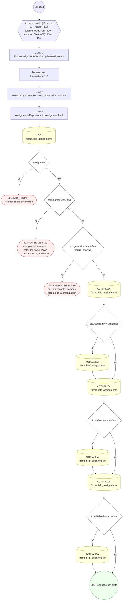

#### 4. PUT /forms/assignments/order

Reordenar los campos propios de un formulario

| HTTP | Código | Cuándo |
|---|---|---|
| 200 | — | Éxito |
| 400 | `VALIDATION_FAILED` | El cuerpo cumple el DTO (sin propiedades extra) |
| 401 | `UNAUTHENTICATED` | Hay una sesión válida (JWT) |
| 403 | `FORBIDDEN` | El rol está permitido; El tenant se resuelve y pertenece al actor |
| 422 | `PRECONDITION_FAILED` | PreconditionFailedException: Hay asignaciones que no son campos propios y activos de este formulario |
| 429 | `RATE_LIMITED` | No se supera el límite de solicitudes |

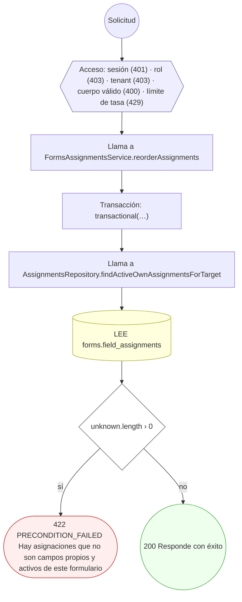

#### 5. POST /forms/definition-sets

Definir un set de campos dinámicos y su versión inicial

| HTTP | Código | Cuándo |
|---|---|---|
| 201 | — | Éxito |
| 400 | `VALIDATION_FAILED` | El cuerpo cumple el DTO (sin propiedades extra) |
| 401 | `UNAUTHENTICATED` | Hay una sesión válida (JWT) |
| 403 | `FORBIDDEN` | El rol está permitido; El tenant se resuelve y pertenece al actor |
| 409 | `CONFLICT` | ConflictException: El namespace ya está en uso |
| 429 | `RATE_LIMITED` | No se supera el límite de solicitudes |

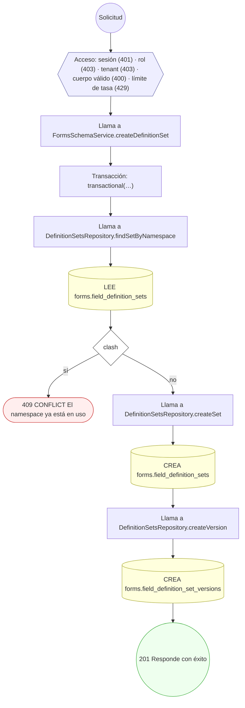

#### 6. GET /forms/definition-sets/{id}

Leer un set con sus versiones, campos (reglas, dependencias, i18n) y secciones

| HTTP | Código | Cuándo |
|---|---|---|
| 200 | — | Éxito |
| 400 | `VALIDATION_FAILED` | Los parámetros de ruta son UUID válidos |
| 401 | `UNAUTHENTICATED` | Hay una sesión válida (JWT) |
| 403 | `FORBIDDEN` | El rol está permitido; El tenant se resuelve y pertenece al actor |
| 404 | `NOT_FOUND` | ResourceNotFoundException: Set de definiciones no encontrado |
| 429 | `RATE_LIMITED` | No se supera el límite de solicitudes |

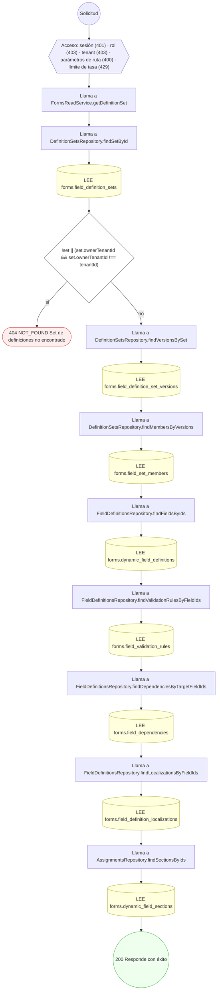

#### 7. POST /forms/definition-sets/{id}/migrations/{migrationId}/run

Migrar valores entre versiones de schema

| HTTP | Código | Cuándo |
|---|---|---|
| 200 | — | Éxito |
| 400 | `VALIDATION_FAILED` | Los parámetros de ruta son UUID válidos; El cuerpo cumple el DTO (sin propiedades extra) |
| 401 | `UNAUTHENTICATED` | Hay una sesión válida (JWT) |
| 403 | `FORBIDDEN` | El rol está permitido; El tenant se resuelve y pertenece al actor |
| 404 | `NOT_FOUND` | ResourceNotFoundException: Set de definiciones no encontrado; ResourceNotFoundException: Versión origen no válida; ResourceNotFoundException: Versión destino no válida |
| 409 | `CONFLICT` | ConflictException: La migración ya fue registrada |
| 429 | `RATE_LIMITED` | No se supera el límite de solicitudes |

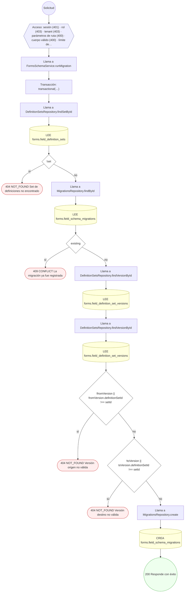

#### 8. POST /forms/definition-sets/{id}/versions/{ver}/publish

Componer miembros del set y publicar la versión

| HTTP | Código | Cuándo |
|---|---|---|
| 200 | — | Éxito |
| 400 | `VALIDATION_FAILED` | Los parámetros de ruta son UUID válidos; El cuerpo cumple el DTO (sin propiedades extra) |
| 401 | `UNAUTHENTICATED` | Hay una sesión válida (JWT) |
| 403 | `FORBIDDEN` | El rol está permitido; El tenant se resuelve y pertenece al actor |
| 404 | `NOT_FOUND` | ResourceNotFoundException: Set de definiciones no encontrado; ResourceNotFoundException: Versión no encontrada para el set |
| 422 | `PRECONDITION_FAILED` | PreconditionFailedException: La versión no está en borrador |
| 429 | `RATE_LIMITED` | No se supera el límite de solicitudes |

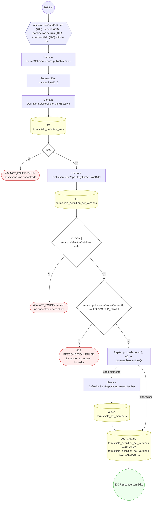

#### 9. POST /forms/field-definitions

Declarar una definición de campo con reglas de validación

| HTTP | Código | Cuándo |
|---|---|---|
| 201 | — | Éxito |
| 400 | `VALIDATION_FAILED` | El cuerpo cumple el DTO (sin propiedades extra) |
| 401 | `UNAUTHENTICATED` | Hay una sesión válida (JWT) |
| 403 | `FORBIDDEN` | El rol está permitido; El tenant se resuelve y pertenece al actor |
| 409 | `CONFLICT` | ConflictException: El código de campo ya existe |
| 429 | `RATE_LIMITED` | No se supera el límite de solicitudes |

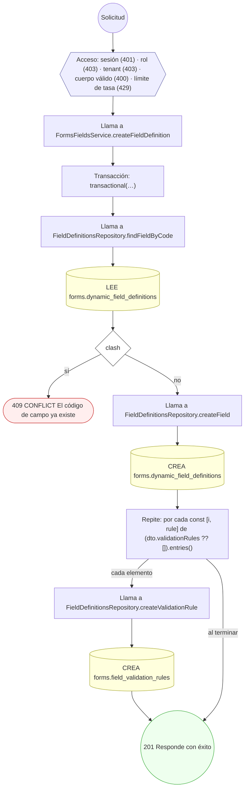

#### 10. PATCH /forms/field-definitions/{id}

Corregir el nombre o el tipo de un campo propio

| HTTP | Código | Cuándo |
|---|---|---|
| 200 | — | Éxito |
| 400 | `VALIDATION_FAILED` | Los parámetros de ruta son UUID válidos; El cuerpo cumple el DTO (sin propiedades extra) |
| 401 | `UNAUTHENTICATED` | Hay una sesión válida (JWT) |
| 403 | `FORBIDDEN` | El rol está permitido; El tenant se resuelve y pertenece al actor; ForbiddenException: Sólo se pueden corregir los campos propios de la organización; los del estándar no se editan desde acá |
| 404 | `NOT_FOUND` | ResourceNotFoundException: Campo no encontrado |
| 409 | `CONFLICT` | ConflictException: El campo ya tiene valores capturados: cambiar su tipo reescribiría la historia |
| 429 | `RATE_LIMITED` | No se supera el límite de solicitudes |

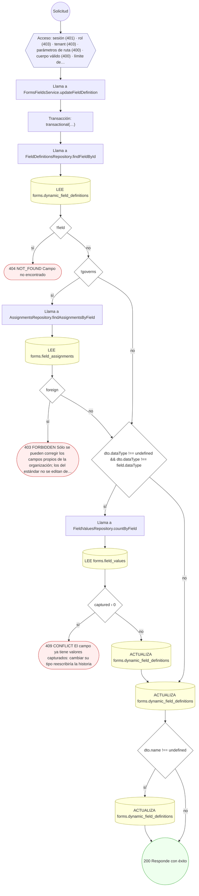

#### 11. POST /forms/fields/{id}/access-rules

Definir reglas de acceso y enmascarado por campo

| HTTP | Código | Cuándo |
|---|---|---|
| 201 | — | Éxito |
| 400 | `VALIDATION_FAILED` | Los parámetros de ruta son UUID válidos; El cuerpo cumple el DTO (sin propiedades extra) |
| 401 | `UNAUTHENTICATED` | Hay una sesión válida (JWT) |
| 403 | `FORBIDDEN` | El rol está permitido; El tenant se resuelve y pertenece al actor |
| 404 | `NOT_FOUND` | ResourceNotFoundException: Campo no encontrado |
| 429 | `RATE_LIMITED` | No se supera el límite de solicitudes |

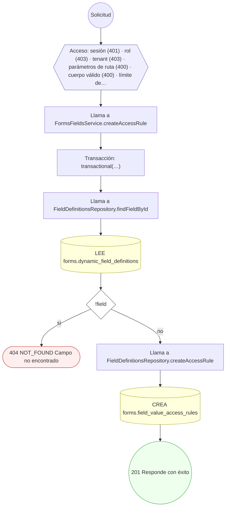

#### 12. POST /forms/fields/{id}/dependencies

Definir dependencias condicionales entre campos

| HTTP | Código | Cuándo |
|---|---|---|
| 201 | — | Éxito |
| 400 | `VALIDATION_FAILED` | Los parámetros de ruta son UUID válidos; El cuerpo cumple el DTO (sin propiedades extra) |
| 401 | `UNAUTHENTICATED` | Hay una sesión válida (JWT) |
| 403 | `FORBIDDEN` | El rol está permitido; El tenant se resuelve y pertenece al actor |
| 404 | `NOT_FOUND` | ResourceNotFoundException: Campo destino no encontrado; ResourceNotFoundException: Campo fuente no encontrado |
| 409 | `CONFLICT` | ConflictException: La dependencia ya existe en ese grupo lógico |
| 422 | `PRECONDITION_FAILED` | PreconditionFailedException: Un campo no puede depender de sí mismo |
| 429 | `RATE_LIMITED` | No se supera el límite de solicitudes |

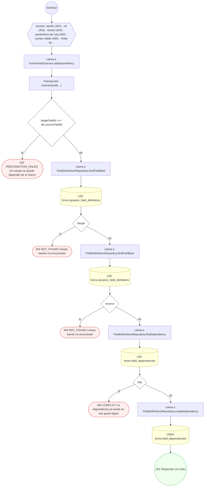

#### 13. PUT /forms/fields/{id}/localizations/{lang}

Localizar (i18n) una definición de campo

| HTTP | Código | Cuándo |
|---|---|---|
| 200 | — | Éxito |
| 400 | `VALIDATION_FAILED` | Los parámetros de ruta son UUID válidos; El cuerpo cumple el DTO (sin propiedades extra) |
| 401 | `UNAUTHENTICATED` | Hay una sesión válida (JWT) |
| 403 | `FORBIDDEN` | El rol está permitido; El tenant se resuelve y pertenece al actor |
| 404 | `NOT_FOUND` | ResourceNotFoundException: Campo no encontrado |
| 422 | `PRECONDITION_FAILED` | PreconditionFailedException: Idioma no soportado |
| 429 | `RATE_LIMITED` | No se supera el límite de solicitudes |

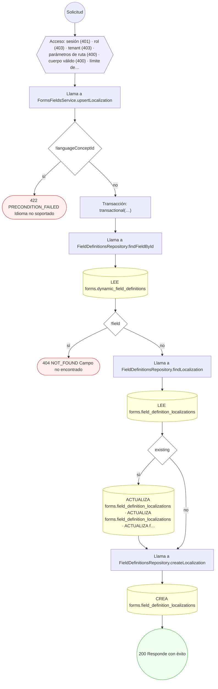

#### 14. GET /forms/instances

Listar las instancias de formulario de un encuentro

| HTTP | Código | Cuándo |
|---|---|---|
| 200 | — | Éxito |
| 400 | `VALIDATION_FAILED` | Están los parámetros de consulta obligatorios |
| 401 | `UNAUTHENTICATED` | Hay una sesión válida (JWT) |
| 403 | `FORBIDDEN` | El rol está permitido; El tenant se resuelve y pertenece al actor |
| 404 | `NOT_FOUND` | ResourceNotFoundException: Instancia no encontrada / Encuentro no encontrado |
| 429 | `RATE_LIMITED` | No se supera el límite de solicitudes |

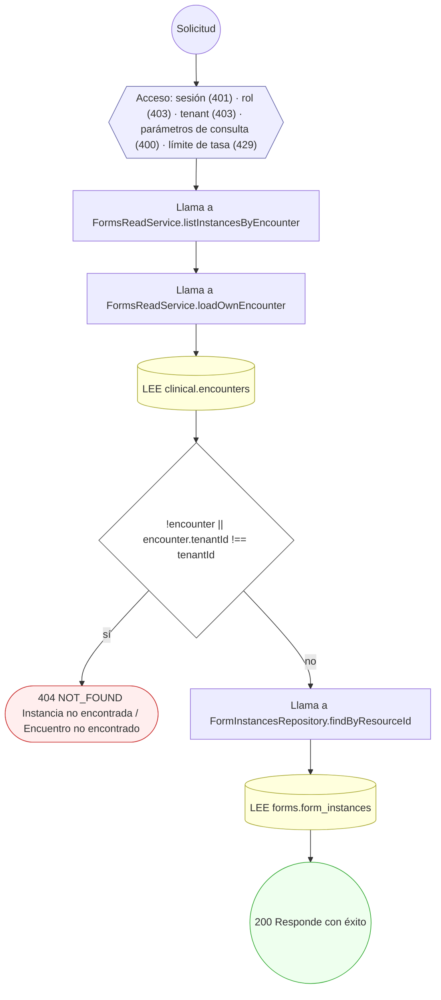

#### 15. POST /forms/instances

Abrir una instancia de formulario para un recurso

| HTTP | Código | Cuándo |
|---|---|---|
| 201 | — | Éxito |
| 400 | `VALIDATION_FAILED` | El cuerpo cumple el DTO (sin propiedades extra) |
| 401 | `UNAUTHENTICATED` | Hay una sesión válida (JWT) |
| 403 | `FORBIDDEN` | El rol está permitido; El tenant se resuelve y pertenece al actor |
| 409 | `CONFLICT` | ConflictException: Ya existe una instancia para el recurso y versión |
| 429 | `RATE_LIMITED` | No se supera el límite de solicitudes |

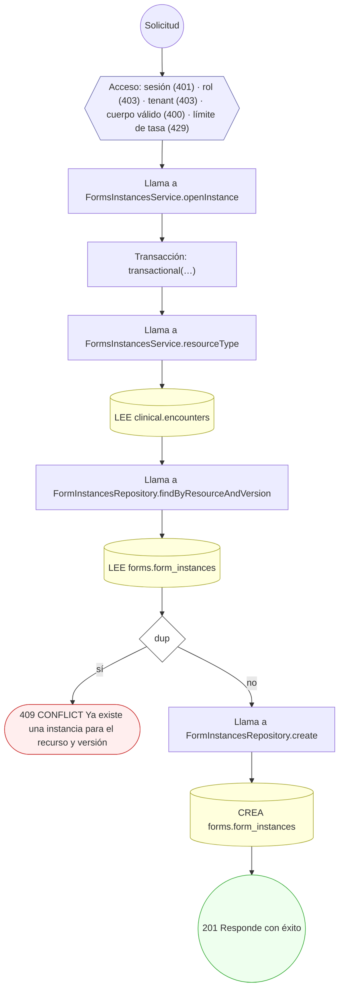

#### 16. GET /forms/instances/{id}

Leer una instancia con sus valores vigentes, por tipo resuelto

| HTTP | Código | Cuándo |
|---|---|---|
| 200 | — | Éxito |
| 400 | `VALIDATION_FAILED` | Los parámetros de ruta son UUID válidos |
| 401 | `UNAUTHENTICATED` | Hay una sesión válida (JWT) |
| 403 | `FORBIDDEN` | El rol está permitido; El tenant se resuelve y pertenece al actor |
| 404 | `NOT_FOUND` | ResourceNotFoundException: Instancia no encontrada; ResourceNotFoundException: Instancia no encontrada / Encuentro no encontrado |
| 429 | `RATE_LIMITED` | No se supera el límite de solicitudes |

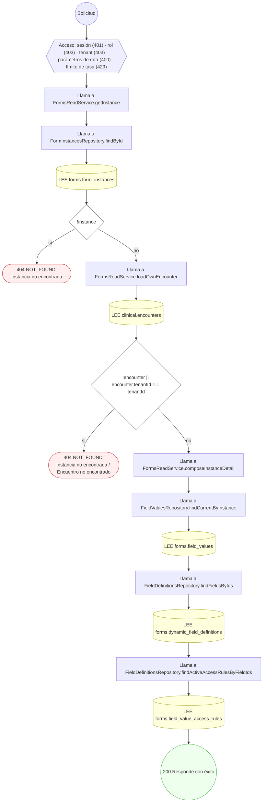

#### 17. POST /forms/instances/{id}/close

Cerrar formulario y proyectar vista de recurso

| HTTP | Código | Cuándo |
|---|---|---|
| 200 | — | Éxito |
| 400 | `VALIDATION_FAILED` | Los parámetros de ruta son UUID válidos |
| 401 | `UNAUTHENTICATED` | Hay una sesión válida (JWT) |
| 403 | `FORBIDDEN` | El rol está permitido; El tenant se resuelve y pertenece al actor |
| 404 | `NOT_FOUND` | ResourceNotFoundException: Instancia no encontrada |
| 422 | `PRECONDITION_FAILED` | PreconditionFailedException: La instancia no está abierta |
| 429 | `RATE_LIMITED` | No se supera el límite de solicitudes |

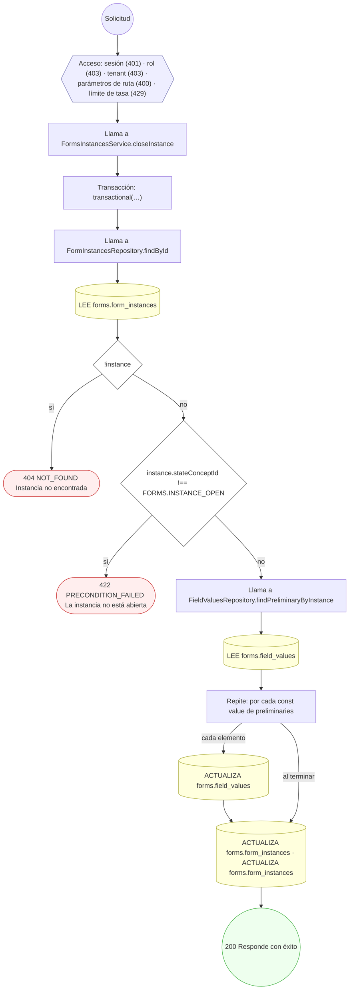

#### 18. POST /forms/instances/{id}/values

Capturar valores de formulario (value[x] exclusivo)

| HTTP | Código | Cuándo |
|---|---|---|
| 201 | — | Éxito |
| 400 | `VALIDATION_FAILED` | Los parámetros de ruta son UUID válidos; El cuerpo cumple el DTO (sin propiedades extra) |
| 401 | `UNAUTHENTICATED` | Hay una sesión válida (JWT) |
| 403 | `FORBIDDEN` | El rol está permitido; El tenant se resuelve y pertenece al actor |
| 404 | `NOT_FOUND` | ResourceNotFoundException: Instancia no encontrada |
| 422 | `PRECONDITION_FAILED` | PreconditionFailedException: La instancia no está abierta |
| 429 | `RATE_LIMITED` | No se supera el límite de solicitudes |

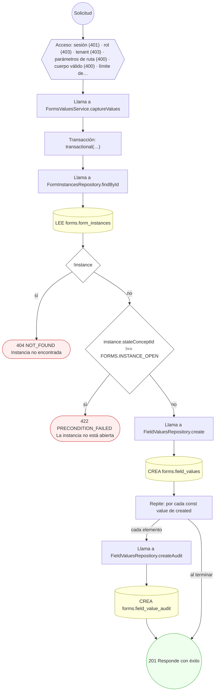

#### 19. GET /forms/me/instances

Ver mis formularios clínicos

| HTTP | Código | Cuándo |
|---|---|---|
| 200 | — | Éxito |
| 401 | `UNAUTHENTICATED` | Hay una sesión válida (JWT) |
| 403 | `FORBIDDEN` | El rol está permitido; El tenant se resuelve y pertenece al actor |
| 422 | `PRECONDITION_FAILED` | PreconditionFailedException: La sesión no tiene perfil de paciente asociado |
| 429 | `RATE_LIMITED` | No se supera el límite de solicitudes |

```mermaid
flowchart TD
  n1(("Solicitud")):::inicio
  n2{{"Acceso: sesión (401) · rol (403) · tenant (403) · límite de tasa (429)"}}:::acceso
  n1 --> n2
  n3["Llama a FormsReadService.listMyInstances"]:::llamada
  n2 --> n3
  n4["Llama a FormsReadService.requirePatientProfile"]:::llamada
  n3 --> n4
  n5{"!actor.patientProfileId"}:::decision
  n4 --> n5
  n6(["422 PRECONDITION_FAILED La sesión no tiene perfil de paciente asociado"]):::error
  n5 -->|"sí"| n6
  n7[("LEE clinical.encounters")]:::efecto
  n5 -->|"no"| n7
  n8["Llama a FormInstancesRepository.findByResourceIds"]:::llamada
  n7 --> n8
  n9[("LEE forms.form_instances")]:::efecto
  n8 --> n9
  n10(("200 Responde con éxito")):::ok
  n9 --> n10
  classDef acceso fill:#eef,stroke:#66a
  classDef error fill:#fee,stroke:#c33
  classDef ok fill:#efe,stroke:#3a3
  classDef efecto fill:#ffd,stroke:#aa3
  classDef decision fill:#fff,stroke:#555
  classDef corte fill:#eee,stroke:#999,stroke-dasharray: 4
```

#### 20. GET /forms/me/instances/{id}

Leer un formulario propio con sus respuestas

| HTTP | Código | Cuándo |
|---|---|---|
| 200 | — | Éxito |
| 400 | `VALIDATION_FAILED` | Los parámetros de ruta son UUID válidos |
| 401 | `UNAUTHENTICATED` | Hay una sesión válida (JWT) |
| 403 | `FORBIDDEN` | El rol está permitido; El tenant se resuelve y pertenece al actor |
| 404 | `NOT_FOUND` | ResourceNotFoundException: Instancia no encontrada |
| 422 | `PRECONDITION_FAILED` | PreconditionFailedException: La sesión no tiene perfil de paciente asociado |
| 429 | `RATE_LIMITED` | No se supera el límite de solicitudes |

```mermaid
flowchart TD
  n1(("Solicitud")):::inicio
  n2{{"Acceso: sesión (401) · rol (403) · tenant (403) · parámetros de ruta (400) · límite de tasa (429)"}}:::acceso
  n1 --> n2
  n3["Llama a FormsReadService.getMyInstance"]:::llamada
  n2 --> n3
  n4["Llama a FormsReadService.requirePatientProfile"]:::llamada
  n3 --> n4
  n5{"!actor.patientProfileId"}:::decision
  n4 --> n5
  n6(["422 PRECONDITION_FAILED La sesión no tiene perfil de paciente asociado"]):::error
  n5 -->|"sí"| n6
  n7["Llama a FormInstancesRepository.findById"]:::llamada
  n5 -->|"no"| n7
  n8[("LEE forms.form_instances")]:::efecto
  n7 --> n8
  n9{"!instance"}:::decision
  n8 --> n9
  n10(["404 NOT_FOUND Instancia no encontrada"]):::error
  n9 -->|"sí"| n10
  n11[("LEE clinical.encounters")]:::efecto
  n9 -->|"no"| n11
  n12{"!encounter || encounter.tenantId !== tenantId || encounter.patientProfileId !== patientProfileId"}:::decision
  n11 --> n12
  n13(["404 NOT_FOUND Instancia no encontrada"]):::error
  n12 -->|"sí"| n13
  n14["Llama a FormsReadService.composeInstanceDetail"]:::llamada
  n12 -->|"no"| n14
  n15["Llama a FieldValuesRepository.findCurrentByInstance"]:::llamada
  n14 --> n15
  n16[("LEE forms.field_values")]:::efecto
  n15 --> n16
  n17["Llama a FieldDefinitionsRepository.findFieldsByIds"]:::llamada
  n16 --> n17
  n18[("LEE forms.dynamic_field_definitions")]:::efecto
  n17 --> n18
  n19["Llama a FieldDefinitionsRepository.findActiveAccessRulesByFieldIds"]:::llamada
  n18 --> n19
  n20[("LEE forms.field_value_access_rules")]:::efecto
  n19 --> n20
  n21(("200 Responde con éxito")):::ok
  n20 --> n21
  classDef acceso fill:#eef,stroke:#66a
  classDef error fill:#fee,stroke:#c33
  classDef ok fill:#efe,stroke:#3a3
  classDef efecto fill:#ffd,stroke:#aa3
  classDef decision fill:#fff,stroke:#555
  classDef corte fill:#eee,stroke:#999,stroke-dasharray: 4
```

#### 21. PATCH /forms/values/{id}

Corregir valor con supersede y snapshot inmutable

| HTTP | Código | Cuándo |
|---|---|---|
| 200 | — | Éxito |
| 400 | `VALIDATION_FAILED` | Los parámetros de ruta son UUID válidos; El cuerpo cumple el DTO (sin propiedades extra) |
| 401 | `UNAUTHENTICATED` | Hay una sesión válida (JWT) |
| 403 | `FORBIDDEN` | El rol está permitido; El tenant se resuelve y pertenece al actor |
| 404 | `NOT_FOUND` | ResourceNotFoundException: Valor no encontrado |
| 422 | `PRECONDITION_FAILED` | PreconditionFailedException: El valor ya fue superado |
| 429 | `RATE_LIMITED` | No se supera el límite de solicitudes |

```mermaid
flowchart TD
  n1(("Solicitud")):::inicio
  n2{{"Acceso: sesión (401) · rol (403) · tenant (403) · parámetros de ruta (400) · cuerpo válido (400) · límite de…"}}:::acceso
  n1 --> n2
  n3["Llama a FormsValuesService.correctValue"]:::llamada
  n2 --> n3
  n4["Transacción: transactional(…)"]:::transaccion
  n3 --> n4
  n5["Llama a FieldValuesRepository.findById"]:::llamada
  n4 --> n5
  n6[("LEE forms.field_values")]:::efecto
  n5 --> n6
  n7{"!previous"}:::decision
  n6 --> n7
  n8(["404 NOT_FOUND Valor no encontrado"]):::error
  n7 -->|"sí"| n8
  n9{"previous.valueStatusConceptId === FORMS.VALUE_SUPERSEDED"}:::decision
  n7 -->|"no"| n9
  n10(["422 PRECONDITION_FAILED El valor ya fue superado"]):::error
  n9 -->|"sí"| n10
  n11["Llama a FieldValuesRepository.create"]:::llamada
  n9 -->|"no"| n11
  n12[("CREA forms.field_values")]:::efecto
  n11 --> n12
  n13[("ACTUALIZA forms.field_values · ACTUALIZA forms.field_values")]:::efecto
  n12 --> n13
  n14["Llama a FieldValuesRepository.createAudit"]:::llamada
  n13 --> n14
  n15[("CREA forms.field_value_audit")]:::efecto
  n14 --> n15
  n16(("200 Responde con éxito")):::ok
  n15 --> n16
  classDef acceso fill:#eef,stroke:#66a
  classDef error fill:#fee,stroke:#c33
  classDef ok fill:#efe,stroke:#3a3
  classDef efecto fill:#ffd,stroke:#aa3
  classDef decision fill:#fff,stroke:#555
  classDef corte fill:#eee,stroke:#999,stroke-dasharray: 4
```

#### 22. POST /forms/values/import

Registrar procedencia de valores importados (batch ETL)

| HTTP | Código | Cuándo |
|---|---|---|
| 201 | — | Éxito |
| 400 | `VALIDATION_FAILED` | El cuerpo cumple el DTO (sin propiedades extra) |
| 401 | `UNAUTHENTICATED` | Hay una sesión válida (JWT) |
| 403 | `FORBIDDEN` | El rol está permitido; El tenant se resuelve y pertenece al actor |
| 404 | `NOT_FOUND` | ResourceNotFoundException: Instancia no encontrada |
| 429 | `RATE_LIMITED` | No se supera el límite de solicitudes |

```mermaid
flowchart TD
  n1(("Solicitud")):::inicio
  n2{{"Acceso: sesión (401) · rol (403) · tenant (403) · cuerpo válido (400) · límite de tasa (429)"}}:::acceso
  n1 --> n2
  n3["Llama a FormsValuesService.importValues"]:::llamada
  n2 --> n3
  n4["Transacción: transactional(…)"]:::transaccion
  n3 --> n4
  n5["Repite: por cada const item de dto.items"]:::bucle
  n4 --> n5
  n6["Llama a FormInstancesRepository.findById"]:::llamada
  n5 -->|"cada elemento"| n6
  n7[("LEE forms.form_instances")]:::efecto
  n6 --> n7
  n8{"!instance"}:::decision
  n7 --> n8
  n9(["404 NOT_FOUND Instancia no encontrada"]):::error
  n8 -->|"sí"| n9
  n10["Llama a FieldValuesRepository.create"]:::llamada
  n8 -->|"no"| n10
  n11[("CREA forms.field_values")]:::efecto
  n10 --> n11
  n12["Repite: por cada const c de created"]:::bucle
  n11 --> n12
  n5 -->|"al terminar"| n12
  n13["Llama a FieldValuesRepository.createProvenance"]:::llamada
  n12 -->|"cada elemento"| n13
  n14[("CREA forms.field_value_provenance")]:::efecto
  n13 --> n14
  n15["Llama a FieldValuesRepository.createAudit"]:::llamada
  n14 --> n15
  n16[("CREA forms.field_value_audit")]:::efecto
  n15 --> n16
  n17(("201 Responde con éxito")):::ok
  n16 --> n17
  n12 -->|"al terminar"| n17
  classDef acceso fill:#eef,stroke:#66a
  classDef error fill:#fee,stroke:#c33
  classDef ok fill:#efe,stroke:#3a3
  classDef efecto fill:#ffd,stroke:#aa3
  classDef decision fill:#fff,stroke:#555
  classDef corte fill:#eee,stroke:#999,stroke-dasharray: 4
```

### Operaciones sin decisiones propias

Sólo comprueban el acceso y leen o escriben: no tienen ramas que dibujar. Su detalle está en la ficha de endpoints.

| Operación | Respuestas posibles | Tablas |
|---|---|---|
| GET /forms/assignments | 200, 401, 403, 429 | 2 |
| GET /forms/assignments/budget | 200, 400, 401, 403, 429 | 2 |
| GET /forms/definition-sets | 200, 401, 403, 429 | 1 |
