<!-- AUTOGENERADO por tools/inventario/flujos.mjs. No editar manualmente. -->

# Flujos del módulo `geo`

- **Procesos:** 1 · **Máquinas de estado:** 0
- **Operaciones:** 10 (10 con decisiones propias, 0 sin ellas)
- Inventario de endpoints del módulo: [geo](../endpoints/geo.md)

## Proceso: Módulo Geo (13) — Geolocation and Mobile Tracking

- **Código:** `geo` · **Agrupación:** AGRUPACION_POR_CONTROLADOR · **Operaciones:** 10
- **Actores:** SECURITY_ADMIN
- **Revisión:** AUTO_DETECTADA
- **Fuentes:** `src/modules/geo/README.md`

### Para qué sirve

Geolocalización y rastreo móvil: sujetos rastreados, sesiones de tracking, pings de ubicación de alta frecuencia, geofences con sus eventos de cruce, y viajes.

_Fuente: `src/modules/geo/README.md:3`_

### Etapas y operaciones

| Etapa | Descripción | Operación | Quién actúa | Riesgo | Tablas |
|---|---|---|---|---|---|
| `ctrl:GeoGeofencesController` | Operaciones de GeoGeofencesController que el README no asigna a un caso de uso | POST /geo/geofence-events | SECURITY_ADMIN | MEDIO | 4 |
|  |  | POST /geo/geofences | SECURITY_ADMIN | MEDIO | 2 |
| `ctrl:GeoTrackedSubjectsController` | Operaciones de GeoTrackedSubjectsController que el README no asigna a un caso de uso | POST /geo/tracked-subjects | SECURITY_ADMIN | MEDIO | 2 |
|  |  | GET /geo/tracked-subjects/{id}/last-position | SECURITY_ADMIN | BAJO | 2 |
|  |  | POST /geo/tracked-subjects/{id}/pings | SECURITY_ADMIN | MEDIO | 3 |
|  |  | POST /geo/tracked-subjects/{id}/revoke-consent | SECURITY_ADMIN | MEDIO | 3 |
| `ctrl:GeoTrackingSessionsController` | Operaciones de GeoTrackingSessionsController que el README no asigna a un caso de uso | POST /geo/tracking-sessions | SECURITY_ADMIN | MEDIO | 3 |
|  |  | POST /geo/tracking-sessions/{id}/close | SECURITY_ADMIN | BAJO | 3 |
| `ctrl:GeoTripsController` | Operaciones de GeoTripsController que el README no asigna a un caso de uso | POST /geo/trips | SECURITY_ADMIN | MEDIO | 4 |
|  |  | POST /geo/trips/{id}/close | SECURITY_ADMIN | BAJO | 3 |

### Diagrama — etapas `ctrl:GeoGeofencesController`, `ctrl:GeoTrackedSubjectsController`, `ctrl:GeoTrackingSessionsController`…

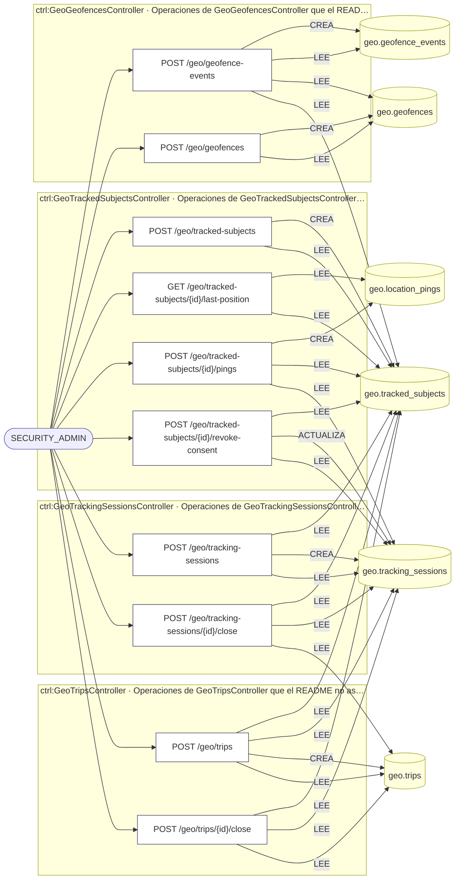

## Árbol de decisión por operación

Cada árbol se deriva del código del handler y de los métodos que invoca (hasta 4 niveles). Una rama que no decide, no escribe y no falla se poda. Los accesos y los efectos consecutivos se agrupan en un solo nodo.

### Operaciones con decisiones propias

#### 1. POST /geo/geofence-events

Registrar un evento de entrada/salida de geofence

| HTTP | Código | Cuándo |
|---|---|---|
| 201 | — | Éxito |
| 400 | `VALIDATION_FAILED` | El cuerpo cumple el DTO (sin propiedades extra) |
| 401 | `UNAUTHENTICATED` | Hay una sesión válida (JWT) |
| 403 | `FORBIDDEN` | El rol está permitido; El tenant se resuelve y pertenece al actor |
| 409 | `CONFLICT` | ConflictException: El sujeto ya está en ese estado respecto al geofence |
| 422 | `PRECONDITION_FAILED` | PreconditionFailedException: El geofence no está activo |
| 429 | `RATE_LIMITED` | No se supera el límite de solicitudes |

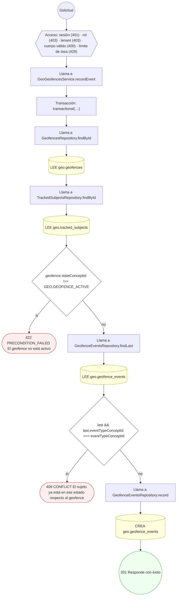

#### 2. POST /geo/geofences

Definir y activar un geofence (circle o polygon)

| HTTP | Código | Cuándo |
|---|---|---|
| 201 | — | Éxito |
| 400 | `VALIDATION_FAILED` | El cuerpo cumple el DTO (sin propiedades extra) |
| 401 | `UNAUTHENTICATED` | Hay una sesión válida (JWT) |
| 403 | `FORBIDDEN` | El rol está permitido; El tenant se resuelve y pertenece al actor |
| 409 | `CONFLICT` | ConflictException: Ya existe un geofence con ese nombre en el tenant |
| 422 | `PRECONDITION_FAILED` | PreconditionFailedException: Un geofence circular requiere radiusM, centerLat y centerLng; PreconditionFailedException: Un geofence poligonal requiere geometryJson |
| 429 | `RATE_LIMITED` | No se supera el límite de solicitudes |

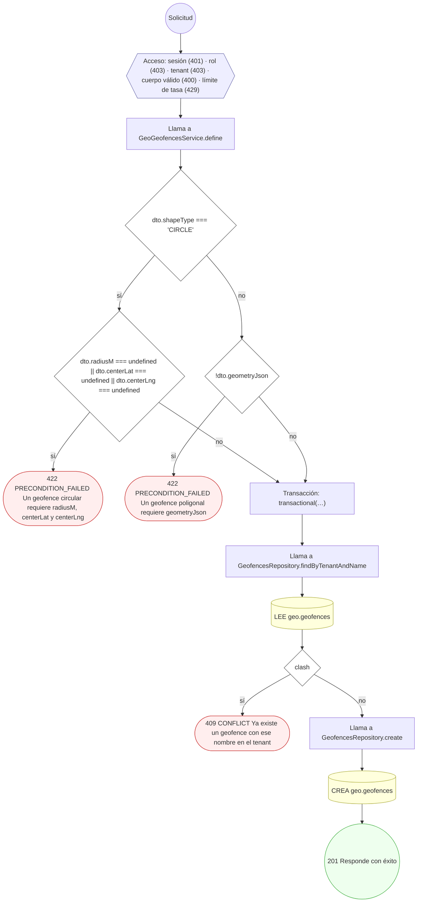

#### 3. POST /geo/tracked-subjects

Alta de sujeto rastreado con consentimiento de ubicación

| HTTP | Código | Cuándo |
|---|---|---|
| 201 | — | Éxito |
| 400 | `VALIDATION_FAILED` | El cuerpo cumple el DTO (sin propiedades extra) |
| 401 | `UNAUTHENTICATED` | Hay una sesión válida (JWT) |
| 403 | `FORBIDDEN` | El rol está permitido; El tenant se resuelve y pertenece al actor |
| 409 | `CONFLICT` | ConflictException: El sujeto ya está siendo rastreado |
| 429 | `RATE_LIMITED` | No se supera el límite de solicitudes |

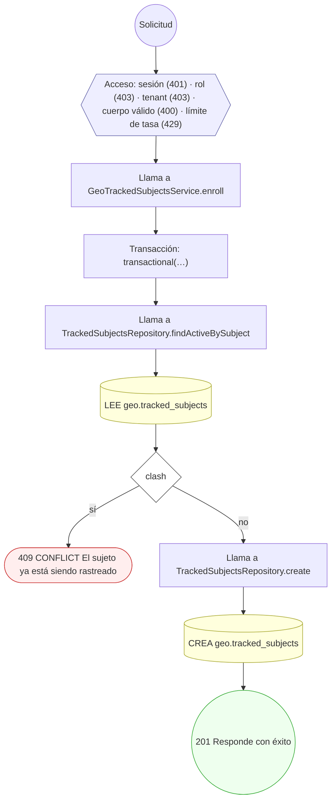

#### 4. GET /geo/tracked-subjects/{id}/last-position

Consultar la última posición conocida del sujeto

| HTTP | Código | Cuándo |
|---|---|---|
| 200 | — | Éxito |
| 400 | `VALIDATION_FAILED` | Los parámetros de ruta son UUID válidos |
| 401 | `UNAUTHENTICATED` | Hay una sesión válida (JWT) |
| 403 | `FORBIDDEN` | El rol está permitido; El tenant se resuelve y pertenece al actor |
| 404 | `NOT_FOUND` | ResourceNotFoundException: El sujeto no tiene posiciones registradas |
| 429 | `RATE_LIMITED` | No se supera el límite de solicitudes |

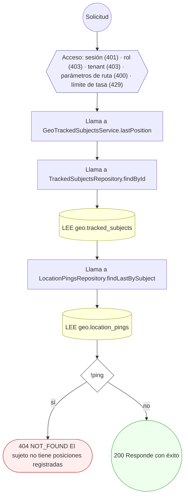

#### 5. POST /geo/tracked-subjects/{id}/pings

Ingerir un batch de pings de ubicación de alta frecuencia

| HTTP | Código | Cuándo |
|---|---|---|
| 201 | — | Éxito |
| 400 | `VALIDATION_FAILED` | Los parámetros de ruta son UUID válidos; El cuerpo cumple el DTO (sin propiedades extra) |
| 401 | `UNAUTHENTICATED` | Hay una sesión válida (JWT) |
| 403 | `FORBIDDEN` | El rol está permitido; El tenant se resuelve y pertenece al actor |
| 422 | `PRECONDITION_FAILED` | PreconditionFailedException: El sujeto no está activo para rastreo; PreconditionFailedException: No hay una sesión de tracking abierta para el sujeto |
| 429 | `RATE_LIMITED` | No se supera el límite de solicitudes |

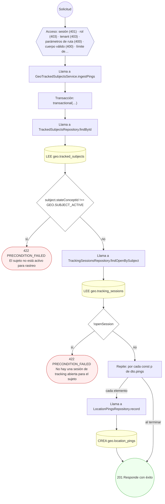

#### 6. POST /geo/tracked-subjects/{id}/revoke-consent

Revocar consentimiento de ubicación y pausar el rastreo

| HTTP | Código | Cuándo |
|---|---|---|
| 200 | — | Éxito |
| 400 | `VALIDATION_FAILED` | Los parámetros de ruta son UUID válidos |
| 401 | `UNAUTHENTICATED` | Hay una sesión válida (JWT) |
| 403 | `FORBIDDEN` | El rol está permitido; El tenant se resuelve y pertenece al actor |
| 422 | `PRECONDITION_FAILED` | PreconditionFailedException: El rastreo del sujeto ya está suspendido |
| 429 | `RATE_LIMITED` | No se supera el límite de solicitudes |

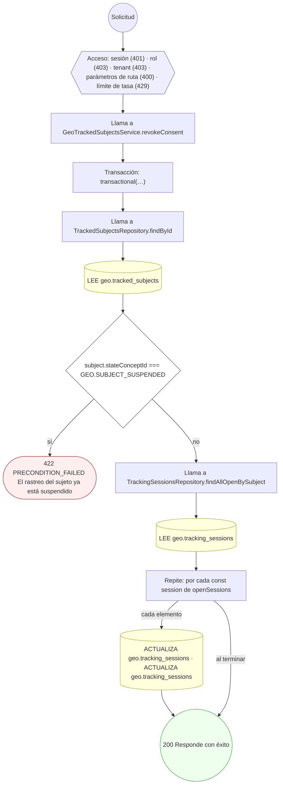

#### 7. POST /geo/tracking-sessions

Iniciar una sesión de tracking de un sujeto

| HTTP | Código | Cuándo |
|---|---|---|
| 201 | — | Éxito |
| 400 | `VALIDATION_FAILED` | El cuerpo cumple el DTO (sin propiedades extra) |
| 401 | `UNAUTHENTICATED` | Hay una sesión válida (JWT) |
| 403 | `FORBIDDEN` | El rol está permitido; El tenant se resuelve y pertenece al actor |
| 409 | `CONFLICT` | ConflictException: El sujeto ya tiene una sesión de tracking abierta |
| 422 | `PRECONDITION_FAILED` | PreconditionFailedException: El sujeto no está activo para rastreo |
| 429 | `RATE_LIMITED` | No se supera el límite de solicitudes |

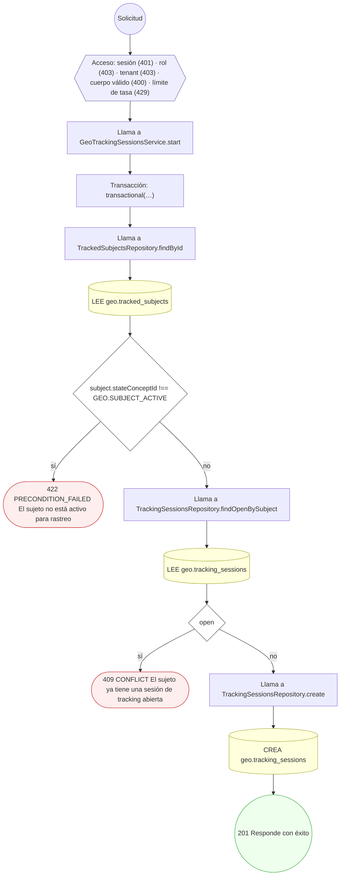

#### 8. POST /geo/tracking-sessions/{id}/close

Cerrar una sesión de tracking

| HTTP | Código | Cuándo |
|---|---|---|
| 200 | — | Éxito |
| 400 | `VALIDATION_FAILED` | Los parámetros de ruta son UUID válidos |
| 401 | `UNAUTHENTICATED` | Hay una sesión válida (JWT) |
| 403 | `FORBIDDEN` | El rol está permitido; El tenant se resuelve y pertenece al actor |
| 422 | `PRECONDITION_FAILED` | PreconditionFailedException: La sesión no está abierta; PreconditionFailedException: La sesión tiene viajes en progreso |
| 429 | `RATE_LIMITED` | No se supera el límite de solicitudes |

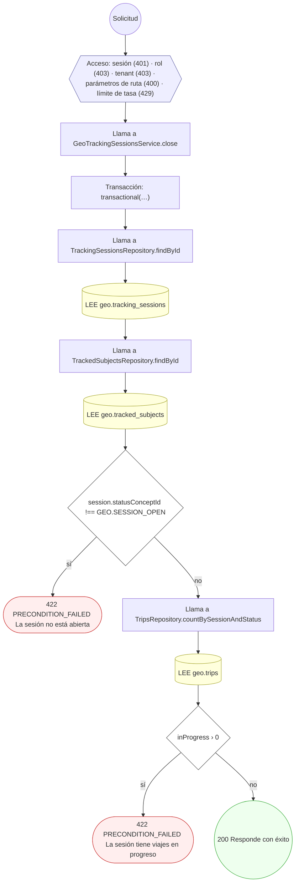

#### 9. POST /geo/trips

Iniciar un viaje (trip)

| HTTP | Código | Cuándo |
|---|---|---|
| 201 | — | Éxito |
| 400 | `VALIDATION_FAILED` | El cuerpo cumple el DTO (sin propiedades extra) |
| 401 | `UNAUTHENTICATED` | Hay una sesión válida (JWT) |
| 403 | `FORBIDDEN` | El rol está permitido; El tenant se resuelve y pertenece al actor |
| 409 | `CONFLICT` | ConflictException: La sesión ya tiene un viaje en progreso |
| 422 | `PRECONDITION_FAILED` | PreconditionFailedException: La sesión de tracking no está abierta |
| 429 | `RATE_LIMITED` | No se supera el límite de solicitudes |

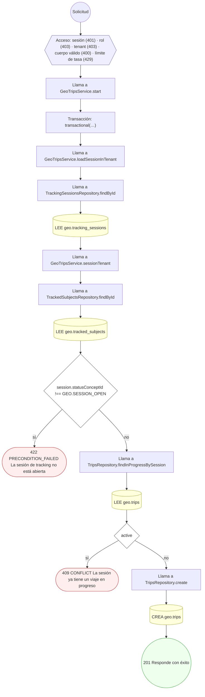

#### 10. POST /geo/trips/{id}/close

Cerrar un viaje con distancia/duración

| HTTP | Código | Cuándo |
|---|---|---|
| 200 | — | Éxito |
| 400 | `VALIDATION_FAILED` | Los parámetros de ruta son UUID válidos; El cuerpo cumple el DTO (sin propiedades extra) |
| 401 | `UNAUTHENTICATED` | Hay una sesión válida (JWT) |
| 403 | `FORBIDDEN` | El rol está permitido; El tenant se resuelve y pertenece al actor |
| 422 | `PRECONDITION_FAILED` | PreconditionFailedException: El viaje no está en progreso |
| 429 | `RATE_LIMITED` | No se supera el límite de solicitudes |

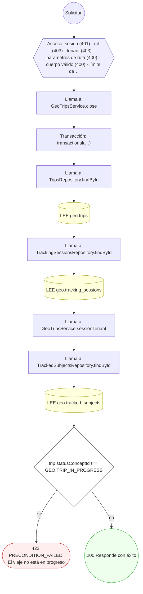

