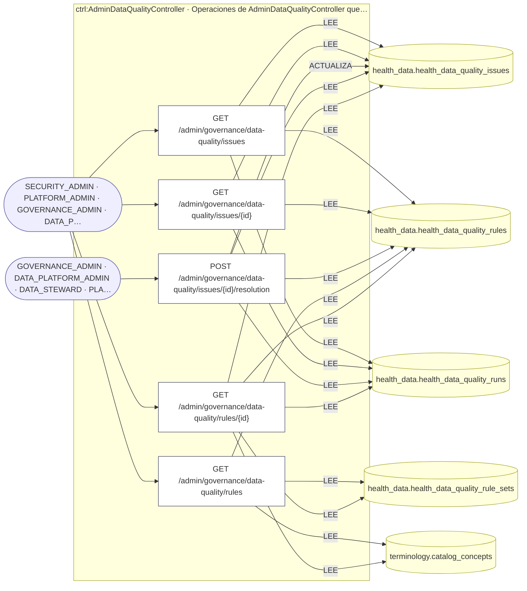
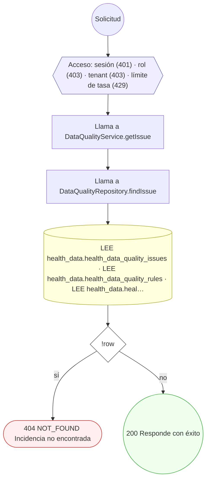
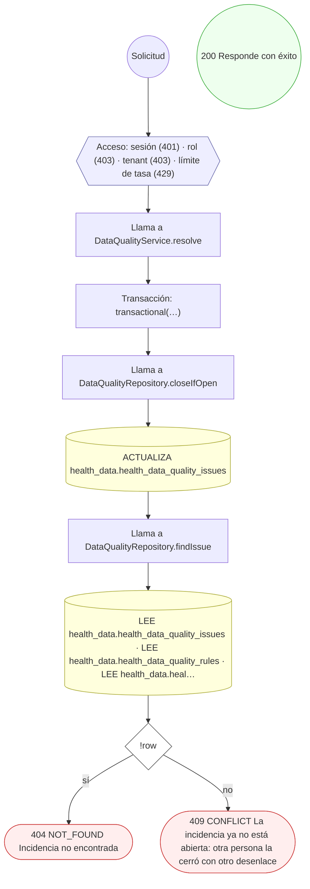
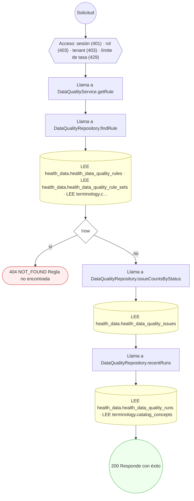

<!-- AUTOGENERADO por tools/inventario/flujos.mjs. No editar manualmente. -->

# Flujos del módulo `governance_admin`

- **Procesos:** 1 · **Máquinas de estado:** 0
- **Operaciones:** 5 (3 con decisiones propias, 2 sin ellas)
- Inventario de endpoints del módulo: [governance_admin](../endpoints/governance_admin.md)

## Proceso: governance_admin

- **Código:** `governance_admin` · **Agrupación:** AGRUPACION_POR_CONTROLADOR · **Operaciones:** 5
- **Actores:** AUDITOR · DATA_PLATFORM_ADMIN · DATA_STEWARD · DPO · GOVERNANCE_ADMIN · PLATFORM_ADMIN · SECURITY_ADMIN
- **Revisión:** AUTO_DETECTADA
- **Fuentes:** —

### Para qué sirve

_Sin fuente: ni el README del módulo ni el modelo lo describen._

### Etapas y operaciones

| Etapa | Descripción | Operación | Quién actúa | Riesgo | Tablas |
|---|---|---|---|---|---|
| `ctrl:AdminDataQualityController` | Operaciones de AdminDataQualityController que el README no asigna a un caso de uso | GET /admin/governance/data-quality/issues | SECURITY_ADMIN · PLATFORM_ADMIN · GOVERNANCE_ADMIN · DATA_PLATFORM_ADMIN · DPO · AUDITOR · DATA_STEWARD | BAJO | 3 |
|  |  | GET /admin/governance/data-quality/issues/{id} | SECURITY_ADMIN · PLATFORM_ADMIN · GOVERNANCE_ADMIN · DATA_PLATFORM_ADMIN · DPO · AUDITOR · DATA_STEWARD | BAJO | 3 |
|  |  | POST /admin/governance/data-quality/issues/{id}/resolution | GOVERNANCE_ADMIN · DATA_PLATFORM_ADMIN · DATA_STEWARD · PLATFORM_ADMIN | MEDIO | 4 |
|  |  | GET /admin/governance/data-quality/rules | SECURITY_ADMIN · PLATFORM_ADMIN · GOVERNANCE_ADMIN · DATA_PLATFORM_ADMIN · DPO · AUDITOR · DATA_STEWARD | BAJO | 3 |
|  |  | GET /admin/governance/data-quality/rules/{id} | SECURITY_ADMIN · PLATFORM_ADMIN · GOVERNANCE_ADMIN · DATA_PLATFORM_ADMIN · DPO · AUDITOR · DATA_STEWARD | BAJO | 5 |

### Diagrama — etapas `ctrl:AdminDataQualityController`

## Árbol de decisión por operación

Cada árbol se deriva del código del handler y de los métodos que invoca (hasta 4 niveles). Una rama que no decide, no escribe y no falla se poda. Los accesos y los efectos consecutivos se agrupan en un solo nodo.

### Operaciones con decisiones propias

#### 1. GET /admin/governance/data-quality/issues/{id}

| HTTP | Código | Cuándo |
|---|---|---|
| 200 | — | Éxito |
| 401 | `UNAUTHENTICATED` | Hay una sesión válida (JWT) |
| 403 | `FORBIDDEN` | El rol está permitido; El tenant se resuelve y pertenece al actor |
| 404 | `NOT_FOUND` | ResourceNotFoundException: Incidencia no encontrada |
| 429 | `RATE_LIMITED` | No se supera el límite de solicitudes |

#### 2. POST /admin/governance/data-quality/issues/{id}/resolution

| HTTP | Código | Cuándo |
|---|---|---|
| 200 | — | Éxito |
| 401 | `UNAUTHENTICATED` | Hay una sesión válida (JWT) |
| 403 | `FORBIDDEN` | El rol está permitido; El tenant se resuelve y pertenece al actor |
| 404 | `NOT_FOUND` | ResourceNotFoundException: Incidencia no encontrada |
| 409 | `CONFLICT` | ConflictException: La incidencia ya no está abierta: otra persona la cerró con otro desenlace |
| 429 | `RATE_LIMITED` | No se supera el límite de solicitudes |

#### 3. GET /admin/governance/data-quality/rules/{id}

| HTTP | Código | Cuándo |
|---|---|---|
| 200 | — | Éxito |
| 401 | `UNAUTHENTICATED` | Hay una sesión válida (JWT) |
| 403 | `FORBIDDEN` | El rol está permitido; El tenant se resuelve y pertenece al actor |
| 404 | `NOT_FOUND` | ResourceNotFoundException: Regla no encontrada |
| 429 | `RATE_LIMITED` | No se supera el límite de solicitudes |

### Operaciones sin decisiones propias

Sólo comprueban el acceso y leen o escriben: no tienen ramas que dibujar. Su detalle está en la ficha de endpoints.

| Operación | Respuestas posibles | Tablas |
|---|---|---|
| GET /admin/governance/data-quality/issues | 200, 401, 403, 429 | 3 |
| GET /admin/governance/data-quality/rules | 200, 401, 403, 429 | 3 |
