<!-- AUTOGENERADO por tools/inventario/flujos.mjs. No editar manualmente. -->

# Flujos del módulo `graph_intelligence`

- **Procesos:** 1 · **Máquinas de estado:** 1
- **Operaciones:** 15 (15 con decisiones propias, 0 sin ellas)
- Inventario de endpoints del módulo: [graph_intelligence](../endpoints/graph_intelligence.md)

## Proceso: Módulo 61 — Inteligencia de grafo (relaciones, referidos y riesgo)

- **Código:** `graph_intelligence` · **Agrupación:** CASO_DE_USO_README · **Operaciones:** 15
- **Actores:** API_CONSUMER · COMPLIANCE_OFFICER · DATA_GOVERNANCE_ADMIN · GRAPH_ANALYST · GRAPH_ANALYTICS_WORKER · GRAPH_PROJECTION_WORKER · PLATFORM_ADMIN · SYSTEM
- **Revisión:** AUTO_DETECTADA
- **Fuentes:** `src/modules/graph_intelligence/README.md`

### Para qué sirve

Proyección del grafo de relaciones desde los eventos canónicos, recorrido con scoping de seguridad aplicado **dentro** del propio recorrido, analítica de comunidades y riesgo, reglas de fraude con triage, y derecho al olvido propagado.

_Fuente: `src/modules/graph_intelligence/README.md:3`_

### Flujo general declarado en el README

```text
PROYECCIÓN (todo lo llaman workers; nadie escribe el grafo a mano)
  projections/nodes/upsert ──> guarda de versión: si llega una anterior ⇒ stale, no se toca
                               identificadores SÓLO hasheados
  projections/edges/upsert ──> confianza = base + Σ deltas, acotada a [0,1]
                               evidencia repetida descartada por hash
  projection-definitions/:id/runs ──> una sola corrida viva por definición
    └─ projection-runs/:id/advance ─> checkpoint monótono; finalBatch cierra

GOBIERNO Y CONSULTA
  access-scopes ────> tipos de nodo, tipos de relación, propósitos, maxHops
    └─ PATCH ───────> cualquier cambio publica el evento que invalida cachés
  traverse / paths ─> alcance activo + propósito admitido + (paciente si se exige)
                      PODA POR SEGURIDAD dentro del recorrido
                      filtro pedido ∩ filtro del alcance
                      caché consultada DESPUÉS de validar

ANALÍTICA
  analytics/community-detection ──> reemplaza entera la versión del algoritmo
  analytics/risk-scoring ─────────> caduca; alerta sólo por encima del umbral
  rules/:id/evaluate ─────────────> dedup por (regla, nodo) mientras haya hallazgo vivo
    └─ rule-hits/:id ─────────────> open → in_review → resolved|dismissed, sin vuelta atrás

MANTENIMIENTO
  edges/:id/expire ──> no borra; invalida las rutas cacheadas que pasaban por ella
  deletion-jobs ─────> nodo + identificadores + aristas + evidencia + riesgo
                       + rutas cacheadas + pertenencia a comunidades
  projections/reconcile > actualiza, invalida rutas y CADUCA el riesgo
```

_Fuente: `src/modules/graph_intelligence/README.md:85`_

### Etapas y operaciones

| Etapa | Descripción | Operación | Quién actúa | Riesgo | Tablas |
|---|---|---|---|---|---|
| `UC-61-01` | Proyectar nodo + identificadores | POST /graph/projections/nodes/upsert | SYSTEM · GRAPH_PROJECTION_WORKER · PLATFORM_ADMIN | MEDIO | 5 |
| `UC-61-02` | Proyectar arista con evidencia | POST /graph/projections/edges/upsert | SYSTEM · GRAPH_PROJECTION_WORKER · PLATFORM_ADMIN | MEDIO | 9 |
| `UC-61-03` | Corrida incremental | POST /graph/projection-definitions/{id}/runs | SYSTEM · GRAPH_ANALYST · PLATFORM_ADMIN | MEDIO | 3 |
|  |  | POST /graph/projection-runs/{id}/advance | SYSTEM · GRAPH_PROJECTION_WORKER · PLATFORM_ADMIN | MEDIO | 4 |
| `UC-61-04` | Alcance de acceso | POST /graph/access-scopes | DATA_GOVERNANCE_ADMIN · COMPLIANCE_OFFICER · PLATFORM_ADMIN | MEDIO | 5 |
|  |  | PATCH /graph/access-scopes/{id} | DATA_GOVERNANCE_ADMIN · COMPLIANCE_OFFICER · PLATFORM_ADMIN | MEDIO | 4 |
| `UC-61-05` | Recorrido y rutas con scoping | POST /graph/paths | GRAPH_ANALYST · API_CONSUMER · COMPLIANCE_OFFICER · PLATFORM_ADMIN | MEDIO | 10 |
|  |  | POST /graph/traverse | GRAPH_ANALYST · API_CONSUMER · COMPLIANCE_OFFICER · PLATFORM_ADMIN | BAJO | 7 |
| `UC-61-06` | Comunidades | POST /graph/analytics/community-detection | SYSTEM · GRAPH_ANALYTICS_WORKER · PLATFORM_ADMIN | ALTO | 6 |
| `UC-61-07` | Puntajes de riesgo | POST /graph/analytics/risk-scoring | SYSTEM · GRAPH_ANALYTICS_WORKER · PLATFORM_ADMIN | MEDIO | 7 |
| `UC-61-08` | Hallazgos de regla | POST /graph/rules/{id}/evaluate | SYSTEM · GRAPH_ANALYTICS_WORKER · COMPLIANCE_OFFICER · PLATFORM_ADMIN | MEDIO | 7 |
| `UC-61-09` | Triage del hallazgo | PATCH /graph/rule-hits/{id} | COMPLIANCE_OFFICER · GRAPH_ANALYST · PLATFORM_ADMIN | MEDIO | 4 |
| `UC-61-10` | Expirar arista y decaer confianza | POST /graph/edges/{id}/expire | SYSTEM · GRAPH_PROJECTION_WORKER · PLATFORM_ADMIN | ALTO | 8 |
| `UC-61-11` | Derecho al olvido | POST /graph/deletion-jobs | DATA_GOVERNANCE_ADMIN · SYSTEM · PLATFORM_ADMIN | ALTO | 17 |
| `UC-61-12` | Reconciliar versión fuente | POST /graph/projections/reconcile | SYSTEM · GRAPH_PROJECTION_WORKER · PLATFORM_ADMIN | ALTO | 8 |

### Diagrama — etapas `UC-61-01`, `UC-61-02`, `UC-61-03`…

```mermaid
flowchart LR
  a2(["SYSTEM · GRAPH_PROJECTION_WORKER · PLATFORM_ADMIN"]):::actor
  a11(["SYSTEM · GRAPH_ANALYST · PLATFORM_ADMIN"]):::actor
  a19(["DATA_GOVERNANCE_ADMIN · COMPLIANCE_OFFICER · PLATFORM_ADMIN"]):::actor
  a24(["GRAPH_ANALYST · API_CONSUMER · COMPLIANCE_OFFICER · PLATFOR…"]):::actor
  a32(["SYSTEM · GRAPH_ANALYTICS_WORKER · PLATFORM_ADMIN"]):::actor
  a40(["SYSTEM · GRAPH_ANALYTICS_WORKER · COMPLIANCE_OFFICER · PLAT…"]):::actor
  a46(["COMPLIANCE_OFFICER · GRAPH_ANALYST · PLATFORM_ADMIN"]):::actor
  a53(["DATA_GOVERNANCE_ADMIN · SYSTEM · PLATFORM_ADMIN"]):::actor
  t3[("graph_intelligence.graph_node_identifiers")]:::tabla
  t4[("graph_intelligence.graph_nodes")]:::tabla
  t6[("graph_intelligence.graph_edge_evidence")]:::tabla
  t7[("graph_intelligence.graph_edges")]:::tabla
  e9>"GraphEdgeProjected"]:::evento
  t12[("graph_intelligence.graph_projection_definitions")]:::tabla
  t13[("graph_intelligence.graph_projection_runs")]:::tabla
  t15[("messaging.domain_events")]:::tabla
  t16[("messaging.outbox_messages")]:::tabla
  e17>"GraphProjectionRunFinished"]:::evento
  t20[("graph_intelligence.graph_access_scopes")]:::tabla
  e21>"GraphAccessScopeChanged"]:::evento
  t25[("consent.consents")]:::tabla
  t26[("consent.privacy_restrictions")]:::tabla
  t27[("consent.processing_purposes")]:::tabla
  t33[("graph_intelligence.graph_communities")]:::tabla
  e34>"GraphCommunitiesDetected"]:::evento
  t36[("graph_intelligence.graph_risk_scores")]:::tabla
  e38>"GraphRiskScoreComputed"]:::evento
  t41[("graph_intelligence.graph_rule_definitions")]:::tabla
  t42[("graph_intelligence.graph_rule_hits")]:::tabla
  e44>"GraphRuleHitDetected"]:::evento
  e47>"GraphRuleHitResolved"]:::evento
  t49[("graph_intelligence.graph_path_cache")]:::tabla
  e51>"GraphEdgeExpired"]:::evento
  t54[("graph_intelligence.graph_deletion_jobs")]:::tabla
  e56>"GraphEntityPurged"]:::evento
  subgraph s0["UC-61-01 · Proyectar nodo + identificadores"]
    o1["POST /graph/projections/nodes/upsert"]:::op
  end
  t8[("+3 tablas más")]
  subgraph s1["UC-61-02 · Proyectar arista con evidencia"]
    o5["POST /graph/projections/edges/upsert"]:::op
  end
  subgraph s2["UC-61-03 · Corrida incremental"]
    o10["POST /graph/projection-definitions/{id}/runs"]:::op
    o14["POST /graph/projection-runs/{id}/advance"]:::op
  end
  subgraph s3["UC-61-04 · Alcance de acceso"]
    o18["POST /graph/access-scopes"]:::op
    o22["PATCH /graph/access-scopes/{id}"]:::op
  end
  t28[("+4 tablas más")]
  t30[("+1 tablas más")]
  subgraph s4["UC-61-05 · Recorrido y rutas con scoping"]
    o23["POST /graph/paths"]:::op
    o29["POST /graph/traverse"]:::op
  end
  subgraph s5["UC-61-06 · Comunidades"]
    o31["POST /graph/analytics/community-detection"]:::op
  end
  t37[("+1 tablas más")]
  subgraph s6["UC-61-07 · Puntajes de riesgo"]
    o35["POST /graph/analytics/risk-scoring"]:::op
  end
  t43[("+1 tablas más")]
  subgraph s7["UC-61-08 · Hallazgos de regla"]
    o39["POST /graph/rules/{id}/evaluate"]:::op
  end
  subgraph s8["UC-61-09 · Triage del hallazgo"]
    o45["PATCH /graph/rule-hits/{id}"]:::op
  end
  t50[("+2 tablas más")]
  subgraph s9["UC-61-10 · Expirar arista y decaer confianza"]
    o48["POST /graph/edges/{id}/expire"]:::op
  end
  t55[("+11 tablas más")]
  subgraph s10["UC-61-11 · Derecho al olvido"]
    o52["POST /graph/deletion-jobs"]:::op
  end
  t58[("+2 tablas más")]
  subgraph s11["UC-61-12 · Reconciliar versión fuente"]
    o57["POST /graph/projections/reconcile"]:::op
  end
  a2 --> o1
  o1 -->|"CREA"| t3
  o1 -->|"LEE"| t3
  o1 -->|"ACTUALIZA"| t4
  o1 -->|"CREA"| t4
  o1 -->|"LEE"| t4
  a2 --> o5
  o5 -->|"CREA"| t6
  o5 -->|"LEE"| t6
  o5 -->|"ACTUALIZA"| t7
  o5 -->|"CREA"| t7
  o5 -->|"LEE"| t7
  o5 -->|"LEE"| t4
  o5 -.-> t8
  o5 -->|"evento"| e9
  a11 --> o10
  o10 -->|"LEE"| t12
  o10 -->|"CREA"| t13
  o10 -->|"LEE"| t13
  a2 --> o14
  o14 -->|"LEE"| t13
  o14 -->|"CREA"| t15
  o14 -->|"CREA"| t16
  o14 -->|"LEE"| t16
  o14 -->|"evento"| e17
  a19 --> o18
  o18 -->|"CREA"| t20
  o18 -->|"LEE"| t20
  o18 -->|"CREA"| t15
  o18 -->|"CREA"| t16
  o18 -->|"LEE"| t16
  o18 -->|"evento"| e21
  a19 --> o22
  o22 -->|"LEE"| t20
  o22 -->|"CREA"| t15
  o22 -->|"CREA"| t16
  o22 -->|"LEE"| t16
  o22 -->|"evento"| e21
  a24 --> o23
  o23 -->|"LEE"| t25
  o23 -->|"LEE"| t26
  o23 -->|"LEE"| t27
  o23 -->|"LEE"| t20
  o23 -->|"LEE"| t7
  o23 -->|"LEE"| t4
  o23 -.-> t28
  a24 --> o29
  o29 -->|"LEE"| t25
  o29 -->|"LEE"| t26
  o29 -->|"LEE"| t27
  o29 -->|"LEE"| t20
  o29 -->|"LEE"| t7
  o29 -->|"LEE"| t4
  o29 -.-> t30
  a32 --> o31
  o31 -->|"BORRA"| t33
  o31 -->|"CREA"| t33
  o31 -->|"LEE"| t33
  o31 -->|"CREA"| t15
  o31 -->|"CREA"| t16
  o31 -->|"LEE"| t16
  o31 -->|"evento"| e34
  a32 --> o35
  o35 -->|"LEE"| t4
  o35 -->|"ACTUALIZA"| t36
  o35 -->|"CREA"| t36
  o35 -->|"LEE"| t36
  o35 -->|"CREA"| t15
  o35 -->|"CREA"| t16
  o35 -.-> t37
  o35 -->|"evento"| e38
  a40 --> o39
  o39 -->|"LEE"| t20
  o39 -->|"LEE"| t41
  o39 -->|"CREA"| t42
  o39 -->|"LEE"| t42
  o39 -->|"CREA"| t15
  o39 -->|"CREA"| t16
  o39 -.-> t43
  o39 -->|"evento"| e44
  a46 --> o45
  o45 -->|"LEE"| t42
  o45 -->|"CREA"| t15
  o45 -->|"CREA"| t16
  o45 -->|"LEE"| t16
  o45 -->|"evento"| e47
  a2 --> o48
  o48 -->|"CREA"| t6
  o48 -->|"LEE"| t6
  o48 -->|"LEE"| t7
  o48 -->|"BORRA"| t49
  o48 -->|"LEE"| t49
  o48 -->|"CREA"| t15
  o48 -.-> t50
  o48 -->|"evento"| e51
  a53 --> o52
  o52 -->|"ACTUALIZA"| t33
  o52 -->|"LEE"| t33
  o52 -->|"ACTUALIZA"| t54
  o52 -->|"CREA"| t54
  o52 -->|"LEE"| t54
  o52 -->|"BORRA"| t6
  o52 -.-> t55
  o52 -->|"evento"| e56
  a2 --> o57
  o57 -->|"CREA"| t54
  o57 -->|"LEE"| t54
  o57 -->|"ACTUALIZA"| t4
  o57 -->|"LEE"| t4
  o57 -->|"BORRA"| t49
  o57 -->|"LEE"| t49
  o57 -.-> t58
  classDef op fill:#fff,stroke:#446
  classDef actor fill:#eef,stroke:#66a
  classDef tabla fill:#ffd,stroke:#aa3
  classDef evento fill:#efe,stroke:#3a3
```

## Máquinas de estado

### Máquina de estados `HIT_TRANSITIONS`

Declarada en `src/modules/graph_intelligence/constants/graph-intelligence.constants.ts:64`. Los estados llevan el nombre del identificador del código; no se resuelven al catálogo de conceptos.

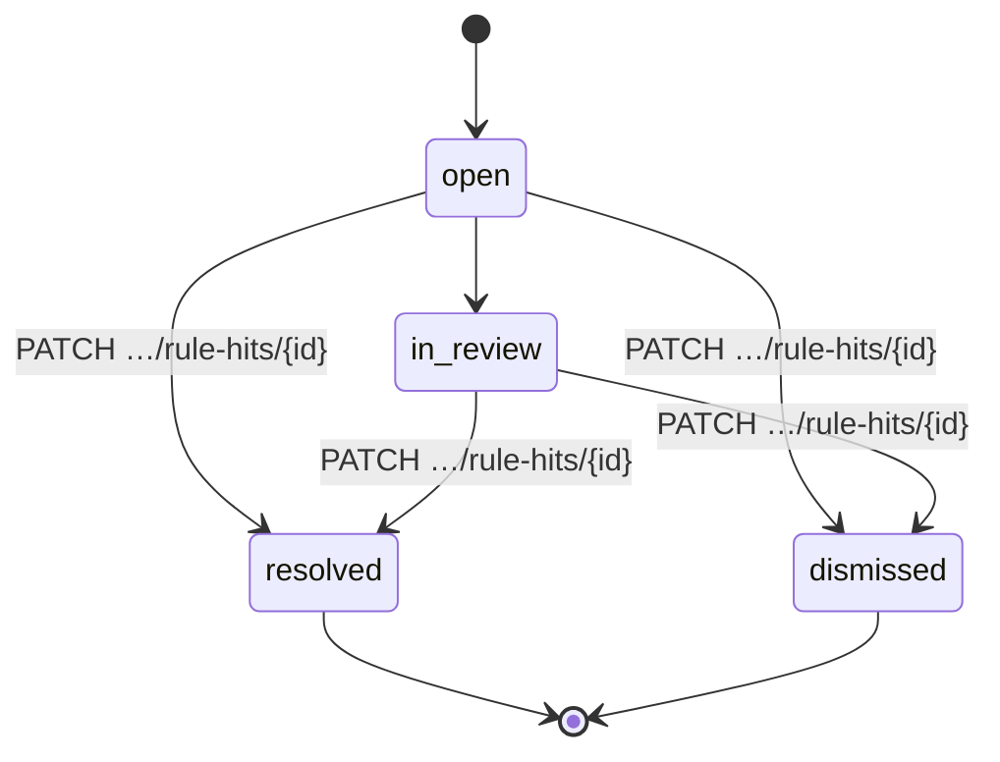

**Operaciones que ejercen esta máquina** _(POR_REFERENCIA: el handler alcanza un método que valida contra la tabla; «sin destino nombrado» significa que el estado de destino llega por el cuerpo de la petición)_:

| Operación | Estados de destino que nombra | A través de |
|---|---|---|
| PATCH /graph/rule-hits/{id} | dismissed, resolved | GraphQueryController.triageRuleHit → GraphAnalyticsService.triageRuleHit |

## Árbol de decisión por operación

Cada árbol se deriva del código del handler y de los métodos que invoca (hasta 4 niveles). Una rama que no decide, no escribe y no falla se poda. Los accesos y los efectos consecutivos se agrupan en un solo nodo.

### Operaciones con decisiones propias

#### 1. POST /graph/access-scopes

Definir un alcance de acceso al grafo

| HTTP | Código | Cuándo |
|---|---|---|
| 201 | — | Éxito |
| 400 | `VALIDATION_FAILED` | El cuerpo cumple el DTO (sin propiedades extra) |
| 401 | `UNAUTHENTICATED` | Hay una sesión válida (JWT) |
| 403 | `FORBIDDEN` | El rol está permitido; El tenant se resuelve y pertenece al actor |
| 409 | `CONFLICT` | ConflictException: Ya existe un alcance con ese código para el tenant. |
| 429 | `RATE_LIMITED` | No se supera el límite de solicitudes |

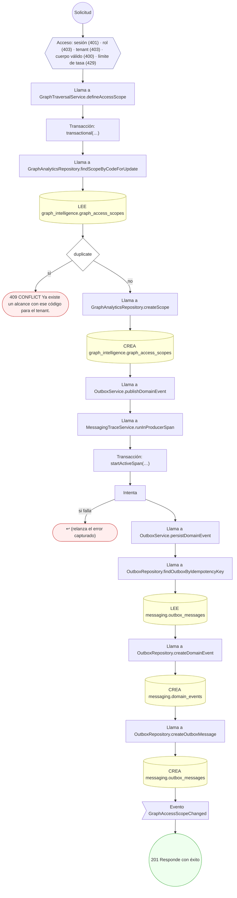

#### 2. PATCH /graph/access-scopes/{id}

Ajustar o suspender el alcance de acceso

| HTTP | Código | Cuándo |
|---|---|---|
| 200 | — | Éxito |
| 400 | `VALIDATION_FAILED` | Los parámetros de ruta son UUID válidos; El cuerpo cumple el DTO (sin propiedades extra) |
| 401 | `UNAUTHENTICATED` | Hay una sesión válida (JWT) |
| 403 | `FORBIDDEN` | El rol está permitido; El tenant se resuelve y pertenece al actor |
| 429 | `RATE_LIMITED` | No se supera el límite de solicitudes |

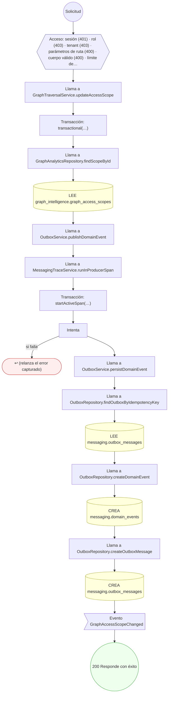

#### 3. POST /graph/analytics/community-detection

Registrar las comunidades detectadas

| HTTP | Código | Cuándo |
|---|---|---|
| 201 | — | Éxito |
| 400 | `VALIDATION_FAILED` | El cuerpo cumple el DTO (sin propiedades extra) |
| 401 | `UNAUTHENTICATED` | Hay una sesión válida (JWT) |
| 403 | `FORBIDDEN` | El rol está permitido; El tenant se resuelve y pertenece al actor |
| 429 | `RATE_LIMITED` | No se supera el límite de solicitudes |

```mermaid
flowchart TD
  n1(("Solicitud")):::inicio
  n2{{"Acceso: sesión (401) · rol (403) · tenant (403) · cuerpo válido (400) · límite de tasa (429)"}}:::acceso
  n1 --> n2
  n3["Llama a GraphAnalyticsService.detectCommunities"]:::llamada
  n2 --> n3
  n4["Transacción: transactional(…)"]:::transaccion
  n3 --> n4
  n5["Llama a GraphAnalyticsRepository.findCommunitiesByAlgorithm"]:::llamada
  n4 --> n5
  n6[("LEE graph_intelligence.graph_communities")]:::efecto
  n5 --> n6
  n7["Llama a GraphAnalyticsRepository.deleteCommunities"]:::llamada
  n6 --> n7
  n8[("BORRA graph_intelligence.graph_communities")]:::efecto
  n7 --> n8
  n9["Repite: por cada const community de dto.communities"]:::bucle
  n8 --> n9
  n10["Llama a GraphAnalyticsRepository.createCommunity"]:::llamada
  n9 -->|"cada elemento"| n10
  n11[("CREA graph_intelligence.graph_communities")]:::efecto
  n10 --> n11
  n12["Llama a OutboxService.publishDomainEvent"]:::llamada
  n11 --> n12
  n9 -->|"al terminar"| n12
  n13["Llama a MessagingTraceService.runInProducerSpan"]:::llamada
  n12 --> n13
  n14["Transacción: startActiveSpan(…)"]:::transaccion
  n13 --> n14
  n15["Intenta"]:::intento
  n14 --> n15
  n16(["↩ (relanza el error capturado)"]):::error
  n15 -->|"si falla"| n16
  n17["Llama a OutboxService.persistDomainEvent"]:::llamada
  n15 --> n17
  n18["Llama a OutboxRepository.findOutboxByIdempotencyKey"]:::llamada
  n17 --> n18
  n19[("LEE messaging.outbox_messages")]:::efecto
  n18 --> n19
  n20["Llama a OutboxRepository.createDomainEvent"]:::llamada
  n19 --> n20
  n21[("CREA messaging.domain_events")]:::efecto
  n20 --> n21
  n22["Llama a OutboxRepository.createOutboxMessage"]:::llamada
  n21 --> n22
  n23[("CREA messaging.outbox_messages")]:::efecto
  n22 --> n23
  n24>"Evento GraphCommunitiesDetected"]:::evento
  n23 --> n24
  n25(("201 Responde con éxito")):::ok
  n24 --> n25
  classDef acceso fill:#eef,stroke:#66a
  classDef error fill:#fee,stroke:#c33
  classDef ok fill:#efe,stroke:#3a3
  classDef efecto fill:#ffd,stroke:#aa3
  classDef decision fill:#fff,stroke:#555
  classDef corte fill:#eee,stroke:#999,stroke-dasharray: 4
```

#### 4. POST /graph/analytics/risk-scoring

Registrar puntajes de riesgo por nodo

| HTTP | Código | Cuándo |
|---|---|---|
| 201 | — | Éxito |
| 400 | `VALIDATION_FAILED` | El cuerpo cumple el DTO (sin propiedades extra) |
| 401 | `UNAUTHENTICATED` | Hay una sesión válida (JWT) |
| 403 | `FORBIDDEN` | El rol está permitido; El tenant se resuelve y pertenece al actor |
| 404 | `NOT_FOUND` | ResourceNotFoundException: Nodo no encontrado para ese tenant. |
| 422 | `PRECONDITION_FAILED` | PreconditionFailedException: No se puntúa un nodo que ya no está activo. |
| 429 | `RATE_LIMITED` | No se supera el límite de solicitudes |

```mermaid
flowchart TD
  n1(("Solicitud")):::inicio
  n2{{"Acceso: sesión (401) · rol (403) · tenant (403) · cuerpo válido (400) · límite de tasa (429)"}}:::acceso
  n1 --> n2
  n3["Llama a GraphAnalyticsService.computeRiskScores"]:::llamada
  n2 --> n3
  n4["Transacción: transactional(…)"]:::transaccion
  n3 --> n4
  n5["Repite: por cada const input de dto.scores"]:::bucle
  n4 --> n5
  n6["Llama a GraphProjectionRepository.findNodeById"]:::llamada
  n5 -->|"cada elemento"| n6
  n7[("LEE graph_intelligence.graph_nodes")]:::efecto
  n6 --> n7
  n8{"!node || node.tenantId !== dto.tenantId"}:::decision
  n7 --> n8
  n9(["404 NOT_FOUND Nodo no encontrado para ese tenant."]):::error
  n8 -->|"sí"| n9
  n10{"node.lifecycleState !== 'active'"}:::decision
  n8 -->|"no"| n10
  n11(["422 PRECONDITION_FAILED No se puntúa un nodo que ya no está activo."]):::error
  n10 -->|"sí"| n11
  n12["Llama a GraphAnalyticsRepository.findRiskScoreForUpdate"]:::llamada
  n10 -->|"no"| n12
  n13[("LEE graph_intelligence.graph_risk_scores")]:::efecto
  n12 --> n13
  n14{"existing"}:::decision
  n13 --> n14
  n15[("ACTUALIZA graph_intelligence.graph_risk_scores")]:::efecto
  n14 -->|"sí"| n15
  n16{"input.explanationRedacted"}:::decision
  n15 --> n16
  n17[("ACTUALIZA graph_intelligence.graph_risk_scores")]:::efecto
  n16 -->|"sí"| n17
  n18[("ACTUALIZA graph_intelligence.graph_risk_scores · ACTUALIZA graph_intelligence.graph_risk_scores")]:::efecto
  n17 --> n18
  n16 -->|"no"| n18
  n19["Llama a GraphAnalyticsRepository.createRiskScore"]:::llamada
  n14 -->|"no"| n19
  n20[("CREA graph_intelligence.graph_risk_scores")]:::efecto
  n19 --> n20
  n21{"input.score ›= threshold"}:::decision
  n18 --> n21
  n20 --> n21
  n22["Llama a OutboxService.publishDomainEvent"]:::llamada
  n21 -->|"sí"| n22
  n23["Llama a MessagingTraceService.runInProducerSpan"]:::llamada
  n22 --> n23
  n24["Transacción: startActiveSpan(…)"]:::transaccion
  n23 --> n24
  n25["Intenta"]:::intento
  n24 --> n25
  n26(["↩ (relanza el error capturado)"]):::error
  n25 -->|"si falla"| n26
  n27["Llama a OutboxService.persistDomainEvent"]:::llamada
  n25 --> n27
  n28["Llama a OutboxRepository.findOutboxByIdempotencyKey"]:::llamada
  n27 --> n28
  n29[("LEE messaging.outbox_messages")]:::efecto
  n28 --> n29
  n30["Llama a OutboxRepository.createDomainEvent"]:::llamada
  n29 --> n30
  n31[("CREA messaging.domain_events")]:::efecto
  n30 --> n31
  n32["Llama a OutboxRepository.createOutboxMessage"]:::llamada
  n31 --> n32
  n33[("CREA messaging.outbox_messages")]:::efecto
  n32 --> n33
  n34>"Evento GraphRiskScoreComputed"]:::evento
  n33 --> n34
  n35(("201 Responde con éxito")):::ok
  n34 --> n35
  n21 -->|"no"| n35
  n5 -->|"al terminar"| n35
  classDef acceso fill:#eef,stroke:#66a
  classDef error fill:#fee,stroke:#c33
  classDef ok fill:#efe,stroke:#3a3
  classDef efecto fill:#ffd,stroke:#aa3
  classDef decision fill:#fff,stroke:#555
  classDef corte fill:#eee,stroke:#999,stroke-dasharray: 4
```

#### 5. POST /graph/deletion-jobs

Propagar el borrado al grafo (derecho al olvido)

| HTTP | Código | Cuándo |
|---|---|---|
| 201 | — | Éxito |
| 400 | `VALIDATION_FAILED` | El cuerpo cumple el DTO (sin propiedades extra) |
| 401 | `UNAUTHENTICATED` | Hay una sesión válida (JWT) |
| 403 | `FORBIDDEN` | El rol está permitido; El tenant se resuelve y pertenece al actor |
| 429 | `RATE_LIMITED` | No se supera el límite de solicitudes |

```mermaid
flowchart TD
  n1(("Solicitud")):::inicio
  n2{{"Acceso: sesión (401) · rol (403) · tenant (403) · cuerpo válido (400) · límite de tasa (429)"}}:::acceso
  n1 --> n2
  n3["Llama a GraphAnalyticsService.requestDeletion"]:::llamada
  n2 --> n3
  n4["Transacción: transactional(…)"]:::transaccion
  n3 --> n4
  n5["Llama a GraphAnalyticsRepository.findActiveDeletionJob"]:::llamada
  n4 --> n5
  n6[("LEE graph_intelligence.graph_deletion_jobs")]:::efecto
  n5 --> n6
  n7["Llama a GraphAnalyticsRepository.createDeletionJob"]:::llamada
  n6 --> n7
  n8[("CREA graph_intelligence.graph_deletion_jobs")]:::efecto
  n7 --> n8
  n9["Llama a GraphProjectionRepository.findNodeBySourceForUpdate"]:::llamada
  n8 --> n9
  n10[("LEE graph_intelligence.graph_nodes")]:::efecto
  n9 --> n10
  n11{"node"}:::decision
  n10 --> n11
  n12["Llama a GraphAnalyticsRepository.deleteCachedPathsTouchingNodes"]:::llamada
  n11 -->|"sí"| n12
  n13[("LEE graph_intelligence.graph_path_cache · BORRA graph_intelligence.graph_path_cache")]:::efecto
  n12 --> n13
  n14["Llama a GraphProjectionRepository.findEdgesTouchingNodes"]:::llamada
  n13 --> n14
  n15[("LEE graph_intelligence.graph_edges")]:::efecto
  n14 --> n15
  n16["Llama a GraphProjectionRepository.deleteEvidenceByEdges"]:::llamada
  n15 --> n16
  n17[("BORRA graph_intelligence.graph_edge_evidence")]:::efecto
  n16 --> n17
  n18["Llama a GraphProjectionRepository.deleteEdges"]:::llamada
  n17 --> n18
  n19[("BORRA graph_intelligence.graph_edges")]:::efecto
  n18 --> n19
  n20["Llama a GraphAnalyticsRepository.deleteRiskScoresByNodes"]:::llamada
  n19 --> n20
  n21[("BORRA graph_intelligence.graph_risk_scores")]:::efecto
  n20 --> n21
  n22["Llama a GraphProjectionRepository.deleteIdentifiersByNodes"]:::llamada
  n21 --> n22
  n23[("BORRA graph_intelligence.graph_node_identifiers")]:::efecto
  n22 --> n23
  n24["Llama a GraphAnalyticsRepository.findCommunitiesByTenant"]:::llamada
  n23 --> n24
  n25[("LEE graph_intelligence.graph_communities")]:::efecto
  n24 --> n25
  n26["Repite: por cada const community de communities"]:::bucle
  n25 --> n26
  n27[("ACTUALIZA graph_intelligence.graph_communities")]:::efecto
  n26 -->|"cada elemento"| n27
  n28["Llama a GraphProjectionRepository.deleteNodes"]:::llamada
  n27 --> n28
  n26 -->|"al terminar"| n28
  n29[("BORRA graph_intelligence.graph_nodes")]:::efecto
  n28 --> n29
  n30[("ACTUALIZA graph_intelligence.graph_deletion_jobs · ACTUALIZA graph_intelligence.graph_deletion_jobs · ACTUALI…")]:::efecto
  n29 --> n30
  n11 -->|"no"| n30
  n31["Llama a OutboxService.publishDomainEvent"]:::llamada
  n30 --> n31
  n32["Llama a MessagingTraceService.runInProducerSpan"]:::llamada
  n31 --> n32
  n33["Transacción: startActiveSpan(…)"]:::transaccion
  n32 --> n33
  n34["Intenta"]:::intento
  n33 --> n34
  n35(["↩ (relanza el error capturado)"]):::error
  n34 -->|"si falla"| n35
  n36["Llama a OutboxService.persistDomainEvent"]:::llamada
  n34 --> n36
  n37["Llama a OutboxRepository.findOutboxByIdempotencyKey"]:::llamada
  n36 --> n37
  n38[("LEE messaging.outbox_messages")]:::efecto
  n37 --> n38
  n39["Llama a OutboxRepository.createDomainEvent"]:::llamada
  n38 --> n39
  n40[("CREA messaging.domain_events")]:::efecto
  n39 --> n40
  n41["Llama a OutboxRepository.createOutboxMessage"]:::llamada
  n40 --> n41
  n42[("CREA messaging.outbox_messages")]:::efecto
  n41 --> n42
  n43>"Evento GraphEntityPurged"]:::evento
  n42 --> n43
  n44(("201 Responde con éxito")):::ok
  n43 --> n44
  classDef acceso fill:#eef,stroke:#66a
  classDef error fill:#fee,stroke:#c33
  classDef ok fill:#efe,stroke:#3a3
  classDef efecto fill:#ffd,stroke:#aa3
  classDef decision fill:#fff,stroke:#555
  classDef corte fill:#eee,stroke:#999,stroke-dasharray: 4
```

#### 6. POST /graph/edges/{id}/expire

Expirar la arista y decaer su confianza

| HTTP | Código | Cuándo |
|---|---|---|
| 200 | — | Éxito |
| 400 | `VALIDATION_FAILED` | Los parámetros de ruta son UUID válidos; El cuerpo cumple el DTO (sin propiedades extra) |
| 401 | `UNAUTHENTICATED` | Hay una sesión válida (JWT) |
| 403 | `FORBIDDEN` | El rol está permitido; El tenant se resuelve y pertenece al actor |
| 429 | `RATE_LIMITED` | No se supera el límite de solicitudes |

```mermaid
flowchart TD
  n1(("Solicitud")):::inicio
  n2{{"Acceso: sesión (401) · rol (403) · tenant (403) · parámetros de ruta (400) · cuerpo válido (400) · límite de…"}}:::acceso
  n1 --> n2
  n3["Llama a GraphProjectionService.expireEdge"]:::llamada
  n2 --> n3
  n4["Transacción: transactional(…)"]:::transaccion
  n3 --> n4
  n5["Llama a GraphProjectionRepository.findEdgeForUpdate"]:::llamada
  n4 --> n5
  n6[("LEE graph_intelligence.graph_edges")]:::efecto
  n5 --> n6
  n7["Llama a GraphProjectionRepository.findEvidenceByHash"]:::llamada
  n6 --> n7
  n8[("LEE graph_intelligence.graph_edge_evidence")]:::efecto
  n7 --> n8
  n9{"!duplicate"}:::decision
  n8 --> n9
  n10["Llama a GraphProjectionRepository.createEvidence"]:::llamada
  n9 -->|"sí"| n10
  n11[("CREA graph_intelligence.graph_edge_evidence")]:::efecto
  n10 --> n11
  n12["Llama a GraphProjectionService.recalculateConfidence"]:::llamada
  n11 --> n12
  n9 -->|"no"| n12
  n13["Llama a GraphProjectionRepository.findEvidenceByEdge"]:::llamada
  n12 --> n13
  n14[("LEE graph_intelligence.graph_edge_evidence")]:::efecto
  n13 --> n14
  n15["Llama a GraphAnalyticsRepository.deleteCachedPathsTouchingEdges"]:::llamada
  n14 --> n15
  n16[("LEE graph_intelligence.graph_path_cache · BORRA graph_intelligence.graph_path_cache")]:::efecto
  n15 --> n16
  n17["Llama a OutboxService.publishDomainEvent"]:::llamada
  n16 --> n17
  n18["Llama a MessagingTraceService.runInProducerSpan"]:::llamada
  n17 --> n18
  n19["Transacción: startActiveSpan(…)"]:::transaccion
  n18 --> n19
  n20["Intenta"]:::intento
  n19 --> n20
  n21(["↩ (relanza el error capturado)"]):::error
  n20 -->|"si falla"| n21
  n22["Llama a OutboxService.persistDomainEvent"]:::llamada
  n20 --> n22
  n23["Llama a OutboxRepository.findOutboxByIdempotencyKey"]:::llamada
  n22 --> n23
  n24[("LEE messaging.outbox_messages")]:::efecto
  n23 --> n24
  n25["Llama a OutboxRepository.createDomainEvent"]:::llamada
  n24 --> n25
  n26[("CREA messaging.domain_events")]:::efecto
  n25 --> n26
  n27["Llama a OutboxRepository.createOutboxMessage"]:::llamada
  n26 --> n27
  n28[("CREA messaging.outbox_messages")]:::efecto
  n27 --> n28
  n29>"Evento GraphEdgeExpired"]:::evento
  n28 --> n29
  n30(("200 Responde con éxito")):::ok
  n29 --> n30
  classDef acceso fill:#eef,stroke:#66a
  classDef error fill:#fee,stroke:#c33
  classDef ok fill:#efe,stroke:#3a3
  classDef efecto fill:#ffd,stroke:#aa3
  classDef decision fill:#fff,stroke:#555
  classDef corte fill:#eee,stroke:#999,stroke-dasharray: 4
```

#### 7. POST /graph/paths

Buscar el camino entre dos nodos

| HTTP | Código | Cuándo |
|---|---|---|
| 200 | — | Éxito |
| 400 | `VALIDATION_FAILED` | El cuerpo cumple el DTO (sin propiedades extra) |
| 401 | `UNAUTHENTICATED` | Hay una sesión válida (JWT) |
| 403 | `FORBIDDEN` | El rol está permitido; El tenant se resuelve y pertenece al actor |
| 404 | `NOT_FOUND` | ResourceNotFoundException: Alcance de acceso no encontrado.; ResourceNotFoundException: Nodo de partida no encontrado. |
| 422 | `PRECONDITION_FAILED` | PreconditionFailedException: El alcance de acceso no está activo.; PreconditionFailedException: El alcance no admite ese propósito de uso.; PreconditionFailedException: El alcance exige declarar el paciente del contexto.; PreconditionFailedException: El nodo de partida queda fuera del alcance de acceso. |
| 429 | `RATE_LIMITED` | No se supera el límite de solicitudes |
| 500 | `INTERNAL` | DomainException: {HttpStatus.FORBIDDEN} |

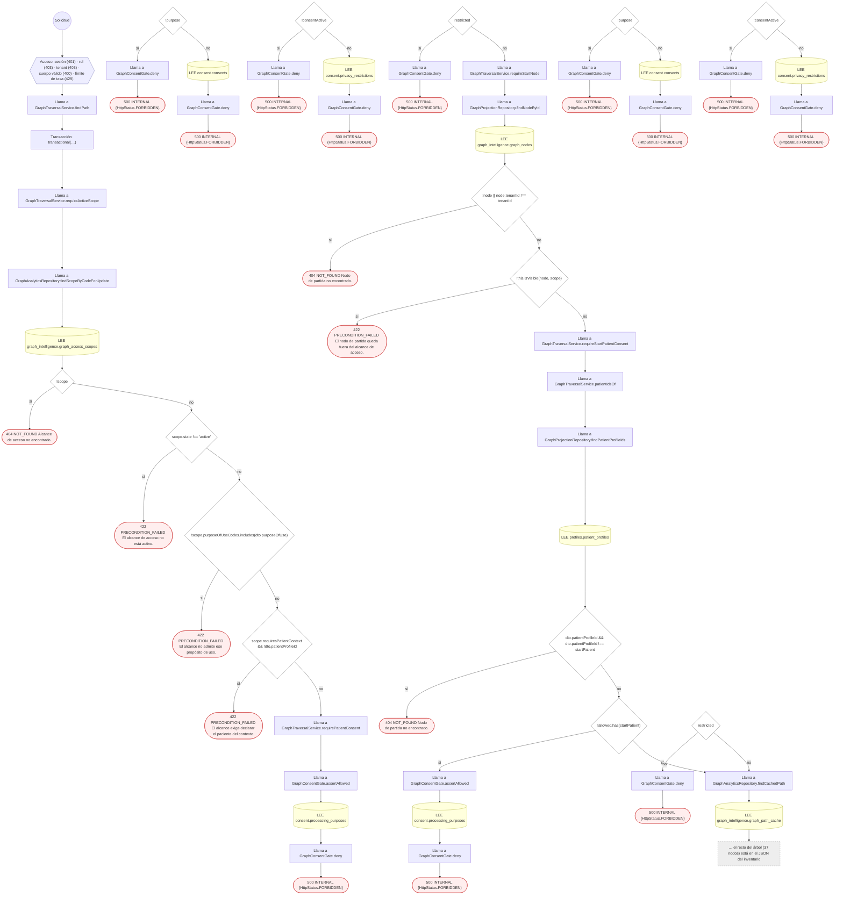

#### 8. POST /graph/projection-definitions/{id}/runs

Arrancar una corrida de proyección

| HTTP | Código | Cuándo |
|---|---|---|
| 201 | — | Éxito |
| 400 | `VALIDATION_FAILED` | Los parámetros de ruta son UUID válidos; El cuerpo cumple el DTO (sin propiedades extra) |
| 401 | `UNAUTHENTICATED` | Hay una sesión válida (JWT) |
| 403 | `FORBIDDEN` | El rol está permitido; El tenant se resuelve y pertenece al actor |
| 422 | `PRECONDITION_FAILED` | PreconditionFailedException: La definición de proyección no está activa. |
| 429 | `RATE_LIMITED` | No se supera el límite de solicitudes |

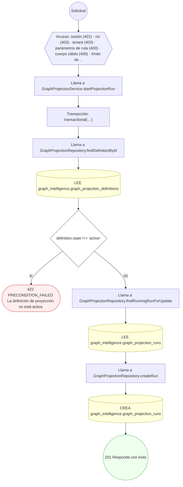

#### 9. POST /graph/projection-runs/{id}/advance

Avanzar el checkpoint de la corrida

| HTTP | Código | Cuándo |
|---|---|---|
| 200 | — | Éxito |
| 400 | `VALIDATION_FAILED` | Los parámetros de ruta son UUID válidos; El cuerpo cumple el DTO (sin propiedades extra) |
| 401 | `UNAUTHENTICATED` | Hay una sesión válida (JWT) |
| 403 | `FORBIDDEN` | El rol está permitido; El tenant se resuelve y pertenece al actor |
| 409 | `CONFLICT` | ConflictException: El checkpoint no puede retroceder. |
| 422 | `PRECONDITION_FAILED` | PreconditionFailedException: La corrida ya no está en marcha. |
| 429 | `RATE_LIMITED` | No se supera el límite de solicitudes |

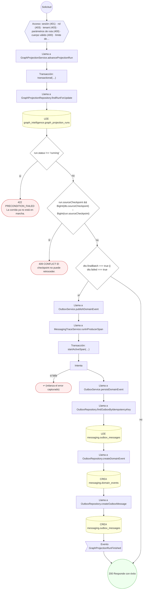

#### 10. POST /graph/projections/edges/upsert

Proyectar una arista con su evidencia

| HTTP | Código | Cuándo |
|---|---|---|
| 200 | — | Éxito |
| 400 | `VALIDATION_FAILED` | El cuerpo cumple el DTO (sin propiedades extra) |
| 401 | `UNAUTHENTICATED` | Hay una sesión válida (JWT) |
| 403 | `FORBIDDEN` | El rol está permitido; El tenant se resuelve y pertenece al actor |
| 422 | `PRECONDITION_FAILED` | PreconditionFailedException: Los dos extremos de la arista tienen que estar proyectados antes que ella.; PreconditionFailedException: Una arista no puede cruzar dos tenants. |
| 429 | `RATE_LIMITED` | No se supera el límite de solicitudes |

```mermaid
flowchart TD
  n1(("Solicitud")):::inicio
  n2{{"Acceso: sesión (401) · rol (403) · tenant (403) · cuerpo válido (400) · límite de tasa (429)"}}:::acceso
  n1 --> n2
  n3["Llama a GraphProjectionService.upsertEdge"]:::llamada
  n2 --> n3
  n4["Transacción: transactional(…)"]:::transaccion
  n3 --> n4
  n5["Llama a GraphProjectionRepository.findNodeById"]:::llamada
  n4 --> n5
  n6[("LEE graph_intelligence.graph_nodes")]:::efecto
  n5 --> n6
  n7["Llama a GraphProjectionRepository.findNodeById"]:::llamada
  n6 --> n7
  n8[("LEE graph_intelligence.graph_nodes")]:::efecto
  n7 --> n8
  n9{"!fromNode || !toNode"}:::decision
  n8 --> n9
  n10(["422 PRECONDITION_FAILED Los dos extremos de la arista tienen que estar proyectados antes que ella."]):::error
  n9 -->|"sí"| n10
  n11{"fromNode.tenantId !== dto.tenantId || toNode.tenantId !== dto.tenantId"}:::decision
  n9 -->|"no"| n11
  n12(["422 PRECONDITION_FAILED Una arista no puede cruzar dos tenants."]):::error
  n11 -->|"sí"| n12
  n13["Llama a GraphProjectionRepository.findEdgeBySourceForUpdate"]:::llamada
  n11 -->|"no"| n13
  n14[("LEE graph_intelligence.graph_edges")]:::efecto
  n13 --> n14
  n15["Llama a GraphProjectionRepository.createEdge"]:::llamada
  n14 --> n15
  n16[("CREA graph_intelligence.graph_edges")]:::efecto
  n15 --> n16
  n17{"existing"}:::decision
  n16 --> n17
  n18[("ACTUALIZA graph_intelligence.graph_edges · ACTUALIZA graph_intelligence.graph_edges · ACTUALIZA graph_intelli…")]:::efecto
  n17 -->|"sí"| n18
  n19["Repite: por cada const evidence de dto.evidence ?? []"]:::bucle
  n18 --> n19
  n17 -->|"no"| n19
  n20["Llama a GraphProjectionRepository.findEvidenceByHash"]:::llamada
  n19 -->|"cada elemento"| n20
  n21[("LEE graph_intelligence.graph_edge_evidence")]:::efecto
  n20 --> n21
  n22["Llama a GraphProjectionRepository.createEvidence"]:::llamada
  n21 --> n22
  n23[("CREA graph_intelligence.graph_edge_evidence")]:::efecto
  n22 --> n23
  n24["Llama a GraphProjectionService.recalculateConfidence"]:::llamada
  n23 --> n24
  n19 -->|"al terminar"| n24
  n25["Llama a GraphProjectionRepository.findEvidenceByEdge"]:::llamada
  n24 --> n25
  n26[("LEE graph_intelligence.graph_edge_evidence")]:::efecto
  n25 --> n26
  n27["Llama a OutboxService.publishDomainEvent"]:::llamada
  n26 --> n27
  n28["Llama a MessagingTraceService.runInProducerSpan"]:::llamada
  n27 --> n28
  n29["Transacción: startActiveSpan(…)"]:::transaccion
  n28 --> n29
  n30["Intenta"]:::intento
  n29 --> n30
  n31(["↩ (relanza el error capturado)"]):::error
  n30 -->|"si falla"| n31
  n32["Llama a OutboxService.persistDomainEvent"]:::llamada
  n30 --> n32
  n33["Llama a OutboxRepository.findOutboxByIdempotencyKey"]:::llamada
  n32 --> n33
  n34[("LEE messaging.outbox_messages")]:::efecto
  n33 --> n34
  n35["Llama a OutboxRepository.createDomainEvent"]:::llamada
  n34 --> n35
  n36[("CREA messaging.domain_events")]:::efecto
  n35 --> n36
  n37["Llama a OutboxRepository.createOutboxMessage"]:::llamada
  n36 --> n37
  n38[("CREA messaging.outbox_messages")]:::efecto
  n37 --> n38
  n39>"Evento GraphEdgeProjected"]:::evento
  n38 --> n39
  n40(("200 Responde con éxito")):::ok
  n39 --> n40
  classDef acceso fill:#eef,stroke:#66a
  classDef error fill:#fee,stroke:#c33
  classDef ok fill:#efe,stroke:#3a3
  classDef efecto fill:#ffd,stroke:#aa3
  classDef decision fill:#fff,stroke:#555
  classDef corte fill:#eee,stroke:#999,stroke-dasharray: 4
```

#### 11. POST /graph/projections/nodes/upsert

Proyectar un nodo y sus identificadores

| HTTP | Código | Cuándo |
|---|---|---|
| 200 | — | Éxito |
| 400 | `VALIDATION_FAILED` | El cuerpo cumple el DTO (sin propiedades extra) |
| 401 | `UNAUTHENTICATED` | Hay una sesión válida (JWT) |
| 403 | `FORBIDDEN` | El rol está permitido; El tenant se resuelve y pertenece al actor |
| 429 | `RATE_LIMITED` | No se supera el límite de solicitudes |

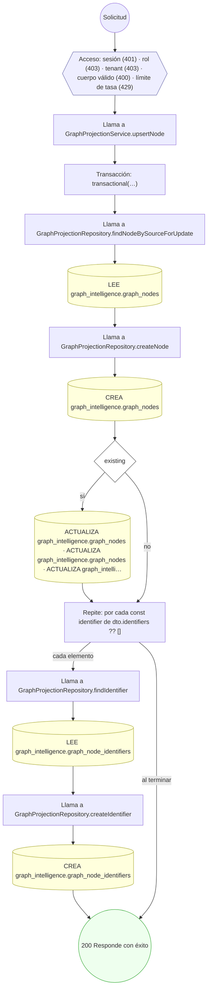

#### 12. POST /graph/projections/reconcile

Reconciliar la versión canónica del nodo

| HTTP | Código | Cuándo |
|---|---|---|
| 200 | — | Éxito |
| 400 | `VALIDATION_FAILED` | El cuerpo cumple el DTO (sin propiedades extra) |
| 401 | `UNAUTHENTICATED` | Hay una sesión válida (JWT) |
| 403 | `FORBIDDEN` | El rol está permitido; El tenant se resuelve y pertenece al actor |
| 404 | `NOT_FOUND` | ResourceNotFoundException: El nodo no está proyectado. |
| 429 | `RATE_LIMITED` | No se supera el límite de solicitudes |

```mermaid
flowchart TD
  n1(("Solicitud")):::inicio
  n2{{"Acceso: sesión (401) · rol (403) · tenant (403) · cuerpo válido (400) · límite de tasa (429)"}}:::acceso
  n1 --> n2
  n3["Llama a GraphProjectionService.reconcileSourceVersion"]:::llamada
  n2 --> n3
  n4["Transacción: transactional(…)"]:::transaccion
  n3 --> n4
  n5["Llama a GraphProjectionRepository.findNodeBySourceForUpdate"]:::llamada
  n4 --> n5
  n6[("LEE graph_intelligence.graph_nodes")]:::efecto
  n5 --> n6
  n7{"!node"}:::decision
  n6 --> n7
  n8(["404 NOT_FOUND El nodo no está proyectado."]):::error
  n7 -->|"sí"| n8
  n9{"dto.deleted === true"}:::decision
  n7 -->|"no"| n9
  n10["Llama a GraphAnalyticsRepository.findActiveDeletionJob"]:::llamada
  n9 -->|"sí"| n10
  n11[("LEE graph_intelligence.graph_deletion_jobs")]:::efecto
  n10 --> n11
  n12["Llama a GraphAnalyticsRepository.createDeletionJob"]:::llamada
  n11 --> n12
  n13[("CREA graph_intelligence.graph_deletion_jobs")]:::efecto
  n12 --> n13
  n14[("ACTUALIZA graph_intelligence.graph_nodes")]:::efecto
  n13 --> n14
  n9 -->|"no"| n14
  n15{"dto.displayLabelRedacted"}:::decision
  n14 --> n15
  n16[("ACTUALIZA graph_intelligence.graph_nodes")]:::efecto
  n15 -->|"sí"| n16
  n17[("ACTUALIZA graph_intelligence.graph_nodes")]:::efecto
  n16 --> n17
  n15 -->|"no"| n17
  n18{"dto.properties"}:::decision
  n17 --> n18
  n19[("ACTUALIZA graph_intelligence.graph_nodes")]:::efecto
  n18 -->|"sí"| n19
  n20[("ACTUALIZA graph_intelligence.graph_nodes")]:::efecto
  n19 --> n20
  n18 -->|"no"| n20
  n21{"dto.securityLabels"}:::decision
  n20 --> n21
  n22[("ACTUALIZA graph_intelligence.graph_nodes")]:::efecto
  n21 -->|"sí"| n22
  n23[("ACTUALIZA graph_intelligence.graph_nodes")]:::efecto
  n22 --> n23
  n21 -->|"no"| n23
  n24["Llama a GraphAnalyticsRepository.deleteCachedPathsTouchingNodes"]:::llamada
  n23 --> n24
  n25[("LEE graph_intelligence.graph_path_cache · BORRA graph_intelligence.graph_path_cache")]:::efecto
  n24 --> n25
  n26["Llama a GraphAnalyticsRepository.findRiskScoresByNodesForUpdate"]:::llamada
  n25 --> n26
  n27[("LEE graph_intelligence.graph_risk_scores")]:::efecto
  n26 --> n27
  n28["Repite: por cada const score de riskScores"]:::bucle
  n27 --> n28
  n29[("ACTUALIZA graph_intelligence.graph_risk_scores")]:::efecto
  n28 -->|"cada elemento"| n29
  n30(("200 Responde con éxito")):::ok
  n29 --> n30
  n28 -->|"al terminar"| n30
  classDef acceso fill:#eef,stroke:#66a
  classDef error fill:#fee,stroke:#c33
  classDef ok fill:#efe,stroke:#3a3
  classDef efecto fill:#ffd,stroke:#aa3
  classDef decision fill:#fff,stroke:#555
  classDef corte fill:#eee,stroke:#999,stroke-dasharray: 4
```

#### 13. PATCH /graph/rule-hits/{id}

Mover el hallazgo por su triage

| HTTP | Código | Cuándo |
|---|---|---|
| 200 | — | Éxito |
| 400 | `VALIDATION_FAILED` | Los parámetros de ruta son UUID válidos; El cuerpo cumple el DTO (sin propiedades extra) |
| 401 | `UNAUTHENTICATED` | Hay una sesión válida (JWT) |
| 403 | `FORBIDDEN` | El rol está permitido; El tenant se resuelve y pertenece al actor |
| 409 | `CONFLICT` | ConflictException: Esa transición del hallazgo no está permitida. |
| 429 | `RATE_LIMITED` | No se supera el límite de solicitudes |

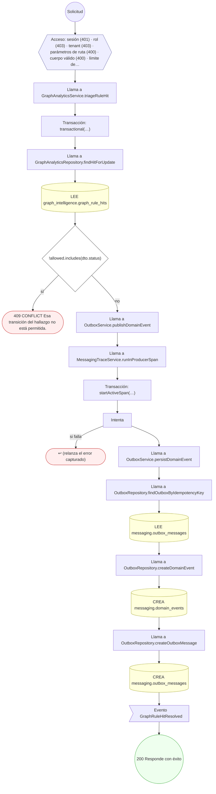

#### 14. POST /graph/rules/{id}/evaluate

Registrar los hallazgos de una regla

| HTTP | Código | Cuándo |
|---|---|---|
| 201 | — | Éxito |
| 400 | `VALIDATION_FAILED` | Los parámetros de ruta son UUID válidos; El cuerpo cumple el DTO (sin propiedades extra) |
| 401 | `UNAUTHENTICATED` | Hay una sesión válida (JWT) |
| 403 | `FORBIDDEN` | El rol está permitido; El tenant se resuelve y pertenece al actor |
| 422 | `PRECONDITION_FAILED` | PreconditionFailedException: La definición de regla no está activa.; PreconditionFailedException: La regla tiene que evaluarse bajo un alcance de acceso activo. |
| 429 | `RATE_LIMITED` | No se supera el límite de solicitudes |

```mermaid
flowchart TD
  n1(("Solicitud")):::inicio
  n2{{"Acceso: sesión (401) · rol (403) · tenant (403) · parámetros de ruta (400) · cuerpo válido (400) · límite de…"}}:::acceso
  n1 --> n2
  n3["Llama a GraphAnalyticsService.evaluateRule"]:::llamada
  n2 --> n3
  n4["Transacción: transactional(…)"]:::transaccion
  n3 --> n4
  n5["Llama a GraphAnalyticsRepository.findRuleDefinitionById"]:::llamada
  n4 --> n5
  n6[("LEE graph_intelligence.graph_rule_definitions")]:::efecto
  n5 --> n6
  n7{"rule.state !== 'active'"}:::decision
  n6 --> n7
  n8(["422 PRECONDITION_FAILED La definición de regla no está activa."]):::error
  n7 -->|"sí"| n8
  n9["Llama a GraphAnalyticsRepository.findScopeByCodeForUpdate"]:::llamada
  n7 -->|"no"| n9
  n10[("LEE graph_intelligence.graph_access_scopes")]:::efecto
  n9 --> n10
  n11{"!scope || scope.state !== 'active'"}:::decision
  n10 --> n11
  n12(["422 PRECONDITION_FAILED La regla tiene que evaluarse bajo un alcance de acceso activo."]):::error
  n11 -->|"sí"| n12
  n13["Repite: por cada const match de dto.matches"]:::bucle
  n11 -->|"no"| n13
  n14["Llama a GraphAnalyticsRepository.findLiveHit"]:::llamada
  n13 -->|"cada elemento"| n14
  n15[("LEE graph_intelligence.graph_rule_hits")]:::efecto
  n14 --> n15
  n16["Llama a GraphAnalyticsRepository.createHit"]:::llamada
  n15 --> n16
  n17[("CREA graph_intelligence.graph_rule_hits")]:::efecto
  n16 --> n17
  n18["Llama a OutboxService.publishDomainEvent"]:::llamada
  n17 --> n18
  n19["Llama a MessagingTraceService.runInProducerSpan"]:::llamada
  n18 --> n19
  n20["Transacción: startActiveSpan(…)"]:::transaccion
  n19 --> n20
  n21["Intenta"]:::intento
  n20 --> n21
  n22(["↩ (relanza el error capturado)"]):::error
  n21 -->|"si falla"| n22
  n23["Llama a OutboxService.persistDomainEvent"]:::llamada
  n21 --> n23
  n24["Llama a OutboxRepository.findOutboxByIdempotencyKey"]:::llamada
  n23 --> n24
  n25[("LEE messaging.outbox_messages")]:::efecto
  n24 --> n25
  n26["Llama a OutboxRepository.createDomainEvent"]:::llamada
  n25 --> n26
  n27[("CREA messaging.domain_events")]:::efecto
  n26 --> n27
  n28["Llama a OutboxRepository.createOutboxMessage"]:::llamada
  n27 --> n28
  n29[("CREA messaging.outbox_messages")]:::efecto
  n28 --> n29
  n30>"Evento GraphRuleHitDetected"]:::evento
  n29 --> n30
  n31(("201 Responde con éxito")):::ok
  n30 --> n31
  n13 -->|"al terminar"| n31
  classDef acceso fill:#eef,stroke:#66a
  classDef error fill:#fee,stroke:#c33
  classDef ok fill:#efe,stroke:#3a3
  classDef efecto fill:#ffd,stroke:#aa3
  classDef decision fill:#fff,stroke:#555
  classDef corte fill:#eee,stroke:#999,stroke-dasharray: 4
```

#### 15. POST /graph/traverse

Recorrer el grafo desde un nodo

| HTTP | Código | Cuándo |
|---|---|---|
| 200 | — | Éxito |
| 400 | `VALIDATION_FAILED` | El cuerpo cumple el DTO (sin propiedades extra) |
| 401 | `UNAUTHENTICATED` | Hay una sesión válida (JWT) |
| 403 | `FORBIDDEN` | El rol está permitido; El tenant se resuelve y pertenece al actor |
| 404 | `NOT_FOUND` | ResourceNotFoundException: Alcance de acceso no encontrado.; ResourceNotFoundException: Nodo de partida no encontrado. |
| 422 | `PRECONDITION_FAILED` | PreconditionFailedException: El alcance de acceso no está activo.; PreconditionFailedException: El alcance no admite ese propósito de uso.; PreconditionFailedException: El alcance exige declarar el paciente del contexto.; PreconditionFailedException: El nodo de partida queda fuera del alcance de acceso. |
| 429 | `RATE_LIMITED` | No se supera el límite de solicitudes |
| 500 | `INTERNAL` | DomainException: {HttpStatus.FORBIDDEN} |

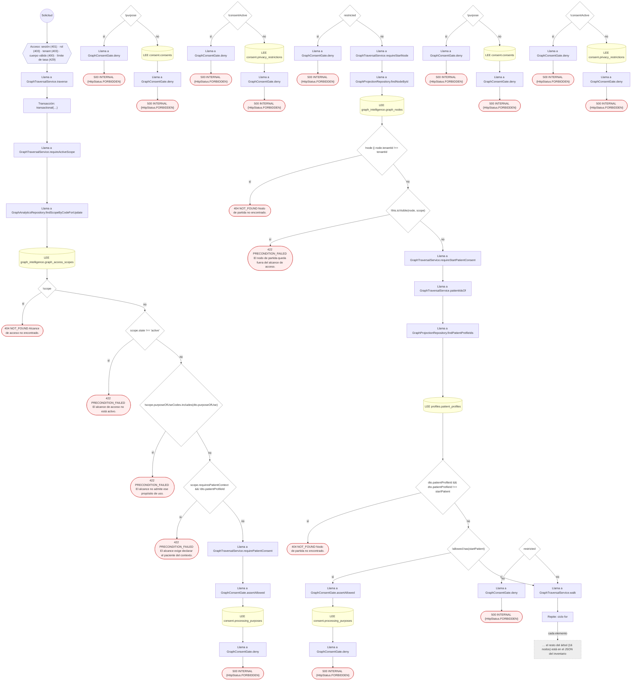

