<!-- AUTOGENERADO por tools/inventario/flujos.mjs. No editar manualmente. -->

# Flujos del módulo `health_context`

- **Procesos:** 1 · **Máquinas de estado:** 0
- **Operaciones:** 13 (13 con decisiones propias, 0 sin ellas)
- Inventario de endpoints del módulo: [health_context](../endpoints/health_context.md)

## Proceso: Contexto de salud por país

- **Código:** `health_context` · **Agrupación:** AGRUPACION_POR_CONTROLADOR · **Operaciones:** 13
- **Actores:** CONTEXT_CONSUMER · CONTEXT_CURATOR · PLATFORM_ADMIN · QUALITY_REVIEWER · SOURCE_ADMIN · SYSTEM
- **Revisión:** AUTO_DETECTADA
- **Fuentes:** `src/modules/health_context/README.md`

### Para qué sirve

Este módulo registra contexto sanitario agregado: agentes y fuentes, agendas, corridas, observaciones, versiones con hechos y evidencia, revisión, publicación y resolución. No tiene endpoints de paciente. Persiste diez tablas bajo el esquema `health_context` y el worker `health_context` llama cada 30 segundos a `POST /health-context/internal/schedules/run-due`.

_Fuente: `src/modules/health_context/README.md:3`_

### Etapas y operaciones

| Etapa | Descripción | Operación | Quién actúa | Riesgo | Tablas |
|---|---|---|---|---|---|
| `ctrl:HealthContextController` | Operaciones de HealthContextController que el README no asigna a un caso de uso | POST /health-context/agents | SOURCE_ADMIN · PLATFORM_ADMIN | MEDIO | 2 |
|  |  | POST /health-context/collection-runs | SYSTEM · CONTEXT_CURATOR · PLATFORM_ADMIN | MEDIO | 5 |
|  |  | POST /health-context/collection-runs/{id}/finish | SYSTEM · PLATFORM_ADMIN | MEDIO | 5 |
|  |  | POST /health-context/collection-runs/{id}/observations | SYSTEM · PLATFORM_ADMIN | MEDIO | 5 |
|  |  | POST /health-context/contexts | CONTEXT_CURATOR · PLATFORM_ADMIN | MEDIO | 2 |
|  |  | POST /health-context/contexts/{id}/versions | SYSTEM · CONTEXT_CURATOR · PLATFORM_ADMIN | MEDIO | 7 |
|  |  | GET /health-context/contexts/resolve | CONTEXT_CONSUMER · CONTEXT_CURATOR · SYSTEM · PLATFORM_ADMIN | BAJO | 4 |
|  |  | POST /health-context/internal/schedules/run-due | SYSTEM | MEDIO | 5 |
|  |  | POST /health-context/schedules | CONTEXT_CURATOR · PLATFORM_ADMIN | MEDIO | 2 |
|  |  | POST /health-context/sources | SOURCE_ADMIN · PLATFORM_ADMIN | MEDIO | 2 |
|  |  | POST /health-context/versions/{id}/publish | CONTEXT_CURATOR · PLATFORM_ADMIN | MEDIO | 4 |
|  |  | POST /health-context/versions/{id}/quality-reviews | QUALITY_REVIEWER · SYSTEM · PLATFORM_ADMIN | MEDIO | 3 |
|  |  | POST /health-context/versions/{id}/supersede | CONTEXT_CURATOR · PLATFORM_ADMIN | MEDIO | 4 |

### Diagrama — etapas `ctrl:HealthContextController`

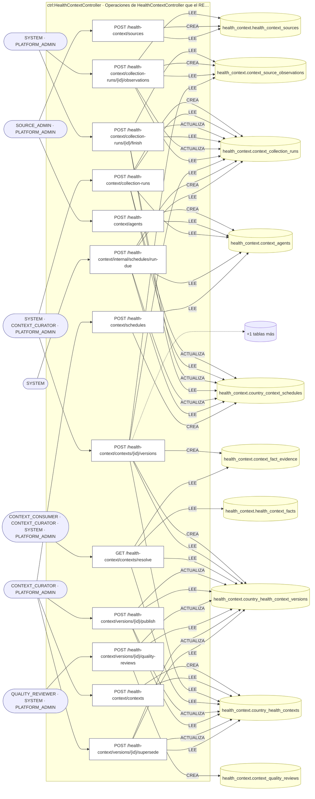

## Árbol de decisión por operación

Cada árbol se deriva del código del handler y de los métodos que invoca (hasta 4 niveles). Una rama que no decide, no escribe y no falla se poda. Los accesos y los efectos consecutivos se agrupan en un solo nodo.

### Operaciones con decisiones propias

#### 1. POST /health-context/agents

Registrar un agente recolector gobernado

| HTTP | Código | Cuándo |
|---|---|---|
| 201 | — | Éxito |
| 400 | `VALIDATION_FAILED` | El cuerpo cumple el DTO (sin propiedades extra) |
| 401 | `UNAUTHENTICATED` | Hay una sesión válida (JWT) |
| 403 | `FORBIDDEN` | El rol está permitido; El tenant se resuelve y pertenece al actor |
| 429 | `RATE_LIMITED` | No se supera el límite de solicitudes |

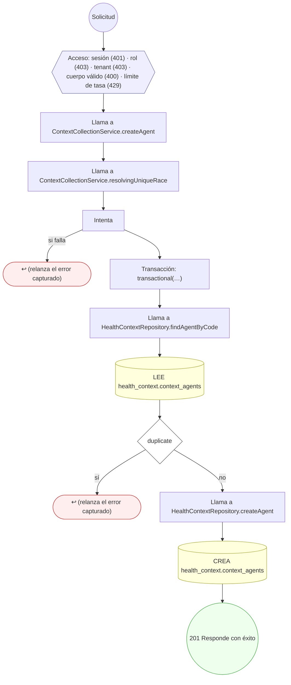

#### 2. POST /health-context/collection-runs

Disparar una corrida de recolección

| HTTP | Código | Cuándo |
|---|---|---|
| 201 | — | Éxito |
| 400 | `VALIDATION_FAILED` | El cuerpo cumple el DTO (sin propiedades extra) |
| 401 | `UNAUTHENTICATED` | Hay una sesión válida (JWT) |
| 403 | `FORBIDDEN` | El rol está permitido; El tenant se resuelve y pertenece al actor |
| 404 | `NOT_FOUND` | ResourceNotFoundException: Programación no encontrada; ResourceNotFoundException: Agente no encontrado |
| 409 | `CONFLICT` | ConflictException: No se pudo resolver la corrida de esa clave de idempotencia |
| 422 | `PRECONDITION_FAILED` | PreconditionFailedException: La programación no está activa; PreconditionFailedException: El agente y el país de la corrida deben coincidir con los de la programación; PreconditionFailedException: La corrida necesita agente y país, o una programación de la que salgan; PreconditionFailedException: El agente no está activo |
| 429 | `RATE_LIMITED` | No se supera el límite de solicitudes |

```mermaid
flowchart TD
  n1(("Solicitud")):::inicio
  n2{{"Acceso: sesión (401) · rol (403) · tenant (403) · cuerpo válido (400) · límite de tasa (429)"}}:::acceso
  n1 --> n2
  n3["Llama a ContextCollectionService.startCollectionRun"]:::llamada
  n2 --> n3
  n4["Llama a ContextCollectionService.resolvingUniqueRace"]:::llamada
  n3 --> n4
  n5["Intenta"]:::intento
  n4 --> n5
  n6(["↩ (relanza el error capturado)"]):::error
  n5 -->|"si falla"| n6
  n7["Transacción: transactional(…)"]:::transaccion
  n5 --> n7
  n8["Llama a HealthContextRepository.findRunByIdempotencyKey"]:::llamada
  n7 --> n8
  n9[("LEE health_context.context_collection_runs")]:::efecto
  n8 --> n9
  n10{"dto.scheduleId"}:::decision
  n9 --> n10
  n11["Llama a HealthContextRepository.findScheduleForUpdate"]:::llamada
  n10 -->|"sí"| n11
  n12[("LEE health_context.country_context_schedules")]:::efecto
  n11 --> n12
  n13{"!schedule"}:::decision
  n12 --> n13
  n14(["404 NOT_FOUND Programación no encontrada"]):::error
  n13 -->|"sí"| n14
  n15{"schedule.statusConceptId !== CONCEPTS.STATE_ACTIVE"}:::decision
  n13 -->|"no"| n15
  n16(["422 PRECONDITION_FAILED La programación no está activa"]):::error
  n15 -->|"sí"| n16
  n17{"(dto.agentId !== undefined && dto.agentId !== schedule.agentId) || (dto.countryConceptId !== undefined && dto…"}:::decision
  n15 -->|"no"| n17
  n18(["422 PRECONDITION_FAILED El agente y el país de la corrida deben coincidir con los de la programación"]):::error
  n17 -->|"sí"| n18
  n19{"dto.nextRunAt"}:::decision
  n17 -->|"no"| n19
  n20[("ACTUALIZA health_context.country_context_schedules")]:::efecto
  n19 -->|"sí"| n20
  n21{"!agentId || !countryConceptId"}:::decision
  n20 --> n21
  n19 -->|"no"| n21
  n10 -->|"no"| n21
  n22(["422 PRECONDITION_FAILED La corrida necesita agente y país, o una programación de la que salgan"]):::error
  n21 -->|"sí"| n22
  n23["Llama a HealthContextRepository.findAgentById"]:::llamada
  n21 -->|"no"| n23
  n24[("LEE health_context.context_agents")]:::efecto
  n23 --> n24
  n25{"!agent"}:::decision
  n24 --> n25
  n26(["404 NOT_FOUND Agente no encontrado"]):::error
  n25 -->|"sí"| n26
  n27{"agent.statusConceptId !== CONCEPTS.STATE_ACTIVE"}:::decision
  n25 -->|"no"| n27
  n28(["422 PRECONDITION_FAILED El agente no está activo"]):::error
  n27 -->|"sí"| n28
  n29["Llama a HealthContextRepository.createCollectionRun"]:::llamada
  n27 -->|"no"| n29
  n30[("CREA health_context.context_collection_runs")]:::efecto
  n29 --> n30
  n31["Llama a ContextCollectionService.resolveIdempotencyRace"]:::llamada
  n30 --> n31
  n32["Llama a HealthContextRepository.findRunByIdempotencyKey"]:::llamada
  n31 --> n32
  n33[("LEE health_context.context_collection_runs")]:::efecto
  n32 --> n33
  n34{"!winner"}:::decision
  n33 --> n34
  n35(["409 CONFLICT No se pudo resolver la corrida de esa clave de idempotencia"]):::error
  n34 -->|"sí"| n35
  n36(("201 Responde con éxito")):::ok
  n34 -->|"no"| n36
  classDef acceso fill:#eef,stroke:#66a
  classDef error fill:#fee,stroke:#c33
  classDef ok fill:#efe,stroke:#3a3
  classDef efecto fill:#ffd,stroke:#aa3
  classDef decision fill:#fff,stroke:#555
  classDef corte fill:#eee,stroke:#999,stroke-dasharray: 4
```

#### 3. POST /health-context/collection-runs/{id}/finish

Cerrar la corrida conciliando sus contadores

| HTTP | Código | Cuándo |
|---|---|---|
| 200 | — | Éxito |
| 400 | `VALIDATION_FAILED` | Los parámetros de ruta son UUID válidos; El cuerpo cumple el DTO (sin propiedades extra) |
| 401 | `UNAUTHENTICATED` | Hay una sesión válida (JWT) |
| 403 | `FORBIDDEN` | El rol está permitido; El tenant se resuelve y pertenece al actor |
| 404 | `NOT_FOUND` | ResourceNotFoundException: Corrida no encontrada |
| 409 | `CONFLICT` | ConflictException: La corrida ya está cerrada |
| 422 | `PRECONDITION_FAILED` | PreconditionFailedException: Una corrida fallida debe declarar qué salió mal |
| 429 | `RATE_LIMITED` | No se supera el límite de solicitudes |

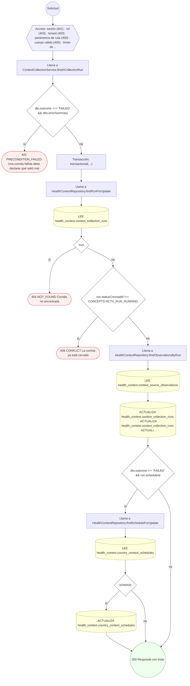

#### 4. POST /health-context/collection-runs/{id}/observations

Registrar una observación inmutable de fuente

| HTTP | Código | Cuándo |
|---|---|---|
| 201 | — | Éxito |
| 400 | `VALIDATION_FAILED` | Los parámetros de ruta son UUID válidos; El cuerpo cumple el DTO (sin propiedades extra) |
| 401 | `UNAUTHENTICATED` | Hay una sesión válida (JWT) |
| 403 | `FORBIDDEN` | El rol está permitido; El tenant se resuelve y pertenece al actor |
| 404 | `NOT_FOUND` | ResourceNotFoundException: Corrida no encontrada; ResourceNotFoundException: Fuente no encontrada |
| 422 | `PRECONDITION_FAILED` | PreconditionFailedException: La corrida ya no está en curso; PreconditionFailedException: La fuente no está activa; PreconditionFailedException: La fuente no es elegible para esta observación |
| 429 | `RATE_LIMITED` | No se supera el límite de solicitudes |

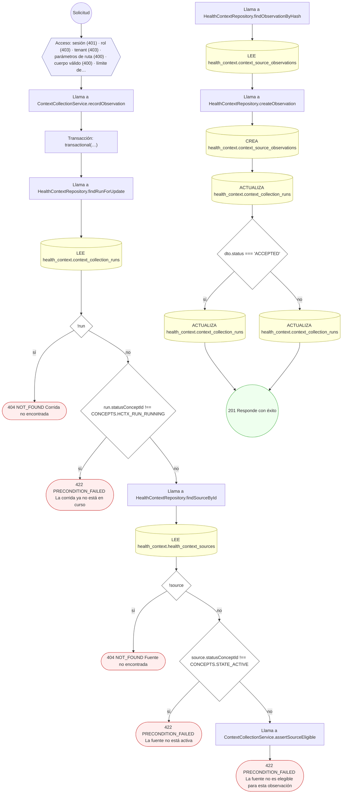

#### 5. POST /health-context/contexts

Crear el contexto de salud de un país

| HTTP | Código | Cuándo |
|---|---|---|
| 201 | — | Éxito |
| 400 | `VALIDATION_FAILED` | El cuerpo cumple el DTO (sin propiedades extra) |
| 401 | `UNAUTHENTICATED` | Hay una sesión válida (JWT) |
| 403 | `FORBIDDEN` | El rol está permitido; El tenant se resuelve y pertenece al actor |
| 429 | `RATE_LIMITED` | No se supera el límite de solicitudes |

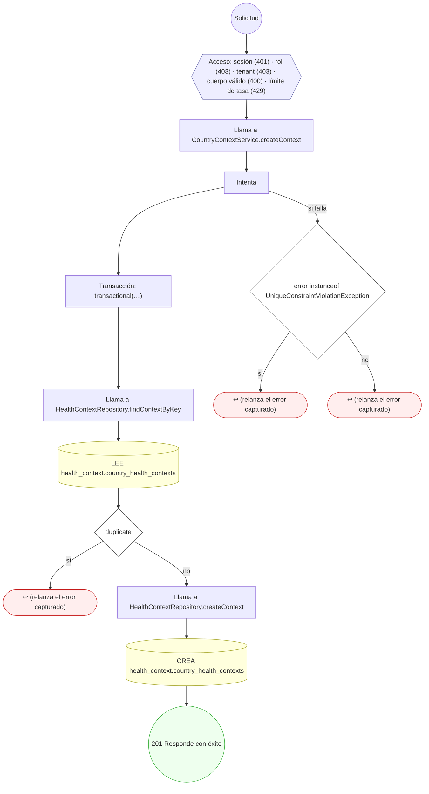

#### 6. POST /health-context/contexts/{id}/versions

Materializar una versión borrador con hechos y evidencia

| HTTP | Código | Cuándo |
|---|---|---|
| 201 | — | Éxito |
| 400 | `VALIDATION_FAILED` | Los parámetros de ruta son UUID válidos; El cuerpo cumple el DTO (sin propiedades extra) |
| 401 | `UNAUTHENTICATED` | Hay una sesión válida (JWT) |
| 403 | `FORBIDDEN` | El rol está permitido; El tenant se resuelve y pertenece al actor |
| 404 | `NOT_FOUND` | ResourceNotFoundException: Contexto no encontrado; ResourceNotFoundException: Corrida no encontrada |
| 422 | `PRECONDITION_FAILED` | PreconditionFailedException: La clave del hecho está repetida en la versión; PreconditionFailedException: La corrida no está en un estado del que se pueda versionar; PreconditionFailedException: La corrida es de otro país; PreconditionFailedException: La evidencia debe apuntar a una observación aceptada de la misma corrida |
| 429 | `RATE_LIMITED` | No se supera el límite de solicitudes |

```mermaid
flowchart TD
  n1(("Solicitud")):::inicio
  n2{{"Acceso: sesión (401) · rol (403) · tenant (403) · parámetros de ruta (400) · cuerpo válido (400) · límite de…"}}:::acceso
  n1 --> n2
  n3["Llama a CountryContextService.draftVersion"]:::llamada
  n2 --> n3
  n4["Llama a CountryContextService.assertUniqueFactKeys"]:::llamada
  n3 --> n4
  n5["Repite: por cada const fact de dto.facts"]:::bucle
  n4 --> n5
  n6{"seen.has(fact.factKey)"}:::decision
  n5 -->|"cada elemento"| n6
  n7(["422 PRECONDITION_FAILED La clave del hecho está repetida en la versión"]):::error
  n6 -->|"sí"| n7
  n8["Transacción: transactional(…)"]:::transaccion
  n6 -->|"no"| n8
  n5 -->|"al terminar"| n8
  n9["Llama a HealthContextRepository.findContextForUpdate"]:::llamada
  n8 --> n9
  n10[("LEE health_context.country_health_contexts")]:::efecto
  n9 --> n10
  n11{"!context"}:::decision
  n10 --> n11
  n12(["404 NOT_FOUND Contexto no encontrado"]):::error
  n11 -->|"sí"| n12
  n13["Llama a HealthContextRepository.findRunById"]:::llamada
  n11 -->|"no"| n13
  n14[("LEE health_context.context_collection_runs")]:::efecto
  n13 --> n14
  n15{"!run"}:::decision
  n14 --> n15
  n16(["404 NOT_FOUND Corrida no encontrada"]):::error
  n15 -->|"sí"| n16
  n17{"!USABLE_RUN_STATES.includes(run.statusConceptId)"}:::decision
  n15 -->|"no"| n17
  n18(["422 PRECONDITION_FAILED La corrida no está en un estado del que se pueda versionar"]):::error
  n17 -->|"sí"| n18
  n19{"run.countryConceptId !== context.countryConceptId"}:::decision
  n17 -->|"no"| n19
  n20(["422 PRECONDITION_FAILED La corrida es de otro país"]):::error
  n19 -->|"sí"| n20
  n21["Llama a HealthContextRepository.findObservationsByRun"]:::llamada
  n19 -->|"no"| n21
  n22[("LEE health_context.context_source_observations")]:::efecto
  n21 --> n22
  n23["Llama a HealthContextRepository.findLatestVersion"]:::llamada
  n22 --> n23
  n24[("LEE health_context.country_health_context_versions")]:::efecto
  n23 --> n24
  n25["Llama a HealthContextRepository.createContextVersion"]:::llamada
  n24 --> n25
  n26[("CREA health_context.country_health_context_versions")]:::efecto
  n25 --> n26
  n27["Repite: por cada const fact de dto.facts"]:::bucle
  n26 --> n27
  n28["Repite: por cada const evidence de fact.evidence"]:::bucle
  n27 -->|"cada elemento"| n28
  n29{"!accepted.has(evidence.sourceObservationId)"}:::decision
  n28 -->|"cada elemento"| n29
  n30(["422 PRECONDITION_FAILED La evidencia debe apuntar a una observación aceptada de la misma corrida"]):::error
  n29 -->|"sí"| n30
  n31["Llama a HealthContextRepository.createFact"]:::llamada
  n29 -->|"no"| n31
  n28 -->|"al terminar"| n31
  n32[("CREA health_context.health_context_facts")]:::efecto
  n31 --> n32
  n33["Repite: por cada const evidence de fact.evidence"]:::bucle
  n32 --> n33
  n34["Llama a HealthContextRepository.createFactEvidence"]:::llamada
  n33 -->|"cada elemento"| n34
  n35[("CREA health_context.context_fact_evidence")]:::efecto
  n34 --> n35
  n36(("201 Responde con éxito")):::ok
  n35 --> n36
  n33 -->|"al terminar"| n36
  n27 -->|"al terminar"| n36
  classDef acceso fill:#eef,stroke:#66a
  classDef error fill:#fee,stroke:#c33
  classDef ok fill:#efe,stroke:#3a3
  classDef efecto fill:#ffd,stroke:#aa3
  classDef decision fill:#fff,stroke:#555
  classDef corte fill:#eee,stroke:#999,stroke-dasharray: 4
```

#### 7. GET /health-context/contexts/resolve

Resolver el contexto vigente para consumo

| HTTP | Código | Cuándo |
|---|---|---|
| 200 | — | Éxito |
| 400 | `VALIDATION_FAILED` | Están los parámetros de consulta obligatorios |
| 401 | `UNAUTHENTICATED` | Hay una sesión válida (JWT) |
| 403 | `FORBIDDEN` | El rol está permitido; El tenant se resuelve y pertenece al actor |
| 404 | `NOT_FOUND` | ResourceNotFoundException: Contexto no encontrado; ResourceNotFoundException: La versión vigente no existe |
| 422 | `PRECONDITION_FAILED` | PreconditionFailedException: El contexto no tiene versión vigente; PreconditionFailedException: La versión vigente no está publicada |
| 429 | `RATE_LIMITED` | No se supera el límite de solicitudes |

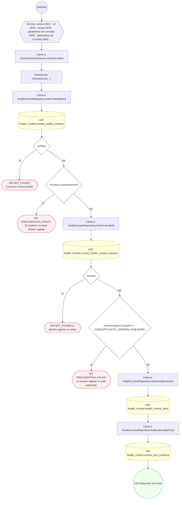

#### 8. POST /health-context/internal/schedules/run-due

Evaluar programaciones vencidas y encolar sus corridas

| HTTP | Código | Cuándo |
|---|---|---|
| 200 | — | Éxito |
| 400 | `VALIDATION_FAILED` | El cuerpo cumple el DTO (sin propiedades extra) |
| 401 | `UNAUTHENTICATED` | Hay una sesión válida (JWT) |
| 403 | `FORBIDDEN` | El rol está permitido; El tenant se resuelve y pertenece al actor |
| 429 | `RATE_LIMITED` | No se supera el límite de solicitudes |

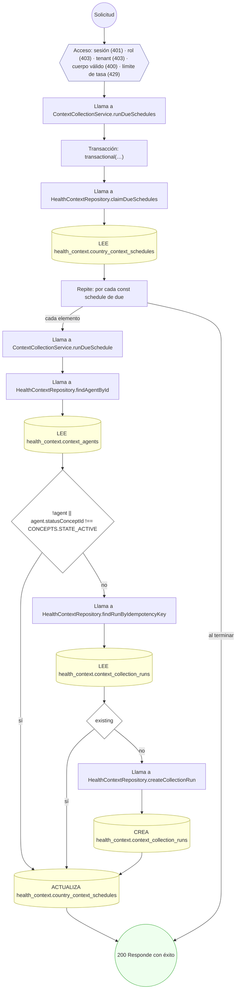

#### 9. POST /health-context/schedules

Programar la recolección de contexto de un país

| HTTP | Código | Cuándo |
|---|---|---|
| 201 | — | Éxito |
| 400 | `VALIDATION_FAILED` | El cuerpo cumple el DTO (sin propiedades extra) |
| 401 | `UNAUTHENTICATED` | Hay una sesión válida (JWT) |
| 403 | `FORBIDDEN` | El rol está permitido; El tenant se resuelve y pertenece al actor |
| 404 | `NOT_FOUND` | ResourceNotFoundException: Agente no encontrado |
| 422 | `PRECONDITION_FAILED` | PreconditionFailedException: La expresión de programación debe tener cinco campos; PreconditionFailedException: El agente no está activo |
| 429 | `RATE_LIMITED` | No se supera el límite de solicitudes |

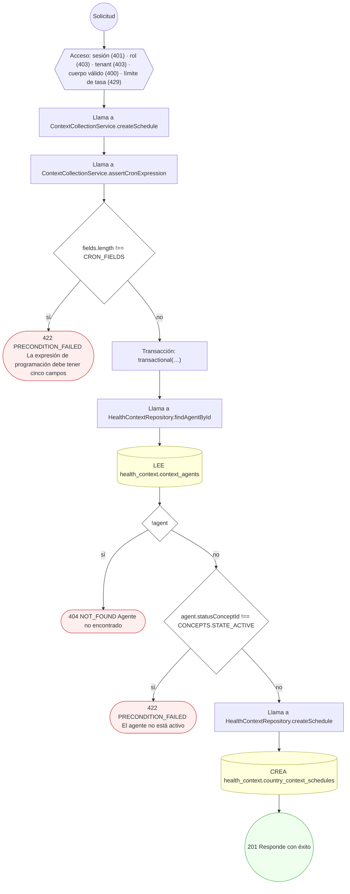

#### 10. POST /health-context/sources

Registrar una fuente de contexto de salud

| HTTP | Código | Cuándo |
|---|---|---|
| 201 | — | Éxito |
| 400 | `VALIDATION_FAILED` | El cuerpo cumple el DTO (sin propiedades extra) |
| 401 | `UNAUTHENTICATED` | Hay una sesión válida (JWT) |
| 403 | `FORBIDDEN` | El rol está permitido; El tenant se resuelve y pertenece al actor |
| 429 | `RATE_LIMITED` | No se supera el límite de solicitudes |

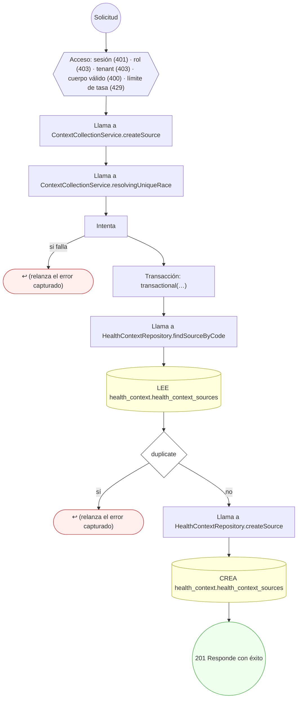

#### 11. POST /health-context/versions/{id}/publish

Publicar la versión aprobada y avanzar el contexto

| HTTP | Código | Cuándo |
|---|---|---|
| 200 | — | Éxito |
| 400 | `VALIDATION_FAILED` | Los parámetros de ruta son UUID válidos |
| 401 | `UNAUTHENTICATED` | Hay una sesión válida (JWT) |
| 403 | `FORBIDDEN` | El rol está permitido; El tenant se resuelve y pertenece al actor |
| 404 | `NOT_FOUND` | ResourceNotFoundException: Versión no encontrada; ResourceNotFoundException: Contexto no encontrado |
| 422 | `PRECONDITION_FAILED` | PreconditionFailedException: Sólo se publica una versión aprobada en revisión de calidad |
| 429 | `RATE_LIMITED` | No se supera el límite de solicitudes |

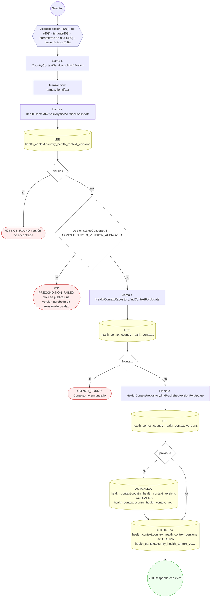

#### 12. POST /health-context/versions/{id}/quality-reviews

Revisar la calidad de la versión

| HTTP | Código | Cuándo |
|---|---|---|
| 201 | — | Éxito |
| 400 | `VALIDATION_FAILED` | Los parámetros de ruta son UUID válidos; El cuerpo cumple el DTO (sin propiedades extra) |
| 401 | `UNAUTHENTICATED` | Hay una sesión válida (JWT) |
| 403 | `FORBIDDEN` | El rol está permitido; El tenant se resuelve y pertenece al actor |
| 404 | `NOT_FOUND` | ResourceNotFoundException: Versión no encontrada |
| 422 | `PRECONDITION_FAILED` | PreconditionFailedException: La versión no está en borrador |
| 429 | `RATE_LIMITED` | No se supera el límite de solicitudes |

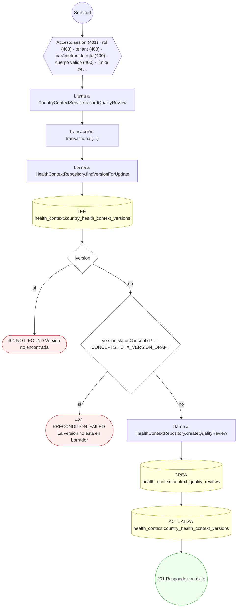

#### 13. POST /health-context/versions/{id}/supersede

Retirar la versión vigente, con reemplazo o por caducidad

| HTTP | Código | Cuándo |
|---|---|---|
| 200 | — | Éxito |
| 400 | `VALIDATION_FAILED` | Los parámetros de ruta son UUID válidos; El cuerpo cumple el DTO (sin propiedades extra) |
| 401 | `UNAUTHENTICATED` | Hay una sesión válida (JWT) |
| 403 | `FORBIDDEN` | El rol está permitido; El tenant se resuelve y pertenece al actor |
| 404 | `NOT_FOUND` | ResourceNotFoundException: Versión no encontrada; ResourceNotFoundException: Contexto no encontrado; ResourceNotFoundException: Versión de reemplazo no encontrada |
| 422 | `PRECONDITION_FAILED` | PreconditionFailedException: Sustituir exige declarar la versión que reemplaza; PreconditionFailedException: La versión no está publicada; PreconditionFailedException: El reemplazo es de otro contexto; PreconditionFailedException: El reemplazo debe estar aprobado en revisión de calidad |
| 429 | `RATE_LIMITED` | No se supera el límite de solicitudes |

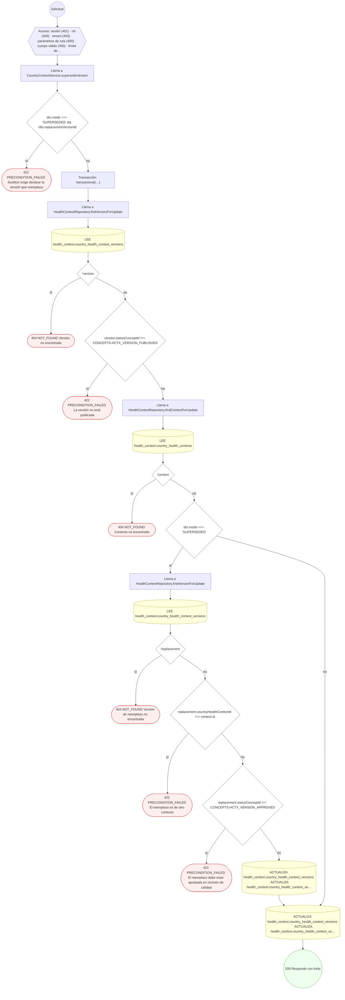

