<!-- AUTOGENERADO por tools/inventario/flujos.mjs. No editar manualmente. -->

# Flujos del módulo `health_data`

- **Procesos:** 1 · **Máquinas de estado:** 0
- **Operaciones:** 16 (15 con decisiones propias, 1 sin ellas)
- Inventario de endpoints del módulo: [health_data](../endpoints/health_data.md)

## Proceso: Módulo 52 — Plataforma de Datos de Salud

- **Código:** `health_data` · **Agrupación:** MIXTO · **Operaciones:** 16
- **Actores:** CLINICAL_INFORMATICIAN · DATA_PLATFORM_ADMIN · DATA_STEWARD · HEALTH_DATA_ADMIN · INGESTION_WORKER · INTEROP_CONSUMER · MPI_STEWARD · PRIVACY_OFFICER · SYSTEM
- **Revisión:** AUTO_DETECTADA
- **Fuentes:** `src/modules/health_data/README.md`

### Para qué sirve

Ingesta desde sistemas externos, proyección a un recurso canónico versionado e inmutable con su procedencia y su linaje, identificadores y relaciones, enlace al dominio clínico, validación contra perfiles FHIR R5, reglas de calidad, identidad longitudinal del paciente (MPI), línea de tiempo, de-identificación, exportación de Bundles y retiro gobernado.

_Fuente: `src/modules/health_data/README.md:3`_

### Flujo general declarado en el README

```text
conexión activa
  └─ ingestion-batches ──> lote receiving
       ├─ records ────────> registro queued (dedupe por lote+id de origen+versión)
       └─ close ──────────> lote completed, contadores reconciliados

canonical-resources/project (registro queued)
  ├─ payload idéntico al vigente ──> no se versiona
  └─ payload nuevo ────────────────> versión inmutable + procedencia INGEST + linaje NORMALIZE
                                     recurso apunta a la versión nueva

recurso activo
  ├─ identifiers ────> uno principal vigente por sistema; el anterior se cierra
  ├─ relationships ──> una vigente por par y tipo; la anterior se cierra
  ├─ bindings ───────> referencia al dominio + linaje BIND (sin dual-write)
  ├─ versions/:id/validate ──> pass | warning | error  ⇒ error manda el recurso a cuarentena
  └─ retire ─────────> recurso retired; enlaces y relaciones cerrados; procedencia RETIRE

quality-runs ──> pass | warning | fail; incidencias abiertas sin duplicar la idéntica

identity/candidates/:id/decision
  ├─ NO_MATCH ──> sólo queda la decisión
  └─ MATCH ─────> clúster (nuevo o el que ya tuviera uno de los perfiles) + miembros

deidentification-runs ──> procedencia DEIDENTIFY + linaje versión → manifiesto
/fhir/r5/$export ───────> trabajo + manifiesto sellado por hash + procedencia EXPORT
/fhir/r5/Patient/:id/$everything ──> versiones vigentes, expandidas por el clúster del MPI
```

_Fuente: `src/modules/health_data/README.md:91`_

### Etapas y operaciones

| Etapa | Descripción | Operación | Quién actúa | Riesgo | Tablas |
|---|---|---|---|---|---|
| `UC-52-01` | Abrir lote desde una conexión de origen | POST /health-data/ingestion-batches | INGESTION_WORKER · HEALTH_DATA_ADMIN | MEDIO | 4 |
| `UC-52-02` | Registro crudo y cierre con conteos | POST /health-data/ingestion-batches/{id}/records | INGESTION_WORKER · HEALTH_DATA_ADMIN | MEDIO | 3 |
| `UC-52-03` | Proyectar recurso canónico y versionarlo | POST /health-data/canonical-resources/project | INGESTION_WORKER · HEALTH_DATA_ADMIN | MEDIO | 10 |
| `UC-52-04` | Identificadores de negocio | POST /health-data/canonical-resources/{id}/identifiers | INGESTION_WORKER · CLINICAL_INFORMATICIAN · HEALTH_DATA_ADMIN | MEDIO | 5 |
| `UC-52-05` | Relacionar recursos (grafo clínico) | POST /health-data/canonical-resources/{id}/relationships | DATA_STEWARD · CLINICAL_INFORMATICIAN · HEALTH_DATA_ADMIN | MEDIO | 4 |
| `UC-52-06` | Enlazar a entidad de dominio | POST /health-data/canonical-resources/{id}/bindings | CLINICAL_INFORMATICIAN · HEALTH_DATA_ADMIN | MEDIO | 5 |
| `UC-52-07` | Validar contra perfil FHIR R5 | POST /health-data/versions/{id}/validate | INGESTION_WORKER · HEALTH_DATA_ADMIN · CLINICAL_INFORMATICIAN | MEDIO | 7 |
| `UC-52-08` | Reglas de calidad e incidencias | POST /health-data/quality-runs | DATA_STEWARD · HEALTH_DATA_ADMIN | MEDIO | 6 |
| `UC-52-09` | Resolver identidad longitudinal (MPI) | POST /health-data/identity/candidates/{id}/decision | MPI_STEWARD · HEALTH_DATA_ADMIN | MEDIO | 9 |
| `UC-52-10` | Proyectar entrada de línea de tiempo | POST /health-data/timeline-entries | SYSTEM · HEALTH_DATA_ADMIN | MEDIO | 2 |
| `UC-52-11` | Corrida de de-identificación | POST /health-data/deidentification-runs | PRIVACY_OFFICER · HEALTH_DATA_ADMIN | MEDIO | 5 |
| `UC-52-12` | Exportar Bundle FHIR con manifiesto | POST /fhir/r5/$export | PRIVACY_OFFICER · HEALTH_DATA_ADMIN | MEDIO | 5 |
| `UC-52-13` | Servir historia longitudinal | GET /fhir/r5/Patient/{id}/$everything | INTEROP_CONSUMER · CLINICAL_INFORMATICIAN · HEALTH_DATA_ADMIN | BAJO | 3 |
| `UC-52-14` | Retiro gobernado del recurso | POST /health-data/canonical-resources/{id}/retire | CLINICAL_INFORMATICIAN · HEALTH_DATA_ADMIN | MEDIO | 8 |
| `ctrl:HealthDataController` | Operaciones de HealthDataController que el README no asigna a un caso de uso | POST /health-data/ingestion-batches/{id}/close | INGESTION_WORKER · HEALTH_DATA_ADMIN | MEDIO | 3 |
|  |  | POST /health-data/source-connections | HEALTH_DATA_ADMIN · CLINICAL_INFORMATICIAN · DATA_PLATFORM_ADMIN | MEDIO | 3 |

### Diagrama — etapas `UC-52-01`, `UC-52-02`, `UC-52-03`…

```mermaid
flowchart LR
  a2(["INGESTION_WORKER · HEALTH_DATA_ADMIN"]):::actor
  a12(["INGESTION_WORKER · CLINICAL_INFORMATICIAN · HEALTH_DATA_ADM…"]):::actor
  a15(["DATA_STEWARD · CLINICAL_INFORMATICIAN · HEALTH_DATA_ADMIN"]):::actor
  a18(["CLINICAL_INFORMATICIAN · HEALTH_DATA_ADMIN"]):::actor
  a22(["INGESTION_WORKER · HEALTH_DATA_ADMIN · CLINICAL_INFORMATICI…"]):::actor
  a28(["DATA_STEWARD · HEALTH_DATA_ADMIN"]):::actor
  a34(["MPI_STEWARD · HEALTH_DATA_ADMIN"]):::actor
  a40(["SYSTEM · HEALTH_DATA_ADMIN"]):::actor
  a43(["PRIVACY_OFFICER · HEALTH_DATA_ADMIN"]):::actor
  a52(["INTEROP_CONSUMER · CLINICAL_INFORMATICIAN · HEALTH_DATA_ADM…"]):::actor
  a57(["HEALTH_DATA_ADMIN · CLINICAL_INFORMATICIAN · DATA_PLATFORM_…"]):::actor
  t3[("health_data.health_ingestion_batches")]:::tabla
  t4[("health_data.health_source_connections")]:::tabla
  t6[("health_data.health_ingestion_records")]:::tabla
  t8[("health_data.canonical_health_resource_versions")]:::tabla
  t9[("health_data.canonical_health_resources")]:::tabla
  t13[("health_data.canonical_resource_identifiers")]:::tabla
  t16[("health_data.canonical_resource_relationships")]:::tabla
  t19[("health_data.canonical_resource_bindings")]:::tabla
  t20[("health_data.health_lineage_edges")]:::tabla
  t23[("health_data.fhir_profile_versions")]:::tabla
  t24[("health_data.fhir_validation_issues")]:::tabla
  t25[("health_data.fhir_validation_runs")]:::tabla
  t29[("health_data.health_data_quality_issues")]:::tabla
  t30[("health_data.health_data_quality_rule_sets")]:::tabla
  t31[("health_data.health_data_quality_rules")]:::tabla
  t32[("health_data.health_data_quality_runs")]:::tabla
  t35[("health_data.patient_identity_clusters")]:::tabla
  t36[("health_data.patient_identity_members")]:::tabla
  t37[("health_data.patient_match_candidates")]:::tabla
  t41[("health_data.patient_timeline_entries")]:::tabla
  t44[("health_data.health_deidentification_profiles")]:::tabla
  t45[("health_data.health_deidentification_runs")]:::tabla
  t46[("health_data.health_provenance_records")]:::tabla
  t47[("health_data.health_provenance_targets")]:::tabla
  t49[("health_data.health_export_jobs")]:::tabla
  t50[("health_data.health_export_manifests")]:::tabla
  t58[("health_data.health_source_systems")]:::tabla
  subgraph s0["UC-52-01 · Abrir lote desde una conexión de origen"]
    o1["POST /health-data/ingestion-batches"]:::op
  end
  subgraph s1["UC-52-02 · Registro crudo y cierre con conteos"]
    o5["POST /health-data/ingestion-batches/{id}/records"]:::op
  end
  t10[("+4 tablas más")]
  subgraph s2["UC-52-03 · Proyectar recurso canónico y versionarlo"]
    o7["POST /health-data/canonical-resources/project"]:::op
  end
  subgraph s3["UC-52-04 · Identificadores de negocio"]
    o11["POST /health-data/canonical-resources/{id}/identifiers"]:::op
  end
  subgraph s4["UC-52-05 · Relacionar recursos (grafo clínico)"]
    o14["POST /health-data/canonical-resources/{id}/relationships"]:::op
  end
  subgraph s5["UC-52-06 · Enlazar a entidad de dominio"]
    o17["POST /health-data/canonical-resources/{id}/bindings"]:::op
  end
  t26[("+1 tablas más")]
  subgraph s6["UC-52-07 · Validar contra perfil FHIR R5"]
    o21["POST /health-data/versions/{id}/validate"]:::op
  end
  subgraph s7["UC-52-08 · Reglas de calidad e incidencias"]
    o27["POST /health-data/quality-runs"]:::op
  end
  t38[("+3 tablas más")]
  subgraph s8["UC-52-09 · Resolver identidad longitudinal (MPI)"]
    o33["POST /health-data/identity/candidates/{id}/decision"]:::op
  end
  subgraph s9["UC-52-10 · Proyectar entrada de línea de tiempo"]
    o39["POST /health-data/timeline-entries"]:::op
  end
  subgraph s10["UC-52-11 · Corrida de de-identificación"]
    o42["POST /health-data/deidentification-runs"]:::op
  end
  subgraph s11["UC-52-12 · Exportar Bundle FHIR con manifiesto"]
    o48["POST /fhir/r5/$export"]:::op
  end
  subgraph s12["UC-52-13 · Servir historia longitudinal"]
    o51["GET /fhir/r5/Patient/{id}/$everything"]:::op
  end
  t54[("+2 tablas más")]
  subgraph s13["UC-52-14 · Retiro gobernado del recurso"]
    o53["POST /health-data/canonical-resources/{id}/retire"]:::op
  end
  subgraph s14["ctrl:HealthDataController · Operaciones de HealthDataController que el README n…"]
    o55["POST /health-data/ingestion-batches/{id}/close"]:::op
    o56["POST /health-data/source-connections"]:::op
  end
  a2 --> o1
  o1 -->|"CREA"| t3
  o1 -->|"LEE"| t3
  o1 -->|"ACTUALIZA"| t4
  o1 -->|"LEE"| t4
  a2 --> o5
  o5 -->|"LEE"| t3
  o5 -->|"CREA"| t6
  o5 -->|"LEE"| t6
  a2 --> o7
  o7 -->|"CREA"| t8
  o7 -->|"LEE"| t8
  o7 -->|"ACTUALIZA"| t9
  o7 -->|"CREA"| t9
  o7 -->|"LEE"| t9
  o7 -->|"ACTUALIZA"| t6
  o7 -.-> t10
  a12 --> o11
  o11 -->|"ACTUALIZA"| t9
  o11 -->|"LEE"| t9
  o11 -->|"ACTUALIZA"| t13
  o11 -->|"CREA"| t13
  o11 -->|"LEE"| t13
  a15 --> o14
  o14 -->|"LEE"| t9
  o14 -->|"ACTUALIZA"| t16
  o14 -->|"CREA"| t16
  o14 -->|"LEE"| t16
  a18 --> o17
  o17 -->|"ACTUALIZA"| t9
  o17 -->|"LEE"| t9
  o17 -->|"CREA"| t19
  o17 -->|"LEE"| t19
  o17 -->|"CREA"| t20
  a22 --> o21
  o21 -->|"LEE"| t8
  o21 -->|"ACTUALIZA"| t9
  o21 -->|"LEE"| t9
  o21 -->|"LEE"| t23
  o21 -->|"CREA"| t24
  o21 -->|"CREA"| t25
  o21 -.-> t26
  a28 --> o27
  o27 -->|"CREA"| t29
  o27 -->|"LEE"| t29
  o27 -->|"LEE"| t30
  o27 -->|"LEE"| t31
  o27 -->|"ACTUALIZA"| t32
  o27 -->|"CREA"| t32
  a34 --> o33
  o33 -->|"ACTUALIZA"| t35
  o33 -->|"CREA"| t35
  o33 -->|"LEE"| t35
  o33 -->|"CREA"| t36
  o33 -->|"LEE"| t36
  o33 -->|"ACTUALIZA"| t37
  o33 -.-> t38
  a40 --> o39
  o39 -->|"CREA"| t41
  o39 -->|"LEE"| t41
  a43 --> o42
  o42 -->|"LEE"| t44
  o42 -->|"CREA"| t45
  o42 -->|"CREA"| t20
  o42 -->|"CREA"| t46
  o42 -->|"CREA"| t47
  a43 --> o48
  o48 -->|"LEE"| t45
  o48 -->|"CREA"| t49
  o48 -->|"CREA"| t50
  o48 -->|"CREA"| t46
  o48 -->|"CREA"| t47
  a52 --> o51
  o51 -->|"LEE"| t8
  o51 -->|"LEE"| t9
  o51 -->|"LEE"| t36
  a18 --> o53
  o53 -->|"ACTUALIZA"| t9
  o53 -->|"LEE"| t9
  o53 -->|"ACTUALIZA"| t19
  o53 -->|"LEE"| t19
  o53 -->|"ACTUALIZA"| t16
  o53 -->|"LEE"| t16
  o53 -.-> t54
  a2 --> o55
  o55 -->|"ACTUALIZA"| t3
  o55 -->|"LEE"| t3
  o55 -->|"LEE"| t6
  a57 --> o56
  o56 -->|"CREA"| t4
  o56 -->|"CREA"| t58
  o56 -->|"LEE"| t58
  classDef op fill:#fff,stroke:#446
  classDef actor fill:#eef,stroke:#66a
  classDef tabla fill:#ffd,stroke:#aa3
  classDef evento fill:#efe,stroke:#3a3
```

## Árbol de decisión por operación

Cada árbol se deriva del código del handler y de los métodos que invoca (hasta 4 niveles). Una rama que no decide, no escribe y no falla se poda. Los accesos y los efectos consecutivos se agrupan en un solo nodo.

### Operaciones con decisiones propias

#### 1. POST /fhir/r5/$export

Exportar un Bundle FHIR interoperable con su manifiesto

| HTTP | Código | Cuándo |
|---|---|---|
| 201 | — | Éxito |
| 400 | `VALIDATION_FAILED` | El cuerpo cumple el DTO (sin propiedades extra) |
| 401 | `UNAUTHENTICATED` | Hay una sesión válida (JWT) |
| 403 | `FORBIDDEN` | El rol está permitido; El tenant se resuelve y pertenece al actor |
| 404 | `NOT_FOUND` | ResourceNotFoundException: Corrida de de-identificación no encontrada |
| 422 | `PRECONDITION_FAILED` | PreconditionFailedException: La exportación necesita un paciente o una cohorte; PreconditionFailedException: La corrida de de-identificación no está completada |
| 429 | `RATE_LIMITED` | No se supera el límite de solicitudes |

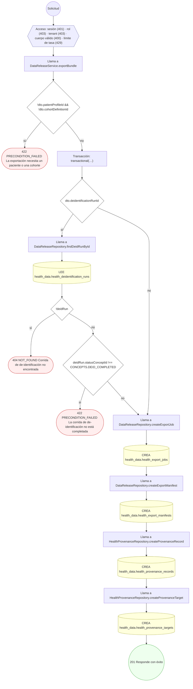

#### 2. GET /fhir/r5/Patient/{id}/$everything

Servir la historia longitudinal del paciente

| HTTP | Código | Cuándo |
|---|---|---|
| 200 | — | Éxito |
| 400 | `VALIDATION_FAILED` | Los parámetros de ruta son UUID válidos |
| 401 | `UNAUTHENTICATED` | Hay una sesión válida (JWT) |
| 403 | `FORBIDDEN` | El rol está permitido; El tenant se resuelve y pertenece al actor |
| 429 | `RATE_LIMITED` | No se supera el límite de solicitudes |

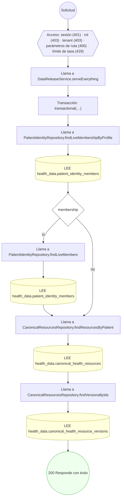

#### 3. POST /health-data/canonical-resources/{id}/bindings

Enlazar el recurso a una entidad de dominio

| HTTP | Código | Cuándo |
|---|---|---|
| 201 | — | Éxito |
| 400 | `VALIDATION_FAILED` | Los parámetros de ruta son UUID válidos; El cuerpo cumple el DTO (sin propiedades extra) |
| 401 | `UNAUTHENTICATED` | Hay una sesión válida (JWT) |
| 403 | `FORBIDDEN` | El rol está permitido; El tenant se resuelve y pertenece al actor |
| 404 | `NOT_FOUND` | ResourceNotFoundException: Recurso canónico no encontrado |
| 409 | `CONFLICT` | ConflictException: Ese enlace ya existe |
| 422 | `PRECONDITION_FAILED` | PreconditionFailedException: El recurso está retirado; PreconditionFailedException: El recurso no tiene versión vigente |
| 429 | `RATE_LIMITED` | No se supera el límite de solicitudes |

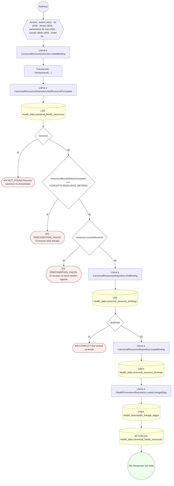

#### 4. POST /health-data/canonical-resources/{id}/identifiers

Registrar un identificador de negocio del recurso

| HTTP | Código | Cuándo |
|---|---|---|
| 201 | — | Éxito |
| 400 | `VALIDATION_FAILED` | Los parámetros de ruta son UUID válidos; El cuerpo cumple el DTO (sin propiedades extra) |
| 401 | `UNAUTHENTICATED` | Hay una sesión válida (JWT) |
| 403 | `FORBIDDEN` | El rol está permitido; El tenant se resuelve y pertenece al actor |
| 404 | `NOT_FOUND` | ResourceNotFoundException: Recurso canónico no encontrado |
| 409 | `CONFLICT` | ConflictException: El recurso ya tiene ese identificador |
| 422 | `PRECONDITION_FAILED` | PreconditionFailedException: El recurso está retirado |
| 429 | `RATE_LIMITED` | No se supera el límite de solicitudes |

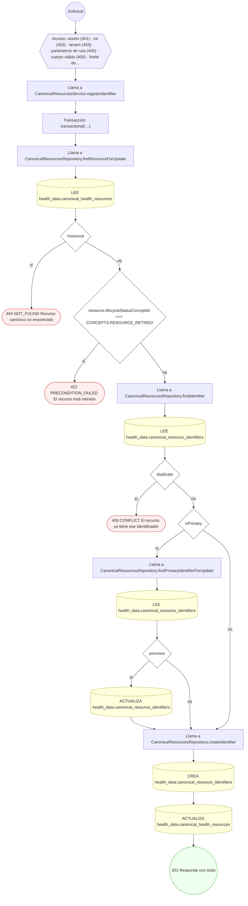

#### 5. POST /health-data/canonical-resources/{id}/relationships

Relacionar dos recursos canónicos

| HTTP | Código | Cuándo |
|---|---|---|
| 201 | — | Éxito |
| 400 | `VALIDATION_FAILED` | Los parámetros de ruta son UUID válidos; El cuerpo cumple el DTO (sin propiedades extra) |
| 401 | `UNAUTHENTICATED` | Hay una sesión válida (JWT) |
| 403 | `FORBIDDEN` | El rol está permitido; El tenant se resuelve y pertenece al actor |
| 404 | `NOT_FOUND` | ResourceNotFoundException: Recurso canónico no encontrado; ResourceNotFoundException: Recurso canónico destino no encontrado |
| 422 | `PRECONDITION_FAILED` | PreconditionFailedException: Un recurso no se relaciona consigo mismo; PreconditionFailedException: Los recursos son de custodios distintos; PreconditionFailedException: Alguno de los recursos está retirado |
| 429 | `RATE_LIMITED` | No se supera el límite de solicitudes |

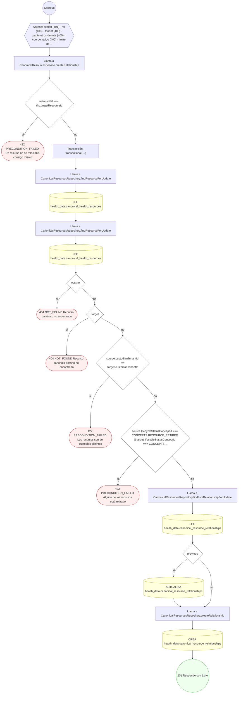

#### 6. POST /health-data/canonical-resources/{id}/retire

Retirar el recurso canónico (borrado lógico)

| HTTP | Código | Cuándo |
|---|---|---|
| 200 | — | Éxito |
| 400 | `VALIDATION_FAILED` | Los parámetros de ruta son UUID válidos; El cuerpo cumple el DTO (sin propiedades extra) |
| 401 | `UNAUTHENTICATED` | Hay una sesión válida (JWT) |
| 403 | `FORBIDDEN` | El rol está permitido; El tenant se resuelve y pertenece al actor |
| 404 | `NOT_FOUND` | ResourceNotFoundException: Recurso canónico no encontrado |
| 409 | `CONFLICT` | ConflictException: El recurso ya está retirado |
| 429 | `RATE_LIMITED` | No se supera el límite de solicitudes |

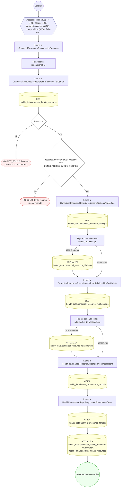

#### 7. POST /health-data/canonical-resources/project

Proyectar el registro a recurso canónico y versionarlo

| HTTP | Código | Cuándo |
|---|---|---|
| 201 | — | Éxito |
| 400 | `VALIDATION_FAILED` | El cuerpo cumple el DTO (sin propiedades extra) |
| 401 | `UNAUTHENTICATED` | Hay una sesión válida (JWT) |
| 403 | `FORBIDDEN` | El rol está permitido; El tenant se resuelve y pertenece al actor |
| 404 | `NOT_FOUND` | ResourceNotFoundException: Registro de ingesta no encontrado |
| 422 | `PRECONDITION_FAILED` | PreconditionFailedException: El registro no está en cola de proyección; PreconditionFailedException: El recurso está retirado |
| 429 | `RATE_LIMITED` | No se supera el límite de solicitudes |

```mermaid
flowchart TD
  n1(("Solicitud")):::inicio
  n2{{"Acceso: sesión (401) · rol (403) · tenant (403) · cuerpo válido (400) · límite de tasa (429)"}}:::acceso
  n1 --> n2
  n3["Llama a HealthIngestionService.projectResource"]:::llamada
  n2 --> n3
  n4["Transacción: transactional(…)"]:::transaccion
  n3 --> n4
  n5["Llama a HealthIngestionRepository.findRecordForUpdate"]:::llamada
  n4 --> n5
  n6[("LEE health_data.health_ingestion_records")]:::efecto
  n5 --> n6
  n7{"!record"}:::decision
  n6 --> n7
  n8(["404 NOT_FOUND Registro de ingesta no encontrado"]):::error
  n7 -->|"sí"| n8
  n9{"record.processingStatusConceptId !== CONCEPTS.RECORD_QUEUED"}:::decision
  n7 -->|"no"| n9
  n10(["422 PRECONDITION_FAILED El registro no está en cola de proyección"]):::error
  n9 -->|"sí"| n10
  n11["Llama a CanonicalResourcesRepository.findResourceByLogicalIdForUpdate"]:::llamada
  n9 -->|"no"| n11
  n12[("LEE health_data.canonical_health_resources")]:::efecto
  n11 --> n12
  n13{"!resource"}:::decision
  n12 --> n13
  n14["Llama a CanonicalResourcesRepository.createResource"]:::llamada
  n13 -->|"sí"| n14
  n15[("CREA health_data.canonical_health_resources")]:::efecto
  n14 --> n15
  n16{"resource.lifecycleStatusConceptId === CONCEPTS.RESOURCE_RETIRED"}:::decision
  n13 -->|"no"| n16
  n17(["422 PRECONDITION_FAILED El recurso está retirado"]):::error
  n16 -->|"sí"| n17
  n18["Llama a CanonicalResourcesRepository.findLatestVersion"]:::llamada
  n15 --> n18
  n16 -->|"no"| n18
  n19[("LEE health_data.canonical_health_resource_versions")]:::efecto
  n18 --> n19
  n20{"previous?.contentHash === contentHash"}:::decision
  n19 --> n20
  n21[("ACTUALIZA health_data.health_ingestion_records · ACTUALIZA health_data.health_ingestion_records")]:::efecto
  n20 -->|"sí"| n21
  n22["Llama a HealthProvenanceRepository.createProvenanceRecord"]:::llamada
  n21 --> n22
  n20 -->|"no"| n22
  n23[("CREA health_data.health_provenance_records")]:::efecto
  n22 --> n23
  n24["Llama a CanonicalResourcesRepository.createResourceVersion"]:::llamada
  n23 --> n24
  n25[("CREA health_data.canonical_health_resource_versions")]:::efecto
  n24 --> n25
  n26["Llama a HealthProvenanceRepository.createProvenanceTarget"]:::llamada
  n25 --> n26
  n27[("CREA health_data.health_provenance_targets")]:::efecto
  n26 --> n27
  n28["Llama a HealthProvenanceRepository.createLineageEdge"]:::llamada
  n27 --> n28
  n29[("CREA health_data.health_lineage_edges")]:::efecto
  n28 --> n29
  n30[("ACTUALIZA health_data.canonical_health_resources · ACTUALIZA health_data.canonical_health_resources · ACTUALI…")]:::efecto
  n29 --> n30
  n31(("201 Responde con éxito")):::ok
  n30 --> n31
  classDef acceso fill:#eef,stroke:#66a
  classDef error fill:#fee,stroke:#c33
  classDef ok fill:#efe,stroke:#3a3
  classDef efecto fill:#ffd,stroke:#aa3
  classDef decision fill:#fff,stroke:#555
  classDef corte fill:#eee,stroke:#999,stroke-dasharray: 4
```

#### 8. POST /health-data/deidentification-runs

Registrar una corrida de de-identificación

| HTTP | Código | Cuándo |
|---|---|---|
| 201 | — | Éxito |
| 400 | `VALIDATION_FAILED` | El cuerpo cumple el DTO (sin propiedades extra) |
| 401 | `UNAUTHENTICATED` | Hay una sesión válida (JWT) |
| 403 | `FORBIDDEN` | El rol está permitido; El tenant se resuelve y pertenece al actor |
| 404 | `NOT_FOUND` | ResourceNotFoundException: Perfil de de-identificación no encontrado |
| 422 | `PRECONDITION_FAILED` | PreconditionFailedException: El perfil de de-identificación no está activo; PreconditionFailedException: Una corrida completada debe declarar su manifiesto de salida |
| 429 | `RATE_LIMITED` | No se supera el límite de solicitudes |

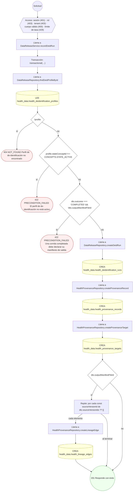

#### 9. POST /health-data/identity/candidates/{id}/decision

Resolver un candidato de identidad longitudinal

| HTTP | Código | Cuándo |
|---|---|---|
| 201 | — | Éxito |
| 400 | `VALIDATION_FAILED` | Los parámetros de ruta son UUID válidos; El cuerpo cumple el DTO (sin propiedades extra) |
| 401 | `UNAUTHENTICATED` | Hay una sesión válida (JWT) |
| 403 | `FORBIDDEN` | El rol está permitido; El tenant se resuelve y pertenece al actor |
| 404 | `NOT_FOUND` | ResourceNotFoundException: Candidato no encontrado |
| 409 | `CONFLICT` | ConflictException: El candidato ya tiene decisión |
| 422 | `PRECONDITION_FAILED` | PreconditionFailedException: El candidato ya está resuelto |
| 429 | `RATE_LIMITED` | No se supera el límite de solicitudes |

```mermaid
flowchart TD
  n1(("Solicitud")):::inicio
  n2{{"Acceso: sesión (401) · rol (403) · tenant (403) · parámetros de ruta (400) · cuerpo válido (400) · límite de…"}}:::acceso
  n1 --> n2
  n3["Llama a PatientIdentityService.resolveCandidate"]:::llamada
  n2 --> n3
  n4["Transacción: transactional(…)"]:::transaccion
  n3 --> n4
  n5["Llama a PatientIdentityRepository.findCandidateForUpdate"]:::llamada
  n4 --> n5
  n6[("LEE health_data.patient_match_candidates")]:::efecto
  n5 --> n6
  n7{"!candidate"}:::decision
  n6 --> n7
  n8(["404 NOT_FOUND Candidato no encontrado"]):::error
  n7 -->|"sí"| n8
  n9{"candidate.statusConceptId !== CONCEPTS.MATCH_PENDING"}:::decision
  n7 -->|"no"| n9
  n10(["422 PRECONDITION_FAILED El candidato ya está resuelto"]):::error
  n9 -->|"sí"| n10
  n11["Llama a PatientIdentityRepository.findDecisionByCandidate"]:::llamada
  n9 -->|"no"| n11
  n12[("LEE health_data.patient_match_decisions")]:::efecto
  n11 --> n12
  n13{"previous"}:::decision
  n12 --> n13
  n14(["409 CONFLICT El candidato ya tiene decisión"]):::error
  n13 -->|"sí"| n14
  n15{"dto.decision === 'NO_MATCH'"}:::decision
  n13 -->|"no"| n15
  n16["Llama a PatientIdentityRepository.createDecision"]:::llamada
  n15 -->|"sí"| n16
  n17[("CREA health_data.patient_match_decisions")]:::efecto
  n16 --> n17
  n18[("ACTUALIZA health_data.patient_match_candidates")]:::efecto
  n17 --> n18
  n19["Llama a PatientIdentityRepository.findClusterByMemberForUpdate"]:::llamada
  n18 --> n19
  n15 -->|"no"| n19
  n20[("LEE health_data.patient_identity_members · LEE health_data.patient_identity_clusters")]:::efecto
  n19 --> n20
  n21["Llama a PatientIdentityRepository.findClusterByMemberForUpdate"]:::llamada
  n20 --> n21
  n22[("LEE health_data.patient_identity_members · LEE health_data.patient_identity_clusters")]:::efecto
  n21 --> n22
  n23{"!cluster"}:::decision
  n22 --> n23
  n24["Llama a PatientIdentityRepository.createCluster"]:::llamada
  n23 -->|"sí"| n24
  n25[("CREA health_data.patient_identity_clusters")]:::efecto
  n24 --> n25
  n26["Repite: por cada const patientProfileId de [ candidate.leftPatientProfileId, candidate.right…"]:::bucle
  n25 --> n26
  n23 -->|"no"| n26
  n27["Llama a PatientIdentityRepository.findMemberForUpdate"]:::llamada
  n26 -->|"cada elemento"| n27
  n28[("LEE health_data.patient_identity_members")]:::efecto
  n27 --> n28
  n29["Llama a PatientIdentityRepository.createMember"]:::llamada
  n28 --> n29
  n30[("CREA health_data.patient_identity_members")]:::efecto
  n29 --> n30
  n31["Llama a PatientIdentityRepository.createDecision"]:::llamada
  n30 --> n31
  n26 -->|"al terminar"| n31
  n32[("CREA health_data.patient_match_decisions")]:::efecto
  n31 --> n32
  n33[("ACTUALIZA health_data.patient_match_candidates · ACTUALIZA health_data.patient_identity_clusters")]:::efecto
  n32 --> n33
  n34(("201 Responde con éxito")):::ok
  n33 --> n34
  classDef acceso fill:#eef,stroke:#66a
  classDef error fill:#fee,stroke:#c33
  classDef ok fill:#efe,stroke:#3a3
  classDef efecto fill:#ffd,stroke:#aa3
  classDef decision fill:#fff,stroke:#555
  classDef corte fill:#eee,stroke:#999,stroke-dasharray: 4
```

#### 10. POST /health-data/ingestion-batches

Abrir un lote de ingesta desde una conexión de origen

| HTTP | Código | Cuándo |
|---|---|---|
| 201 | — | Éxito |
| 400 | `VALIDATION_FAILED` | El cuerpo cumple el DTO (sin propiedades extra) |
| 401 | `UNAUTHENTICATED` | Hay una sesión válida (JWT) |
| 403 | `FORBIDDEN` | El rol está permitido; El tenant se resuelve y pertenece al actor |
| 404 | `NOT_FOUND` | ResourceNotFoundException: Conexión de origen no encontrada |
| 422 | `PRECONDITION_FAILED` | PreconditionFailedException: La conexión de origen no está activa |
| 429 | `RATE_LIMITED` | No se supera el límite de solicitudes |

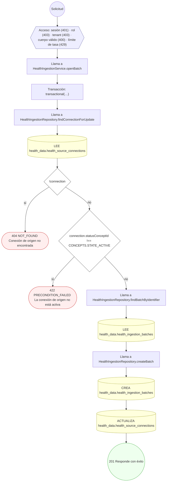

#### 11. POST /health-data/ingestion-batches/{id}/close

Cerrar el lote conciliando sus contadores

| HTTP | Código | Cuándo |
|---|---|---|
| 200 | — | Éxito |
| 400 | `VALIDATION_FAILED` | Los parámetros de ruta son UUID válidos; El cuerpo cumple el DTO (sin propiedades extra) |
| 401 | `UNAUTHENTICATED` | Hay una sesión válida (JWT) |
| 403 | `FORBIDDEN` | El rol está permitido; El tenant se resuelve y pertenece al actor |
| 404 | `NOT_FOUND` | ResourceNotFoundException: Lote no encontrado |
| 409 | `CONFLICT` | ConflictException: El lote ya está cerrado |
| 429 | `RATE_LIMITED` | No se supera el límite de solicitudes |

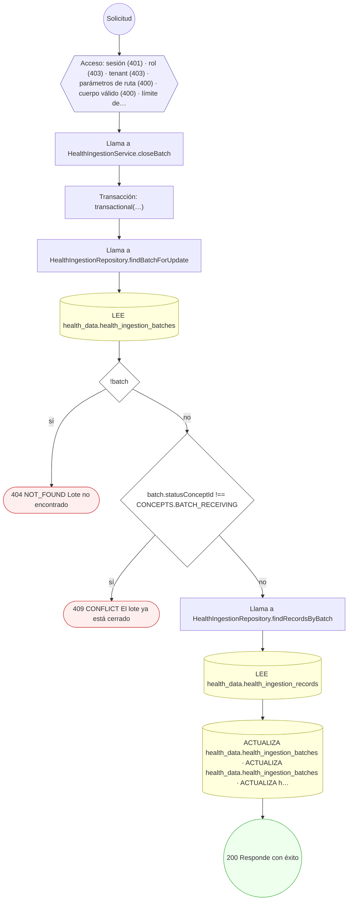

#### 12. POST /health-data/ingestion-batches/{id}/records

Registrar un registro crudo del lote

| HTTP | Código | Cuándo |
|---|---|---|
| 201 | — | Éxito |
| 400 | `VALIDATION_FAILED` | Los parámetros de ruta son UUID válidos; El cuerpo cumple el DTO (sin propiedades extra) |
| 401 | `UNAUTHENTICATED` | Hay una sesión válida (JWT) |
| 403 | `FORBIDDEN` | El rol está permitido; El tenant se resuelve y pertenece al actor |
| 404 | `NOT_FOUND` | ResourceNotFoundException: Lote no encontrado |
| 422 | `PRECONDITION_FAILED` | PreconditionFailedException: El lote ya no está recibiendo registros |
| 429 | `RATE_LIMITED` | No se supera el límite de solicitudes |

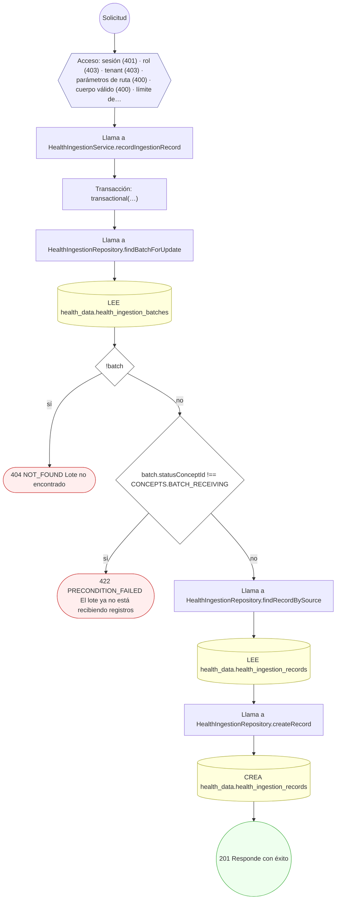

#### 13. POST /health-data/quality-runs

Ejecutar reglas de calidad y abrir incidencias

| HTTP | Código | Cuándo |
|---|---|---|
| 201 | — | Éxito |
| 400 | `VALIDATION_FAILED` | El cuerpo cumple el DTO (sin propiedades extra) |
| 401 | `UNAUTHENTICATED` | Hay una sesión válida (JWT) |
| 403 | `FORBIDDEN` | El rol está permitido; El tenant se resuelve y pertenece al actor |
| 404 | `NOT_FOUND` | ResourceNotFoundException: Conjunto de reglas no encontrado |
| 422 | `PRECONDITION_FAILED` | PreconditionFailedException: La corrida necesita un ámbito: lote de ingesta o recurso canónico; PreconditionFailedException: El conjunto de reglas no está activo; PreconditionFailedException: El hallazgo apunta a una regla que no está activa en el conjunto |
| 429 | `RATE_LIMITED` | No se supera el límite de solicitudes |

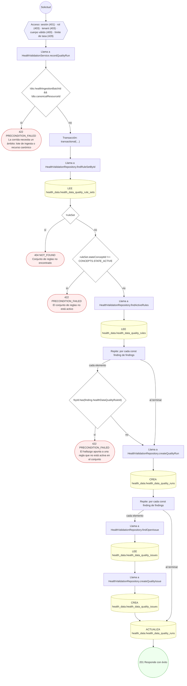

#### 14. POST /health-data/source-connections

Dar de alta una conexión de origen (crea el sistema si no existe)

| HTTP | Código | Cuándo |
|---|---|---|
| 201 | — | Éxito |
| 400 | `VALIDATION_FAILED` | El cuerpo cumple el DTO (sin propiedades extra) |
| 401 | `UNAUTHENTICATED` | Hay una sesión válida (JWT) |
| 403 | `FORBIDDEN` | El rol está permitido; El tenant se resuelve y pertenece al actor |
| 429 | `RATE_LIMITED` | No se supera el límite de solicitudes |

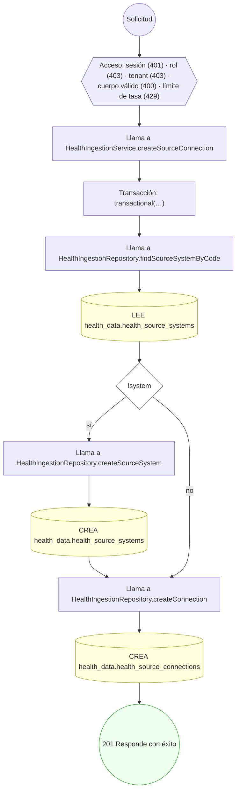

#### 15. POST /health-data/versions/{id}/validate

Validar la versión contra un perfil FHIR R5

| HTTP | Código | Cuándo |
|---|---|---|
| 201 | — | Éxito |
| 400 | `VALIDATION_FAILED` | Los parámetros de ruta son UUID válidos; El cuerpo cumple el DTO (sin propiedades extra) |
| 401 | `UNAUTHENTICATED` | Hay una sesión válida (JWT) |
| 403 | `FORBIDDEN` | El rol está permitido; El tenant se resuelve y pertenece al actor |
| 404 | `NOT_FOUND` | ResourceNotFoundException: Versión canónica no encontrada; ResourceNotFoundException: Versión del perfil FHIR no encontrada; ResourceNotFoundException: Recurso canónico no encontrado |
| 422 | `PRECONDITION_FAILED` | PreconditionFailedException: La versión del perfil no está activa |
| 429 | `RATE_LIMITED` | No se supera el límite de solicitudes |

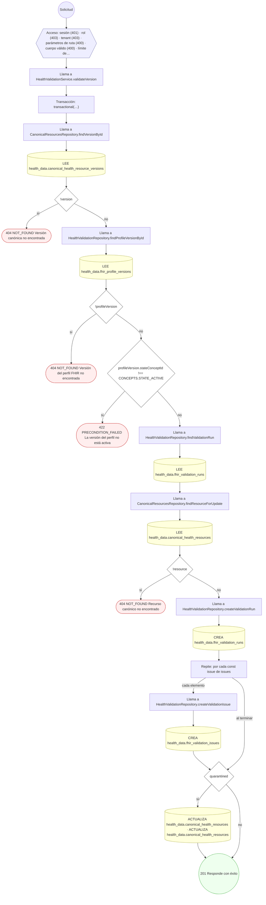

### Operaciones sin decisiones propias

Sólo comprueban el acceso y leen o escriben: no tienen ramas que dibujar. Su detalle está en la ficha de endpoints.

| Operación | Respuestas posibles | Tablas |
|---|---|---|
| POST /health-data/timeline-entries | 201, 400, 401, 403, 429 | 2 |
