<!-- AUTOGENERADO por tools/inventario/flujos.mjs. No editar manualmente. -->

# Flujos del módulo `iam`

- **Procesos:** 1 · **Máquinas de estado:** 0
- **Operaciones:** 31 (26 con decisiones propias, 5 sin ellas)
- Inventario de endpoints del módulo: [iam](../endpoints/iam.md)

## Proceso: IAM Module

- **Código:** `iam` · **Agrupación:** AGRUPACION_POR_CONTROLADOR · **Operaciones:** 31
- **Actores:** CLINICIAN · Cualquier sesión válida · Público (sin sesión) · SECURITY_ADMIN
- **Revisión:** AUTO_DETECTADA
- **Fuentes:** `src/modules/iam/README.md`

### Para qué sirve

Identity & Access Management for the REDESA Health API: users, credentials (password + federated), sessions and refresh-token rotation, MFA factors, devices, global roles, account lockouts and an append-only security-event trail.

_Fuente: `src/modules/iam/README.md:3`_

### Etapas y operaciones

| Etapa | Descripción | Operación | Quién actúa | Riesgo | Tablas |
|---|---|---|---|---|---|
| `ctrl:IamAuthController` | Operaciones de IamAuthController que el README no asigna a un caso de uso | DESCONOCIDO /iam/auth | Cualquier sesión válida | BAJO | 0 |
|  |  | POST /iam/auth/activate | Público (sin sesión) | ALTO | 7 |
|  |  | POST /iam/auth/forgot-password | Público (sin sesión) | ALTO | 11 |
|  |  | POST /iam/auth/login | Público (sin sesión) | ALTO | 21 |
|  |  | POST /iam/auth/logout | Cualquier sesión válida | ALTO | 4 |
|  |  | POST /iam/auth/logout-all | Cualquier sesión válida | ALTO | 4 |
|  |  | POST /iam/auth/register-organization | Público (sin sesión) | ALTO | 17 |
|  |  | POST /iam/auth/register-patient | Público (sin sesión) | ALTO | 18 |
|  |  | POST /iam/auth/register-practitioner | Público (sin sesión) | ALTO | 30 |
|  |  | POST /iam/auth/resend-verification | Público (sin sesión) | ALTO | 9 |
|  |  | POST /iam/auth/reset-password | Público (sin sesión) | ALTO | 8 |
|  |  | POST /iam/auth/sessions/purge | SECURITY_ADMIN | MEDIO | 3 |
|  |  | POST /iam/auth/token/refresh | Público (sin sesión) | ALTO | 15 |
|  |  | POST /iam/auth/verify-email | Público (sin sesión) | ALTO | 4 |
| `ctrl:IamUsersController` | Operaciones de IamUsersController que el README no asigna a un caso de uso | GET /iam/users | SECURITY_ADMIN | BAJO | 2 |
|  |  | POST /iam/users | SECURITY_ADMIN | MEDIO | 6 |
|  |  | GET /iam/users/{id} | SECURITY_ADMIN | BAJO | 1 |
|  |  | POST /iam/users/{id}/anonymize | SECURITY_ADMIN | MEDIO | 8 |
|  |  | GET /iam/users/{id}/credentials | SECURITY_ADMIN | BAJO | 2 |
|  |  | POST /iam/users/{id}/credentials/{cid}/revoke | SECURITY_ADMIN | MEDIO | 3 |
|  |  | POST /iam/users/{id}/credentials/federated | SECURITY_ADMIN | MEDIO | 4 |
|  |  | GET /iam/users/{id}/devices | SECURITY_ADMIN | BAJO | 2 |
|  |  | POST /iam/users/{id}/devices | Cualquier sesión válida | ALTO | 3 |
|  |  | GET /iam/users/{id}/global-roles | SECURITY_ADMIN | BAJO | 2 |
|  |  | POST /iam/users/{id}/global-roles | SECURITY_ADMIN | MEDIO | 5 |
|  |  | POST /iam/users/{id}/lock | SECURITY_ADMIN | MEDIO | 7 |
|  |  | GET /iam/users/{id}/mfa-factors | SECURITY_ADMIN | BAJO | 2 |
|  |  | POST /iam/users/{id}/mfa-factors | Cualquier sesión válida | ALTO | 6 |
|  |  | GET /iam/users/{id}/sessions | SECURITY_ADMIN | BAJO | 2 |
|  |  | POST /iam/users/assisted-practitioner-registration | SECURITY_ADMIN | MEDIO | 30 |
|  |  | POST /iam/users/assisted-registration | CLINICIAN · SECURITY_ADMIN | MEDIO | 6 |

### Diagrama 1 de 2 — etapas `ctrl:IamAuthController`

```mermaid
flowchart LR
  a2(["Cualquier sesión válida"]):::actor
  a4(["Público (sin sesión)"]):::actor
  a40(["SECURITY_ADMIN"]):::actor
  t5[("iam.account_activations")]:::tabla
  t6[("iam.authentication_credentials")]:::tabla
  t7[("iam.security_events")]:::tabla
  t8[("iam.users")]:::tabla
  t11[("iam.email_verifications")]:::tabla
  t12[("iam.password_resets")]:::tabla
  t15[("authz.roles")]:::tabla
  t16[("authz.user_role_assignments")]:::tabla
  t17[("directory.tenant_memberships")]:::tabla
  t18[("directory.tenants")]:::tabla
  t19[("iam.account_lockouts")]:::tabla
  t22[("iam.refresh_tokens")]:::tabla
  t23[("iam.sessions")]:::tabla
  t28[("common.contact_points")]:::tabla
  t29[("common.identifiers")]:::tabla
  t34[("messaging.message_channels")]:::tabla
  t35[("messaging.message_templates")]:::tabla
  t9[("+1 tablas más")]
  t13[("+5 tablas más")]
  t20[("+15 tablas más")]
  t26[("+11 tablas más")]
  t30[("+12 tablas más")]
  t32[("+24 tablas más")]
  t36[("+3 tablas más")]
  t38[("+2 tablas más")]
  t42[("+9 tablas más")]
  subgraph s0["ctrl:IamAuthController · Operaciones de IamAuthController que el README no asig…"]
    o1["DESCONOCIDO /iam/auth"]:::op
    o3["POST /iam/auth/activate"]:::op
    o10["POST /iam/auth/forgot-password"]:::op
    o14["POST /iam/auth/login"]:::op
    o21["POST /iam/auth/logout"]:::op
    o24["POST /iam/auth/logout-all"]:::op
    o25["POST /iam/auth/register-organization"]:::op
    o27["POST /iam/auth/register-patient"]:::op
    o31["POST /iam/auth/register-practitioner"]:::op
    o33["POST /iam/auth/resend-verification"]:::op
    o37["POST /iam/auth/reset-password"]:::op
    o39["POST /iam/auth/sessions/purge"]:::op
    o41["POST /iam/auth/token/refresh"]:::op
    o43["POST /iam/auth/verify-email"]:::op
  end
  a2 --> o1
  a4 --> o3
  o3 -->|"ACTUALIZA"| t5
  o3 -->|"LEE"| t5
  o3 -->|"ACTUALIZA"| t6
  o3 -->|"LEE"| t6
  o3 -->|"CREA"| t7
  o3 -->|"ACTUALIZA"| t8
  o3 -.-> t9
  a4 --> o10
  o10 -->|"LEE"| t6
  o10 -->|"LEE"| t11
  o10 -->|"ACTUALIZA"| t12
  o10 -->|"CREA"| t12
  o10 -->|"CREA"| t7
  o10 -->|"LEE"| t8
  o10 -.-> t13
  a4 --> o14
  o14 -->|"LEE"| t15
  o14 -->|"LEE"| t16
  o14 -->|"LEE"| t17
  o14 -->|"LEE"| t18
  o14 -->|"ACTUALIZA"| t19
  o14 -->|"CREA"| t19
  o14 -.-> t20
  a2 --> o21
  o21 -->|"ACTUALIZA"| t22
  o21 -->|"CREA"| t7
  o21 -->|"ACTUALIZA"| t23
  o21 -->|"LEE"| t23
  a2 --> o24
  o24 -->|"ACTUALIZA"| t22
  o24 -->|"CREA"| t7
  o24 -->|"ACTUALIZA"| t23
  o24 -->|"LEE"| t23
  a4 --> o25
  o25 -->|"CREA"| t17
  o25 -->|"CREA"| t18
  o25 -->|"LEE"| t18
  o25 -->|"CREA"| t6
  o25 -->|"LEE"| t6
  o25 -->|"CREA"| t11
  o25 -.-> t26
  a4 --> o27
  o27 -->|"CREA"| t28
  o27 -->|"CREA"| t29
  o27 -->|"CREA"| t17
  o27 -->|"CREA"| t6
  o27 -->|"LEE"| t6
  o27 -->|"CREA"| t11
  o27 -.-> t30
  a4 --> o31
  o31 -->|"LEE"| t15
  o31 -->|"CREA"| t16
  o31 -->|"LEE"| t16
  o31 -->|"CREA"| t28
  o31 -->|"CREA"| t29
  o31 -->|"CREA"| t17
  o31 -.-> t32
  a4 --> o33
  o33 -->|"LEE"| t6
  o33 -->|"CREA"| t11
  o33 -->|"LEE"| t11
  o33 -->|"LEE"| t8
  o33 -->|"LEE"| t34
  o33 -->|"LEE"| t35
  o33 -.-> t36
  a4 --> o37
  o37 -->|"ACTUALIZA"| t6
  o37 -->|"LEE"| t6
  o37 -->|"ACTUALIZA"| t12
  o37 -->|"LEE"| t12
  o37 -->|"ACTUALIZA"| t22
  o37 -->|"CREA"| t7
  o37 -.-> t38
  a40 --> o39
  o39 -->|"ACTUALIZA"| t22
  o39 -->|"CREA"| t7
  o39 -->|"ACTUALIZA"| t23
  a4 --> o41
  o41 -->|"LEE"| t15
  o41 -->|"LEE"| t16
  o41 -->|"LEE"| t17
  o41 -->|"LEE"| t18
  o41 -->|"ACTUALIZA"| t22
  o41 -->|"CREA"| t22
  o41 -.-> t42
  a4 --> o43
  o43 -->|"ACTUALIZA"| t11
  o43 -->|"LEE"| t11
  o43 -->|"ACTUALIZA"| t8
  o43 -->|"LEE"| t8
  classDef op fill:#fff,stroke:#446
  classDef actor fill:#eef,stroke:#66a
  classDef tabla fill:#ffd,stroke:#aa3
  classDef evento fill:#efe,stroke:#3a3
```

### Diagrama 2 de 2 — etapas `ctrl:IamUsersController`

```mermaid
flowchart LR
  a2(["SECURITY_ADMIN"]):::actor
  a20(["Cualquier sesión válida"]):::actor
  a37(["CLINICIAN · SECURITY_ADMIN"]):::actor
  t3[("iam.authentication_credentials")]:::tabla
  t4[("iam.users")]:::tabla
  t6[("common.contact_points")]:::tabla
  t7[("iam.security_events")]:::tabla
  t8[("iam.user_global_roles")]:::tabla
  t11[("iam.refresh_tokens")]:::tabla
  t12[("iam.sessions")]:::tabla
  t18[("iam.devices")]:::tabla
  t24[("iam.account_lockouts")]:::tabla
  t27[("iam.mfa_factors")]:::tabla
  t31[("authz.roles")]:::tabla
  t32[("authz.user_role_assignments")]:::tabla
  t33[("common.identifiers")]:::tabla
  t34[("directory.tenant_memberships")]:::tabla
  t38[("iam.account_activations")]:::tabla
  t13[("+2 tablas más")]
  t25[("+1 tablas más")]
  t35[("+24 tablas más")]
  subgraph s0["ctrl:IamUsersController · Operaciones de IamUsersController que el README no as…"]
    o1["GET /iam/users"]:::op
    o5["POST /iam/users"]:::op
    o9["GET /iam/users/{id}"]:::op
    o10["POST /iam/users/{id}/anonymize"]:::op
    o14["GET /iam/users/{id}/credentials"]:::op
    o15["POST /iam/users/{id}/credentials/{cid}/revoke"]:::op
    o16["POST /iam/users/{id}/credentials/federated"]:::op
    o17["GET /iam/users/{id}/devices"]:::op
    o19["POST /iam/users/{id}/devices"]:::op
    o21["GET /iam/users/{id}/global-roles"]:::op
    o22["POST /iam/users/{id}/global-roles"]:::op
    o23["POST /iam/users/{id}/lock"]:::op
    o26["GET /iam/users/{id}/mfa-factors"]:::op
    o28["POST /iam/users/{id}/mfa-factors"]:::op
    o29["GET /iam/users/{id}/sessions"]:::op
    o30["POST /iam/users/assisted-practitioner-registration"]:::op
    o36["POST /iam/users/assisted-registration"]:::op
  end
  a2 --> o1
  o1 -->|"LEE"| t3
  o1 -->|"LEE"| t4
  a2 --> o5
  o5 -->|"CREA"| t6
  o5 -->|"CREA"| t3
  o5 -->|"LEE"| t3
  o5 -->|"CREA"| t7
  o5 -->|"CREA"| t8
  o5 -->|"CREA"| t4
  a2 --> o9
  o9 -->|"LEE"| t4
  a2 --> o10
  o10 -->|"ACTUALIZA"| t3
  o10 -->|"ACTUALIZA"| t11
  o10 -->|"CREA"| t7
  o10 -->|"ACTUALIZA"| t12
  o10 -->|"LEE"| t12
  o10 -->|"ACTUALIZA"| t8
  o10 -.-> t13
  a2 --> o14
  o14 -->|"LEE"| t3
  o14 -->|"LEE"| t4
  a2 --> o15
  o15 -->|"ACTUALIZA"| t3
  o15 -->|"LEE"| t3
  o15 -->|"CREA"| t7
  a2 --> o16
  o16 -->|"CREA"| t3
  o16 -->|"LEE"| t3
  o16 -->|"CREA"| t7
  o16 -->|"LEE"| t4
  a2 --> o17
  o17 -->|"LEE"| t18
  o17 -->|"LEE"| t4
  a20 --> o19
  o19 -->|"CREA"| t18
  o19 -->|"CREA"| t7
  o19 -->|"LEE"| t4
  a2 --> o21
  o21 -->|"LEE"| t8
  o21 -->|"LEE"| t4
  a2 --> o22
  o22 -->|"CREA"| t7
  o22 -->|"ACTUALIZA"| t8
  o22 -->|"CREA"| t8
  o22 -->|"LEE"| t8
  o22 -->|"LEE"| t4
  a2 --> o23
  o23 -->|"CREA"| t24
  o23 -->|"ACTUALIZA"| t11
  o23 -->|"CREA"| t7
  o23 -->|"ACTUALIZA"| t12
  o23 -->|"LEE"| t12
  o23 -->|"ACTUALIZA"| t4
  o23 -.-> t25
  a2 --> o26
  o26 -->|"LEE"| t27
  o26 -->|"LEE"| t4
  a20 --> o28
  o28 -->|"ACTUALIZA"| t27
  o28 -->|"CREA"| t27
  o28 -->|"LEE"| t27
  o28 -->|"CREA"| t7
  o28 -->|"ACTUALIZA"| t4
  o28 -->|"LEE"| t4
  a2 --> o29
  o29 -->|"LEE"| t12
  o29 -->|"LEE"| t4
  a2 --> o30
  o30 -->|"LEE"| t31
  o30 -->|"CREA"| t32
  o30 -->|"LEE"| t32
  o30 -->|"CREA"| t6
  o30 -->|"CREA"| t33
  o30 -->|"CREA"| t34
  o30 -.-> t35
  a37 --> o36
  o36 -->|"CREA"| t38
  o36 -->|"CREA"| t3
  o36 -->|"LEE"| t3
  o36 -->|"CREA"| t7
  o36 -->|"CREA"| t8
  o36 -->|"CREA"| t4
  classDef op fill:#fff,stroke:#446
  classDef actor fill:#eef,stroke:#66a
  classDef tabla fill:#ffd,stroke:#aa3
  classDef evento fill:#efe,stroke:#3a3
```

## Árbol de decisión por operación

Cada árbol se deriva del código del handler y de los métodos que invoca (hasta 4 niveles). Una rama que no decide, no escribe y no falla se poda. Los accesos y los efectos consecutivos se agrupan en un solo nodo.

### Operaciones con decisiones propias

#### 1. POST /iam/auth/activate

Activar la cuenta con el token de un solo uso y fijar la contraseña

| HTTP | Código | Cuándo |
|---|---|---|
| 200 | — | Éxito |
| 400 | `VALIDATION_FAILED` | El cuerpo cumple el DTO (sin propiedades extra) |
| 401 | `UNAUTHENTICATED` | Hay una sesión válida (JWT); UnauthorizedException: Token de activación inválido; UnauthorizedException: El token de activación ya fue utilizado; UnauthorizedException: El token de activación expiró |
| 429 | `RATE_LIMITED` | No se supera el límite de solicitudes |

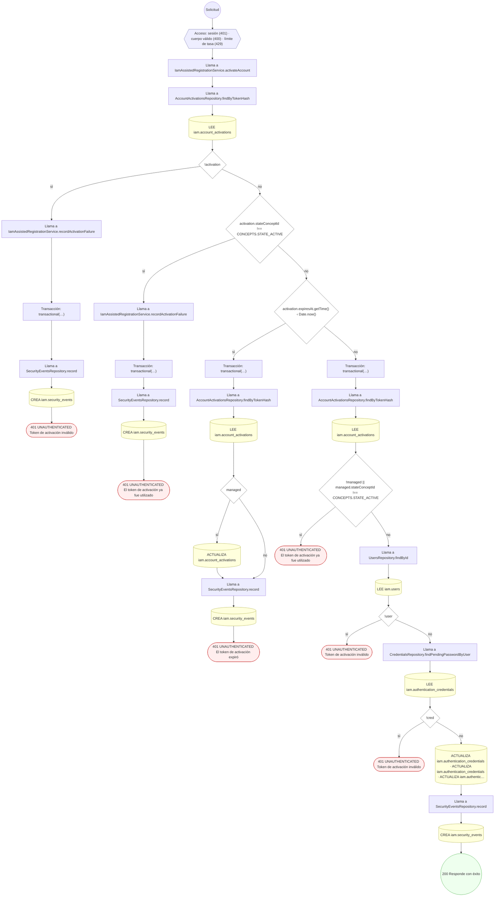

#### 2. POST /iam/auth/forgot-password

Solicitar el restablecimiento de la contraseña

| HTTP | Código | Cuándo |
|---|---|---|
| 202 | — | Éxito |
| 400 | `VALIDATION_FAILED` | El cuerpo cumple el DTO (sin propiedades extra) |
| 401 | `UNAUTHENTICATED` | Hay una sesión válida (JWT) |
| 404 | `NOT_FOUND` | ResourceNotFoundException: Canal no encontrado; ResourceNotFoundException: Plantilla no encontrada |
| 422 | `PRECONDITION_FAILED` | PreconditionFailedException: La notificación necesita destinatario interno o dirección de destino; PreconditionFailedException: El canal no está activo; PreconditionFailedException: La plantilla no está publicada; PreconditionFailedException: La plantilla es de otro canal |
| 429 | `RATE_LIMITED` | No se supera el límite de solicitudes |

```mermaid
flowchart TD
  n1(("Solicitud")):::inicio
  n2{{"Acceso: sesión (401) · cuerpo válido (400) · límite de tasa (429)"}}:::acceso
  n1 --> n2
  n3["Llama a IamPasswordResetService.requestReset"]:::llamada
  n2 --> n3
  n4["Transacción: transactional(…)"]:::transaccion
  n3 --> n4
  n5["Llama a CredentialsRepository.findActivePasswordBySubject"]:::llamada
  n4 --> n5
  n6[("LEE iam.authentication_credentials")]:::efecto
  n5 --> n6
  n7["Llama a UsersRepository.findById"]:::llamada
  n6 --> n7
  n8[("LEE iam.users")]:::efecto
  n7 --> n8
  n9["Llama a PasswordResetsRepository.revokeActiveForUser"]:::llamada
  n8 --> n9
  n10[("ACTUALIZA iam.password_resets")]:::efecto
  n9 --> n10
  n11["Llama a IamPasswordResetService.resolveEmail"]:::llamada
  n10 --> n11
  n12["Llama a EmailVerificationsRepository.findLatestByUser"]:::llamada
  n11 --> n12
  n13[("LEE iam.email_verifications")]:::efecto
  n12 --> n13
  n14["Llama a PasswordResetsRepository.create"]:::llamada
  n13 --> n14
  n15[("CREA iam.password_resets")]:::efecto
  n14 --> n15
  n16["Llama a SecurityEventsRepository.record"]:::llamada
  n15 --> n16
  n17[("CREA iam.security_events")]:::efecto
  n16 --> n17
  n18{"issued"}:::decision
  n17 --> n18
  n19["Llama a IamPasswordResetService.sendResetEmail"]:::llamada
  n18 -->|"sí"| n19
  n20["Intenta"]:::intento
  n19 --> n20
  n21["Llama a NotificationsService.createRequest"]:::llamada
  n20 --> n21
  n22{"!dto.recipientUserId && !dto.recipientAddress"}:::decision
  n21 --> n22
  n23(["422 PRECONDITION_FAILED La notificación necesita destinatario interno o dirección de destino"]):::error
  n22 -->|"sí"| n23
  n24["Transacción: transactional(…)"]:::transaccion
  n22 -->|"no"| n24
  n25["Llama a NotificationsRepository.findChannelById"]:::llamada
  n24 --> n25
  n26[("LEE messaging.message_channels")]:::efecto
  n25 --> n26
  n27{"!channel"}:::decision
  n26 --> n27
  n28(["404 NOT_FOUND Canal no encontrado"]):::error
  n27 -->|"sí"| n28
  n29{"channel.stateConceptId !== CONCEPTS.STATE_ACTIVE"}:::decision
  n27 -->|"no"| n29
  n30(["422 PRECONDITION_FAILED El canal no está activo"]):::error
  n29 -->|"sí"| n30
  n31{"dto.templateId"}:::decision
  n29 -->|"no"| n31
  n32["Llama a NotificationsRepository.findTemplateById"]:::llamada
  n31 -->|"sí"| n32
  n33[("LEE messaging.message_templates")]:::efecto
  n32 --> n33
  n34{"!template"}:::decision
  n33 --> n34
  n35(["404 NOT_FOUND Plantilla no encontrada"]):::error
  n34 -->|"sí"| n35
  n36{"template.statusConceptId !== CONCEPTS.STATE_ACTIVE"}:::decision
  n34 -->|"no"| n36
  n37(["422 PRECONDITION_FAILED La plantilla no está publicada"]):::error
  n36 -->|"sí"| n37
  n38{"template.channelId !== dto.channelId"}:::decision
  n36 -->|"no"| n38
  n39(["422 PRECONDITION_FAILED La plantilla es de otro canal"]):::error
  n38 -->|"sí"| n39
  n40{"dto.debounceKey"}:::decision
  n38 -->|"no"| n40
  n31 -->|"no"| n40
  n41["Llama a NotificationsRepository.findLiveRequestByDebounceKey"]:::llamada
  n40 -->|"sí"| n41
  n42[("LEE messaging.notification_requests")]:::efecto
  n41 --> n42
  n43["Llama a NotificationsRepository.createNotificationRequest"]:::llamada
  n42 --> n43
  n40 -->|"no"| n43
  n44[("CREA messaging.notification_requests")]:::efecto
  n43 --> n44
  n45(("202 Responde con éxito")):::ok
  n44 --> n45
  n18 -->|"no"| n45
  classDef acceso fill:#eef,stroke:#66a
  classDef error fill:#fee,stroke:#c33
  classDef ok fill:#efe,stroke:#3a3
  classDef efecto fill:#ffd,stroke:#aa3
  classDef decision fill:#fff,stroke:#555
  classDef corte fill:#eee,stroke:#999,stroke-dasharray: 4
```

#### 3. POST /iam/auth/login

Iniciar sesión con email o documento de identidad y contraseña

| HTTP | Código | Cuándo |
|---|---|---|
| 200 | — | Éxito |
| 400 | `VALIDATION_FAILED` | El cuerpo cumple el DTO (sin propiedades extra) |
| 401 | `UNAUTHENTICATED` | Hay una sesión válida (JWT); UnauthorizedException: Credenciales inválidas |
| 429 | `RATE_LIMITED` | No se supera el límite de solicitudes |

```mermaid
flowchart TD
  n1(("Solicitud")):::inicio
  n2{{"Acceso: sesión (401) · cuerpo válido (400) · límite de tasa (429)"}}:::acceso
  n1 --> n2
  n3["Llama a IamAuthService.login"]:::llamada
  n2 --> n3
  n4["Llama a IamAuthService.performLogin"]:::llamada
  n3 --> n4
  n5{"!subject"}:::decision
  n4 --> n5
  n6["Llama a IamAuthService.recordLoginFailure"]:::llamada
  n5 -->|"sí"| n6
  n7["Transacción: transactional(…)"]:::transaccion
  n6 --> n7
  n8["Llama a SecurityEventsRepository.record"]:::llamada
  n7 --> n8
  n9[("CREA iam.security_events")]:::efecto
  n8 --> n9
  n10(["401 UNAUTHENTICATED Credenciales inválidas"]):::error
  n9 --> n10
  n11["Llama a CredentialsRepository.findActivePasswordBySubject"]:::llamada
  n5 -->|"no"| n11
  n12[("LEE iam.authentication_credentials")]:::efecto
  n11 --> n12
  n13{"!cred || !cred.secretHash"}:::decision
  n12 --> n13
  n14["Llama a IamAuthService.recordLoginFailure"]:::llamada
  n13 -->|"sí"| n14
  n15["Transacción: transactional(…)"]:::transaccion
  n14 --> n15
  n16["Llama a SecurityEventsRepository.record"]:::llamada
  n15 --> n16
  n17[("CREA iam.security_events")]:::efecto
  n16 --> n17
  n18(["401 UNAUTHENTICATED Credenciales inválidas"]):::error
  n17 --> n18
  n19["Llama a UsersRepository.findById"]:::llamada
  n13 -->|"no"| n19
  n20[("LEE iam.users")]:::efecto
  n19 --> n20
  n21{"!user || user.statusConceptId !== CONCEPTS.USER_ACTIVE"}:::decision
  n20 --> n21
  n22["Llama a IamAuthService.recordLoginFailure"]:::llamada
  n21 -->|"sí"| n22
  n23["Transacción: transactional(…)"]:::transaccion
  n22 --> n23
  n24["Llama a SecurityEventsRepository.record"]:::llamada
  n23 --> n24
  n25[("CREA iam.security_events")]:::efecto
  n24 --> n25
  n26(["401 UNAUTHENTICATED Credenciales inválidas"]):::error
  n25 --> n26
  n27{"!passwordOk"}:::decision
  n21 -->|"no"| n27
  n28["Llama a IamAuthService.handleFailedPassword"]:::llamada
  n27 -->|"sí"| n28
  n29["Transacción: transactional(…)"]:::transaccion
  n28 --> n29
  n30["Llama a SecurityEventsRepository.record"]:::llamada
  n29 --> n30
  n31[("CREA iam.security_events")]:::efecto
  n30 --> n31
  n32["Llama a UsersRepository.findById"]:::llamada
  n31 --> n32
  n33[("LEE iam.users")]:::efecto
  n32 --> n33
  n34["Llama a SecurityEventsRepository.countFailedLoginsSince"]:::llamada
  n33 --> n34
  n35[("LEE iam.security_events")]:::efecto
  n34 --> n35
  n36{"failedCount ›= this.authEnv.lockThreshold"}:::decision
  n35 --> n36
  n37{"user"}:::decision
  n36 -->|"sí"| n37
  n38[("ACTUALIZA iam.users")]:::efecto
  n37 -->|"sí"| n38
  n39["Llama a AccountLockoutsRepository.findActiveForUser"]:::llamada
  n38 --> n39
  n37 -->|"no"| n39
  n40[("LEE iam.account_lockouts")]:::efecto
  n39 --> n40
  n41{"existingLock"}:::decision
  n40 --> n41
  n42[("ACTUALIZA iam.account_lockouts")]:::efecto
  n41 -->|"sí"| n42
  n43["Llama a AccountLockoutsRepository.create"]:::llamada
  n41 -->|"no"| n43
  n44[("CREA iam.account_lockouts")]:::efecto
  n43 --> n44
  n45["Llama a SessionsRepository.activeSessionIdsForUser"]:::llamada
  n42 --> n45
  n44 --> n45
  n46[("LEE iam.sessions")]:::efecto
  n45 --> n46
  n47["Llama a SessionsRepository.revokeAllActiveForUser"]:::llamada
  n46 --> n47
  n48[("ACTUALIZA iam.sessions")]:::efecto
  n47 --> n48
  n49["Llama a RefreshTokensRepository.revokeActiveBySessionIds"]:::llamada
  n48 --> n49
  n50[("ACTUALIZA iam.refresh_tokens")]:::efecto
  n49 --> n50
  n51["Llama a SecurityEventsRepository.record"]:::llamada
  n50 --> n51
  n52[("CREA iam.security_events")]:::efecto
  n51 --> n52
  n53(["401 UNAUTHENTICATED Credenciales inválidas"]):::error
  n52 --> n53
  n36 -->|"no"| n53
  n54["Transacción: transactional(…)"]:::transaccion
  n27 -->|"no"| n54
  n55["Llama a UserGlobalRolesRepository.findActiveForUser"]:::llamada
  n54 --> n55
  n56[("LEE iam.user_global_roles")]:::efecto
  n55 --> n56
  n57["Llama a IamAuthService.mergeRoleCodes"]:::llamada
  n56 --> n57
  n58["Llama a AuthzEffectiveRolesService.codesForUser"]:::llamada
  n57 --> n58
  n59[("LEE authz.roles")]:::efecto
  n58 --> n59
  n60["Llama a IamAuthService.loadActiveTenantIds"]:::llamada
  n59 --> n60
  n61[("LEE directory.tenant_memberships")]:::efecto
  n60 --> n61
  n62["Llama a IamAuthService.loadTenantNames"]:::llamada
  n61 --> n62
  n63[("LEE directory.tenants")]:::efecto
  n62 --> n63
  n64["Llama a IamAuthService.loadPatientProfileId"]:::llamada
  n63 --> n64
  n65["Llama a PersonAccountLinksRepository.findActiveByUser"]:::llamada
  n64 --> n65
  n66[("LEE profiles.person_account_links")]:::efecto
  n65 --> n66
  n67["Llama a PatientProfilesRepository.findById"]:::llamada
  n66 --> n67
  n68[("LEE profiles.patient_profiles")]:::efecto
  n67 --> n68
  n69["Llama a IamAuthService.loadPractitionerProfileId"]:::llamada
  n68 --> n69
  n70["Llama a PersonAccountLinksRepository.findActiveByUser"]:::llamada
  n69 --> n70
  n71["… el resto del árbol (1 nodos) está en el JSON del inventario"]:::corte
  n70 --> n71
  classDef acceso fill:#eef,stroke:#66a
  classDef error fill:#fee,stroke:#c33
  classDef ok fill:#efe,stroke:#3a3
  classDef efecto fill:#ffd,stroke:#aa3
  classDef decision fill:#fff,stroke:#555
  classDef corte fill:#eee,stroke:#999,stroke-dasharray: 4
```

#### 4. POST /iam/auth/register-organization

Registrar una organización con su cuenta owner

| HTTP | Código | Cuándo |
|---|---|---|
| 201 | — | Éxito |
| 400 | `VALIDATION_FAILED` | El cuerpo cumple el DTO (sin propiedades extra) |
| 401 | `UNAUTHENTICATED` | Hay una sesión válida (JWT) |
| 404 | `NOT_FOUND` | ResourceNotFoundException: Canal no encontrado; ResourceNotFoundException: Plantilla no encontrada |
| 409 | `CONFLICT` | ConflictException: El código de organización ya existe; ConflictException: Ya existe una cuenta con ese correo |
| 422 | `PRECONDITION_FAILED` | PreconditionFailedException: Un tenant de tipo PAYER exige el bloque `payer`; PreconditionFailedException: Un tenant de tipo BROKER exige el bloque `broker`; PreconditionFailedException: Un tenant de tipo {tenantType} exige país y jurisdicción; PreconditionFailedException: El bloque `payer` sólo corresponde a un tenant de tipo PAYER; PreconditionFailedException: El bloque `broker` sólo corresponde a un tenant de tipo BROKER; PreconditionFailedException: Los conceptos declarados no existen en el catálogo de terminología; PreconditionFailedException: La notificación necesita destinatario interno o dirección de destino; PreconditionFailedException: El canal no está activo; PreconditionFailedException: La plantilla no está publicada; PreconditionFailedException: La plantilla es de otro canal |
| 429 | `RATE_LIMITED` | No se supera el límite de solicitudes |

```mermaid
flowchart TD
  n1(("Solicitud")):::inicio
  n2{{"Acceso: sesión (401) · cuerpo válido (400) · límite de tasa (429)"}}:::acceso
  n1 --> n2
  n3["Llama a IamOrganizationSelfRegistrationService.registerOrganization"]:::llamada
  n2 --> n3
  n4["Llama a IamOrganizationSelfRegistrationService.performRegisterOrganization"]:::llamada
  n3 --> n4
  n5["Transacción: transactional(…)"]:::transaccion
  n4 --> n5
  n6["Llama a TenantsRepository.findByCode"]:::llamada
  n5 --> n6
  n7[("LEE directory.tenants")]:::efecto
  n6 --> n7
  n8{"codeClash"}:::decision
  n7 --> n8
  n9(["409 CONFLICT El código de organización ya existe"]):::error
  n8 -->|"sí"| n9
  n10["Llama a CredentialsRepository.findLivePasswordBySubject"]:::llamada
  n8 -->|"no"| n10
  n11[("LEE iam.authentication_credentials")]:::efecto
  n10 --> n11
  n12{"emailClash"}:::decision
  n11 --> n12
  n13(["409 CONFLICT Ya existe una cuenta con ese correo"]):::error
  n12 -->|"sí"| n13
  n14["Llama a UsersRepository.create"]:::llamada
  n12 -->|"no"| n14
  n15[("CREA iam.users")]:::efecto
  n14 --> n15
  n16["Llama a CredentialsRepository.createPassword"]:::llamada
  n15 --> n16
  n17[("CREA iam.authentication_credentials")]:::efecto
  n16 --> n17
  n18["Llama a UserGlobalRolesRepository.create"]:::llamada
  n17 --> n18
  n19[("CREA iam.user_global_roles")]:::efecto
  n18 --> n19
  n20["Llama a TenantTypeProfileService.assertProfileMatchesType"]:::llamada
  n19 --> n20
  n21{"tenantType === 'PAYER' && !input.payer"}:::decision
  n20 --> n21
  n22(["422 PRECONDITION_FAILED Un tenant de tipo PAYER exige el bloque `payer`"]):::error
  n21 -->|"sí"| n22
  n23{"tenantType === 'BROKER' && !input.broker"}:::decision
  n21 -->|"no"| n23
  n24(["422 PRECONDITION_FAILED Un tenant de tipo BROKER exige el bloque `broker`"]):::error
  n23 -->|"sí"| n24
  n25{"TERRITORIAL_TENANT_TYPES.includes(tenantType)"}:::decision
  n23 -->|"no"| n25
  n26{"missing.length › 0"}:::decision
  n25 -->|"sí"| n26
  n27(["422 PRECONDITION_FAILED Un tenant de tipo {tenantType} exige país y jurisdicción"]):::error
  n26 -->|"sí"| n27
  n28{"tenantType !== 'PAYER' && input.payer"}:::decision
  n26 -->|"no"| n28
  n25 -->|"no"| n28
  n29(["422 PRECONDITION_FAILED El bloque `payer` sólo corresponde a un tenant de tipo PAYER"]):::error
  n28 -->|"sí"| n29
  n30{"tenantType !== 'BROKER' && input.broker"}:::decision
  n28 -->|"no"| n30
  n31(["422 PRECONDITION_FAILED El bloque `broker` sólo corresponde a un tenant de tipo BROKER"]):::error
  n30 -->|"sí"| n31
  n32["Llama a TenantTypeProfileService.assertConceptsExist"]:::llamada
  n30 -->|"no"| n32
  n33["Llama a CatalogConceptsRepository.findByIds"]:::llamada
  n32 --> n33
  n34[("LEE terminology.catalog_concepts")]:::efecto
  n33 --> n34
  n35{"unknown.length › 0"}:::decision
  n34 --> n35
  n36(["422 PRECONDITION_FAILED Los conceptos declarados no existen en el catálogo de terminología"]):::error
  n35 -->|"sí"| n36
  n37["Llama a TenantsRepository.create"]:::llamada
  n35 -->|"no"| n37
  n38[("CREA directory.tenants")]:::efecto
  n37 --> n38
  n39["Llama a TenantTypeProfileService.materializeProfile"]:::llamada
  n38 --> n39
  n40{"input.tenantType === 'PAYER' && input.payer"}:::decision
  n39 --> n40
  n41["Llama a CatalogRepository.createCarrier"]:::llamada
  n40 -->|"sí"| n41
  n42[("CREA insurance.insurance_carriers")]:::efecto
  n41 --> n42
  n43{"input.tenantType === 'BROKER' && input.broker"}:::decision
  n42 --> n43
  n40 -->|"no"| n43
  n44["Llama a CatalogRepository.createBroker"]:::llamada
  n43 -->|"sí"| n44
  n45[("CREA insurance.insurance_brokers")]:::efecto
  n44 --> n45
  n46["Llama a TenantMembershipsRepository.create"]:::llamada
  n45 --> n46
  n43 -->|"no"| n46
  n47[("CREA directory.tenant_memberships")]:::efecto
  n46 --> n47
  n48["Llama a EmailVerificationsRepository.create"]:::llamada
  n47 --> n48
  n49[("CREA iam.email_verifications")]:::efecto
  n48 --> n49
  n50["Llama a SecurityEventsRepository.record"]:::llamada
  n49 --> n50
  n51[("CREA iam.security_events")]:::efecto
  n50 --> n51
  n52["Llama a IamOrganizationSelfRegistrationService.sendVerificationEmail"]:::llamada
  n51 --> n52
  n53["Intenta"]:::intento
  n52 --> n53
  n54["Llama a NotificationsService.createRequest"]:::llamada
  n53 --> n54
  n55{"!dto.recipientUserId && !dto.recipientAddress"}:::decision
  n54 --> n55
  n56(["422 PRECONDITION_FAILED La notificación necesita destinatario interno o dirección de destino"]):::error
  n55 -->|"sí"| n56
  n57["Transacción: transactional(…)"]:::transaccion
  n55 -->|"no"| n57
  n58{"!channel"}:::decision
  n57 --> n58
  n59(["404 NOT_FOUND Canal no encontrado"]):::error
  n58 -->|"sí"| n59
  n60{"channel.stateConceptId !== CONCEPTS.STATE_ACTIVE"}:::decision
  n58 -->|"no"| n60
  n61(["422 PRECONDITION_FAILED El canal no está activo"]):::error
  n60 -->|"sí"| n61
  n62{"dto.templateId"}:::decision
  n60 -->|"no"| n62
  n63{"!template"}:::decision
  n62 -->|"sí"| n63
  n64(["404 NOT_FOUND Plantilla no encontrada"]):::error
  n63 -->|"sí"| n64
  n65{"template.statusConceptId !== CONCEPTS.STATE_ACTIVE"}:::decision
  n63 -->|"no"| n65
  n66(["422 PRECONDITION_FAILED La plantilla no está publicada"]):::error
  n65 -->|"sí"| n66
  n67{"template.channelId !== dto.channelId"}:::decision
  n65 -->|"no"| n67
  n68(["422 PRECONDITION_FAILED La plantilla es de otro canal"]):::error
  n67 -->|"sí"| n68
  n69(("201 Responde con éxito")):::ok
  n67 -->|"no"| n69
  n62 -->|"no"| n69
  classDef acceso fill:#eef,stroke:#66a
  classDef error fill:#fee,stroke:#c33
  classDef ok fill:#efe,stroke:#3a3
  classDef efecto fill:#ffd,stroke:#aa3
  classDef decision fill:#fff,stroke:#555
  classDef corte fill:#eee,stroke:#999,stroke-dasharray: 4
```

#### 5. POST /iam/auth/register-patient

Registrarse como paciente con documento de identidad

| HTTP | Código | Cuándo |
|---|---|---|
| 201 | — | Éxito |
| 400 | `VALIDATION_FAILED` | El cuerpo cumple el DTO (sin propiedades extra) |
| 401 | `UNAUTHENTICATED` | Hay una sesión válida (JWT) |
| 404 | `NOT_FOUND` | ResourceNotFoundException: Canal no encontrado; ResourceNotFoundException: Plantilla no encontrada |
| 409 | `CONFLICT` | ConflictException: Ya existe una cuenta con ese documento de identidad |
| 422 | `PRECONDITION_FAILED` | PreconditionFailedException: La notificación necesita destinatario interno o dirección de destino; PreconditionFailedException: El canal no está activo; PreconditionFailedException: La plantilla no está publicada; PreconditionFailedException: La plantilla es de otro canal |
| 429 | `RATE_LIMITED` | No se supera el límite de solicitudes |

```mermaid
flowchart TD
  n1(("Solicitud")):::inicio
  n2{{"Acceso: sesión (401) · cuerpo válido (400) · límite de tasa (429)"}}:::acceso
  n1 --> n2
  n3["Llama a IamPatientSelfRegistrationService.registerPatient"]:::llamada
  n2 --> n3
  n4["Llama a IamPatientSelfRegistrationService.performRegisterPatient"]:::llamada
  n3 --> n4
  n5["Transacción: transactional(…)"]:::transaccion
  n4 --> n5
  n6["Llama a CredentialsRepository.findLivePasswordBySubject"]:::llamada
  n5 --> n6
  n7[("LEE iam.authentication_credentials")]:::efecto
  n6 --> n7
  n8{"existing"}:::decision
  n7 --> n8
  n9(["409 CONFLICT Ya existe una cuenta con ese documento de identidad"]):::error
  n8 -->|"sí"| n9
  n10["Llama a UsersRepository.create"]:::llamada
  n8 -->|"no"| n10
  n11[("CREA iam.users")]:::efecto
  n10 --> n11
  n12["Llama a CredentialsRepository.createPassword"]:::llamada
  n11 --> n12
  n13[("CREA iam.authentication_credentials")]:::efecto
  n12 --> n13
  n14["Llama a UserGlobalRolesRepository.create"]:::llamada
  n13 --> n14
  n15[("CREA iam.user_global_roles")]:::efecto
  n14 --> n15
  n16["Llama a UserGlobalRolesRepository.create"]:::llamada
  n15 --> n16
  n17[("CREA iam.user_global_roles")]:::efecto
  n16 --> n17
  n18["Llama a PersonsRepository.create"]:::llamada
  n17 --> n18
  n19[("CREA profiles.persons")]:::efecto
  n18 --> n19
  n20["Llama a PersonProfilesRepository.create"]:::llamada
  n19 --> n20
  n21[("CREA profiles.person_profiles")]:::efecto
  n20 --> n21
  n22["Llama a PatientProfilesRepository.create"]:::llamada
  n21 --> n22
  n23[("CREA profiles.patient_profiles")]:::efecto
  n22 --> n23
  n24["Llama a PersonAccountLinksRepository.create"]:::llamada
  n23 --> n24
  n25[("CREA profiles.person_account_links")]:::efecto
  n24 --> n25
  n26["Llama a IdentifiersRepository.create"]:::llamada
  n25 --> n26
  n27[("CREA common.identifiers")]:::efecto
  n26 --> n27
  n28{"dto.billingTaxId"}:::decision
  n27 --> n28
  n29["Llama a IdentifiersRepository.create"]:::llamada
  n28 -->|"sí"| n29
  n30[("CREA common.identifiers")]:::efecto
  n29 --> n30
  n31["Llama a TenantMembershipsRepository.create"]:::llamada
  n30 --> n31
  n28 -->|"no"| n31
  n32[("CREA directory.tenant_memberships")]:::efecto
  n31 --> n32
  n33{"dto.phone"}:::decision
  n32 --> n33
  n34["Llama a ContactPointsRepository.create"]:::llamada
  n33 -->|"sí"| n34
  n35[("CREA common.contact_points")]:::efecto
  n34 --> n35
  n36{"dto.email"}:::decision
  n35 --> n36
  n33 -->|"no"| n36
  n37["Llama a ContactPointsRepository.create"]:::llamada
  n36 -->|"sí"| n37
  n38[("CREA common.contact_points")]:::efecto
  n37 --> n38
  n39["Llama a EmailVerificationsRepository.create"]:::llamada
  n38 --> n39
  n40[("CREA iam.email_verifications")]:::efecto
  n39 --> n40
  n41["Llama a SecurityEventsRepository.record"]:::llamada
  n40 --> n41
  n36 -->|"no"| n41
  n42[("CREA iam.security_events")]:::efecto
  n41 --> n42
  n43{"dto.email && created.emailVerificationToken"}:::decision
  n42 --> n43
  n44["Llama a IamPatientSelfRegistrationService.sendVerificationEmail"]:::llamada
  n43 -->|"sí"| n44
  n45["Intenta"]:::intento
  n44 --> n45
  n46["Llama a NotificationsService.createRequest"]:::llamada
  n45 --> n46
  n47{"!dto.recipientUserId && !dto.recipientAddress"}:::decision
  n46 --> n47
  n48(["422 PRECONDITION_FAILED La notificación necesita destinatario interno o dirección de destino"]):::error
  n47 -->|"sí"| n48
  n49["Transacción: transactional(…)"]:::transaccion
  n47 -->|"no"| n49
  n50{"!channel"}:::decision
  n49 --> n50
  n51(["404 NOT_FOUND Canal no encontrado"]):::error
  n50 -->|"sí"| n51
  n52{"channel.stateConceptId !== CONCEPTS.STATE_ACTIVE"}:::decision
  n50 -->|"no"| n52
  n53(["422 PRECONDITION_FAILED El canal no está activo"]):::error
  n52 -->|"sí"| n53
  n54{"dto.templateId"}:::decision
  n52 -->|"no"| n54
  n55{"!template"}:::decision
  n54 -->|"sí"| n55
  n56(["404 NOT_FOUND Plantilla no encontrada"]):::error
  n55 -->|"sí"| n56
  n57{"template.statusConceptId !== CONCEPTS.STATE_ACTIVE"}:::decision
  n55 -->|"no"| n57
  n58(["422 PRECONDITION_FAILED La plantilla no está publicada"]):::error
  n57 -->|"sí"| n58
  n59{"template.channelId !== dto.channelId"}:::decision
  n57 -->|"no"| n59
  n60(["422 PRECONDITION_FAILED La plantilla es de otro canal"]):::error
  n59 -->|"sí"| n60
  n61(("201 Responde con éxito")):::ok
  n59 -->|"no"| n61
  n54 -->|"no"| n61
  n43 -->|"no"| n61
  classDef acceso fill:#eef,stroke:#66a
  classDef error fill:#fee,stroke:#c33
  classDef ok fill:#efe,stroke:#3a3
  classDef efecto fill:#ffd,stroke:#aa3
  classDef decision fill:#fff,stroke:#555
  classDef corte fill:#eee,stroke:#999,stroke-dasharray: 4
```

#### 6. POST /iam/auth/register-practitioner

Registrarse como profesional de salud con su matrícula

| HTTP | Código | Cuándo |
|---|---|---|
| 201 | — | Éxito |
| 400 | `VALIDATION_FAILED` | El cuerpo cumple el DTO (sin propiedades extra) |
| 401 | `UNAUTHENTICATED` | Hay una sesión válida (JWT) |
| 404 | `NOT_FOUND` | ResourceNotFoundException: Canal no encontrado; ResourceNotFoundException: Plantilla no encontrada |
| 409 | `CONFLICT` | ConflictException: Ya existe una cuenta con ese correo; ConflictException: El practitioner_code ya está en uso |
| 422 | `PRECONDITION_FAILED` | PreconditionFailedException: El catálogo de especialidades médicas no está disponible; PreconditionFailedException: La especialidad no pertenece al catálogo de especialidades médicas; PreconditionFailedException: Alguno de los roles indicados no existe o no es asignable; PreconditionFailedException: La notificación necesita destinatario interno o dirección de destino; PreconditionFailedException: El canal no está activo; PreconditionFailedException: La plantilla no está publicada; PreconditionFailedException: La plantilla es de otro canal |
| 429 | `RATE_LIMITED` | No se supera el límite de solicitudes |

```mermaid
flowchart TD
  n1(("Solicitud")):::inicio
  n2{{"Acceso: sesión (401) · cuerpo válido (400) · límite de tasa (429)"}}:::acceso
  n1 --> n2
  n3["Llama a IamPractitionerSelfRegistrationService.registerPractitioner"]:::llamada
  n2 --> n3
  n4["Llama a IamPractitionerSelfRegistrationService.performRegisterPractitioner"]:::llamada
  n3 --> n4
  n5["Transacción: transactional(…)"]:::transaccion
  n4 --> n5
  n6["Llama a CredentialsRepository.findLivePasswordBySubject"]:::llamada
  n5 --> n6
  n7[("LEE iam.authentication_credentials")]:::efecto
  n6 --> n7
  n8{"clash"}:::decision
  n7 --> n8
  n9(["409 CONFLICT Ya existe una cuenta con ese correo"]):::error
  n8 -->|"sí"| n9
  n10["Llama a HealthPractitionerProfilesRepository.findByCode"]:::llamada
  n8 -->|"no"| n10
  n11[("LEE profiles.health_practitioner_profiles")]:::efecto
  n10 --> n11
  n12{"clashCode"}:::decision
  n11 --> n12
  n13(["409 CONFLICT El practitioner_code ya está en uso"]):::error
  n12 -->|"sí"| n13
  n14["Llama a UsersRepository.create"]:::llamada
  n12 -->|"no"| n14
  n15[("CREA iam.users")]:::efecto
  n14 --> n15
  n16{"asistido"}:::decision
  n15 --> n16
  n17["Llama a CredentialsRepository.createPendingPassword"]:::llamada
  n16 -->|"sí"| n17
  n18[("CREA iam.authentication_credentials")]:::efecto
  n17 --> n18
  n19["Llama a CredentialsRepository.createPassword"]:::llamada
  n16 -->|"no"| n19
  n20[("CREA iam.authentication_credentials")]:::efecto
  n19 --> n20
  n21["Llama a UserGlobalRolesRepository.create"]:::llamada
  n18 --> n21
  n20 --> n21
  n22[("CREA iam.user_global_roles")]:::efecto
  n21 --> n22
  n23["Llama a UserGlobalRolesRepository.create"]:::llamada
  n22 --> n23
  n24[("CREA iam.user_global_roles")]:::efecto
  n23 --> n24
  n25["Llama a PersonsRepository.create"]:::llamada
  n24 --> n25
  n26[("CREA profiles.persons")]:::efecto
  n25 --> n26
  n27["Llama a PersonProfilesRepository.create"]:::llamada
  n26 --> n27
  n28[("CREA profiles.person_profiles")]:::efecto
  n27 --> n28
  n29["Llama a HealthPractitionerProfilesRepository.create"]:::llamada
  n28 --> n29
  n30[("CREA profiles.health_practitioner_profiles")]:::efecto
  n29 --> n30
  n31["Llama a JurisdictionAuthorizationsRepository.create"]:::llamada
  n30 --> n31
  n32[("CREA profiles.jurisdiction_authorizations")]:::efecto
  n31 --> n32
  n33["Llama a ProfessionalCredentialsRepository.create"]:::llamada
  n32 --> n33
  n34[("CREA profiles.professional_credentials")]:::efecto
  n33 --> n34
  n35["Llama a PractitionerLanguagesRepository.create"]:::llamada
  n34 --> n35
  n36[("CREA profiles.practitioner_languages")]:::efecto
  n35 --> n36
  n37["Repite: por cada const [orden, specialtyConceptId] de especialidades.entries()"]:::bucle
  n36 --> n37
  n38["Llama a MedicalSpecialtyCatalogService.assertIsMedicalSpecialty"]:::llamada
  n37 -->|"cada elemento"| n38
  n39["Llama a MedicalSpecialtyCatalogService.listMemberIds"]:::llamada
  n38 --> n39
  n40{"miembros === null"}:::decision
  n39 --> n40
  n41(["422 PRECONDITION_FAILED El catálogo de especialidades médicas no está disponible"]):::error
  n40 -->|"sí"| n41
  n42{"!miembros.has(specialtyConceptId)"}:::decision
  n40 -->|"no"| n42
  n43(["422 PRECONDITION_FAILED La especialidad no pertenece al catálogo de especialidades médicas"]):::error
  n42 -->|"sí"| n43
  n44["Llama a PractitionerSpecialtiesRepository.create"]:::llamada
  n42 -->|"no"| n44
  n45[("CREA profiles.practitioner_specialties")]:::efecto
  n44 --> n45
  n46["Llama a PersonAccountLinksRepository.create"]:::llamada
  n45 --> n46
  n37 -->|"al terminar"| n46
  n47[("CREA profiles.person_account_links")]:::efecto
  n46 --> n47
  n48{"dto.nationalId"}:::decision
  n47 --> n48
  n49["Llama a IdentifiersRepository.create"]:::llamada
  n48 -->|"sí"| n49
  n50[("CREA common.identifiers")]:::efecto
  n49 --> n50
  n51["Llama a ContactPointsRepository.create"]:::llamada
  n50 --> n51
  n48 -->|"no"| n51
  n52[("CREA common.contact_points")]:::efecto
  n51 --> n52
  n53{"dto.phone"}:::decision
  n52 --> n53
  n54["Llama a ContactPointsRepository.create"]:::llamada
  n53 -->|"sí"| n54
  n55[("CREA common.contact_points")]:::efecto
  n54 --> n55
  n56["Llama a TenantMembershipsRepository.create"]:::llamada
  n55 --> n56
  n53 -->|"no"| n56
  n57[("CREA directory.tenant_memberships")]:::efecto
  n56 --> n57
  n58["Llama a EmailVerificationsRepository.create"]:::llamada
  n57 --> n58
  n59[("CREA iam.email_verifications")]:::efecto
  n58 --> n59
  n60{"asistido"}:::decision
  n59 --> n60
  n61["Repite: por cada const code de asistido.clinicalRoles"]:::bucle
  n60 -->|"sí"| n61
  n62["Llama a AuthzEffectiveRolesService.ensureRoleByCode"]:::llamada
  n61 -->|"cada elemento"| n62
  n63[("LEE authz.roles")]:::efecto
  n62 --> n63
  n64["Llama a UserRoleAssignmentsRepository.findActive"]:::llamada
  n63 --> n64
  n65[("LEE authz.user_role_assignments")]:::efecto
  n64 --> n65
  n66["Llama a UserRoleAssignmentsRepository.create"]:::llamada
  n65 --> n66
  n67[("CREA authz.user_role_assignments")]:::efecto
  n66 --> n67
  n68{"rolesRechazados.length › 0"}:::decision
  n67 --> n68
  n61 -->|"al terminar"| n68
  n69(["422 PRECONDITION_FAILED Alguno de los roles indicados no existe o no es asignable"]):::error
  n68 -->|"sí"| n69
  n70["Llama a SecurityEventsRepository.record"]:::llamada
  n68 -->|"no"| n70
  n60 -->|"no"| n70
  n71["… el resto del árbol (1 nodos) está en el JSON del inventario"]:::corte
  n70 --> n71
  classDef acceso fill:#eef,stroke:#66a
  classDef error fill:#fee,stroke:#c33
  classDef ok fill:#efe,stroke:#3a3
  classDef efecto fill:#ffd,stroke:#aa3
  classDef decision fill:#fff,stroke:#555
  classDef corte fill:#eee,stroke:#999,stroke-dasharray: 4
```

#### 7. POST /iam/auth/resend-verification

Reenviar el enlace de verificación del correo

| HTTP | Código | Cuándo |
|---|---|---|
| 202 | — | Éxito |
| 400 | `VALIDATION_FAILED` | El cuerpo cumple el DTO (sin propiedades extra) |
| 401 | `UNAUTHENTICATED` | Hay una sesión válida (JWT) |
| 404 | `NOT_FOUND` | ResourceNotFoundException: Canal no encontrado; ResourceNotFoundException: Plantilla no encontrada |
| 422 | `PRECONDITION_FAILED` | PreconditionFailedException: La notificación necesita destinatario interno o dirección de destino; PreconditionFailedException: El canal no está activo; PreconditionFailedException: La plantilla no está publicada; PreconditionFailedException: La plantilla es de otro canal |
| 429 | `RATE_LIMITED` | No se supera el límite de solicitudes |

```mermaid
flowchart TD
  n1(("Solicitud")):::inicio
  n2{{"Acceso: sesión (401) · cuerpo válido (400) · límite de tasa (429)"}}:::acceso
  n1 --> n2
  n3["Llama a IamEmailVerificationService.resend"]:::llamada
  n2 --> n3
  n4["Transacción: transactional(…)"]:::transaccion
  n3 --> n4
  n5["Llama a CredentialsRepository.findActivePasswordBySubject"]:::llamada
  n4 --> n5
  n6[("LEE iam.authentication_credentials")]:::efecto
  n5 --> n6
  n7["Llama a UsersRepository.findById"]:::llamada
  n6 --> n7
  n8[("LEE iam.users")]:::efecto
  n7 --> n8
  n9["Llama a EmailVerificationsRepository.findLatestByUser"]:::llamada
  n8 --> n9
  n10[("LEE iam.email_verifications")]:::efecto
  n9 --> n10
  n11["Llama a EmailVerificationsRepository.create"]:::llamada
  n10 --> n11
  n12[("CREA iam.email_verifications")]:::efecto
  n11 --> n12
  n13{"issued"}:::decision
  n12 --> n13
  n14["Llama a IamEmailVerificationService.sendVerificationEmail"]:::llamada
  n13 -->|"sí"| n14
  n15["Intenta"]:::intento
  n14 --> n15
  n16["Llama a NotificationsService.createRequest"]:::llamada
  n15 --> n16
  n17{"!dto.recipientUserId && !dto.recipientAddress"}:::decision
  n16 --> n17
  n18(["422 PRECONDITION_FAILED La notificación necesita destinatario interno o dirección de destino"]):::error
  n17 -->|"sí"| n18
  n19["Transacción: transactional(…)"]:::transaccion
  n17 -->|"no"| n19
  n20["Llama a NotificationsRepository.findChannelById"]:::llamada
  n19 --> n20
  n21[("LEE messaging.message_channels")]:::efecto
  n20 --> n21
  n22{"!channel"}:::decision
  n21 --> n22
  n23(["404 NOT_FOUND Canal no encontrado"]):::error
  n22 -->|"sí"| n23
  n24{"channel.stateConceptId !== CONCEPTS.STATE_ACTIVE"}:::decision
  n22 -->|"no"| n24
  n25(["422 PRECONDITION_FAILED El canal no está activo"]):::error
  n24 -->|"sí"| n25
  n26{"dto.templateId"}:::decision
  n24 -->|"no"| n26
  n27["Llama a NotificationsRepository.findTemplateById"]:::llamada
  n26 -->|"sí"| n27
  n28[("LEE messaging.message_templates")]:::efecto
  n27 --> n28
  n29{"!template"}:::decision
  n28 --> n29
  n30(["404 NOT_FOUND Plantilla no encontrada"]):::error
  n29 -->|"sí"| n30
  n31{"template.statusConceptId !== CONCEPTS.STATE_ACTIVE"}:::decision
  n29 -->|"no"| n31
  n32(["422 PRECONDITION_FAILED La plantilla no está publicada"]):::error
  n31 -->|"sí"| n32
  n33{"template.channelId !== dto.channelId"}:::decision
  n31 -->|"no"| n33
  n34(["422 PRECONDITION_FAILED La plantilla es de otro canal"]):::error
  n33 -->|"sí"| n34
  n35{"dto.debounceKey"}:::decision
  n33 -->|"no"| n35
  n26 -->|"no"| n35
  n36["Llama a NotificationsRepository.findLiveRequestByDebounceKey"]:::llamada
  n35 -->|"sí"| n36
  n37[("LEE messaging.notification_requests")]:::efecto
  n36 --> n37
  n38["Llama a NotificationsRepository.createNotificationRequest"]:::llamada
  n37 --> n38
  n35 -->|"no"| n38
  n39[("CREA messaging.notification_requests")]:::efecto
  n38 --> n39
  n40(("202 Responde con éxito")):::ok
  n39 --> n40
  n13 -->|"no"| n40
  classDef acceso fill:#eef,stroke:#66a
  classDef error fill:#fee,stroke:#c33
  classDef ok fill:#efe,stroke:#3a3
  classDef efecto fill:#ffd,stroke:#aa3
  classDef decision fill:#fff,stroke:#555
  classDef corte fill:#eee,stroke:#999,stroke-dasharray: 4
```

#### 8. POST /iam/auth/reset-password

Fijar una contraseña nueva con el token recibido por correo

| HTTP | Código | Cuándo |
|---|---|---|
| 200 | — | Éxito |
| 400 | `VALIDATION_FAILED` | El cuerpo cumple el DTO (sin propiedades extra) |
| 401 | `UNAUTHENTICATED` | Hay una sesión válida (JWT); UnauthorizedException: Token de restablecimiento inválido; UnauthorizedException: El token de restablecimiento ya fue utilizado; UnauthorizedException: El token de restablecimiento expiró |
| 429 | `RATE_LIMITED` | No se supera el límite de solicitudes |


#### 9. POST /iam/auth/token/refresh

Rotar el refresh token

| HTTP | Código | Cuándo |
|---|---|---|
| 200 | — | Éxito |
| 400 | `VALIDATION_FAILED` | El cuerpo cumple el DTO (sin propiedades extra) |
| 401 | `UNAUTHENTICATED` | Hay una sesión válida (JWT); UnauthorizedException: No se presentó un refresh token; UnauthorizedException: Refresh token inválido; UnauthorizedException: Reuso de refresh token detectado; UnauthorizedException: Refresh token expirado; UnauthorizedException: Sesión no activa |
| 429 | `RATE_LIMITED` | No se supera el límite de solicitudes |

```mermaid
flowchart TD
  n1(("Solicitud")):::inicio
  n2{{"Acceso: sesión (401) · cuerpo válido (400) · límite de tasa (429)"}}:::acceso
  n1 --> n2
  n3{"!presented"}:::decision
  n2 --> n3
  n4(["401 UNAUTHENTICATED No se presentó un refresh token"]):::error
  n3 -->|"sí"| n4
  n5["Llama a IamAuthService.refresh"]:::llamada
  n3 -->|"no"| n5
  n6["Llama a RefreshTokensRepository.findByHash"]:::llamada
  n5 --> n6
  n7[("LEE iam.refresh_tokens")]:::efecto
  n6 --> n7
  n8{"!rt"}:::decision
  n7 --> n8
  n9(["401 UNAUTHENTICATED Refresh token inválido"]):::error
  n8 -->|"sí"| n9
  n10{"rt.stateConceptId !== CONCEPTS.STATE_ACTIVE"}:::decision
  n8 -->|"no"| n10
  n11["Transacción: transactional(…)"]:::transaccion
  n10 -->|"sí"| n11
  n12["Llama a SecurityEventsRepository.record"]:::llamada
  n11 --> n12
  n13[("CREA iam.security_events")]:::efecto
  n12 --> n13
  n14["Llama a RefreshTokensRepository.revokeBySessionId"]:::llamada
  n13 --> n14
  n15[("ACTUALIZA iam.refresh_tokens")]:::efecto
  n14 --> n15
  n16["Llama a SessionsRepository.revokeById"]:::llamada
  n15 --> n16
  n17[("ACTUALIZA iam.sessions")]:::efecto
  n16 --> n17
  n18(["401 UNAUTHENTICATED Reuso de refresh token detectado"]):::error
  n17 --> n18
  n19{"rt.expiresAt.getTime() ‹ Date.now()"}:::decision
  n10 -->|"no"| n19
  n20(["401 UNAUTHENTICATED Refresh token expirado"]):::error
  n19 -->|"sí"| n20
  n21["Transacción: transactional(…)"]:::transaccion
  n19 -->|"no"| n21
  n22["Llama a SessionsRepository.findById"]:::llamada
  n21 --> n22
  n23[("LEE iam.sessions")]:::efecto
  n22 --> n23
  n24{"!session || session.stateConceptId !== CONCEPTS.STATE_ACTIVE"}:::decision
  n23 --> n24
  n25(["401 UNAUTHENTICATED Sesión no activa"]):::error
  n24 -->|"sí"| n25
  n26["Llama a UserGlobalRolesRepository.findActiveForUser"]:::llamada
  n24 -->|"no"| n26
  n27[("LEE iam.user_global_roles")]:::efecto
  n26 --> n27
  n28["Llama a IamAuthService.mergeRoleCodes"]:::llamada
  n27 --> n28
  n29["Llama a AuthzEffectiveRolesService.codesForUser"]:::llamada
  n28 --> n29
  n30["Llama a UserRoleAssignmentsRepository.findActiveForUser"]:::llamada
  n29 --> n30
  n31[("LEE authz.user_role_assignments")]:::efecto
  n30 --> n31
  n32[("LEE authz.roles")]:::efecto
  n31 --> n32
  n33["Llama a IamAuthService.loadActiveTenantIds"]:::llamada
  n32 --> n33
  n34[("LEE directory.tenant_memberships")]:::efecto
  n33 --> n34
  n35["Llama a UsersRepository.findById"]:::llamada
  n34 --> n35
  n36[("LEE iam.users")]:::efecto
  n35 --> n36
  n37["Llama a IamAuthService.loadTenantNames"]:::llamada
  n36 --> n37
  n38[("LEE directory.tenants")]:::efecto
  n37 --> n38
  n39["Llama a IamAuthService.loadPatientProfileId"]:::llamada
  n38 --> n39
  n40["Llama a PersonAccountLinksRepository.findActiveByUser"]:::llamada
  n39 --> n40
  n41[("LEE profiles.person_account_links")]:::efecto
  n40 --> n41
  n42["Llama a PatientProfilesRepository.findById"]:::llamada
  n41 --> n42
  n43[("LEE profiles.patient_profiles")]:::efecto
  n42 --> n43
  n44["Llama a IamAuthService.loadPractitionerProfileId"]:::llamada
  n43 --> n44
  n45["Llama a PersonAccountLinksRepository.findActiveByUser"]:::llamada
  n44 --> n45
  n46[("LEE profiles.person_account_links")]:::efecto
  n45 --> n46
  n47["Llama a HealthPractitionerProfilesRepository.findById"]:::llamada
  n46 --> n47
  n48[("LEE profiles.health_practitioner_profiles")]:::efecto
  n47 --> n48
  n49["Llama a RefreshTokensRepository.findByHash"]:::llamada
  n48 --> n49
  n50[("LEE iam.refresh_tokens")]:::efecto
  n49 --> n50
  n51{"oldRt"}:::decision
  n50 --> n51
  n52[("ACTUALIZA iam.refresh_tokens")]:::efecto
  n51 -->|"sí"| n52
  n53["Llama a RefreshTokensRepository.create"]:::llamada
  n52 --> n53
  n51 -->|"no"| n53
  n54[("CREA iam.refresh_tokens")]:::efecto
  n53 --> n54
  n55["Llama a SecurityEventsRepository.record"]:::llamada
  n54 --> n55
  n56[("CREA iam.security_events")]:::efecto
  n55 --> n56
  n57(("200 Responde con éxito")):::ok
  n56 --> n57
  classDef acceso fill:#eef,stroke:#66a
  classDef error fill:#fee,stroke:#c33
  classDef ok fill:#efe,stroke:#3a3
  classDef efecto fill:#ffd,stroke:#aa3
  classDef decision fill:#fff,stroke:#555
  classDef corte fill:#eee,stroke:#999,stroke-dasharray: 4
```

#### 10. POST /iam/auth/verify-email

Verificar el correo con el token recibido

| HTTP | Código | Cuándo |
|---|---|---|
| 200 | — | Éxito |
| 400 | `VALIDATION_FAILED` | El cuerpo cumple el DTO (sin propiedades extra) |
| 401 | `UNAUTHENTICATED` | Hay una sesión válida (JWT); UnauthorizedException: Token de verificación inválido; UnauthorizedException: El token de verificación ya fue utilizado; UnauthorizedException: El token de verificación expiró |
| 429 | `RATE_LIMITED` | No se supera el límite de solicitudes |


#### 11. POST /iam/users

Crear un usuario con credencial de contraseña y rol inicial

| HTTP | Código | Cuándo |
|---|---|---|
| 201 | — | Éxito |
| 400 | `VALIDATION_FAILED` | El cuerpo cumple el DTO (sin propiedades extra) |
| 401 | `UNAUTHENTICATED` | Hay una sesión válida (JWT) |
| 403 | `FORBIDDEN` | El rol está permitido; El tenant se resuelve y pertenece al actor |
| 409 | `CONFLICT` | ConflictException: El email ya tiene una credencial de contraseña activa |
| 429 | `RATE_LIMITED` | No se supera el límite de solicitudes |

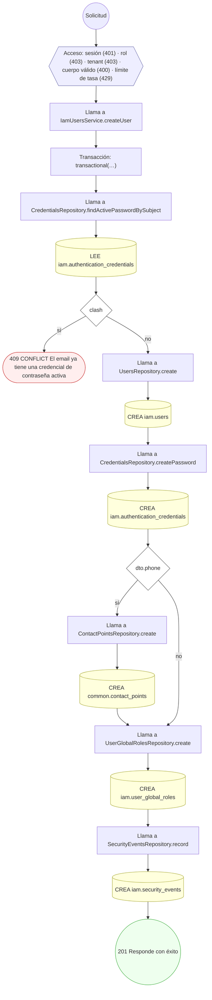

#### 12. GET /iam/users/{id}

Ficha de un usuario

| HTTP | Código | Cuándo |
|---|---|---|
| 200 | — | Éxito |
| 400 | `VALIDATION_FAILED` | Los parámetros de ruta son UUID válidos |
| 401 | `UNAUTHENTICATED` | Hay una sesión válida (JWT) |
| 403 | `FORBIDDEN` | El rol está permitido; El tenant se resuelve y pertenece al actor |
| 404 | `NOT_FOUND` | ResourceNotFoundException: Usuario no encontrado |
| 429 | `RATE_LIMITED` | No se supera el límite de solicitudes |

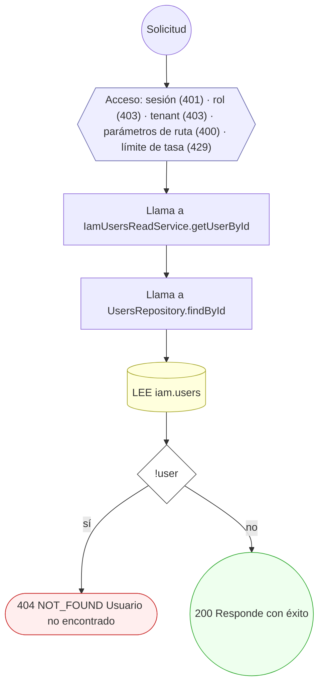

#### 13. POST /iam/users/{id}/anonymize

Anonimizar (DSAR) la cuenta

| HTTP | Código | Cuándo |
|---|---|---|
| 200 | — | Éxito |
| 400 | `VALIDATION_FAILED` | Los parámetros de ruta son UUID válidos |
| 401 | `UNAUTHENTICATED` | Hay una sesión válida (JWT) |
| 403 | `FORBIDDEN` | El rol está permitido; El tenant se resuelve y pertenece al actor |
| 404 | `NOT_FOUND` | ResourceNotFoundException: Usuario no encontrado |
| 429 | `RATE_LIMITED` | No se supera el límite de solicitudes |

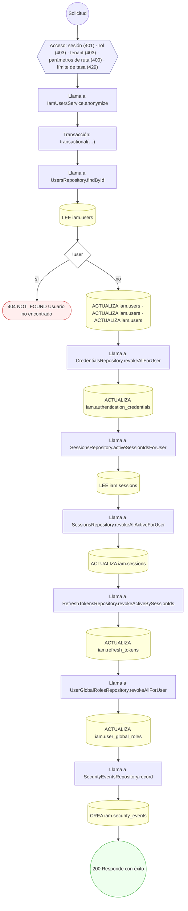

#### 14. GET /iam/users/{id}/credentials

Credenciales del usuario

| HTTP | Código | Cuándo |
|---|---|---|
| 200 | — | Éxito |
| 400 | `VALIDATION_FAILED` | Los parámetros de ruta son UUID válidos |
| 401 | `UNAUTHENTICATED` | Hay una sesión válida (JWT) |
| 403 | `FORBIDDEN` | El rol está permitido; El tenant se resuelve y pertenece al actor |
| 404 | `NOT_FOUND` | ResourceNotFoundException: Usuario no encontrado |
| 429 | `RATE_LIMITED` | No se supera el límite de solicitudes |

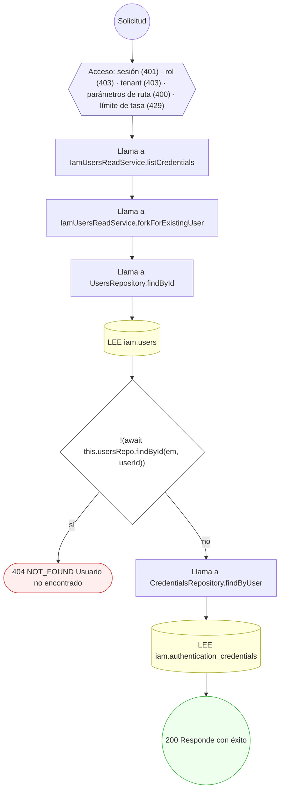

#### 15. POST /iam/users/{id}/credentials/{cid}/revoke

Revocar una credencial del usuario

| HTTP | Código | Cuándo |
|---|---|---|
| 200 | — | Éxito |
| 400 | `VALIDATION_FAILED` | Los parámetros de ruta son UUID válidos |
| 401 | `UNAUTHENTICATED` | Hay una sesión válida (JWT) |
| 403 | `FORBIDDEN` | El rol está permitido; El tenant se resuelve y pertenece al actor |
| 404 | `NOT_FOUND` | ResourceNotFoundException: Credencial no encontrada para el usuario |
| 429 | `RATE_LIMITED` | No se supera el límite de solicitudes |

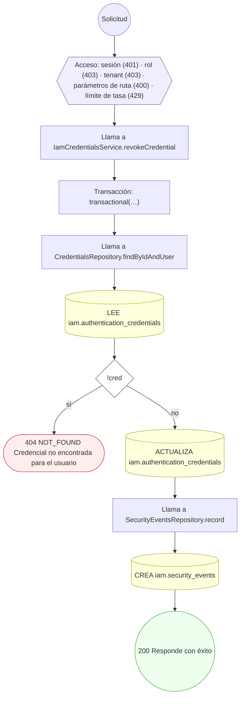

#### 16. POST /iam/users/{id}/credentials/federated

Enlazar una credencial de identidad federada

| HTTP | Código | Cuándo |
|---|---|---|
| 201 | — | Éxito |
| 400 | `VALIDATION_FAILED` | Los parámetros de ruta son UUID válidos; El cuerpo cumple el DTO (sin propiedades extra) |
| 401 | `UNAUTHENTICATED` | Hay una sesión válida (JWT) |
| 403 | `FORBIDDEN` | El rol está permitido; El tenant se resuelve y pertenece al actor |
| 404 | `NOT_FOUND` | ResourceNotFoundException: Usuario no encontrado |
| 409 | `CONFLICT` | ConflictException: La credencial federada ya existe |
| 429 | `RATE_LIMITED` | No se supera el límite de solicitudes |

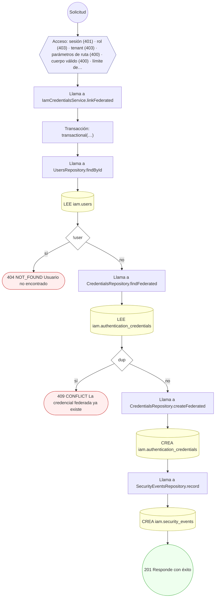

#### 17. GET /iam/users/{id}/devices

Dispositivos del usuario

| HTTP | Código | Cuándo |
|---|---|---|
| 200 | — | Éxito |
| 400 | `VALIDATION_FAILED` | Los parámetros de ruta son UUID válidos |
| 401 | `UNAUTHENTICATED` | Hay una sesión válida (JWT) |
| 403 | `FORBIDDEN` | El rol está permitido; El tenant se resuelve y pertenece al actor |
| 404 | `NOT_FOUND` | ResourceNotFoundException: Usuario no encontrado |
| 429 | `RATE_LIMITED` | No se supera el límite de solicitudes |

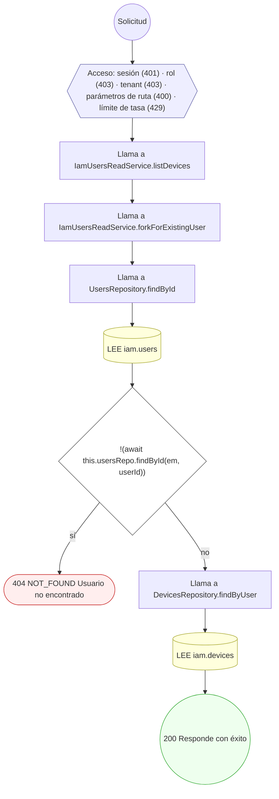

#### 18. POST /iam/users/{id}/devices

Registrar un dispositivo del usuario

| HTTP | Código | Cuándo |
|---|---|---|
| 201 | — | Éxito |
| 400 | `VALIDATION_FAILED` | Los parámetros de ruta son UUID válidos; El cuerpo cumple el DTO (sin propiedades extra) |
| 401 | `UNAUTHENTICATED` | Hay una sesión válida (JWT) |
| 403 | `FORBIDDEN` | El rol está permitido; El tenant se resuelve y pertenece al actor |
| 404 | `NOT_FOUND` | ResourceNotFoundException: Usuario no encontrado |
| 429 | `RATE_LIMITED` | No se supera el límite de solicitudes |

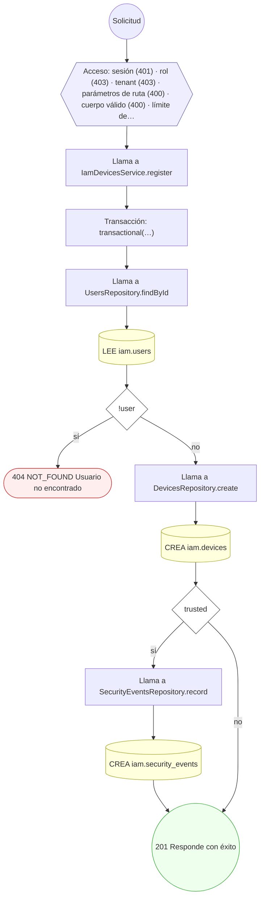

#### 19. GET /iam/users/{id}/global-roles

Roles globales del usuario

| HTTP | Código | Cuándo |
|---|---|---|
| 200 | — | Éxito |
| 400 | `VALIDATION_FAILED` | Los parámetros de ruta son UUID válidos |
| 401 | `UNAUTHENTICATED` | Hay una sesión válida (JWT) |
| 403 | `FORBIDDEN` | El rol está permitido; El tenant se resuelve y pertenece al actor |
| 404 | `NOT_FOUND` | ResourceNotFoundException: Usuario no encontrado |
| 429 | `RATE_LIMITED` | No se supera el límite de solicitudes |

```mermaid
flowchart TD
  n1(("Solicitud")):::inicio
  n2{{"Acceso: sesión (401) · rol (403) · tenant (403) · parámetros de ruta (400) · límite de tasa (429)"}}:::acceso
  n1 --> n2
  n3["Llama a IamUsersReadService.listGlobalRoles"]:::llamada
  n2 --> n3
  n4["Llama a IamUsersReadService.forkForExistingUser"]:::llamada
  n3 --> n4
  n5["Llama a UsersRepository.findById"]:::llamada
  n4 --> n5
  n6[("LEE iam.users")]:::efecto
  n5 --> n6
  n7{"!(await this.usersRepo.findById(em, userId))"}:::decision
  n6 --> n7
  n8(["404 NOT_FOUND Usuario no encontrado"]):::error
  n7 -->|"sí"| n8
  n9["Llama a UserGlobalRolesRepository.findByUser"]:::llamada
  n7 -->|"no"| n9
  n10[("LEE iam.user_global_roles")]:::efecto
  n9 --> n10
  n11(("200 Responde con éxito")):::ok
  n10 --> n11
  classDef acceso fill:#eef,stroke:#66a
  classDef error fill:#fee,stroke:#c33
  classDef ok fill:#efe,stroke:#3a3
  classDef efecto fill:#ffd,stroke:#aa3
  classDef decision fill:#fff,stroke:#555
  classDef corte fill:#eee,stroke:#999,stroke-dasharray: 4
```

#### 20. POST /iam/users/{id}/global-roles

Conceder o revocar un rol global

| HTTP | Código | Cuándo |
|---|---|---|
| 200 | — | Éxito |
| 400 | `VALIDATION_FAILED` | Los parámetros de ruta son UUID válidos; El cuerpo cumple el DTO (sin propiedades extra) |
| 401 | `UNAUTHENTICATED` | Hay una sesión válida (JWT) |
| 403 | `FORBIDDEN` | El rol está permitido; El tenant se resuelve y pertenece al actor |
| 404 | `NOT_FOUND` | ResourceNotFoundException: Usuario no encontrado; ResourceNotFoundException: El usuario no tiene ese rol activo |
| 409 | `CONFLICT` | ConflictException: El rol ya está concedido |
| 429 | `RATE_LIMITED` | No se supera el límite de solicitudes |

```mermaid
flowchart TD
  n1(("Solicitud")):::inicio
  n2{{"Acceso: sesión (401) · rol (403) · tenant (403) · parámetros de ruta (400) · cuerpo válido (400) · límite de…"}}:::acceso
  n1 --> n2
  n3["Llama a IamUsersService.changeGlobalRole"]:::llamada
  n2 --> n3
  n4["Transacción: transactional(…)"]:::transaccion
  n3 --> n4
  n5["Llama a UsersRepository.findById"]:::llamada
  n4 --> n5
  n6[("LEE iam.users")]:::efecto
  n5 --> n6
  n7{"!user"}:::decision
  n6 --> n7
  n8(["404 NOT_FOUND Usuario no encontrado"]):::error
  n7 -->|"sí"| n8
  n9["Llama a UserGlobalRolesRepository.findActive"]:::llamada
  n7 -->|"no"| n9
  n10[("LEE iam.user_global_roles")]:::efecto
  n9 --> n10
  n11{"dto.action === 'GRANT'"}:::decision
  n10 --> n11
  n12{"active"}:::decision
  n11 -->|"sí"| n12
  n13(["409 CONFLICT El rol ya está concedido"]):::error
  n12 -->|"sí"| n13
  n14["Llama a UserGlobalRolesRepository.create"]:::llamada
  n12 -->|"no"| n14
  n15[("CREA iam.user_global_roles")]:::efecto
  n14 --> n15
  n16["Llama a SecurityEventsRepository.record"]:::llamada
  n15 --> n16
  n17[("CREA iam.security_events")]:::efecto
  n16 --> n17
  n18{"!active"}:::decision
  n11 -->|"no"| n18
  n19(["404 NOT_FOUND El usuario no tiene ese rol activo"]):::error
  n18 -->|"sí"| n19
  n20[("ACTUALIZA iam.user_global_roles")]:::efecto
  n18 -->|"no"| n20
  n21["Llama a SecurityEventsRepository.record"]:::llamada
  n20 --> n21
  n22[("CREA iam.security_events")]:::efecto
  n21 --> n22
  n23(("200 Responde con éxito")):::ok
  n17 --> n23
  n22 --> n23
  classDef acceso fill:#eef,stroke:#66a
  classDef error fill:#fee,stroke:#c33
  classDef ok fill:#efe,stroke:#3a3
  classDef efecto fill:#ffd,stroke:#aa3
  classDef decision fill:#fff,stroke:#555
  classDef corte fill:#eee,stroke:#999,stroke-dasharray: 4
```

#### 21. POST /iam/users/{id}/lock

Bloquear la cuenta y revocar sus sesiones

| HTTP | Código | Cuándo |
|---|---|---|
| 200 | — | Éxito |
| 400 | `VALIDATION_FAILED` | Los parámetros de ruta son UUID válidos; El cuerpo cumple el DTO (sin propiedades extra) |
| 401 | `UNAUTHENTICATED` | Hay una sesión válida (JWT) |
| 403 | `FORBIDDEN` | El rol está permitido; El tenant se resuelve y pertenece al actor |
| 404 | `NOT_FOUND` | ResourceNotFoundException: Usuario no encontrado |
| 429 | `RATE_LIMITED` | No se supera el límite de solicitudes |

```mermaid
flowchart TD
  n1(("Solicitud")):::inicio
  n2{{"Acceso: sesión (401) · rol (403) · tenant (403) · parámetros de ruta (400) · cuerpo válido (400) · límite de…"}}:::acceso
  n1 --> n2
  n3["Llama a IamUsersService.lock"]:::llamada
  n2 --> n3
  n4["Transacción: transactional(…)"]:::transaccion
  n3 --> n4
  n5["Llama a UsersRepository.findById"]:::llamada
  n4 --> n5
  n6[("LEE iam.users")]:::efecto
  n5 --> n6
  n7{"!user"}:::decision
  n6 --> n7
  n8(["404 NOT_FOUND Usuario no encontrado"]):::error
  n7 -->|"sí"| n8
  n9[("ACTUALIZA iam.users")]:::efecto
  n7 -->|"no"| n9
  n10["Llama a AccountLockoutsRepository.create"]:::llamada
  n9 --> n10
  n11[("CREA iam.account_lockouts")]:::efecto
  n10 --> n11
  n12["Llama a SessionsRepository.activeSessionIdsForUser"]:::llamada
  n11 --> n12
  n13[("LEE iam.sessions")]:::efecto
  n12 --> n13
  n14["Llama a SessionsRepository.revokeAllActiveForUser"]:::llamada
  n13 --> n14
  n15[("ACTUALIZA iam.sessions")]:::efecto
  n14 --> n15
  n16["Llama a RefreshTokensRepository.revokeActiveBySessionIds"]:::llamada
  n15 --> n16
  n17[("ACTUALIZA iam.refresh_tokens")]:::efecto
  n16 --> n17
  n18["Llama a SecurityEventsRepository.record"]:::llamada
  n17 --> n18
  n19[("CREA iam.security_events")]:::efecto
  n18 --> n19
  n20(("200 Responde con éxito")):::ok
  n19 --> n20
  classDef acceso fill:#eef,stroke:#66a
  classDef error fill:#fee,stroke:#c33
  classDef ok fill:#efe,stroke:#3a3
  classDef efecto fill:#ffd,stroke:#aa3
  classDef decision fill:#fff,stroke:#555
  classDef corte fill:#eee,stroke:#999,stroke-dasharray: 4
```

#### 22. GET /iam/users/{id}/mfa-factors

Factores de MFA del usuario

| HTTP | Código | Cuándo |
|---|---|---|
| 200 | — | Éxito |
| 400 | `VALIDATION_FAILED` | Los parámetros de ruta son UUID válidos |
| 401 | `UNAUTHENTICATED` | Hay una sesión válida (JWT) |
| 403 | `FORBIDDEN` | El rol está permitido; El tenant se resuelve y pertenece al actor |
| 404 | `NOT_FOUND` | ResourceNotFoundException: Usuario no encontrado |
| 429 | `RATE_LIMITED` | No se supera el límite de solicitudes |

```mermaid
flowchart TD
  n1(("Solicitud")):::inicio
  n2{{"Acceso: sesión (401) · rol (403) · tenant (403) · parámetros de ruta (400) · límite de tasa (429)"}}:::acceso
  n1 --> n2
  n3["Llama a IamUsersReadService.listMfaFactors"]:::llamada
  n2 --> n3
  n4["Llama a IamUsersReadService.forkForExistingUser"]:::llamada
  n3 --> n4
  n5["Llama a UsersRepository.findById"]:::llamada
  n4 --> n5
  n6[("LEE iam.users")]:::efecto
  n5 --> n6
  n7{"!(await this.usersRepo.findById(em, userId))"}:::decision
  n6 --> n7
  n8(["404 NOT_FOUND Usuario no encontrado"]):::error
  n7 -->|"sí"| n8
  n9["Llama a MfaFactorsRepository.findByUser"]:::llamada
  n7 -->|"no"| n9
  n10[("LEE iam.mfa_factors")]:::efecto
  n9 --> n10
  n11(("200 Responde con éxito")):::ok
  n10 --> n11
  classDef acceso fill:#eef,stroke:#66a
  classDef error fill:#fee,stroke:#c33
  classDef ok fill:#efe,stroke:#3a3
  classDef efecto fill:#ffd,stroke:#aa3
  classDef decision fill:#fff,stroke:#555
  classDef corte fill:#eee,stroke:#999,stroke-dasharray: 4
```

#### 23. POST /iam/users/{id}/mfa-factors

Enrolar o verificar un factor MFA

| HTTP | Código | Cuándo |
|---|---|---|
| 201 | — | Éxito |
| 400 | `VALIDATION_FAILED` | Los parámetros de ruta son UUID válidos; El cuerpo cumple el DTO (sin propiedades extra) |
| 401 | `UNAUTHENTICATED` | Hay una sesión válida (JWT) |
| 403 | `FORBIDDEN` | El rol está permitido; El tenant se resuelve y pertenece al actor |
| 404 | `NOT_FOUND` | ResourceNotFoundException: Usuario no encontrado; ResourceNotFoundException: Factor MFA no encontrado |
| 422 | `PRECONDITION_FAILED` | PreconditionFailedException: factorId es obligatorio para verificar; PreconditionFailedException: code es obligatorio para verificar; PreconditionFailedException: El factor no tiene un secreto TOTP asociado; PreconditionFailedException: Código MFA inválido; PreconditionFailedException: factorType es obligatorio para enrolar |
| 429 | `RATE_LIMITED` | No se supera el límite de solicitudes |

```mermaid
flowchart TD
  n1(("Solicitud")):::inicio
  n2{{"Acceso: sesión (401) · rol (403) · tenant (403) · parámetros de ruta (400) · cuerpo válido (400) · límite de…"}}:::acceso
  n1 --> n2
  n3["Llama a IamMfaService.enrollOrVerify"]:::llamada
  n2 --> n3
  n4["Transacción: transactional(…)"]:::transaccion
  n3 --> n4
  n5["Llama a UsersRepository.findById"]:::llamada
  n4 --> n5
  n6[("LEE iam.users")]:::efecto
  n5 --> n6
  n7{"!user"}:::decision
  n6 --> n7
  n8(["404 NOT_FOUND Usuario no encontrado"]):::error
  n7 -->|"sí"| n8
  n9{"dto.verify"}:::decision
  n7 -->|"no"| n9
  n10{"!dto.factorId"}:::decision
  n9 -->|"sí"| n10
  n11(["422 PRECONDITION_FAILED factorId es obligatorio para verificar"]):::error
  n10 -->|"sí"| n11
  n12["Llama a MfaFactorsRepository.findByIdAndUser"]:::llamada
  n10 -->|"no"| n12
  n13[("LEE iam.mfa_factors")]:::efecto
  n12 --> n13
  n14{"!factor"}:::decision
  n13 --> n14
  n15(["404 NOT_FOUND Factor MFA no encontrado"]):::error
  n14 -->|"sí"| n15
  n16{"!dto.code"}:::decision
  n14 -->|"no"| n16
  n17(["422 PRECONDITION_FAILED code es obligatorio para verificar"]):::error
  n16 -->|"sí"| n17
  n18{"!factor.secretEncrypted"}:::decision
  n16 -->|"no"| n18
  n19(["422 PRECONDITION_FAILED El factor no tiene un secreto TOTP asociado"]):::error
  n18 -->|"sí"| n19
  n20{"!result.valid"}:::decision
  n18 -->|"no"| n20
  n21["Llama a SecurityEventsRepository.record"]:::llamada
  n20 -->|"sí"| n21
  n22[("CREA iam.security_events")]:::efecto
  n21 --> n22
  n23(["422 PRECONDITION_FAILED Código MFA inválido"]):::error
  n22 --> n23
  n24[("ACTUALIZA iam.mfa_factors · ACTUALIZA iam.mfa_factors · ACTUALIZA iam.users")]:::efecto
  n20 -->|"no"| n24
  n25["Llama a SecurityEventsRepository.record"]:::llamada
  n24 --> n25
  n26[("CREA iam.security_events")]:::efecto
  n25 --> n26
  n27{"!dto.factorType"}:::decision
  n26 --> n27
  n9 -->|"no"| n27
  n28(["422 PRECONDITION_FAILED factorType es obligatorio para enrolar"]):::error
  n27 -->|"sí"| n28
  n29["Llama a MfaFactorsRepository.create"]:::llamada
  n27 -->|"no"| n29
  n30[("CREA iam.mfa_factors")]:::efecto
  n29 --> n30
  n31{"dto.factorType === 'TOTP'"}:::decision
  n30 --> n31
  n32[("ACTUALIZA iam.mfa_factors")]:::efecto
  n31 -->|"sí"| n32
  n33["Llama a SecurityEventsRepository.record"]:::llamada
  n32 --> n33
  n31 -->|"no"| n33
  n34[("CREA iam.security_events")]:::efecto
  n33 --> n34
  n35(("201 Responde con éxito")):::ok
  n34 --> n35
  classDef acceso fill:#eef,stroke:#66a
  classDef error fill:#fee,stroke:#c33
  classDef ok fill:#efe,stroke:#3a3
  classDef efecto fill:#ffd,stroke:#aa3
  classDef decision fill:#fff,stroke:#555
  classDef corte fill:#eee,stroke:#999,stroke-dasharray: 4
```

#### 24. GET /iam/users/{id}/sessions

Sesiones del usuario

| HTTP | Código | Cuándo |
|---|---|---|
| 200 | — | Éxito |
| 400 | `VALIDATION_FAILED` | Los parámetros de ruta son UUID válidos |
| 401 | `UNAUTHENTICATED` | Hay una sesión válida (JWT) |
| 403 | `FORBIDDEN` | El rol está permitido; El tenant se resuelve y pertenece al actor |
| 404 | `NOT_FOUND` | ResourceNotFoundException: Usuario no encontrado |
| 429 | `RATE_LIMITED` | No se supera el límite de solicitudes |

```mermaid
flowchart TD
  n1(("Solicitud")):::inicio
  n2{{"Acceso: sesión (401) · rol (403) · tenant (403) · parámetros de ruta (400) · límite de tasa (429)"}}:::acceso
  n1 --> n2
  n3["Llama a IamUsersReadService.listSessions"]:::llamada
  n2 --> n3
  n4["Llama a IamUsersReadService.forkForExistingUser"]:::llamada
  n3 --> n4
  n5["Llama a UsersRepository.findById"]:::llamada
  n4 --> n5
  n6[("LEE iam.users")]:::efecto
  n5 --> n6
  n7{"!(await this.usersRepo.findById(em, userId))"}:::decision
  n6 --> n7
  n8(["404 NOT_FOUND Usuario no encontrado"]):::error
  n7 -->|"sí"| n8
  n9["Llama a SessionsRepository.findByUser"]:::llamada
  n7 -->|"no"| n9
  n10[("LEE iam.sessions")]:::efecto
  n9 --> n10
  n11(("200 Responde con éxito")):::ok
  n10 --> n11
  classDef acceso fill:#eef,stroke:#66a
  classDef error fill:#fee,stroke:#c33
  classDef ok fill:#efe,stroke:#3a3
  classDef efecto fill:#ffd,stroke:#aa3
  classDef decision fill:#fff,stroke:#555
  classDef corte fill:#eee,stroke:#999,stroke-dasharray: 4
```

#### 25. POST /iam/users/assisted-practitioner-registration

Alta administrativa de un profesional (devuelve token de activación)

| HTTP | Código | Cuándo |
|---|---|---|
| 201 | — | Éxito |
| 400 | `VALIDATION_FAILED` | El cuerpo cumple el DTO (sin propiedades extra) |
| 401 | `UNAUTHENTICATED` | Hay una sesión válida (JWT) |
| 403 | `FORBIDDEN` | El rol está permitido; El tenant se resuelve y pertenece al actor |
| 404 | `NOT_FOUND` | ResourceNotFoundException: Canal no encontrado; ResourceNotFoundException: Plantilla no encontrada |
| 409 | `CONFLICT` | ConflictException: Ya existe una cuenta con ese correo; ConflictException: El practitioner_code ya está en uso |
| 422 | `PRECONDITION_FAILED` | PreconditionFailedException: El catálogo de especialidades médicas no está disponible; PreconditionFailedException: La especialidad no pertenece al catálogo de especialidades médicas; PreconditionFailedException: Alguno de los roles indicados no existe o no es asignable; PreconditionFailedException: La notificación necesita destinatario interno o dirección de destino; PreconditionFailedException: El canal no está activo; PreconditionFailedException: La plantilla no está publicada; PreconditionFailedException: La plantilla es de otro canal |
| 429 | `RATE_LIMITED` | No se supera el límite de solicitudes |

```mermaid
flowchart TD
  n1(("Solicitud")):::inicio
  n2{{"Acceso: sesión (401) · rol (403) · tenant (403) · cuerpo válido (400) · límite de tasa (429)"}}:::acceso
  n1 --> n2
  n3["Llama a IamPractitionerSelfRegistrationService.assistedRegisterPractitioner"]:::llamada
  n2 --> n3
  n4["Llama a IamPractitionerSelfRegistrationService.performRegisterPractitioner"]:::llamada
  n3 --> n4
  n5["Transacción: transactional(…)"]:::transaccion
  n4 --> n5
  n6["Llama a CredentialsRepository.findLivePasswordBySubject"]:::llamada
  n5 --> n6
  n7[("LEE iam.authentication_credentials")]:::efecto
  n6 --> n7
  n8{"clash"}:::decision
  n7 --> n8
  n9(["409 CONFLICT Ya existe una cuenta con ese correo"]):::error
  n8 -->|"sí"| n9
  n10["Llama a HealthPractitionerProfilesRepository.findByCode"]:::llamada
  n8 -->|"no"| n10
  n11[("LEE profiles.health_practitioner_profiles")]:::efecto
  n10 --> n11
  n12{"clashCode"}:::decision
  n11 --> n12
  n13(["409 CONFLICT El practitioner_code ya está en uso"]):::error
  n12 -->|"sí"| n13
  n14["Llama a UsersRepository.create"]:::llamada
  n12 -->|"no"| n14
  n15[("CREA iam.users")]:::efecto
  n14 --> n15
  n16{"asistido"}:::decision
  n15 --> n16
  n17["Llama a CredentialsRepository.createPendingPassword"]:::llamada
  n16 -->|"sí"| n17
  n18[("CREA iam.authentication_credentials")]:::efecto
  n17 --> n18
  n19["Llama a CredentialsRepository.createPassword"]:::llamada
  n16 -->|"no"| n19
  n20[("CREA iam.authentication_credentials")]:::efecto
  n19 --> n20
  n21["Llama a UserGlobalRolesRepository.create"]:::llamada
  n18 --> n21
  n20 --> n21
  n22[("CREA iam.user_global_roles")]:::efecto
  n21 --> n22
  n23["Llama a UserGlobalRolesRepository.create"]:::llamada
  n22 --> n23
  n24[("CREA iam.user_global_roles")]:::efecto
  n23 --> n24
  n25["Llama a PersonsRepository.create"]:::llamada
  n24 --> n25
  n26[("CREA profiles.persons")]:::efecto
  n25 --> n26
  n27["Llama a PersonProfilesRepository.create"]:::llamada
  n26 --> n27
  n28[("CREA profiles.person_profiles")]:::efecto
  n27 --> n28
  n29["Llama a HealthPractitionerProfilesRepository.create"]:::llamada
  n28 --> n29
  n30[("CREA profiles.health_practitioner_profiles")]:::efecto
  n29 --> n30
  n31["Llama a JurisdictionAuthorizationsRepository.create"]:::llamada
  n30 --> n31
  n32[("CREA profiles.jurisdiction_authorizations")]:::efecto
  n31 --> n32
  n33["Llama a ProfessionalCredentialsRepository.create"]:::llamada
  n32 --> n33
  n34[("CREA profiles.professional_credentials")]:::efecto
  n33 --> n34
  n35["Llama a PractitionerLanguagesRepository.create"]:::llamada
  n34 --> n35
  n36[("CREA profiles.practitioner_languages")]:::efecto
  n35 --> n36
  n37["Repite: por cada const [orden, specialtyConceptId] de especialidades.entries()"]:::bucle
  n36 --> n37
  n38["Llama a MedicalSpecialtyCatalogService.assertIsMedicalSpecialty"]:::llamada
  n37 -->|"cada elemento"| n38
  n39["Llama a MedicalSpecialtyCatalogService.listMemberIds"]:::llamada
  n38 --> n39
  n40{"miembros === null"}:::decision
  n39 --> n40
  n41(["422 PRECONDITION_FAILED El catálogo de especialidades médicas no está disponible"]):::error
  n40 -->|"sí"| n41
  n42{"!miembros.has(specialtyConceptId)"}:::decision
  n40 -->|"no"| n42
  n43(["422 PRECONDITION_FAILED La especialidad no pertenece al catálogo de especialidades médicas"]):::error
  n42 -->|"sí"| n43
  n44["Llama a PractitionerSpecialtiesRepository.create"]:::llamada
  n42 -->|"no"| n44
  n45[("CREA profiles.practitioner_specialties")]:::efecto
  n44 --> n45
  n46["Llama a PersonAccountLinksRepository.create"]:::llamada
  n45 --> n46
  n37 -->|"al terminar"| n46
  n47[("CREA profiles.person_account_links")]:::efecto
  n46 --> n47
  n48{"dto.nationalId"}:::decision
  n47 --> n48
  n49["Llama a IdentifiersRepository.create"]:::llamada
  n48 -->|"sí"| n49
  n50[("CREA common.identifiers")]:::efecto
  n49 --> n50
  n51["Llama a ContactPointsRepository.create"]:::llamada
  n50 --> n51
  n48 -->|"no"| n51
  n52[("CREA common.contact_points")]:::efecto
  n51 --> n52
  n53{"dto.phone"}:::decision
  n52 --> n53
  n54["Llama a ContactPointsRepository.create"]:::llamada
  n53 -->|"sí"| n54
  n55[("CREA common.contact_points")]:::efecto
  n54 --> n55
  n56["Llama a TenantMembershipsRepository.create"]:::llamada
  n55 --> n56
  n53 -->|"no"| n56
  n57[("CREA directory.tenant_memberships")]:::efecto
  n56 --> n57
  n58["Llama a EmailVerificationsRepository.create"]:::llamada
  n57 --> n58
  n59[("CREA iam.email_verifications")]:::efecto
  n58 --> n59
  n60{"asistido"}:::decision
  n59 --> n60
  n61["Repite: por cada const code de asistido.clinicalRoles"]:::bucle
  n60 -->|"sí"| n61
  n62["Llama a AuthzEffectiveRolesService.ensureRoleByCode"]:::llamada
  n61 -->|"cada elemento"| n62
  n63[("LEE authz.roles")]:::efecto
  n62 --> n63
  n64["Llama a UserRoleAssignmentsRepository.findActive"]:::llamada
  n63 --> n64
  n65[("LEE authz.user_role_assignments")]:::efecto
  n64 --> n65
  n66["Llama a UserRoleAssignmentsRepository.create"]:::llamada
  n65 --> n66
  n67[("CREA authz.user_role_assignments")]:::efecto
  n66 --> n67
  n68{"rolesRechazados.length › 0"}:::decision
  n67 --> n68
  n61 -->|"al terminar"| n68
  n69(["422 PRECONDITION_FAILED Alguno de los roles indicados no existe o no es asignable"]):::error
  n68 -->|"sí"| n69
  n70["Llama a SecurityEventsRepository.record"]:::llamada
  n68 -->|"no"| n70
  n60 -->|"no"| n70
  n71["… el resto del árbol (1 nodos) está en el JSON del inventario"]:::corte
  n70 --> n71
  classDef acceso fill:#eef,stroke:#66a
  classDef error fill:#fee,stroke:#c33
  classDef ok fill:#efe,stroke:#3a3
  classDef efecto fill:#ffd,stroke:#aa3
  classDef decision fill:#fff,stroke:#555
  classDef corte fill:#eee,stroke:#999,stroke-dasharray: 4
```

#### 26. POST /iam/users/assisted-registration

Registro asistido de un paciente (devuelve token de activación)

| HTTP | Código | Cuándo |
|---|---|---|
| 201 | — | Éxito |
| 400 | `VALIDATION_FAILED` | El cuerpo cumple el DTO (sin propiedades extra) |
| 401 | `UNAUTHENTICATED` | Hay una sesión válida (JWT) |
| 403 | `FORBIDDEN` | El rol está permitido; El tenant se resuelve y pertenece al actor |
| 409 | `CONFLICT` | ConflictException: Ya existe una cuenta con ese identificador; prefiera invitar en lugar de crear un duplicado |
| 429 | `RATE_LIMITED` | No se supera el límite de solicitudes |

```mermaid
flowchart TD
  n1(("Solicitud")):::inicio
  n2{{"Acceso: sesión (401) · rol (403) · tenant (403) · cuerpo válido (400) · límite de tasa (429)"}}:::acceso
  n1 --> n2
  n3["Llama a IamAssistedRegistrationService.assistedRegistration"]:::llamada
  n2 --> n3
  n4["Transacción: transactional(…)"]:::transaccion
  n3 --> n4
  n5["Llama a CredentialsRepository.findLivePasswordBySubject"]:::llamada
  n4 --> n5
  n6[("LEE iam.authentication_credentials")]:::efecto
  n5 --> n6
  n7{"existing"}:::decision
  n6 --> n7
  n8(["409 CONFLICT Ya existe una cuenta con ese identificador; prefiera invitar en lugar de crear un duplicado"]):::error
  n7 -->|"sí"| n8
  n9["Llama a UsersRepository.create"]:::llamada
  n7 -->|"no"| n9
  n10[("CREA iam.users")]:::efecto
  n9 --> n10
  n11["Llama a CredentialsRepository.createPendingPassword"]:::llamada
  n10 --> n11
  n12[("CREA iam.authentication_credentials")]:::efecto
  n11 --> n12
  n13["Llama a UserGlobalRolesRepository.create"]:::llamada
  n12 --> n13
  n14[("CREA iam.user_global_roles")]:::efecto
  n13 --> n14
  n15["Llama a AccountActivationsRepository.create"]:::llamada
  n14 --> n15
  n16[("CREA iam.account_activations")]:::efecto
  n15 --> n16
  n17["Llama a SecurityEventsRepository.record"]:::llamada
  n16 --> n17
  n18[("CREA iam.security_events")]:::efecto
  n17 --> n18
  n19(("201 Responde con éxito")):::ok
  n18 --> n19
  classDef acceso fill:#eef,stroke:#66a
  classDef error fill:#fee,stroke:#c33
  classDef ok fill:#efe,stroke:#3a3
  classDef efecto fill:#ffd,stroke:#aa3
  classDef decision fill:#fff,stroke:#555
  classDef corte fill:#eee,stroke:#999,stroke-dasharray: 4
```

### Operaciones sin decisiones propias

Sólo comprueban el acceso y leen o escriben: no tienen ramas que dibujar. Su detalle está en la ficha de endpoints.

| Operación | Respuestas posibles | Tablas |
|---|---|---|
| DESCONOCIDO /iam/auth | 200, 401, 403, 429 | 0 |
| POST /iam/auth/logout | 200, 401, 403, 429 | 4 |
| POST /iam/auth/logout-all | 200, 401, 403, 429 | 4 |
| POST /iam/auth/sessions/purge | 200, 401, 403, 429 | 3 |
| GET /iam/users | 200, 401, 403, 429 | 2 |
