<!-- AUTOGENERADO por tools/inventario/flujos.mjs. No editar manualmente. -->

# Flujos del módulo `iam`

- **Procesos:** 1 · **Máquinas de estado:** 0
- **Operaciones:** 41 (34 con decisiones propias, 7 sin ellas)
- Inventario de endpoints del módulo: [iam](../endpoints/iam.md)

## Proceso: IAM

- **Código:** `iam` · **Agrupación:** AGRUPACION_POR_CONTROLADOR · **Operaciones:** 41
- **Actores:** CLINICIAN · Cualquier sesión válida · Público (sin sesión) · SECURITY_ADMIN
- **Revisión:** AUTO_DETECTADA
- **Fuentes:** `src/modules/iam/README.md`

### Para qué sirve

Identidad y acceso de ALOVIDA: cuentas, credenciales, sesiones y refresh tokens, MFA, dispositivos, roles globales, bloqueos y eventos de seguridad.

_Fuente: `src/modules/iam/README.md:3`_

### Etapas y operaciones

| Etapa | Descripción | Operación | Quién actúa | Riesgo | Tablas |
|---|---|---|---|---|---|
| `ctrl:IamAccountSecurityController` | Operaciones de IamAccountSecurityController que el README no asigna a un caso de uso | POST /iam/auth/change-password | Cualquier sesión válida | ALTO | 6 |
|  |  | GET /iam/me/sessions | Cualquier sesión válida | BAJO | 1 |
|  |  | POST /iam/me/sessions/{id}/revoke | Cualquier sesión válida | ALTO | 4 |
| `ctrl:IamAuthController` | Operaciones de IamAuthController que el README no asigna a un caso de uso | DESCONOCIDO /iam/auth | Cualquier sesión válida | BAJO | 0 |
|  |  | POST /iam/auth/activate | Público (sin sesión) | ALTO | 7 |
|  |  | POST /iam/auth/forgot-password | Público (sin sesión) | ALTO | 11 |
|  |  | POST /iam/auth/login | Público (sin sesión) | ALTO | 23 |
|  |  | POST /iam/auth/logout | Cualquier sesión válida | ALTO | 4 |
|  |  | POST /iam/auth/logout-all | Cualquier sesión válida | ALTO | 4 |
|  |  | POST /iam/auth/register-organization | Público (sin sesión) | ALTO | 40 |
|  |  | POST /iam/auth/register-patient | Público (sin sesión) | ALTO | 21 |
|  |  | POST /iam/auth/register-practitioner | Público (sin sesión) | ALTO | 45 |
|  |  | POST /iam/auth/resend-verification | Público (sin sesión) | ALTO | 9 |
|  |  | POST /iam/auth/reset-password | Público (sin sesión) | ALTO | 8 |
|  |  | POST /iam/auth/sessions/purge | SECURITY_ADMIN | MEDIO | 3 |
|  |  | POST /iam/auth/token/refresh | Público (sin sesión) | ALTO | 15 |
|  |  | POST /iam/auth/upload-registration-document | Público (sin sesión) | ALTO | 6 |
|  |  | POST /iam/auth/upload-registration-logo | Público (sin sesión) | ALTO | 6 |
|  |  | POST /iam/auth/upload-registration-signature-image | Público (sin sesión) | ALTO | 6 |
|  |  | POST /iam/auth/verify-email | Público (sin sesión) | ALTO | 4 |
| `ctrl:IamOnboardingDraftsController` | Operaciones de IamOnboardingDraftsController que el README no asigna a un caso de uso | DELETE /iam/onboarding-drafts/{formType}/{draftId} | Público (sin sesión) | BAJO | 0 |
|  |  | GET /iam/onboarding-drafts/{formType}/{draftId} | Público (sin sesión) | BAJO | 0 |
|  |  | PUT /iam/onboarding-drafts/{formType}/{draftId} | Público (sin sesión) | BAJO | 0 |
| `ctrl:IamUsersController` | Operaciones de IamUsersController que el README no asigna a un caso de uso | GET /iam/users | SECURITY_ADMIN | BAJO | 2 |
|  |  | POST /iam/users | SECURITY_ADMIN | MEDIO | 6 |
|  |  | GET /iam/users/{id} | SECURITY_ADMIN | BAJO | 1 |
|  |  | POST /iam/users/{id}/anonymize | SECURITY_ADMIN | MEDIO | 8 |
|  |  | GET /iam/users/{id}/credentials | SECURITY_ADMIN | BAJO | 2 |
|  |  | POST /iam/users/{id}/credentials/{cid}/revoke | SECURITY_ADMIN | MEDIO | 3 |
|  |  | POST /iam/users/{id}/credentials/federated | SECURITY_ADMIN | MEDIO | 4 |
|  |  | GET /iam/users/{id}/devices | SECURITY_ADMIN | BAJO | 2 |
|  |  | POST /iam/users/{id}/devices | Cualquier sesión válida | ALTO | 3 |
|  |  | GET /iam/users/{id}/global-roles | SECURITY_ADMIN | BAJO | 2 |
|  |  | POST /iam/users/{id}/global-roles | SECURITY_ADMIN | MEDIO | 8 |
|  |  | POST /iam/users/{id}/lock | SECURITY_ADMIN | MEDIO | 7 |
|  |  | GET /iam/users/{id}/mfa-factors | SECURITY_ADMIN | BAJO | 2 |
|  |  | POST /iam/users/{id}/mfa-factors | Cualquier sesión válida | ALTO | 6 |
|  |  | GET /iam/users/{id}/sessions | SECURITY_ADMIN | BAJO | 2 |
|  |  | POST /iam/users/assisted-practitioner-registration | SECURITY_ADMIN | MEDIO | 42 |
|  |  | POST /iam/users/assisted-registration | CLINICIAN · SECURITY_ADMIN | MEDIO | 10 |
|  |  | POST /iam/users/search | SECURITY_ADMIN | BAJO | 2 |

### Diagrama 1 de 2 — etapas `ctrl:IamAccountSecurityController`, `ctrl:IamAuthController`, `ctrl:IamOnboardingDraftsController`

```mermaid
flowchart LR
  a2(["Cualquier sesión válida"]):::actor
  a11(["Público (sin sesión)"]):::actor
  a48(["SECURITY_ADMIN"]):::actor
  t3[("iam.authentication_credentials")]:::tabla
  t4[("iam.refresh_tokens")]:::tabla
  t5[("iam.security_events")]:::tabla
  t6[("iam.sessions")]:::tabla
  t12[("iam.account_activations")]:::tabla
  t13[("iam.users")]:::tabla
  t16[("iam.email_verifications")]:::tabla
  t17[("iam.password_resets")]:::tabla
  t20[("authz.roles")]:::tabla
  t21[("authz.user_role_assignments")]:::tabla
  t22[("common.contact_points")]:::tabla
  t23[("directory.tenant_memberships")]:::tabla
  t24[("directory.tenants")]:::tabla
  t25[("iam.account_lockouts")]:::tabla
  t30[("common.addresses")]:::tabla
  t31[("common.file_versions")]:::tabla
  t32[("common.files")]:::tabla
  t33[("diagnostic_units.diagnostic_study_offerings")]:::tabla
  t34[("diagnostic_units.diagnostic_unit_sites")]:::tabla
  t37[("common.identifiers")]:::tabla
  t42[("messaging.message_channels")]:::tabla
  t43[("messaging.message_templates")]:::tabla
  t52[("messaging.message_queues")]:::tabla
  t53[("messaging.queued_jobs")]:::tabla
  subgraph s0["ctrl:IamAccountSecurityController · Operaciones de IamAccountSecurityController…"]
    o1["POST /iam/auth/change-password"]:::op
    o7["GET /iam/me/sessions"]:::op
    o8["POST /iam/me/sessions/{id}/revoke"]:::op
  end
  t14[("+1 tablas más")]
  t18[("+5 tablas más")]
  t26[("+17 tablas más")]
  t35[("+34 tablas más")]
  t38[("+15 tablas más")]
  t40[("+39 tablas más")]
  t44[("+3 tablas más")]
  t46[("+2 tablas más")]
  t50[("+9 tablas más")]
  subgraph s1["ctrl:IamAuthController · Operaciones de IamAuthController que el README no asig…"]
    o9["DESCONOCIDO /iam/auth"]:::op
    o10["POST /iam/auth/activate"]:::op
    o15["POST /iam/auth/forgot-password"]:::op
    o19["POST /iam/auth/login"]:::op
    o27["POST /iam/auth/logout"]:::op
    o28["POST /iam/auth/logout-all"]:::op
    o29["POST /iam/auth/register-organization"]:::op
    o36["POST /iam/auth/register-patient"]:::op
    o39["POST /iam/auth/register-practitioner"]:::op
    o41["POST /iam/auth/resend-verification"]:::op
    o45["POST /iam/auth/reset-password"]:::op
    o47["POST /iam/auth/sessions/purge"]:::op
    o49["POST /iam/auth/token/refresh"]:::op
    o51["POST /iam/auth/upload-registration-document"]:::op
    o54["POST /iam/auth/upload-registration-logo"]:::op
    o55["POST /iam/auth/upload-registration-signature-image"]:::op
    o56["POST /iam/auth/verify-email"]:::op
  end
  subgraph s2["ctrl:IamOnboardingDraftsController · Operaciones de IamOnboardingDraftsControll…"]
    o57["DELETE /iam/onboarding-drafts/{formType}/{draftId}"]:::op
    o58["GET /iam/onboarding-drafts/{formType}/{draftId}"]:::op
    o59["PUT /iam/onboarding-drafts/{formType}/{draftId}"]:::op
  end
  a2 --> o1
  o1 -->|"ACTUALIZA"| t3
  o1 -->|"LEE"| t3
  o1 -->|"ACTUALIZA"| t4
  o1 -->|"CREA"| t5
  o1 -->|"ACTUALIZA"| t6
  o1 -->|"LEE"| t6
  a2 --> o7
  o7 -->|"LEE"| t6
  a2 --> o8
  o8 -->|"ACTUALIZA"| t4
  o8 -->|"CREA"| t5
  o8 -->|"ACTUALIZA"| t6
  o8 -->|"LEE"| t6
  a2 --> o9
  a11 --> o10
  o10 -->|"ACTUALIZA"| t12
  o10 -->|"LEE"| t12
  o10 -->|"ACTUALIZA"| t3
  o10 -->|"LEE"| t3
  o10 -->|"CREA"| t5
  o10 -->|"ACTUALIZA"| t13
  o10 -.-> t14
  a11 --> o15
  o15 -->|"LEE"| t3
  o15 -->|"LEE"| t16
  o15 -->|"ACTUALIZA"| t17
  o15 -->|"CREA"| t17
  o15 -->|"CREA"| t5
  o15 -->|"LEE"| t13
  o15 -.-> t18
  a11 --> o19
  o19 -->|"LEE"| t20
  o19 -->|"LEE"| t21
  o19 -->|"LEE"| t22
  o19 -->|"LEE"| t23
  o19 -->|"LEE"| t24
  o19 -->|"ACTUALIZA"| t25
  o19 -.-> t26
  a2 --> o27
  o27 -->|"ACTUALIZA"| t4
  o27 -->|"CREA"| t5
  o27 -->|"ACTUALIZA"| t6
  o27 -->|"LEE"| t6
  a2 --> o28
  o28 -->|"ACTUALIZA"| t4
  o28 -->|"CREA"| t5
  o28 -->|"ACTUALIZA"| t6
  o28 -->|"LEE"| t6
  a11 --> o29
  o29 -->|"CREA"| t30
  o29 -->|"LEE"| t31
  o29 -->|"ACTUALIZA"| t32
  o29 -->|"LEE"| t32
  o29 -->|"CREA"| t33
  o29 -->|"CREA"| t34
  o29 -.-> t35
  a11 --> o36
  o36 -->|"CREA"| t22
  o36 -->|"CREA"| t37
  o36 -->|"CREA"| t23
  o36 -->|"CREA"| t3
  o36 -->|"LEE"| t3
  o36 -->|"CREA"| t16
  o36 -.-> t38
  a11 --> o39
  o39 -->|"LEE"| t20
  o39 -->|"CREA"| t21
  o39 -->|"LEE"| t21
  o39 -->|"CREA"| t30
  o39 -->|"CREA"| t22
  o39 -->|"CREA"| t31
  o39 -.-> t40
  a11 --> o41
  o41 -->|"LEE"| t3
  o41 -->|"CREA"| t16
  o41 -->|"LEE"| t16
  o41 -->|"LEE"| t13
  o41 -->|"LEE"| t42
  o41 -->|"LEE"| t43
  o41 -.-> t44
  a11 --> o45
  o45 -->|"ACTUALIZA"| t3
  o45 -->|"LEE"| t3
  o45 -->|"ACTUALIZA"| t17
  o45 -->|"LEE"| t17
  o45 -->|"ACTUALIZA"| t4
  o45 -->|"CREA"| t5
  o45 -.-> t46
  a48 --> o47
  o47 -->|"ACTUALIZA"| t4
  o47 -->|"CREA"| t5
  o47 -->|"ACTUALIZA"| t6
  a11 --> o49
  o49 -->|"LEE"| t20
  o49 -->|"LEE"| t21
  o49 -->|"LEE"| t23
  o49 -->|"LEE"| t24
  o49 -->|"ACTUALIZA"| t4
  o49 -->|"CREA"| t4
  o49 -.-> t50
  a11 --> o51
  o51 -->|"CREA"| t31
  o51 -->|"CREA"| t32
  o51 -->|"LEE"| t52
  o51 -->|"CREA"| t53
  o51 -->|"ACTUALIZA"| t53
  o51 -->|"LEE"| t53
  a11 --> o54
  o54 -->|"CREA"| t31
  o54 -->|"CREA"| t32
  o54 -->|"LEE"| t52
  o54 -->|"CREA"| t53
  o54 -->|"ACTUALIZA"| t53
  o54 -->|"LEE"| t53
  a11 --> o55
  o55 -->|"CREA"| t31
  o55 -->|"CREA"| t32
  o55 -->|"LEE"| t52
  o55 -->|"CREA"| t53
  o55 -->|"ACTUALIZA"| t53
  o55 -->|"LEE"| t53
  a11 --> o56
  o56 -->|"ACTUALIZA"| t16
  o56 -->|"LEE"| t16
  o56 -->|"ACTUALIZA"| t13
  o56 -->|"LEE"| t13
  a11 --> o57
  a11 --> o58
  a11 --> o59
  classDef op fill:#fff,stroke:#446
  classDef actor fill:#eef,stroke:#66a
  classDef tabla fill:#ffd,stroke:#aa3
  classDef evento fill:#efe,stroke:#3a3
```

### Diagrama 2 de 2 — etapas `ctrl:IamUsersController`

```mermaid
flowchart LR
  a2(["SECURITY_ADMIN"]):::actor
  a20(["Cualquier sesión válida"]):::actor
  a38(["CLINICIAN · SECURITY_ADMIN"]):::actor
  t3[("iam.authentication_credentials")]:::tabla
  t4[("iam.users")]:::tabla
  t6[("common.contact_points")]:::tabla
  t7[("iam.security_events")]:::tabla
  t8[("iam.user_global_roles")]:::tabla
  t11[("iam.refresh_tokens")]:::tabla
  t12[("iam.sessions")]:::tabla
  t18[("iam.devices")]:::tabla
  t25[("iam.account_lockouts")]:::tabla
  t28[("iam.mfa_factors")]:::tabla
  t32[("authz.roles")]:::tabla
  t33[("authz.user_role_assignments")]:::tabla
  t34[("common.addresses")]:::tabla
  t35[("common.file_versions")]:::tabla
  t39[("iam.account_activations")]:::tabla
  t13[("+2 tablas más")]
  t23[("+2 tablas más")]
  t26[("+1 tablas más")]
  t36[("+36 tablas más")]
  t40[("+4 tablas más")]
  subgraph s0["ctrl:IamUsersController · Operaciones de IamUsersController que el README no as…"]
    o1["GET /iam/users"]:::op
    o5["POST /iam/users"]:::op
    o9["GET /iam/users/{id}"]:::op
    o10["POST /iam/users/{id}/anonymize"]:::op
    o14["GET /iam/users/{id}/credentials"]:::op
    o15["POST /iam/users/{id}/credentials/{cid}/revoke"]:::op
    o16["POST /iam/users/{id}/credentials/federated"]:::op
    o17["GET /iam/users/{id}/devices"]:::op
    o19["POST /iam/users/{id}/devices"]:::op
    o21["GET /iam/users/{id}/global-roles"]:::op
    o22["POST /iam/users/{id}/global-roles"]:::op
    o24["POST /iam/users/{id}/lock"]:::op
    o27["GET /iam/users/{id}/mfa-factors"]:::op
    o29["POST /iam/users/{id}/mfa-factors"]:::op
    o30["GET /iam/users/{id}/sessions"]:::op
    o31["POST /iam/users/assisted-practitioner-registration"]:::op
    o37["POST /iam/users/assisted-registration"]:::op
    o41["POST /iam/users/search"]:::op
  end
  a2 --> o1
  o1 -->|"LEE"| t3
  o1 -->|"LEE"| t4
  a2 --> o5
  o5 -->|"CREA"| t6
  o5 -->|"CREA"| t3
  o5 -->|"LEE"| t3
  o5 -->|"CREA"| t7
  o5 -->|"CREA"| t8
  o5 -->|"CREA"| t4
  a2 --> o9
  o9 -->|"LEE"| t4
  a2 --> o10
  o10 -->|"ACTUALIZA"| t3
  o10 -->|"ACTUALIZA"| t11
  o10 -->|"CREA"| t7
  o10 -->|"ACTUALIZA"| t12
  o10 -->|"LEE"| t12
  o10 -->|"ACTUALIZA"| t8
  o10 -.-> t13
  a2 --> o14
  o14 -->|"LEE"| t3
  o14 -->|"LEE"| t4
  a2 --> o15
  o15 -->|"ACTUALIZA"| t3
  o15 -->|"LEE"| t3
  o15 -->|"CREA"| t7
  a2 --> o16
  o16 -->|"CREA"| t3
  o16 -->|"LEE"| t3
  o16 -->|"CREA"| t7
  o16 -->|"LEE"| t4
  a2 --> o17
  o17 -->|"LEE"| t18
  o17 -->|"LEE"| t4
  a20 --> o19
  o19 -->|"CREA"| t18
  o19 -->|"CREA"| t7
  o19 -->|"LEE"| t4
  a2 --> o21
  o21 -->|"LEE"| t8
  o21 -->|"LEE"| t4
  a2 --> o22
  o22 -->|"ACTUALIZA"| t11
  o22 -->|"CREA"| t7
  o22 -->|"ACTUALIZA"| t12
  o22 -->|"LEE"| t12
  o22 -->|"ACTUALIZA"| t8
  o22 -->|"CREA"| t8
  o22 -.-> t23
  a2 --> o24
  o24 -->|"CREA"| t25
  o24 -->|"ACTUALIZA"| t11
  o24 -->|"CREA"| t7
  o24 -->|"ACTUALIZA"| t12
  o24 -->|"LEE"| t12
  o24 -->|"ACTUALIZA"| t4
  o24 -.-> t26
  a2 --> o27
  o27 -->|"LEE"| t28
  o27 -->|"LEE"| t4
  a20 --> o29
  o29 -->|"ACTUALIZA"| t28
  o29 -->|"CREA"| t28
  o29 -->|"LEE"| t28
  o29 -->|"CREA"| t7
  o29 -->|"ACTUALIZA"| t4
  o29 -->|"LEE"| t4
  a2 --> o30
  o30 -->|"LEE"| t12
  o30 -->|"LEE"| t4
  a2 --> o31
  o31 -->|"LEE"| t32
  o31 -->|"CREA"| t33
  o31 -->|"LEE"| t33
  o31 -->|"CREA"| t34
  o31 -->|"CREA"| t6
  o31 -->|"CREA"| t35
  o31 -.-> t36
  a38 --> o37
  o37 -->|"CREA"| t39
  o37 -->|"CREA"| t3
  o37 -->|"LEE"| t3
  o37 -->|"CREA"| t7
  o37 -->|"CREA"| t8
  o37 -->|"CREA"| t4
  o37 -.-> t40
  a2 --> o41
  o41 -->|"LEE"| t3
  o41 -->|"LEE"| t4
  classDef op fill:#fff,stroke:#446
  classDef actor fill:#eef,stroke:#66a
  classDef tabla fill:#ffd,stroke:#aa3
  classDef evento fill:#efe,stroke:#3a3
```

## Árbol de decisión por operación

Cada árbol se deriva del código del handler y de los métodos que invoca (hasta 4 niveles). Una rama que no decide, no escribe y no falla se poda. Los accesos y los efectos consecutivos se agrupan en un solo nodo.

### Operaciones con decisiones propias

#### 1. POST /iam/auth/activate

Activar la cuenta con el token de un solo uso y fijar la contraseña

| HTTP | Código | Cuándo |
|---|---|---|
| 200 | — | Éxito |
| 400 | `VALIDATION_FAILED` | El cuerpo cumple el DTO (sin propiedades extra) |
| 401 | `UNAUTHENTICATED` | Hay una sesión válida (JWT); UnauthorizedException: Token de activación inválido; UnauthorizedException: El token de activación ya fue utilizado; UnauthorizedException: El token de activación expiró |
| 429 | `RATE_LIMITED` | No se supera el límite de solicitudes |


#### 2. POST /iam/auth/change-password

Cambiar la contraseña de la propia cuenta

| HTTP | Código | Cuándo |
|---|---|---|
| 200 | — | Éxito |
| 400 | `VALIDATION_FAILED` | El cuerpo cumple el DTO (sin propiedades extra) |
| 401 | `UNAUTHENTICATED` | Hay una sesión válida (JWT) |
| 403 | `FORBIDDEN` | El rol está permitido; El tenant se resuelve y pertenece al actor |
| 422 | `PRECONDITION_FAILED` | PreconditionFailedException: La cuenta no tiene una contraseña que cambiar; PreconditionFailedException: La contraseña actual no coincide; PreconditionFailedException: La contraseña nueva tiene que ser distinta de la actual |
| 429 | `RATE_LIMITED` | No se supera el límite de solicitudes |

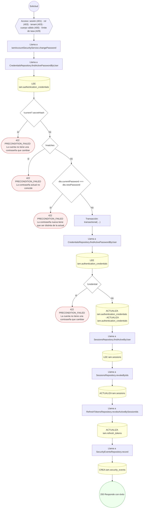

#### 3. POST /iam/auth/forgot-password

Solicitar el restablecimiento de la contraseña

| HTTP | Código | Cuándo |
|---|---|---|
| 202 | — | Éxito |
| 400 | `VALIDATION_FAILED` | El cuerpo cumple el DTO (sin propiedades extra) |
| 401 | `UNAUTHENTICATED` | Hay una sesión válida (JWT) |
| 404 | `NOT_FOUND` | ResourceNotFoundException: Canal no encontrado; ResourceNotFoundException: Plantilla no encontrada |
| 422 | `PRECONDITION_FAILED` | PreconditionFailedException: La notificación a una dirección externa también necesita el usuario destinatario / La notificación necesita el usuario destinatario; PreconditionFailedException: El canal no está activo; PreconditionFailedException: La plantilla no está publicada; PreconditionFailedException: La plantilla es de otro canal |
| 429 | `RATE_LIMITED` | No se supera el límite de solicitudes |


#### 4. POST /iam/auth/login

Iniciar sesión con email o documento de identidad y contraseña

| HTTP | Código | Cuándo |
|---|---|---|
| 200 | — | Éxito |
| 400 | `VALIDATION_FAILED` | El cuerpo cumple el DTO (sin propiedades extra) |
| 401 | `UNAUTHENTICATED` | Hay una sesión válida (JWT); UnauthorizedException: Credenciales inválidas; UnauthorizedException: {{ message: 'Se requiere el código de verificación en dos pa…}; UnauthorizedException: {{ message: 'El código de verificación no es válido', detail…} |
| 429 | `RATE_LIMITED` | No se supera el límite de solicitudes |

```mermaid
flowchart TD
  n1(("Solicitud")):::inicio
  n2{{"Acceso: sesión (401) · cuerpo válido (400) · límite de tasa (429)"}}:::acceso
  n1 --> n2
  n3["Llama a IamAuthService.login"]:::llamada
  n2 --> n3
  n4["Llama a IamAuthService.performLogin"]:::llamada
  n3 --> n4
  n5{"!subject"}:::decision
  n4 --> n5
  n6["Llama a IamAuthService.recordLoginFailure"]:::llamada
  n5 -->|"sí"| n6
  n7["Transacción: transactional(…)"]:::transaccion
  n6 --> n7
  n8["Llama a SecurityEventsRepository.record"]:::llamada
  n7 --> n8
  n9[("CREA iam.security_events")]:::efecto
  n8 --> n9
  n10(["401 UNAUTHENTICATED Credenciales inválidas"]):::error
  n9 --> n10
  n11["Llama a CredentialsRepository.findActivePasswordByLoginIdentifier"]:::llamada
  n5 -->|"no"| n11
  n12["Llama a CredentialsRepository.findActivePasswordBySubject"]:::llamada
  n11 --> n12
  n13[("LEE iam.authentication_credentials")]:::efecto
  n12 --> n13
  n14[("LEE iam.authentication_credentials · LEE common.contact_points · LEE profiles.person_account_links · LEE iam.…")]:::efecto
  n13 --> n14
  n15{"!cred || !cred.secretHash"}:::decision
  n14 --> n15
  n16["Llama a IamAuthService.recordLoginFailure"]:::llamada
  n15 -->|"sí"| n16
  n17["Transacción: transactional(…)"]:::transaccion
  n16 --> n17
  n18["Llama a SecurityEventsRepository.record"]:::llamada
  n17 --> n18
  n19[("CREA iam.security_events")]:::efecto
  n18 --> n19
  n20(["401 UNAUTHENTICATED Credenciales inválidas"]):::error
  n19 --> n20
  n21["Llama a UsersRepository.findById"]:::llamada
  n15 -->|"no"| n21
  n22[("LEE iam.users")]:::efecto
  n21 --> n22
  n23{"!user || user.statusConceptId !== CONCEPTS.USER_ACTIVE"}:::decision
  n22 --> n23
  n24["Llama a IamAuthService.recordLoginFailure"]:::llamada
  n23 -->|"sí"| n24
  n25["Transacción: transactional(…)"]:::transaccion
  n24 --> n25
  n26["Llama a SecurityEventsRepository.record"]:::llamada
  n25 --> n26
  n27[("CREA iam.security_events")]:::efecto
  n26 --> n27
  n28(["401 UNAUTHENTICATED Credenciales inválidas"]):::error
  n27 --> n28
  n29{"!passwordOk"}:::decision
  n23 -->|"no"| n29
  n30["Llama a IamAuthService.handleFailedPassword"]:::llamada
  n29 -->|"sí"| n30
  n31["Transacción: transactional(…)"]:::transaccion
  n30 --> n31
  n32["Llama a SecurityEventsRepository.record"]:::llamada
  n31 --> n32
  n33[("CREA iam.security_events")]:::efecto
  n32 --> n33
  n34["Llama a UsersRepository.findById"]:::llamada
  n33 --> n34
  n35[("LEE iam.users")]:::efecto
  n34 --> n35
  n36["Llama a SecurityEventsRepository.countFailedLoginsSince"]:::llamada
  n35 --> n36
  n37[("LEE iam.security_events")]:::efecto
  n36 --> n37
  n38{"failedCount ›= this.authEnv.lockThreshold"}:::decision
  n37 --> n38
  n39{"user"}:::decision
  n38 -->|"sí"| n39
  n40[("ACTUALIZA iam.users")]:::efecto
  n39 -->|"sí"| n40
  n41["Llama a AccountLockoutsRepository.findActiveForUser"]:::llamada
  n40 --> n41
  n39 -->|"no"| n41
  n42[("LEE iam.account_lockouts")]:::efecto
  n41 --> n42
  n43{"existingLock"}:::decision
  n42 --> n43
  n44[("ACTUALIZA iam.account_lockouts")]:::efecto
  n43 -->|"sí"| n44
  n45["Llama a AccountLockoutsRepository.create"]:::llamada
  n43 -->|"no"| n45
  n46[("CREA iam.account_lockouts")]:::efecto
  n45 --> n46
  n47["Llama a SessionsRepository.activeSessionIdsForUser"]:::llamada
  n44 --> n47
  n46 --> n47
  n48[("LEE iam.sessions")]:::efecto
  n47 --> n48
  n49["Llama a SessionsRepository.revokeAllActiveForUser"]:::llamada
  n48 --> n49
  n50[("ACTUALIZA iam.sessions")]:::efecto
  n49 --> n50
  n51["Llama a RefreshTokensRepository.revokeActiveBySessionIds"]:::llamada
  n50 --> n51
  n52[("ACTUALIZA iam.refresh_tokens")]:::efecto
  n51 --> n52
  n53["Llama a SecurityEventsRepository.record"]:::llamada
  n52 --> n53
  n54[("CREA iam.security_events")]:::efecto
  n53 --> n54
  n55(["401 UNAUTHENTICATED Credenciales inválidas"]):::error
  n54 --> n55
  n38 -->|"no"| n55
  n56["Llama a IamAuthService.assertMfaChallenge"]:::llamada
  n29 -->|"no"| n56
  n57["Llama a MfaFactorsRepository.findVerifiedByUser"]:::llamada
  n56 --> n57
  n58[("LEE iam.mfa_factors")]:::efecto
  n57 --> n58
  n59{"!mfaCode"}:::decision
  n58 --> n59
  n60(["401 UNAUTHENTICATED {{ message: 'Se requiere el código de verificación en dos pa…}"]):::error
  n59 -->|"sí"| n60
  n61(["401 UNAUTHENTICATED {{ message: 'El código de verificación no es válido', detail…}"]):::error
  n59 -->|"no"| n61
  n62["Transacción: transactional(…)"]:::transaccion
  n63["Llama a UserGlobalRolesRepository.findActiveForUser"]:::llamada
  n62 --> n63
  n64[("LEE iam.user_global_roles")]:::efecto
  n63 --> n64
  n65["Llama a IamAuthService.loadActiveTenantIds"]:::llamada
  n64 --> n65
  n66["Llama a DirectoryTenantClaimsAdapter.listActiveTenantIds"]:::llamada
  n65 --> n66
  n67[("LEE directory.tenant_memberships")]:::efecto
  n66 --> n67
  n68["Llama a IamAuthService.loadTenantDisplay"]:::llamada
  n67 --> n68
  n69["Llama a DirectoryTenantClaimsAdapter.describeTenants"]:::llamada
  n68 --> n69
  n70[("LEE directory.tenants")]:::efecto
  n69 --> n70
  n71["… el resto del árbol (10 nodos) está en el JSON del inventario"]:::corte
  n70 --> n71
  classDef acceso fill:#eef,stroke:#66a
  classDef error fill:#fee,stroke:#c33
  classDef ok fill:#efe,stroke:#3a3
  classDef efecto fill:#ffd,stroke:#aa3
  classDef decision fill:#fff,stroke:#555
  classDef corte fill:#eee,stroke:#999,stroke-dasharray: 4
```

#### 5. POST /iam/auth/register-organization

Registrar una organización con su cuenta owner

| HTTP | Código | Cuándo |
|---|---|---|
| 201 | — | Éxito |
| 400 | `VALIDATION_FAILED` | El cuerpo cumple el DTO (sin propiedades extra) |
| 401 | `UNAUTHENTICATED` | Hay una sesión válida (JWT) |
| 409 | `CONFLICT` | ConflictException: El código de organización ya existe; ConflictException: Ya existe una cuenta con ese correo |
| 422 | `PRECONDITION_FAILED` | PreconditionFailedException: Un tenant de tipo PAYER exige el bloque `payer`; PreconditionFailedException: Un tenant de tipo BROKER exige el bloque `broker`; PreconditionFailedException: Un tenant de tipo {tenantType} exige país y jurisdicción; PreconditionFailedException: El tipo societario pertenece al derecho de {entry!.countryIso} y no coincide con el país declarado; PreconditionFailedException: El bloque `payer` sólo corresponde a un tenant de tipo PAYER; PreconditionFailedException: El bloque `broker` sólo corresponde a un tenant de tipo BROKER; PreconditionFailedException: El bloque `pharmacy` sólo corresponde a un tenant de tipo PHARMACY; PreconditionFailedException: El bloque `diagnosticUnit` sólo corresponde a un tenant de tipo DIAGNOSTIC_CENTER; PreconditionFailedException: El bloque `medicalFacility` sólo corresponde a un tenant de tipo {MEDICAL_FACILITY_TENANT_TYPES.join(', ')}; PreconditionFailedException: El tipo de unidad diagnóstica declarado no es válido; PreconditionFailedException: Las sucursales sólo se declaran en una unidad de laboratorio clínico; PreconditionFailedException: Alguna modalidad declarada no pertenece al catálogo de modalidades diagnósticas; PreconditionFailedException: Los conceptos declarados no existen en el catálogo de terminología |
| 429 | `RATE_LIMITED` | No se supera el límite de solicitudes |

```mermaid
flowchart TD
  n1(("Solicitud")):::inicio
  n2{{"Acceso: sesión (401) · cuerpo válido (400) · límite de tasa (429)"}}:::acceso
  n1 --> n2
  n3["Llama a IamOrganizationSelfRegistrationService.registerOrganization"]:::llamada
  n2 --> n3
  n4["Llama a IamOrganizationSelfRegistrationService.performRegisterOrganization"]:::llamada
  n3 --> n4
  n5["Transacción: transactional(…)"]:::transaccion
  n4 --> n5
  n6["Llama a DirectoryRegistrationAdapter.findTenantByCode"]:::llamada
  n5 --> n6
  n7["Llama a TenantsRepository.findByCode"]:::llamada
  n6 --> n7
  n8[("LEE directory.tenants")]:::efecto
  n7 --> n8
  n9{"codeClash"}:::decision
  n8 --> n9
  n10(["409 CONFLICT El código de organización ya existe"]):::error
  n9 -->|"sí"| n10
  n11["Llama a CredentialsRepository.findLivePasswordByEmail"]:::llamada
  n9 -->|"no"| n11
  n12[("LEE iam.authentication_credentials")]:::efecto
  n11 --> n12
  n13{"emailClash"}:::decision
  n12 --> n13
  n14(["409 CONFLICT Ya existe una cuenta con ese correo"]):::error
  n13 -->|"sí"| n14
  n15["Llama a DirectoryRegistrationAdapter.assertProfileMatchesType"]:::llamada
  n13 -->|"no"| n15
  n16["Llama a TenantTypeProfileService.assertProfileMatchesType"]:::llamada
  n15 --> n16
  n17{"tenantType === 'PAYER' && !input.payer"}:::decision
  n16 --> n17
  n18(["422 PRECONDITION_FAILED Un tenant de tipo PAYER exige el bloque `payer`"]):::error
  n17 -->|"sí"| n18
  n19{"tenantType === 'BROKER' && !input.broker"}:::decision
  n17 -->|"no"| n19
  n20(["422 PRECONDITION_FAILED Un tenant de tipo BROKER exige el bloque `broker`"]):::error
  n19 -->|"sí"| n20
  n21{"TERRITORIAL_TENANT_TYPES.includes(tenantType)"}:::decision
  n19 -->|"no"| n21
  n22{"missing.length › 0"}:::decision
  n21 -->|"sí"| n22
  n23(["422 PRECONDITION_FAILED Un tenant de tipo {tenantType} exige país y jurisdicción"]):::error
  n22 -->|"sí"| n23
  n24{"input.legalEntityType && input.countryConceptId"}:::decision
  n22 -->|"no"| n24
  n21 -->|"no"| n24
  n25{"expectedCountryConceptId && expectedCountryConceptId !== input.countryConceptId"}:::decision
  n24 -->|"sí"| n25
  n26(["422 PRECONDITION_FAILED El tipo societario pertenece al derecho de {entry!.countryIso} y no coincide con el p…"]):::error
  n25 -->|"sí"| n26
  n27{"tenantType !== 'PAYER' && input.payer"}:::decision
  n25 -->|"no"| n27
  n24 -->|"no"| n27
  n28(["422 PRECONDITION_FAILED El bloque `payer` sólo corresponde a un tenant de tipo PAYER"]):::error
  n27 -->|"sí"| n28
  n29{"tenantType !== 'BROKER' && input.broker"}:::decision
  n27 -->|"no"| n29
  n30(["422 PRECONDITION_FAILED El bloque `broker` sólo corresponde a un tenant de tipo BROKER"]):::error
  n29 -->|"sí"| n30
  n31{"tenantType !== 'PHARMACY' && input.pharmacy"}:::decision
  n29 -->|"no"| n31
  n32(["422 PRECONDITION_FAILED El bloque `pharmacy` sólo corresponde a un tenant de tipo PHARMACY"]):::error
  n31 -->|"sí"| n32
  n33{"tenantType !== 'DIAGNOSTIC_CENTER' && input.diagnosticUnit"}:::decision
  n31 -->|"no"| n33
  n34(["422 PRECONDITION_FAILED El bloque `diagnosticUnit` sólo corresponde a un tenant de tipo DIAGNOSTIC_CENTER"]):::error
  n33 -->|"sí"| n34
  n35{"input.medicalFacility"}:::decision
  n33 -->|"no"| n35
  n36{"!MEDICAL_FACILITY_TENANT_TYPES.includes(tenantType)"}:::decision
  n35 -->|"sí"| n36
  n37(["422 PRECONDITION_FAILED El bloque `medicalFacility` sólo corresponde a un tenant de tipo {MEDICAL_FACILITY_TE…"]):::error
  n36 -->|"sí"| n37
  n38{"input.diagnosticUnit"}:::decision
  n36 -->|"no"| n38
  n35 -->|"no"| n38
  n39{"unitTypeConceptId !== undefined && !DIAGNOSTIC_UNIT_TYPE_CONCEPTS.has(unitTypeConceptId)"}:::decision
  n38 -->|"sí"| n39
  n40(["422 PRECONDITION_FAILED El tipo de unidad diagnóstica declarado no es válido"]):::error
  n39 -->|"sí"| n40
  n41{"(input.diagnosticUnit.branches?.length ?? 0) › 0 && resolvedUnitTypeConceptId !== DUNIT.UNIT_TYPE_LABORATORY"}:::decision
  n39 -->|"no"| n41
  n42(["422 PRECONDITION_FAILED Las sucursales sólo se declaran en una unidad de laboratorio clínico"]):::error
  n41 -->|"sí"| n42
  n43{"invalidModalities.length › 0"}:::decision
  n41 -->|"no"| n43
  n44(["422 PRECONDITION_FAILED Alguna modalidad declarada no pertenece al catálogo de modalidades diagnósticas"]):::error
  n43 -->|"sí"| n44
  n45["Llama a DirectoryRegistrationAdapter.assertConceptsExist"]:::llamada
  n43 -->|"no"| n45
  n38 -->|"no"| n45
  n46["Llama a TenantTypeProfileService.assertConceptsExist"]:::llamada
  n45 --> n46
  n47{"unknown.length › 0"}:::decision
  n46 --> n47
  n48(["422 PRECONDITION_FAILED Los conceptos declarados no existen en el catálogo de terminología"]):::error
  n47 -->|"sí"| n48
  n49["Llama a UsersRepository.create"]:::llamada
  n47 -->|"no"| n49
  n50[("CREA iam.users")]:::efecto
  n49 --> n50
  n51["Llama a CredentialsRepository.createPassword"]:::llamada
  n50 --> n51
  n52[("CREA iam.authentication_credentials")]:::efecto
  n51 --> n52
  n53["Llama a UserGlobalRolesRepository.create"]:::llamada
  n52 --> n53
  n54[("CREA iam.user_global_roles")]:::efecto
  n53 --> n54
  n55["Llama a DirectoryRegistrationAdapter.createTenant"]:::llamada
  n54 --> n55
  n56["Llama a TenantsRepository.create"]:::llamada
  n55 --> n56
  n57[("CREA directory.tenants")]:::efecto
  n56 --> n57
  n58["Llama a DirectoryRegistrationAdapter.createTenantMembership"]:::llamada
  n57 --> n58
  n59["Llama a TenantMembershipsRepository.create"]:::llamada
  n58 --> n59
  n60[("CREA directory.tenant_memberships")]:::efecto
  n59 --> n60
  n61["Llama a EmailVerificationsRepository.create"]:::llamada
  n60 --> n61
  n62[("CREA iam.email_verifications")]:::efecto
  n61 --> n62
  n63["Llama a SecurityEventsRepository.record"]:::llamada
  n62 --> n63
  n64[("CREA iam.security_events")]:::efecto
  n63 --> n64
  n65(("201 Responde con éxito")):::ok
  n64 --> n65
  classDef acceso fill:#eef,stroke:#66a
  classDef error fill:#fee,stroke:#c33
  classDef ok fill:#efe,stroke:#3a3
  classDef efecto fill:#ffd,stroke:#aa3
  classDef decision fill:#fff,stroke:#555
  classDef corte fill:#eee,stroke:#999,stroke-dasharray: 4
```

#### 6. POST /iam/auth/register-patient

Registrarse como paciente con documento de identidad

| HTTP | Código | Cuándo |
|---|---|---|
| 201 | — | Éxito |
| 400 | `VALIDATION_FAILED` | El cuerpo cumple el DTO (sin propiedades extra) |
| 401 | `UNAUTHENTICATED` | Hay una sesión válida (JWT) |
| 409 | `CONFLICT` | ConflictException: Ya existe una cuenta con ese documento de identidad |
| 422 | `PRECONDITION_FAILED` | PreconditionFailedException: El departamento no pertenece al catálogo de departamentos de Bolivia |
| 429 | `RATE_LIMITED` | No se supera el límite de solicitudes |

```mermaid
flowchart TD
  n1(("Solicitud")):::inicio
  n2{{"Acceso: sesión (401) · cuerpo válido (400) · límite de tasa (429)"}}:::acceso
  n1 --> n2
  n3["Llama a IamPatientSelfRegistrationService.registerPatient"]:::llamada
  n2 --> n3
  n4["Llama a IamPatientSelfRegistrationService.performRegisterPatient"]:::llamada
  n3 --> n4
  n5["Transacción: transactional(…)"]:::transaccion
  n4 --> n5
  n6["Llama a CredentialsRepository.findLivePasswordBySubject"]:::llamada
  n5 --> n6
  n7[("LEE iam.authentication_credentials")]:::efecto
  n6 --> n7
  n8{"existing"}:::decision
  n7 --> n8
  n9(["409 CONFLICT Ya existe una cuenta con ese documento de identidad"]):::error
  n8 -->|"sí"| n9
  n10["Llama a ProfilesRegistrationAdapter.assertIsAdministrativeArea"]:::llamada
  n8 -->|"no"| n10
  n11["Llama a AdministrativeAreaCatalogService.assertIsAdministrativeArea"]:::llamada
  n10 --> n11
  n12{"!members.has(conceptId)"}:::decision
  n11 --> n12
  n13(["422 PRECONDITION_FAILED El departamento no pertenece al catálogo de departamentos de Bolivia"]):::error
  n12 -->|"sí"| n13
  n14["Llama a UsersRepository.create"]:::llamada
  n12 -->|"no"| n14
  n15[("CREA iam.users")]:::efecto
  n14 --> n15
  n16["Llama a CredentialsRepository.createPassword"]:::llamada
  n15 --> n16
  n17[("CREA iam.authentication_credentials")]:::efecto
  n16 --> n17
  n18["Llama a UserGlobalRolesRepository.create"]:::llamada
  n17 --> n18
  n19[("CREA iam.user_global_roles")]:::efecto
  n18 --> n19
  n20["Llama a UserGlobalRolesRepository.create"]:::llamada
  n19 --> n20
  n21[("CREA iam.user_global_roles")]:::efecto
  n20 --> n21
  n22["Llama a ProfilesRegistrationAdapter.createPerson"]:::llamada
  n21 --> n22
  n23["Llama a PersonsRepository.create"]:::llamada
  n22 --> n23
  n24[("CREA profiles.persons")]:::efecto
  n23 --> n24
  n25["Llama a ProfilesRegistrationAdapter.createPersonProfile"]:::llamada
  n24 --> n25
  n26["Llama a PersonProfilesRepository.create"]:::llamada
  n25 --> n26
  n27[("CREA profiles.person_profiles")]:::efecto
  n26 --> n27
  n28["Llama a ProfilesRegistrationAdapter.createPatientProfile"]:::llamada
  n27 --> n28
  n29["Llama a PatientProfilesRepository.create"]:::llamada
  n28 --> n29
  n30[("CREA profiles.patient_profiles")]:::efecto
  n29 --> n30
  n31["Llama a ProfilesRegistrationAdapter.createAccountLink"]:::llamada
  n30 --> n31
  n32["Llama a PersonAccountLinksRepository.create"]:::llamada
  n31 --> n32
  n33[("CREA profiles.person_account_links")]:::efecto
  n32 --> n33
  n34["Llama a CommonRecordsAdapter.createIdentifier"]:::llamada
  n33 --> n34
  n35["Llama a IdentifiersRepository.create"]:::llamada
  n34 --> n35
  n36[("CREA common.identifiers")]:::efecto
  n35 --> n36
  n37{"dto.billingTaxId"}:::decision
  n36 --> n37
  n38["Llama a CommonRecordsAdapter.createIdentifier"]:::llamada
  n37 -->|"sí"| n38
  n39["Llama a IdentifiersRepository.create"]:::llamada
  n38 --> n39
  n40[("CREA common.identifiers")]:::efecto
  n39 --> n40
  n41["Llama a DirectoryRegistrationAdapter.createTenantMembership"]:::llamada
  n40 --> n41
  n37 -->|"no"| n41
  n42["Llama a TenantMembershipsRepository.create"]:::llamada
  n41 --> n42
  n43[("CREA directory.tenant_memberships")]:::efecto
  n42 --> n43
  n44["Repite: forEach(…)"]:::bucle
  n43 --> n44
  n45["Llama a CommonRecordsAdapter.createContactPoint"]:::llamada
  n44 -->|"cada elemento"| n45
  n46["Llama a ContactPointsRepository.create"]:::llamada
  n45 --> n46
  n47[("CREA common.contact_points")]:::efecto
  n46 --> n47
  n48{"dto.email"}:::decision
  n47 --> n48
  n44 -->|"al terminar"| n48
  n49["Llama a CommonRecordsAdapter.createContactPoint"]:::llamada
  n48 -->|"sí"| n49
  n50["Llama a ContactPointsRepository.create"]:::llamada
  n49 --> n50
  n51[("CREA common.contact_points")]:::efecto
  n50 --> n51
  n52["Llama a EmailVerificationsRepository.create"]:::llamada
  n51 --> n52
  n53[("CREA iam.email_verifications")]:::efecto
  n52 --> n53
  n54["Llama a SecurityEventsRepository.record"]:::llamada
  n53 --> n54
  n48 -->|"no"| n54
  n55[("CREA iam.security_events")]:::efecto
  n54 --> n55
  n56(("201 Responde con éxito")):::ok
  n55 --> n56
  classDef acceso fill:#eef,stroke:#66a
  classDef error fill:#fee,stroke:#c33
  classDef ok fill:#efe,stroke:#3a3
  classDef efecto fill:#ffd,stroke:#aa3
  classDef decision fill:#fff,stroke:#555
  classDef corte fill:#eee,stroke:#999,stroke-dasharray: 4
```

#### 7. POST /iam/auth/register-practitioner

Registrarse como profesional de salud con su matrícula

| HTTP | Código | Cuándo |
|---|---|---|
| 201 | — | Éxito |
| 400 | `VALIDATION_FAILED` | El cuerpo cumple el DTO (sin propiedades extra) |
| 401 | `UNAUTHENTICATED` | Hay una sesión válida (JWT) |
| 409 | `CONFLICT` | ConflictException: Ya existe una cuenta con ese correo; ConflictException: El practitioner_code ya está en uso |
| 422 | `PRECONDITION_FAILED` | PreconditionFailedException: Declare los títulos en `credentials` o el número suelto en `credentialNumber`, no los dos; PreconditionFailedException: El archivo del registro del SEDES necesita su número de registro; PreconditionFailedException: La matrícula y el registro del SEDES no pueden compartir el mismo archivo; PreconditionFailedException: La fecha del registro del SEDES necesita su número de registro; PreconditionFailedException: Los datos del registro del colegio necesitan su número de registro; PreconditionFailedException: El registro del colegio no puede compartir el archivo de otra habilitación; PreconditionFailedException: La foto de perfil no es una imagen válida; PreconditionFailedException: El departamento emisor es obligatorio para el alta del profesional; PreconditionFailedException: {labels.subject} no corresponde a un archivo subido en este registro; PreconditionFailedException: La firma y el sello requieren una imagen privada de hasta 2 MB; PreconditionFailedException: Ese concepto no es un tipo de credencial profesional; PreconditionFailedException: El número del título no puede estar vacío; PreconditionFailedException: Esa profesión no está en la Clasificación de Ocupaciones de Bolivia; PreconditionFailedException: La especialidad no pertenece al catálogo de especialidades médicas; PreconditionFailedException: Alguno de los roles indicados no existe o no es asignable |
| 429 | `RATE_LIMITED` | No se supera el límite de solicitudes |
| 500 | `INTERNAL` | StorageLifecycleDenied: LIFECYCLE_WIRING_MISSING |


#### 8. POST /iam/auth/resend-verification

Reenviar el enlace de verificación del correo

| HTTP | Código | Cuándo |
|---|---|---|
| 202 | — | Éxito |
| 400 | `VALIDATION_FAILED` | El cuerpo cumple el DTO (sin propiedades extra) |
| 401 | `UNAUTHENTICATED` | Hay una sesión válida (JWT) |
| 404 | `NOT_FOUND` | ResourceNotFoundException: Canal no encontrado; ResourceNotFoundException: Plantilla no encontrada |
| 422 | `PRECONDITION_FAILED` | PreconditionFailedException: La notificación a una dirección externa también necesita el usuario destinatario / La notificación necesita el usuario destinatario; PreconditionFailedException: El canal no está activo; PreconditionFailedException: La plantilla no está publicada; PreconditionFailedException: La plantilla es de otro canal |
| 429 | `RATE_LIMITED` | No se supera el límite de solicitudes |


#### 9. POST /iam/auth/reset-password

Fijar una contraseña nueva con el token recibido por correo

| HTTP | Código | Cuándo |
|---|---|---|
| 200 | — | Éxito |
| 400 | `VALIDATION_FAILED` | El cuerpo cumple el DTO (sin propiedades extra) |
| 401 | `UNAUTHENTICATED` | Hay una sesión válida (JWT); UnauthorizedException: Token de restablecimiento inválido; UnauthorizedException: El token de restablecimiento ya fue utilizado; UnauthorizedException: El token de restablecimiento expiró |
| 429 | `RATE_LIMITED` | No se supera el límite de solicitudes |

```mermaid
flowchart TD
  n1(("Solicitud")):::inicio
  n2{{"Acceso: sesión (401) · cuerpo válido (400) · límite de tasa (429)"}}:::acceso
  n1 --> n2
  n3["Llama a IamPasswordResetService.resetPassword"]:::llamada
  n2 --> n3
  n4["Transacción: transactional(…)"]:::transaccion
  n3 --> n4
  n5["Llama a PasswordResetsRepository.findByTokenHash"]:::llamada
  n4 --> n5
  n6[("LEE iam.password_resets")]:::efecto
  n5 --> n6
  n7{"!reset"}:::decision
  n6 --> n7
  n8(["401 UNAUTHENTICATED Token de restablecimiento inválido"]):::error
  n7 -->|"sí"| n8
  n9{"reset.stateConceptId !== CONCEPTS.STATE_ACTIVE"}:::decision
  n7 -->|"no"| n9
  n10(["401 UNAUTHENTICATED El token de restablecimiento ya fue utilizado"]):::error
  n9 -->|"sí"| n10
  n11{"reset.expiresAt.getTime() ‹ Date.now()"}:::decision
  n9 -->|"no"| n11
  n12[("ACTUALIZA iam.password_resets")]:::efecto
  n11 -->|"sí"| n12
  n13["Llama a CredentialsRepository.findActivePasswordBySubject"]:::llamada
  n12 --> n13
  n11 -->|"no"| n13
  n14[("LEE iam.authentication_credentials")]:::efecto
  n13 --> n14
  n15{"!credential || credential.userId !== reset.userId"}:::decision
  n14 --> n15
  n16(["401 UNAUTHENTICATED Token de restablecimiento inválido"]):::error
  n15 -->|"sí"| n16
  n17[("ACTUALIZA iam.authentication_credentials · ACTUALIZA iam.authentication_credentials · ACTUALIZA iam.password_…")]:::efecto
  n15 -->|"no"| n17
  n18["Llama a SessionsRepository.activeSessionIdsForUser"]:::llamada
  n17 --> n18
  n19[("LEE iam.sessions")]:::efecto
  n18 --> n19
  n20["Llama a SessionsRepository.revokeAllActiveForUser"]:::llamada
  n19 --> n20
  n21[("ACTUALIZA iam.sessions")]:::efecto
  n20 --> n21
  n22["Llama a RefreshTokensRepository.revokeActiveBySessionIds"]:::llamada
  n21 --> n22
  n23[("ACTUALIZA iam.refresh_tokens")]:::efecto
  n22 --> n23
  n24["Llama a SecurityEventsRepository.record"]:::llamada
  n23 --> n24
  n25[("CREA iam.security_events")]:::efecto
  n24 --> n25
  n26{"outcome.expired"}:::decision
  n25 --> n26
  n27(["401 UNAUTHENTICATED El token de restablecimiento expiró"]):::error
  n26 -->|"sí"| n27
  n28(("200 Responde con éxito")):::ok
  n26 -->|"no"| n28
  classDef acceso fill:#eef,stroke:#66a
  classDef error fill:#fee,stroke:#c33
  classDef ok fill:#efe,stroke:#3a3
  classDef efecto fill:#ffd,stroke:#aa3
  classDef decision fill:#fff,stroke:#555
  classDef corte fill:#eee,stroke:#999,stroke-dasharray: 4
```

#### 10. POST /iam/auth/token/refresh

Rotar el refresh token

| HTTP | Código | Cuándo |
|---|---|---|
| 200 | — | Éxito |
| 400 | `VALIDATION_FAILED` | El cuerpo cumple el DTO (sin propiedades extra) |
| 401 | `UNAUTHENTICATED` | Hay una sesión válida (JWT); UnauthorizedException: No se presentó un refresh token; UnauthorizedException: Sesión no activa; UnauthorizedException: Reuso de refresh token detectado; UnauthorizedException: Refresh token expirado; UnauthorizedException: Refresh token inválido |
| 429 | `RATE_LIMITED` | No se supera el límite de solicitudes |

```mermaid
flowchart TD
  n1(("Solicitud")):::inicio
  n2{{"Acceso: sesión (401) · cuerpo válido (400) · límite de tasa (429)"}}:::acceso
  n1 --> n2
  n3{"!presented"}:::decision
  n2 --> n3
  n4(["401 UNAUTHENTICATED No se presentó un refresh token"]):::error
  n3 -->|"sí"| n4
  n5["Llama a IamAuthService.refresh"]:::llamada
  n3 -->|"no"| n5
  n6["Transacción: transactional(…)"]:::transaccion
  n5 --> n6
  n7["Llama a RefreshTokensRepository.findByHashForUpdate"]:::llamada
  n6 --> n7
  n8[("LEE iam.refresh_tokens")]:::efecto
  n7 --> n8
  n9{"rt.stateConceptId !== CONCEPTS.STATE_ACTIVE"}:::decision
  n8 --> n9
  n10["Llama a SecurityEventsRepository.record"]:::llamada
  n9 -->|"sí"| n10
  n11[("CREA iam.security_events")]:::efecto
  n10 --> n11
  n12["Llama a RefreshTokensRepository.revokeBySessionId"]:::llamada
  n11 --> n12
  n13[("ACTUALIZA iam.refresh_tokens")]:::efecto
  n12 --> n13
  n14["Llama a SessionsRepository.revokeById"]:::llamada
  n13 --> n14
  n15[("ACTUALIZA iam.sessions")]:::efecto
  n14 --> n15
  n16["Llama a SessionsRepository.findById"]:::llamada
  n15 --> n16
  n9 -->|"no"| n16
  n17[("LEE iam.sessions")]:::efecto
  n16 --> n17
  n18{"!session || session.stateConceptId !== CONCEPTS.STATE_ACTIVE"}:::decision
  n17 --> n18
  n19(["401 UNAUTHENTICATED Sesión no activa"]):::error
  n18 -->|"sí"| n19
  n20["Llama a UserGlobalRolesRepository.findActiveForUser"]:::llamada
  n18 -->|"no"| n20
  n21[("LEE iam.user_global_roles")]:::efecto
  n20 --> n21
  n22["Llama a IamAuthService.mergeRoleCodes"]:::llamada
  n21 --> n22
  n23["Llama a AuthzBusinessRolesAdapter.scopedAssignmentsForUser"]:::llamada
  n22 --> n23
  n24["Llama a AuthzEffectiveRolesService.scopedAssignmentsForUser"]:::llamada
  n23 --> n24
  n25[("LEE authz.roles")]:::efecto
  n24 --> n25
  n26["Llama a IamAuthService.loadActiveTenantIds"]:::llamada
  n25 --> n26
  n27["Llama a DirectoryTenantClaimsAdapter.listActiveTenantIds"]:::llamada
  n26 --> n27
  n28[("LEE directory.tenant_memberships")]:::efecto
  n27 --> n28
  n29["Llama a UsersRepository.findById"]:::llamada
  n28 --> n29
  n30[("LEE iam.users")]:::efecto
  n29 --> n30
  n31["Llama a IamAuthService.loadTenantDisplay"]:::llamada
  n30 --> n31
  n32["Llama a DirectoryTenantClaimsAdapter.describeTenants"]:::llamada
  n31 --> n32
  n33[("LEE directory.tenants")]:::efecto
  n32 --> n33
  n34["Llama a IamAuthService.loadPatientProfileId"]:::llamada
  n33 --> n34
  n35["Llama a ProfilesAccountProfileIdsAdapter.findPatientProfileId"]:::llamada
  n34 --> n35
  n36["Llama a PersonAccountLinksRepository.findActiveByUser"]:::llamada
  n35 --> n36
  n37[("LEE profiles.person_account_links")]:::efecto
  n36 --> n37
  n38["Llama a PatientProfilesRepository.findById"]:::llamada
  n37 --> n38
  n39[("LEE profiles.patient_profiles")]:::efecto
  n38 --> n39
  n40["Llama a IamAuthService.loadPractitionerProfileId"]:::llamada
  n39 --> n40
  n41["Llama a ProfilesAccountProfileIdsAdapter.findPractitionerProfileId"]:::llamada
  n40 --> n41
  n42["Llama a PersonAccountLinksRepository.findActiveByUser"]:::llamada
  n41 --> n42
  n43[("LEE profiles.person_account_links")]:::efecto
  n42 --> n43
  n44["Llama a HealthPractitionerProfilesRepository.findById"]:::llamada
  n43 --> n44
  n45[("LEE profiles.health_practitioner_profiles")]:::efecto
  n44 --> n45
  n46[("ACTUALIZA iam.refresh_tokens")]:::efecto
  n45 --> n46
  n47["Llama a RefreshTokensRepository.create"]:::llamada
  n46 --> n47
  n48[("CREA iam.refresh_tokens")]:::efecto
  n47 --> n48
  n49["Llama a SecurityEventsRepository.record"]:::llamada
  n48 --> n49
  n50[("CREA iam.security_events")]:::efecto
  n49 --> n50
  n51{"según outcome.kind"}:::decision
  n50 --> n51
  n52(["401 UNAUTHENTICATED Reuso de refresh token detectado"]):::error
  n51 -->|"'reuse'"| n52
  n53(["401 UNAUTHENTICATED Refresh token expirado"]):::error
  n51 -->|"'expired'"| n53
  n54(["401 UNAUTHENTICATED Refresh token inválido"]):::error
  n51 -->|"por defecto"| n54
  n55(("200 Responde con éxito")):::ok
  classDef acceso fill:#eef,stroke:#66a
  classDef error fill:#fee,stroke:#c33
  classDef ok fill:#efe,stroke:#3a3
  classDef efecto fill:#ffd,stroke:#aa3
  classDef decision fill:#fff,stroke:#555
  classDef corte fill:#eee,stroke:#999,stroke-dasharray: 4
```

#### 11. POST /iam/auth/upload-registration-document

Pre-cargar un PDF para un registro de organización o profesional

| HTTP | Código | Cuándo |
|---|---|---|
| 201 | — | Éxito |
| 400 | `VALIDATION_FAILED` | El cuerpo cumple el DTO (sin propiedades extra) |
| 401 | `UNAUTHENTICATED` | Hay una sesión válida (JWT) |
| 422 | `PRECONDITION_FAILED` | PreconditionFailedException: No se recibió contenido en el campo "file"; PreconditionFailedException: El archivo excede el tamaño máximo permitido; PreconditionFailedException: Solo se admiten documentos PDF |
| 429 | `RATE_LIMITED` | No se supera el límite de solicitudes |
| 500 | `INTERNAL` | StorageLifecycleDenied: LIFECYCLE_WIRING_MISSING; StorageLifecycleDenied: WRITE_RESERVATION_REQUIRED |


#### 12. POST /iam/auth/upload-registration-logo

Pre-cargar el logo del consultorio propio para el registro

| HTTP | Código | Cuándo |
|---|---|---|
| 201 | — | Éxito |
| 400 | `VALIDATION_FAILED` | El cuerpo cumple el DTO (sin propiedades extra) |
| 401 | `UNAUTHENTICATED` | Hay una sesión válida (JWT) |
| 422 | `PRECONDITION_FAILED` | PreconditionFailedException: El logo supera los 2 MB; PreconditionFailedException: No se recibió contenido en el campo "file"; PreconditionFailedException: El archivo excede el tamaño máximo permitido; PreconditionFailedException: Solo se admiten documentos PDF |
| 429 | `RATE_LIMITED` | No se supera el límite de solicitudes |
| 500 | `INTERNAL` | StorageLifecycleDenied: LIFECYCLE_WIRING_MISSING; StorageLifecycleDenied: WRITE_RESERVATION_REQUIRED |


#### 13. POST /iam/auth/upload-registration-signature-image

Pre-cargar una imagen de firma o sello para el registro

| HTTP | Código | Cuándo |
|---|---|---|
| 201 | — | Éxito |
| 400 | `VALIDATION_FAILED` | El cuerpo cumple el DTO (sin propiedades extra) |
| 401 | `UNAUTHENTICATED` | Hay una sesión válida (JWT) |
| 422 | `PRECONDITION_FAILED` | PreconditionFailedException: La imagen supera el límite de 2 MB; PreconditionFailedException: No se recibió contenido en el campo "file"; PreconditionFailedException: El archivo excede el tamaño máximo permitido; PreconditionFailedException: Solo se admiten documentos PDF |
| 429 | `RATE_LIMITED` | No se supera el límite de solicitudes |
| 500 | `INTERNAL` | StorageLifecycleDenied: LIFECYCLE_WIRING_MISSING; StorageLifecycleDenied: WRITE_RESERVATION_REQUIRED |


#### 14. POST /iam/auth/verify-email

Verificar el correo con el token recibido

| HTTP | Código | Cuándo |
|---|---|---|
| 200 | — | Éxito |
| 400 | `VALIDATION_FAILED` | El cuerpo cumple el DTO (sin propiedades extra) |
| 401 | `UNAUTHENTICATED` | Hay una sesión válida (JWT); UnauthorizedException: Token de verificación inválido; UnauthorizedException: El token de verificación ya fue utilizado; UnauthorizedException: El token de verificación expiró |
| 429 | `RATE_LIMITED` | No se supera el límite de solicitudes |


#### 15. POST /iam/me/sessions/{id}/revoke

Cerrar una de mis sesiones

| HTTP | Código | Cuándo |
|---|---|---|
| 200 | — | Éxito |
| 400 | `VALIDATION_FAILED` | Los parámetros de ruta son UUID válidos |
| 401 | `UNAUTHENTICATED` | Hay una sesión válida (JWT) |
| 403 | `FORBIDDEN` | El rol está permitido; El tenant se resuelve y pertenece al actor |
| 404 | `NOT_FOUND` | ResourceNotFoundException: Sesión no encontrada |
| 429 | `RATE_LIMITED` | No se supera el límite de solicitudes |

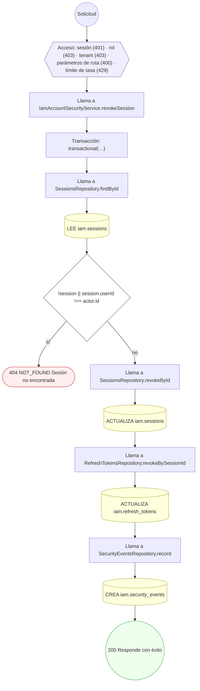

#### 16. DELETE /iam/onboarding-drafts/{formType}/{draftId}

Elimina el borrador al completar el alta exitosamente o por descarte del usuario

| HTTP | Código | Cuándo |
|---|---|---|
| 200 | — | Éxito |
| 401 | `UNAUTHENTICATED` | Hay una sesión válida (JWT) |
| 429 | `RATE_LIMITED` | No se supera el límite de solicitudes |


#### 17. GET /iam/onboarding-drafts/{formType}/{draftId}

Recupera un borrador de alta guardado por identificador y tipo de formulario

| HTTP | Código | Cuándo |
|---|---|---|
| 200 | — | Éxito |
| 401 | `UNAUTHENTICATED` | Hay una sesión válida (JWT) |
| 429 | `RATE_LIMITED` | No se supera el límite de solicitudes |

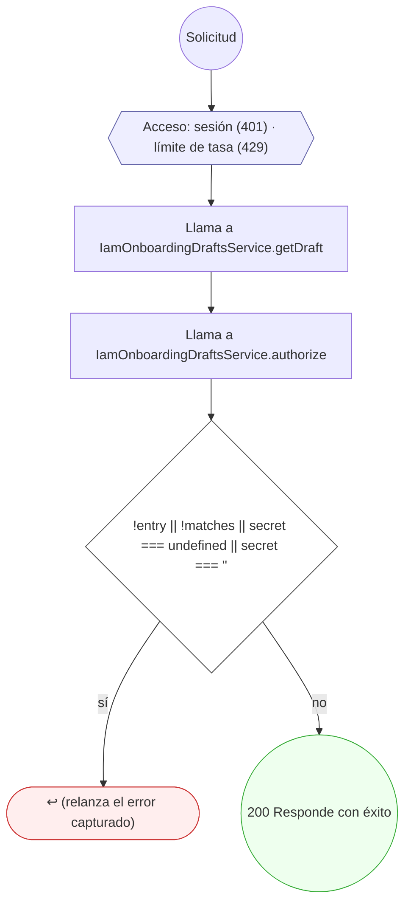

#### 18. PUT /iam/onboarding-drafts/{formType}/{draftId}

Guarda o actualiza el avance del formulario de alta en borrador

| HTTP | Código | Cuándo |
|---|---|---|
| 200 | — | Éxito |
| 401 | `UNAUTHENTICATED` | Hay una sesión válida (JWT) |
| 429 | `RATE_LIMITED` | No se supera el límite de solicitudes |
| 500 | `INTERNAL` | DomainException: {HttpStatus.BAD_REQUEST}; DomainException: {HttpStatus.PAYLOAD_TOO_LARGE}; DomainException: {HttpStatus.TOO_MANY_REQUESTS}; DraftStoreFullError: {retryAfterSeconds} |

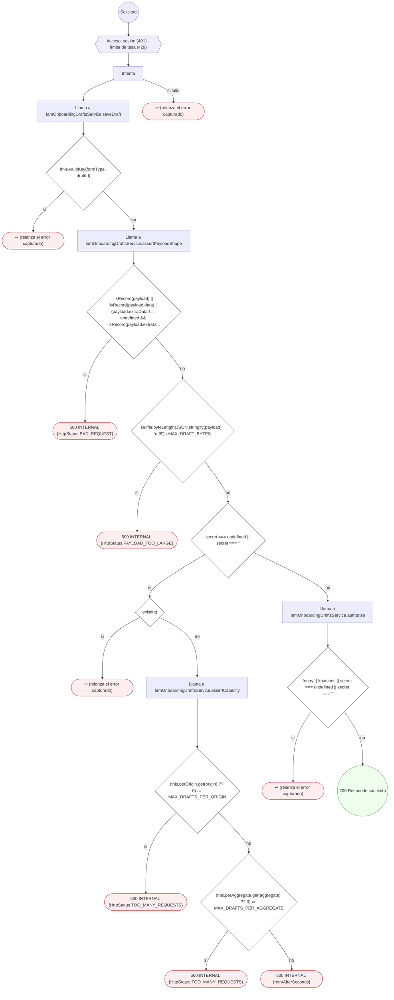

#### 19. POST /iam/users

Crear un usuario con credencial de contraseña y rol inicial

| HTTP | Código | Cuándo |
|---|---|---|
| 201 | — | Éxito |
| 400 | `VALIDATION_FAILED` | El cuerpo cumple el DTO (sin propiedades extra) |
| 401 | `UNAUTHENTICATED` | Hay una sesión válida (JWT) |
| 403 | `FORBIDDEN` | El rol está permitido; El tenant se resuelve y pertenece al actor |
| 409 | `CONFLICT` | ConflictException: El email ya tiene una credencial de contraseña |
| 429 | `RATE_LIMITED` | No se supera el límite de solicitudes |

```mermaid
flowchart TD
  n1(("Solicitud")):::inicio
  n2{{"Acceso: sesión (401) · rol (403) · tenant (403) · cuerpo válido (400) · límite de tasa (429)"}}:::acceso
  n1 --> n2
  n3["Llama a IamUsersService.createUser"]:::llamada
  n2 --> n3
  n4["Transacción: transactional(…)"]:::transaccion
  n3 --> n4
  n5["Llama a CredentialsRepository.findLivePasswordByEmail"]:::llamada
  n4 --> n5
  n6[("LEE iam.authentication_credentials")]:::efecto
  n5 --> n6
  n7{"clash"}:::decision
  n6 --> n7
  n8(["409 CONFLICT El email ya tiene una credencial de contraseña"]):::error
  n7 -->|"sí"| n8
  n9["Llama a UsersRepository.create"]:::llamada
  n7 -->|"no"| n9
  n10[("CREA iam.users")]:::efecto
  n9 --> n10
  n11["Llama a CredentialsRepository.createPassword"]:::llamada
  n10 --> n11
  n12[("CREA iam.authentication_credentials")]:::efecto
  n11 --> n12
  n13{"dto.phone"}:::decision
  n12 --> n13
  n14["Llama a CommonRecordsAdapter.createContactPoint"]:::llamada
  n13 -->|"sí"| n14
  n15["Llama a ContactPointsRepository.create"]:::llamada
  n14 --> n15
  n16[("CREA common.contact_points")]:::efecto
  n15 --> n16
  n17["Llama a UserGlobalRolesRepository.create"]:::llamada
  n16 --> n17
  n13 -->|"no"| n17
  n18[("CREA iam.user_global_roles")]:::efecto
  n17 --> n18
  n19["Llama a SecurityEventsRepository.record"]:::llamada
  n18 --> n19
  n20[("CREA iam.security_events")]:::efecto
  n19 --> n20
  n21(("201 Responde con éxito")):::ok
  n20 --> n21
  classDef acceso fill:#eef,stroke:#66a
  classDef error fill:#fee,stroke:#c33
  classDef ok fill:#efe,stroke:#3a3
  classDef efecto fill:#ffd,stroke:#aa3
  classDef decision fill:#fff,stroke:#555
  classDef corte fill:#eee,stroke:#999,stroke-dasharray: 4
```

#### 20. GET /iam/users/{id}

Ficha de un usuario

| HTTP | Código | Cuándo |
|---|---|---|
| 200 | — | Éxito |
| 400 | `VALIDATION_FAILED` | Los parámetros de ruta son UUID válidos |
| 401 | `UNAUTHENTICATED` | Hay una sesión válida (JWT) |
| 403 | `FORBIDDEN` | El rol está permitido; El tenant se resuelve y pertenece al actor |
| 404 | `NOT_FOUND` | ResourceNotFoundException: Usuario no encontrado |
| 429 | `RATE_LIMITED` | No se supera el límite de solicitudes |

```mermaid
flowchart TD
  n1(("Solicitud")):::inicio
  n2{{"Acceso: sesión (401) · rol (403) · tenant (403) · parámetros de ruta (400) · límite de tasa (429)"}}:::acceso
  n1 --> n2
  n3["Llama a IamUsersReadService.getUserById"]:::llamada
  n2 --> n3
  n4["Llama a UsersRepository.findById"]:::llamada
  n3 --> n4
  n5[("LEE iam.users")]:::efecto
  n4 --> n5
  n6{"!user"}:::decision
  n5 --> n6
  n7(["404 NOT_FOUND Usuario no encontrado"]):::error
  n6 -->|"sí"| n7
  n8(("200 Responde con éxito")):::ok
  n6 -->|"no"| n8
  classDef acceso fill:#eef,stroke:#66a
  classDef error fill:#fee,stroke:#c33
  classDef ok fill:#efe,stroke:#3a3
  classDef efecto fill:#ffd,stroke:#aa3
  classDef decision fill:#fff,stroke:#555
  classDef corte fill:#eee,stroke:#999,stroke-dasharray: 4
```

#### 21. POST /iam/users/{id}/anonymize

Anonimizar (DSAR) la cuenta

| HTTP | Código | Cuándo |
|---|---|---|
| 200 | — | Éxito |
| 400 | `VALIDATION_FAILED` | Los parámetros de ruta son UUID válidos |
| 401 | `UNAUTHENTICATED` | Hay una sesión válida (JWT) |
| 403 | `FORBIDDEN` | El rol está permitido; El tenant se resuelve y pertenece al actor |
| 404 | `NOT_FOUND` | ResourceNotFoundException: Usuario no encontrado |
| 429 | `RATE_LIMITED` | No se supera el límite de solicitudes |

```mermaid
flowchart TD
  n1(("Solicitud")):::inicio
  n2{{"Acceso: sesión (401) · rol (403) · tenant (403) · parámetros de ruta (400) · límite de tasa (429)"}}:::acceso
  n1 --> n2
  n3["Llama a IamUsersService.anonymize"]:::llamada
  n2 --> n3
  n4["Transacción: transactional(…)"]:::transaccion
  n3 --> n4
  n5["Llama a UsersRepository.findById"]:::llamada
  n4 --> n5
  n6[("LEE iam.users")]:::efecto
  n5 --> n6
  n7{"!user"}:::decision
  n6 --> n7
  n8(["404 NOT_FOUND Usuario no encontrado"]):::error
  n7 -->|"sí"| n8
  n9[("ACTUALIZA iam.users · ACTUALIZA iam.users · ACTUALIZA iam.users")]:::efecto
  n7 -->|"no"| n9
  n10["Llama a CredentialsRepository.revokeAllForUser"]:::llamada
  n9 --> n10
  n11[("ACTUALIZA iam.authentication_credentials")]:::efecto
  n10 --> n11
  n12["Llama a SessionsRepository.activeSessionIdsForUser"]:::llamada
  n11 --> n12
  n13[("LEE iam.sessions")]:::efecto
  n12 --> n13
  n14["Llama a SessionsRepository.revokeAllActiveForUser"]:::llamada
  n13 --> n14
  n15[("ACTUALIZA iam.sessions")]:::efecto
  n14 --> n15
  n16["Llama a RefreshTokensRepository.revokeActiveBySessionIds"]:::llamada
  n15 --> n16
  n17[("ACTUALIZA iam.refresh_tokens")]:::efecto
  n16 --> n17
  n18["Llama a UserGlobalRolesRepository.revokeAllForUser"]:::llamada
  n17 --> n18
  n19[("ACTUALIZA iam.user_global_roles")]:::efecto
  n18 --> n19
  n20["Llama a SecurityEventsRepository.record"]:::llamada
  n19 --> n20
  n21[("CREA iam.security_events")]:::efecto
  n20 --> n21
  n22(("200 Responde con éxito")):::ok
  n21 --> n22
  classDef acceso fill:#eef,stroke:#66a
  classDef error fill:#fee,stroke:#c33
  classDef ok fill:#efe,stroke:#3a3
  classDef efecto fill:#ffd,stroke:#aa3
  classDef decision fill:#fff,stroke:#555
  classDef corte fill:#eee,stroke:#999,stroke-dasharray: 4
```

#### 22. GET /iam/users/{id}/credentials

Credenciales del usuario

| HTTP | Código | Cuándo |
|---|---|---|
| 200 | — | Éxito |
| 400 | `VALIDATION_FAILED` | Los parámetros de ruta son UUID válidos |
| 401 | `UNAUTHENTICATED` | Hay una sesión válida (JWT) |
| 403 | `FORBIDDEN` | El rol está permitido; El tenant se resuelve y pertenece al actor |
| 404 | `NOT_FOUND` | ResourceNotFoundException: Usuario no encontrado |
| 429 | `RATE_LIMITED` | No se supera el límite de solicitudes |

```mermaid
flowchart TD
  n1(("Solicitud")):::inicio
  n2{{"Acceso: sesión (401) · rol (403) · tenant (403) · parámetros de ruta (400) · límite de tasa (429)"}}:::acceso
  n1 --> n2
  n3["Llama a IamUsersReadService.listCredentials"]:::llamada
  n2 --> n3
  n4["Llama a IamUsersReadService.forkForExistingUser"]:::llamada
  n3 --> n4
  n5["Llama a UsersRepository.findById"]:::llamada
  n4 --> n5
  n6[("LEE iam.users")]:::efecto
  n5 --> n6
  n7{"!(await this.usersRepo.findById(em, userId))"}:::decision
  n6 --> n7
  n8(["404 NOT_FOUND Usuario no encontrado"]):::error
  n7 -->|"sí"| n8
  n9["Llama a CredentialsRepository.findByUser"]:::llamada
  n7 -->|"no"| n9
  n10[("LEE iam.authentication_credentials")]:::efecto
  n9 --> n10
  n11(("200 Responde con éxito")):::ok
  n10 --> n11
  classDef acceso fill:#eef,stroke:#66a
  classDef error fill:#fee,stroke:#c33
  classDef ok fill:#efe,stroke:#3a3
  classDef efecto fill:#ffd,stroke:#aa3
  classDef decision fill:#fff,stroke:#555
  classDef corte fill:#eee,stroke:#999,stroke-dasharray: 4
```

#### 23. POST /iam/users/{id}/credentials/{cid}/revoke

Revocar una credencial del usuario

| HTTP | Código | Cuándo |
|---|---|---|
| 200 | — | Éxito |
| 400 | `VALIDATION_FAILED` | Los parámetros de ruta son UUID válidos |
| 401 | `UNAUTHENTICATED` | Hay una sesión válida (JWT) |
| 403 | `FORBIDDEN` | El rol está permitido; El tenant se resuelve y pertenece al actor |
| 404 | `NOT_FOUND` | ResourceNotFoundException: Credencial no encontrada para el usuario |
| 429 | `RATE_LIMITED` | No se supera el límite de solicitudes |

```mermaid
flowchart TD
  n1(("Solicitud")):::inicio
  n2{{"Acceso: sesión (401) · rol (403) · tenant (403) · parámetros de ruta (400) · límite de tasa (429)"}}:::acceso
  n1 --> n2
  n3["Llama a IamCredentialsService.revokeCredential"]:::llamada
  n2 --> n3
  n4["Transacción: transactional(…)"]:::transaccion
  n3 --> n4
  n5["Llama a CredentialsRepository.findByIdAndUser"]:::llamada
  n4 --> n5
  n6[("LEE iam.authentication_credentials")]:::efecto
  n5 --> n6
  n7{"!cred"}:::decision
  n6 --> n7
  n8(["404 NOT_FOUND Credencial no encontrada para el usuario"]):::error
  n7 -->|"sí"| n8
  n9[("ACTUALIZA iam.authentication_credentials")]:::efecto
  n7 -->|"no"| n9
  n10["Llama a SecurityEventsRepository.record"]:::llamada
  n9 --> n10
  n11[("CREA iam.security_events")]:::efecto
  n10 --> n11
  n12(("200 Responde con éxito")):::ok
  n11 --> n12
  classDef acceso fill:#eef,stroke:#66a
  classDef error fill:#fee,stroke:#c33
  classDef ok fill:#efe,stroke:#3a3
  classDef efecto fill:#ffd,stroke:#aa3
  classDef decision fill:#fff,stroke:#555
  classDef corte fill:#eee,stroke:#999,stroke-dasharray: 4
```

#### 24. POST /iam/users/{id}/credentials/federated

Enlazar una credencial de identidad federada

| HTTP | Código | Cuándo |
|---|---|---|
| 201 | — | Éxito |
| 400 | `VALIDATION_FAILED` | Los parámetros de ruta son UUID válidos; El cuerpo cumple el DTO (sin propiedades extra) |
| 401 | `UNAUTHENTICATED` | Hay una sesión válida (JWT) |
| 403 | `FORBIDDEN` | El rol está permitido; El tenant se resuelve y pertenece al actor |
| 404 | `NOT_FOUND` | ResourceNotFoundException: Usuario no encontrado |
| 409 | `CONFLICT` | ConflictException: La credencial federada ya existe |
| 429 | `RATE_LIMITED` | No se supera el límite de solicitudes |

```mermaid
flowchart TD
  n1(("Solicitud")):::inicio
  n2{{"Acceso: sesión (401) · rol (403) · tenant (403) · parámetros de ruta (400) · cuerpo válido (400) · límite de…"}}:::acceso
  n1 --> n2
  n3["Llama a IamCredentialsService.linkFederated"]:::llamada
  n2 --> n3
  n4["Transacción: transactional(…)"]:::transaccion
  n3 --> n4
  n5["Llama a UsersRepository.findById"]:::llamada
  n4 --> n5
  n6[("LEE iam.users")]:::efecto
  n5 --> n6
  n7{"!user"}:::decision
  n6 --> n7
  n8(["404 NOT_FOUND Usuario no encontrado"]):::error
  n7 -->|"sí"| n8
  n9["Llama a CredentialsRepository.findFederated"]:::llamada
  n7 -->|"no"| n9
  n10[("LEE iam.authentication_credentials")]:::efecto
  n9 --> n10
  n11{"dup"}:::decision
  n10 --> n11
  n12(["409 CONFLICT La credencial federada ya existe"]):::error
  n11 -->|"sí"| n12
  n13["Llama a CredentialsRepository.createFederated"]:::llamada
  n11 -->|"no"| n13
  n14[("CREA iam.authentication_credentials")]:::efecto
  n13 --> n14
  n15["Llama a SecurityEventsRepository.record"]:::llamada
  n14 --> n15
  n16[("CREA iam.security_events")]:::efecto
  n15 --> n16
  n17(("201 Responde con éxito")):::ok
  n16 --> n17
  classDef acceso fill:#eef,stroke:#66a
  classDef error fill:#fee,stroke:#c33
  classDef ok fill:#efe,stroke:#3a3
  classDef efecto fill:#ffd,stroke:#aa3
  classDef decision fill:#fff,stroke:#555
  classDef corte fill:#eee,stroke:#999,stroke-dasharray: 4
```

#### 25. GET /iam/users/{id}/devices

Dispositivos del usuario

| HTTP | Código | Cuándo |
|---|---|---|
| 200 | — | Éxito |
| 400 | `VALIDATION_FAILED` | Los parámetros de ruta son UUID válidos |
| 401 | `UNAUTHENTICATED` | Hay una sesión válida (JWT) |
| 403 | `FORBIDDEN` | El rol está permitido; El tenant se resuelve y pertenece al actor |
| 404 | `NOT_FOUND` | ResourceNotFoundException: Usuario no encontrado |
| 429 | `RATE_LIMITED` | No se supera el límite de solicitudes |

```mermaid
flowchart TD
  n1(("Solicitud")):::inicio
  n2{{"Acceso: sesión (401) · rol (403) · tenant (403) · parámetros de ruta (400) · límite de tasa (429)"}}:::acceso
  n1 --> n2
  n3["Llama a IamUsersReadService.listDevices"]:::llamada
  n2 --> n3
  n4["Llama a IamUsersReadService.forkForExistingUser"]:::llamada
  n3 --> n4
  n5["Llama a UsersRepository.findById"]:::llamada
  n4 --> n5
  n6[("LEE iam.users")]:::efecto
  n5 --> n6
  n7{"!(await this.usersRepo.findById(em, userId))"}:::decision
  n6 --> n7
  n8(["404 NOT_FOUND Usuario no encontrado"]):::error
  n7 -->|"sí"| n8
  n9["Llama a DevicesRepository.findByUser"]:::llamada
  n7 -->|"no"| n9
  n10[("LEE iam.devices")]:::efecto
  n9 --> n10
  n11(("200 Responde con éxito")):::ok
  n10 --> n11
  classDef acceso fill:#eef,stroke:#66a
  classDef error fill:#fee,stroke:#c33
  classDef ok fill:#efe,stroke:#3a3
  classDef efecto fill:#ffd,stroke:#aa3
  classDef decision fill:#fff,stroke:#555
  classDef corte fill:#eee,stroke:#999,stroke-dasharray: 4
```

#### 26. POST /iam/users/{id}/devices

Registrar un dispositivo del usuario

| HTTP | Código | Cuándo |
|---|---|---|
| 201 | — | Éxito |
| 400 | `VALIDATION_FAILED` | Los parámetros de ruta son UUID válidos; El cuerpo cumple el DTO (sin propiedades extra) |
| 401 | `UNAUTHENTICATED` | Hay una sesión válida (JWT) |
| 403 | `FORBIDDEN` | El rol está permitido; El tenant se resuelve y pertenece al actor; ForbiddenException: No tiene acceso a los dispositivos de esta cuenta |
| 404 | `NOT_FOUND` | ResourceNotFoundException: Usuario no encontrado |
| 429 | `RATE_LIMITED` | No se supera el límite de solicitudes |

```mermaid
flowchart TD
  n1(("Solicitud")):::inicio
  n2{{"Acceso: sesión (401) · rol (403) · tenant (403) · parámetros de ruta (400) · cuerpo válido (400) · límite de…"}}:::acceso
  n1 --> n2
  n3["Llama a IamDevicesService.register"]:::llamada
  n2 --> n3
  n4{"actor.id !== userId && !actor.roles.some((role) =› ROLES_THAT_MANAGE_DEVICES.includes(role))"}:::decision
  n3 --> n4
  n5(["403 FORBIDDEN No tiene acceso a los dispositivos de esta cuenta"]):::error
  n4 -->|"sí"| n5
  n6["Transacción: transactional(…)"]:::transaccion
  n4 -->|"no"| n6
  n7["Llama a UsersRepository.findById"]:::llamada
  n6 --> n7
  n8[("LEE iam.users")]:::efecto
  n7 --> n8
  n9{"!user"}:::decision
  n8 --> n9
  n10(["404 NOT_FOUND Usuario no encontrado"]):::error
  n9 -->|"sí"| n10
  n11["Llama a DevicesRepository.create"]:::llamada
  n9 -->|"no"| n11
  n12[("CREA iam.devices")]:::efecto
  n11 --> n12
  n13{"trusted"}:::decision
  n12 --> n13
  n14["Llama a SecurityEventsRepository.record"]:::llamada
  n13 -->|"sí"| n14
  n15[("CREA iam.security_events")]:::efecto
  n14 --> n15
  n16(("201 Responde con éxito")):::ok
  n15 --> n16
  n13 -->|"no"| n16
  classDef acceso fill:#eef,stroke:#66a
  classDef error fill:#fee,stroke:#c33
  classDef ok fill:#efe,stroke:#3a3
  classDef efecto fill:#ffd,stroke:#aa3
  classDef decision fill:#fff,stroke:#555
  classDef corte fill:#eee,stroke:#999,stroke-dasharray: 4
```

#### 27. GET /iam/users/{id}/global-roles

Roles globales del usuario

| HTTP | Código | Cuándo |
|---|---|---|
| 200 | — | Éxito |
| 400 | `VALIDATION_FAILED` | Los parámetros de ruta son UUID válidos |
| 401 | `UNAUTHENTICATED` | Hay una sesión válida (JWT) |
| 403 | `FORBIDDEN` | El rol está permitido; El tenant se resuelve y pertenece al actor |
| 404 | `NOT_FOUND` | ResourceNotFoundException: Usuario no encontrado |
| 429 | `RATE_LIMITED` | No se supera el límite de solicitudes |

```mermaid
flowchart TD
  n1(("Solicitud")):::inicio
  n2{{"Acceso: sesión (401) · rol (403) · tenant (403) · parámetros de ruta (400) · límite de tasa (429)"}}:::acceso
  n1 --> n2
  n3["Llama a IamUsersReadService.listGlobalRoles"]:::llamada
  n2 --> n3
  n4["Llama a IamUsersReadService.forkForExistingUser"]:::llamada
  n3 --> n4
  n5["Llama a UsersRepository.findById"]:::llamada
  n4 --> n5
  n6[("LEE iam.users")]:::efecto
  n5 --> n6
  n7{"!(await this.usersRepo.findById(em, userId))"}:::decision
  n6 --> n7
  n8(["404 NOT_FOUND Usuario no encontrado"]):::error
  n7 -->|"sí"| n8
  n9["Llama a UserGlobalRolesRepository.findByUser"]:::llamada
  n7 -->|"no"| n9
  n10[("LEE iam.user_global_roles")]:::efecto
  n9 --> n10
  n11(("200 Responde con éxito")):::ok
  n10 --> n11
  classDef acceso fill:#eef,stroke:#66a
  classDef error fill:#fee,stroke:#c33
  classDef ok fill:#efe,stroke:#3a3
  classDef efecto fill:#ffd,stroke:#aa3
  classDef decision fill:#fff,stroke:#555
  classDef corte fill:#eee,stroke:#999,stroke-dasharray: 4
```

#### 28. POST /iam/users/{id}/global-roles

Conceder o revocar un rol global

| HTTP | Código | Cuándo |
|---|---|---|
| 200 | — | Éxito |
| 400 | `VALIDATION_FAILED` | Los parámetros de ruta son UUID válidos; El cuerpo cumple el DTO (sin propiedades extra) |
| 401 | `UNAUTHENTICATED` | Hay una sesión válida (JWT) |
| 403 | `FORBIDDEN` | El rol está permitido; El tenant se resuelve y pertenece al actor |
| 404 | `NOT_FOUND` | ResourceNotFoundException: Usuario no encontrado; ResourceNotFoundException: El usuario no tiene ese rol activo |
| 409 | `CONFLICT` | ConflictException: El rol ya está concedido |
| 429 | `RATE_LIMITED` | No se supera el límite de solicitudes |

```mermaid
flowchart TD
  n1(("Solicitud")):::inicio
  n2{{"Acceso: sesión (401) · rol (403) · tenant (403) · parámetros de ruta (400) · cuerpo válido (400) · límite de…"}}:::acceso
  n1 --> n2
  n3["Llama a IamUsersService.changeGlobalRole"]:::llamada
  n2 --> n3
  n4["Transacción: transactional(…)"]:::transaccion
  n3 --> n4
  n5["Llama a UsersRepository.findById"]:::llamada
  n4 --> n5
  n6[("LEE iam.users")]:::efecto
  n5 --> n6
  n7{"!user"}:::decision
  n6 --> n7
  n8(["404 NOT_FOUND Usuario no encontrado"]):::error
  n7 -->|"sí"| n8
  n9["Llama a UserGlobalRolesRepository.findActive"]:::llamada
  n7 -->|"no"| n9
  n10[("LEE iam.user_global_roles")]:::efecto
  n9 --> n10
  n11{"dto.action === 'GRANT'"}:::decision
  n10 --> n11
  n12{"active"}:::decision
  n11 -->|"sí"| n12
  n13(["409 CONFLICT El rol ya está concedido"]):::error
  n12 -->|"sí"| n13
  n14["Llama a UserGlobalRolesRepository.create"]:::llamada
  n12 -->|"no"| n14
  n15[("CREA iam.user_global_roles")]:::efecto
  n14 --> n15
  n16["Llama a SecurityEventsRepository.record"]:::llamada
  n15 --> n16
  n17[("CREA iam.security_events")]:::efecto
  n16 --> n17
  n18{"!active"}:::decision
  n11 -->|"no"| n18
  n19(["404 NOT_FOUND El usuario no tiene ese rol activo"]):::error
  n18 -->|"sí"| n19
  n20[("ACTUALIZA iam.user_global_roles")]:::efecto
  n18 -->|"no"| n20
  n21["Llama a SessionsRepository.activeSessionIdsForUser"]:::llamada
  n20 --> n21
  n22[("LEE iam.sessions")]:::efecto
  n21 --> n22
  n23["Llama a SessionsRepository.revokeAllActiveForUser"]:::llamada
  n22 --> n23
  n24[("ACTUALIZA iam.sessions")]:::efecto
  n23 --> n24
  n25["Llama a RefreshTokensRepository.revokeActiveBySessionIds"]:::llamada
  n24 --> n25
  n26[("ACTUALIZA iam.refresh_tokens")]:::efecto
  n25 --> n26
  n27["Llama a SecurityEventsRepository.record"]:::llamada
  n26 --> n27
  n28[("CREA iam.security_events")]:::efecto
  n27 --> n28
  n29(("200 Responde con éxito")):::ok
  n17 --> n29
  n28 --> n29
  classDef acceso fill:#eef,stroke:#66a
  classDef error fill:#fee,stroke:#c33
  classDef ok fill:#efe,stroke:#3a3
  classDef efecto fill:#ffd,stroke:#aa3
  classDef decision fill:#fff,stroke:#555
  classDef corte fill:#eee,stroke:#999,stroke-dasharray: 4
```

#### 29. POST /iam/users/{id}/lock

Bloquear la cuenta y revocar sus sesiones

| HTTP | Código | Cuándo |
|---|---|---|
| 200 | — | Éxito |
| 400 | `VALIDATION_FAILED` | Los parámetros de ruta son UUID válidos; El cuerpo cumple el DTO (sin propiedades extra) |
| 401 | `UNAUTHENTICATED` | Hay una sesión válida (JWT) |
| 403 | `FORBIDDEN` | El rol está permitido; El tenant se resuelve y pertenece al actor |
| 404 | `NOT_FOUND` | ResourceNotFoundException: Usuario no encontrado |
| 429 | `RATE_LIMITED` | No se supera el límite de solicitudes |

```mermaid
flowchart TD
  n1(("Solicitud")):::inicio
  n2{{"Acceso: sesión (401) · rol (403) · tenant (403) · parámetros de ruta (400) · cuerpo válido (400) · límite de…"}}:::acceso
  n1 --> n2
  n3["Llama a IamUsersService.lock"]:::llamada
  n2 --> n3
  n4["Transacción: transactional(…)"]:::transaccion
  n3 --> n4
  n5["Llama a UsersRepository.findById"]:::llamada
  n4 --> n5
  n6[("LEE iam.users")]:::efecto
  n5 --> n6
  n7{"!user"}:::decision
  n6 --> n7
  n8(["404 NOT_FOUND Usuario no encontrado"]):::error
  n7 -->|"sí"| n8
  n9[("ACTUALIZA iam.users")]:::efecto
  n7 -->|"no"| n9
  n10["Llama a AccountLockoutsRepository.create"]:::llamada
  n9 --> n10
  n11[("CREA iam.account_lockouts")]:::efecto
  n10 --> n11
  n12["Llama a SessionsRepository.activeSessionIdsForUser"]:::llamada
  n11 --> n12
  n13[("LEE iam.sessions")]:::efecto
  n12 --> n13
  n14["Llama a SessionsRepository.revokeAllActiveForUser"]:::llamada
  n13 --> n14
  n15[("ACTUALIZA iam.sessions")]:::efecto
  n14 --> n15
  n16["Llama a RefreshTokensRepository.revokeActiveBySessionIds"]:::llamada
  n15 --> n16
  n17[("ACTUALIZA iam.refresh_tokens")]:::efecto
  n16 --> n17
  n18["Llama a SecurityEventsRepository.record"]:::llamada
  n17 --> n18
  n19[("CREA iam.security_events")]:::efecto
  n18 --> n19
  n20(("200 Responde con éxito")):::ok
  n19 --> n20
  classDef acceso fill:#eef,stroke:#66a
  classDef error fill:#fee,stroke:#c33
  classDef ok fill:#efe,stroke:#3a3
  classDef efecto fill:#ffd,stroke:#aa3
  classDef decision fill:#fff,stroke:#555
  classDef corte fill:#eee,stroke:#999,stroke-dasharray: 4
```

#### 30. GET /iam/users/{id}/mfa-factors

Factores de MFA del usuario

| HTTP | Código | Cuándo |
|---|---|---|
| 200 | — | Éxito |
| 400 | `VALIDATION_FAILED` | Los parámetros de ruta son UUID válidos |
| 401 | `UNAUTHENTICATED` | Hay una sesión válida (JWT) |
| 403 | `FORBIDDEN` | El rol está permitido; El tenant se resuelve y pertenece al actor |
| 404 | `NOT_FOUND` | ResourceNotFoundException: Usuario no encontrado |
| 429 | `RATE_LIMITED` | No se supera el límite de solicitudes |

```mermaid
flowchart TD
  n1(("Solicitud")):::inicio
  n2{{"Acceso: sesión (401) · rol (403) · tenant (403) · parámetros de ruta (400) · límite de tasa (429)"}}:::acceso
  n1 --> n2
  n3["Llama a IamUsersReadService.listMfaFactors"]:::llamada
  n2 --> n3
  n4["Llama a IamUsersReadService.forkForExistingUser"]:::llamada
  n3 --> n4
  n5["Llama a UsersRepository.findById"]:::llamada
  n4 --> n5
  n6[("LEE iam.users")]:::efecto
  n5 --> n6
  n7{"!(await this.usersRepo.findById(em, userId))"}:::decision
  n6 --> n7
  n8(["404 NOT_FOUND Usuario no encontrado"]):::error
  n7 -->|"sí"| n8
  n9["Llama a MfaFactorsRepository.findByUser"]:::llamada
  n7 -->|"no"| n9
  n10[("LEE iam.mfa_factors")]:::efecto
  n9 --> n10
  n11(("200 Responde con éxito")):::ok
  n10 --> n11
  classDef acceso fill:#eef,stroke:#66a
  classDef error fill:#fee,stroke:#c33
  classDef ok fill:#efe,stroke:#3a3
  classDef efecto fill:#ffd,stroke:#aa3
  classDef decision fill:#fff,stroke:#555
  classDef corte fill:#eee,stroke:#999,stroke-dasharray: 4
```

#### 31. POST /iam/users/{id}/mfa-factors

Enrolar o verificar un factor MFA

| HTTP | Código | Cuándo |
|---|---|---|
| 201 | — | Éxito |
| 400 | `VALIDATION_FAILED` | Los parámetros de ruta son UUID válidos; El cuerpo cumple el DTO (sin propiedades extra) |
| 401 | `UNAUTHENTICATED` | Hay una sesión válida (JWT) |
| 403 | `FORBIDDEN` | El rol está permitido; El tenant se resuelve y pertenece al actor; ForbiddenException: No tiene acceso a los factores MFA de esta cuenta |
| 404 | `NOT_FOUND` | ResourceNotFoundException: Usuario no encontrado; ResourceNotFoundException: Factor MFA no encontrado |
| 422 | `PRECONDITION_FAILED` | PreconditionFailedException: factorId es obligatorio para verificar; PreconditionFailedException: code es obligatorio para verificar; PreconditionFailedException: El factor no tiene un secreto TOTP asociado; PreconditionFailedException: Código MFA inválido; PreconditionFailedException: factorType es obligatorio para enrolar |
| 429 | `RATE_LIMITED` | No se supera el límite de solicitudes |

```mermaid
flowchart TD
  n1(("Solicitud")):::inicio
  n2{{"Acceso: sesión (401) · rol (403) · tenant (403) · parámetros de ruta (400) · cuerpo válido (400) · límite de…"}}:::acceso
  n1 --> n2
  n3["Llama a IamMfaService.enrollOrVerify"]:::llamada
  n2 --> n3
  n4{"actor.id !== userId && !actor.roles.some((role) =› ROLES_THAT_MANAGE_MFA.includes(role))"}:::decision
  n3 --> n4
  n5(["403 FORBIDDEN No tiene acceso a los factores MFA de esta cuenta"]):::error
  n4 -->|"sí"| n5
  n6["Transacción: transactional(…)"]:::transaccion
  n4 -->|"no"| n6
  n7["Llama a UsersRepository.findById"]:::llamada
  n6 --> n7
  n8[("LEE iam.users")]:::efecto
  n7 --> n8
  n9{"!user"}:::decision
  n8 --> n9
  n10(["404 NOT_FOUND Usuario no encontrado"]):::error
  n9 -->|"sí"| n10
  n11{"dto.verify"}:::decision
  n9 -->|"no"| n11
  n12{"!dto.factorId"}:::decision
  n11 -->|"sí"| n12
  n13(["422 PRECONDITION_FAILED factorId es obligatorio para verificar"]):::error
  n12 -->|"sí"| n13
  n14["Llama a MfaFactorsRepository.findByIdAndUser"]:::llamada
  n12 -->|"no"| n14
  n15[("LEE iam.mfa_factors")]:::efecto
  n14 --> n15
  n16{"!factor"}:::decision
  n15 --> n16
  n17(["404 NOT_FOUND Factor MFA no encontrado"]):::error
  n16 -->|"sí"| n17
  n18{"!dto.code"}:::decision
  n16 -->|"no"| n18
  n19(["422 PRECONDITION_FAILED code es obligatorio para verificar"]):::error
  n18 -->|"sí"| n19
  n20{"!factor.secretEncrypted"}:::decision
  n18 -->|"no"| n20
  n21(["422 PRECONDITION_FAILED El factor no tiene un secreto TOTP asociado"]):::error
  n20 -->|"sí"| n21
  n22{"!result.valid"}:::decision
  n20 -->|"no"| n22
  n23["Llama a SecurityEventsRepository.record"]:::llamada
  n22 -->|"sí"| n23
  n24[("CREA iam.security_events")]:::efecto
  n23 --> n24
  n25(["422 PRECONDITION_FAILED Código MFA inválido"]):::error
  n24 --> n25
  n26[("ACTUALIZA iam.mfa_factors · ACTUALIZA iam.mfa_factors · ACTUALIZA iam.users")]:::efecto
  n22 -->|"no"| n26
  n27["Llama a SecurityEventsRepository.record"]:::llamada
  n26 --> n27
  n28[("CREA iam.security_events")]:::efecto
  n27 --> n28
  n29{"!dto.factorType"}:::decision
  n28 --> n29
  n11 -->|"no"| n29
  n30(["422 PRECONDITION_FAILED factorType es obligatorio para enrolar"]):::error
  n29 -->|"sí"| n30
  n31["Llama a MfaFactorsRepository.create"]:::llamada
  n29 -->|"no"| n31
  n32[("CREA iam.mfa_factors")]:::efecto
  n31 --> n32
  n33{"dto.factorType === 'TOTP'"}:::decision
  n32 --> n33
  n34[("ACTUALIZA iam.mfa_factors")]:::efecto
  n33 -->|"sí"| n34
  n35["Llama a SecurityEventsRepository.record"]:::llamada
  n34 --> n35
  n33 -->|"no"| n35
  n36[("CREA iam.security_events")]:::efecto
  n35 --> n36
  n37(("201 Responde con éxito")):::ok
  n36 --> n37
  classDef acceso fill:#eef,stroke:#66a
  classDef error fill:#fee,stroke:#c33
  classDef ok fill:#efe,stroke:#3a3
  classDef efecto fill:#ffd,stroke:#aa3
  classDef decision fill:#fff,stroke:#555
  classDef corte fill:#eee,stroke:#999,stroke-dasharray: 4
```

#### 32. GET /iam/users/{id}/sessions

Sesiones del usuario

| HTTP | Código | Cuándo |
|---|---|---|
| 200 | — | Éxito |
| 400 | `VALIDATION_FAILED` | Los parámetros de ruta son UUID válidos |
| 401 | `UNAUTHENTICATED` | Hay una sesión válida (JWT) |
| 403 | `FORBIDDEN` | El rol está permitido; El tenant se resuelve y pertenece al actor |
| 404 | `NOT_FOUND` | ResourceNotFoundException: Usuario no encontrado |
| 429 | `RATE_LIMITED` | No se supera el límite de solicitudes |

```mermaid
flowchart TD
  n1(("Solicitud")):::inicio
  n2{{"Acceso: sesión (401) · rol (403) · tenant (403) · parámetros de ruta (400) · límite de tasa (429)"}}:::acceso
  n1 --> n2
  n3["Llama a IamUsersReadService.listSessions"]:::llamada
  n2 --> n3
  n4["Llama a IamUsersReadService.forkForExistingUser"]:::llamada
  n3 --> n4
  n5["Llama a UsersRepository.findById"]:::llamada
  n4 --> n5
  n6[("LEE iam.users")]:::efecto
  n5 --> n6
  n7{"!(await this.usersRepo.findById(em, userId))"}:::decision
  n6 --> n7
  n8(["404 NOT_FOUND Usuario no encontrado"]):::error
  n7 -->|"sí"| n8
  n9["Llama a SessionsRepository.findByUser"]:::llamada
  n7 -->|"no"| n9
  n10[("LEE iam.sessions")]:::efecto
  n9 --> n10
  n11(("200 Responde con éxito")):::ok
  n10 --> n11
  classDef acceso fill:#eef,stroke:#66a
  classDef error fill:#fee,stroke:#c33
  classDef ok fill:#efe,stroke:#3a3
  classDef efecto fill:#ffd,stroke:#aa3
  classDef decision fill:#fff,stroke:#555
  classDef corte fill:#eee,stroke:#999,stroke-dasharray: 4
```

#### 33. POST /iam/users/assisted-practitioner-registration

Alta administrativa de un profesional (devuelve token de activación)

| HTTP | Código | Cuándo |
|---|---|---|
| 201 | — | Éxito |
| 400 | `VALIDATION_FAILED` | El cuerpo cumple el DTO (sin propiedades extra) |
| 401 | `UNAUTHENTICATED` | Hay una sesión válida (JWT) |
| 403 | `FORBIDDEN` | El rol está permitido; El tenant se resuelve y pertenece al actor |
| 409 | `CONFLICT` | ConflictException: Ya existe una cuenta con ese correo; ConflictException: El practitioner_code ya está en uso |
| 422 | `PRECONDITION_FAILED` | PreconditionFailedException: Declare los títulos en `credentials` o el número suelto en `credentialNumber`, no los dos; PreconditionFailedException: El archivo del registro del SEDES necesita su número de registro; PreconditionFailedException: La matrícula y el registro del SEDES no pueden compartir el mismo archivo; PreconditionFailedException: La fecha del registro del SEDES necesita su número de registro; PreconditionFailedException: Los datos del registro del colegio necesitan su número de registro; PreconditionFailedException: El registro del colegio no puede compartir el archivo de otra habilitación; PreconditionFailedException: La foto de perfil no es una imagen válida; PreconditionFailedException: El departamento emisor es obligatorio para el alta del profesional; PreconditionFailedException: {labels.subject} no corresponde a un archivo subido en este registro; PreconditionFailedException: La firma y el sello requieren una imagen privada de hasta 2 MB; PreconditionFailedException: Ese concepto no es un tipo de credencial profesional; PreconditionFailedException: El número del título no puede estar vacío; PreconditionFailedException: Esa profesión no está en la Clasificación de Ocupaciones de Bolivia; PreconditionFailedException: La especialidad no pertenece al catálogo de especialidades médicas; PreconditionFailedException: Alguno de los roles indicados no existe o no es asignable |
| 429 | `RATE_LIMITED` | No se supera el límite de solicitudes |
| 500 | `INTERNAL` | StorageLifecycleDenied: LIFECYCLE_WIRING_MISSING |

```mermaid
flowchart TD
  n1(("Solicitud")):::inicio
  n2{{"Acceso: sesión (401) · rol (403) · tenant (403) · cuerpo válido (400) · límite de tasa (429)"}}:::acceso
  n1 --> n2
  n3["Llama a IamPractitionerSelfRegistrationService.assistedRegisterPractitioner"]:::llamada
  n2 --> n3
  n4["Llama a IamPractitionerSelfRegistrationService.performRegisterPractitioner"]:::llamada
  n3 --> n4
  n5{"dto.credentialNumber !== undefined && dto.credentials !== undefined && dto.credentials.length › 0"}:::decision
  n4 --> n5
  n6(["422 PRECONDITION_FAILED Declare los títulos en `credentials` o el número suelto en `credentialNumber`, no los…"]):::error
  n5 -->|"sí"| n6
  n7{"dto.sedesLicenseFileId !== undefined && dto.sedesLicenseNumber === undefined"}:::decision
  n5 -->|"no"| n7
  n8(["422 PRECONDITION_FAILED El archivo del registro del SEDES necesita su número de registro"]):::error
  n7 -->|"sí"| n8
  n9{"dto.licenseFileId !== undefined && dto.licenseFileId === dto.sedesLicenseFileId"}:::decision
  n7 -->|"no"| n9
  n10(["422 PRECONDITION_FAILED La matrícula y el registro del SEDES no pueden compartir el mismo archivo"]):::error
  n9 -->|"sí"| n10
  n11{"dto.sedesLicenseIssueDate !== undefined && dto.sedesLicenseNumber === undefined"}:::decision
  n9 -->|"no"| n11
  n12(["422 PRECONDITION_FAILED La fecha del registro del SEDES necesita su número de registro"]):::error
  n11 -->|"sí"| n12
  n13{"dto.collegeLicenseNumber === undefined"}:::decision
  n11 -->|"no"| n13
  n14{"suelto !== undefined"}:::decision
  n13 -->|"sí"| n14
  n15(["422 PRECONDITION_FAILED Los datos del registro del colegio necesitan su número de registro"]):::error
  n14 -->|"sí"| n15
  n16{"dto.collegeLicenseFileId !== undefined && (dto.collegeLicenseFileId === dto.licenseFileId || dto.collegeLicen…"}:::decision
  n14 -->|"no"| n16
  n13 -->|"no"| n16
  n17(["422 PRECONDITION_FAILED El registro del colegio no puede compartir el archivo de otra habilitación"]):::error
  n16 -->|"sí"| n17
  n18{"dto.profilePhotoBase64 && !isReadableImage(dto.profilePhotoBase64)"}:::decision
  n16 -->|"no"| n18
  n19(["422 PRECONDITION_FAILED La foto de perfil no es una imagen válida"]):::error
  n18 -->|"sí"| n19
  n20["Llama a IamPractitionerSelfRegistrationService.uploadProfilePhoto"]:::llamada
  n18 -->|"no"| n20
  n21["Intenta"]:::intento
  n20 --> n21
  n22{"err instanceof PreconditionFailedException"}:::decision
  n21 -->|"si falla"| n22
  n23(["↩ (relanza el error capturado)"]):::error
  n22 -->|"sí"| n23
  n24["Transacción: transactional(…)"]:::transaccion
  n21 --> n24
  n22 -->|"no"| n24
  n25["Llama a CredentialsRepository.findLivePasswordByEmail"]:::llamada
  n24 --> n25
  n26[("LEE iam.authentication_credentials")]:::efecto
  n25 --> n26
  n27{"clash"}:::decision
  n26 --> n27
  n28(["409 CONFLICT Ya existe una cuenta con ese correo"]):::error
  n27 -->|"sí"| n28
  n29["Llama a ProfilesRegistrationAdapter.findPractitionerByCode"]:::llamada
  n27 -->|"no"| n29
  n30["Llama a HealthPractitionerProfilesRepository.findByCode"]:::llamada
  n29 --> n30
  n31[("LEE profiles.health_practitioner_profiles")]:::efecto
  n30 --> n31
  n32{"clashCode"}:::decision
  n31 --> n32
  n33(["409 CONFLICT El practitioner_code ya está en uso"]):::error
  n32 -->|"sí"| n33
  n34["Llama a IamPractitionerSelfRegistrationService.assertIssuerDepartment"]:::llamada
  n32 -->|"no"| n34
  n35{"conceptId === undefined"}:::decision
  n34 --> n35
  n36(["422 PRECONDITION_FAILED El departamento emisor es obligatorio para el alta del profesional"]):::error
  n35 -->|"sí"| n36
  n37["Llama a UsersRepository.create"]:::llamada
  n35 -->|"no"| n37
  n38[("CREA iam.users")]:::efecto
  n37 --> n38
  n39{"assisted"}:::decision
  n38 --> n39
  n40["Llama a CredentialsRepository.createPendingPassword"]:::llamada
  n39 -->|"sí"| n40
  n41[("CREA iam.authentication_credentials")]:::efecto
  n40 --> n41
  n42["Llama a CredentialsRepository.createPassword"]:::llamada
  n39 -->|"no"| n42
  n43[("CREA iam.authentication_credentials")]:::efecto
  n42 --> n43
  n44["Llama a UserGlobalRolesRepository.create"]:::llamada
  n41 --> n44
  n43 --> n44
  n45[("CREA iam.user_global_roles")]:::efecto
  n44 --> n45
  n46["Llama a UserGlobalRolesRepository.create"]:::llamada
  n45 --> n46
  n47[("CREA iam.user_global_roles")]:::efecto
  n46 --> n47
  n48["Llama a ProfilesRegistrationAdapter.createPerson"]:::llamada
  n47 --> n48
  n49["Llama a PersonsRepository.create"]:::llamada
  n48 --> n49
  n50[("CREA profiles.persons")]:::efecto
  n49 --> n50
  n51["Llama a ProfilesRegistrationAdapter.createPersonProfile"]:::llamada
  n50 --> n51
  n52["Llama a PersonProfilesRepository.create"]:::llamada
  n51 --> n52
  n53[("CREA profiles.person_profiles")]:::efecto
  n52 --> n53
  n54["Repite: por cada const fileId de [dto.signatureFileId, dto.sealFileId]"]:::bucle
  n53 --> n54
  n55["Llama a CommonRegistrationFilesAdapter.claimAnonymousUpload"]:::llamada
  n54 -->|"cada elemento"| n55
  n56["Llama a AttachableFileService.claimAnonymousUpload"]:::llamada
  n55 --> n56
  n57{"loadStorageEnv().lifecycleBinding && !this.publication"}:::decision
  n56 --> n57
  n58(["500 INTERNAL LIFECYCLE_WIRING_MISSING"]):::error
  n57 -->|"sí"| n58
  n59{"!file || // `!= null` a propósito: MikroORM hidrata una FK nullable sin valor // como `null` (verificado cont…"}:::decision
  n57 -->|"no"| n59
  n60(["422 PRECONDITION_FAILED {labels.subject} no corresponde a un archivo subido en este registro"]):::error
  n59 -->|"sí"| n60
  n61{"options.allowedCategoryConceptId && file.categoryConceptId !== options.allowedCategoryConceptId"}:::decision
  n59 -->|"no"| n61
  n62(["422 PRECONDITION_FAILED {labels.subject} no corresponde a un archivo subido en este registro"]):::error
  n61 -->|"sí"| n62
  n63[("ACTUALIZA common.files · ACTUALIZA common.files · ACTUALIZA common.files · ACTUALIZA common.files")]:::efecto
  n61 -->|"no"| n63
  n64{"file.sensitivityConceptId !== CONCEPTS.SENSITIVITY_PHI || BigInt(version.sizeBytes) › BigInt(2 * 1024 * 1024)"}:::decision
  n63 --> n64
  n65(["422 PRECONDITION_FAILED La firma y el sello requieren una imagen privada de hasta 2 MB"]):::error
  n64 -->|"sí"| n65
  n66["Llama a ProfilesRegistrationAdapter.createPractitionerProfile"]:::llamada
  n64 -->|"no"| n66
  n54 -->|"al terminar"| n66
  n67["Llama a HealthPractitionerProfilesRepository.create"]:::llamada
  n66 --> n67
  n68[("CREA profiles.health_practitioner_profiles")]:::efecto
  n67 --> n68
  n69["Llama a ProfilesRegistrationAdapter.createJurisdictionAuthorization"]:::llamada
  n68 --> n69
  n70["Llama a JurisdictionAuthorizationsRepository.create"]:::llamada
  n69 --> n70
  n71["… el resto del árbol (1 nodos) está en el JSON del inventario"]:::corte
  n70 --> n71
  classDef acceso fill:#eef,stroke:#66a
  classDef error fill:#fee,stroke:#c33
  classDef ok fill:#efe,stroke:#3a3
  classDef efecto fill:#ffd,stroke:#aa3
  classDef decision fill:#fff,stroke:#555
  classDef corte fill:#eee,stroke:#999,stroke-dasharray: 4
```

#### 34. POST /iam/users/assisted-registration

Registro asistido de un paciente (devuelve token de activación)

| HTTP | Código | Cuándo |
|---|---|---|
| 201 | — | Éxito |
| 400 | `VALIDATION_FAILED` | El cuerpo cumple el DTO (sin propiedades extra) |
| 401 | `UNAUTHENTICATED` | Hay una sesión válida (JWT) |
| 403 | `FORBIDDEN` | El rol está permitido; El tenant se resuelve y pertenece al actor |
| 409 | `CONFLICT` | ConflictException: Ya existe una cuenta con ese identificador; prefiera invitar en lugar de crear un duplicado |
| 429 | `RATE_LIMITED` | No se supera el límite de solicitudes |

```mermaid
flowchart TD
  n1(("Solicitud")):::inicio
  n2{{"Acceso: sesión (401) · rol (403) · tenant (403) · cuerpo válido (400) · límite de tasa (429)"}}:::acceso
  n1 --> n2
  n3["Llama a IamAssistedRegistrationService.assistedRegistration"]:::llamada
  n2 --> n3
  n4["Transacción: transactional(…)"]:::transaccion
  n3 --> n4
  n5["Llama a CredentialsRepository.findLivePasswordByEmail"]:::llamada
  n4 --> n5
  n6[("LEE iam.authentication_credentials")]:::efecto
  n5 --> n6
  n7{"existing"}:::decision
  n6 --> n7
  n8(["409 CONFLICT Ya existe una cuenta con ese identificador; prefiera invitar en lugar de crear un duplicado"]):::error
  n7 -->|"sí"| n8
  n9["Llama a UsersRepository.create"]:::llamada
  n7 -->|"no"| n9
  n10[("CREA iam.users")]:::efecto
  n9 --> n10
  n11["Llama a CredentialsRepository.createPendingPassword"]:::llamada
  n10 --> n11
  n12[("CREA iam.authentication_credentials")]:::efecto
  n11 --> n12
  n13["Llama a UserGlobalRolesRepository.create"]:::llamada
  n12 --> n13
  n14[("CREA iam.user_global_roles")]:::efecto
  n13 --> n14
  n15["Llama a ProfilesRegistrationAdapter.createPerson"]:::llamada
  n14 --> n15
  n16["Llama a PersonsRepository.create"]:::llamada
  n15 --> n16
  n17[("CREA profiles.persons")]:::efecto
  n16 --> n17
  n18["Llama a ProfilesRegistrationAdapter.createPersonProfile"]:::llamada
  n17 --> n18
  n19["Llama a PersonProfilesRepository.create"]:::llamada
  n18 --> n19
  n20[("CREA profiles.person_profiles")]:::efecto
  n19 --> n20
  n21["Llama a ProfilesRegistrationAdapter.createPatientProfile"]:::llamada
  n20 --> n21
  n22["Llama a PatientProfilesRepository.create"]:::llamada
  n21 --> n22
  n23[("CREA profiles.patient_profiles")]:::efecto
  n22 --> n23
  n24["Llama a ProfilesRegistrationAdapter.createAccountLink"]:::llamada
  n23 --> n24
  n25["Llama a PersonAccountLinksRepository.create"]:::llamada
  n24 --> n25
  n26[("CREA profiles.person_account_links")]:::efecto
  n25 --> n26
  n27["Llama a AccountActivationsRepository.create"]:::llamada
  n26 --> n27
  n28[("CREA iam.account_activations")]:::efecto
  n27 --> n28
  n29["Llama a SecurityEventsRepository.record"]:::llamada
  n28 --> n29
  n30[("CREA iam.security_events")]:::efecto
  n29 --> n30
  n31(("201 Responde con éxito")):::ok
  n30 --> n31
  classDef acceso fill:#eef,stroke:#66a
  classDef error fill:#fee,stroke:#c33
  classDef ok fill:#efe,stroke:#3a3
  classDef efecto fill:#ffd,stroke:#aa3
  classDef decision fill:#fff,stroke:#555
  classDef corte fill:#eee,stroke:#999,stroke-dasharray: 4
```

### Operaciones sin decisiones propias

Sólo comprueban el acceso y leen o escriben: no tienen ramas que dibujar. Su detalle está en la ficha de endpoints.

| Operación | Respuestas posibles | Tablas |
|---|---|---|
| DESCONOCIDO /iam/auth | 200, 401, 403, 429 | 0 |
| POST /iam/auth/logout | 200, 401, 403, 429 | 4 |
| POST /iam/auth/logout-all | 200, 401, 403, 429 | 4 |
| POST /iam/auth/sessions/purge | 200, 401, 403, 429 | 3 |
| GET /iam/me/sessions | 200, 401, 403, 429 | 1 |
| GET /iam/users | 200, 401, 403, 429 | 2 |
| POST /iam/users/search | 200, 400, 401, 403, 429 | 2 |
