<!-- AUTOGENERADO por tools/inventario/flujos.mjs. No editar manualmente. -->

# Flujos del módulo `iam`

- **Procesos:** 1 · **Máquinas de estado:** 0
- **Operaciones:** 55 (44 con decisiones propias, 11 sin ellas)
- Inventario de endpoints del módulo: [iam](../endpoints/iam.md)

## Proceso: IAM

- **Código:** `iam` · **Agrupación:** AGRUPACION_POR_CONTROLADOR · **Operaciones:** 55
- **Actores:** CLINICIAN · Cualquier sesión válida · Público (sin sesión) · SECURITY_ADMIN · SYSTEM
- **Revisión:** AUTO_DETECTADA
- **Fuentes:** `src/modules/iam/README.md`

### Para qué sirve

Identidad y acceso de ALOVIDA: cuentas, credenciales, sesiones y refresh tokens, MFA, dispositivos, roles globales, bloqueos y eventos de seguridad.

_Fuente: `src/modules/iam/README.md:3`_

### Etapas y operaciones

| Etapa | Descripción | Operación | Quién actúa | Riesgo | Tablas |
|---|---|---|---|---|---|
| `ctrl:IamAccessRescueController` | Operaciones de IamAccessRescueController que el README no asigna a un caso de uso | DELETE /iam/rescue/tenants/{tenantId}/ip-access-rules | SYSTEM | MEDIO | 3 |
|  |  | DELETE /iam/rescue/tenants/{tenantId}/session-policies | SYSTEM | MEDIO | 2 |
| `ctrl:IamAccountSecurityController` | Operaciones de IamAccountSecurityController que el README no asigna a un caso de uso | POST /iam/auth/change-password | Cualquier sesión válida | ALTO | 6 |
|  |  | POST /iam/me/devices/{id}/confirm | Cualquier sesión válida | ALTO | 5 |
|  |  | POST /iam/me/devices/{id}/confirm-code | Cualquier sesión válida | ALTO | 7 |
|  |  | POST /iam/me/devices/{id}/not-me | Cualquier sesión válida | ALTO | 6 |
|  |  | GET /iam/me/mfa | Cualquier sesión válida | BAJO | 2 |
|  |  | POST /iam/me/mfa/{factorId}/revoke | Cualquier sesión válida | ALTO | 7 |
|  |  | POST /iam/me/mfa/totp | Cualquier sesión válida | ALTO | 8 |
|  |  | POST /iam/me/mfa/totp/{factorId}/confirm | Cualquier sesión válida | ALTO | 8 |
|  |  | GET /iam/me/network | Cualquier sesión válida | BAJO | 0 |
|  |  | GET /iam/me/sessions | Cualquier sesión válida | BAJO | 1 |
|  |  | POST /iam/me/sessions/{id}/revoke | Cualquier sesión válida | ALTO | 4 |
| `ctrl:IamAuthController` | Operaciones de IamAuthController que el README no asigna a un caso de uso | DESCONOCIDO /iam/auth | Cualquier sesión válida | BAJO | 0 |
|  |  | POST /iam/auth/activate | Público (sin sesión) | ALTO | 7 |
|  |  | POST /iam/auth/forgot-password | Público (sin sesión) | ALTO | 11 |
|  |  | POST /iam/auth/login | Público (sin sesión) | ALTO | 35 |
|  |  | POST /iam/auth/logout | Cualquier sesión válida | ALTO | 4 |
|  |  | POST /iam/auth/logout-all | Cualquier sesión válida | ALTO | 4 |
|  |  | POST /iam/auth/register-organization | Público (sin sesión) | ALTO | 38 |
|  |  | POST /iam/auth/register-patient | Público (sin sesión) | ALTO | 21 |
|  |  | POST /iam/auth/register-practitioner | Público (sin sesión) | ALTO | 45 |
|  |  | POST /iam/auth/resend-verification | Público (sin sesión) | ALTO | 9 |
|  |  | POST /iam/auth/reset-password | Público (sin sesión) | ALTO | 8 |
|  |  | POST /iam/auth/sessions/purge | SECURITY_ADMIN | MEDIO | 3 |
|  |  | POST /iam/auth/token/refresh | Público (sin sesión) | ALTO | 19 |
|  |  | POST /iam/auth/upload-registration-document | Público (sin sesión) | ALTO | 6 |
|  |  | POST /iam/auth/upload-registration-logo | Público (sin sesión) | ALTO | 6 |
|  |  | POST /iam/auth/upload-registration-signature-image | Público (sin sesión) | ALTO | 6 |
|  |  | POST /iam/auth/verify-email | Público (sin sesión) | ALTO | 4 |
| `ctrl:IamOnboardingDraftsController` | Operaciones de IamOnboardingDraftsController que el README no asigna a un caso de uso | DELETE /iam/onboarding-drafts/{formType}/{draftId} | Público (sin sesión) | BAJO | 0 |
|  |  | GET /iam/onboarding-drafts/{formType}/{draftId} | Público (sin sesión) | BAJO | 0 |
|  |  | PUT /iam/onboarding-drafts/{formType}/{draftId} | Público (sin sesión) | BAJO | 0 |
| `ctrl:IamUsersController` | Operaciones de IamUsersController que el README no asigna a un caso de uso | GET /iam/users | SECURITY_ADMIN | BAJO | 2 |
|  |  | POST /iam/users | SECURITY_ADMIN | MEDIO | 6 |
|  |  | GET /iam/users/{id} | SECURITY_ADMIN | BAJO | 1 |
|  |  | POST /iam/users/{id}/anonymize | SECURITY_ADMIN | MEDIO | 8 |
|  |  | GET /iam/users/{id}/credentials | SECURITY_ADMIN | BAJO | 2 |
|  |  | POST /iam/users/{id}/credentials/{cid}/revoke | SECURITY_ADMIN | MEDIO | 3 |
|  |  | POST /iam/users/{id}/credentials/federated | SECURITY_ADMIN | MEDIO | 4 |
|  |  | GET /iam/users/{id}/devices | SECURITY_ADMIN | BAJO | 2 |
|  |  | POST /iam/users/{id}/devices | Cualquier sesión válida | ALTO | 3 |
|  |  | GET /iam/users/{id}/global-roles | SECURITY_ADMIN | BAJO | 2 |
|  |  | POST /iam/users/{id}/global-roles | SECURITY_ADMIN | MEDIO | 8 |
|  |  | POST /iam/users/{id}/lock | SECURITY_ADMIN | MEDIO | 7 |
|  |  | GET /iam/users/{id}/mfa-factors | SECURITY_ADMIN | BAJO | 2 |
|  |  | POST /iam/users/{id}/mfa-factors | Cualquier sesión válida | ALTO | 8 |
|  |  | GET /iam/users/{id}/sessions | SECURITY_ADMIN | BAJO | 2 |
|  |  | POST /iam/users/assisted-practitioner-registration | SECURITY_ADMIN | MEDIO | 42 |
|  |  | POST /iam/users/assisted-registration | CLINICIAN · SECURITY_ADMIN | MEDIO | 10 |
|  |  | POST /iam/users/search | SECURITY_ADMIN | BAJO | 2 |
| `ctrl:IpAccessRulesController` | Operaciones de IpAccessRulesController que el README no asigna a un caso de uso | GET /org/ip-access-rules | SECURITY_ADMIN | BAJO | 1 |
|  |  | PUT /org/ip-access-rules | SECURITY_ADMIN | MEDIO | 3 |
| `ctrl:SessionPoliciesController` | Operaciones de SessionPoliciesController que el README no asigna a un caso de uso | GET /org/session-policies | SECURITY_ADMIN | BAJO | 1 |
|  |  | PUT /org/session-policies | SECURITY_ADMIN | MEDIO | 4 |

### Diagrama 1 de 3 — etapas `ctrl:IamAccessRescueController`, `ctrl:IamAccountSecurityController`

```mermaid
flowchart LR
  a2(["SYSTEM"]):::actor
  a7(["Cualquier sesión válida"]):::actor
  t3[("authz.ip_access_rules")]:::tabla
  t5[("iam.session_policies")]:::tabla
  t8[("iam.authentication_credentials")]:::tabla
  t9[("iam.refresh_tokens")]:::tabla
  t10[("iam.security_events")]:::tabla
  t11[("iam.sessions")]:::tabla
  t13[("iam.devices")]:::tabla
  t15[("iam.email_verifications")]:::tabla
  t16[("messaging.message_channels")]:::tabla
  t17[("messaging.message_templates")]:::tabla
  t18[("messaging.notification_requests")]:::tabla
  t22[("iam.mfa_factors")]:::tabla
  t24[("iam.users")]:::tabla
  subgraph s0["ctrl:IamAccessRescueController · Operaciones de IamAccessRescueController que e…"]
    o1["DELETE /iam/rescue/tenants/{tenantId}/ip-access-rules"]:::op
    o4["DELETE /iam/rescue/tenants/{tenantId}/session-policies"]:::op
  end
  t19[("+1 tablas más")]
  t25[("+1 tablas más")]
  t27[("+2 tablas más")]
  t29[("+2 tablas más")]
  subgraph s1["ctrl:IamAccountSecurityController · Operaciones de IamAccountSecurityController…"]
    o6["POST /iam/auth/change-password"]:::op
    o12["POST /iam/me/devices/{id}/confirm"]:::op
    o14["POST /iam/me/devices/{id}/confirm-code"]:::op
    o20["POST /iam/me/devices/{id}/not-me"]:::op
    o21["GET /iam/me/mfa"]:::op
    o23["POST /iam/me/mfa/{factorId}/revoke"]:::op
    o26["POST /iam/me/mfa/totp"]:::op
    o28["POST /iam/me/mfa/totp/{factorId}/confirm"]:::op
    o30["GET /iam/me/network"]:::op
    o31["GET /iam/me/sessions"]:::op
    o32["POST /iam/me/sessions/{id}/revoke"]:::op
  end
  a2 --> o1
  o1 -->|"ACTUALIZA"| t3
  o1 -->|"CREA"| t3
  o1 -->|"LEE"| t3
  a2 --> o4
  o4 -->|"ACTUALIZA"| t5
  o4 -->|"LEE"| t5
  a7 --> o6
  o6 -->|"ACTUALIZA"| t8
  o6 -->|"LEE"| t8
  o6 -->|"ACTUALIZA"| t9
  o6 -->|"CREA"| t10
  o6 -->|"ACTUALIZA"| t11
  o6 -->|"LEE"| t11
  a7 --> o12
  o12 -->|"ACTUALIZA"| t13
  o12 -->|"LEE"| t13
  o12 -->|"CREA"| t10
  o12 -->|"LEE"| t10
  o12 -->|"LEE"| t11
  a7 --> o14
  o14 -->|"LEE"| t13
  o14 -->|"LEE"| t15
  o14 -->|"LEE"| t16
  o14 -->|"LEE"| t17
  o14 -->|"CREA"| t18
  o14 -->|"LEE"| t18
  o14 -.-> t19
  a7 --> o20
  o20 -->|"ACTUALIZA"| t13
  o20 -->|"LEE"| t13
  o20 -->|"ACTUALIZA"| t9
  o20 -->|"CREA"| t10
  o20 -->|"ACTUALIZA"| t11
  o20 -->|"LEE"| t11
  a7 --> o21
  o21 -->|"LEE"| t22
  o21 -->|"LEE"| t5
  a7 --> o23
  o23 -->|"LEE"| t8
  o23 -->|"ACTUALIZA"| t22
  o23 -->|"LEE"| t22
  o23 -->|"CREA"| t10
  o23 -->|"LEE"| t10
  o23 -->|"ACTUALIZA"| t24
  o23 -.-> t25
  a7 --> o26
  o26 -->|"LEE"| t8
  o26 -->|"ACTUALIZA"| t22
  o26 -->|"CREA"| t22
  o26 -->|"LEE"| t22
  o26 -->|"CREA"| t10
  o26 -->|"LEE"| t10
  o26 -.-> t27
  a7 --> o28
  o28 -->|"LEE"| t8
  o28 -->|"ACTUALIZA"| t22
  o28 -->|"CREA"| t22
  o28 -->|"LEE"| t22
  o28 -->|"CREA"| t10
  o28 -->|"LEE"| t10
  o28 -.-> t29
  a7 --> o30
  a7 --> o31
  o31 -->|"LEE"| t11
  a7 --> o32
  o32 -->|"ACTUALIZA"| t9
  o32 -->|"CREA"| t10
  o32 -->|"ACTUALIZA"| t11
  o32 -->|"LEE"| t11
  classDef op fill:#fff,stroke:#446
  classDef actor fill:#eef,stroke:#66a
  classDef tabla fill:#ffd,stroke:#aa3
  classDef evento fill:#efe,stroke:#3a3
```

### Diagrama 2 de 3 — etapas `ctrl:IamAuthController`, `ctrl:IamOnboardingDraftsController`

```mermaid
flowchart LR
  a2(["Cualquier sesión válida"]):::actor
  a4(["Público (sin sesión)"]):::actor
  a45(["SECURITY_ADMIN"]):::actor
  t5[("iam.account_activations")]:::tabla
  t6[("iam.authentication_credentials")]:::tabla
  t7[("iam.security_events")]:::tabla
  t8[("iam.users")]:::tabla
  t11[("iam.email_verifications")]:::tabla
  t12[("iam.password_resets")]:::tabla
  t15[("authz.roles")]:::tabla
  t16[("authz.user_role_assignments")]:::tabla
  t17[("common.contact_points")]:::tabla
  t18[("delegated_access.organization_user_assignments")]:::tabla
  t19[("directory.tenant_memberships")]:::tabla
  t20[("directory.tenants")]:::tabla
  t23[("iam.refresh_tokens")]:::tabla
  t24[("iam.sessions")]:::tabla
  t27[("common.addresses")]:::tabla
  t28[("common.file_versions")]:::tabla
  t29[("common.files")]:::tabla
  t30[("diagnostic_units.diagnostic_study_offerings")]:::tabla
  t31[("diagnostic_units.diagnostic_unit_sites")]:::tabla
  t34[("common.identifiers")]:::tabla
  t39[("messaging.message_channels")]:::tabla
  t40[("messaging.message_templates")]:::tabla
  t47[("iam.mfa_factors")]:::tabla
  t50[("messaging.message_queues")]:::tabla
  t51[("messaging.queued_jobs")]:::tabla
  t9[("+1 tablas más")]
  t13[("+5 tablas más")]
  t21[("+29 tablas más")]
  t32[("+32 tablas más")]
  t35[("+15 tablas más")]
  t37[("+39 tablas más")]
  t41[("+3 tablas más")]
  t43[("+2 tablas más")]
  t48[("+13 tablas más")]
  subgraph s0["ctrl:IamAuthController · Operaciones de IamAuthController que el README no asig…"]
    o1["DESCONOCIDO /iam/auth"]:::op
    o3["POST /iam/auth/activate"]:::op
    o10["POST /iam/auth/forgot-password"]:::op
    o14["POST /iam/auth/login"]:::op
    o22["POST /iam/auth/logout"]:::op
    o25["POST /iam/auth/logout-all"]:::op
    o26["POST /iam/auth/register-organization"]:::op
    o33["POST /iam/auth/register-patient"]:::op
    o36["POST /iam/auth/register-practitioner"]:::op
    o38["POST /iam/auth/resend-verification"]:::op
    o42["POST /iam/auth/reset-password"]:::op
    o44["POST /iam/auth/sessions/purge"]:::op
    o46["POST /iam/auth/token/refresh"]:::op
    o49["POST /iam/auth/upload-registration-document"]:::op
    o52["POST /iam/auth/upload-registration-logo"]:::op
    o53["POST /iam/auth/upload-registration-signature-image"]:::op
    o54["POST /iam/auth/verify-email"]:::op
  end
  subgraph s1["ctrl:IamOnboardingDraftsController · Operaciones de IamOnboardingDraftsControll…"]
    o55["DELETE /iam/onboarding-drafts/{formType}/{draftId}"]:::op
    o56["GET /iam/onboarding-drafts/{formType}/{draftId}"]:::op
    o57["PUT /iam/onboarding-drafts/{formType}/{draftId}"]:::op
  end
  a2 --> o1
  a4 --> o3
  o3 -->|"ACTUALIZA"| t5
  o3 -->|"LEE"| t5
  o3 -->|"ACTUALIZA"| t6
  o3 -->|"LEE"| t6
  o3 -->|"CREA"| t7
  o3 -->|"ACTUALIZA"| t8
  o3 -.-> t9
  a4 --> o10
  o10 -->|"LEE"| t6
  o10 -->|"LEE"| t11
  o10 -->|"ACTUALIZA"| t12
  o10 -->|"CREA"| t12
  o10 -->|"CREA"| t7
  o10 -->|"LEE"| t8
  o10 -.-> t13
  a4 --> o14
  o14 -->|"LEE"| t15
  o14 -->|"LEE"| t16
  o14 -->|"LEE"| t17
  o14 -->|"LEE"| t18
  o14 -->|"LEE"| t19
  o14 -->|"LEE"| t20
  o14 -.-> t21
  a2 --> o22
  o22 -->|"ACTUALIZA"| t23
  o22 -->|"CREA"| t7
  o22 -->|"ACTUALIZA"| t24
  o22 -->|"LEE"| t24
  a2 --> o25
  o25 -->|"ACTUALIZA"| t23
  o25 -->|"CREA"| t7
  o25 -->|"ACTUALIZA"| t24
  o25 -->|"LEE"| t24
  a4 --> o26
  o26 -->|"CREA"| t27
  o26 -->|"LEE"| t28
  o26 -->|"ACTUALIZA"| t29
  o26 -->|"LEE"| t29
  o26 -->|"CREA"| t30
  o26 -->|"CREA"| t31
  o26 -.-> t32
  a4 --> o33
  o33 -->|"CREA"| t17
  o33 -->|"CREA"| t34
  o33 -->|"CREA"| t19
  o33 -->|"CREA"| t6
  o33 -->|"LEE"| t6
  o33 -->|"CREA"| t11
  o33 -.-> t35
  a4 --> o36
  o36 -->|"LEE"| t15
  o36 -->|"CREA"| t16
  o36 -->|"LEE"| t16
  o36 -->|"CREA"| t27
  o36 -->|"CREA"| t17
  o36 -->|"CREA"| t28
  o36 -.-> t37
  a4 --> o38
  o38 -->|"LEE"| t6
  o38 -->|"CREA"| t11
  o38 -->|"LEE"| t11
  o38 -->|"LEE"| t8
  o38 -->|"LEE"| t39
  o38 -->|"LEE"| t40
  o38 -.-> t41
  a4 --> o42
  o42 -->|"ACTUALIZA"| t6
  o42 -->|"LEE"| t6
  o42 -->|"ACTUALIZA"| t12
  o42 -->|"LEE"| t12
  o42 -->|"ACTUALIZA"| t23
  o42 -->|"CREA"| t7
  o42 -.-> t43
  a45 --> o44
  o44 -->|"ACTUALIZA"| t23
  o44 -->|"CREA"| t7
  o44 -->|"ACTUALIZA"| t24
  a4 --> o46
  o46 -->|"LEE"| t15
  o46 -->|"LEE"| t16
  o46 -->|"LEE"| t18
  o46 -->|"LEE"| t19
  o46 -->|"LEE"| t20
  o46 -->|"LEE"| t47
  o46 -.-> t48
  a4 --> o49
  o49 -->|"CREA"| t28
  o49 -->|"CREA"| t29
  o49 -->|"LEE"| t50
  o49 -->|"CREA"| t51
  o49 -->|"ACTUALIZA"| t51
  o49 -->|"LEE"| t51
  a4 --> o52
  o52 -->|"CREA"| t28
  o52 -->|"CREA"| t29
  o52 -->|"LEE"| t50
  o52 -->|"CREA"| t51
  o52 -->|"ACTUALIZA"| t51
  o52 -->|"LEE"| t51
  a4 --> o53
  o53 -->|"CREA"| t28
  o53 -->|"CREA"| t29
  o53 -->|"LEE"| t50
  o53 -->|"CREA"| t51
  o53 -->|"ACTUALIZA"| t51
  o53 -->|"LEE"| t51
  a4 --> o54
  o54 -->|"ACTUALIZA"| t11
  o54 -->|"LEE"| t11
  o54 -->|"ACTUALIZA"| t8
  o54 -->|"LEE"| t8
  a4 --> o55
  a4 --> o56
  a4 --> o57
  classDef op fill:#fff,stroke:#446
  classDef actor fill:#eef,stroke:#66a
  classDef tabla fill:#ffd,stroke:#aa3
  classDef evento fill:#efe,stroke:#3a3
```

### Diagrama 3 de 3 — etapas `ctrl:IamUsersController`, `ctrl:IpAccessRulesController`, `ctrl:SessionPoliciesController`

```mermaid
flowchart LR
  a2(["SECURITY_ADMIN"]):::actor
  a20(["Cualquier sesión válida"]):::actor
  a39(["CLINICIAN · SECURITY_ADMIN"]):::actor
  t3[("iam.authentication_credentials")]:::tabla
  t4[("iam.users")]:::tabla
  t6[("common.contact_points")]:::tabla
  t7[("iam.security_events")]:::tabla
  t8[("iam.user_global_roles")]:::tabla
  t11[("iam.refresh_tokens")]:::tabla
  t12[("iam.sessions")]:::tabla
  t18[("iam.devices")]:::tabla
  t25[("iam.account_lockouts")]:::tabla
  t28[("iam.mfa_factors")]:::tabla
  t33[("authz.roles")]:::tabla
  t34[("authz.user_role_assignments")]:::tabla
  t35[("common.addresses")]:::tabla
  t36[("common.file_versions")]:::tabla
  t40[("iam.account_activations")]:::tabla
  t44[("authz.ip_access_rules")]:::tabla
  t47[("iam.session_policies")]:::tabla
  t13[("+2 tablas más")]
  t23[("+2 tablas más")]
  t26[("+1 tablas más")]
  t30[("+2 tablas más")]
  t37[("+36 tablas más")]
  t41[("+4 tablas más")]
  subgraph s0["ctrl:IamUsersController · Operaciones de IamUsersController que el README no as…"]
    o1["GET /iam/users"]:::op
    o5["POST /iam/users"]:::op
    o9["GET /iam/users/{id}"]:::op
    o10["POST /iam/users/{id}/anonymize"]:::op
    o14["GET /iam/users/{id}/credentials"]:::op
    o15["POST /iam/users/{id}/credentials/{cid}/revoke"]:::op
    o16["POST /iam/users/{id}/credentials/federated"]:::op
    o17["GET /iam/users/{id}/devices"]:::op
    o19["POST /iam/users/{id}/devices"]:::op
    o21["GET /iam/users/{id}/global-roles"]:::op
    o22["POST /iam/users/{id}/global-roles"]:::op
    o24["POST /iam/users/{id}/lock"]:::op
    o27["GET /iam/users/{id}/mfa-factors"]:::op
    o29["POST /iam/users/{id}/mfa-factors"]:::op
    o31["GET /iam/users/{id}/sessions"]:::op
    o32["POST /iam/users/assisted-practitioner-registration"]:::op
    o38["POST /iam/users/assisted-registration"]:::op
    o42["POST /iam/users/search"]:::op
  end
  subgraph s1["ctrl:IpAccessRulesController · Operaciones de IpAccessRulesController que el RE…"]
    o43["GET /org/ip-access-rules"]:::op
    o45["PUT /org/ip-access-rules"]:::op
  end
  subgraph s2["ctrl:SessionPoliciesController · Operaciones de SessionPoliciesController que e…"]
    o46["GET /org/session-policies"]:::op
    o48["PUT /org/session-policies"]:::op
  end
  a2 --> o1
  o1 -->|"LEE"| t3
  o1 -->|"LEE"| t4
  a2 --> o5
  o5 -->|"CREA"| t6
  o5 -->|"CREA"| t3
  o5 -->|"LEE"| t3
  o5 -->|"CREA"| t7
  o5 -->|"CREA"| t8
  o5 -->|"CREA"| t4
  a2 --> o9
  o9 -->|"LEE"| t4
  a2 --> o10
  o10 -->|"ACTUALIZA"| t3
  o10 -->|"ACTUALIZA"| t11
  o10 -->|"CREA"| t7
  o10 -->|"ACTUALIZA"| t12
  o10 -->|"LEE"| t12
  o10 -->|"ACTUALIZA"| t8
  o10 -.-> t13
  a2 --> o14
  o14 -->|"LEE"| t3
  o14 -->|"LEE"| t4
  a2 --> o15
  o15 -->|"ACTUALIZA"| t3
  o15 -->|"LEE"| t3
  o15 -->|"CREA"| t7
  a2 --> o16
  o16 -->|"CREA"| t3
  o16 -->|"LEE"| t3
  o16 -->|"CREA"| t7
  o16 -->|"LEE"| t4
  a2 --> o17
  o17 -->|"LEE"| t18
  o17 -->|"LEE"| t4
  a20 --> o19
  o19 -->|"CREA"| t18
  o19 -->|"CREA"| t7
  o19 -->|"LEE"| t4
  a2 --> o21
  o21 -->|"LEE"| t8
  o21 -->|"LEE"| t4
  a2 --> o22
  o22 -->|"ACTUALIZA"| t11
  o22 -->|"CREA"| t7
  o22 -->|"ACTUALIZA"| t12
  o22 -->|"LEE"| t12
  o22 -->|"ACTUALIZA"| t8
  o22 -->|"CREA"| t8
  o22 -.-> t23
  a2 --> o24
  o24 -->|"CREA"| t25
  o24 -->|"ACTUALIZA"| t11
  o24 -->|"CREA"| t7
  o24 -->|"ACTUALIZA"| t12
  o24 -->|"LEE"| t12
  o24 -->|"ACTUALIZA"| t4
  o24 -.-> t26
  a2 --> o27
  o27 -->|"LEE"| t28
  o27 -->|"LEE"| t4
  a20 --> o29
  o29 -->|"LEE"| t3
  o29 -->|"ACTUALIZA"| t28
  o29 -->|"CREA"| t28
  o29 -->|"LEE"| t28
  o29 -->|"CREA"| t7
  o29 -->|"LEE"| t7
  o29 -.-> t30
  a2 --> o31
  o31 -->|"LEE"| t12
  o31 -->|"LEE"| t4
  a2 --> o32
  o32 -->|"LEE"| t33
  o32 -->|"CREA"| t34
  o32 -->|"LEE"| t34
  o32 -->|"CREA"| t35
  o32 -->|"CREA"| t6
  o32 -->|"CREA"| t36
  o32 -.-> t37
  a39 --> o38
  o38 -->|"CREA"| t40
  o38 -->|"CREA"| t3
  o38 -->|"LEE"| t3
  o38 -->|"CREA"| t7
  o38 -->|"CREA"| t8
  o38 -->|"CREA"| t4
  o38 -.-> t41
  a2 --> o42
  o42 -->|"LEE"| t3
  o42 -->|"LEE"| t4
  a2 --> o43
  o43 -->|"LEE"| t44
  a2 --> o45
  o45 -->|"ACTUALIZA"| t44
  o45 -->|"CREA"| t44
  o45 -->|"LEE"| t44
  a2 --> o46
  o46 -->|"LEE"| t47
  a2 --> o48
  o48 -->|"LEE"| t44
  o48 -->|"ACTUALIZA"| t47
  o48 -->|"CREA"| t47
  o48 -->|"LEE"| t47
  classDef op fill:#fff,stroke:#446
  classDef actor fill:#eef,stroke:#66a
  classDef tabla fill:#ffd,stroke:#aa3
  classDef evento fill:#efe,stroke:#3a3
```

## Árbol de decisión por operación

Cada árbol se deriva del código del handler y de los métodos que invoca (hasta 4 niveles). Una rama que no decide, no escribe y no falla se poda. Los accesos y los efectos consecutivos se agrupan en un solo nodo.

### Operaciones con decisiones propias

#### 1. POST /iam/auth/activate

Activar la cuenta con el token de un solo uso y fijar la contraseña

| HTTP | Código | Cuándo |
|---|---|---|
| 200 | — | Éxito |
| 400 | `VALIDATION_FAILED` | El cuerpo cumple el DTO (sin propiedades extra) |
| 401 | `UNAUTHENTICATED` | Hay una sesión válida (JWT); UnauthorizedException: Token de activación inválido; UnauthorizedException: El token de activación ya fue utilizado; UnauthorizedException: El token de activación expiró |
| 429 | `RATE_LIMITED` | No se supera el límite de solicitudes |


#### 2. POST /iam/auth/change-password

Cambiar la contraseña de la propia cuenta

| HTTP | Código | Cuándo |
|---|---|---|
| 200 | — | Éxito |
| 400 | `VALIDATION_FAILED` | El cuerpo cumple el DTO (sin propiedades extra) |
| 401 | `UNAUTHENTICATED` | Hay una sesión válida (JWT) |
| 403 | `FORBIDDEN` | El rol está permitido; El tenant se resuelve y pertenece al actor |
| 422 | `PRECONDITION_FAILED` | PreconditionFailedException: La cuenta no tiene una contraseña que cambiar; PreconditionFailedException: La contraseña actual no coincide; PreconditionFailedException: La contraseña nueva tiene que ser distinta de la actual |
| 429 | `RATE_LIMITED` | No se supera el límite de solicitudes |


#### 3. POST /iam/auth/forgot-password

Solicitar el restablecimiento de la contraseña

| HTTP | Código | Cuándo |
|---|---|---|
| 202 | — | Éxito |
| 400 | `VALIDATION_FAILED` | El cuerpo cumple el DTO (sin propiedades extra) |
| 401 | `UNAUTHENTICATED` | Hay una sesión válida (JWT) |
| 404 | `NOT_FOUND` | ResourceNotFoundException: Canal no encontrado; ResourceNotFoundException: Plantilla no encontrada |
| 422 | `PRECONDITION_FAILED` | PreconditionFailedException: La notificación a una dirección externa también necesita el usuario destinatario / La notificación necesita el usuario destinatario; PreconditionFailedException: El canal no está activo; PreconditionFailedException: La plantilla no está publicada; PreconditionFailedException: La plantilla es de otro canal |
| 429 | `RATE_LIMITED` | No se supera el límite de solicitudes |

```mermaid
flowchart TD
  n1(("Solicitud")):::inicio
  n2{{"Acceso: sesión (401) · cuerpo válido (400) · límite de tasa (429)"}}:::acceso
  n1 --> n2
  n3["Llama a IamPasswordResetService.requestReset"]:::llamada
  n2 --> n3
  n4["Transacción: transactional(…)"]:::transaccion
  n3 --> n4
  n5["Llama a CredentialsRepository.findActivePasswordBySubject"]:::llamada
  n4 --> n5
  n6[("LEE iam.authentication_credentials")]:::efecto
  n5 --> n6
  n7["Llama a UsersRepository.findById"]:::llamada
  n6 --> n7
  n8[("LEE iam.users")]:::efecto
  n7 --> n8
  n9["Llama a PasswordResetsRepository.revokeActiveForUser"]:::llamada
  n8 --> n9
  n10[("ACTUALIZA iam.password_resets")]:::efecto
  n9 --> n10
  n11["Llama a IamPasswordResetService.resolveEmail"]:::llamada
  n10 --> n11
  n12["Llama a EmailVerificationsRepository.findLatestByUser"]:::llamada
  n11 --> n12
  n13[("LEE iam.email_verifications")]:::efecto
  n12 --> n13
  n14["Llama a PasswordResetsRepository.create"]:::llamada
  n13 --> n14
  n15[("CREA iam.password_resets")]:::efecto
  n14 --> n15
  n16["Llama a SecurityEventsRepository.record"]:::llamada
  n15 --> n16
  n17[("CREA iam.security_events")]:::efecto
  n16 --> n17
  n18{"issued"}:::decision
  n17 --> n18
  n19["Llama a IamPasswordResetService.sendResetEmail"]:::llamada
  n18 -->|"sí"| n19
  n20["Intenta"]:::intento
  n19 --> n20
  n21["Llama a MessagingEmailNoticeAdapter.enqueueEmail"]:::llamada
  n20 --> n21
  n22["Llama a NotificationsService.createRequest"]:::llamada
  n21 --> n22
  n23{"!recipientUserId"}:::decision
  n22 --> n23
  n24(["422 PRECONDITION_FAILED La notificación a una dirección externa también necesita el usuario destinatario / La…"]):::error
  n23 -->|"sí"| n24
  n25["Transacción: transactional(…)"]:::transaccion
  n23 -->|"no"| n25
  n26{"!channel"}:::decision
  n25 --> n26
  n27(["404 NOT_FOUND Canal no encontrado"]):::error
  n26 -->|"sí"| n27
  n28{"channel.stateConceptId !== CONCEPTS.STATE_ACTIVE"}:::decision
  n26 -->|"no"| n28
  n29(["422 PRECONDITION_FAILED El canal no está activo"]):::error
  n28 -->|"sí"| n29
  n30{"dto.templateId"}:::decision
  n28 -->|"no"| n30
  n31{"!template"}:::decision
  n30 -->|"sí"| n31
  n32(["404 NOT_FOUND Plantilla no encontrada"]):::error
  n31 -->|"sí"| n32
  n33{"template.statusConceptId !== CONCEPTS.STATE_ACTIVE"}:::decision
  n31 -->|"no"| n33
  n34(["422 PRECONDITION_FAILED La plantilla no está publicada"]):::error
  n33 -->|"sí"| n34
  n35{"template.channelId !== dto.channelId"}:::decision
  n33 -->|"no"| n35
  n36(["422 PRECONDITION_FAILED La plantilla es de otro canal"]):::error
  n35 -->|"sí"| n36
  n37(("202 Responde con éxito")):::ok
  n35 -->|"no"| n37
  n30 -->|"no"| n37
  n18 -->|"no"| n37
  classDef acceso fill:#eef,stroke:#66a
  classDef error fill:#fee,stroke:#c33
  classDef ok fill:#efe,stroke:#3a3
  classDef efecto fill:#ffd,stroke:#aa3
  classDef decision fill:#fff,stroke:#555
  classDef corte fill:#eee,stroke:#999,stroke-dasharray: 4
```

#### 4. POST /iam/auth/login

Iniciar sesión con email o documento de identidad y contraseña

| HTTP | Código | Cuándo |
|---|---|---|
| 200 | — | Éxito |
| 400 | `VALIDATION_FAILED` | El cuerpo cumple el DTO (sin propiedades extra) |
| 401 | `UNAUTHENTICATED` | Hay una sesión válida (JWT); UnauthorizedException: Credenciales inválidas; UnauthorizedException: {{ message: 'La política de sesión de su organización no per…}; UnauthorizedException: {{ message: 'La política de sesión de su organización solo p…}; UnauthorizedException: {{ message: 'Se requiere el código de verificación en dos pa…}; UnauthorizedException: {{ message: 'El código de verificación no es válido', detail…} |
| 429 | `RATE_LIMITED` | No se supera el límite de solicitudes |

```mermaid
flowchart TD
  n1(("Solicitud")):::inicio
  n2{{"Acceso: sesión (401) · cuerpo válido (400) · límite de tasa (429)"}}:::acceso
  n1 --> n2
  n3["Llama a IamAuthService.login"]:::llamada
  n2 --> n3
  n4["Llama a IamAuthService.performLogin"]:::llamada
  n3 --> n4
  n5{"!subject"}:::decision
  n4 --> n5
  n6["Llama a IamAuthService.recordLoginFailure"]:::llamada
  n5 -->|"sí"| n6
  n7["Transacción: transactional(…)"]:::transaccion
  n6 --> n7
  n8["Llama a SecurityEventsRepository.record"]:::llamada
  n7 --> n8
  n9[("CREA iam.security_events")]:::efecto
  n8 --> n9
  n10(["401 UNAUTHENTICATED Credenciales inválidas"]):::error
  n9 --> n10
  n11["Llama a CredentialsRepository.findActivePasswordByLoginIdentifier"]:::llamada
  n5 -->|"no"| n11
  n12["Llama a CredentialsRepository.findActivePasswordBySubject"]:::llamada
  n11 --> n12
  n13[("LEE iam.authentication_credentials")]:::efecto
  n12 --> n13
  n14[("LEE iam.authentication_credentials · LEE common.contact_points · LEE profiles.person_account_links · LEE iam.…")]:::efecto
  n13 --> n14
  n15{"!cred || !cred.secretHash"}:::decision
  n14 --> n15
  n16["Llama a IamAuthService.recordLoginFailure"]:::llamada
  n15 -->|"sí"| n16
  n17["Transacción: transactional(…)"]:::transaccion
  n16 --> n17
  n18["Llama a SecurityEventsRepository.record"]:::llamada
  n17 --> n18
  n19[("CREA iam.security_events")]:::efecto
  n18 --> n19
  n20(["401 UNAUTHENTICATED Credenciales inválidas"]):::error
  n19 --> n20
  n21["Llama a UsersRepository.findById"]:::llamada
  n15 -->|"no"| n21
  n22[("LEE iam.users")]:::efecto
  n21 --> n22
  n23{"!user || user.statusConceptId !== CONCEPTS.USER_ACTIVE"}:::decision
  n22 --> n23
  n24["Llama a IamAuthService.recordLoginFailure"]:::llamada
  n23 -->|"sí"| n24
  n25["Transacción: transactional(…)"]:::transaccion
  n24 --> n25
  n26["Llama a SecurityEventsRepository.record"]:::llamada
  n25 --> n26
  n27[("CREA iam.security_events")]:::efecto
  n26 --> n27
  n28(["401 UNAUTHENTICATED Credenciales inválidas"]):::error
  n27 --> n28
  n29{"!passwordOk"}:::decision
  n23 -->|"no"| n29
  n30["Llama a IamAuthService.handleFailedPassword"]:::llamada
  n29 -->|"sí"| n30
  n31["Transacción: transactional(…)"]:::transaccion
  n30 --> n31
  n32["Llama a SecurityEventsRepository.record"]:::llamada
  n31 --> n32
  n33[("CREA iam.security_events")]:::efecto
  n32 --> n33
  n34["Llama a UsersRepository.findById"]:::llamada
  n33 --> n34
  n35[("LEE iam.users")]:::efecto
  n34 --> n35
  n36["Llama a SecurityEventsRepository.countFailedLoginsSince"]:::llamada
  n35 --> n36
  n37[("LEE iam.security_events")]:::efecto
  n36 --> n37
  n38{"failedCount ›= this.authEnv.lockThreshold"}:::decision
  n37 --> n38
  n39["Llama a IamAuthService.lockAccount"]:::llamada
  n38 -->|"sí"| n39
  n40{"user"}:::decision
  n39 --> n40
  n41[("ACTUALIZA iam.users")]:::efecto
  n40 -->|"sí"| n41
  n42(["401 UNAUTHENTICATED Credenciales inválidas"]):::error
  n41 --> n42
  n40 -->|"no"| n42
  n38 -->|"no"| n42
  n43["Llama a IamAuthService.assertSomeTenantLeft"]:::llamada
  n29 -->|"no"| n43
  n44{"violation !== 'OUTSIDE_ALLOWED_NETWORK'"}:::decision
  n43 --> n44
  n45(["401 UNAUTHENTICATED {{ message: 'La política de sesión de su organización no per…}"]):::error
  n44 -->|"sí"| n45
  n46["Transacción: transactional(…)"]:::transaccion
  n44 -->|"no"| n46
  n47["Llama a SecurityEventsRepository.record"]:::llamada
  n46 --> n47
  n48[("CREA iam.security_events")]:::efecto
  n47 --> n48
  n49(["401 UNAUTHENTICATED {{ message: 'La política de sesión de su organización solo p…}"]):::error
  n48 --> n49
  n50["Llama a IamAuthService.assertMfaChallenge"]:::llamada
  n51["Llama a MfaFactorsRepository.findVerifiedByUser"]:::llamada
  n50 --> n51
  n52[("LEE iam.mfa_factors")]:::efecto
  n51 --> n52
  n53{"!mfaCode"}:::decision
  n52 --> n53
  n54(["401 UNAUTHENTICATED {{ message: 'Se requiere el código de verificación en dos pa…}"]):::error
  n53 -->|"sí"| n54
  n55(["401 UNAUTHENTICATED {{ message: 'El código de verificación no es válido', detail…}"]):::error
  n53 -->|"no"| n55
  n56["Llama a IamAuthService.mfaEnrollmentPending"]:::llamada
  n57["Llama a MfaFactorsRepository.findVerifiedByUser"]:::llamada
  n56 --> n57
  n58[("LEE iam.mfa_factors")]:::efecto
  n57 --> n58
  n59["Llama a IamDeviceRecognitionService.recognize"]:::llamada
  n58 --> n59
  n60["Llama a IamDeviceRecognitionService.resolve"]:::llamada
  n59 --> n60
  n61["Transacción: transactional(…)"]:::transaccion
  n60 --> n61
  n62{"known"}:::decision
  n61 --> n62
  n63[("ACTUALIZA iam.devices")]:::efecto
  n62 -->|"sí"| n63
  n64["Transacción: transactional(…)"]:::transaccion
  n63 --> n64
  n62 -->|"no"| n64
  n65["Llama a IamAuthService.loadAuthority"]:::llamada
  n64 --> n65
  n66["Transacción: withSystemRead(…)"]:::transaccion
  n65 --> n66
  n67["Llama a UserGlobalRolesRepository.findActiveForUser"]:::llamada
  n66 --> n67
  n68[("LEE iam.user_global_roles")]:::efecto
  n67 --> n68
  n69["Llama a DelegatedAccessSupportClaimsAdapter.listTenantIdsWithActiveEngagement"]:::llamada
  n68 --> n69
  n70[("LEE directory.tenant_memberships · LEE delegated_access.organization_user_assignments")]:::efecto
  n69 --> n70
  n71["… el resto del árbol (13 nodos) está en el JSON del inventario"]:::corte
  n70 --> n71
  classDef acceso fill:#eef,stroke:#66a
  classDef error fill:#fee,stroke:#c33
  classDef ok fill:#efe,stroke:#3a3
  classDef efecto fill:#ffd,stroke:#aa3
  classDef decision fill:#fff,stroke:#555
  classDef corte fill:#eee,stroke:#999,stroke-dasharray: 4
```

#### 5. POST /iam/auth/register-organization

Registrar una organización con su cuenta owner

| HTTP | Código | Cuándo |
|---|---|---|
| 201 | — | Éxito |
| 400 | `VALIDATION_FAILED` | El cuerpo cumple el DTO (sin propiedades extra) |
| 401 | `UNAUTHENTICATED` | Hay una sesión válida (JWT) |
| 409 | `CONFLICT` | ConflictException: El código de organización ya existe; ConflictException: Ya existe una cuenta con ese correo |
| 422 | `PRECONDITION_FAILED` | PreconditionFailedException: Un tenant de tipo PAYER exige el bloque `payer`; PreconditionFailedException: Un tenant de tipo BROKER exige el bloque `broker`; PreconditionFailedException: Un tenant de tipo {tenantType} exige país y jurisdicción; PreconditionFailedException: El tipo societario pertenece al derecho de {entry!.countryIso} y no coincide con el país declarado; PreconditionFailedException: El bloque `payer` sólo corresponde a un tenant de tipo PAYER; PreconditionFailedException: El bloque `broker` sólo corresponde a un tenant de tipo BROKER; PreconditionFailedException: El bloque `pharmacy` sólo corresponde a un tenant de tipo PHARMACY; PreconditionFailedException: El bloque `diagnosticUnit` sólo corresponde a un tenant de tipo DIAGNOSTIC_CENTER; PreconditionFailedException: El tipo de unidad diagnóstica declarado no es válido; PreconditionFailedException: Las sucursales sólo se declaran en una unidad de laboratorio clínico; PreconditionFailedException: Alguna modalidad declarada no pertenece al catálogo de modalidades diagnósticas; PreconditionFailedException: Los conceptos declarados no existen en el catálogo de terminología |
| 429 | `RATE_LIMITED` | No se supera el límite de solicitudes |

```mermaid
flowchart TD
  n1(("Solicitud")):::inicio
  n2{{"Acceso: sesión (401) · cuerpo válido (400) · límite de tasa (429)"}}:::acceso
  n1 --> n2
  n3["Llama a IamOrganizationSelfRegistrationService.registerOrganization"]:::llamada
  n2 --> n3
  n4["Llama a IamOrganizationSelfRegistrationService.performRegisterOrganization"]:::llamada
  n3 --> n4
  n5["Transacción: transactional(…)"]:::transaccion
  n4 --> n5
  n6["Llama a DirectoryRegistrationAdapter.findTenantByCode"]:::llamada
  n5 --> n6
  n7["Llama a TenantsRepository.findByCode"]:::llamada
  n6 --> n7
  n8[("LEE directory.tenants")]:::efecto
  n7 --> n8
  n9{"codeClash"}:::decision
  n8 --> n9
  n10(["409 CONFLICT El código de organización ya existe"]):::error
  n9 -->|"sí"| n10
  n11["Llama a CredentialsRepository.findLivePasswordBySubject"]:::llamada
  n9 -->|"no"| n11
  n12[("LEE iam.authentication_credentials")]:::efecto
  n11 --> n12
  n13{"emailClash"}:::decision
  n12 --> n13
  n14(["409 CONFLICT Ya existe una cuenta con ese correo"]):::error
  n13 -->|"sí"| n14
  n15["Llama a DirectoryRegistrationAdapter.assertProfileMatchesType"]:::llamada
  n13 -->|"no"| n15
  n16["Llama a TenantTypeProfileService.assertProfileMatchesType"]:::llamada
  n15 --> n16
  n17{"tenantType === 'PAYER' && !input.payer"}:::decision
  n16 --> n17
  n18(["422 PRECONDITION_FAILED Un tenant de tipo PAYER exige el bloque `payer`"]):::error
  n17 -->|"sí"| n18
  n19{"tenantType === 'BROKER' && !input.broker"}:::decision
  n17 -->|"no"| n19
  n20(["422 PRECONDITION_FAILED Un tenant de tipo BROKER exige el bloque `broker`"]):::error
  n19 -->|"sí"| n20
  n21{"TERRITORIAL_TENANT_TYPES.includes(tenantType)"}:::decision
  n19 -->|"no"| n21
  n22{"missing.length › 0"}:::decision
  n21 -->|"sí"| n22
  n23(["422 PRECONDITION_FAILED Un tenant de tipo {tenantType} exige país y jurisdicción"]):::error
  n22 -->|"sí"| n23
  n24{"input.legalEntityType && input.countryConceptId"}:::decision
  n22 -->|"no"| n24
  n21 -->|"no"| n24
  n25{"expectedCountryConceptId && expectedCountryConceptId !== input.countryConceptId"}:::decision
  n24 -->|"sí"| n25
  n26(["422 PRECONDITION_FAILED El tipo societario pertenece al derecho de {entry!.countryIso} y no coincide con el p…"]):::error
  n25 -->|"sí"| n26
  n27{"tenantType !== 'PAYER' && input.payer"}:::decision
  n25 -->|"no"| n27
  n24 -->|"no"| n27
  n28(["422 PRECONDITION_FAILED El bloque `payer` sólo corresponde a un tenant de tipo PAYER"]):::error
  n27 -->|"sí"| n28
  n29{"tenantType !== 'BROKER' && input.broker"}:::decision
  n27 -->|"no"| n29
  n30(["422 PRECONDITION_FAILED El bloque `broker` sólo corresponde a un tenant de tipo BROKER"]):::error
  n29 -->|"sí"| n30
  n31{"tenantType !== 'PHARMACY' && input.pharmacy"}:::decision
  n29 -->|"no"| n31
  n32(["422 PRECONDITION_FAILED El bloque `pharmacy` sólo corresponde a un tenant de tipo PHARMACY"]):::error
  n31 -->|"sí"| n32
  n33{"tenantType !== 'DIAGNOSTIC_CENTER' && input.diagnosticUnit"}:::decision
  n31 -->|"no"| n33
  n34(["422 PRECONDITION_FAILED El bloque `diagnosticUnit` sólo corresponde a un tenant de tipo DIAGNOSTIC_CENTER"]):::error
  n33 -->|"sí"| n34
  n35{"input.diagnosticUnit"}:::decision
  n33 -->|"no"| n35
  n36{"unitTypeConceptId !== undefined && !DIAGNOSTIC_UNIT_TYPE_CONCEPTS.has(unitTypeConceptId)"}:::decision
  n35 -->|"sí"| n36
  n37(["422 PRECONDITION_FAILED El tipo de unidad diagnóstica declarado no es válido"]):::error
  n36 -->|"sí"| n37
  n38{"(input.diagnosticUnit.branches?.length ?? 0) › 0 && resolvedUnitTypeConceptId !== DUNIT.UNIT_TYPE_LABORATORY"}:::decision
  n36 -->|"no"| n38
  n39(["422 PRECONDITION_FAILED Las sucursales sólo se declaran en una unidad de laboratorio clínico"]):::error
  n38 -->|"sí"| n39
  n40{"invalidModalities.length › 0"}:::decision
  n38 -->|"no"| n40
  n41(["422 PRECONDITION_FAILED Alguna modalidad declarada no pertenece al catálogo de modalidades diagnósticas"]):::error
  n40 -->|"sí"| n41
  n42["Llama a DirectoryRegistrationAdapter.assertConceptsExist"]:::llamada
  n40 -->|"no"| n42
  n35 -->|"no"| n42
  n43["Llama a TenantTypeProfileService.assertConceptsExist"]:::llamada
  n42 --> n43
  n44{"unknown.length › 0"}:::decision
  n43 --> n44
  n45(["422 PRECONDITION_FAILED Los conceptos declarados no existen en el catálogo de terminología"]):::error
  n44 -->|"sí"| n45
  n46["Llama a UsersRepository.create"]:::llamada
  n44 -->|"no"| n46
  n47[("CREA iam.users")]:::efecto
  n46 --> n47
  n48["Llama a CredentialsRepository.createPassword"]:::llamada
  n47 --> n48
  n49[("CREA iam.authentication_credentials")]:::efecto
  n48 --> n49
  n50["Llama a UserGlobalRolesRepository.create"]:::llamada
  n49 --> n50
  n51[("CREA iam.user_global_roles")]:::efecto
  n50 --> n51
  n52["Llama a DirectoryRegistrationAdapter.createTenant"]:::llamada
  n51 --> n52
  n53["Llama a TenantsRepository.create"]:::llamada
  n52 --> n53
  n54[("CREA directory.tenants")]:::efecto
  n53 --> n54
  n55["Llama a DirectoryRegistrationAdapter.createTenantMembership"]:::llamada
  n54 --> n55
  n56["Llama a TenantMembershipsRepository.create"]:::llamada
  n55 --> n56
  n57[("CREA directory.tenant_memberships")]:::efecto
  n56 --> n57
  n58["Llama a EmailVerificationsRepository.create"]:::llamada
  n57 --> n58
  n59[("CREA iam.email_verifications")]:::efecto
  n58 --> n59
  n60["Llama a SecurityEventsRepository.record"]:::llamada
  n59 --> n60
  n61[("CREA iam.security_events")]:::efecto
  n60 --> n61
  n62(("201 Responde con éxito")):::ok
  n61 --> n62
  classDef acceso fill:#eef,stroke:#66a
  classDef error fill:#fee,stroke:#c33
  classDef ok fill:#efe,stroke:#3a3
  classDef efecto fill:#ffd,stroke:#aa3
  classDef decision fill:#fff,stroke:#555
  classDef corte fill:#eee,stroke:#999,stroke-dasharray: 4
```

#### 6. POST /iam/auth/register-patient

Registrarse como paciente con documento de identidad

| HTTP | Código | Cuándo |
|---|---|---|
| 201 | — | Éxito |
| 400 | `VALIDATION_FAILED` | El cuerpo cumple el DTO (sin propiedades extra) |
| 401 | `UNAUTHENTICATED` | Hay una sesión válida (JWT) |
| 409 | `CONFLICT` | ConflictException: Ya existe una cuenta con ese documento de identidad |
| 422 | `PRECONDITION_FAILED` | PreconditionFailedException: El departamento no pertenece al catálogo de departamentos de Bolivia |
| 429 | `RATE_LIMITED` | No se supera el límite de solicitudes |


#### 7. POST /iam/auth/register-practitioner

Registrarse como profesional de salud con su matrícula

| HTTP | Código | Cuándo |
|---|---|---|
| 201 | — | Éxito |
| 400 | `VALIDATION_FAILED` | El cuerpo cumple el DTO (sin propiedades extra) |
| 401 | `UNAUTHENTICATED` | Hay una sesión válida (JWT) |
| 409 | `CONFLICT` | ConflictException: Ya existe una cuenta con ese correo; ConflictException: El practitioner_code ya está en uso |
| 422 | `PRECONDITION_FAILED` | PreconditionFailedException: Declare los títulos en `credentials` o el número suelto en `credentialNumber`, no los dos; PreconditionFailedException: El archivo del registro del SEDES necesita su número de registro; PreconditionFailedException: La matrícula y el registro del SEDES no pueden compartir el mismo archivo; PreconditionFailedException: La fecha del registro del SEDES necesita su número de registro; PreconditionFailedException: Los datos del registro del colegio necesitan su número de registro; PreconditionFailedException: El registro del colegio no puede compartir el archivo de otra habilitación; PreconditionFailedException: La foto de perfil no es una imagen válida; PreconditionFailedException: El departamento emisor es obligatorio para el alta del profesional; PreconditionFailedException: {labels.subject} no corresponde a un archivo subido en este registro; PreconditionFailedException: La firma y el sello requieren una imagen privada de hasta 2 MB; PreconditionFailedException: Ese concepto no es un tipo de credencial profesional; PreconditionFailedException: El número del título no puede estar vacío; PreconditionFailedException: Esa profesión no está en la Clasificación de Ocupaciones de Bolivia; PreconditionFailedException: La especialidad no pertenece al catálogo de especialidades médicas; PreconditionFailedException: Alguno de los roles indicados no existe o no es asignable |
| 429 | `RATE_LIMITED` | No se supera el límite de solicitudes |
| 500 | `INTERNAL` | StorageLifecycleDenied: LIFECYCLE_WIRING_MISSING |

```mermaid
flowchart TD
  n1(("Solicitud")):::inicio
  n2{{"Acceso: sesión (401) · cuerpo válido (400) · límite de tasa (429)"}}:::acceso
  n1 --> n2
  n3["Llama a IamPractitionerSelfRegistrationService.registerPractitioner"]:::llamada
  n2 --> n3
  n4["Llama a IamPractitionerSelfRegistrationService.performRegisterPractitioner"]:::llamada
  n3 --> n4
  n5{"dto.credentialNumber !== undefined && dto.credentials !== undefined && dto.credentials.length › 0"}:::decision
  n4 --> n5
  n6(["422 PRECONDITION_FAILED Declare los títulos en `credentials` o el número suelto en `credentialNumber`, no los…"]):::error
  n5 -->|"sí"| n6
  n7{"dto.sedesLicenseFileId !== undefined && dto.sedesLicenseNumber === undefined"}:::decision
  n5 -->|"no"| n7
  n8(["422 PRECONDITION_FAILED El archivo del registro del SEDES necesita su número de registro"]):::error
  n7 -->|"sí"| n8
  n9{"dto.licenseFileId !== undefined && dto.licenseFileId === dto.sedesLicenseFileId"}:::decision
  n7 -->|"no"| n9
  n10(["422 PRECONDITION_FAILED La matrícula y el registro del SEDES no pueden compartir el mismo archivo"]):::error
  n9 -->|"sí"| n10
  n11{"dto.sedesLicenseIssueDate !== undefined && dto.sedesLicenseNumber === undefined"}:::decision
  n9 -->|"no"| n11
  n12(["422 PRECONDITION_FAILED La fecha del registro del SEDES necesita su número de registro"]):::error
  n11 -->|"sí"| n12
  n13{"dto.collegeLicenseNumber === undefined"}:::decision
  n11 -->|"no"| n13
  n14{"suelto !== undefined"}:::decision
  n13 -->|"sí"| n14
  n15(["422 PRECONDITION_FAILED Los datos del registro del colegio necesitan su número de registro"]):::error
  n14 -->|"sí"| n15
  n16{"dto.collegeLicenseFileId !== undefined && (dto.collegeLicenseFileId === dto.licenseFileId || dto.collegeLicen…"}:::decision
  n14 -->|"no"| n16
  n13 -->|"no"| n16
  n17(["422 PRECONDITION_FAILED El registro del colegio no puede compartir el archivo de otra habilitación"]):::error
  n16 -->|"sí"| n17
  n18{"dto.profilePhotoBase64 && !isReadableImage(dto.profilePhotoBase64)"}:::decision
  n16 -->|"no"| n18
  n19(["422 PRECONDITION_FAILED La foto de perfil no es una imagen válida"]):::error
  n18 -->|"sí"| n19
  n20["Llama a IamPractitionerSelfRegistrationService.uploadProfilePhoto"]:::llamada
  n18 -->|"no"| n20
  n21["Intenta"]:::intento
  n20 --> n21
  n22{"err instanceof PreconditionFailedException"}:::decision
  n21 -->|"si falla"| n22
  n23(["↩ (relanza el error capturado)"]):::error
  n22 -->|"sí"| n23
  n24["Transacción: transactional(…)"]:::transaccion
  n21 --> n24
  n22 -->|"no"| n24
  n25["Llama a CredentialsRepository.findLivePasswordBySubject"]:::llamada
  n24 --> n25
  n26[("LEE iam.authentication_credentials")]:::efecto
  n25 --> n26
  n27{"clash"}:::decision
  n26 --> n27
  n28(["409 CONFLICT Ya existe una cuenta con ese correo"]):::error
  n27 -->|"sí"| n28
  n29["Llama a ProfilesRegistrationAdapter.findPractitionerByCode"]:::llamada
  n27 -->|"no"| n29
  n30["Llama a HealthPractitionerProfilesRepository.findByCode"]:::llamada
  n29 --> n30
  n31[("LEE profiles.health_practitioner_profiles")]:::efecto
  n30 --> n31
  n32{"clashCode"}:::decision
  n31 --> n32
  n33(["409 CONFLICT El practitioner_code ya está en uso"]):::error
  n32 -->|"sí"| n33
  n34["Llama a IamPractitionerSelfRegistrationService.assertIssuerDepartment"]:::llamada
  n32 -->|"no"| n34
  n35{"conceptId === undefined"}:::decision
  n34 --> n35
  n36(["422 PRECONDITION_FAILED El departamento emisor es obligatorio para el alta del profesional"]):::error
  n35 -->|"sí"| n36
  n37["Llama a UsersRepository.create"]:::llamada
  n35 -->|"no"| n37
  n38[("CREA iam.users")]:::efecto
  n37 --> n38
  n39{"assisted"}:::decision
  n38 --> n39
  n40["Llama a CredentialsRepository.createPendingPassword"]:::llamada
  n39 -->|"sí"| n40
  n41[("CREA iam.authentication_credentials")]:::efecto
  n40 --> n41
  n42["Llama a CredentialsRepository.createPassword"]:::llamada
  n39 -->|"no"| n42
  n43[("CREA iam.authentication_credentials")]:::efecto
  n42 --> n43
  n44["Llama a UserGlobalRolesRepository.create"]:::llamada
  n41 --> n44
  n43 --> n44
  n45[("CREA iam.user_global_roles")]:::efecto
  n44 --> n45
  n46["Llama a UserGlobalRolesRepository.create"]:::llamada
  n45 --> n46
  n47[("CREA iam.user_global_roles")]:::efecto
  n46 --> n47
  n48["Llama a ProfilesRegistrationAdapter.createPerson"]:::llamada
  n47 --> n48
  n49["Llama a PersonsRepository.create"]:::llamada
  n48 --> n49
  n50[("CREA profiles.persons")]:::efecto
  n49 --> n50
  n51["Llama a ProfilesRegistrationAdapter.createPersonProfile"]:::llamada
  n50 --> n51
  n52["Llama a PersonProfilesRepository.create"]:::llamada
  n51 --> n52
  n53[("CREA profiles.person_profiles")]:::efecto
  n52 --> n53
  n54["Repite: por cada const fileId de [dto.signatureFileId, dto.sealFileId]"]:::bucle
  n53 --> n54
  n55["Llama a CommonRegistrationFilesAdapter.claimAnonymousUpload"]:::llamada
  n54 -->|"cada elemento"| n55
  n56["Llama a AttachableFileService.claimAnonymousUpload"]:::llamada
  n55 --> n56
  n57{"loadStorageEnv().lifecycleBinding && !this.publication"}:::decision
  n56 --> n57
  n58(["500 INTERNAL LIFECYCLE_WIRING_MISSING"]):::error
  n57 -->|"sí"| n58
  n59{"!file || // `!= null` a propósito: MikroORM hidrata una FK nullable sin valor // como `null` (verificado cont…"}:::decision
  n57 -->|"no"| n59
  n60(["422 PRECONDITION_FAILED {labels.subject} no corresponde a un archivo subido en este registro"]):::error
  n59 -->|"sí"| n60
  n61{"options.allowedCategoryConceptId && file.categoryConceptId !== options.allowedCategoryConceptId"}:::decision
  n59 -->|"no"| n61
  n62(["422 PRECONDITION_FAILED {labels.subject} no corresponde a un archivo subido en este registro"]):::error
  n61 -->|"sí"| n62
  n63[("ACTUALIZA common.files · ACTUALIZA common.files · ACTUALIZA common.files · ACTUALIZA common.files")]:::efecto
  n61 -->|"no"| n63
  n64{"file.sensitivityConceptId !== CONCEPTS.SENSITIVITY_PHI || BigInt(version.sizeBytes) › BigInt(2 * 1024 * 1024)"}:::decision
  n63 --> n64
  n65(["422 PRECONDITION_FAILED La firma y el sello requieren una imagen privada de hasta 2 MB"]):::error
  n64 -->|"sí"| n65
  n66["Llama a ProfilesRegistrationAdapter.createPractitionerProfile"]:::llamada
  n64 -->|"no"| n66
  n54 -->|"al terminar"| n66
  n67["Llama a HealthPractitionerProfilesRepository.create"]:::llamada
  n66 --> n67
  n68[("CREA profiles.health_practitioner_profiles")]:::efecto
  n67 --> n68
  n69["Llama a ProfilesRegistrationAdapter.createJurisdictionAuthorization"]:::llamada
  n68 --> n69
  n70["Llama a JurisdictionAuthorizationsRepository.create"]:::llamada
  n69 --> n70
  n71["… el resto del árbol (1 nodos) está en el JSON del inventario"]:::corte
  n70 --> n71
  classDef acceso fill:#eef,stroke:#66a
  classDef error fill:#fee,stroke:#c33
  classDef ok fill:#efe,stroke:#3a3
  classDef efecto fill:#ffd,stroke:#aa3
  classDef decision fill:#fff,stroke:#555
  classDef corte fill:#eee,stroke:#999,stroke-dasharray: 4
```

#### 8. POST /iam/auth/resend-verification

Reenviar el enlace de verificación del correo

| HTTP | Código | Cuándo |
|---|---|---|
| 202 | — | Éxito |
| 400 | `VALIDATION_FAILED` | El cuerpo cumple el DTO (sin propiedades extra) |
| 401 | `UNAUTHENTICATED` | Hay una sesión válida (JWT) |
| 404 | `NOT_FOUND` | ResourceNotFoundException: Canal no encontrado; ResourceNotFoundException: Plantilla no encontrada |
| 422 | `PRECONDITION_FAILED` | PreconditionFailedException: La notificación a una dirección externa también necesita el usuario destinatario / La notificación necesita el usuario destinatario; PreconditionFailedException: El canal no está activo; PreconditionFailedException: La plantilla no está publicada; PreconditionFailedException: La plantilla es de otro canal |
| 429 | `RATE_LIMITED` | No se supera el límite de solicitudes |

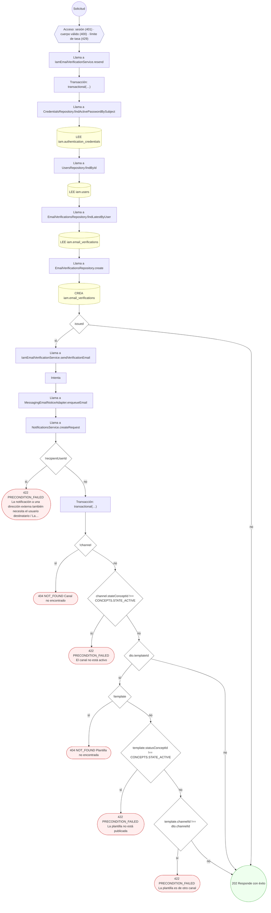

#### 9. POST /iam/auth/reset-password

Fijar una contraseña nueva con el token recibido por correo

| HTTP | Código | Cuándo |
|---|---|---|
| 200 | — | Éxito |
| 400 | `VALIDATION_FAILED` | El cuerpo cumple el DTO (sin propiedades extra) |
| 401 | `UNAUTHENTICATED` | Hay una sesión válida (JWT); UnauthorizedException: Token de restablecimiento inválido; UnauthorizedException: El token de restablecimiento ya fue utilizado; UnauthorizedException: El token de restablecimiento expiró |
| 429 | `RATE_LIMITED` | No se supera el límite de solicitudes |


#### 10. POST /iam/auth/token/refresh

Rotar el refresh token

| HTTP | Código | Cuándo |
|---|---|---|
| 200 | — | Éxito |
| 400 | `VALIDATION_FAILED` | El cuerpo cumple el DTO (sin propiedades extra) |
| 401 | `UNAUTHENTICATED` | Hay una sesión válida (JWT); UnauthorizedException: No se presentó un refresh token; UnauthorizedException: Sesión no activa; UnauthorizedException: Reuso de refresh token detectado; UnauthorizedException: Refresh token expirado; UnauthorizedException: {{ message: 'La política de sesión de la organización cerró…}; UnauthorizedException: Refresh token inválido |
| 429 | `RATE_LIMITED` | No se supera el límite de solicitudes |

```mermaid
flowchart TD
  n1(("Solicitud")):::inicio
  n2{{"Acceso: sesión (401) · cuerpo válido (400) · límite de tasa (429)"}}:::acceso
  n1 --> n2
  n3{"!presented"}:::decision
  n2 --> n3
  n4(["401 UNAUTHENTICATED No se presentó un refresh token"]):::error
  n3 -->|"sí"| n4
  n5["Llama a IamAuthService.refresh"]:::llamada
  n3 -->|"no"| n5
  n6["Transacción: transactional(…)"]:::transaccion
  n5 --> n6
  n7["Llama a RefreshTokensRepository.findByHashForUpdate"]:::llamada
  n6 --> n7
  n8[("LEE iam.refresh_tokens")]:::efecto
  n7 --> n8
  n9{"rt.stateConceptId !== CONCEPTS.STATE_ACTIVE"}:::decision
  n8 --> n9
  n10["Llama a SecurityEventsRepository.record"]:::llamada
  n9 -->|"sí"| n10
  n11[("CREA iam.security_events")]:::efecto
  n10 --> n11
  n12["Llama a RefreshTokensRepository.revokeBySessionId"]:::llamada
  n11 --> n12
  n13[("ACTUALIZA iam.refresh_tokens")]:::efecto
  n12 --> n13
  n14["Llama a SessionsRepository.revokeById"]:::llamada
  n13 --> n14
  n15[("ACTUALIZA iam.sessions")]:::efecto
  n14 --> n15
  n16["Llama a SessionsRepository.findById"]:::llamada
  n15 --> n16
  n9 -->|"no"| n16
  n17[("LEE iam.sessions")]:::efecto
  n16 --> n17
  n18{"!session || session.stateConceptId !== CONCEPTS.STATE_ACTIVE"}:::decision
  n17 --> n18
  n19(["401 UNAUTHENTICATED Sesión no activa"]):::error
  n18 -->|"sí"| n19
  n20["Llama a IamAuthService.loadAuthority"]:::llamada
  n18 -->|"no"| n20
  n21["Transacción: withSystemRead(…)"]:::transaccion
  n20 --> n21
  n22["Llama a UserGlobalRolesRepository.findActiveForUser"]:::llamada
  n21 --> n22
  n23[("LEE iam.user_global_roles")]:::efecto
  n22 --> n23
  n24["Llama a DelegatedAccessSupportClaimsAdapter.listTenantIdsWithActiveEngagement"]:::llamada
  n23 --> n24
  n25[("LEE directory.tenant_memberships · LEE delegated_access.organization_user_assignments")]:::efecto
  n24 --> n25
  n26["Llama a IamAuthService.loadActiveTenantIds"]:::llamada
  n25 --> n26
  n27["Llama a DirectoryTenantClaimsAdapter.listActiveTenantIds"]:::llamada
  n26 --> n27
  n28[("LEE directory.tenant_memberships")]:::efecto
  n27 --> n28
  n29{"everyTenantDenied(this.tenantIdsOf(rules), denied)"}:::decision
  n28 --> n29
  n30["Llama a RefreshTokensRepository.revokeBySessionId"]:::llamada
  n29 -->|"sí"| n30
  n31[("ACTUALIZA iam.refresh_tokens")]:::efecto
  n30 --> n31
  n32["Llama a SessionsRepository.revokeById"]:::llamada
  n31 --> n32
  n33[("ACTUALIZA iam.sessions")]:::efecto
  n32 --> n33
  n34{"mfaTenantIds.length › 0 && !mfaVerified && this.mfaRepo"}:::decision
  n33 --> n34
  n29 -->|"no"| n34
  n35["Llama a MfaFactorsRepository.findVerifiedByUser"]:::llamada
  n34 -->|"sí"| n35
  n36[("LEE iam.mfa_factors")]:::efecto
  n35 --> n36
  n37["Llama a UsersRepository.findById"]:::llamada
  n36 --> n37
  n34 -->|"no"| n37
  n38[("LEE iam.users")]:::efecto
  n37 --> n38
  n39["Llama a IamAuthService.loadTenantDisplay"]:::llamada
  n38 --> n39
  n40["Llama a DirectoryTenantClaimsAdapter.describeTenants"]:::llamada
  n39 --> n40
  n41[("LEE directory.tenants")]:::efecto
  n40 --> n41
  n42["Llama a DirectoryTenantClaimsAdapter.accountKinds"]:::llamada
  n41 --> n42
  n43[("LEE practice.practices · LEE practice.practice_settings")]:::efecto
  n42 --> n43
  n44["Llama a IamAuthService.loadPatientProfileId"]:::llamada
  n43 --> n44
  n45["Llama a ProfilesAccountProfileIdsAdapter.findPatientProfileId"]:::llamada
  n44 --> n45
  n46["Llama a PersonAccountLinksRepository.findActiveByUser"]:::llamada
  n45 --> n46
  n47[("LEE profiles.person_account_links")]:::efecto
  n46 --> n47
  n48["Llama a PatientProfilesRepository.findById"]:::llamada
  n47 --> n48
  n49[("LEE profiles.patient_profiles")]:::efecto
  n48 --> n49
  n50["Llama a IamAuthService.loadPractitionerProfileId"]:::llamada
  n49 --> n50
  n51["Llama a ProfilesAccountProfileIdsAdapter.findPractitionerProfileId"]:::llamada
  n50 --> n51
  n52["Llama a PersonAccountLinksRepository.findActiveByUser"]:::llamada
  n51 --> n52
  n53[("LEE profiles.person_account_links")]:::efecto
  n52 --> n53
  n54["Llama a HealthPractitionerProfilesRepository.findById"]:::llamada
  n53 --> n54
  n55[("LEE profiles.health_practitioner_profiles")]:::efecto
  n54 --> n55
  n56[("ACTUALIZA iam.refresh_tokens")]:::efecto
  n55 --> n56
  n57["Llama a RefreshTokensRepository.create"]:::llamada
  n56 --> n57
  n58[("CREA iam.refresh_tokens")]:::efecto
  n57 --> n58
  n59["Llama a SecurityEventsRepository.record"]:::llamada
  n58 --> n59
  n60[("CREA iam.security_events")]:::efecto
  n59 --> n60
  n61{"según outcome.kind"}:::decision
  n60 --> n61
  n62(["401 UNAUTHENTICATED Reuso de refresh token detectado"]):::error
  n61 -->|"'reuse'"| n62
  n63(["401 UNAUTHENTICATED Refresh token expirado"]):::error
  n61 -->|"'expired'"| n63
  n64(["401 UNAUTHENTICATED {{ message: 'La política de sesión de la organización cerró…}"]):::error
  n61 -->|"'policy'"| n64
  n65(["401 UNAUTHENTICATED Refresh token inválido"]):::error
  n61 -->|"por defecto"| n65
  n66(("200 Responde con éxito")):::ok
  classDef acceso fill:#eef,stroke:#66a
  classDef error fill:#fee,stroke:#c33
  classDef ok fill:#efe,stroke:#3a3
  classDef efecto fill:#ffd,stroke:#aa3
  classDef decision fill:#fff,stroke:#555
  classDef corte fill:#eee,stroke:#999,stroke-dasharray: 4
```

#### 11. POST /iam/auth/upload-registration-document

Pre-cargar un PDF para un registro de organización o profesional

| HTTP | Código | Cuándo |
|---|---|---|
| 201 | — | Éxito |
| 400 | `VALIDATION_FAILED` | El cuerpo cumple el DTO (sin propiedades extra) |
| 401 | `UNAUTHENTICATED` | Hay una sesión válida (JWT) |
| 422 | `PRECONDITION_FAILED` | PreconditionFailedException: No se recibió contenido en el campo "file"; PreconditionFailedException: El archivo excede el tamaño máximo permitido; PreconditionFailedException: Solo se admiten documentos PDF |
| 429 | `RATE_LIMITED` | No se supera el límite de solicitudes |
| 500 | `INTERNAL` | StorageLifecycleDenied: LIFECYCLE_WIRING_MISSING; StorageLifecycleDenied: WRITE_RESERVATION_REQUIRED |

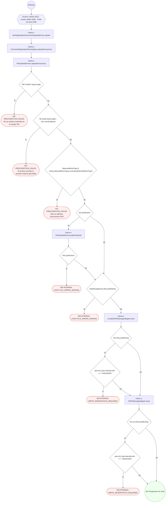

#### 12. POST /iam/auth/upload-registration-logo

Pre-cargar el logo del consultorio propio para el registro

| HTTP | Código | Cuándo |
|---|---|---|
| 201 | — | Éxito |
| 400 | `VALIDATION_FAILED` | El cuerpo cumple el DTO (sin propiedades extra) |
| 401 | `UNAUTHENTICATED` | Hay una sesión válida (JWT) |
| 422 | `PRECONDITION_FAILED` | PreconditionFailedException: El logo supera los 2 MB; PreconditionFailedException: No se recibió contenido en el campo "file"; PreconditionFailedException: El archivo excede el tamaño máximo permitido; PreconditionFailedException: Solo se admiten documentos PDF |
| 429 | `RATE_LIMITED` | No se supera el límite de solicitudes |
| 500 | `INTERNAL` | StorageLifecycleDenied: LIFECYCLE_WIRING_MISSING; StorageLifecycleDenied: WRITE_RESERVATION_REQUIRED |

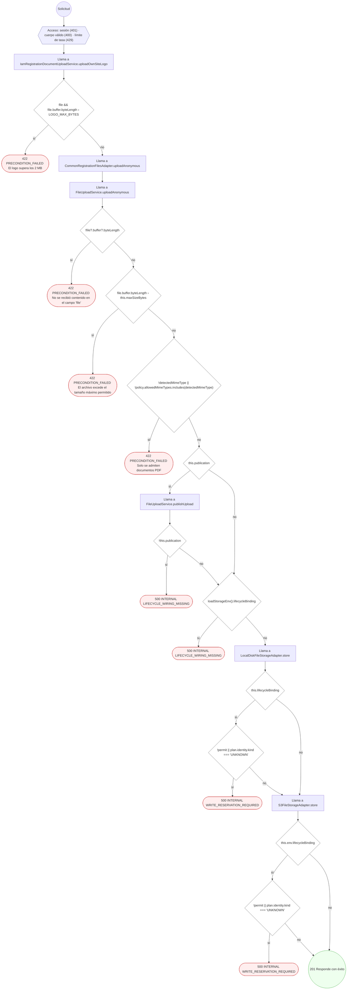

#### 13. POST /iam/auth/upload-registration-signature-image

Pre-cargar una imagen de firma o sello para el registro

| HTTP | Código | Cuándo |
|---|---|---|
| 201 | — | Éxito |
| 400 | `VALIDATION_FAILED` | El cuerpo cumple el DTO (sin propiedades extra) |
| 401 | `UNAUTHENTICATED` | Hay una sesión válida (JWT) |
| 422 | `PRECONDITION_FAILED` | PreconditionFailedException: La imagen supera el límite de 2 MB; PreconditionFailedException: No se recibió contenido en el campo "file"; PreconditionFailedException: El archivo excede el tamaño máximo permitido; PreconditionFailedException: Solo se admiten documentos PDF |
| 429 | `RATE_LIMITED` | No se supera el límite de solicitudes |
| 500 | `INTERNAL` | StorageLifecycleDenied: LIFECYCLE_WIRING_MISSING; StorageLifecycleDenied: WRITE_RESERVATION_REQUIRED |


#### 14. POST /iam/auth/verify-email

Verificar el correo con el token recibido

| HTTP | Código | Cuándo |
|---|---|---|
| 200 | — | Éxito |
| 400 | `VALIDATION_FAILED` | El cuerpo cumple el DTO (sin propiedades extra) |
| 401 | `UNAUTHENTICATED` | Hay una sesión válida (JWT); UnauthorizedException: Token de verificación inválido; UnauthorizedException: El token de verificación ya fue utilizado; UnauthorizedException: El token de verificación expiró |
| 429 | `RATE_LIMITED` | No se supera el límite de solicitudes |

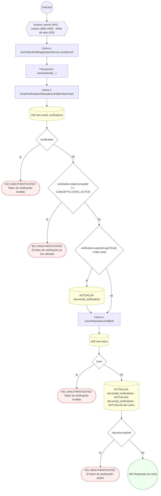

#### 15. POST /iam/me/devices/{id}/confirm

Reconocer un dispositivo propio («Fui yo»)

| HTTP | Código | Cuándo |
|---|---|---|
| 200 | — | Éxito |
| 400 | `VALIDATION_FAILED` | Los parámetros de ruta son UUID válidos; El cuerpo cumple el DTO (sin propiedades extra) |
| 401 | `UNAUTHENTICATED` | Hay una sesión válida (JWT) |
| 403 | `FORBIDDEN` | El rol está permitido; El tenant se resuelve y pertenece al actor |
| 422 | `PRECONDITION_FAILED` | PreconditionFailedException: Para confirmar este dispositivo hace falta el código enviado a su correo; PreconditionFailedException: El código no es válido o ya se usó |
| 429 | `RATE_LIMITED` | No se supera el límite de solicitudes |

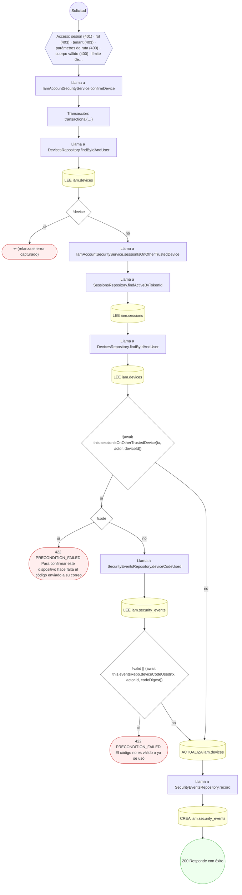

#### 16. POST /iam/me/devices/{id}/confirm-code

Enviar al correo verificado el código para reconocer un dispositivo

| HTTP | Código | Cuándo |
|---|---|---|
| 200 | — | Éxito |
| 400 | `VALIDATION_FAILED` | Los parámetros de ruta son UUID válidos |
| 401 | `UNAUTHENTICATED` | Hay una sesión válida (JWT) |
| 403 | `FORBIDDEN` | El rol está permitido; El tenant se resuelve y pertenece al actor |
| 404 | `NOT_FOUND` | ResourceNotFoundException: Canal no encontrado; ResourceNotFoundException: Plantilla no encontrada |
| 422 | `PRECONDITION_FAILED` | PreconditionFailedException: La cuenta no tiene un correo verificado al que enviar el código; PreconditionFailedException: La notificación a una dirección externa también necesita el usuario destinatario / La notificación necesita el usuario destinatario; PreconditionFailedException: El canal no está activo; PreconditionFailedException: La plantilla no está publicada; PreconditionFailedException: La plantilla es de otro canal |
| 429 | `RATE_LIMITED` | No se supera el límite de solicitudes |

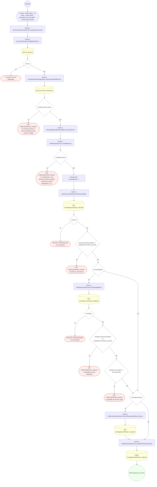

#### 17. POST /iam/me/devices/{id}/not-me

No reconocer un dispositivo («No fui yo») y cerrar las otras sesiones

| HTTP | Código | Cuándo |
|---|---|---|
| 200 | — | Éxito |
| 400 | `VALIDATION_FAILED` | Los parámetros de ruta son UUID válidos |
| 401 | `UNAUTHENTICATED` | Hay una sesión válida (JWT) |
| 403 | `FORBIDDEN` | El rol está permitido; El tenant se resuelve y pertenece al actor |
| 429 | `RATE_LIMITED` | No se supera el límite de solicitudes |

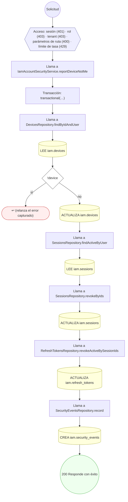

#### 18. POST /iam/me/mfa/{factorId}/revoke

Quitar uno de mis factores de segundo paso

| HTTP | Código | Cuándo |
|---|---|---|
| 200 | — | Éxito |
| 400 | `VALIDATION_FAILED` | Los parámetros de ruta son UUID válidos; El cuerpo cumple el DTO (sin propiedades extra) |
| 401 | `UNAUTHENTICATED` | Hay una sesión válida (JWT) |
| 403 | `FORBIDDEN` | El rol está permitido; El tenant se resuelve y pertenece al actor |
| 404 | `NOT_FOUND` | ResourceNotFoundException: Factor MFA no encontrado |
| 422 | `PRECONDITION_FAILED` | PreconditionFailedException: Para añadir o quitar un factor confirme su contraseña actual o un código de su app autenticadora; PreconditionFailedException: La contraseña o el código no coinciden |
| 429 | `RATE_LIMITED` | No se supera el límite de solicitudes |

```mermaid
flowchart TD
  n1(("Solicitud")):::inicio
  n2{{"Acceso: sesión (401) · rol (403) · tenant (403) · parámetros de ruta (400) · cuerpo válido (400) · límite de…"}}:::acceso
  n1 --> n2
  n3["Llama a IamMyMfaService.revokeFactor"]:::llamada
  n2 --> n3
  n4["Llama a IamMfaService.assertReauthenticated"]:::llamada
  n3 --> n4
  n5{"!proof.currentPassword && !proof.mfaCode"}:::decision
  n4 --> n5
  n6(["422 PRECONDITION_FAILED Para añadir o quitar un factor confirme su contraseña actual o un código de su app au…"]):::error
  n5 -->|"sí"| n6
  n7["Llama a IamMfaService.passwordMatches"]:::llamada
  n5 -->|"no"| n7
  n8["Llama a CredentialsRepository.findActivePasswordByUser"]:::llamada
  n7 --> n8
  n9[("LEE iam.authentication_credentials")]:::efecto
  n8 --> n9
  n10["Llama a IamMfaService.codeMatches"]:::llamada
  n9 --> n10
  n11["Llama a MfaFactorsRepository.findVerifiedByUser"]:::llamada
  n10 --> n11
  n12[("LEE iam.mfa_factors")]:::efecto
  n11 --> n12
  n13["Llama a SecurityEventsRepository.record"]:::llamada
  n12 --> n13
  n14[("CREA iam.security_events")]:::efecto
  n13 --> n14
  n15(["422 PRECONDITION_FAILED La contraseña o el código no coinciden"]):::error
  n14 --> n15
  n16["Transacción: transactional(…)"]:::transaccion
  n17["Llama a MfaFactorsRepository.findByIdAndUser"]:::llamada
  n16 --> n17
  n18[("LEE iam.mfa_factors")]:::efecto
  n17 --> n18
  n19{"!factor || factor.stateConceptId === CONCEPTS.STATE_REVOKED"}:::decision
  n18 --> n19
  n20(["404 NOT_FOUND Factor MFA no encontrado"]):::error
  n19 -->|"sí"| n20
  n21[("ACTUALIZA iam.mfa_factors")]:::efecto
  n19 -->|"no"| n21
  n22["Llama a MfaFactorsRepository.findVerifiedByUser"]:::llamada
  n21 --> n22
  n23[("LEE iam.mfa_factors")]:::efecto
  n22 --> n23
  n24{"remaining === 0"}:::decision
  n23 --> n24
  n25["Llama a UsersRepository.findById"]:::llamada
  n24 -->|"sí"| n25
  n26[("LEE iam.users")]:::efecto
  n25 --> n26
  n27{"user"}:::decision
  n26 --> n27
  n28[("ACTUALIZA iam.users")]:::efecto
  n27 -->|"sí"| n28
  n29["Llama a SecurityEventsRepository.record"]:::llamada
  n28 --> n29
  n27 -->|"no"| n29
  n24 -->|"no"| n29
  n30[("CREA iam.security_events")]:::efecto
  n29 --> n30
  n31(("200 Responde con éxito")):::ok
  n30 --> n31
  classDef acceso fill:#eef,stroke:#66a
  classDef error fill:#fee,stroke:#c33
  classDef ok fill:#efe,stroke:#3a3
  classDef efecto fill:#ffd,stroke:#aa3
  classDef decision fill:#fff,stroke:#555
  classDef corte fill:#eee,stroke:#999,stroke-dasharray: 4
```

#### 19. POST /iam/me/mfa/totp

Dar de alta mi app autenticadora (devuelve el secreto una vez)

| HTTP | Código | Cuándo |
|---|---|---|
| 201 | — | Éxito |
| 400 | `VALIDATION_FAILED` | El cuerpo cumple el DTO (sin propiedades extra) |
| 401 | `UNAUTHENTICATED` | Hay una sesión válida (JWT) |
| 403 | `FORBIDDEN` | El rol está permitido; El tenant se resuelve y pertenece al actor; ForbiddenException: No tiene acceso a los factores MFA de esta cuenta |
| 404 | `NOT_FOUND` | ResourceNotFoundException: Usuario no encontrado; ResourceNotFoundException: Factor MFA no encontrado |
| 422 | `PRECONDITION_FAILED` | PreconditionFailedException: Para añadir o quitar un factor confirme su contraseña actual o un código de su app autenticadora; PreconditionFailedException: La contraseña o el código no coinciden; PreconditionFailedException: factorId es obligatorio para verificar; PreconditionFailedException: code es obligatorio para verificar; PreconditionFailedException: El factor no tiene un secreto TOTP asociado; PreconditionFailedException: Código MFA inválido; PreconditionFailedException: factorType es obligatorio para enrolar |
| 429 | `RATE_LIMITED` | No se supera el límite de solicitudes |

```mermaid
flowchart TD
  n1(("Solicitud")):::inicio
  n2{{"Acceso: sesión (401) · rol (403) · tenant (403) · cuerpo válido (400) · límite de tasa (429)"}}:::acceso
  n1 --> n2
  n3["Llama a IamMyMfaService.startTotp"]:::llamada
  n2 --> n3
  n4["Llama a IamMfaService.assertReauthenticated"]:::llamada
  n3 --> n4
  n5{"!proof.currentPassword && !proof.mfaCode"}:::decision
  n4 --> n5
  n6(["422 PRECONDITION_FAILED Para añadir o quitar un factor confirme su contraseña actual o un código de su app au…"]):::error
  n5 -->|"sí"| n6
  n7["Llama a IamMfaService.passwordMatches"]:::llamada
  n5 -->|"no"| n7
  n8["Llama a CredentialsRepository.findActivePasswordByUser"]:::llamada
  n7 --> n8
  n9[("LEE iam.authentication_credentials")]:::efecto
  n8 --> n9
  n10["Llama a IamMfaService.codeMatches"]:::llamada
  n9 --> n10
  n11["Llama a MfaFactorsRepository.findVerifiedByUser"]:::llamada
  n10 --> n11
  n12[("LEE iam.mfa_factors")]:::efecto
  n11 --> n12
  n13["Llama a SecurityEventsRepository.record"]:::llamada
  n12 --> n13
  n14[("CREA iam.security_events")]:::efecto
  n13 --> n14
  n15(["422 PRECONDITION_FAILED La contraseña o el código no coinciden"]):::error
  n14 --> n15
  n16["Transacción: transactional(…)"]:::transaccion
  n17["Llama a MfaFactorsRepository.findByUser"]:::llamada
  n16 --> n17
  n18[("LEE iam.mfa_factors")]:::efecto
  n17 --> n18
  n19["Llama a IamMfaService.enrollOrVerify"]:::llamada
  n18 --> n19
  n20{"actor.id !== userId && !actor.roles.some((role) =› ROLES_THAT_MANAGE_MFA.includes(role))"}:::decision
  n19 --> n20
  n21(["403 FORBIDDEN No tiene acceso a los factores MFA de esta cuenta"]):::error
  n20 -->|"sí"| n21
  n22{"!dto.verify && actor.id === userId && !options.reauthenticated"}:::decision
  n20 -->|"no"| n22
  n23["Llama a IamMfaService.assertReauthenticated"]:::llamada
  n22 -->|"sí"| n23
  n24{"!proof.currentPassword && !proof.mfaCode"}:::decision
  n23 --> n24
  n25(["422 PRECONDITION_FAILED Para añadir o quitar un factor confirme su contraseña actual o un código de su app au…"]):::error
  n24 -->|"sí"| n25
  n26["Llama a SecurityEventsRepository.record"]:::llamada
  n24 -->|"no"| n26
  n27[("CREA iam.security_events")]:::efecto
  n26 --> n27
  n28(["422 PRECONDITION_FAILED La contraseña o el código no coinciden"]):::error
  n27 --> n28
  n29["Transacción: transactional(…)"]:::transaccion
  n22 -->|"no"| n29
  n30["Llama a UsersRepository.findById"]:::llamada
  n29 --> n30
  n31[("LEE iam.users")]:::efecto
  n30 --> n31
  n32{"!user"}:::decision
  n31 --> n32
  n33(["404 NOT_FOUND Usuario no encontrado"]):::error
  n32 -->|"sí"| n33
  n34{"dto.verify"}:::decision
  n32 -->|"no"| n34
  n35{"!dto.factorId"}:::decision
  n34 -->|"sí"| n35
  n36(["422 PRECONDITION_FAILED factorId es obligatorio para verificar"]):::error
  n35 -->|"sí"| n36
  n37["Llama a MfaFactorsRepository.findByIdAndUser"]:::llamada
  n35 -->|"no"| n37
  n38[("LEE iam.mfa_factors")]:::efecto
  n37 --> n38
  n39{"!factor"}:::decision
  n38 --> n39
  n40(["404 NOT_FOUND Factor MFA no encontrado"]):::error
  n39 -->|"sí"| n40
  n41{"!dto.code"}:::decision
  n39 -->|"no"| n41
  n42(["422 PRECONDITION_FAILED code es obligatorio para verificar"]):::error
  n41 -->|"sí"| n42
  n43{"!factor.secretEncrypted"}:::decision
  n41 -->|"no"| n43
  n44(["422 PRECONDITION_FAILED El factor no tiene un secreto TOTP asociado"]):::error
  n43 -->|"sí"| n44
  n45{"!result.valid"}:::decision
  n43 -->|"no"| n45
  n46["Llama a SecurityEventsRepository.record"]:::llamada
  n45 -->|"sí"| n46
  n47[("CREA iam.security_events")]:::efecto
  n46 --> n47
  n48(["422 PRECONDITION_FAILED Código MFA inválido"]):::error
  n47 --> n48
  n49[("ACTUALIZA iam.mfa_factors · ACTUALIZA iam.mfa_factors · ACTUALIZA iam.users")]:::efecto
  n45 -->|"no"| n49
  n50["Llama a SecurityEventsRepository.record"]:::llamada
  n49 --> n50
  n51[("CREA iam.security_events")]:::efecto
  n50 --> n51
  n52{"!dto.factorType"}:::decision
  n51 --> n52
  n34 -->|"no"| n52
  n53(["422 PRECONDITION_FAILED factorType es obligatorio para enrolar"]):::error
  n52 -->|"sí"| n53
  n54["Llama a MfaFactorsRepository.create"]:::llamada
  n52 -->|"no"| n54
  n55[("CREA iam.mfa_factors")]:::efecto
  n54 --> n55
  n56{"dto.factorType === 'TOTP'"}:::decision
  n55 --> n56
  n57[("ACTUALIZA iam.mfa_factors")]:::efecto
  n56 -->|"sí"| n57
  n58["Llama a SecurityEventsRepository.record"]:::llamada
  n57 --> n58
  n56 -->|"no"| n58
  n59[("CREA iam.security_events")]:::efecto
  n58 --> n59
  n60(("201 Responde con éxito")):::ok
  n59 --> n60
  classDef acceso fill:#eef,stroke:#66a
  classDef error fill:#fee,stroke:#c33
  classDef ok fill:#efe,stroke:#3a3
  classDef efecto fill:#ffd,stroke:#aa3
  classDef decision fill:#fff,stroke:#555
  classDef corte fill:#eee,stroke:#999,stroke-dasharray: 4
```

#### 20. POST /iam/me/mfa/totp/{factorId}/confirm

Confirmar mi app autenticadora con un código

| HTTP | Código | Cuándo |
|---|---|---|
| 200 | — | Éxito |
| 400 | `VALIDATION_FAILED` | Los parámetros de ruta son UUID válidos; El cuerpo cumple el DTO (sin propiedades extra) |
| 401 | `UNAUTHENTICATED` | Hay una sesión válida (JWT) |
| 403 | `FORBIDDEN` | El rol está permitido; El tenant se resuelve y pertenece al actor; ForbiddenException: No tiene acceso a los factores MFA de esta cuenta |
| 404 | `NOT_FOUND` | ResourceNotFoundException: Usuario no encontrado; ResourceNotFoundException: Factor MFA no encontrado |
| 422 | `PRECONDITION_FAILED` | PreconditionFailedException: El factor fue reemplazado por uno más reciente; PreconditionFailedException: Para añadir o quitar un factor confirme su contraseña actual o un código de su app autenticadora; PreconditionFailedException: La contraseña o el código no coinciden; PreconditionFailedException: factorId es obligatorio para verificar; PreconditionFailedException: code es obligatorio para verificar; PreconditionFailedException: El factor no tiene un secreto TOTP asociado; PreconditionFailedException: Código MFA inválido; PreconditionFailedException: factorType es obligatorio para enrolar |
| 429 | `RATE_LIMITED` | No se supera el límite de solicitudes |

```mermaid
flowchart TD
  n1(("Solicitud")):::inicio
  n2{{"Acceso: sesión (401) · rol (403) · tenant (403) · parámetros de ruta (400) · cuerpo válido (400) · límite de…"}}:::acceso
  n1 --> n2
  n3["Llama a IamMyMfaService.confirmTotp"]:::llamada
  n2 --> n3
  n4["Llama a MfaFactorsRepository.findByIdAndUser"]:::llamada
  n3 --> n4
  n5[("LEE iam.mfa_factors")]:::efecto
  n4 --> n5
  n6{"own?.stateConceptId === CONCEPTS.STATE_REVOKED"}:::decision
  n5 --> n6
  n7(["422 PRECONDITION_FAILED El factor fue reemplazado por uno más reciente"]):::error
  n6 -->|"sí"| n7
  n8["Llama a IamMfaService.enrollOrVerify"]:::llamada
  n6 -->|"no"| n8
  n9{"actor.id !== userId && !actor.roles.some((role) =› ROLES_THAT_MANAGE_MFA.includes(role))"}:::decision
  n8 --> n9
  n10(["403 FORBIDDEN No tiene acceso a los factores MFA de esta cuenta"]):::error
  n9 -->|"sí"| n10
  n11{"!dto.verify && actor.id === userId && !options.reauthenticated"}:::decision
  n9 -->|"no"| n11
  n12["Llama a IamMfaService.assertReauthenticated"]:::llamada
  n11 -->|"sí"| n12
  n13{"!proof.currentPassword && !proof.mfaCode"}:::decision
  n12 --> n13
  n14(["422 PRECONDITION_FAILED Para añadir o quitar un factor confirme su contraseña actual o un código de su app au…"]):::error
  n13 -->|"sí"| n14
  n15["Llama a SecurityEventsRepository.record"]:::llamada
  n13 -->|"no"| n15
  n16[("CREA iam.security_events")]:::efecto
  n15 --> n16
  n17(["422 PRECONDITION_FAILED La contraseña o el código no coinciden"]):::error
  n16 --> n17
  n18["Transacción: transactional(…)"]:::transaccion
  n11 -->|"no"| n18
  n19["Llama a UsersRepository.findById"]:::llamada
  n18 --> n19
  n20[("LEE iam.users")]:::efecto
  n19 --> n20
  n21{"!user"}:::decision
  n20 --> n21
  n22(["404 NOT_FOUND Usuario no encontrado"]):::error
  n21 -->|"sí"| n22
  n23{"dto.verify"}:::decision
  n21 -->|"no"| n23
  n24{"!dto.factorId"}:::decision
  n23 -->|"sí"| n24
  n25(["422 PRECONDITION_FAILED factorId es obligatorio para verificar"]):::error
  n24 -->|"sí"| n25
  n26["Llama a MfaFactorsRepository.findByIdAndUser"]:::llamada
  n24 -->|"no"| n26
  n27[("LEE iam.mfa_factors")]:::efecto
  n26 --> n27
  n28{"!factor"}:::decision
  n27 --> n28
  n29(["404 NOT_FOUND Factor MFA no encontrado"]):::error
  n28 -->|"sí"| n29
  n30{"!dto.code"}:::decision
  n28 -->|"no"| n30
  n31(["422 PRECONDITION_FAILED code es obligatorio para verificar"]):::error
  n30 -->|"sí"| n31
  n32{"!factor.secretEncrypted"}:::decision
  n30 -->|"no"| n32
  n33(["422 PRECONDITION_FAILED El factor no tiene un secreto TOTP asociado"]):::error
  n32 -->|"sí"| n33
  n34{"!result.valid"}:::decision
  n32 -->|"no"| n34
  n35["Llama a SecurityEventsRepository.record"]:::llamada
  n34 -->|"sí"| n35
  n36[("CREA iam.security_events")]:::efecto
  n35 --> n36
  n37(["422 PRECONDITION_FAILED Código MFA inválido"]):::error
  n36 --> n37
  n38[("ACTUALIZA iam.mfa_factors · ACTUALIZA iam.mfa_factors · ACTUALIZA iam.users")]:::efecto
  n34 -->|"no"| n38
  n39["Llama a SecurityEventsRepository.record"]:::llamada
  n38 --> n39
  n40[("CREA iam.security_events")]:::efecto
  n39 --> n40
  n41{"!dto.factorType"}:::decision
  n40 --> n41
  n23 -->|"no"| n41
  n42(["422 PRECONDITION_FAILED factorType es obligatorio para enrolar"]):::error
  n41 -->|"sí"| n42
  n43["Llama a MfaFactorsRepository.create"]:::llamada
  n41 -->|"no"| n43
  n44[("CREA iam.mfa_factors")]:::efecto
  n43 --> n44
  n45{"dto.factorType === 'TOTP'"}:::decision
  n44 --> n45
  n46[("ACTUALIZA iam.mfa_factors")]:::efecto
  n45 -->|"sí"| n46
  n47["Llama a SecurityEventsRepository.record"]:::llamada
  n46 --> n47
  n45 -->|"no"| n47
  n48[("CREA iam.security_events")]:::efecto
  n47 --> n48
  n49(("200 Responde con éxito")):::ok
  n48 --> n49
  classDef acceso fill:#eef,stroke:#66a
  classDef error fill:#fee,stroke:#c33
  classDef ok fill:#efe,stroke:#3a3
  classDef efecto fill:#ffd,stroke:#aa3
  classDef decision fill:#fff,stroke:#555
  classDef corte fill:#eee,stroke:#999,stroke-dasharray: 4
```

#### 21. POST /iam/me/sessions/{id}/revoke

Cerrar una de mis sesiones

| HTTP | Código | Cuándo |
|---|---|---|
| 200 | — | Éxito |
| 400 | `VALIDATION_FAILED` | Los parámetros de ruta son UUID válidos |
| 401 | `UNAUTHENTICATED` | Hay una sesión válida (JWT) |
| 403 | `FORBIDDEN` | El rol está permitido; El tenant se resuelve y pertenece al actor |
| 404 | `NOT_FOUND` | ResourceNotFoundException: Sesión no encontrada |
| 429 | `RATE_LIMITED` | No se supera el límite de solicitudes |

```mermaid
flowchart TD
  n1(("Solicitud")):::inicio
  n2{{"Acceso: sesión (401) · rol (403) · tenant (403) · parámetros de ruta (400) · límite de tasa (429)"}}:::acceso
  n1 --> n2
  n3["Llama a IamAccountSecurityService.revokeSession"]:::llamada
  n2 --> n3
  n4["Transacción: transactional(…)"]:::transaccion
  n3 --> n4
  n5["Llama a SessionsRepository.findById"]:::llamada
  n4 --> n5
  n6[("LEE iam.sessions")]:::efecto
  n5 --> n6
  n7{"!session || session.userId !== actor.id"}:::decision
  n6 --> n7
  n8(["404 NOT_FOUND Sesión no encontrada"]):::error
  n7 -->|"sí"| n8
  n9["Llama a SessionsRepository.revokeById"]:::llamada
  n7 -->|"no"| n9
  n10[("ACTUALIZA iam.sessions")]:::efecto
  n9 --> n10
  n11["Llama a RefreshTokensRepository.revokeBySessionId"]:::llamada
  n10 --> n11
  n12[("ACTUALIZA iam.refresh_tokens")]:::efecto
  n11 --> n12
  n13["Llama a SecurityEventsRepository.record"]:::llamada
  n12 --> n13
  n14[("CREA iam.security_events")]:::efecto
  n13 --> n14
  n15(("200 Responde con éxito")):::ok
  n14 --> n15
  classDef acceso fill:#eef,stroke:#66a
  classDef error fill:#fee,stroke:#c33
  classDef ok fill:#efe,stroke:#3a3
  classDef efecto fill:#ffd,stroke:#aa3
  classDef decision fill:#fff,stroke:#555
  classDef corte fill:#eee,stroke:#999,stroke-dasharray: 4
```

#### 22. DELETE /iam/onboarding-drafts/{formType}/{draftId}

Elimina el borrador al completar el alta exitosamente o por descarte del usuario

| HTTP | Código | Cuándo |
|---|---|---|
| 200 | — | Éxito |
| 401 | `UNAUTHENTICATED` | Hay una sesión válida (JWT) |
| 429 | `RATE_LIMITED` | No se supera el límite de solicitudes |

```mermaid
flowchart TD
  n1(("Solicitud")):::inicio
  n2{{"Acceso: sesión (401) · límite de tasa (429)"}}:::acceso
  n1 --> n2
  n3["Llama a IamOnboardingDraftsService.deleteDraft"]:::llamada
  n2 --> n3
  n4["Llama a IamOnboardingDraftsService.authorize"]:::llamada
  n3 --> n4
  n5{"!entry || !matches || secret === undefined || secret === ''"}:::decision
  n4 --> n5
  n6(["↩ (relanza el error capturado)"]):::error
  n5 -->|"sí"| n6
  n7(("200 Responde con éxito")):::ok
  n5 -->|"no"| n7
  classDef acceso fill:#eef,stroke:#66a
  classDef error fill:#fee,stroke:#c33
  classDef ok fill:#efe,stroke:#3a3
  classDef efecto fill:#ffd,stroke:#aa3
  classDef decision fill:#fff,stroke:#555
  classDef corte fill:#eee,stroke:#999,stroke-dasharray: 4
```

#### 23. GET /iam/onboarding-drafts/{formType}/{draftId}

Recupera un borrador de alta guardado por identificador y tipo de formulario

| HTTP | Código | Cuándo |
|---|---|---|
| 200 | — | Éxito |
| 401 | `UNAUTHENTICATED` | Hay una sesión válida (JWT) |
| 429 | `RATE_LIMITED` | No se supera el límite de solicitudes |

```mermaid
flowchart TD
  n1(("Solicitud")):::inicio
  n2{{"Acceso: sesión (401) · límite de tasa (429)"}}:::acceso
  n1 --> n2
  n3["Llama a IamOnboardingDraftsService.getDraft"]:::llamada
  n2 --> n3
  n4["Llama a IamOnboardingDraftsService.authorize"]:::llamada
  n3 --> n4
  n5{"!entry || !matches || secret === undefined || secret === ''"}:::decision
  n4 --> n5
  n6(["↩ (relanza el error capturado)"]):::error
  n5 -->|"sí"| n6
  n7(("200 Responde con éxito")):::ok
  n5 -->|"no"| n7
  classDef acceso fill:#eef,stroke:#66a
  classDef error fill:#fee,stroke:#c33
  classDef ok fill:#efe,stroke:#3a3
  classDef efecto fill:#ffd,stroke:#aa3
  classDef decision fill:#fff,stroke:#555
  classDef corte fill:#eee,stroke:#999,stroke-dasharray: 4
```

#### 24. PUT /iam/onboarding-drafts/{formType}/{draftId}

Guarda o actualiza el avance del formulario de alta en borrador

| HTTP | Código | Cuándo |
|---|---|---|
| 200 | — | Éxito |
| 401 | `UNAUTHENTICATED` | Hay una sesión válida (JWT) |
| 429 | `RATE_LIMITED` | No se supera el límite de solicitudes |
| 500 | `INTERNAL` | DomainException: {HttpStatus.BAD_REQUEST}; DomainException: {HttpStatus.PAYLOAD_TOO_LARGE}; DomainException: {HttpStatus.TOO_MANY_REQUESTS}; DraftStoreFullError: {retryAfterSeconds} |

```mermaid
flowchart TD
  n1(("Solicitud")):::inicio
  n2{{"Acceso: sesión (401) · límite de tasa (429)"}}:::acceso
  n1 --> n2
  n3["Intenta"]:::intento
  n2 --> n3
  n4["Llama a IamOnboardingDraftsService.saveDraft"]:::llamada
  n3 --> n4
  n5{"!this.validKey(formType, draftId)"}:::decision
  n4 --> n5
  n6(["↩ (relanza el error capturado)"]):::error
  n5 -->|"sí"| n6
  n7["Llama a IamOnboardingDraftsService.assertPayloadShape"]:::llamada
  n5 -->|"no"| n7
  n8{"!isRecord(payload) || !isRecord(payload.data) || (payload.extraData !== undefined && !isRecord(payload.extraD…"}:::decision
  n7 --> n8
  n9(["500 INTERNAL {HttpStatus.BAD_REQUEST}"]):::error
  n8 -->|"sí"| n9
  n10{"Buffer.byteLength(JSON.stringify(payload), 'utf8') › MAX_DRAFT_BYTES"}:::decision
  n8 -->|"no"| n10
  n11(["500 INTERNAL {HttpStatus.PAYLOAD_TOO_LARGE}"]):::error
  n10 -->|"sí"| n11
  n12{"secret === undefined || secret === ''"}:::decision
  n10 -->|"no"| n12
  n13{"existing"}:::decision
  n12 -->|"sí"| n13
  n14(["↩ (relanza el error capturado)"]):::error
  n13 -->|"sí"| n14
  n15["Llama a IamOnboardingDraftsService.assertCapacity"]:::llamada
  n13 -->|"no"| n15
  n16{"(this.perOrigin.get(origin) ?? 0) ›= MAX_DRAFTS_PER_ORIGIN"}:::decision
  n15 --> n16
  n17(["500 INTERNAL {HttpStatus.TOO_MANY_REQUESTS}"]):::error
  n16 -->|"sí"| n17
  n18{"(this.perAggregate.get(aggregate) ?? 0) ›= MAX_DRAFTS_PER_AGGREGATE"}:::decision
  n16 -->|"no"| n18
  n19(["500 INTERNAL {HttpStatus.TOO_MANY_REQUESTS}"]):::error
  n18 -->|"sí"| n19
  n20(["500 INTERNAL {retryAfterSeconds}"]):::error
  n18 -->|"no"| n20
  n21["Llama a IamOnboardingDraftsService.authorize"]:::llamada
  n12 -->|"no"| n21
  n22{"!entry || !matches || secret === undefined || secret === ''"}:::decision
  n21 --> n22
  n23(["↩ (relanza el error capturado)"]):::error
  n22 -->|"sí"| n23
  n24(["↩ (relanza el error capturado)"]):::error
  n3 -->|"si falla"| n24
  n25(("200 Responde con éxito")):::ok
  n22 -->|"no"| n25
  classDef acceso fill:#eef,stroke:#66a
  classDef error fill:#fee,stroke:#c33
  classDef ok fill:#efe,stroke:#3a3
  classDef efecto fill:#ffd,stroke:#aa3
  classDef decision fill:#fff,stroke:#555
  classDef corte fill:#eee,stroke:#999,stroke-dasharray: 4
```

#### 25. DELETE /iam/rescue/tenants/{tenantId}/ip-access-rules

Rescate (SYSTEM): retirar las reglas de red de una organización

| HTTP | Código | Cuándo |
|---|---|---|
| 200 | — | Éxito |
| 400 | `VALIDATION_FAILED` | Los parámetros de ruta son UUID válidos |
| 401 | `UNAUTHENTICATED` | Hay una sesión válida (JWT) |
| 403 | `FORBIDDEN` | El rol está permitido; El tenant se resuelve y pertenece al actor |
| 429 | `RATE_LIMITED` | No se supera el límite de solicitudes |

```mermaid
flowchart TD
  n1(("Solicitud")):::inicio
  n2{{"Acceso: sesión (401) · rol (403) · tenant (403) · parámetros de ruta (400) · límite de tasa (429)"}}:::acceso
  n1 --> n2
  n3["Llama a IpAccessRulesService.clearForTenant"]:::llamada
  n2 --> n3
  n4["Transacción: transactional(…)"]:::transaccion
  n3 --> n4
  n5["Llama a AuthzIpAccessRulesAdapter.listActive"]:::llamada
  n4 --> n5
  n6[("LEE authz.ip_access_rules")]:::efecto
  n5 --> n6
  n7["Llama a AuthzIpAccessRulesAdapter.replace"]:::llamada
  n6 --> n7
  n8[("LEE authz.ip_access_rules")]:::efecto
  n7 --> n8
  n9["Repite: por cada const row de current"]:::bucle
  n8 --> n9
  n10[("ACTUALIZA authz.ip_access_rules")]:::efecto
  n9 -->|"cada elemento"| n10
  n11["Repite: forEach(…)"]:::bucle
  n10 --> n11
  n9 -->|"al terminar"| n11
  n12[("CREA authz.ip_access_rules")]:::efecto
  n11 -->|"cada elemento"| n12
  n13(("200 Responde con éxito")):::ok
  n12 --> n13
  n11 -->|"al terminar"| n13
  classDef acceso fill:#eef,stroke:#66a
  classDef error fill:#fee,stroke:#c33
  classDef ok fill:#efe,stroke:#3a3
  classDef efecto fill:#ffd,stroke:#aa3
  classDef decision fill:#fff,stroke:#555
  classDef corte fill:#eee,stroke:#999,stroke-dasharray: 4
```

#### 26. DELETE /iam/rescue/tenants/{tenantId}/session-policies

Rescate (SYSTEM): retirar las políticas de sesión de una organización

| HTTP | Código | Cuándo |
|---|---|---|
| 200 | — | Éxito |
| 400 | `VALIDATION_FAILED` | Los parámetros de ruta son UUID válidos |
| 401 | `UNAUTHENTICATED` | Hay una sesión válida (JWT) |
| 403 | `FORBIDDEN` | El rol está permitido; El tenant se resuelve y pertenece al actor |
| 429 | `RATE_LIMITED` | No se supera el límite de solicitudes |

```mermaid
flowchart TD
  n1(("Solicitud")):::inicio
  n2{{"Acceso: sesión (401) · rol (403) · tenant (403) · parámetros de ruta (400) · límite de tasa (429)"}}:::acceso
  n1 --> n2
  n3["Llama a SessionPoliciesService.clearForTenant"]:::llamada
  n2 --> n3
  n4["Transacción: transactional(…)"]:::transaccion
  n3 --> n4
  n5["Llama a SessionPoliciesRepository.findByTenant"]:::llamada
  n4 --> n5
  n6[("LEE iam.session_policies")]:::efecto
  n5 --> n6
  n7["Repite: por cada const row de current"]:::bucle
  n6 --> n7
  n8[("ACTUALIZA iam.session_policies · ACTUALIZA iam.session_policies · ACTUALIZA iam.session_policies")]:::efecto
  n7 -->|"cada elemento"| n8
  n9(("200 Responde con éxito")):::ok
  n8 --> n9
  n7 -->|"al terminar"| n9
  classDef acceso fill:#eef,stroke:#66a
  classDef error fill:#fee,stroke:#c33
  classDef ok fill:#efe,stroke:#3a3
  classDef efecto fill:#ffd,stroke:#aa3
  classDef decision fill:#fff,stroke:#555
  classDef corte fill:#eee,stroke:#999,stroke-dasharray: 4
```

#### 27. POST /iam/users

Crear un usuario con credencial de contraseña y rol inicial

| HTTP | Código | Cuándo |
|---|---|---|
| 201 | — | Éxito |
| 400 | `VALIDATION_FAILED` | El cuerpo cumple el DTO (sin propiedades extra) |
| 401 | `UNAUTHENTICATED` | Hay una sesión válida (JWT) |
| 403 | `FORBIDDEN` | El rol está permitido; El tenant se resuelve y pertenece al actor |
| 409 | `CONFLICT` | ConflictException: El email ya tiene una credencial de contraseña activa |
| 429 | `RATE_LIMITED` | No se supera el límite de solicitudes |

```mermaid
flowchart TD
  n1(("Solicitud")):::inicio
  n2{{"Acceso: sesión (401) · rol (403) · tenant (403) · cuerpo válido (400) · límite de tasa (429)"}}:::acceso
  n1 --> n2
  n3["Llama a IamUsersService.createUser"]:::llamada
  n2 --> n3
  n4["Transacción: transactional(…)"]:::transaccion
  n3 --> n4
  n5["Llama a CredentialsRepository.findActivePasswordBySubject"]:::llamada
  n4 --> n5
  n6[("LEE iam.authentication_credentials")]:::efecto
  n5 --> n6
  n7{"clash"}:::decision
  n6 --> n7
  n8(["409 CONFLICT El email ya tiene una credencial de contraseña activa"]):::error
  n7 -->|"sí"| n8
  n9["Llama a UsersRepository.create"]:::llamada
  n7 -->|"no"| n9
  n10[("CREA iam.users")]:::efecto
  n9 --> n10
  n11["Llama a CredentialsRepository.createPassword"]:::llamada
  n10 --> n11
  n12[("CREA iam.authentication_credentials")]:::efecto
  n11 --> n12
  n13{"dto.phone"}:::decision
  n12 --> n13
  n14["Llama a CommonRecordsAdapter.createContactPoint"]:::llamada
  n13 -->|"sí"| n14
  n15["Llama a ContactPointsRepository.create"]:::llamada
  n14 --> n15
  n16[("CREA common.contact_points")]:::efecto
  n15 --> n16
  n17["Llama a UserGlobalRolesRepository.create"]:::llamada
  n16 --> n17
  n13 -->|"no"| n17
  n18[("CREA iam.user_global_roles")]:::efecto
  n17 --> n18
  n19["Llama a SecurityEventsRepository.record"]:::llamada
  n18 --> n19
  n20[("CREA iam.security_events")]:::efecto
  n19 --> n20
  n21(("201 Responde con éxito")):::ok
  n20 --> n21
  classDef acceso fill:#eef,stroke:#66a
  classDef error fill:#fee,stroke:#c33
  classDef ok fill:#efe,stroke:#3a3
  classDef efecto fill:#ffd,stroke:#aa3
  classDef decision fill:#fff,stroke:#555
  classDef corte fill:#eee,stroke:#999,stroke-dasharray: 4
```

#### 28. GET /iam/users/{id}

Ficha de un usuario

| HTTP | Código | Cuándo |
|---|---|---|
| 200 | — | Éxito |
| 400 | `VALIDATION_FAILED` | Los parámetros de ruta son UUID válidos |
| 401 | `UNAUTHENTICATED` | Hay una sesión válida (JWT) |
| 403 | `FORBIDDEN` | El rol está permitido; El tenant se resuelve y pertenece al actor |
| 404 | `NOT_FOUND` | ResourceNotFoundException: Usuario no encontrado |
| 429 | `RATE_LIMITED` | No se supera el límite de solicitudes |

```mermaid
flowchart TD
  n1(("Solicitud")):::inicio
  n2{{"Acceso: sesión (401) · rol (403) · tenant (403) · parámetros de ruta (400) · límite de tasa (429)"}}:::acceso
  n1 --> n2
  n3["Llama a IamUsersReadService.getUserById"]:::llamada
  n2 --> n3
  n4["Llama a UsersRepository.findById"]:::llamada
  n3 --> n4
  n5[("LEE iam.users")]:::efecto
  n4 --> n5
  n6{"!user"}:::decision
  n5 --> n6
  n7(["404 NOT_FOUND Usuario no encontrado"]):::error
  n6 -->|"sí"| n7
  n8(("200 Responde con éxito")):::ok
  n6 -->|"no"| n8
  classDef acceso fill:#eef,stroke:#66a
  classDef error fill:#fee,stroke:#c33
  classDef ok fill:#efe,stroke:#3a3
  classDef efecto fill:#ffd,stroke:#aa3
  classDef decision fill:#fff,stroke:#555
  classDef corte fill:#eee,stroke:#999,stroke-dasharray: 4
```

#### 29. POST /iam/users/{id}/anonymize

Anonimizar (DSAR) la cuenta

| HTTP | Código | Cuándo |
|---|---|---|
| 200 | — | Éxito |
| 400 | `VALIDATION_FAILED` | Los parámetros de ruta son UUID válidos |
| 401 | `UNAUTHENTICATED` | Hay una sesión válida (JWT) |
| 403 | `FORBIDDEN` | El rol está permitido; El tenant se resuelve y pertenece al actor |
| 404 | `NOT_FOUND` | ResourceNotFoundException: Usuario no encontrado |
| 429 | `RATE_LIMITED` | No se supera el límite de solicitudes |

```mermaid
flowchart TD
  n1(("Solicitud")):::inicio
  n2{{"Acceso: sesión (401) · rol (403) · tenant (403) · parámetros de ruta (400) · límite de tasa (429)"}}:::acceso
  n1 --> n2
  n3["Llama a IamUsersService.anonymize"]:::llamada
  n2 --> n3
  n4["Transacción: transactional(…)"]:::transaccion
  n3 --> n4
  n5["Llama a UsersRepository.findById"]:::llamada
  n4 --> n5
  n6[("LEE iam.users")]:::efecto
  n5 --> n6
  n7{"!user"}:::decision
  n6 --> n7
  n8(["404 NOT_FOUND Usuario no encontrado"]):::error
  n7 -->|"sí"| n8
  n9[("ACTUALIZA iam.users · ACTUALIZA iam.users · ACTUALIZA iam.users")]:::efecto
  n7 -->|"no"| n9
  n10["Llama a CredentialsRepository.revokeAllForUser"]:::llamada
  n9 --> n10
  n11[("ACTUALIZA iam.authentication_credentials")]:::efecto
  n10 --> n11
  n12["Llama a SessionsRepository.activeSessionIdsForUser"]:::llamada
  n11 --> n12
  n13[("LEE iam.sessions")]:::efecto
  n12 --> n13
  n14["Llama a SessionsRepository.revokeAllActiveForUser"]:::llamada
  n13 --> n14
  n15[("ACTUALIZA iam.sessions")]:::efecto
  n14 --> n15
  n16["Llama a RefreshTokensRepository.revokeActiveBySessionIds"]:::llamada
  n15 --> n16
  n17[("ACTUALIZA iam.refresh_tokens")]:::efecto
  n16 --> n17
  n18["Llama a UserGlobalRolesRepository.revokeAllForUser"]:::llamada
  n17 --> n18
  n19[("ACTUALIZA iam.user_global_roles")]:::efecto
  n18 --> n19
  n20["Llama a SecurityEventsRepository.record"]:::llamada
  n19 --> n20
  n21[("CREA iam.security_events")]:::efecto
  n20 --> n21
  n22(("200 Responde con éxito")):::ok
  n21 --> n22
  classDef acceso fill:#eef,stroke:#66a
  classDef error fill:#fee,stroke:#c33
  classDef ok fill:#efe,stroke:#3a3
  classDef efecto fill:#ffd,stroke:#aa3
  classDef decision fill:#fff,stroke:#555
  classDef corte fill:#eee,stroke:#999,stroke-dasharray: 4
```

#### 30. GET /iam/users/{id}/credentials

Credenciales del usuario

| HTTP | Código | Cuándo |
|---|---|---|
| 200 | — | Éxito |
| 400 | `VALIDATION_FAILED` | Los parámetros de ruta son UUID válidos |
| 401 | `UNAUTHENTICATED` | Hay una sesión válida (JWT) |
| 403 | `FORBIDDEN` | El rol está permitido; El tenant se resuelve y pertenece al actor |
| 404 | `NOT_FOUND` | ResourceNotFoundException: Usuario no encontrado |
| 429 | `RATE_LIMITED` | No se supera el límite de solicitudes |

```mermaid
flowchart TD
  n1(("Solicitud")):::inicio
  n2{{"Acceso: sesión (401) · rol (403) · tenant (403) · parámetros de ruta (400) · límite de tasa (429)"}}:::acceso
  n1 --> n2
  n3["Llama a IamUsersReadService.listCredentials"]:::llamada
  n2 --> n3
  n4["Llama a IamUsersReadService.forkForExistingUser"]:::llamada
  n3 --> n4
  n5["Llama a UsersRepository.findById"]:::llamada
  n4 --> n5
  n6[("LEE iam.users")]:::efecto
  n5 --> n6
  n7{"!(await this.usersRepo.findById(em, userId))"}:::decision
  n6 --> n7
  n8(["404 NOT_FOUND Usuario no encontrado"]):::error
  n7 -->|"sí"| n8
  n9["Llama a CredentialsRepository.findByUser"]:::llamada
  n7 -->|"no"| n9
  n10[("LEE iam.authentication_credentials")]:::efecto
  n9 --> n10
  n11(("200 Responde con éxito")):::ok
  n10 --> n11
  classDef acceso fill:#eef,stroke:#66a
  classDef error fill:#fee,stroke:#c33
  classDef ok fill:#efe,stroke:#3a3
  classDef efecto fill:#ffd,stroke:#aa3
  classDef decision fill:#fff,stroke:#555
  classDef corte fill:#eee,stroke:#999,stroke-dasharray: 4
```

#### 31. POST /iam/users/{id}/credentials/{cid}/revoke

Revocar una credencial del usuario

| HTTP | Código | Cuándo |
|---|---|---|
| 200 | — | Éxito |
| 400 | `VALIDATION_FAILED` | Los parámetros de ruta son UUID válidos |
| 401 | `UNAUTHENTICATED` | Hay una sesión válida (JWT) |
| 403 | `FORBIDDEN` | El rol está permitido; El tenant se resuelve y pertenece al actor |
| 404 | `NOT_FOUND` | ResourceNotFoundException: Credencial no encontrada para el usuario |
| 429 | `RATE_LIMITED` | No se supera el límite de solicitudes |

```mermaid
flowchart TD
  n1(("Solicitud")):::inicio
  n2{{"Acceso: sesión (401) · rol (403) · tenant (403) · parámetros de ruta (400) · límite de tasa (429)"}}:::acceso
  n1 --> n2
  n3["Llama a IamCredentialsService.revokeCredential"]:::llamada
  n2 --> n3
  n4["Transacción: transactional(…)"]:::transaccion
  n3 --> n4
  n5["Llama a CredentialsRepository.findByIdAndUser"]:::llamada
  n4 --> n5
  n6[("LEE iam.authentication_credentials")]:::efecto
  n5 --> n6
  n7{"!cred"}:::decision
  n6 --> n7
  n8(["404 NOT_FOUND Credencial no encontrada para el usuario"]):::error
  n7 -->|"sí"| n8
  n9[("ACTUALIZA iam.authentication_credentials")]:::efecto
  n7 -->|"no"| n9
  n10["Llama a SecurityEventsRepository.record"]:::llamada
  n9 --> n10
  n11[("CREA iam.security_events")]:::efecto
  n10 --> n11
  n12(("200 Responde con éxito")):::ok
  n11 --> n12
  classDef acceso fill:#eef,stroke:#66a
  classDef error fill:#fee,stroke:#c33
  classDef ok fill:#efe,stroke:#3a3
  classDef efecto fill:#ffd,stroke:#aa3
  classDef decision fill:#fff,stroke:#555
  classDef corte fill:#eee,stroke:#999,stroke-dasharray: 4
```

#### 32. POST /iam/users/{id}/credentials/federated

Enlazar una credencial de identidad federada

| HTTP | Código | Cuándo |
|---|---|---|
| 201 | — | Éxito |
| 400 | `VALIDATION_FAILED` | Los parámetros de ruta son UUID válidos; El cuerpo cumple el DTO (sin propiedades extra) |
| 401 | `UNAUTHENTICATED` | Hay una sesión válida (JWT) |
| 403 | `FORBIDDEN` | El rol está permitido; El tenant se resuelve y pertenece al actor |
| 404 | `NOT_FOUND` | ResourceNotFoundException: Usuario no encontrado |
| 409 | `CONFLICT` | ConflictException: La credencial federada ya existe |
| 429 | `RATE_LIMITED` | No se supera el límite de solicitudes |

```mermaid
flowchart TD
  n1(("Solicitud")):::inicio
  n2{{"Acceso: sesión (401) · rol (403) · tenant (403) · parámetros de ruta (400) · cuerpo válido (400) · límite de…"}}:::acceso
  n1 --> n2
  n3["Llama a IamCredentialsService.linkFederated"]:::llamada
  n2 --> n3
  n4["Transacción: transactional(…)"]:::transaccion
  n3 --> n4
  n5["Llama a UsersRepository.findById"]:::llamada
  n4 --> n5
  n6[("LEE iam.users")]:::efecto
  n5 --> n6
  n7{"!user"}:::decision
  n6 --> n7
  n8(["404 NOT_FOUND Usuario no encontrado"]):::error
  n7 -->|"sí"| n8
  n9["Llama a CredentialsRepository.findFederated"]:::llamada
  n7 -->|"no"| n9
  n10[("LEE iam.authentication_credentials")]:::efecto
  n9 --> n10
  n11{"dup"}:::decision
  n10 --> n11
  n12(["409 CONFLICT La credencial federada ya existe"]):::error
  n11 -->|"sí"| n12
  n13["Llama a CredentialsRepository.createFederated"]:::llamada
  n11 -->|"no"| n13
  n14[("CREA iam.authentication_credentials")]:::efecto
  n13 --> n14
  n15["Llama a SecurityEventsRepository.record"]:::llamada
  n14 --> n15
  n16[("CREA iam.security_events")]:::efecto
  n15 --> n16
  n17(("201 Responde con éxito")):::ok
  n16 --> n17
  classDef acceso fill:#eef,stroke:#66a
  classDef error fill:#fee,stroke:#c33
  classDef ok fill:#efe,stroke:#3a3
  classDef efecto fill:#ffd,stroke:#aa3
  classDef decision fill:#fff,stroke:#555
  classDef corte fill:#eee,stroke:#999,stroke-dasharray: 4
```

#### 33. GET /iam/users/{id}/devices

Dispositivos del usuario

| HTTP | Código | Cuándo |
|---|---|---|
| 200 | — | Éxito |
| 400 | `VALIDATION_FAILED` | Los parámetros de ruta son UUID válidos |
| 401 | `UNAUTHENTICATED` | Hay una sesión válida (JWT) |
| 403 | `FORBIDDEN` | El rol está permitido; El tenant se resuelve y pertenece al actor |
| 404 | `NOT_FOUND` | ResourceNotFoundException: Usuario no encontrado |
| 429 | `RATE_LIMITED` | No se supera el límite de solicitudes |

```mermaid
flowchart TD
  n1(("Solicitud")):::inicio
  n2{{"Acceso: sesión (401) · rol (403) · tenant (403) · parámetros de ruta (400) · límite de tasa (429)"}}:::acceso
  n1 --> n2
  n3["Llama a IamUsersReadService.listDevices"]:::llamada
  n2 --> n3
  n4["Llama a IamUsersReadService.forkForExistingUser"]:::llamada
  n3 --> n4
  n5["Llama a UsersRepository.findById"]:::llamada
  n4 --> n5
  n6[("LEE iam.users")]:::efecto
  n5 --> n6
  n7{"!(await this.usersRepo.findById(em, userId))"}:::decision
  n6 --> n7
  n8(["404 NOT_FOUND Usuario no encontrado"]):::error
  n7 -->|"sí"| n8
  n9["Llama a DevicesRepository.findByUser"]:::llamada
  n7 -->|"no"| n9
  n10[("LEE iam.devices")]:::efecto
  n9 --> n10
  n11(("200 Responde con éxito")):::ok
  n10 --> n11
  classDef acceso fill:#eef,stroke:#66a
  classDef error fill:#fee,stroke:#c33
  classDef ok fill:#efe,stroke:#3a3
  classDef efecto fill:#ffd,stroke:#aa3
  classDef decision fill:#fff,stroke:#555
  classDef corte fill:#eee,stroke:#999,stroke-dasharray: 4
```

#### 34. POST /iam/users/{id}/devices

Registrar un dispositivo del usuario

| HTTP | Código | Cuándo |
|---|---|---|
| 201 | — | Éxito |
| 400 | `VALIDATION_FAILED` | Los parámetros de ruta son UUID válidos; El cuerpo cumple el DTO (sin propiedades extra) |
| 401 | `UNAUTHENTICATED` | Hay una sesión válida (JWT) |
| 403 | `FORBIDDEN` | El rol está permitido; El tenant se resuelve y pertenece al actor; ForbiddenException: No tiene acceso a los dispositivos de esta cuenta |
| 404 | `NOT_FOUND` | ResourceNotFoundException: Usuario no encontrado |
| 429 | `RATE_LIMITED` | No se supera el límite de solicitudes |

```mermaid
flowchart TD
  n1(("Solicitud")):::inicio
  n2{{"Acceso: sesión (401) · rol (403) · tenant (403) · parámetros de ruta (400) · cuerpo válido (400) · límite de…"}}:::acceso
  n1 --> n2
  n3["Llama a IamDevicesService.register"]:::llamada
  n2 --> n3
  n4{"actor.id !== userId && !actor.roles.some((role) =› ROLES_THAT_MANAGE_DEVICES.includes(role))"}:::decision
  n3 --> n4
  n5(["403 FORBIDDEN No tiene acceso a los dispositivos de esta cuenta"]):::error
  n4 -->|"sí"| n5
  n6["Transacción: transactional(…)"]:::transaccion
  n4 -->|"no"| n6
  n7["Llama a UsersRepository.findById"]:::llamada
  n6 --> n7
  n8[("LEE iam.users")]:::efecto
  n7 --> n8
  n9{"!user"}:::decision
  n8 --> n9
  n10(["404 NOT_FOUND Usuario no encontrado"]):::error
  n9 -->|"sí"| n10
  n11["Llama a DevicesRepository.create"]:::llamada
  n9 -->|"no"| n11
  n12[("CREA iam.devices")]:::efecto
  n11 --> n12
  n13{"trusted"}:::decision
  n12 --> n13
  n14["Llama a SecurityEventsRepository.record"]:::llamada
  n13 -->|"sí"| n14
  n15[("CREA iam.security_events")]:::efecto
  n14 --> n15
  n16(("201 Responde con éxito")):::ok
  n15 --> n16
  n13 -->|"no"| n16
  classDef acceso fill:#eef,stroke:#66a
  classDef error fill:#fee,stroke:#c33
  classDef ok fill:#efe,stroke:#3a3
  classDef efecto fill:#ffd,stroke:#aa3
  classDef decision fill:#fff,stroke:#555
  classDef corte fill:#eee,stroke:#999,stroke-dasharray: 4
```

#### 35. GET /iam/users/{id}/global-roles

Roles globales del usuario

| HTTP | Código | Cuándo |
|---|---|---|
| 200 | — | Éxito |
| 400 | `VALIDATION_FAILED` | Los parámetros de ruta son UUID válidos |
| 401 | `UNAUTHENTICATED` | Hay una sesión válida (JWT) |
| 403 | `FORBIDDEN` | El rol está permitido; El tenant se resuelve y pertenece al actor |
| 404 | `NOT_FOUND` | ResourceNotFoundException: Usuario no encontrado |
| 429 | `RATE_LIMITED` | No se supera el límite de solicitudes |

```mermaid
flowchart TD
  n1(("Solicitud")):::inicio
  n2{{"Acceso: sesión (401) · rol (403) · tenant (403) · parámetros de ruta (400) · límite de tasa (429)"}}:::acceso
  n1 --> n2
  n3["Llama a IamUsersReadService.listGlobalRoles"]:::llamada
  n2 --> n3
  n4["Llama a IamUsersReadService.forkForExistingUser"]:::llamada
  n3 --> n4
  n5["Llama a UsersRepository.findById"]:::llamada
  n4 --> n5
  n6[("LEE iam.users")]:::efecto
  n5 --> n6
  n7{"!(await this.usersRepo.findById(em, userId))"}:::decision
  n6 --> n7
  n8(["404 NOT_FOUND Usuario no encontrado"]):::error
  n7 -->|"sí"| n8
  n9["Llama a UserGlobalRolesRepository.findByUser"]:::llamada
  n7 -->|"no"| n9
  n10[("LEE iam.user_global_roles")]:::efecto
  n9 --> n10
  n11(("200 Responde con éxito")):::ok
  n10 --> n11
  classDef acceso fill:#eef,stroke:#66a
  classDef error fill:#fee,stroke:#c33
  classDef ok fill:#efe,stroke:#3a3
  classDef efecto fill:#ffd,stroke:#aa3
  classDef decision fill:#fff,stroke:#555
  classDef corte fill:#eee,stroke:#999,stroke-dasharray: 4
```

#### 36. POST /iam/users/{id}/global-roles

Conceder o revocar un rol global

| HTTP | Código | Cuándo |
|---|---|---|
| 200 | — | Éxito |
| 400 | `VALIDATION_FAILED` | Los parámetros de ruta son UUID válidos; El cuerpo cumple el DTO (sin propiedades extra) |
| 401 | `UNAUTHENTICATED` | Hay una sesión válida (JWT) |
| 403 | `FORBIDDEN` | El rol está permitido; El tenant se resuelve y pertenece al actor |
| 404 | `NOT_FOUND` | ResourceNotFoundException: Usuario no encontrado; ResourceNotFoundException: El usuario no tiene ese rol activo |
| 409 | `CONFLICT` | ConflictException: El rol ya está concedido |
| 429 | `RATE_LIMITED` | No se supera el límite de solicitudes |

```mermaid
flowchart TD
  n1(("Solicitud")):::inicio
  n2{{"Acceso: sesión (401) · rol (403) · tenant (403) · parámetros de ruta (400) · cuerpo válido (400) · límite de…"}}:::acceso
  n1 --> n2
  n3["Llama a IamUsersService.changeGlobalRole"]:::llamada
  n2 --> n3
  n4["Transacción: transactional(…)"]:::transaccion
  n3 --> n4
  n5["Llama a UsersRepository.findById"]:::llamada
  n4 --> n5
  n6[("LEE iam.users")]:::efecto
  n5 --> n6
  n7{"!user"}:::decision
  n6 --> n7
  n8(["404 NOT_FOUND Usuario no encontrado"]):::error
  n7 -->|"sí"| n8
  n9["Llama a UserGlobalRolesRepository.findActive"]:::llamada
  n7 -->|"no"| n9
  n10[("LEE iam.user_global_roles")]:::efecto
  n9 --> n10
  n11{"dto.action === 'GRANT'"}:::decision
  n10 --> n11
  n12{"active"}:::decision
  n11 -->|"sí"| n12
  n13(["409 CONFLICT El rol ya está concedido"]):::error
  n12 -->|"sí"| n13
  n14["Llama a UserGlobalRolesRepository.create"]:::llamada
  n12 -->|"no"| n14
  n15[("CREA iam.user_global_roles")]:::efecto
  n14 --> n15
  n16["Llama a SecurityEventsRepository.record"]:::llamada
  n15 --> n16
  n17[("CREA iam.security_events")]:::efecto
  n16 --> n17
  n18{"!active"}:::decision
  n11 -->|"no"| n18
  n19(["404 NOT_FOUND El usuario no tiene ese rol activo"]):::error
  n18 -->|"sí"| n19
  n20[("ACTUALIZA iam.user_global_roles")]:::efecto
  n18 -->|"no"| n20
  n21["Llama a SessionsRepository.activeSessionIdsForUser"]:::llamada
  n20 --> n21
  n22[("LEE iam.sessions")]:::efecto
  n21 --> n22
  n23["Llama a SessionsRepository.revokeAllActiveForUser"]:::llamada
  n22 --> n23
  n24[("ACTUALIZA iam.sessions")]:::efecto
  n23 --> n24
  n25["Llama a RefreshTokensRepository.revokeActiveBySessionIds"]:::llamada
  n24 --> n25
  n26[("ACTUALIZA iam.refresh_tokens")]:::efecto
  n25 --> n26
  n27["Llama a SecurityEventsRepository.record"]:::llamada
  n26 --> n27
  n28[("CREA iam.security_events")]:::efecto
  n27 --> n28
  n29(("200 Responde con éxito")):::ok
  n17 --> n29
  n28 --> n29
  classDef acceso fill:#eef,stroke:#66a
  classDef error fill:#fee,stroke:#c33
  classDef ok fill:#efe,stroke:#3a3
  classDef efecto fill:#ffd,stroke:#aa3
  classDef decision fill:#fff,stroke:#555
  classDef corte fill:#eee,stroke:#999,stroke-dasharray: 4
```

#### 37. POST /iam/users/{id}/lock

Bloquear la cuenta y revocar sus sesiones

| HTTP | Código | Cuándo |
|---|---|---|
| 200 | — | Éxito |
| 400 | `VALIDATION_FAILED` | Los parámetros de ruta son UUID válidos; El cuerpo cumple el DTO (sin propiedades extra) |
| 401 | `UNAUTHENTICATED` | Hay una sesión válida (JWT) |
| 403 | `FORBIDDEN` | El rol está permitido; El tenant se resuelve y pertenece al actor |
| 404 | `NOT_FOUND` | ResourceNotFoundException: Usuario no encontrado |
| 429 | `RATE_LIMITED` | No se supera el límite de solicitudes |

```mermaid
flowchart TD
  n1(("Solicitud")):::inicio
  n2{{"Acceso: sesión (401) · rol (403) · tenant (403) · parámetros de ruta (400) · cuerpo válido (400) · límite de…"}}:::acceso
  n1 --> n2
  n3["Llama a IamUsersService.lock"]:::llamada
  n2 --> n3
  n4["Transacción: transactional(…)"]:::transaccion
  n3 --> n4
  n5["Llama a UsersRepository.findById"]:::llamada
  n4 --> n5
  n6[("LEE iam.users")]:::efecto
  n5 --> n6
  n7{"!user"}:::decision
  n6 --> n7
  n8(["404 NOT_FOUND Usuario no encontrado"]):::error
  n7 -->|"sí"| n8
  n9[("ACTUALIZA iam.users")]:::efecto
  n7 -->|"no"| n9
  n10["Llama a AccountLockoutsRepository.lockManually"]:::llamada
  n9 --> n10
  n11["Transacción: withSystemWrite(…)"]:::transaccion
  n10 --> n11
  n12["Llama a AccountLockoutsRepository.create"]:::llamada
  n11 --> n12
  n13[("CREA iam.account_lockouts")]:::efecto
  n12 --> n13
  n14["Llama a SessionsRepository.activeSessionIdsForUser"]:::llamada
  n13 --> n14
  n15[("LEE iam.sessions")]:::efecto
  n14 --> n15
  n16["Llama a SessionsRepository.revokeAllActiveForUser"]:::llamada
  n15 --> n16
  n17[("ACTUALIZA iam.sessions")]:::efecto
  n16 --> n17
  n18["Llama a RefreshTokensRepository.revokeActiveBySessionIds"]:::llamada
  n17 --> n18
  n19[("ACTUALIZA iam.refresh_tokens")]:::efecto
  n18 --> n19
  n20["Llama a SecurityEventsRepository.record"]:::llamada
  n19 --> n20
  n21[("CREA iam.security_events")]:::efecto
  n20 --> n21
  n22(("200 Responde con éxito")):::ok
  n21 --> n22
  classDef acceso fill:#eef,stroke:#66a
  classDef error fill:#fee,stroke:#c33
  classDef ok fill:#efe,stroke:#3a3
  classDef efecto fill:#ffd,stroke:#aa3
  classDef decision fill:#fff,stroke:#555
  classDef corte fill:#eee,stroke:#999,stroke-dasharray: 4
```

#### 38. GET /iam/users/{id}/mfa-factors

Factores de MFA del usuario

| HTTP | Código | Cuándo |
|---|---|---|
| 200 | — | Éxito |
| 400 | `VALIDATION_FAILED` | Los parámetros de ruta son UUID válidos |
| 401 | `UNAUTHENTICATED` | Hay una sesión válida (JWT) |
| 403 | `FORBIDDEN` | El rol está permitido; El tenant se resuelve y pertenece al actor |
| 404 | `NOT_FOUND` | ResourceNotFoundException: Usuario no encontrado |
| 429 | `RATE_LIMITED` | No se supera el límite de solicitudes |

```mermaid
flowchart TD
  n1(("Solicitud")):::inicio
  n2{{"Acceso: sesión (401) · rol (403) · tenant (403) · parámetros de ruta (400) · límite de tasa (429)"}}:::acceso
  n1 --> n2
  n3["Llama a IamUsersReadService.listMfaFactors"]:::llamada
  n2 --> n3
  n4["Llama a IamUsersReadService.forkForExistingUser"]:::llamada
  n3 --> n4
  n5["Llama a UsersRepository.findById"]:::llamada
  n4 --> n5
  n6[("LEE iam.users")]:::efecto
  n5 --> n6
  n7{"!(await this.usersRepo.findById(em, userId))"}:::decision
  n6 --> n7
  n8(["404 NOT_FOUND Usuario no encontrado"]):::error
  n7 -->|"sí"| n8
  n9["Llama a MfaFactorsRepository.findByUser"]:::llamada
  n7 -->|"no"| n9
  n10[("LEE iam.mfa_factors")]:::efecto
  n9 --> n10
  n11(("200 Responde con éxito")):::ok
  n10 --> n11
  classDef acceso fill:#eef,stroke:#66a
  classDef error fill:#fee,stroke:#c33
  classDef ok fill:#efe,stroke:#3a3
  classDef efecto fill:#ffd,stroke:#aa3
  classDef decision fill:#fff,stroke:#555
  classDef corte fill:#eee,stroke:#999,stroke-dasharray: 4
```

#### 39. POST /iam/users/{id}/mfa-factors

Enrolar o verificar un factor MFA

| HTTP | Código | Cuándo |
|---|---|---|
| 201 | — | Éxito |
| 400 | `VALIDATION_FAILED` | Los parámetros de ruta son UUID válidos; El cuerpo cumple el DTO (sin propiedades extra) |
| 401 | `UNAUTHENTICATED` | Hay una sesión válida (JWT) |
| 403 | `FORBIDDEN` | El rol está permitido; El tenant se resuelve y pertenece al actor; ForbiddenException: No tiene acceso a los factores MFA de esta cuenta |
| 404 | `NOT_FOUND` | ResourceNotFoundException: Usuario no encontrado; ResourceNotFoundException: Factor MFA no encontrado |
| 422 | `PRECONDITION_FAILED` | PreconditionFailedException: Para añadir o quitar un factor confirme su contraseña actual o un código de su app autenticadora; PreconditionFailedException: La contraseña o el código no coinciden; PreconditionFailedException: factorId es obligatorio para verificar; PreconditionFailedException: code es obligatorio para verificar; PreconditionFailedException: El factor no tiene un secreto TOTP asociado; PreconditionFailedException: Código MFA inválido; PreconditionFailedException: factorType es obligatorio para enrolar |
| 429 | `RATE_LIMITED` | No se supera el límite de solicitudes |

```mermaid
flowchart TD
  n1(("Solicitud")):::inicio
  n2{{"Acceso: sesión (401) · rol (403) · tenant (403) · parámetros de ruta (400) · cuerpo válido (400) · límite de…"}}:::acceso
  n1 --> n2
  n3["Llama a IamMfaService.enrollOrVerify"]:::llamada
  n2 --> n3
  n4{"actor.id !== userId && !actor.roles.some((role) =› ROLES_THAT_MANAGE_MFA.includes(role))"}:::decision
  n3 --> n4
  n5(["403 FORBIDDEN No tiene acceso a los factores MFA de esta cuenta"]):::error
  n4 -->|"sí"| n5
  n6{"!dto.verify && actor.id === userId && !options.reauthenticated"}:::decision
  n4 -->|"no"| n6
  n7["Llama a IamMfaService.assertReauthenticated"]:::llamada
  n6 -->|"sí"| n7
  n8{"!proof.currentPassword && !proof.mfaCode"}:::decision
  n7 --> n8
  n9(["422 PRECONDITION_FAILED Para añadir o quitar un factor confirme su contraseña actual o un código de su app au…"]):::error
  n8 -->|"sí"| n9
  n10["Llama a IamMfaService.passwordMatches"]:::llamada
  n8 -->|"no"| n10
  n11["Llama a CredentialsRepository.findActivePasswordByUser"]:::llamada
  n10 --> n11
  n12[("LEE iam.authentication_credentials")]:::efecto
  n11 --> n12
  n13["Llama a IamMfaService.codeMatches"]:::llamada
  n12 --> n13
  n14["Llama a MfaFactorsRepository.findVerifiedByUser"]:::llamada
  n13 --> n14
  n15[("LEE iam.mfa_factors")]:::efecto
  n14 --> n15
  n16["Llama a SecurityEventsRepository.record"]:::llamada
  n15 --> n16
  n17[("CREA iam.security_events")]:::efecto
  n16 --> n17
  n18(["422 PRECONDITION_FAILED La contraseña o el código no coinciden"]):::error
  n17 --> n18
  n19["Transacción: transactional(…)"]:::transaccion
  n6 -->|"no"| n19
  n20["Llama a UsersRepository.findById"]:::llamada
  n19 --> n20
  n21[("LEE iam.users")]:::efecto
  n20 --> n21
  n22{"!user"}:::decision
  n21 --> n22
  n23(["404 NOT_FOUND Usuario no encontrado"]):::error
  n22 -->|"sí"| n23
  n24{"dto.verify"}:::decision
  n22 -->|"no"| n24
  n25{"!dto.factorId"}:::decision
  n24 -->|"sí"| n25
  n26(["422 PRECONDITION_FAILED factorId es obligatorio para verificar"]):::error
  n25 -->|"sí"| n26
  n27["Llama a MfaFactorsRepository.findByIdAndUser"]:::llamada
  n25 -->|"no"| n27
  n28[("LEE iam.mfa_factors")]:::efecto
  n27 --> n28
  n29{"!factor"}:::decision
  n28 --> n29
  n30(["404 NOT_FOUND Factor MFA no encontrado"]):::error
  n29 -->|"sí"| n30
  n31{"!dto.code"}:::decision
  n29 -->|"no"| n31
  n32(["422 PRECONDITION_FAILED code es obligatorio para verificar"]):::error
  n31 -->|"sí"| n32
  n33{"!factor.secretEncrypted"}:::decision
  n31 -->|"no"| n33
  n34(["422 PRECONDITION_FAILED El factor no tiene un secreto TOTP asociado"]):::error
  n33 -->|"sí"| n34
  n35{"!result.valid"}:::decision
  n33 -->|"no"| n35
  n36["Llama a SecurityEventsRepository.record"]:::llamada
  n35 -->|"sí"| n36
  n37[("CREA iam.security_events")]:::efecto
  n36 --> n37
  n38(["422 PRECONDITION_FAILED Código MFA inválido"]):::error
  n37 --> n38
  n39[("ACTUALIZA iam.mfa_factors · ACTUALIZA iam.mfa_factors · ACTUALIZA iam.users")]:::efecto
  n35 -->|"no"| n39
  n40["Llama a SecurityEventsRepository.record"]:::llamada
  n39 --> n40
  n41[("CREA iam.security_events")]:::efecto
  n40 --> n41
  n42{"!dto.factorType"}:::decision
  n41 --> n42
  n24 -->|"no"| n42
  n43(["422 PRECONDITION_FAILED factorType es obligatorio para enrolar"]):::error
  n42 -->|"sí"| n43
  n44["Llama a MfaFactorsRepository.create"]:::llamada
  n42 -->|"no"| n44
  n45[("CREA iam.mfa_factors")]:::efecto
  n44 --> n45
  n46{"dto.factorType === 'TOTP'"}:::decision
  n45 --> n46
  n47[("ACTUALIZA iam.mfa_factors")]:::efecto
  n46 -->|"sí"| n47
  n48["Llama a SecurityEventsRepository.record"]:::llamada
  n47 --> n48
  n46 -->|"no"| n48
  n49[("CREA iam.security_events")]:::efecto
  n48 --> n49
  n50(("201 Responde con éxito")):::ok
  n49 --> n50
  classDef acceso fill:#eef,stroke:#66a
  classDef error fill:#fee,stroke:#c33
  classDef ok fill:#efe,stroke:#3a3
  classDef efecto fill:#ffd,stroke:#aa3
  classDef decision fill:#fff,stroke:#555
  classDef corte fill:#eee,stroke:#999,stroke-dasharray: 4
```

#### 40. GET /iam/users/{id}/sessions

Sesiones del usuario

| HTTP | Código | Cuándo |
|---|---|---|
| 200 | — | Éxito |
| 400 | `VALIDATION_FAILED` | Los parámetros de ruta son UUID válidos |
| 401 | `UNAUTHENTICATED` | Hay una sesión válida (JWT) |
| 403 | `FORBIDDEN` | El rol está permitido; El tenant se resuelve y pertenece al actor |
| 404 | `NOT_FOUND` | ResourceNotFoundException: Usuario no encontrado |
| 429 | `RATE_LIMITED` | No se supera el límite de solicitudes |

```mermaid
flowchart TD
  n1(("Solicitud")):::inicio
  n2{{"Acceso: sesión (401) · rol (403) · tenant (403) · parámetros de ruta (400) · límite de tasa (429)"}}:::acceso
  n1 --> n2
  n3["Llama a IamUsersReadService.listSessions"]:::llamada
  n2 --> n3
  n4["Llama a IamUsersReadService.forkForExistingUser"]:::llamada
  n3 --> n4
  n5["Llama a UsersRepository.findById"]:::llamada
  n4 --> n5
  n6[("LEE iam.users")]:::efecto
  n5 --> n6
  n7{"!(await this.usersRepo.findById(em, userId))"}:::decision
  n6 --> n7
  n8(["404 NOT_FOUND Usuario no encontrado"]):::error
  n7 -->|"sí"| n8
  n9["Llama a SessionsRepository.findByUser"]:::llamada
  n7 -->|"no"| n9
  n10[("LEE iam.sessions")]:::efecto
  n9 --> n10
  n11(("200 Responde con éxito")):::ok
  n10 --> n11
  classDef acceso fill:#eef,stroke:#66a
  classDef error fill:#fee,stroke:#c33
  classDef ok fill:#efe,stroke:#3a3
  classDef efecto fill:#ffd,stroke:#aa3
  classDef decision fill:#fff,stroke:#555
  classDef corte fill:#eee,stroke:#999,stroke-dasharray: 4
```

#### 41. POST /iam/users/assisted-practitioner-registration

Alta administrativa de un profesional (devuelve token de activación)

| HTTP | Código | Cuándo |
|---|---|---|
| 201 | — | Éxito |
| 400 | `VALIDATION_FAILED` | El cuerpo cumple el DTO (sin propiedades extra) |
| 401 | `UNAUTHENTICATED` | Hay una sesión válida (JWT) |
| 403 | `FORBIDDEN` | El rol está permitido; El tenant se resuelve y pertenece al actor |
| 409 | `CONFLICT` | ConflictException: Ya existe una cuenta con ese correo; ConflictException: El practitioner_code ya está en uso |
| 422 | `PRECONDITION_FAILED` | PreconditionFailedException: Declare los títulos en `credentials` o el número suelto en `credentialNumber`, no los dos; PreconditionFailedException: El archivo del registro del SEDES necesita su número de registro; PreconditionFailedException: La matrícula y el registro del SEDES no pueden compartir el mismo archivo; PreconditionFailedException: La fecha del registro del SEDES necesita su número de registro; PreconditionFailedException: Los datos del registro del colegio necesitan su número de registro; PreconditionFailedException: El registro del colegio no puede compartir el archivo de otra habilitación; PreconditionFailedException: La foto de perfil no es una imagen válida; PreconditionFailedException: El departamento emisor es obligatorio para el alta del profesional; PreconditionFailedException: {labels.subject} no corresponde a un archivo subido en este registro; PreconditionFailedException: La firma y el sello requieren una imagen privada de hasta 2 MB; PreconditionFailedException: Ese concepto no es un tipo de credencial profesional; PreconditionFailedException: El número del título no puede estar vacío; PreconditionFailedException: Esa profesión no está en la Clasificación de Ocupaciones de Bolivia; PreconditionFailedException: La especialidad no pertenece al catálogo de especialidades médicas; PreconditionFailedException: Alguno de los roles indicados no existe o no es asignable |
| 429 | `RATE_LIMITED` | No se supera el límite de solicitudes |
| 500 | `INTERNAL` | StorageLifecycleDenied: LIFECYCLE_WIRING_MISSING |

```mermaid
flowchart TD
  n1(("Solicitud")):::inicio
  n2{{"Acceso: sesión (401) · rol (403) · tenant (403) · cuerpo válido (400) · límite de tasa (429)"}}:::acceso
  n1 --> n2
  n3["Llama a IamPractitionerSelfRegistrationService.assistedRegisterPractitioner"]:::llamada
  n2 --> n3
  n4["Llama a IamPractitionerSelfRegistrationService.performRegisterPractitioner"]:::llamada
  n3 --> n4
  n5{"dto.credentialNumber !== undefined && dto.credentials !== undefined && dto.credentials.length › 0"}:::decision
  n4 --> n5
  n6(["422 PRECONDITION_FAILED Declare los títulos en `credentials` o el número suelto en `credentialNumber`, no los…"]):::error
  n5 -->|"sí"| n6
  n7{"dto.sedesLicenseFileId !== undefined && dto.sedesLicenseNumber === undefined"}:::decision
  n5 -->|"no"| n7
  n8(["422 PRECONDITION_FAILED El archivo del registro del SEDES necesita su número de registro"]):::error
  n7 -->|"sí"| n8
  n9{"dto.licenseFileId !== undefined && dto.licenseFileId === dto.sedesLicenseFileId"}:::decision
  n7 -->|"no"| n9
  n10(["422 PRECONDITION_FAILED La matrícula y el registro del SEDES no pueden compartir el mismo archivo"]):::error
  n9 -->|"sí"| n10
  n11{"dto.sedesLicenseIssueDate !== undefined && dto.sedesLicenseNumber === undefined"}:::decision
  n9 -->|"no"| n11
  n12(["422 PRECONDITION_FAILED La fecha del registro del SEDES necesita su número de registro"]):::error
  n11 -->|"sí"| n12
  n13{"dto.collegeLicenseNumber === undefined"}:::decision
  n11 -->|"no"| n13
  n14{"suelto !== undefined"}:::decision
  n13 -->|"sí"| n14
  n15(["422 PRECONDITION_FAILED Los datos del registro del colegio necesitan su número de registro"]):::error
  n14 -->|"sí"| n15
  n16{"dto.collegeLicenseFileId !== undefined && (dto.collegeLicenseFileId === dto.licenseFileId || dto.collegeLicen…"}:::decision
  n14 -->|"no"| n16
  n13 -->|"no"| n16
  n17(["422 PRECONDITION_FAILED El registro del colegio no puede compartir el archivo de otra habilitación"]):::error
  n16 -->|"sí"| n17
  n18{"dto.profilePhotoBase64 && !isReadableImage(dto.profilePhotoBase64)"}:::decision
  n16 -->|"no"| n18
  n19(["422 PRECONDITION_FAILED La foto de perfil no es una imagen válida"]):::error
  n18 -->|"sí"| n19
  n20["Llama a IamPractitionerSelfRegistrationService.uploadProfilePhoto"]:::llamada
  n18 -->|"no"| n20
  n21["Intenta"]:::intento
  n20 --> n21
  n22{"err instanceof PreconditionFailedException"}:::decision
  n21 -->|"si falla"| n22
  n23(["↩ (relanza el error capturado)"]):::error
  n22 -->|"sí"| n23
  n24["Transacción: transactional(…)"]:::transaccion
  n21 --> n24
  n22 -->|"no"| n24
  n25["Llama a CredentialsRepository.findLivePasswordBySubject"]:::llamada
  n24 --> n25
  n26[("LEE iam.authentication_credentials")]:::efecto
  n25 --> n26
  n27{"clash"}:::decision
  n26 --> n27
  n28(["409 CONFLICT Ya existe una cuenta con ese correo"]):::error
  n27 -->|"sí"| n28
  n29["Llama a ProfilesRegistrationAdapter.findPractitionerByCode"]:::llamada
  n27 -->|"no"| n29
  n30["Llama a HealthPractitionerProfilesRepository.findByCode"]:::llamada
  n29 --> n30
  n31[("LEE profiles.health_practitioner_profiles")]:::efecto
  n30 --> n31
  n32{"clashCode"}:::decision
  n31 --> n32
  n33(["409 CONFLICT El practitioner_code ya está en uso"]):::error
  n32 -->|"sí"| n33
  n34["Llama a IamPractitionerSelfRegistrationService.assertIssuerDepartment"]:::llamada
  n32 -->|"no"| n34
  n35{"conceptId === undefined"}:::decision
  n34 --> n35
  n36(["422 PRECONDITION_FAILED El departamento emisor es obligatorio para el alta del profesional"]):::error
  n35 -->|"sí"| n36
  n37["Llama a UsersRepository.create"]:::llamada
  n35 -->|"no"| n37
  n38[("CREA iam.users")]:::efecto
  n37 --> n38
  n39{"assisted"}:::decision
  n38 --> n39
  n40["Llama a CredentialsRepository.createPendingPassword"]:::llamada
  n39 -->|"sí"| n40
  n41[("CREA iam.authentication_credentials")]:::efecto
  n40 --> n41
  n42["Llama a CredentialsRepository.createPassword"]:::llamada
  n39 -->|"no"| n42
  n43[("CREA iam.authentication_credentials")]:::efecto
  n42 --> n43
  n44["Llama a UserGlobalRolesRepository.create"]:::llamada
  n41 --> n44
  n43 --> n44
  n45[("CREA iam.user_global_roles")]:::efecto
  n44 --> n45
  n46["Llama a UserGlobalRolesRepository.create"]:::llamada
  n45 --> n46
  n47[("CREA iam.user_global_roles")]:::efecto
  n46 --> n47
  n48["Llama a ProfilesRegistrationAdapter.createPerson"]:::llamada
  n47 --> n48
  n49["Llama a PersonsRepository.create"]:::llamada
  n48 --> n49
  n50[("CREA profiles.persons")]:::efecto
  n49 --> n50
  n51["Llama a ProfilesRegistrationAdapter.createPersonProfile"]:::llamada
  n50 --> n51
  n52["Llama a PersonProfilesRepository.create"]:::llamada
  n51 --> n52
  n53[("CREA profiles.person_profiles")]:::efecto
  n52 --> n53
  n54["Repite: por cada const fileId de [dto.signatureFileId, dto.sealFileId]"]:::bucle
  n53 --> n54
  n55["Llama a CommonRegistrationFilesAdapter.claimAnonymousUpload"]:::llamada
  n54 -->|"cada elemento"| n55
  n56["Llama a AttachableFileService.claimAnonymousUpload"]:::llamada
  n55 --> n56
  n57{"loadStorageEnv().lifecycleBinding && !this.publication"}:::decision
  n56 --> n57
  n58(["500 INTERNAL LIFECYCLE_WIRING_MISSING"]):::error
  n57 -->|"sí"| n58
  n59{"!file || // `!= null` a propósito: MikroORM hidrata una FK nullable sin valor // como `null` (verificado cont…"}:::decision
  n57 -->|"no"| n59
  n60(["422 PRECONDITION_FAILED {labels.subject} no corresponde a un archivo subido en este registro"]):::error
  n59 -->|"sí"| n60
  n61{"options.allowedCategoryConceptId && file.categoryConceptId !== options.allowedCategoryConceptId"}:::decision
  n59 -->|"no"| n61
  n62(["422 PRECONDITION_FAILED {labels.subject} no corresponde a un archivo subido en este registro"]):::error
  n61 -->|"sí"| n62
  n63[("ACTUALIZA common.files · ACTUALIZA common.files · ACTUALIZA common.files · ACTUALIZA common.files")]:::efecto
  n61 -->|"no"| n63
  n64{"file.sensitivityConceptId !== CONCEPTS.SENSITIVITY_PHI || BigInt(version.sizeBytes) › BigInt(2 * 1024 * 1024)"}:::decision
  n63 --> n64
  n65(["422 PRECONDITION_FAILED La firma y el sello requieren una imagen privada de hasta 2 MB"]):::error
  n64 -->|"sí"| n65
  n66["Llama a ProfilesRegistrationAdapter.createPractitionerProfile"]:::llamada
  n64 -->|"no"| n66
  n54 -->|"al terminar"| n66
  n67["Llama a HealthPractitionerProfilesRepository.create"]:::llamada
  n66 --> n67
  n68[("CREA profiles.health_practitioner_profiles")]:::efecto
  n67 --> n68
  n69["Llama a ProfilesRegistrationAdapter.createJurisdictionAuthorization"]:::llamada
  n68 --> n69
  n70["Llama a JurisdictionAuthorizationsRepository.create"]:::llamada
  n69 --> n70
  n71["… el resto del árbol (1 nodos) está en el JSON del inventario"]:::corte
  n70 --> n71
  classDef acceso fill:#eef,stroke:#66a
  classDef error fill:#fee,stroke:#c33
  classDef ok fill:#efe,stroke:#3a3
  classDef efecto fill:#ffd,stroke:#aa3
  classDef decision fill:#fff,stroke:#555
  classDef corte fill:#eee,stroke:#999,stroke-dasharray: 4
```

#### 42. POST /iam/users/assisted-registration

Registro asistido de un paciente (devuelve token de activación)

| HTTP | Código | Cuándo |
|---|---|---|
| 201 | — | Éxito |
| 400 | `VALIDATION_FAILED` | El cuerpo cumple el DTO (sin propiedades extra) |
| 401 | `UNAUTHENTICATED` | Hay una sesión válida (JWT) |
| 403 | `FORBIDDEN` | El rol está permitido; El tenant se resuelve y pertenece al actor |
| 409 | `CONFLICT` | ConflictException: Ya existe una cuenta con ese identificador; prefiera invitar en lugar de crear un duplicado |
| 429 | `RATE_LIMITED` | No se supera el límite de solicitudes |

```mermaid
flowchart TD
  n1(("Solicitud")):::inicio
  n2{{"Acceso: sesión (401) · rol (403) · tenant (403) · cuerpo válido (400) · límite de tasa (429)"}}:::acceso
  n1 --> n2
  n3["Llama a IamAssistedRegistrationService.assistedRegistration"]:::llamada
  n2 --> n3
  n4["Transacción: transactional(…)"]:::transaccion
  n3 --> n4
  n5["Llama a CredentialsRepository.findLivePasswordBySubject"]:::llamada
  n4 --> n5
  n6[("LEE iam.authentication_credentials")]:::efecto
  n5 --> n6
  n7{"existing"}:::decision
  n6 --> n7
  n8(["409 CONFLICT Ya existe una cuenta con ese identificador; prefiera invitar en lugar de crear un duplicado"]):::error
  n7 -->|"sí"| n8
  n9["Llama a UsersRepository.create"]:::llamada
  n7 -->|"no"| n9
  n10[("CREA iam.users")]:::efecto
  n9 --> n10
  n11["Llama a CredentialsRepository.createPendingPassword"]:::llamada
  n10 --> n11
  n12[("CREA iam.authentication_credentials")]:::efecto
  n11 --> n12
  n13["Llama a UserGlobalRolesRepository.create"]:::llamada
  n12 --> n13
  n14[("CREA iam.user_global_roles")]:::efecto
  n13 --> n14
  n15["Llama a ProfilesRegistrationAdapter.createPerson"]:::llamada
  n14 --> n15
  n16["Llama a PersonsRepository.create"]:::llamada
  n15 --> n16
  n17[("CREA profiles.persons")]:::efecto
  n16 --> n17
  n18["Llama a ProfilesRegistrationAdapter.createPersonProfile"]:::llamada
  n17 --> n18
  n19["Llama a PersonProfilesRepository.create"]:::llamada
  n18 --> n19
  n20[("CREA profiles.person_profiles")]:::efecto
  n19 --> n20
  n21["Llama a ProfilesRegistrationAdapter.createPatientProfile"]:::llamada
  n20 --> n21
  n22["Llama a PatientProfilesRepository.create"]:::llamada
  n21 --> n22
  n23[("CREA profiles.patient_profiles")]:::efecto
  n22 --> n23
  n24["Llama a ProfilesRegistrationAdapter.createAccountLink"]:::llamada
  n23 --> n24
  n25["Llama a PersonAccountLinksRepository.create"]:::llamada
  n24 --> n25
  n26[("CREA profiles.person_account_links")]:::efecto
  n25 --> n26
  n27["Llama a AccountActivationsRepository.create"]:::llamada
  n26 --> n27
  n28[("CREA iam.account_activations")]:::efecto
  n27 --> n28
  n29["Llama a SecurityEventsRepository.record"]:::llamada
  n28 --> n29
  n30[("CREA iam.security_events")]:::efecto
  n29 --> n30
  n31(("201 Responde con éxito")):::ok
  n30 --> n31
  classDef acceso fill:#eef,stroke:#66a
  classDef error fill:#fee,stroke:#c33
  classDef ok fill:#efe,stroke:#3a3
  classDef efecto fill:#ffd,stroke:#aa3
  classDef decision fill:#fff,stroke:#555
  classDef corte fill:#eee,stroke:#999,stroke-dasharray: 4
```

#### 43. PUT /org/ip-access-rules

Definir las reglas de red de la organización

| HTTP | Código | Cuándo |
|---|---|---|
| 200 | — | Éxito |
| 400 | `VALIDATION_FAILED` | El cuerpo cumple el DTO (sin propiedades extra) |
| 401 | `UNAUTHENTICATED` | Hay una sesión válida (JWT) |
| 403 | `FORBIDDEN` | El rol está permitido; El tenant se resuelve y pertenece al actor |
| 422 | `PRECONDITION_FAILED` | PreconditionFailedException: El rango de red no es un CIDR válido (ejemplo: 190.129.0.0/16); PreconditionFailedException: La regla termina antes de empezar; PreconditionFailedException: Estas reglas dejarían fuera la red desde la que está trabajando |
| 429 | `RATE_LIMITED` | No se supera el límite de solicitudes |

```mermaid
flowchart TD
  n1(("Solicitud")):::inicio
  n2{{"Acceso: sesión (401) · rol (403) · tenant (403) · cuerpo válido (400) · límite de tasa (429)"}}:::acceso
  n1 --> n2
  n3["Llama a IpAccessRulesService.put"]:::llamada
  n2 --> n3
  n4["Repite: por cada const rule de dto.rules"]:::bucle
  n3 --> n4
  n5{"!isValidCidr(rule.cidr)"}:::decision
  n4 -->|"cada elemento"| n5
  n6(["422 PRECONDITION_FAILED El rango de red no es un CIDR válido (ejemplo: 190.129.0.0/16)"]):::error
  n5 -->|"sí"| n6
  n7{"rule.validFrom && rule.validTo && new Date(rule.validTo) ‹= new Date(rule.validFrom)"}:::decision
  n5 -->|"no"| n7
  n8(["422 PRECONDITION_FAILED La regla termina antes de empezar"]):::error
  n7 -->|"sí"| n8
  n9{"isDeniedNowOrLater(normalizeIp(ip), scheduled, new Date())"}:::decision
  n7 -->|"no"| n9
  n4 -->|"al terminar"| n9
  n10(["422 PRECONDITION_FAILED Estas reglas dejarían fuera la red desde la que está trabajando"]):::error
  n9 -->|"sí"| n10
  n11["Transacción: transactional(…)"]:::transaccion
  n9 -->|"no"| n11
  n12["Llama a AuthzIpAccessRulesAdapter.replace"]:::llamada
  n11 --> n12
  n13[("LEE authz.ip_access_rules")]:::efecto
  n12 --> n13
  n14["Repite: por cada const row de current"]:::bucle
  n13 --> n14
  n15[("ACTUALIZA authz.ip_access_rules")]:::efecto
  n14 -->|"cada elemento"| n15
  n16["Repite: forEach(…)"]:::bucle
  n15 --> n16
  n14 -->|"al terminar"| n16
  n17[("CREA authz.ip_access_rules")]:::efecto
  n16 -->|"cada elemento"| n17
  n18["Llama a IpAccessRulesService.list"]:::llamada
  n17 --> n18
  n16 -->|"al terminar"| n18
  n19["Llama a AuthzIpAccessRulesAdapter.listActive"]:::llamada
  n18 --> n19
  n20[("LEE authz.ip_access_rules")]:::efecto
  n19 --> n20
  n21(("200 Responde con éxito")):::ok
  n20 --> n21
  classDef acceso fill:#eef,stroke:#66a
  classDef error fill:#fee,stroke:#c33
  classDef ok fill:#efe,stroke:#3a3
  classDef efecto fill:#ffd,stroke:#aa3
  classDef decision fill:#fff,stroke:#555
  classDef corte fill:#eee,stroke:#999,stroke-dasharray: 4
```

#### 44. PUT /org/session-policies

Definir las políticas de sesión de la organización

| HTTP | Código | Cuándo |
|---|---|---|
| 200 | — | Éxito |
| 400 | `VALIDATION_FAILED` | El cuerpo cumple el DTO (sin propiedades extra) |
| 401 | `UNAUTHENTICATED` | Hay una sesión válida (JWT) |
| 403 | `FORBIDDEN` | El rol está permitido; El tenant se resuelve y pertenece al actor |
| 422 | `PRECONDITION_FAILED` | PreconditionFailedException: La franja horaria no admite a nadie: la hora de inicio y la de fin son iguales; PreconditionFailedException: La franja horaria debe durar al menos 4 horas; PreconditionFailedException: Esta política dejaría fuera el horario en el que está trabajando; PreconditionFailedException: Las reglas de red de la organización dejarían fuera la red desde la que está trabajando |
| 429 | `RATE_LIMITED` | No se supera el límite de solicitudes |
| 500 | `INTERNAL` | DomainException: {HttpStatus.BAD_REQUEST} |

```mermaid
flowchart TD
  n1(("Solicitud")):::inicio
  n2{{"Acceso: sesión (401) · rol (403) · tenant (403) · cuerpo válido (400) · límite de tasa (429)"}}:::acceso
  n1 --> n2
  n3["Llama a SessionPoliciesService.put"]:::llamada
  n2 --> n3
  n4["Llama a SessionPoliciesService.assertCoherent"]:::llamada
  n3 --> n4
  n5["Repite: por cada const p de policies"]:::bucle
  n4 --> n5
  n6{"zone !== undefined && !isValidTimeZone(zone)"}:::decision
  n5 -->|"cada elemento"| n6
  n7(["500 INTERNAL {HttpStatus.BAD_REQUEST}"]):::error
  n6 -->|"sí"| n7
  n8["Llama a SessionPoliciesService.assertUsableBand"]:::llamada
  n6 -->|"no"| n8
  n9{"minutes === 0"}:::decision
  n8 --> n9
  n10(["422 PRECONDITION_FAILED La franja horaria no admite a nadie: la hora de inicio y la de fin son iguales"]):::error
  n9 -->|"sí"| n10
  n11{"minutes ‹ MIN_ALLOWED_HOURS_MINUTES"}:::decision
  n9 -->|"no"| n11
  n12(["422 PRECONDITION_FAILED La franja horaria debe durar al menos 4 horas"]):::error
  n11 -->|"sí"| n12
  n13{"p.allowedHours"}:::decision
  n11 -->|"no"| n13
  n14["Llama a SessionPoliciesService.assertUsableBand"]:::llamada
  n13 -->|"sí"| n14
  n15{"minutes === 0"}:::decision
  n14 --> n15
  n16(["422 PRECONDITION_FAILED La franja horaria no admite a nadie: la hora de inicio y la de fin son iguales"]):::error
  n15 -->|"sí"| n16
  n17{"minutes ‹ MIN_ALLOWED_HOURS_MINUTES"}:::decision
  n15 -->|"no"| n17
  n18(["422 PRECONDITION_FAILED La franja horaria debe durar al menos 4 horas"]):::error
  n17 -->|"sí"| n18
  n19{"bad"}:::decision
  n17 -->|"no"| n19
  n13 -->|"no"| n19
  n20(["500 INTERNAL {HttpStatus.BAD_REQUEST}"]):::error
  n19 -->|"sí"| n20
  n21["Llama a SessionPoliciesService.assertActorKeepsAccess"]:::llamada
  n19 -->|"no"| n21
  n5 -->|"al terminar"| n21
  n22{"outsideHours"}:::decision
  n21 --> n22
  n23(["422 PRECONDITION_FAILED Esta política dejaría fuera el horario en el que está trabajando"]):::error
  n22 -->|"sí"| n23
  n24{"applicable.some((p) =› p.enforceIpRules)"}:::decision
  n22 -->|"no"| n24
  n25["Llama a IpAccessRulesService.assertActorKeepsStoredRules"]:::llamada
  n24 -->|"sí"| n25
  n26["Llama a AuthzIpAccessRulesAdapter.listActive"]:::llamada
  n25 --> n26
  n27[("LEE authz.ip_access_rules")]:::efecto
  n26 --> n27
  n28{"isDeniedNowOrLater(normalizeIp(ip), stored, new Date())"}:::decision
  n27 --> n28
  n29(["422 PRECONDITION_FAILED Las reglas de red de la organización dejarían fuera la red desde la que está trabajan…"]):::error
  n28 -->|"sí"| n29
  n30["Transacción: transactional(…)"]:::transaccion
  n28 -->|"no"| n30
  n24 -->|"no"| n30
  n31["Llama a SessionPoliciesRepository.findByTenant"]:::llamada
  n30 --> n31
  n32[("LEE iam.session_policies")]:::efecto
  n31 --> n32
  n33["Repite: por cada const row de current"]:::bucle
  n32 --> n33
  n34[("ACTUALIZA iam.session_policies · ACTUALIZA iam.session_policies · ACTUALIZA iam.session_policies")]:::efecto
  n33 -->|"cada elemento"| n34
  n35["Repite: por cada const policy de dto.policies"]:::bucle
  n34 --> n35
  n33 -->|"al terminar"| n35
  n36["Llama a SessionPoliciesRepository.create"]:::llamada
  n35 -->|"cada elemento"| n36
  n37[("CREA iam.session_policies")]:::efecto
  n36 --> n37
  n38(("200 Responde con éxito")):::ok
  n37 --> n38
  n35 -->|"al terminar"| n38
  classDef acceso fill:#eef,stroke:#66a
  classDef error fill:#fee,stroke:#c33
  classDef ok fill:#efe,stroke:#3a3
  classDef efecto fill:#ffd,stroke:#aa3
  classDef decision fill:#fff,stroke:#555
  classDef corte fill:#eee,stroke:#999,stroke-dasharray: 4
```

### Operaciones sin decisiones propias

Sólo comprueban el acceso y leen o escriben: no tienen ramas que dibujar. Su detalle está en la ficha de endpoints.

| Operación | Respuestas posibles | Tablas |
|---|---|---|
| DESCONOCIDO /iam/auth | 200, 401, 403, 429 | 0 |
| POST /iam/auth/logout | 200, 401, 403, 429 | 4 |
| POST /iam/auth/logout-all | 200, 401, 403, 429 | 4 |
| POST /iam/auth/sessions/purge | 200, 401, 403, 429 | 3 |
| GET /iam/me/mfa | 200, 401, 403, 429 | 2 |
| GET /iam/me/network | 200, 401, 403, 429 | 0 |
| GET /iam/me/sessions | 200, 401, 403, 429 | 1 |
| GET /iam/users | 200, 401, 403, 429 | 2 |
| POST /iam/users/search | 200, 400, 401, 403, 429 | 2 |
| GET /org/ip-access-rules | 200, 401, 403, 429 | 1 |
| GET /org/session-policies | 200, 401, 403, 429 | 1 |
