<!-- AUTOGENERADO por tools/inventario/flujos.mjs. No editar manualmente. -->

# Flujos del módulo `identity_assurance`

- **Procesos:** 1 · **Máquinas de estado:** 0
- **Operaciones:** 28 (25 con decisiones propias, 3 sin ellas)
- Inventario de endpoints del módulo: [identity_assurance](../endpoints/identity_assurance.md)

## Proceso: src / modules / identity assurance

- **Código:** `identity_assurance` · **Agrupación:** AGRUPACION_POR_CONTROLADOR · **Operaciones:** 28
- **Actores:** Cualquier sesión válida · SECURITY_ADMIN · SYSTEM
- **Revisión:** AUTO_DETECTADA
- **Fuentes:** `src/modules/identity_assurance/README.md`

### Para qué sirve

Agrupa los componentes relacionados con **identity assurance** y mantiene cohesionada esta responsabilidad del sistema.

_Fuente: `src/modules/identity_assurance/README.md:3`_

### Etapas y operaciones

| Etapa | Descripción | Operación | Quién actúa | Riesgo | Tablas |
|---|---|---|---|---|---|
| `ctrl:IdentityAssertionsController` | Operaciones de IdentityAssertionsController que el README no asigna a un caso de uso | POST /identity/assertions/{id}/revoke | SECURITY_ADMIN | MEDIO | 11 |
| `ctrl:IdentityAuthoritiesController` | Operaciones de IdentityAuthoritiesController que el README no asigna a un caso de uso | POST /identity/authorities | SECURITY_ADMIN | MEDIO | 1 |
|  |  | POST /identity/authorities/{id}/endpoints | SECURITY_ADMIN | MEDIO | 4 |
| `ctrl:IdentityCasesController` | Operaciones de IdentityCasesController que el README no asigna a un caso de uso | GET /identity/verification-cases | SECURITY_ADMIN | BAJO | 4 |
|  |  | POST /identity/verification-cases | SECURITY_ADMIN | MEDIO | 5 |
|  |  | GET /identity/verification-cases/{id} | SECURITY_ADMIN | BAJO | 5 |
|  |  | POST /identity/verification-cases/{id}/assertions | SECURITY_ADMIN | MEDIO | 8 |
|  |  | POST /identity/verification-cases/{id}/checks:plan | SECURITY_ADMIN | MEDIO | 7 |
|  |  | POST /identity/verification-cases/{id}/evidence | SECURITY_ADMIN | MEDIO | 10 |
|  |  | POST /identity/verification-cases/{id}/fraud-signals | SECURITY_ADMIN | MEDIO | 6 |
|  |  | POST /identity/verification-cases/{id}/manual-review | SECURITY_ADMIN | MEDIO | 7 |
|  |  | POST /identity/verification-cases/expire-sweep | SYSTEM · SECURITY_ADMIN | MEDIO | 11 |
| `ctrl:IdentityChecksController` | Operaciones de IdentityChecksController que el README no asigna a un caso de uso | POST /identity/checks/{id}/attempts | SECURITY_ADMIN | MEDIO | 8 |
|  |  | POST /identity/checks/{id}/results | SECURITY_ADMIN | ALTO | 50 |
| `ctrl:IdentityManualReviewController` | Operaciones de IdentityManualReviewController que el README no asigna a un caso de uso | POST /identity/manual-review/{id}/decision | SECURITY_ADMIN | ALTO | 52 |
| `ctrl:IdentityPoliciesController` | Operaciones de IdentityPoliciesController que el README no asigna a un caso de uso | POST /identity/verification-policies | SECURITY_ADMIN | MEDIO | 1 |
| `ctrl:IdentitySelfServiceController` | Operaciones de IdentitySelfServiceController que el README no asigna a un caso de uso | POST /identity/me/identity-verification | Cualquier sesión válida | ALTO | 15 |
|  |  | POST /identity/me/practitioner/identity-verification | Cualquier sesión válida | ALTO | 16 |
|  |  | POST /identity/me/practitioner/license-verification | Cualquier sesión válida | ALTO | 17 |
|  |  | POST /identity/me/tenants/{tenantId}/verification | Cualquier sesión válida | ALTO | 15 |
|  |  | GET /identity/me/verification-cases | Cualquier sesión válida | BAJO | 7 |
|  |  | GET /identity/me/verification-cases/{caseId} | Cualquier sesión válida | BAJO | 8 |
|  |  | GET /identity/me/verification-types | Cualquier sesión válida | BAJO | 4 |
| `ctrl:IdentityWorkerController` | Operaciones de IdentityWorkerController que el README no asigna a un caso de uso | POST /internal/identity/checks/{id}/attempts | SYSTEM · SECURITY_ADMIN | MEDIO | 8 |
|  |  | POST /internal/identity/checks/{id}/results | SYSTEM · SECURITY_ADMIN | ALTO | 50 |
|  |  | GET /internal/identity/checks/dispatchable | SYSTEM · SECURITY_ADMIN | BAJO | 6 |
|  |  | POST /internal/identity/evidence/lifecycle-scan | SYSTEM | ALTO | 36 |
|  |  | POST /internal/identity/evidence/storage-purge-review | SYSTEM | MEDIO | 21 |

### Diagrama 1 de 2 — etapas `ctrl:IdentityAssertionsController`, `ctrl:IdentityAuthoritiesController`, `ctrl:IdentityCasesController`…

```mermaid
flowchart LR
  a2(["SECURITY_ADMIN"]):::actor
  a39(["SYSTEM · SECURITY_ADMIN"]):::actor
  a53(["Cualquier sesión válida"]):::actor
  t3[("audit.verified_badges_history")]:::tabla
  t4[("community.public_profiles")]:::tabla
  t5[("community.verified_badges")]:::tabla
  t6[("directory.tenant_memberships")]:::tabla
  t9[("identity_assurance.identity_authorities")]:::tabla
  t11[("identity_assurance.identity_authority_endpoints")]:::tabla
  t12[("integrations.integration_endpoints")]:::tabla
  t13[("integrations.provider_connections")]:::tabla
  t15[("identity_assurance.identity_verification_cases")]:::tabla
  t16[("profiles.jurisdiction_authorizations")]:::tabla
  t17[("profiles.person_account_links")]:::tabla
  t19[("identity_assurance.identity_verification_policies")]:::tabla
  t21[("identity_assurance.identity_evidence_records")]:::tabla
  t23[("identity_assurance.identity_assertions")]:::tabla
  t24[("identity_assurance.identity_checks")]:::tabla
  t29[("common.file_versions")]:::tabla
  t30[("common.files")]:::tabla
  t31[("consent.consents")]:::tabla
  t34[("identity_assurance.identity_fraud_signals")]:::tabla
  t36[("identity_assurance.identity_manual_review_cases")]:::tabla
  t42[("identity_assurance.identity_verification_attempts")]:::tabla
  t45[("common.addresses")]:::tabla
  t46[("common.contact_points")]:::tabla
  t47[("common.identifiers")]:::tabla
  t54[("iam.authentication_credentials")]:::tabla
  t55[("iam.email_verifications")]:::tabla
  t64[("identity_assurance.identity_check_results")]:::tabla
  t69[("profiles.health_practitioner_profiles")]:::tabla
  t7[("+5 tablas más")]
  subgraph s0["ctrl:IdentityAssertionsController · Operaciones de IdentityAssertionsController…"]
    o1["POST /identity/assertions/{id}/revoke"]:::op
  end
  subgraph s1["ctrl:IdentityAuthoritiesController · Operaciones de IdentityAuthoritiesControll…"]
    o8["POST /identity/authorities"]:::op
    o10["POST /identity/authorities/{id}/endpoints"]:::op
  end
  t25[("+2 tablas más")]
  t27[("+1 tablas más")]
  t32[("+4 tablas más")]
  t37[("+1 tablas más")]
  t40[("+5 tablas más")]
  subgraph s2["ctrl:IdentityCasesController · Operaciones de IdentityCasesController que el RE…"]
    o14["GET /identity/verification-cases"]:::op
    o18["POST /identity/verification-cases"]:::op
    o20["GET /identity/verification-cases/{id}"]:::op
    o22["POST /identity/verification-cases/{id}/assertions"]:::op
    o26["POST /identity/verification-cases/{id}/checks:plan"]:::op
    o28["POST /identity/verification-cases/{id}/evidence"]:::op
    o33["POST /identity/verification-cases/{id}/fraud-signals"]:::op
    o35["POST /identity/verification-cases/{id}/manual-review"]:::op
    o38["POST /identity/verification-cases/expire-sweep"]:::op
  end
  t43[("+2 tablas más")]
  t48[("+44 tablas más")]
  subgraph s3["ctrl:IdentityChecksController · Operaciones de IdentityChecksController que el…"]
    o41["POST /identity/checks/{id}/attempts"]:::op
    o44["POST /identity/checks/{id}/results"]:::op
  end
  t50[("+46 tablas más")]
  subgraph s4["ctrl:IdentityManualReviewController · Operaciones de IdentityManualReviewContro…"]
    o49["POST /identity/manual-review/{id}/decision"]:::op
  end
  subgraph s5["ctrl:IdentityPoliciesController · Operaciones de IdentityPoliciesController que…"]
    o51["POST /identity/verification-policies"]:::op
  end
  t56[("+9 tablas más")]
  t58[("+10 tablas más")]
  t60[("+11 tablas más")]
  t62[("+9 tablas más")]
  t65[("+1 tablas más")]
  t67[("+2 tablas más")]
  subgraph s6["ctrl:IdentitySelfServiceController · Operaciones de IdentitySelfServiceControll…"]
    o52["POST /identity/me/identity-verification"]:::op
    o57["POST /identity/me/practitioner/identity-verification"]:::op
    o59["POST /identity/me/practitioner/license-verification"]:::op
    o61["POST /identity/me/tenants/{tenantId}/verification"]:::op
    o63["GET /identity/me/verification-cases"]:::op
    o66["GET /identity/me/verification-cases/{caseId}"]:::op
    o68["GET /identity/me/verification-types"]:::op
  end
  a2 --> o1
  o1 -->|"CREA"| t3
  o1 -->|"ACTUALIZA"| t4
  o1 -->|"LEE"| t4
  o1 -->|"ACTUALIZA"| t5
  o1 -->|"LEE"| t5
  o1 -->|"LEE"| t6
  o1 -.-> t7
  a2 --> o8
  o8 -->|"CREA"| t9
  a2 --> o10
  o10 -->|"LEE"| t9
  o10 -->|"CREA"| t11
  o10 -->|"LEE"| t12
  o10 -->|"LEE"| t13
  a2 --> o14
  o14 -->|"LEE"| t6
  o14 -->|"LEE"| t15
  o14 -->|"LEE"| t16
  o14 -->|"LEE"| t17
  a2 --> o18
  o18 -->|"LEE"| t6
  o18 -->|"CREA"| t15
  o18 -->|"LEE"| t19
  o18 -->|"LEE"| t16
  o18 -->|"LEE"| t17
  a2 --> o20
  o20 -->|"LEE"| t6
  o20 -->|"LEE"| t21
  o20 -->|"LEE"| t15
  o20 -->|"LEE"| t16
  o20 -->|"LEE"| t17
  a2 --> o22
  o22 -->|"LEE"| t6
  o22 -->|"CREA"| t23
  o22 -->|"LEE"| t9
  o22 -->|"LEE"| t24
  o22 -->|"ACTUALIZA"| t15
  o22 -->|"LEE"| t15
  o22 -.-> t25
  a2 --> o26
  o26 -->|"LEE"| t6
  o26 -->|"LEE"| t9
  o26 -->|"CREA"| t24
  o26 -->|"ACTUALIZA"| t15
  o26 -->|"LEE"| t15
  o26 -->|"LEE"| t16
  o26 -.-> t27
  a2 --> o28
  o28 -->|"LEE"| t29
  o28 -->|"LEE"| t30
  o28 -->|"LEE"| t31
  o28 -->|"LEE"| t6
  o28 -->|"LEE"| t9
  o28 -->|"CREA"| t21
  o28 -.-> t32
  a2 --> o33
  o33 -->|"LEE"| t6
  o33 -->|"CREA"| t34
  o33 -->|"ACTUALIZA"| t15
  o33 -->|"LEE"| t15
  o33 -->|"LEE"| t16
  o33 -->|"LEE"| t17
  a2 --> o35
  o35 -->|"LEE"| t6
  o35 -->|"CREA"| t36
  o35 -->|"LEE"| t36
  o35 -->|"ACTUALIZA"| t15
  o35 -->|"LEE"| t15
  o35 -->|"LEE"| t16
  o35 -.-> t37
  a39 --> o38
  o38 -->|"CREA"| t3
  o38 -->|"ACTUALIZA"| t4
  o38 -->|"LEE"| t4
  o38 -->|"ACTUALIZA"| t5
  o38 -->|"LEE"| t5
  o38 -->|"LEE"| t6
  o38 -.-> t40
  a2 --> o41
  o41 -->|"LEE"| t6
  o41 -->|"ACTUALIZA"| t24
  o41 -->|"LEE"| t24
  o41 -->|"CREA"| t42
  o41 -->|"LEE"| t42
  o41 -->|"LEE"| t15
  o41 -.-> t43
  a2 --> o44
  o44 -->|"CREA"| t3
  o44 -->|"LEE"| t45
  o44 -->|"LEE"| t46
  o44 -->|"LEE"| t29
  o44 -->|"LEE"| t30
  o44 -->|"LEE"| t47
  o44 -.-> t48
  a2 --> o49
  o49 -->|"CREA"| t3
  o49 -->|"LEE"| t45
  o49 -->|"LEE"| t46
  o49 -->|"LEE"| t29
  o49 -->|"LEE"| t30
  o49 -->|"LEE"| t47
  o49 -.-> t50
  a2 --> o51
  o51 -->|"CREA"| t19
  a53 --> o52
  o52 -->|"LEE"| t29
  o52 -->|"LEE"| t30
  o52 -->|"LEE"| t54
  o52 -->|"LEE"| t55
  o52 -->|"CREA"| t24
  o52 -->|"CREA"| t21
  o52 -.-> t56
  a53 --> o57
  o57 -->|"LEE"| t29
  o57 -->|"LEE"| t30
  o57 -->|"LEE"| t54
  o57 -->|"LEE"| t55
  o57 -->|"CREA"| t24
  o57 -->|"CREA"| t21
  o57 -.-> t58
  a53 --> o59
  o59 -->|"LEE"| t29
  o59 -->|"LEE"| t30
  o59 -->|"LEE"| t54
  o59 -->|"LEE"| t55
  o59 -->|"CREA"| t24
  o59 -->|"CREA"| t21
  o59 -.-> t60
  a53 --> o61
  o61 -->|"LEE"| t29
  o61 -->|"LEE"| t30
  o61 -->|"LEE"| t6
  o61 -->|"LEE"| t54
  o61 -->|"LEE"| t55
  o61 -->|"CREA"| t24
  o61 -.-> t62
  a53 --> o63
  o63 -->|"LEE"| t64
  o63 -->|"LEE"| t24
  o63 -->|"LEE"| t21
  o63 -->|"LEE"| t36
  o63 -->|"LEE"| t15
  o63 -->|"LEE"| t16
  o63 -.-> t65
  a53 --> o66
  o66 -->|"LEE"| t6
  o66 -->|"LEE"| t64
  o66 -->|"LEE"| t24
  o66 -->|"LEE"| t21
  o66 -->|"LEE"| t36
  o66 -->|"LEE"| t15
  o66 -.-> t67
  a53 --> o68
  o68 -->|"LEE"| t15
  o68 -->|"LEE"| t69
  o68 -->|"LEE"| t16
  o68 -->|"LEE"| t17
  classDef op fill:#fff,stroke:#446
  classDef actor fill:#eef,stroke:#66a
  classDef tabla fill:#ffd,stroke:#aa3
  classDef evento fill:#efe,stroke:#3a3
```

### Diagrama 2 de 2 — etapas `ctrl:IdentityWorkerController`

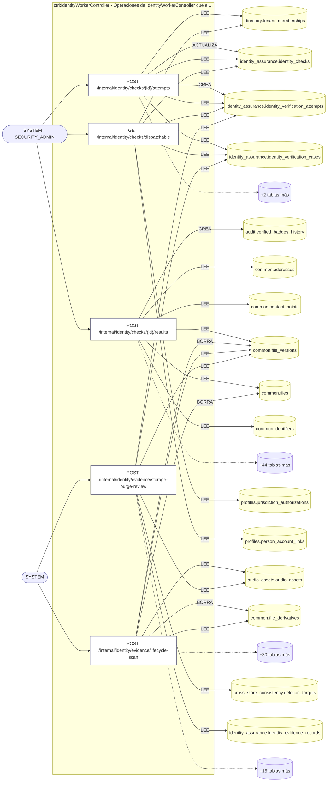

## Árbol de decisión por operación

Cada árbol se deriva del código del handler y de los métodos que invoca (hasta 4 niveles). Una rama que no decide, no escribe y no falla se poda. Los accesos y los efectos consecutivos se agrupan en un solo nodo.

### Operaciones con decisiones propias

#### 1. POST /identity/assertions/{id}/revoke

Revocar una aserción de identidad

| HTTP | Código | Cuándo |
|---|---|---|
| 200 | — | Éxito |
| 400 | `VALIDATION_FAILED` | Los parámetros de ruta son UUID válidos; El cuerpo cumple el DTO (sin propiedades extra) |
| 401 | `UNAUTHENTICATED` | Hay una sesión válida (JWT) |
| 403 | `FORBIDDEN` | El rol está permitido; El tenant se resuelve y pertenece al actor |
| 409 | `CONFLICT` | ConflictException: La aserción ya está revocada |
| 422 | `PRECONDITION_FAILED` | PreconditionFailedException: Para derivar una señal de fraude se requieren tipo y severidad |
| 429 | `RATE_LIMITED` | No se supera el límite de solicitudes |

```mermaid
flowchart TD
  n1(("Solicitud")):::inicio
  n2{{"Acceso: sesión (401) · rol (403) · tenant (403) · parámetros de ruta (400) · cuerpo válido (400) · límite de…"}}:::acceso
  n1 --> n2
  n3["Llama a IdentityAssertionsService.revoke"]:::llamada
  n2 --> n3
  n4["Transacción: transactional(…)"]:::transaccion
  n3 --> n4
  n5["Llama a IdentityAssertionsRepository.findById"]:::llamada
  n4 --> n5
  n6[("LEE identity_assurance.identity_assertions")]:::efecto
  n5 --> n6
  n7["Llama a IdentityCaseScope.findAuthorizedCase"]:::llamada
  n6 --> n7
  n8["Llama a IdentityVerificationCasesRepository.findById"]:::llamada
  n7 --> n8
  n9[("LEE identity_assurance.identity_verification_cases")]:::efecto
  n8 --> n9
  n10["Llama a IdentityCaseScope.subjectInTenant"]:::llamada
  n9 --> n10
  n11{"subject.subjectTypeConceptId === IDA.SUBJECT_PRACTITIONER_LICENSE"}:::decision
  n10 --> n11
  n12[("LEE profiles.jurisdiction_authorizations")]:::efecto
  n11 -->|"sí"| n12
  n13[("LEE profiles.person_account_links · LEE directory.tenant_memberships")]:::efecto
  n12 --> n13
  n11 -->|"no"| n13
  n14{"assertion.revokedAt"}:::decision
  n13 --> n14
  n15(["409 CONFLICT La aserción ya está revocada"]):::error
  n14 -->|"sí"| n15
  n16["Llama a IdentityVerificationEffectsService.applyRevoked"]:::llamada
  n14 -->|"no"| n16
  n17["Llama a IdentityVerificationEffectsService.publicSubjectOf"]:::llamada
  n16 --> n17
  n18["Llama a JurisdictionAuthorizationsRepository.findById"]:::llamada
  n17 --> n18
  n19[("LEE profiles.jurisdiction_authorizations")]:::efecto
  n18 --> n19
  n20["Llama a CommunityVerificationService.applyRevoked"]:::llamada
  n19 --> n20
  n21["Llama a VerifiedBadgesRepository.findProfileByTarget"]:::llamada
  n20 --> n21
  n22[("LEE community.public_profiles")]:::efecto
  n21 --> n22
  n23["Llama a CommunityVerificationService.revokeProfileBadges"]:::llamada
  n22 --> n23
  n24{"profile.verificationStatusConceptId === CONCEPTS.STATE_ACTIVE"}:::decision
  n23 --> n24
  n25[("ACTUALIZA community.public_profiles")]:::efecto
  n24 -->|"sí"| n25
  n26{"dto.raiseFraudSignal"}:::decision
  n25 --> n26
  n24 -->|"no"| n26
  n27{"!dto.fraudSignalTypeConceptId || !dto.fraudSeverityConceptId"}:::decision
  n26 -->|"sí"| n27
  n28(["422 PRECONDITION_FAILED Para derivar una señal de fraude se requieren tipo y severidad"]):::error
  n27 -->|"sí"| n28
  n29["Llama a IdentityFraudSignalsRepository.create"]:::llamada
  n27 -->|"no"| n29
  n30[("CREA identity_assurance.identity_fraud_signals")]:::efecto
  n29 --> n30
  n31(("200 Responde con éxito")):::ok
  n30 --> n31
  n26 -->|"no"| n31
  classDef acceso fill:#eef,stroke:#66a
  classDef error fill:#fee,stroke:#c33
  classDef ok fill:#efe,stroke:#3a3
  classDef efecto fill:#ffd,stroke:#aa3
  classDef decision fill:#fff,stroke:#555
  classDef corte fill:#eee,stroke:#999,stroke-dasharray: 4
```

#### 2. POST /identity/checks/{id}/attempts

Ejecutar un intento contra la autoridad externa (idempotente)

| HTTP | Código | Cuándo |
|---|---|---|
| 201 | — | Éxito |
| 400 | `VALIDATION_FAILED` | Los parámetros de ruta son UUID válidos; El cuerpo cumple el DTO (sin propiedades extra) |
| 401 | `UNAUTHENTICATED` | Hay una sesión válida (JWT) |
| 403 | `FORBIDDEN` | El rol está permitido; El tenant se resuelve y pertenece al actor |
| 404 | `NOT_FOUND` | ResourceNotFoundException: Check de identidad no encontrado |
| 429 | `RATE_LIMITED` | No se supera el límite de solicitudes |

```mermaid
flowchart TD
  n1(("Solicitud")):::inicio
  n2{{"Acceso: sesión (401) · rol (403) · tenant (403) · parámetros de ruta (400) · cuerpo válido (400) · límite de…"}}:::acceso
  n1 --> n2
  n3["Llama a IdentityChecksService.recordAttempt"]:::llamada
  n2 --> n3
  n4["Transacción: transactional(…)"]:::transaccion
  n3 --> n4
  n5["Llama a IdentityChecksService.loadCheck"]:::llamada
  n4 --> n5
  n6["Llama a IdentityChecksRepository.findById"]:::llamada
  n5 --> n6
  n7[("LEE identity_assurance.identity_checks")]:::efecto
  n6 --> n7
  n8["Llama a IdentityCaseScope.findAuthorizedCase"]:::llamada
  n7 --> n8
  n9["Llama a IdentityVerificationCasesRepository.findById"]:::llamada
  n8 --> n9
  n10[("LEE identity_assurance.identity_verification_cases")]:::efecto
  n9 --> n10
  n11["Llama a IdentityCaseScope.subjectInTenant"]:::llamada
  n10 --> n11
  n12{"subject.subjectTypeConceptId === IDA.SUBJECT_PRACTITIONER_LICENSE"}:::decision
  n11 --> n12
  n13[("LEE profiles.jurisdiction_authorizations")]:::efecto
  n12 -->|"sí"| n13
  n14[("LEE profiles.person_account_links · LEE directory.tenant_memberships")]:::efecto
  n13 --> n14
  n12 -->|"no"| n14
  n15{"!check || !owned"}:::decision
  n14 --> n15
  n16(["404 NOT_FOUND Check de identidad no encontrado"]):::error
  n15 -->|"sí"| n16
  n17["Llama a IdentityVerificationAttemptsRepository.countByCase"]:::llamada
  n15 -->|"no"| n17
  n18[("LEE identity_assurance.identity_verification_attempts")]:::efecto
  n17 --> n18
  n19["Llama a IdentityVerificationAttemptsRepository.create"]:::llamada
  n18 --> n19
  n20[("CREA identity_assurance.identity_verification_attempts")]:::efecto
  n19 --> n20
  n21[("ACTUALIZA identity_assurance.identity_checks")]:::efecto
  n20 --> n21
  n22(("201 Responde con éxito")):::ok
  n21 --> n22
  classDef acceso fill:#eef,stroke:#66a
  classDef error fill:#fee,stroke:#c33
  classDef ok fill:#efe,stroke:#3a3
  classDef efecto fill:#ffd,stroke:#aa3
  classDef decision fill:#fff,stroke:#555
  classDef corte fill:#eee,stroke:#999,stroke-dasharray: 4
```

#### 3. POST /identity/checks/{id}/results

Registrar el resultado inmutable del check (con supersede)

| HTTP | Código | Cuándo |
|---|---|---|
| 201 | — | Éxito |
| 400 | `VALIDATION_FAILED` | Los parámetros de ruta son UUID válidos; El cuerpo cumple el DTO (sin propiedades extra) |
| 401 | `UNAUTHENTICATED` | Hay una sesión válida (JWT) |
| 403 | `FORBIDDEN` | El rol está permitido; El tenant se resuelve y pertenece al actor |
| 404 | `NOT_FOUND` | ResourceNotFoundException: Check de identidad no encontrado |
| 422 | `PRECONDITION_FAILED` | PreconditionFailedException: No existe un intento completado para registrar resultado; PreconditionFailedException: No se pudo determinar la autoridad que verificó el caso |
| 429 | `RATE_LIMITED` | No se supera el límite de solicitudes |

```mermaid
flowchart TD
  n1(("Solicitud")):::inicio
  n2{{"Acceso: sesión (401) · rol (403) · tenant (403) · parámetros de ruta (400) · cuerpo válido (400) · límite de…"}}:::acceso
  n1 --> n2
  n3["Llama a IdentityChecksService.recordResult"]:::llamada
  n2 --> n3
  n4["Transacción: transactional(…)"]:::transaccion
  n3 --> n4
  n5["Llama a IdentityChecksService.loadCheck"]:::llamada
  n4 --> n5
  n6["Llama a IdentityChecksRepository.findById"]:::llamada
  n5 --> n6
  n7[("LEE identity_assurance.identity_checks")]:::efecto
  n6 --> n7
  n8["Llama a IdentityCaseScope.findAuthorizedCase"]:::llamada
  n7 --> n8
  n9["Llama a IdentityVerificationCasesRepository.findById"]:::llamada
  n8 --> n9
  n10[("LEE identity_assurance.identity_verification_cases")]:::efecto
  n9 --> n10
  n11["Llama a IdentityCaseScope.subjectInTenant"]:::llamada
  n10 --> n11
  n12{"subject.subjectTypeConceptId === IDA.SUBJECT_PRACTITIONER_LICENSE"}:::decision
  n11 --> n12
  n13[("LEE profiles.jurisdiction_authorizations")]:::efecto
  n12 -->|"sí"| n13
  n14[("LEE profiles.person_account_links · LEE directory.tenant_memberships")]:::efecto
  n13 --> n14
  n12 -->|"no"| n14
  n15{"!check || !owned"}:::decision
  n14 --> n15
  n16(["404 NOT_FOUND Check de identidad no encontrado"]):::error
  n15 -->|"sí"| n16
  n17["Llama a IdentityChecksService.completeInFlightAttempt"]:::llamada
  n15 -->|"no"| n17
  n18["Llama a IdentityVerificationAttemptsRepository.findLatestByCase"]:::llamada
  n17 --> n18
  n19[("LEE identity_assurance.identity_verification_attempts")]:::efecto
  n18 --> n19
  n20[("ACTUALIZA identity_assurance.identity_verification_attempts · ACTUALIZA identity_assurance.identity_verificat…")]:::efecto
  n19 --> n20
  n21["Llama a IdentityVerificationAttemptsRepository.existsCompletedForCase"]:::llamada
  n20 --> n21
  n22[("LEE identity_assurance.identity_verification_attempts")]:::efecto
  n21 --> n22
  n23{"!hasCompleted"}:::decision
  n22 --> n23
  n24(["422 PRECONDITION_FAILED No existe un intento completado para registrar resultado"]):::error
  n23 -->|"sí"| n24
  n25["Llama a IdentityCheckResultsRepository.findLatestByCheck"]:::llamada
  n23 -->|"no"| n25
  n26[("LEE identity_assurance.identity_check_results")]:::efecto
  n25 --> n26
  n27["Llama a IdentityCheckResultsRepository.countByCheck"]:::llamada
  n26 --> n27
  n28[("LEE identity_assurance.identity_check_results")]:::efecto
  n27 --> n28
  n29["Llama a IdentityCheckResultsRepository.create"]:::llamada
  n28 --> n29
  n30[("CREA identity_assurance.identity_check_results")]:::efecto
  n29 --> n30
  n31[("ACTUALIZA identity_assurance.identity_checks")]:::efecto
  n30 --> n31
  n32["Llama a IdentityChecksService.settleCase"]:::llamada
  n31 --> n32
  n33["Llama a IdentityVerificationCasesRepository.findById"]:::llamada
  n32 --> n33
  n34[("LEE identity_assurance.identity_verification_cases")]:::efecto
  n33 --> n34
  n35{"result === 'NO_MATCH'"}:::decision
  n34 --> n35
  n36[("ACTUALIZA identity_assurance.identity_verification_cases · ACTUALIZA identity_assurance.identity_verification…")]:::efecto
  n35 -->|"sí"| n36
  n37["Llama a IdentityChecksRepository.countOpenRequiredByCase"]:::llamada
  n36 --> n37
  n35 -->|"no"| n37
  n38[("LEE identity_assurance.identity_checks")]:::efecto
  n37 --> n38
  n39["Llama a IdentityChecksService.verifyCase"]:::llamada
  n38 --> n39
  n40[("ACTUALIZA identity_assurance.identity_verification_cases")]:::efecto
  n39 --> n40
  n41["Llama a IdentityChecksService.issueAssertion"]:::llamada
  n40 --> n41
  n42{"!authorityEndpoint"}:::decision
  n41 --> n42
  n43(["422 PRECONDITION_FAILED No se pudo determinar la autoridad que verificó el caso"]):::error
  n42 -->|"sí"| n43
  n44[("ACTUALIZA identity_assurance.identity_verification_cases · ACTUALIZA identity_assurance.identity_verification…")]:::efecto
  n42 -->|"no"| n44
  n45(("201 Responde con éxito")):::ok
  n44 --> n45
  classDef acceso fill:#eef,stroke:#66a
  classDef error fill:#fee,stroke:#c33
  classDef ok fill:#efe,stroke:#3a3
  classDef efecto fill:#ffd,stroke:#aa3
  classDef decision fill:#fff,stroke:#555
  classDef corte fill:#eee,stroke:#999,stroke-dasharray: 4
```

#### 4. POST /identity/manual-review/{id}/decision

Resolver una revisión manual (decisión)

| HTTP | Código | Cuándo |
|---|---|---|
| 200 | — | Éxito |
| 400 | `VALIDATION_FAILED` | Los parámetros de ruta son UUID válidos; El cuerpo cumple el DTO (sin propiedades extra) |
| 401 | `UNAUTHENTICATED` | Hay una sesión válida (JWT) |
| 403 | `FORBIDDEN` | El rol está permitido; El tenant se resuelve y pertenece al actor |
| 422 | `PRECONDITION_FAILED` | PreconditionFailedException: La revisión ya fue decidida; PreconditionFailedException: La revisión está asignada a otro revisor; PreconditionFailedException: La revisión quedó obsoleta: el caso ya no admite aprobación; PreconditionFailedException: No se pudo determinar la autoridad que verificó el caso |
| 429 | `RATE_LIMITED` | No se supera el límite de solicitudes |

```mermaid
flowchart TD
  n1(("Solicitud")):::inicio
  n2{{"Acceso: sesión (401) · rol (403) · tenant (403) · parámetros de ruta (400) · cuerpo válido (400) · límite de…"}}:::acceso
  n1 --> n2
  n3["Llama a IdentityManualReviewService.decide"]:::llamada
  n2 --> n3
  n4["Transacción: transactional(…)"]:::transaccion
  n3 --> n4
  n5["Llama a IdentityManualReviewCasesRepository.findById"]:::llamada
  n4 --> n5
  n6[("LEE identity_assurance.identity_manual_review_cases")]:::efecto
  n5 --> n6
  n7["Llama a IdentityCaseScope.findAuthorizedCase"]:::llamada
  n6 --> n7
  n8["Llama a IdentityVerificationCasesRepository.findById"]:::llamada
  n7 --> n8
  n9[("LEE identity_assurance.identity_verification_cases")]:::efecto
  n8 --> n9
  n10["Llama a IdentityCaseScope.subjectInTenant"]:::llamada
  n9 --> n10
  n11{"subject.subjectTypeConceptId === IDA.SUBJECT_PRACTITIONER_LICENSE"}:::decision
  n10 --> n11
  n12[("LEE profiles.jurisdiction_authorizations")]:::efecto
  n11 -->|"sí"| n12
  n13[("LEE profiles.person_account_links · LEE directory.tenant_memberships")]:::efecto
  n12 --> n13
  n11 -->|"no"| n13
  n14{"review.statusConceptId !== IDA.REVIEW_OPEN"}:::decision
  n13 --> n14
  n15(["422 PRECONDITION_FAILED La revisión ya fue decidida"]):::error
  n14 -->|"sí"| n15
  n16{"review.assignedToUserId && review.assignedToUserId !== actor.id"}:::decision
  n14 -->|"no"| n16
  n17(["422 PRECONDITION_FAILED La revisión está asignada a otro revisor"]):::error
  n16 -->|"sí"| n17
  n18{"approved"}:::decision
  n16 -->|"no"| n18
  n19["Llama a IdentityChecksService.settleManualApproval"]:::llamada
  n18 -->|"sí"| n19
  n20{"!APPROVABLE_CASE_STATES.includes(kase.statusConceptId)"}:::decision
  n19 --> n20
  n21(["422 PRECONDITION_FAILED La revisión quedó obsoleta: el caso ya no admite aprobación"]):::error
  n20 -->|"sí"| n21
  n22["Llama a IdentityChecksRepository.findRequiredByCase"]:::llamada
  n20 -->|"no"| n22
  n23[("LEE identity_assurance.identity_checks")]:::efecto
  n22 --> n23
  n24["Repite: por cada const check de required"]:::bucle
  n23 --> n24
  n25["Llama a IdentityCheckResultsRepository.findLatestByCheck"]:::llamada
  n24 -->|"cada elemento"| n25
  n26[("LEE identity_assurance.identity_check_results")]:::efecto
  n25 --> n26
  n27["Llama a IdentityCheckResultsRepository.countByCheck"]:::llamada
  n26 --> n27
  n28[("LEE identity_assurance.identity_check_results")]:::efecto
  n27 --> n28
  n29["Llama a IdentityCheckResultsRepository.create"]:::llamada
  n28 --> n29
  n30[("CREA identity_assurance.identity_check_results")]:::efecto
  n29 --> n30
  n31[("ACTUALIZA identity_assurance.identity_checks")]:::efecto
  n30 --> n31
  n32["Llama a IdentityChecksService.verifyCase"]:::llamada
  n31 --> n32
  n24 -->|"al terminar"| n32
  n33[("ACTUALIZA identity_assurance.identity_verification_cases")]:::efecto
  n32 --> n33
  n34["Llama a IdentityChecksService.issueAssertion"]:::llamada
  n33 --> n34
  n35{"!authorityEndpoint"}:::decision
  n34 --> n35
  n36(["422 PRECONDITION_FAILED No se pudo determinar la autoridad que verificó el caso"]):::error
  n35 -->|"sí"| n36
  n37[("ACTUALIZA identity_assurance.identity_verification_cases · ACTUALIZA identity_assurance.identity_verification…")]:::efecto
  n35 -->|"no"| n37
  n38["Llama a IdentityFraudSignalsRepository.resolveOpenForCase"]:::llamada
  n37 --> n38
  n18 -->|"no"| n38
  n39[("LEE identity_assurance.identity_fraud_signals")]:::efecto
  n38 --> n39
  n40["Repite: por cada const s de open"]:::bucle
  n39 --> n40
  n41[("ACTUALIZA identity_assurance.identity_fraud_signals · ACTUALIZA identity_assurance.identity_fraud_signals")]:::efecto
  n40 -->|"cada elemento"| n41
  n42(("200 Responde con éxito")):::ok
  n41 --> n42
  n40 -->|"al terminar"| n42
  classDef acceso fill:#eef,stroke:#66a
  classDef error fill:#fee,stroke:#c33
  classDef ok fill:#efe,stroke:#3a3
  classDef efecto fill:#ffd,stroke:#aa3
  classDef decision fill:#fff,stroke:#555
  classDef corte fill:#eee,stroke:#999,stroke-dasharray: 4
```

#### 5. POST /identity/me/identity-verification

Solicitar la verificación de la propia identidad (paciente)

| HTTP | Código | Cuándo |
|---|---|---|
| 201 | — | Éxito |
| 400 | `VALIDATION_FAILED` | El cuerpo cumple el DTO (sin propiedades extra) |
| 401 | `UNAUTHENTICATED` | Hay una sesión válida (JWT) |
| 403 | `FORBIDDEN` | El rol está permitido; El tenant se resuelve y pertenece al actor |
| 404 | `NOT_FOUND` | ResourceNotFoundException: Canal no encontrado; ResourceNotFoundException: Plantilla no encontrada |
| 409 | `CONFLICT` | ConflictException: Ya hay una verificación en curso para este sujeto |
| 422 | `PRECONDITION_FAILED` | PreconditionFailedException: La cuenta no tiene una persona vinculada; PreconditionFailedException: Envía el archivo histórico o las cinco evidencias nuevas, no ambos; PreconditionFailedException: La verificación requiere las cinco evidencias en el orden solicitado; PreconditionFailedException: Adjunta el frente, el reverso y las tres capturas de prueba de vida; PreconditionFailedException: Una evidencia no existe, no pertenece a esta cuenta o no está protegida; PreconditionFailedException: La notificación a una dirección externa también necesita el usuario destinatario / La notificación necesita el usuario destinatario; PreconditionFailedException: El canal no está activo; PreconditionFailedException: La plantilla no está publicada; PreconditionFailedException: La plantilla es de otro canal |
| 429 | `RATE_LIMITED` | No se supera el límite de solicitudes |
| 500 | `INTERNAL` | StorageLifecycleDenied: FILE_NOT_LIVE; StorageLifecycleDenied: VERSION_UNKNOWN; StorageLifecycleDenied: PHYSICAL_IDENTITY_UNKNOWN |

```mermaid
flowchart TD
  n1(("Solicitud")):::inicio
  n2{{"Acceso: sesión (401) · rol (403) · tenant (403) · cuerpo válido (400) · límite de tasa (429)"}}:::acceso
  n1 --> n2
  n3["Llama a IdentitySelfServiceService.requestPatientIdentity"]:::llamada
  n2 --> n3
  n4["Transacción: transactional(…)"]:::transaccion
  n3 --> n4
  n5["Llama a IdentitySelfServiceService.resolvePersonId"]:::llamada
  n4 --> n5
  n6["Llama a PersonAccountLinksRepository.findActiveByUser"]:::llamada
  n5 --> n6
  n7[("LEE profiles.person_account_links")]:::efecto
  n6 --> n7
  n8{"!link"}:::decision
  n7 --> n8
  n9(["422 PRECONDITION_FAILED La cuenta no tiene una persona vinculada"]):::error
  n8 -->|"sí"| n9
  n10["Llama a IdentitySelfServiceService.openVerification"]:::llamada
  n8 -->|"no"| n10
  n11["Llama a IdentitySelfServiceService.resolveEvidence"]:::llamada
  n10 --> n11
  n12{"dto.evidenceFileId && supplied.length"}:::decision
  n11 --> n12
  n13(["422 PRECONDITION_FAILED Envía el archivo histórico o las cinco evidencias nuevas, no ambos"]):::error
  n12 -->|"sí"| n13
  n14{"supplied.length !== values.length"}:::decision
  n12 -->|"no"| n14
  n15(["422 PRECONDITION_FAILED La verificación requiere las cinco evidencias en el orden solicitado"]):::error
  n14 -->|"sí"| n15
  n16{"!evidence.length"}:::decision
  n14 -->|"no"| n16
  n17(["422 PRECONDITION_FAILED Adjunta el frente, el reverso y las tres capturas de prueba de vida"]):::error
  n16 -->|"sí"| n17
  n18["Repite: por cada const item de evidence"]:::bucle
  n16 -->|"no"| n18
  n19["Llama a FilesRepository.findById"]:::llamada
  n18 -->|"cada elemento"| n19
  n20[("LEE common.files")]:::efecto
  n19 --> n20
  n21{"!file || file.createdByUserId !== actor.id || file.sensitivityConceptId !== CONCEPTS.SENSITIVITY_PHI || file.…"}:::decision
  n20 --> n21
  n22(["422 PRECONDITION_FAILED Una evidencia no existe, no pertenece a esta cuenta o no está protegida"]):::error
  n21 -->|"sí"| n22
  n23["Llama a IdentityVerificationCasesRepository.countLiveForSubject"]:::llamada
  n21 -->|"no"| n23
  n18 -->|"al terminar"| n23
  n24[("LEE identity_assurance.identity_verification_cases")]:::efecto
  n23 --> n24
  n25{"live › 0"}:::decision
  n24 --> n25
  n26(["409 CONFLICT Ya hay una verificación en curso para este sujeto"]):::error
  n25 -->|"sí"| n26
  n27["Llama a IdentityVerificationCasesRepository.create"]:::llamada
  n25 -->|"no"| n27
  n28[("CREA identity_assurance.identity_verification_cases")]:::efecto
  n27 --> n28
  n29["Repite: por cada const item de evidence"]:::bucle
  n28 --> n29
  n30["Llama a IdentityEvidenceRecordsRepository.create"]:::llamada
  n29 -->|"cada elemento"| n30
  n31{"data.evidenceFileId"}:::decision
  n30 --> n31
  n32["Llama a StoragePublicationService.guardFile"]:::llamada
  n31 -->|"sí"| n32
  n33[("LEE common.files")]:::efecto
  n32 --> n33
  n34{"!file || file.deletedAt || file.lifecycleStatusConceptId === CONCEPTS.FILE_DELETED || !file.currentVersionId"}:::decision
  n33 --> n34
  n35(["500 INTERNAL FILE_NOT_LIVE"]):::error
  n34 -->|"sí"| n35
  n36[("LEE common.file_versions")]:::efecto
  n34 -->|"no"| n36
  n37{"!versions.some((version) =› version.id === file.currentVersionId)"}:::decision
  n36 --> n37
  n38(["500 INTERNAL VERSION_UNKNOWN"]):::error
  n37 -->|"sí"| n38
  n39["Repite: por cada const version de versions"]:::bucle
  n37 -->|"no"| n39
  n40{"!identity || identity.kind === 'UNKNOWN'"}:::decision
  n39 -->|"cada elemento"| n40
  n41(["500 INTERNAL PHYSICAL_IDENTITY_UNKNOWN"]):::error
  n40 -->|"sí"| n41
  n42[("CREA identity_assurance.identity_evidence_records")]:::efecto
  n40 -->|"no"| n42
  n39 -->|"al terminar"| n42
  n31 -->|"no"| n42
  n43["Llama a IdentityChecksRepository.create"]:::llamada
  n42 --> n43
  n29 -->|"al terminar"| n43
  n44[("CREA identity_assurance.identity_checks")]:::efecto
  n43 --> n44
  n45["Llama a IdentitySelfServiceService.sendConfirmationEmail"]:::llamada
  n44 --> n45
  n46["Intenta"]:::intento
  n45 --> n46
  n47["Llama a IdentitySelfServiceService.findEmailForUser"]:::llamada
  n46 --> n47
  n48[("LEE iam.authentication_credentials · LEE iam.email_verifications")]:::efecto
  n47 --> n48
  n49["Llama a NotificationsService.createRequest"]:::llamada
  n48 --> n49
  n50{"!recipientUserId"}:::decision
  n49 --> n50
  n51(["422 PRECONDITION_FAILED La notificación a una dirección externa también necesita el usuario destinatario / La…"]):::error
  n50 -->|"sí"| n51
  n52["Transacción: transactional(…)"]:::transaccion
  n50 -->|"no"| n52
  n53{"!channel"}:::decision
  n52 --> n53
  n54(["404 NOT_FOUND Canal no encontrado"]):::error
  n53 -->|"sí"| n54
  n55{"channel.stateConceptId !== CONCEPTS.STATE_ACTIVE"}:::decision
  n53 -->|"no"| n55
  n56(["422 PRECONDITION_FAILED El canal no está activo"]):::error
  n55 -->|"sí"| n56
  n57{"dto.templateId"}:::decision
  n55 -->|"no"| n57
  n58{"!template"}:::decision
  n57 -->|"sí"| n58
  n59(["404 NOT_FOUND Plantilla no encontrada"]):::error
  n58 -->|"sí"| n59
  n60{"template.statusConceptId !== CONCEPTS.STATE_ACTIVE"}:::decision
  n58 -->|"no"| n60
  n61(["422 PRECONDITION_FAILED La plantilla no está publicada"]):::error
  n60 -->|"sí"| n61
  n62{"template.channelId !== dto.channelId"}:::decision
  n60 -->|"no"| n62
  n63(["422 PRECONDITION_FAILED La plantilla es de otro canal"]):::error
  n62 -->|"sí"| n63
  n64(("201 Responde con éxito")):::ok
  n62 -->|"no"| n64
  n57 -->|"no"| n64
  classDef acceso fill:#eef,stroke:#66a
  classDef error fill:#fee,stroke:#c33
  classDef ok fill:#efe,stroke:#3a3
  classDef efecto fill:#ffd,stroke:#aa3
  classDef decision fill:#fff,stroke:#555
  classDef corte fill:#eee,stroke:#999,stroke-dasharray: 4
```

#### 6. POST /identity/me/practitioner/identity-verification

Solicitar la verificación de la propia identidad (profesional)

| HTTP | Código | Cuándo |
|---|---|---|
| 201 | — | Éxito |
| 400 | `VALIDATION_FAILED` | El cuerpo cumple el DTO (sin propiedades extra) |
| 401 | `UNAUTHENTICATED` | Hay una sesión válida (JWT) |
| 403 | `FORBIDDEN` | El rol está permitido; El tenant se resuelve y pertenece al actor |
| 404 | `NOT_FOUND` | ResourceNotFoundException: Canal no encontrado; ResourceNotFoundException: Plantilla no encontrada |
| 409 | `CONFLICT` | ConflictException: Ya hay una verificación en curso para este sujeto |
| 422 | `PRECONDITION_FAILED` | PreconditionFailedException: La cuenta no tiene una persona vinculada; PreconditionFailedException: La cuenta no tiene un perfil profesional; PreconditionFailedException: Envía el archivo histórico o las cinco evidencias nuevas, no ambos; PreconditionFailedException: La verificación requiere las cinco evidencias en el orden solicitado; PreconditionFailedException: Adjunta el frente, el reverso y las tres capturas de prueba de vida; PreconditionFailedException: Una evidencia no existe, no pertenece a esta cuenta o no está protegida; PreconditionFailedException: La notificación a una dirección externa también necesita el usuario destinatario / La notificación necesita el usuario destinatario; PreconditionFailedException: El canal no está activo; PreconditionFailedException: La plantilla no está publicada; PreconditionFailedException: La plantilla es de otro canal |
| 429 | `RATE_LIMITED` | No se supera el límite de solicitudes |
| 500 | `INTERNAL` | StorageLifecycleDenied: FILE_NOT_LIVE; StorageLifecycleDenied: VERSION_UNKNOWN; StorageLifecycleDenied: PHYSICAL_IDENTITY_UNKNOWN |

```mermaid
flowchart TD
  n1(("Solicitud")):::inicio
  n2{{"Acceso: sesión (401) · rol (403) · tenant (403) · cuerpo válido (400) · límite de tasa (429)"}}:::acceso
  n1 --> n2
  n3["Llama a IdentitySelfServiceService.requestPractitionerIdentity"]:::llamada
  n2 --> n3
  n4["Transacción: transactional(…)"]:::transaccion
  n3 --> n4
  n5["Llama a IdentitySelfServiceService.resolvePersonId"]:::llamada
  n4 --> n5
  n6["Llama a PersonAccountLinksRepository.findActiveByUser"]:::llamada
  n5 --> n6
  n7[("LEE profiles.person_account_links")]:::efecto
  n6 --> n7
  n8{"!link"}:::decision
  n7 --> n8
  n9(["422 PRECONDITION_FAILED La cuenta no tiene una persona vinculada"]):::error
  n8 -->|"sí"| n9
  n10["Llama a IdentitySelfServiceService.assertIsPractitioner"]:::llamada
  n8 -->|"no"| n10
  n11["Llama a HealthPractitionerProfilesRepository.findById"]:::llamada
  n10 --> n11
  n12[("LEE profiles.health_practitioner_profiles")]:::efecto
  n11 --> n12
  n13{"!practitioner"}:::decision
  n12 --> n13
  n14(["422 PRECONDITION_FAILED La cuenta no tiene un perfil profesional"]):::error
  n13 -->|"sí"| n14
  n15["Llama a IdentitySelfServiceService.openVerification"]:::llamada
  n13 -->|"no"| n15
  n16["Llama a IdentitySelfServiceService.resolveEvidence"]:::llamada
  n15 --> n16
  n17{"dto.evidenceFileId && supplied.length"}:::decision
  n16 --> n17
  n18(["422 PRECONDITION_FAILED Envía el archivo histórico o las cinco evidencias nuevas, no ambos"]):::error
  n17 -->|"sí"| n18
  n19{"supplied.length !== values.length"}:::decision
  n17 -->|"no"| n19
  n20(["422 PRECONDITION_FAILED La verificación requiere las cinco evidencias en el orden solicitado"]):::error
  n19 -->|"sí"| n20
  n21{"!evidence.length"}:::decision
  n19 -->|"no"| n21
  n22(["422 PRECONDITION_FAILED Adjunta el frente, el reverso y las tres capturas de prueba de vida"]):::error
  n21 -->|"sí"| n22
  n23["Repite: por cada const item de evidence"]:::bucle
  n21 -->|"no"| n23
  n24["Llama a FilesRepository.findById"]:::llamada
  n23 -->|"cada elemento"| n24
  n25[("LEE common.files")]:::efecto
  n24 --> n25
  n26{"!file || file.createdByUserId !== actor.id || file.sensitivityConceptId !== CONCEPTS.SENSITIVITY_PHI || file.…"}:::decision
  n25 --> n26
  n27(["422 PRECONDITION_FAILED Una evidencia no existe, no pertenece a esta cuenta o no está protegida"]):::error
  n26 -->|"sí"| n27
  n28["Llama a IdentityVerificationCasesRepository.countLiveForSubject"]:::llamada
  n26 -->|"no"| n28
  n23 -->|"al terminar"| n28
  n29[("LEE identity_assurance.identity_verification_cases")]:::efecto
  n28 --> n29
  n30{"live › 0"}:::decision
  n29 --> n30
  n31(["409 CONFLICT Ya hay una verificación en curso para este sujeto"]):::error
  n30 -->|"sí"| n31
  n32["Llama a IdentityVerificationCasesRepository.create"]:::llamada
  n30 -->|"no"| n32
  n33[("CREA identity_assurance.identity_verification_cases")]:::efecto
  n32 --> n33
  n34["Repite: por cada const item de evidence"]:::bucle
  n33 --> n34
  n35["Llama a IdentityEvidenceRecordsRepository.create"]:::llamada
  n34 -->|"cada elemento"| n35
  n36{"data.evidenceFileId"}:::decision
  n35 --> n36
  n37["Llama a StoragePublicationService.guardFile"]:::llamada
  n36 -->|"sí"| n37
  n38[("LEE common.files")]:::efecto
  n37 --> n38
  n39{"!file || file.deletedAt || file.lifecycleStatusConceptId === CONCEPTS.FILE_DELETED || !file.currentVersionId"}:::decision
  n38 --> n39
  n40(["500 INTERNAL FILE_NOT_LIVE"]):::error
  n39 -->|"sí"| n40
  n41[("LEE common.file_versions")]:::efecto
  n39 -->|"no"| n41
  n42{"!versions.some((version) =› version.id === file.currentVersionId)"}:::decision
  n41 --> n42
  n43(["500 INTERNAL VERSION_UNKNOWN"]):::error
  n42 -->|"sí"| n43
  n44["Repite: por cada const version de versions"]:::bucle
  n42 -->|"no"| n44
  n45{"!identity || identity.kind === 'UNKNOWN'"}:::decision
  n44 -->|"cada elemento"| n45
  n46(["500 INTERNAL PHYSICAL_IDENTITY_UNKNOWN"]):::error
  n45 -->|"sí"| n46
  n47[("CREA identity_assurance.identity_evidence_records")]:::efecto
  n45 -->|"no"| n47
  n44 -->|"al terminar"| n47
  n36 -->|"no"| n47
  n48["Llama a IdentityChecksRepository.create"]:::llamada
  n47 --> n48
  n34 -->|"al terminar"| n48
  n49[("CREA identity_assurance.identity_checks")]:::efecto
  n48 --> n49
  n50["Llama a IdentitySelfServiceService.sendConfirmationEmail"]:::llamada
  n49 --> n50
  n51["Intenta"]:::intento
  n50 --> n51
  n52["Llama a IdentitySelfServiceService.findEmailForUser"]:::llamada
  n51 --> n52
  n53[("LEE iam.authentication_credentials · LEE iam.email_verifications")]:::efecto
  n52 --> n53
  n54["Llama a NotificationsService.createRequest"]:::llamada
  n53 --> n54
  n55{"!recipientUserId"}:::decision
  n54 --> n55
  n56(["422 PRECONDITION_FAILED La notificación a una dirección externa también necesita el usuario destinatario / La…"]):::error
  n55 -->|"sí"| n56
  n57["Transacción: transactional(…)"]:::transaccion
  n55 -->|"no"| n57
  n58{"!channel"}:::decision
  n57 --> n58
  n59(["404 NOT_FOUND Canal no encontrado"]):::error
  n58 -->|"sí"| n59
  n60{"channel.stateConceptId !== CONCEPTS.STATE_ACTIVE"}:::decision
  n58 -->|"no"| n60
  n61(["422 PRECONDITION_FAILED El canal no está activo"]):::error
  n60 -->|"sí"| n61
  n62{"dto.templateId"}:::decision
  n60 -->|"no"| n62
  n63{"!template"}:::decision
  n62 -->|"sí"| n63
  n64(["404 NOT_FOUND Plantilla no encontrada"]):::error
  n63 -->|"sí"| n64
  n65{"template.statusConceptId !== CONCEPTS.STATE_ACTIVE"}:::decision
  n63 -->|"no"| n65
  n66(["422 PRECONDITION_FAILED La plantilla no está publicada"]):::error
  n65 -->|"sí"| n66
  n67{"template.channelId !== dto.channelId"}:::decision
  n65 -->|"no"| n67
  n68(["422 PRECONDITION_FAILED La plantilla es de otro canal"]):::error
  n67 -->|"sí"| n68
  n69(("201 Responde con éxito")):::ok
  n67 -->|"no"| n69
  n62 -->|"no"| n69
  classDef acceso fill:#eef,stroke:#66a
  classDef error fill:#fee,stroke:#c33
  classDef ok fill:#efe,stroke:#3a3
  classDef efecto fill:#ffd,stroke:#aa3
  classDef decision fill:#fff,stroke:#555
  classDef corte fill:#eee,stroke:#999,stroke-dasharray: 4
```

#### 7. POST /identity/me/practitioner/license-verification

Solicitar la verificación de la propia matrícula

| HTTP | Código | Cuándo |
|---|---|---|
| 201 | — | Éxito |
| 400 | `VALIDATION_FAILED` | El cuerpo cumple el DTO (sin propiedades extra) |
| 401 | `UNAUTHENTICATED` | Hay una sesión válida (JWT) |
| 403 | `FORBIDDEN` | El rol está permitido; El tenant se resuelve y pertenece al actor |
| 404 | `NOT_FOUND` | ResourceNotFoundException: Matrícula no encontrada; ResourceNotFoundException: Canal no encontrado; ResourceNotFoundException: Plantilla no encontrada |
| 409 | `CONFLICT` | ConflictException: Ya hay una verificación en curso para este sujeto |
| 422 | `PRECONDITION_FAILED` | PreconditionFailedException: La cuenta no tiene una persona vinculada; PreconditionFailedException: La cuenta no tiene un perfil profesional; PreconditionFailedException: Indique qué matrícula quiere verificar; PreconditionFailedException: La matrícula pertenece a otro profesional; PreconditionFailedException: Envía el archivo histórico o las cinco evidencias nuevas, no ambos; PreconditionFailedException: La verificación requiere las cinco evidencias en el orden solicitado; PreconditionFailedException: Adjunta el frente, el reverso y las tres capturas de prueba de vida; PreconditionFailedException: Una evidencia no existe, no pertenece a esta cuenta o no está protegida; PreconditionFailedException: La notificación a una dirección externa también necesita el usuario destinatario / La notificación necesita el usuario destinatario; PreconditionFailedException: El canal no está activo; PreconditionFailedException: La plantilla no está publicada; PreconditionFailedException: La plantilla es de otro canal |
| 429 | `RATE_LIMITED` | No se supera el límite de solicitudes |
| 500 | `INTERNAL` | StorageLifecycleDenied: FILE_NOT_LIVE; StorageLifecycleDenied: VERSION_UNKNOWN; StorageLifecycleDenied: PHYSICAL_IDENTITY_UNKNOWN |

```mermaid
flowchart TD
  n1(("Solicitud")):::inicio
  n2{{"Acceso: sesión (401) · rol (403) · tenant (403) · cuerpo válido (400) · límite de tasa (429)"}}:::acceso
  n1 --> n2
  n3["Llama a IdentitySelfServiceService.requestPractitionerLicense"]:::llamada
  n2 --> n3
  n4["Transacción: transactional(…)"]:::transaccion
  n3 --> n4
  n5["Llama a IdentitySelfServiceService.resolvePersonId"]:::llamada
  n4 --> n5
  n6["Llama a PersonAccountLinksRepository.findActiveByUser"]:::llamada
  n5 --> n6
  n7[("LEE profiles.person_account_links")]:::efecto
  n6 --> n7
  n8{"!link"}:::decision
  n7 --> n8
  n9(["422 PRECONDITION_FAILED La cuenta no tiene una persona vinculada"]):::error
  n8 -->|"sí"| n9
  n10["Llama a IdentitySelfServiceService.assertIsPractitioner"]:::llamada
  n8 -->|"no"| n10
  n11["Llama a HealthPractitionerProfilesRepository.findById"]:::llamada
  n10 --> n11
  n12[("LEE profiles.health_practitioner_profiles")]:::efecto
  n11 --> n12
  n13{"!practitioner"}:::decision
  n12 --> n13
  n14(["422 PRECONDITION_FAILED La cuenta no tiene un perfil profesional"]):::error
  n13 -->|"sí"| n14
  n15{"!dto.jurisdictionAuthorizationId"}:::decision
  n13 -->|"no"| n15
  n16(["422 PRECONDITION_FAILED Indique qué matrícula quiere verificar"]):::error
  n15 -->|"sí"| n16
  n17["Llama a JurisdictionAuthorizationsRepository.findById"]:::llamada
  n15 -->|"no"| n17
  n18[("LEE profiles.jurisdiction_authorizations")]:::efecto
  n17 --> n18
  n19{"!authorization"}:::decision
  n18 --> n19
  n20(["404 NOT_FOUND Matrícula no encontrada"]):::error
  n19 -->|"sí"| n20
  n21{"authorization.practitionerProfileId !== personId"}:::decision
  n19 -->|"no"| n21
  n22(["422 PRECONDITION_FAILED La matrícula pertenece a otro profesional"]):::error
  n21 -->|"sí"| n22
  n23["Llama a IdentitySelfServiceService.openVerification"]:::llamada
  n21 -->|"no"| n23
  n24["Llama a IdentitySelfServiceService.resolveEvidence"]:::llamada
  n23 --> n24
  n25{"dto.evidenceFileId && supplied.length"}:::decision
  n24 --> n25
  n26(["422 PRECONDITION_FAILED Envía el archivo histórico o las cinco evidencias nuevas, no ambos"]):::error
  n25 -->|"sí"| n26
  n27{"supplied.length !== values.length"}:::decision
  n25 -->|"no"| n27
  n28(["422 PRECONDITION_FAILED La verificación requiere las cinco evidencias en el orden solicitado"]):::error
  n27 -->|"sí"| n28
  n29{"!evidence.length"}:::decision
  n27 -->|"no"| n29
  n30(["422 PRECONDITION_FAILED Adjunta el frente, el reverso y las tres capturas de prueba de vida"]):::error
  n29 -->|"sí"| n30
  n31["Repite: por cada const item de evidence"]:::bucle
  n29 -->|"no"| n31
  n32["Llama a FilesRepository.findById"]:::llamada
  n31 -->|"cada elemento"| n32
  n33[("LEE common.files")]:::efecto
  n32 --> n33
  n34{"!file || file.createdByUserId !== actor.id || file.sensitivityConceptId !== CONCEPTS.SENSITIVITY_PHI || file.…"}:::decision
  n33 --> n34
  n35(["422 PRECONDITION_FAILED Una evidencia no existe, no pertenece a esta cuenta o no está protegida"]):::error
  n34 -->|"sí"| n35
  n36["Llama a IdentityVerificationCasesRepository.countLiveForSubject"]:::llamada
  n34 -->|"no"| n36
  n31 -->|"al terminar"| n36
  n37[("LEE identity_assurance.identity_verification_cases")]:::efecto
  n36 --> n37
  n38{"live › 0"}:::decision
  n37 --> n38
  n39(["409 CONFLICT Ya hay una verificación en curso para este sujeto"]):::error
  n38 -->|"sí"| n39
  n40["Llama a IdentityVerificationCasesRepository.create"]:::llamada
  n38 -->|"no"| n40
  n41[("CREA identity_assurance.identity_verification_cases")]:::efecto
  n40 --> n41
  n42["Repite: por cada const item de evidence"]:::bucle
  n41 --> n42
  n43["Llama a IdentityEvidenceRecordsRepository.create"]:::llamada
  n42 -->|"cada elemento"| n43
  n44{"data.evidenceFileId"}:::decision
  n43 --> n44
  n45["Llama a StoragePublicationService.guardFile"]:::llamada
  n44 -->|"sí"| n45
  n46[("LEE common.files")]:::efecto
  n45 --> n46
  n47{"!file || file.deletedAt || file.lifecycleStatusConceptId === CONCEPTS.FILE_DELETED || !file.currentVersionId"}:::decision
  n46 --> n47
  n48(["500 INTERNAL FILE_NOT_LIVE"]):::error
  n47 -->|"sí"| n48
  n49[("LEE common.file_versions")]:::efecto
  n47 -->|"no"| n49
  n50{"!versions.some((version) =› version.id === file.currentVersionId)"}:::decision
  n49 --> n50
  n51(["500 INTERNAL VERSION_UNKNOWN"]):::error
  n50 -->|"sí"| n51
  n52["Repite: por cada const version de versions"]:::bucle
  n50 -->|"no"| n52
  n53{"!identity || identity.kind === 'UNKNOWN'"}:::decision
  n52 -->|"cada elemento"| n53
  n54(["500 INTERNAL PHYSICAL_IDENTITY_UNKNOWN"]):::error
  n53 -->|"sí"| n54
  n55[("CREA identity_assurance.identity_evidence_records")]:::efecto
  n53 -->|"no"| n55
  n52 -->|"al terminar"| n55
  n44 -->|"no"| n55
  n56["Llama a IdentityChecksRepository.create"]:::llamada
  n55 --> n56
  n42 -->|"al terminar"| n56
  n57[("CREA identity_assurance.identity_checks")]:::efecto
  n56 --> n57
  n58["Llama a IdentitySelfServiceService.sendConfirmationEmail"]:::llamada
  n57 --> n58
  n59["Intenta"]:::intento
  n58 --> n59
  n60["Llama a IdentitySelfServiceService.findEmailForUser"]:::llamada
  n59 --> n60
  n61[("LEE iam.authentication_credentials · LEE iam.email_verifications")]:::efecto
  n60 --> n61
  n62["Llama a NotificationsService.createRequest"]:::llamada
  n61 --> n62
  n63{"!recipientUserId"}:::decision
  n62 --> n63
  n64(["422 PRECONDITION_FAILED La notificación a una dirección externa también necesita el usuario destinatario / La…"]):::error
  n63 -->|"sí"| n64
  n65["Transacción: transactional(…)"]:::transaccion
  n63 -->|"no"| n65
  n66{"!channel"}:::decision
  n65 --> n66
  n67(["404 NOT_FOUND Canal no encontrado"]):::error
  n66 -->|"sí"| n67
  n68{"channel.stateConceptId !== CONCEPTS.STATE_ACTIVE"}:::decision
  n66 -->|"no"| n68
  n69(["422 PRECONDITION_FAILED El canal no está activo"]):::error
  n68 -->|"sí"| n69
  n70{"dto.templateId"}:::decision
  n68 -->|"no"| n70
  n71["… el resto del árbol (6 nodos) está en el JSON del inventario"]:::corte
  n70 -->|"sí"| n71
  classDef acceso fill:#eef,stroke:#66a
  classDef error fill:#fee,stroke:#c33
  classDef ok fill:#efe,stroke:#3a3
  classDef efecto fill:#ffd,stroke:#aa3
  classDef decision fill:#fff,stroke:#555
  classDef corte fill:#eee,stroke:#999,stroke-dasharray: 4
```

#### 8. POST /identity/me/tenants/{tenantId}/verification

Solicitar la verificación de una institución propia

| HTTP | Código | Cuándo |
|---|---|---|
| 201 | — | Éxito |
| 400 | `VALIDATION_FAILED` | Los parámetros de ruta son UUID válidos; El cuerpo cumple el DTO (sin propiedades extra) |
| 401 | `UNAUTHENTICATED` | Hay una sesión válida (JWT) |
| 403 | `FORBIDDEN` | El rol está permitido; El tenant se resuelve y pertenece al actor |
| 404 | `NOT_FOUND` | ResourceNotFoundException: Canal no encontrado; ResourceNotFoundException: Plantilla no encontrada |
| 409 | `CONFLICT` | ConflictException: Ya hay una verificación en curso para este sujeto |
| 422 | `PRECONDITION_FAILED` | PreconditionFailedException: No pertenece a esa institución; PreconditionFailedException: Sólo el titular o un administrador de la institución puede pedir su verificación; PreconditionFailedException: Envía el archivo histórico o las cinco evidencias nuevas, no ambos; PreconditionFailedException: La verificación requiere las cinco evidencias en el orden solicitado; PreconditionFailedException: Adjunta el frente, el reverso y las tres capturas de prueba de vida; PreconditionFailedException: Una evidencia no existe, no pertenece a esta cuenta o no está protegida; PreconditionFailedException: La notificación a una dirección externa también necesita el usuario destinatario / La notificación necesita el usuario destinatario; PreconditionFailedException: El canal no está activo; PreconditionFailedException: La plantilla no está publicada; PreconditionFailedException: La plantilla es de otro canal |
| 429 | `RATE_LIMITED` | No se supera el límite de solicitudes |
| 500 | `INTERNAL` | StorageLifecycleDenied: FILE_NOT_LIVE; StorageLifecycleDenied: VERSION_UNKNOWN; StorageLifecycleDenied: PHYSICAL_IDENTITY_UNKNOWN |

```mermaid
flowchart TD
  n1(("Solicitud")):::inicio
  n2{{"Acceso: sesión (401) · rol (403) · tenant (403) · parámetros de ruta (400) · cuerpo válido (400) · límite de…"}}:::acceso
  n1 --> n2
  n3["Llama a IdentitySelfServiceService.requestTenantVerification"]:::llamada
  n2 --> n3
  n4["Transacción: transactional(…)"]:::transaccion
  n3 --> n4
  n5["Llama a TenantMembershipsRepository.findActiveByUserTenant"]:::llamada
  n4 --> n5
  n6[("LEE directory.tenant_memberships")]:::efecto
  n5 --> n6
  n7{"!membership"}:::decision
  n6 --> n7
  n8(["422 PRECONDITION_FAILED No pertenece a esa institución"]):::error
  n7 -->|"sí"| n8
  n9{"membership.tenantRoleConceptId !== DIR.ROLE_OWNER && membership.tenantRoleConceptId !== DIR.ROLE_ADMIN"}:::decision
  n7 -->|"no"| n9
  n10(["422 PRECONDITION_FAILED Sólo el titular o un administrador de la institución puede pedir su verificación"]):::error
  n9 -->|"sí"| n10
  n11["Llama a IdentitySelfServiceService.openVerification"]:::llamada
  n9 -->|"no"| n11
  n12["Llama a IdentitySelfServiceService.resolveEvidence"]:::llamada
  n11 --> n12
  n13{"dto.evidenceFileId && supplied.length"}:::decision
  n12 --> n13
  n14(["422 PRECONDITION_FAILED Envía el archivo histórico o las cinco evidencias nuevas, no ambos"]):::error
  n13 -->|"sí"| n14
  n15{"supplied.length !== values.length"}:::decision
  n13 -->|"no"| n15
  n16(["422 PRECONDITION_FAILED La verificación requiere las cinco evidencias en el orden solicitado"]):::error
  n15 -->|"sí"| n16
  n17{"!evidence.length"}:::decision
  n15 -->|"no"| n17
  n18(["422 PRECONDITION_FAILED Adjunta el frente, el reverso y las tres capturas de prueba de vida"]):::error
  n17 -->|"sí"| n18
  n19["Repite: por cada const item de evidence"]:::bucle
  n17 -->|"no"| n19
  n20["Llama a FilesRepository.findById"]:::llamada
  n19 -->|"cada elemento"| n20
  n21[("LEE common.files")]:::efecto
  n20 --> n21
  n22{"!file || file.createdByUserId !== actor.id || file.sensitivityConceptId !== CONCEPTS.SENSITIVITY_PHI || file.…"}:::decision
  n21 --> n22
  n23(["422 PRECONDITION_FAILED Una evidencia no existe, no pertenece a esta cuenta o no está protegida"]):::error
  n22 -->|"sí"| n23
  n24["Llama a IdentityVerificationCasesRepository.countLiveForSubject"]:::llamada
  n22 -->|"no"| n24
  n19 -->|"al terminar"| n24
  n25[("LEE identity_assurance.identity_verification_cases")]:::efecto
  n24 --> n25
  n26{"live › 0"}:::decision
  n25 --> n26
  n27(["409 CONFLICT Ya hay una verificación en curso para este sujeto"]):::error
  n26 -->|"sí"| n27
  n28["Llama a IdentityVerificationCasesRepository.create"]:::llamada
  n26 -->|"no"| n28
  n29[("CREA identity_assurance.identity_verification_cases")]:::efecto
  n28 --> n29
  n30["Repite: por cada const item de evidence"]:::bucle
  n29 --> n30
  n31["Llama a IdentityEvidenceRecordsRepository.create"]:::llamada
  n30 -->|"cada elemento"| n31
  n32{"data.evidenceFileId"}:::decision
  n31 --> n32
  n33["Llama a StoragePublicationService.guardFile"]:::llamada
  n32 -->|"sí"| n33
  n34[("LEE common.files")]:::efecto
  n33 --> n34
  n35{"!file || file.deletedAt || file.lifecycleStatusConceptId === CONCEPTS.FILE_DELETED || !file.currentVersionId"}:::decision
  n34 --> n35
  n36(["500 INTERNAL FILE_NOT_LIVE"]):::error
  n35 -->|"sí"| n36
  n37[("LEE common.file_versions")]:::efecto
  n35 -->|"no"| n37
  n38{"!versions.some((version) =› version.id === file.currentVersionId)"}:::decision
  n37 --> n38
  n39(["500 INTERNAL VERSION_UNKNOWN"]):::error
  n38 -->|"sí"| n39
  n40["Repite: por cada const version de versions"]:::bucle
  n38 -->|"no"| n40
  n41{"!identity || identity.kind === 'UNKNOWN'"}:::decision
  n40 -->|"cada elemento"| n41
  n42(["500 INTERNAL PHYSICAL_IDENTITY_UNKNOWN"]):::error
  n41 -->|"sí"| n42
  n43[("CREA identity_assurance.identity_evidence_records")]:::efecto
  n41 -->|"no"| n43
  n40 -->|"al terminar"| n43
  n32 -->|"no"| n43
  n44["Llama a IdentityChecksRepository.create"]:::llamada
  n43 --> n44
  n30 -->|"al terminar"| n44
  n45[("CREA identity_assurance.identity_checks")]:::efecto
  n44 --> n45
  n46["Llama a IdentitySelfServiceService.sendConfirmationEmail"]:::llamada
  n45 --> n46
  n47["Intenta"]:::intento
  n46 --> n47
  n48["Llama a IdentitySelfServiceService.findEmailForUser"]:::llamada
  n47 --> n48
  n49[("LEE iam.authentication_credentials · LEE iam.email_verifications")]:::efecto
  n48 --> n49
  n50["Llama a NotificationsService.createRequest"]:::llamada
  n49 --> n50
  n51{"!recipientUserId"}:::decision
  n50 --> n51
  n52(["422 PRECONDITION_FAILED La notificación a una dirección externa también necesita el usuario destinatario / La…"]):::error
  n51 -->|"sí"| n52
  n53["Transacción: transactional(…)"]:::transaccion
  n51 -->|"no"| n53
  n54{"!channel"}:::decision
  n53 --> n54
  n55(["404 NOT_FOUND Canal no encontrado"]):::error
  n54 -->|"sí"| n55
  n56{"channel.stateConceptId !== CONCEPTS.STATE_ACTIVE"}:::decision
  n54 -->|"no"| n56
  n57(["422 PRECONDITION_FAILED El canal no está activo"]):::error
  n56 -->|"sí"| n57
  n58{"dto.templateId"}:::decision
  n56 -->|"no"| n58
  n59{"!template"}:::decision
  n58 -->|"sí"| n59
  n60(["404 NOT_FOUND Plantilla no encontrada"]):::error
  n59 -->|"sí"| n60
  n61{"template.statusConceptId !== CONCEPTS.STATE_ACTIVE"}:::decision
  n59 -->|"no"| n61
  n62(["422 PRECONDITION_FAILED La plantilla no está publicada"]):::error
  n61 -->|"sí"| n62
  n63{"template.channelId !== dto.channelId"}:::decision
  n61 -->|"no"| n63
  n64(["422 PRECONDITION_FAILED La plantilla es de otro canal"]):::error
  n63 -->|"sí"| n64
  n65(("201 Responde con éxito")):::ok
  n63 -->|"no"| n65
  n58 -->|"no"| n65
  classDef acceso fill:#eef,stroke:#66a
  classDef error fill:#fee,stroke:#c33
  classDef ok fill:#efe,stroke:#3a3
  classDef efecto fill:#ffd,stroke:#aa3
  classDef decision fill:#fff,stroke:#555
  classDef corte fill:#eee,stroke:#999,stroke-dasharray: 4
```

#### 9. GET /identity/me/verification-cases

Listar los casos de verificación propios

| HTTP | Código | Cuándo |
|---|---|---|
| 200 | — | Éxito |
| 401 | `UNAUTHENTICATED` | Hay una sesión válida (JWT) |
| 403 | `FORBIDDEN` | El rol está permitido; El tenant se resuelve y pertenece al actor |
| 429 | `RATE_LIMITED` | No se supera el límite de solicitudes |

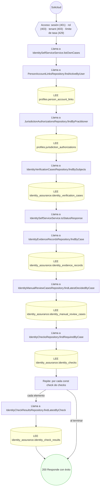

#### 10. GET /identity/me/verification-cases/{caseId}

Consultar el estado de un caso propio

| HTTP | Código | Cuándo |
|---|---|---|
| 200 | — | Éxito |
| 400 | `VALIDATION_FAILED` | Los parámetros de ruta son UUID válidos |
| 401 | `UNAUTHENTICATED` | Hay una sesión válida (JWT) |
| 403 | `FORBIDDEN` | El rol está permitido; El tenant se resuelve y pertenece al actor |
| 404 | `NOT_FOUND` | ResourceNotFoundException: Caso no encontrado |
| 429 | `RATE_LIMITED` | No se supera el límite de solicitudes |

```mermaid
flowchart TD
  n1(("Solicitud")):::inicio
  n2{{"Acceso: sesión (401) · rol (403) · tenant (403) · parámetros de ruta (400) · límite de tasa (429)"}}:::acceso
  n1 --> n2
  n3["Llama a IdentitySelfServiceService.getOwnCaseStatus"]:::llamada
  n2 --> n3
  n4["Llama a IdentityVerificationCasesRepository.findById"]:::llamada
  n3 --> n4
  n5[("LEE identity_assurance.identity_verification_cases")]:::efecto
  n4 --> n5
  n6{"!kase"}:::decision
  n5 --> n6
  n7(["404 NOT_FOUND Caso no encontrado"]):::error
  n6 -->|"sí"| n7
  n8["Llama a IdentitySelfServiceService.isOwnSubject"]:::llamada
  n6 -->|"no"| n8
  n9["Llama a PersonAccountLinksRepository.findActiveByUser"]:::llamada
  n8 --> n9
  n10[("LEE profiles.person_account_links")]:::efecto
  n9 --> n10
  n11{"link"}:::decision
  n10 --> n11
  n12["Llama a JurisdictionAuthorizationsRepository.findById"]:::llamada
  n11 -->|"sí"| n12
  n13[("LEE profiles.jurisdiction_authorizations")]:::efecto
  n12 --> n13
  n14["Llama a TenantMembershipsRepository.findActiveByUserTenant"]:::llamada
  n13 --> n14
  n11 -->|"no"| n14
  n15[("LEE directory.tenant_memberships")]:::efecto
  n14 --> n15
  n16{"!isOwn"}:::decision
  n15 --> n16
  n17(["404 NOT_FOUND Caso no encontrado"]):::error
  n16 -->|"sí"| n17
  n18["Llama a IdentitySelfServiceService.toStatusResponse"]:::llamada
  n16 -->|"no"| n18
  n19["Llama a IdentityEvidenceRecordsRepository.findByCase"]:::llamada
  n18 --> n19
  n20[("LEE identity_assurance.identity_evidence_records")]:::efecto
  n19 --> n20
  n21["Llama a IdentityManualReviewCasesRepository.findLatestDecidedByCase"]:::llamada
  n20 --> n21
  n22[("LEE identity_assurance.identity_manual_review_cases")]:::efecto
  n21 --> n22
  n23["Llama a IdentityChecksRepository.findRequiredByCase"]:::llamada
  n22 --> n23
  n24[("LEE identity_assurance.identity_checks")]:::efecto
  n23 --> n24
  n25["Repite: por cada const check de checks"]:::bucle
  n24 --> n25
  n26["Llama a IdentityCheckResultsRepository.findLatestByCheck"]:::llamada
  n25 -->|"cada elemento"| n26
  n27[("LEE identity_assurance.identity_check_results")]:::efecto
  n26 --> n27
  n28(("200 Responde con éxito")):::ok
  n27 --> n28
  n25 -->|"al terminar"| n28
  classDef acceso fill:#eef,stroke:#66a
  classDef error fill:#fee,stroke:#c33
  classDef ok fill:#efe,stroke:#3a3
  classDef efecto fill:#ffd,stroke:#aa3
  classDef decision fill:#fff,stroke:#555
  classDef corte fill:#eee,stroke:#999,stroke-dasharray: 4
```

#### 11. GET /identity/me/verification-types

Listar los tipos de solicitud de verificación disponibles

| HTTP | Código | Cuándo |
|---|---|---|
| 200 | — | Éxito |
| 401 | `UNAUTHENTICATED` | Hay una sesión válida (JWT) |
| 403 | `FORBIDDEN` | El rol está permitido; El tenant se resuelve y pertenece al actor |
| 429 | `RATE_LIMITED` | No se supera el límite de solicitudes |

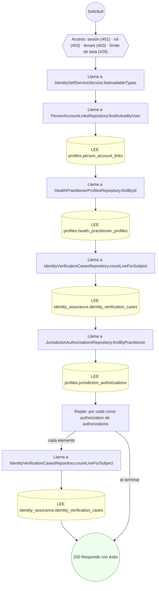

#### 12. GET /identity/verification-cases

Listar los casos que esperan revisión

| HTTP | Código | Cuándo |
|---|---|---|
| 200 | — | Éxito |
| 401 | `UNAUTHENTICATED` | Hay una sesión válida (JWT) |
| 403 | `FORBIDDEN` | El rol está permitido; El tenant se resuelve y pertenece al actor |
| 429 | `RATE_LIMITED` | No se supera el límite de solicitudes |

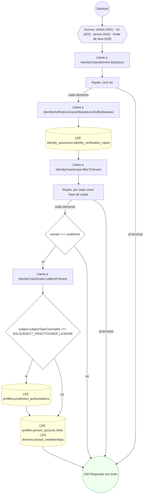

#### 13. POST /identity/verification-cases

Iniciar un caso de verificación de identidad

| HTTP | Código | Cuándo |
|---|---|---|
| 201 | — | Éxito |
| 400 | `VALIDATION_FAILED` | El cuerpo cumple el DTO (sin propiedades extra) |
| 401 | `UNAUTHENTICATED` | Hay una sesión válida (JWT) |
| 403 | `FORBIDDEN` | El rol está permitido; El tenant se resuelve y pertenece al actor |
| 404 | `NOT_FOUND` | ResourceNotFoundException: Política de verificación no encontrada |
| 429 | `RATE_LIMITED` | No se supera el límite de solicitudes |

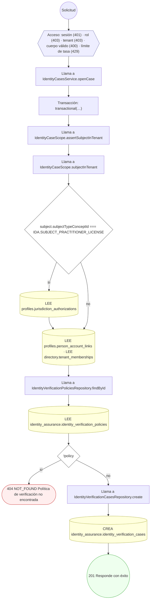

#### 14. GET /identity/verification-cases/{id}

Consultar expediente y evidencias de un caso

| HTTP | Código | Cuándo |
|---|---|---|
| 200 | — | Éxito |
| 400 | `VALIDATION_FAILED` | Los parámetros de ruta son UUID válidos |
| 401 | `UNAUTHENTICATED` | Hay una sesión válida (JWT) |
| 403 | `FORBIDDEN` | El rol está permitido; El tenant se resuelve y pertenece al actor |
| 429 | `RATE_LIMITED` | No se supera el límite de solicitudes |

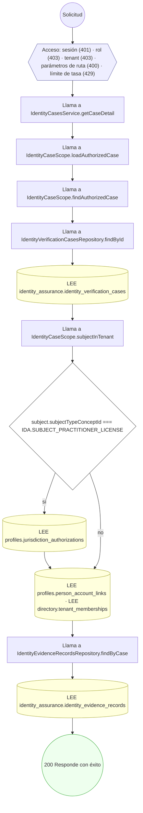

#### 15. POST /identity/verification-cases/{id}/assertions

Emitir una aserción de identidad con nivel de aseguramiento

| HTTP | Código | Cuándo |
|---|---|---|
| 201 | — | Éxito |
| 400 | `VALIDATION_FAILED` | Los parámetros de ruta son UUID válidos; El cuerpo cumple el DTO (sin propiedades extra) |
| 401 | `UNAUTHENTICATED` | Hay una sesión válida (JWT) |
| 403 | `FORBIDDEN` | El rol está permitido; El tenant se resuelve y pertenece al actor |
| 422 | `PRECONDITION_FAILED` | PreconditionFailedException: Solo un caso verificado puede emitir una aserción; PreconditionFailedException: No hay checks completados que sustenten la aserción; PreconditionFailedException: No se pudo determinar el nivel de aseguramiento |
| 429 | `RATE_LIMITED` | No se supera el límite de solicitudes |

```mermaid
flowchart TD
  n1(("Solicitud")):::inicio
  n2{{"Acceso: sesión (401) · rol (403) · tenant (403) · parámetros de ruta (400) · cuerpo válido (400) · límite de…"}}:::acceso
  n1 --> n2
  n3["Llama a IdentityCasesService.issueAssertion"]:::llamada
  n2 --> n3
  n4["Transacción: transactional(…)"]:::transaccion
  n3 --> n4
  n5["Llama a IdentityCaseScope.loadAuthorizedCase"]:::llamada
  n4 --> n5
  n6["Llama a IdentityCaseScope.findAuthorizedCase"]:::llamada
  n5 --> n6
  n7["Llama a IdentityVerificationCasesRepository.findById"]:::llamada
  n6 --> n7
  n8[("LEE identity_assurance.identity_verification_cases")]:::efecto
  n7 --> n8
  n9["Llama a IdentityCaseScope.subjectInTenant"]:::llamada
  n8 --> n9
  n10{"subject.subjectTypeConceptId === IDA.SUBJECT_PRACTITIONER_LICENSE"}:::decision
  n9 --> n10
  n11[("LEE profiles.jurisdiction_authorizations")]:::efecto
  n10 -->|"sí"| n11
  n12[("LEE profiles.person_account_links · LEE directory.tenant_memberships")]:::efecto
  n11 --> n12
  n10 -->|"no"| n12
  n13{"kase.statusConceptId !== IDA.CASE_VERIFIED"}:::decision
  n12 --> n13
  n14(["422 PRECONDITION_FAILED Solo un caso verificado puede emitir una aserción"]):::error
  n13 -->|"sí"| n14
  n15["Llama a IdentityChecksRepository.countByCaseAndStatus"]:::llamada
  n13 -->|"no"| n15
  n16[("LEE identity_assurance.identity_checks")]:::efecto
  n15 --> n16
  n17{"completed ‹ 1"}:::decision
  n16 --> n17
  n18(["422 PRECONDITION_FAILED No hay checks completados que sustenten la aserción"]):::error
  n17 -->|"sí"| n18
  n19["Llama a IdentityCaseScope.assertAuthorityInTenant"]:::llamada
  n17 -->|"no"| n19
  n20[("LEE identity_assurance.identity_authorities")]:::efecto
  n19 --> n20
  n21{"!assuranceLevel"}:::decision
  n20 --> n21
  n22(["422 PRECONDITION_FAILED No se pudo determinar el nivel de aseguramiento"]):::error
  n21 -->|"sí"| n22
  n23["Llama a IdentityAssertionsRepository.create"]:::llamada
  n21 -->|"no"| n23
  n24[("CREA identity_assurance.identity_assertions")]:::efecto
  n23 --> n24
  n25[("ACTUALIZA identity_assurance.identity_verification_cases · ACTUALIZA identity_assurance.identity_verification…")]:::efecto
  n24 --> n25
  n26(("201 Responde con éxito")):::ok
  n25 --> n26
  classDef acceso fill:#eef,stroke:#66a
  classDef error fill:#fee,stroke:#c33
  classDef ok fill:#efe,stroke:#3a3
  classDef efecto fill:#ffd,stroke:#aa3
  classDef decision fill:#fff,stroke:#555
  classDef corte fill:#eee,stroke:#999,stroke-dasharray: 4
```

#### 16. POST /identity/verification-cases/{id}/checks:plan

Planificar los checks requeridos del caso

| HTTP | Código | Cuándo |
|---|---|---|
| 201 | — | Éxito |
| 400 | `VALIDATION_FAILED` | Los parámetros de ruta son UUID válidos; El cuerpo cumple el DTO (sin propiedades extra) |
| 401 | `UNAUTHENTICATED` | Hay una sesión válida (JWT) |
| 403 | `FORBIDDEN` | El rol está permitido; El tenant se resuelve y pertenece al actor |
| 422 | `PRECONDITION_FAILED` | PreconditionFailedException: Solo un caso abierto puede planificar checks |
| 429 | `RATE_LIMITED` | No se supera el límite de solicitudes |

```mermaid
flowchart TD
  n1(("Solicitud")):::inicio
  n2{{"Acceso: sesión (401) · rol (403) · tenant (403) · parámetros de ruta (400) · cuerpo válido (400) · límite de…"}}:::acceso
  n1 --> n2
  n3["Llama a IdentityCasesService.planChecks"]:::llamada
  n2 --> n3
  n4["Transacción: transactional(…)"]:::transaccion
  n3 --> n4
  n5["Llama a IdentityCaseScope.loadAuthorizedCase"]:::llamada
  n4 --> n5
  n6["Llama a IdentityCaseScope.findAuthorizedCase"]:::llamada
  n5 --> n6
  n7["Llama a IdentityVerificationCasesRepository.findById"]:::llamada
  n6 --> n7
  n8[("LEE identity_assurance.identity_verification_cases")]:::efecto
  n7 --> n8
  n9["Llama a IdentityCaseScope.subjectInTenant"]:::llamada
  n8 --> n9
  n10{"subject.subjectTypeConceptId === IDA.SUBJECT_PRACTITIONER_LICENSE"}:::decision
  n9 --> n10
  n11[("LEE profiles.jurisdiction_authorizations")]:::efecto
  n10 -->|"sí"| n11
  n12[("LEE profiles.person_account_links · LEE directory.tenant_memberships")]:::efecto
  n11 --> n12
  n10 -->|"no"| n12
  n13{"kase.statusConceptId !== IDA.CASE_OPEN"}:::decision
  n12 --> n13
  n14(["422 PRECONDITION_FAILED Solo un caso abierto puede planificar checks"]):::error
  n13 -->|"sí"| n14
  n15["Repite: por cada const item de dto.checks"]:::bucle
  n13 -->|"no"| n15
  n16["Llama a IdentityCaseScope.assertAuthorityInTenant"]:::llamada
  n15 -->|"cada elemento"| n16
  n17[("LEE identity_assurance.identity_authorities")]:::efecto
  n16 --> n17
  n18["Repite: forEach(…)"]:::bucle
  n17 --> n18
  n15 -->|"al terminar"| n18
  n19["Llama a IdentityChecksRepository.create"]:::llamada
  n18 -->|"cada elemento"| n19
  n20[("CREA identity_assurance.identity_checks")]:::efecto
  n19 --> n20
  n21[("ACTUALIZA identity_assurance.identity_verification_cases")]:::efecto
  n20 --> n21
  n18 -->|"al terminar"| n21
  n22(("201 Responde con éxito")):::ok
  n21 --> n22
  classDef acceso fill:#eef,stroke:#66a
  classDef error fill:#fee,stroke:#c33
  classDef ok fill:#efe,stroke:#3a3
  classDef efecto fill:#ffd,stroke:#aa3
  classDef decision fill:#fff,stroke:#555
  classDef corte fill:#eee,stroke:#999,stroke-dasharray: 4
```

#### 17. POST /identity/verification-cases/{id}/evidence

Aportar evidencia documental bajo consentimiento

| HTTP | Código | Cuándo |
|---|---|---|
| 201 | — | Éxito |
| 400 | `VALIDATION_FAILED` | Los parámetros de ruta son UUID válidos; El cuerpo cumple el DTO (sin propiedades extra) |
| 401 | `UNAUTHENTICATED` | Hay una sesión válida (JWT) |
| 403 | `FORBIDDEN` | El rol está permitido; El tenant se resuelve y pertenece al actor |
| 422 | `PRECONDITION_FAILED` | PreconditionFailedException: El caso no admite evidencia en su estado actual |
| 429 | `RATE_LIMITED` | No se supera el límite de solicitudes |
| 500 | `INTERNAL` | StorageLifecycleDenied: {identity.reasonCode}; StorageLifecycleDenied: FILE_NOT_LIVE; StorageLifecycleDenied: VERSION_UNKNOWN; StorageLifecycleDenied: PHYSICAL_IDENTITY_UNKNOWN; StorageLifecycleDenied: PRODUCER_OR_PURGE_IN_FLIGHT |

```mermaid
flowchart TD
  n1(("Solicitud")):::inicio
  n2{{"Acceso: sesión (401) · rol (403) · tenant (403) · parámetros de ruta (400) · cuerpo válido (400) · límite de…"}}:::acceso
  n1 --> n2
  n3["Llama a IdentityCasesService.submitEvidence"]:::llamada
  n2 --> n3
  n4["Transacción: transactional(…)"]:::transaccion
  n3 --> n4
  n5["Llama a IdentityCaseScope.loadAuthorizedCase"]:::llamada
  n4 --> n5
  n6["Llama a IdentityCaseScope.findAuthorizedCase"]:::llamada
  n5 --> n6
  n7["Llama a IdentityVerificationCasesRepository.findById"]:::llamada
  n6 --> n7
  n8[("LEE identity_assurance.identity_verification_cases")]:::efecto
  n7 --> n8
  n9["Llama a IdentityCaseScope.subjectInTenant"]:::llamada
  n8 --> n9
  n10{"subject.subjectTypeConceptId === IDA.SUBJECT_PRACTITIONER_LICENSE"}:::decision
  n9 --> n10
  n11[("LEE profiles.jurisdiction_authorizations")]:::efecto
  n10 -->|"sí"| n11
  n12[("LEE profiles.person_account_links · LEE directory.tenant_memberships")]:::efecto
  n11 --> n12
  n10 -->|"no"| n12
  n13{"kase.statusConceptId !== IDA.CASE_OPEN && kase.statusConceptId !== IDA.CASE_IN_VERIFICATION"}:::decision
  n12 --> n13
  n14(["422 PRECONDITION_FAILED El caso no admite evidencia en su estado actual"]):::error
  n13 -->|"sí"| n14
  n15["Llama a IdentityCaseScope.assertAuthorityInTenant"]:::llamada
  n13 -->|"no"| n15
  n16[("LEE identity_assurance.identity_authorities")]:::efecto
  n15 --> n16
  n17["Llama a IdentityCaseScope.assertEvidenceReferences"]:::llamada
  n16 --> n17
  n18{"refs.evidenceFileId"}:::decision
  n17 --> n18
  n19[("LEE common.files")]:::efecto
  n18 -->|"sí"| n19
  n20{"refs.collectedUnderConsentId"}:::decision
  n19 --> n20
  n18 -->|"no"| n20
  n21[("LEE consent.consents")]:::efecto
  n20 -->|"sí"| n21
  n22["Llama a IdentityEvidenceRecordsRepository.create"]:::llamada
  n21 --> n22
  n20 -->|"no"| n22
  n23{"data.evidenceFileId"}:::decision
  n22 --> n23
  n24["Llama a StoragePublicationService.guardFile"]:::llamada
  n23 -->|"sí"| n24
  n25["Llama a StoragePublicationService.lockNamespace"]:::llamada
  n24 --> n25
  n26{"identity.kind === 'UNKNOWN'"}:::decision
  n25 --> n26
  n27(["500 INTERNAL {identity.reasonCode}"]):::error
  n26 -->|"sí"| n27
  n28[("LEE common.files")]:::efecto
  n26 -->|"no"| n28
  n29{"!file || file.deletedAt || file.lifecycleStatusConceptId === CONCEPTS.FILE_DELETED || !file.currentVersionId"}:::decision
  n28 --> n29
  n30(["500 INTERNAL FILE_NOT_LIVE"]):::error
  n29 -->|"sí"| n30
  n31[("LEE common.file_versions")]:::efecto
  n29 -->|"no"| n31
  n32{"!versions.some((version) =› version.id === file.currentVersionId)"}:::decision
  n31 --> n32
  n33(["500 INTERNAL VERSION_UNKNOWN"]):::error
  n32 -->|"sí"| n33
  n34["Repite: por cada const version de versions"]:::bucle
  n32 -->|"no"| n34
  n35{"!identity || identity.kind === 'UNKNOWN'"}:::decision
  n34 -->|"cada elemento"| n35
  n36(["500 INTERNAL PHYSICAL_IDENTITY_UNKNOWN"]):::error
  n35 -->|"sí"| n36
  n37["Llama a StorageLifecycleCoordinator.assertNoContender"]:::llamada
  n35 -->|"no"| n37
  n38["Repite: por cada const job de await this.queues.findStorageIntents(tx)"]:::bucle
  n37 --> n38
  n39{"physicalContentionKey(intent.identity) === physicalContentionKey(identity) && intentExcludesPublication(inten…"}:::decision
  n38 -->|"cada elemento"| n39
  n40(["500 INTERNAL PRODUCER_OR_PURGE_IN_FLIGHT"]):::error
  n39 -->|"sí"| n40
  n41[("CREA identity_assurance.identity_evidence_records")]:::efecto
  n39 -->|"no"| n41
  n38 -->|"al terminar"| n41
  n34 -->|"al terminar"| n41
  n23 -->|"no"| n41
  n42(("201 Responde con éxito")):::ok
  n41 --> n42
  classDef acceso fill:#eef,stroke:#66a
  classDef error fill:#fee,stroke:#c33
  classDef ok fill:#efe,stroke:#3a3
  classDef efecto fill:#ffd,stroke:#aa3
  classDef decision fill:#fff,stroke:#555
  classDef corte fill:#eee,stroke:#999,stroke-dasharray: 4
```

#### 18. POST /identity/verification-cases/{id}/fraud-signals

Detectar y registrar una señal de fraude

| HTTP | Código | Cuándo |
|---|---|---|
| 201 | — | Éxito |
| 400 | `VALIDATION_FAILED` | Los parámetros de ruta son UUID válidos; El cuerpo cumple el DTO (sin propiedades extra) |
| 401 | `UNAUTHENTICATED` | Hay una sesión válida (JWT) |
| 403 | `FORBIDDEN` | El rol está permitido; El tenant se resuelve y pertenece al actor |
| 429 | `RATE_LIMITED` | No se supera el límite de solicitudes |

```mermaid
flowchart TD
  n1(("Solicitud")):::inicio
  n2{{"Acceso: sesión (401) · rol (403) · tenant (403) · parámetros de ruta (400) · cuerpo válido (400) · límite de…"}}:::acceso
  n1 --> n2
  n3["Llama a IdentityCasesService.raiseFraudSignal"]:::llamada
  n2 --> n3
  n4["Transacción: transactional(…)"]:::transaccion
  n3 --> n4
  n5["Llama a IdentityCaseScope.loadAuthorizedCase"]:::llamada
  n4 --> n5
  n6["Llama a IdentityCaseScope.findAuthorizedCase"]:::llamada
  n5 --> n6
  n7["Llama a IdentityVerificationCasesRepository.findById"]:::llamada
  n6 --> n7
  n8[("LEE identity_assurance.identity_verification_cases")]:::efecto
  n7 --> n8
  n9["Llama a IdentityCaseScope.subjectInTenant"]:::llamada
  n8 --> n9
  n10{"subject.subjectTypeConceptId === IDA.SUBJECT_PRACTITIONER_LICENSE"}:::decision
  n9 --> n10
  n11[("LEE profiles.jurisdiction_authorizations")]:::efecto
  n10 -->|"sí"| n11
  n12[("LEE profiles.person_account_links · LEE directory.tenant_memberships")]:::efecto
  n11 --> n12
  n10 -->|"no"| n12
  n13["Llama a IdentityFraudSignalsRepository.create"]:::llamada
  n12 --> n13
  n14[("CREA identity_assurance.identity_fraud_signals")]:::efecto
  n13 --> n14
  n15[("ACTUALIZA identity_assurance.identity_verification_cases")]:::efecto
  n14 --> n15
  n16{"kase.statusConceptId === IDA.CASE_OPEN || kase.statusConceptId === IDA.CASE_IN_VERIFICATION || kase.statusCon…"}:::decision
  n15 --> n16
  n17[("ACTUALIZA identity_assurance.identity_verification_cases")]:::efecto
  n16 -->|"sí"| n17
  n18(("201 Responde con éxito")):::ok
  n17 --> n18
  n16 -->|"no"| n18
  classDef acceso fill:#eef,stroke:#66a
  classDef error fill:#fee,stroke:#c33
  classDef ok fill:#efe,stroke:#3a3
  classDef efecto fill:#ffd,stroke:#aa3
  classDef decision fill:#fff,stroke:#555
  classDef corte fill:#eee,stroke:#999,stroke-dasharray: 4
```

#### 19. POST /identity/verification-cases/{id}/manual-review

Escalar el caso a revisión manual

| HTTP | Código | Cuándo |
|---|---|---|
| 201 | — | Éxito |
| 400 | `VALIDATION_FAILED` | Los parámetros de ruta son UUID válidos; El cuerpo cumple el DTO (sin propiedades extra) |
| 401 | `UNAUTHENTICATED` | Hay una sesión válida (JWT) |
| 403 | `FORBIDDEN` | El rol está permitido; El tenant se resuelve y pertenece al actor |
| 409 | `CONFLICT` | ConflictException: El caso ya tiene una revisión manual abierta |
| 422 | `PRECONDITION_FAILED` | PreconditionFailedException: El caso no es escalable a revisión manual |
| 429 | `RATE_LIMITED` | No se supera el límite de solicitudes |

```mermaid
flowchart TD
  n1(("Solicitud")):::inicio
  n2{{"Acceso: sesión (401) · rol (403) · tenant (403) · parámetros de ruta (400) · cuerpo válido (400) · límite de…"}}:::acceso
  n1 --> n2
  n3["Llama a IdentityCasesService.openManualReview"]:::llamada
  n2 --> n3
  n4["Transacción: transactional(…)"]:::transaccion
  n3 --> n4
  n5["Llama a IdentityCaseScope.loadAuthorizedCase"]:::llamada
  n4 --> n5
  n6["Llama a IdentityCaseScope.findAuthorizedCase"]:::llamada
  n5 --> n6
  n7["Llama a IdentityVerificationCasesRepository.findById"]:::llamada
  n6 --> n7
  n8[("LEE identity_assurance.identity_verification_cases")]:::efecto
  n7 --> n8
  n9["Llama a IdentityCaseScope.subjectInTenant"]:::llamada
  n8 --> n9
  n10{"subject.subjectTypeConceptId === IDA.SUBJECT_PRACTITIONER_LICENSE"}:::decision
  n9 --> n10
  n11[("LEE profiles.jurisdiction_authorizations")]:::efecto
  n10 -->|"sí"| n11
  n12[("LEE profiles.person_account_links · LEE directory.tenant_memberships")]:::efecto
  n11 --> n12
  n10 -->|"no"| n12
  n13{"kase.statusConceptId !== IDA.CASE_IN_VERIFICATION && kase.statusConceptId !== IDA.CASE_AT_RISK"}:::decision
  n12 --> n13
  n14(["422 PRECONDITION_FAILED El caso no es escalable a revisión manual"]):::error
  n13 -->|"sí"| n14
  n15["Llama a IdentityManualReviewCasesRepository.countOpenByCase"]:::llamada
  n13 -->|"no"| n15
  n16[("LEE identity_assurance.identity_manual_review_cases")]:::efecto
  n15 --> n16
  n17{"openReviews › 0"}:::decision
  n16 --> n17
  n18(["409 CONFLICT El caso ya tiene una revisión manual abierta"]):::error
  n17 -->|"sí"| n18
  n19["Llama a IdentityManualReviewCasesRepository.create"]:::llamada
  n17 -->|"no"| n19
  n20[("CREA identity_assurance.identity_manual_review_cases")]:::efecto
  n19 --> n20
  n21[("ACTUALIZA identity_assurance.identity_verification_cases")]:::efecto
  n20 --> n21
  n22(("201 Responde con éxito")):::ok
  n21 --> n22
  classDef acceso fill:#eef,stroke:#66a
  classDef error fill:#fee,stroke:#c33
  classDef ok fill:#efe,stroke:#3a3
  classDef efecto fill:#ffd,stroke:#aa3
  classDef decision fill:#fff,stroke:#555
  classDef corte fill:#eee,stroke:#999,stroke-dasharray: 4
```

#### 20. POST /identity/verification-cases/expire-sweep

Expirar por lote los casos vencidos (job programado)

| HTTP | Código | Cuándo |
|---|---|---|
| 200 | — | Éxito |
| 401 | `UNAUTHENTICATED` | Hay una sesión válida (JWT) |
| 403 | `FORBIDDEN` | El rol está permitido; El tenant se resuelve y pertenece al actor |
| 429 | `RATE_LIMITED` | No se supera el límite de solicitudes |

```mermaid
flowchart TD
  n1(("Solicitud")):::inicio
  n2{{"Acceso: sesión (401) · rol (403) · tenant (403) · límite de tasa (429)"}}:::acceso
  n1 --> n2
  n3["Llama a IdentityCasesService.expireSweep"]:::llamada
  n2 --> n3
  n4["Transacción: transactional(…)"]:::transaccion
  n3 --> n4
  n5["Llama a IdentityVerificationCasesRepository.findExpirable"]:::llamada
  n4 --> n5
  n6[("LEE identity_assurance.identity_verification_cases")]:::efecto
  n5 --> n6
  n7["Llama a IdentityCaseScope.filterToTenant"]:::llamada
  n6 --> n7
  n8["Repite: por cada const kase de cases"]:::bucle
  n7 --> n8
  n9{"owned === undefined"}:::decision
  n8 -->|"cada elemento"| n9
  n10["Llama a IdentityCaseScope.subjectInTenant"]:::llamada
  n9 -->|"sí"| n10
  n11{"subject.subjectTypeConceptId === IDA.SUBJECT_PRACTITIONER_LICENSE"}:::decision
  n10 --> n11
  n12[("LEE profiles.jurisdiction_authorizations")]:::efecto
  n11 -->|"sí"| n12
  n13[("LEE profiles.person_account_links · LEE directory.tenant_memberships")]:::efecto
  n12 --> n13
  n11 -->|"no"| n13
  n14["Repite: por cada const kase de expirable"]:::bucle
  n13 --> n14
  n9 -->|"no"| n14
  n8 -->|"al terminar"| n14
  n15["Llama a IdentityChecksRepository.findPendingByCase"]:::llamada
  n14 -->|"cada elemento"| n15
  n16[("LEE identity_assurance.identity_checks")]:::efecto
  n15 --> n16
  n17["Repite: por cada const check de pending"]:::bucle
  n16 --> n17
  n18[("ACTUALIZA identity_assurance.identity_checks")]:::efecto
  n17 -->|"cada elemento"| n18
  n19["Llama a IdentityVerificationEffectsService.applyRevoked"]:::llamada
  n18 --> n19
  n17 -->|"al terminar"| n19
  n20["Llama a IdentityVerificationEffectsService.publicSubjectOf"]:::llamada
  n19 --> n20
  n21["Llama a JurisdictionAuthorizationsRepository.findById"]:::llamada
  n20 --> n21
  n22[("LEE profiles.jurisdiction_authorizations")]:::efecto
  n21 --> n22
  n23["Llama a CommunityVerificationService.applyRevoked"]:::llamada
  n22 --> n23
  n24["Llama a VerifiedBadgesRepository.findProfileByTarget"]:::llamada
  n23 --> n24
  n25[("LEE community.public_profiles")]:::efecto
  n24 --> n25
  n26["Llama a CommunityVerificationService.revokeProfileBadges"]:::llamada
  n25 --> n26
  n27{"profile.verificationStatusConceptId === CONCEPTS.STATE_ACTIVE"}:::decision
  n26 --> n27
  n28[("ACTUALIZA community.public_profiles")]:::efecto
  n27 -->|"sí"| n28
  n29(("200 Responde con éxito")):::ok
  n28 --> n29
  n27 -->|"no"| n29
  n14 -->|"al terminar"| n29
  classDef acceso fill:#eef,stroke:#66a
  classDef error fill:#fee,stroke:#c33
  classDef ok fill:#efe,stroke:#3a3
  classDef efecto fill:#ffd,stroke:#aa3
  classDef decision fill:#fff,stroke:#555
  classDef corte fill:#eee,stroke:#999,stroke-dasharray: 4
```

#### 21. POST /internal/identity/checks/{id}/attempts

Registrar el intento del worker contra la autoridad externa

| HTTP | Código | Cuándo |
|---|---|---|
| 201 | — | Éxito |
| 400 | `VALIDATION_FAILED` | Los parámetros de ruta son UUID válidos; El cuerpo cumple el DTO (sin propiedades extra) |
| 401 | `UNAUTHENTICATED` | Hay una sesión válida (JWT) |
| 403 | `FORBIDDEN` | El rol está permitido; El tenant se resuelve y pertenece al actor |
| 404 | `NOT_FOUND` | ResourceNotFoundException: Check de identidad no encontrado |
| 429 | `RATE_LIMITED` | No se supera el límite de solicitudes |

```mermaid
flowchart TD
  n1(("Solicitud")):::inicio
  n2{{"Acceso: sesión (401) · rol (403) · tenant (403) · parámetros de ruta (400) · cuerpo válido (400) · límite de…"}}:::acceso
  n1 --> n2
  n3["Llama a IdentityChecksService.recordAttempt"]:::llamada
  n2 --> n3
  n4["Transacción: transactional(…)"]:::transaccion
  n3 --> n4
  n5["Llama a IdentityChecksService.loadCheck"]:::llamada
  n4 --> n5
  n6["Llama a IdentityChecksRepository.findById"]:::llamada
  n5 --> n6
  n7[("LEE identity_assurance.identity_checks")]:::efecto
  n6 --> n7
  n8["Llama a IdentityCaseScope.findAuthorizedCase"]:::llamada
  n7 --> n8
  n9["Llama a IdentityVerificationCasesRepository.findById"]:::llamada
  n8 --> n9
  n10[("LEE identity_assurance.identity_verification_cases")]:::efecto
  n9 --> n10
  n11["Llama a IdentityCaseScope.subjectInTenant"]:::llamada
  n10 --> n11
  n12{"subject.subjectTypeConceptId === IDA.SUBJECT_PRACTITIONER_LICENSE"}:::decision
  n11 --> n12
  n13[("LEE profiles.jurisdiction_authorizations")]:::efecto
  n12 -->|"sí"| n13
  n14[("LEE profiles.person_account_links · LEE directory.tenant_memberships")]:::efecto
  n13 --> n14
  n12 -->|"no"| n14
  n15{"!check || !owned"}:::decision
  n14 --> n15
  n16(["404 NOT_FOUND Check de identidad no encontrado"]):::error
  n15 -->|"sí"| n16
  n17["Llama a IdentityVerificationAttemptsRepository.countByCase"]:::llamada
  n15 -->|"no"| n17
  n18[("LEE identity_assurance.identity_verification_attempts")]:::efecto
  n17 --> n18
  n19["Llama a IdentityVerificationAttemptsRepository.create"]:::llamada
  n18 --> n19
  n20[("CREA identity_assurance.identity_verification_attempts")]:::efecto
  n19 --> n20
  n21[("ACTUALIZA identity_assurance.identity_checks")]:::efecto
  n20 --> n21
  n22(("201 Responde con éxito")):::ok
  n21 --> n22
  classDef acceso fill:#eef,stroke:#66a
  classDef error fill:#fee,stroke:#c33
  classDef ok fill:#efe,stroke:#3a3
  classDef efecto fill:#ffd,stroke:#aa3
  classDef decision fill:#fff,stroke:#555
  classDef corte fill:#eee,stroke:#999,stroke-dasharray: 4
```

#### 22. POST /internal/identity/checks/{id}/results

Registrar el veredicto que devolvió la autoridad externa

| HTTP | Código | Cuándo |
|---|---|---|
| 201 | — | Éxito |
| 400 | `VALIDATION_FAILED` | Los parámetros de ruta son UUID válidos; El cuerpo cumple el DTO (sin propiedades extra) |
| 401 | `UNAUTHENTICATED` | Hay una sesión válida (JWT) |
| 403 | `FORBIDDEN` | El rol está permitido; El tenant se resuelve y pertenece al actor |
| 404 | `NOT_FOUND` | ResourceNotFoundException: Check de identidad no encontrado |
| 422 | `PRECONDITION_FAILED` | PreconditionFailedException: No existe un intento completado para registrar resultado; PreconditionFailedException: No se pudo determinar la autoridad que verificó el caso |
| 429 | `RATE_LIMITED` | No se supera el límite de solicitudes |

```mermaid
flowchart TD
  n1(("Solicitud")):::inicio
  n2{{"Acceso: sesión (401) · rol (403) · tenant (403) · parámetros de ruta (400) · cuerpo válido (400) · límite de…"}}:::acceso
  n1 --> n2
  n3["Llama a IdentityChecksService.recordResult"]:::llamada
  n2 --> n3
  n4["Transacción: transactional(…)"]:::transaccion
  n3 --> n4
  n5["Llama a IdentityChecksService.loadCheck"]:::llamada
  n4 --> n5
  n6["Llama a IdentityChecksRepository.findById"]:::llamada
  n5 --> n6
  n7[("LEE identity_assurance.identity_checks")]:::efecto
  n6 --> n7
  n8["Llama a IdentityCaseScope.findAuthorizedCase"]:::llamada
  n7 --> n8
  n9["Llama a IdentityVerificationCasesRepository.findById"]:::llamada
  n8 --> n9
  n10[("LEE identity_assurance.identity_verification_cases")]:::efecto
  n9 --> n10
  n11["Llama a IdentityCaseScope.subjectInTenant"]:::llamada
  n10 --> n11
  n12{"subject.subjectTypeConceptId === IDA.SUBJECT_PRACTITIONER_LICENSE"}:::decision
  n11 --> n12
  n13[("LEE profiles.jurisdiction_authorizations")]:::efecto
  n12 -->|"sí"| n13
  n14[("LEE profiles.person_account_links · LEE directory.tenant_memberships")]:::efecto
  n13 --> n14
  n12 -->|"no"| n14
  n15{"!check || !owned"}:::decision
  n14 --> n15
  n16(["404 NOT_FOUND Check de identidad no encontrado"]):::error
  n15 -->|"sí"| n16
  n17["Llama a IdentityChecksService.completeInFlightAttempt"]:::llamada
  n15 -->|"no"| n17
  n18["Llama a IdentityVerificationAttemptsRepository.findLatestByCase"]:::llamada
  n17 --> n18
  n19[("LEE identity_assurance.identity_verification_attempts")]:::efecto
  n18 --> n19
  n20[("ACTUALIZA identity_assurance.identity_verification_attempts · ACTUALIZA identity_assurance.identity_verificat…")]:::efecto
  n19 --> n20
  n21["Llama a IdentityVerificationAttemptsRepository.existsCompletedForCase"]:::llamada
  n20 --> n21
  n22[("LEE identity_assurance.identity_verification_attempts")]:::efecto
  n21 --> n22
  n23{"!hasCompleted"}:::decision
  n22 --> n23
  n24(["422 PRECONDITION_FAILED No existe un intento completado para registrar resultado"]):::error
  n23 -->|"sí"| n24
  n25["Llama a IdentityCheckResultsRepository.findLatestByCheck"]:::llamada
  n23 -->|"no"| n25
  n26[("LEE identity_assurance.identity_check_results")]:::efecto
  n25 --> n26
  n27["Llama a IdentityCheckResultsRepository.countByCheck"]:::llamada
  n26 --> n27
  n28[("LEE identity_assurance.identity_check_results")]:::efecto
  n27 --> n28
  n29["Llama a IdentityCheckResultsRepository.create"]:::llamada
  n28 --> n29
  n30[("CREA identity_assurance.identity_check_results")]:::efecto
  n29 --> n30
  n31[("ACTUALIZA identity_assurance.identity_checks")]:::efecto
  n30 --> n31
  n32["Llama a IdentityChecksService.settleCase"]:::llamada
  n31 --> n32
  n33["Llama a IdentityVerificationCasesRepository.findById"]:::llamada
  n32 --> n33
  n34[("LEE identity_assurance.identity_verification_cases")]:::efecto
  n33 --> n34
  n35{"result === 'NO_MATCH'"}:::decision
  n34 --> n35
  n36[("ACTUALIZA identity_assurance.identity_verification_cases · ACTUALIZA identity_assurance.identity_verification…")]:::efecto
  n35 -->|"sí"| n36
  n37["Llama a IdentityChecksRepository.countOpenRequiredByCase"]:::llamada
  n36 --> n37
  n35 -->|"no"| n37
  n38[("LEE identity_assurance.identity_checks")]:::efecto
  n37 --> n38
  n39["Llama a IdentityChecksService.verifyCase"]:::llamada
  n38 --> n39
  n40[("ACTUALIZA identity_assurance.identity_verification_cases")]:::efecto
  n39 --> n40
  n41["Llama a IdentityChecksService.issueAssertion"]:::llamada
  n40 --> n41
  n42{"!authorityEndpoint"}:::decision
  n41 --> n42
  n43(["422 PRECONDITION_FAILED No se pudo determinar la autoridad que verificó el caso"]):::error
  n42 -->|"sí"| n43
  n44[("ACTUALIZA identity_assurance.identity_verification_cases · ACTUALIZA identity_assurance.identity_verification…")]:::efecto
  n42 -->|"no"| n44
  n45(("201 Responde con éxito")):::ok
  n44 --> n45
  classDef acceso fill:#eef,stroke:#66a
  classDef error fill:#fee,stroke:#c33
  classDef ok fill:#efe,stroke:#3a3
  classDef efecto fill:#ffd,stroke:#aa3
  classDef decision fill:#fff,stroke:#555
  classDef corte fill:#eee,stroke:#999,stroke-dasharray: 4
```

#### 23. GET /internal/identity/checks/dispatchable

Listar los checks que el worker debe atender en este tick

| HTTP | Código | Cuándo |
|---|---|---|
| 200 | — | Éxito |
| 400 | `VALIDATION_FAILED` | Están los parámetros de consulta obligatorios |
| 401 | `UNAUTHENTICATED` | Hay una sesión válida (JWT) |
| 403 | `FORBIDDEN` | El rol está permitido; El tenant se resuelve y pertenece al actor |
| 429 | `RATE_LIMITED` | No se supera el límite de solicitudes |

```mermaid
flowchart TD
  n1(("Solicitud")):::inicio
  n2{{"Acceso: sesión (401) · rol (403) · tenant (403) · parámetros de consulta (400) · límite de tasa (429)"}}:::acceso
  n1 --> n2
  n3["Llama a IdentityChecksService.listDispatchable"]:::llamada
  n2 --> n3
  n4{"!tenantId"}:::decision
  n3 --> n4
  n5["Llama a IdentityChecksRepository.findDispatchable"]:::llamada
  n4 -->|"sí"| n5
  n6[("LEE identity_assurance.identity_checks")]:::efecto
  n5 --> n6
  n7["Repite: ciclo for"]:::bucle
  n4 -->|"no"| n7
  n8["Llama a IdentityChecksRepository.findDispatchable"]:::llamada
  n7 -->|"cada elemento"| n8
  n9[("LEE identity_assurance.identity_checks")]:::efecto
  n8 --> n9
  n10["Llama a IdentityChecksService.filterChecksToTenant"]:::llamada
  n9 --> n10
  n11["Repite: por cada const caseId de new Set( checks.map((check) =› check.identityVeri…"]:::bucle
  n10 --> n11
  n12["Llama a IdentityVerificationCasesRepository.findById"]:::llamada
  n11 -->|"cada elemento"| n12
  n13[("LEE identity_assurance.identity_verification_cases")]:::efecto
  n12 --> n13
  n14["Llama a IdentityCaseScope.filterToTenant"]:::llamada
  n13 --> n14
  n11 -->|"al terminar"| n14
  n15["Repite: por cada const kase de cases"]:::bucle
  n14 --> n15
  n16{"owned === undefined"}:::decision
  n15 -->|"cada elemento"| n16
  n17["Llama a IdentityCaseScope.subjectInTenant"]:::llamada
  n16 -->|"sí"| n17
  n18{"subject.subjectTypeConceptId === IDA.SUBJECT_PRACTITIONER_LICENSE"}:::decision
  n17 --> n18
  n19[("LEE profiles.jurisdiction_authorizations")]:::efecto
  n18 -->|"sí"| n19
  n20[("LEE profiles.person_account_links · LEE directory.tenant_memberships")]:::efecto
  n19 --> n20
  n18 -->|"no"| n20
  n21["Repite: por cada const check de checks"]:::bucle
  n6 --> n21
  n20 --> n21
  n16 -->|"no"| n21
  n15 -->|"al terminar"| n21
  n7 -->|"al terminar"| n21
  n22["Llama a IdentityVerificationAttemptsRepository.findLatestByCase"]:::llamada
  n21 -->|"cada elemento"| n22
  n23[("LEE identity_assurance.identity_verification_attempts")]:::efecto
  n22 --> n23
  n24(("200 Responde con éxito")):::ok
  n23 --> n24
  n21 -->|"al terminar"| n24
  classDef acceso fill:#eef,stroke:#66a
  classDef error fill:#fee,stroke:#c33
  classDef ok fill:#efe,stroke:#3a3
  classDef efecto fill:#ffd,stroke:#aa3
  classDef decision fill:#fff,stroke:#555
  classDef corte fill:#eee,stroke:#999,stroke-dasharray: 4
```

#### 24. POST /internal/identity/evidence/lifecycle-scan

Evaluate configured evidence lifecycle; destructive runtime remains blocked

| HTTP | Código | Cuándo |
|---|---|---|
| 201 | — | Éxito |
| 400 | `VALIDATION_FAILED` | El cuerpo cumple el DTO (sin propiedades extra) |
| 401 | `UNAUTHENTICATED` | Hay una sesión válida (JWT) |
| 403 | `FORBIDDEN` | El rol está permitido; El tenant se resuelve y pertenece al actor |
| 429 | `RATE_LIMITED` | No se supera el límite de solicitudes |
| 500 | `INTERNAL` | StorageLifecycleDenied: LIFECYCLE_WIRING_MISSING; StorageLifecycleDenied: MISSING_CONFIGURATION; StorageLifecycleDenied: MISSING_OR_DUPLICATE_BINDING; StorageLifecycleDenied: CONFIGURATION_INVALID; StorageLifecycleDenied: REGISTRY_BINDING_INVALID; StorageLifecycleDenied: RETENTION_POLICY_INVALID; StorageLifecycleDenied: POLICY_DISPOSITION_MISMATCH; StorageLifecycleDenied: OPERATION_NOT_AUTHORIZED; StorageLifecycleDenied: DUPLICATE_FIELD_RULE; StorageLifecycleDenied: FIELD_RULE_BINDING_INVALID; StorageLifecycleDenied: FIELD_OPERATION_UNSUPPORTED; StorageLifecycleDenied: ANONYMIZATION_RULES_MISSING; StorageLifecycleDenied: PURGE_METADATA_RULE_MISSING; StorageLifecycleDenied: {identity.reasonCode}; StorageLifecycleDenied: TRANSACTION_REQUIRED; StorageLifecycleDenied: PHYSICAL_IDENTITY_UNKNOWN; StorageLifecycleDenied: EVIDENCE_NOT_FOUND; StorageLifecycleDenied: CASE_UNKNOWN; StorageLifecycleDenied: OWNER_UNKNOWN; StorageLifecycleDenied: SUBJECT_TYPE_UNKNOWN; StorageLifecycleDenied: TENANT_MISMATCH; StorageLifecycleDenied: OWNER_TENANT_UNPROVEN; StorageLifecycleDenied: TENANT_UNKNOWN; StorageLifecycleDenied: SUBJECT_UNKNOWN; StorageLifecycleDenied: TENANT_AMBIGUOUS; StorageLifecycleDenied: FILE_GRAPH_UNKNOWN; StorageLifecycleDenied: CROSS_TENANT_OR_OWNER_FILE; StorageLifecycleDenied: CURRENT_VERSION_UNKNOWN; StorageLifecycleDenied: CONSENT_OWNERSHIP_UNKNOWN; StorageLifecycleDenied: EXTERNAL_REFERENCE_UNKNOWN; StorageLifecycleDenied: PHYSICAL_METADATA_CONFLICT; StorageLifecycleDenied: PRODUCER_OR_PURGE_IN_FLIGHT; StorageLifecycleDenied: GLOBAL_REFERENCE_VISIBILITY_UNPROVEN; StorageLifecycleDenied: REFERENCE_STATE_UNKNOWN; StorageLifecycleDenied: REFERENCE_CATALOG_UNKNOWN |

```mermaid
flowchart TD
  n1(("Solicitud")):::inicio
  n2{{"Acceso: sesión (401) · rol (403) · tenant (403) · cuerpo válido (400) · límite de tasa (429)"}}:::acceso
  n1 --> n2
  n3{"!this.lifecycle"}:::decision
  n2 --> n3
  n4(["500 INTERNAL LIFECYCLE_WIRING_MISSING"]):::error
  n3 -->|"sí"| n4
  n5["Llama a IdentityEvidenceLifecycleService.scan"]:::llamada
  n3 -->|"no"| n5
  n6[("LEE terminology.catalog_concepts · LEE identity_assurance.identity_evidence_records")]:::efecto
  n5 --> n6
  n7["Repite: por cada const evidence de records"]:::bucle
  n6 --> n7
  n8["Repite: por cada const rule de rules.filter( (rule) =› rule.evidenceTypeConceptC…"]:::bucle
  n7 -->|"cada elemento"| n8
  n9["Llama a IdentityEvidenceLifecycleService.executeRule"]:::llamada
  n8 -->|"cada elemento"| n9
  n10["Llama a IdentityEvidenceLifecycleService.execute"]:::llamada
  n9 --> n10
  n11["Intenta"]:::intento
  n10 --> n11
  n12["Transacción: transactional(…)"]:::transaccion
  n11 --> n12
  n13["Llama a IdentityLifecycleConfigResolver.resolve"]:::llamada
  n12 --> n13
  n14{"!this.config || this.config.schemaVersion !== 1 || this.config.enabled !== true || !this.config.revision || !…"}:::decision
  n13 --> n14
  n15(["500 INTERNAL MISSING_CONFIGURATION"]):::error
  n14 -->|"sí"| n15
  n16{"rules.length !== 1"}:::decision
  n14 -->|"no"| n16
  n17(["500 INTERNAL MISSING_OR_DUPLICATE_BINDING"]):::error
  n16 -->|"sí"| n17
  n18{"!tenantId || tenantId === '*' || !rule.authorizationRevision || !IDENTITY_BASE_EVENTS.includes(rule.baseEvent…"}:::decision
  n16 -->|"no"| n18
  n19(["500 INTERNAL CONFIGURATION_INVALID"]):::error
  n18 -->|"sí"| n19
  n20[("LEE system_ops.entity_registry")]:::efecto
  n18 -->|"no"| n20
  n21{"registries.length !== 1 || registries[0].id !== rule.entityRegistryId || registries[0].stateConceptId !== CON…"}:::decision
  n20 --> n21
  n22(["500 INTERNAL REGISTRY_BINDING_INVALID"]):::error
  n21 -->|"sí"| n22
  n23{"!policy || policy.stateConceptId !== CONCEPTS.STATE_ACTIVE || policy.rowVersion !== rule.expectedRowVersion |…"}:::decision
  n21 -->|"no"| n23
  n24(["500 INTERNAL RETENTION_POLICY_INVALID"]):::error
  n23 -->|"sí"| n24
  n25[("LEE terminology.catalog_concepts")]:::efecto
  n23 -->|"no"| n25
  n26{"(await conceptId(rule.expectedDispositionConceptCode)) !== policy.dispositionConceptId"}:::decision
  n25 --> n26
  n27(["500 INTERNAL POLICY_DISPOSITION_MISMATCH"]):::error
  n26 -->|"sí"| n27
  n28{"(operation === 'PURGE' && policy.dispositionConceptId !== SYSOPS.DISPOSITION_DELETE) || (operation === 'ANONY…"}:::decision
  n26 -->|"no"| n28
  n29(["500 INTERNAL OPERATION_NOT_AUTHORIZED"]):::error
  n28 -->|"sí"| n29
  n30["Repite: por cada const binding de rule.fieldRules"]:::bucle
  n28 -->|"no"| n30
  n31{"fieldIds.has(binding.fieldRegistryId)"}:::decision
  n30 -->|"cada elemento"| n31
  n32(["500 INTERNAL DUPLICATE_FIELD_RULE"]):::error
  n31 -->|"sí"| n32
  n33{"!field || !fieldRule || field.entityRegistryId !== rule.entityRegistryId || field.rowVersion !== binding.expe…"}:::decision
  n31 -->|"no"| n33
  n34(["500 INTERNAL FIELD_RULE_BINDING_INVALID"]):::error
  n33 -->|"sí"| n34
  n35{"fieldRule.techniqueConceptId !== SYSOPS.TECHNIQUE_MASK || parameters?.schemaVersion !== 1 || parameters.opera…"}:::decision
  n33 -->|"no"| n35
  n36(["500 INTERNAL FIELD_OPERATION_UNSUPPORTED"]):::error
  n35 -->|"sí"| n36
  n37{"operation === 'ANONYMIZATION' && (rule.metadataDisposition !== 'MINIMIZE' || !fieldOperations.length)"}:::decision
  n35 -->|"no"| n37
  n30 -->|"al terminar"| n37
  n38(["500 INTERNAL ANONYMIZATION_RULES_MISSING"]):::error
  n37 -->|"sí"| n38
  n39{"operation === 'PURGE' && rule.metadataDisposition !== 'REMOVE'"}:::decision
  n37 -->|"no"| n39
  n40(["500 INTERNAL PURGE_METADATA_RULE_MISSING"]):::error
  n39 -->|"sí"| n40
  n41["Llama a StoragePublicationService.lockNamespace"]:::llamada
  n39 -->|"no"| n41
  n42{"identity.kind === 'UNKNOWN'"}:::decision
  n41 --> n42
  n43(["500 INTERNAL {identity.reasonCode}"]):::error
  n42 -->|"sí"| n43
  n44["Llama a StorageLifecycleCoordinator.excludeNamespaces"]:::llamada
  n42 -->|"no"| n44
  n45{"!tx.getTransactionContext()"}:::decision
  n44 --> n45
  n46(["500 INTERNAL TRANSACTION_REQUIRED"]):::error
  n45 -->|"sí"| n46
  n47["Repite: map(…)"]:::bucle
  n45 -->|"no"| n47
  n48{"!isStorageReservationIdentity(identity)"}:::decision
  n47 -->|"cada elemento"| n48
  n49(["500 INTERNAL PHYSICAL_IDENTITY_UNKNOWN"]):::error
  n48 -->|"sí"| n49
  n50["Llama a IdentityEvidenceLifecycleRepository.graph"]:::llamada
  n48 -->|"no"| n50
  n47 -->|"al terminar"| n50
  n51[("LEE identity_assurance.identity_evidence_records")]:::efecto
  n50 --> n51
  n52{"!evidence"}:::decision
  n51 --> n52
  n53(["500 INTERNAL EVIDENCE_NOT_FOUND"]):::error
  n52 -->|"sí"| n53
  n54[("LEE identity_assurance.identity_verification_cases")]:::efecto
  n52 -->|"no"| n54
  n55{"!kase"}:::decision
  n54 --> n55
  n56(["500 INTERNAL CASE_UNKNOWN"]):::error
  n55 -->|"sí"| n56
  n57[("LEE common.file_versions · LEE common.file_derivatives · LEE common.files")]:::efecto
  n55 -->|"no"| n57
  n58{"kase.subjectTypeConceptId === IDA.SUBJECT_PRACTITIONER_LICENSE"}:::decision
  n57 --> n58
  n59[("LEE profiles.jurisdiction_authorizations")]:::efecto
  n58 -->|"sí"| n59
  n60{"!authorization"}:::decision
  n59 --> n60
  n61(["500 INTERNAL OWNER_UNKNOWN"]):::error
  n60 -->|"sí"| n61
  n62{"!tenantSubject && ![ IDA.SUBJECT_PATIENT_IDENTITY, IDA.SUBJECT_PRACTITIONER_IDENTITY, IDA.SUBJECT_PRACTITIONE…"}:::decision
  n60 -->|"no"| n62
  n58 -->|"no"| n62
  n63(["500 INTERNAL SUBJECT_TYPE_UNKNOWN"]):::error
  n62 -->|"sí"| n63
  n64{"tenantSubject && subjectId !== tenantId"}:::decision
  n62 -->|"no"| n64
  n65(["500 INTERNAL TENANT_MISMATCH"]):::error
  n64 -->|"sí"| n65
  n66{"!tenantId || tenantId === SEED.tenantId"}:::decision
  n64 -->|"no"| n66
  n67(["500 INTERNAL OWNER_TENANT_UNPROVEN"]):::error
  n66 -->|"sí"| n67
  n68[("LEE directory.tenants")]:::efecto
  n66 -->|"no"| n68
  n69{"!(await tx.findOne( Tenants, { id: tenantId }, { fields: ['id'], refresh: true }, ))"}:::decision
  n68 --> n69
  n70(["500 INTERNAL TENANT_UNKNOWN"]):::error
  n69 -->|"sí"| n70
  n71["… el resto del árbol (26 nodos) está en el JSON del inventario"]:::corte
  n69 -->|"no"| n71
  classDef acceso fill:#eef,stroke:#66a
  classDef error fill:#fee,stroke:#c33
  classDef ok fill:#efe,stroke:#3a3
  classDef efecto fill:#ffd,stroke:#aa3
  classDef decision fill:#fff,stroke:#555
  classDef corte fill:#eee,stroke:#999,stroke-dasharray: 4
```

#### 25. POST /internal/identity/evidence/storage-purge-review

Recheck retired evidence objects; never grants physical delete

| HTTP | Código | Cuándo |
|---|---|---|
| 201 | — | Éxito |
| 401 | `UNAUTHENTICATED` | Hay una sesión válida (JWT) |
| 403 | `FORBIDDEN` | El rol está permitido; El tenant se resuelve y pertenece al actor |
| 404 | `NOT_FOUND` | ResourceNotFoundException: La URI no pertenece al almacenamiento local; ResourceNotFoundException: La URI de almacenamiento local está mal formada; ResourceNotFoundException: La URI no pertenece al bucket configurado; ResourceNotFoundException: La URI S3 está mal formada o fuera del prefijo permitido |
| 429 | `RATE_LIMITED` | No se supera el límite de solicitudes |
| 500 | `INTERNAL` | StorageLifecycleDenied: LIFECYCLE_WIRING_MISSING; StorageLifecycleDenied: PURGE_INTENT_UNKNOWN; StorageLifecycleDenied: TRANSACTION_REQUIRED; StorageLifecycleDenied: GLOBAL_RESERVATION_VISIBILITY_UNPROVEN; StorageLifecycleDenied: PHYSICAL_IDENTITY_UNKNOWN; StorageLifecycleDenied: INTENT_ENVELOPE_UNKNOWN; StorageLifecycleDenied: DELETE_ATTEMPT_CHANGED; StorageLifecycleDenied: PRODUCER_OR_PURGE_IN_FLIGHT; StorageLifecycleDenied: PURGE_CONTEXT_UNKNOWN; StorageLifecycleDenied: PURGE_HOLD_COVERAGE_UNKNOWN; StorageLifecycleDenied: CUTOFF_UNKNOWN; StorageLifecycleDenied: MISSING_CONFIGURATION; StorageLifecycleDenied: MISSING_OR_DUPLICATE_BINDING; StorageLifecycleDenied: CONFIGURATION_INVALID; StorageLifecycleDenied: REGISTRY_BINDING_INVALID; StorageLifecycleDenied: RETENTION_POLICY_INVALID; StorageLifecycleDenied: POLICY_DISPOSITION_MISMATCH; StorageLifecycleDenied: OPERATION_NOT_AUTHORIZED; StorageLifecycleDenied: DUPLICATE_FIELD_RULE; StorageLifecycleDenied: FIELD_RULE_BINDING_INVALID; StorageLifecycleDenied: FIELD_OPERATION_UNSUPPORTED; StorageLifecycleDenied: ANONYMIZATION_RULES_MISSING; StorageLifecycleDenied: PURGE_METADATA_RULE_MISSING; StorageLifecycleDenied: PURGE_POLICY_CHANGED; StorageLifecycleDenied: CASE_OR_OWNER_CHANGED; StorageLifecycleDenied: RETIREMENT_UNPROVEN; StorageLifecycleDenied: LEGAL_HOLD_ACTIVE_OR_UNKNOWN; StorageLifecycleDenied: GLOBAL_REFERENCE_VISIBILITY_UNPROVEN; StorageLifecycleDenied: REFERENCE_STATE_UNKNOWN; StorageLifecycleDenied: REFERENCE_CATALOG_UNKNOWN; StorageLifecycleDenied: REFERENCES_BLOCKED_OR_UNKNOWN |

```mermaid
flowchart TD
  n1(("Solicitud")):::inicio
  n2{{"Acceso: sesión (401) · rol (403) · tenant (403) · límite de tasa (429)"}}:::acceso
  n1 --> n2
  n3{"!this.storagePurge"}:::decision
  n2 --> n3
  n4(["500 INTERNAL LIFECYCLE_WIRING_MISSING"]):::error
  n3 -->|"sí"| n4
  n5["Llama a IdentityEvidenceStoragePurgeService.review"]:::llamada
  n3 -->|"no"| n5
  n6["Repite: por cada const candidate de await this.coordinator.pendingPurges()"]:::bucle
  n5 --> n6
  n7["Intenta"]:::intento
  n6 -->|"cada elemento"| n7
  n8["Llama a StorageLifecycleCoordinator.dispatchPurge"]:::llamada
  n7 --> n8
  n9["Transacción: reviewPurge(…)"]:::transaccion
  n8 --> n9
  n10["Llama a QueuesRepository.findJobByDedupeKey"]:::llamada
  n9 --> n10
  n11[("LEE messaging.queued_jobs")]:::efecto
  n10 --> n11
  n12{"!job"}:::decision
  n11 --> n12
  n13(["500 INTERNAL PURGE_INTENT_UNKNOWN"]):::error
  n12 -->|"sí"| n13
  n14[("ACTUALIZA messaging.queued_jobs · ACTUALIZA messaging.queued_jobs · ACTUALIZA messaging.queued_jobs")]:::efecto
  n12 -->|"no"| n14
  n15["Intenta"]:::intento
  n14 --> n15
  n16["Transacción: transactional(…)"]:::transaccion
  n15 --> n16
  n17["Llama a StorageLifecycleCoordinator.excludeNamespaces"]:::llamada
  n16 --> n17
  n18{"!tx.getTransactionContext()"}:::decision
  n17 --> n18
  n19(["500 INTERNAL TRANSACTION_REQUIRED"]):::error
  n18 -->|"sí"| n19
  n20["Llama a StorageLifecycleCoordinator.assertPrimaryVisibility"]:::llamada
  n18 -->|"no"| n20
  n21{"!tx.getTransactionContext()"}:::decision
  n20 --> n21
  n22(["500 INTERNAL TRANSACTION_REQUIRED"]):::error
  n21 -->|"sí"| n22
  n23{"rows.length !== 1 || rows[0].primary !== true || rows[0].global_visibility !== true"}:::decision
  n21 -->|"no"| n23
  n24(["500 INTERNAL GLOBAL_RESERVATION_VISIBILITY_UNPROVEN"]):::error
  n23 -->|"sí"| n24
  n25["Repite: map(…)"]:::bucle
  n23 -->|"no"| n25
  n26{"!isStorageReservationIdentity(identity)"}:::decision
  n25 -->|"cada elemento"| n26
  n27(["500 INTERNAL PHYSICAL_IDENTITY_UNKNOWN"]):::error
  n26 -->|"sí"| n27
  n28["Llama a QueuesRepository.findJobByDedupeKey"]:::llamada
  n26 -->|"no"| n28
  n25 -->|"al terminar"| n28
  n29[("LEE messaging.queued_jobs")]:::efecto
  n28 --> n29
  n30{"!job || job.jobType !== 'storage.purge'"}:::decision
  n29 --> n30
  n31(["500 INTERNAL PURGE_INTENT_UNKNOWN"]):::error
  n30 -->|"sí"| n31
  n32["Llama a StorageLifecycleCoordinator.readJob"]:::llamada
  n30 -->|"no"| n32
  n33{"!allowed.includes(intent.phase) || (job.jobType === 'storage.purge' && !isKnownPhysicalIdentity(intent.identi…"}:::decision
  n32 --> n33
  n34(["500 INTERNAL INTENT_ENVELOPE_UNKNOWN"]):::error
  n33 -->|"sí"| n34
  n35{"intent.phase !== 'DELETE_DISPATCHED' || intent.ioAttemptId !== dispatched.ioAttemptId || !isDeepStrictEqual(…"}:::decision
  n33 -->|"no"| n35
  n36(["500 INTERNAL DELETE_ATTEMPT_CHANGED"]):::error
  n35 -->|"sí"| n36
  n37["Repite: por cada const peer de await this.queues.findStorageIntents(tx)"]:::bucle
  n35 -->|"no"| n37
  n38["Llama a StorageLifecycleCoordinator.readJob"]:::llamada
  n37 -->|"cada elemento"| n38
  n39{"!allowed.includes(intent.phase) || (job.jobType === 'storage.purge' && !isKnownPhysicalIdentity(intent.identi…"}:::decision
  n38 --> n39
  n40(["500 INTERNAL INTENT_ENVELOPE_UNKNOWN"]):::error
  n39 -->|"sí"| n40
  n41{"physicalContentionKey(other.identity) === physicalContentionKey(intent.identity) && intentExcludesPublication…"}:::decision
  n39 -->|"no"| n41
  n42(["500 INTERNAL PRODUCER_OR_PURGE_IN_FLIGHT"]):::error
  n41 -->|"sí"| n42
  n43{"!isKnownPhysicalIdentity(intent.identity) || !intent.purgeContext"}:::decision
  n41 -->|"no"| n43
  n37 -->|"al terminar"| n43
  n44(["500 INTERNAL PHYSICAL_IDENTITY_UNKNOWN"]):::error
  n43 -->|"sí"| n44
  n45[("ACTUALIZA messaging.queued_jobs · ACTUALIZA messaging.queued_jobs · ACTUALIZA messaging.queued_jobs")]:::efecto
  n43 -->|"no"| n45
  n46{"outcome === 'DELETED'"}:::decision
  n45 --> n46
  n47[("ACTUALIZA messaging.queued_jobs · ACTUALIZA messaging.queued_jobs")]:::efecto
  n46 -->|"sí"| n47
  n48{"outcome === 'UNKNOWN'"}:::decision
  n46 -->|"no"| n48
  n49[("ACTUALIZA messaging.queued_jobs")]:::efecto
  n48 -->|"sí"| n49
  n50["Transacción: transactional(…)"]:::transaccion
  n15 -->|"si falla"| n50
  n51["Llama a StorageLifecycleCoordinator.excludeNamespaces"]:::llamada
  n50 --> n51
  n52{"!tx.getTransactionContext()"}:::decision
  n51 --> n52
  n53(["500 INTERNAL TRANSACTION_REQUIRED"]):::error
  n52 -->|"sí"| n53
  n54["Llama a StorageLifecycleCoordinator.assertPrimaryVisibility"]:::llamada
  n52 -->|"no"| n54
  n55{"!tx.getTransactionContext()"}:::decision
  n54 --> n55
  n56(["500 INTERNAL TRANSACTION_REQUIRED"]):::error
  n55 -->|"sí"| n56
  n57{"rows.length !== 1 || rows[0].primary !== true || rows[0].global_visibility !== true"}:::decision
  n55 -->|"no"| n57
  n58(["500 INTERNAL GLOBAL_RESERVATION_VISIBILITY_UNPROVEN"]):::error
  n57 -->|"sí"| n58
  n59["Repite: map(…)"]:::bucle
  n57 -->|"no"| n59
  n60{"!isStorageReservationIdentity(identity)"}:::decision
  n59 -->|"cada elemento"| n60
  n61(["500 INTERNAL PHYSICAL_IDENTITY_UNKNOWN"]):::error
  n60 -->|"sí"| n61
  n62["Llama a QueuesRepository.findJobByDedupeKey"]:::llamada
  n60 -->|"no"| n62
  n59 -->|"al terminar"| n62
  n63[("LEE messaging.queued_jobs")]:::efecto
  n62 --> n63
  n64{"!job"}:::decision
  n63 --> n64
  n65(["500 INTERNAL PURGE_INTENT_UNKNOWN"]):::error
  n64 -->|"sí"| n65
  n66["Llama a StorageLifecycleCoordinator.readJob"]:::llamada
  n64 -->|"no"| n66
  n67{"!allowed.includes(intent.phase) || (job.jobType === 'storage.purge' && !isKnownPhysicalIdentity(intent.identi…"}:::decision
  n66 --> n67
  n68(["500 INTERNAL INTENT_ENVELOPE_UNKNOWN"]):::error
  n67 -->|"sí"| n68
  n69{"intent.phase === 'DELETE_DISPATCHED' && intent.ioAttemptId === dispatched.ioAttemptId"}:::decision
  n67 -->|"no"| n69
  n70[("ACTUALIZA messaging.queued_jobs · ACTUALIZA messaging.queued_jobs · ACTUALIZA messaging.queued_jobs")]:::efecto
  n69 -->|"sí"| n70
  n71["… el resto del árbol (112 nodos) está en el JSON del inventario"]:::corte
  n47 --> n71
  n49 --> n71
  n48 -->|"no"| n71
  n70 --> n71
  n69 -->|"no"| n71
  classDef acceso fill:#eef,stroke:#66a
  classDef error fill:#fee,stroke:#c33
  classDef ok fill:#efe,stroke:#3a3
  classDef efecto fill:#ffd,stroke:#aa3
  classDef decision fill:#fff,stroke:#555
  classDef corte fill:#eee,stroke:#999,stroke-dasharray: 4
```

### Operaciones sin decisiones propias

Sólo comprueban el acceso y leen o escriben: no tienen ramas que dibujar. Su detalle está en la ficha de endpoints.

| Operación | Respuestas posibles | Tablas |
|---|---|---|
| POST /identity/authorities | 201, 400, 401, 403, 429 | 1 |
| POST /identity/authorities/{id}/endpoints | 201, 400, 401, 403, 429 | 4 |
| POST /identity/verification-policies | 201, 400, 401, 403, 429 | 1 |
