<!-- AUTOGENERADO por tools/inventario/flujos.mjs. No editar manualmente. -->

# Flujos del módulo `identity_assurance`

- **Procesos:** 1 · **Máquinas de estado:** 0
- **Operaciones:** 24 (20 con decisiones propias, 4 sin ellas)
- Inventario de endpoints del módulo: [identity_assurance](../endpoints/identity_assurance.md)

## Proceso: src / modules / identity assurance

- **Código:** `identity_assurance` · **Agrupación:** AGRUPACION_POR_CONTROLADOR · **Operaciones:** 24
- **Actores:** Cualquier sesión válida · SECURITY_ADMIN · SYSTEM
- **Revisión:** AUTO_DETECTADA
- **Fuentes:** `src/modules/identity_assurance/README.md`

### Para qué sirve

Agrupa los componentes relacionados con **identity assurance** y mantiene cohesionada esta responsabilidad del sistema.

_Fuente: `src/modules/identity_assurance/README.md:3`_

### Etapas y operaciones

| Etapa | Descripción | Operación | Quién actúa | Riesgo | Tablas |
|---|---|---|---|---|---|
| `ctrl:IdentityAssertionsController` | Operaciones de IdentityAssertionsController que el README no asigna a un caso de uso | POST /identity/assertions/{id}/revoke | SECURITY_ADMIN | MEDIO | 11 |
| `ctrl:IdentityAuthoritiesController` | Operaciones de IdentityAuthoritiesController que el README no asigna a un caso de uso | POST /identity/authorities | SECURITY_ADMIN | MEDIO | 1 |
|  |  | POST /identity/authorities/{id}/endpoints | SECURITY_ADMIN | MEDIO | 2 |
| `ctrl:IdentityCasesController` | Operaciones de IdentityCasesController que el README no asigna a un caso de uso | GET /identity/verification-cases | SECURITY_ADMIN | BAJO | 1 |
|  |  | POST /identity/verification-cases | SECURITY_ADMIN | MEDIO | 2 |
|  |  | POST /identity/verification-cases/{id}/assertions | SECURITY_ADMIN | MEDIO | 3 |
|  |  | POST /identity/verification-cases/{id}/checks:plan | SECURITY_ADMIN | MEDIO | 2 |
|  |  | POST /identity/verification-cases/{id}/evidence | SECURITY_ADMIN | MEDIO | 2 |
|  |  | POST /identity/verification-cases/{id}/fraud-signals | SECURITY_ADMIN | MEDIO | 2 |
|  |  | POST /identity/verification-cases/{id}/manual-review | SECURITY_ADMIN | MEDIO | 3 |
|  |  | POST /identity/verification-cases/expire-sweep | SYSTEM · SECURITY_ADMIN | MEDIO | 10 |
| `ctrl:IdentityChecksController` | Operaciones de IdentityChecksController que el README no asigna a un caso de uso | POST /identity/checks/{id}/attempts | SECURITY_ADMIN | MEDIO | 4 |
|  |  | POST /identity/checks/{id}/results | SECURITY_ADMIN | MEDIO | 22 |
| `ctrl:IdentityManualReviewController` | Operaciones de IdentityManualReviewController que el README no asigna a un caso de uso | POST /identity/manual-review/{id}/decision | SECURITY_ADMIN | MEDIO | 25 |
| `ctrl:IdentityPoliciesController` | Operaciones de IdentityPoliciesController que el README no asigna a un caso de uso | POST /identity/verification-policies | SECURITY_ADMIN | MEDIO | 1 |
| `ctrl:IdentitySelfServiceController` | Operaciones de IdentitySelfServiceController que el README no asigna a un caso de uso | POST /identity/me/identity-verification | Cualquier sesión válida | ALTO | 5 |
|  |  | POST /identity/me/practitioner/identity-verification | Cualquier sesión válida | ALTO | 6 |
|  |  | POST /identity/me/practitioner/license-verification | Cualquier sesión válida | ALTO | 7 |
|  |  | POST /identity/me/tenants/{tenantId}/verification | Cualquier sesión válida | ALTO | 5 |
|  |  | GET /identity/me/verification-cases | Cualquier sesión válida | BAJO | 3 |
|  |  | GET /identity/me/verification-cases/{caseId} | Cualquier sesión válida | BAJO | 4 |
| `ctrl:IdentityWorkerController` | Operaciones de IdentityWorkerController que el README no asigna a un caso de uso | POST /internal/identity/checks/{id}/attempts | SYSTEM · SECURITY_ADMIN | MEDIO | 4 |
|  |  | POST /internal/identity/checks/{id}/results | SYSTEM · SECURITY_ADMIN | MEDIO | 22 |
|  |  | GET /internal/identity/checks/dispatchable | SYSTEM · SECURITY_ADMIN | BAJO | 2 |

### Diagrama — etapas `ctrl:IdentityAssertionsController`, `ctrl:IdentityAuthoritiesController`, `ctrl:IdentityCasesController`…

```mermaid
flowchart LR
  a2(["SECURITY_ADMIN"]):::actor
  a26(["SYSTEM · SECURITY_ADMIN"]):::actor
  a36(["Cualquier sesión válida"]):::actor
  t3[("audit.verified_badges_history")]:::tabla
  t4[("community.public_profiles")]:::tabla
  t5[("community.verified_badges")]:::tabla
  t6[("identity_assurance.identity_assertions")]:::tabla
  t9[("identity_assurance.identity_authorities")]:::tabla
  t11[("identity_assurance.identity_authority_endpoints")]:::tabla
  t13[("identity_assurance.identity_verification_cases")]:::tabla
  t15[("identity_assurance.identity_verification_policies")]:::tabla
  t17[("identity_assurance.identity_checks")]:::tabla
  t20[("identity_assurance.identity_evidence_records")]:::tabla
  t22[("identity_assurance.identity_fraud_signals")]:::tabla
  t24[("identity_assurance.identity_manual_review_cases")]:::tabla
  t29[("identity_assurance.identity_verification_attempts")]:::tabla
  t37[("profiles.person_account_links")]:::tabla
  t39[("profiles.health_practitioner_profiles")]:::tabla
  t41[("profiles.jurisdiction_authorizations")]:::tabla
  t44[("directory.tenant_memberships")]:::tabla
  t7[("+5 tablas más")]
  subgraph s0["ctrl:IdentityAssertionsController · Operaciones de IdentityAssertionsController…"]
    o1["POST /identity/assertions/{id}/revoke"]:::op
  end
  subgraph s1["ctrl:IdentityAuthoritiesController · Operaciones de IdentityAuthoritiesControll…"]
    o8["POST /identity/authorities"]:::op
    o10["POST /identity/authorities/{id}/endpoints"]:::op
  end
  t27[("+4 tablas más")]
  subgraph s2["ctrl:IdentityCasesController · Operaciones de IdentityCasesController que el RE…"]
    o12["GET /identity/verification-cases"]:::op
    o14["POST /identity/verification-cases"]:::op
    o16["POST /identity/verification-cases/{id}/assertions"]:::op
    o18["POST /identity/verification-cases/{id}/checks:plan"]:::op
    o19["POST /identity/verification-cases/{id}/evidence"]:::op
    o21["POST /identity/verification-cases/{id}/fraud-signals"]:::op
    o23["POST /identity/verification-cases/{id}/manual-review"]:::op
    o25["POST /identity/verification-cases/expire-sweep"]:::op
  end
  t31[("+16 tablas más")]
  subgraph s3["ctrl:IdentityChecksController · Operaciones de IdentityChecksController que el…"]
    o28["POST /identity/checks/{id}/attempts"]:::op
    o30["POST /identity/checks/{id}/results"]:::op
  end
  t33[("+19 tablas más")]
  subgraph s4["ctrl:IdentityManualReviewController · Operaciones de IdentityManualReviewContro…"]
    o32["POST /identity/manual-review/{id}/decision"]:::op
  end
  subgraph s5["ctrl:IdentityPoliciesController · Operaciones de IdentityPoliciesController que…"]
    o34["POST /identity/verification-policies"]:::op
  end
  t42[("+1 tablas más")]
  subgraph s6["ctrl:IdentitySelfServiceController · Operaciones de IdentitySelfServiceControll…"]
    o35["POST /identity/me/identity-verification"]:::op
    o38["POST /identity/me/practitioner/identity-verification"]:::op
    o40["POST /identity/me/practitioner/license-verification"]:::op
    o43["POST /identity/me/tenants/{tenantId}/verification"]:::op
    o45["GET /identity/me/verification-cases"]:::op
    o46["GET /identity/me/verification-cases/{caseId}"]:::op
  end
  t49[("+16 tablas más")]
  subgraph s7["ctrl:IdentityWorkerController · Operaciones de IdentityWorkerController que el…"]
    o47["POST /internal/identity/checks/{id}/attempts"]:::op
    o48["POST /internal/identity/checks/{id}/results"]:::op
    o50["GET /internal/identity/checks/dispatchable"]:::op
  end
  a2 --> o1
  o1 -->|"CREA"| t3
  o1 -->|"ACTUALIZA"| t4
  o1 -->|"LEE"| t4
  o1 -->|"ACTUALIZA"| t5
  o1 -->|"LEE"| t5
  o1 -->|"ACTUALIZA"| t6
  o1 -.-> t7
  a2 --> o8
  o8 -->|"CREA"| t9
  a2 --> o10
  o10 -->|"LEE"| t9
  o10 -->|"CREA"| t11
  a2 --> o12
  o12 -->|"LEE"| t13
  a2 --> o14
  o14 -->|"CREA"| t13
  o14 -->|"LEE"| t15
  a2 --> o16
  o16 -->|"CREA"| t6
  o16 -->|"LEE"| t17
  o16 -->|"LEE"| t13
  a2 --> o18
  o18 -->|"CREA"| t17
  o18 -->|"LEE"| t13
  a2 --> o19
  o19 -->|"CREA"| t20
  o19 -->|"LEE"| t13
  a2 --> o21
  o21 -->|"CREA"| t22
  o21 -->|"LEE"| t13
  a2 --> o23
  o23 -->|"CREA"| t24
  o23 -->|"LEE"| t24
  o23 -->|"LEE"| t13
  a26 --> o25
  o25 -->|"CREA"| t3
  o25 -->|"ACTUALIZA"| t4
  o25 -->|"LEE"| t4
  o25 -->|"ACTUALIZA"| t5
  o25 -->|"LEE"| t5
  o25 -->|"ACTUALIZA"| t17
  o25 -.-> t27
  a2 --> o28
  o28 -->|"ACTUALIZA"| t17
  o28 -->|"LEE"| t17
  o28 -->|"CREA"| t29
  o28 -->|"LEE"| t29
  a2 --> o30
  o30 -->|"CREA"| t3
  o30 -->|"ACTUALIZA"| t4
  o30 -->|"LEE"| t4
  o30 -->|"ACTUALIZA"| t5
  o30 -->|"CREA"| t5
  o30 -->|"LEE"| t5
  o30 -.-> t31
  a2 --> o32
  o32 -->|"CREA"| t3
  o32 -->|"ACTUALIZA"| t4
  o32 -->|"LEE"| t4
  o32 -->|"ACTUALIZA"| t5
  o32 -->|"CREA"| t5
  o32 -->|"LEE"| t5
  o32 -.-> t33
  a2 --> o34
  o34 -->|"CREA"| t15
  a36 --> o35
  o35 -->|"CREA"| t17
  o35 -->|"CREA"| t20
  o35 -->|"CREA"| t13
  o35 -->|"LEE"| t13
  o35 -->|"LEE"| t37
  a36 --> o38
  o38 -->|"CREA"| t17
  o38 -->|"CREA"| t20
  o38 -->|"CREA"| t13
  o38 -->|"LEE"| t13
  o38 -->|"LEE"| t39
  o38 -->|"LEE"| t37
  a36 --> o40
  o40 -->|"CREA"| t17
  o40 -->|"CREA"| t20
  o40 -->|"CREA"| t13
  o40 -->|"LEE"| t13
  o40 -->|"LEE"| t39
  o40 -->|"LEE"| t41
  o40 -.-> t42
  a36 --> o43
  o43 -->|"LEE"| t44
  o43 -->|"CREA"| t17
  o43 -->|"CREA"| t20
  o43 -->|"CREA"| t13
  o43 -->|"LEE"| t13
  a36 --> o45
  o45 -->|"LEE"| t13
  o45 -->|"LEE"| t41
  o45 -->|"LEE"| t37
  a36 --> o46
  o46 -->|"LEE"| t44
  o46 -->|"LEE"| t13
  o46 -->|"LEE"| t41
  o46 -->|"LEE"| t37
  a26 --> o47
  o47 -->|"ACTUALIZA"| t17
  o47 -->|"LEE"| t17
  o47 -->|"CREA"| t29
  o47 -->|"LEE"| t29
  a26 --> o48
  o48 -->|"CREA"| t3
  o48 -->|"ACTUALIZA"| t4
  o48 -->|"LEE"| t4
  o48 -->|"ACTUALIZA"| t5
  o48 -->|"CREA"| t5
  o48 -->|"LEE"| t5
  o48 -.-> t49
  a26 --> o50
  o50 -->|"LEE"| t17
  o50 -->|"LEE"| t29
  classDef op fill:#fff,stroke:#446
  classDef actor fill:#eef,stroke:#66a
  classDef tabla fill:#ffd,stroke:#aa3
  classDef evento fill:#efe,stroke:#3a3
```

## Árbol de decisión por operación

Cada árbol se deriva del código del handler y de los métodos que invoca (hasta 4 niveles). Una rama que no decide, no escribe y no falla se poda. Los accesos y los efectos consecutivos se agrupan en un solo nodo.

### Operaciones con decisiones propias

#### 1. POST /identity/assertions/{id}/revoke

Revocar una aserción de identidad

| HTTP | Código | Cuándo |
|---|---|---|
| 200 | — | Éxito |
| 400 | `VALIDATION_FAILED` | Los parámetros de ruta son UUID válidos; El cuerpo cumple el DTO (sin propiedades extra) |
| 401 | `UNAUTHENTICATED` | Hay una sesión válida (JWT) |
| 403 | `FORBIDDEN` | El rol está permitido; El tenant se resuelve y pertenece al actor |
| 404 | `NOT_FOUND` | ResourceNotFoundException: Aserción de identidad no encontrada; ResourceNotFoundException: Caso de verificación no encontrado |
| 409 | `CONFLICT` | ConflictException: La aserción ya está revocada |
| 422 | `PRECONDITION_FAILED` | PreconditionFailedException: Para derivar una señal de fraude se requieren tipo y severidad |
| 429 | `RATE_LIMITED` | No se supera el límite de solicitudes |

```mermaid
flowchart TD
  n1(("Solicitud")):::inicio
  n2{{"Acceso: sesión (401) · rol (403) · tenant (403) · parámetros de ruta (400) · cuerpo válido (400) · límite de…"}}:::acceso
  n1 --> n2
  n3["Llama a IdentityAssertionsService.revoke"]:::llamada
  n2 --> n3
  n4["Transacción: transactional(…)"]:::transaccion
  n3 --> n4
  n5["Llama a IdentityAssertionsRepository.findById"]:::llamada
  n4 --> n5
  n6[("LEE identity_assurance.identity_assertions")]:::efecto
  n5 --> n6
  n7{"!assertion"}:::decision
  n6 --> n7
  n8(["404 NOT_FOUND Aserción de identidad no encontrada"]):::error
  n7 -->|"sí"| n8
  n9{"assertion.revokedAt"}:::decision
  n7 -->|"no"| n9
  n10(["409 CONFLICT La aserción ya está revocada"]):::error
  n9 -->|"sí"| n10
  n11[("ACTUALIZA identity_assurance.identity_assertions · ACTUALIZA identity_assurance.identity_assertions")]:::efecto
  n9 -->|"no"| n11
  n12["Llama a IdentityVerificationCasesRepository.findById"]:::llamada
  n11 --> n12
  n13[("LEE identity_assurance.identity_verification_cases")]:::efecto
  n12 --> n13
  n14{"!kase"}:::decision
  n13 --> n14
  n15(["404 NOT_FOUND Caso de verificación no encontrado"]):::error
  n14 -->|"sí"| n15
  n16[("ACTUALIZA identity_assurance.identity_verification_cases")]:::efecto
  n14 -->|"no"| n16
  n17["Llama a IdentityVerificationEffectsService.applyRevoked"]:::llamada
  n16 --> n17
  n18["Llama a IdentityVerificationEffectsService.publicSubjectOf"]:::llamada
  n17 --> n18
  n19["Llama a JurisdictionAuthorizationsRepository.findById"]:::llamada
  n18 --> n19
  n20[("LEE profiles.jurisdiction_authorizations")]:::efecto
  n19 --> n20
  n21["Llama a CommunityVerificationService.applyRevoked"]:::llamada
  n20 --> n21
  n22["Llama a VerifiedBadgesRepository.findProfileByTarget"]:::llamada
  n21 --> n22
  n23[("LEE community.public_profiles")]:::efecto
  n22 --> n23
  n24["Llama a CommunityVerificationService.revokeProfileBadges"]:::llamada
  n23 --> n24
  n25{"profile.verificationStatusConceptId === CONCEPTS.STATE_ACTIVE"}:::decision
  n24 --> n25
  n26[("ACTUALIZA community.public_profiles")]:::efecto
  n25 -->|"sí"| n26
  n27{"dto.raiseFraudSignal"}:::decision
  n26 --> n27
  n25 -->|"no"| n27
  n28{"!dto.fraudSignalTypeConceptId || !dto.fraudSeverityConceptId"}:::decision
  n27 -->|"sí"| n28
  n29(["422 PRECONDITION_FAILED Para derivar una señal de fraude se requieren tipo y severidad"]):::error
  n28 -->|"sí"| n29
  n30["Llama a IdentityFraudSignalsRepository.create"]:::llamada
  n28 -->|"no"| n30
  n31[("CREA identity_assurance.identity_fraud_signals")]:::efecto
  n30 --> n31
  n32(("200 Responde con éxito")):::ok
  n31 --> n32
  n27 -->|"no"| n32
  classDef acceso fill:#eef,stroke:#66a
  classDef error fill:#fee,stroke:#c33
  classDef ok fill:#efe,stroke:#3a3
  classDef efecto fill:#ffd,stroke:#aa3
  classDef decision fill:#fff,stroke:#555
  classDef corte fill:#eee,stroke:#999,stroke-dasharray: 4
```

#### 2. POST /identity/authorities/{id}/endpoints

Publicar un endpoint de verificación de la autoridad

| HTTP | Código | Cuándo |
|---|---|---|
| 201 | — | Éxito |
| 400 | `VALIDATION_FAILED` | Los parámetros de ruta son UUID válidos; El cuerpo cumple el DTO (sin propiedades extra) |
| 401 | `UNAUTHENTICATED` | Hay una sesión válida (JWT) |
| 403 | `FORBIDDEN` | El rol está permitido; El tenant se resuelve y pertenece al actor |
| 404 | `NOT_FOUND` | ResourceNotFoundException: Autoridad de identidad no encontrada |
| 429 | `RATE_LIMITED` | No se supera el límite de solicitudes |

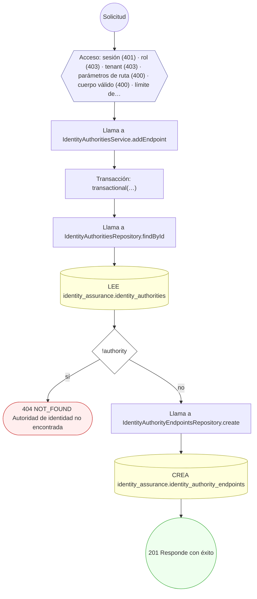

#### 3. POST /identity/checks/{id}/attempts

Ejecutar un intento contra la autoridad externa (idempotente)

| HTTP | Código | Cuándo |
|---|---|---|
| 201 | — | Éxito |
| 400 | `VALIDATION_FAILED` | Los parámetros de ruta son UUID válidos; El cuerpo cumple el DTO (sin propiedades extra) |
| 401 | `UNAUTHENTICATED` | Hay una sesión válida (JWT) |
| 403 | `FORBIDDEN` | El rol está permitido; El tenant se resuelve y pertenece al actor |
| 404 | `NOT_FOUND` | ResourceNotFoundException: Check de identidad no encontrado |
| 429 | `RATE_LIMITED` | No se supera el límite de solicitudes |

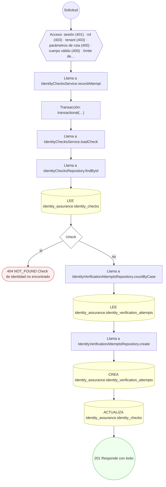

#### 4. POST /identity/checks/{id}/results

Registrar el resultado inmutable del check (con supersede)

| HTTP | Código | Cuándo |
|---|---|---|
| 201 | — | Éxito |
| 400 | `VALIDATION_FAILED` | Los parámetros de ruta son UUID válidos; El cuerpo cumple el DTO (sin propiedades extra) |
| 401 | `UNAUTHENTICATED` | Hay una sesión válida (JWT) |
| 403 | `FORBIDDEN` | El rol está permitido; El tenant se resuelve y pertenece al actor |
| 404 | `NOT_FOUND` | ResourceNotFoundException: Check de identidad no encontrado |
| 422 | `PRECONDITION_FAILED` | PreconditionFailedException: No existe un intento completado para registrar resultado; PreconditionFailedException: No se pudo determinar la autoridad que verificó el caso |
| 429 | `RATE_LIMITED` | No se supera el límite de solicitudes |


#### 5. POST /identity/manual-review/{id}/decision

Resolver una revisión manual (decisión)

| HTTP | Código | Cuándo |
|---|---|---|
| 200 | — | Éxito |
| 400 | `VALIDATION_FAILED` | Los parámetros de ruta son UUID válidos; El cuerpo cumple el DTO (sin propiedades extra) |
| 401 | `UNAUTHENTICATED` | Hay una sesión válida (JWT) |
| 403 | `FORBIDDEN` | El rol está permitido; El tenant se resuelve y pertenece al actor |
| 404 | `NOT_FOUND` | ResourceNotFoundException: Revisión manual no encontrada; ResourceNotFoundException: Caso de verificación no encontrado |
| 422 | `PRECONDITION_FAILED` | PreconditionFailedException: La revisión ya fue decidida; PreconditionFailedException: La revisión está asignada a otro revisor; PreconditionFailedException: La revisión quedó obsoleta: el caso ya no admite aprobación; PreconditionFailedException: No se pudo determinar la autoridad que verificó el caso |
| 429 | `RATE_LIMITED` | No se supera el límite de solicitudes |

```mermaid
flowchart TD
  n1(("Solicitud")):::inicio
  n2{{"Acceso: sesión (401) · rol (403) · tenant (403) · parámetros de ruta (400) · cuerpo válido (400) · límite de…"}}:::acceso
  n1 --> n2
  n3["Llama a IdentityManualReviewService.decide"]:::llamada
  n2 --> n3
  n4["Transacción: transactional(…)"]:::transaccion
  n3 --> n4
  n5["Llama a IdentityManualReviewCasesRepository.findById"]:::llamada
  n4 --> n5
  n6[("LEE identity_assurance.identity_manual_review_cases")]:::efecto
  n5 --> n6
  n7{"!review"}:::decision
  n6 --> n7
  n8(["404 NOT_FOUND Revisión manual no encontrada"]):::error
  n7 -->|"sí"| n8
  n9{"review.statusConceptId !== IDA.REVIEW_OPEN"}:::decision
  n7 -->|"no"| n9
  n10(["422 PRECONDITION_FAILED La revisión ya fue decidida"]):::error
  n9 -->|"sí"| n10
  n11{"review.assignedToUserId && review.assignedToUserId !== actor.id"}:::decision
  n9 -->|"no"| n11
  n12(["422 PRECONDITION_FAILED La revisión está asignada a otro revisor"]):::error
  n11 -->|"sí"| n12
  n13["Llama a IdentityVerificationCasesRepository.findById"]:::llamada
  n11 -->|"no"| n13
  n14[("LEE identity_assurance.identity_verification_cases")]:::efecto
  n13 --> n14
  n15{"!kase"}:::decision
  n14 --> n15
  n16(["404 NOT_FOUND Caso de verificación no encontrado"]):::error
  n15 -->|"sí"| n16
  n17[("ACTUALIZA identity_assurance.identity_manual_review_cases · ACTUALIZA identity_assurance.identity_manual_revi…")]:::efecto
  n15 -->|"no"| n17
  n18{"approved"}:::decision
  n17 --> n18
  n19["Llama a IdentityChecksService.settleManualApproval"]:::llamada
  n18 -->|"sí"| n19
  n20{"!APPROVABLE_CASE_STATES.includes(kase.statusConceptId)"}:::decision
  n19 --> n20
  n21(["422 PRECONDITION_FAILED La revisión quedó obsoleta: el caso ya no admite aprobación"]):::error
  n20 -->|"sí"| n21
  n22["Llama a IdentityChecksRepository.findRequiredByCase"]:::llamada
  n20 -->|"no"| n22
  n23[("LEE identity_assurance.identity_checks")]:::efecto
  n22 --> n23
  n24["Repite: por cada const check de requeridos"]:::bucle
  n23 --> n24
  n25["Llama a IdentityCheckResultsRepository.findLatestByCheck"]:::llamada
  n24 -->|"cada elemento"| n25
  n26[("LEE identity_assurance.identity_check_results")]:::efecto
  n25 --> n26
  n27["Llama a IdentityCheckResultsRepository.countByCheck"]:::llamada
  n26 --> n27
  n28[("LEE identity_assurance.identity_check_results")]:::efecto
  n27 --> n28
  n29["Llama a IdentityCheckResultsRepository.create"]:::llamada
  n28 --> n29
  n30[("CREA identity_assurance.identity_check_results")]:::efecto
  n29 --> n30
  n31[("ACTUALIZA identity_assurance.identity_checks")]:::efecto
  n30 --> n31
  n32["Llama a IdentityChecksService.verifyCase"]:::llamada
  n31 --> n32
  n24 -->|"al terminar"| n32
  n33[("ACTUALIZA identity_assurance.identity_verification_cases")]:::efecto
  n32 --> n33
  n34["Llama a IdentityChecksService.issueAssertion"]:::llamada
  n33 --> n34
  n35{"!authorityEndpoint"}:::decision
  n34 --> n35
  n36(["422 PRECONDITION_FAILED No se pudo determinar la autoridad que verificó el caso"]):::error
  n35 -->|"sí"| n36
  n37[("ACTUALIZA identity_assurance.identity_verification_cases · ACTUALIZA identity_assurance.identity_verification…")]:::efecto
  n35 -->|"no"| n37
  n38[("ACTUALIZA identity_assurance.identity_verification_cases · ACTUALIZA identity_assurance.identity_verification…")]:::efecto
  n18 -->|"no"| n38
  n39["Llama a IdentityFraudSignalsRepository.resolveOpenForCase"]:::llamada
  n37 --> n39
  n38 --> n39
  n40[("LEE identity_assurance.identity_fraud_signals")]:::efecto
  n39 --> n40
  n41["Repite: por cada const s de open"]:::bucle
  n40 --> n41
  n42[("ACTUALIZA identity_assurance.identity_fraud_signals · ACTUALIZA identity_assurance.identity_fraud_signals")]:::efecto
  n41 -->|"cada elemento"| n42
  n43(("200 Responde con éxito")):::ok
  n42 --> n43
  n41 -->|"al terminar"| n43
  classDef acceso fill:#eef,stroke:#66a
  classDef error fill:#fee,stroke:#c33
  classDef ok fill:#efe,stroke:#3a3
  classDef efecto fill:#ffd,stroke:#aa3
  classDef decision fill:#fff,stroke:#555
  classDef corte fill:#eee,stroke:#999,stroke-dasharray: 4
```

#### 6. POST /identity/me/identity-verification

Solicitar la verificación de la propia identidad (paciente)

| HTTP | Código | Cuándo |
|---|---|---|
| 201 | — | Éxito |
| 400 | `VALIDATION_FAILED` | El cuerpo cumple el DTO (sin propiedades extra) |
| 401 | `UNAUTHENTICATED` | Hay una sesión válida (JWT) |
| 403 | `FORBIDDEN` | El rol está permitido; El tenant se resuelve y pertenece al actor |
| 409 | `CONFLICT` | ConflictException: Ya hay una verificación en curso para este sujeto |
| 422 | `PRECONDITION_FAILED` | PreconditionFailedException: La cuenta no tiene una persona vinculada |
| 429 | `RATE_LIMITED` | No se supera el límite de solicitudes |

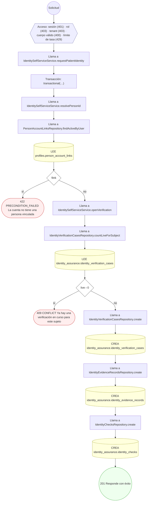

#### 7. POST /identity/me/practitioner/identity-verification

Solicitar la verificación de la propia identidad (profesional)

| HTTP | Código | Cuándo |
|---|---|---|
| 201 | — | Éxito |
| 400 | `VALIDATION_FAILED` | El cuerpo cumple el DTO (sin propiedades extra) |
| 401 | `UNAUTHENTICATED` | Hay una sesión válida (JWT) |
| 403 | `FORBIDDEN` | El rol está permitido; El tenant se resuelve y pertenece al actor |
| 409 | `CONFLICT` | ConflictException: Ya hay una verificación en curso para este sujeto |
| 422 | `PRECONDITION_FAILED` | PreconditionFailedException: La cuenta no tiene una persona vinculada; PreconditionFailedException: La cuenta no tiene un perfil profesional |
| 429 | `RATE_LIMITED` | No se supera el límite de solicitudes |

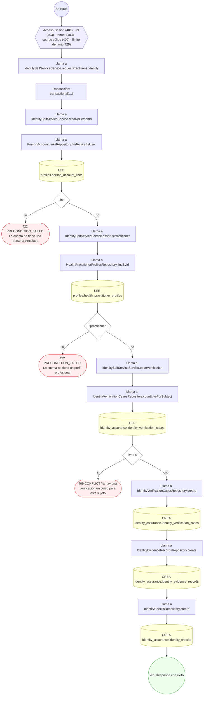

#### 8. POST /identity/me/practitioner/license-verification

Solicitar la verificación de la propia matrícula

| HTTP | Código | Cuándo |
|---|---|---|
| 201 | — | Éxito |
| 400 | `VALIDATION_FAILED` | El cuerpo cumple el DTO (sin propiedades extra) |
| 401 | `UNAUTHENTICATED` | Hay una sesión válida (JWT) |
| 403 | `FORBIDDEN` | El rol está permitido; El tenant se resuelve y pertenece al actor |
| 404 | `NOT_FOUND` | ResourceNotFoundException: Matrícula no encontrada |
| 409 | `CONFLICT` | ConflictException: Ya hay una verificación en curso para este sujeto |
| 422 | `PRECONDITION_FAILED` | PreconditionFailedException: La cuenta no tiene una persona vinculada; PreconditionFailedException: La cuenta no tiene un perfil profesional; PreconditionFailedException: Indique qué matrícula quiere verificar; PreconditionFailedException: La matrícula pertenece a otro profesional |
| 429 | `RATE_LIMITED` | No se supera el límite de solicitudes |

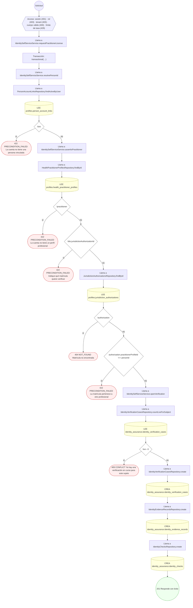

#### 9. POST /identity/me/tenants/{tenantId}/verification

Solicitar la verificación de una institución propia

| HTTP | Código | Cuándo |
|---|---|---|
| 201 | — | Éxito |
| 400 | `VALIDATION_FAILED` | Los parámetros de ruta son UUID válidos; El cuerpo cumple el DTO (sin propiedades extra) |
| 401 | `UNAUTHENTICATED` | Hay una sesión válida (JWT) |
| 403 | `FORBIDDEN` | El rol está permitido; El tenant se resuelve y pertenece al actor |
| 409 | `CONFLICT` | ConflictException: Ya hay una verificación en curso para este sujeto |
| 422 | `PRECONDITION_FAILED` | PreconditionFailedException: No pertenece a esa institución; PreconditionFailedException: Sólo el titular o un administrador de la institución puede pedir su verificación |
| 429 | `RATE_LIMITED` | No se supera el límite de solicitudes |

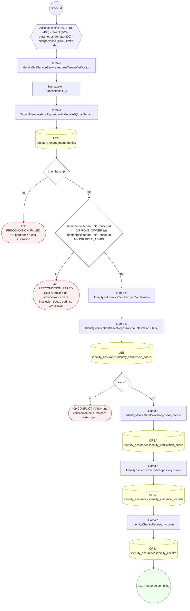

#### 10. GET /identity/me/verification-cases/{caseId}

Consultar el estado de un caso propio

| HTTP | Código | Cuándo |
|---|---|---|
| 200 | — | Éxito |
| 400 | `VALIDATION_FAILED` | Los parámetros de ruta son UUID válidos |
| 401 | `UNAUTHENTICATED` | Hay una sesión válida (JWT) |
| 403 | `FORBIDDEN` | El rol está permitido; El tenant se resuelve y pertenece al actor |
| 404 | `NOT_FOUND` | ResourceNotFoundException: Caso no encontrado |
| 429 | `RATE_LIMITED` | No se supera el límite de solicitudes |

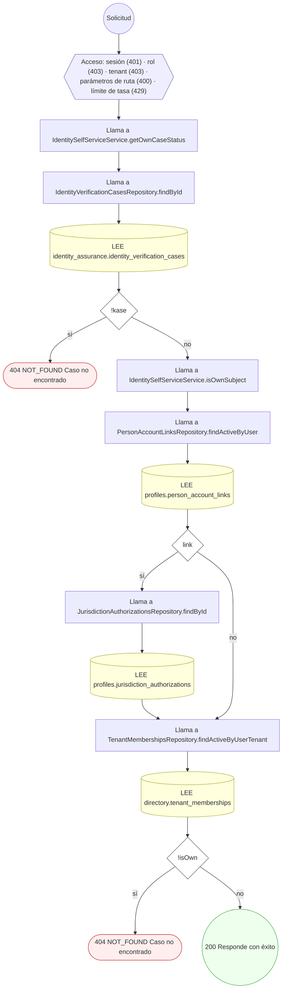

#### 11. POST /identity/verification-cases

Iniciar un caso de verificación de identidad

| HTTP | Código | Cuándo |
|---|---|---|
| 201 | — | Éxito |
| 400 | `VALIDATION_FAILED` | El cuerpo cumple el DTO (sin propiedades extra) |
| 401 | `UNAUTHENTICATED` | Hay una sesión válida (JWT) |
| 403 | `FORBIDDEN` | El rol está permitido; El tenant se resuelve y pertenece al actor |
| 404 | `NOT_FOUND` | ResourceNotFoundException: Política de verificación no encontrada |
| 429 | `RATE_LIMITED` | No se supera el límite de solicitudes |

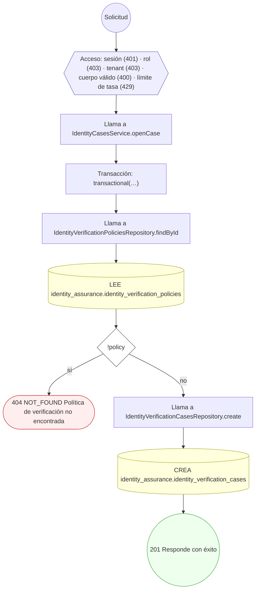

#### 12. POST /identity/verification-cases/{id}/assertions

Emitir una aserción de identidad con nivel de aseguramiento

| HTTP | Código | Cuándo |
|---|---|---|
| 201 | — | Éxito |
| 400 | `VALIDATION_FAILED` | Los parámetros de ruta son UUID válidos; El cuerpo cumple el DTO (sin propiedades extra) |
| 401 | `UNAUTHENTICATED` | Hay una sesión válida (JWT) |
| 403 | `FORBIDDEN` | El rol está permitido; El tenant se resuelve y pertenece al actor |
| 404 | `NOT_FOUND` | ResourceNotFoundException: Caso de verificación no encontrado |
| 422 | `PRECONDITION_FAILED` | PreconditionFailedException: Solo un caso verificado puede emitir una aserción; PreconditionFailedException: No hay checks completados que sustenten la aserción; PreconditionFailedException: No se pudo determinar el nivel de aseguramiento |
| 429 | `RATE_LIMITED` | No se supera el límite de solicitudes |

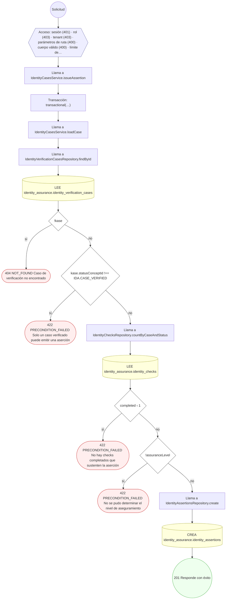

#### 13. POST /identity/verification-cases/{id}/checks:plan

Planificar los checks requeridos del caso

| HTTP | Código | Cuándo |
|---|---|---|
| 201 | — | Éxito |
| 400 | `VALIDATION_FAILED` | Los parámetros de ruta son UUID válidos; El cuerpo cumple el DTO (sin propiedades extra) |
| 401 | `UNAUTHENTICATED` | Hay una sesión válida (JWT) |
| 403 | `FORBIDDEN` | El rol está permitido; El tenant se resuelve y pertenece al actor |
| 404 | `NOT_FOUND` | ResourceNotFoundException: Caso de verificación no encontrado |
| 422 | `PRECONDITION_FAILED` | PreconditionFailedException: Solo un caso abierto puede planificar checks |
| 429 | `RATE_LIMITED` | No se supera el límite de solicitudes |

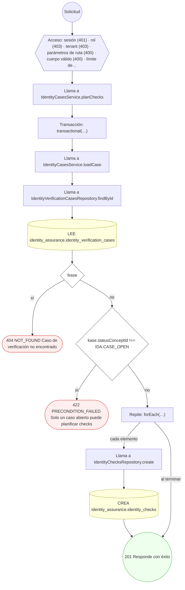

#### 14. POST /identity/verification-cases/{id}/evidence

Aportar evidencia documental bajo consentimiento

| HTTP | Código | Cuándo |
|---|---|---|
| 201 | — | Éxito |
| 400 | `VALIDATION_FAILED` | Los parámetros de ruta son UUID válidos; El cuerpo cumple el DTO (sin propiedades extra) |
| 401 | `UNAUTHENTICATED` | Hay una sesión válida (JWT) |
| 403 | `FORBIDDEN` | El rol está permitido; El tenant se resuelve y pertenece al actor |
| 404 | `NOT_FOUND` | ResourceNotFoundException: Caso de verificación no encontrado |
| 422 | `PRECONDITION_FAILED` | PreconditionFailedException: El caso no admite evidencia en su estado actual |
| 429 | `RATE_LIMITED` | No se supera el límite de solicitudes |

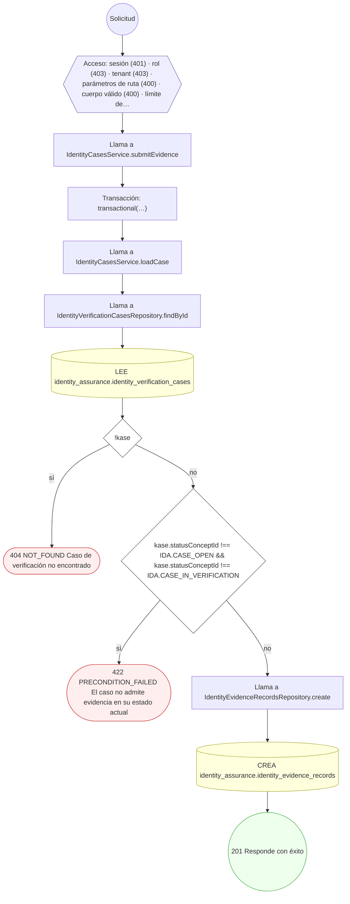

#### 15. POST /identity/verification-cases/{id}/fraud-signals

Detectar y registrar una señal de fraude

| HTTP | Código | Cuándo |
|---|---|---|
| 201 | — | Éxito |
| 400 | `VALIDATION_FAILED` | Los parámetros de ruta son UUID válidos; El cuerpo cumple el DTO (sin propiedades extra) |
| 401 | `UNAUTHENTICATED` | Hay una sesión válida (JWT) |
| 403 | `FORBIDDEN` | El rol está permitido; El tenant se resuelve y pertenece al actor |
| 404 | `NOT_FOUND` | ResourceNotFoundException: Caso de verificación no encontrado |
| 429 | `RATE_LIMITED` | No se supera el límite de solicitudes |

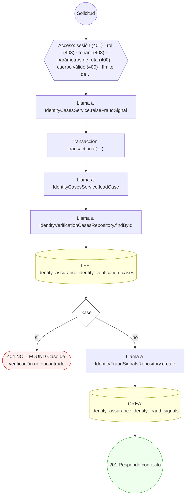

#### 16. POST /identity/verification-cases/{id}/manual-review

Escalar el caso a revisión manual

| HTTP | Código | Cuándo |
|---|---|---|
| 201 | — | Éxito |
| 400 | `VALIDATION_FAILED` | Los parámetros de ruta son UUID válidos; El cuerpo cumple el DTO (sin propiedades extra) |
| 401 | `UNAUTHENTICATED` | Hay una sesión válida (JWT) |
| 403 | `FORBIDDEN` | El rol está permitido; El tenant se resuelve y pertenece al actor |
| 404 | `NOT_FOUND` | ResourceNotFoundException: Caso de verificación no encontrado |
| 409 | `CONFLICT` | ConflictException: El caso ya tiene una revisión manual abierta |
| 422 | `PRECONDITION_FAILED` | PreconditionFailedException: El caso no es escalable a revisión manual |
| 429 | `RATE_LIMITED` | No se supera el límite de solicitudes |

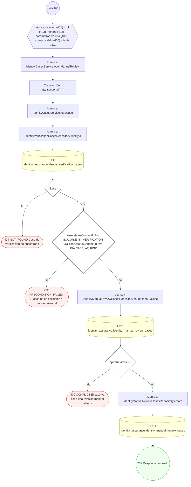

#### 17. POST /identity/verification-cases/expire-sweep

Expirar por lote los casos vencidos (job programado)

| HTTP | Código | Cuándo |
|---|---|---|
| 200 | — | Éxito |
| 401 | `UNAUTHENTICATED` | Hay una sesión válida (JWT) |
| 403 | `FORBIDDEN` | El rol está permitido; El tenant se resuelve y pertenece al actor |
| 429 | `RATE_LIMITED` | No se supera el límite de solicitudes |

```mermaid
flowchart TD
  n1(("Solicitud")):::inicio
  n2{{"Acceso: sesión (401) · rol (403) · tenant (403) · límite de tasa (429)"}}:::acceso
  n1 --> n2
  n3["Llama a IdentityCasesService.expireSweep"]:::llamada
  n2 --> n3
  n4["Transacción: transactional(…)"]:::transaccion
  n3 --> n4
  n5["Llama a IdentityVerificationCasesRepository.findExpirable"]:::llamada
  n4 --> n5
  n6[("LEE identity_assurance.identity_verification_cases")]:::efecto
  n5 --> n6
  n7["Repite: por cada const kase de expirable"]:::bucle
  n6 --> n7
  n8[("ACTUALIZA identity_assurance.identity_verification_cases")]:::efecto
  n7 -->|"cada elemento"| n8
  n9["Llama a IdentityChecksRepository.findPendingByCase"]:::llamada
  n8 --> n9
  n10[("LEE identity_assurance.identity_checks")]:::efecto
  n9 --> n10
  n11["Repite: por cada const check de pending"]:::bucle
  n10 --> n11
  n12[("ACTUALIZA identity_assurance.identity_checks")]:::efecto
  n11 -->|"cada elemento"| n12
  n13["Llama a IdentityVerificationEffectsService.applyRevoked"]:::llamada
  n12 --> n13
  n11 -->|"al terminar"| n13
  n14["Llama a IdentityVerificationEffectsService.publicSubjectOf"]:::llamada
  n13 --> n14
  n15["Llama a JurisdictionAuthorizationsRepository.findById"]:::llamada
  n14 --> n15
  n16[("LEE profiles.jurisdiction_authorizations")]:::efecto
  n15 --> n16
  n17["Llama a CommunityVerificationService.applyRevoked"]:::llamada
  n16 --> n17
  n18["Llama a VerifiedBadgesRepository.findProfileByTarget"]:::llamada
  n17 --> n18
  n19[("LEE community.public_profiles")]:::efecto
  n18 --> n19
  n20["Llama a CommunityVerificationService.revokeProfileBadges"]:::llamada
  n19 --> n20
  n21{"profile.verificationStatusConceptId === CONCEPTS.STATE_ACTIVE"}:::decision
  n20 --> n21
  n22[("ACTUALIZA community.public_profiles")]:::efecto
  n21 -->|"sí"| n22
  n23(("200 Responde con éxito")):::ok
  n22 --> n23
  n21 -->|"no"| n23
  n7 -->|"al terminar"| n23
  classDef acceso fill:#eef,stroke:#66a
  classDef error fill:#fee,stroke:#c33
  classDef ok fill:#efe,stroke:#3a3
  classDef efecto fill:#ffd,stroke:#aa3
  classDef decision fill:#fff,stroke:#555
  classDef corte fill:#eee,stroke:#999,stroke-dasharray: 4
```

#### 18. POST /internal/identity/checks/{id}/attempts

Registrar el intento del worker contra la autoridad externa

| HTTP | Código | Cuándo |
|---|---|---|
| 201 | — | Éxito |
| 400 | `VALIDATION_FAILED` | Los parámetros de ruta son UUID válidos; El cuerpo cumple el DTO (sin propiedades extra) |
| 401 | `UNAUTHENTICATED` | Hay una sesión válida (JWT) |
| 403 | `FORBIDDEN` | El rol está permitido; El tenant se resuelve y pertenece al actor |
| 404 | `NOT_FOUND` | ResourceNotFoundException: Check de identidad no encontrado |
| 429 | `RATE_LIMITED` | No se supera el límite de solicitudes |


#### 19. POST /internal/identity/checks/{id}/results

Registrar el veredicto que devolvió la autoridad externa

| HTTP | Código | Cuándo |
|---|---|---|
| 201 | — | Éxito |
| 400 | `VALIDATION_FAILED` | Los parámetros de ruta son UUID válidos; El cuerpo cumple el DTO (sin propiedades extra) |
| 401 | `UNAUTHENTICATED` | Hay una sesión válida (JWT) |
| 403 | `FORBIDDEN` | El rol está permitido; El tenant se resuelve y pertenece al actor |
| 404 | `NOT_FOUND` | ResourceNotFoundException: Check de identidad no encontrado |
| 422 | `PRECONDITION_FAILED` | PreconditionFailedException: No existe un intento completado para registrar resultado; PreconditionFailedException: No se pudo determinar la autoridad que verificó el caso |
| 429 | `RATE_LIMITED` | No se supera el límite de solicitudes |

```mermaid
flowchart TD
  n1(("Solicitud")):::inicio
  n2{{"Acceso: sesión (401) · rol (403) · tenant (403) · parámetros de ruta (400) · cuerpo válido (400) · límite de…"}}:::acceso
  n1 --> n2
  n3["Llama a IdentityChecksService.recordResult"]:::llamada
  n2 --> n3
  n4["Transacción: transactional(…)"]:::transaccion
  n3 --> n4
  n5["Llama a IdentityChecksService.loadCheck"]:::llamada
  n4 --> n5
  n6["Llama a IdentityChecksRepository.findById"]:::llamada
  n5 --> n6
  n7[("LEE identity_assurance.identity_checks")]:::efecto
  n6 --> n7
  n8{"!check"}:::decision
  n7 --> n8
  n9(["404 NOT_FOUND Check de identidad no encontrado"]):::error
  n8 -->|"sí"| n9
  n10["Llama a IdentityChecksService.completeInFlightAttempt"]:::llamada
  n8 -->|"no"| n10
  n11["Llama a IdentityVerificationAttemptsRepository.findLatestByCase"]:::llamada
  n10 --> n11
  n12[("LEE identity_assurance.identity_verification_attempts")]:::efecto
  n11 --> n12
  n13[("ACTUALIZA identity_assurance.identity_verification_attempts · ACTUALIZA identity_assurance.identity_verificat…")]:::efecto
  n12 --> n13
  n14["Llama a IdentityVerificationAttemptsRepository.existsCompletedForCase"]:::llamada
  n13 --> n14
  n15[("LEE identity_assurance.identity_verification_attempts")]:::efecto
  n14 --> n15
  n16{"!hasCompleted"}:::decision
  n15 --> n16
  n17(["422 PRECONDITION_FAILED No existe un intento completado para registrar resultado"]):::error
  n16 -->|"sí"| n17
  n18["Llama a IdentityCheckResultsRepository.findLatestByCheck"]:::llamada
  n16 -->|"no"| n18
  n19[("LEE identity_assurance.identity_check_results")]:::efecto
  n18 --> n19
  n20["Llama a IdentityCheckResultsRepository.countByCheck"]:::llamada
  n19 --> n20
  n21[("LEE identity_assurance.identity_check_results")]:::efecto
  n20 --> n21
  n22["Llama a IdentityCheckResultsRepository.create"]:::llamada
  n21 --> n22
  n23[("CREA identity_assurance.identity_check_results")]:::efecto
  n22 --> n23
  n24[("ACTUALIZA identity_assurance.identity_checks")]:::efecto
  n23 --> n24
  n25["Llama a IdentityChecksService.settleCase"]:::llamada
  n24 --> n25
  n26["Llama a IdentityVerificationCasesRepository.findById"]:::llamada
  n25 --> n26
  n27[("LEE identity_assurance.identity_verification_cases")]:::efecto
  n26 --> n27
  n28{"result === 'NO_MATCH'"}:::decision
  n27 --> n28
  n29[("ACTUALIZA identity_assurance.identity_verification_cases · ACTUALIZA identity_assurance.identity_verification…")]:::efecto
  n28 -->|"sí"| n29
  n30["Llama a IdentityChecksRepository.countOpenRequiredByCase"]:::llamada
  n29 --> n30
  n28 -->|"no"| n30
  n31[("LEE identity_assurance.identity_checks")]:::efecto
  n30 --> n31
  n32["Llama a IdentityChecksService.verifyCase"]:::llamada
  n31 --> n32
  n33[("ACTUALIZA identity_assurance.identity_verification_cases")]:::efecto
  n32 --> n33
  n34["Llama a IdentityChecksService.issueAssertion"]:::llamada
  n33 --> n34
  n35{"!authorityEndpoint"}:::decision
  n34 --> n35
  n36(["422 PRECONDITION_FAILED No se pudo determinar la autoridad que verificó el caso"]):::error
  n35 -->|"sí"| n36
  n37[("ACTUALIZA identity_assurance.identity_verification_cases · ACTUALIZA identity_assurance.identity_verification…")]:::efecto
  n35 -->|"no"| n37
  n38(("201 Responde con éxito")):::ok
  n37 --> n38
  classDef acceso fill:#eef,stroke:#66a
  classDef error fill:#fee,stroke:#c33
  classDef ok fill:#efe,stroke:#3a3
  classDef efecto fill:#ffd,stroke:#aa3
  classDef decision fill:#fff,stroke:#555
  classDef corte fill:#eee,stroke:#999,stroke-dasharray: 4
```

#### 20. GET /internal/identity/checks/dispatchable

Listar los checks que el worker debe atender en este tick

| HTTP | Código | Cuándo |
|---|---|---|
| 200 | — | Éxito |
| 400 | `VALIDATION_FAILED` | Están los parámetros de consulta obligatorios |
| 401 | `UNAUTHENTICATED` | Hay una sesión válida (JWT) |
| 403 | `FORBIDDEN` | El rol está permitido; El tenant se resuelve y pertenece al actor |
| 429 | `RATE_LIMITED` | No se supera el límite de solicitudes |

```mermaid
flowchart TD
  n1(("Solicitud")):::inicio
  n2{{"Acceso: sesión (401) · rol (403) · tenant (403) · parámetros de consulta (400) · límite de tasa (429)"}}:::acceso
  n1 --> n2
  n3["Llama a IdentityChecksService.listDispatchable"]:::llamada
  n2 --> n3
  n4["Llama a IdentityChecksRepository.findDispatchable"]:::llamada
  n3 --> n4
  n5[("LEE identity_assurance.identity_checks")]:::efecto
  n4 --> n5
  n6["Repite: por cada const check de checks"]:::bucle
  n5 --> n6
  n7["Llama a IdentityVerificationAttemptsRepository.findLatestByCase"]:::llamada
  n6 -->|"cada elemento"| n7
  n8[("LEE identity_assurance.identity_verification_attempts")]:::efecto
  n7 --> n8
  n9(("200 Responde con éxito")):::ok
  n8 --> n9
  n6 -->|"al terminar"| n9
  classDef acceso fill:#eef,stroke:#66a
  classDef error fill:#fee,stroke:#c33
  classDef ok fill:#efe,stroke:#3a3
  classDef efecto fill:#ffd,stroke:#aa3
  classDef decision fill:#fff,stroke:#555
  classDef corte fill:#eee,stroke:#999,stroke-dasharray: 4
```

### Operaciones sin decisiones propias

Sólo comprueban el acceso y leen o escriben: no tienen ramas que dibujar. Su detalle está en la ficha de endpoints.

| Operación | Respuestas posibles | Tablas |
|---|---|---|
| POST /identity/authorities | 201, 400, 401, 403, 429 | 1 |
| GET /identity/me/verification-cases | 200, 401, 403, 429 | 3 |
| GET /identity/verification-cases | 200, 401, 403, 429 | 1 |
| POST /identity/verification-policies | 201, 400, 401, 403, 429 | 1 |
