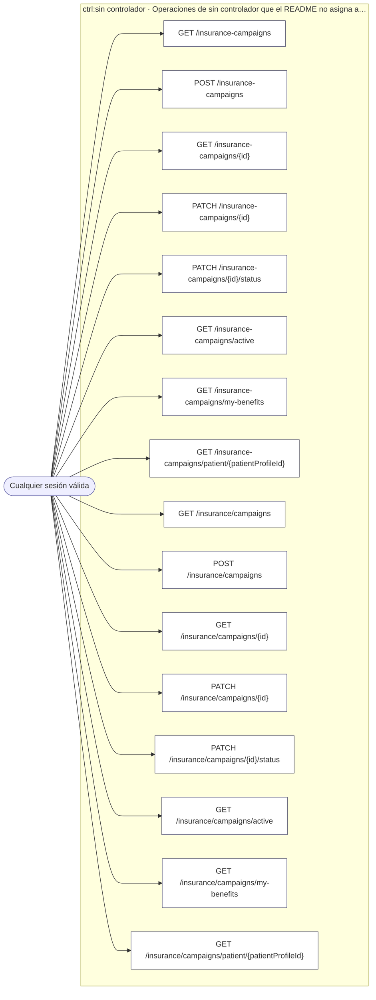

<!-- AUTOGENERADO por tools/inventario/flujos.mjs. No editar manualmente. -->

# Flujos del módulo `insurance-campaigns`

- **Procesos:** 1 · **Máquinas de estado:** 0
- **Operaciones:** 16 (0 con decisiones propias, 16 sin ellas)
- Inventario de endpoints del módulo: [insurance-campaigns](../endpoints/insurance-campaigns.md)

## Proceso: insurance-campaigns

- **Código:** `insurance-campaigns` · **Agrupación:** AGRUPACION_POR_CONTROLADOR · **Operaciones:** 16
- **Actores:** Cualquier sesión válida
- **Revisión:** AUTO_DETECTADA
- **Fuentes:** —

### Para qué sirve

_Sin fuente: ni el README del módulo ni el modelo lo describen._

### Etapas y operaciones

| Etapa | Descripción | Operación | Quién actúa | Riesgo | Tablas |
|---|---|---|---|---|---|
| `ctrl:sin controlador` | Operaciones de sin controlador que el README no asigna a un caso de uso | GET /insurance-campaigns | Cualquier sesión válida | BAJO | 0 |
|  |  | POST /insurance-campaigns | Cualquier sesión válida | BAJO | 0 |
|  |  | GET /insurance-campaigns/{id} | Cualquier sesión válida | BAJO | 0 |
|  |  | PATCH /insurance-campaigns/{id} | Cualquier sesión válida | BAJO | 0 |
|  |  | PATCH /insurance-campaigns/{id}/status | Cualquier sesión válida | BAJO | 0 |
|  |  | GET /insurance-campaigns/active | Cualquier sesión válida | BAJO | 0 |
|  |  | GET /insurance-campaigns/my-benefits | Cualquier sesión válida | BAJO | 0 |
|  |  | GET /insurance-campaigns/patient/{patientProfileId} | Cualquier sesión válida | BAJO | 0 |
|  |  | GET /insurance/campaigns | Cualquier sesión válida | BAJO | 0 |
|  |  | POST /insurance/campaigns | Cualquier sesión válida | BAJO | 0 |
|  |  | GET /insurance/campaigns/{id} | Cualquier sesión válida | BAJO | 0 |
|  |  | PATCH /insurance/campaigns/{id} | Cualquier sesión válida | BAJO | 0 |
|  |  | PATCH /insurance/campaigns/{id}/status | Cualquier sesión válida | BAJO | 0 |
|  |  | GET /insurance/campaigns/active | Cualquier sesión válida | BAJO | 0 |
|  |  | GET /insurance/campaigns/my-benefits | Cualquier sesión válida | BAJO | 0 |
|  |  | GET /insurance/campaigns/patient/{patientProfileId} | Cualquier sesión válida | BAJO | 0 |

### Diagrama — etapas `ctrl:sin controlador`

## Árbol de decisión por operación

Cada árbol se deriva del código del handler y de los métodos que invoca (hasta 4 niveles). Una rama que no decide, no escribe y no falla se poda. Los accesos y los efectos consecutivos se agrupan en un solo nodo.

### Operaciones sin decisiones propias

Sólo comprueban el acceso y leen o escriben: no tienen ramas que dibujar. Su detalle está en la ficha de endpoints.

| Operación | Respuestas posibles | Tablas |
|---|---|---|
| GET /insurance-campaigns | — | 0 |
| POST /insurance-campaigns | — | 0 |
| GET /insurance-campaigns/{id} | — | 0 |
| PATCH /insurance-campaigns/{id} | — | 0 |
| PATCH /insurance-campaigns/{id}/status | — | 0 |
| GET /insurance-campaigns/active | — | 0 |
| GET /insurance-campaigns/my-benefits | — | 0 |
| GET /insurance-campaigns/patient/{patientProfileId} | — | 0 |
| GET /insurance/campaigns | — | 0 |
| POST /insurance/campaigns | — | 0 |
| GET /insurance/campaigns/{id} | — | 0 |
| PATCH /insurance/campaigns/{id} | — | 0 |
| PATCH /insurance/campaigns/{id}/status | — | 0 |
| GET /insurance/campaigns/active | — | 0 |
| GET /insurance/campaigns/my-benefits | — | 0 |
| GET /insurance/campaigns/patient/{patientProfileId} | — | 0 |
