<!-- AUTOGENERADO por tools/inventario/flujos.mjs. No editar manualmente. -->

# Flujos del módulo `insurance`

- **Procesos:** 1 · **Máquinas de estado:** 0
- **Operaciones:** 29 (23 con decisiones propias, 6 sin ellas)
- Inventario de endpoints del módulo: [insurance](../endpoints/insurance.md)

## Proceso: src / modules / insurance

- **Código:** `insurance` · **Agrupación:** AGRUPACION_POR_CONTROLADOR · **Operaciones:** 29
- **Actores:** BILLING · Cualquier sesión válida · FINANCE · Público (sin sesión) · SECURITY_ADMIN
- **Revisión:** AUTO_DETECTADA
- **Fuentes:** `src/modules/insurance/README.md`

### Para qué sirve

Agrupa los componentes relacionados con **insurance** y mantiene cohesionada esta responsabilidad del sistema.

_Fuente: `src/modules/insurance/README.md:3`_

### Etapas y operaciones

| Etapa | Descripción | Operación | Quién actúa | Riesgo | Tablas |
|---|---|---|---|---|---|
| `ctrl:AppealsController` | Operaciones de AppealsController que el README no asigna a un caso de uso | POST /claim-disputes/{id}/appeal-decisions | BILLING · FINANCE | MEDIO | 4 |
| `ctrl:BrokerCommissionController` | Operaciones de BrokerCommissionController que el README no asigna a un caso de uso | POST /broker-commission-statements | BILLING · FINANCE | MEDIO | 4 |
| `ctrl:ClaimsController` | Operaciones de ClaimsController que el README no asigna a un caso de uso | POST /insurance-claims | BILLING · FINANCE | MEDIO | 5 |
|  |  | POST /insurance-claims/{id}/adjudications | BILLING · FINANCE | MEDIO | 6 |
|  |  | POST /insurance-claims/{id}/disputes | BILLING · FINANCE | MEDIO | 2 |
|  |  | POST /insurance-claims/{id}/eob | BILLING · FINANCE | MEDIO | 5 |
|  |  | POST /insurance-claims/{id}/reversals | BILLING · FINANCE | MEDIO | 4 |
| `ctrl:CoverageController` | Operaciones de CoverageController que el README no asigna a un caso de uso | POST /coordination-of-benefits | BILLING · FINANCE | MEDIO | 4 |
|  |  | POST /coverage-eligibility-requests | BILLING · FINANCE | MEDIO | 5 |
|  |  | POST /patient-coverages | BILLING · FINANCE | MEDIO | 5 |
| `ctrl:InsuranceBackboneController` | Operaciones de InsuranceBackboneController que el README no asigna a un caso de uso | POST /employer-groups | SECURITY_ADMIN | MEDIO | 1 |
|  |  | POST /insurance-brokers | SECURITY_ADMIN | MEDIO | 1 |
|  |  | POST /insurance-brokers/{id}/agreements | SECURITY_ADMIN | MEDIO | 3 |
|  |  | POST /insurance-carriers | SECURITY_ADMIN | MEDIO | 1 |
|  |  | POST /insurance-carriers/{id}/products | SECURITY_ADMIN | MEDIO | 2 |
|  |  | POST /insurance-plans/{id}/benefits | SECURITY_ADMIN | MEDIO | 2 |
|  |  | POST /insurance-products/{id}/plans | SECURITY_ADMIN | MEDIO | 2 |
|  |  | POST /provider-networks | SECURITY_ADMIN | MEDIO | 2 |
|  |  | POST /provider-networks/{id}/memberships | SECURITY_ADMIN | MEDIO | 2 |
| `ctrl:InsuranceCatalogController` | Operaciones de InsuranceCatalogController que el README no asigna a un caso de uso | GET /insurance-carrier-catalog | Público (sin sesión) | BAJO | 3 |
| `ctrl:InsuranceReadController` | Operaciones de InsuranceReadController que el README no asigna a un caso de uso | GET /insurance-brokers | Cualquier sesión válida | BAJO | 3 |
|  |  | GET /insurance-brokers/{id} | Cualquier sesión válida | BAJO | 4 |
|  |  | GET /insurance-brokers/{id}/clients | Cualquier sesión válida | BAJO | 3 |
|  |  | GET /insurance-carriers | Cualquier sesión válida | BAJO | 5 |
|  |  | GET /insurance-carriers/{id} | Cualquier sesión válida | BAJO | 7 |
| `ctrl:PriorAuthController` | Operaciones de PriorAuthController que el README no asigna a un caso de uso | POST /prior-authorization-requests | BILLING · FINANCE | MEDIO | 3 |
|  |  | POST /prior-authorization-requests/{id}/determinations | BILLING · FINANCE | MEDIO | 4 |
| `ctrl:ReconciliationController` | Operaciones de ReconciliationController que el README no asigna a un caso de uso | POST /reconciliation-batches | SECURITY_ADMIN | MEDIO | 2 |
|  |  | POST /reconciliation-batches/{id}/items | SECURITY_ADMIN | MEDIO | 4 |

### Diagrama 1 de 2 — etapas `ctrl:AppealsController`, `ctrl:BrokerCommissionController`, `ctrl:ClaimsController`…

```mermaid
flowchart LR
  a2(["BILLING · FINANCE"]):::actor
  a32(["SECURITY_ADMIN"]):::actor
  a47(["Público (sin sesión)"]):::actor
  a49(["Cualquier sesión válida"]):::actor
  t3[("insurance.claim_appeal_decisions")]:::tabla
  t4[("insurance.claim_disputes")]:::tabla
  t6[("insurance.broker_carrier_agreements")]:::tabla
  t7[("insurance.broker_commission_statements")]:::tabla
  t8[("insurance.insurance_brokers")]:::tabla
  t10[("insurance.insurance_carriers")]:::tabla
  t11[("insurance.insurance_claim_lines")]:::tabla
  t12[("insurance.insurance_claims")]:::tabla
  t13[("insurance.patient_coverages")]:::tabla
  t15[("insurance.claim_adjudication_versions")]:::tabla
  t16[("insurance.claim_line_adjudications")]:::tabla
  t19[("insurance.patient_explanations_of_benefit")]:::tabla
  t21[("insurance.claim_reversals")]:::tabla
  t23[("insurance.coordination_of_benefits")]:::tabla
  t25[("insurance.coverage_eligibility_requests")]:::tabla
  t26[("insurance.coverage_eligibility_responses")]:::tabla
  t28[("insurance.broker_clients")]:::tabla
  t29[("insurance.coverage_dependents")]:::tabla
  t30[("insurance.insurance_plans")]:::tabla
  t33[("insurance.employer_groups")]:::tabla
  t38[("insurance.insurance_products")]:::tabla
  t40[("insurance.insurance_plan_benefits")]:::tabla
  t43[("insurance.provider_networks")]:::tabla
  t45[("insurance.network_provider_memberships")]:::tabla
  t50[("terminology.catalog_concepts")]:::tabla
  subgraph s0["ctrl:AppealsController · Operaciones de AppealsController que el README no asig…"]
    o1["POST /claim-disputes/{id}/appeal-decisions"]:::op
  end
  subgraph s1["ctrl:BrokerCommissionController · Operaciones de BrokerCommissionController que…"]
    o5["POST /broker-commission-statements"]:::op
  end
  subgraph s2["ctrl:ClaimsController · Operaciones de ClaimsController que el README no asigna…"]
    o9["POST /insurance-claims"]:::op
    o14["POST /insurance-claims/{id}/adjudications"]:::op
    o17["POST /insurance-claims/{id}/disputes"]:::op
    o18["POST /insurance-claims/{id}/eob"]:::op
    o20["POST /insurance-claims/{id}/reversals"]:::op
  end
  subgraph s3["ctrl:CoverageController · Operaciones de CoverageController que el README no as…"]
    o22["POST /coordination-of-benefits"]:::op
    o24["POST /coverage-eligibility-requests"]:::op
    o27["POST /patient-coverages"]:::op
  end
  subgraph s4["ctrl:InsuranceBackboneController · Operaciones de InsuranceBackboneController q…"]
    o31["POST /employer-groups"]:::op
    o34["POST /insurance-brokers"]:::op
    o35["POST /insurance-brokers/{id}/agreements"]:::op
    o36["POST /insurance-carriers"]:::op
    o37["POST /insurance-carriers/{id}/products"]:::op
    o39["POST /insurance-plans/{id}/benefits"]:::op
    o41["POST /insurance-products/{id}/plans"]:::op
    o42["POST /provider-networks"]:::op
    o44["POST /provider-networks/{id}/memberships"]:::op
  end
  subgraph s5["ctrl:InsuranceCatalogController · Operaciones de InsuranceCatalogController que…"]
    o46["GET /insurance-carrier-catalog"]:::op
  end
  t55[("+1 tablas más")]
  subgraph s6["ctrl:InsuranceReadController · Operaciones de InsuranceReadController que el RE…"]
    o48["GET /insurance-brokers"]:::op
    o51["GET /insurance-brokers/{id}"]:::op
    o52["GET /insurance-brokers/{id}/clients"]:::op
    o53["GET /insurance-carriers"]:::op
    o54["GET /insurance-carriers/{id}"]:::op
  end
  a2 --> o1
  o1 -->|"CREA"| t3
  o1 -->|"LEE"| t3
  o1 -->|"ACTUALIZA"| t4
  o1 -->|"LEE"| t4
  a2 --> o5
  o5 -->|"LEE"| t6
  o5 -->|"CREA"| t7
  o5 -->|"LEE"| t7
  o5 -->|"LEE"| t8
  a2 --> o9
  o9 -->|"LEE"| t10
  o9 -->|"CREA"| t11
  o9 -->|"CREA"| t12
  o9 -->|"LEE"| t12
  o9 -->|"LEE"| t13
  a2 --> o14
  o14 -->|"CREA"| t15
  o14 -->|"LEE"| t15
  o14 -->|"CREA"| t16
  o14 -->|"LEE"| t11
  o14 -->|"ACTUALIZA"| t12
  o14 -->|"LEE"| t12
  a2 --> o17
  o17 -->|"CREA"| t4
  o17 -->|"LEE"| t12
  a2 --> o18
  o18 -->|"LEE"| t15
  o18 -->|"LEE"| t12
  o18 -->|"LEE"| t13
  o18 -->|"CREA"| t19
  o18 -->|"LEE"| t19
  a2 --> o20
  o20 -->|"LEE"| t15
  o20 -->|"CREA"| t21
  o20 -->|"ACTUALIZA"| t12
  o20 -->|"LEE"| t12
  a2 --> o22
  o22 -->|"ACTUALIZA"| t23
  o22 -->|"CREA"| t23
  o22 -->|"LEE"| t23
  o22 -->|"LEE"| t13
  a2 --> o24
  o24 -->|"ACTUALIZA"| t25
  o24 -->|"CREA"| t25
  o24 -->|"LEE"| t25
  o24 -->|"CREA"| t26
  o24 -->|"LEE"| t13
  a2 --> o27
  o27 -->|"CREA"| t28
  o27 -->|"CREA"| t29
  o27 -->|"LEE"| t30
  o27 -->|"CREA"| t13
  o27 -->|"LEE"| t13
  a32 --> o31
  o31 -->|"CREA"| t33
  a32 --> o34
  o34 -->|"CREA"| t8
  a32 --> o35
  o35 -->|"CREA"| t6
  o35 -->|"LEE"| t8
  o35 -->|"LEE"| t10
  a32 --> o36
  o36 -->|"CREA"| t10
  a32 --> o37
  o37 -->|"LEE"| t10
  o37 -->|"CREA"| t38
  a32 --> o39
  o39 -->|"CREA"| t40
  o39 -->|"LEE"| t30
  a32 --> o41
  o41 -->|"CREA"| t30
  o41 -->|"LEE"| t38
  a32 --> o42
  o42 -->|"LEE"| t10
  o42 -->|"CREA"| t43
  a32 --> o44
  o44 -->|"CREA"| t45
  o44 -->|"LEE"| t43
  a47 --> o46
  o46 -->|"LEE"| t10
  o46 -->|"LEE"| t30
  o46 -->|"LEE"| t38
  a49 --> o48
  o48 -->|"LEE"| t6
  o48 -->|"LEE"| t8
  o48 -->|"LEE"| t50
  a49 --> o51
  o51 -->|"LEE"| t6
  o51 -->|"LEE"| t8
  o51 -->|"LEE"| t10
  o51 -->|"LEE"| t50
  a49 --> o52
  o52 -->|"LEE"| t28
  o52 -->|"LEE"| t8
  o52 -->|"LEE"| t50
  a49 --> o53
  o53 -->|"LEE"| t10
  o53 -->|"LEE"| t30
  o53 -->|"LEE"| t38
  o53 -->|"LEE"| t43
  o53 -->|"LEE"| t50
  a49 --> o54
  o54 -->|"LEE"| t10
  o54 -->|"LEE"| t40
  o54 -->|"LEE"| t30
  o54 -->|"LEE"| t38
  o54 -->|"LEE"| t45
  o54 -->|"LEE"| t43
  o54 -.-> t55
  classDef op fill:#fff,stroke:#446
  classDef actor fill:#eef,stroke:#66a
  classDef tabla fill:#ffd,stroke:#aa3
  classDef evento fill:#efe,stroke:#3a3
```

### Diagrama 2 de 2 — etapas `ctrl:PriorAuthController`, `ctrl:ReconciliationController`

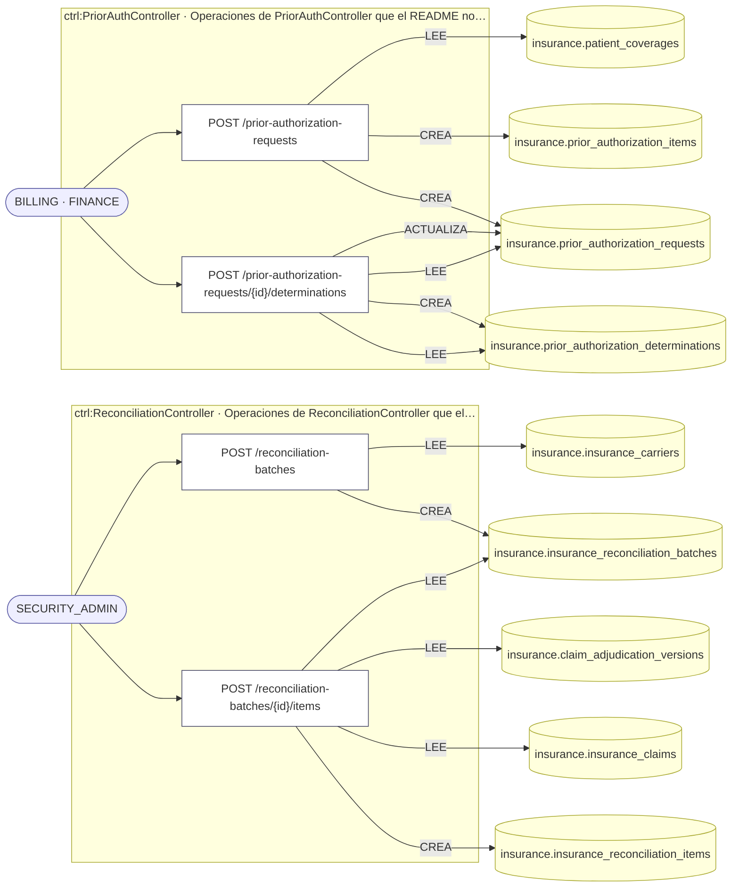

## Árbol de decisión por operación

Cada árbol se deriva del código del handler y de los métodos que invoca (hasta 4 niveles). Una rama que no decide, no escribe y no falla se poda. Los accesos y los efectos consecutivos se agrupan en un solo nodo.

### Operaciones con decisiones propias

#### 1. POST /broker-commission-statements

Generar liquidación de comisión de broker

| HTTP | Código | Cuándo |
|---|---|---|
| 201 | — | Éxito |
| 400 | `VALIDATION_FAILED` | El cuerpo cumple el DTO (sin propiedades extra) |
| 401 | `UNAUTHENTICATED` | Hay una sesión válida (JWT) |
| 403 | `FORBIDDEN` | El rol está permitido; El tenant se resuelve y pertenece al actor |
| 404 | `NOT_FOUND` | ResourceNotFoundException: Broker no encontrado; ResourceNotFoundException: Acuerdo broker–aseguradora no encontrado |
| 409 | `CONFLICT` | ConflictException: Ya existe liquidación para el periodo |
| 422 | `PRECONDITION_FAILED` | PreconditionFailedException: El acuerdo no está activo |
| 429 | `RATE_LIMITED` | No se supera el límite de solicitudes |

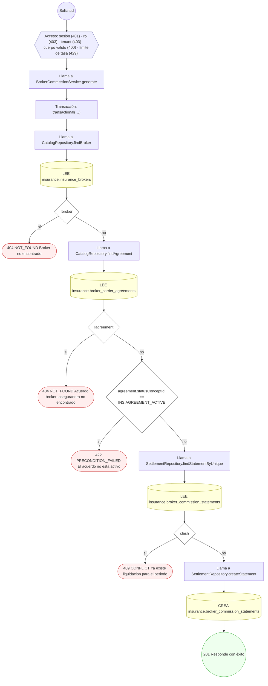

#### 2. POST /claim-disputes/{id}/appeal-decisions

Emitir decisión de apelación (inmutable)

| HTTP | Código | Cuándo |
|---|---|---|
| 201 | — | Éxito |
| 400 | `VALIDATION_FAILED` | Los parámetros de ruta son UUID válidos; El cuerpo cumple el DTO (sin propiedades extra) |
| 401 | `UNAUTHENTICATED` | Hay una sesión válida (JWT) |
| 403 | `FORBIDDEN` | El rol está permitido; El tenant se resuelve y pertenece al actor |
| 404 | `NOT_FOUND` | ResourceNotFoundException: Disputa no encontrada |
| 422 | `PRECONDITION_FAILED` | PreconditionFailedException: La disputa no admite decisión en su estado actual |
| 429 | `RATE_LIMITED` | No se supera el límite de solicitudes |


#### 3. POST /coordination-of-benefits

Determinar coordinación de beneficios (COB)

| HTTP | Código | Cuándo |
|---|---|---|
| 201 | — | Éxito |
| 400 | `VALIDATION_FAILED` | El cuerpo cumple el DTO (sin propiedades extra) |
| 401 | `UNAUTHENTICATED` | Hay una sesión válida (JWT) |
| 403 | `FORBIDDEN` | El rol está permitido; El tenant se resuelve y pertenece al actor |
| 404 | `NOT_FOUND` | ResourceNotFoundException: Cobertura primaria no encontrada |
| 422 | `PRECONDITION_FAILED` | PreconditionFailedException: COB requiere al menos una cobertura secundaria |
| 429 | `RATE_LIMITED` | No se supera el límite de solicitudes |

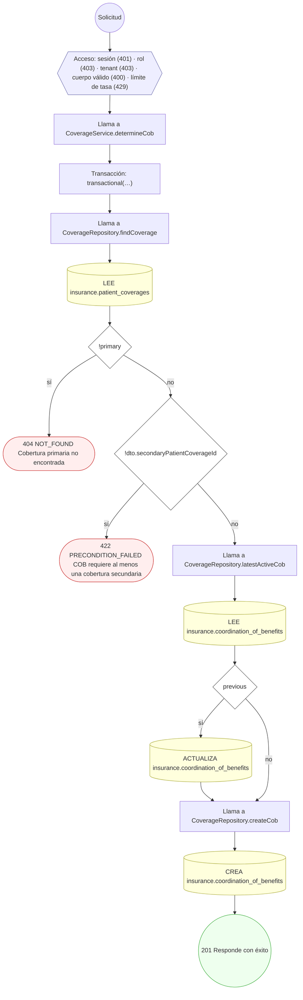

#### 4. POST /coverage-eligibility-requests

Solicitar y resolver elegibilidad (270/271)

| HTTP | Código | Cuándo |
|---|---|---|
| 201 | — | Éxito |
| 400 | `VALIDATION_FAILED` | El cuerpo cumple el DTO (sin propiedades extra) |
| 401 | `UNAUTHENTICATED` | Hay una sesión válida (JWT) |
| 403 | `FORBIDDEN` | El rol está permitido; El tenant se resuelve y pertenece al actor |
| 404 | `NOT_FOUND` | ResourceNotFoundException: Cobertura no encontrada |
| 409 | `CONFLICT` | ConflictException: Solicitud de elegibilidad duplicada |
| 429 | `RATE_LIMITED` | No se supera el límite de solicitudes |

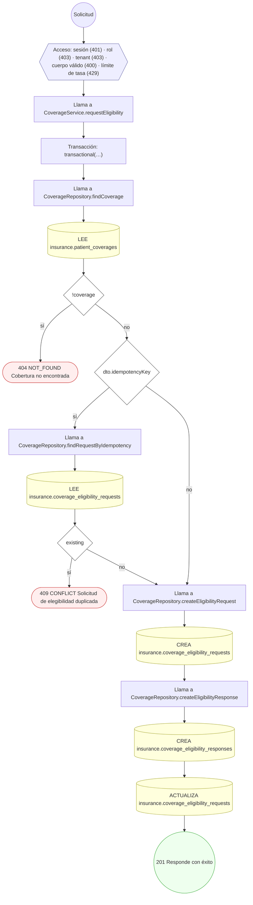

#### 5. GET /insurance-brokers/{id}

Consultar el perfil y las vinculaciones de un broker

| HTTP | Código | Cuándo |
|---|---|---|
| 200 | — | Éxito |
| 400 | `VALIDATION_FAILED` | Los parámetros de ruta son UUID válidos |
| 401 | `UNAUTHENTICATED` | Hay una sesión válida (JWT) |
| 403 | `FORBIDDEN` | El rol está permitido; El tenant se resuelve y pertenece al actor |
| 404 | `NOT_FOUND` | ResourceNotFoundException: Broker no encontrado |
| 429 | `RATE_LIMITED` | No se supera el límite de solicitudes |

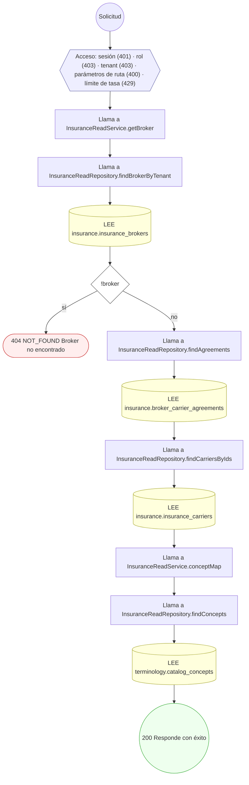

#### 6. POST /insurance-brokers/{id}/agreements

Alta de acuerdo broker–aseguradora (soporte)

| HTTP | Código | Cuándo |
|---|---|---|
| 201 | — | Éxito |
| 400 | `VALIDATION_FAILED` | Los parámetros de ruta son UUID válidos; El cuerpo cumple el DTO (sin propiedades extra) |
| 401 | `UNAUTHENTICATED` | Hay una sesión válida (JWT) |
| 403 | `FORBIDDEN` | El rol está permitido; El tenant se resuelve y pertenece al actor |
| 404 | `NOT_FOUND` | ResourceNotFoundException: Broker no encontrado; ResourceNotFoundException: Aseguradora no encontrada |
| 429 | `RATE_LIMITED` | No se supera el límite de solicitudes |


#### 7. GET /insurance-brokers/{id}/clients

Listar la cartera comercial de un broker (sin datos clínicos)

| HTTP | Código | Cuándo |
|---|---|---|
| 200 | — | Éxito |
| 400 | `VALIDATION_FAILED` | Los parámetros de ruta son UUID válidos |
| 401 | `UNAUTHENTICATED` | Hay una sesión válida (JWT) |
| 403 | `FORBIDDEN` | El rol está permitido; El tenant se resuelve y pertenece al actor |
| 404 | `NOT_FOUND` | ResourceNotFoundException: Broker no encontrado |
| 429 | `RATE_LIMITED` | No se supera el límite de solicitudes |

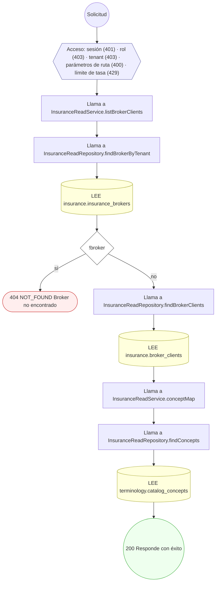

#### 8. GET /insurance-carriers/{id}

Consultar el catálogo y la red de una aseguradora

| HTTP | Código | Cuándo |
|---|---|---|
| 200 | — | Éxito |
| 400 | `VALIDATION_FAILED` | Los parámetros de ruta son UUID válidos |
| 401 | `UNAUTHENTICATED` | Hay una sesión válida (JWT) |
| 403 | `FORBIDDEN` | El rol está permitido; El tenant se resuelve y pertenece al actor |
| 404 | `NOT_FOUND` | ResourceNotFoundException: Aseguradora no encontrada |
| 429 | `RATE_LIMITED` | No se supera el límite de solicitudes |

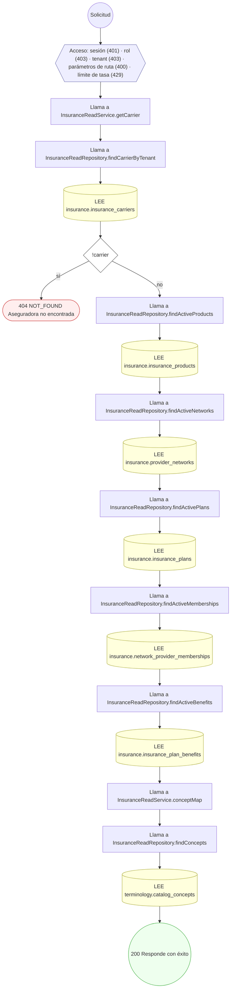

#### 9. POST /insurance-carriers/{id}/products

Alta de producto de aseguradora (soporte)

| HTTP | Código | Cuándo |
|---|---|---|
| 201 | — | Éxito |
| 400 | `VALIDATION_FAILED` | Los parámetros de ruta son UUID válidos; El cuerpo cumple el DTO (sin propiedades extra) |
| 401 | `UNAUTHENTICATED` | Hay una sesión válida (JWT) |
| 403 | `FORBIDDEN` | El rol está permitido; El tenant se resuelve y pertenece al actor |
| 404 | `NOT_FOUND` | ResourceNotFoundException: Aseguradora no encontrada |
| 429 | `RATE_LIMITED` | No se supera el límite de solicitudes |

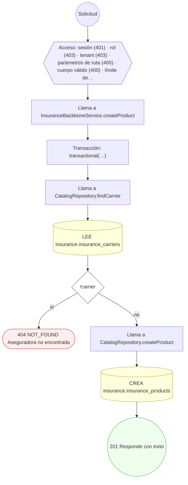

#### 10. POST /insurance-claims

Enviar reclamo con líneas (837)

| HTTP | Código | Cuándo |
|---|---|---|
| 201 | — | Éxito |
| 400 | `VALIDATION_FAILED` | El cuerpo cumple el DTO (sin propiedades extra) |
| 401 | `UNAUTHENTICATED` | Hay una sesión válida (JWT) |
| 403 | `FORBIDDEN` | El rol está permitido; El tenant se resuelve y pertenece al actor |
| 404 | `NOT_FOUND` | ResourceNotFoundException: Aseguradora no encontrada; ResourceNotFoundException: Cobertura no encontrada |
| 409 | `CONFLICT` | ConflictException: Reclamo duplicado |
| 429 | `RATE_LIMITED` | No se supera el límite de solicitudes |

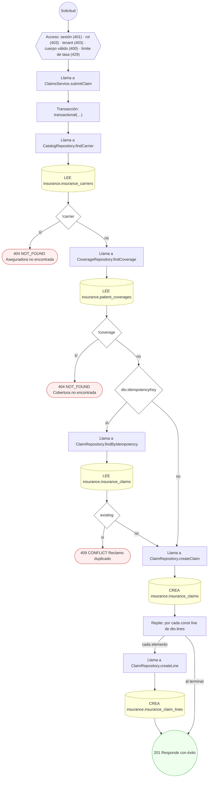

#### 11. POST /insurance-claims/{id}/adjudications

Adjudicar reclamo por línea (835)

| HTTP | Código | Cuándo |
|---|---|---|
| 201 | — | Éxito |
| 400 | `VALIDATION_FAILED` | Los parámetros de ruta son UUID válidos; El cuerpo cumple el DTO (sin propiedades extra) |
| 401 | `UNAUTHENTICATED` | Hay una sesión válida (JWT) |
| 403 | `FORBIDDEN` | El rol está permitido; El tenant se resuelve y pertenece al actor |
| 404 | `NOT_FOUND` | ResourceNotFoundException: Reclamo no encontrado; ResourceNotFoundException: Línea de reclamo no encontrada |
| 422 | `PRECONDITION_FAILED` | PreconditionFailedException: El reclamo no está en estado adjudicable |
| 429 | `RATE_LIMITED` | No se supera el límite de solicitudes |

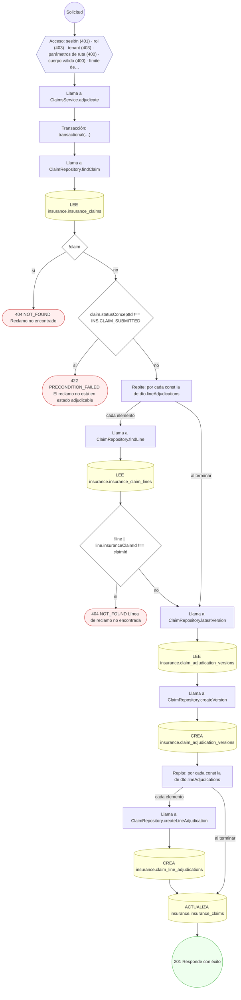

#### 12. POST /insurance-claims/{id}/disputes

Abrir disputa sobre adjudicación

| HTTP | Código | Cuándo |
|---|---|---|
| 201 | — | Éxito |
| 400 | `VALIDATION_FAILED` | Los parámetros de ruta son UUID válidos; El cuerpo cumple el DTO (sin propiedades extra) |
| 401 | `UNAUTHENTICATED` | Hay una sesión válida (JWT) |
| 403 | `FORBIDDEN` | El rol está permitido; El tenant se resuelve y pertenece al actor |
| 404 | `NOT_FOUND` | ResourceNotFoundException: Reclamo no encontrado |
| 429 | `RATE_LIMITED` | No se supera el límite de solicitudes |

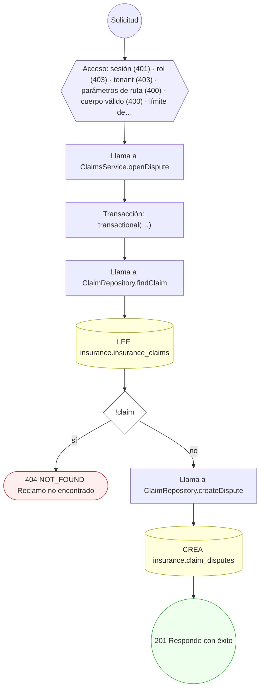

#### 13. POST /insurance-claims/{id}/eob

Publicar Explicación de Beneficios (EOB)

| HTTP | Código | Cuándo |
|---|---|---|
| 201 | — | Éxito |
| 400 | `VALIDATION_FAILED` | Los parámetros de ruta son UUID válidos; El cuerpo cumple el DTO (sin propiedades extra) |
| 401 | `UNAUTHENTICATED` | Hay una sesión válida (JWT) |
| 403 | `FORBIDDEN` | El rol está permitido; El tenant se resuelve y pertenece al actor |
| 404 | `NOT_FOUND` | ResourceNotFoundException: Reclamo no encontrado |
| 409 | `CONFLICT` | ConflictException: La EOB ya fue publicada para esta versión |
| 422 | `PRECONDITION_FAILED` | PreconditionFailedException: No existe adjudicación in_force para publicar EOB |
| 429 | `RATE_LIMITED` | No se supera el límite de solicitudes |

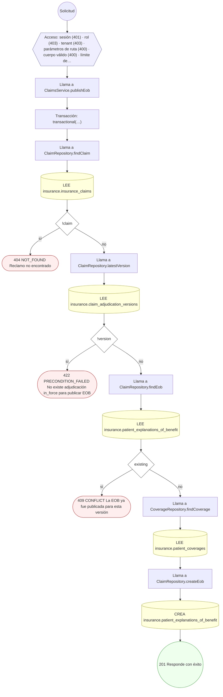

#### 14. POST /insurance-claims/{id}/reversals

Registrar reversión de reclamo

| HTTP | Código | Cuándo |
|---|---|---|
| 201 | — | Éxito |
| 400 | `VALIDATION_FAILED` | Los parámetros de ruta son UUID válidos; El cuerpo cumple el DTO (sin propiedades extra) |
| 401 | `UNAUTHENTICATED` | Hay una sesión válida (JWT) |
| 403 | `FORBIDDEN` | El rol está permitido; El tenant se resuelve y pertenece al actor |
| 404 | `NOT_FOUND` | ResourceNotFoundException: Reclamo no encontrado; ResourceNotFoundException: Versión de adjudicación no encontrada |
| 422 | `PRECONDITION_FAILED` | PreconditionFailedException: El reclamo no está en estado reversible |
| 429 | `RATE_LIMITED` | No se supera el límite de solicitudes |

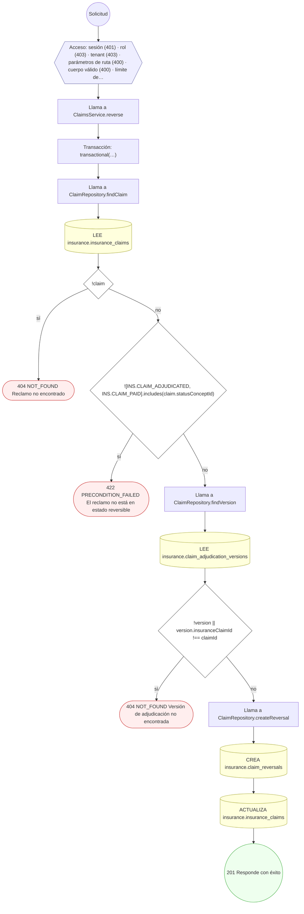

#### 15. POST /insurance-plans/{id}/benefits

Alta de beneficio de plan (soporte)

| HTTP | Código | Cuándo |
|---|---|---|
| 201 | — | Éxito |
| 400 | `VALIDATION_FAILED` | Los parámetros de ruta son UUID válidos; El cuerpo cumple el DTO (sin propiedades extra) |
| 401 | `UNAUTHENTICATED` | Hay una sesión válida (JWT) |
| 403 | `FORBIDDEN` | El rol está permitido; El tenant se resuelve y pertenece al actor |
| 404 | `NOT_FOUND` | ResourceNotFoundException: Plan no encontrado |
| 429 | `RATE_LIMITED` | No se supera el límite de solicitudes |

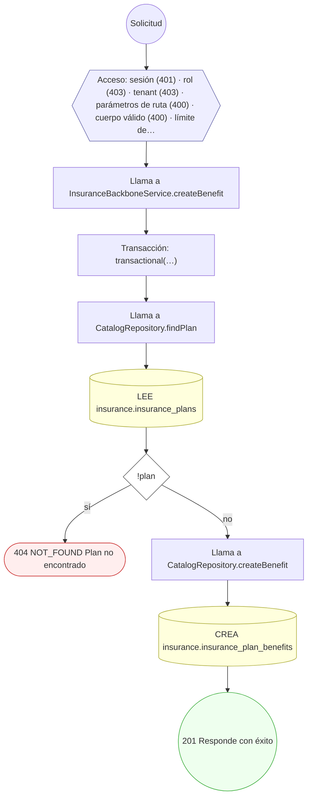

#### 16. POST /insurance-products/{id}/plans

Alta de plan (soporte)

| HTTP | Código | Cuándo |
|---|---|---|
| 201 | — | Éxito |
| 400 | `VALIDATION_FAILED` | Los parámetros de ruta son UUID válidos; El cuerpo cumple el DTO (sin propiedades extra) |
| 401 | `UNAUTHENTICATED` | Hay una sesión válida (JWT) |
| 403 | `FORBIDDEN` | El rol está permitido; El tenant se resuelve y pertenece al actor |
| 404 | `NOT_FOUND` | ResourceNotFoundException: Producto no encontrado |
| 429 | `RATE_LIMITED` | No se supera el límite de solicitudes |

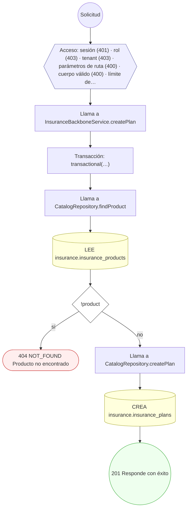

#### 17. POST /patient-coverages

Registrar cobertura de paciente y dependientes

| HTTP | Código | Cuándo |
|---|---|---|
| 201 | — | Éxito |
| 400 | `VALIDATION_FAILED` | El cuerpo cumple el DTO (sin propiedades extra) |
| 401 | `UNAUTHENTICATED` | Hay una sesión válida (JWT) |
| 403 | `FORBIDDEN` | El rol está permitido; El tenant se resuelve y pertenece al actor |
| 404 | `NOT_FOUND` | ResourceNotFoundException: Plan no encontrado |
| 409 | `CONFLICT` | ConflictException: El afiliado ya tiene cobertura en ese plan |
| 422 | `PRECONDITION_FAILED` | PreconditionFailedException: El plan no está activo |
| 429 | `RATE_LIMITED` | No se supera el límite de solicitudes |

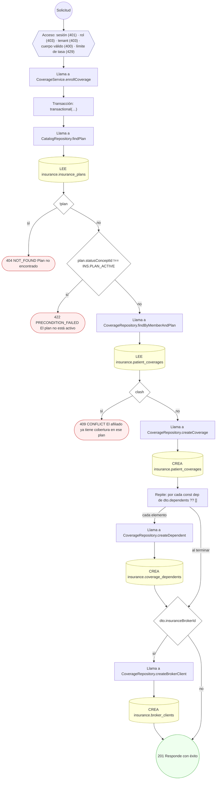

#### 18. POST /prior-authorization-requests

Solicitar autorización previa con items

| HTTP | Código | Cuándo |
|---|---|---|
| 201 | — | Éxito |
| 400 | `VALIDATION_FAILED` | El cuerpo cumple el DTO (sin propiedades extra) |
| 401 | `UNAUTHENTICATED` | Hay una sesión válida (JWT) |
| 403 | `FORBIDDEN` | El rol está permitido; El tenant se resuelve y pertenece al actor |
| 404 | `NOT_FOUND` | ResourceNotFoundException: Cobertura no encontrada |
| 429 | `RATE_LIMITED` | No se supera el límite de solicitudes |

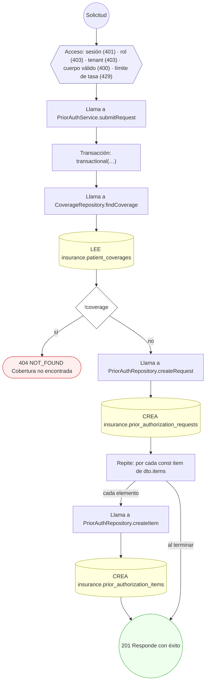

#### 19. POST /prior-authorization-requests/{id}/determinations

Emitir determinación de autorización previa

| HTTP | Código | Cuándo |
|---|---|---|
| 201 | — | Éxito |
| 400 | `VALIDATION_FAILED` | Los parámetros de ruta son UUID válidos; El cuerpo cumple el DTO (sin propiedades extra) |
| 401 | `UNAUTHENTICATED` | Hay una sesión válida (JWT) |
| 403 | `FORBIDDEN` | El rol está permitido; El tenant se resuelve y pertenece al actor |
| 404 | `NOT_FOUND` | ResourceNotFoundException: Solicitud de autorización no encontrada |
| 422 | `PRECONDITION_FAILED` | PreconditionFailedException: La solicitud no admite determinación en su estado actual |
| 429 | `RATE_LIMITED` | No se supera el límite de solicitudes |

```mermaid
flowchart TD
  n1(("Solicitud")):::inicio
  n2{{"Acceso: sesión (401) · rol (403) · tenant (403) · parámetros de ruta (400) · cuerpo válido (400) · límite de…"}}:::acceso
  n1 --> n2
  n3["Llama a PriorAuthService.issueDetermination"]:::llamada
  n2 --> n3
  n4["Transacción: transactional(…)"]:::transaccion
  n3 --> n4
  n5["Llama a PriorAuthRepository.findRequest"]:::llamada
  n4 --> n5
  n6[("LEE insurance.prior_authorization_requests")]:::efecto
  n5 --> n6
  n7{"!request"}:::decision
  n6 --> n7
  n8(["404 NOT_FOUND Solicitud de autorización no encontrada"]):::error
  n7 -->|"sí"| n8
  n9{"![INS.PRIOR_AUTH_SUBMITTED, INS.PRIOR_AUTH_IN_REVIEW].includes( request.statusConceptId, )"}:::decision
  n7 -->|"no"| n9
  n10(["422 PRECONDITION_FAILED La solicitud no admite determinación en su estado actual"]):::error
  n9 -->|"sí"| n10
  n11["Llama a PriorAuthRepository.maxDeterminationVersion"]:::llamada
  n9 -->|"no"| n11
  n12[("LEE insurance.prior_authorization_determinations")]:::efecto
  n11 --> n12
  n13["Llama a PriorAuthRepository.createDetermination"]:::llamada
  n12 --> n13
  n14[("CREA insurance.prior_authorization_determinations")]:::efecto
  n13 --> n14
  n15[("ACTUALIZA insurance.prior_authorization_requests")]:::efecto
  n14 --> n15
  n16(("201 Responde con éxito")):::ok
  n15 --> n16
  classDef acceso fill:#eef,stroke:#66a
  classDef error fill:#fee,stroke:#c33
  classDef ok fill:#efe,stroke:#3a3
  classDef efecto fill:#ffd,stroke:#aa3
  classDef decision fill:#fff,stroke:#555
  classDef corte fill:#eee,stroke:#999,stroke-dasharray: 4
```

#### 20. POST /provider-networks

Alta de red de prestadores (soporte)

| HTTP | Código | Cuándo |
|---|---|---|
| 201 | — | Éxito |
| 400 | `VALIDATION_FAILED` | El cuerpo cumple el DTO (sin propiedades extra) |
| 401 | `UNAUTHENTICATED` | Hay una sesión válida (JWT) |
| 403 | `FORBIDDEN` | El rol está permitido; El tenant se resuelve y pertenece al actor |
| 404 | `NOT_FOUND` | ResourceNotFoundException: Aseguradora no encontrada |
| 429 | `RATE_LIMITED` | No se supera el límite de solicitudes |

```mermaid
flowchart TD
  n1(("Solicitud")):::inicio
  n2{{"Acceso: sesión (401) · rol (403) · tenant (403) · cuerpo válido (400) · límite de tasa (429)"}}:::acceso
  n1 --> n2
  n3["Llama a InsuranceBackboneService.createProviderNetwork"]:::llamada
  n2 --> n3
  n4["Transacción: transactional(…)"]:::transaccion
  n3 --> n4
  n5["Llama a CatalogRepository.findCarrier"]:::llamada
  n4 --> n5
  n6[("LEE insurance.insurance_carriers")]:::efecto
  n5 --> n6
  n7{"!carrier"}:::decision
  n6 --> n7
  n8(["404 NOT_FOUND Aseguradora no encontrada"]):::error
  n7 -->|"sí"| n8
  n9["Llama a CatalogRepository.createProviderNetwork"]:::llamada
  n7 -->|"no"| n9
  n10[("CREA insurance.provider_networks")]:::efecto
  n9 --> n10
  n11(("201 Responde con éxito")):::ok
  n10 --> n11
  classDef acceso fill:#eef,stroke:#66a
  classDef error fill:#fee,stroke:#c33
  classDef ok fill:#efe,stroke:#3a3
  classDef efecto fill:#ffd,stroke:#aa3
  classDef decision fill:#fff,stroke:#555
  classDef corte fill:#eee,stroke:#999,stroke-dasharray: 4
```

#### 21. POST /provider-networks/{id}/memberships

Alta de membresía de prestador en la red

| HTTP | Código | Cuándo |
|---|---|---|
| 201 | — | Éxito |
| 400 | `VALIDATION_FAILED` | Los parámetros de ruta son UUID válidos; El cuerpo cumple el DTO (sin propiedades extra) |
| 401 | `UNAUTHENTICATED` | Hay una sesión válida (JWT) |
| 403 | `FORBIDDEN` | El rol está permitido; El tenant se resuelve y pertenece al actor |
| 404 | `NOT_FOUND` | ResourceNotFoundException: Red de prestadores no encontrada |
| 422 | `PRECONDITION_FAILED` | PreconditionFailedException: La red no está activa; PreconditionFailedException: La red está fuera de vigencia |
| 429 | `RATE_LIMITED` | No se supera el límite de solicitudes |

```mermaid
flowchart TD
  n1(("Solicitud")):::inicio
  n2{{"Acceso: sesión (401) · rol (403) · tenant (403) · parámetros de ruta (400) · cuerpo válido (400) · límite de…"}}:::acceso
  n1 --> n2
  n3["Llama a InsuranceBackboneService.addMembership"]:::llamada
  n2 --> n3
  n4["Transacción: transactional(…)"]:::transaccion
  n3 --> n4
  n5["Llama a CatalogRepository.findProviderNetwork"]:::llamada
  n4 --> n5
  n6[("LEE insurance.provider_networks")]:::efecto
  n5 --> n6
  n7{"!network"}:::decision
  n6 --> n7
  n8(["404 NOT_FOUND Red de prestadores no encontrada"]):::error
  n7 -->|"sí"| n8
  n9{"network.statusConceptId !== INS.NETWORK_ACTIVE"}:::decision
  n7 -->|"no"| n9
  n10(["422 PRECONDITION_FAILED La red no está activa"]):::error
  n9 -->|"sí"| n10
  n11{"network.effectiveTo && network.effectiveTo.getTime() ‹ Date.now()"}:::decision
  n9 -->|"no"| n11
  n12(["422 PRECONDITION_FAILED La red está fuera de vigencia"]):::error
  n11 -->|"sí"| n12
  n13["Llama a CatalogRepository.createMembership"]:::llamada
  n11 -->|"no"| n13
  n14[("CREA insurance.network_provider_memberships")]:::efecto
  n13 --> n14
  n15(("201 Responde con éxito")):::ok
  n14 --> n15
  classDef acceso fill:#eef,stroke:#66a
  classDef error fill:#fee,stroke:#c33
  classDef ok fill:#efe,stroke:#3a3
  classDef efecto fill:#ffd,stroke:#aa3
  classDef decision fill:#fff,stroke:#555
  classDef corte fill:#eee,stroke:#999,stroke-dasharray: 4
```

#### 22. POST /reconciliation-batches

Abrir lote de conciliación

| HTTP | Código | Cuándo |
|---|---|---|
| 201 | — | Éxito |
| 400 | `VALIDATION_FAILED` | El cuerpo cumple el DTO (sin propiedades extra) |
| 401 | `UNAUTHENTICATED` | Hay una sesión válida (JWT) |
| 403 | `FORBIDDEN` | El rol está permitido; El tenant se resuelve y pertenece al actor |
| 404 | `NOT_FOUND` | ResourceNotFoundException: Aseguradora no encontrada |
| 429 | `RATE_LIMITED` | No se supera el límite de solicitudes |

```mermaid
flowchart TD
  n1(("Solicitud")):::inicio
  n2{{"Acceso: sesión (401) · rol (403) · tenant (403) · cuerpo válido (400) · límite de tasa (429)"}}:::acceso
  n1 --> n2
  n3["Llama a ReconciliationService.createBatch"]:::llamada
  n2 --> n3
  n4["Transacción: transactional(…)"]:::transaccion
  n3 --> n4
  n5["Llama a CatalogRepository.findCarrier"]:::llamada
  n4 --> n5
  n6[("LEE insurance.insurance_carriers")]:::efecto
  n5 --> n6
  n7{"!carrier"}:::decision
  n6 --> n7
  n8(["404 NOT_FOUND Aseguradora no encontrada"]):::error
  n7 -->|"sí"| n8
  n9["Llama a SettlementRepository.createBatch"]:::llamada
  n7 -->|"no"| n9
  n10[("CREA insurance.insurance_reconciliation_batches")]:::efecto
  n9 --> n10
  n11(("201 Responde con éxito")):::ok
  n10 --> n11
  classDef acceso fill:#eef,stroke:#66a
  classDef error fill:#fee,stroke:#c33
  classDef ok fill:#efe,stroke:#3a3
  classDef efecto fill:#ffd,stroke:#aa3
  classDef decision fill:#fff,stroke:#555
  classDef corte fill:#eee,stroke:#999,stroke-dasharray: 4
```

#### 23. POST /reconciliation-batches/{id}/items

Agregar ítem de conciliación al lote

| HTTP | Código | Cuándo |
|---|---|---|
| 201 | — | Éxito |
| 400 | `VALIDATION_FAILED` | Los parámetros de ruta son UUID válidos; El cuerpo cumple el DTO (sin propiedades extra) |
| 401 | `UNAUTHENTICATED` | Hay una sesión válida (JWT) |
| 403 | `FORBIDDEN` | El rol está permitido; El tenant se resuelve y pertenece al actor |
| 404 | `NOT_FOUND` | ResourceNotFoundException: Lote de conciliación no encontrado; ResourceNotFoundException: Reclamo no encontrado; ResourceNotFoundException: Versión de adjudicación no encontrada |
| 429 | `RATE_LIMITED` | No se supera el límite de solicitudes |

```mermaid
flowchart TD
  n1(("Solicitud")):::inicio
  n2{{"Acceso: sesión (401) · rol (403) · tenant (403) · parámetros de ruta (400) · cuerpo válido (400) · límite de…"}}:::acceso
  n1 --> n2
  n3["Llama a ReconciliationService.addItem"]:::llamada
  n2 --> n3
  n4["Transacción: transactional(…)"]:::transaccion
  n3 --> n4
  n5["Llama a SettlementRepository.findBatch"]:::llamada
  n4 --> n5
  n6[("LEE insurance.insurance_reconciliation_batches")]:::efecto
  n5 --> n6
  n7{"!batch"}:::decision
  n6 --> n7
  n8(["404 NOT_FOUND Lote de conciliación no encontrado"]):::error
  n7 -->|"sí"| n8
  n9["Llama a ClaimRepository.findClaim"]:::llamada
  n7 -->|"no"| n9
  n10[("LEE insurance.insurance_claims")]:::efecto
  n9 --> n10
  n11{"!claim"}:::decision
  n10 --> n11
  n12(["404 NOT_FOUND Reclamo no encontrado"]):::error
  n11 -->|"sí"| n12
  n13["Llama a ClaimRepository.findVersion"]:::llamada
  n11 -->|"no"| n13
  n14[("LEE insurance.claim_adjudication_versions")]:::efecto
  n13 --> n14
  n15{"!version || version.insuranceClaimId !== dto.insuranceClaimId"}:::decision
  n14 --> n15
  n16(["404 NOT_FOUND Versión de adjudicación no encontrada"]):::error
  n15 -->|"sí"| n16
  n17["Llama a SettlementRepository.createItem"]:::llamada
  n15 -->|"no"| n17
  n18[("CREA insurance.insurance_reconciliation_items")]:::efecto
  n17 --> n18
  n19(("201 Responde con éxito")):::ok
  n18 --> n19
  classDef acceso fill:#eef,stroke:#66a
  classDef error fill:#fee,stroke:#c33
  classDef ok fill:#efe,stroke:#3a3
  classDef efecto fill:#ffd,stroke:#aa3
  classDef decision fill:#fff,stroke:#555
  classDef corte fill:#eee,stroke:#999,stroke-dasharray: 4
```

### Operaciones sin decisiones propias

Sólo comprueban el acceso y leen o escriben: no tienen ramas que dibujar. Su detalle está en la ficha de endpoints.

| Operación | Respuestas posibles | Tablas |
|---|---|---|
| POST /employer-groups | 201, 400, 401, 403, 429 | 1 |
| GET /insurance-brokers | 200, 401, 403, 429 | 3 |
| POST /insurance-brokers | 201, 400, 401, 403, 429 | 1 |
| GET /insurance-carrier-catalog | 200, 401, 429 | 3 |
| GET /insurance-carriers | 200, 401, 403, 429 | 5 |
| POST /insurance-carriers | 201, 400, 401, 403, 429 | 1 |
