<!-- AUTOGENERADO por tools/inventario/flujos.mjs. No editar manualmente. -->

# Flujos del módulo `insurance`

- **Procesos:** 1 · **Máquinas de estado:** 1
- **Operaciones:** 72 (62 con decisiones propias, 10 sin ellas)
- Inventario de endpoints del módulo: [insurance](../endpoints/insurance.md)

## Proceso: src / modules / insurance

- **Código:** `insurance` · **Agrupación:** AGRUPACION_POR_CONTROLADOR · **Operaciones:** 72
- **Actores:** BILLING · BILLING_OPERATOR · CLINICIAN · Cualquier sesión válida · FINANCE · PATIENT · PRACTITIONER · Público (sin sesión) · SCHEDULING_ADMIN · SCHEDULING_AGENT · SECURITY_ADMIN
- **Revisión:** AUTO_DETECTADA
- **Fuentes:** `src/modules/insurance/README.md`

### Para qué sirve

Seguros y cobertura (schema `insurance`): aseguradoras, productos, planes y beneficios, redes de proveedores, coberturas del paciente y dependientes, elegibilidad, autorizaciones previas, reclamos (líneas, adjudicación, apelaciones, disputas, reversas), conciliación, corredores y comisiones, campañas, liquidación al profesional y liquidación al paciente.

_Fuente: `src/modules/insurance/README.md:3`_

### Etapas y operaciones

| Etapa | Descripción | Operación | Quién actúa | Riesgo | Tablas |
|---|---|---|---|---|---|
| `ctrl:AppealsController` | Operaciones de AppealsController que el README no asigna a un caso de uso | POST /claim-disputes/{id}/appeal-decisions | BILLING · FINANCE | MEDIO | 4 |
| `ctrl:BrokerCommissionController` | Operaciones de BrokerCommissionController que el README no asigna a un caso de uso | POST /broker-commission-statements | BILLING · FINANCE | MEDIO | 4 |
| `ctrl:ClaimsController` | Operaciones de ClaimsController que el README no asigna a un caso de uso | POST /insurance-claims | BILLING · FINANCE | MEDIO | 23 |
|  |  | POST /insurance-claims/{id}/adjudications | BILLING · FINANCE | MEDIO | 20 |
|  |  | POST /insurance-claims/{id}/disputes | BILLING · FINANCE · BILLING_OPERATOR · SECURITY_ADMIN · PATIENT | MEDIO | 10 |
|  |  | POST /insurance-claims/{id}/eob | BILLING · FINANCE | MEDIO | 22 |
|  |  | POST /insurance-claims/{id}/patient-invoice | BILLING · FINANCE | MEDIO | 25 |
|  |  | POST /insurance-claims/{id}/reversals | BILLING · FINANCE | MEDIO | 16 |
|  |  | POST /insurance-claims/quote | BILLING · FINANCE | BAJO | 10 |
| `ctrl:ClaimsReadController` | Operaciones de ClaimsReadController que el README no asigna a un caso de uso | GET /insurance-claims | BILLING_OPERATOR · SECURITY_ADMIN | BAJO | 11 |
|  |  | GET /insurance-claims/{id} | BILLING_OPERATOR · SECURITY_ADMIN | BAJO | 20 |
| `ctrl:CoverageController` | Operaciones de CoverageController que el README no asigna a un caso de uso | POST /coordination-of-benefits | BILLING · FINANCE | MEDIO | 4 |
|  |  | POST /coverage-eligibility-requests | BILLING · FINANCE | MEDIO | 5 |
|  |  | POST /patient-coverages | BILLING · FINANCE | MEDIO | 5 |
|  |  | GET /patient-coverages/by-patient/{patientProfileId} | BILLING · FINANCE | BAJO | 6 |
|  |  | GET /patient-coverages/me | BILLING · FINANCE · PATIENT | BAJO | 3 |
| `ctrl:InsuranceAnalyticsController` | Operaciones de InsuranceAnalyticsController que el README no asigna a un caso de uso | GET /insurance/analytics/loss-ratio | Cualquier sesión válida | BAJO | 20 |
| `ctrl:InsuranceBackboneController` | Operaciones de InsuranceBackboneController que el README no asigna a un caso de uso | POST /employer-groups | SECURITY_ADMIN | MEDIO | 1 |
|  |  | POST /insurance-brokers | SECURITY_ADMIN | MEDIO | 1 |
|  |  | POST /insurance-brokers/{id}/agreements | SECURITY_ADMIN | MEDIO | 3 |
|  |  | POST /insurance-carriers | SECURITY_ADMIN | MEDIO | 1 |
|  |  | PUT /insurance-carriers/{id}/contact-channels | Cualquier sesión válida | ALTO | 4 |
|  |  | POST /insurance-carriers/{id}/products | SECURITY_ADMIN | MEDIO | 2 |
|  |  | POST /insurance-plans/{planId}/benefits | Cualquier sesión válida | ALTO | 6 |
|  |  | PUT /insurance-plans/{planId}/benefits/{benefitId} | Cualquier sesión válida | ALTO | 7 |
|  |  | PUT /insurance-plans/{planId}/benefits/{benefitId}/rules | Cualquier sesión válida | ALTO | 7 |
|  |  | PUT /insurance-plans/{planId}/premium | Cualquier sesión válida | ALTO | 6 |
|  |  | POST /insurance-products/{productId}/plans | Cualquier sesión válida | ALTO | 5 |
|  |  | POST /provider-networks | SECURITY_ADMIN | MEDIO | 2 |
|  |  | POST /provider-networks/{id}/memberships | SECURITY_ADMIN | MEDIO | 2 |
| `ctrl:InsuranceCampaignsController` | Operaciones de InsuranceCampaignsController que el README no asigna a un caso de uso | GET /insurance-campaigns | Cualquier sesión válida | ALTO | 9 |
|  |  | POST /insurance-campaigns | Cualquier sesión válida | ALTO | 15 |
|  |  | GET /insurance-campaigns/{id} | Cualquier sesión válida | ALTO | 9 |
|  |  | PATCH /insurance-campaigns/{id} | Cualquier sesión válida | ALTO | 16 |
|  |  | PATCH /insurance-campaigns/{id}/status | Cualquier sesión válida | ALTO | 10 |
|  |  | GET /insurance-campaigns/active | Público (sin sesión) | BAJO | 4 |
|  |  | GET /insurance-campaigns/my-benefits | Cualquier sesión válida | ALTO | 12 |
|  |  | GET /insurance-campaigns/patient/{patientProfileId} | Cualquier sesión válida | ALTO | 12 |
|  |  | GET /insurance/campaigns | Cualquier sesión válida | ALTO | 9 |
|  |  | POST /insurance/campaigns | Cualquier sesión válida | ALTO | 15 |
|  |  | GET /insurance/campaigns/{id} | Cualquier sesión válida | ALTO | 9 |
|  |  | PATCH /insurance/campaigns/{id} | Cualquier sesión válida | ALTO | 16 |
|  |  | PATCH /insurance/campaigns/{id}/status | Cualquier sesión válida | ALTO | 10 |
|  |  | GET /insurance/campaigns/active | Público (sin sesión) | BAJO | 4 |
|  |  | GET /insurance/campaigns/my-benefits | Cualquier sesión válida | ALTO | 12 |
|  |  | GET /insurance/campaigns/patient/{patientProfileId} | Cualquier sesión válida | ALTO | 12 |
| `ctrl:InsuranceCatalogController` | Operaciones de InsuranceCatalogController que el README no asigna a un caso de uso | GET /insurance-carrier-catalog | Público (sin sesión) | BAJO | 3 |
| `ctrl:InsurancePortabilityController` | Operaciones de InsurancePortabilityController que el README no asigna a un caso de uso | GET /insurance/portability/certificates/{certificateId}/json | Cualquier sesión válida | ALTO | 9 |
|  |  | GET /insurance/portability/certificates/{certificateId}/pdf | Cualquier sesión válida | ALTO | 9 |
|  |  | POST /insurance/portability/export | Cualquier sesión válida | ALTO | 37 |
| `ctrl:InsurancePortabilityPublicController` | Operaciones de InsurancePortabilityPublicController que el README no asigna a un caso de uso | GET /public/portability/verify/{manifestHash} | Público (sin sesión) | BAJO | 2 |
| `ctrl:InsuranceReadController` | Operaciones de InsuranceReadController que el README no asigna a un caso de uso | GET /insurance-brokers | Cualquier sesión válida | BAJO | 3 |
|  |  | GET /insurance-brokers/{id} | Cualquier sesión válida | BAJO | 4 |
|  |  | GET /insurance-brokers/{id}/clients | Cualquier sesión válida | BAJO | 3 |
|  |  | GET /insurance-carriers | Cualquier sesión válida | BAJO | 7 |
|  |  | GET /insurance-carriers/{id} | Cualquier sesión válida | BAJO | 9 |
| `ctrl:InsurerPatientsController` | Operaciones de InsurerPatientsController que el README no asigna a un caso de uso | POST /insurance/patients/conversation | Cualquier sesión válida | ALTO | 16 |
|  |  | GET /insurance/patients/options | Cualquier sesión válida | BAJO | 3 |
|  |  | POST /insurance/patients/search | Cualquier sesión válida | ALTO | 14 |
| `ctrl:InsurerReceivedClaimsController` | Operaciones de InsurerReceivedClaimsController que el README no asigna a un caso de uso | GET /insurance/received-claims | Cualquier sesión válida | BAJO | 16 |
|  |  | POST /insurance/received-claims/{id}/decision | Cualquier sesión válida | ALTO | 29 |
| `ctrl:MyClaimsController` | Operaciones de MyClaimsController que el README no asigna a un caso de uso | GET /insurance/my-claims | Cualquier sesión válida | BAJO | 19 |
| `ctrl:PractitionerInsuranceNetworksController` | Operaciones de PractitionerInsuranceNetworksController que el README no asigna a un caso de uso | GET /practitioners/{profileId}/insurance-networks | SECURITY_ADMIN · SCHEDULING_ADMIN · SCHEDULING_AGENT · PRACTITIONER · CLINICIAN · PATIENT | BAJO | 4 |
| `ctrl:PractitionerSettlementBatchesController` | Operaciones de PractitionerSettlementBatchesController que el README no asigna a un caso de uso | GET /practitioner-settlement-batches | Cualquier sesión válida | BAJO | 10 |
|  |  | POST /practitioner-settlement-batches | Cualquier sesión válida | ALTO | 14 |
|  |  | GET /practitioner-settlement-batches/{id} | Cualquier sesión válida | BAJO | 12 |
| `ctrl:PriorAuthController` | Operaciones de PriorAuthController que el README no asigna a un caso de uso | POST /prior-authorization-requests | BILLING · FINANCE | MEDIO | 15 |
|  |  | GET /prior-authorization-requests/{id} | BILLING · FINANCE | BAJO | 14 |
|  |  | POST /prior-authorization-requests/{id}/determinations | BILLING · FINANCE | MEDIO | 19 |
|  |  | GET /prior-authorization-requests/inbox | BILLING · FINANCE | BAJO | 14 |
| `ctrl:ReconciliationController` | Operaciones de ReconciliationController que el README no asigna a un caso de uso | POST /reconciliation-batches | SECURITY_ADMIN | MEDIO | 3 |
|  |  | POST /reconciliation-batches/{id}/items | SECURITY_ADMIN | MEDIO | 6 |

### Diagrama 1 de 4 — etapas `ctrl:AppealsController`, `ctrl:BrokerCommissionController`, `ctrl:ClaimsController`…

```mermaid
flowchart LR
  a2(["BILLING · FINANCE"]):::actor
  a21(["BILLING · FINANCE · BILLING_OPERATOR · SECURITY_ADMIN · PAT…"]):::actor
  a44(["BILLING_OPERATOR · SECURITY_ADMIN"]):::actor
  a63(["BILLING · FINANCE · PATIENT"]):::actor
  a67(["Cualquier sesión válida"]):::actor
  t3[("insurance.claim_appeal_decisions")]:::tabla
  t4[("insurance.claim_disputes")]:::tabla
  t6[("insurance.broker_carrier_agreements")]:::tabla
  t7[("insurance.broker_commission_statements")]:::tabla
  t8[("insurance.insurance_brokers")]:::tabla
  t10[("authz.care_relationships")]:::tabla
  t11[("clinical.service_requests")]:::tabla
  t12[("delegated_access.organization_user_assignments")]:::tabla
  t13[("diagnostic_units.diagnostic_study_offerings")]:::tabla
  t14[("diagnostic_units.diagnostic_units")]:::tabla
  t15[("directory.tenant_memberships")]:::tabla
  t18[("insurance.claim_adjudication_versions")]:::tabla
  t22[("insurance.insurance_claims")]:::tabla
  t23[("insurance.patient_coverages")]:::tabla
  t24[("messaging.domain_events")]:::tabla
  t25[("messaging.outbox_messages")]:::tabla
  e27>"~null"]:::evento
  t31[("billing.invoice_lines")]:::tabla
  t32[("billing.invoices")]:::tabla
  t33[("iam.devices")]:::tabla
  t34[("insurance.insurance_claim_lines")]:::tabla
  t39[("insurance.insurance_plan_benefits")]:::tabla
  t40[("insurance.insurance_plans")]:::tabla
  t41[("insurance.insurance_products")]:::tabla
  t45[("insurance.insurance_carriers")]:::tabla
  t48[("clinical.diagnostic_reports")]:::tabla
  t49[("diagnostics.diagnostic_report_versions")]:::tabla
  t50[("directory.tenants")]:::tabla
  t53[("insurance.coordination_of_benefits")]:::tabla
  t55[("insurance.coverage_eligibility_requests")]:::tabla
  t56[("insurance.coverage_eligibility_responses")]:::tabla
  t58[("insurance.broker_clients")]:::tabla
  t59[("insurance.coverage_dependents")]:::tabla
  t61[("terminology.catalog_concepts")]:::tabla
  t64[("profiles.patient_profiles")]:::tabla
  t65[("profiles.person_account_links")]:::tabla
  t68[("clinical.appointments")]:::tabla
  t69[("clinical.conditions")]:::tabla
  t70[("clinical.encounters")]:::tabla
  t71[("clinical.immunizations")]:::tabla
  subgraph s0["ctrl:AppealsController · Operaciones de AppealsController que el README no asig…"]
    o1["POST /claim-disputes/{id}/appeal-decisions"]:::op
  end
  subgraph s1["ctrl:BrokerCommissionController · Operaciones de BrokerCommissionController que…"]
    o5["POST /broker-commission-statements"]:::op
  end
  t16[("+17 tablas más")]
  t19[("+14 tablas más")]
  t26[("+4 tablas más")]
  t29[("+16 tablas más")]
  t35[("+19 tablas más")]
  t37[("+10 tablas más")]
  t42[("+4 tablas más")]
  subgraph s2["ctrl:ClaimsController · Operaciones de ClaimsController que el README no asigna…"]
    o9["POST /insurance-claims"]:::op
    o17["POST /insurance-claims/{id}/adjudications"]:::op
    o20["POST /insurance-claims/{id}/disputes"]:::op
    o28["POST /insurance-claims/{id}/eob"]:::op
    o30["POST /insurance-claims/{id}/patient-invoice"]:::op
    o36["POST /insurance-claims/{id}/reversals"]:::op
    o38["POST /insurance-claims/quote"]:::op
  end
  t46[("+5 tablas más")]
  t51[("+14 tablas más")]
  subgraph s3["ctrl:ClaimsReadController · Operaciones de ClaimsReadController que el README n…"]
    o43["GET /insurance-claims"]:::op
    o47["GET /insurance-claims/{id}"]:::op
  end
  subgraph s4["ctrl:CoverageController · Operaciones de CoverageController que el README no as…"]
    o52["POST /coordination-of-benefits"]:::op
    o54["POST /coverage-eligibility-requests"]:::op
    o57["POST /patient-coverages"]:::op
    o60["GET /patient-coverages/by-patient/{patientProfileId}"]:::op
    o62["GET /patient-coverages/me"]:::op
  end
  t72[("+14 tablas más")]
  subgraph s5["ctrl:InsuranceAnalyticsController · Operaciones de InsuranceAnalyticsController…"]
    o66["GET /insurance/analytics/loss-ratio"]:::op
  end
  a2 --> o1
  o1 -->|"CREA"| t3
  o1 -->|"LEE"| t3
  o1 -->|"ACTUALIZA"| t4
  o1 -->|"LEE"| t4
  a2 --> o5
  o5 -->|"LEE"| t6
  o5 -->|"CREA"| t7
  o5 -->|"LEE"| t7
  o5 -->|"LEE"| t8
  a2 --> o9
  o9 -->|"LEE"| t10
  o9 -->|"LEE"| t11
  o9 -->|"LEE"| t12
  o9 -->|"LEE"| t13
  o9 -->|"LEE"| t14
  o9 -->|"LEE"| t15
  o9 -.-> t16
  a2 --> o17
  o17 -->|"LEE"| t11
  o17 -->|"LEE"| t12
  o17 -->|"LEE"| t13
  o17 -->|"LEE"| t14
  o17 -->|"LEE"| t15
  o17 -->|"CREA"| t18
  o17 -.-> t19
  a21 --> o20
  o20 -->|"CREA"| t4
  o20 -->|"LEE"| t4
  o20 -->|"LEE"| t22
  o20 -->|"LEE"| t23
  o20 -->|"CREA"| t24
  o20 -->|"CREA"| t25
  o20 -.-> t26
  o20 -->|"evento"| e27
  a2 --> o28
  o28 -->|"LEE"| t11
  o28 -->|"LEE"| t12
  o28 -->|"LEE"| t13
  o28 -->|"LEE"| t14
  o28 -->|"LEE"| t15
  o28 -->|"LEE"| t18
  o28 -.-> t29
  a2 --> o30
  o30 -->|"CREA"| t31
  o30 -->|"LEE"| t31
  o30 -->|"CREA"| t32
  o30 -->|"ACTUALIZA"| t33
  o30 -->|"LEE"| t33
  o30 -->|"LEE"| t34
  o30 -.-> t35
  o30 -->|"evento"| e27
  a2 --> o36
  o36 -->|"LEE"| t11
  o36 -->|"LEE"| t12
  o36 -->|"LEE"| t13
  o36 -->|"LEE"| t14
  o36 -->|"LEE"| t15
  o36 -->|"LEE"| t18
  o36 -.-> t37
  a2 --> o38
  o38 -->|"LEE"| t10
  o38 -->|"LEE"| t34
  o38 -->|"LEE"| t22
  o38 -->|"LEE"| t39
  o38 -->|"LEE"| t40
  o38 -->|"LEE"| t41
  o38 -.-> t42
  a44 --> o43
  o43 -->|"LEE"| t14
  o43 -->|"LEE"| t18
  o43 -->|"LEE"| t4
  o43 -->|"LEE"| t8
  o43 -->|"LEE"| t45
  o43 -->|"LEE"| t22
  o43 -.-> t46
  a44 --> o47
  o47 -->|"LEE"| t48
  o47 -->|"LEE"| t11
  o47 -->|"LEE"| t14
  o47 -->|"LEE"| t49
  o47 -->|"LEE"| t50
  o47 -->|"LEE"| t18
  o47 -.-> t51
  a2 --> o52
  o52 -->|"ACTUALIZA"| t53
  o52 -->|"CREA"| t53
  o52 -->|"LEE"| t53
  o52 -->|"LEE"| t23
  a2 --> o54
  o54 -->|"ACTUALIZA"| t55
  o54 -->|"CREA"| t55
  o54 -->|"LEE"| t55
  o54 -->|"CREA"| t56
  o54 -->|"LEE"| t23
  a2 --> o57
  o57 -->|"CREA"| t58
  o57 -->|"CREA"| t59
  o57 -->|"LEE"| t40
  o57 -->|"CREA"| t23
  o57 -->|"LEE"| t23
  a2 --> o60
  o60 -->|"LEE"| t10
  o60 -->|"LEE"| t45
  o60 -->|"LEE"| t40
  o60 -->|"LEE"| t41
  o60 -->|"LEE"| t23
  o60 -->|"LEE"| t61
  a63 --> o62
  o62 -->|"LEE"| t23
  o62 -->|"LEE"| t64
  o62 -->|"LEE"| t65
  a67 --> o66
  o66 -->|"LEE"| t68
  o66 -->|"LEE"| t69
  o66 -->|"LEE"| t70
  o66 -->|"LEE"| t71
  o66 -->|"LEE"| t12
  o66 -->|"LEE"| t15
  o66 -.-> t72
  classDef op fill:#fff,stroke:#446
  classDef actor fill:#eef,stroke:#66a
  classDef tabla fill:#ffd,stroke:#aa3
  classDef evento fill:#efe,stroke:#3a3
```

### Diagrama 2 de 4 — etapas `ctrl:InsuranceBackboneController`

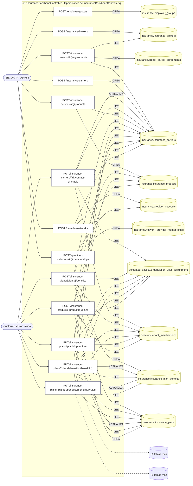

### Diagrama 3 de 4 — etapas `ctrl:InsuranceCampaignsController`, `ctrl:InsuranceCatalogController`, `ctrl:InsurancePortabilityController`…

```mermaid
flowchart LR
  a2(["Cualquier sesión válida"]):::actor
  a18(["Público (sin sesión)"]):::actor
  t3[("audit.audit_log")]:::tabla
  t4[("delegated_access.organization_user_assignments")]:::tabla
  t5[("directory.tenant_memberships")]:::tabla
  t6[("iam.sessions")]:::tabla
  t7[("insurance.insurance_campaign_partners")]:::tabla
  t19[("insurance.insurance_campaigns")]:::tabla
  t20[("insurance.insurance_carriers")]:::tabla
  t21[("terminology.catalog_concepts")]:::tabla
  t42[("insurance.insurance_plans")]:::tabla
  t43[("insurance.insurance_products")]:::tabla
  t45[("common.file_versions")]:::tabla
  t46[("common.files")]:::tabla
  t47[("health_data.health_export_jobs")]:::tabla
  t48[("health_data.health_export_manifests")]:::tabla
  t53[("audit.data_access_log")]:::tabla
  t54[("audit.dsar_requests")]:::tabla
  t55[("clinical.conditions")]:::tabla
  t56[("clinical.encounters")]:::tabla
  t60[("insurance.broker_carrier_agreements")]:::tabla
  t61[("insurance.insurance_brokers")]:::tabla
  t64[("insurance.broker_clients")]:::tabla
  t66[("insurance.provider_networks")]:::tabla
  t69[("insurance.insurance_plan_benefits")]:::tabla
  t8[("+3 tablas más")]
  t10[("+9 tablas más")]
  t12[("+3 tablas más")]
  t14[("+10 tablas más")]
  t16[("+4 tablas más")]
  t23[("+6 tablas más")]
  t25[("+6 tablas más")]
  t27[("+3 tablas más")]
  t29[("+9 tablas más")]
  t31[("+3 tablas más")]
  t33[("+10 tablas más")]
  t35[("+4 tablas más")]
  t38[("+6 tablas más")]
  t40[("+6 tablas más")]
  subgraph s0["ctrl:InsuranceCampaignsController · Operaciones de InsuranceCampaignsController…"]
    o1["GET /insurance-campaigns"]:::op
    o9["POST /insurance-campaigns"]:::op
    o11["GET /insurance-campaigns/{id}"]:::op
    o13["PATCH /insurance-campaigns/{id}"]:::op
    o15["PATCH /insurance-campaigns/{id}/status"]:::op
    o17["GET /insurance-campaigns/active"]:::op
    o22["GET /insurance-campaigns/my-benefits"]:::op
    o24["GET /insurance-campaigns/patient/{patientProfileId}"]:::op
    o26["GET /insurance/campaigns"]:::op
    o28["POST /insurance/campaigns"]:::op
    o30["GET /insurance/campaigns/{id}"]:::op
    o32["PATCH /insurance/campaigns/{id}"]:::op
    o34["PATCH /insurance/campaigns/{id}/status"]:::op
    o36["GET /insurance/campaigns/active"]:::op
    o37["GET /insurance/campaigns/my-benefits"]:::op
    o39["GET /insurance/campaigns/patient/{patientProfileId}"]:::op
  end
  subgraph s1["ctrl:InsuranceCatalogController · Operaciones de InsuranceCatalogController que…"]
    o41["GET /insurance-carrier-catalog"]:::op
  end
  t49[("+3 tablas más")]
  t51[("+3 tablas más")]
  t57[("+31 tablas más")]
  subgraph s2["ctrl:InsurancePortabilityController · Operaciones de InsurancePortabilityContro…"]
    o44["GET /insurance/portability/certificates/{certificateId}/json"]:::op
    o50["GET /insurance/portability/certificates/{certificateId}/pdf"]:::op
    o52["POST /insurance/portability/export"]:::op
  end
  subgraph s3["ctrl:InsurancePortabilityPublicController · Operaciones de InsurancePortability…"]
    o58["GET /public/portability/verify/{manifestHash}"]:::op
  end
  t67[("+1 tablas más")]
  t70[("+3 tablas más")]
  subgraph s4["ctrl:InsuranceReadController · Operaciones de InsuranceReadController que el RE…"]
    o59["GET /insurance-brokers"]:::op
    o62["GET /insurance-brokers/{id}"]:::op
    o63["GET /insurance-brokers/{id}/clients"]:::op
    o65["GET /insurance-carriers"]:::op
    o68["GET /insurance-carriers/{id}"]:::op
  end
  a2 --> o1
  o1 -->|"CREA"| t3
  o1 -->|"LEE"| t3
  o1 -->|"LEE"| t4
  o1 -->|"LEE"| t5
  o1 -->|"LEE"| t6
  o1 -->|"LEE"| t7
  o1 -.-> t8
  a2 --> o9
  o9 -->|"CREA"| t3
  o9 -->|"LEE"| t3
  o9 -->|"LEE"| t4
  o9 -->|"LEE"| t5
  o9 -->|"LEE"| t6
  o9 -->|"CREA"| t7
  o9 -.-> t10
  a2 --> o11
  o11 -->|"CREA"| t3
  o11 -->|"LEE"| t3
  o11 -->|"LEE"| t4
  o11 -->|"LEE"| t5
  o11 -->|"LEE"| t6
  o11 -->|"LEE"| t7
  o11 -.-> t12
  a2 --> o13
  o13 -->|"CREA"| t3
  o13 -->|"LEE"| t3
  o13 -->|"LEE"| t4
  o13 -->|"LEE"| t5
  o13 -->|"LEE"| t6
  o13 -->|"BORRA"| t7
  o13 -.-> t14
  a2 --> o15
  o15 -->|"CREA"| t3
  o15 -->|"LEE"| t3
  o15 -->|"LEE"| t4
  o15 -->|"LEE"| t5
  o15 -->|"LEE"| t6
  o15 -->|"LEE"| t7
  o15 -.-> t16
  a18 --> o17
  o17 -->|"LEE"| t7
  o17 -->|"LEE"| t19
  o17 -->|"LEE"| t20
  o17 -->|"LEE"| t21
  a2 --> o22
  o22 -->|"CREA"| t3
  o22 -->|"LEE"| t3
  o22 -->|"LEE"| t6
  o22 -->|"LEE"| t7
  o22 -->|"LEE"| t19
  o22 -->|"LEE"| t20
  o22 -.-> t23
  a2 --> o24
  o24 -->|"CREA"| t3
  o24 -->|"LEE"| t3
  o24 -->|"LEE"| t6
  o24 -->|"LEE"| t7
  o24 -->|"LEE"| t19
  o24 -->|"LEE"| t20
  o24 -.-> t25
  a2 --> o26
  o26 -->|"CREA"| t3
  o26 -->|"LEE"| t3
  o26 -->|"LEE"| t4
  o26 -->|"LEE"| t5
  o26 -->|"LEE"| t6
  o26 -->|"LEE"| t7
  o26 -.-> t27
  a2 --> o28
  o28 -->|"CREA"| t3
  o28 -->|"LEE"| t3
  o28 -->|"LEE"| t4
  o28 -->|"LEE"| t5
  o28 -->|"LEE"| t6
  o28 -->|"CREA"| t7
  o28 -.-> t29
  a2 --> o30
  o30 -->|"CREA"| t3
  o30 -->|"LEE"| t3
  o30 -->|"LEE"| t4
  o30 -->|"LEE"| t5
  o30 -->|"LEE"| t6
  o30 -->|"LEE"| t7
  o30 -.-> t31
  a2 --> o32
  o32 -->|"CREA"| t3
  o32 -->|"LEE"| t3
  o32 -->|"LEE"| t4
  o32 -->|"LEE"| t5
  o32 -->|"LEE"| t6
  o32 -->|"BORRA"| t7
  o32 -.-> t33
  a2 --> o34
  o34 -->|"CREA"| t3
  o34 -->|"LEE"| t3
  o34 -->|"LEE"| t4
  o34 -->|"LEE"| t5
  o34 -->|"LEE"| t6
  o34 -->|"LEE"| t7
  o34 -.-> t35
  a18 --> o36
  o36 -->|"LEE"| t7
  o36 -->|"LEE"| t19
  o36 -->|"LEE"| t20
  o36 -->|"LEE"| t21
  a2 --> o37
  o37 -->|"CREA"| t3
  o37 -->|"LEE"| t3
  o37 -->|"LEE"| t6
  o37 -->|"LEE"| t7
  o37 -->|"LEE"| t19
  o37 -->|"LEE"| t20
  o37 -.-> t38
  a2 --> o39
  o39 -->|"CREA"| t3
  o39 -->|"LEE"| t3
  o39 -->|"LEE"| t6
  o39 -->|"LEE"| t7
  o39 -->|"LEE"| t19
  o39 -->|"LEE"| t20
  o39 -.-> t40
  a18 --> o41
  o41 -->|"LEE"| t20
  o41 -->|"LEE"| t42
  o41 -->|"LEE"| t43
  a2 --> o44
  o44 -->|"CREA"| t3
  o44 -->|"LEE"| t3
  o44 -->|"LEE"| t45
  o44 -->|"LEE"| t46
  o44 -->|"LEE"| t47
  o44 -->|"LEE"| t48
  o44 -.-> t49
  a2 --> o50
  o50 -->|"CREA"| t3
  o50 -->|"LEE"| t3
  o50 -->|"LEE"| t45
  o50 -->|"LEE"| t46
  o50 -->|"LEE"| t47
  o50 -->|"LEE"| t48
  o50 -.-> t51
  a2 --> o52
  o52 -->|"CREA"| t3
  o52 -->|"LEE"| t3
  o52 -->|"CREA"| t53
  o52 -->|"CREA"| t54
  o52 -->|"LEE"| t55
  o52 -->|"LEE"| t56
  o52 -.-> t57
  a18 --> o58
  o58 -->|"LEE"| t47
  o58 -->|"LEE"| t48
  a2 --> o59
  o59 -->|"LEE"| t60
  o59 -->|"LEE"| t61
  o59 -->|"LEE"| t21
  a2 --> o62
  o62 -->|"LEE"| t60
  o62 -->|"LEE"| t61
  o62 -->|"LEE"| t20
  o62 -->|"LEE"| t21
  a2 --> o63
  o63 -->|"LEE"| t64
  o63 -->|"LEE"| t61
  o63 -->|"LEE"| t21
  a2 --> o65
  o65 -->|"LEE"| t4
  o65 -->|"LEE"| t5
  o65 -->|"LEE"| t20
  o65 -->|"LEE"| t42
  o65 -->|"LEE"| t43
  o65 -->|"LEE"| t66
  o65 -.-> t67
  a2 --> o68
  o68 -->|"LEE"| t4
  o68 -->|"LEE"| t5
  o68 -->|"LEE"| t20
  o68 -->|"LEE"| t69
  o68 -->|"LEE"| t42
  o68 -->|"LEE"| t43
  o68 -.-> t70
  classDef op fill:#fff,stroke:#446
  classDef actor fill:#eef,stroke:#66a
  classDef tabla fill:#ffd,stroke:#aa3
  classDef evento fill:#efe,stroke:#3a3
```

### Diagrama 4 de 4 — etapas `ctrl:InsurerPatientsController`, `ctrl:InsurerReceivedClaimsController`, `ctrl:MyClaimsController`…

```mermaid
flowchart LR
  a2(["Cualquier sesión válida"]):::actor
  a30(["SECURITY_ADMIN · SCHEDULING_ADMIN · SCHEDULING_AGENT · PRAC…"]):::actor
  a46(["BILLING · FINANCE"]):::actor
  a57(["SECURITY_ADMIN"]):::actor
  t3[("audit.data_access_log")]:::tabla
  t4[("common.contact_points")]:::tabla
  t5[("community.conversation_participants")]:::tabla
  t6[("community.conversations")]:::tabla
  t9[("delegated_access.organization_user_assignments")]:::tabla
  t10[("directory.tenant_memberships")]:::tabla
  t11[("insurance.insurance_carriers")]:::tabla
  t13[("community.public_profiles")]:::tabla
  t14[("iam.users")]:::tabla
  t17[("clinical.encounters")]:::tabla
  t18[("diagnostic_units.diagnostic_units")]:::tabla
  t19[("insurance.claim_adjudication_versions")]:::tabla
  t22[("clinical.service_requests")]:::tabla
  t23[("diagnostic_units.diagnostic_study_offerings")]:::tabla
  e25>"~null"]:::evento
  t27[("insurance.claim_disputes")]:::tabla
  t31[("insurance.network_provider_memberships")]:::tabla
  t32[("insurance.provider_networks")]:::tabla
  t33[("practice.practitioner_role_assignments")]:::tabla
  t35[("insurance.insurance_claims")]:::tabla
  t36[("insurance.insurance_reconciliation_batches")]:::tabla
  t37[("insurance.insurance_reconciliation_items")]:::tabla
  t40[("insurance.claim_line_adjudications")]:::tabla
  t41[("insurance.claim_reversals")]:::tabla
  t47[("insurance.insurance_plans")]:::tabla
  t50[("insurance.insurance_products")]:::tabla
  t58[("practice.practices")]:::tabla
  t7[("+10 tablas más")]
  t15[("+8 tablas más")]
  subgraph s0["ctrl:InsurerPatientsController · Operaciones de InsurerPatientsController que e…"]
    o1["POST /insurance/patients/conversation"]:::op
    o8["GET /insurance/patients/options"]:::op
    o12["POST /insurance/patients/search"]:::op
  end
  t20[("+10 tablas más")]
  t24[("+23 tablas más")]
  subgraph s1["ctrl:InsurerReceivedClaimsController · Operaciones de InsurerReceivedClaimsCont…"]
    o16["GET /insurance/received-claims"]:::op
    o21["POST /insurance/received-claims/{id}/decision"]:::op
  end
  t28[("+13 tablas más")]
  subgraph s2["ctrl:MyClaimsController · Operaciones de MyClaimsController que el README no as…"]
    o26["GET /insurance/my-claims"]:::op
  end
  subgraph s3["ctrl:PractitionerInsuranceNetworksController · Operaciones de PractitionerInsur…"]
    o29["GET /practitioners/{profileId}/insurance-networks"]:::op
  end
  t38[("+4 tablas más")]
  t42[("+8 tablas más")]
  t44[("+6 tablas más")]
  subgraph s4["ctrl:PractitionerSettlementBatchesController · Operaciones de PractitionerSettl…"]
    o34["GET /practitioner-settlement-batches"]:::op
    o39["POST /practitioner-settlement-batches"]:::op
    o43["GET /practitioner-settlement-batches/{id}"]:::op
  end
  t48[("+9 tablas más")]
  t51[("+8 tablas más")]
  t53[("+13 tablas más")]
  t55[("+8 tablas más")]
  subgraph s5["ctrl:PriorAuthController · Operaciones de PriorAuthController que el README no…"]
    o45["POST /prior-authorization-requests"]:::op
    o49["GET /prior-authorization-requests/{id}"]:::op
    o52["POST /prior-authorization-requests/{id}/determinations"]:::op
    o54["GET /prior-authorization-requests/inbox"]:::op
  end
  subgraph s6["ctrl:ReconciliationController · Operaciones de ReconciliationController que el…"]
    o56["POST /reconciliation-batches"]:::op
    o59["POST /reconciliation-batches/{id}/items"]:::op
  end
  a2 --> o1
  o1 -->|"CREA"| t3
  o1 -->|"LEE"| t4
  o1 -->|"CREA"| t5
  o1 -->|"LEE"| t5
  o1 -->|"CREA"| t6
  o1 -->|"LEE"| t6
  o1 -.-> t7
  a2 --> o8
  o8 -->|"LEE"| t9
  o8 -->|"LEE"| t10
  o8 -->|"LEE"| t11
  a2 --> o12
  o12 -->|"CREA"| t3
  o12 -->|"LEE"| t4
  o12 -->|"LEE"| t13
  o12 -->|"LEE"| t9
  o12 -->|"LEE"| t10
  o12 -->|"LEE"| t14
  o12 -.-> t15
  a2 --> o16
  o16 -->|"LEE"| t17
  o16 -->|"LEE"| t9
  o16 -->|"LEE"| t18
  o16 -->|"LEE"| t10
  o16 -->|"LEE"| t14
  o16 -->|"LEE"| t19
  o16 -.-> t20
  a2 --> o21
  o21 -->|"LEE"| t17
  o21 -->|"LEE"| t22
  o21 -->|"LEE"| t9
  o21 -->|"LEE"| t23
  o21 -->|"LEE"| t18
  o21 -->|"LEE"| t10
  o21 -.-> t24
  o21 -->|"evento"| e25
  a2 --> o26
  o26 -->|"LEE"| t17
  o26 -->|"LEE"| t18
  o26 -->|"LEE"| t14
  o26 -->|"LEE"| t19
  o26 -->|"LEE"| t27
  o26 -->|"LEE"| t11
  o26 -.-> t28
  a30 --> o29
  o29 -->|"LEE"| t11
  o29 -->|"LEE"| t31
  o29 -->|"LEE"| t32
  o29 -->|"LEE"| t33
  a2 --> o34
  o34 -->|"LEE"| t18
  o34 -->|"LEE"| t19
  o34 -->|"LEE"| t11
  o34 -->|"LEE"| t35
  o34 -->|"LEE"| t36
  o34 -->|"LEE"| t37
  o34 -.-> t38
  a2 --> o39
  o39 -->|"LEE"| t9
  o39 -->|"LEE"| t10
  o39 -->|"LEE"| t19
  o39 -->|"LEE"| t40
  o39 -->|"LEE"| t41
  o39 -->|"LEE"| t11
  o39 -.-> t42
  a2 --> o43
  o43 -->|"LEE"| t9
  o43 -->|"LEE"| t18
  o43 -->|"LEE"| t10
  o43 -->|"LEE"| t19
  o43 -->|"LEE"| t11
  o43 -->|"LEE"| t35
  o43 -.-> t44
  a46 --> o45
  o45 -->|"LEE"| t22
  o45 -->|"LEE"| t9
  o45 -->|"LEE"| t23
  o45 -->|"LEE"| t18
  o45 -->|"LEE"| t10
  o45 -->|"LEE"| t47
  o45 -.-> t48
  a46 --> o49
  o49 -->|"LEE"| t9
  o49 -->|"LEE"| t23
  o49 -->|"LEE"| t10
  o49 -->|"LEE"| t11
  o49 -->|"LEE"| t47
  o49 -->|"LEE"| t50
  o49 -.-> t51
  a46 --> o52
  o52 -->|"LEE"| t22
  o52 -->|"LEE"| t9
  o52 -->|"LEE"| t23
  o52 -->|"LEE"| t18
  o52 -->|"LEE"| t10
  o52 -->|"LEE"| t11
  o52 -.-> t53
  a46 --> o54
  o54 -->|"LEE"| t9
  o54 -->|"LEE"| t23
  o54 -->|"LEE"| t10
  o54 -->|"LEE"| t11
  o54 -->|"LEE"| t47
  o54 -->|"LEE"| t50
  o54 -.-> t55
  a57 --> o56
  o56 -->|"LEE"| t11
  o56 -->|"CREA"| t36
  o56 -->|"LEE"| t58
  a57 --> o59
  o59 -->|"LEE"| t19
  o59 -->|"LEE"| t11
  o59 -->|"LEE"| t35
  o59 -->|"LEE"| t36
  o59 -->|"CREA"| t37
  o59 -->|"LEE"| t58
  classDef op fill:#fff,stroke:#446
  classDef actor fill:#eef,stroke:#66a
  classDef tabla fill:#ffd,stroke:#aa3
  classDef evento fill:#efe,stroke:#3a3
```

## Máquinas de estado

### Máquina de estados `TRANSITIONS`

Declarada en `src/modules/insurance/application/services/insurance-campaigns.service.ts:124`. Los estados llevan el nombre del identificador del código; no se resuelven al catálogo de conceptos.

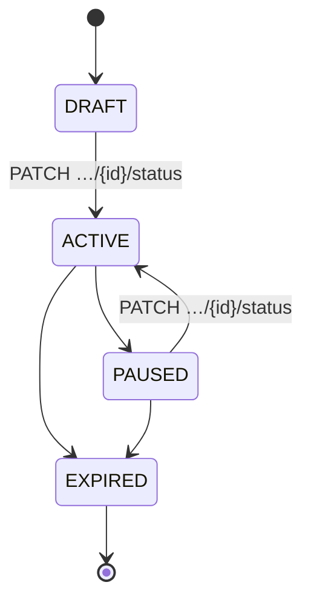

**Operaciones que ejercen esta máquina** _(POR_REFERENCIA: el handler alcanza un método que valida contra la tabla; «sin destino nombrado» significa que el estado de destino llega por el cuerpo de la petición)_:

| Operación | Estados de destino que nombra | A través de |
|---|---|---|
| PATCH /insurance-campaigns/{id}/status | ACTIVE | InsuranceCampaignsController.changeStatus → InsuranceCampaignsService.changeStatus |
| PATCH /insurance/campaigns/{id}/status | ACTIVE | InsuranceCampaignsController.changeStatus → InsuranceCampaignsService.changeStatus |

## Árbol de decisión por operación

Cada árbol se deriva del código del handler y de los métodos que invoca (hasta 4 niveles). Una rama que no decide, no escribe y no falla se poda. Los accesos y los efectos consecutivos se agrupan en un solo nodo.

### Operaciones con decisiones propias

#### 1. POST /broker-commission-statements

Generar liquidación de comisión de broker

| HTTP | Código | Cuándo |
|---|---|---|
| 201 | — | Éxito |
| 400 | `VALIDATION_FAILED` | El cuerpo cumple el DTO (sin propiedades extra) |
| 401 | `UNAUTHENTICATED` | Hay una sesión válida (JWT) |
| 403 | `FORBIDDEN` | El rol está permitido; El tenant se resuelve y pertenece al actor |
| 404 | `NOT_FOUND` | ResourceNotFoundException: Broker no encontrado; ResourceNotFoundException: Acuerdo broker–aseguradora no encontrado |
| 409 | `CONFLICT` | ConflictException: Ya existe liquidación para el periodo |
| 422 | `PRECONDITION_FAILED` | PreconditionFailedException: El acuerdo no está activo |
| 429 | `RATE_LIMITED` | No se supera el límite de solicitudes |


#### 2. POST /claim-disputes/{id}/appeal-decisions

Emitir decisión de apelación (inmutable)

| HTTP | Código | Cuándo |
|---|---|---|
| 201 | — | Éxito |
| 400 | `VALIDATION_FAILED` | Los parámetros de ruta son UUID válidos; El cuerpo cumple el DTO (sin propiedades extra) |
| 401 | `UNAUTHENTICATED` | Hay una sesión válida (JWT) |
| 403 | `FORBIDDEN` | El rol está permitido; El tenant se resuelve y pertenece al actor |
| 404 | `NOT_FOUND` | ResourceNotFoundException: Disputa no encontrada |
| 422 | `PRECONDITION_FAILED` | PreconditionFailedException: La disputa no admite decisión en su estado actual |
| 429 | `RATE_LIMITED` | No se supera el límite de solicitudes |

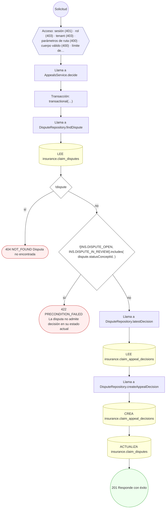

#### 3. POST /coordination-of-benefits

Determinar coordinación de beneficios (COB)

| HTTP | Código | Cuándo |
|---|---|---|
| 201 | — | Éxito |
| 400 | `VALIDATION_FAILED` | El cuerpo cumple el DTO (sin propiedades extra) |
| 401 | `UNAUTHENTICATED` | Hay una sesión válida (JWT) |
| 403 | `FORBIDDEN` | El rol está permitido; El tenant se resuelve y pertenece al actor |
| 404 | `NOT_FOUND` | ResourceNotFoundException: Cobertura primaria no encontrada |
| 422 | `PRECONDITION_FAILED` | PreconditionFailedException: COB requiere al menos una cobertura secundaria |
| 429 | `RATE_LIMITED` | No se supera el límite de solicitudes |


#### 4. POST /coverage-eligibility-requests

Solicitar y resolver elegibilidad (270/271)

| HTTP | Código | Cuándo |
|---|---|---|
| 201 | — | Éxito |
| 400 | `VALIDATION_FAILED` | El cuerpo cumple el DTO (sin propiedades extra) |
| 401 | `UNAUTHENTICATED` | Hay una sesión válida (JWT) |
| 403 | `FORBIDDEN` | El rol está permitido; El tenant se resuelve y pertenece al actor |
| 404 | `NOT_FOUND` | ResourceNotFoundException: Cobertura no encontrada |
| 409 | `CONFLICT` | ConflictException: Solicitud de elegibilidad duplicada |
| 429 | `RATE_LIMITED` | No se supera el límite de solicitudes |


#### 5. GET /insurance-brokers/{id}

Consultar el perfil y las vinculaciones de un broker

| HTTP | Código | Cuándo |
|---|---|---|
| 200 | — | Éxito |
| 400 | `VALIDATION_FAILED` | Los parámetros de ruta son UUID válidos |
| 401 | `UNAUTHENTICATED` | Hay una sesión válida (JWT) |
| 403 | `FORBIDDEN` | El rol está permitido; El tenant se resuelve y pertenece al actor |
| 404 | `NOT_FOUND` | ResourceNotFoundException: Broker no encontrado |
| 429 | `RATE_LIMITED` | No se supera el límite de solicitudes |


#### 6. POST /insurance-brokers/{id}/agreements

Alta de acuerdo broker–aseguradora (soporte)

| HTTP | Código | Cuándo |
|---|---|---|
| 201 | — | Éxito |
| 400 | `VALIDATION_FAILED` | Los parámetros de ruta son UUID válidos; El cuerpo cumple el DTO (sin propiedades extra) |
| 401 | `UNAUTHENTICATED` | Hay una sesión válida (JWT) |
| 403 | `FORBIDDEN` | El rol está permitido; El tenant se resuelve y pertenece al actor |
| 404 | `NOT_FOUND` | ResourceNotFoundException: Broker no encontrado; ResourceNotFoundException: Aseguradora no encontrada |
| 429 | `RATE_LIMITED` | No se supera el límite de solicitudes |

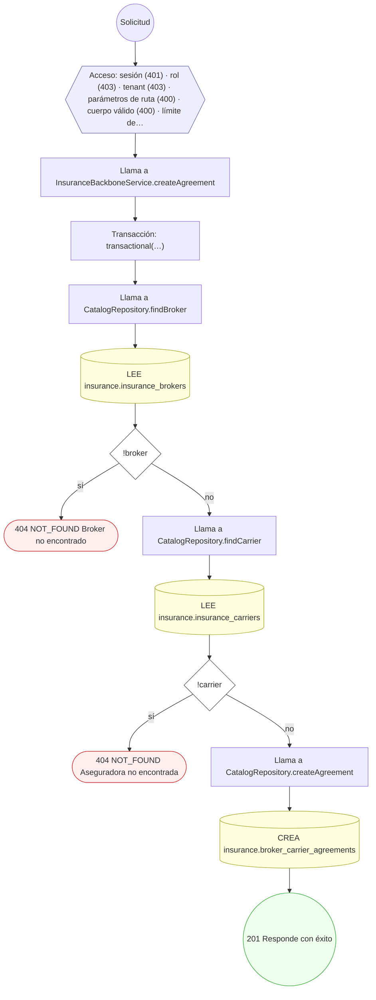

#### 7. GET /insurance-brokers/{id}/clients

Listar la cartera comercial de un broker (sin datos clínicos)

| HTTP | Código | Cuándo |
|---|---|---|
| 200 | — | Éxito |
| 400 | `VALIDATION_FAILED` | Los parámetros de ruta son UUID válidos |
| 401 | `UNAUTHENTICATED` | Hay una sesión válida (JWT) |
| 403 | `FORBIDDEN` | El rol está permitido; El tenant se resuelve y pertenece al actor |
| 404 | `NOT_FOUND` | ResourceNotFoundException: Broker no encontrado |
| 429 | `RATE_LIMITED` | No se supera el límite de solicitudes |


#### 8. GET /insurance-campaigns

Listar las campañas de la aseguradora activa

| HTTP | Código | Cuándo |
|---|---|---|
| 200 | — | Éxito |
| 400 | `VALIDATION_FAILED` | BadRequestException: Cursor inválido |
| 401 | `UNAUTHENTICATED` | Hay una sesión válida (JWT) |
| 403 | `FORBIDDEN` | El rol está permitido; El tenant se resuelve y pertenece al actor; ForbiddenException: Se requiere operar dentro de una aseguradora: indique el X-Tenant-Id de su organización; ForbiddenException: Se requiere pertenecer a la organización, o ser administrador de la plataforma; ForbiddenException: La organización activa no es una aseguradora |
| 429 | `RATE_LIMITED` | No se supera el límite de solicitudes |

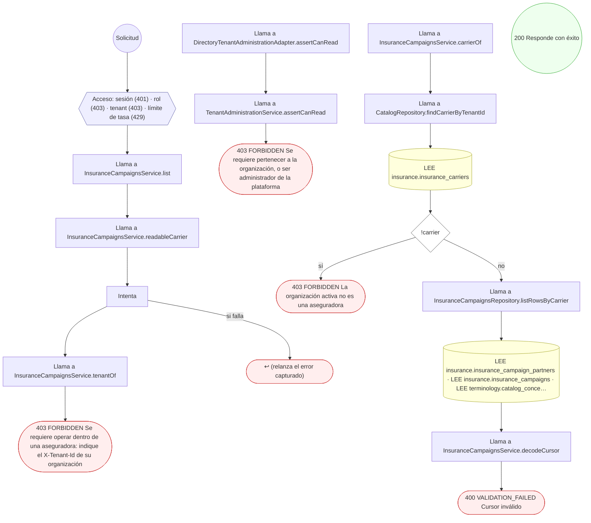

#### 9. POST /insurance-campaigns

Crear una campaña preventiva de la aseguradora

| HTTP | Código | Cuándo |
|---|---|---|
| 201 | — | Éxito |
| 400 | `VALIDATION_FAILED` | El cuerpo cumple el DTO (sin propiedades extra); BadRequestException: validTo debe ser igual o posterior a validFrom; BadRequestException: No se puede activar una campaña cuya vigencia ya terminó; BadRequestException: El código CIE-10 {code} no está en el catálogo |
| 401 | `UNAUTHENTICATED` | Hay una sesión válida (JWT) |
| 403 | `FORBIDDEN` | El rol está permitido; El tenant se resuelve y pertenece al actor; ForbiddenException: Se requiere operar dentro de una aseguradora: indique el X-Tenant-Id de su organización; ForbiddenException: Se requiere ser OWNER o ADMIN de la organización, INSURANCE_OPERATOR con membresía activa, o administrador de la plataforma; ForbiddenException: Se requiere pertenecer a la organización, o ser administrador de la plataforma; ForbiddenException: La organización activa no es una aseguradora |
| 404 | `NOT_FOUND` | ResourceNotFoundException: Campaña no encontrada |
| 409 | `CONFLICT` | ConflictException: Ya existe una campaña con ese código en la aseguradora |
| 422 | `PRECONDITION_FAILED` | PreconditionFailedException: La membresía de red del aliado no pertenece a esta aseguradora |
| 429 | `RATE_LIMITED` | No se supera el límite de solicitudes |

```mermaid
flowchart TD
  n1(("Solicitud")):::inicio
  n2{{"Acceso: sesión (401) · rol (403) · tenant (403) · cuerpo válido (400) · límite de tasa (429)"}}:::acceso
  n1 --> n2
  n3["Llama a InsuranceCampaignsService.create"]:::llamada
  n2 --> n3
  n4["Transacción: transactional(…)"]:::transaccion
  n3 --> n4
  n5["Llama a InsuranceCampaignsService.administrableCarrier"]:::llamada
  n4 --> n5
  n6["Intenta"]:::intento
  n5 --> n6
  n7["Llama a InsuranceCampaignsService.tenantOf"]:::llamada
  n6 --> n7
  n8(["403 FORBIDDEN Se requiere operar dentro de una aseguradora: indique el X-Tenant-Id de su organización"]):::error
  n7 --> n8
  n9{"!canAdminister"}:::decision
  n10{"!actor.roles.includes(INSURANCE_OPERATOR_ROLE)"}:::decision
  n9 -->|"sí"| n10
  n11(["403 FORBIDDEN Se requiere ser OWNER o ADMIN de la organización, INSURANCE_OPERATOR con membresía activa, o ad…"]):::error
  n10 -->|"sí"| n11
  n12["Llama a DirectoryTenantAdministrationAdapter.assertCanRead"]:::llamada
  n10 -->|"no"| n12
  n13["Llama a TenantAdministrationService.assertCanRead"]:::llamada
  n12 --> n13
  n14(["403 FORBIDDEN Se requiere pertenecer a la organización, o ser administrador de la plataforma"]):::error
  n13 --> n14
  n15["Llama a InsuranceCampaignsService.carrierOf"]:::llamada
  n9 -->|"no"| n15
  n16["Llama a CatalogRepository.findCarrierByTenantId"]:::llamada
  n15 --> n16
  n17[("LEE insurance.insurance_carriers")]:::efecto
  n16 --> n17
  n18{"!carrier"}:::decision
  n17 --> n18
  n19(["403 FORBIDDEN La organización activa no es una aseguradora"]):::error
  n18 -->|"sí"| n19
  n20(["↩ (relanza el error capturado)"]):::error
  n6 -->|"si falla"| n20
  n21{"dto.validTo ‹ dto.validFrom"}:::decision
  n18 -->|"no"| n21
  n22(["400 VALIDATION_FAILED validTo debe ser igual o posterior a validFrom"]):::error
  n21 -->|"sí"| n22
  n23{"dto.activate === true && dto.validTo ‹ today"}:::decision
  n21 -->|"no"| n23
  n24(["400 VALIDATION_FAILED No se puede activar una campaña cuya vigencia ya terminó"]):::error
  n23 -->|"sí"| n24
  n25["Llama a InsuranceCampaignsRepository.findByCarrierAndCode"]:::llamada
  n23 -->|"no"| n25
  n26[("LEE insurance.insurance_campaigns")]:::efecto
  n25 --> n26
  n27{"existing"}:::decision
  n26 --> n27
  n28(["409 CONFLICT Ya existe una campaña con ese código en la aseguradora"]):::error
  n27 -->|"sí"| n28
  n29{"dto.targetConditionCode !== undefined"}:::decision
  n27 -->|"no"| n29
  n30["Llama a InsuranceCampaignsRepository.resolveIcd10ConceptId"]:::llamada
  n29 -->|"sí"| n30
  n31[("LEE terminology.catalog_concepts · LEE terminology.code_system_versions · LEE terminology.code_systems")]:::efecto
  n30 --> n31
  n32{"!conceptId"}:::decision
  n31 --> n32
  n33(["400 VALIDATION_FAILED El código CIE-10 {code} no está en el catálogo"]):::error
  n32 -->|"sí"| n33
  n34["Llama a InsuranceCampaignsService.assertPartnersBelongToCarrier"]:::llamada
  n32 -->|"no"| n34
  n29 -->|"no"| n34
  n35["Repite: por cada const partner de partners"]:::bucle
  n34 --> n35
  n36["Llama a InsuranceCampaignsRepository.membershipBelongsToCarrier"]:::llamada
  n35 -->|"cada elemento"| n36
  n37[("LEE insurance.network_provider_memberships · LEE insurance.provider_networks")]:::efecto
  n36 --> n37
  n38{"!belongs"}:::decision
  n37 --> n38
  n39(["422 PRECONDITION_FAILED La membresía de red del aliado no pertenece a esta aseguradora"]):::error
  n38 -->|"sí"| n39
  n40["Llama a InsuranceCampaignsRepository.createCampaign"]:::llamada
  n38 -->|"no"| n40
  n35 -->|"al terminar"| n40
  n41[("CREA insurance.insurance_campaigns")]:::efecto
  n40 --> n41
  n42["Repite: por cada const partner de dto.partners"]:::bucle
  n41 --> n42
  n43["Llama a InsuranceCampaignsRepository.createPartner"]:::llamada
  n42 -->|"cada elemento"| n43
  n44[("CREA insurance.insurance_campaign_partners")]:::efecto
  n43 --> n44
  n45["Llama a AuditTrailAdapter.record"]:::llamada
  n44 --> n45
  n42 -->|"al terminar"| n45
  n46["Llama a AuditTrailService.record"]:::llamada
  n45 --> n46
  n47["Llama a AuditLogRepository.append"]:::llamada
  n46 --> n47
  n48[("CREA audit.audit_log")]:::efecto
  n47 --> n48
  n49["Llama a InsuranceCampaignsService.detail"]:::llamada
  n48 --> n49
  n50["Llama a InsuranceCampaignsRepository.getRowForCarrier"]:::llamada
  n49 --> n50
  n51[("LEE insurance.insurance_campaign_partners · LEE insurance.insurance_campaigns · LEE terminology.catalog_conce…")]:::efecto
  n50 --> n51
  n52{"!row"}:::decision
  n51 --> n52
  n53(["404 NOT_FOUND Campaña no encontrada"]):::error
  n52 -->|"sí"| n53
  n54(("201 Responde con éxito")):::ok
  n52 -->|"no"| n54
  classDef acceso fill:#eef,stroke:#66a
  classDef error fill:#fee,stroke:#c33
  classDef ok fill:#efe,stroke:#3a3
  classDef efecto fill:#ffd,stroke:#aa3
  classDef decision fill:#fff,stroke:#555
  classDef corte fill:#eee,stroke:#999,stroke-dasharray: 4
```

#### 10. GET /insurance-campaigns/{id}

Consultar una campaña de la aseguradora activa

| HTTP | Código | Cuándo |
|---|---|---|
| 200 | — | Éxito |
| 400 | `VALIDATION_FAILED` | Los parámetros de ruta son UUID válidos |
| 401 | `UNAUTHENTICATED` | Hay una sesión válida (JWT) |
| 403 | `FORBIDDEN` | El rol está permitido; El tenant se resuelve y pertenece al actor; ForbiddenException: Se requiere operar dentro de una aseguradora: indique el X-Tenant-Id de su organización; ForbiddenException: Se requiere pertenecer a la organización, o ser administrador de la plataforma; ForbiddenException: La organización activa no es una aseguradora; ForbiddenException: La campaña pertenece a otra aseguradora |
| 404 | `NOT_FOUND` | ResourceNotFoundException: Campaña no encontrada |
| 429 | `RATE_LIMITED` | No se supera el límite de solicitudes |

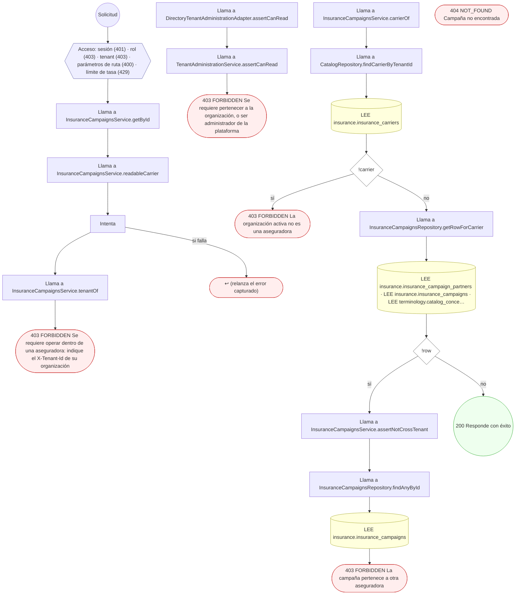

#### 11. PATCH /insurance-campaigns/{id}

Editar una campaña en borrador o pausada (422 si está activa o vencida)

| HTTP | Código | Cuándo |
|---|---|---|
| 200 | — | Éxito |
| 400 | `VALIDATION_FAILED` | Los parámetros de ruta son UUID válidos; El cuerpo cumple el DTO (sin propiedades extra); BadRequestException: validTo debe ser igual o posterior a validFrom; BadRequestException: El código CIE-10 {code} no está en el catálogo |
| 401 | `UNAUTHENTICATED` | Hay una sesión válida (JWT) |
| 403 | `FORBIDDEN` | El rol está permitido; El tenant se resuelve y pertenece al actor; ForbiddenException: Se requiere operar dentro de una aseguradora: indique el X-Tenant-Id de su organización; ForbiddenException: Se requiere ser OWNER o ADMIN de la organización, INSURANCE_OPERATOR con membresía activa, o administrador de la plataforma; ForbiddenException: Se requiere pertenecer a la organización, o ser administrador de la plataforma; ForbiddenException: La organización activa no es una aseguradora; ForbiddenException: La campaña pertenece a otra aseguradora |
| 404 | `NOT_FOUND` | ResourceNotFoundException: Campaña no encontrada |
| 422 | `PRECONDITION_FAILED` | PreconditionFailedException: Una campaña en estado {current} no se puede editar; pausela primero; PreconditionFailedException: La membresía de red del aliado no pertenece a esta aseguradora |
| 429 | `RATE_LIMITED` | No se supera el límite de solicitudes |

```mermaid
flowchart TD
  n1(("Solicitud")):::inicio
  n2{{"Acceso: sesión (401) · rol (403) · tenant (403) · parámetros de ruta (400) · cuerpo válido (400) · límite de…"}}:::acceso
  n1 --> n2
  n3["Llama a InsuranceCampaignsService.update"]:::llamada
  n2 --> n3
  n4["Transacción: transactional(…)"]:::transaccion
  n3 --> n4
  n5["Llama a InsuranceCampaignsService.administrableCarrier"]:::llamada
  n4 --> n5
  n6["Intenta"]:::intento
  n5 --> n6
  n7["Llama a InsuranceCampaignsService.tenantOf"]:::llamada
  n6 --> n7
  n8(["403 FORBIDDEN Se requiere operar dentro de una aseguradora: indique el X-Tenant-Id de su organización"]):::error
  n7 --> n8
  n9{"!canAdminister"}:::decision
  n10{"!actor.roles.includes(INSURANCE_OPERATOR_ROLE)"}:::decision
  n9 -->|"sí"| n10
  n11(["403 FORBIDDEN Se requiere ser OWNER o ADMIN de la organización, INSURANCE_OPERATOR con membresía activa, o ad…"]):::error
  n10 -->|"sí"| n11
  n12["Llama a DirectoryTenantAdministrationAdapter.assertCanRead"]:::llamada
  n10 -->|"no"| n12
  n13["Llama a TenantAdministrationService.assertCanRead"]:::llamada
  n12 --> n13
  n14(["403 FORBIDDEN Se requiere pertenecer a la organización, o ser administrador de la plataforma"]):::error
  n13 --> n14
  n15["Llama a InsuranceCampaignsService.carrierOf"]:::llamada
  n9 -->|"no"| n15
  n16["Llama a CatalogRepository.findCarrierByTenantId"]:::llamada
  n15 --> n16
  n17[("LEE insurance.insurance_carriers")]:::efecto
  n16 --> n17
  n18{"!carrier"}:::decision
  n17 --> n18
  n19(["403 FORBIDDEN La organización activa no es una aseguradora"]):::error
  n18 -->|"sí"| n19
  n20(["↩ (relanza el error capturado)"]):::error
  n6 -->|"si falla"| n20
  n21["Llama a InsuranceCampaignsService.requireOwnedEntity"]:::llamada
  n18 -->|"no"| n21
  n22["Llama a InsuranceCampaignsRepository.findEntityForCarrier"]:::llamada
  n21 --> n22
  n23[("LEE insurance.insurance_campaigns")]:::efecto
  n22 --> n23
  n24["Llama a InsuranceCampaignsService.assertNotCrossTenant"]:::llamada
  n23 --> n24
  n25["Llama a InsuranceCampaignsRepository.findAnyById"]:::llamada
  n24 --> n25
  n26[("LEE insurance.insurance_campaigns")]:::efecto
  n25 --> n26
  n27(["403 FORBIDDEN La campaña pertenece a otra aseguradora"]):::error
  n26 --> n27
  n28(["404 NOT_FOUND Campaña no encontrada"]):::error
  n29{"current !== 'DRAFT' && current !== 'PAUSED'"}:::decision
  n30(["422 PRECONDITION_FAILED Una campaña en estado {current} no se puede editar; pausela primero"]):::error
  n29 -->|"sí"| n30
  n31{"validTo ‹ validFrom"}:::decision
  n29 -->|"no"| n31
  n32(["400 VALIDATION_FAILED validTo debe ser igual o posterior a validFrom"]):::error
  n31 -->|"sí"| n32
  n33{"dto.targetConditionCode !== undefined"}:::decision
  n31 -->|"no"| n33
  n34["Llama a InsuranceCampaignsRepository.resolveIcd10ConceptId"]:::llamada
  n33 -->|"sí"| n34
  n35[("LEE terminology.catalog_concepts · LEE terminology.code_system_versions · LEE terminology.code_systems")]:::efecto
  n34 --> n35
  n36{"!conceptId"}:::decision
  n35 --> n36
  n37(["400 VALIDATION_FAILED El código CIE-10 {code} no está en el catálogo"]):::error
  n36 -->|"sí"| n37
  n38[("ACTUALIZA insurance.insurance_campaigns")]:::efecto
  n36 -->|"no"| n38
  n39{"dto.partners"}:::decision
  n38 --> n39
  n33 -->|"no"| n39
  n40["Llama a InsuranceCampaignsService.assertPartnersBelongToCarrier"]:::llamada
  n39 -->|"sí"| n40
  n41["Repite: por cada const partner de partners"]:::bucle
  n40 --> n41
  n42["Llama a InsuranceCampaignsRepository.membershipBelongsToCarrier"]:::llamada
  n41 -->|"cada elemento"| n42
  n43[("LEE insurance.network_provider_memberships · LEE insurance.provider_networks")]:::efecto
  n42 --> n43
  n44{"!belongs"}:::decision
  n43 --> n44
  n45(["422 PRECONDITION_FAILED La membresía de red del aliado no pertenece a esta aseguradora"]):::error
  n44 -->|"sí"| n45
  n46[("ACTUALIZA insurance.insurance_campaigns")]:::efecto
  n44 -->|"no"| n46
  n41 -->|"al terminar"| n46
  n39 -->|"no"| n46
  n47{"dto.title !== undefined"}:::decision
  n46 --> n47
  n48[("ACTUALIZA insurance.insurance_campaigns")]:::efecto
  n47 -->|"sí"| n48
  n49{"dto.description !== undefined"}:::decision
  n48 --> n49
  n47 -->|"no"| n49
  n50[("ACTUALIZA insurance.insurance_campaigns")]:::efecto
  n49 -->|"sí"| n50
  n51{"dto.campaignType !== undefined"}:::decision
  n50 --> n51
  n49 -->|"no"| n51
  n52[("ACTUALIZA insurance.insurance_campaigns")]:::efecto
  n51 -->|"sí"| n52
  n53{"dto.validFrom !== undefined"}:::decision
  n52 --> n53
  n51 -->|"no"| n53
  n54[("ACTUALIZA insurance.insurance_campaigns")]:::efecto
  n53 -->|"sí"| n54
  n55{"dto.validTo !== undefined"}:::decision
  n54 --> n55
  n53 -->|"no"| n55
  n56[("ACTUALIZA insurance.insurance_campaigns")]:::efecto
  n55 -->|"sí"| n56
  n57{"dto.copayBonusPercentage !== undefined"}:::decision
  n56 --> n57
  n55 -->|"no"| n57
  n58[("ACTUALIZA insurance.insurance_campaigns")]:::efecto
  n57 -->|"sí"| n58
  n59{"dto.partners"}:::decision
  n58 --> n59
  n57 -->|"no"| n59
  n60["Llama a InsuranceCampaignsRepository.deletePartners"]:::llamada
  n59 -->|"sí"| n60
  n61[("BORRA insurance.insurance_campaign_partners")]:::efecto
  n60 --> n61
  n62["Repite: por cada const partner de dto.partners"]:::bucle
  n61 --> n62
  n63["Llama a InsuranceCampaignsRepository.createPartner"]:::llamada
  n62 -->|"cada elemento"| n63
  n64[("CREA insurance.insurance_campaign_partners")]:::efecto
  n63 --> n64
  n65["Llama a AuditTrailAdapter.record"]:::llamada
  n64 --> n65
  n62 -->|"al terminar"| n65
  n59 -->|"no"| n65
  n66["Llama a AuditTrailService.record"]:::llamada
  n65 --> n66
  n67["Llama a AuditLogRepository.append"]:::llamada
  n66 --> n67
  n68[("CREA audit.audit_log")]:::efecto
  n67 --> n68
  n69["Llama a InsuranceCampaignsService.detail"]:::llamada
  n68 --> n69
  n70["Llama a InsuranceCampaignsRepository.getRowForCarrier"]:::llamada
  n69 --> n70
  n71["… el resto del árbol (3 nodos) está en el JSON del inventario"]:::corte
  n70 --> n71
  classDef acceso fill:#eef,stroke:#66a
  classDef error fill:#fee,stroke:#c33
  classDef ok fill:#efe,stroke:#3a3
  classDef efecto fill:#ffd,stroke:#aa3
  classDef decision fill:#fff,stroke:#555
  classDef corte fill:#eee,stroke:#999,stroke-dasharray: 4
```

#### 12. PATCH /insurance-campaigns/{id}/status

Activar, pausar o finalizar una campaña (transiciones cerradas)

| HTTP | Código | Cuándo |
|---|---|---|
| 200 | — | Éxito |
| 400 | `VALIDATION_FAILED` | Los parámetros de ruta son UUID válidos; El cuerpo cumple el DTO (sin propiedades extra) |
| 401 | `UNAUTHENTICATED` | Hay una sesión válida (JWT) |
| 403 | `FORBIDDEN` | El rol está permitido; El tenant se resuelve y pertenece al actor; ForbiddenException: Se requiere operar dentro de una aseguradora: indique el X-Tenant-Id de su organización; ForbiddenException: Se requiere ser OWNER o ADMIN de la organización, INSURANCE_OPERATOR con membresía activa, o administrador de la plataforma; ForbiddenException: Se requiere pertenecer a la organización, o ser administrador de la plataforma; ForbiddenException: La organización activa no es una aseguradora; ForbiddenException: La campaña pertenece a otra aseguradora |
| 404 | `NOT_FOUND` | ResourceNotFoundException: Campaña no encontrada |
| 422 | `PRECONDITION_FAILED` | PreconditionFailedException: Una campaña en estado {current} no puede pasar a {target}; PreconditionFailedException: La campaña ya venció: no se puede activar |
| 429 | `RATE_LIMITED` | No se supera el límite de solicitudes |

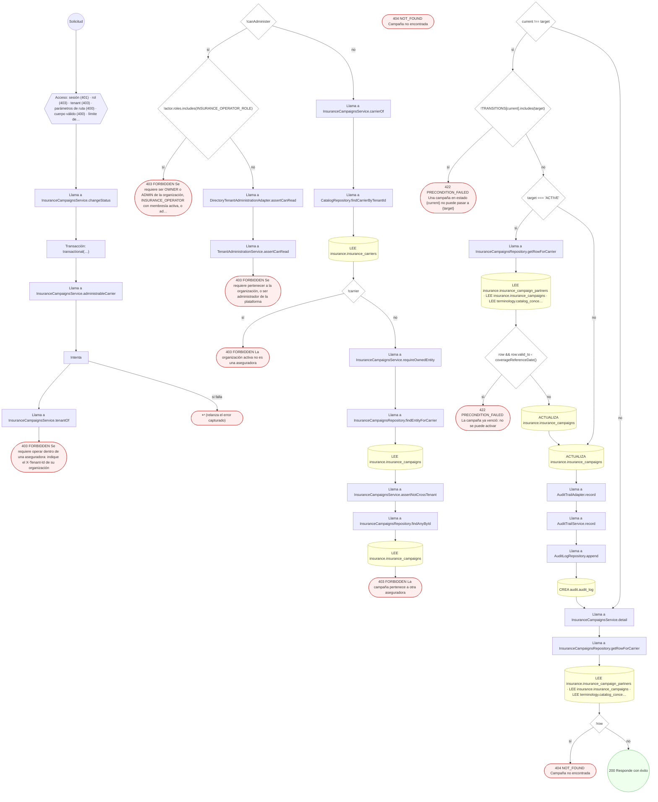

#### 13. GET /insurance-campaigns/my-benefits

Campañas vigentes de mi aseguradora, para el afiliado autenticado

| HTTP | Código | Cuándo |
|---|---|---|
| 200 | — | Éxito |
| 401 | `UNAUTHENTICATED` | Hay una sesión válida (JWT) |
| 403 | `FORBIDDEN` | El rol está permitido; El tenant se resuelve y pertenece al actor; ForbiddenException: La cuenta no tiene un perfil de paciente asociado |
| 429 | `RATE_LIMITED` | No se supera el límite de solicitudes |

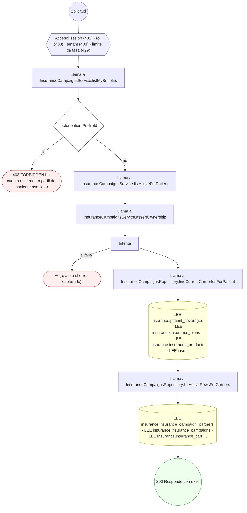

#### 14. GET /insurance-campaigns/patient/{patientProfileId}

Campañas vigentes de la aseguradora del afiliado (sólo el titular)

| HTTP | Código | Cuándo |
|---|---|---|
| 200 | — | Éxito |
| 400 | `VALIDATION_FAILED` | Los parámetros de ruta son UUID válidos |
| 401 | `UNAUTHENTICATED` | Hay una sesión válida (JWT) |
| 403 | `FORBIDDEN` | El rol está permitido; El tenant se resuelve y pertenece al actor; ForbiddenException: Sólo el titular del perfil o la plataforma pueden modificarlo |
| 429 | `RATE_LIMITED` | No se supera el límite de solicitudes |

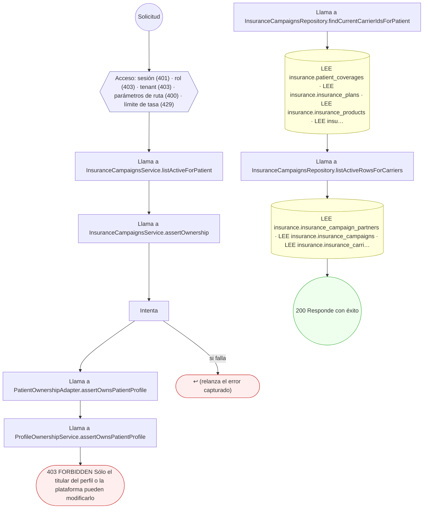

#### 15. GET /insurance-carriers/{id}

Consultar el catálogo y la red de una aseguradora

| HTTP | Código | Cuándo |
|---|---|---|
| 200 | — | Éxito |
| 400 | `VALIDATION_FAILED` | Los parámetros de ruta son UUID válidos |
| 401 | `UNAUTHENTICATED` | Hay una sesión válida (JWT) |
| 403 | `FORBIDDEN` | El rol está permitido; El tenant se resuelve y pertenece al actor |
| 404 | `NOT_FOUND` | ResourceNotFoundException: Aseguradora no encontrada |
| 429 | `RATE_LIMITED` | No se supera el límite de solicitudes |


#### 16. PUT /insurance-carriers/{id}/contact-channels

Configurar los canales de contacto de la aseguradora del tenant activo

| HTTP | Código | Cuándo |
|---|---|---|
| 200 | — | Éxito |
| 400 | `VALIDATION_FAILED` | Los parámetros de ruta son UUID válidos; El cuerpo cumple el DTO (sin propiedades extra) |
| 401 | `UNAUTHENTICATED` | Hay una sesión válida (JWT) |
| 403 | `FORBIDDEN` | El rol está permitido; El tenant se resuelve y pertenece al actor; ForbiddenException: Se requiere ser OWNER o ADMIN de la organización, o administrador de la plataforma |
| 404 | `NOT_FOUND` | ResourceNotFoundException: Aseguradora no encontrada |
| 429 | `RATE_LIMITED` | No se supera el límite de solicitudes |

```mermaid
flowchart TD
  n1(("Solicitud")):::inicio
  n2{{"Acceso: sesión (401) · rol (403) · tenant (403) · parámetros de ruta (400) · cuerpo válido (400) · límite de…"}}:::acceso
  n1 --> n2
  n3["Llama a InsuranceBackboneService.updateContactChannels"]:::llamada
  n2 --> n3
  n4["Transacción: transactional(…)"]:::transaccion
  n3 --> n4
  n5["Llama a InsuranceBackboneService.administrableCarrier"]:::llamada
  n4 --> n5
  n6["Llama a DirectoryTenantAdministrationAdapter.assertCanAdminister"]:::llamada
  n5 --> n6
  n7["Llama a TenantAdministrationService.assertCanAdminister"]:::llamada
  n6 --> n7
  n8(["403 FORBIDDEN Se requiere ser OWNER o ADMIN de la organización, o administrador de la plataforma"]):::error
  n7 --> n8
  n9["Llama a CatalogRepository.findCarrierByTenantId"]:::llamada
  n10[("LEE insurance.insurance_carriers")]:::efecto
  n9 --> n10
  n11{"!carrier"}:::decision
  n10 --> n11
  n12(["404 NOT_FOUND Aseguradora no encontrada"]):::error
  n11 -->|"sí"| n12
  n13{"carrier.id !== id"}:::decision
  n11 -->|"no"| n13
  n14(["404 NOT_FOUND Aseguradora no encontrada"]):::error
  n13 -->|"sí"| n14
  n15[("ACTUALIZA insurance.insurance_carriers · ACTUALIZA insurance.insurance_carriers · ACTUALIZA insurance.insuran…")]:::efecto
  n13 -->|"no"| n15
  n16(("200 Responde con éxito")):::ok
  n15 --> n16
  classDef acceso fill:#eef,stroke:#66a
  classDef error fill:#fee,stroke:#c33
  classDef ok fill:#efe,stroke:#3a3
  classDef efecto fill:#ffd,stroke:#aa3
  classDef decision fill:#fff,stroke:#555
  classDef corte fill:#eee,stroke:#999,stroke-dasharray: 4
```

#### 17. POST /insurance-carriers/{id}/products

Alta de producto de aseguradora (soporte)

| HTTP | Código | Cuándo |
|---|---|---|
| 201 | — | Éxito |
| 400 | `VALIDATION_FAILED` | Los parámetros de ruta son UUID válidos; El cuerpo cumple el DTO (sin propiedades extra) |
| 401 | `UNAUTHENTICATED` | Hay una sesión válida (JWT) |
| 403 | `FORBIDDEN` | El rol está permitido; El tenant se resuelve y pertenece al actor |
| 404 | `NOT_FOUND` | ResourceNotFoundException: Aseguradora no encontrada |
| 429 | `RATE_LIMITED` | No se supera el límite de solicitudes |

```mermaid
flowchart TD
  n1(("Solicitud")):::inicio
  n2{{"Acceso: sesión (401) · rol (403) · tenant (403) · parámetros de ruta (400) · cuerpo válido (400) · límite de…"}}:::acceso
  n1 --> n2
  n3["Llama a InsuranceBackboneService.createProduct"]:::llamada
  n2 --> n3
  n4["Transacción: transactional(…)"]:::transaccion
  n3 --> n4
  n5["Llama a CatalogRepository.findCarrier"]:::llamada
  n4 --> n5
  n6[("LEE insurance.insurance_carriers")]:::efecto
  n5 --> n6
  n7{"!carrier"}:::decision
  n6 --> n7
  n8(["404 NOT_FOUND Aseguradora no encontrada"]):::error
  n7 -->|"sí"| n8
  n9["Llama a CatalogRepository.createProduct"]:::llamada
  n7 -->|"no"| n9
  n10[("CREA insurance.insurance_products")]:::efecto
  n9 --> n10
  n11(("201 Responde con éxito")):::ok
  n10 --> n11
  classDef acceso fill:#eef,stroke:#66a
  classDef error fill:#fee,stroke:#c33
  classDef ok fill:#efe,stroke:#3a3
  classDef efecto fill:#ffd,stroke:#aa3
  classDef decision fill:#fff,stroke:#555
  classDef corte fill:#eee,stroke:#999,stroke-dasharray: 4
```

#### 18. GET /insurance-claims

Listar las solicitudes de seguro presentadas (cursor)

| HTTP | Código | Cuándo |
|---|---|---|
| 200 | — | Éxito |
| 401 | `UNAUTHENTICATED` | Hay una sesión válida (JWT) |
| 403 | `FORBIDDEN` | El rol está permitido; El tenant se resuelve y pertenece al actor |
| 429 | `RATE_LIMITED` | No se supera el límite de solicitudes |

```mermaid
flowchart TD
  n1(("Solicitud")):::inicio
  n2{{"Acceso: sesión (401) · rol (403) · tenant (403) · límite de tasa (429)"}}:::acceso
  n1 --> n2
  n3["Llama a ClaimsReadService.listClaims"]:::llamada
  n2 --> n3
  n4["Llama a ClaimsReadService.resolveScope"]:::llamada
  n3 --> n4
  n5["Llama a CatalogRepository.findCarrierByTenantId"]:::llamada
  n4 --> n5
  n6[("LEE insurance.insurance_carriers")]:::efecto
  n5 --> n6
  n7["Llama a ClaimReadRepository.findDiagnosticUnitsByTenant"]:::llamada
  n6 --> n7
  n8[("LEE diagnostic_units.diagnostic_units")]:::efecto
  n7 --> n8
  n9{"practiceIds.length === 0 && diagnosticUnitIds.length === 0"}:::decision
  n8 --> n9
  n10(["↩ (relanza el error capturado)"]):::error
  n9 -->|"sí"| n10
  n11["Llama a ClaimReadRepository.findClaimsPage"]:::llamada
  n9 -->|"no"| n11
  n12[("LEE insurance.insurance_claims")]:::efecto
  n11 --> n12
  n13["Llama a ClaimReadRepository.findClaimsPage"]:::llamada
  n12 --> n13
  n14[("LEE insurance.insurance_claims")]:::efecto
  n13 --> n14
  n15["Llama a ClaimsReadService.buildRows"]:::llamada
  n14 --> n15
  n16["Llama a ClaimReadRepository.findCarriersByIds"]:::llamada
  n15 --> n16
  n17[("LEE insurance.insurance_carriers")]:::efecto
  n16 --> n17
  n18["Llama a ClaimReadRepository.findCoveragesByIds"]:::llamada
  n17 --> n18
  n19[("LEE insurance.patient_coverages")]:::efecto
  n18 --> n19
  n20["Llama a ClaimReadRepository.findAdjudicationsByClaimIds"]:::llamada
  n19 --> n20
  n21[("LEE insurance.claim_adjudication_versions")]:::efecto
  n20 --> n21
  n22["Llama a ClaimReadRepository.findDisputesByClaimIds"]:::llamada
  n21 --> n22
  n23[("LEE insurance.claim_disputes")]:::efecto
  n22 --> n23
  n24["Llama a ClaimReadRepository.findPersonsByIds"]:::llamada
  n23 --> n24
  n25[("LEE profiles.persons")]:::efecto
  n24 --> n25
  n26["Llama a ClaimReadRepository.findPatientProfilesByProfileIds"]:::llamada
  n25 --> n26
  n27[("LEE profiles.patient_profiles")]:::efecto
  n26 --> n27
  n28[("LEE insurance.insurance_brokers")]:::efecto
  n27 --> n28
  n29["Llama a ClaimsReadService.conceptMap"]:::llamada
  n28 --> n29
  n30["Llama a ClaimReadRepository.findConceptsByIds"]:::llamada
  n29 --> n30
  n31[("LEE terminology.catalog_concepts")]:::efecto
  n30 --> n31
  n32(("200 Responde con éxito")):::ok
  n31 --> n32
  classDef acceso fill:#eef,stroke:#66a
  classDef error fill:#fee,stroke:#c33
  classDef ok fill:#efe,stroke:#3a3
  classDef efecto fill:#ffd,stroke:#aa3
  classDef decision fill:#fff,stroke:#555
  classDef corte fill:#eee,stroke:#999,stroke-dasharray: 4
```

#### 19. POST /insurance-claims

Enviar reclamo con líneas (837)

| HTTP | Código | Cuándo |
|---|---|---|
| 201 | — | Éxito |
| 400 | `VALIDATION_FAILED` | El cuerpo cumple el DTO (sin propiedades extra) |
| 401 | `UNAUTHENTICATED` | Hay una sesión válida (JWT) |
| 403 | `FORBIDDEN` | El rol está permitido; El tenant se resuelve y pertenece al actor; ForbiddenException: Se requiere ser OWNER o ADMIN de la organización, o administrador de la plataforma |
| 404 | `NOT_FOUND` | ResourceNotFoundException: Cobertura no encontrada |
| 409 | `CONFLICT` | ConflictException: La clave de idempotencia corresponde a otro reclamo; ConflictException: La clave de idempotencia requiere las mismas líneas; ConflictException: El pedido ya tiene un reclamo activo; ConflictException: Reclamo duplicado |
| 422 | `PRECONDITION_FAILED` | PreconditionFailedException: Un reclamo sólo puede representar un pedido; PreconditionFailedException: Las secuencias de líneas deben ser únicas; PreconditionFailedException: Los ítems vinculados requieren el pedido completo; PreconditionFailedException: La moneda del importe diagnóstico debe declararse; PreconditionFailedException: El pedido debe estar confirmado y sin sustituciones pendientes antes del retiro; PreconditionFailedException: La cobertura no corresponde a la aseguradora indicada; PreconditionFailedException: La moneda de la cobertura y del pedido debe coincidir; PreconditionFailedException: La cobertura debe estar activa y vigente para presentar el reclamo; PreconditionFailedException: El reclamo debe representar exactamente el pedido y su prestador; PreconditionFailedException: Las líneas deben coincidir con las cantidades e importes del pedido; PreconditionFailedException: La autorización previa debe pertenecer a la misma cobertura y pedido; PreconditionFailedException: La cobertura del paciente no corresponde al plan del cobro |
| 429 | `RATE_LIMITED` | No se supera el límite de solicitudes |

```mermaid
flowchart TD
  n1(("Solicitud")):::inicio
  n2{{"Acceso: sesión (401) · rol (403) · tenant (403) · cuerpo válido (400) · límite de tasa (429)"}}:::acceso
  n1 --> n2
  n3["Llama a ClaimsService.submitClaim"]:::llamada
  n2 --> n3
  n4["Transacción: transactional(…)"]:::transaccion
  n3 --> n4
  n5["Llama a LinkedClaimAccessService.assertAdministrator"]:::llamada
  n4 --> n5
  n6["Llama a DirectoryTenantAdministrationAdapter.assertCanAdminister"]:::llamada
  n5 --> n6
  n7["Llama a TenantAdministrationService.assertCanAdminister"]:::llamada
  n6 --> n7
  n8(["403 FORBIDDEN Se requiere ser OWNER o ADMIN de la organización, o administrador de la plataforma"]):::error
  n7 --> n8
  n9{"linked"}:::decision
  n10["Llama a LinkedClaimAccessService.assertAdministrator"]:::llamada
  n9 -->|"sí"| n10
  n11["Llama a DirectoryTenantAdministrationAdapter.assertCanAdminister"]:::llamada
  n10 --> n11
  n12["Llama a TenantAdministrationService.assertCanAdminister"]:::llamada
  n11 --> n12
  n13(["403 FORBIDDEN Se requiere ser OWNER o ADMIN de la organización, o administrador de la plataforma"]):::error
  n12 --> n13
  n14["Llama a ClaimsService.assertProviderClaimScope"]:::llamada
  n9 -->|"no"| n14
  n15{"!authorized"}:::decision
  n14 --> n15
  n16(["↩ (relanza el error capturado)"]):::error
  n15 -->|"sí"| n16
  n17{"dto.inventoryReservationId && dto.serviceRequestId"}:::decision
  n15 -->|"no"| n17
  n18(["422 PRECONDITION_FAILED Un reclamo sólo puede representar un pedido"]):::error
  n17 -->|"sí"| n18
  n19{"new Set(dto.lines.map((line) =› line.lineSequence)).size !== dto.lines.length"}:::decision
  n17 -->|"no"| n19
  n20(["422 PRECONDITION_FAILED Las secuencias de líneas deben ser únicas"]):::error
  n19 -->|"sí"| n20
  n21{"!linked && dto.lines.some( (line) =› line.inventoryReservationLineId || line.diagnosticStudyOfferingId, )"}:::decision
  n19 -->|"no"| n21
  n22(["422 PRECONDITION_FAILED Los ítems vinculados requieren el pedido completo"]):::error
  n21 -->|"sí"| n22
  n23{"linked"}:::decision
  n21 -->|"no"| n23
  n24{"dto.serviceRequestId && !dto.currencyConceptId"}:::decision
  n23 -->|"sí"| n24
  n25(["422 PRECONDITION_FAILED La moneda del importe diagnóstico debe declararse"]):::error
  n24 -->|"sí"| n25
  n26["Llama a LinkedClaimOrderService.lockAndResolve"]:::llamada
  n24 -->|"no"| n26
  n27["Llama a LinkedClaimOrderService.assertSingleOrigin"]:::llamada
  n26 --> n27
  n28{"input.inventoryReservationId && input.serviceRequestId"}:::decision
  n27 --> n28
  n29(["422 PRECONDITION_FAILED Un reclamo sólo puede representar un pedido"]):::error
  n28 -->|"sí"| n29
  n30{"input.inventoryReservationId"}:::decision
  n28 -->|"no"| n30
  n31["Llama a LinkedOrderDataRepository.lockPharmacyOrder"]:::llamada
  n30 -->|"sí"| n31
  n32[("LEE pharmacy_inventory.inventory_reservations")]:::efecto
  n31 --> n32
  n33{"input.serviceRequestId"}:::decision
  n30 -->|"no"| n33
  n34["Llama a LinkedOrderDataRepository.lockServiceRequest"]:::llamada
  n33 -->|"sí"| n34
  n35[("LEE clinical.service_requests")]:::efecto
  n34 --> n35
  n36["Llama a LinkedClaimAccessService.assertProvider"]:::llamada
  n32 --> n36
  n35 --> n36
  n33 -->|"no"| n36
  n37{"!snapshot || snapshot.providerTenantId !== tenantId"}:::decision
  n36 --> n37
  n38(["↩ (relanza el error capturado)"]):::error
  n37 -->|"sí"| n38
  n39{"!snapshot"}:::decision
  n37 -->|"no"| n39
  n40(["↩ (relanza el error capturado)"]):::error
  n39 -->|"sí"| n40
  n41["Llama a ClaimsService.replayLinkedClaim"]:::llamada
  n39 -->|"no"| n41
  n42["Llama a ClaimRepository.findByIdempotency"]:::llamada
  n41 --> n42
  n43[("LEE insurance.insurance_claims")]:::efecto
  n42 --> n43
  n44{"(claim.inventoryReservationId ?? null) !== (dto.inventoryReservationId ?? null) || (claim.serviceRequestId ??…"}:::decision
  n43 --> n44
  n45(["409 CONFLICT La clave de idempotencia corresponde a otro reclamo"]):::error
  n44 -->|"sí"| n45
  n46[("LEE insurance.insurance_claim_lines")]:::efecto
  n44 -->|"no"| n46
  n47{"!sameLines"}:::decision
  n46 --> n47
  n48(["409 CONFLICT La clave de idempotencia requiere las mismas líneas"]):::error
  n47 -->|"sí"| n48
  n49{"!snapshot.canSubmit"}:::decision
  n47 -->|"no"| n49
  n50(["422 PRECONDITION_FAILED El pedido debe estar confirmado y sin sustituciones pendientes antes del retiro"]):::error
  n49 -->|"sí"| n50
  n51["Llama a LinkedClaimAccessService.coverageForOrder"]:::llamada
  n49 -->|"no"| n51
  n52["Llama a CoverageRepository.findCoverage"]:::llamada
  n51 --> n52
  n53[("LEE insurance.patient_coverages")]:::efecto
  n52 --> n53
  n54{"!coverage || coverage.patientProfileId !== snapshot.patientProfileId"}:::decision
  n53 --> n54
  n55(["↩ (relanza el error capturado)"]):::error
  n54 -->|"sí"| n55
  n56["Llama a CatalogRepository.findPlan"]:::llamada
  n54 -->|"no"| n56
  n57[("LEE insurance.insurance_plans")]:::efecto
  n56 --> n57
  n58["Llama a CatalogRepository.findProduct"]:::llamada
  n57 --> n58
  n59[("LEE insurance.insurance_products")]:::efecto
  n58 --> n59
  n60{"!plan || !product || (carrierId && product.insuranceCarrierId !== carrierId)"}:::decision
  n59 --> n60
  n61(["422 PRECONDITION_FAILED La cobertura no corresponde a la aseguradora indicada"]):::error
  n60 -->|"sí"| n61
  n62{"!plan.currencyConceptId || (snapshot.currencyConceptId && snapshot.currencyConceptId !== plan.currencyConcept…"}:::decision
  n60 -->|"no"| n62
  n63(["422 PRECONDITION_FAILED La moneda de la cobertura y del pedido debe coincidir"]):::error
  n62 -->|"sí"| n63
  n64{"requireCurrent && (coverage.statusConceptId !== INS.COVERAGE_ACTIVE || !withinDates(coverage) || !withinDates…"}:::decision
  n62 -->|"no"| n64
  n65(["422 PRECONDITION_FAILED La cobertura debe estar activa y vigente para presentar el reclamo"]):::error
  n64 -->|"sí"| n65
  n66["Llama a ClaimsService.canonicalLines"]:::llamada
  n64 -->|"no"| n66
  n67{"dto.billingProviderEntityId !== snapshot.billingProviderEntityId || (dto.currencyConceptId && dto.currencyCon…"}:::decision
  n66 --> n67
  n68(["422 PRECONDITION_FAILED El reclamo debe representar exactamente el pedido y su prestador"]):::error
  n67 -->|"sí"| n68
  n69["Repite: map(…)"]:::bucle
  n67 -->|"no"| n69
  n70{"!source || (snapshot.origin === 'PHARMACY' && line.diagnosticStudyOfferingId) || (snapshot.origin === 'DIAGNO…"}:::decision
  n69 -->|"cada elemento"| n70
  n71["… el resto del árbol (1 nodos) está en el JSON del inventario"]:::corte
  n70 -->|"sí"| n71
  classDef acceso fill:#eef,stroke:#66a
  classDef error fill:#fee,stroke:#c33
  classDef ok fill:#efe,stroke:#3a3
  classDef efecto fill:#ffd,stroke:#aa3
  classDef decision fill:#fff,stroke:#555
  classDef corte fill:#eee,stroke:#999,stroke-dasharray: 4
```

#### 20. GET /insurance-claims/{id}

Consultar una solicitud de seguro con sus ítems y su dictamen

| HTTP | Código | Cuándo |
|---|---|---|
| 200 | — | Éxito |
| 400 | `VALIDATION_FAILED` | Los parámetros de ruta son UUID válidos |
| 401 | `UNAUTHENTICATED` | Hay una sesión válida (JWT) |
| 403 | `FORBIDDEN` | El rol está permitido; El tenant se resuelve y pertenece al actor |
| 429 | `RATE_LIMITED` | No se supera el límite de solicitudes |

```mermaid
flowchart TD
  n1(("Solicitud")):::inicio
  n2{{"Acceso: sesión (401) · rol (403) · tenant (403) · parámetros de ruta (400) · límite de tasa (429)"}}:::acceso
  n1 --> n2
  n3["Llama a ClaimsReadService.getClaim"]:::llamada
  n2 --> n3
  n4["Llama a ClaimsReadService.resolveScope"]:::llamada
  n3 --> n4
  n5["Llama a CatalogRepository.findCarrierByTenantId"]:::llamada
  n4 --> n5
  n6[("LEE insurance.insurance_carriers")]:::efecto
  n5 --> n6
  n7["Llama a ClaimReadRepository.findDiagnosticUnitsByTenant"]:::llamada
  n6 --> n7
  n8[("LEE diagnostic_units.diagnostic_units")]:::efecto
  n7 --> n8
  n9{"practiceIds.length === 0 && diagnosticUnitIds.length === 0"}:::decision
  n8 --> n9
  n10(["↩ (relanza el error capturado)"]):::error
  n9 -->|"sí"| n10
  n11["Llama a ClaimReadRepository.findClaimInScope"]:::llamada
  n9 -->|"no"| n11
  n12{"carrierId"}:::decision
  n11 --> n12
  n13[("LEE insurance.insurance_claims")]:::efecto
  n12 -->|"sí"| n13
  n14[("LEE insurance.insurance_claims")]:::efecto
  n13 --> n14
  n12 -->|"no"| n14
  n15["Llama a ClaimReadRepository.findClaimInScope"]:::llamada
  n14 --> n15
  n16{"carrierId"}:::decision
  n15 --> n16
  n17[("LEE insurance.insurance_claims")]:::efecto
  n16 -->|"sí"| n17
  n18[("LEE insurance.insurance_claims")]:::efecto
  n17 --> n18
  n16 -->|"no"| n18
  n19{"!claim"}:::decision
  n18 --> n19
  n20(["↩ (relanza el error capturado)"]):::error
  n19 -->|"sí"| n20
  n21["Llama a ClaimReadRepository.findLinesByClaimIds"]:::llamada
  n19 -->|"no"| n21
  n22[("LEE insurance.insurance_claim_lines")]:::efecto
  n21 --> n22
  n23["Llama a ClaimReadRepository.findAdjudicationsByClaimIds"]:::llamada
  n22 --> n23
  n24[("LEE insurance.claim_adjudication_versions")]:::efecto
  n23 --> n24
  n25["Llama a ClaimReadRepository.findDisputesByClaimIds"]:::llamada
  n24 --> n25
  n26[("LEE insurance.claim_disputes")]:::efecto
  n25 --> n26
  n27[("LEE insurance.claim_reversals")]:::efecto
  n26 --> n27
  n28["Llama a ClaimReadRepository.findLineAdjudications"]:::llamada
  n27 --> n28
  n29[("LEE insurance.claim_line_adjudications")]:::efecto
  n28 --> n29
  n30["Llama a ClaimReadRepository.findEobsByVersionIds"]:::llamada
  n29 --> n30
  n31[("LEE insurance.patient_explanations_of_benefit")]:::efecto
  n30 --> n31
  n32["Llama a ClaimsReadService.conceptMap"]:::llamada
  n31 --> n32
  n33["Llama a ClaimReadRepository.findConceptsByIds"]:::llamada
  n32 --> n33
  n34[("LEE terminology.catalog_concepts")]:::efecto
  n33 --> n34
  n35["Llama a ClaimsReadService.buildRows"]:::llamada
  n34 --> n35
  n36["Llama a ClaimReadRepository.findCarriersByIds"]:::llamada
  n35 --> n36
  n37[("LEE insurance.insurance_carriers")]:::efecto
  n36 --> n37
  n38["Llama a ClaimReadRepository.findCoveragesByIds"]:::llamada
  n37 --> n38
  n39[("LEE insurance.patient_coverages")]:::efecto
  n38 --> n39
  n40["Llama a ClaimReadRepository.findAdjudicationsByClaimIds"]:::llamada
  n39 --> n40
  n41[("LEE insurance.claim_adjudication_versions")]:::efecto
  n40 --> n41
  n42["Llama a ClaimReadRepository.findDisputesByClaimIds"]:::llamada
  n41 --> n42
  n43[("LEE insurance.claim_disputes")]:::efecto
  n42 --> n43
  n44["Llama a ClaimReadRepository.findPersonsByIds"]:::llamada
  n43 --> n44
  n45[("LEE profiles.persons")]:::efecto
  n44 --> n45
  n46["Llama a ClaimReadRepository.findPatientProfilesByProfileIds"]:::llamada
  n45 --> n46
  n47[("LEE profiles.patient_profiles")]:::efecto
  n46 --> n47
  n48[("LEE insurance.insurance_brokers")]:::efecto
  n47 --> n48
  n49["Llama a ClaimsReadService.conceptMap"]:::llamada
  n48 --> n49
  n50["Llama a ClaimReadRepository.findConceptsByIds"]:::llamada
  n49 --> n50
  n51[("LEE terminology.catalog_concepts")]:::efecto
  n50 --> n51
  n52["Llama a ClaimsReadService.resolveDuplicateStudy"]:::llamada
  n51 --> n52
  n53["Llama a ClaimReadRepository.findSourceRequest"]:::llamada
  n52 --> n53
  n54[("LEE clinical.service_requests")]:::efecto
  n53 --> n54
  n55["Llama a DuplicateStudyDescriptionAdapter.describeByReportId"]:::llamada
  n54 --> n55
  n56["Llama a DuplicateStudyDetector.describeByReportId"]:::llamada
  n55 --> n56
  n57[("LEE clinical.diagnostic_reports")]:::efecto
  n56 --> n57
  n58(("200 Responde con éxito")):::ok
  n57 --> n58
  classDef acceso fill:#eef,stroke:#66a
  classDef error fill:#fee,stroke:#c33
  classDef ok fill:#efe,stroke:#3a3
  classDef efecto fill:#ffd,stroke:#aa3
  classDef decision fill:#fff,stroke:#555
  classDef corte fill:#eee,stroke:#999,stroke-dasharray: 4
```

#### 21. POST /insurance-claims/{id}/adjudications

Adjudicar reclamo por línea (835)

| HTTP | Código | Cuándo |
|---|---|---|
| 201 | — | Éxito |
| 400 | `VALIDATION_FAILED` | Los parámetros de ruta son UUID válidos; El cuerpo cumple el DTO (sin propiedades extra) |
| 401 | `UNAUTHENTICATED` | Hay una sesión válida (JWT) |
| 403 | `FORBIDDEN` | El rol está permitido; El tenant se resuelve y pertenece al actor |
| 404 | `NOT_FOUND` | ResourceNotFoundException: Línea de reclamo no encontrada |
| 422 | `PRECONDITION_FAILED` | PreconditionFailedException: Un reclamo sólo puede representar un pedido; PreconditionFailedException: El reclamo no está en estado adjudicable; PreconditionFailedException: El pedido cambió; se requiere revisar el reclamo; PreconditionFailedException: La cobertura no corresponde a la aseguradora indicada; PreconditionFailedException: La moneda de la cobertura y del pedido debe coincidir; PreconditionFailedException: La cobertura debe estar activa y vigente para presentar el reclamo |
| 429 | `RATE_LIMITED` | No se supera el límite de solicitudes |

```mermaid
flowchart TD
  n1(("Solicitud")):::inicio
  n2{{"Acceso: sesión (401) · rol (403) · tenant (403) · parámetros de ruta (400) · cuerpo válido (400) · límite de…"}}:::acceso
  n1 --> n2
  n3["Llama a ClaimsService.adjudicate"]:::llamada
  n2 --> n3
  n4["Transacción: transactional(…)"]:::transaccion
  n3 --> n4
  n5["Llama a ClaimsService.claimForMutation"]:::llamada
  n4 --> n5
  n6["Llama a ClaimRepository.findClaim"]:::llamada
  n5 --> n6
  n7[("LEE insurance.insurance_claims")]:::efecto
  n6 --> n7
  n8{"!initial"}:::decision
  n7 --> n8
  n9(["↩ (relanza el error capturado)"]):::error
  n8 -->|"sí"| n9
  n10{"!initial.inventoryReservationId && !initial.serviceRequestId"}:::decision
  n8 -->|"no"| n10
  n11["Llama a ClaimsService.assertLegacyClaimParty"]:::llamada
  n10 -->|"sí"| n11
  n12["Llama a CatalogRepository.findCarrierByTenantId"]:::llamada
  n11 --> n12
  n13[("LEE insurance.insurance_carriers")]:::efecto
  n12 --> n13
  n14(["↩ (relanza el error capturado)"]):::error
  n13 --> n14
  n15["Llama a LinkedClaimAccessService.assertInsurer"]:::llamada
  n10 -->|"no"| n15
  n16["Llama a CatalogRepository.findCarrierByTenantId"]:::llamada
  n15 --> n16
  n17[("LEE insurance.insurance_carriers")]:::efecto
  n16 --> n17
  n18{"!carrier || carrier.id !== carrierId"}:::decision
  n17 --> n18
  n19(["↩ (relanza el error capturado)"]):::error
  n18 -->|"sí"| n19
  n20[("LEE insurance.insurance_claim_lines")]:::efecto
  n18 -->|"no"| n20
  n21["Llama a LinkedClaimOrderService.lockAndResolve"]:::llamada
  n20 --> n21
  n22["Llama a LinkedClaimOrderService.assertSingleOrigin"]:::llamada
  n21 --> n22
  n23{"input.inventoryReservationId && input.serviceRequestId"}:::decision
  n22 --> n23
  n24(["422 PRECONDITION_FAILED Un reclamo sólo puede representar un pedido"]):::error
  n23 -->|"sí"| n24
  n25{"input.inventoryReservationId"}:::decision
  n23 -->|"no"| n25
  n26["Llama a LinkedOrderDataRepository.lockPharmacyOrder"]:::llamada
  n25 -->|"sí"| n26
  n27[("LEE pharmacy_inventory.inventory_reservations")]:::efecto
  n26 --> n27
  n28{"input.serviceRequestId"}:::decision
  n25 -->|"no"| n28
  n29["Llama a LinkedOrderDataRepository.lockServiceRequest"]:::llamada
  n28 -->|"sí"| n29
  n30[("LEE clinical.service_requests")]:::efecto
  n29 --> n30
  n31["Llama a ClaimRepository.findClaimForUpdate"]:::llamada
  n27 --> n31
  n30 --> n31
  n28 -->|"no"| n31
  n32[("LEE insurance.insurance_claims")]:::efecto
  n31 --> n32
  n33{"!claim"}:::decision
  n32 --> n33
  n34(["↩ (relanza el error capturado)"]):::error
  n33 -->|"sí"| n34
  n35{"!allowed.includes(claim.statusConceptId)"}:::decision
  n33 -->|"no"| n35
  n36(["422 PRECONDITION_FAILED El reclamo no está en estado adjudicable"]):::error
  n35 -->|"sí"| n36
  n37{"lines"}:::decision
  n35 -->|"no"| n37
  n38["Llama a ClaimsService.validateCurrentOrder"]:::llamada
  n37 -->|"sí"| n38
  n39{"!matchesLinkedClaimSnapshot(claim, lines, snapshot) || !snapshot"}:::decision
  n38 --> n39
  n40(["422 PRECONDITION_FAILED El pedido cambió; se requiere revisar el reclamo"]):::error
  n39 -->|"sí"| n40
  n41["Llama a LinkedClaimAccessService.coverageForOrder"]:::llamada
  n39 -->|"no"| n41
  n42["Llama a CoverageRepository.findCoverage"]:::llamada
  n41 --> n42
  n43[("LEE insurance.patient_coverages")]:::efecto
  n42 --> n43
  n44{"!coverage || coverage.patientProfileId !== snapshot.patientProfileId"}:::decision
  n43 --> n44
  n45(["↩ (relanza el error capturado)"]):::error
  n44 -->|"sí"| n45
  n46["Llama a CatalogRepository.findPlan"]:::llamada
  n44 -->|"no"| n46
  n47[("LEE insurance.insurance_plans")]:::efecto
  n46 --> n47
  n48["Llama a CatalogRepository.findProduct"]:::llamada
  n47 --> n48
  n49[("LEE insurance.insurance_products")]:::efecto
  n48 --> n49
  n50{"!plan || !product || (carrierId && product.insuranceCarrierId !== carrierId)"}:::decision
  n49 --> n50
  n51(["422 PRECONDITION_FAILED La cobertura no corresponde a la aseguradora indicada"]):::error
  n50 -->|"sí"| n51
  n52{"!plan.currencyConceptId || (snapshot.currencyConceptId && snapshot.currencyConceptId !== plan.currencyConcept…"}:::decision
  n50 -->|"no"| n52
  n53(["422 PRECONDITION_FAILED La moneda de la cobertura y del pedido debe coincidir"]):::error
  n52 -->|"sí"| n53
  n54{"requireCurrent && (coverage.statusConceptId !== INS.COVERAGE_ACTIVE || !withinDates(coverage) || !withinDates…"}:::decision
  n52 -->|"no"| n54
  n55(["422 PRECONDITION_FAILED La cobertura debe estar activa y vigente para presentar el reclamo"]):::error
  n54 -->|"sí"| n55
  n56["Repite: por cada const row de dto.lineAdjudications"]:::bucle
  n37 -->|"no"| n56
  n57["Llama a ClaimRepository.findLine"]:::llamada
  n56 -->|"cada elemento"| n57
  n58[("LEE insurance.insurance_claim_lines")]:::efecto
  n57 --> n58
  n59{"!line || line.insuranceClaimId !== claimId"}:::decision
  n58 --> n59
  n60(["404 NOT_FOUND Línea de reclamo no encontrada"]):::error
  n59 -->|"sí"| n60
  n61["Llama a ClaimRepository.latestVersion"]:::llamada
  n54 -->|"no"| n61
  n59 -->|"no"| n61
  n56 -->|"al terminar"| n61
  n62[("LEE insurance.claim_adjudication_versions")]:::efecto
  n61 --> n62
  n63["Llama a ClaimRepository.createVersion"]:::llamada
  n62 --> n63
  n64[("CREA insurance.claim_adjudication_versions")]:::efecto
  n63 --> n64
  n65["Repite: por cada const row de decisions"]:::bucle
  n64 --> n65
  n66["Llama a ClaimRepository.createLineAdjudication"]:::llamada
  n65 -->|"cada elemento"| n66
  n67[("CREA insurance.claim_line_adjudications")]:::efecto
  n66 --> n67
  n68(("201 Responde con éxito")):::ok
  n67 --> n68
  n65 -->|"al terminar"| n68
  classDef acceso fill:#eef,stroke:#66a
  classDef error fill:#fee,stroke:#c33
  classDef ok fill:#efe,stroke:#3a3
  classDef efecto fill:#ffd,stroke:#aa3
  classDef decision fill:#fff,stroke:#555
  classDef corte fill:#eee,stroke:#999,stroke-dasharray: 4
```

#### 22. POST /insurance-claims/{id}/disputes

Abrir disputa sobre adjudicación

| HTTP | Código | Cuándo |
|---|---|---|
| 201 | — | Éxito |
| 400 | `VALIDATION_FAILED` | Los parámetros de ruta son UUID válidos; El cuerpo cumple el DTO (sin propiedades extra) |
| 401 | `UNAUTHENTICATED` | Hay una sesión válida (JWT) |
| 403 | `FORBIDDEN` | El rol está permitido; El tenant se resuelve y pertenece al actor; ForbiddenException: Sólo el titular del perfil o la plataforma pueden modificarlo |
| 422 | `PRECONDITION_FAILED` | PreconditionFailedException: El reclamo fue revertido: ya no hay un cobro que objetar |
| 429 | `RATE_LIMITED` | No se supera el límite de solicitudes |

```mermaid
flowchart TD
  n1(("Solicitud")):::inicio
  n2{{"Acceso: sesión (401) · rol (403) · tenant (403) · parámetros de ruta (400) · cuerpo válido (400) · límite de…"}}:::acceso
  n1 --> n2
  n3{"!actor.roles?.includes('PATIENT')"}:::decision
  n2 --> n3
  n4["Llama a ClaimsService.openDispute"]:::llamada
  n3 -->|"sí"| n4
  n5["Llama a ClaimsService.practiceIdsInScope"]:::llamada
  n4 --> n5
  n6{"practiceIds.length === 0"}:::decision
  n5 --> n6
  n7(["↩ (relanza el error capturado)"]):::error
  n6 -->|"sí"| n7
  n8["Transacción: transactional(…)"]:::transaccion
  n6 -->|"no"| n8
  n9["Llama a ClaimRepository.findClaimForUpdate"]:::llamada
  n8 --> n9
  n10[("LEE insurance.insurance_claims")]:::efecto
  n9 --> n10
  n11{"!claim || !this.claimBelongsTo(claim, practiceIds)"}:::decision
  n10 --> n11
  n12(["↩ (relanza el error capturado)"]):::error
  n11 -->|"sí"| n12
  n13["Llama a ClaimRepository.findOpenDispute"]:::llamada
  n11 -->|"no"| n13
  n14[("LEE insurance.claim_disputes")]:::efecto
  n13 --> n14
  n15["Llama a ClaimRepository.createDispute"]:::llamada
  n14 --> n15
  n16[("CREA insurance.claim_disputes")]:::efecto
  n15 --> n16
  n17{"isPatientOnlyActor(actor.roles)"}:::decision
  n16 --> n17
  n3 -->|"no"| n17
  n18["Llama a PatientChargeObjectionService.object"]:::llamada
  n17 -->|"sí"| n18
  n19["Transacción: transactional(…)"]:::transaccion
  n18 --> n19
  n20["Llama a ClaimRepository.findClaimForUpdate"]:::llamada
  n19 --> n20
  n21[("LEE insurance.insurance_claims")]:::efecto
  n20 --> n21
  n22{"!claim"}:::decision
  n21 --> n22
  n23(["↩ (relanza el error capturado)"]):::error
  n22 -->|"sí"| n23
  n24["Llama a CoverageRepository.findCoverage"]:::llamada
  n22 -->|"no"| n24
  n25[("LEE insurance.patient_coverages")]:::efecto
  n24 --> n25
  n26{"!coverage"}:::decision
  n25 --> n26
  n27(["↩ (relanza el error capturado)"]):::error
  n26 -->|"sí"| n27
  n28["Llama a PatientOwnershipAdapter.assertOwnsPatientProfile"]:::llamada
  n26 -->|"no"| n28
  n29["Llama a ProfileOwnershipService.assertOwnsPatientProfile"]:::llamada
  n28 --> n29
  n30["Llama a PatientProfilesRepository.findById"]:::llamada
  n29 --> n30
  n31[("LEE profiles.patient_profiles")]:::efecto
  n30 --> n31
  n32(["403 FORBIDDEN Sólo el titular del perfil o la plataforma pueden modificarlo"]):::error
  n31 --> n32
  n33["Llama a PracticeTenantLookupAdapter.findTenantOfPractice"]:::llamada
  n34["Llama a PracticeTenantLookupService.findTenantOfPractice"]:::llamada
  n33 --> n34
  n35["Llama a PracticesRepository.findById"]:::llamada
  n34 --> n35
  n36[("LEE practice.practices")]:::efecto
  n35 --> n36
  n37["Llama a ClaimRepository.findOpenDispute"]:::llamada
  n36 --> n37
  n38[("LEE insurance.claim_disputes")]:::efecto
  n37 --> n38
  n39["Llama a ClaimRepository.createDispute"]:::llamada
  n38 --> n39
  n40[("CREA insurance.claim_disputes")]:::efecto
  n39 --> n40
  n41{"tenantId"}:::decision
  n40 --> n41
  n42["Llama a ClaimDecisionPublisherAdapter.publish"]:::llamada
  n41 -->|"sí"| n42
  n43["Llama a OutboxService.publishDomainEvent"]:::llamada
  n42 --> n43
  n44["Llama a MessagingTraceService.runInProducerSpan"]:::llamada
  n43 --> n44
  n45["Transacción: startActiveSpan(…)"]:::transaccion
  n44 --> n45
  n46["Intenta"]:::intento
  n45 --> n46
  n47(["↩ (relanza el error capturado)"]):::error
  n46 -->|"si falla"| n47
  n48>"Evento ~null"]:::evento
  n46 --> n48
  n49{"outcome.kind === 'rejected'"}:::decision
  n48 --> n49
  n41 -->|"no"| n49
  n50["Llama a PatientChargeObjectionService.publishRejected"]:::llamada
  n49 -->|"sí"| n50
  n51["Transacción: transactional(…)"]:::transaccion
  n50 --> n51
  n52["Llama a ClaimDecisionPublisherAdapter.publish"]:::llamada
  n51 --> n52
  n53>"Evento ~null"]:::evento
  n52 --> n53
  n54(["422 PRECONDITION_FAILED El reclamo fue revertido: ya no hay un cobro que objetar"]):::error
  n53 --> n54
  n55["Llama a ClaimsService.openDispute"]:::llamada
  n49 -->|"no"| n55
  n17 -->|"no"| n55
  n56["Llama a ClaimsService.practiceIdsInScope"]:::llamada
  n55 --> n56
  n57{"practiceIds.length === 0"}:::decision
  n56 --> n57
  n58(["↩ (relanza el error capturado)"]):::error
  n57 -->|"sí"| n58
  n59["Transacción: transactional(…)"]:::transaccion
  n57 -->|"no"| n59
  n60["Llama a ClaimRepository.findClaimForUpdate"]:::llamada
  n59 --> n60
  n61[("LEE insurance.insurance_claims")]:::efecto
  n60 --> n61
  n62{"!claim || !this.claimBelongsTo(claim, practiceIds)"}:::decision
  n61 --> n62
  n63(["↩ (relanza el error capturado)"]):::error
  n62 -->|"sí"| n63
  n64["Llama a ClaimRepository.findOpenDispute"]:::llamada
  n62 -->|"no"| n64
  n65[("LEE insurance.claim_disputes")]:::efecto
  n64 --> n65
  n66["Llama a ClaimRepository.createDispute"]:::llamada
  n65 --> n66
  n67[("CREA insurance.claim_disputes")]:::efecto
  n66 --> n67
  n68["Llama a ClaimsService.openDispute"]:::llamada
  n67 --> n68
  n69["Llama a ClaimsService.practiceIdsInScope"]:::llamada
  n68 --> n69
  n70{"practiceIds.length === 0"}:::decision
  n69 --> n70
  n71["… el resto del árbol (1 nodos) está en el JSON del inventario"]:::corte
  n70 -->|"sí"| n71
  classDef acceso fill:#eef,stroke:#66a
  classDef error fill:#fee,stroke:#c33
  classDef ok fill:#efe,stroke:#3a3
  classDef efecto fill:#ffd,stroke:#aa3
  classDef decision fill:#fff,stroke:#555
  classDef corte fill:#eee,stroke:#999,stroke-dasharray: 4
```

#### 23. POST /insurance-claims/{id}/eob

Publicar Explicación de Beneficios (EOB)

| HTTP | Código | Cuándo |
|---|---|---|
| 201 | — | Éxito |
| 400 | `VALIDATION_FAILED` | Los parámetros de ruta son UUID válidos; El cuerpo cumple el DTO (sin propiedades extra) |
| 401 | `UNAUTHENTICATED` | Hay una sesión válida (JWT) |
| 403 | `FORBIDDEN` | El rol está permitido; El tenant se resuelve y pertenece al actor |
| 409 | `CONFLICT` | ConflictException: La EOB ya fue publicada para esta versión |
| 422 | `PRECONDITION_FAILED` | PreconditionFailedException: Un reclamo sólo puede representar un pedido; PreconditionFailedException: No existe adjudicación vigente para publicar; PreconditionFailedException: El pedido cambió; se requiere revisar el reclamo; PreconditionFailedException: La cobertura no corresponde a la aseguradora indicada; PreconditionFailedException: La moneda de la cobertura y del pedido debe coincidir; PreconditionFailedException: La cobertura debe estar activa y vigente para presentar el reclamo; PreconditionFailedException: El reclamo está revertido; PreconditionFailedException: La cobertura del paciente no existe |
| 429 | `RATE_LIMITED` | No se supera el límite de solicitudes |

```mermaid
flowchart TD
  n1(("Solicitud")):::inicio
  n2{{"Acceso: sesión (401) · rol (403) · tenant (403) · parámetros de ruta (400) · cuerpo válido (400) · límite de…"}}:::acceso
  n1 --> n2
  n3["Llama a ClaimsService.publishEob"]:::llamada
  n2 --> n3
  n4["Transacción: transactional(…)"]:::transaccion
  n3 --> n4
  n5["Llama a ClaimsService.claimForMutation"]:::llamada
  n4 --> n5
  n6["Llama a ClaimRepository.findClaim"]:::llamada
  n5 --> n6
  n7[("LEE insurance.insurance_claims")]:::efecto
  n6 --> n7
  n8{"!initial"}:::decision
  n7 --> n8
  n9(["↩ (relanza el error capturado)"]):::error
  n8 -->|"sí"| n9
  n10{"!initial.inventoryReservationId && !initial.serviceRequestId"}:::decision
  n8 -->|"no"| n10
  n11["Llama a ClaimsService.assertLegacyClaimParty"]:::llamada
  n10 -->|"sí"| n11
  n12["Llama a CatalogRepository.findCarrierByTenantId"]:::llamada
  n11 --> n12
  n13[("LEE insurance.insurance_carriers")]:::efecto
  n12 --> n13
  n14(["↩ (relanza el error capturado)"]):::error
  n13 --> n14
  n15["Llama a LinkedClaimAccessService.assertInsurer"]:::llamada
  n10 -->|"no"| n15
  n16["Llama a CatalogRepository.findCarrierByTenantId"]:::llamada
  n15 --> n16
  n17[("LEE insurance.insurance_carriers")]:::efecto
  n16 --> n17
  n18{"!carrier || carrier.id !== carrierId"}:::decision
  n17 --> n18
  n19(["↩ (relanza el error capturado)"]):::error
  n18 -->|"sí"| n19
  n20[("LEE insurance.insurance_claim_lines")]:::efecto
  n18 -->|"no"| n20
  n21["Llama a LinkedClaimOrderService.lockAndResolve"]:::llamada
  n20 --> n21
  n22["Llama a LinkedClaimOrderService.assertSingleOrigin"]:::llamada
  n21 --> n22
  n23{"input.inventoryReservationId && input.serviceRequestId"}:::decision
  n22 --> n23
  n24(["422 PRECONDITION_FAILED Un reclamo sólo puede representar un pedido"]):::error
  n23 -->|"sí"| n24
  n25{"input.inventoryReservationId"}:::decision
  n23 -->|"no"| n25
  n26["Llama a LinkedOrderDataRepository.lockPharmacyOrder"]:::llamada
  n25 -->|"sí"| n26
  n27[("LEE pharmacy_inventory.inventory_reservations")]:::efecto
  n26 --> n27
  n28{"input.serviceRequestId"}:::decision
  n25 -->|"no"| n28
  n29["Llama a LinkedOrderDataRepository.lockServiceRequest"]:::llamada
  n28 -->|"sí"| n29
  n30[("LEE clinical.service_requests")]:::efecto
  n29 --> n30
  n31["Llama a ClaimRepository.findClaimForUpdate"]:::llamada
  n27 --> n31
  n30 --> n31
  n28 -->|"no"| n31
  n32[("LEE insurance.insurance_claims")]:::efecto
  n31 --> n32
  n33{"!claim"}:::decision
  n32 --> n33
  n34(["↩ (relanza el error capturado)"]):::error
  n33 -->|"sí"| n34
  n35["Llama a ClaimRepository.latestVersion"]:::llamada
  n33 -->|"no"| n35
  n36[("LEE insurance.claim_adjudication_versions")]:::efecto
  n35 --> n36
  n37{"!version || ![INS.CLAIM_ADJUDICATED, INS.CLAIM_PAID].includes(claim.statusConceptId)"}:::decision
  n36 --> n37
  n38(["422 PRECONDITION_FAILED No existe adjudicación vigente para publicar"]):::error
  n37 -->|"sí"| n38
  n39{"lines"}:::decision
  n37 -->|"no"| n39
  n40["Llama a ClaimsService.validateCurrentOrder"]:::llamada
  n39 -->|"sí"| n40
  n41{"!matchesLinkedClaimSnapshot(claim, lines, snapshot) || !snapshot"}:::decision
  n40 --> n41
  n42(["422 PRECONDITION_FAILED El pedido cambió; se requiere revisar el reclamo"]):::error
  n41 -->|"sí"| n42
  n43["Llama a LinkedClaimAccessService.coverageForOrder"]:::llamada
  n41 -->|"no"| n43
  n44["Llama a CoverageRepository.findCoverage"]:::llamada
  n43 --> n44
  n45[("LEE insurance.patient_coverages")]:::efecto
  n44 --> n45
  n46{"!coverage || coverage.patientProfileId !== snapshot.patientProfileId"}:::decision
  n45 --> n46
  n47(["↩ (relanza el error capturado)"]):::error
  n46 -->|"sí"| n47
  n48["Llama a CatalogRepository.findPlan"]:::llamada
  n46 -->|"no"| n48
  n49[("LEE insurance.insurance_plans")]:::efecto
  n48 --> n49
  n50["Llama a CatalogRepository.findProduct"]:::llamada
  n49 --> n50
  n51[("LEE insurance.insurance_products")]:::efecto
  n50 --> n51
  n52{"!plan || !product || (carrierId && product.insuranceCarrierId !== carrierId)"}:::decision
  n51 --> n52
  n53(["422 PRECONDITION_FAILED La cobertura no corresponde a la aseguradora indicada"]):::error
  n52 -->|"sí"| n53
  n54{"!plan.currencyConceptId || (snapshot.currencyConceptId && snapshot.currencyConceptId !== plan.currencyConcept…"}:::decision
  n52 -->|"no"| n54
  n55(["422 PRECONDITION_FAILED La moneda de la cobertura y del pedido debe coincidir"]):::error
  n54 -->|"sí"| n55
  n56{"requireCurrent && (coverage.statusConceptId !== INS.COVERAGE_ACTIVE || !withinDates(coverage) || !withinDates…"}:::decision
  n54 -->|"no"| n56
  n57(["422 PRECONDITION_FAILED La cobertura debe estar activa y vigente para presentar el reclamo"]):::error
  n56 -->|"sí"| n57
  n58[("LEE insurance.claim_reversals")]:::efecto
  n56 -->|"no"| n58
  n59{"await tx.count(ClaimReversals, { insuranceClaimId: claimId })"}:::decision
  n58 --> n59
  n60(["422 PRECONDITION_FAILED El reclamo está revertido"]):::error
  n59 -->|"sí"| n60
  n61[("LEE insurance.claim_line_adjudications")]:::efecto
  n59 -->|"no"| n61
  n62["Llama a ClaimRepository.findEob"]:::llamada
  n61 --> n62
  n39 -->|"no"| n62
  n63[("LEE insurance.patient_explanations_of_benefit")]:::efecto
  n62 --> n63
  n64{"await this.repo.findEob(tx, claimId, version.id)"}:::decision
  n63 --> n64
  n65(["409 CONFLICT La EOB ya fue publicada para esta versión"]):::error
  n64 -->|"sí"| n65
  n66["Llama a CoverageRepository.findCoverage"]:::llamada
  n64 -->|"no"| n66
  n67[("LEE insurance.patient_coverages")]:::efecto
  n66 --> n67
  n68{"!coverage"}:::decision
  n67 --> n68
  n69(["422 PRECONDITION_FAILED La cobertura del paciente no existe"]):::error
  n68 -->|"sí"| n69
  n70["Llama a ClaimRepository.createEob"]:::llamada
  n68 -->|"no"| n70
  n71["… el resto del árbol (1 nodos) está en el JSON del inventario"]:::corte
  n70 --> n71
  classDef acceso fill:#eef,stroke:#66a
  classDef error fill:#fee,stroke:#c33
  classDef ok fill:#efe,stroke:#3a3
  classDef efecto fill:#ffd,stroke:#aa3
  classDef decision fill:#fff,stroke:#555
  classDef corte fill:#eee,stroke:#999,stroke-dasharray: 4
```

#### 24. POST /insurance-claims/{id}/patient-invoice

Facturar al paciente su parte de un servicio reclamado

| HTTP | Código | Cuándo |
|---|---|---|
| 201 | — | Éxito |
| 400 | `VALIDATION_FAILED` | Los parámetros de ruta son UUID válidos; El cuerpo cumple el DTO (sin propiedades extra) |
| 401 | `UNAUTHENTICATED` | Hay una sesión válida (JWT) |
| 403 | `FORBIDDEN` | El rol está permitido; El tenant se resuelve y pertenece al actor |
| 404 | `NOT_FOUND` | ResourceNotFoundException: El proveedor configurado para el canal in-app no existe |
| 422 | `PRECONDITION_FAILED` | PreconditionFailedException: La cobertura del paciente no corresponde al plan del cobro; PreconditionFailedException: {outcome.message}; PreconditionFailedException: No hay canal in-app activo: falta correr el seed de mensajería; PreconditionFailedException: El canal in-app no tiene configuración de proveedor activa |
| 429 | `RATE_LIMITED` | No se supera el límite de solicitudes |

```mermaid
flowchart TD
  n1(("Solicitud")):::inicio
  n2{{"Acceso: sesión (401) · rol (403) · tenant (403) · parámetros de ruta (400) · cuerpo válido (400) · límite de…"}}:::acceso
  n1 --> n2
  n3["Llama a ClaimPatientInvoiceService.issue"]:::llamada
  n2 --> n3
  n4["Llama a PracticeTenantLookupAdapter.findActivePracticeIdsForTenant"]:::llamada
  n3 --> n4
  n5["Llama a PracticeTenantLookupService.findActivePracticeIdsForTenant"]:::llamada
  n4 --> n5
  n6["Llama a PracticesRepository.findByTenant"]:::llamada
  n5 --> n6
  n7[("LEE practice.practices")]:::efecto
  n6 --> n7
  n8{"practiceIds.length === 0"}:::decision
  n7 --> n8
  n9(["↩ (relanza el error capturado)"]):::error
  n8 -->|"sí"| n9
  n10["Intenta"]:::intento
  n8 -->|"no"| n10
  n11["Llama a ClaimPatientInvoiceService.issueLocked"]:::llamada
  n10 --> n11
  n12["Llama a ClaimRepository.findClaimForUpdate"]:::llamada
  n11 --> n12
  n13[("LEE insurance.insurance_claims")]:::efecto
  n12 --> n13
  n14{"!claim || !claimBelongsToPractices(claim, practiceIds)"}:::decision
  n13 --> n14
  n15(["↩ (relanza el error capturado)"]):::error
  n14 -->|"sí"| n15
  n16["Llama a ClaimRepository.findLine"]:::llamada
  n14 -->|"no"| n16
  n17[("LEE insurance.insurance_claim_lines")]:::efecto
  n16 --> n17
  n18{"!line || line.insuranceClaimId !== claim.id"}:::decision
  n17 --> n18
  n19(["↩ (relanza el error capturado)"]):::error
  n18 -->|"sí"| n19
  n20["Llama a CoverageRepository.findCoverage"]:::llamada
  n18 -->|"no"| n20
  n21[("LEE insurance.patient_coverages")]:::efecto
  n20 --> n21
  n22{"!coverage"}:::decision
  n21 --> n22
  n23(["↩ (relanza el error capturado)"]):::error
  n22 -->|"sí"| n23
  n24["Llama a BillingPatientInvoiceAdapter.findInvoiceLineByClaimLine"]:::llamada
  n22 -->|"no"| n24
  n25[("LEE billing.invoice_lines")]:::efecto
  n24 --> n25
  n26["Llama a ClaimCoveragePolicy.quoteLine"]:::llamada
  n25 --> n26
  n27["Intenta"]:::intento
  n26 --> n27
  n28["Llama a ClaimCoveragePolicy.assertCoverageOfPlan"]:::llamada
  n27 --> n28
  n29[("LEE insurance.patient_coverages")]:::efecto
  n28 --> n29
  n30{"!coverage || coverage.insurancePlanId !== claim.planId"}:::decision
  n29 --> n30
  n31(["422 PRECONDITION_FAILED La cobertura del paciente no corresponde al plan del cobro"]):::error
  n30 -->|"sí"| n31
  n32["Llama a ClaimCoveragePolicy.benefitFor"]:::llamada
  n30 -->|"no"| n32
  n33{"!line.serviceConceptId"}:::decision
  n32 --> n33
  n34(["↩ (relanza el error capturado)"]):::error
  n33 -->|"sí"| n34
  n35[("LEE insurance.insurance_plan_benefits")]:::efecto
  n33 -->|"no"| n35
  n36{"benefits.length === 0"}:::decision
  n35 --> n36
  n37(["↩ (relanza el error capturado)"]):::error
  n36 -->|"sí"| n37
  n38{"benefits.length › 1"}:::decision
  n36 -->|"no"| n38
  n39(["↩ (relanza el error capturado)"]):::error
  n38 -->|"sí"| n39
  n40["Intenta"]:::intento
  n38 -->|"no"| n40
  n41["Llama a ClaimCoveragePolicy.split"]:::llamada
  n40 --> n41
  n42["Intenta"]:::intento
  n41 --> n42
  n43{"!(error instanceof CoverageSplitError)"}:::decision
  n42 -->|"si falla"| n43
  n44(["↩ (relanza el error capturado)"]):::error
  n43 -->|"sí"| n44
  n45{"error.failure === 'BENEFIT_WITHOUT_TERMS'"}:::decision
  n43 -->|"no"| n45
  n46(["↩ (relanza el error capturado)"]):::error
  n45 -->|"sí"| n46
  n47(["↩ (relanza el error capturado)"]):::error
  n45 -->|"no"| n47
  n48{"requiresPriorAuthorization"}:::decision
  n42 --> n48
  n49["Intenta"]:::intento
  n48 -->|"sí"| n49
  n50["Llama a ClaimCoveragePolicy.assertPriorAuthorization"]:::llamada
  n49 --> n50
  n51{"!claim.priorAuthorizationRequestId"}:::decision
  n50 --> n51
  n52(["↩ (relanza el error capturado)"]):::error
  n51 -->|"sí"| n52
  n53[("LEE insurance.prior_authorization_requests")]:::efecto
  n51 -->|"no"| n53
  n54{"!request || request.patientCoverageId !== claim.patientCoverageId || (request.serviceRequestId ?? null) !== (…"}:::decision
  n53 --> n54
  n55(["↩ (relanza el error capturado)"]):::error
  n54 -->|"sí"| n55
  n56[("LEE insurance.prior_authorization_items")]:::efecto
  n54 -->|"no"| n56
  n57{"!item"}:::decision
  n56 --> n57
  n58(["↩ (relanza el error capturado)"]):::error
  n57 -->|"sí"| n58
  n59{"!determination"}:::decision
  n57 -->|"no"| n59
  n60(["↩ (relanza el error capturado)"]):::error
  n59 -->|"sí"| n60
  n61{"determination.decisionConceptId !== INS.DECISION_APPROVED && determination.decisionConceptId !== INS.DECISION…"}:::decision
  n59 -->|"no"| n61
  n62(["↩ (relanza el error capturado)"]):::error
  n61 -->|"sí"| n62
  n63{"(determination.validFrom && determination.validFrom.getTime() › at) || (determination.validTo && determinatio…"}:::decision
  n61 -->|"no"| n63
  n64(["↩ (relanza el error capturado)"]):::error
  n63 -->|"sí"| n64
  n65{"exceeds(total, determination.approvedAmount)"}:::decision
  n63 -->|"no"| n65
  n66(["↩ (relanza el error capturado)"]):::error
  n65 -->|"sí"| n66
  n67["Llama a BillingPatientInvoiceAdapter.issuePatientInvoice"]:::llamada
  n65 -->|"no"| n67
  n48 -->|"no"| n67
  n68["Llama a InvoicesRepository.create"]:::llamada
  n67 --> n68
  n69[("CREA billing.invoices")]:::efecto
  n68 --> n69
  n70["Llama a InvoicesRepository.createLine"]:::llamada
  n69 --> n70
  n71["… el resto del árbol (1 nodos) está en el JSON del inventario"]:::corte
  n70 --> n71
  classDef acceso fill:#eef,stroke:#66a
  classDef error fill:#fee,stroke:#c33
  classDef ok fill:#efe,stroke:#3a3
  classDef efecto fill:#ffd,stroke:#aa3
  classDef decision fill:#fff,stroke:#555
  classDef corte fill:#eee,stroke:#999,stroke-dasharray: 4
```

#### 25. POST /insurance-claims/{id}/reversals

Registrar reversión de reclamo

| HTTP | Código | Cuándo |
|---|---|---|
| 201 | — | Éxito |
| 400 | `VALIDATION_FAILED` | Los parámetros de ruta son UUID válidos; El cuerpo cumple el DTO (sin propiedades extra) |
| 401 | `UNAUTHENTICATED` | Hay una sesión válida (JWT) |
| 403 | `FORBIDDEN` | El rol está permitido; El tenant se resuelve y pertenece al actor |
| 404 | `NOT_FOUND` | ResourceNotFoundException: Versión de adjudicación no encontrada |
| 422 | `PRECONDITION_FAILED` | PreconditionFailedException: Un reclamo sólo puede representar un pedido; PreconditionFailedException: El reclamo no está en estado reversible; PreconditionFailedException: Sólo puede revertirse la versión vigente |
| 429 | `RATE_LIMITED` | No se supera el límite de solicitudes |

```mermaid
flowchart TD
  n1(("Solicitud")):::inicio
  n2{{"Acceso: sesión (401) · rol (403) · tenant (403) · parámetros de ruta (400) · cuerpo válido (400) · límite de…"}}:::acceso
  n1 --> n2
  n3["Llama a ClaimsService.reverse"]:::llamada
  n2 --> n3
  n4["Transacción: transactional(…)"]:::transaccion
  n3 --> n4
  n5["Llama a ClaimsService.claimForMutation"]:::llamada
  n4 --> n5
  n6["Llama a ClaimRepository.findClaim"]:::llamada
  n5 --> n6
  n7[("LEE insurance.insurance_claims")]:::efecto
  n6 --> n7
  n8{"!initial"}:::decision
  n7 --> n8
  n9(["↩ (relanza el error capturado)"]):::error
  n8 -->|"sí"| n9
  n10{"!initial.inventoryReservationId && !initial.serviceRequestId"}:::decision
  n8 -->|"no"| n10
  n11["Llama a ClaimsService.assertLegacyClaimParty"]:::llamada
  n10 -->|"sí"| n11
  n12["Llama a CatalogRepository.findCarrierByTenantId"]:::llamada
  n11 --> n12
  n13[("LEE insurance.insurance_carriers")]:::efecto
  n12 --> n13
  n14(["↩ (relanza el error capturado)"]):::error
  n13 --> n14
  n15["Llama a LinkedClaimAccessService.assertInsurer"]:::llamada
  n10 -->|"no"| n15
  n16["Llama a CatalogRepository.findCarrierByTenantId"]:::llamada
  n15 --> n16
  n17[("LEE insurance.insurance_carriers")]:::efecto
  n16 --> n17
  n18{"!carrier || carrier.id !== carrierId"}:::decision
  n17 --> n18
  n19(["↩ (relanza el error capturado)"]):::error
  n18 -->|"sí"| n19
  n20[("LEE insurance.insurance_claim_lines")]:::efecto
  n18 -->|"no"| n20
  n21["Llama a LinkedClaimOrderService.lockAndResolve"]:::llamada
  n20 --> n21
  n22["Llama a LinkedClaimOrderService.assertSingleOrigin"]:::llamada
  n21 --> n22
  n23{"input.inventoryReservationId && input.serviceRequestId"}:::decision
  n22 --> n23
  n24(["422 PRECONDITION_FAILED Un reclamo sólo puede representar un pedido"]):::error
  n23 -->|"sí"| n24
  n25{"input.inventoryReservationId"}:::decision
  n23 -->|"no"| n25
  n26["Llama a LinkedOrderDataRepository.lockPharmacyOrder"]:::llamada
  n25 -->|"sí"| n26
  n27[("LEE pharmacy_inventory.inventory_reservations")]:::efecto
  n26 --> n27
  n28{"input.serviceRequestId"}:::decision
  n25 -->|"no"| n28
  n29["Llama a LinkedOrderDataRepository.lockServiceRequest"]:::llamada
  n28 -->|"sí"| n29
  n30[("LEE clinical.service_requests")]:::efecto
  n29 --> n30
  n31["Llama a ClaimRepository.findClaimForUpdate"]:::llamada
  n27 --> n31
  n30 --> n31
  n28 -->|"no"| n31
  n32[("LEE insurance.insurance_claims")]:::efecto
  n31 --> n32
  n33{"!claim"}:::decision
  n32 --> n33
  n34(["↩ (relanza el error capturado)"]):::error
  n33 -->|"sí"| n34
  n35{"![INS.CLAIM_ADJUDICATED, INS.CLAIM_PAID].includes(claim.statusConceptId)"}:::decision
  n33 -->|"no"| n35
  n36(["422 PRECONDITION_FAILED El reclamo no está en estado reversible"]):::error
  n35 -->|"sí"| n36
  n37["Llama a ClaimRepository.findVersion"]:::llamada
  n35 -->|"no"| n37
  n38[("LEE insurance.claim_adjudication_versions")]:::efecto
  n37 --> n38
  n39{"!version || version.insuranceClaimId !== claimId"}:::decision
  n38 --> n39
  n40(["404 NOT_FOUND Versión de adjudicación no encontrada"]):::error
  n39 -->|"sí"| n40
  n41{"lines"}:::decision
  n39 -->|"no"| n41
  n42["Llama a ClaimRepository.latestVersion"]:::llamada
  n41 -->|"sí"| n42
  n43[("LEE insurance.claim_adjudication_versions")]:::efecto
  n42 --> n43
  n44{"latest?.id !== version.id"}:::decision
  n43 --> n44
  n45(["422 PRECONDITION_FAILED Sólo puede revertirse la versión vigente"]):::error
  n44 -->|"sí"| n45
  n46["Llama a ClaimRepository.createReversal"]:::llamada
  n44 -->|"no"| n46
  n41 -->|"no"| n46
  n47[("CREA insurance.claim_reversals")]:::efecto
  n46 --> n47
  n48(("201 Responde con éxito")):::ok
  n47 --> n48
  classDef acceso fill:#eef,stroke:#66a
  classDef error fill:#fee,stroke:#c33
  classDef ok fill:#efe,stroke:#3a3
  classDef efecto fill:#ffd,stroke:#aa3
  classDef decision fill:#fff,stroke:#555
  classDef corte fill:#eee,stroke:#999,stroke-dasharray: 4
```

#### 26. POST /insurance-claims/quote

Cotizar un cobro a la aseguradora (sin guardar)

| HTTP | Código | Cuándo |
|---|---|---|
| 200 | — | Éxito |
| 400 | `VALIDATION_FAILED` | El cuerpo cumple el DTO (sin propiedades extra) |
| 401 | `UNAUTHENTICATED` | Hay una sesión válida (JWT) |
| 403 | `FORBIDDEN` | El rol está permitido; El tenant se resuelve y pertenece al actor |
| 422 | `PRECONDITION_FAILED` | PreconditionFailedException: Las secuencias de líneas deben ser únicas; PreconditionFailedException: La cobertura no corresponde a la aseguradora indicada; PreconditionFailedException: La cobertura del paciente no corresponde al plan del cobro |
| 429 | `RATE_LIMITED` | No se supera el límite de solicitudes |

```mermaid
flowchart TD
  n1(("Solicitud")):::inicio
  n2{{"Acceso: sesión (401) · rol (403) · tenant (403) · cuerpo válido (400) · límite de tasa (429)"}}:::acceso
  n1 --> n2
  n3["Llama a ClaimQuoteService.quote"]:::llamada
  n2 --> n3
  n4{"new Set(dto.lines.map((line) =› line.lineSequence)).size !== dto.lines.length"}:::decision
  n3 --> n4
  n5(["422 PRECONDITION_FAILED Las secuencias de líneas deben ser únicas"]):::error
  n4 -->|"sí"| n5
  n6["Llama a CoverageRepository.findCoverage"]:::llamada
  n4 -->|"no"| n6
  n7[("LEE insurance.patient_coverages")]:::efecto
  n6 --> n7
  n8{"!coverage"}:::decision
  n7 --> n8
  n9(["↩ (relanza el error capturado)"]):::error
  n8 -->|"sí"| n9
  n10["Llama a ClaimCareRelationshipGate.assertCareRelationship"]:::llamada
  n8 -->|"no"| n10
  n11["Llama a PatientCareRelationshipAdapter.hasCareRelationshipForPayment"]:::llamada
  n10 --> n11
  n12["Llama a CareRelationshipsRepository.hasActiveInTenantAt"]:::llamada
  n11 --> n12
  n13[("LEE authz.care_relationships")]:::efecto
  n12 --> n13
  n14{"!related"}:::decision
  n13 --> n14
  n15(["↩ (relanza el error capturado)"]):::error
  n14 -->|"sí"| n15
  n16["Llama a CatalogRepository.findPlanForCarrier"]:::llamada
  n14 -->|"no"| n16
  n17[("LEE insurance.insurance_plans")]:::efecto
  n16 --> n17
  n18["Llama a CatalogRepository.findProductForCarrier"]:::llamada
  n17 --> n18
  n19[("LEE insurance.insurance_products")]:::efecto
  n18 --> n19
  n20{"!plan"}:::decision
  n19 --> n20
  n21(["422 PRECONDITION_FAILED La cobertura no corresponde a la aseguradora indicada"]):::error
  n20 -->|"sí"| n21
  n22["Repite: por cada const line de dto.lines"]:::bucle
  n20 -->|"no"| n22
  n23["Llama a ClaimCoveragePolicy.quoteLine"]:::llamada
  n22 -->|"cada elemento"| n23
  n24["Intenta"]:::intento
  n23 --> n24
  n25["Llama a ClaimCoveragePolicy.assertCoverageOfPlan"]:::llamada
  n24 --> n25
  n26[("LEE insurance.patient_coverages")]:::efecto
  n25 --> n26
  n27{"!coverage || coverage.insurancePlanId !== claim.planId"}:::decision
  n26 --> n27
  n28(["422 PRECONDITION_FAILED La cobertura del paciente no corresponde al plan del cobro"]):::error
  n27 -->|"sí"| n28
  n29["Llama a ClaimCoveragePolicy.benefitFor"]:::llamada
  n27 -->|"no"| n29
  n30{"!line.serviceConceptId"}:::decision
  n29 --> n30
  n31(["↩ (relanza el error capturado)"]):::error
  n30 -->|"sí"| n31
  n32[("LEE insurance.insurance_plan_benefits")]:::efecto
  n30 -->|"no"| n32
  n33{"benefits.length === 0"}:::decision
  n32 --> n33
  n34(["↩ (relanza el error capturado)"]):::error
  n33 -->|"sí"| n34
  n35{"benefits.length › 1"}:::decision
  n33 -->|"no"| n35
  n36(["↩ (relanza el error capturado)"]):::error
  n35 -->|"sí"| n36
  n37["Intenta"]:::intento
  n35 -->|"no"| n37
  n38["Llama a ClaimCoveragePolicy.split"]:::llamada
  n37 --> n38
  n39["Intenta"]:::intento
  n38 --> n39
  n40{"!(error instanceof CoverageSplitError)"}:::decision
  n39 -->|"si falla"| n40
  n41(["↩ (relanza el error capturado)"]):::error
  n40 -->|"sí"| n41
  n42{"error.failure === 'BENEFIT_WITHOUT_TERMS'"}:::decision
  n40 -->|"no"| n42
  n43(["↩ (relanza el error capturado)"]):::error
  n42 -->|"sí"| n43
  n44(["↩ (relanza el error capturado)"]):::error
  n42 -->|"no"| n44
  n45{"requiresPriorAuthorization"}:::decision
  n39 --> n45
  n46["Intenta"]:::intento
  n45 -->|"sí"| n46
  n47["Llama a ClaimCoveragePolicy.assertPriorAuthorization"]:::llamada
  n46 --> n47
  n48{"!claim.priorAuthorizationRequestId"}:::decision
  n47 --> n48
  n49(["↩ (relanza el error capturado)"]):::error
  n48 -->|"sí"| n49
  n50[("LEE insurance.prior_authorization_requests")]:::efecto
  n48 -->|"no"| n50
  n51{"!request || request.patientCoverageId !== claim.patientCoverageId || (request.serviceRequestId ?? null) !== (…"}:::decision
  n50 --> n51
  n52(["↩ (relanza el error capturado)"]):::error
  n51 -->|"sí"| n52
  n53[("LEE insurance.prior_authorization_items")]:::efecto
  n51 -->|"no"| n53
  n54{"!item"}:::decision
  n53 --> n54
  n55(["↩ (relanza el error capturado)"]):::error
  n54 -->|"sí"| n55
  n56["Llama a ClaimCoveragePolicy.latestDetermination"]:::llamada
  n54 -->|"no"| n56
  n57[("LEE insurance.prior_authorization_determinations · LEE insurance.prior_authorization_determinations")]:::efecto
  n56 --> n57
  n58{"!determination"}:::decision
  n57 --> n58
  n59(["↩ (relanza el error capturado)"]):::error
  n58 -->|"sí"| n59
  n60{"determination.decisionConceptId !== INS.DECISION_APPROVED && determination.decisionConceptId !== INS.DECISION…"}:::decision
  n58 -->|"no"| n60
  n61(["↩ (relanza el error capturado)"]):::error
  n60 -->|"sí"| n61
  n62{"(determination.validFrom && determination.validFrom.getTime() › at) || (determination.validTo && determinatio…"}:::decision
  n60 -->|"no"| n62
  n63(["↩ (relanza el error capturado)"]):::error
  n62 -->|"sí"| n63
  n64["Llama a ClaimCoveragePolicy.billedUnderAuthorization"]:::llamada
  n62 -->|"no"| n64
  n65[("LEE insurance.insurance_claims · LEE insurance.insurance_claim_lines")]:::efecto
  n64 --> n65
  n66{"exceeds(total, determination.approvedAmount)"}:::decision
  n65 --> n66
  n67(["↩ (relanza el error capturado)"]):::error
  n66 -->|"sí"| n67
  n68(("200 Responde con éxito")):::ok
  n66 -->|"no"| n68
  n45 -->|"no"| n68
  n22 -->|"al terminar"| n68
  classDef acceso fill:#eef,stroke:#66a
  classDef error fill:#fee,stroke:#c33
  classDef ok fill:#efe,stroke:#3a3
  classDef efecto fill:#ffd,stroke:#aa3
  classDef decision fill:#fff,stroke:#555
  classDef corte fill:#eee,stroke:#999,stroke-dasharray: 4
```

#### 27. POST /insurance-plans/{planId}/benefits

Crear una cobertura de un plan administrable

| HTTP | Código | Cuándo |
|---|---|---|
| 201 | — | Éxito |
| 400 | `VALIDATION_FAILED` | Los parámetros de ruta son UUID válidos; El cuerpo cumple el DTO (sin propiedades extra) |
| 401 | `UNAUTHENTICATED` | Hay una sesión válida (JWT) |
| 403 | `FORBIDDEN` | El rol está permitido; El tenant se resuelve y pertenece al actor; ForbiddenException: Se requiere ser OWNER o ADMIN de la organización, o administrador de la plataforma |
| 404 | `NOT_FOUND` | ResourceNotFoundException: Aseguradora no encontrada; ResourceNotFoundException: Plan no encontrado |
| 429 | `RATE_LIMITED` | No se supera el límite de solicitudes |

```mermaid
flowchart TD
  n1(("Solicitud")):::inicio
  n2{{"Acceso: sesión (401) · rol (403) · tenant (403) · parámetros de ruta (400) · cuerpo válido (400) · límite de…"}}:::acceso
  n1 --> n2
  n3["Llama a InsuranceBackboneService.createBenefit"]:::llamada
  n2 --> n3
  n4["Transacción: transactional(…)"]:::transaccion
  n3 --> n4
  n5["Llama a InsuranceBackboneService.administrableCarrier"]:::llamada
  n4 --> n5
  n6["Llama a DirectoryTenantAdministrationAdapter.assertCanAdminister"]:::llamada
  n5 --> n6
  n7["Llama a TenantAdministrationService.assertCanAdminister"]:::llamada
  n6 --> n7
  n8(["403 FORBIDDEN Se requiere ser OWNER o ADMIN de la organización, o administrador de la plataforma"]):::error
  n7 --> n8
  n9["Llama a CatalogRepository.findCarrierByTenantId"]:::llamada
  n10[("LEE insurance.insurance_carriers")]:::efecto
  n9 --> n10
  n11{"!carrier"}:::decision
  n10 --> n11
  n12(["404 NOT_FOUND Aseguradora no encontrada"]):::error
  n11 -->|"sí"| n12
  n13["Llama a CatalogRepository.findPlanForCarrier"]:::llamada
  n11 -->|"no"| n13
  n14[("LEE insurance.insurance_plans")]:::efecto
  n13 --> n14
  n15["Llama a CatalogRepository.findProductForCarrier"]:::llamada
  n14 --> n15
  n16[("LEE insurance.insurance_products")]:::efecto
  n15 --> n16
  n17{"!plan"}:::decision
  n16 --> n17
  n18(["404 NOT_FOUND Plan no encontrado"]):::error
  n17 -->|"sí"| n18
  n19["Llama a CatalogRepository.createBenefit"]:::llamada
  n17 -->|"no"| n19
  n20[("CREA insurance.insurance_plan_benefits")]:::efecto
  n19 --> n20
  n21(("201 Responde con éxito")):::ok
  n20 --> n21
  classDef acceso fill:#eef,stroke:#66a
  classDef error fill:#fee,stroke:#c33
  classDef ok fill:#efe,stroke:#3a3
  classDef efecto fill:#ffd,stroke:#aa3
  classDef decision fill:#fff,stroke:#555
  classDef corte fill:#eee,stroke:#999,stroke-dasharray: 4
```

#### 28. PUT /insurance-plans/{planId}/benefits/{benefitId}

Editar importes de una cobertura

| HTTP | Código | Cuándo |
|---|---|---|
| 200 | — | Éxito |
| 400 | `VALIDATION_FAILED` | Los parámetros de ruta son UUID válidos; El cuerpo cumple el DTO (sin propiedades extra) |
| 401 | `UNAUTHENTICATED` | Hay una sesión válida (JWT) |
| 403 | `FORBIDDEN` | El rol está permitido; El tenant se resuelve y pertenece al actor; ForbiddenException: Se requiere ser OWNER o ADMIN de la organización, o administrador de la plataforma |
| 404 | `NOT_FOUND` | ResourceNotFoundException: Aseguradora no encontrada; ResourceNotFoundException: Beneficio no encontrado |
| 429 | `RATE_LIMITED` | No se supera el límite de solicitudes |

```mermaid
flowchart TD
  n1(("Solicitud")):::inicio
  n2{{"Acceso: sesión (401) · rol (403) · tenant (403) · parámetros de ruta (400) · cuerpo válido (400) · límite de…"}}:::acceso
  n1 --> n2
  n3["Llama a InsuranceBackboneService.updateBenefit"]:::llamada
  n2 --> n3
  n4["Transacción: transactional(…)"]:::transaccion
  n3 --> n4
  n5["Llama a InsuranceBackboneService.administrableCarrier"]:::llamada
  n4 --> n5
  n6["Llama a DirectoryTenantAdministrationAdapter.assertCanAdminister"]:::llamada
  n5 --> n6
  n7["Llama a TenantAdministrationService.assertCanAdminister"]:::llamada
  n6 --> n7
  n8(["403 FORBIDDEN Se requiere ser OWNER o ADMIN de la organización, o administrador de la plataforma"]):::error
  n7 --> n8
  n9["Llama a CatalogRepository.findCarrierByTenantId"]:::llamada
  n10[("LEE insurance.insurance_carriers")]:::efecto
  n9 --> n10
  n11{"!carrier"}:::decision
  n10 --> n11
  n12(["404 NOT_FOUND Aseguradora no encontrada"]):::error
  n11 -->|"sí"| n12
  n13["Llama a CatalogRepository.findBenefitForPlanAndCarrier"]:::llamada
  n11 -->|"no"| n13
  n14["Llama a CatalogRepository.findPlanForCarrier"]:::llamada
  n13 --> n14
  n15[("LEE insurance.insurance_plans")]:::efecto
  n14 --> n15
  n16["Llama a CatalogRepository.findProductForCarrier"]:::llamada
  n15 --> n16
  n17[("LEE insurance.insurance_products")]:::efecto
  n16 --> n17
  n18[("LEE insurance.insurance_plan_benefits")]:::efecto
  n17 --> n18
  n19{"!benefit"}:::decision
  n18 --> n19
  n20(["404 NOT_FOUND Beneficio no encontrado"]):::error
  n19 -->|"sí"| n20
  n21[("ACTUALIZA insurance.insurance_plan_benefits")]:::efecto
  n19 -->|"no"| n21
  n22(("200 Responde con éxito")):::ok
  n21 --> n22
  classDef acceso fill:#eef,stroke:#66a
  classDef error fill:#fee,stroke:#c33
  classDef ok fill:#efe,stroke:#3a3
  classDef efecto fill:#ffd,stroke:#aa3
  classDef decision fill:#fff,stroke:#555
  classDef corte fill:#eee,stroke:#999,stroke-dasharray: 4
```

#### 29. PUT /insurance-plans/{planId}/benefits/{benefitId}/rules

Editar reglas de aprobación de una cobertura

| HTTP | Código | Cuándo |
|---|---|---|
| 200 | — | Éxito |
| 400 | `VALIDATION_FAILED` | Los parámetros de ruta son UUID válidos; El cuerpo cumple el DTO (sin propiedades extra) |
| 401 | `UNAUTHENTICATED` | Hay una sesión válida (JWT) |
| 403 | `FORBIDDEN` | El rol está permitido; El tenant se resuelve y pertenece al actor; ForbiddenException: Se requiere ser OWNER o ADMIN de la organización, o administrador de la plataforma |
| 404 | `NOT_FOUND` | ResourceNotFoundException: Aseguradora no encontrada; ResourceNotFoundException: Beneficio no encontrado |
| 429 | `RATE_LIMITED` | No se supera el límite de solicitudes |

```mermaid
flowchart TD
  n1(("Solicitud")):::inicio
  n2{{"Acceso: sesión (401) · rol (403) · tenant (403) · parámetros de ruta (400) · cuerpo válido (400) · límite de…"}}:::acceso
  n1 --> n2
  n3["Llama a InsuranceBackboneService.updateBenefitRules"]:::llamada
  n2 --> n3
  n4["Transacción: transactional(…)"]:::transaccion
  n3 --> n4
  n5["Llama a InsuranceBackboneService.administrableCarrier"]:::llamada
  n4 --> n5
  n6["Llama a DirectoryTenantAdministrationAdapter.assertCanAdminister"]:::llamada
  n5 --> n6
  n7["Llama a TenantAdministrationService.assertCanAdminister"]:::llamada
  n6 --> n7
  n8(["403 FORBIDDEN Se requiere ser OWNER o ADMIN de la organización, o administrador de la plataforma"]):::error
  n7 --> n8
  n9["Llama a CatalogRepository.findCarrierByTenantId"]:::llamada
  n10[("LEE insurance.insurance_carriers")]:::efecto
  n9 --> n10
  n11{"!carrier"}:::decision
  n10 --> n11
  n12(["404 NOT_FOUND Aseguradora no encontrada"]):::error
  n11 -->|"sí"| n12
  n13["Llama a CatalogRepository.findBenefitForPlanAndCarrier"]:::llamada
  n11 -->|"no"| n13
  n14["Llama a CatalogRepository.findPlanForCarrier"]:::llamada
  n13 --> n14
  n15[("LEE insurance.insurance_plans")]:::efecto
  n14 --> n15
  n16["Llama a CatalogRepository.findProductForCarrier"]:::llamada
  n15 --> n16
  n17[("LEE insurance.insurance_products")]:::efecto
  n16 --> n17
  n18[("LEE insurance.insurance_plan_benefits")]:::efecto
  n17 --> n18
  n19{"!benefit"}:::decision
  n18 --> n19
  n20(["404 NOT_FOUND Beneficio no encontrado"]):::error
  n19 -->|"sí"| n20
  n21[("ACTUALIZA insurance.insurance_plan_benefits · ACTUALIZA insurance.insurance_plan_benefits")]:::efecto
  n19 -->|"no"| n21
  n22(("200 Responde con éxito")):::ok
  n21 --> n22
  classDef acceso fill:#eef,stroke:#66a
  classDef error fill:#fee,stroke:#c33
  classDef ok fill:#efe,stroke:#3a3
  classDef efecto fill:#ffd,stroke:#aa3
  classDef decision fill:#fff,stroke:#555
  classDef corte fill:#eee,stroke:#999,stroke-dasharray: 4
```

#### 30. PUT /insurance-plans/{planId}/premium

Declarar la prima de lista mensual de un plan administrable

| HTTP | Código | Cuándo |
|---|---|---|
| 200 | — | Éxito |
| 400 | `VALIDATION_FAILED` | Los parámetros de ruta son UUID válidos; El cuerpo cumple el DTO (sin propiedades extra) |
| 401 | `UNAUTHENTICATED` | Hay una sesión válida (JWT) |
| 403 | `FORBIDDEN` | El rol está permitido; El tenant se resuelve y pertenece al actor; ForbiddenException: Se requiere ser OWNER o ADMIN de la organización, o administrador de la plataforma |
| 404 | `NOT_FOUND` | ResourceNotFoundException: Aseguradora no encontrada; ResourceNotFoundException: Plan no encontrado |
| 429 | `RATE_LIMITED` | No se supera el límite de solicitudes |

```mermaid
flowchart TD
  n1(("Solicitud")):::inicio
  n2{{"Acceso: sesión (401) · rol (403) · tenant (403) · parámetros de ruta (400) · cuerpo válido (400) · límite de…"}}:::acceso
  n1 --> n2
  n3["Llama a InsuranceBackboneService.updatePlanPremium"]:::llamada
  n2 --> n3
  n4["Transacción: transactional(…)"]:::transaccion
  n3 --> n4
  n5["Llama a InsuranceBackboneService.administrableCarrier"]:::llamada
  n4 --> n5
  n6["Llama a DirectoryTenantAdministrationAdapter.assertCanAdminister"]:::llamada
  n5 --> n6
  n7["Llama a TenantAdministrationService.assertCanAdminister"]:::llamada
  n6 --> n7
  n8(["403 FORBIDDEN Se requiere ser OWNER o ADMIN de la organización, o administrador de la plataforma"]):::error
  n7 --> n8
  n9["Llama a CatalogRepository.findCarrierByTenantId"]:::llamada
  n10[("LEE insurance.insurance_carriers")]:::efecto
  n9 --> n10
  n11{"!carrier"}:::decision
  n10 --> n11
  n12(["404 NOT_FOUND Aseguradora no encontrada"]):::error
  n11 -->|"sí"| n12
  n13["Llama a CatalogRepository.findPlanForCarrier"]:::llamada
  n11 -->|"no"| n13
  n14[("LEE insurance.insurance_plans")]:::efecto
  n13 --> n14
  n15["Llama a CatalogRepository.findProductForCarrier"]:::llamada
  n14 --> n15
  n16[("LEE insurance.insurance_products")]:::efecto
  n15 --> n16
  n17{"!plan"}:::decision
  n16 --> n17
  n18(["404 NOT_FOUND Plan no encontrado"]):::error
  n17 -->|"sí"| n18
  n19[("ACTUALIZA insurance.insurance_plans")]:::efecto
  n17 -->|"no"| n19
  n20(("200 Responde con éxito")):::ok
  n19 --> n20
  classDef acceso fill:#eef,stroke:#66a
  classDef error fill:#fee,stroke:#c33
  classDef ok fill:#efe,stroke:#3a3
  classDef efecto fill:#ffd,stroke:#aa3
  classDef decision fill:#fff,stroke:#555
  classDef corte fill:#eee,stroke:#999,stroke-dasharray: 4
```

#### 31. POST /insurance-products/{productId}/plans

Crear un plan del carrier del tenant activo

| HTTP | Código | Cuándo |
|---|---|---|
| 201 | — | Éxito |
| 400 | `VALIDATION_FAILED` | Los parámetros de ruta son UUID válidos; El cuerpo cumple el DTO (sin propiedades extra) |
| 401 | `UNAUTHENTICATED` | Hay una sesión válida (JWT) |
| 403 | `FORBIDDEN` | El rol está permitido; El tenant se resuelve y pertenece al actor; ForbiddenException: Se requiere ser OWNER o ADMIN de la organización, o administrador de la plataforma |
| 404 | `NOT_FOUND` | ResourceNotFoundException: Aseguradora no encontrada; ResourceNotFoundException: Producto no encontrado |
| 429 | `RATE_LIMITED` | No se supera el límite de solicitudes |

```mermaid
flowchart TD
  n1(("Solicitud")):::inicio
  n2{{"Acceso: sesión (401) · rol (403) · tenant (403) · parámetros de ruta (400) · cuerpo válido (400) · límite de…"}}:::acceso
  n1 --> n2
  n3["Llama a InsuranceBackboneService.createPlan"]:::llamada
  n2 --> n3
  n4["Transacción: transactional(…)"]:::transaccion
  n3 --> n4
  n5["Llama a InsuranceBackboneService.administrableCarrier"]:::llamada
  n4 --> n5
  n6["Llama a DirectoryTenantAdministrationAdapter.assertCanAdminister"]:::llamada
  n5 --> n6
  n7["Llama a TenantAdministrationService.assertCanAdminister"]:::llamada
  n6 --> n7
  n8(["403 FORBIDDEN Se requiere ser OWNER o ADMIN de la organización, o administrador de la plataforma"]):::error
  n7 --> n8
  n9["Llama a CatalogRepository.findCarrierByTenantId"]:::llamada
  n10[("LEE insurance.insurance_carriers")]:::efecto
  n9 --> n10
  n11{"!carrier"}:::decision
  n10 --> n11
  n12(["404 NOT_FOUND Aseguradora no encontrada"]):::error
  n11 -->|"sí"| n12
  n13["Llama a CatalogRepository.findProductForCarrier"]:::llamada
  n11 -->|"no"| n13
  n14[("LEE insurance.insurance_products")]:::efecto
  n13 --> n14
  n15{"!product"}:::decision
  n14 --> n15
  n16(["404 NOT_FOUND Producto no encontrado"]):::error
  n15 -->|"sí"| n16
  n17["Llama a CatalogRepository.createPlan"]:::llamada
  n15 -->|"no"| n17
  n18[("CREA insurance.insurance_plans")]:::efecto
  n17 --> n18
  n19(("201 Responde con éxito")):::ok
  n18 --> n19
  classDef acceso fill:#eef,stroke:#66a
  classDef error fill:#fee,stroke:#c33
  classDef ok fill:#efe,stroke:#3a3
  classDef efecto fill:#ffd,stroke:#aa3
  classDef decision fill:#fff,stroke:#555
  classDef corte fill:#eee,stroke:#999,stroke-dasharray: 4
```

#### 32. GET /insurance/analytics/loss-ratio

Tablero de siniestralidad, gasto per cápita y epidemiología de la aseguradora del tenant activo

| HTTP | Código | Cuándo |
|---|---|---|
| 200 | — | Éxito |
| 401 | `UNAUTHENTICATED` | Hay una sesión válida (JWT) |
| 403 | `FORBIDDEN` | El rol está permitido; El tenant se resuelve y pertenece al actor; ForbiddenException: Rol insuficiente para ver la analítica de la aseguradora |
| 404 | `NOT_FOUND` | ResourceNotFoundException: Aseguradora no encontrada; ResourceNotFoundException: Plan no encontrado |
| 422 | `PRECONDITION_FAILED` | PreconditionFailedException: startDate debe ser anterior o igual a endDate |
| 429 | `RATE_LIMITED` | No se supera el límite de solicitudes |

```mermaid
flowchart TD
  n1(("Solicitud")):::inicio
  n2{{"Acceso: sesión (401) · rol (403) · tenant (403) · límite de tasa (429)"}}:::acceso
  n1 --> n2
  n3["Llama a InsuranceAnalyticsService.getLossRatioAnalytics"]:::llamada
  n2 --> n3
  n4["Llama a CatalogRepository.findCarrierByTenantId"]:::llamada
  n3 --> n4
  n5[("LEE insurance.insurance_carriers")]:::efecto
  n4 --> n5
  n6{"!carrier"}:::decision
  n5 --> n6
  n7(["404 NOT_FOUND Aseguradora no encontrada"]):::error
  n6 -->|"sí"| n7
  n8{"!canAdminister && !hasAnalyticsRole"}:::decision
  n6 -->|"no"| n8
  n9(["403 FORBIDDEN Rol insuficiente para ver la analítica de la aseguradora"]):::error
  n8 -->|"sí"| n9
  n10{"query.planId"}:::decision
  n8 -->|"no"| n10
  n11["Llama a CatalogRepository.findPlanForCarrier"]:::llamada
  n10 -->|"sí"| n11
  n12[("LEE insurance.insurance_plans")]:::efecto
  n11 --> n12
  n13["Llama a CatalogRepository.findProductForCarrier"]:::llamada
  n12 --> n13
  n14[("LEE insurance.insurance_products")]:::efecto
  n13 --> n14
  n15{"!plan"}:::decision
  n14 --> n15
  n16(["404 NOT_FOUND Plan no encontrado"]):::error
  n15 -->|"sí"| n16
  n17["Llama a InsuranceAnalyticsService.resolvePeriod"]:::llamada
  n15 -->|"no"| n17
  n10 -->|"no"| n17
  n18{"loDate › hiDate"}:::decision
  n17 --> n18
  n19(["422 PRECONDITION_FAILED startDate debe ser anterior o igual a endDate"]):::error
  n18 -->|"sí"| n19
  n20["Llama a InsuranceAnalyticsRepository.dominantCurrency"]:::llamada
  n18 -->|"no"| n20
  n21[("LEE insurance.insurance_claims · LEE insurance.patient_coverages")]:::efecto
  n20 --> n21
  n22["Llama a InsuranceAnalyticsRepository.kpis"]:::llamada
  n21 --> n22
  n23[("LEE insurance.insurance_claims · LEE insurance.patient_coverages · LEE insurance.claim_adjudication_versions…")]:::efecto
  n22 --> n23
  n24["Llama a InsuranceAnalyticsRepository.monthlyTrends"]:::llamada
  n23 --> n24
  n25[("LEE insurance.insurance_claims · LEE insurance.patient_coverages · LEE insurance.claim_adjudication_versions")]:::efecto
  n24 --> n25
  n26["Llama a InsuranceAnalyticsRepository.topMedications"]:::llamada
  n25 --> n26
  n27[("LEE insurance.insurance_claims · LEE insurance.patient_coverages · LEE insurance.insurance_claim_lines · LEE…")]:::efecto
  n26 --> n27
  n28["Llama a InsuranceAnalyticsRepository.specialties"]:::llamada
  n27 --> n28
  n29[("LEE insurance.patient_coverages · LEE insurance.insurance_plans · LEE insurance.insurance_products · LEE insu…")]:::efecto
  n28 --> n29
  n30["Llama a InsuranceAnalyticsRepository.prevalentPathologies"]:::llamada
  n29 --> n30
  n31[("LEE insurance.patient_coverages · LEE insurance.insurance_plans · LEE insurance.insurance_products · LEE insu…")]:::efecto
  n30 --> n31
  n32["Llama a InsuranceAnalyticsRepository.immunization"]:::llamada
  n31 --> n32
  n33[("LEE insurance.patient_coverages · LEE insurance.insurance_plans · LEE insurance.insurance_products · LEE insu…")]:::efecto
  n32 --> n33
  n34["Llama a InsuranceAnalyticsService.resolveCurrencyConcept"]:::llamada
  n33 --> n34
  n35[("LEE terminology.catalog_concepts")]:::efecto
  n34 --> n35
  n36(("200 Responde con éxito")):::ok
  n35 --> n36
  classDef acceso fill:#eef,stroke:#66a
  classDef error fill:#fee,stroke:#c33
  classDef ok fill:#efe,stroke:#3a3
  classDef efecto fill:#ffd,stroke:#aa3
  classDef decision fill:#fff,stroke:#555
  classDef corte fill:#eee,stroke:#999,stroke-dasharray: 4
```

#### 33. GET /insurance/campaigns

Listar las campañas de la aseguradora activa

| HTTP | Código | Cuándo |
|---|---|---|
| 200 | — | Éxito |
| 400 | `VALIDATION_FAILED` | BadRequestException: Cursor inválido |
| 401 | `UNAUTHENTICATED` | Hay una sesión válida (JWT) |
| 403 | `FORBIDDEN` | El rol está permitido; El tenant se resuelve y pertenece al actor; ForbiddenException: Se requiere operar dentro de una aseguradora: indique el X-Tenant-Id de su organización; ForbiddenException: Se requiere pertenecer a la organización, o ser administrador de la plataforma; ForbiddenException: La organización activa no es una aseguradora |
| 429 | `RATE_LIMITED` | No se supera el límite de solicitudes |

```mermaid
flowchart TD
  n1(("Solicitud")):::inicio
  n2{{"Acceso: sesión (401) · rol (403) · tenant (403) · límite de tasa (429)"}}:::acceso
  n1 --> n2
  n3["Llama a InsuranceCampaignsService.list"]:::llamada
  n2 --> n3
  n4["Llama a InsuranceCampaignsService.readableCarrier"]:::llamada
  n3 --> n4
  n5["Intenta"]:::intento
  n4 --> n5
  n6["Llama a InsuranceCampaignsService.tenantOf"]:::llamada
  n5 --> n6
  n7(["403 FORBIDDEN Se requiere operar dentro de una aseguradora: indique el X-Tenant-Id de su organización"]):::error
  n6 --> n7
  n8["Llama a DirectoryTenantAdministrationAdapter.assertCanRead"]:::llamada
  n9["Llama a TenantAdministrationService.assertCanRead"]:::llamada
  n8 --> n9
  n10(["403 FORBIDDEN Se requiere pertenecer a la organización, o ser administrador de la plataforma"]):::error
  n9 --> n10
  n11["Llama a InsuranceCampaignsService.carrierOf"]:::llamada
  n12["Llama a CatalogRepository.findCarrierByTenantId"]:::llamada
  n11 --> n12
  n13[("LEE insurance.insurance_carriers")]:::efecto
  n12 --> n13
  n14{"!carrier"}:::decision
  n13 --> n14
  n15(["403 FORBIDDEN La organización activa no es una aseguradora"]):::error
  n14 -->|"sí"| n15
  n16(["↩ (relanza el error capturado)"]):::error
  n5 -->|"si falla"| n16
  n17["Llama a InsuranceCampaignsRepository.listRowsByCarrier"]:::llamada
  n14 -->|"no"| n17
  n18[("LEE insurance.insurance_campaign_partners · LEE insurance.insurance_campaigns · LEE terminology.catalog_conce…")]:::efecto
  n17 --> n18
  n19["Llama a InsuranceCampaignsService.decodeCursor"]:::llamada
  n18 --> n19
  n20(["400 VALIDATION_FAILED Cursor inválido"]):::error
  n19 --> n20
  n21(("200 Responde con éxito")):::ok
  classDef acceso fill:#eef,stroke:#66a
  classDef error fill:#fee,stroke:#c33
  classDef ok fill:#efe,stroke:#3a3
  classDef efecto fill:#ffd,stroke:#aa3
  classDef decision fill:#fff,stroke:#555
  classDef corte fill:#eee,stroke:#999,stroke-dasharray: 4
```

#### 34. POST /insurance/campaigns

Crear una campaña preventiva de la aseguradora

| HTTP | Código | Cuándo |
|---|---|---|
| 201 | — | Éxito |
| 400 | `VALIDATION_FAILED` | El cuerpo cumple el DTO (sin propiedades extra); BadRequestException: validTo debe ser igual o posterior a validFrom; BadRequestException: No se puede activar una campaña cuya vigencia ya terminó; BadRequestException: El código CIE-10 {code} no está en el catálogo |
| 401 | `UNAUTHENTICATED` | Hay una sesión válida (JWT) |
| 403 | `FORBIDDEN` | El rol está permitido; El tenant se resuelve y pertenece al actor; ForbiddenException: Se requiere operar dentro de una aseguradora: indique el X-Tenant-Id de su organización; ForbiddenException: Se requiere ser OWNER o ADMIN de la organización, INSURANCE_OPERATOR con membresía activa, o administrador de la plataforma; ForbiddenException: Se requiere pertenecer a la organización, o ser administrador de la plataforma; ForbiddenException: La organización activa no es una aseguradora |
| 404 | `NOT_FOUND` | ResourceNotFoundException: Campaña no encontrada |
| 409 | `CONFLICT` | ConflictException: Ya existe una campaña con ese código en la aseguradora |
| 422 | `PRECONDITION_FAILED` | PreconditionFailedException: La membresía de red del aliado no pertenece a esta aseguradora |
| 429 | `RATE_LIMITED` | No se supera el límite de solicitudes |

```mermaid
flowchart TD
  n1(("Solicitud")):::inicio
  n2{{"Acceso: sesión (401) · rol (403) · tenant (403) · cuerpo válido (400) · límite de tasa (429)"}}:::acceso
  n1 --> n2
  n3["Llama a InsuranceCampaignsService.create"]:::llamada
  n2 --> n3
  n4["Transacción: transactional(…)"]:::transaccion
  n3 --> n4
  n5["Llama a InsuranceCampaignsService.administrableCarrier"]:::llamada
  n4 --> n5
  n6["Intenta"]:::intento
  n5 --> n6
  n7["Llama a InsuranceCampaignsService.tenantOf"]:::llamada
  n6 --> n7
  n8(["403 FORBIDDEN Se requiere operar dentro de una aseguradora: indique el X-Tenant-Id de su organización"]):::error
  n7 --> n8
  n9{"!canAdminister"}:::decision
  n10{"!actor.roles.includes(INSURANCE_OPERATOR_ROLE)"}:::decision
  n9 -->|"sí"| n10
  n11(["403 FORBIDDEN Se requiere ser OWNER o ADMIN de la organización, INSURANCE_OPERATOR con membresía activa, o ad…"]):::error
  n10 -->|"sí"| n11
  n12["Llama a DirectoryTenantAdministrationAdapter.assertCanRead"]:::llamada
  n10 -->|"no"| n12
  n13["Llama a TenantAdministrationService.assertCanRead"]:::llamada
  n12 --> n13
  n14(["403 FORBIDDEN Se requiere pertenecer a la organización, o ser administrador de la plataforma"]):::error
  n13 --> n14
  n15["Llama a InsuranceCampaignsService.carrierOf"]:::llamada
  n9 -->|"no"| n15
  n16["Llama a CatalogRepository.findCarrierByTenantId"]:::llamada
  n15 --> n16
  n17[("LEE insurance.insurance_carriers")]:::efecto
  n16 --> n17
  n18{"!carrier"}:::decision
  n17 --> n18
  n19(["403 FORBIDDEN La organización activa no es una aseguradora"]):::error
  n18 -->|"sí"| n19
  n20(["↩ (relanza el error capturado)"]):::error
  n6 -->|"si falla"| n20
  n21{"dto.validTo ‹ dto.validFrom"}:::decision
  n18 -->|"no"| n21
  n22(["400 VALIDATION_FAILED validTo debe ser igual o posterior a validFrom"]):::error
  n21 -->|"sí"| n22
  n23{"dto.activate === true && dto.validTo ‹ today"}:::decision
  n21 -->|"no"| n23
  n24(["400 VALIDATION_FAILED No se puede activar una campaña cuya vigencia ya terminó"]):::error
  n23 -->|"sí"| n24
  n25["Llama a InsuranceCampaignsRepository.findByCarrierAndCode"]:::llamada
  n23 -->|"no"| n25
  n26[("LEE insurance.insurance_campaigns")]:::efecto
  n25 --> n26
  n27{"existing"}:::decision
  n26 --> n27
  n28(["409 CONFLICT Ya existe una campaña con ese código en la aseguradora"]):::error
  n27 -->|"sí"| n28
  n29{"dto.targetConditionCode !== undefined"}:::decision
  n27 -->|"no"| n29
  n30["Llama a InsuranceCampaignsRepository.resolveIcd10ConceptId"]:::llamada
  n29 -->|"sí"| n30
  n31[("LEE terminology.catalog_concepts · LEE terminology.code_system_versions · LEE terminology.code_systems")]:::efecto
  n30 --> n31
  n32{"!conceptId"}:::decision
  n31 --> n32
  n33(["400 VALIDATION_FAILED El código CIE-10 {code} no está en el catálogo"]):::error
  n32 -->|"sí"| n33
  n34["Llama a InsuranceCampaignsService.assertPartnersBelongToCarrier"]:::llamada
  n32 -->|"no"| n34
  n29 -->|"no"| n34
  n35["Repite: por cada const partner de partners"]:::bucle
  n34 --> n35
  n36["Llama a InsuranceCampaignsRepository.membershipBelongsToCarrier"]:::llamada
  n35 -->|"cada elemento"| n36
  n37[("LEE insurance.network_provider_memberships · LEE insurance.provider_networks")]:::efecto
  n36 --> n37
  n38{"!belongs"}:::decision
  n37 --> n38
  n39(["422 PRECONDITION_FAILED La membresía de red del aliado no pertenece a esta aseguradora"]):::error
  n38 -->|"sí"| n39
  n40["Llama a InsuranceCampaignsRepository.createCampaign"]:::llamada
  n38 -->|"no"| n40
  n35 -->|"al terminar"| n40
  n41[("CREA insurance.insurance_campaigns")]:::efecto
  n40 --> n41
  n42["Repite: por cada const partner de dto.partners"]:::bucle
  n41 --> n42
  n43["Llama a InsuranceCampaignsRepository.createPartner"]:::llamada
  n42 -->|"cada elemento"| n43
  n44[("CREA insurance.insurance_campaign_partners")]:::efecto
  n43 --> n44
  n45["Llama a AuditTrailAdapter.record"]:::llamada
  n44 --> n45
  n42 -->|"al terminar"| n45
  n46["Llama a AuditTrailService.record"]:::llamada
  n45 --> n46
  n47["Llama a AuditLogRepository.append"]:::llamada
  n46 --> n47
  n48[("CREA audit.audit_log")]:::efecto
  n47 --> n48
  n49["Llama a InsuranceCampaignsService.detail"]:::llamada
  n48 --> n49
  n50["Llama a InsuranceCampaignsRepository.getRowForCarrier"]:::llamada
  n49 --> n50
  n51[("LEE insurance.insurance_campaign_partners · LEE insurance.insurance_campaigns · LEE terminology.catalog_conce…")]:::efecto
  n50 --> n51
  n52{"!row"}:::decision
  n51 --> n52
  n53(["404 NOT_FOUND Campaña no encontrada"]):::error
  n52 -->|"sí"| n53
  n54(("201 Responde con éxito")):::ok
  n52 -->|"no"| n54
  classDef acceso fill:#eef,stroke:#66a
  classDef error fill:#fee,stroke:#c33
  classDef ok fill:#efe,stroke:#3a3
  classDef efecto fill:#ffd,stroke:#aa3
  classDef decision fill:#fff,stroke:#555
  classDef corte fill:#eee,stroke:#999,stroke-dasharray: 4
```

#### 35. GET /insurance/campaigns/{id}

Consultar una campaña de la aseguradora activa

| HTTP | Código | Cuándo |
|---|---|---|
| 200 | — | Éxito |
| 400 | `VALIDATION_FAILED` | Los parámetros de ruta son UUID válidos |
| 401 | `UNAUTHENTICATED` | Hay una sesión válida (JWT) |
| 403 | `FORBIDDEN` | El rol está permitido; El tenant se resuelve y pertenece al actor; ForbiddenException: Se requiere operar dentro de una aseguradora: indique el X-Tenant-Id de su organización; ForbiddenException: Se requiere pertenecer a la organización, o ser administrador de la plataforma; ForbiddenException: La organización activa no es una aseguradora; ForbiddenException: La campaña pertenece a otra aseguradora |
| 404 | `NOT_FOUND` | ResourceNotFoundException: Campaña no encontrada |
| 429 | `RATE_LIMITED` | No se supera el límite de solicitudes |

```mermaid
flowchart TD
  n1(("Solicitud")):::inicio
  n2{{"Acceso: sesión (401) · rol (403) · tenant (403) · parámetros de ruta (400) · límite de tasa (429)"}}:::acceso
  n1 --> n2
  n3["Llama a InsuranceCampaignsService.getById"]:::llamada
  n2 --> n3
  n4["Llama a InsuranceCampaignsService.readableCarrier"]:::llamada
  n3 --> n4
  n5["Intenta"]:::intento
  n4 --> n5
  n6["Llama a InsuranceCampaignsService.tenantOf"]:::llamada
  n5 --> n6
  n7(["403 FORBIDDEN Se requiere operar dentro de una aseguradora: indique el X-Tenant-Id de su organización"]):::error
  n6 --> n7
  n8["Llama a DirectoryTenantAdministrationAdapter.assertCanRead"]:::llamada
  n9["Llama a TenantAdministrationService.assertCanRead"]:::llamada
  n8 --> n9
  n10(["403 FORBIDDEN Se requiere pertenecer a la organización, o ser administrador de la plataforma"]):::error
  n9 --> n10
  n11["Llama a InsuranceCampaignsService.carrierOf"]:::llamada
  n12["Llama a CatalogRepository.findCarrierByTenantId"]:::llamada
  n11 --> n12
  n13[("LEE insurance.insurance_carriers")]:::efecto
  n12 --> n13
  n14{"!carrier"}:::decision
  n13 --> n14
  n15(["403 FORBIDDEN La organización activa no es una aseguradora"]):::error
  n14 -->|"sí"| n15
  n16(["↩ (relanza el error capturado)"]):::error
  n5 -->|"si falla"| n16
  n17["Llama a InsuranceCampaignsRepository.getRowForCarrier"]:::llamada
  n14 -->|"no"| n17
  n18[("LEE insurance.insurance_campaign_partners · LEE insurance.insurance_campaigns · LEE terminology.catalog_conce…")]:::efecto
  n17 --> n18
  n19{"!row"}:::decision
  n18 --> n19
  n20["Llama a InsuranceCampaignsService.assertNotCrossTenant"]:::llamada
  n19 -->|"sí"| n20
  n21["Llama a InsuranceCampaignsRepository.findAnyById"]:::llamada
  n20 --> n21
  n22[("LEE insurance.insurance_campaigns")]:::efecto
  n21 --> n22
  n23(["403 FORBIDDEN La campaña pertenece a otra aseguradora"]):::error
  n22 --> n23
  n24(["404 NOT_FOUND Campaña no encontrada"]):::error
  n25(("200 Responde con éxito")):::ok
  n19 -->|"no"| n25
  classDef acceso fill:#eef,stroke:#66a
  classDef error fill:#fee,stroke:#c33
  classDef ok fill:#efe,stroke:#3a3
  classDef efecto fill:#ffd,stroke:#aa3
  classDef decision fill:#fff,stroke:#555
  classDef corte fill:#eee,stroke:#999,stroke-dasharray: 4
```

#### 36. PATCH /insurance/campaigns/{id}

Editar una campaña en borrador o pausada (422 si está activa o vencida)

| HTTP | Código | Cuándo |
|---|---|---|
| 200 | — | Éxito |
| 400 | `VALIDATION_FAILED` | Los parámetros de ruta son UUID válidos; El cuerpo cumple el DTO (sin propiedades extra); BadRequestException: validTo debe ser igual o posterior a validFrom; BadRequestException: El código CIE-10 {code} no está en el catálogo |
| 401 | `UNAUTHENTICATED` | Hay una sesión válida (JWT) |
| 403 | `FORBIDDEN` | El rol está permitido; El tenant se resuelve y pertenece al actor; ForbiddenException: Se requiere operar dentro de una aseguradora: indique el X-Tenant-Id de su organización; ForbiddenException: Se requiere ser OWNER o ADMIN de la organización, INSURANCE_OPERATOR con membresía activa, o administrador de la plataforma; ForbiddenException: Se requiere pertenecer a la organización, o ser administrador de la plataforma; ForbiddenException: La organización activa no es una aseguradora; ForbiddenException: La campaña pertenece a otra aseguradora |
| 404 | `NOT_FOUND` | ResourceNotFoundException: Campaña no encontrada |
| 422 | `PRECONDITION_FAILED` | PreconditionFailedException: Una campaña en estado {current} no se puede editar; pausela primero; PreconditionFailedException: La membresía de red del aliado no pertenece a esta aseguradora |
| 429 | `RATE_LIMITED` | No se supera el límite de solicitudes |

```mermaid
flowchart TD
  n1(("Solicitud")):::inicio
  n2{{"Acceso: sesión (401) · rol (403) · tenant (403) · parámetros de ruta (400) · cuerpo válido (400) · límite de…"}}:::acceso
  n1 --> n2
  n3["Llama a InsuranceCampaignsService.update"]:::llamada
  n2 --> n3
  n4["Transacción: transactional(…)"]:::transaccion
  n3 --> n4
  n5["Llama a InsuranceCampaignsService.administrableCarrier"]:::llamada
  n4 --> n5
  n6["Intenta"]:::intento
  n5 --> n6
  n7["Llama a InsuranceCampaignsService.tenantOf"]:::llamada
  n6 --> n7
  n8(["403 FORBIDDEN Se requiere operar dentro de una aseguradora: indique el X-Tenant-Id de su organización"]):::error
  n7 --> n8
  n9{"!canAdminister"}:::decision
  n10{"!actor.roles.includes(INSURANCE_OPERATOR_ROLE)"}:::decision
  n9 -->|"sí"| n10
  n11(["403 FORBIDDEN Se requiere ser OWNER o ADMIN de la organización, INSURANCE_OPERATOR con membresía activa, o ad…"]):::error
  n10 -->|"sí"| n11
  n12["Llama a DirectoryTenantAdministrationAdapter.assertCanRead"]:::llamada
  n10 -->|"no"| n12
  n13["Llama a TenantAdministrationService.assertCanRead"]:::llamada
  n12 --> n13
  n14(["403 FORBIDDEN Se requiere pertenecer a la organización, o ser administrador de la plataforma"]):::error
  n13 --> n14
  n15["Llama a InsuranceCampaignsService.carrierOf"]:::llamada
  n9 -->|"no"| n15
  n16["Llama a CatalogRepository.findCarrierByTenantId"]:::llamada
  n15 --> n16
  n17[("LEE insurance.insurance_carriers")]:::efecto
  n16 --> n17
  n18{"!carrier"}:::decision
  n17 --> n18
  n19(["403 FORBIDDEN La organización activa no es una aseguradora"]):::error
  n18 -->|"sí"| n19
  n20(["↩ (relanza el error capturado)"]):::error
  n6 -->|"si falla"| n20
  n21["Llama a InsuranceCampaignsService.requireOwnedEntity"]:::llamada
  n18 -->|"no"| n21
  n22["Llama a InsuranceCampaignsRepository.findEntityForCarrier"]:::llamada
  n21 --> n22
  n23[("LEE insurance.insurance_campaigns")]:::efecto
  n22 --> n23
  n24["Llama a InsuranceCampaignsService.assertNotCrossTenant"]:::llamada
  n23 --> n24
  n25["Llama a InsuranceCampaignsRepository.findAnyById"]:::llamada
  n24 --> n25
  n26[("LEE insurance.insurance_campaigns")]:::efecto
  n25 --> n26
  n27(["403 FORBIDDEN La campaña pertenece a otra aseguradora"]):::error
  n26 --> n27
  n28(["404 NOT_FOUND Campaña no encontrada"]):::error
  n29{"current !== 'DRAFT' && current !== 'PAUSED'"}:::decision
  n30(["422 PRECONDITION_FAILED Una campaña en estado {current} no se puede editar; pausela primero"]):::error
  n29 -->|"sí"| n30
  n31{"validTo ‹ validFrom"}:::decision
  n29 -->|"no"| n31
  n32(["400 VALIDATION_FAILED validTo debe ser igual o posterior a validFrom"]):::error
  n31 -->|"sí"| n32
  n33{"dto.targetConditionCode !== undefined"}:::decision
  n31 -->|"no"| n33
  n34["Llama a InsuranceCampaignsRepository.resolveIcd10ConceptId"]:::llamada
  n33 -->|"sí"| n34
  n35[("LEE terminology.catalog_concepts · LEE terminology.code_system_versions · LEE terminology.code_systems")]:::efecto
  n34 --> n35
  n36{"!conceptId"}:::decision
  n35 --> n36
  n37(["400 VALIDATION_FAILED El código CIE-10 {code} no está en el catálogo"]):::error
  n36 -->|"sí"| n37
  n38[("ACTUALIZA insurance.insurance_campaigns")]:::efecto
  n36 -->|"no"| n38
  n39{"dto.partners"}:::decision
  n38 --> n39
  n33 -->|"no"| n39
  n40["Llama a InsuranceCampaignsService.assertPartnersBelongToCarrier"]:::llamada
  n39 -->|"sí"| n40
  n41["Repite: por cada const partner de partners"]:::bucle
  n40 --> n41
  n42["Llama a InsuranceCampaignsRepository.membershipBelongsToCarrier"]:::llamada
  n41 -->|"cada elemento"| n42
  n43[("LEE insurance.network_provider_memberships · LEE insurance.provider_networks")]:::efecto
  n42 --> n43
  n44{"!belongs"}:::decision
  n43 --> n44
  n45(["422 PRECONDITION_FAILED La membresía de red del aliado no pertenece a esta aseguradora"]):::error
  n44 -->|"sí"| n45
  n46[("ACTUALIZA insurance.insurance_campaigns")]:::efecto
  n44 -->|"no"| n46
  n41 -->|"al terminar"| n46
  n39 -->|"no"| n46
  n47{"dto.title !== undefined"}:::decision
  n46 --> n47
  n48[("ACTUALIZA insurance.insurance_campaigns")]:::efecto
  n47 -->|"sí"| n48
  n49{"dto.description !== undefined"}:::decision
  n48 --> n49
  n47 -->|"no"| n49
  n50[("ACTUALIZA insurance.insurance_campaigns")]:::efecto
  n49 -->|"sí"| n50
  n51{"dto.campaignType !== undefined"}:::decision
  n50 --> n51
  n49 -->|"no"| n51
  n52[("ACTUALIZA insurance.insurance_campaigns")]:::efecto
  n51 -->|"sí"| n52
  n53{"dto.validFrom !== undefined"}:::decision
  n52 --> n53
  n51 -->|"no"| n53
  n54[("ACTUALIZA insurance.insurance_campaigns")]:::efecto
  n53 -->|"sí"| n54
  n55{"dto.validTo !== undefined"}:::decision
  n54 --> n55
  n53 -->|"no"| n55
  n56[("ACTUALIZA insurance.insurance_campaigns")]:::efecto
  n55 -->|"sí"| n56
  n57{"dto.copayBonusPercentage !== undefined"}:::decision
  n56 --> n57
  n55 -->|"no"| n57
  n58[("ACTUALIZA insurance.insurance_campaigns")]:::efecto
  n57 -->|"sí"| n58
  n59{"dto.partners"}:::decision
  n58 --> n59
  n57 -->|"no"| n59
  n60["Llama a InsuranceCampaignsRepository.deletePartners"]:::llamada
  n59 -->|"sí"| n60
  n61[("BORRA insurance.insurance_campaign_partners")]:::efecto
  n60 --> n61
  n62["Repite: por cada const partner de dto.partners"]:::bucle
  n61 --> n62
  n63["Llama a InsuranceCampaignsRepository.createPartner"]:::llamada
  n62 -->|"cada elemento"| n63
  n64[("CREA insurance.insurance_campaign_partners")]:::efecto
  n63 --> n64
  n65["Llama a AuditTrailAdapter.record"]:::llamada
  n64 --> n65
  n62 -->|"al terminar"| n65
  n59 -->|"no"| n65
  n66["Llama a AuditTrailService.record"]:::llamada
  n65 --> n66
  n67["Llama a AuditLogRepository.append"]:::llamada
  n66 --> n67
  n68[("CREA audit.audit_log")]:::efecto
  n67 --> n68
  n69["Llama a InsuranceCampaignsService.detail"]:::llamada
  n68 --> n69
  n70["Llama a InsuranceCampaignsRepository.getRowForCarrier"]:::llamada
  n69 --> n70
  n71["… el resto del árbol (3 nodos) está en el JSON del inventario"]:::corte
  n70 --> n71
  classDef acceso fill:#eef,stroke:#66a
  classDef error fill:#fee,stroke:#c33
  classDef ok fill:#efe,stroke:#3a3
  classDef efecto fill:#ffd,stroke:#aa3
  classDef decision fill:#fff,stroke:#555
  classDef corte fill:#eee,stroke:#999,stroke-dasharray: 4
```

#### 37. PATCH /insurance/campaigns/{id}/status

Activar, pausar o finalizar una campaña (transiciones cerradas)

| HTTP | Código | Cuándo |
|---|---|---|
| 200 | — | Éxito |
| 400 | `VALIDATION_FAILED` | Los parámetros de ruta son UUID válidos; El cuerpo cumple el DTO (sin propiedades extra) |
| 401 | `UNAUTHENTICATED` | Hay una sesión válida (JWT) |
| 403 | `FORBIDDEN` | El rol está permitido; El tenant se resuelve y pertenece al actor; ForbiddenException: Se requiere operar dentro de una aseguradora: indique el X-Tenant-Id de su organización; ForbiddenException: Se requiere ser OWNER o ADMIN de la organización, INSURANCE_OPERATOR con membresía activa, o administrador de la plataforma; ForbiddenException: Se requiere pertenecer a la organización, o ser administrador de la plataforma; ForbiddenException: La organización activa no es una aseguradora; ForbiddenException: La campaña pertenece a otra aseguradora |
| 404 | `NOT_FOUND` | ResourceNotFoundException: Campaña no encontrada |
| 422 | `PRECONDITION_FAILED` | PreconditionFailedException: Una campaña en estado {current} no puede pasar a {target}; PreconditionFailedException: La campaña ya venció: no se puede activar |
| 429 | `RATE_LIMITED` | No se supera el límite de solicitudes |

```mermaid
flowchart TD
  n1(("Solicitud")):::inicio
  n2{{"Acceso: sesión (401) · rol (403) · tenant (403) · parámetros de ruta (400) · cuerpo válido (400) · límite de…"}}:::acceso
  n1 --> n2
  n3["Llama a InsuranceCampaignsService.changeStatus"]:::llamada
  n2 --> n3
  n4["Transacción: transactional(…)"]:::transaccion
  n3 --> n4
  n5["Llama a InsuranceCampaignsService.administrableCarrier"]:::llamada
  n4 --> n5
  n6["Intenta"]:::intento
  n5 --> n6
  n7["Llama a InsuranceCampaignsService.tenantOf"]:::llamada
  n6 --> n7
  n8(["403 FORBIDDEN Se requiere operar dentro de una aseguradora: indique el X-Tenant-Id de su organización"]):::error
  n7 --> n8
  n9{"!canAdminister"}:::decision
  n10{"!actor.roles.includes(INSURANCE_OPERATOR_ROLE)"}:::decision
  n9 -->|"sí"| n10
  n11(["403 FORBIDDEN Se requiere ser OWNER o ADMIN de la organización, INSURANCE_OPERATOR con membresía activa, o ad…"]):::error
  n10 -->|"sí"| n11
  n12["Llama a DirectoryTenantAdministrationAdapter.assertCanRead"]:::llamada
  n10 -->|"no"| n12
  n13["Llama a TenantAdministrationService.assertCanRead"]:::llamada
  n12 --> n13
  n14(["403 FORBIDDEN Se requiere pertenecer a la organización, o ser administrador de la plataforma"]):::error
  n13 --> n14
  n15["Llama a InsuranceCampaignsService.carrierOf"]:::llamada
  n9 -->|"no"| n15
  n16["Llama a CatalogRepository.findCarrierByTenantId"]:::llamada
  n15 --> n16
  n17[("LEE insurance.insurance_carriers")]:::efecto
  n16 --> n17
  n18{"!carrier"}:::decision
  n17 --> n18
  n19(["403 FORBIDDEN La organización activa no es una aseguradora"]):::error
  n18 -->|"sí"| n19
  n20(["↩ (relanza el error capturado)"]):::error
  n6 -->|"si falla"| n20
  n21["Llama a InsuranceCampaignsService.requireOwnedEntity"]:::llamada
  n18 -->|"no"| n21
  n22["Llama a InsuranceCampaignsRepository.findEntityForCarrier"]:::llamada
  n21 --> n22
  n23[("LEE insurance.insurance_campaigns")]:::efecto
  n22 --> n23
  n24["Llama a InsuranceCampaignsService.assertNotCrossTenant"]:::llamada
  n23 --> n24
  n25["Llama a InsuranceCampaignsRepository.findAnyById"]:::llamada
  n24 --> n25
  n26[("LEE insurance.insurance_campaigns")]:::efecto
  n25 --> n26
  n27(["403 FORBIDDEN La campaña pertenece a otra aseguradora"]):::error
  n26 --> n27
  n28(["404 NOT_FOUND Campaña no encontrada"]):::error
  n29{"current !== target"}:::decision
  n30{"!TRANSITIONS[current].includes(target)"}:::decision
  n29 -->|"sí"| n30
  n31(["422 PRECONDITION_FAILED Una campaña en estado {current} no puede pasar a {target}"]):::error
  n30 -->|"sí"| n31
  n32{"target === 'ACTIVE'"}:::decision
  n30 -->|"no"| n32
  n33["Llama a InsuranceCampaignsRepository.getRowForCarrier"]:::llamada
  n32 -->|"sí"| n33
  n34[("LEE insurance.insurance_campaign_partners · LEE insurance.insurance_campaigns · LEE terminology.catalog_conce…")]:::efecto
  n33 --> n34
  n35{"row && row.valid_to ‹ coverageReferenceDate()"}:::decision
  n34 --> n35
  n36(["422 PRECONDITION_FAILED La campaña ya venció: no se puede activar"]):::error
  n35 -->|"sí"| n36
  n37[("ACTUALIZA insurance.insurance_campaigns")]:::efecto
  n35 -->|"no"| n37
  n38[("ACTUALIZA insurance.insurance_campaigns")]:::efecto
  n37 --> n38
  n32 -->|"no"| n38
  n39["Llama a AuditTrailAdapter.record"]:::llamada
  n38 --> n39
  n40["Llama a AuditTrailService.record"]:::llamada
  n39 --> n40
  n41["Llama a AuditLogRepository.append"]:::llamada
  n40 --> n41
  n42[("CREA audit.audit_log")]:::efecto
  n41 --> n42
  n43["Llama a InsuranceCampaignsService.detail"]:::llamada
  n42 --> n43
  n29 -->|"no"| n43
  n44["Llama a InsuranceCampaignsRepository.getRowForCarrier"]:::llamada
  n43 --> n44
  n45[("LEE insurance.insurance_campaign_partners · LEE insurance.insurance_campaigns · LEE terminology.catalog_conce…")]:::efecto
  n44 --> n45
  n46{"!row"}:::decision
  n45 --> n46
  n47(["404 NOT_FOUND Campaña no encontrada"]):::error
  n46 -->|"sí"| n47
  n48(("200 Responde con éxito")):::ok
  n46 -->|"no"| n48
  classDef acceso fill:#eef,stroke:#66a
  classDef error fill:#fee,stroke:#c33
  classDef ok fill:#efe,stroke:#3a3
  classDef efecto fill:#ffd,stroke:#aa3
  classDef decision fill:#fff,stroke:#555
  classDef corte fill:#eee,stroke:#999,stroke-dasharray: 4
```

#### 38. GET /insurance/campaigns/my-benefits

Campañas vigentes de mi aseguradora, para el afiliado autenticado

| HTTP | Código | Cuándo |
|---|---|---|
| 200 | — | Éxito |
| 401 | `UNAUTHENTICATED` | Hay una sesión válida (JWT) |
| 403 | `FORBIDDEN` | El rol está permitido; El tenant se resuelve y pertenece al actor; ForbiddenException: La cuenta no tiene un perfil de paciente asociado |
| 429 | `RATE_LIMITED` | No se supera el límite de solicitudes |

```mermaid
flowchart TD
  n1(("Solicitud")):::inicio
  n2{{"Acceso: sesión (401) · rol (403) · tenant (403) · límite de tasa (429)"}}:::acceso
  n1 --> n2
  n3["Llama a InsuranceCampaignsService.listMyBenefits"]:::llamada
  n2 --> n3
  n4{"!actor.patientProfileId"}:::decision
  n3 --> n4
  n5(["403 FORBIDDEN La cuenta no tiene un perfil de paciente asociado"]):::error
  n4 -->|"sí"| n5
  n6["Llama a InsuranceCampaignsService.listActiveForPatient"]:::llamada
  n4 -->|"no"| n6
  n7["Llama a InsuranceCampaignsService.assertOwnership"]:::llamada
  n6 --> n7
  n8["Intenta"]:::intento
  n7 --> n8
  n9(["↩ (relanza el error capturado)"]):::error
  n8 -->|"si falla"| n9
  n10["Llama a InsuranceCampaignsRepository.findCurrentCarrierIdsForPatient"]:::llamada
  n8 --> n10
  n11[("LEE insurance.patient_coverages · LEE insurance.insurance_plans · LEE insurance.insurance_products · LEE insu…")]:::efecto
  n10 --> n11
  n12["Llama a InsuranceCampaignsRepository.listActiveRowsForCarriers"]:::llamada
  n11 --> n12
  n13[("LEE insurance.insurance_campaign_partners · LEE insurance.insurance_campaigns · LEE insurance.insurance_carri…")]:::efecto
  n12 --> n13
  n14(("200 Responde con éxito")):::ok
  n13 --> n14
  classDef acceso fill:#eef,stroke:#66a
  classDef error fill:#fee,stroke:#c33
  classDef ok fill:#efe,stroke:#3a3
  classDef efecto fill:#ffd,stroke:#aa3
  classDef decision fill:#fff,stroke:#555
  classDef corte fill:#eee,stroke:#999,stroke-dasharray: 4
```

#### 39. GET /insurance/campaigns/patient/{patientProfileId}

Campañas vigentes de la aseguradora del afiliado (sólo el titular)

| HTTP | Código | Cuándo |
|---|---|---|
| 200 | — | Éxito |
| 400 | `VALIDATION_FAILED` | Los parámetros de ruta son UUID válidos |
| 401 | `UNAUTHENTICATED` | Hay una sesión válida (JWT) |
| 403 | `FORBIDDEN` | El rol está permitido; El tenant se resuelve y pertenece al actor; ForbiddenException: Sólo el titular del perfil o la plataforma pueden modificarlo |
| 429 | `RATE_LIMITED` | No se supera el límite de solicitudes |

```mermaid
flowchart TD
  n1(("Solicitud")):::inicio
  n2{{"Acceso: sesión (401) · rol (403) · tenant (403) · parámetros de ruta (400) · límite de tasa (429)"}}:::acceso
  n1 --> n2
  n3["Llama a InsuranceCampaignsService.listActiveForPatient"]:::llamada
  n2 --> n3
  n4["Llama a InsuranceCampaignsService.assertOwnership"]:::llamada
  n3 --> n4
  n5["Intenta"]:::intento
  n4 --> n5
  n6["Llama a PatientOwnershipAdapter.assertOwnsPatientProfile"]:::llamada
  n5 --> n6
  n7["Llama a ProfileOwnershipService.assertOwnsPatientProfile"]:::llamada
  n6 --> n7
  n8(["403 FORBIDDEN Sólo el titular del perfil o la plataforma pueden modificarlo"]):::error
  n7 --> n8
  n9(["↩ (relanza el error capturado)"]):::error
  n5 -->|"si falla"| n9
  n10["Llama a InsuranceCampaignsRepository.findCurrentCarrierIdsForPatient"]:::llamada
  n11[("LEE insurance.patient_coverages · LEE insurance.insurance_plans · LEE insurance.insurance_products · LEE insu…")]:::efecto
  n10 --> n11
  n12["Llama a InsuranceCampaignsRepository.listActiveRowsForCarriers"]:::llamada
  n11 --> n12
  n13[("LEE insurance.insurance_campaign_partners · LEE insurance.insurance_campaigns · LEE insurance.insurance_carri…")]:::efecto
  n12 --> n13
  n14(("200 Responde con éxito")):::ok
  n13 --> n14
  classDef acceso fill:#eef,stroke:#66a
  classDef error fill:#fee,stroke:#c33
  classDef ok fill:#efe,stroke:#3a3
  classDef efecto fill:#ffd,stroke:#aa3
  classDef decision fill:#fff,stroke:#555
  classDef corte fill:#eee,stroke:#999,stroke-dasharray: 4
```

#### 40. GET /insurance/my-claims

Solicitudes de seguro propias, con su dictamen vigente

| HTTP | Código | Cuándo |
|---|---|---|
| 200 | — | Éxito |
| 400 | `VALIDATION_FAILED` | BadRequestException: X-Tenant-Id debe ser un UUID |
| 401 | `UNAUTHENTICATED` | Hay una sesión válida (JWT) |
| 403 | `FORBIDDEN` | El rol está permitido; El tenant se resuelve y pertenece al actor; ForbiddenException: No hay acceso a las solicitudes del tenant indicado |
| 429 | `RATE_LIMITED` | No se supera el límite de solicitudes |

```mermaid
flowchart TD
  n1(("Solicitud")):::inicio
  n2{{"Acceso: sesión (401) · rol (403) · tenant (403) · límite de tasa (429)"}}:::acceso
  n1 --> n2
  n3["Llama a MyClaimsService.list"]:::llamada
  n2 --> n3
  n4["Llama a MyClaimsService.selectedTenant"]:::llamada
  n3 --> n4
  n5{"declared !== undefined"}:::decision
  n4 --> n5
  n6{"typeof declared !== 'string' || !isUUID(declared)"}:::decision
  n5 -->|"sí"| n6
  n7(["400 VALIDATION_FAILED X-Tenant-Id debe ser un UUID"]):::error
  n6 -->|"sí"| n7
  n8{"!actor.tenantIds?.includes(declared)"}:::decision
  n6 -->|"no"| n8
  n9(["403 FORBIDDEN No hay acceso a las solicitudes del tenant indicado"]):::error
  n8 -->|"sí"| n9
  n10{"actor.practitionerProfileId"}:::decision
  n8 -->|"no"| n10
  n5 -->|"no"| n10
  n11["Llama a ClaimReadRepository.findEncountersByPractitioner"]:::llamada
  n10 -->|"sí"| n11
  n12[("LEE clinical.encounters")]:::efecto
  n11 --> n12
  n13["Llama a MyClaimsService.readClaims"]:::llamada
  n12 --> n13
  n14[("LEE insurance.insurance_claims")]:::efecto
  n13 --> n14
  n15["Llama a InsurerReceivedClaimsService.buildMyItems"]:::llamada
  n14 --> n15
  n16["Llama a ClaimReadRepository.findCarriersByIds"]:::llamada
  n15 --> n16
  n17[("LEE insurance.insurance_carriers")]:::efecto
  n16 --> n17
  n18["Llama a PatientChargeBreakdownService.read"]:::llamada
  n17 --> n18
  n19[("LEE insurance.patient_coverages · LEE insurance.insurance_claim_lines · LEE insurance.claim_disputes")]:::efecto
  n18 --> n19
  n20{"tenantId"}:::decision
  n19 --> n20
  n10 -->|"no"| n20
  n21["Transacción: runWithTenant(…)"]:::transaccion
  n20 -->|"sí"| n21
  n22{"process.env.RLS_ENFORCE !== 'true'"}:::decision
  n21 --> n22
  n23["Llama a MyClaimsService.readCenter"]:::llamada
  n22 -->|"sí"| n23
  n24["Llama a ClaimReadRepository.findActiveDiagnosticUnitsForTenant"]:::llamada
  n23 --> n24
  n25[("LEE diagnostic_units.diagnostic_units")]:::efecto
  n24 --> n25
  n26["Llama a MyClaimsService.readClaims"]:::llamada
  n25 --> n26
  n27[("LEE insurance.insurance_claims")]:::efecto
  n26 --> n27
  n28["Llama a PatientChargeBreakdownService.read"]:::llamada
  n27 --> n28
  n29[("LEE insurance.patient_coverages · LEE insurance.insurance_claim_lines · LEE insurance.claim_disputes")]:::efecto
  n28 --> n29
  n30["Transacción: transactional(…)"]:::transaccion
  n29 --> n30
  n22 -->|"no"| n30
  n31["Llama a MyClaimsService.readCenter"]:::llamada
  n30 --> n31
  n32["Llama a ClaimReadRepository.findActiveDiagnosticUnitsForTenant"]:::llamada
  n31 --> n32
  n33[("LEE diagnostic_units.diagnostic_units")]:::efecto
  n32 --> n33
  n34["Llama a MyClaimsService.readClaims"]:::llamada
  n33 --> n34
  n35[("LEE insurance.insurance_claims")]:::efecto
  n34 --> n35
  n36["Llama a PatientChargeBreakdownService.read"]:::llamada
  n35 --> n36
  n37[("LEE insurance.patient_coverages · LEE insurance.insurance_claim_lines · LEE insurance.claim_disputes")]:::efecto
  n36 --> n37
  n38{"actor.roles.includes('PATIENT') && actor.patientProfileId"}:::decision
  n37 --> n38
  n20 -->|"no"| n38
  n39[("LEE insurance.patient_coverages")]:::efecto
  n38 -->|"sí"| n39
  n40["Llama a MyClaimsService.readClaims"]:::llamada
  n39 --> n40
  n41[("LEE insurance.insurance_claims")]:::efecto
  n40 --> n41
  n42["Llama a InsurerReceivedClaimsService.buildMyItems"]:::llamada
  n41 --> n42
  n43["Llama a ClaimReadRepository.findCarriersByIds"]:::llamada
  n42 --> n43
  n44[("LEE insurance.insurance_carriers")]:::efecto
  n43 --> n44
  n45["Llama a PatientChargeBreakdownService.read"]:::llamada
  n44 --> n45
  n46[("LEE insurance.patient_coverages · LEE insurance.insurance_claim_lines · LEE insurance.claim_disputes")]:::efecto
  n45 --> n46
  n47(("200 Responde con éxito")):::ok
  n46 --> n47
  n38 -->|"no"| n47
  classDef acceso fill:#eef,stroke:#66a
  classDef error fill:#fee,stroke:#c33
  classDef ok fill:#efe,stroke:#3a3
  classDef efecto fill:#ffd,stroke:#aa3
  classDef decision fill:#fff,stroke:#555
  classDef corte fill:#eee,stroke:#999,stroke-dasharray: 4
```

#### 41. POST /insurance/patients/conversation

Abrir o reutilizar la conversación interna con un paciente autorizado

| HTTP | Código | Cuándo |
|---|---|---|
| 200 | — | Éxito |
| 400 | `VALIDATION_FAILED` | El cuerpo cumple el DTO (sin propiedades extra) |
| 401 | `UNAUTHENTICATED` | Hay una sesión válida (JWT) |
| 403 | `FORBIDDEN` | El rol está permitido; El tenant se resuelve y pertenece al actor; ForbiddenException: {accessDenied}; ForbiddenException: {ACCESS_DENIED} |
| 404 | `NOT_FOUND` | NotFoundException: Paciente no disponible |
| 422 | `PRECONDITION_FAILED` | PreconditionFailedException: La mensajería no está disponible para estos perfiles; PreconditionFailedException: Las conversaciones grupales se crean desde el flujo de grupos; PreconditionFailedException: Los participantes de una conversación deben ser distintos; PreconditionFailedException: Una conversación directa requiere exactamente dos participantes; PreconditionFailedException: La persona no está disponible para iniciar una conversación; PreconditionFailedException: No se puede iniciar una conversación entre perfiles bloqueados |
| 429 | `RATE_LIMITED` | No se supera el límite de solicitudes |

```mermaid
flowchart TD
  n1(("Solicitud")):::inicio
  n2{{"Acceso: sesión (401) · rol (403) · tenant (403) · cuerpo válido (400) · límite de tasa (429)"}}:::acceso
  n1 --> n2
  n3["Llama a InsurerPatientsService.openConversation"]:::llamada
  n2 --> n3
  n4["Llama a InsurerPatientsService.resolveScope"]:::llamada
  n3 --> n4
  n5["Llama a InsurerContextService.resolve"]:::llamada
  n4 --> n5
  n6["Llama a CatalogRepository.findCarrierByTenantId"]:::llamada
  n5 --> n6
  n7[("LEE insurance.insurance_carriers")]:::efecto
  n6 --> n7
  n8{"!carrier"}:::decision
  n7 --> n8
  n9(["403 FORBIDDEN {accessDenied}"]):::error
  n8 -->|"sí"| n9
  n10{"!canAdminister && !hasRole"}:::decision
  n8 -->|"no"| n10
  n11(["403 FORBIDDEN {accessDenied}"]):::error
  n10 -->|"sí"| n11
  n12[("LEE directory.tenant_memberships · LEE insurance.insurance_carriers")]:::efecto
  n10 -->|"no"| n12
  n13{"!memberships.length"}:::decision
  n12 --> n13
  n14(["403 FORBIDDEN {ACCESS_DENIED}"]):::error
  n13 -->|"sí"| n14
  n15{"!allowed.length"}:::decision
  n13 -->|"no"| n15
  n16(["404 NOT_FOUND Paciente no disponible"]):::error
  n15 -->|"sí"| n16
  n17["Llama a InsurerPatientsService.readPeople"]:::llamada
  n15 -->|"no"| n17
  n18[("LEE common.contact_points · LEE profiles.person_account_links · LEE iam.users · LEE community.public_profiles…")]:::efecto
  n17 --> n18
  n19[("LEE community.public_profiles · LEE iam.users")]:::efecto
  n18 --> n19
  n20{"!recipient?.community_profile_id || !initiator"}:::decision
  n19 --> n20
  n21(["422 PRECONDITION_FAILED La mensajería no está disponible para estos perfiles"]):::error
  n20 -->|"sí"| n21
  n22["Llama a PatientDirectoryAdapter.createConversation"]:::llamada
  n20 -->|"no"| n22
  n23["Llama a CommunityMessagingService.createConversation"]:::llamada
  n22 --> n23
  n24{"(dto.conversationType as string | undefined) === 'GROUP'"}:::decision
  n23 --> n24
  n25(["422 PRECONDITION_FAILED Las conversaciones grupales se crean desde el flujo de grupos"]):::error
  n24 -->|"sí"| n25
  n26["Llama a CommunityMessagingService.createDirectConversation"]:::llamada
  n24 -->|"no"| n26
  n27["Transacción: transactional(…)"]:::transaccion
  n26 --> n27
  n28{"participantIds.size !== dto.participantProfileIds.length"}:::decision
  n27 --> n28
  n29(["422 PRECONDITION_FAILED Los participantes de una conversación deben ser distintos"]):::error
  n28 -->|"sí"| n29
  n30{"dto.participantProfileIds.length !== 2"}:::decision
  n28 -->|"no"| n30
  n31(["422 PRECONDITION_FAILED Una conversación directa requiere exactamente dos participantes"]):::error
  n30 -->|"sí"| n31
  n32{"!eligibleRecipient"}:::decision
  n30 -->|"no"| n32
  n33(["422 PRECONDITION_FAILED La persona no está disponible para iniciar una conversación"]):::error
  n32 -->|"sí"| n33
  n34{"blocked"}:::decision
  n32 -->|"no"| n34
  n35(["422 PRECONDITION_FAILED No se puede iniciar una conversación entre perfiles bloqueados"]):::error
  n34 -->|"sí"| n35
  n36["Llama a InsurerPatientsService.recordAccess"]:::llamada
  n34 -->|"no"| n36
  n37["Repite: por cada const patientProfileId de patientIds"]:::bucle
  n36 --> n37
  n38["Llama a PatientDirectoryAdapter.record"]:::llamada
  n37 -->|"cada elemento"| n38
  n39["Llama a DataAccessLogRepository.record"]:::llamada
  n38 --> n39
  n40[("CREA audit.data_access_log")]:::efecto
  n39 --> n40
  n41(("200 Responde con éxito")):::ok
  n40 --> n41
  n37 -->|"al terminar"| n41
  classDef acceso fill:#eef,stroke:#66a
  classDef error fill:#fee,stroke:#c33
  classDef ok fill:#efe,stroke:#3a3
  classDef efecto fill:#ffd,stroke:#aa3
  classDef decision fill:#fff,stroke:#555
  classDef corte fill:#eee,stroke:#999,stroke-dasharray: 4
```

#### 42. GET /insurance/patients/options

Aseguradoras disponibles en el alcance autorizado

| HTTP | Código | Cuándo |
|---|---|---|
| 200 | — | Éxito |
| 401 | `UNAUTHENTICATED` | Hay una sesión válida (JWT) |
| 403 | `FORBIDDEN` | El rol está permitido; El tenant se resuelve y pertenece al actor; ForbiddenException: {accessDenied}; ForbiddenException: {ACCESS_DENIED} |
| 429 | `RATE_LIMITED` | No se supera el límite de solicitudes |

```mermaid
flowchart TD
  n1(("Solicitud")):::inicio
  n2{{"Acceso: sesión (401) · rol (403) · tenant (403) · límite de tasa (429)"}}:::acceso
  n1 --> n2
  n3["Llama a InsurerPatientsService.options"]:::llamada
  n2 --> n3
  n4["Llama a InsurerPatientsService.resolveScope"]:::llamada
  n3 --> n4
  n5["Llama a InsurerContextService.resolve"]:::llamada
  n4 --> n5
  n6["Llama a CatalogRepository.findCarrierByTenantId"]:::llamada
  n5 --> n6
  n7[("LEE insurance.insurance_carriers")]:::efecto
  n6 --> n7
  n8{"!carrier"}:::decision
  n7 --> n8
  n9(["403 FORBIDDEN {accessDenied}"]):::error
  n8 -->|"sí"| n9
  n10{"!canAdminister && !hasRole"}:::decision
  n8 -->|"no"| n10
  n11(["403 FORBIDDEN {accessDenied}"]):::error
  n10 -->|"sí"| n11
  n12[("LEE directory.tenant_memberships · LEE insurance.insurance_carriers")]:::efecto
  n10 -->|"no"| n12
  n13{"!memberships.length"}:::decision
  n12 --> n13
  n14(["403 FORBIDDEN {ACCESS_DENIED}"]):::error
  n13 -->|"sí"| n14
  n15[("LEE insurance.insurance_carriers")]:::efecto
  n13 -->|"no"| n15
  n16(("200 Responde con éxito")):::ok
  n15 --> n16
  classDef acceso fill:#eef,stroke:#66a
  classDef error fill:#fee,stroke:#c33
  classDef ok fill:#efe,stroke:#3a3
  classDef efecto fill:#ffd,stroke:#aa3
  classDef decision fill:#fff,stroke:#555
  classDef corte fill:#eee,stroke:#999,stroke-dasharray: 4
```

#### 43. POST /insurance/patients/search

Consultar directorio de pacientes autorizado

| HTTP | Código | Cuándo |
|---|---|---|
| 200 | — | Éxito |
| 400 | `VALIDATION_FAILED` | El cuerpo cumple el DTO (sin propiedades extra) |
| 401 | `UNAUTHENTICATED` | Hay una sesión válida (JWT) |
| 403 | `FORBIDDEN` | El rol está permitido; El tenant se resuelve y pertenece al actor; ForbiddenException: {accessDenied}; ForbiddenException: {ACCESS_DENIED} |
| 429 | `RATE_LIMITED` | No se supera el límite de solicitudes |

```mermaid
flowchart TD
  n1(("Solicitud")):::inicio
  n2{{"Acceso: sesión (401) · rol (403) · tenant (403) · cuerpo válido (400) · límite de tasa (429)"}}:::acceso
  n1 --> n2
  n3["Llama a InsurerPatientsService.list"]:::llamada
  n2 --> n3
  n4["Llama a InsurerPatientsService.resolveScope"]:::llamada
  n3 --> n4
  n5["Llama a InsurerContextService.resolve"]:::llamada
  n4 --> n5
  n6["Llama a CatalogRepository.findCarrierByTenantId"]:::llamada
  n5 --> n6
  n7[("LEE insurance.insurance_carriers")]:::efecto
  n6 --> n7
  n8{"!carrier"}:::decision
  n7 --> n8
  n9(["403 FORBIDDEN {accessDenied}"]):::error
  n8 -->|"sí"| n9
  n10{"!canAdminister && !hasRole"}:::decision
  n8 -->|"no"| n10
  n11(["403 FORBIDDEN {accessDenied}"]):::error
  n10 -->|"sí"| n11
  n12[("LEE directory.tenant_memberships · LEE insurance.insurance_carriers")]:::efecto
  n10 -->|"no"| n12
  n13{"!memberships.length"}:::decision
  n12 --> n13
  n14(["403 FORBIDDEN {ACCESS_DENIED}"]):::error
  n13 -->|"sí"| n14
  n15["Llama a InsurerPatientsService.readPeople"]:::llamada
  n13 -->|"no"| n15
  n16[("LEE common.contact_points · LEE profiles.person_account_links · LEE iam.users · LEE community.public_profiles…")]:::efecto
  n15 --> n16
  n17["Llama a InsurerPatientsService.readCoverages"]:::llamada
  n16 --> n17
  n18[("LEE insurance.patient_coverages · LEE insurance.insurance_plans · LEE insurance.insurance_products · LEE insu…")]:::efecto
  n17 --> n18
  n19["Llama a InsurerPatientsService.recordAccess"]:::llamada
  n18 --> n19
  n20["Repite: por cada const patientProfileId de patientIds"]:::bucle
  n19 --> n20
  n21["Llama a PatientDirectoryAdapter.record"]:::llamada
  n20 -->|"cada elemento"| n21
  n22["Llama a DataAccessLogRepository.record"]:::llamada
  n21 --> n22
  n23[("CREA audit.data_access_log")]:::efecto
  n22 --> n23
  n24(("200 Responde con éxito")):::ok
  n23 --> n24
  n20 -->|"al terminar"| n24
  classDef acceso fill:#eef,stroke:#66a
  classDef error fill:#fee,stroke:#c33
  classDef ok fill:#efe,stroke:#3a3
  classDef efecto fill:#ffd,stroke:#aa3
  classDef decision fill:#fff,stroke:#555
  classDef corte fill:#eee,stroke:#999,stroke-dasharray: 4
```

#### 44. GET /insurance/portability/certificates/{certificateId}/json

Descargar el certificado de portabilidad en JSON interoperable

| HTTP | Código | Cuándo |
|---|---|---|
| 200 | — | Éxito |
| 400 | `VALIDATION_FAILED` | Los parámetros de ruta son UUID válidos |
| 401 | `UNAUTHENTICATED` | Hay una sesión válida (JWT) |
| 403 | `FORBIDDEN` | El rol está permitido; El tenant se resuelve y pertenece al actor |
| 404 | `NOT_FOUND` | ResourceNotFoundException: Certificado no encontrado; ResourceNotFoundException: Archivo no encontrado |
| 429 | `RATE_LIMITED` | No se supera el límite de solicitudes |

```mermaid
flowchart TD
  n1(("Solicitud")):::inicio
  n2{{"Acceso: sesión (401) · rol (403) · tenant (403) · parámetros de ruta (400) · límite de tasa (429)"}}:::acceso
  n1 --> n2
  n3["Llama a InsurancePortabilityService.downloadJson"]:::llamada
  n2 --> n3
  n4["Llama a InsurancePortabilityService.loadCertificate"]:::llamada
  n3 --> n4
  n5["Llama a InsurancePortabilitySupportAdapter.findExportJobById"]:::llamada
  n4 --> n5
  n6["Llama a DataReleaseRepository.findExportJobById"]:::llamada
  n5 --> n6
  n7[("LEE health_data.health_export_jobs")]:::efecto
  n6 --> n7
  n8{"!job || job.exportTypeConceptId !== CONCEPTS.EXPORT_TYPE_INSURANCE_PORTABILITY || !job.patientProfileId"}:::decision
  n7 --> n8
  n9(["404 NOT_FOUND Certificado no encontrado"]):::error
  n8 -->|"sí"| n9
  n10["Llama a InsurancePortabilityService.assertOwnership"]:::llamada
  n8 -->|"no"| n10
  n11["Intenta"]:::intento
  n10 --> n11
  n12(["↩ (relanza el error capturado)"]):::error
  n11 -->|"si falla"| n12
  n13["Llama a InsurancePortabilitySupportAdapter.findManifest"]:::llamada
  n11 --> n13
  n14["Llama a DataReleaseRepository.findManifest"]:::llamada
  n13 --> n14
  n15[("LEE health_data.health_export_manifests")]:::efecto
  n14 --> n15
  n16{"!manifest"}:::decision
  n15 --> n16
  n17(["404 NOT_FOUND Certificado no encontrado"]):::error
  n16 -->|"sí"| n17
  n18["Llama a InsurancePortabilitySupportAdapter.downloadFile"]:::llamada
  n16 -->|"no"| n18
  n19["Llama a FileUploadService.downloadForAuthorizedContext"]:::llamada
  n18 --> n19
  n20["Llama a FilesRepository.findById"]:::llamada
  n19 --> n20
  n21[("LEE common.files")]:::efecto
  n20 --> n21
  n22{"!file"}:::decision
  n21 --> n22
  n23(["404 NOT_FOUND Archivo no encontrado"]):::error
  n22 -->|"sí"| n23
  n24(("200 Responde con éxito")):::ok
  n22 -->|"no"| n24
  classDef acceso fill:#eef,stroke:#66a
  classDef error fill:#fee,stroke:#c33
  classDef ok fill:#efe,stroke:#3a3
  classDef efecto fill:#ffd,stroke:#aa3
  classDef decision fill:#fff,stroke:#555
  classDef corte fill:#eee,stroke:#999,stroke-dasharray: 4
```

#### 45. GET /insurance/portability/certificates/{certificateId}/pdf

Descargar el certificado de portabilidad en PDF

| HTTP | Código | Cuándo |
|---|---|---|
| 200 | — | Éxito |
| 400 | `VALIDATION_FAILED` | Los parámetros de ruta son UUID válidos |
| 401 | `UNAUTHENTICATED` | Hay una sesión válida (JWT) |
| 403 | `FORBIDDEN` | El rol está permitido; El tenant se resuelve y pertenece al actor |
| 404 | `NOT_FOUND` | ResourceNotFoundException: Certificado no encontrado; ResourceNotFoundException: Archivo no encontrado |
| 429 | `RATE_LIMITED` | No se supera el límite de solicitudes |

```mermaid
flowchart TD
  n1(("Solicitud")):::inicio
  n2{{"Acceso: sesión (401) · rol (403) · tenant (403) · parámetros de ruta (400) · límite de tasa (429)"}}:::acceso
  n1 --> n2
  n3["Llama a InsurancePortabilityService.renderPdf"]:::llamada
  n2 --> n3
  n4["Llama a InsurancePortabilityService.loadCertificate"]:::llamada
  n3 --> n4
  n5["Llama a InsurancePortabilitySupportAdapter.findExportJobById"]:::llamada
  n4 --> n5
  n6["Llama a DataReleaseRepository.findExportJobById"]:::llamada
  n5 --> n6
  n7[("LEE health_data.health_export_jobs")]:::efecto
  n6 --> n7
  n8{"!job || job.exportTypeConceptId !== CONCEPTS.EXPORT_TYPE_INSURANCE_PORTABILITY || !job.patientProfileId"}:::decision
  n7 --> n8
  n9(["404 NOT_FOUND Certificado no encontrado"]):::error
  n8 -->|"sí"| n9
  n10["Llama a InsurancePortabilityService.assertOwnership"]:::llamada
  n8 -->|"no"| n10
  n11["Intenta"]:::intento
  n10 --> n11
  n12(["↩ (relanza el error capturado)"]):::error
  n11 -->|"si falla"| n12
  n13["Llama a InsurancePortabilitySupportAdapter.findManifest"]:::llamada
  n11 --> n13
  n14["Llama a DataReleaseRepository.findManifest"]:::llamada
  n13 --> n14
  n15[("LEE health_data.health_export_manifests")]:::efecto
  n14 --> n15
  n16{"!manifest"}:::decision
  n15 --> n16
  n17(["404 NOT_FOUND Certificado no encontrado"]):::error
  n16 -->|"sí"| n17
  n18["Llama a InsurancePortabilitySupportAdapter.downloadFile"]:::llamada
  n16 -->|"no"| n18
  n19["Llama a FileUploadService.downloadForAuthorizedContext"]:::llamada
  n18 --> n19
  n20["Llama a FilesRepository.findById"]:::llamada
  n19 --> n20
  n21[("LEE common.files")]:::efecto
  n20 --> n21
  n22{"!file"}:::decision
  n21 --> n22
  n23(["404 NOT_FOUND Archivo no encontrado"]):::error
  n22 -->|"sí"| n23
  n24(("200 Responde con éxito")):::ok
  n22 -->|"no"| n24
  classDef acceso fill:#eef,stroke:#66a
  classDef error fill:#fee,stroke:#c33
  classDef ok fill:#efe,stroke:#3a3
  classDef efecto fill:#ffd,stroke:#aa3
  classDef decision fill:#fff,stroke:#555
  classDef corte fill:#eee,stroke:#999,stroke-dasharray: 4
```

#### 46. POST /insurance/portability/export

Exportar el historial de póliza y siniestralidad del titular a 1 clic

| HTTP | Código | Cuándo |
|---|---|---|
| 201 | — | Éxito |
| 400 | `VALIDATION_FAILED` | El cuerpo cumple el DTO (sin propiedades extra) |
| 401 | `UNAUTHENTICATED` | Hay una sesión válida (JWT) |
| 403 | `FORBIDDEN` | El rol está permitido; El tenant se resuelve y pertenece al actor; ForbiddenException: Sólo el titular del perfil o la plataforma pueden modificarlo |
| 404 | `NOT_FOUND` | ResourceNotFoundException: La aseguradora declarada no existe; ResourceNotFoundException: Paciente no encontrado |
| 422 | `PRECONDITION_FAILED` | PreconditionFailedException: El artefacto generado no tiene contenido; PreconditionFailedException: El artefacto generado excede el tamaño máximo permitido |
| 429 | `RATE_LIMITED` | No se supera el límite de solicitudes |
| 500 | `INTERNAL` | StorageLifecycleDenied: LIFECYCLE_WIRING_MISSING |

```mermaid
flowchart TD
  n1(("Solicitud")):::inicio
  n2{{"Acceso: sesión (401) · rol (403) · tenant (403) · cuerpo válido (400) · límite de tasa (429)"}}:::acceso
  n1 --> n2
  n3["Llama a InsurancePortabilityService.export"]:::llamada
  n2 --> n3
  n4["Llama a InsurancePortabilityService.assertOwnership"]:::llamada
  n3 --> n4
  n5["Intenta"]:::intento
  n4 --> n5
  n6["Llama a InsurancePortabilitySupportAdapter.assertOwnsPatientProfile"]:::llamada
  n5 --> n6
  n7["Llama a ProfileOwnershipService.assertOwnsPatientProfile"]:::llamada
  n6 --> n7
  n8(["403 FORBIDDEN Sólo el titular del perfil o la plataforma pueden modificarlo"]):::error
  n7 --> n8
  n9(["↩ (relanza el error capturado)"]):::error
  n5 -->|"si falla"| n9
  n10{"dto.targetInsurerTenantId"}:::decision
  n11["Llama a CatalogRepository.findCarrierByTenantId"]:::llamada
  n10 -->|"sí"| n11
  n12[("LEE insurance.insurance_carriers")]:::efecto
  n11 --> n12
  n13{"!carrier"}:::decision
  n12 --> n13
  n14(["404 NOT_FOUND La aseguradora declarada no existe"]):::error
  n13 -->|"sí"| n14
  n15["Llama a InsurancePortabilityService.resolvePatientParts"]:::llamada
  n13 -->|"no"| n15
  n10 -->|"no"| n15
  n16["Llama a InsurancePortabilitySupportAdapter.resolvePatientParts"]:::llamada
  n15 --> n16
  n17["Llama a PatientProfilesRepository.findById"]:::llamada
  n16 --> n17
  n18[("LEE profiles.patient_profiles")]:::efecto
  n17 --> n18
  n19{"!profile"}:::decision
  n18 --> n19
  n20(["404 NOT_FOUND Paciente no encontrado"]):::error
  n19 -->|"sí"| n20
  n21["Llama a PersonsRepository.findById"]:::llamada
  n19 -->|"no"| n21
  n22[("LEE profiles.persons")]:::efecto
  n21 --> n22
  n23["Llama a IdentifiersRepository.findCurrentByOwner"]:::llamada
  n22 --> n23
  n24[("LEE common.identifiers")]:::efecto
  n23 --> n24
  n25["Llama a InsurancePortabilityRepository.policiesOfPatient"]:::llamada
  n24 --> n25
  n26[("LEE insurance.patient_coverages · LEE insurance.insurance_plans · LEE insurance.insurance_products · LEE insu…")]:::efecto
  n25 --> n26
  n27["Llama a InsurancePortabilityRepository.encountersOfPatient"]:::llamada
  n26 --> n27
  n28[("LEE clinical.encounters · LEE directory.tenants · LEE directory.branches")]:::efecto
  n27 --> n28
  n29["Llama a InsurancePortabilityRepository.claimsOfPatient"]:::llamada
  n28 --> n29
  n30[("LEE insurance.insurance_claims · LEE insurance.patient_coverages · LEE insurance.claim_adjudication_versions…")]:::efecto
  n29 --> n30
  n31["Llama a InsurancePortabilityRepository.conditionsOfPatient"]:::llamada
  n30 --> n31
  n32[("LEE clinical.conditions · LEE terminology.catalog_concepts · LEE terminology.code_system_versions · LEE termi…")]:::efecto
  n31 --> n32
  n33["Llama a InsurancePortabilityService.conceptMap"]:::llamada
  n32 --> n33
  n34["Llama a InsurancePortabilityRepository.findConceptsByIds"]:::llamada
  n33 --> n34
  n35[("LEE terminology.catalog_concepts")]:::efecto
  n34 --> n35
  n36["Llama a InsurancePortabilitySupportAdapter.storeGeneratedFile"]:::llamada
  n35 --> n36
  n37["Llama a FileUploadService.storeGenerated"]:::llamada
  n36 --> n37
  n38{"!input.buffer.byteLength"}:::decision
  n37 --> n38
  n39(["422 PRECONDITION_FAILED El artefacto generado no tiene contenido"]):::error
  n38 -->|"sí"| n39
  n40{"input.buffer.byteLength › this.maxSizeBytes"}:::decision
  n38 -->|"no"| n40
  n41(["422 PRECONDITION_FAILED El artefacto generado excede el tamaño máximo permitido"]):::error
  n40 -->|"sí"| n41
  n42["Llama a FileUploadService.persistBytes"]:::llamada
  n40 -->|"no"| n42
  n43{"loadStorageEnv().lifecycleBinding"}:::decision
  n42 --> n43
  n44(["500 INTERNAL LIFECYCLE_WIRING_MISSING"]):::error
  n43 -->|"sí"| n44
  n45["Transacción: transactional(…)"]:::transaccion
  n43 -->|"no"| n45
  n46["Llama a InsurancePortabilitySupportAdapter.persistExport"]:::llamada
  n45 --> n46
  n47["Llama a DataReleaseRepository.createExportJob"]:::llamada
  n46 --> n47
  n48[("CREA health_data.health_export_jobs")]:::efecto
  n47 --> n48
  n49["Llama a DataReleaseRepository.createExportManifest"]:::llamada
  n48 --> n49
  n50[("CREA health_data.health_export_manifests")]:::efecto
  n49 --> n50
  n51["Llama a HealthProvenanceRepository.createProvenanceRecord"]:::llamada
  n50 --> n51
  n52[("CREA health_data.health_provenance_records")]:::efecto
  n51 --> n52
  n53["Llama a HealthProvenanceRepository.createProvenanceTarget"]:::llamada
  n52 --> n53
  n54[("CREA health_data.health_provenance_targets")]:::efecto
  n53 --> n54
  n55["Llama a DsarRequestsRepository.create"]:::llamada
  n54 --> n55
  n56[("CREA audit.dsar_requests")]:::efecto
  n55 --> n56
  n57["Llama a DataAccessLogRepository.record"]:::llamada
  n56 --> n57
  n58[("CREA audit.data_access_log")]:::efecto
  n57 --> n58
  n59["Llama a AuditTrailService.record"]:::llamada
  n58 --> n59
  n60["Llama a AuditLogRepository.append"]:::llamada
  n59 --> n60
  n61[("CREA audit.audit_log")]:::efecto
  n60 --> n61
  n62(("201 Responde con éxito")):::ok
  n61 --> n62
  classDef acceso fill:#eef,stroke:#66a
  classDef error fill:#fee,stroke:#c33
  classDef ok fill:#efe,stroke:#3a3
  classDef efecto fill:#ffd,stroke:#aa3
  classDef decision fill:#fff,stroke:#555
  classDef corte fill:#eee,stroke:#999,stroke-dasharray: 4
```

#### 47. GET /insurance/received-claims

Solicitudes de seguro recibidas por la aseguradora activa

| HTTP | Código | Cuándo |
|---|---|---|
| 200 | — | Éxito |
| 401 | `UNAUTHENTICATED` | Hay una sesión válida (JWT) |
| 403 | `FORBIDDEN` | El rol está permitido; El tenant se resuelve y pertenece al actor; ForbiddenException: {accessDenied} |
| 429 | `RATE_LIMITED` | No se supera el límite de solicitudes |

```mermaid
flowchart TD
  n1(("Solicitud")):::inicio
  n2{{"Acceso: sesión (401) · rol (403) · tenant (403) · límite de tasa (429)"}}:::acceso
  n1 --> n2
  n3["Llama a InsurerReceivedClaimsService.list"]:::llamada
  n2 --> n3
  n4["Llama a InsurerReceivedClaimsService.resolveCarrier"]:::llamada
  n3 --> n4
  n5["Llama a InsurerContextService.resolve"]:::llamada
  n4 --> n5
  n6["Llama a CatalogRepository.findCarrierByTenantId"]:::llamada
  n5 --> n6
  n7[("LEE insurance.insurance_carriers")]:::efecto
  n6 --> n7
  n8{"!carrier"}:::decision
  n7 --> n8
  n9(["403 FORBIDDEN {accessDenied}"]):::error
  n8 -->|"sí"| n9
  n10{"!canAdminister && !hasRole"}:::decision
  n8 -->|"no"| n10
  n11(["403 FORBIDDEN {accessDenied}"]):::error
  n10 -->|"sí"| n11
  n12["Llama a ClaimReadRepository.findClaimsPage"]:::llamada
  n10 -->|"no"| n12
  n13[("LEE insurance.insurance_claims")]:::efecto
  n12 --> n13
  n14["Llama a InsurerReceivedClaimsService.buildItems"]:::llamada
  n13 --> n14
  n15["Llama a InsurerReceivedClaimsService.loadContext"]:::llamada
  n14 --> n15
  n16["Llama a ClaimReadRepository.findLinesByClaimIds"]:::llamada
  n15 --> n16
  n17[("LEE insurance.insurance_claim_lines")]:::efecto
  n16 --> n17
  n18["Llama a ClaimReadRepository.findAdjudicationsByClaimIds"]:::llamada
  n17 --> n18
  n19[("LEE insurance.claim_adjudication_versions")]:::efecto
  n18 --> n19
  n20["Llama a ClaimReadRepository.findCoveragesByIds"]:::llamada
  n19 --> n20
  n21[("LEE insurance.patient_coverages")]:::efecto
  n20 --> n21
  n22["Llama a ClaimReadRepository.findEncountersByIds"]:::llamada
  n21 --> n22
  n23[("LEE clinical.encounters")]:::efecto
  n22 --> n23
  n24["Llama a ClaimReadRepository.findPersonsByIds"]:::llamada
  n23 --> n24
  n25[("LEE profiles.persons")]:::efecto
  n24 --> n25
  n26["Llama a ClaimReadRepository.findPatientProfilesByProfileIds"]:::llamada
  n25 --> n26
  n27[("LEE profiles.patient_profiles")]:::efecto
  n26 --> n27
  n28["Llama a ClaimReadRepository.findPlansByIds"]:::llamada
  n27 --> n28
  n29[("LEE insurance.insurance_plans")]:::efecto
  n28 --> n29
  n30["Llama a ClaimReadRepository.findSpecialtiesByPractitionerIds"]:::llamada
  n29 --> n30
  n31[("LEE profiles.practitioner_specialties")]:::efecto
  n30 --> n31
  n32["Llama a ClaimReadRepository.findPracticesByIds"]:::llamada
  n31 --> n32
  n33[("LEE practice.practices")]:::efecto
  n32 --> n33
  n34["Llama a ClaimReadRepository.findDiagnosticUnitsByIds"]:::llamada
  n33 --> n34
  n35[("LEE diagnostic_units.diagnostic_units")]:::efecto
  n34 --> n35
  n36["Llama a ClaimReadRepository.findUsersByIds"]:::llamada
  n35 --> n36
  n37[("LEE iam.users")]:::efecto
  n36 --> n37
  n38(("200 Responde con éxito")):::ok
  n37 --> n38
  classDef acceso fill:#eef,stroke:#66a
  classDef error fill:#fee,stroke:#c33
  classDef ok fill:#efe,stroke:#3a3
  classDef efecto fill:#ffd,stroke:#aa3
  classDef decision fill:#fff,stroke:#555
  classDef corte fill:#eee,stroke:#999,stroke-dasharray: 4
```

#### 48. POST /insurance/received-claims/{id}/decision

Dictaminar una solicitud recibida (definitivo)

| HTTP | Código | Cuándo |
|---|---|---|
| 200 | — | Éxito |
| 400 | `VALIDATION_FAILED` | Los parámetros de ruta son UUID válidos; El cuerpo cumple el DTO (sin propiedades extra) |
| 401 | `UNAUTHENTICATED` | Hay una sesión válida (JWT) |
| 403 | `FORBIDDEN` | El rol está permitido; El tenant se resuelve y pertenece al actor; ForbiddenException: {accessDenied} |
| 409 | `CONFLICT` | ConflictException: La solicitud ya tiene dictamen y no se puede cambiar |
| 422 | `PRECONDITION_FAILED` | PreconditionFailedException: Un reclamo sólo puede representar un pedido; PreconditionFailedException: El pedido cambió; se requiere revisar el reclamo |
| 429 | `RATE_LIMITED` | No se supera el límite de solicitudes |

```mermaid
flowchart TD
  n1(("Solicitud")):::inicio
  n2{{"Acceso: sesión (401) · rol (403) · tenant (403) · parámetros de ruta (400) · cuerpo válido (400) · límite de…"}}:::acceso
  n1 --> n2
  n3["Llama a InsurerReceivedClaimsService.decide"]:::llamada
  n2 --> n3
  n4["Llama a InsurerReceivedClaimsService.resolveCarrier"]:::llamada
  n3 --> n4
  n5["Llama a InsurerContextService.resolve"]:::llamada
  n4 --> n5
  n6["Llama a CatalogRepository.findCarrierByTenantId"]:::llamada
  n5 --> n6
  n7[("LEE insurance.insurance_carriers")]:::efecto
  n6 --> n7
  n8{"!carrier"}:::decision
  n7 --> n8
  n9(["403 FORBIDDEN {accessDenied}"]):::error
  n8 -->|"sí"| n9
  n10{"!canAdminister && !hasRole"}:::decision
  n8 -->|"no"| n10
  n11(["403 FORBIDDEN {accessDenied}"]):::error
  n10 -->|"sí"| n11
  n12["Transacción: transactional(…)"]:::transaccion
  n10 -->|"no"| n12
  n13["Llama a ClaimReadRepository.findClaimInScope"]:::llamada
  n12 --> n13
  n14{"carrierId"}:::decision
  n13 --> n14
  n15[("LEE insurance.insurance_claims")]:::efecto
  n14 -->|"sí"| n15
  n16[("LEE insurance.insurance_claims")]:::efecto
  n15 --> n16
  n14 -->|"no"| n16
  n17{"!initial"}:::decision
  n16 --> n17
  n18(["↩ (relanza el error capturado)"]):::error
  n17 -->|"sí"| n18
  n19["Llama a ClaimReadRepository.findLinesByClaimIds"]:::llamada
  n17 -->|"no"| n19
  n20[("LEE insurance.insurance_claim_lines")]:::efecto
  n19 --> n20
  n21{"initial.inventoryReservationId || initial.serviceRequestId"}:::decision
  n20 --> n21
  n22["Llama a LinkedClaimOrderService.lockAndResolve"]:::llamada
  n21 -->|"sí"| n22
  n23["Llama a LinkedClaimOrderService.assertSingleOrigin"]:::llamada
  n22 --> n23
  n24{"input.inventoryReservationId && input.serviceRequestId"}:::decision
  n23 --> n24
  n25(["422 PRECONDITION_FAILED Un reclamo sólo puede representar un pedido"]):::error
  n24 -->|"sí"| n25
  n26{"input.inventoryReservationId"}:::decision
  n24 -->|"no"| n26
  n27["Llama a LinkedOrderDataRepository.lockPharmacyOrder"]:::llamada
  n26 -->|"sí"| n27
  n28[("LEE pharmacy_inventory.inventory_reservations")]:::efecto
  n27 --> n28
  n29{"input.serviceRequestId"}:::decision
  n26 -->|"no"| n29
  n30["Llama a LinkedOrderDataRepository.lockServiceRequest"]:::llamada
  n29 -->|"sí"| n30
  n31[("LEE clinical.service_requests")]:::efecto
  n30 --> n31
  n32{"!matchesLinkedClaimSnapshot(initial, lines, snapshot)"}:::decision
  n28 --> n32
  n31 --> n32
  n29 -->|"no"| n32
  n33(["422 PRECONDITION_FAILED El pedido cambió; se requiere revisar el reclamo"]):::error
  n32 -->|"sí"| n33
  n34["Llama a ClaimRepository.findClaimForUpdate"]:::llamada
  n32 -->|"no"| n34
  n21 -->|"no"| n34
  n35[("LEE insurance.insurance_claims")]:::efecto
  n34 --> n35
  n36{"claim?.insuranceCarrierId !== carrierId"}:::decision
  n35 --> n36
  n37(["↩ (relanza el error capturado)"]):::error
  n36 -->|"sí"| n37
  n38["Llama a ClaimRepository.latestVersion"]:::llamada
  n36 -->|"no"| n38
  n39[("LEE insurance.claim_adjudication_versions")]:::efecto
  n38 --> n39
  n40{"claim.statusConceptId !== INS.CLAIM_SUBMITTED || previous"}:::decision
  n39 --> n40
  n41(["409 CONFLICT La solicitud ya tiene dictamen y no se puede cambiar"]):::error
  n40 -->|"sí"| n41
  n42["Llama a InsurerReceivedClaimsService.planDecision"]:::llamada
  n40 -->|"no"| n42
  n43["Llama a InsurerReceivedClaimsService.requestedCents"]:::llamada
  n42 --> n43
  n44["Intenta"]:::intento
  n43 --> n44
  n45(["↩ (relanza el error capturado)"]):::error
  n44 -->|"si falla"| n45
  n46{"dto.outcome === 'PARTIAL'"}:::decision
  n44 --> n46
  n47["Llama a InsurerReceivedClaimsService.partialCents"]:::llamada
  n46 -->|"sí"| n47
  n48["Intenta"]:::intento
  n47 --> n48
  n49(["↩ (relanza el error capturado)"]):::error
  n48 -->|"si falla"| n49
  n50["Intenta"]:::intento
  n48 --> n50
  n46 -->|"no"| n50
  n51(["↩ (relanza el error capturado)"]):::error
  n50 -->|"si falla"| n51
  n52["Llama a InsurerReceivedClaimsService.writeDecision"]:::llamada
  n50 --> n52
  n53["Llama a ClaimRepository.createVersion"]:::llamada
  n52 --> n53
  n54[("CREA insurance.claim_adjudication_versions")]:::efecto
  n53 --> n54
  n55["Repite: por cada const line de plan.lines"]:::bucle
  n54 --> n55
  n56["Llama a ClaimRepository.createLineAdjudication"]:::llamada
  n55 -->|"cada elemento"| n56
  n57[("CREA insurance.claim_line_adjudications")]:::efecto
  n56 --> n57
  n58[("ACTUALIZA insurance.insurance_claims")]:::efecto
  n57 --> n58
  n55 -->|"al terminar"| n58
  n59["Llama a InsurerReceivedClaimsService.publishDecision"]:::llamada
  n58 --> n59
  n60["Llama a ClaimDecisionPublisherAdapter.publish"]:::llamada
  n59 --> n60
  n61>"Evento ~null"]:::evento
  n60 --> n61
  n62["Llama a ClaimReadRepository.findClaimInScope"]:::llamada
  n61 --> n62
  n63{"carrierId"}:::decision
  n62 --> n63
  n64[("LEE insurance.insurance_claims")]:::efecto
  n63 -->|"sí"| n64
  n65[("LEE insurance.insurance_claims")]:::efecto
  n64 --> n65
  n63 -->|"no"| n65
  n66{"!fresh"}:::decision
  n65 --> n66
  n67(["↩ (relanza el error capturado)"]):::error
  n66 -->|"sí"| n67
  n68["Llama a InsurerReceivedClaimsService.buildItems"]:::llamada
  n66 -->|"no"| n68
  n69["Llama a InsurerReceivedClaimsService.loadContext"]:::llamada
  n68 --> n69
  n70["Llama a ClaimReadRepository.findLinesByClaimIds"]:::llamada
  n69 --> n70
  n71["… el resto del árbol (1 nodos) está en el JSON del inventario"]:::corte
  n70 --> n71
  classDef acceso fill:#eef,stroke:#66a
  classDef error fill:#fee,stroke:#c33
  classDef ok fill:#efe,stroke:#3a3
  classDef efecto fill:#ffd,stroke:#aa3
  classDef decision fill:#fff,stroke:#555
  classDef corte fill:#eee,stroke:#999,stroke-dasharray: 4
```

#### 49. POST /patient-coverages

Registrar cobertura de paciente y dependientes

| HTTP | Código | Cuándo |
|---|---|---|
| 201 | — | Éxito |
| 400 | `VALIDATION_FAILED` | El cuerpo cumple el DTO (sin propiedades extra) |
| 401 | `UNAUTHENTICATED` | Hay una sesión válida (JWT) |
| 403 | `FORBIDDEN` | El rol está permitido; El tenant se resuelve y pertenece al actor |
| 404 | `NOT_FOUND` | ResourceNotFoundException: Plan no encontrado |
| 409 | `CONFLICT` | ConflictException: El afiliado ya tiene cobertura en ese plan |
| 422 | `PRECONDITION_FAILED` | PreconditionFailedException: El plan no está activo |
| 429 | `RATE_LIMITED` | No se supera el límite de solicitudes |

```mermaid
flowchart TD
  n1(("Solicitud")):::inicio
  n2{{"Acceso: sesión (401) · rol (403) · tenant (403) · cuerpo válido (400) · límite de tasa (429)"}}:::acceso
  n1 --> n2
  n3["Llama a CoverageService.enrollCoverage"]:::llamada
  n2 --> n3
  n4["Transacción: transactional(…)"]:::transaccion
  n3 --> n4
  n5["Llama a CatalogRepository.findPlan"]:::llamada
  n4 --> n5
  n6[("LEE insurance.insurance_plans")]:::efecto
  n5 --> n6
  n7{"!plan"}:::decision
  n6 --> n7
  n8(["404 NOT_FOUND Plan no encontrado"]):::error
  n7 -->|"sí"| n8
  n9{"plan.statusConceptId !== INS.PLAN_ACTIVE"}:::decision
  n7 -->|"no"| n9
  n10(["422 PRECONDITION_FAILED El plan no está activo"]):::error
  n9 -->|"sí"| n10
  n11["Llama a CoverageRepository.findByMemberAndPlan"]:::llamada
  n9 -->|"no"| n11
  n12[("LEE insurance.patient_coverages")]:::efecto
  n11 --> n12
  n13{"clash"}:::decision
  n12 --> n13
  n14(["409 CONFLICT El afiliado ya tiene cobertura en ese plan"]):::error
  n13 -->|"sí"| n14
  n15["Llama a CoverageRepository.createCoverage"]:::llamada
  n13 -->|"no"| n15
  n16[("CREA insurance.patient_coverages")]:::efecto
  n15 --> n16
  n17["Repite: por cada const dep de dto.dependents ?? []"]:::bucle
  n16 --> n17
  n18["Llama a CoverageRepository.createDependent"]:::llamada
  n17 -->|"cada elemento"| n18
  n19[("CREA insurance.coverage_dependents")]:::efecto
  n18 --> n19
  n20{"dto.insuranceBrokerId"}:::decision
  n19 --> n20
  n17 -->|"al terminar"| n20
  n21["Llama a CoverageRepository.createBrokerClient"]:::llamada
  n20 -->|"sí"| n21
  n22[("CREA insurance.broker_clients")]:::efecto
  n21 --> n22
  n23(("201 Responde con éxito")):::ok
  n22 --> n23
  n20 -->|"no"| n23
  classDef acceso fill:#eef,stroke:#66a
  classDef error fill:#fee,stroke:#c33
  classDef ok fill:#efe,stroke:#3a3
  classDef efecto fill:#ffd,stroke:#aa3
  classDef decision fill:#fff,stroke:#555
  classDef corte fill:#eee,stroke:#999,stroke-dasharray: 4
```

#### 50. GET /patient-coverages/by-patient/{patientProfileId}

Seguros de una persona, para quien cobra

| HTTP | Código | Cuándo |
|---|---|---|
| 200 | — | Éxito |
| 400 | `VALIDATION_FAILED` | Los parámetros de ruta son UUID válidos |
| 401 | `UNAUTHENTICATED` | Hay una sesión válida (JWT) |
| 403 | `FORBIDDEN` | El rol está permitido; El tenant se resuelve y pertenece al actor |
| 429 | `RATE_LIMITED` | No se supera el límite de solicitudes |

```mermaid
flowchart TD
  n1(("Solicitud")):::inicio
  n2{{"Acceso: sesión (401) · rol (403) · tenant (403) · parámetros de ruta (400) · límite de tasa (429)"}}:::acceso
  n1 --> n2
  n3["Llama a CoverageService.listForPatient"]:::llamada
  n2 --> n3
  n4["Llama a ClaimCareRelationshipGate.assertCareRelationship"]:::llamada
  n3 --> n4
  n5["Llama a PatientCareRelationshipAdapter.hasCareRelationshipForPayment"]:::llamada
  n4 --> n5
  n6["Llama a CareRelationshipsRepository.hasActiveInTenantAt"]:::llamada
  n5 --> n6
  n7[("LEE authz.care_relationships")]:::efecto
  n6 --> n7
  n8{"!related"}:::decision
  n7 --> n8
  n9(["↩ (relanza el error capturado)"]):::error
  n8 -->|"sí"| n9
  n10["Llama a CoverageRepository.findOptionsByPatient"]:::llamada
  n8 -->|"no"| n10
  n11[("LEE insurance.patient_coverages · LEE insurance.insurance_plans · LEE insurance.insurance_products · LEE insu…")]:::efecto
  n10 --> n11
  n12(("200 Responde con éxito")):::ok
  n11 --> n12
  classDef acceso fill:#eef,stroke:#66a
  classDef error fill:#fee,stroke:#c33
  classDef ok fill:#efe,stroke:#3a3
  classDef efecto fill:#ffd,stroke:#aa3
  classDef decision fill:#fff,stroke:#555
  classDef corte fill:#eee,stroke:#999,stroke-dasharray: 4
```

#### 51. GET /practitioner-settlement-batches

Listar los lotes de liquidación del alcance del actor

| HTTP | Código | Cuándo |
|---|---|---|
| 200 | — | Éxito |
| 401 | `UNAUTHENTICATED` | Hay una sesión válida (JWT) |
| 403 | `FORBIDDEN` | El rol está permitido; El tenant se resuelve y pertenece al actor; ForbiddenException: La organización activa no administra una aseguradora ni tiene prácticas, unidades diagnósticas o farmacias activas |
| 429 | `RATE_LIMITED` | No se supera el límite de solicitudes |

```mermaid
flowchart TD
  n1(("Solicitud")):::inicio
  n2{{"Acceso: sesión (401) · rol (403) · tenant (403) · límite de tasa (429)"}}:::acceso
  n1 --> n2
  n3["Llama a PractitionerSettlementBatchesService.list"]:::llamada
  n2 --> n3
  n4["Llama a PractitionerSettlementBatchesService.resolveListScope"]:::llamada
  n3 --> n4
  n5["Llama a CatalogRepository.findCarrierByTenantId"]:::llamada
  n4 --> n5
  n6[("LEE insurance.insurance_carriers")]:::efecto
  n5 --> n6
  n7["Llama a PractitionerSettlementBatchesService.providerEntityIdsForTenant"]:::llamada
  n6 --> n7
  n8["Llama a SettlementRepository.findActiveDiagnosticUnitIds"]:::llamada
  n7 --> n8
  n9[("LEE diagnostic_units.diagnostic_units")]:::efecto
  n8 --> n9
  n10["Llama a SettlementRepository.findPharmacyIdsByTenant"]:::llamada
  n9 --> n10
  n11[("LEE pharmacy.pharmacies")]:::efecto
  n10 --> n11
  n12{"providerEntityIds.length === 0"}:::decision
  n11 --> n12
  n13(["403 FORBIDDEN La organización activa no administra una aseguradora ni tiene prácticas, unidades diagnósticas…"]):::error
  n12 -->|"sí"| n13
  n14{"providerEntityId && !providerEntityIds.includes(providerEntityId)"}:::decision
  n12 -->|"no"| n14
  n15(["↩ (relanza el error capturado)"]):::error
  n14 -->|"sí"| n15
  n16["Llama a SettlementRepository.findSettlementBatches"]:::llamada
  n14 -->|"no"| n16
  n17[("LEE insurance.insurance_reconciliation_batches")]:::efecto
  n16 --> n17
  n18["Llama a SettlementRepository.findSettlementItemsByBatchIds"]:::llamada
  n17 --> n18
  n19[("LEE insurance.insurance_reconciliation_items")]:::efecto
  n18 --> n19
  n20["Llama a PractitionerSettlementBatchesService.toDto"]:::llamada
  n19 --> n20
  n21["Llama a CatalogRepository.findCarrier"]:::llamada
  n20 --> n21
  n22[("LEE insurance.insurance_carriers")]:::efecto
  n21 --> n22
  n23[("LEE insurance.claim_adjudication_versions · LEE insurance.insurance_claims · LEE insurance.patient_explanatio…")]:::efecto
  n22 --> n23
  n24["Llama a PractitionerSettlementBatchesService.resolveCurrencyCode"]:::llamada
  n23 --> n24
  n25["Llama a SettlementRepository.findCurrencyCode"]:::llamada
  n24 --> n25
  n26[("LEE terminology.catalog_concepts")]:::efecto
  n25 --> n26
  n27(("200 Responde con éxito")):::ok
  n26 --> n27
  classDef acceso fill:#eef,stroke:#66a
  classDef error fill:#fee,stroke:#c33
  classDef ok fill:#efe,stroke:#3a3
  classDef efecto fill:#ffd,stroke:#aa3
  classDef decision fill:#fff,stroke:#555
  classDef corte fill:#eee,stroke:#999,stroke-dasharray: 4
```

#### 52. POST /practitioner-settlement-batches

Generar (o repetir) el lote de liquidación del período

| HTTP | Código | Cuándo |
|---|---|---|
| 201 | — | Éxito |
| 400 | `VALIDATION_FAILED` | El cuerpo cumple el DTO (sin propiedades extra) |
| 401 | `UNAUTHENTICATED` | Hay una sesión válida (JWT) |
| 403 | `FORBIDDEN` | El rol está permitido; El tenant se resuelve y pertenece al actor |
| 429 | `RATE_LIMITED` | No se supera el límite de solicitudes |

```mermaid
flowchart TD
  n1(("Solicitud")):::inicio
  n2{{"Acceso: sesión (401) · rol (403) · tenant (403) · cuerpo válido (400) · límite de tasa (429)"}}:::acceso
  n1 --> n2
  n3["Llama a PractitionerSettlementBatchesService.generate"]:::llamada
  n2 --> n3
  n4["Transacción: transactional(…)"]:::transaccion
  n3 --> n4
  n5["Llama a LinkedClaimAccessService.assertInsurer"]:::llamada
  n4 --> n5
  n6["Llama a CatalogRepository.findCarrierByTenantId"]:::llamada
  n5 --> n6
  n7[("LEE insurance.insurance_carriers")]:::efecto
  n6 --> n7
  n8{"!carrier || carrier.id !== carrierId"}:::decision
  n7 --> n8
  n9(["↩ (relanza el error capturado)"]):::error
  n8 -->|"sí"| n9
  n10["Llama a SettlementRepository.findSettlementBatchByNaturalKey"]:::llamada
  n8 -->|"no"| n10
  n11[("LEE insurance.insurance_reconciliation_batches")]:::efecto
  n10 --> n11
  n12{"existing"}:::decision
  n11 --> n12
  n13["Llama a SettlementRepository.findSettlementItemsByBatchIds"]:::llamada
  n12 -->|"sí"| n13
  n14[("LEE insurance.insurance_reconciliation_items")]:::efecto
  n13 --> n14
  n15["Llama a PractitionerSettlementBatchesService.toDto"]:::llamada
  n14 --> n15
  n16["Llama a CatalogRepository.findCarrier"]:::llamada
  n15 --> n16
  n17[("LEE insurance.insurance_carriers")]:::efecto
  n16 --> n17
  n18[("LEE insurance.claim_adjudication_versions · LEE insurance.insurance_claims · LEE insurance.patient_explanatio…")]:::efecto
  n17 --> n18
  n19["Llama a PractitionerSettlementBatchesService.resolveCurrencyCode"]:::llamada
  n18 --> n19
  n20["Llama a SettlementRepository.findCurrencyCode"]:::llamada
  n19 --> n20
  n21[("LEE terminology.catalog_concepts")]:::efecto
  n20 --> n21
  n22["Llama a SettlementRepository.findClaimsByCarrierAndProvider"]:::llamada
  n21 --> n22
  n12 -->|"no"| n22
  n23[("LEE insurance.insurance_claims")]:::efecto
  n22 --> n23
  n24[("LEE insurance.insurance_claim_lines · LEE insurance.claim_adjudication_versions · LEE insurance.claim_reversa…")]:::efecto
  n23 --> n24
  n25["Llama a SettlementRepository.findSettlementItemsByClaimIds"]:::llamada
  n24 --> n25
  n26[("LEE insurance.insurance_reconciliation_items")]:::efecto
  n25 --> n26
  n27[("LEE insurance.claim_line_adjudications · LEE insurance.patient_explanations_of_benefit")]:::efecto
  n26 --> n27
  n28["Llama a SettlementRepository.createBatch"]:::llamada
  n27 --> n28
  n29[("CREA insurance.insurance_reconciliation_batches")]:::efecto
  n28 --> n29
  n30["Repite: por cada const row de selection.included"]:::bucle
  n29 --> n30
  n31["Llama a SettlementRepository.createItem"]:::llamada
  n30 -->|"cada elemento"| n31
  n32[("CREA insurance.insurance_reconciliation_items")]:::efecto
  n31 --> n32
  n33["Repite: por cada const row de selection.reversalAdjustments"]:::bucle
  n32 --> n33
  n30 -->|"al terminar"| n33
  n34["Llama a SettlementRepository.createItem"]:::llamada
  n33 -->|"cada elemento"| n34
  n35[("CREA insurance.insurance_reconciliation_items")]:::efecto
  n34 --> n35
  n36["Llama a CatalogRepository.findCarrier"]:::llamada
  n35 --> n36
  n33 -->|"al terminar"| n36
  n37[("LEE insurance.insurance_carriers")]:::efecto
  n36 --> n37
  n38["Llama a PractitionerSettlementBatchesService.resolveCurrencyCode"]:::llamada
  n37 --> n38
  n39["Llama a SettlementRepository.findCurrencyCode"]:::llamada
  n38 --> n39
  n40[("LEE terminology.catalog_concepts")]:::efecto
  n39 --> n40
  n41["Llama a PractitionerSettlementBatchesService.reversalAdjustmentsWithBatch"]:::llamada
  n40 --> n41
  n42[("LEE insurance.insurance_reconciliation_items")]:::efecto
  n41 --> n42
  n43(("201 Responde con éxito")):::ok
  n42 --> n43
  classDef acceso fill:#eef,stroke:#66a
  classDef error fill:#fee,stroke:#c33
  classDef ok fill:#efe,stroke:#3a3
  classDef efecto fill:#ffd,stroke:#aa3
  classDef decision fill:#fff,stroke:#555
  classDef corte fill:#eee,stroke:#999,stroke-dasharray: 4
```

#### 53. GET /practitioner-settlement-batches/{id}

Consultar un lote de liquidación

| HTTP | Código | Cuándo |
|---|---|---|
| 200 | — | Éxito |
| 400 | `VALIDATION_FAILED` | Los parámetros de ruta son UUID válidos |
| 401 | `UNAUTHENTICATED` | Hay una sesión válida (JWT) |
| 403 | `FORBIDDEN` | El rol está permitido; El tenant se resuelve y pertenece al actor |
| 429 | `RATE_LIMITED` | No se supera el límite de solicitudes |

```mermaid
flowchart TD
  n1(("Solicitud")):::inicio
  n2{{"Acceso: sesión (401) · rol (403) · tenant (403) · parámetros de ruta (400) · límite de tasa (429)"}}:::acceso
  n1 --> n2
  n3["Llama a PractitionerSettlementBatchesService.getById"]:::llamada
  n2 --> n3
  n4["Llama a SettlementRepository.findBatch"]:::llamada
  n3 --> n4
  n5[("LEE insurance.insurance_reconciliation_batches")]:::efecto
  n4 --> n5
  n6{"!batch || batch.statusConceptId !== INS.SETTLEMENT_BATCH_ISSUED"}:::decision
  n5 --> n6
  n7(["↩ (relanza el error capturado)"]):::error
  n6 -->|"sí"| n7
  n8["Llama a PractitionerSettlementBatchesService.assertBatchAccess"]:::llamada
  n6 -->|"no"| n8
  n9["Intenta"]:::intento
  n8 --> n9
  n10["Llama a LinkedClaimAccessService.assertInsurer"]:::llamada
  n9 --> n10
  n11["Llama a CatalogRepository.findCarrierByTenantId"]:::llamada
  n10 --> n11
  n12[("LEE insurance.insurance_carriers")]:::efecto
  n11 --> n12
  n13{"!carrier || carrier.id !== carrierId"}:::decision
  n12 --> n13
  n14(["↩ (relanza el error capturado)"]):::error
  n13 -->|"sí"| n14
  n15{"!(error instanceof ForbiddenException)"}:::decision
  n9 -->|"si falla"| n15
  n16(["↩ (relanza el error capturado)"]):::error
  n15 -->|"sí"| n16
  n17["Llama a PractitionerSettlementBatchesService.providerEntityIdsForTenant"]:::llamada
  n13 -->|"no"| n17
  n15 -->|"no"| n17
  n18["Llama a SettlementRepository.findActiveDiagnosticUnitIds"]:::llamada
  n17 --> n18
  n19[("LEE diagnostic_units.diagnostic_units")]:::efecto
  n18 --> n19
  n20["Llama a SettlementRepository.findPharmacyIdsByTenant"]:::llamada
  n19 --> n20
  n21[("LEE pharmacy.pharmacies")]:::efecto
  n20 --> n21
  n22{"!providerEntityIds.includes(batch.providerEntityId)"}:::decision
  n21 --> n22
  n23(["↩ (relanza el error capturado)"]):::error
  n22 -->|"sí"| n23
  n24["Llama a SettlementRepository.findSettlementItemsByBatchIds"]:::llamada
  n22 -->|"no"| n24
  n25[("LEE insurance.insurance_reconciliation_items")]:::efecto
  n24 --> n25
  n26["Llama a PractitionerSettlementBatchesService.toDto"]:::llamada
  n25 --> n26
  n27["Llama a CatalogRepository.findCarrier"]:::llamada
  n26 --> n27
  n28[("LEE insurance.insurance_carriers")]:::efecto
  n27 --> n28
  n29[("LEE insurance.claim_adjudication_versions · LEE insurance.insurance_claims · LEE insurance.patient_explanatio…")]:::efecto
  n28 --> n29
  n30["Llama a PractitionerSettlementBatchesService.resolveCurrencyCode"]:::llamada
  n29 --> n30
  n31["Llama a SettlementRepository.findCurrencyCode"]:::llamada
  n30 --> n31
  n32[("LEE terminology.catalog_concepts")]:::efecto
  n31 --> n32
  n33(("200 Responde con éxito")):::ok
  n32 --> n33
  classDef acceso fill:#eef,stroke:#66a
  classDef error fill:#fee,stroke:#c33
  classDef ok fill:#efe,stroke:#3a3
  classDef efecto fill:#ffd,stroke:#aa3
  classDef decision fill:#fff,stroke:#555
  classDef corte fill:#eee,stroke:#999,stroke-dasharray: 4
```

#### 54. POST /prior-authorization-requests

Solicitar autorización previa con items

| HTTP | Código | Cuándo |
|---|---|---|
| 201 | — | Éxito |
| 400 | `VALIDATION_FAILED` | El cuerpo cumple el DTO (sin propiedades extra) |
| 401 | `UNAUTHENTICATED` | Hay una sesión válida (JWT) |
| 403 | `FORBIDDEN` | El rol está permitido; El tenant se resuelve y pertenece al actor; ForbiddenException: Se requiere ser OWNER o ADMIN de la organización, o administrador de la plataforma |
| 404 | `NOT_FOUND` | ResourceNotFoundException: Cobertura no encontrada |
| 422 | `PRECONDITION_FAILED` | PreconditionFailedException: La receta requiere su pedido de farmacia vinculado; PreconditionFailedException: Un reclamo sólo puede representar un pedido; PreconditionFailedException: La autorización debe representar un pedido confirmado del prestador; PreconditionFailedException: La receta debe pertenecer al mismo pedido; PreconditionFailedException: La cobertura no corresponde a la aseguradora indicada; PreconditionFailedException: La moneda de la cobertura y del pedido debe coincidir; PreconditionFailedException: La cobertura debe estar activa y vigente para presentar el reclamo; PreconditionFailedException: La moneda no coincide con la cobertura; PreconditionFailedException: La autorización debe incluir todos los productos del pedido; PreconditionFailedException: Los productos e importes deben coincidir con el pedido; PreconditionFailedException: La autorización diagnóstica requiere una oferta, cantidad uno y moneda |
| 429 | `RATE_LIMITED` | No se supera el límite de solicitudes |

```mermaid
flowchart TD
  n1(("Solicitud")):::inicio
  n2{{"Acceso: sesión (401) · rol (403) · tenant (403) · cuerpo válido (400) · límite de tasa (429)"}}:::acceso
  n1 --> n2
  n3["Llama a PriorAuthService.submitRequest"]:::llamada
  n2 --> n3
  n4["Transacción: transactional(…)"]:::transaccion
  n3 --> n4
  n5["Llama a LinkedClaimAccessService.assertAdministrator"]:::llamada
  n4 --> n5
  n6["Llama a DirectoryTenantAdministrationAdapter.assertCanAdminister"]:::llamada
  n5 --> n6
  n7["Llama a TenantAdministrationService.assertCanAdminister"]:::llamada
  n6 --> n7
  n8(["403 FORBIDDEN Se requiere ser OWNER o ADMIN de la organización, o administrador de la plataforma"]):::error
  n7 --> n8
  n9{"linked"}:::decision
  n10["Llama a LinkedClaimAccessService.assertAdministrator"]:::llamada
  n9 -->|"sí"| n10
  n11["Llama a DirectoryTenantAdministrationAdapter.assertCanAdminister"]:::llamada
  n10 --> n11
  n12["Llama a TenantAdministrationService.assertCanAdminister"]:::llamada
  n11 --> n12
  n13(["403 FORBIDDEN Se requiere ser OWNER o ADMIN de la organización, o administrador de la plataforma"]):::error
  n12 --> n13
  n14{"dto.medicationRequestId && !dto.inventoryReservationId"}:::decision
  n9 -->|"no"| n14
  n15(["422 PRECONDITION_FAILED La receta requiere su pedido de farmacia vinculado"]):::error
  n14 -->|"sí"| n15
  n16{"!linked"}:::decision
  n14 -->|"no"| n16
  n17["Llama a CoverageRepository.findCoverage"]:::llamada
  n16 -->|"sí"| n17
  n18[("LEE insurance.patient_coverages")]:::efecto
  n17 --> n18
  n19{"!coverage"}:::decision
  n18 --> n19
  n20(["404 NOT_FOUND Cobertura no encontrada"]):::error
  n19 -->|"sí"| n20
  n21{"linked"}:::decision
  n19 -->|"no"| n21
  n16 -->|"no"| n21
  n22["Llama a LinkedClaimOrderService.lockAndResolve"]:::llamada
  n21 -->|"sí"| n22
  n23["Llama a LinkedClaimOrderService.assertSingleOrigin"]:::llamada
  n22 --> n23
  n24{"input.inventoryReservationId && input.serviceRequestId"}:::decision
  n23 --> n24
  n25(["422 PRECONDITION_FAILED Un reclamo sólo puede representar un pedido"]):::error
  n24 -->|"sí"| n25
  n26{"input.inventoryReservationId"}:::decision
  n24 -->|"no"| n26
  n27["Llama a LinkedOrderDataRepository.lockPharmacyOrder"]:::llamada
  n26 -->|"sí"| n27
  n28[("LEE pharmacy_inventory.inventory_reservations")]:::efecto
  n27 --> n28
  n29{"input.serviceRequestId"}:::decision
  n26 -->|"no"| n29
  n30["Llama a LinkedOrderDataRepository.lockServiceRequest"]:::llamada
  n29 -->|"sí"| n30
  n31[("LEE clinical.service_requests")]:::efecto
  n30 --> n31
  n32["Llama a LinkedClaimAccessService.assertProvider"]:::llamada
  n28 --> n32
  n31 --> n32
  n29 -->|"no"| n32
  n33{"!snapshot || snapshot.providerTenantId !== tenantId"}:::decision
  n32 --> n33
  n34(["↩ (relanza el error capturado)"]):::error
  n33 -->|"sí"| n34
  n35{"!snapshot?.canSubmit || snapshot.billingProviderEntityId !== dto.requestingProviderEntityId"}:::decision
  n33 -->|"no"| n35
  n36(["422 PRECONDITION_FAILED La autorización debe representar un pedido confirmado del prestador"]):::error
  n35 -->|"sí"| n36
  n37{"dto.medicationRequestId && dto.medicationRequestId !== snapshot.medicationRequestId"}:::decision
  n35 -->|"no"| n37
  n38(["422 PRECONDITION_FAILED La receta debe pertenecer al mismo pedido"]):::error
  n37 -->|"sí"| n38
  n39["Llama a LinkedClaimAccessService.coverageForOrder"]:::llamada
  n37 -->|"no"| n39
  n40["Llama a CoverageRepository.findCoverage"]:::llamada
  n39 --> n40
  n41[("LEE insurance.patient_coverages")]:::efecto
  n40 --> n41
  n42{"!coverage || coverage.patientProfileId !== snapshot.patientProfileId"}:::decision
  n41 --> n42
  n43(["↩ (relanza el error capturado)"]):::error
  n42 -->|"sí"| n43
  n44["Llama a CatalogRepository.findPlan"]:::llamada
  n42 -->|"no"| n44
  n45[("LEE insurance.insurance_plans")]:::efecto
  n44 --> n45
  n46["Llama a CatalogRepository.findProduct"]:::llamada
  n45 --> n46
  n47[("LEE insurance.insurance_products")]:::efecto
  n46 --> n47
  n48{"!plan || !product || (carrierId && product.insuranceCarrierId !== carrierId)"}:::decision
  n47 --> n48
  n49(["422 PRECONDITION_FAILED La cobertura no corresponde a la aseguradora indicada"]):::error
  n48 -->|"sí"| n49
  n50{"!plan.currencyConceptId || (snapshot.currencyConceptId && snapshot.currencyConceptId !== plan.currencyConcept…"}:::decision
  n48 -->|"no"| n50
  n51(["422 PRECONDITION_FAILED La moneda de la cobertura y del pedido debe coincidir"]):::error
  n50 -->|"sí"| n51
  n52{"requireCurrent && (coverage.statusConceptId !== INS.COVERAGE_ACTIVE || !withinDates(coverage) || !withinDates…"}:::decision
  n50 -->|"no"| n52
  n53(["422 PRECONDITION_FAILED La cobertura debe estar activa y vigente para presentar el reclamo"]):::error
  n52 -->|"sí"| n53
  n54{"dto.currencyConceptId && dto.currencyConceptId !== currency"}:::decision
  n52 -->|"no"| n54
  n55(["422 PRECONDITION_FAILED La moneda no coincide con la cobertura"]):::error
  n54 -->|"sí"| n55
  n56{"snapshot.origin === 'PHARMACY'"}:::decision
  n54 -->|"no"| n56
  n57["Llama a PriorAuthRepository.findReservationProducts"]:::llamada
  n56 -->|"sí"| n57
  n58[("LEE pharmacy_inventory.inventory_reservation_lines")]:::efecto
  n57 --> n58
  n59{"items.length !== expected.size || new Set(items.map((item) =› item.pharmacyProductId)).size !== items.length"}:::decision
  n58 --> n59
  n60(["422 PRECONDITION_FAILED La autorización debe incluir todos los productos del pedido"]):::error
  n59 -->|"sí"| n60
  n61["Repite: map(…)"]:::bucle
  n59 -->|"no"| n61
  n62{"!source || item.diagnosticStudyOfferingId || !mismosDecimales( item.requestedAmount, sumarDecimales(source.am…"}:::decision
  n61 -->|"cada elemento"| n62
  n63(["422 PRECONDITION_FAILED Los productos e importes deben coincidir con el pedido"]):::error
  n62 -->|"sí"| n63
  n64{"!dto.currencyConceptId || items.length !== 1 || items[0].pharmacyProductId || !mismosDecimales(items[0].reque…"}:::decision
  n56 -->|"no"| n64
  n65(["422 PRECONDITION_FAILED La autorización diagnóstica requiere una oferta, cantidad uno y moneda"]):::error
  n64 -->|"sí"| n65
  n66["Llama a PriorAuthRepository.createRequest"]:::llamada
  n62 -->|"no"| n66
  n61 -->|"al terminar"| n66
  n64 -->|"no"| n66
  n21 -->|"no"| n66
  n67[("CREA insurance.prior_authorization_requests")]:::efecto
  n66 --> n67
  n68["Repite: por cada const [index, item] de items.entries()"]:::bucle
  n67 --> n68
  n69["Llama a PriorAuthRepository.createItem"]:::llamada
  n68 -->|"cada elemento"| n69
  n70[("CREA insurance.prior_authorization_items")]:::efecto
  n69 --> n70
  n71["… el resto del árbol (1 nodos) está en el JSON del inventario"]:::corte
  n70 --> n71
  n68 -->|"al terminar"| n71
  classDef acceso fill:#eef,stroke:#66a
  classDef error fill:#fee,stroke:#c33
  classDef ok fill:#efe,stroke:#3a3
  classDef efecto fill:#ffd,stroke:#aa3
  classDef decision fill:#fff,stroke:#555
  classDef corte fill:#eee,stroke:#999,stroke-dasharray: 4
```

#### 55. GET /prior-authorization-requests/{id}

Detalle de una solicitud de aprobación (aseguradora)

| HTTP | Código | Cuándo |
|---|---|---|
| 200 | — | Éxito |
| 400 | `VALIDATION_FAILED` | Los parámetros de ruta son UUID válidos |
| 401 | `UNAUTHENTICATED` | Hay una sesión válida (JWT) |
| 403 | `FORBIDDEN` | El rol está permitido; El tenant se resuelve y pertenece al actor |
| 429 | `RATE_LIMITED` | No se supera el límite de solicitudes |

```mermaid
flowchart TD
  n1(("Solicitud")):::inicio
  n2{{"Acceso: sesión (401) · rol (403) · tenant (403) · parámetros de ruta (400) · límite de tasa (429)"}}:::acceso
  n1 --> n2
  n3["Llama a PriorAuthReadService.getForInsurer"]:::llamada
  n2 --> n3
  n4["Llama a PriorAuthReadService.insurerCarrierId"]:::llamada
  n3 --> n4
  n5["Transacción: authorizeClaimResource(…)"]:::transaccion
  n4 --> n5
  n6["Llama a CatalogRepository.findCarrierByTenantId"]:::llamada
  n5 --> n6
  n7[("LEE insurance.insurance_carriers")]:::efecto
  n6 --> n7
  n8{"!carrier"}:::decision
  n7 --> n8
  n9(["↩ (relanza el error capturado)"]):::error
  n8 -->|"sí"| n9
  n10["Llama a PriorAuthRepository.findRequest"]:::llamada
  n8 -->|"no"| n10
  n11[("LEE insurance.prior_authorization_requests")]:::efecto
  n10 --> n11
  n12{"!request"}:::decision
  n11 --> n12
  n13(["↩ (relanza el error capturado)"]):::error
  n12 -->|"sí"| n13
  n14[("LEE insurance.patient_coverages")]:::efecto
  n12 -->|"no"| n14
  n15["Llama a CatalogRepository.findPlan"]:::llamada
  n14 --> n15
  n16[("LEE insurance.insurance_plans")]:::efecto
  n15 --> n16
  n17["Llama a CatalogRepository.findProduct"]:::llamada
  n16 --> n17
  n18[("LEE insurance.insurance_products")]:::efecto
  n17 --> n18
  n19{"!product || product.insuranceCarrierId !== carrierId"}:::decision
  n18 --> n19
  n20(["↩ (relanza el error capturado)"]):::error
  n19 -->|"sí"| n20
  n21["Llama a PriorAuthReadService.hydrate"]:::llamada
  n19 -->|"no"| n21
  n22["Llama a PriorAuthRepository.findItemsByRequestIds"]:::llamada
  n21 --> n22
  n23[("LEE insurance.prior_authorization_items")]:::efecto
  n22 --> n23
  n24["Llama a PriorAuthRepository.findDeterminationsByRequestIds"]:::llamada
  n23 --> n24
  n25[("LEE insurance.prior_authorization_determinations")]:::efecto
  n24 --> n25
  n26[("LEE insurance.patient_coverages · LEE insurance.insurance_plans")]:::efecto
  n25 --> n26
  n27["Llama a PriorAuthRepository.findPeople"]:::llamada
  n26 --> n27
  n28[("LEE profiles.persons")]:::efecto
  n27 --> n28
  n29["Llama a PriorAuthRepository.findPatientRecords"]:::llamada
  n28 --> n29
  n30[("LEE profiles.patient_profiles")]:::efecto
  n29 --> n30
  n31["Llama a PriorAuthRepository.findPharmacyProducts"]:::llamada
  n30 --> n31
  n32[("LEE pharmacy.pharmacy_products")]:::efecto
  n31 --> n32
  n33["Llama a PriorAuthRepository.findDiagnosticOfferings"]:::llamada
  n32 --> n33
  n34[("LEE diagnostic_units.diagnostic_study_offerings")]:::efecto
  n33 --> n34
  n35["Llama a PriorAuthReadService.conceptMap"]:::llamada
  n34 --> n35
  n36["Llama a PriorAuthRepository.findConcepts"]:::llamada
  n35 --> n36
  n37[("LEE terminology.catalog_concepts")]:::efecto
  n36 --> n37
  n38(("200 Responde con éxito")):::ok
  n37 --> n38
  classDef acceso fill:#eef,stroke:#66a
  classDef error fill:#fee,stroke:#c33
  classDef ok fill:#efe,stroke:#3a3
  classDef efecto fill:#ffd,stroke:#aa3
  classDef decision fill:#fff,stroke:#555
  classDef corte fill:#eee,stroke:#999,stroke-dasharray: 4
```

#### 56. POST /prior-authorization-requests/{id}/determinations

Emitir determinación de autorización previa

| HTTP | Código | Cuándo |
|---|---|---|
| 201 | — | Éxito |
| 400 | `VALIDATION_FAILED` | Los parámetros de ruta son UUID válidos; El cuerpo cumple el DTO (sin propiedades extra) |
| 401 | `UNAUTHENTICATED` | Hay una sesión válida (JWT) |
| 403 | `FORBIDDEN` | El rol está permitido; El tenant se resuelve y pertenece al actor |
| 422 | `PRECONDITION_FAILED` | PreconditionFailedException: Un reclamo sólo puede representar un pedido; PreconditionFailedException: La solicitud no admite determinación en su estado actual; PreconditionFailedException: El ítem decidido no pertenece a la solicitud; PreconditionFailedException: Cada ítem se decide una sola vez; PreconditionFailedException: La determinación debe decidir todos los ítems de la solicitud; PreconditionFailedException: Un ítem no aprobado no lleva cantidad ni monto aprobado; PreconditionFailedException: El monto aprobado no puede superar el solicitado |
| 429 | `RATE_LIMITED` | No se supera el límite de solicitudes |

```mermaid
flowchart TD
  n1(("Solicitud")):::inicio
  n2{{"Acceso: sesión (401) · rol (403) · tenant (403) · parámetros de ruta (400) · cuerpo válido (400) · límite de…"}}:::acceso
  n1 --> n2
  n3["Llama a PriorAuthService.issueDetermination"]:::llamada
  n2 --> n3
  n4["Transacción: transactional(…)"]:::transaccion
  n3 --> n4
  n5["Llama a PriorAuthRepository.findRequest"]:::llamada
  n4 --> n5
  n6[("LEE insurance.prior_authorization_requests")]:::efecto
  n5 --> n6
  n7{"!initial"}:::decision
  n6 --> n7
  n8(["↩ (relanza el error capturado)"]):::error
  n7 -->|"sí"| n8
  n9{"linked"}:::decision
  n7 -->|"no"| n9
  n10["Llama a CoverageRepository.findCoverage"]:::llamada
  n9 -->|"sí"| n10
  n11[("LEE insurance.patient_coverages")]:::efecto
  n10 --> n11
  n12["Llama a CatalogRepository.findPlan"]:::llamada
  n11 --> n12
  n13[("LEE insurance.insurance_plans")]:::efecto
  n12 --> n13
  n14["Llama a CatalogRepository.findProduct"]:::llamada
  n13 --> n14
  n15[("LEE insurance.insurance_products")]:::efecto
  n14 --> n15
  n16{"!product"}:::decision
  n15 --> n16
  n17(["↩ (relanza el error capturado)"]):::error
  n16 -->|"sí"| n17
  n18["Llama a LinkedClaimAccessService.assertInsurer"]:::llamada
  n16 -->|"no"| n18
  n19["Llama a CatalogRepository.findCarrierByTenantId"]:::llamada
  n18 --> n19
  n20[("LEE insurance.insurance_carriers")]:::efecto
  n19 --> n20
  n21{"!carrier || carrier.id !== carrierId"}:::decision
  n20 --> n21
  n22(["↩ (relanza el error capturado)"]):::error
  n21 -->|"sí"| n22
  n23["Llama a LinkedClaimOrderService.lockAndResolve"]:::llamada
  n21 -->|"no"| n23
  n24["Llama a LinkedClaimOrderService.assertSingleOrigin"]:::llamada
  n23 --> n24
  n25{"input.inventoryReservationId && input.serviceRequestId"}:::decision
  n24 --> n25
  n26(["422 PRECONDITION_FAILED Un reclamo sólo puede representar un pedido"]):::error
  n25 -->|"sí"| n26
  n27{"input.inventoryReservationId"}:::decision
  n25 -->|"no"| n27
  n28["Llama a LinkedOrderDataRepository.lockPharmacyOrder"]:::llamada
  n27 -->|"sí"| n28
  n29[("LEE pharmacy_inventory.inventory_reservations")]:::efecto
  n28 --> n29
  n30{"input.serviceRequestId"}:::decision
  n27 -->|"no"| n30
  n31["Llama a LinkedOrderDataRepository.lockServiceRequest"]:::llamada
  n30 -->|"sí"| n31
  n32[("LEE clinical.service_requests")]:::efecto
  n31 --> n32
  n33[("LEE insurance.prior_authorization_requests")]:::efecto
  n29 --> n33
  n32 --> n33
  n30 -->|"no"| n33
  n9 -->|"no"| n33
  n34{"!request"}:::decision
  n33 --> n34
  n35(["↩ (relanza el error capturado)"]):::error
  n34 -->|"sí"| n35
  n36{"![INS.PRIOR_AUTH_SUBMITTED, INS.PRIOR_AUTH_IN_REVIEW].includes( request.statusConceptId, )"}:::decision
  n34 -->|"no"| n36
  n37(["422 PRECONDITION_FAILED La solicitud no admite determinación en su estado actual"]):::error
  n36 -->|"sí"| n37
  n38["Llama a PriorAuthService.resolveItemDecisions"]:::llamada
  n36 -->|"no"| n38
  n39["Llama a PriorAuthRepository.findItemsByRequestIds"]:::llamada
  n38 --> n39
  n40[("LEE insurance.prior_authorization_items")]:::efecto
  n39 --> n40
  n41["Repite: por cada const decision de decisions"]:::bucle
  n40 --> n41
  n42{"!byId.has(decision.priorAuthorizationItemId)"}:::decision
  n41 -->|"cada elemento"| n42
  n43(["422 PRECONDITION_FAILED El ítem decidido no pertenece a la solicitud"]):::error
  n42 -->|"sí"| n43
  n44{"seen.has(decision.priorAuthorizationItemId)"}:::decision
  n42 -->|"no"| n44
  n45(["422 PRECONDITION_FAILED Cada ítem se decide una sola vez"]):::error
  n44 -->|"sí"| n45
  n46{"seen.size !== items.length"}:::decision
  n44 -->|"no"| n46
  n41 -->|"al terminar"| n46
  n47(["422 PRECONDITION_FAILED La determinación debe decidir todos los ítems de la solicitud"]):::error
  n46 -->|"sí"| n47
  n48["Repite: map(…)"]:::bucle
  n46 -->|"no"| n48
  n49{"decision.decision === 'DENIED'"}:::decision
  n48 -->|"cada elemento"| n49
  n50{"decision.approvedAmount !== undefined || decision.approvedQuantity !== undefined"}:::decision
  n49 -->|"sí"| n50
  n51(["422 PRECONDITION_FAILED Un ítem no aprobado no lleva cantidad ni monto aprobado"]):::error
  n50 -->|"sí"| n51
  n52{"approvedAmount !== undefined && approvedAmount !== null"}:::decision
  n50 -->|"no"| n52
  n49 -->|"no"| n52
  n53{"item.requestedAmount !== undefined && item.requestedAmount !== null && sumarDecimales([ item.requestedAmount,…"}:::decision
  n52 -->|"sí"| n53
  n54(["422 PRECONDITION_FAILED El monto aprobado no puede superar el solicitado"]):::error
  n53 -->|"sí"| n54
  n55["Llama a PriorAuthRepository.maxDeterminationVersion"]:::llamada
  n53 -->|"no"| n55
  n52 -->|"no"| n55
  n48 -->|"al terminar"| n55
  n56[("LEE insurance.prior_authorization_determinations")]:::efecto
  n55 --> n56
  n57["Llama a PriorAuthRepository.createDetermination"]:::llamada
  n56 --> n57
  n58[("CREA insurance.prior_authorization_determinations")]:::efecto
  n57 --> n58
  n59["Repite: por cada const row de itemRows"]:::bucle
  n58 --> n59
  n60["Llama a PriorAuthRepository.createDetermination"]:::llamada
  n59 -->|"cada elemento"| n60
  n61[("CREA insurance.prior_authorization_determinations")]:::efecto
  n60 --> n61
  n62[("ACTUALIZA insurance.prior_authorization_requests")]:::efecto
  n61 --> n62
  n59 -->|"al terminar"| n62
  n63(("201 Responde con éxito")):::ok
  n62 --> n63
  classDef acceso fill:#eef,stroke:#66a
  classDef error fill:#fee,stroke:#c33
  classDef ok fill:#efe,stroke:#3a3
  classDef efecto fill:#ffd,stroke:#aa3
  classDef decision fill:#fff,stroke:#555
  classDef corte fill:#eee,stroke:#999,stroke-dasharray: 4
```

#### 57. GET /prior-authorization-requests/inbox

Bandeja de solicitudes de aprobación (aseguradora)

| HTTP | Código | Cuándo |
|---|---|---|
| 200 | — | Éxito |
| 401 | `UNAUTHENTICATED` | Hay una sesión válida (JWT) |
| 403 | `FORBIDDEN` | El rol está permitido; El tenant se resuelve y pertenece al actor |
| 429 | `RATE_LIMITED` | No se supera el límite de solicitudes |

```mermaid
flowchart TD
  n1(("Solicitud")):::inicio
  n2{{"Acceso: sesión (401) · rol (403) · tenant (403) · límite de tasa (429)"}}:::acceso
  n1 --> n2
  n3["Llama a PriorAuthReadService.listInbox"]:::llamada
  n2 --> n3
  n4["Llama a PriorAuthReadService.insurerCarrierId"]:::llamada
  n3 --> n4
  n5["Transacción: authorizeClaimResource(…)"]:::transaccion
  n4 --> n5
  n6["Llama a CatalogRepository.findCarrierByTenantId"]:::llamada
  n5 --> n6
  n7[("LEE insurance.insurance_carriers")]:::efecto
  n6 --> n7
  n8{"!carrier"}:::decision
  n7 --> n8
  n9(["↩ (relanza el error capturado)"]):::error
  n8 -->|"sí"| n9
  n10["Llama a PriorAuthRepository.findIdsForCarrier"]:::llamada
  n8 -->|"no"| n10
  n11[("LEE insurance.prior_authorization_requests · LEE insurance.patient_coverages · LEE insurance.insurance_plans…")]:::efecto
  n10 --> n11
  n12["Llama a PriorAuthRepository.findRequestsByIds"]:::llamada
  n11 --> n12
  n13[("LEE insurance.prior_authorization_requests")]:::efecto
  n12 --> n13
  n14["Llama a PriorAuthReadService.hydrate"]:::llamada
  n13 --> n14
  n15["Llama a PriorAuthRepository.findItemsByRequestIds"]:::llamada
  n14 --> n15
  n16[("LEE insurance.prior_authorization_items")]:::efecto
  n15 --> n16
  n17["Llama a PriorAuthRepository.findDeterminationsByRequestIds"]:::llamada
  n16 --> n17
  n18[("LEE insurance.prior_authorization_determinations")]:::efecto
  n17 --> n18
  n19[("LEE insurance.patient_coverages · LEE insurance.insurance_plans")]:::efecto
  n18 --> n19
  n20["Llama a PriorAuthRepository.findPeople"]:::llamada
  n19 --> n20
  n21[("LEE profiles.persons")]:::efecto
  n20 --> n21
  n22["Llama a PriorAuthRepository.findPatientRecords"]:::llamada
  n21 --> n22
  n23[("LEE profiles.patient_profiles")]:::efecto
  n22 --> n23
  n24["Llama a PriorAuthRepository.findPharmacyProducts"]:::llamada
  n23 --> n24
  n25[("LEE pharmacy.pharmacy_products")]:::efecto
  n24 --> n25
  n26["Llama a PriorAuthRepository.findDiagnosticOfferings"]:::llamada
  n25 --> n26
  n27[("LEE diagnostic_units.diagnostic_study_offerings")]:::efecto
  n26 --> n27
  n28["Llama a PriorAuthReadService.conceptMap"]:::llamada
  n27 --> n28
  n29["Llama a PriorAuthRepository.findConcepts"]:::llamada
  n28 --> n29
  n30[("LEE terminology.catalog_concepts")]:::efecto
  n29 --> n30
  n31(("200 Responde con éxito")):::ok
  n30 --> n31
  classDef acceso fill:#eef,stroke:#66a
  classDef error fill:#fee,stroke:#c33
  classDef ok fill:#efe,stroke:#3a3
  classDef efecto fill:#ffd,stroke:#aa3
  classDef decision fill:#fff,stroke:#555
  classDef corte fill:#eee,stroke:#999,stroke-dasharray: 4
```

#### 58. POST /provider-networks

Alta de red de prestadores (soporte)

| HTTP | Código | Cuándo |
|---|---|---|
| 201 | — | Éxito |
| 400 | `VALIDATION_FAILED` | El cuerpo cumple el DTO (sin propiedades extra) |
| 401 | `UNAUTHENTICATED` | Hay una sesión válida (JWT) |
| 403 | `FORBIDDEN` | El rol está permitido; El tenant se resuelve y pertenece al actor |
| 404 | `NOT_FOUND` | ResourceNotFoundException: Aseguradora no encontrada |
| 429 | `RATE_LIMITED` | No se supera el límite de solicitudes |

```mermaid
flowchart TD
  n1(("Solicitud")):::inicio
  n2{{"Acceso: sesión (401) · rol (403) · tenant (403) · cuerpo válido (400) · límite de tasa (429)"}}:::acceso
  n1 --> n2
  n3["Llama a InsuranceBackboneService.createProviderNetwork"]:::llamada
  n2 --> n3
  n4["Transacción: transactional(…)"]:::transaccion
  n3 --> n4
  n5["Llama a CatalogRepository.findCarrier"]:::llamada
  n4 --> n5
  n6[("LEE insurance.insurance_carriers")]:::efecto
  n5 --> n6
  n7{"!carrier"}:::decision
  n6 --> n7
  n8(["404 NOT_FOUND Aseguradora no encontrada"]):::error
  n7 -->|"sí"| n8
  n9["Llama a CatalogRepository.createProviderNetwork"]:::llamada
  n7 -->|"no"| n9
  n10[("CREA insurance.provider_networks")]:::efecto
  n9 --> n10
  n11(("201 Responde con éxito")):::ok
  n10 --> n11
  classDef acceso fill:#eef,stroke:#66a
  classDef error fill:#fee,stroke:#c33
  classDef ok fill:#efe,stroke:#3a3
  classDef efecto fill:#ffd,stroke:#aa3
  classDef decision fill:#fff,stroke:#555
  classDef corte fill:#eee,stroke:#999,stroke-dasharray: 4
```

#### 59. POST /provider-networks/{id}/memberships

Alta de membresía de prestador en la red

| HTTP | Código | Cuándo |
|---|---|---|
| 201 | — | Éxito |
| 400 | `VALIDATION_FAILED` | Los parámetros de ruta son UUID válidos; El cuerpo cumple el DTO (sin propiedades extra) |
| 401 | `UNAUTHENTICATED` | Hay una sesión válida (JWT) |
| 403 | `FORBIDDEN` | El rol está permitido; El tenant se resuelve y pertenece al actor |
| 404 | `NOT_FOUND` | ResourceNotFoundException: Red de prestadores no encontrada |
| 422 | `PRECONDITION_FAILED` | PreconditionFailedException: La red no está activa; PreconditionFailedException: La red está fuera de vigencia |
| 429 | `RATE_LIMITED` | No se supera el límite de solicitudes |

```mermaid
flowchart TD
  n1(("Solicitud")):::inicio
  n2{{"Acceso: sesión (401) · rol (403) · tenant (403) · parámetros de ruta (400) · cuerpo válido (400) · límite de…"}}:::acceso
  n1 --> n2
  n3["Llama a InsuranceBackboneService.addMembership"]:::llamada
  n2 --> n3
  n4["Transacción: transactional(…)"]:::transaccion
  n3 --> n4
  n5["Llama a CatalogRepository.findProviderNetwork"]:::llamada
  n4 --> n5
  n6[("LEE insurance.provider_networks")]:::efecto
  n5 --> n6
  n7{"!network"}:::decision
  n6 --> n7
  n8(["404 NOT_FOUND Red de prestadores no encontrada"]):::error
  n7 -->|"sí"| n8
  n9{"network.statusConceptId !== INS.NETWORK_ACTIVE"}:::decision
  n7 -->|"no"| n9
  n10(["422 PRECONDITION_FAILED La red no está activa"]):::error
  n9 -->|"sí"| n10
  n11{"network.effectiveTo && network.effectiveTo.getTime() ‹ Date.now()"}:::decision
  n9 -->|"no"| n11
  n12(["422 PRECONDITION_FAILED La red está fuera de vigencia"]):::error
  n11 -->|"sí"| n12
  n13["Llama a CatalogRepository.createMembership"]:::llamada
  n11 -->|"no"| n13
  n14[("CREA insurance.network_provider_memberships")]:::efecto
  n13 --> n14
  n15(("201 Responde con éxito")):::ok
  n14 --> n15
  classDef acceso fill:#eef,stroke:#66a
  classDef error fill:#fee,stroke:#c33
  classDef ok fill:#efe,stroke:#3a3
  classDef efecto fill:#ffd,stroke:#aa3
  classDef decision fill:#fff,stroke:#555
  classDef corte fill:#eee,stroke:#999,stroke-dasharray: 4
```

#### 60. GET /public/portability/verify/{manifestHash}

Verificar la autenticidad de un certificado de portabilidad por su sello

| HTTP | Código | Cuándo |
|---|---|---|
| 200 | — | Éxito |
| 401 | `UNAUTHENTICATED` | Hay una sesión válida (JWT) |
| 404 | `NOT_FOUND` | ResourceNotFoundException: Certificado no encontrado |
| 429 | `RATE_LIMITED` | No se supera el límite de solicitudes |

```mermaid
flowchart TD
  n1(("Solicitud")):::inicio
  n2{{"Acceso: sesión (401) · límite de tasa (429)"}}:::acceso
  n1 --> n2
  n3["Llama a InsurancePortabilityService.verify"]:::llamada
  n2 --> n3
  n4["Llama a InsurancePortabilitySupportAdapter.findManifestByContentHash"]:::llamada
  n3 --> n4
  n5["Llama a DataReleaseRepository.findManifestByContentHash"]:::llamada
  n4 --> n5
  n6[("LEE health_data.health_export_manifests")]:::efecto
  n5 --> n6
  n7{"!manifest"}:::decision
  n6 --> n7
  n8(["404 NOT_FOUND Certificado no encontrado"]):::error
  n7 -->|"sí"| n8
  n9["Llama a InsurancePortabilitySupportAdapter.findExportJobById"]:::llamada
  n7 -->|"no"| n9
  n10["Llama a DataReleaseRepository.findExportJobById"]:::llamada
  n9 --> n10
  n11[("LEE health_data.health_export_jobs")]:::efecto
  n10 --> n11
  n12{"!job || job.exportTypeConceptId !== CONCEPTS.EXPORT_TYPE_INSURANCE_PORTABILITY"}:::decision
  n11 --> n12
  n13(["404 NOT_FOUND Certificado no encontrado"]):::error
  n12 -->|"sí"| n13
  n14(("200 Responde con éxito")):::ok
  n12 -->|"no"| n14
  classDef acceso fill:#eef,stroke:#66a
  classDef error fill:#fee,stroke:#c33
  classDef ok fill:#efe,stroke:#3a3
  classDef efecto fill:#ffd,stroke:#aa3
  classDef decision fill:#fff,stroke:#555
  classDef corte fill:#eee,stroke:#999,stroke-dasharray: 4
```

#### 61. POST /reconciliation-batches

Abrir lote de conciliación

| HTTP | Código | Cuándo |
|---|---|---|
| 201 | — | Éxito |
| 400 | `VALIDATION_FAILED` | El cuerpo cumple el DTO (sin propiedades extra) |
| 401 | `UNAUTHENTICATED` | Hay una sesión válida (JWT) |
| 403 | `FORBIDDEN` | El rol está permitido; El tenant se resuelve y pertenece al actor |
| 429 | `RATE_LIMITED` | No se supera el límite de solicitudes |

```mermaid
flowchart TD
  n1(("Solicitud")):::inicio
  n2{{"Acceso: sesión (401) · rol (403) · tenant (403) · cuerpo válido (400) · límite de tasa (429)"}}:::acceso
  n1 --> n2
  n3["Llama a ReconciliationService.createBatch"]:::llamada
  n2 --> n3
  n4["Transacción: transactional(…)"]:::transaccion
  n3 --> n4
  n5["Llama a ReconciliationService.assertPartyOfRelation"]:::llamada
  n4 --> n5
  n6["Llama a CatalogRepository.findCarrier"]:::llamada
  n5 --> n6
  n7[("LEE insurance.insurance_carriers")]:::efecto
  n6 --> n7
  n8{"!isParty"}:::decision
  n7 --> n8
  n9(["↩ (relanza el error capturado)"]):::error
  n8 -->|"sí"| n9
  n10["Llama a SettlementRepository.createBatch"]:::llamada
  n8 -->|"no"| n10
  n11[("CREA insurance.insurance_reconciliation_batches")]:::efecto
  n10 --> n11
  n12(("201 Responde con éxito")):::ok
  n11 --> n12
  classDef acceso fill:#eef,stroke:#66a
  classDef error fill:#fee,stroke:#c33
  classDef ok fill:#efe,stroke:#3a3
  classDef efecto fill:#ffd,stroke:#aa3
  classDef decision fill:#fff,stroke:#555
  classDef corte fill:#eee,stroke:#999,stroke-dasharray: 4
```

#### 62. POST /reconciliation-batches/{id}/items

Agregar ítem de conciliación al lote

| HTTP | Código | Cuándo |
|---|---|---|
| 201 | — | Éxito |
| 400 | `VALIDATION_FAILED` | Los parámetros de ruta son UUID válidos; El cuerpo cumple el DTO (sin propiedades extra) |
| 401 | `UNAUTHENTICATED` | Hay una sesión válida (JWT) |
| 403 | `FORBIDDEN` | El rol está permitido; El tenant se resuelve y pertenece al actor |
| 429 | `RATE_LIMITED` | No se supera el límite de solicitudes |

```mermaid
flowchart TD
  n1(("Solicitud")):::inicio
  n2{{"Acceso: sesión (401) · rol (403) · tenant (403) · parámetros de ruta (400) · cuerpo válido (400) · límite de…"}}:::acceso
  n1 --> n2
  n3["Llama a ReconciliationService.addItem"]:::llamada
  n2 --> n3
  n4["Transacción: transactional(…)"]:::transaccion
  n3 --> n4
  n5["Llama a SettlementRepository.findBatch"]:::llamada
  n4 --> n5
  n6[("LEE insurance.insurance_reconciliation_batches")]:::efecto
  n5 --> n6
  n7{"!batch"}:::decision
  n6 --> n7
  n8(["↩ (relanza el error capturado)"]):::error
  n7 -->|"sí"| n8
  n9["Llama a ReconciliationService.assertPartyOfRelation"]:::llamada
  n7 -->|"no"| n9
  n10["Llama a CatalogRepository.findCarrier"]:::llamada
  n9 --> n10
  n11[("LEE insurance.insurance_carriers")]:::efecto
  n10 --> n11
  n12{"!isParty"}:::decision
  n11 --> n12
  n13(["↩ (relanza el error capturado)"]):::error
  n12 -->|"sí"| n13
  n14["Llama a ClaimRepository.findClaim"]:::llamada
  n12 -->|"no"| n14
  n15[("LEE insurance.insurance_claims")]:::efecto
  n14 --> n15
  n16{"!claim || claim.insuranceCarrierId !== batch.insuranceCarrierId || claim.billingProviderEntityId !== batch.pr…"}:::decision
  n15 --> n16
  n17(["↩ (relanza el error capturado)"]):::error
  n16 -->|"sí"| n17
  n18["Llama a ClaimRepository.findVersion"]:::llamada
  n16 -->|"no"| n18
  n19[("LEE insurance.claim_adjudication_versions")]:::efecto
  n18 --> n19
  n20{"!version || version.insuranceClaimId !== claim.id"}:::decision
  n19 --> n20
  n21(["↩ (relanza el error capturado)"]):::error
  n20 -->|"sí"| n21
  n22["Llama a SettlementRepository.createItem"]:::llamada
  n20 -->|"no"| n22
  n23[("CREA insurance.insurance_reconciliation_items")]:::efecto
  n22 --> n23
  n24(("201 Responde con éxito")):::ok
  n23 --> n24
  classDef acceso fill:#eef,stroke:#66a
  classDef error fill:#fee,stroke:#c33
  classDef ok fill:#efe,stroke:#3a3
  classDef efecto fill:#ffd,stroke:#aa3
  classDef decision fill:#fff,stroke:#555
  classDef corte fill:#eee,stroke:#999,stroke-dasharray: 4
```

### Operaciones sin decisiones propias

Sólo comprueban el acceso y leen o escriben: no tienen ramas que dibujar. Su detalle está en la ficha de endpoints.

| Operación | Respuestas posibles | Tablas |
|---|---|---|
| POST /employer-groups | 201, 400, 401, 403, 429 | 1 |
| GET /insurance-brokers | 200, 401, 403, 429 | 3 |
| POST /insurance-brokers | 201, 400, 401, 403, 429 | 1 |
| GET /insurance-campaigns/active | 200, 401, 429 | 4 |
| GET /insurance-carrier-catalog | 200, 401, 429 | 3 |
| GET /insurance-carriers | 200, 401, 403, 429 | 7 |
| POST /insurance-carriers | 201, 400, 401, 403, 429 | 1 |
| GET /insurance/campaigns/active | 200, 401, 429 | 4 |
| GET /patient-coverages/me | 200, 401, 403, 429 | 3 |
| GET /practitioners/{profileId}/insurance-networks | 200, 400, 401, 403, 429 | 4 |
