<!-- AUTOGENERADO por tools/inventario/flujos.mjs. No editar manualmente. -->

# Flujos del módulo `integration_contracts`

- **Procesos:** 1 · **Máquinas de estado:** 0
- **Operaciones:** 12 (11 con decisiones propias, 1 sin ellas)
- Inventario de endpoints del módulo: [integration_contracts](../endpoints/integration_contracts.md)

## Proceso: Módulo 31 — Governed Backend-to-Backend Contracts (`integration_contracts`)

- **Código:** `integration_contracts` · **Agrupación:** CASO_DE_USO_README · **Operaciones:** 12
- **Actores:** SECURITY_ADMIN
- **Revisión:** AUTO_DETECTADA
- **Fuentes:** `src/modules/integration_contracts/README.md`

### Para qué sirve

Gobierna contratos de integración B2B con proveedores externos (ministerios, aseguradoras, farmacias): definición y versionado de contratos, perfiles de autenticación sender-constrained (OAuth2 confidencial + mTLS/DPoP), suscripciones de webhook, intercambios idempotentes con intentos/reintentos, cursores de sincronización monótonos y evidencia firmada de entrega de webhooks.

_Fuente: `src/modules/integration_contracts/README.md:3`_

### Etapas y operaciones

| Etapa | Descripción | Operación | Quién actúa | Riesgo | Tablas |
|---|---|---|---|---|---|
| `UC-31-01` | Definir contrato (DRAFT) | POST /integration/contracts | SECURITY_ADMIN | MEDIO | 2 |
| `UC-31-02` | Publicar versión (max+1, DRAFT) | POST /integration/contracts/{id}/versions | SECURITY_ADMIN | MEDIO | 3 |
| `UC-31-03` | Configurar perfil de autenticación (ACTIVE) | POST /integration/contracts/{id}/auth-profiles | SECURITY_ADMIN | MEDIO | 2 |
| `UC-31-04` | Suscribir webhook (contrato ACTIVE) | POST /integration/contracts/{id}/webhook-subscriptions | SECURITY_ADMIN | MEDIO | 3 |
| `UC-31-05` | Intercambio idempotente inbound (replay por clave) | POST /integration/contracts/{id}/exchanges | SECURITY_ADMIN | MEDIO | 6 |
| `UC-31-06` | Registrar intento outbound | POST /integration/contracts/{id}/exchanges/{recordId}/attempts | SECURITY_ADMIN | MEDIO | 7 |
| `UC-31-07` | Reintentar intercambio fallido | POST /integration/exchanges/{recordId}/retry | SECURITY_ADMIN | MEDIO | 7 |
| `UC-31-08` | Avanzar cursor de sincronización (monótono) | POST /integration/contracts/{id}/sync-cursors/{scope}/advance | SECURITY_ADMIN | MEDIO | 4 |
| `UC-31-09` | Entregar y verificar webhook firmado | POST /integration/webhooks/{subscriptionId}/deliveries | SECURITY_ADMIN | MEDIO | 5 |
| `UC-31-10` | Activar versión y transicionar estado | POST /integration/contracts/{id}/versions/{versionId}/activate | SECURITY_ADMIN | MEDIO | 3 |
| `UC-31-11` | Rotar credenciales del perfil | POST /integration/contracts/{id}/auth-profiles/{apId}/rotate | SECURITY_ADMIN | MEDIO | 3 |
|  |  | POST /integration/contracts/{id}/retire | SECURITY_ADMIN | MEDIO | 3 |

### Diagrama — etapas `UC-31-01`, `UC-31-02`, `UC-31-03`…

```mermaid
flowchart LR
  a2(["SECURITY_ADMIN"]):::actor
  t3[("integration_contracts.integration_contracts")]:::tabla
  t5[("integration_contracts.integration_contract_versio…")]:::tabla
  t7[("integration_contracts.integration_auth_profiles")]:::tabla
  t9[("integration_contracts.contract_webhook_subscripti…")]:::tabla
  t11[("integration_contracts.integration_exchange_attemp…")]:::tabla
  t12[("integration_contracts.integration_exchange_records")]:::tabla
  t13[("integration_contracts.integration_idempotency_rec…")]:::tabla
  t19[("integration_contracts.integration_sync_cursors")]:::tabla
  t21[("integration_contracts.webhook_delivery_evidence")]:::tabla
  subgraph s0["UC-31-01 · Definir contrato (DRAFT)"]
    o1["POST /integration/contracts"]:::op
  end
  subgraph s1["UC-31-02 · Publicar versión (max+1, DRAFT)"]
    o4["POST /integration/contracts/{id}/versions"]:::op
  end
  subgraph s2["UC-31-03 · Configurar perfil de autenticación (ACTIVE)"]
    o6["POST /integration/contracts/{id}/auth-profiles"]:::op
  end
  subgraph s3["UC-31-04 · Suscribir webhook (contrato ACTIVE)"]
    o8["POST /integration/contracts/{id}/webhook-subscriptions"]:::op
  end
  subgraph s4["UC-31-05 · Intercambio idempotente inbound (replay por clave)"]
    o10["POST /integration/contracts/{id}/exchanges"]:::op
  end
  t15[("+1 tablas más")]
  subgraph s5["UC-31-06 · Registrar intento outbound"]
    o14["POST /integration/contracts/{id}/exchanges/{recordId}/attempts"]:::op
  end
  t17[("+1 tablas más")]
  subgraph s6["UC-31-07 · Reintentar intercambio fallido"]
    o16["POST /integration/exchanges/{recordId}/retry"]:::op
  end
  subgraph s7["UC-31-08 · Avanzar cursor de sincronización (monótono)"]
    o18["POST /integration/contracts/{id}/sync-cursors/{scope}/advance"]:::op
  end
  subgraph s8["UC-31-09 · Entregar y verificar webhook firmado"]
    o20["POST /integration/webhooks/{subscriptionId}/deliveries"]:::op
  end
  subgraph s9["UC-31-10 · Activar versión y transicionar estado"]
    o22["POST /integration/contracts/{id}/versions/{versionId}/activate"]:::op
  end
  subgraph s10["UC-31-11 · Rotar credenciales del perfil"]
    o23["POST /integration/contracts/{id}/auth-profiles/{apId}/rotate"]:::op
    o24["POST /integration/contracts/{id}/retire"]:::op
  end
  a2 --> o1
  o1 -->|"CREA"| t3
  o1 -->|"LEE"| t3
  a2 --> o4
  o4 -->|"CREA"| t5
  o4 -->|"LEE"| t5
  o4 -->|"LEE"| t3
  a2 --> o6
  o6 -->|"CREA"| t7
  o6 -->|"LEE"| t3
  a2 --> o8
  o8 -->|"CREA"| t9
  o8 -->|"LEE"| t9
  o8 -->|"LEE"| t3
  a2 --> o10
  o10 -->|"LEE"| t5
  o10 -->|"LEE"| t3
  o10 -->|"CREA"| t11
  o10 -->|"CREA"| t12
  o10 -->|"CREA"| t13
  o10 -->|"LEE"| t13
  a2 --> o14
  o14 -->|"LEE"| t5
  o14 -->|"LEE"| t3
  o14 -->|"CREA"| t11
  o14 -->|"LEE"| t11
  o14 -->|"LEE"| t12
  o14 -->|"ACTUALIZA"| t13
  o14 -.-> t15
  a2 --> o16
  o16 -->|"LEE"| t5
  o16 -->|"LEE"| t3
  o16 -->|"CREA"| t11
  o16 -->|"LEE"| t11
  o16 -->|"LEE"| t12
  o16 -->|"ACTUALIZA"| t13
  o16 -.-> t17
  a2 --> o18
  o18 -->|"LEE"| t3
  o18 -->|"ACTUALIZA"| t19
  o18 -->|"CREA"| t19
  o18 -->|"LEE"| t19
  a2 --> o20
  o20 -->|"LEE"| t9
  o20 -->|"LEE"| t5
  o20 -->|"LEE"| t3
  o20 -->|"CREA"| t12
  o20 -->|"CREA"| t21
  a2 --> o22
  o22 -->|"ACTUALIZA"| t5
  o22 -->|"LEE"| t5
  o22 -->|"LEE"| t3
  a2 --> o23
  o23 -->|"ACTUALIZA"| t7
  o23 -->|"LEE"| t7
  o23 -->|"LEE"| t3
  a2 --> o24
  o24 -->|"ACTUALIZA"| t5
  o24 -->|"LEE"| t5
  o24 -->|"LEE"| t3
  classDef op fill:#fff,stroke:#446
  classDef actor fill:#eef,stroke:#66a
  classDef tabla fill:#ffd,stroke:#aa3
  classDef evento fill:#efe,stroke:#3a3
```

## Árbol de decisión por operación

Cada árbol se deriva del código del handler y de los métodos que invoca (hasta 4 niveles). Una rama que no decide, no escribe y no falla se poda. Los accesos y los efectos consecutivos se agrupan en un solo nodo.

### Operaciones con decisiones propias

#### 1. POST /integration/contracts

Definir un contrato de integración

| HTTP | Código | Cuándo |
|---|---|---|
| 201 | — | Éxito |
| 400 | `VALIDATION_FAILED` | El cuerpo cumple el DTO (sin propiedades extra) |
| 401 | `UNAUTHENTICATED` | Hay una sesión válida (JWT) |
| 403 | `FORBIDDEN` | El rol está permitido; El tenant se resuelve y pertenece al actor |
| 409 | `CONFLICT` | ConflictException: El código de contrato ya existe para el proveedor |
| 429 | `RATE_LIMITED` | No se supera el límite de solicitudes |

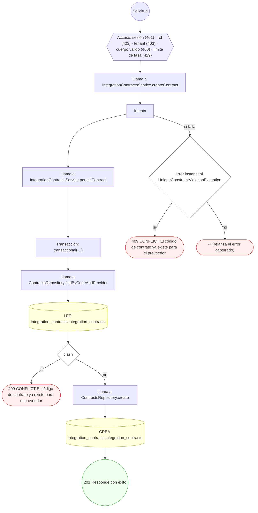

#### 2. POST /integration/contracts/{id}/auth-profiles/{apId}/rotate

Rotar las credenciales de un perfil de autenticación

| HTTP | Código | Cuándo |
|---|---|---|
| 200 | — | Éxito |
| 400 | `VALIDATION_FAILED` | Los parámetros de ruta son UUID válidos; El cuerpo cumple el DTO (sin propiedades extra) |
| 401 | `UNAUTHENTICATED` | Hay una sesión válida (JWT) |
| 403 | `FORBIDDEN` | El rol está permitido; El tenant se resuelve y pertenece al actor |
| 429 | `RATE_LIMITED` | No se supera el límite de solicitudes |

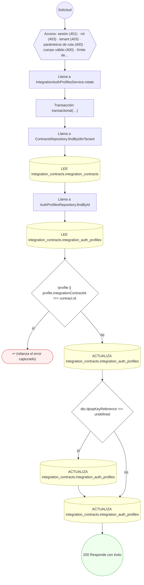

#### 3. POST /integration/contracts/{id}/exchanges

Ejecutar un intercambio idempotente (inbound)

| HTTP | Código | Cuándo |
|---|---|---|
| 201 | — | Éxito |
| 400 | `VALIDATION_FAILED` | Los parámetros de ruta son UUID válidos; El cuerpo cumple el DTO (sin propiedades extra) |
| 401 | `UNAUTHENTICATED` | Hay una sesión válida (JWT) |
| 403 | `FORBIDDEN` | El rol está permitido; El tenant se resuelve y pertenece al actor |
| 409 | `CONFLICT` | ConflictException: La clave de idempotencia se reusó con un payload distinto |
| 422 | `PRECONDITION_FAILED` | PreconditionFailedException: Falta la clave de idempotencia (idempotency-key); PreconditionFailedException: No hay versión ACTIVE del contrato |
| 429 | `RATE_LIMITED` | No se supera el límite de solicitudes |

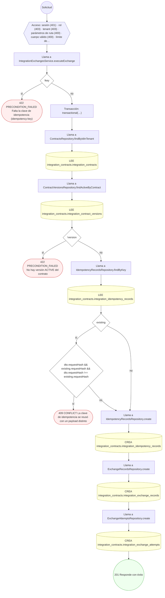

#### 4. POST /integration/contracts/{id}/exchanges/{recordId}/attempts

Registrar un intento de intercambio outbound

| HTTP | Código | Cuándo |
|---|---|---|
| 201 | — | Éxito |
| 400 | `VALIDATION_FAILED` | Los parámetros de ruta son UUID válidos; El cuerpo cumple el DTO (sin propiedades extra) |
| 401 | `UNAUTHENTICATED` | Hay una sesión válida (JWT) |
| 403 | `FORBIDDEN` | El rol está permitido; El tenant se resuelve y pertenece al actor |
| 429 | `RATE_LIMITED` | No se supera el límite de solicitudes |

```mermaid
flowchart TD
  n1(("Solicitud")):::inicio
  n2{{"Acceso: sesión (401) · rol (403) · tenant (403) · parámetros de ruta (400) · cuerpo válido (400) · límite de…"}}:::acceso
  n1 --> n2
  n3["Llama a IntegrationExchangesService.recordAttempt"]:::llamada
  n2 --> n3
  n4["Transacción: transactional(…)"]:::transaccion
  n3 --> n4
  n5["Llama a IntegrationExchangesService.resolveRecordInTenant"]:::llamada
  n4 --> n5
  n6["Llama a ExchangeRecordsRepository.findByIdForUpdate"]:::llamada
  n5 --> n6
  n7[("LEE integration_contracts.integration_exchange_records")]:::efecto
  n6 --> n7
  n8{"!record"}:::decision
  n7 --> n8
  n9(["↩ (relanza el error capturado)"]):::error
  n8 -->|"sí"| n9
  n10["Llama a ContractVersionsRepository.findById"]:::llamada
  n8 -->|"no"| n10
  n11[("LEE integration_contracts.integration_contract_versions")]:::efecto
  n10 --> n11
  n12{"!version"}:::decision
  n11 --> n12
  n13(["↩ (relanza el error capturado)"]):::error
  n12 -->|"sí"| n13
  n14["Llama a ContractsRepository.findByIdInTenant"]:::llamada
  n12 -->|"no"| n14
  n15[("LEE integration_contracts.integration_contracts")]:::efecto
  n14 --> n15
  n16{"expectedContractId !== undefined && contract.id !== expectedContractId"}:::decision
  n15 --> n16
  n17(["↩ (relanza el error capturado)"]):::error
  n16 -->|"sí"| n17
  n18["Llama a ExchangeAttemptsRepository.maxAttemptNumber"]:::llamada
  n16 -->|"no"| n18
  n19[("LEE integration_contracts.integration_exchange_attempts")]:::efecto
  n18 --> n19
  n20["Llama a ExchangeAttemptsRepository.create"]:::llamada
  n19 --> n20
  n21[("CREA integration_contracts.integration_exchange_attempts")]:::efecto
  n20 --> n21
  n22{"success"}:::decision
  n21 --> n22
  n23["Llama a IntegrationExchangesService.completeIdempotency"]:::llamada
  n22 -->|"sí"| n23
  n24["Llama a ContractVersionsRepository.findById"]:::llamada
  n23 --> n24
  n25[("LEE integration_contracts.integration_contract_versions")]:::efecto
  n24 --> n25
  n26["Llama a IdempotencyRecordsRepository.findByKey"]:::llamada
  n25 --> n26
  n27[("LEE integration_contracts.integration_idempotency_records")]:::efecto
  n26 --> n27
  n28[("ACTUALIZA integration_contracts.integration_idempotency_records · ACTUALIZA integration_contracts.integration…")]:::efecto
  n27 --> n28
  n29(("201 Responde con éxito")):::ok
  n28 --> n29
  n22 -->|"no"| n29
  classDef acceso fill:#eef,stroke:#66a
  classDef error fill:#fee,stroke:#c33
  classDef ok fill:#efe,stroke:#3a3
  classDef efecto fill:#ffd,stroke:#aa3
  classDef decision fill:#fff,stroke:#555
  classDef corte fill:#eee,stroke:#999,stroke-dasharray: 4
```

#### 5. POST /integration/contracts/{id}/retire

Retirar el contrato (soft-delete lógico)

| HTTP | Código | Cuándo |
|---|---|---|
| 200 | — | Éxito |
| 400 | `VALIDATION_FAILED` | Los parámetros de ruta son UUID válidos; El cuerpo cumple el DTO (sin propiedades extra) |
| 401 | `UNAUTHENTICATED` | Hay una sesión válida (JWT) |
| 403 | `FORBIDDEN` | El rol está permitido; El tenant se resuelve y pertenece al actor |
| 422 | `PRECONDITION_FAILED` | PreconditionFailedException: El contrato ya está retirado |
| 429 | `RATE_LIMITED` | No se supera el límite de solicitudes |

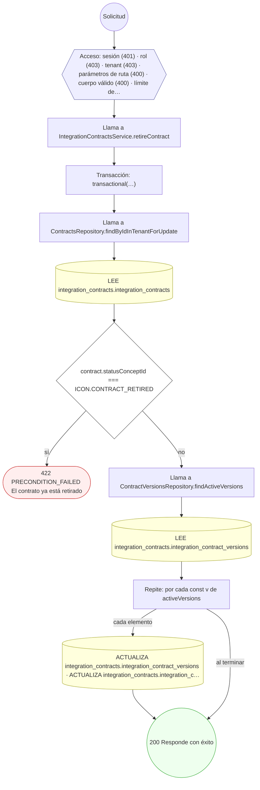

#### 6. POST /integration/contracts/{id}/sync-cursors/{scope}/advance

Avanzar el cursor de sincronización

| HTTP | Código | Cuándo |
|---|---|---|
| 200 | — | Éxito |
| 400 | `VALIDATION_FAILED` | Los parámetros de ruta son UUID válidos; El cuerpo cumple el DTO (sin propiedades extra) |
| 401 | `UNAUTHENTICATED` | Hay una sesión válida (JWT) |
| 403 | `FORBIDDEN` | El rol está permitido; El tenant se resuelve y pertenece al actor |
| 422 | `PRECONDITION_FAILED` | PreconditionFailedException: El cursor solo puede avanzar hacia adelante |
| 429 | `RATE_LIMITED` | No se supera el límite de solicitudes |

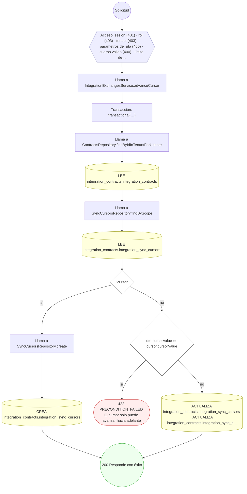

#### 7. POST /integration/contracts/{id}/versions

Publicar una nueva versión de contrato

| HTTP | Código | Cuándo |
|---|---|---|
| 201 | — | Éxito |
| 400 | `VALIDATION_FAILED` | Los parámetros de ruta son UUID válidos; El cuerpo cumple el DTO (sin propiedades extra) |
| 401 | `UNAUTHENTICATED` | Hay una sesión válida (JWT) |
| 403 | `FORBIDDEN` | El rol está permitido; El tenant se resuelve y pertenece al actor |
| 422 | `PRECONDITION_FAILED` | PreconditionFailedException: Solo se pueden publicar versiones en contratos DRAFT o ACTIVE |
| 429 | `RATE_LIMITED` | No se supera el límite de solicitudes |

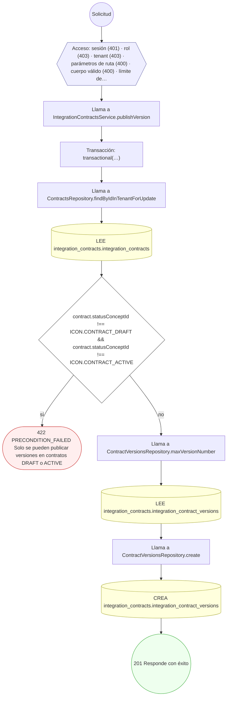

#### 8. POST /integration/contracts/{id}/versions/{versionId}/activate

Activar una versión y transicionar el estado del contrato

| HTTP | Código | Cuándo |
|---|---|---|
| 200 | — | Éxito |
| 400 | `VALIDATION_FAILED` | Los parámetros de ruta son UUID válidos; El cuerpo cumple el DTO (sin propiedades extra) |
| 401 | `UNAUTHENTICATED` | Hay una sesión válida (JWT) |
| 403 | `FORBIDDEN` | El rol está permitido; El tenant se resuelve y pertenece al actor |
| 422 | `PRECONDITION_FAILED` | PreconditionFailedException: Solo se puede activar una versión DRAFT |
| 429 | `RATE_LIMITED` | No se supera el límite de solicitudes |

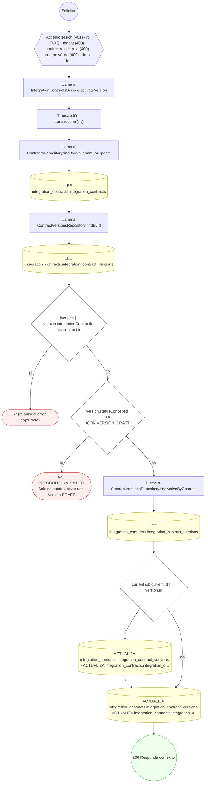

#### 9. POST /integration/contracts/{id}/webhook-subscriptions

Suscribir un webhook al contrato

| HTTP | Código | Cuándo |
|---|---|---|
| 201 | — | Éxito |
| 400 | `VALIDATION_FAILED` | Los parámetros de ruta son UUID válidos; El cuerpo cumple el DTO (sin propiedades extra) |
| 401 | `UNAUTHENTICATED` | Hay una sesión válida (JWT) |
| 403 | `FORBIDDEN` | El rol está permitido; El tenant se resuelve y pertenece al actor |
| 409 | `CONFLICT` | ConflictException: Ya existe una suscripción para ese evento y callback |
| 422 | `PRECONDITION_FAILED` | PreconditionFailedException: El contrato debe estar ACTIVE para suscribir webhooks |
| 429 | `RATE_LIMITED` | No se supera el límite de solicitudes |

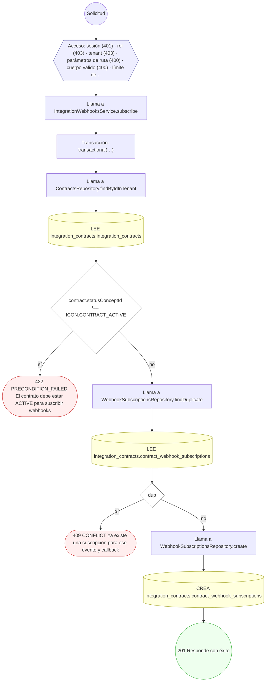

#### 10. POST /integration/exchanges/{recordId}/retry

Reintentar un intercambio fallido

| HTTP | Código | Cuándo |
|---|---|---|
| 201 | — | Éxito |
| 400 | `VALIDATION_FAILED` | Los parámetros de ruta son UUID válidos; El cuerpo cumple el DTO (sin propiedades extra) |
| 401 | `UNAUTHENTICATED` | Hay una sesión válida (JWT) |
| 403 | `FORBIDDEN` | El rol está permitido; El tenant se resuelve y pertenece al actor |
| 422 | `PRECONDITION_FAILED` | PreconditionFailedException: Solo se reintenta un intercambio con último intento FAILED; PreconditionFailedException: El último intento marcó fallo permanente (no reintentable) |
| 429 | `RATE_LIMITED` | No se supera el límite de solicitudes |

```mermaid
flowchart TD
  n1(("Solicitud")):::inicio
  n2{{"Acceso: sesión (401) · rol (403) · tenant (403) · parámetros de ruta (400) · cuerpo válido (400) · límite de…"}}:::acceso
  n1 --> n2
  n3["Llama a IntegrationExchangesService.retry"]:::llamada
  n2 --> n3
  n4["Transacción: transactional(…)"]:::transaccion
  n3 --> n4
  n5["Llama a IntegrationExchangesService.resolveRecordInTenant"]:::llamada
  n4 --> n5
  n6["Llama a ExchangeRecordsRepository.findByIdForUpdate"]:::llamada
  n5 --> n6
  n7[("LEE integration_contracts.integration_exchange_records")]:::efecto
  n6 --> n7
  n8{"!record"}:::decision
  n7 --> n8
  n9(["↩ (relanza el error capturado)"]):::error
  n8 -->|"sí"| n9
  n10["Llama a ContractVersionsRepository.findById"]:::llamada
  n8 -->|"no"| n10
  n11[("LEE integration_contracts.integration_contract_versions")]:::efecto
  n10 --> n11
  n12{"!version"}:::decision
  n11 --> n12
  n13(["↩ (relanza el error capturado)"]):::error
  n12 -->|"sí"| n13
  n14["Llama a ContractsRepository.findByIdInTenant"]:::llamada
  n12 -->|"no"| n14
  n15[("LEE integration_contracts.integration_contracts")]:::efecto
  n14 --> n15
  n16{"expectedContractId !== undefined && contract.id !== expectedContractId"}:::decision
  n15 --> n16
  n17(["↩ (relanza el error capturado)"]):::error
  n16 -->|"sí"| n17
  n18["Llama a ExchangeAttemptsRepository.lastAttempt"]:::llamada
  n16 -->|"no"| n18
  n19[("LEE integration_contracts.integration_exchange_attempts")]:::efecto
  n18 --> n19
  n20{"!last || last.outcomeConceptId !== ICON.ATTEMPT_FAILED"}:::decision
  n19 --> n20
  n21(["422 PRECONDITION_FAILED Solo se reintenta un intercambio con último intento FAILED"]):::error
  n20 -->|"sí"| n21
  n22{"last.retryDecisionConceptId === ICON.RETRY_PERMANENT"}:::decision
  n20 -->|"no"| n22
  n23(["422 PRECONDITION_FAILED El último intento marcó fallo permanente (no reintentable)"]):::error
  n22 -->|"sí"| n23
  n24["Llama a ExchangeAttemptsRepository.create"]:::llamada
  n22 -->|"no"| n24
  n25[("CREA integration_contracts.integration_exchange_attempts")]:::efecto
  n24 --> n25
  n26{"success"}:::decision
  n25 --> n26
  n27["Llama a IntegrationExchangesService.completeIdempotency"]:::llamada
  n26 -->|"sí"| n27
  n28["Llama a ContractVersionsRepository.findById"]:::llamada
  n27 --> n28
  n29[("LEE integration_contracts.integration_contract_versions")]:::efecto
  n28 --> n29
  n30["Llama a IdempotencyRecordsRepository.findByKey"]:::llamada
  n29 --> n30
  n31[("LEE integration_contracts.integration_idempotency_records")]:::efecto
  n30 --> n31
  n32[("ACTUALIZA integration_contracts.integration_idempotency_records · ACTUALIZA integration_contracts.integration…")]:::efecto
  n31 --> n32
  n33(("201 Responde con éxito")):::ok
  n32 --> n33
  n26 -->|"no"| n33
  classDef acceso fill:#eef,stroke:#66a
  classDef error fill:#fee,stroke:#c33
  classDef ok fill:#efe,stroke:#3a3
  classDef efecto fill:#ffd,stroke:#aa3
  classDef decision fill:#fff,stroke:#555
  classDef corte fill:#eee,stroke:#999,stroke-dasharray: 4
```

#### 11. POST /integration/webhooks/{subscriptionId}/deliveries

Entregar y verificar un webhook firmado

| HTTP | Código | Cuándo |
|---|---|---|
| 201 | — | Éxito |
| 400 | `VALIDATION_FAILED` | Los parámetros de ruta son UUID válidos; El cuerpo cumple el DTO (sin propiedades extra) |
| 401 | `UNAUTHENTICATED` | Hay una sesión válida (JWT) |
| 403 | `FORBIDDEN` | El rol está permitido; El tenant se resuelve y pertenece al actor |
| 422 | `PRECONDITION_FAILED` | PreconditionFailedException: La suscripción no está ACTIVE; PreconditionFailedException: La suscripción aún no es válida; PreconditionFailedException: La suscripción ya expiró; PreconditionFailedException: No hay versión ACTIVE del contrato para entregar; PreconditionFailedException: La suscripción no tiene callbackUri para entregar; PreconditionFailedException: El cuerpo del despacho excede el tamaño permitido |
| 429 | `RATE_LIMITED` | No se supera el límite de solicitudes |

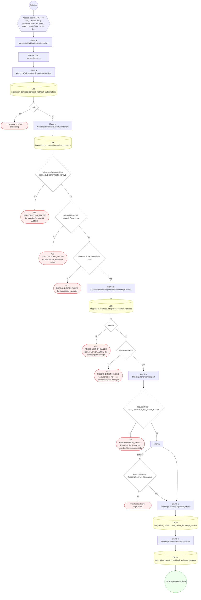

### Operaciones sin decisiones propias

Sólo comprueban el acceso y leen o escriben: no tienen ramas que dibujar. Su detalle está en la ficha de endpoints.

| Operación | Respuestas posibles | Tablas |
|---|---|---|
| POST /integration/contracts/{id}/auth-profiles | 201, 400, 401, 403, 429 | 2 |
