<!-- AUTOGENERADO por tools/inventario/flujos.mjs. No editar manualmente. -->

# Flujos del módulo `integrations`

- **Procesos:** 1 · **Máquinas de estado:** 0
- **Operaciones:** 15 (13 con decisiones propias, 2 sin ellas)
- Inventario de endpoints del módulo: [integrations](../endpoints/integrations.md)

## Proceso: Integraciones externas

- **Código:** `integrations` · **Agrupación:** AGRUPACION_POR_CONTROLADOR · **Operaciones:** 15
- **Actores:** Cualquier sesión válida · Público (sin sesión) · SECURITY_ADMIN · SYSTEM
- **Revisión:** AUTO_DETECTADA
- **Fuentes:** `src/modules/integrations/README.md`

### Para qué sirve

Gestiona proveedores, conexiones tenantizadas, referencias a credenciales, endpoints versionados, mensajería saliente, reintentos, callbacks entrantes y suscripciones de webhook. Persiste en el esquema PostgreSQL `integrations`; los workers consumen los endpoints internos de descubrimiento, despacho, reintento y correlación.

_Fuente: `src/modules/integrations/README.md:3`_

### Etapas y operaciones

| Etapa | Descripción | Operación | Quién actúa | Riesgo | Tablas |
|---|---|---|---|---|---|
| `ctrl:IntegrationsConnectionsController` | Operaciones de IntegrationsConnectionsController que el README no asigna a un caso de uso | POST /integrations/connections/{id}:pause | SECURITY_ADMIN | MEDIO | 3 |
|  |  | POST /integrations/connections/{id}/credentials:rotate | SECURITY_ADMIN | MEDIO | 4 |
| `ctrl:IntegrationsMessagesController` | Operaciones de IntegrationsMessagesController que el README no asigna a un caso de uso | POST /integrations/messages:outbound | Cualquier sesión válida | ALTO | 3 |
|  |  | POST /integrations/messages/{id}:correlate | SYSTEM · SECURITY_ADMIN | MEDIO | 6 |
|  |  | POST /integrations/messages/{id}:dead-letter | SYSTEM · SECURITY_ADMIN | MEDIO | 4 |
|  |  | POST /integrations/messages/{id}:dispatch | SYSTEM · SECURITY_ADMIN | MEDIO | 7 |
|  |  | POST /integrations/messages/{id}:retry | SYSTEM · SECURITY_ADMIN | MEDIO | 4 |
|  |  | GET /integrations/messages/pending-correlation | SYSTEM · SECURITY_ADMIN | BAJO | 2 |
|  |  | GET /integrations/messages/pending-dispatch | SYSTEM · SECURITY_ADMIN | BAJO | 2 |
|  |  | GET /integrations/messages/pending-retry | SYSTEM · SECURITY_ADMIN | BAJO | 3 |
| `ctrl:IntegrationsProvidersController` | Operaciones de IntegrationsProvidersController que el README no asigna a un caso de uso | POST /integrations/providers | SECURITY_ADMIN | MEDIO | 2 |
|  |  | POST /integrations/providers/{id}/connections | SECURITY_ADMIN | MEDIO | 3 |
|  |  | POST /integrations/providers/{id}/endpoints | SECURITY_ADMIN | MEDIO | 4 |
|  |  | POST /integrations/providers/{id}/webhook-subscriptions | SECURITY_ADMIN | MEDIO | 4 |
| `ctrl:IntegrationsWebhooksController` | Operaciones de IntegrationsWebhooksController que el README no asigna a un caso de uso | POST /integrations/webhooks/inbound | Público (sin sesión) | ALTO | 4 |

### Diagrama — etapas `ctrl:IntegrationsConnectionsController`, `ctrl:IntegrationsMessagesController`, `ctrl:IntegrationsProvidersController`…

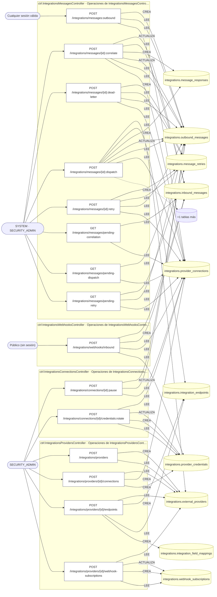

## Árbol de decisión por operación

Cada árbol se deriva del código del handler y de los métodos que invoca (hasta 4 niveles). Una rama que no decide, no escribe y no falla se poda. Los accesos y los efectos consecutivos se agrupan en un solo nodo.

### Operaciones con decisiones propias

#### 1. POST /integrations/connections/{id}:pause

Pausar una conexión en fallo (circuit breaker)

| HTTP | Código | Cuándo |
|---|---|---|
| 200 | — | Éxito |
| 400 | `VALIDATION_FAILED` | Los parámetros de ruta son UUID válidos |
| 401 | `UNAUTHENTICATED` | Hay una sesión válida (JWT) |
| 403 | `FORBIDDEN` | El rol está permitido; El tenant se resuelve y pertenece al actor |
| 422 | `PRECONDITION_FAILED` | PreconditionFailedException: La conexión no está activa |
| 429 | `RATE_LIMITED` | No se supera el límite de solicitudes |

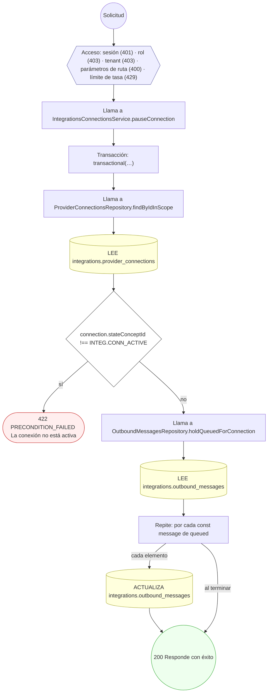

#### 2. POST /integrations/connections/{id}/credentials:rotate

Rotar/expirar la credencial de una conexión

| HTTP | Código | Cuándo |
|---|---|---|
| 200 | — | Éxito |
| 400 | `VALIDATION_FAILED` | Los parámetros de ruta son UUID válidos; El cuerpo cumple el DTO (sin propiedades extra) |
| 401 | `UNAUTHENTICATED` | Hay una sesión válida (JWT) |
| 403 | `FORBIDDEN` | El rol está permitido; El tenant se resuelve y pertenece al actor |
| 422 | `PRECONDITION_FAILED` | PreconditionFailedException: La conexión no está activa |
| 429 | `RATE_LIMITED` | No se supera el límite de solicitudes |

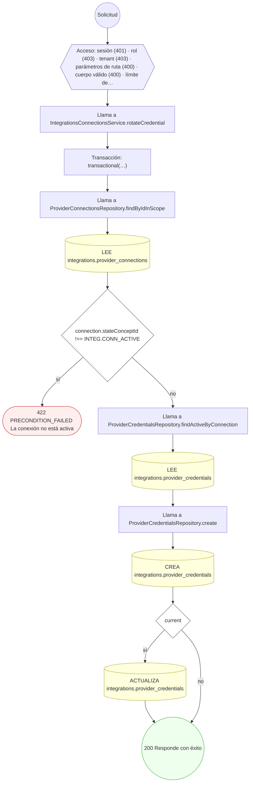

#### 3. POST /integrations/messages:outbound

Encolar un mensaje saliente (idempotente)

| HTTP | Código | Cuándo |
|---|---|---|
| 201 | — | Éxito |
| 400 | `VALIDATION_FAILED` | El cuerpo cumple el DTO (sin propiedades extra) |
| 401 | `UNAUTHENTICATED` | Hay una sesión válida (JWT) |
| 403 | `FORBIDDEN` | El rol está permitido; El tenant se resuelve y pertenece al actor |
| 409 | `CONFLICT` | ConflictException: La clave de idempotencia ya está en uso |
| 422 | `PRECONDITION_FAILED` | PreconditionFailedException: La conexión no está activa |
| 429 | `RATE_LIMITED` | No se supera el límite de solicitudes |

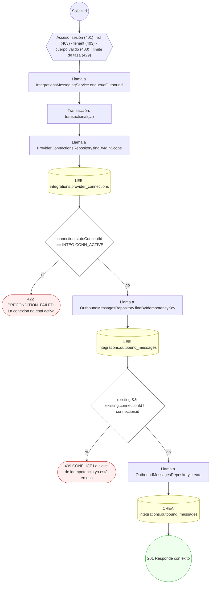

#### 4. POST /integrations/messages/{id}:correlate

Procesar callback/respuesta asíncrona del proveedor

| HTTP | Código | Cuándo |
|---|---|---|
| 200 | — | Éxito |
| 400 | `VALIDATION_FAILED` | Los parámetros de ruta son UUID válidos |
| 401 | `UNAUTHENTICATED` | Hay una sesión válida (JWT) |
| 403 | `FORBIDDEN` | El rol está permitido; El tenant se resuelve y pertenece al actor |
| 404 | `NOT_FOUND` | ResourceNotFoundException: No hay mensaje saliente correlacionado |
| 422 | `PRECONDITION_FAILED` | PreconditionFailedException: El mensaje entrante no está en estado recibido; PreconditionFailedException: El mensaje entrante no tiene correlación |
| 429 | `RATE_LIMITED` | No se supera el límite de solicitudes |

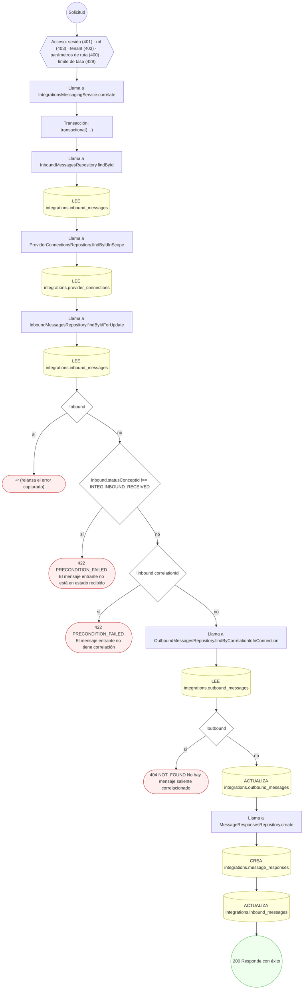

#### 5. POST /integrations/messages/{id}:dead-letter

Enviar a dead-letter tras agotar reintentos

| HTTP | Código | Cuándo |
|---|---|---|
| 200 | — | Éxito |
| 400 | `VALIDATION_FAILED` | Los parámetros de ruta son UUID válidos |
| 401 | `UNAUTHENTICATED` | Hay una sesión válida (JWT) |
| 403 | `FORBIDDEN` | El rol está permitido; El tenant se resuelve y pertenece al actor |
| 422 | `PRECONDITION_FAILED` | PreconditionFailedException: El mensaje no está en estado fallido |
| 429 | `RATE_LIMITED` | No se supera el límite de solicitudes |

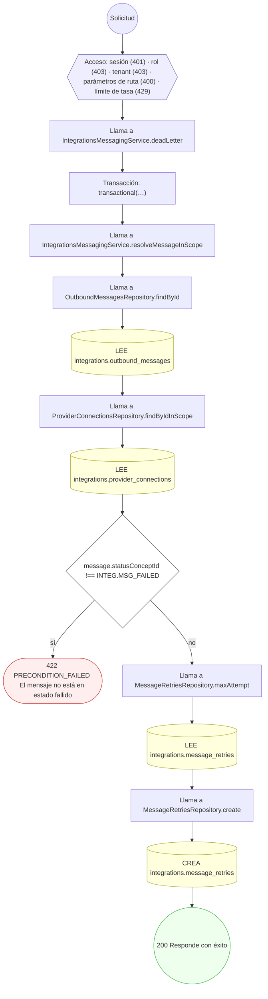

#### 6. POST /integrations/messages/{id}:dispatch

Despachar un mensaje y registrar su respuesta

| HTTP | Código | Cuándo |
|---|---|---|
| 200 | — | Éxito |
| 400 | `VALIDATION_FAILED` | Los parámetros de ruta son UUID válidos; El cuerpo cumple el DTO (sin propiedades extra) |
| 401 | `UNAUTHENTICATED` | Hay una sesión válida (JWT) |
| 403 | `FORBIDDEN` | El rol está permitido; El tenant se resuelve y pertenece al actor |
| 422 | `PRECONDITION_FAILED` | PreconditionFailedException: El mensaje no está en cola; PreconditionFailedException: El proveedor no tiene base_url configurada para el despacho; PreconditionFailedException: La conexión no tiene un secreto activo disponible; PreconditionFailedException: El cuerpo del despacho excede el tamaño permitido |
| 429 | `RATE_LIMITED` | No se supera el límite de solicitudes |

```mermaid
flowchart TD
  n1(("Solicitud")):::inicio
  n2{{"Acceso: sesión (401) · rol (403) · tenant (403) · parámetros de ruta (400) · cuerpo válido (400) · límite de…"}}:::acceso
  n1 --> n2
  n3["Llama a IntegrationsMessagingService.dispatch"]:::llamada
  n2 --> n3
  n4["Transacción: transactional(…)"]:::transaccion
  n3 --> n4
  n5["Llama a OutboundMessagesRepository.findById"]:::llamada
  n4 --> n5
  n6[("LEE integrations.outbound_messages")]:::efecto
  n5 --> n6
  n7["Llama a ProviderConnectionsRepository.findByIdInScope"]:::llamada
  n6 --> n7
  n8[("LEE integrations.provider_connections")]:::efecto
  n7 --> n8
  n9["Llama a OutboundMessagesRepository.findByIdForUpdate"]:::llamada
  n8 --> n9
  n10[("LEE integrations.outbound_messages")]:::efecto
  n9 --> n10
  n11{"!message || message.connectionId !== connection.id"}:::decision
  n10 --> n11
  n12(["↩ (relanza el error capturado)"]):::error
  n11 -->|"sí"| n12
  n13{"message.statusConceptId !== INTEG.MSG_QUEUED"}:::decision
  n11 -->|"no"| n13
  n14(["422 PRECONDITION_FAILED El mensaje no está en cola"]):::error
  n13 -->|"sí"| n14
  n15["Llama a ExternalProvidersRepository.findById"]:::llamada
  n13 -->|"no"| n15
  n16[("LEE integrations.external_providers")]:::efecto
  n15 --> n16
  n17{"!provider?.baseUrl"}:::decision
  n16 --> n17
  n18(["422 PRECONDITION_FAILED El proveedor no tiene base_url configurada para el despacho"]):::error
  n17 -->|"sí"| n18
  n19{"message.endpointId"}:::decision
  n17 -->|"no"| n19
  n20["Llama a IntegrationEndpointsRepository.findById"]:::llamada
  n19 -->|"sí"| n20
  n21[("LEE integrations.integration_endpoints")]:::efecto
  n20 --> n21
  n22["Llama a IntegrationsSecretsService.resolveActiveSecrets"]:::llamada
  n21 --> n22
  n19 -->|"no"| n22
  n23["Llama a ProviderConnectionsRepository.findById"]:::llamada
  n22 --> n23
  n24[("LEE integrations.provider_connections")]:::efecto
  n23 --> n24
  n25["Llama a ProviderCredentialsRepository.findActiveByConnection"]:::llamada
  n24 --> n25
  n26[("LEE integrations.provider_credentials")]:::efecto
  n25 --> n26
  n27{"!secrets"}:::decision
  n26 --> n27
  n28(["422 PRECONDITION_FAILED La conexión no tiene un secreto activo disponible"]):::error
  n27 -->|"sí"| n28
  n29["Llama a HttpDispatcherService.post"]:::llamada
  n27 -->|"no"| n29
  n30{"requestBytes › MAX_DISPATCH_REQUEST_BYTES"}:::decision
  n29 --> n30
  n31(["422 PRECONDITION_FAILED El cuerpo del despacho excede el tamaño permitido"]):::error
  n30 -->|"sí"| n31
  n32["Intenta"]:::intento
  n30 -->|"no"| n32
  n33{"error instanceof PreconditionFailedException"}:::decision
  n32 -->|"si falla"| n33
  n34(["↩ (relanza el error capturado)"]):::error
  n33 -->|"sí"| n34
  n35[("ACTUALIZA integrations.outbound_messages · ACTUALIZA integrations.outbound_messages")]:::efecto
  n32 --> n35
  n33 -->|"no"| n35
  n36["Llama a MessageResponsesRepository.create"]:::llamada
  n35 --> n36
  n37[("CREA integrations.message_responses")]:::efecto
  n36 --> n37
  n38(("200 Responde con éxito")):::ok
  n37 --> n38
  classDef acceso fill:#eef,stroke:#66a
  classDef error fill:#fee,stroke:#c33
  classDef ok fill:#efe,stroke:#3a3
  classDef efecto fill:#ffd,stroke:#aa3
  classDef decision fill:#fff,stroke:#555
  classDef corte fill:#eee,stroke:#999,stroke-dasharray: 4
```

#### 7. POST /integrations/messages/{id}:retry

Programar un reintento con backoff exponencial

| HTTP | Código | Cuándo |
|---|---|---|
| 200 | — | Éxito |
| 400 | `VALIDATION_FAILED` | Los parámetros de ruta son UUID válidos |
| 401 | `UNAUTHENTICATED` | Hay una sesión válida (JWT) |
| 403 | `FORBIDDEN` | El rol está permitido; El tenant se resuelve y pertenece al actor |
| 422 | `PRECONDITION_FAILED` | PreconditionFailedException: El mensaje no está en estado fallido; PreconditionFailedException: Se agotaron los reintentos (usar dead-letter) |
| 429 | `RATE_LIMITED` | No se supera el límite de solicitudes |

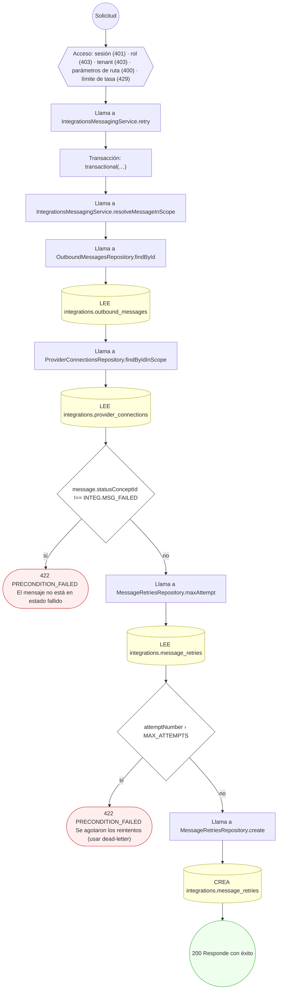

#### 8. GET /integrations/messages/pending-retry

Listar mensajes FAILED candidatos a reintento o dead-letter

| HTTP | Código | Cuándo |
|---|---|---|
| 200 | — | Éxito |
| 401 | `UNAUTHENTICATED` | Hay una sesión válida (JWT) |
| 403 | `FORBIDDEN` | El rol está permitido; El tenant se resuelve y pertenece al actor |
| 429 | `RATE_LIMITED` | No se supera el límite de solicitudes |

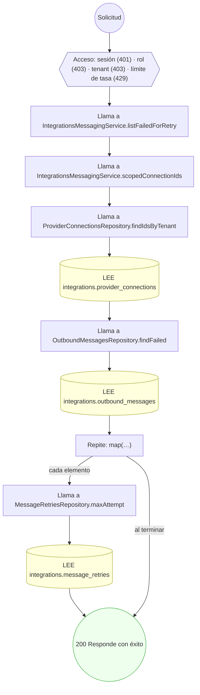

#### 9. POST /integrations/providers

Registrar un proveedor externo

| HTTP | Código | Cuándo |
|---|---|---|
| 201 | — | Éxito |
| 400 | `VALIDATION_FAILED` | El cuerpo cumple el DTO (sin propiedades extra) |
| 401 | `UNAUTHENTICATED` | Hay una sesión válida (JWT) |
| 403 | `FORBIDDEN` | El rol está permitido; El tenant se resuelve y pertenece al actor |
| 409 | `CONFLICT` | ConflictException: Ya existe un proveedor con ese código |
| 429 | `RATE_LIMITED` | No se supera el límite de solicitudes |

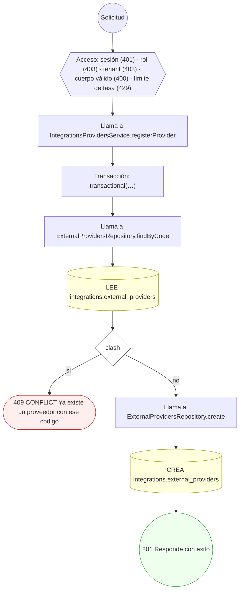

#### 10. POST /integrations/providers/{id}/connections

Aprovisionar una conexión de tenant y su credencial

| HTTP | Código | Cuándo |
|---|---|---|
| 201 | — | Éxito |
| 400 | `VALIDATION_FAILED` | Los parámetros de ruta son UUID válidos; El cuerpo cumple el DTO (sin propiedades extra) |
| 401 | `UNAUTHENTICATED` | Hay una sesión válida (JWT) |
| 403 | `FORBIDDEN` | El rol está permitido; El tenant se resuelve y pertenece al actor |
| 404 | `NOT_FOUND` | ResourceNotFoundException: Proveedor no encontrado |
| 422 | `PRECONDITION_FAILED` | PreconditionFailedException: El proveedor no está activo |
| 429 | `RATE_LIMITED` | No se supera el límite de solicitudes |

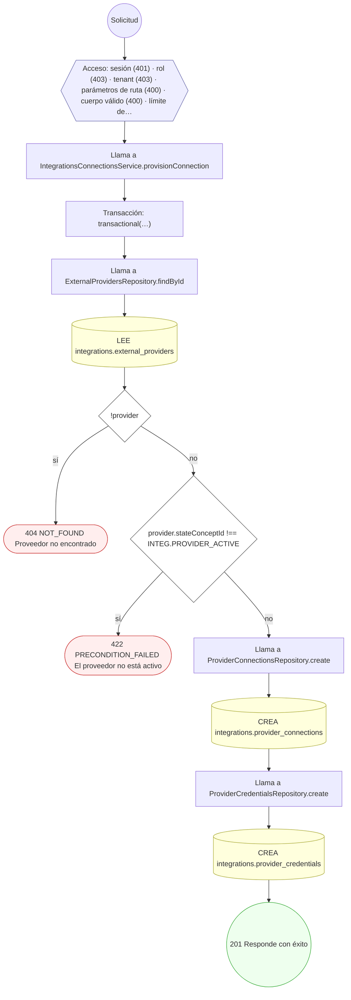

#### 11. POST /integrations/providers/{id}/endpoints

Publicar un endpoint versionado y su mapeo de campos

| HTTP | Código | Cuándo |
|---|---|---|
| 201 | — | Éxito |
| 400 | `VALIDATION_FAILED` | Los parámetros de ruta son UUID válidos; El cuerpo cumple el DTO (sin propiedades extra) |
| 401 | `UNAUTHENTICATED` | Hay una sesión válida (JWT) |
| 403 | `FORBIDDEN` | El rol está permitido; El tenant se resuelve y pertenece al actor |
| 404 | `NOT_FOUND` | ResourceNotFoundException: Proveedor no encontrado |
| 409 | `CONFLICT` | ConflictException: Ya existe un endpoint con esa versión para el proveedor |
| 422 | `PRECONDITION_FAILED` | PreconditionFailedException: El proveedor no está activo |
| 429 | `RATE_LIMITED` | No se supera el límite de solicitudes |

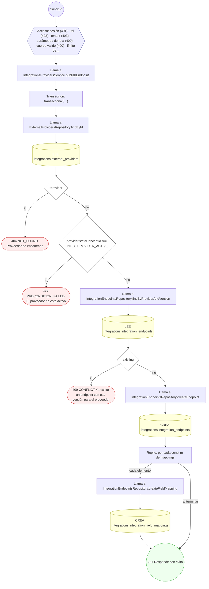

#### 12. POST /integrations/providers/{id}/webhook-subscriptions

Gestionar (crear/actualizar) una suscripción de webhook

| HTTP | Código | Cuándo |
|---|---|---|
| 201 | — | Éxito |
| 400 | `VALIDATION_FAILED` | Los parámetros de ruta son UUID válidos; El cuerpo cumple el DTO (sin propiedades extra) |
| 401 | `UNAUTHENTICATED` | Hay una sesión válida (JWT) |
| 403 | `FORBIDDEN` | El rol está permitido; El tenant se resuelve y pertenece al actor |
| 404 | `NOT_FOUND` | ResourceNotFoundException: Proveedor no encontrado |
| 422 | `PRECONDITION_FAILED` | PreconditionFailedException: El proveedor no está activo |
| 429 | `RATE_LIMITED` | No se supera el límite de solicitudes |

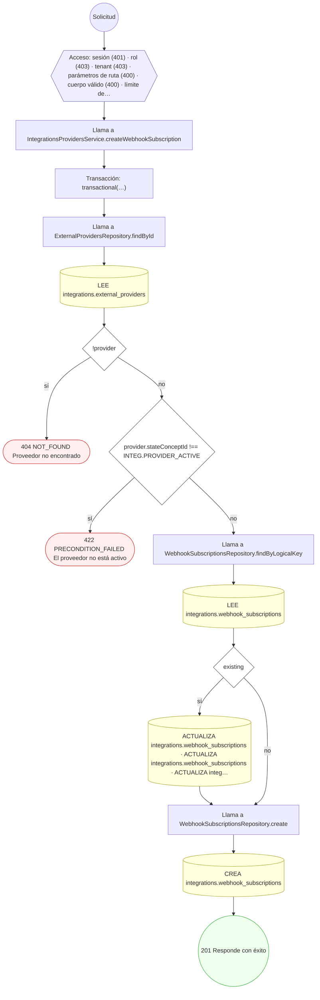

#### 13. POST /integrations/webhooks/inbound

Recibir un mensaje entrante (idempotencia por firma)

| HTTP | Código | Cuándo |
|---|---|---|
| 201 | — | Éxito |
| 400 | `VALIDATION_FAILED` | El cuerpo cumple el DTO (sin propiedades extra) |
| 401 | `UNAUTHENTICATED` | Hay una sesión válida (JWT); UnauthorizedException: Firma del webhook inválida |
| 404 | `NOT_FOUND` | ResourceNotFoundException: Conexión no encontrada |
| 422 | `PRECONDITION_FAILED` | PreconditionFailedException: La conexión no tiene un secreto activo disponible |
| 429 | `RATE_LIMITED` | No se supera el límite de solicitudes |

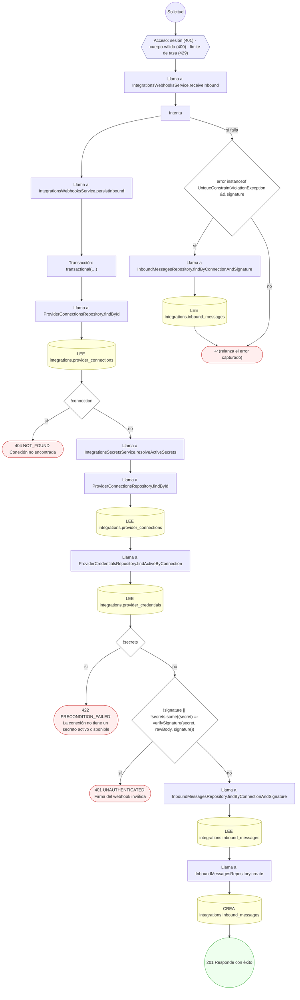

### Operaciones sin decisiones propias

Sólo comprueban el acceso y leen o escriben: no tienen ramas que dibujar. Su detalle está en la ficha de endpoints.

| Operación | Respuestas posibles | Tablas |
|---|---|---|
| GET /integrations/messages/pending-correlation | 200, 401, 403, 429 | 2 |
| GET /integrations/messages/pending-dispatch | 200, 401, 403, 429 | 2 |
