<!-- AUTOGENERADO por tools/inventario/flujos.mjs. No editar manualmente. -->

# Flujos del módulo `lakehouse`

- **Procesos:** 1 · **Máquinas de estado:** 0
- **Operaciones:** 13 (12 con decisiones propias, 1 sin ellas)
- Inventario de endpoints del módulo: [lakehouse](../endpoints/lakehouse.md)

## Proceso: Módulo 63 — Lakehouse, productos de datos analíticos y releases de investigación

- **Código:** `lakehouse` · **Agrupación:** MIXTO · **Operaciones:** 13
- **Actores:** DATA_PLATFORM_ENGINEER · DATA_PRODUCT_OWNER · DATA_STEWARD · DEIDENTIFICATION_WORKER · DPO · PLATFORM_ADMIN · PRINCIPAL_INVESTIGATOR · RESEARCH_GOVERNANCE · SYSTEM · TRANSFORMATION_WORKER
- **Revisión:** AUTO_DETECTADA
- **Fuentes:** `src/modules/lakehouse/README.md`

### Para qué sirve

Zonas del lago, metastores, productos de datos con contrato versionado, datasets físicos con su esquema, corridas de transformación que materializan particiones inmutables con su linaje, control de calidad que cuarentena lo que no cumple, y releases de investigación de-identificados **que siempre caducan**.

_Fuente: `src/modules/lakehouse/README.md:3`_

### Flujo general declarado en el README

```text
CATÁLOGO
  zones ──────────────> raw · standardized · curated · research
  catalogs ───────────> metastore con formato por defecto
  data-products/:id/versions ──> upsert del producto + versión ACTIVE
                                 la vigente anterior queda SUPERSEDED
                                 del SLO salen las reglas de calidad
  datasets ───────────> exige versión de producto ACTIVA + zona y catálogo activos
                        + esquema 1 con su huella

EJECUCIÓN
  transformations/:defId/runs ──> una sola corrida viva por definición
        partición cuya huella ya existe ⇒ se salta
        archivo cuyo hash ya existe ⇒ se salta
        linaje en la MISMA transacción (UC-63-06)
  ingestion/curated-runs ───────> destino obligatoriamente en zona CURATED
                                  corrida de de-identificación en la misma tx
  datasets/:id/quality-runs ────> regla blocking incumplida ⇒ dataset QUARANTINED

INVESTIGACIÓN
  projects/:id/cohorts ─────────> upsert del proyecto + cohorte
                                  ventana ética coherente y vigente
  dataset-releases ─────────────> ventana ética comprobada AL SOLICITAR
                                  PHI ⇒ cohorte con perfil de de-identificación
    └─ /approve ────────────────> deid run + manifiesto + released, misma tx
                                  expiresAt NUNCA sobrevive a la aprobación ética
    └─ /revoke ─────────────────> expired (fin de plazo) ≠ revoked (decisión)
```

_Fuente: `src/modules/lakehouse/README.md:72`_

### Etapas y operaciones

| Etapa | Descripción | Operación | Quién actúa | Riesgo | Tablas |
|---|---|---|---|---|---|
| `UC-63-01` | Zona del data lake | POST /lakehouse/zones | DATA_PLATFORM_ENGINEER · PLATFORM_ADMIN | MEDIO | 5 |
| `UC-63-02` | Catálogo / metastore | POST /lakehouse/catalogs | DATA_PLATFORM_ENGINEER · PLATFORM_ADMIN | MEDIO | 5 |
| `UC-63-03` | Producto y versión con contrato y SLO | POST /lakehouse/data-products/{id}/versions | DATA_PRODUCT_OWNER · PLATFORM_ADMIN | MEDIO | 10 |
| `UC-63-04` | Dataset y versión de esquema | POST /lakehouse/datasets | DATA_PLATFORM_ENGINEER · PLATFORM_ADMIN | MEDIO | 10 |
| `UC-63-05` | Corrida: particiones y archivos | POST /lakehouse/transformations/{defId}/runs | SYSTEM · TRANSFORMATION_WORKER · PLATFORM_ADMIN | MEDIO | 13 |
| `UC-63-07` | Ingesta de salud de-identificada | POST /lakehouse/ingestion/curated-runs | SYSTEM · DEIDENTIFICATION_WORKER · PLATFORM_ADMIN | MEDIO | 12 |
| `UC-63-08` | Calidad y hallazgos | POST /lakehouse/datasets/{id}/quality-runs | DATA_STEWARD · SYSTEM · PLATFORM_ADMIN | MEDIO | 10 |
| `UC-63-09` | Proyecto y cohorte | POST /research/projects/{id}/cohorts | PRINCIPAL_INVESTIGATOR · RESEARCH_GOVERNANCE · PLATFORM_ADMIN | MEDIO | 9 |
| `UC-63-10` | Solicitar release | POST /research/dataset-releases | PRINCIPAL_INVESTIGATOR · PLATFORM_ADMIN | MEDIO | 8 |
| `UC-63-11` | Aprobar y materializar | POST /research/dataset-releases/{id}/approve | RESEARCH_GOVERNANCE · DPO · PLATFORM_ADMIN | MEDIO | 9 |
| `UC-63-12` | Expirar o revocar | POST /research/dataset-releases/{id}/revoke | RESEARCH_GOVERNANCE · DPO · SYSTEM · PLATFORM_ADMIN | MEDIO | 6 |
| `ctrl:ResearchController` | Operaciones de ResearchController que el README no asigna a un caso de uso | GET /research/dataset-releases/expired | RESEARCH_GOVERNANCE · DPO · SYSTEM · PLATFORM_ADMIN | BAJO | 2 |
|  |  | POST /research/deidentification-profiles | RESEARCH_GOVERNANCE · DPO · PRINCIPAL_INVESTIGATOR · PLATFORM_ADMIN | MEDIO | 1 |

### Diagrama — etapas `UC-63-01`, `UC-63-02`, `UC-63-03`…

```mermaid
flowchart LR
  a2(["DATA_PLATFORM_ENGINEER · PLATFORM_ADMIN"]):::actor
  a11(["DATA_PRODUCT_OWNER · PLATFORM_ADMIN"]):::actor
  a21(["SYSTEM · TRANSFORMATION_WORKER · PLATFORM_ADMIN"]):::actor
  a29(["SYSTEM · DEIDENTIFICATION_WORKER · PLATFORM_ADMIN"]):::actor
  a35(["DATA_STEWARD · SYSTEM · PLATFORM_ADMIN"]):::actor
  a42(["PRINCIPAL_INVESTIGATOR · RESEARCH_GOVERNANCE · PLATFORM_ADM…"]):::actor
  a48(["PRINCIPAL_INVESTIGATOR · PLATFORM_ADMIN"]):::actor
  a53(["RESEARCH_GOVERNANCE · DPO · PLATFORM_ADMIN"]):::actor
  a58(["RESEARCH_GOVERNANCE · DPO · SYSTEM · PLATFORM_ADMIN"]):::actor
  a62(["RESEARCH_GOVERNANCE · DPO · PRINCIPAL_INVESTIGATOR · PLATFO…"]):::actor
  t3[("lakehouse.data_lake_zones")]:::tabla
  t4[("messaging.domain_events")]:::tabla
  t5[("messaging.outbox_messages")]:::tabla
  e6>"LakeZoneDefined"]:::evento
  t8[("lakehouse.lakehouse_catalogs")]:::tabla
  e9>"LakehouseCatalogRegistered"]:::evento
  t12[("lakehouse.data_product_versions")]:::tabla
  t13[("lakehouse.data_products")]:::tabla
  e15>"DataProductVersionPublished"]:::evento
  t17[("lakehouse.lakehouse_datasets")]:::tabla
  e19>"LakehouseDatasetRegistered"]:::evento
  t22[("lakehouse.lakehouse_files")]:::tabla
  t23[("lakehouse.lakehouse_lineage_edges")]:::tabla
  t24[("lakehouse.lakehouse_partitions")]:::tabla
  e26>"TransformationRunCompleted"]:::evento
  e27>"LineageRecorded"]:::evento
  t30[("health_data.health_deidentification_profiles")]:::tabla
  t31[("health_data.health_deidentification_runs")]:::tabla
  e33>"HealthBatchDeidentified"]:::evento
  t36[("lakehouse.lakehouse_quality_issues")]:::tabla
  t37[("lakehouse.lakehouse_quality_rules")]:::tabla
  t38[("lakehouse.lakehouse_quality_runs")]:::tabla
  e40>"QualityRunEvaluated"]:::evento
  t43[("lakehouse.cohort_definitions")]:::tabla
  t44[("lakehouse.research_projects")]:::tabla
  e46>"CohortDefined"]:::evento
  t49[("lakehouse.dataset_release_requests")]:::tabla
  e51>"DatasetReleaseRequested"]:::evento
  t54[("lakehouse.dataset_release_manifests")]:::tabla
  e56>"DatasetReleaseMaterialized"]:::evento
  e59>"DatasetReleaseRevoked"]:::evento
  subgraph s0["UC-63-01 · Zona del data lake"]
    o1["POST /lakehouse/zones"]:::op
  end
  subgraph s1["UC-63-02 · Catálogo / metastore"]
    o7["POST /lakehouse/catalogs"]:::op
  end
  t14[("+4 tablas más")]
  subgraph s2["UC-63-03 · Producto y versión con contrato y SLO"]
    o10["POST /lakehouse/data-products/{id}/versions"]:::op
  end
  t18[("+4 tablas más")]
  subgraph s3["UC-63-04 · Dataset y versión de esquema"]
    o16["POST /lakehouse/datasets"]:::op
  end
  t25[("+7 tablas más")]
  subgraph s4["UC-63-05 · Corrida: particiones y archivos"]
    o20["POST /lakehouse/transformations/{defId}/runs"]:::op
  end
  t32[("+6 tablas más")]
  subgraph s5["UC-63-07 · Ingesta de salud de-identificada"]
    o28["POST /lakehouse/ingestion/curated-runs"]:::op
  end
  t39[("+4 tablas más")]
  subgraph s6["UC-63-08 · Calidad y hallazgos"]
    o34["POST /lakehouse/datasets/{id}/quality-runs"]:::op
  end
  t45[("+3 tablas más")]
  subgraph s7["UC-63-09 · Proyecto y cohorte"]
    o41["POST /research/projects/{id}/cohorts"]:::op
  end
  t50[("+2 tablas más")]
  subgraph s8["UC-63-10 · Solicitar release"]
    o47["POST /research/dataset-releases"]:::op
  end
  t55[("+3 tablas más")]
  subgraph s9["UC-63-11 · Aprobar y materializar"]
    o52["POST /research/dataset-releases/{id}/approve"]:::op
  end
  subgraph s10["UC-63-12 · Expirar o revocar"]
    o57["POST /research/dataset-releases/{id}/revoke"]:::op
  end
  subgraph s11["ctrl:ResearchController · Operaciones de ResearchController que el README no as…"]
    o60["GET /research/dataset-releases/expired"]:::op
    o61["POST /research/deidentification-profiles"]:::op
  end
  a2 --> o1
  o1 -->|"CREA"| t3
  o1 -->|"LEE"| t3
  o1 -->|"CREA"| t4
  o1 -->|"CREA"| t5
  o1 -->|"LEE"| t5
  o1 -->|"evento"| e6
  a2 --> o7
  o7 -->|"CREA"| t8
  o7 -->|"LEE"| t8
  o7 -->|"CREA"| t4
  o7 -->|"CREA"| t5
  o7 -->|"LEE"| t5
  o7 -->|"evento"| e9
  a11 --> o10
  o10 -->|"ACTUALIZA"| t12
  o10 -->|"CREA"| t12
  o10 -->|"LEE"| t12
  o10 -->|"ACTUALIZA"| t13
  o10 -->|"CREA"| t13
  o10 -->|"LEE"| t13
  o10 -.-> t14
  o10 -->|"evento"| e15
  a2 --> o16
  o16 -->|"LEE"| t3
  o16 -->|"LEE"| t12
  o16 -->|"LEE"| t13
  o16 -->|"LEE"| t8
  o16 -->|"CREA"| t17
  o16 -->|"LEE"| t17
  o16 -.-> t18
  o16 -->|"evento"| e19
  a21 --> o20
  o20 -->|"LEE"| t17
  o20 -->|"CREA"| t22
  o20 -->|"LEE"| t22
  o20 -->|"CREA"| t23
  o20 -->|"CREA"| t24
  o20 -->|"LEE"| t24
  o20 -.-> t25
  o20 -->|"evento"| e26
  o20 -->|"evento"| e27
  a29 --> o28
  o28 -->|"LEE"| t30
  o28 -->|"CREA"| t31
  o28 -->|"LEE"| t3
  o28 -->|"LEE"| t17
  o28 -->|"CREA"| t22
  o28 -->|"LEE"| t22
  o28 -.-> t32
  o28 -->|"evento"| e33
  a35 --> o34
  o34 -->|"LEE"| t17
  o34 -->|"LEE"| t24
  o34 -->|"CREA"| t36
  o34 -->|"LEE"| t37
  o34 -->|"ACTUALIZA"| t38
  o34 -->|"CREA"| t38
  o34 -.-> t39
  o34 -->|"evento"| e40
  a42 --> o41
  o41 -->|"LEE"| t30
  o41 -->|"CREA"| t43
  o41 -->|"LEE"| t43
  o41 -->|"ACTUALIZA"| t44
  o41 -->|"CREA"| t44
  o41 -->|"LEE"| t44
  o41 -.-> t45
  o41 -->|"evento"| e46
  a48 --> o47
  o47 -->|"LEE"| t43
  o47 -->|"LEE"| t12
  o47 -->|"LEE"| t13
  o47 -->|"CREA"| t49
  o47 -->|"LEE"| t44
  o47 -->|"CREA"| t4
  o47 -.-> t50
  o47 -->|"evento"| e51
  a53 --> o52
  o52 -->|"CREA"| t31
  o52 -->|"LEE"| t43
  o52 -->|"CREA"| t54
  o52 -->|"LEE"| t54
  o52 -->|"LEE"| t49
  o52 -->|"LEE"| t44
  o52 -.-> t55
  o52 -->|"evento"| e56
  a58 --> o57
  o57 -->|"ACTUALIZA"| t54
  o57 -->|"LEE"| t54
  o57 -->|"LEE"| t49
  o57 -->|"CREA"| t4
  o57 -->|"CREA"| t5
  o57 -->|"LEE"| t5
  o57 -->|"evento"| e59
  a58 --> o60
  o60 -->|"LEE"| t54
  o60 -->|"LEE"| t49
  a62 --> o61
  o61 -->|"CREA"| t30
  classDef op fill:#fff,stroke:#446
  classDef actor fill:#eef,stroke:#66a
  classDef tabla fill:#ffd,stroke:#aa3
  classDef evento fill:#efe,stroke:#3a3
```

## Árbol de decisión por operación

Cada árbol se deriva del código del handler y de los métodos que invoca (hasta 4 niveles). Una rama que no decide, no escribe y no falla se poda. Los accesos y los efectos consecutivos se agrupan en un solo nodo.

### Operaciones con decisiones propias

#### 1. POST /lakehouse/catalogs

Registrar el catálogo / metastore

| HTTP | Código | Cuándo |
|---|---|---|
| 201 | — | Éxito |
| 400 | `VALIDATION_FAILED` | El cuerpo cumple el DTO (sin propiedades extra) |
| 401 | `UNAUTHENTICATED` | Hay una sesión válida (JWT) |
| 403 | `FORBIDDEN` | El rol está permitido; El tenant se resuelve y pertenece al actor |
| 409 | `CONFLICT` | ConflictException: Ya existe un catálogo con ese código. |
| 429 | `RATE_LIMITED` | No se supera el límite de solicitudes |

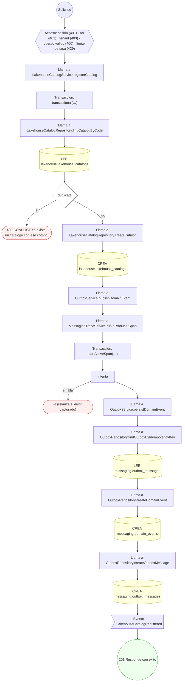

#### 2. POST /lakehouse/data-products/{id}/versions

Publicar el producto de datos y su versión

| HTTP | Código | Cuándo |
|---|---|---|
| 201 | — | Éxito |
| 400 | `VALIDATION_FAILED` | Los parámetros de ruta son UUID válidos; El cuerpo cumple el DTO (sin propiedades extra) |
| 401 | `UNAUTHENTICATED` | Hay una sesión válida (JWT) |
| 403 | `FORBIDDEN` | El rol está permitido; El tenant se resuelve y pertenece al actor |
| 409 | `CONFLICT` | ConflictException: Ya existe un producto con ese código para el tenant, con otro identificador.; ConflictException: El producto existente tiene otro código.; ConflictException: Esa versión del producto ya está publicada.; ConflictException: Dos reglas de calidad comparten el mismo código. |
| 429 | `RATE_LIMITED` | No se supera el límite de solicitudes |

```mermaid
flowchart TD
  n1(("Solicitud")):::inicio
  n2{{"Acceso: sesión (401) · rol (403) · tenant (403) · parámetros de ruta (400) · cuerpo válido (400) · límite de…"}}:::acceso
  n1 --> n2
  n3["Llama a LakehouseCatalogService.publishProductVersion"]:::llamada
  n2 --> n3
  n4["Transacción: transactional(…)"]:::transaccion
  n3 --> n4
  n5["Llama a LakehouseCatalogRepository.findProductById"]:::llamada
  n4 --> n5
  n6[("LEE lakehouse.data_products")]:::efecto
  n5 --> n6
  n7{"occupied && occupied.tenantId !== tenantId"}:::decision
  n6 --> n7
  n8(["↩ (relanza el error capturado)"]):::error
  n7 -->|"sí"| n8
  n9["Llama a LakehouseCatalogRepository.findProductForUpdate"]:::llamada
  n7 -->|"no"| n9
  n10[("LEE lakehouse.data_products")]:::efecto
  n9 --> n10
  n11{"!product"}:::decision
  n10 --> n11
  n12["Llama a LakehouseCatalogRepository.findProductByCode"]:::llamada
  n11 -->|"sí"| n12
  n13[("LEE lakehouse.data_products")]:::efecto
  n12 --> n13
  n14{"byCode"}:::decision
  n13 --> n14
  n15(["409 CONFLICT Ya existe un producto con ese código para el tenant, con otro identificador."]):::error
  n14 -->|"sí"| n15
  n16["Llama a LakehouseCatalogRepository.createProduct"]:::llamada
  n14 -->|"no"| n16
  n17[("CREA lakehouse.data_products")]:::efecto
  n16 --> n17
  n18{"product.code !== dto.code"}:::decision
  n11 -->|"no"| n18
  n19(["409 CONFLICT El producto existente tiene otro código."]):::error
  n18 -->|"sí"| n19
  n20[("ACTUALIZA lakehouse.data_products · ACTUALIZA lakehouse.data_products")]:::efecto
  n18 -->|"no"| n20
  n21{"dto.ownerTeamId"}:::decision
  n20 --> n21
  n22[("ACTUALIZA lakehouse.data_products")]:::efecto
  n21 -->|"sí"| n22
  n23[("ACTUALIZA lakehouse.data_products")]:::efecto
  n22 --> n23
  n21 -->|"no"| n23
  n24{"dto.businessPurpose"}:::decision
  n23 --> n24
  n25[("ACTUALIZA lakehouse.data_products")]:::efecto
  n24 -->|"sí"| n25
  n26{"dto.classificationCode"}:::decision
  n25 --> n26
  n24 -->|"no"| n26
  n27[("ACTUALIZA lakehouse.data_products")]:::efecto
  n26 -->|"sí"| n27
  n28[("ACTUALIZA lakehouse.data_products · ACTUALIZA lakehouse.data_products")]:::efecto
  n27 --> n28
  n26 -->|"no"| n28
  n29["Llama a LakehouseCatalogRepository.findProductVersion"]:::llamada
  n17 --> n29
  n28 --> n29
  n30[("LEE lakehouse.data_product_versions")]:::efecto
  n29 --> n30
  n31{"duplicateVersion"}:::decision
  n30 --> n31
  n32(["409 CONFLICT Esa versión del producto ya está publicada."]):::error
  n31 -->|"sí"| n32
  n33["Llama a LakehouseCatalogRepository.findActiveProductVersionForUpdate"]:::llamada
  n31 -->|"no"| n33
  n34[("LEE lakehouse.data_product_versions")]:::efecto
  n33 --> n34
  n35{"previous"}:::decision
  n34 --> n35
  n36[("ACTUALIZA lakehouse.data_product_versions · ACTUALIZA lakehouse.data_product_versions")]:::efecto
  n35 -->|"sí"| n36
  n37["Llama a LakehouseCatalogRepository.createProductVersion"]:::llamada
  n36 --> n37
  n35 -->|"no"| n37
  n38[("CREA lakehouse.data_product_versions")]:::efecto
  n37 --> n38
  n39["Repite: por cada const rule de dto.qualityRules ?? []"]:::bucle
  n38 --> n39
  n40{"seenRuleCodes.has(rule.ruleCode)"}:::decision
  n39 -->|"cada elemento"| n40
  n41(["409 CONFLICT Dos reglas de calidad comparten el mismo código."]):::error
  n40 -->|"sí"| n41
  n42["Llama a LakehouseCatalogRepository.createQualityRule"]:::llamada
  n40 -->|"no"| n42
  n43[("CREA lakehouse.lakehouse_quality_rules")]:::efecto
  n42 --> n43
  n44["Llama a OutboxService.publishDomainEvent"]:::llamada
  n43 --> n44
  n39 -->|"al terminar"| n44
  n45["Llama a MessagingTraceService.runInProducerSpan"]:::llamada
  n44 --> n45
  n46["Transacción: startActiveSpan(…)"]:::transaccion
  n45 --> n46
  n47["Intenta"]:::intento
  n46 --> n47
  n48(["↩ (relanza el error capturado)"]):::error
  n47 -->|"si falla"| n48
  n49["Llama a OutboxService.persistDomainEvent"]:::llamada
  n47 --> n49
  n50["Llama a OutboxRepository.findOutboxByIdempotencyKey"]:::llamada
  n49 --> n50
  n51[("LEE messaging.outbox_messages")]:::efecto
  n50 --> n51
  n52["Llama a OutboxRepository.createDomainEvent"]:::llamada
  n51 --> n52
  n53[("CREA messaging.domain_events")]:::efecto
  n52 --> n53
  n54["Llama a OutboxRepository.createOutboxMessage"]:::llamada
  n53 --> n54
  n55[("CREA messaging.outbox_messages")]:::efecto
  n54 --> n55
  n56>"Evento DataProductVersionPublished"]:::evento
  n55 --> n56
  n57(("201 Responde con éxito")):::ok
  n56 --> n57
  classDef acceso fill:#eef,stroke:#66a
  classDef error fill:#fee,stroke:#c33
  classDef ok fill:#efe,stroke:#3a3
  classDef efecto fill:#ffd,stroke:#aa3
  classDef decision fill:#fff,stroke:#555
  classDef corte fill:#eee,stroke:#999,stroke-dasharray: 4
```

#### 3. POST /lakehouse/datasets

Registrar el dataset y su esquema inicial

| HTTP | Código | Cuándo |
|---|---|---|
| 201 | — | Éxito |
| 400 | `VALIDATION_FAILED` | El cuerpo cumple el DTO (sin propiedades extra) |
| 401 | `UNAUTHENTICATED` | Hay una sesión válida (JWT) |
| 403 | `FORBIDDEN` | El rol está permitido; El tenant se resuelve y pertenece al actor |
| 404 | `NOT_FOUND` | ResourceNotFoundException: Zona no encontrada.; ResourceNotFoundException: Catálogo no encontrado. |
| 409 | `CONFLICT` | ConflictException: Ya hay un dataset registrado para esa tabla. |
| 422 | `PRECONDITION_FAILED` | PreconditionFailedException: La versión del producto ya no es la vigente.; PreconditionFailedException: La zona no está activa.; PreconditionFailedException: El catálogo no está activo. |
| 429 | `RATE_LIMITED` | No se supera el límite de solicitudes |

```mermaid
flowchart TD
  n1(("Solicitud")):::inicio
  n2{{"Acceso: sesión (401) · rol (403) · tenant (403) · cuerpo válido (400) · límite de tasa (429)"}}:::acceso
  n1 --> n2
  n3["Llama a LakehouseCatalogService.registerDataset"]:::llamada
  n2 --> n3
  n4["Transacción: transactional(…)"]:::transaccion
  n3 --> n4
  n5["Llama a LakehouseCatalogRepository.findProductVersionInTenant"]:::llamada
  n4 --> n5
  n6[("LEE lakehouse.data_product_versions · LEE lakehouse.data_products")]:::efecto
  n5 --> n6
  n7{"productVersion.state !== 'active'"}:::decision
  n6 --> n7
  n8(["422 PRECONDITION_FAILED La versión del producto ya no es la vigente."]):::error
  n7 -->|"sí"| n8
  n9["Llama a LakehouseCatalogRepository.findZoneById"]:::llamada
  n7 -->|"no"| n9
  n10[("LEE lakehouse.data_lake_zones")]:::efecto
  n9 --> n10
  n11{"!zone"}:::decision
  n10 --> n11
  n12(["404 NOT_FOUND Zona no encontrada."]):::error
  n11 -->|"sí"| n12
  n13{"zone.state !== 'active'"}:::decision
  n11 -->|"no"| n13
  n14(["422 PRECONDITION_FAILED La zona no está activa."]):::error
  n13 -->|"sí"| n14
  n15["Llama a LakehouseCatalogRepository.findCatalogById"]:::llamada
  n13 -->|"no"| n15
  n16[("LEE lakehouse.lakehouse_catalogs")]:::efecto
  n15 --> n16
  n17{"!catalog"}:::decision
  n16 --> n17
  n18(["404 NOT_FOUND Catálogo no encontrado."]):::error
  n17 -->|"sí"| n18
  n19{"catalog.state !== 'active'"}:::decision
  n17 -->|"no"| n19
  n20(["422 PRECONDITION_FAILED El catálogo no está activo."]):::error
  n19 -->|"sí"| n20
  n21["Llama a LakehouseCatalogRepository.findDatasetByTable"]:::llamada
  n19 -->|"no"| n21
  n22[("LEE lakehouse.lakehouse_datasets")]:::efecto
  n21 --> n22
  n23{"duplicate"}:::decision
  n22 --> n23
  n24(["409 CONFLICT Ya hay un dataset registrado para esa tabla."]):::error
  n23 -->|"sí"| n24
  n25["Llama a LakehouseCatalogRepository.createDataset"]:::llamada
  n23 -->|"no"| n25
  n26[("CREA lakehouse.lakehouse_datasets")]:::efecto
  n25 --> n26
  n27["Llama a LakehouseCatalogRepository.createSchemaVersion"]:::llamada
  n26 --> n27
  n28[("CREA lakehouse.lakehouse_schema_versions")]:::efecto
  n27 --> n28
  n29["Llama a OutboxService.publishDomainEvent"]:::llamada
  n28 --> n29
  n30["Llama a MessagingTraceService.runInProducerSpan"]:::llamada
  n29 --> n30
  n31["Transacción: startActiveSpan(…)"]:::transaccion
  n30 --> n31
  n32["Intenta"]:::intento
  n31 --> n32
  n33(["↩ (relanza el error capturado)"]):::error
  n32 -->|"si falla"| n33
  n34["Llama a OutboxService.persistDomainEvent"]:::llamada
  n32 --> n34
  n35["Llama a OutboxRepository.findOutboxByIdempotencyKey"]:::llamada
  n34 --> n35
  n36[("LEE messaging.outbox_messages")]:::efecto
  n35 --> n36
  n37["Llama a OutboxRepository.createDomainEvent"]:::llamada
  n36 --> n37
  n38[("CREA messaging.domain_events")]:::efecto
  n37 --> n38
  n39["Llama a OutboxRepository.createOutboxMessage"]:::llamada
  n38 --> n39
  n40[("CREA messaging.outbox_messages")]:::efecto
  n39 --> n40
  n41>"Evento LakehouseDatasetRegistered"]:::evento
  n40 --> n41
  n42(("201 Responde con éxito")):::ok
  n41 --> n42
  classDef acceso fill:#eef,stroke:#66a
  classDef error fill:#fee,stroke:#c33
  classDef ok fill:#efe,stroke:#3a3
  classDef efecto fill:#ffd,stroke:#aa3
  classDef decision fill:#fff,stroke:#555
  classDef corte fill:#eee,stroke:#999,stroke-dasharray: 4
```

#### 4. POST /lakehouse/datasets/{id}/quality-runs

Evaluar la calidad del dataset y abrir hallazgos

| HTTP | Código | Cuándo |
|---|---|---|
| 201 | — | Éxito |
| 400 | `VALIDATION_FAILED` | Los parámetros de ruta son UUID válidos; El cuerpo cumple el DTO (sin propiedades extra) |
| 401 | `UNAUTHENTICATED` | Hay una sesión válida (JWT) |
| 403 | `FORBIDDEN` | El rol está permitido; El tenant se resuelve y pertenece al actor |
| 422 | `PRECONDITION_FAILED` | PreconditionFailedException: El hallazgo cita una regla que no está activa para la versión del producto. |
| 429 | `RATE_LIMITED` | No se supera el límite de solicitudes |

```mermaid
flowchart TD
  n1(("Solicitud")):::inicio
  n2{{"Acceso: sesión (401) · rol (403) · tenant (403) · parámetros de ruta (400) · cuerpo válido (400) · límite de…"}}:::acceso
  n1 --> n2
  n3["Llama a TransformationService.runQualityCheck"]:::llamada
  n2 --> n3
  n4["Transacción: transactional(…)"]:::transaccion
  n3 --> n4
  n5["Llama a LakehouseCatalogRepository.findDatasetForUpdate"]:::llamada
  n4 --> n5
  n6[("LEE lakehouse.lakehouse_datasets")]:::efecto
  n5 --> n6
  n7["Llama a LakehouseRuntimeRepository.findRunById"]:::llamada
  n6 --> n7
  n8[("LEE lakehouse.transformation_runs")]:::efecto
  n7 --> n8
  n9["Repite: por cada const finding de dto.findings ?? []"]:::bucle
  n8 --> n9
  n10["Llama a LakehouseRuntimeRepository.findPartitionById"]:::llamada
  n9 -->|"cada elemento"| n10
  n11[("LEE lakehouse.lakehouse_partitions")]:::efecto
  n10 --> n11
  n12{"!partition || partition.lakehouseDatasetId !== dataset.id"}:::decision
  n11 --> n12
  n13(["↩ (relanza el error capturado)"]):::error
  n12 -->|"sí"| n13
  n14["Llama a LakehouseCatalogRepository.findActiveQualityRules"]:::llamada
  n12 -->|"no"| n14
  n9 -->|"al terminar"| n14
  n15[("LEE lakehouse.lakehouse_quality_rules")]:::efecto
  n14 --> n15
  n16["Llama a LakehouseRuntimeRepository.createQualityRun"]:::llamada
  n15 --> n16
  n17[("CREA lakehouse.lakehouse_quality_runs")]:::efecto
  n16 --> n17
  n18["Repite: por cada const finding de dto.findings ?? []"]:::bucle
  n17 --> n18
  n19{"!rule"}:::decision
  n18 -->|"cada elemento"| n19
  n20(["422 PRECONDITION_FAILED El hallazgo cita una regla que no está activa para la versión del producto."]):::error
  n19 -->|"sí"| n20
  n21["Llama a LakehouseRuntimeRepository.createQualityIssue"]:::llamada
  n19 -->|"no"| n21
  n22[("CREA lakehouse.lakehouse_quality_issues")]:::efecto
  n21 --> n22
  n23[("ACTUALIZA lakehouse.lakehouse_quality_runs · ACTUALIZA lakehouse.lakehouse_quality_runs · ACTUALIZA lakehouse…")]:::efecto
  n22 --> n23
  n18 -->|"al terminar"| n23
  n24["Llama a OutboxService.publishDomainEvent"]:::llamada
  n23 --> n24
  n25["Llama a MessagingTraceService.runInProducerSpan"]:::llamada
  n24 --> n25
  n26["Transacción: startActiveSpan(…)"]:::transaccion
  n25 --> n26
  n27["Intenta"]:::intento
  n26 --> n27
  n28(["↩ (relanza el error capturado)"]):::error
  n27 -->|"si falla"| n28
  n29["Llama a OutboxService.persistDomainEvent"]:::llamada
  n27 --> n29
  n30["Llama a OutboxRepository.findOutboxByIdempotencyKey"]:::llamada
  n29 --> n30
  n31[("LEE messaging.outbox_messages")]:::efecto
  n30 --> n31
  n32["Llama a OutboxRepository.createDomainEvent"]:::llamada
  n31 --> n32
  n33[("CREA messaging.domain_events")]:::efecto
  n32 --> n33
  n34["Llama a OutboxRepository.createOutboxMessage"]:::llamada
  n33 --> n34
  n35[("CREA messaging.outbox_messages")]:::efecto
  n34 --> n35
  n36>"Evento QualityRunEvaluated"]:::evento
  n35 --> n36
  n37(("201 Responde con éxito")):::ok
  n36 --> n37
  classDef acceso fill:#eef,stroke:#66a
  classDef error fill:#fee,stroke:#c33
  classDef ok fill:#efe,stroke:#3a3
  classDef efecto fill:#ffd,stroke:#aa3
  classDef decision fill:#fff,stroke:#555
  classDef corte fill:#eee,stroke:#999,stroke-dasharray: 4
```

#### 5. POST /lakehouse/ingestion/curated-runs

Ingerir dato de salud de-identificado en la zona curada

| HTTP | Código | Cuándo |
|---|---|---|
| 201 | — | Éxito |
| 400 | `VALIDATION_FAILED` | El cuerpo cumple el DTO (sin propiedades extra) |
| 401 | `UNAUTHENTICATED` | Hay una sesión válida (JWT) |
| 403 | `FORBIDDEN` | El rol está permitido; El tenant se resuelve y pertenece al actor |
| 422 | `PRECONDITION_FAILED` | PreconditionFailedException: El dataset objetivo no está activo; no admite escrituras.; PreconditionFailedException: La ingesta de-identificada sólo puede escribir en la zona curated. |
| 429 | `RATE_LIMITED` | No se supera el límite de solicitudes |

```mermaid
flowchart TD
  n1(("Solicitud")):::inicio
  n2{{"Acceso: sesión (401) · rol (403) · tenant (403) · cuerpo válido (400) · límite de tasa (429)"}}:::acceso
  n1 --> n2
  n3["Llama a TransformationService.ingestCurated"]:::llamada
  n2 --> n3
  n4["Transacción: transactional(…)"]:::transaccion
  n3 --> n4
  n5["Llama a TransformationService.requireWritableDataset"]:::llamada
  n4 --> n5
  n6["Llama a LakehouseCatalogRepository.findDatasetById"]:::llamada
  n5 --> n6
  n7[("LEE lakehouse.lakehouse_datasets")]:::efecto
  n6 --> n7
  n8{"dataset.lifecycleState !== 'active'"}:::decision
  n7 --> n8
  n9(["422 PRECONDITION_FAILED El dataset objetivo no está activo; no admite escrituras."]):::error
  n8 -->|"sí"| n9
  n10["Llama a LakehouseCatalogRepository.findZoneById"]:::llamada
  n8 -->|"no"| n10
  n11[("LEE lakehouse.data_lake_zones")]:::efecto
  n10 --> n11
  n12{"!zone || zone.zoneType !== 'curated'"}:::decision
  n11 --> n12
  n13(["422 PRECONDITION_FAILED La ingesta de-identificada sólo puede escribir en la zona curated."]):::error
  n12 -->|"sí"| n13
  n14["Llama a DataReleaseRepository.findDeidProfileById"]:::llamada
  n12 -->|"no"| n14
  n15[("LEE health_data.health_deidentification_profiles")]:::efecto
  n14 --> n15
  n16["Llama a DataReleaseRepository.createDeidRun"]:::llamada
  n15 --> n16
  n17[("CREA health_data.health_deidentification_runs")]:::efecto
  n16 --> n17
  n18["Llama a TransformationService.materialize"]:::llamada
  n17 --> n18
  n19["Repite: por cada const input$ de input.partitions"]:::bucle
  n18 --> n19
  n20["Llama a LakehouseRuntimeRepository.findPartitionByHash"]:::llamada
  n19 -->|"cada elemento"| n20
  n21[("LEE lakehouse.lakehouse_partitions")]:::efecto
  n20 --> n21
  n22["Llama a LakehouseRuntimeRepository.createPartition"]:::llamada
  n21 --> n22
  n23[("CREA lakehouse.lakehouse_partitions")]:::efecto
  n22 --> n23
  n24["Repite: por cada const file de input$.files"]:::bucle
  n23 --> n24
  n25["Llama a LakehouseRuntimeRepository.findFileByHash"]:::llamada
  n24 -->|"cada elemento"| n25
  n26[("LEE lakehouse.lakehouse_files")]:::efecto
  n25 --> n26
  n27["Llama a LakehouseRuntimeRepository.createFile"]:::llamada
  n26 --> n27
  n28[("CREA lakehouse.lakehouse_files")]:::efecto
  n27 --> n28
  n29{"input.runId && input.sourceDatasetIds.length › 0"}:::decision
  n28 --> n29
  n24 -->|"al terminar"| n29
  n30["Repite: por cada const sourcePartitionId de input$.sourcePartitionIds ?? []"]:::bucle
  n29 -->|"sí"| n30
  n31{"ownerDatasetId === undefined"}:::decision
  n30 -->|"cada elemento"| n31
  n32["Llama a LakehouseRuntimeRepository.findPartitionById"]:::llamada
  n31 -->|"sí"| n32
  n33[("LEE lakehouse.lakehouse_partitions")]:::efecto
  n32 --> n33
  n34{"!sourcePartition || !input.sourceDatasetIds.includes( sourcePartition.lakehouseDatasetId, )"}:::decision
  n33 --> n34
  n35(["↩ (relanza el error capturado)"]):::error
  n34 -->|"sí"| n35
  n36["Llama a LakehouseRuntimeRepository.createLineageEdge"]:::llamada
  n34 -->|"no"| n36
  n31 -->|"no"| n36
  n37[("CREA lakehouse.lakehouse_lineage_edges")]:::efecto
  n36 --> n37
  n38["Llama a OutboxService.publishDomainEvent"]:::llamada
  n37 --> n38
  n30 -->|"al terminar"| n38
  n29 -->|"no"| n38
  n19 -->|"al terminar"| n38
  n39["Llama a MessagingTraceService.runInProducerSpan"]:::llamada
  n38 --> n39
  n40["Transacción: startActiveSpan(…)"]:::transaccion
  n39 --> n40
  n41["Intenta"]:::intento
  n40 --> n41
  n42(["↩ (relanza el error capturado)"]):::error
  n41 -->|"si falla"| n42
  n43["Llama a OutboxService.persistDomainEvent"]:::llamada
  n41 --> n43
  n44["Llama a OutboxRepository.findOutboxByIdempotencyKey"]:::llamada
  n43 --> n44
  n45[("LEE messaging.outbox_messages")]:::efecto
  n44 --> n45
  n46["Llama a OutboxRepository.createDomainEvent"]:::llamada
  n45 --> n46
  n47[("CREA messaging.domain_events")]:::efecto
  n46 --> n47
  n48["Llama a OutboxRepository.createOutboxMessage"]:::llamada
  n47 --> n48
  n49[("CREA messaging.outbox_messages")]:::efecto
  n48 --> n49
  n50>"Evento HealthBatchDeidentified"]:::evento
  n49 --> n50
  n51(("201 Responde con éxito")):::ok
  n50 --> n51
  classDef acceso fill:#eef,stroke:#66a
  classDef error fill:#fee,stroke:#c33
  classDef ok fill:#efe,stroke:#3a3
  classDef efecto fill:#ffd,stroke:#aa3
  classDef decision fill:#fff,stroke:#555
  classDef corte fill:#eee,stroke:#999,stroke-dasharray: 4
```

#### 6. POST /lakehouse/transformations/{defId}/runs

Registrar la corrida con sus particiones, archivos y linaje

| HTTP | Código | Cuándo |
|---|---|---|
| 201 | — | Éxito |
| 400 | `VALIDATION_FAILED` | Los parámetros de ruta son UUID válidos; El cuerpo cumple el DTO (sin propiedades extra) |
| 401 | `UNAUTHENTICATED` | Hay una sesión válida (JWT) |
| 403 | `FORBIDDEN` | El rol está permitido; El tenant se resuelve y pertenece al actor |
| 422 | `PRECONDITION_FAILED` | PreconditionFailedException: La definición de transformación no está activa.; PreconditionFailedException: El dataset objetivo no está activo; no admite escrituras. |
| 429 | `RATE_LIMITED` | No se supera el límite de solicitudes |

```mermaid
flowchart TD
  n1(("Solicitud")):::inicio
  n2{{"Acceso: sesión (401) · rol (403) · tenant (403) · parámetros de ruta (400) · cuerpo válido (400) · límite de…"}}:::acceso
  n1 --> n2
  n3["Llama a TransformationService.runTransformation"]:::llamada
  n2 --> n3
  n4["Transacción: transactional(…)"]:::transaccion
  n3 --> n4
  n5["Llama a LakehouseRuntimeRepository.findDefinitionById"]:::llamada
  n4 --> n5
  n6[("LEE lakehouse.transformation_definitions")]:::efecto
  n5 --> n6
  n7{"definition.state !== 'active'"}:::decision
  n6 --> n7
  n8(["422 PRECONDITION_FAILED La definición de transformación no está activa."]):::error
  n7 -->|"sí"| n8
  n9["Llama a LakehouseRuntimeRepository.findLiveRunByTargetForUpdate"]:::llamada
  n7 -->|"no"| n9
  n10[("LEE lakehouse.transformation_runs")]:::efecto
  n9 --> n10
  n11["Llama a TransformationService.requireWritableDataset"]:::llamada
  n10 --> n11
  n12["Llama a LakehouseCatalogRepository.findDatasetById"]:::llamada
  n11 --> n12
  n13[("LEE lakehouse.lakehouse_datasets")]:::efecto
  n12 --> n13
  n14{"dataset.lifecycleState !== 'active'"}:::decision
  n13 --> n14
  n15(["422 PRECONDITION_FAILED El dataset objetivo no está activo; no admite escrituras."]):::error
  n14 -->|"sí"| n15
  n16["Repite: por cada const sourceDatasetId de sourceDatasetIds"]:::bucle
  n14 -->|"no"| n16
  n17["Llama a LakehouseCatalogRepository.findDatasetById"]:::llamada
  n16 -->|"cada elemento"| n17
  n18[("LEE lakehouse.lakehouse_datasets")]:::efecto
  n17 --> n18
  n19["Llama a LakehouseRuntimeRepository.createRun"]:::llamada
  n18 --> n19
  n16 -->|"al terminar"| n19
  n20[("CREA lakehouse.transformation_runs")]:::efecto
  n19 --> n20
  n21["Llama a TransformationService.materialize"]:::llamada
  n20 --> n21
  n22["Repite: por cada const input$ de input.partitions"]:::bucle
  n21 --> n22
  n23["Llama a LakehouseRuntimeRepository.findPartitionByHash"]:::llamada
  n22 -->|"cada elemento"| n23
  n24[("LEE lakehouse.lakehouse_partitions")]:::efecto
  n23 --> n24
  n25["Llama a LakehouseRuntimeRepository.createPartition"]:::llamada
  n24 --> n25
  n26[("CREA lakehouse.lakehouse_partitions")]:::efecto
  n25 --> n26
  n27["Repite: por cada const file de input$.files"]:::bucle
  n26 --> n27
  n28["Llama a LakehouseRuntimeRepository.findFileByHash"]:::llamada
  n27 -->|"cada elemento"| n28
  n29[("LEE lakehouse.lakehouse_files")]:::efecto
  n28 --> n29
  n30["Llama a LakehouseRuntimeRepository.createFile"]:::llamada
  n29 --> n30
  n31[("CREA lakehouse.lakehouse_files")]:::efecto
  n30 --> n31
  n32{"input.runId && input.sourceDatasetIds.length › 0"}:::decision
  n31 --> n32
  n27 -->|"al terminar"| n32
  n33["Repite: por cada const sourcePartitionId de input$.sourcePartitionIds ?? []"]:::bucle
  n32 -->|"sí"| n33
  n34{"ownerDatasetId === undefined"}:::decision
  n33 -->|"cada elemento"| n34
  n35["Llama a LakehouseRuntimeRepository.findPartitionById"]:::llamada
  n34 -->|"sí"| n35
  n36[("LEE lakehouse.lakehouse_partitions")]:::efecto
  n35 --> n36
  n37{"!sourcePartition || !input.sourceDatasetIds.includes( sourcePartition.lakehouseDatasetId, )"}:::decision
  n36 --> n37
  n38(["↩ (relanza el error capturado)"]):::error
  n37 -->|"sí"| n38
  n39["Llama a LakehouseRuntimeRepository.createLineageEdge"]:::llamada
  n37 -->|"no"| n39
  n34 -->|"no"| n39
  n40[("CREA lakehouse.lakehouse_lineage_edges")]:::efecto
  n39 --> n40
  n41[("ACTUALIZA lakehouse.transformation_runs · ACTUALIZA lakehouse.transformation_runs · ACTUALIZA lakehouse.trans…")]:::efecto
  n40 --> n41
  n33 -->|"al terminar"| n41
  n32 -->|"no"| n41
  n22 -->|"al terminar"| n41
  n42["Llama a OutboxService.publishDomainEvent"]:::llamada
  n41 --> n42
  n43["Llama a MessagingTraceService.runInProducerSpan"]:::llamada
  n42 --> n43
  n44["Transacción: startActiveSpan(…)"]:::transaccion
  n43 --> n44
  n45["Intenta"]:::intento
  n44 --> n45
  n46(["↩ (relanza el error capturado)"]):::error
  n45 -->|"si falla"| n46
  n47["Llama a OutboxService.persistDomainEvent"]:::llamada
  n45 --> n47
  n48["Llama a OutboxRepository.findOutboxByIdempotencyKey"]:::llamada
  n47 --> n48
  n49[("LEE messaging.outbox_messages")]:::efecto
  n48 --> n49
  n50["Llama a OutboxRepository.createDomainEvent"]:::llamada
  n49 --> n50
  n51[("CREA messaging.domain_events")]:::efecto
  n50 --> n51
  n52["Llama a OutboxRepository.createOutboxMessage"]:::llamada
  n51 --> n52
  n53[("CREA messaging.outbox_messages")]:::efecto
  n52 --> n53
  n54>"Evento TransformationRunCompleted"]:::evento
  n53 --> n54
  n55{"result.lineageEdges › 0"}:::decision
  n54 --> n55
  n56["Llama a OutboxService.publishDomainEvent"]:::llamada
  n55 -->|"sí"| n56
  n57["Llama a MessagingTraceService.runInProducerSpan"]:::llamada
  n56 --> n57
  n58["Transacción: startActiveSpan(…)"]:::transaccion
  n57 --> n58
  n59["Intenta"]:::intento
  n58 --> n59
  n60(["↩ (relanza el error capturado)"]):::error
  n59 -->|"si falla"| n60
  n61["Llama a OutboxService.persistDomainEvent"]:::llamada
  n59 --> n61
  n62["Llama a OutboxRepository.findOutboxByIdempotencyKey"]:::llamada
  n61 --> n62
  n63[("LEE messaging.outbox_messages")]:::efecto
  n62 --> n63
  n64["Llama a OutboxRepository.createDomainEvent"]:::llamada
  n63 --> n64
  n65[("CREA messaging.domain_events")]:::efecto
  n64 --> n65
  n66["Llama a OutboxRepository.createOutboxMessage"]:::llamada
  n65 --> n66
  n67[("CREA messaging.outbox_messages")]:::efecto
  n66 --> n67
  n68>"Evento LineageRecorded"]:::evento
  n67 --> n68
  n69(("201 Responde con éxito")):::ok
  n68 --> n69
  n55 -->|"no"| n69
  classDef acceso fill:#eef,stroke:#66a
  classDef error fill:#fee,stroke:#c33
  classDef ok fill:#efe,stroke:#3a3
  classDef efecto fill:#ffd,stroke:#aa3
  classDef decision fill:#fff,stroke:#555
  classDef corte fill:#eee,stroke:#999,stroke-dasharray: 4
```

#### 7. POST /lakehouse/zones

Definir una zona del data lake

| HTTP | Código | Cuándo |
|---|---|---|
| 201 | — | Éxito |
| 400 | `VALIDATION_FAILED` | El cuerpo cumple el DTO (sin propiedades extra) |
| 401 | `UNAUTHENTICATED` | Hay una sesión válida (JWT) |
| 403 | `FORBIDDEN` | El rol está permitido; El tenant se resuelve y pertenece al actor |
| 409 | `CONFLICT` | ConflictException: Ya existe una zona con ese código. |
| 429 | `RATE_LIMITED` | No se supera el límite de solicitudes |

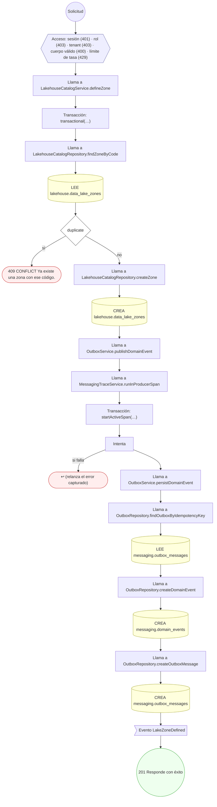

#### 8. POST /research/dataset-releases

Solicitar el release de un dataset para investigación

| HTTP | Código | Cuándo |
|---|---|---|
| 201 | — | Éxito |
| 400 | `VALIDATION_FAILED` | El cuerpo cumple el DTO (sin propiedades extra) |
| 401 | `UNAUTHENTICATED` | Hay una sesión válida (JWT) |
| 403 | `FORBIDDEN` | El rol está permitido; El tenant se resuelve y pertenece al actor |
| 422 | `PRECONDITION_FAILED` | PreconditionFailedException: El proyecto no está aprobado.; PreconditionFailedException: La ventana de aprobación ética del proyecto no está vigente.; PreconditionFailedException: La cohorte no está activa.; PreconditionFailedException: El producto contiene datos de paciente y la cohorte no declara perfil de de-identificación. |
| 429 | `RATE_LIMITED` | No se supera el límite de solicitudes |

```mermaid
flowchart TD
  n1(("Solicitud")):::inicio
  n2{{"Acceso: sesión (401) · rol (403) · tenant (403) · cuerpo válido (400) · límite de tasa (429)"}}:::acceso
  n1 --> n2
  n3["Llama a ResearchReleaseService.requestRelease"]:::llamada
  n2 --> n3
  n4["Transacción: transactional(…)"]:::transaccion
  n3 --> n4
  n5["Llama a ResearchRepository.findProjectById"]:::llamada
  n4 --> n5
  n6[("LEE lakehouse.research_projects")]:::efecto
  n5 --> n6
  n7{"project.state !== 'approved'"}:::decision
  n6 --> n7
  n8(["422 PRECONDITION_FAILED El proyecto no está aprobado."]):::error
  n7 -->|"sí"| n8
  n9{"project.approvedTo ‹= now || project.approvedFrom › now"}:::decision
  n7 -->|"no"| n9
  n10(["422 PRECONDITION_FAILED La ventana de aprobación ética del proyecto no está vigente."]):::error
  n9 -->|"sí"| n10
  n11["Llama a ResearchRepository.findCohortById"]:::llamada
  n9 -->|"no"| n11
  n12[("LEE lakehouse.cohort_definitions")]:::efecto
  n11 --> n12
  n13{"!cohort || cohort.researchProjectId !== project.id"}:::decision
  n12 --> n13
  n14(["↩ (relanza el error capturado)"]):::error
  n13 -->|"sí"| n14
  n15{"cohort.state !== 'active'"}:::decision
  n13 -->|"no"| n15
  n16(["422 PRECONDITION_FAILED La cohorte no está activa."]):::error
  n15 -->|"sí"| n16
  n17["Llama a LakehouseCatalogRepository.findProductVersionInTenant"]:::llamada
  n15 -->|"no"| n17
  n18[("LEE lakehouse.data_product_versions · LEE lakehouse.data_products")]:::efecto
  n17 --> n18
  n19["Llama a LakehouseCatalogRepository.findProductForUpdate"]:::llamada
  n18 --> n19
  n20[("LEE lakehouse.data_products")]:::efecto
  n19 --> n20
  n21{"product?.containsPhi && !cohort.deidentificationProfileId"}:::decision
  n20 --> n21
  n22(["422 PRECONDITION_FAILED El producto contiene datos de paciente y la cohorte no declara perfil de de-identific…"]):::error
  n21 -->|"sí"| n22
  n23["Llama a ResearchRepository.createReleaseRequest"]:::llamada
  n21 -->|"no"| n23
  n24[("CREA lakehouse.dataset_release_requests")]:::efecto
  n23 --> n24
  n25["Llama a OutboxService.publishDomainEvent"]:::llamada
  n24 --> n25
  n26["Llama a MessagingTraceService.runInProducerSpan"]:::llamada
  n25 --> n26
  n27["Transacción: startActiveSpan(…)"]:::transaccion
  n26 --> n27
  n28["Intenta"]:::intento
  n27 --> n28
  n29(["↩ (relanza el error capturado)"]):::error
  n28 -->|"si falla"| n29
  n30["Llama a OutboxService.persistDomainEvent"]:::llamada
  n28 --> n30
  n31["Llama a OutboxRepository.findOutboxByIdempotencyKey"]:::llamada
  n30 --> n31
  n32[("LEE messaging.outbox_messages")]:::efecto
  n31 --> n32
  n33["Llama a OutboxRepository.createDomainEvent"]:::llamada
  n32 --> n33
  n34[("CREA messaging.domain_events")]:::efecto
  n33 --> n34
  n35["Llama a OutboxRepository.createOutboxMessage"]:::llamada
  n34 --> n35
  n36[("CREA messaging.outbox_messages")]:::efecto
  n35 --> n36
  n37>"Evento DatasetReleaseRequested"]:::evento
  n36 --> n37
  n38(("201 Responde con éxito")):::ok
  n37 --> n38
  classDef acceso fill:#eef,stroke:#66a
  classDef error fill:#fee,stroke:#c33
  classDef ok fill:#efe,stroke:#3a3
  classDef efecto fill:#ffd,stroke:#aa3
  classDef decision fill:#fff,stroke:#555
  classDef corte fill:#eee,stroke:#999,stroke-dasharray: 4
```

#### 9. POST /research/dataset-releases/{id}/approve

Aprobar y materializar el manifiesto de-identificado

| HTTP | Código | Cuándo |
|---|---|---|
| 201 | — | Éxito |
| 400 | `VALIDATION_FAILED` | Los parámetros de ruta son UUID válidos; El cuerpo cumple el DTO (sin propiedades extra) |
| 401 | `UNAUTHENTICATED` | Hay una sesión válida (JWT) |
| 403 | `FORBIDDEN` | El rol está permitido; El tenant se resuelve y pertenece al actor |
| 422 | `PRECONDITION_FAILED` | PreconditionFailedException: La solicitud no está en un estado que admita aprobación.; PreconditionFailedException: La aprobación ética del proyecto caducó; el release no puede materializarse.; PreconditionFailedException: La cohorte no declara perfil de de-identificación. |
| 429 | `RATE_LIMITED` | No se supera el límite de solicitudes |

```mermaid
flowchart TD
  n1(("Solicitud")):::inicio
  n2{{"Acceso: sesión (401) · rol (403) · tenant (403) · parámetros de ruta (400) · cuerpo válido (400) · límite de…"}}:::acceso
  n1 --> n2
  n3["Llama a ResearchReleaseService.approveRelease"]:::llamada
  n2 --> n3
  n4["Transacción: transactional(…)"]:::transaccion
  n3 --> n4
  n5["Llama a ResearchRepository.findReleaseRequestForUpdate"]:::llamada
  n4 --> n5
  n6[("LEE lakehouse.dataset_release_requests")]:::efecto
  n5 --> n6
  n7["Llama a ResearchRepository.findManifestByRequestForUpdate"]:::llamada
  n6 --> n7
  n8[("LEE lakehouse.dataset_release_manifests")]:::efecto
  n7 --> n8
  n9{"!(APPROVABLE_RELEASE_STATUSES as readonly string[]).includes( request.status, )"}:::decision
  n8 --> n9
  n10(["422 PRECONDITION_FAILED La solicitud no está en un estado que admita aprobación."]):::error
  n9 -->|"sí"| n10
  n11["Llama a ResearchRepository.findProjectById"]:::llamada
  n9 -->|"no"| n11
  n12[("LEE lakehouse.research_projects")]:::efecto
  n11 --> n12
  n13{"project.approvedTo ‹= now"}:::decision
  n12 --> n13
  n14(["422 PRECONDITION_FAILED La aprobación ética del proyecto caducó; el release no puede materializarse."]):::error
  n13 -->|"sí"| n14
  n15["Llama a ResearchRepository.findCohortById"]:::llamada
  n13 -->|"no"| n15
  n16[("LEE lakehouse.cohort_definitions")]:::efecto
  n15 --> n16
  n17{"!cohort?.deidentificationProfileId"}:::decision
  n16 --> n17
  n18(["422 PRECONDITION_FAILED La cohorte no declara perfil de de-identificación."]):::error
  n17 -->|"sí"| n18
  n19["Llama a DataReleaseRepository.createDeidRun"]:::llamada
  n17 -->|"no"| n19
  n20[("CREA health_data.health_deidentification_runs")]:::efecto
  n19 --> n20
  n21["Llama a ResearchRepository.createManifest"]:::llamada
  n20 --> n21
  n22[("CREA lakehouse.dataset_release_manifests")]:::efecto
  n21 --> n22
  n23["Llama a OutboxService.publishDomainEvent"]:::llamada
  n22 --> n23
  n24["Llama a MessagingTraceService.runInProducerSpan"]:::llamada
  n23 --> n24
  n25["Transacción: startActiveSpan(…)"]:::transaccion
  n24 --> n25
  n26["Intenta"]:::intento
  n25 --> n26
  n27(["↩ (relanza el error capturado)"]):::error
  n26 -->|"si falla"| n27
  n28["Llama a OutboxService.persistDomainEvent"]:::llamada
  n26 --> n28
  n29["Llama a OutboxRepository.findOutboxByIdempotencyKey"]:::llamada
  n28 --> n29
  n30[("LEE messaging.outbox_messages")]:::efecto
  n29 --> n30
  n31["Llama a OutboxRepository.createDomainEvent"]:::llamada
  n30 --> n31
  n32[("CREA messaging.domain_events")]:::efecto
  n31 --> n32
  n33["Llama a OutboxRepository.createOutboxMessage"]:::llamada
  n32 --> n33
  n34[("CREA messaging.outbox_messages")]:::efecto
  n33 --> n34
  n35>"Evento DatasetReleaseMaterialized"]:::evento
  n34 --> n35
  n36(("201 Responde con éxito")):::ok
  n35 --> n36
  classDef acceso fill:#eef,stroke:#66a
  classDef error fill:#fee,stroke:#c33
  classDef ok fill:#efe,stroke:#3a3
  classDef efecto fill:#ffd,stroke:#aa3
  classDef decision fill:#fff,stroke:#555
  classDef corte fill:#eee,stroke:#999,stroke-dasharray: 4
```

#### 10. POST /research/dataset-releases/{id}/revoke

Expirar o revocar el release

| HTTP | Código | Cuándo |
|---|---|---|
| 200 | — | Éxito |
| 400 | `VALIDATION_FAILED` | Los parámetros de ruta son UUID válidos; El cuerpo cumple el DTO (sin propiedades extra) |
| 401 | `UNAUTHENTICATED` | Hay una sesión válida (JWT) |
| 403 | `FORBIDDEN` | El rol está permitido; El tenant se resuelve y pertenece al actor |
| 429 | `RATE_LIMITED` | No se supera el límite de solicitudes |

```mermaid
flowchart TD
  n1(("Solicitud")):::inicio
  n2{{"Acceso: sesión (401) · rol (403) · tenant (403) · parámetros de ruta (400) · cuerpo válido (400) · límite de…"}}:::acceso
  n1 --> n2
  n3["Llama a ResearchReleaseService.revokeRelease"]:::llamada
  n2 --> n3
  n4["Transacción: transactional(…)"]:::transaccion
  n3 --> n4
  n5["Llama a ResearchRepository.findReleaseRequestForUpdate"]:::llamada
  n4 --> n5
  n6[("LEE lakehouse.dataset_release_requests")]:::efecto
  n5 --> n6
  n7["Llama a ResearchRepository.findManifestByRequestForUpdate"]:::llamada
  n6 --> n7
  n8[("LEE lakehouse.dataset_release_manifests")]:::efecto
  n7 --> n8
  n9{"manifest"}:::decision
  n8 --> n9
  n10[("ACTUALIZA lakehouse.dataset_release_manifests")]:::efecto
  n9 -->|"sí"| n10
  n11["Llama a OutboxService.publishDomainEvent"]:::llamada
  n10 --> n11
  n9 -->|"no"| n11
  n12["Llama a MessagingTraceService.runInProducerSpan"]:::llamada
  n11 --> n12
  n13["Transacción: startActiveSpan(…)"]:::transaccion
  n12 --> n13
  n14["Intenta"]:::intento
  n13 --> n14
  n15(["↩ (relanza el error capturado)"]):::error
  n14 -->|"si falla"| n15
  n16["Llama a OutboxService.persistDomainEvent"]:::llamada
  n14 --> n16
  n17["Llama a OutboxRepository.findOutboxByIdempotencyKey"]:::llamada
  n16 --> n17
  n18[("LEE messaging.outbox_messages")]:::efecto
  n17 --> n18
  n19["Llama a OutboxRepository.createDomainEvent"]:::llamada
  n18 --> n19
  n20[("CREA messaging.domain_events")]:::efecto
  n19 --> n20
  n21["Llama a OutboxRepository.createOutboxMessage"]:::llamada
  n20 --> n21
  n22[("CREA messaging.outbox_messages")]:::efecto
  n21 --> n22
  n23>"Evento DatasetReleaseRevoked"]:::evento
  n22 --> n23
  n24(("200 Responde con éxito")):::ok
  n23 --> n24
  classDef acceso fill:#eef,stroke:#66a
  classDef error fill:#fee,stroke:#c33
  classDef ok fill:#efe,stroke:#3a3
  classDef efecto fill:#ffd,stroke:#aa3
  classDef decision fill:#fff,stroke:#555
  classDef corte fill:#eee,stroke:#999,stroke-dasharray: 4
```

#### 11. GET /research/dataset-releases/expired

Listar releases con manifiesto vencido sin cerrar

| HTTP | Código | Cuándo |
|---|---|---|
| 200 | — | Éxito |
| 401 | `UNAUTHENTICATED` | Hay una sesión válida (JWT) |
| 403 | `FORBIDDEN` | El rol está permitido; El tenant se resuelve y pertenece al actor |
| 429 | `RATE_LIMITED` | No se supera el límite de solicitudes |

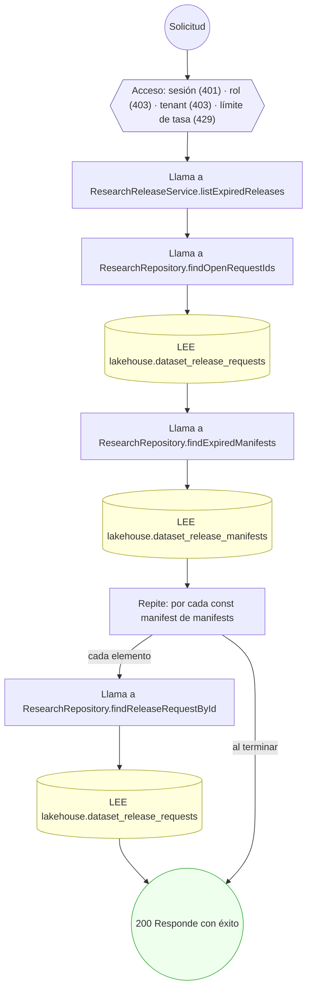

#### 12. POST /research/projects/{id}/cohorts

Definir el proyecto de investigación y su cohorte

| HTTP | Código | Cuándo |
|---|---|---|
| 201 | — | Éxito |
| 400 | `VALIDATION_FAILED` | Los parámetros de ruta son UUID válidos; El cuerpo cumple el DTO (sin propiedades extra) |
| 401 | `UNAUTHENTICATED` | Hay una sesión válida (JWT) |
| 403 | `FORBIDDEN` | El rol está permitido; El tenant se resuelve y pertenece al actor |
| 409 | `CONFLICT` | ConflictException: Ya existe un proyecto con ese código para el tenant, con otro identificador.; ConflictException: El proyecto existente tiene otro código.; ConflictException: Esa versión de la cohorte ya está definida. |
| 422 | `PRECONDITION_FAILED` | PreconditionFailedException: La ventana de aprobación ética tiene que empezar antes de terminar.; PreconditionFailedException: La aprobación ética ya está caducada. |
| 429 | `RATE_LIMITED` | No se supera el límite de solicitudes |

```mermaid
flowchart TD
  n1(("Solicitud")):::inicio
  n2{{"Acceso: sesión (401) · rol (403) · tenant (403) · parámetros de ruta (400) · cuerpo válido (400) · límite de…"}}:::acceso
  n1 --> n2
  n3["Llama a ResearchReleaseService.defineCohort"]:::llamada
  n2 --> n3
  n4["Transacción: transactional(…)"]:::transaccion
  n3 --> n4
  n5{"approvedFrom ›= approvedTo"}:::decision
  n4 --> n5
  n6(["422 PRECONDITION_FAILED La ventana de aprobación ética tiene que empezar antes de terminar."]):::error
  n5 -->|"sí"| n6
  n7{"approvedTo ‹= new Date()"}:::decision
  n5 -->|"no"| n7
  n8(["422 PRECONDITION_FAILED La aprobación ética ya está caducada."]):::error
  n7 -->|"sí"| n8
  n9["Llama a DataReleaseRepository.findDeidProfileById"]:::llamada
  n7 -->|"no"| n9
  n10[("LEE health_data.health_deidentification_profiles")]:::efecto
  n9 --> n10
  n11["Llama a ResearchRepository.findProjectByIdAnyTenant"]:::llamada
  n10 --> n11
  n12[("LEE lakehouse.research_projects")]:::efecto
  n11 --> n12
  n13{"occupied && occupied.tenantId !== tenantId"}:::decision
  n12 --> n13
  n14(["↩ (relanza el error capturado)"]):::error
  n13 -->|"sí"| n14
  n15["Llama a ResearchRepository.findProjectForUpdate"]:::llamada
  n13 -->|"no"| n15
  n16[("LEE lakehouse.research_projects")]:::efecto
  n15 --> n16
  n17{"!project"}:::decision
  n16 --> n17
  n18["Llama a ResearchRepository.findProjectByCode"]:::llamada
  n17 -->|"sí"| n18
  n19[("LEE lakehouse.research_projects")]:::efecto
  n18 --> n19
  n20{"byCode"}:::decision
  n19 --> n20
  n21(["409 CONFLICT Ya existe un proyecto con ese código para el tenant, con otro identificador."]):::error
  n20 -->|"sí"| n21
  n22["Llama a ResearchRepository.createProject"]:::llamada
  n20 -->|"no"| n22
  n23[("CREA lakehouse.research_projects")]:::efecto
  n22 --> n23
  n24{"project.code !== dto.projectCode"}:::decision
  n17 -->|"no"| n24
  n25(["409 CONFLICT El proyecto existente tiene otro código."]):::error
  n24 -->|"sí"| n25
  n26[("ACTUALIZA lakehouse.research_projects")]:::efecto
  n24 -->|"no"| n26
  n27{"dto.protocolReference"}:::decision
  n26 --> n27
  n28[("ACTUALIZA lakehouse.research_projects")]:::efecto
  n27 -->|"sí"| n28
  n29[("ACTUALIZA lakehouse.research_projects · ACTUALIZA lakehouse.research_projects · ACTUALIZA lakehouse.research_…")]:::efecto
  n28 --> n29
  n27 -->|"no"| n29
  n30["Llama a ResearchRepository.findCohortByVersion"]:::llamada
  n23 --> n30
  n29 --> n30
  n31[("LEE lakehouse.cohort_definitions")]:::efecto
  n30 --> n31
  n32{"duplicate"}:::decision
  n31 --> n32
  n33(["409 CONFLICT Esa versión de la cohorte ya está definida."]):::error
  n32 -->|"sí"| n33
  n34["Llama a ResearchRepository.createCohort"]:::llamada
  n32 -->|"no"| n34
  n35[("CREA lakehouse.cohort_definitions")]:::efecto
  n34 --> n35
  n36["Llama a OutboxService.publishDomainEvent"]:::llamada
  n35 --> n36
  n37["Llama a MessagingTraceService.runInProducerSpan"]:::llamada
  n36 --> n37
  n38["Transacción: startActiveSpan(…)"]:::transaccion
  n37 --> n38
  n39["Intenta"]:::intento
  n38 --> n39
  n40(["↩ (relanza el error capturado)"]):::error
  n39 -->|"si falla"| n40
  n41["Llama a OutboxService.persistDomainEvent"]:::llamada
  n39 --> n41
  n42["Llama a OutboxRepository.findOutboxByIdempotencyKey"]:::llamada
  n41 --> n42
  n43[("LEE messaging.outbox_messages")]:::efecto
  n42 --> n43
  n44["Llama a OutboxRepository.createDomainEvent"]:::llamada
  n43 --> n44
  n45[("CREA messaging.domain_events")]:::efecto
  n44 --> n45
  n46["Llama a OutboxRepository.createOutboxMessage"]:::llamada
  n45 --> n46
  n47[("CREA messaging.outbox_messages")]:::efecto
  n46 --> n47
  n48>"Evento CohortDefined"]:::evento
  n47 --> n48
  n49(("201 Responde con éxito")):::ok
  n48 --> n49
  classDef acceso fill:#eef,stroke:#66a
  classDef error fill:#fee,stroke:#c33
  classDef ok fill:#efe,stroke:#3a3
  classDef efecto fill:#ffd,stroke:#aa3
  classDef decision fill:#fff,stroke:#555
  classDef corte fill:#eee,stroke:#999,stroke-dasharray: 4
```

### Operaciones sin decisiones propias

Sólo comprueban el acceso y leen o escriben: no tienen ramas que dibujar. Su detalle está en la ficha de endpoints.

| Operación | Respuestas posibles | Tablas |
|---|---|---|
| POST /research/deidentification-profiles | 201, 400, 401, 403, 429 | 1 |
