<!-- AUTOGENERADO por tools/inventario/flujos.mjs. No editar manualmente. -->

# Flujos del módulo `marketing`

- **Procesos:** 1 · **Máquinas de estado:** 0
- **Operaciones:** 15 (15 con decisiones propias, 0 sin ellas)
- Inventario de endpoints del módulo: [marketing](../endpoints/marketing.md)

## Proceso: Módulo 50 — Marketing Automation, Journeys y Atribución

- **Código:** `marketing` · **Agrupación:** MIXTO · **Operaciones:** 15
- **Actores:** CONTENT_EDITOR · MARKETING_MANAGER · Público (sin sesión) · SYSTEM
- **Revisión:** AUTO_DETECTADA
- **Fuentes:** `src/modules/marketing/README.md`

### Para qué sirve

Segmentación de audiencia, campañas multicanal, plantillas de contenido versionadas, journeys con inscripciones que avanzan paso a paso, enlaces rastreables y atribución multi-touch.

_Fuente: `src/modules/marketing/README.md:3`_

### Flujo general declarado en el README

```text
segmento (active) ── refresh ──> membresía (active | removed), estimated_size derivado
     │
     └─ campaña (scheduled) ── members/materialize ──> running + audiencia (targeted)
                                        │
                                        └─ touchpoint ──> opened | clicked | converted

plantilla vN (published) ── nueva versión ──> vN archived, vN+1 published

journey (draft) ── steps ── activate ──> active + inscripciones (active) en el primer paso
                                              ├─ advance ──> siguiente paso  [+ touchpoint si SEND]
                                              ├─ advance sin siguiente ──> completed
                                              └─ exit ──> completed (meta) | exited (baja, rebote)

enlace (active) ── GET /r/{code}?t=<token> ──> click_count++ [+ touchpoint si el token es válido]

touchpoints del miembro en ventana ── attribution/compute ──> reparto con SUM(weight) = 1
```

_Fuente: `src/modules/marketing/README.md:67`_

### Etapas y operaciones

| Etapa | Descripción | Operación | Quién actúa | Riesgo | Tablas |
|---|---|---|---|---|---|
| `UC-50-01` | Crear segmento y ligarlo a su read model | POST /marketing/segments | MARKETING_MANAGER | MEDIO | 2 |
| `UC-50-02` | Recomputar la membresía | POST /marketing/segments/{id}/refresh | MARKETING_MANAGER · SYSTEM | MEDIO | 3 |
| `UC-50-03` | Lanzar campaña multicanal desde un segmento | POST /marketing/campaigns | MARKETING_MANAGER | MEDIO | 3 |
| `UC-50-04` | Materializar la audiencia | POST /marketing/campaigns/{id}/members/materialize | MARKETING_MANAGER · SYSTEM | MEDIO | 4 |
| `UC-50-05` | Publicar versión de plantilla | POST /marketing/content-templates/{code}/versions | CONTENT_EDITOR · MARKETING_MANAGER | MEDIO | 3 |
| `UC-50-06` | Diseñar journey con pasos | POST /marketing/journeys | MARKETING_MANAGER | MEDIO | 3 |
|  |  | POST /marketing/journeys/{id}/steps | MARKETING_MANAGER | MEDIO | 5 |
| `UC-50-07` | Activar e inscribir la cohorte | POST /marketing/journeys/{id}/activate | MARKETING_MANAGER | MEDIO | 4 |
| `UC-50-08` | Avanzar la inscripción | POST /marketing/enrollments/{id}/advance | SYSTEM · MARKETING_MANAGER | MEDIO | 4 |
| `UC-50-09` | Cerrar la inscripción | POST /marketing/enrollments/{id}/exit | SYSTEM · MARKETING_MANAGER | MEDIO | 5 |
| `UC-50-10` | Enlace rastreable y click | POST /marketing/tracked-links | MARKETING_MANAGER | MEDIO | 3 |
|  |  | GET /r/{code} | Público (sin sesión) | ALTO | 3 |
| `UC-50-11` | Registrar touchpoint (append-only) | POST /marketing/touchpoints | SYSTEM · MARKETING_MANAGER | MEDIO | 7 |
| `UC-50-12` | Atribución multi-touch | POST /marketing/attribution/compute | SYSTEM · MARKETING_MANAGER | ALTO | 6 |
| `ctrl:MarketingController` | Operaciones de MarketingController que el README no asigna a un caso de uso | POST /marketing/tracked-links/{id}/recipient-tokens | SYSTEM · MARKETING_MANAGER | BAJO | 3 |

### Diagrama — etapas `UC-50-01`, `UC-50-02`, `UC-50-03`…

```mermaid
flowchart LR
  a2(["MARKETING_MANAGER"]):::actor
  a5(["MARKETING_MANAGER · SYSTEM"]):::actor
  a12(["CONTENT_EDITOR · MARKETING_MANAGER"]):::actor
  a21(["SYSTEM · MARKETING_MANAGER"]):::actor
  a27(["Público (sin sesión)"]):::actor
  t3[("marketing.segments")]:::tabla
  t6[("marketing.segment_members")]:::tabla
  t8[("marketing.marketing_campaigns")]:::tabla
  t10[("marketing.campaign_members")]:::tabla
  t13[("marketing.content_templates")]:::tabla
  t15[("marketing.journeys")]:::tabla
  t17[("marketing.journey_steps")]:::tabla
  t19[("marketing.journey_enrollments")]:::tabla
  t22[("marketing.marketing_touchpoints")]:::tabla
  t25[("marketing.tracked_links")]:::tabla
  t31[("marketing.attribution_touches")]:::tabla
  subgraph s0["UC-50-01 · Crear segmento y ligarlo a su read model"]
    o1["POST /marketing/segments"]:::op
  end
  subgraph s1["UC-50-02 · Recomputar la membresía"]
    o4["POST /marketing/segments/{id}/refresh"]:::op
  end
  subgraph s2["UC-50-03 · Lanzar campaña multicanal desde un segmento"]
    o7["POST /marketing/campaigns"]:::op
  end
  subgraph s3["UC-50-04 · Materializar la audiencia"]
    o9["POST /marketing/campaigns/{id}/members/materialize"]:::op
  end
  subgraph s4["UC-50-05 · Publicar versión de plantilla"]
    o11["POST /marketing/content-templates/{code}/versions"]:::op
  end
  subgraph s5["UC-50-06 · Diseñar journey con pasos"]
    o14["POST /marketing/journeys"]:::op
    o16["POST /marketing/journeys/{id}/steps"]:::op
  end
  subgraph s6["UC-50-07 · Activar e inscribir la cohorte"]
    o18["POST /marketing/journeys/{id}/activate"]:::op
  end
  subgraph s7["UC-50-08 · Avanzar la inscripción"]
    o20["POST /marketing/enrollments/{id}/advance"]:::op
  end
  subgraph s8["UC-50-09 · Cerrar la inscripción"]
    o23["POST /marketing/enrollments/{id}/exit"]:::op
  end
  subgraph s9["UC-50-10 · Enlace rastreable y click"]
    o24["POST /marketing/tracked-links"]:::op
    o26["GET /r/{code}"]:::op
  end
  t29[("+1 tablas más")]
  subgraph s10["UC-50-11 · Registrar touchpoint (append-only)"]
    o28["POST /marketing/touchpoints"]:::op
  end
  subgraph s11["UC-50-12 · Atribución multi-touch"]
    o30["POST /marketing/attribution/compute"]:::op
  end
  subgraph s12["ctrl:MarketingController · Operaciones de MarketingController que el README no…"]
    o32["POST /marketing/tracked-links/{id}/recipient-tokens"]:::op
  end
  a2 --> o1
  o1 -->|"CREA"| t3
  o1 -->|"LEE"| t3
  a5 --> o4
  o4 -->|"CREA"| t6
  o4 -->|"LEE"| t6
  o4 -->|"LEE"| t3
  a2 --> o7
  o7 -->|"CREA"| t8
  o7 -->|"LEE"| t8
  o7 -->|"LEE"| t3
  a5 --> o9
  o9 -->|"CREA"| t10
  o9 -->|"LEE"| t10
  o9 -->|"LEE"| t8
  o9 -->|"LEE"| t6
  a12 --> o11
  o11 -->|"ACTUALIZA"| t13
  o11 -->|"CREA"| t13
  o11 -->|"LEE"| t13
  a2 --> o14
  o14 -->|"CREA"| t15
  o14 -->|"LEE"| t15
  o14 -->|"LEE"| t3
  a2 --> o16
  o16 -->|"LEE"| t13
  o16 -->|"ACTUALIZA"| t17
  o16 -->|"CREA"| t17
  o16 -->|"LEE"| t17
  o16 -->|"LEE"| t15
  a2 --> o18
  o18 -->|"CREA"| t19
  o18 -->|"LEE"| t19
  o18 -->|"LEE"| t17
  o18 -->|"LEE"| t15
  a21 --> o20
  o20 -->|"LEE"| t19
  o20 -->|"LEE"| t17
  o20 -->|"LEE"| t15
  o20 -->|"CREA"| t22
  a21 --> o23
  o23 -->|"ACTUALIZA"| t10
  o23 -->|"LEE"| t10
  o23 -->|"LEE"| t19
  o23 -->|"LEE"| t15
  o23 -->|"LEE"| t8
  a2 --> o24
  o24 -->|"LEE"| t8
  o24 -->|"CREA"| t25
  o24 -->|"LEE"| t25
  a27 --> o26
  o26 -->|"CREA"| t22
  o26 -->|"ACTUALIZA"| t25
  o26 -->|"LEE"| t25
  a21 --> o28
  o28 -->|"ACTUALIZA"| t10
  o28 -->|"LEE"| t10
  o28 -->|"LEE"| t13
  o28 -->|"LEE"| t15
  o28 -->|"LEE"| t8
  o28 -->|"CREA"| t22
  o28 -.-> t29
  a21 --> o30
  o30 -->|"BORRA"| t31
  o30 -->|"CREA"| t31
  o30 -->|"LEE"| t31
  o30 -->|"LEE"| t15
  o30 -->|"LEE"| t8
  o30 -->|"LEE"| t22
  a21 --> o32
  o32 -->|"LEE"| t10
  o32 -->|"LEE"| t8
  o32 -->|"LEE"| t25
  classDef op fill:#fff,stroke:#446
  classDef actor fill:#eef,stroke:#66a
  classDef tabla fill:#ffd,stroke:#aa3
  classDef evento fill:#efe,stroke:#3a3
```

## Árbol de decisión por operación

Cada árbol se deriva del código del handler y de los métodos que invoca (hasta 4 niveles). Una rama que no decide, no escribe y no falla se poda. Los accesos y los efectos consecutivos se agrupan en un solo nodo.

### Operaciones con decisiones propias

#### 1. POST /marketing/attribution/compute

Calcular la atribución multi-touch de una conversión

| HTTP | Código | Cuándo |
|---|---|---|
| 200 | — | Éxito |
| 400 | `VALIDATION_FAILED` | El cuerpo cumple el DTO (sin propiedades extra) |
| 401 | `UNAUTHENTICATED` | Hay una sesión válida (JWT) |
| 403 | `FORBIDDEN` | El rol está permitido; El tenant se resuelve y pertenece al actor |
| 422 | `PRECONDITION_FAILED` | PreconditionFailedException: La ventana de atribución es inválida; PreconditionFailedException: No hay touchpoints del miembro en la ventana de atribución |
| 429 | `RATE_LIMITED` | No se supera el límite de solicitudes |

```mermaid
flowchart TD
  n1(("Solicitud")):::inicio
  n2{{"Acceso: sesión (401) · rol (403) · tenant (403) · cuerpo válido (400) · límite de tasa (429)"}}:::acceso
  n1 --> n2
  n3["Llama a MarketingJourneysService.computeAttribution"]:::llamada
  n2 --> n3
  n4{"windowTo ‹= windowFrom"}:::decision
  n3 --> n4
  n5(["422 PRECONDITION_FAILED La ventana de atribución es inválida"]):::error
  n4 -->|"sí"| n5
  n6["Transacción: transactional(…)"]:::transaccion
  n4 -->|"no"| n6
  n7["Llama a MarketingJourneysRepository.keepTouchpointsOfTenant"]:::llamada
  n6 --> n7
  n8{"campaignIds.length › 0"}:::decision
  n7 --> n8
  n9[("LEE marketing.marketing_campaigns")]:::efecto
  n8 -->|"sí"| n9
  n10[("LEE marketing.journeys")]:::efecto
  n9 --> n10
  n8 -->|"no"| n10
  n11["Llama a MarketingJourneysRepository.findTouchpointsInWindow"]:::llamada
  n10 --> n11
  n12[("LEE marketing.marketing_touchpoints")]:::efecto
  n11 --> n12
  n13{"touchpoints.length === 0"}:::decision
  n12 --> n13
  n14(["422 PRECONDITION_FAILED No hay touchpoints del miembro en la ventana de atribución"]):::error
  n13 -->|"sí"| n14
  n15["Llama a MarketingJourneysRepository.findAttributionTouches"]:::llamada
  n13 -->|"no"| n15
  n16[("LEE marketing.attribution_touches")]:::efecto
  n15 --> n16
  n17["Llama a MarketingJourneysRepository.keepTouchpointsOfTenant"]:::llamada
  n16 --> n17
  n18{"campaignIds.length › 0"}:::decision
  n17 --> n18
  n19[("LEE marketing.marketing_campaigns")]:::efecto
  n18 -->|"sí"| n19
  n20[("LEE marketing.journeys")]:::efecto
  n19 --> n20
  n18 -->|"no"| n20
  n21["Llama a MarketingJourneysRepository.findTouchpointsByIds"]:::llamada
  n20 --> n21
  n22[("LEE marketing.marketing_touchpoints")]:::efecto
  n21 --> n22
  n23{"previous.length › 0"}:::decision
  n22 --> n23
  n24["Llama a MarketingJourneysRepository.removeAttributionTouches"]:::llamada
  n23 -->|"sí"| n24
  n25[("BORRA marketing.attribution_touches")]:::efecto
  n24 --> n25
  n26["Repite: por cada const [index, touchpoint] de touchpoints.entries()"]:::bucle
  n25 --> n26
  n23 -->|"no"| n26
  n27["Llama a MarketingJourneysRepository.createAttributionTouch"]:::llamada
  n26 -->|"cada elemento"| n27
  n28[("CREA marketing.attribution_touches")]:::efecto
  n27 --> n28
  n29(("200 Responde con éxito")):::ok
  n28 --> n29
  n26 -->|"al terminar"| n29
  classDef acceso fill:#eef,stroke:#66a
  classDef error fill:#fee,stroke:#c33
  classDef ok fill:#efe,stroke:#3a3
  classDef efecto fill:#ffd,stroke:#aa3
  classDef decision fill:#fff,stroke:#555
  classDef corte fill:#eee,stroke:#999,stroke-dasharray: 4
```

#### 2. POST /marketing/campaigns

Lanzar una campaña multicanal desde un segmento

| HTTP | Código | Cuándo |
|---|---|---|
| 201 | — | Éxito |
| 400 | `VALIDATION_FAILED` | El cuerpo cumple el DTO (sin propiedades extra) |
| 401 | `UNAUTHENTICATED` | Hay una sesión válida (JWT) |
| 403 | `FORBIDDEN` | El rol está permitido; El tenant se resuelve y pertenece al actor |
| 409 | `CONFLICT` | ConflictException: Ya existe una campaña con ese código |
| 422 | `PRECONDITION_FAILED` | PreconditionFailedException: La campaña debe terminar después de empezar |
| 429 | `RATE_LIMITED` | No se supera el límite de solicitudes |

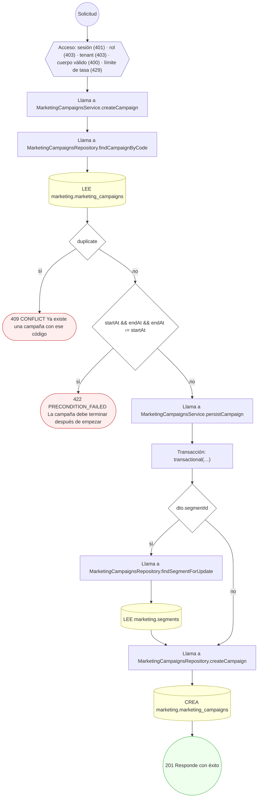

#### 3. POST /marketing/campaigns/{id}/members/materialize

Materializar la audiencia de la campaña desde su segmento

| HTTP | Código | Cuándo |
|---|---|---|
| 200 | — | Éxito |
| 400 | `VALIDATION_FAILED` | Los parámetros de ruta son UUID válidos; El cuerpo cumple el DTO (sin propiedades extra) |
| 401 | `UNAUTHENTICATED` | Hay una sesión válida (JWT) |
| 403 | `FORBIDDEN` | El rol está permitido; El tenant se resuelve y pertenece al actor |
| 422 | `PRECONDITION_FAILED` | PreconditionFailedException: La campaña no admite materializar audiencia en su estado actual; PreconditionFailedException: La campaña no tiene segmento del que derivar audiencia |
| 429 | `RATE_LIMITED` | No se supera el límite de solicitudes |

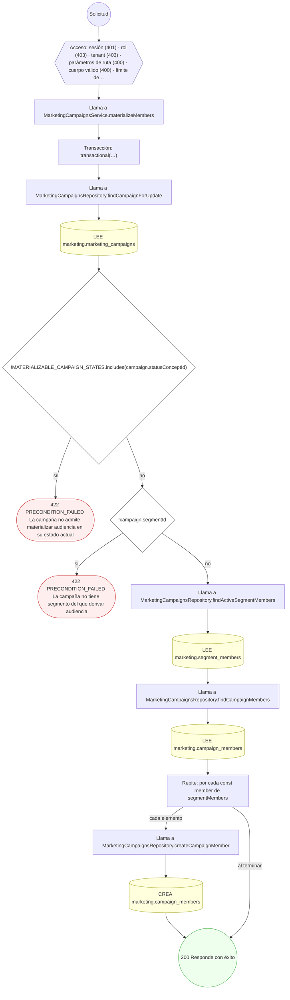

#### 4. POST /marketing/content-templates/{code}/versions

Publicar una versión de plantilla de contenido

| HTTP | Código | Cuándo |
|---|---|---|
| 201 | — | Éxito |
| 400 | `VALIDATION_FAILED` | El cuerpo cumple el DTO (sin propiedades extra) |
| 401 | `UNAUTHENTICATED` | Hay una sesión válida (JWT) |
| 403 | `FORBIDDEN` | El rol está permitido; El tenant se resuelve y pertenece al actor |
| 429 | `RATE_LIMITED` | No se supera el límite de solicitudes |

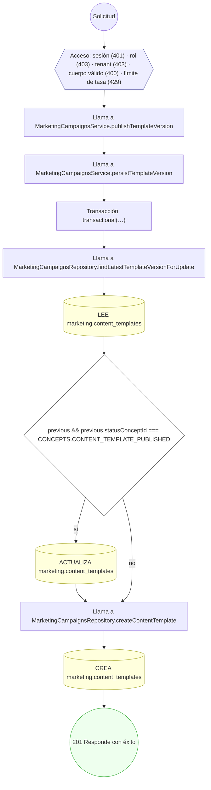

#### 5. POST /marketing/enrollments/{id}/advance

Avanzar la inscripción al siguiente paso

| HTTP | Código | Cuándo |
|---|---|---|
| 200 | — | Éxito |
| 400 | `VALIDATION_FAILED` | Los parámetros de ruta son UUID válidos; El cuerpo cumple el DTO (sin propiedades extra) |
| 401 | `UNAUTHENTICATED` | Hay una sesión válida (JWT) |
| 403 | `FORBIDDEN` | El rol está permitido; El tenant se resuelve y pertenece al actor |
| 404 | `NOT_FOUND` | ResourceNotFoundException: Paso actual no encontrado |
| 409 | `CONFLICT` | ConflictException: La inscripción ya no está activa |
| 422 | `PRECONDITION_FAILED` | PreconditionFailedException: La inscripción no tiene paso actual; PreconditionFailedException: La espera del paso aún no ha vencido |
| 429 | `RATE_LIMITED` | No se supera el límite de solicitudes |

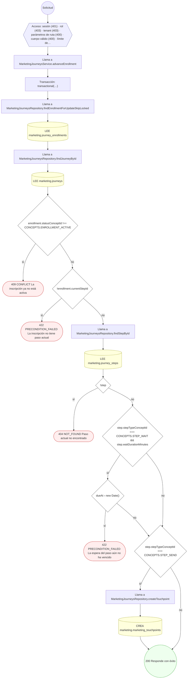

#### 6. POST /marketing/enrollments/{id}/exit

Cerrar la inscripción por meta, baja o rebote

| HTTP | Código | Cuándo |
|---|---|---|
| 200 | — | Éxito |
| 400 | `VALIDATION_FAILED` | Los parámetros de ruta son UUID válidos; El cuerpo cumple el DTO (sin propiedades extra) |
| 401 | `UNAUTHENTICATED` | Hay una sesión válida (JWT) |
| 403 | `FORBIDDEN` | El rol está permitido; El tenant se resuelve y pertenece al actor |
| 409 | `CONFLICT` | ConflictException: La inscripción ya no está activa |
| 429 | `RATE_LIMITED` | No se supera el límite de solicitudes |

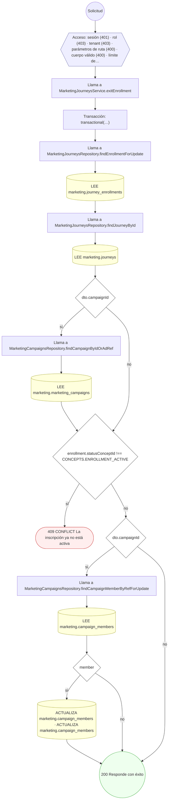

#### 7. POST /marketing/journeys

Crear un journey en borrador

| HTTP | Código | Cuándo |
|---|---|---|
| 201 | — | Éxito |
| 400 | `VALIDATION_FAILED` | El cuerpo cumple el DTO (sin propiedades extra) |
| 401 | `UNAUTHENTICATED` | Hay una sesión válida (JWT) |
| 403 | `FORBIDDEN` | El rol está permitido; El tenant se resuelve y pertenece al actor |
| 409 | `CONFLICT` | ConflictException: Ya existe un journey con ese código |
| 422 | `PRECONDITION_FAILED` | PreconditionFailedException: Un journey con entrada por segmento necesita entrySegmentId |
| 429 | `RATE_LIMITED` | No se supera el límite de solicitudes |

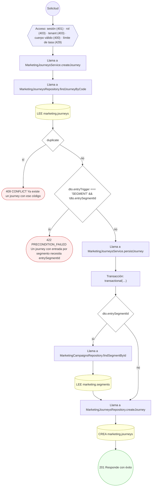

#### 8. POST /marketing/journeys/{id}/activate

Activar el journey e inscribir la cohorte inicial

| HTTP | Código | Cuándo |
|---|---|---|
| 200 | — | Éxito |
| 400 | `VALIDATION_FAILED` | Los parámetros de ruta son UUID válidos; El cuerpo cumple el DTO (sin propiedades extra) |
| 401 | `UNAUTHENTICATED` | Hay una sesión válida (JWT) |
| 403 | `FORBIDDEN` | El rol está permitido; El tenant se resuelve y pertenece al actor |
| 409 | `CONFLICT` | ConflictException: El journey ya no está en borrador |
| 422 | `PRECONDITION_FAILED` | PreconditionFailedException: Un journey sin pasos no puede activarse |
| 429 | `RATE_LIMITED` | No se supera el límite de solicitudes |

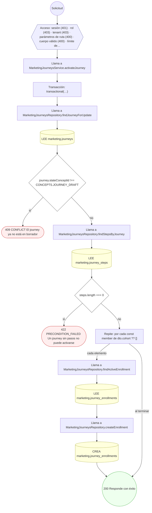

#### 9. POST /marketing/journeys/{id}/steps

Añadir pasos al journey

| HTTP | Código | Cuándo |
|---|---|---|
| 201 | — | Éxito |
| 400 | `VALIDATION_FAILED` | Los parámetros de ruta son UUID válidos; El cuerpo cumple el DTO (sin propiedades extra) |
| 401 | `UNAUTHENTICATED` | Hay una sesión válida (JWT) |
| 403 | `FORBIDDEN` | El rol está permitido; El tenant se resuelve y pertenece al actor |
| 422 | `PRECONDITION_FAILED` | PreconditionFailedException: Sólo un journey en borrador admite nuevos pasos; PreconditionFailedException: Un paso SEND necesita plantilla de contenido; PreconditionFailedException: La plantilla del paso SEND no existe o no está publicada; PreconditionFailedException: Un paso WAIT necesita duración; PreconditionFailedException: Un paso BRANCH necesita condición |
| 429 | `RATE_LIMITED` | No se supera el límite de solicitudes |

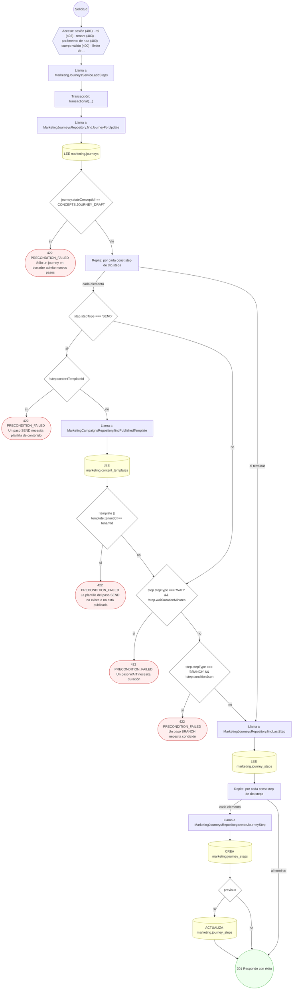

#### 10. POST /marketing/segments

Crear un segmento y ligarlo a su read model

| HTTP | Código | Cuándo |
|---|---|---|
| 201 | — | Éxito |
| 400 | `VALIDATION_FAILED` | El cuerpo cumple el DTO (sin propiedades extra) |
| 401 | `UNAUTHENTICATED` | Hay una sesión válida (JWT) |
| 403 | `FORBIDDEN` | El rol está permitido; El tenant se resuelve y pertenece al actor |
| 409 | `CONFLICT` | ConflictException: Ya existe un segmento con ese código |
| 429 | `RATE_LIMITED` | No se supera el límite de solicitudes |

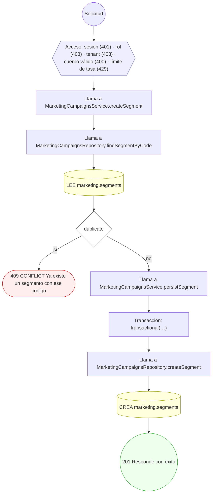

#### 11. POST /marketing/segments/{id}/refresh

Recomputar la membresía del segmento

| HTTP | Código | Cuándo |
|---|---|---|
| 200 | — | Éxito |
| 400 | `VALIDATION_FAILED` | Los parámetros de ruta son UUID válidos; El cuerpo cumple el DTO (sin propiedades extra) |
| 401 | `UNAUTHENTICATED` | Hay una sesión válida (JWT) |
| 403 | `FORBIDDEN` | El rol está permitido; El tenant se resuelve y pertenece al actor |
| 422 | `PRECONDITION_FAILED` | PreconditionFailedException: El segmento no está activo |
| 429 | `RATE_LIMITED` | No se supera el límite de solicitudes |

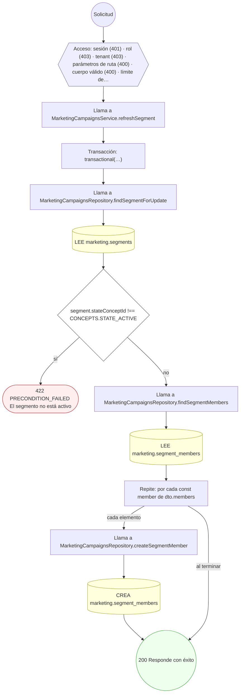

#### 12. POST /marketing/touchpoints

Registrar un touchpoint de marketing

| HTTP | Código | Cuándo |
|---|---|---|
| 201 | — | Éxito |
| 400 | `VALIDATION_FAILED` | El cuerpo cumple el DTO (sin propiedades extra) |
| 401 | `UNAUTHENTICATED` | Hay una sesión válida (JWT) |
| 403 | `FORBIDDEN` | El rol está permitido; El tenant se resuelve y pertenece al actor |
| 404 | `NOT_FOUND` | ResourceNotFoundException: Enlace no encontrado |
| 422 | `PRECONDITION_FAILED` | PreconditionFailedException: El touchpoint necesita campaña o journey de origen |
| 429 | `RATE_LIMITED` | No se supera el límite de solicitudes |

```mermaid
flowchart TD
  n1(("Solicitud")):::inicio
  n2{{"Acceso: sesión (401) · rol (403) · tenant (403) · cuerpo válido (400) · límite de tasa (429)"}}:::acceso
  n1 --> n2
  n3["Llama a MarketingJourneysService.recordTouchpoint"]:::llamada
  n2 --> n3
  n4{"!dto.campaignId && !dto.journeyId"}:::decision
  n3 --> n4
  n5(["422 PRECONDITION_FAILED El touchpoint necesita campaña o journey de origen"]):::error
  n4 -->|"sí"| n5
  n6["Transacción: transactional(…)"]:::transaccion
  n4 -->|"no"| n6
  n7["Llama a MarketingJourneysService.assertTouchpointOriginsInTenant"]:::llamada
  n6 --> n7
  n8{"dto.campaignId"}:::decision
  n7 --> n8
  n9["Llama a MarketingCampaignsRepository.findCampaignByIdOrAdRef"]:::llamada
  n8 -->|"sí"| n9
  n10[("LEE marketing.marketing_campaigns")]:::efecto
  n9 --> n10
  n11{"dto.journeyId"}:::decision
  n10 --> n11
  n8 -->|"no"| n11
  n12["Llama a MarketingJourneysRepository.findJourneyById"]:::llamada
  n11 -->|"sí"| n12
  n13[("LEE marketing.journeys")]:::efecto
  n12 --> n13
  n14{"dto.trackedLinkId"}:::decision
  n13 --> n14
  n11 -->|"no"| n14
  n15["Llama a MarketingJourneysRepository.findTrackedLinkById"]:::llamada
  n14 -->|"sí"| n15
  n16[("LEE marketing.tracked_links")]:::efecto
  n15 --> n16
  n17["Llama a MarketingCampaignsRepository.findCampaignByIdOrAdRef"]:::llamada
  n16 --> n17
  n18[("LEE marketing.marketing_campaigns")]:::efecto
  n17 --> n18
  n19{"!link || !owner || owner.tenantId !== tenantId"}:::decision
  n18 --> n19
  n20(["404 NOT_FOUND Enlace no encontrado"]):::error
  n19 -->|"sí"| n20
  n21{"dto.contentTemplateId"}:::decision
  n19 -->|"no"| n21
  n14 -->|"no"| n21
  n22["Llama a MarketingCampaignsRepository.findTemplateById"]:::llamada
  n21 -->|"sí"| n22
  n23[("LEE marketing.content_templates")]:::efecto
  n22 --> n23
  n24["Llama a MarketingJourneysRepository.createTouchpoint"]:::llamada
  n23 --> n24
  n21 -->|"no"| n24
  n25[("CREA marketing.marketing_touchpoints")]:::efecto
  n24 --> n25
  n26{"dto.campaignId && newStatus"}:::decision
  n25 --> n26
  n27["Llama a MarketingCampaignsRepository.findCampaignMemberByRefForUpdate"]:::llamada
  n26 -->|"sí"| n27
  n28[("LEE marketing.campaign_members")]:::efecto
  n27 --> n28
  n29{"member"}:::decision
  n28 --> n29
  n30[("ACTUALIZA marketing.campaign_members · ACTUALIZA marketing.campaign_members")]:::efecto
  n29 -->|"sí"| n30
  n31(("201 Responde con éxito")):::ok
  n30 --> n31
  n29 -->|"no"| n31
  n26 -->|"no"| n31
  classDef acceso fill:#eef,stroke:#66a
  classDef error fill:#fee,stroke:#c33
  classDef ok fill:#efe,stroke:#3a3
  classDef efecto fill:#ffd,stroke:#aa3
  classDef decision fill:#fff,stroke:#555
  classDef corte fill:#eee,stroke:#999,stroke-dasharray: 4
```

#### 13. POST /marketing/tracked-links

Crear un enlace rastreable con parámetros UTM

| HTTP | Código | Cuándo |
|---|---|---|
| 201 | — | Éxito |
| 400 | `VALIDATION_FAILED` | El cuerpo cumple el DTO (sin propiedades extra) |
| 401 | `UNAUTHENTICATED` | Hay una sesión válida (JWT) |
| 403 | `FORBIDDEN` | El rol está permitido; El tenant se resuelve y pertenece al actor |
| 409 | `CONFLICT` | ConflictException: Ya existe un enlace con ese código |
| 429 | `RATE_LIMITED` | No se supera el límite de solicitudes |

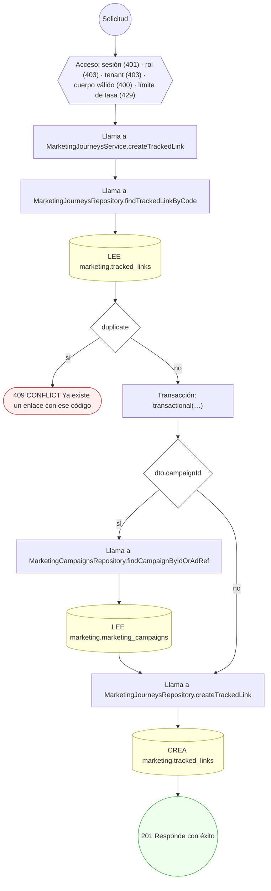

#### 14. POST /marketing/tracked-links/{id}/recipient-tokens

Emitir el token de destinatario de un enlace rastreable

| HTTP | Código | Cuándo |
|---|---|---|
| 201 | — | Éxito |
| 400 | `VALIDATION_FAILED` | Los parámetros de ruta son UUID válidos; El cuerpo cumple el DTO (sin propiedades extra) |
| 401 | `UNAUTHENTICATED` | Hay una sesión válida (JWT) |
| 403 | `FORBIDDEN` | El rol está permitido; El tenant se resuelve y pertenece al actor |
| 404 | `NOT_FOUND` | ResourceNotFoundException: Enlace no encontrado; ResourceNotFoundException: Destinatario no encontrado |
| 429 | `RATE_LIMITED` | No se supera el límite de solicitudes |

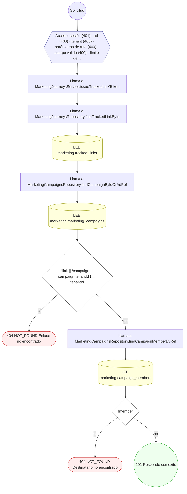

#### 15. GET /r/{code}

Resolver un enlace rastreable y registrar el click

| HTTP | Código | Cuándo |
|---|---|---|
| 200 | — | Éxito |
| 401 | `UNAUTHENTICATED` | Hay una sesión válida (JWT) |
| 404 | `NOT_FOUND` | ResourceNotFoundException: Enlace no encontrado |
| 422 | `PRECONDITION_FAILED` | PreconditionFailedException: El enlace no está activo; PreconditionFailedException: El token del enlace no es válido |
| 429 | `RATE_LIMITED` | No se supera el límite de solicitudes |

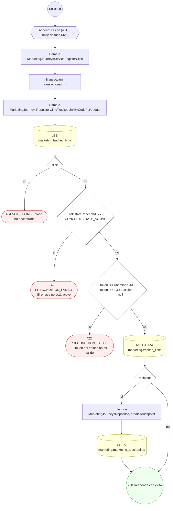

