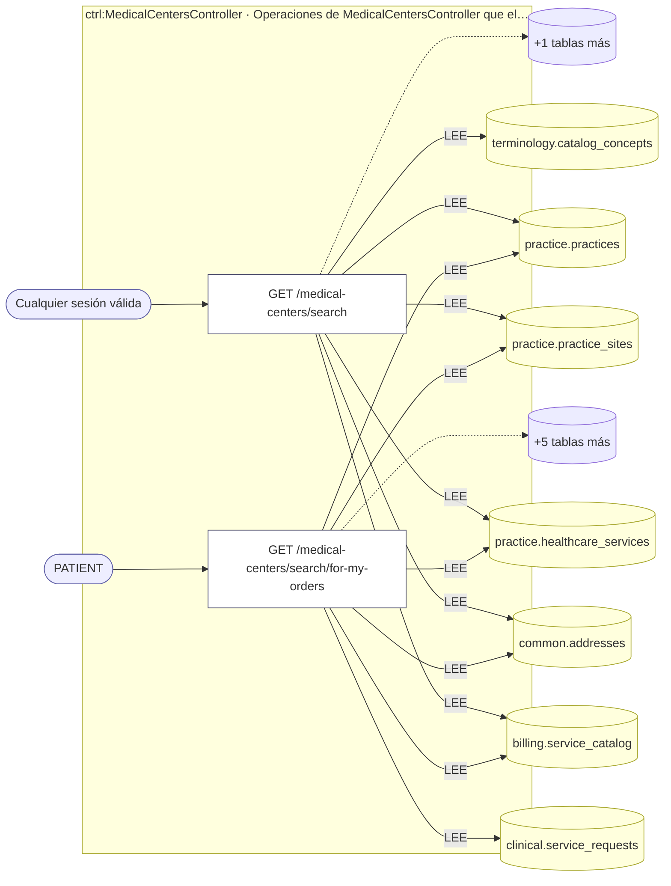
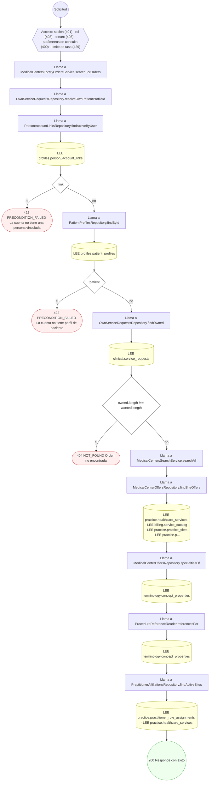

<!-- AUTOGENERADO por tools/inventario/flujos.mjs. No editar manualmente. -->

# Flujos del módulo `medical_centers`

- **Procesos:** 1 · **Máquinas de estado:** 0
- **Operaciones:** 2 (1 con decisiones propias, 1 sin ellas)
- Inventario de endpoints del módulo: [medical_centers](../endpoints/medical_centers.md)

## Proceso: Centros médicos — búsqueda por procedimientos

- **Código:** `medical_centers` · **Agrupación:** AGRUPACION_POR_CONTROLADOR · **Operaciones:** 2
- **Actores:** Cualquier sesión válida · PATIENT
- **Revisión:** AUTO_DETECTADA
- **Fuentes:** `src/modules/medical_centers/README.md`

### Para qué sirve

Busca centros médicos (sedes de una práctica) por los procedimientos del nomenclador boliviano (`VS_BO_MEDICAL_PROCEDURE`) que ofrecen con precio publicado. Es la mitad de lectura del flujo «centros médicos»: el catálogo de la sede, las afiliaciones y el modo de ejecutor de la orden viven en `practice` y `clinical`.

_Fuente: `src/modules/medical_centers/README.md:3`_

### Etapas y operaciones

| Etapa | Descripción | Operación | Quién actúa | Riesgo | Tablas |
|---|---|---|---|---|---|
| `ctrl:MedicalCentersController` | Operaciones de MedicalCentersController que el README no asigna a un caso de uso | GET /medical-centers/search | Cualquier sesión válida | BAJO | 7 |
|  |  | GET /medical-centers/search/for-my-orders | PATIENT | BAJO | 11 |

### Diagrama — etapas `ctrl:MedicalCentersController`

## Árbol de decisión por operación

Cada árbol se deriva del código del handler y de los métodos que invoca (hasta 4 niveles). Una rama que no decide, no escribe y no falla se poda. Los accesos y los efectos consecutivos se agrupan en un solo nodo.

### Operaciones con decisiones propias

#### 1. GET /medical-centers/search/for-my-orders

Buscar centros médicos para mis órdenes

| HTTP | Código | Cuándo |
|---|---|---|
| 200 | — | Éxito |
| 400 | `VALIDATION_FAILED` | Están los parámetros de consulta obligatorios |
| 401 | `UNAUTHENTICATED` | Hay una sesión válida (JWT) |
| 403 | `FORBIDDEN` | El rol está permitido; El tenant se resuelve y pertenece al actor |
| 404 | `NOT_FOUND` | ResourceNotFoundException: Orden no encontrada |
| 422 | `PRECONDITION_FAILED` | PreconditionFailedException: La cuenta no tiene una persona vinculada; PreconditionFailedException: La cuenta no tiene perfil de paciente |
| 429 | `RATE_LIMITED` | No se supera el límite de solicitudes |

### Operaciones sin decisiones propias

Sólo comprueban el acceso y leen o escriben: no tienen ramas que dibujar. Su detalle está en la ficha de endpoints.

| Operación | Respuestas posibles | Tablas |
|---|---|---|
| GET /medical-centers/search | 200, 400, 401, 403, 429 | 7 |
