<!-- AUTOGENERADO por tools/inventario/flujos.mjs. No editar manualmente. -->

# Flujos del módulo `medical_groups`

- **Procesos:** 1 · **Máquinas de estado:** 0
- **Operaciones:** 14 (14 con decisiones propias, 0 sin ellas)
- Inventario de endpoints del módulo: [medical_groups](../endpoints/medical_groups.md)

## Proceso: Módulo Medical Groups — Grupos médicos (FT-21)

- **Código:** `medical_groups` · **Agrupación:** AGRUPACION_POR_CONTROLADOR · **Operaciones:** 14
- **Actores:** CLINICIAN · PRACTITIONER
- **Revisión:** AUTO_DETECTADA
- **Fuentes:** `src/modules/medical_groups/README.md`

### Para qué sirve

Un **grupo médico** es un evento de equipo alrededor de un servicio del catálogo: un roster de profesionales por cargo o función, el pago acordado por cargo, un paciente y un diagnóstico opcionales, y un ciclo de vida propio que termina en un expediente inmutable.

_Fuente: `src/modules/medical_groups/README.md:3`_

### Etapas y operaciones

| Etapa | Descripción | Operación | Quién actúa | Riesgo | Tablas |
|---|---|---|---|---|---|
| `ctrl:MedicalGroupsController` | Operaciones de MedicalGroupsController que el README no asigna a un caso de uso | GET /medical-groups | PRACTITIONER · CLINICIAN | BAJO | 5 |
|  |  | POST /medical-groups | PRACTITIONER · CLINICIAN | MEDIO | 27 |
|  |  | DELETE /medical-groups/{id} | PRACTITIONER · CLINICIAN | ALTO | 6 |
|  |  | GET /medical-groups/{id} | PRACTITIONER · CLINICIAN | MEDIO | 6 |
|  |  | PATCH /medical-groups/{id} | PRACTITIONER · CLINICIAN | MEDIO | 7 |
|  |  | PATCH /medical-groups/{id}/exercise-notes | PRACTITIONER · CLINICIAN | MEDIO | 6 |
|  |  | POST /medical-groups/{id}/members | PRACTITIONER · CLINICIAN | MEDIO | 10 |
|  |  | DELETE /medical-groups/{id}/members/{memberId} | PRACTITIONER · CLINICIAN | ALTO | 8 |
|  |  | PATCH /medical-groups/{id}/members/{memberId} | PRACTITIONER · CLINICIAN | MEDIO | 7 |
|  |  | POST /medical-groups/{id}/members/{memberId}/respond | PRACTITIONER · CLINICIAN | MEDIO | 7 |
|  |  | POST /medical-groups/{id}/reschedule-requests | PRACTITIONER · CLINICIAN | MEDIO | 6 |
|  |  | POST /medical-groups/{id}/reschedule-requests/respond | PRACTITIONER · CLINICIAN | MEDIO | 6 |
|  |  | GET /medical-groups/eligible-members | PRACTITIONER · CLINICIAN | BAJO | 5 |
|  |  | GET /medical-groups/patients/{patientProfileId}/conditions | PRACTITIONER · CLINICIAN | BAJO | 20 |

### Diagrama — etapas `ctrl:MedicalGroupsController`

```mermaid
flowchart LR
  a2(["PRACTITIONER · CLINICIAN"]):::actor
  t3[("billing.service_catalog")]:::tabla
  t4[("medical_groups.group_members")]:::tabla
  t5[("medical_groups.groups")]:::tabla
  t6[("profiles.person_profiles")]:::tabla
  t7[("profiles.persons")]:::tabla
  t9[("authz.access_policies")]:::tabla
  t10[("authz.care_relationships")]:::tabla
  t11[("authz.clinical_access_grants")]:::tabla
  t12[("authz.field_permissions")]:::tabla
  t13[("authz.patient_legal_representations")]:::tabla
  t14[("authz.permissions")]:::tabla
  t17[("practice.practitioner_role_assignments")]:::tabla
  t23[("practice.practices")]:::tabla
  t15[("+21 tablas más")]
  t20[("+1 tablas más")]
  t24[("+4 tablas más")]
  t26[("+2 tablas más")]
  t28[("+1 tablas más")]
  t30[("+1 tablas más")]
  t35[("+14 tablas más")]
  subgraph s0["ctrl:MedicalGroupsController · Operaciones de MedicalGroupsController que el RE…"]
    o1["GET /medical-groups"]:::op
    o8["POST /medical-groups"]:::op
    o16["DELETE /medical-groups/{id}"]:::op
    o18["GET /medical-groups/{id}"]:::op
    o19["PATCH /medical-groups/{id}"]:::op
    o21["PATCH /medical-groups/{id}/exercise-notes"]:::op
    o22["POST /medical-groups/{id}/members"]:::op
    o25["DELETE /medical-groups/{id}/members/{memberId}"]:::op
    o27["PATCH /medical-groups/{id}/members/{memberId}"]:::op
    o29["POST /medical-groups/{id}/members/{memberId}/respond"]:::op
    o31["POST /medical-groups/{id}/reschedule-requests"]:::op
    o32["POST /medical-groups/{id}/reschedule-requests/respond"]:::op
    o33["GET /medical-groups/eligible-members"]:::op
    o34["GET /medical-groups/patients/{patientProfileId}/conditions"]:::op
  end
  a2 --> o1
  o1 -->|"LEE"| t3
  o1 -->|"LEE"| t4
  o1 -->|"LEE"| t5
  o1 -->|"LEE"| t6
  o1 -->|"LEE"| t7
  a2 --> o8
  o8 -->|"LEE"| t9
  o8 -->|"LEE"| t10
  o8 -->|"LEE"| t11
  o8 -->|"LEE"| t12
  o8 -->|"LEE"| t13
  o8 -->|"LEE"| t14
  o8 -.-> t15
  a2 --> o16
  o16 -->|"BORRA"| t4
  o16 -->|"LEE"| t4
  o16 -->|"BORRA"| t5
  o16 -->|"ACTUALIZA"| t5
  o16 -->|"LEE"| t5
  o16 -->|"LEE"| t17
  a2 --> o18
  o18 -->|"LEE"| t3
  o18 -->|"LEE"| t4
  o18 -->|"ACTUALIZA"| t5
  o18 -->|"LEE"| t5
  o18 -->|"LEE"| t6
  o18 -->|"LEE"| t7
  a2 --> o19
  o19 -->|"LEE"| t3
  o19 -->|"LEE"| t4
  o19 -->|"ACTUALIZA"| t5
  o19 -->|"LEE"| t5
  o19 -->|"LEE"| t17
  o19 -->|"LEE"| t6
  o19 -.-> t20
  a2 --> o21
  o21 -->|"LEE"| t3
  o21 -->|"LEE"| t4
  o21 -->|"ACTUALIZA"| t5
  o21 -->|"LEE"| t5
  o21 -->|"LEE"| t6
  o21 -->|"LEE"| t7
  a2 --> o22
  o22 -->|"LEE"| t3
  o22 -->|"CREA"| t4
  o22 -->|"LEE"| t4
  o22 -->|"ACTUALIZA"| t5
  o22 -->|"LEE"| t5
  o22 -->|"LEE"| t23
  o22 -.-> t24
  a2 --> o25
  o25 -->|"LEE"| t3
  o25 -->|"BORRA"| t4
  o25 -->|"LEE"| t4
  o25 -->|"ACTUALIZA"| t5
  o25 -->|"LEE"| t5
  o25 -->|"LEE"| t17
  o25 -.-> t26
  a2 --> o27
  o27 -->|"LEE"| t3
  o27 -->|"LEE"| t4
  o27 -->|"ACTUALIZA"| t5
  o27 -->|"LEE"| t5
  o27 -->|"LEE"| t17
  o27 -->|"LEE"| t6
  o27 -.-> t28
  a2 --> o29
  o29 -->|"LEE"| t3
  o29 -->|"ACTUALIZA"| t4
  o29 -->|"LEE"| t4
  o29 -->|"ACTUALIZA"| t5
  o29 -->|"LEE"| t5
  o29 -->|"LEE"| t6
  o29 -.-> t30
  a2 --> o31
  o31 -->|"LEE"| t3
  o31 -->|"LEE"| t4
  o31 -->|"ACTUALIZA"| t5
  o31 -->|"LEE"| t5
  o31 -->|"LEE"| t6
  o31 -->|"LEE"| t7
  a2 --> o32
  o32 -->|"LEE"| t3
  o32 -->|"LEE"| t4
  o32 -->|"ACTUALIZA"| t5
  o32 -->|"LEE"| t5
  o32 -->|"LEE"| t6
  o32 -->|"LEE"| t7
  a2 --> o33
  o33 -->|"LEE"| t3
  o33 -->|"LEE"| t23
  o33 -->|"LEE"| t17
  o33 -->|"LEE"| t6
  o33 -->|"LEE"| t7
  a2 --> o34
  o34 -->|"LEE"| t9
  o34 -->|"LEE"| t10
  o34 -->|"LEE"| t11
  o34 -->|"LEE"| t12
  o34 -->|"LEE"| t13
  o34 -->|"LEE"| t14
  o34 -.-> t35
  classDef op fill:#fff,stroke:#446
  classDef actor fill:#eef,stroke:#66a
  classDef tabla fill:#ffd,stroke:#aa3
  classDef evento fill:#efe,stroke:#3a3
```

## Árbol de decisión por operación

Cada árbol se deriva del código del handler y de los métodos que invoca (hasta 4 niveles). Una rama que no decide, no escribe y no falla se poda. Los accesos y los efectos consecutivos se agrupan en un solo nodo.

### Operaciones con decisiones propias

#### 1. GET /medical-groups

Listar grupos médicos (histórico/enviadas/recibidas)

| HTTP | Código | Cuándo |
|---|---|---|
| 200 | — | Éxito |
| 401 | `UNAUTHENTICATED` | Hay una sesión válida (JWT); UnauthorizedException: La cuenta no tiene un perfil profesional asociado |
| 403 | `FORBIDDEN` | El rol está permitido; El tenant se resuelve y pertenece al actor |
| 429 | `RATE_LIMITED` | No se supera el límite de solicitudes |

```mermaid
flowchart TD
  n1(("Solicitud")):::inicio
  n2{{"Acceso: sesión (401) · rol (403) · tenant (403) · límite de tasa (429)"}}:::acceso
  n1 --> n2
  n3["Llama a MedicalGroupsService.list"]:::llamada
  n2 --> n3
  n4["Llama a MedicalGroupsService.requirePractitioner"]:::llamada
  n3 --> n4
  n5{"actor.practitionerProfileId === undefined"}:::decision
  n4 --> n5
  n6(["401 UNAUTHENTICATED La cuenta no tiene un perfil profesional asociado"]):::error
  n5 -->|"sí"| n6
  n7["Llama a MedicalGroupsService.idsForTab"]:::llamada
  n5 -->|"no"| n7
  n8{"tab === 'recibidas'"}:::decision
  n7 --> n8
  n9["Llama a MedicalGroupMembersRepository.findGroupIdsByInvitee"]:::llamada
  n8 -->|"sí"| n9
  n10[("LEE medical_groups.group_members")]:::efecto
  n9 --> n10
  n11{"tab === 'enviadas'"}:::decision
  n10 --> n11
  n8 -->|"no"| n11
  n12["Llama a MedicalGroupsRepository.findIdsByRequester"]:::llamada
  n11 -->|"sí"| n12
  n13[("LEE medical_groups.groups")]:::efecto
  n12 --> n13
  n14["Llama a MedicalGroupMembersRepository.findGroupIdsWithPendingInvites"]:::llamada
  n13 --> n14
  n15[("LEE medical_groups.group_members")]:::efecto
  n14 --> n15
  n16["Llama a MedicalGroupsRepository.findIdsByRequester"]:::llamada
  n15 --> n16
  n11 -->|"no"| n16
  n17[("LEE medical_groups.groups")]:::efecto
  n16 --> n17
  n18["Llama a MedicalGroupMembersRepository.findGroupIdsByInvitee"]:::llamada
  n17 --> n18
  n19[("LEE medical_groups.group_members")]:::efecto
  n18 --> n19
  n20["Llama a MedicalGroupsRepository.findByIdsPage"]:::llamada
  n19 --> n20
  n21[("LEE medical_groups.groups")]:::efecto
  n20 --> n21
  n22["Llama a MedicalGroupMembersRepository.findManyByGroups"]:::llamada
  n21 --> n22
  n23[("LEE medical_groups.group_members")]:::efecto
  n22 --> n23
  n24["Llama a MedicalGroupsService.namesFor"]:::llamada
  n23 --> n24
  n25[("LEE billing.service_catalog · LEE profiles.persons · LEE profiles.person_profiles · LEE profiles.persons")]:::efecto
  n24 --> n25
  n26(("200 Responde con éxito")):::ok
  n25 --> n26
  classDef acceso fill:#eef,stroke:#66a
  classDef error fill:#fee,stroke:#c33
  classDef ok fill:#efe,stroke:#3a3
  classDef efecto fill:#ffd,stroke:#aa3
  classDef decision fill:#fff,stroke:#555
  classDef corte fill:#eee,stroke:#999,stroke-dasharray: 4
```

#### 2. POST /medical-groups

Crear grupo médico

| HTTP | Código | Cuándo |
|---|---|---|
| 201 | — | Éxito |
| 400 | `VALIDATION_FAILED` | El cuerpo cumple el DTO (sin propiedades extra) |
| 401 | `UNAUTHENTICATED` | Hay una sesión válida (JWT); UnauthorizedException: La cuenta no tiene un perfil profesional asociado |
| 403 | `FORBIDDEN` | El rol está permitido; El tenant se resuelve y pertenece al actor; ForbiddenException: {WITHOUT_ACCESS_TO_HISTORY} |
| 404 | `NOT_FOUND` | ResourceNotFoundException: Servicio médico no encontrado; ResourceNotFoundException: Diagnóstico no encontrado |
| 409 | `CONFLICT` | ConflictException: Un mismo profesional no puede repetirse (ni ser también el creador) |
| 422 | `PRECONDITION_FAILED` | PreconditionFailedException: Seleccione primero el paciente para poder elegir un diagnóstico |
| 429 | `RATE_LIMITED` | No se supera el límite de solicitudes |

```mermaid
flowchart TD
  n1(("Solicitud")):::inicio
  n2{{"Acceso: sesión (401) · rol (403) · tenant (403) · cuerpo válido (400) · límite de tasa (429)"}}:::acceso
  n1 --> n2
  n3["Llama a MedicalGroupsService.create"]:::llamada
  n2 --> n3
  n4["Llama a MedicalGroupsService.requirePractitioner"]:::llamada
  n3 --> n4
  n5{"actor.practitionerProfileId === undefined"}:::decision
  n4 --> n5
  n6(["401 UNAUTHENTICATED La cuenta no tiene un perfil profesional asociado"]):::error
  n5 -->|"sí"| n6
  n7["Transacción: transactional(…)"]:::transaccion
  n5 -->|"no"| n7
  n8["Llama a ServiceCatalogRepository.findById"]:::llamada
  n7 --> n8
  n9[("LEE billing.service_catalog")]:::efecto
  n8 --> n9
  n10{"service === null || !service.isActive"}:::decision
  n9 --> n10
  n11(["404 NOT_FOUND Servicio médico no encontrado"]):::error
  n10 -->|"sí"| n11
  n12["Llama a PracticeTenantLookupService.findActivePracticeIdsForPractitioner"]:::llamada
  n10 -->|"no"| n12
  n13["Llama a PractitionerRoleAssignmentsRepository.findActiveByPractitioner"]:::llamada
  n12 --> n13
  n14[("LEE practice.practitioner_role_assignments")]:::efecto
  n13 --> n14
  n15{"!own.includes(service.practiceId)"}:::decision
  n14 --> n15
  n16(["404 NOT_FOUND Servicio médico no encontrado"]):::error
  n15 -->|"sí"| n16
  n17["Llama a PracticeTenantLookupService.findTenantOfPractice"]:::llamada
  n15 -->|"no"| n17
  n18["Llama a PracticesRepository.findById"]:::llamada
  n17 --> n18
  n19[("LEE practice.practices")]:::efecto
  n18 --> n19
  n20{"tenantId === null"}:::decision
  n19 --> n20
  n21(["404 NOT_FOUND Servicio médico no encontrado"]):::error
  n20 -->|"sí"| n21
  n22{"dto.conditionId !== undefined && dto.patientProfileId === undefined"}:::decision
  n20 -->|"no"| n22
  n23(["422 PRECONDITION_FAILED Seleccione primero el paciente para poder elegir un diagnóstico"]):::error
  n22 -->|"sí"| n23
  n24{"dto.patientProfileId !== undefined"}:::decision
  n22 -->|"no"| n24
  n25["Llama a PatientProfilesRepository.findById"]:::llamada
  n24 -->|"sí"| n25
  n26[("LEE profiles.patient_profiles")]:::efecto
  n25 --> n26
  n27{"patient === null"}:::decision
  n26 --> n27
  n28(["↩ (relanza el error capturado)"]):::error
  n27 -->|"sí"| n28
  n29["Llama a MedicalGroupsService.assertCanReadPatientHistory"]:::llamada
  n27 -->|"no"| n29
  n30["Intenta"]:::intento
  n29 --> n30
  n31["Llama a ClinicalReadService.assertCanReadHistory"]:::llamada
  n30 --> n31
  n32{"!actor.roles.some((role) =› ROLES_THAT_ATTEND.includes(role))"}:::decision
  n31 --> n32
  n33["Llama a ClinicalReadService.assertOwnRecord"]:::llamada
  n32 -->|"sí"| n33
  n34{"!link || !profile || profile.profileId !== link.personId"}:::decision
  n33 --> n34
  n35(["403 FORBIDDEN {WITHOUT_ACCESS_TO_HISTORY}"]):::error
  n34 -->|"sí"| n35
  n36["Llama a PersonAccountLinksRepository.findActiveByUser"]:::llamada
  n34 -->|"no"| n36
  n32 -->|"no"| n36
  n37[("LEE profiles.person_account_links")]:::efecto
  n36 --> n37
  n38["Llama a HealthPractitionerProfilesRepository.findById"]:::llamada
  n37 --> n38
  n39[("LEE profiles.health_practitioner_profiles")]:::efecto
  n38 --> n39
  n40["Llama a ClinicalReadService.assertOwnRecord"]:::llamada
  n39 --> n40
  n41{"!link || !profile || profile.profileId !== link.personId"}:::decision
  n40 --> n41
  n42(["403 FORBIDDEN {WITHOUT_ACCESS_TO_HISTORY}"]):::error
  n41 -->|"sí"| n42
  n43{"error instanceof ForbiddenException"}:::decision
  n30 -->|"si falla"| n43
  n44(["↩ (relanza el error capturado)"]):::error
  n43 -->|"sí"| n44
  n45(["↩ (relanza el error capturado)"]):::error
  n43 -->|"no"| n45
  n46{"dto.conditionId !== undefined"}:::decision
  n41 -->|"no"| n46
  n47["Llama a ConditionsRepository.findById"]:::llamada
  n46 -->|"sí"| n47
  n48[("LEE clinical.conditions")]:::efecto
  n47 --> n48
  n49{"condition === null || condition.patientProfileId !== dto.patientProfileId"}:::decision
  n48 --> n49
  n50(["404 NOT_FOUND Diagnóstico no encontrado"]):::error
  n49 -->|"sí"| n50
  n51["Llama a PracticeTenantLookupService.findActivePracticeIdsForTenant"]:::llamada
  n49 -->|"no"| n51
  n46 -->|"no"| n51
  n24 -->|"no"| n51
  n52["Llama a PracticesRepository.findByTenant"]:::llamada
  n51 --> n52
  n53[("LEE practice.practices")]:::efecto
  n52 --> n53
  n54["Repite: por cada const member de dto.members"]:::bucle
  n53 --> n54
  n55{"seenPractitioners.has(member.practitionerProfileId)"}:::decision
  n54 -->|"cada elemento"| n55
  n56(["409 CONFLICT Un mismo profesional no puede repetirse (ni ser también el creador)"]):::error
  n55 -->|"sí"| n56
  n57["Llama a MedicalGroupsService.assertInvitable"]:::llamada
  n55 -->|"no"| n57
  n58["Llama a HealthPractitionerProfilesRepository.findById"]:::llamada
  n57 --> n58
  n59[("LEE profiles.health_practitioner_profiles")]:::efecto
  n58 --> n59
  n60{"invited === null"}:::decision
  n59 --> n60
  n61(["↩ (relanza el error capturado)"]):::error
  n60 -->|"sí"| n61
  n62["Llama a PracticeTenantLookupService.findActivePracticeIdsForPractitioner"]:::llamada
  n60 -->|"no"| n62
  n63["Llama a PractitionerRoleAssignmentsRepository.findActiveByPractitioner"]:::llamada
  n62 --> n63
  n64[("LEE practice.practitioner_role_assignments")]:::efecto
  n63 --> n64
  n65{"!invitedPracticeIds.some((id) =› tenantPracticeIds.has(id))"}:::decision
  n64 --> n65
  n66(["↩ (relanza el error capturado)"]):::error
  n65 -->|"sí"| n66
  n67["Llama a MedicalGroupsRepository.create"]:::llamada
  n65 -->|"no"| n67
  n54 -->|"al terminar"| n67
  n68[("CREA medical_groups.groups")]:::efecto
  n67 --> n68
  n69["Llama a MedicalGroupMembersRepository.create"]:::llamada
  n68 --> n69
  n70[("CREA medical_groups.group_members")]:::efecto
  n69 --> n70
  n71["… el resto del árbol (11 nodos) está en el JSON del inventario"]:::corte
  n70 --> n71
  classDef acceso fill:#eef,stroke:#66a
  classDef error fill:#fee,stroke:#c33
  classDef ok fill:#efe,stroke:#3a3
  classDef efecto fill:#ffd,stroke:#aa3
  classDef decision fill:#fff,stroke:#555
  classDef corte fill:#eee,stroke:#999,stroke-dasharray: 4
```

#### 3. DELETE /medical-groups/{id}

Eliminar un grupo médico no realizado

| HTTP | Código | Cuándo |
|---|---|---|
| 204 | — | Éxito |
| 400 | `VALIDATION_FAILED` | Los parámetros de ruta son UUID válidos |
| 401 | `UNAUTHENTICATED` | Hay una sesión válida (JWT); UnauthorizedException: La cuenta no tiene un perfil profesional asociado |
| 403 | `FORBIDDEN` | El rol está permitido; El tenant se resuelve y pertenece al actor; InsufficientRoleException: Sólo quien creó el grupo puede modificarlo o eliminarlo |
| 404 | `NOT_FOUND` | ResourceNotFoundException: Grupo médico no encontrado |
| 422 | `PRECONDITION_FAILED` | PreconditionFailedException: El expediente ya está cerrado y es inmutable; PreconditionFailedException: El grupo ya se realizó: sólo admite las notas del procedimiento |
| 429 | `RATE_LIMITED` | No se supera el límite de solicitudes |

```mermaid
flowchart TD
  n1(("Solicitud")):::inicio
  n2{{"Acceso: sesión (401) · rol (403) · tenant (403) · parámetros de ruta (400) · límite de tasa (429)"}}:::acceso
  n1 --> n2
  n3["Llama a MedicalGroupsService.remove"]:::llamada
  n2 --> n3
  n4["Transacción: transactional(…)"]:::transaccion
  n3 --> n4
  n5["Llama a MedicalGroupsService.loadForCreatorEdit"]:::llamada
  n4 --> n5
  n6["Llama a MedicalGroupsService.requirePractitioner"]:::llamada
  n5 --> n6
  n7{"actor.practitionerProfileId === undefined"}:::decision
  n6 --> n7
  n8(["401 UNAUTHENTICATED La cuenta no tiene un perfil profesional asociado"]):::error
  n7 -->|"sí"| n8
  n9["Llama a MedicalGroupsRepository.findById"]:::llamada
  n7 -->|"no"| n9
  n10[("LEE medical_groups.groups")]:::efecto
  n9 --> n10
  n11{"group === null"}:::decision
  n10 --> n11
  n12(["404 NOT_FOUND Grupo médico no encontrado"]):::error
  n11 -->|"sí"| n12
  n13["Llama a MedicalGroupMembersRepository.findByGroup"]:::llamada
  n11 -->|"no"| n13
  n14[("LEE medical_groups.group_members")]:::efecto
  n13 --> n14
  n15["Llama a MedicalGroupsService.assertActorSeesGroup"]:::llamada
  n14 --> n15
  n16{"!can"}:::decision
  n15 --> n16
  n17(["404 NOT_FOUND Grupo médico no encontrado"]):::error
  n16 -->|"sí"| n17
  n18{"group.requestingPractitionerId !== practitionerProfileId"}:::decision
  n16 -->|"no"| n18
  n19(["403 FORBIDDEN Sólo quien creó el grupo puede modificarlo o eliminarlo"]):::error
  n18 -->|"sí"| n19
  n20["Llama a PracticeTenantLookupService.findActivePracticeIdsForPractitioner"]:::llamada
  n18 -->|"no"| n20
  n21["Llama a PractitionerRoleAssignmentsRepository.findActiveByPractitioner"]:::llamada
  n20 --> n21
  n22[("LEE practice.practitioner_role_assignments")]:::efecto
  n21 --> n22
  n23{"!ownPractices.includes(group.practiceId)"}:::decision
  n22 --> n23
  n24(["404 NOT_FOUND Grupo médico no encontrado"]):::error
  n23 -->|"sí"| n24
  n25["Llama a MedicalGroupsService.closeIfExpired"]:::llamada
  n23 -->|"no"| n25
  n26[("ACTUALIZA medical_groups.groups")]:::efecto
  n25 --> n26
  n27{"group.status !== MEDICAL_GROUP_STATUS.CLOSED"}:::decision
  n26 --> n27
  n28[("ACTUALIZA medical_groups.groups")]:::efecto
  n27 -->|"sí"| n28
  n29{"justClosed || isClosedNow(group)"}:::decision
  n28 --> n29
  n27 -->|"no"| n29
  n30(["422 PRECONDITION_FAILED El expediente ya está cerrado y es inmutable"]):::error
  n29 -->|"sí"| n30
  n31{"isRealizedNow(group)"}:::decision
  n29 -->|"no"| n31
  n32(["422 PRECONDITION_FAILED El grupo ya se realizó: sólo admite las notas del procedimiento"]):::error
  n31 -->|"sí"| n32
  n33["Llama a MedicalGroupMembersRepository.removeByGroup"]:::llamada
  n31 -->|"no"| n33
  n34[("BORRA medical_groups.group_members")]:::efecto
  n33 --> n34
  n35["Llama a MedicalGroupsRepository.remove"]:::llamada
  n34 --> n35
  n36[("BORRA medical_groups.groups")]:::efecto
  n35 --> n36
  n37(("204 Responde con éxito")):::ok
  n36 --> n37
  classDef acceso fill:#eef,stroke:#66a
  classDef error fill:#fee,stroke:#c33
  classDef ok fill:#efe,stroke:#3a3
  classDef efecto fill:#ffd,stroke:#aa3
  classDef decision fill:#fff,stroke:#555
  classDef corte fill:#eee,stroke:#999,stroke-dasharray: 4
```

#### 4. GET /medical-groups/{id}

Consultar un grupo médico (formulario de sólo lectura)

| HTTP | Código | Cuándo |
|---|---|---|
| 200 | — | Éxito |
| 400 | `VALIDATION_FAILED` | Los parámetros de ruta son UUID válidos |
| 401 | `UNAUTHENTICATED` | Hay una sesión válida (JWT) |
| 403 | `FORBIDDEN` | El rol está permitido; El tenant se resuelve y pertenece al actor |
| 404 | `NOT_FOUND` | ResourceNotFoundException: Grupo médico no encontrado |
| 429 | `RATE_LIMITED` | No se supera el límite de solicitudes |

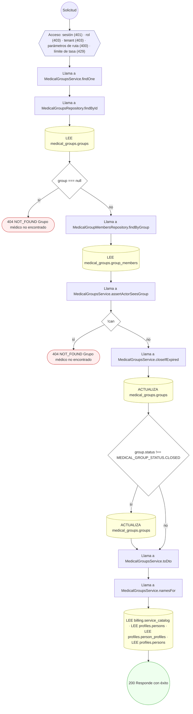

#### 5. PATCH /medical-groups/{id}

Corregir el lugar o las notas del grupo médico

| HTTP | Código | Cuándo |
|---|---|---|
| 200 | — | Éxito |
| 400 | `VALIDATION_FAILED` | Los parámetros de ruta son UUID válidos; El cuerpo cumple el DTO (sin propiedades extra) |
| 401 | `UNAUTHENTICATED` | Hay una sesión válida (JWT); UnauthorizedException: La cuenta no tiene un perfil profesional asociado |
| 403 | `FORBIDDEN` | El rol está permitido; El tenant se resuelve y pertenece al actor; InsufficientRoleException: Sólo quien creó el grupo puede modificarlo o eliminarlo |
| 404 | `NOT_FOUND` | ResourceNotFoundException: Grupo médico no encontrado |
| 422 | `PRECONDITION_FAILED` | PreconditionFailedException: El expediente ya está cerrado y es inmutable; PreconditionFailedException: El grupo ya se realizó: sólo admite las notas del procedimiento; PreconditionFailedException: El lugar de realización no puede quedar vacío |
| 429 | `RATE_LIMITED` | No se supera el límite de solicitudes |

```mermaid
flowchart TD
  n1(("Solicitud")):::inicio
  n2{{"Acceso: sesión (401) · rol (403) · tenant (403) · parámetros de ruta (400) · cuerpo válido (400) · límite de…"}}:::acceso
  n1 --> n2
  n3["Llama a MedicalGroupsService.update"]:::llamada
  n2 --> n3
  n4["Transacción: transactional(…)"]:::transaccion
  n3 --> n4
  n5["Llama a MedicalGroupsService.loadForCreatorEdit"]:::llamada
  n4 --> n5
  n6["Llama a MedicalGroupsService.requirePractitioner"]:::llamada
  n5 --> n6
  n7{"actor.practitionerProfileId === undefined"}:::decision
  n6 --> n7
  n8(["401 UNAUTHENTICATED La cuenta no tiene un perfil profesional asociado"]):::error
  n7 -->|"sí"| n8
  n9["Llama a MedicalGroupsRepository.findById"]:::llamada
  n7 -->|"no"| n9
  n10[("LEE medical_groups.groups")]:::efecto
  n9 --> n10
  n11{"group === null"}:::decision
  n10 --> n11
  n12(["404 NOT_FOUND Grupo médico no encontrado"]):::error
  n11 -->|"sí"| n12
  n13["Llama a MedicalGroupMembersRepository.findByGroup"]:::llamada
  n11 -->|"no"| n13
  n14[("LEE medical_groups.group_members")]:::efecto
  n13 --> n14
  n15["Llama a MedicalGroupsService.assertActorSeesGroup"]:::llamada
  n14 --> n15
  n16{"!can"}:::decision
  n15 --> n16
  n17(["404 NOT_FOUND Grupo médico no encontrado"]):::error
  n16 -->|"sí"| n17
  n18{"group.requestingPractitionerId !== practitionerProfileId"}:::decision
  n16 -->|"no"| n18
  n19(["403 FORBIDDEN Sólo quien creó el grupo puede modificarlo o eliminarlo"]):::error
  n18 -->|"sí"| n19
  n20["Llama a PracticeTenantLookupService.findActivePracticeIdsForPractitioner"]:::llamada
  n18 -->|"no"| n20
  n21["Llama a PractitionerRoleAssignmentsRepository.findActiveByPractitioner"]:::llamada
  n20 --> n21
  n22[("LEE practice.practitioner_role_assignments")]:::efecto
  n21 --> n22
  n23{"!ownPractices.includes(group.practiceId)"}:::decision
  n22 --> n23
  n24(["404 NOT_FOUND Grupo médico no encontrado"]):::error
  n23 -->|"sí"| n24
  n25["Llama a MedicalGroupsService.closeIfExpired"]:::llamada
  n23 -->|"no"| n25
  n26[("ACTUALIZA medical_groups.groups")]:::efecto
  n25 --> n26
  n27{"group.status !== MEDICAL_GROUP_STATUS.CLOSED"}:::decision
  n26 --> n27
  n28[("ACTUALIZA medical_groups.groups")]:::efecto
  n27 -->|"sí"| n28
  n29{"justClosed || isClosedNow(group)"}:::decision
  n28 --> n29
  n27 -->|"no"| n29
  n30(["422 PRECONDITION_FAILED El expediente ya está cerrado y es inmutable"]):::error
  n29 -->|"sí"| n30
  n31{"isRealizedNow(group)"}:::decision
  n29 -->|"no"| n31
  n32(["422 PRECONDITION_FAILED El grupo ya se realizó: sólo admite las notas del procedimiento"]):::error
  n31 -->|"sí"| n32
  n33{"dto.locationText !== undefined"}:::decision
  n31 -->|"no"| n33
  n34{"location === ''"}:::decision
  n33 -->|"sí"| n34
  n35(["422 PRECONDITION_FAILED El lugar de realización no puede quedar vacío"]):::error
  n34 -->|"sí"| n35
  n36["Llama a MedicalGroupsService.toDto"]:::llamada
  n34 -->|"no"| n36
  n33 -->|"no"| n36
  n37["Llama a MedicalGroupsService.namesFor"]:::llamada
  n36 --> n37
  n38[("LEE billing.service_catalog · LEE profiles.persons · LEE profiles.person_profiles · LEE profiles.persons")]:::efecto
  n37 --> n38
  n39(("200 Responde con éxito")):::ok
  n38 --> n39
  classDef acceso fill:#eef,stroke:#66a
  classDef error fill:#fee,stroke:#c33
  classDef ok fill:#efe,stroke:#3a3
  classDef efecto fill:#ffd,stroke:#aa3
  classDef decision fill:#fff,stroke:#555
  classDef corte fill:#eee,stroke:#999,stroke-dasharray: 4
```

#### 6. PATCH /medical-groups/{id}/exercise-notes

Subir/corregir las notas del procedimiento (NOTAS DEL EJERCICIO)

| HTTP | Código | Cuándo |
|---|---|---|
| 200 | — | Éxito |
| 400 | `VALIDATION_FAILED` | Los parámetros de ruta son UUID válidos; El cuerpo cumple el DTO (sin propiedades extra) |
| 401 | `UNAUTHENTICATED` | Hay una sesión válida (JWT); UnauthorizedException: La cuenta no tiene un perfil profesional asociado |
| 403 | `FORBIDDEN` | El rol está permitido; El tenant se resuelve y pertenece al actor |
| 404 | `NOT_FOUND` | ResourceNotFoundException: Grupo médico no encontrado |
| 422 | `PRECONDITION_FAILED` | PreconditionFailedException: El expediente ya está cerrado y es inmutable; PreconditionFailedException: Todavía no se realizó la cita: las notas del procedimiento se cargan después |
| 429 | `RATE_LIMITED` | No se supera el límite de solicitudes |

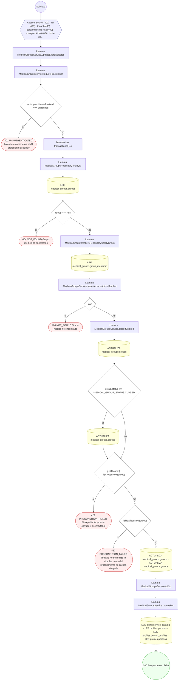

#### 7. POST /medical-groups/{id}/members

Agregar un cargo al equipo del grupo

| HTTP | Código | Cuándo |
|---|---|---|
| 201 | — | Éxito |
| 400 | `VALIDATION_FAILED` | Los parámetros de ruta son UUID válidos; El cuerpo cumple el DTO (sin propiedades extra) |
| 401 | `UNAUTHENTICATED` | Hay una sesión válida (JWT); UnauthorizedException: La cuenta no tiene un perfil profesional asociado |
| 403 | `FORBIDDEN` | El rol está permitido; El tenant se resuelve y pertenece al actor; InsufficientRoleException: Sólo quien creó el grupo puede modificarlo o eliminarlo |
| 404 | `NOT_FOUND` | ResourceNotFoundException: Grupo médico no encontrado |
| 409 | `CONFLICT` | ConflictException: Un mismo profesional no puede repetirse (ni ser también el creador) |
| 422 | `PRECONDITION_FAILED` | PreconditionFailedException: El expediente ya está cerrado y es inmutable; PreconditionFailedException: El grupo ya se realizó: sólo admite las notas del procedimiento |
| 429 | `RATE_LIMITED` | No se supera el límite de solicitudes |

```mermaid
flowchart TD
  n1(("Solicitud")):::inicio
  n2{{"Acceso: sesión (401) · rol (403) · tenant (403) · parámetros de ruta (400) · cuerpo válido (400) · límite de…"}}:::acceso
  n1 --> n2
  n3["Llama a MedicalGroupsService.addMember"]:::llamada
  n2 --> n3
  n4["Transacción: transactional(…)"]:::transaccion
  n3 --> n4
  n5["Llama a MedicalGroupsService.loadForCreatorEdit"]:::llamada
  n4 --> n5
  n6["Llama a MedicalGroupsService.requirePractitioner"]:::llamada
  n5 --> n6
  n7{"actor.practitionerProfileId === undefined"}:::decision
  n6 --> n7
  n8(["401 UNAUTHENTICATED La cuenta no tiene un perfil profesional asociado"]):::error
  n7 -->|"sí"| n8
  n9["Llama a MedicalGroupsRepository.findById"]:::llamada
  n7 -->|"no"| n9
  n10[("LEE medical_groups.groups")]:::efecto
  n9 --> n10
  n11{"group === null"}:::decision
  n10 --> n11
  n12(["404 NOT_FOUND Grupo médico no encontrado"]):::error
  n11 -->|"sí"| n12
  n13["Llama a MedicalGroupMembersRepository.findByGroup"]:::llamada
  n11 -->|"no"| n13
  n14[("LEE medical_groups.group_members")]:::efecto
  n13 --> n14
  n15["Llama a MedicalGroupsService.assertActorSeesGroup"]:::llamada
  n14 --> n15
  n16{"!can"}:::decision
  n15 --> n16
  n17(["404 NOT_FOUND Grupo médico no encontrado"]):::error
  n16 -->|"sí"| n17
  n18{"group.requestingPractitionerId !== practitionerProfileId"}:::decision
  n16 -->|"no"| n18
  n19(["403 FORBIDDEN Sólo quien creó el grupo puede modificarlo o eliminarlo"]):::error
  n18 -->|"sí"| n19
  n20["Llama a PracticeTenantLookupService.findActivePracticeIdsForPractitioner"]:::llamada
  n18 -->|"no"| n20
  n21["Llama a PractitionerRoleAssignmentsRepository.findActiveByPractitioner"]:::llamada
  n20 --> n21
  n22[("LEE practice.practitioner_role_assignments")]:::efecto
  n21 --> n22
  n23{"!ownPractices.includes(group.practiceId)"}:::decision
  n22 --> n23
  n24(["404 NOT_FOUND Grupo médico no encontrado"]):::error
  n23 -->|"sí"| n24
  n25["Llama a MedicalGroupsService.closeIfExpired"]:::llamada
  n23 -->|"no"| n25
  n26[("ACTUALIZA medical_groups.groups")]:::efecto
  n25 --> n26
  n27{"group.status !== MEDICAL_GROUP_STATUS.CLOSED"}:::decision
  n26 --> n27
  n28[("ACTUALIZA medical_groups.groups")]:::efecto
  n27 -->|"sí"| n28
  n29{"justClosed || isClosedNow(group)"}:::decision
  n28 --> n29
  n27 -->|"no"| n29
  n30(["422 PRECONDITION_FAILED El expediente ya está cerrado y es inmutable"]):::error
  n29 -->|"sí"| n30
  n31{"isRealizedNow(group)"}:::decision
  n29 -->|"no"| n31
  n32(["422 PRECONDITION_FAILED El grupo ya se realizó: sólo admite las notas del procedimiento"]):::error
  n31 -->|"sí"| n32
  n33{"members.some( (m) =› m.practitionerProfileId === dto.practitionerProfileId, )"}:::decision
  n31 -->|"no"| n33
  n34(["409 CONFLICT Un mismo profesional no puede repetirse (ni ser también el creador)"]):::error
  n33 -->|"sí"| n34
  n35["Llama a PracticeTenantLookupService.findActivePracticeIdsForTenant"]:::llamada
  n33 -->|"no"| n35
  n36["Llama a PracticesRepository.findByTenant"]:::llamada
  n35 --> n36
  n37[("LEE practice.practices")]:::efecto
  n36 --> n37
  n38["Llama a MedicalGroupsService.assertInvitable"]:::llamada
  n37 --> n38
  n39["Llama a HealthPractitionerProfilesRepository.findById"]:::llamada
  n38 --> n39
  n40[("LEE profiles.health_practitioner_profiles")]:::efecto
  n39 --> n40
  n41{"invited === null"}:::decision
  n40 --> n41
  n42(["↩ (relanza el error capturado)"]):::error
  n41 -->|"sí"| n42
  n43["Llama a PracticeTenantLookupService.findActivePracticeIdsForPractitioner"]:::llamada
  n41 -->|"no"| n43
  n44["Llama a PractitionerRoleAssignmentsRepository.findActiveByPractitioner"]:::llamada
  n43 --> n44
  n45[("LEE practice.practitioner_role_assignments")]:::efecto
  n44 --> n45
  n46{"!invitedPracticeIds.some((id) =› tenantPracticeIds.has(id))"}:::decision
  n45 --> n46
  n47(["↩ (relanza el error capturado)"]):::error
  n46 -->|"sí"| n47
  n48["Llama a MedicalGroupMembersRepository.create"]:::llamada
  n46 -->|"no"| n48
  n49[("CREA medical_groups.group_members")]:::efecto
  n48 --> n49
  n50["Llama a MedicalGroupsService.syncTeamStatus"]:::llamada
  n49 --> n50
  n51["Llama a MedicalGroupMembersRepository.hasPendingInvites"]:::llamada
  n50 --> n51
  n52[("LEE medical_groups.group_members")]:::efecto
  n51 --> n52
  n53{"next !== group.status"}:::decision
  n52 --> n53
  n54[("ACTUALIZA medical_groups.groups")]:::efecto
  n53 -->|"sí"| n54
  n55["Llama a MedicalGroupsService.toDto"]:::llamada
  n54 --> n55
  n53 -->|"no"| n55
  n56["Llama a MedicalGroupsService.namesFor"]:::llamada
  n55 --> n56
  n57[("LEE billing.service_catalog · LEE profiles.persons · LEE profiles.person_profiles · LEE profiles.persons")]:::efecto
  n56 --> n57
  n58["Llama a MedicalGroupMembersRepository.findByGroup"]:::llamada
  n57 --> n58
  n59[("LEE medical_groups.group_members")]:::efecto
  n58 --> n59
  n60(("201 Responde con éxito")):::ok
  n59 --> n60
  classDef acceso fill:#eef,stroke:#66a
  classDef error fill:#fee,stroke:#c33
  classDef ok fill:#efe,stroke:#3a3
  classDef efecto fill:#ffd,stroke:#aa3
  classDef decision fill:#fff,stroke:#555
  classDef corte fill:#eee,stroke:#999,stroke-dasharray: 4
```

#### 8. DELETE /medical-groups/{id}/members/{memberId}

Quitar un cargo del equipo

| HTTP | Código | Cuándo |
|---|---|---|
| 200 | — | Éxito |
| 400 | `VALIDATION_FAILED` | Los parámetros de ruta son UUID válidos |
| 401 | `UNAUTHENTICATED` | Hay una sesión válida (JWT); UnauthorizedException: La cuenta no tiene un perfil profesional asociado |
| 403 | `FORBIDDEN` | El rol está permitido; El tenant se resuelve y pertenece al actor; InsufficientRoleException: Sólo quien creó el grupo puede modificarlo o eliminarlo |
| 404 | `NOT_FOUND` | ResourceNotFoundException: Grupo médico no encontrado; ResourceNotFoundException: Integrante no encontrado |
| 422 | `PRECONDITION_FAILED` | PreconditionFailedException: El expediente ya está cerrado y es inmutable; PreconditionFailedException: El grupo ya se realizó: sólo admite las notas del procedimiento; PreconditionFailedException: Quien creó el grupo no se puede quitar del equipo |
| 429 | `RATE_LIMITED` | No se supera el límite de solicitudes |

```mermaid
flowchart TD
  n1(("Solicitud")):::inicio
  n2{{"Acceso: sesión (401) · rol (403) · tenant (403) · parámetros de ruta (400) · límite de tasa (429)"}}:::acceso
  n1 --> n2
  n3["Llama a MedicalGroupsService.removeMember"]:::llamada
  n2 --> n3
  n4["Transacción: transactional(…)"]:::transaccion
  n3 --> n4
  n5["Llama a MedicalGroupsService.loadForCreatorEdit"]:::llamada
  n4 --> n5
  n6["Llama a MedicalGroupsService.requirePractitioner"]:::llamada
  n5 --> n6
  n7{"actor.practitionerProfileId === undefined"}:::decision
  n6 --> n7
  n8(["401 UNAUTHENTICATED La cuenta no tiene un perfil profesional asociado"]):::error
  n7 -->|"sí"| n8
  n9["Llama a MedicalGroupsRepository.findById"]:::llamada
  n7 -->|"no"| n9
  n10[("LEE medical_groups.groups")]:::efecto
  n9 --> n10
  n11{"group === null"}:::decision
  n10 --> n11
  n12(["404 NOT_FOUND Grupo médico no encontrado"]):::error
  n11 -->|"sí"| n12
  n13["Llama a MedicalGroupMembersRepository.findByGroup"]:::llamada
  n11 -->|"no"| n13
  n14[("LEE medical_groups.group_members")]:::efecto
  n13 --> n14
  n15["Llama a MedicalGroupsService.assertActorSeesGroup"]:::llamada
  n14 --> n15
  n16{"!can"}:::decision
  n15 --> n16
  n17(["404 NOT_FOUND Grupo médico no encontrado"]):::error
  n16 -->|"sí"| n17
  n18{"group.requestingPractitionerId !== practitionerProfileId"}:::decision
  n16 -->|"no"| n18
  n19(["403 FORBIDDEN Sólo quien creó el grupo puede modificarlo o eliminarlo"]):::error
  n18 -->|"sí"| n19
  n20["Llama a PracticeTenantLookupService.findActivePracticeIdsForPractitioner"]:::llamada
  n18 -->|"no"| n20
  n21["Llama a PractitionerRoleAssignmentsRepository.findActiveByPractitioner"]:::llamada
  n20 --> n21
  n22[("LEE practice.practitioner_role_assignments")]:::efecto
  n21 --> n22
  n23{"!ownPractices.includes(group.practiceId)"}:::decision
  n22 --> n23
  n24(["404 NOT_FOUND Grupo médico no encontrado"]):::error
  n23 -->|"sí"| n24
  n25["Llama a MedicalGroupsService.closeIfExpired"]:::llamada
  n23 -->|"no"| n25
  n26[("ACTUALIZA medical_groups.groups")]:::efecto
  n25 --> n26
  n27{"group.status !== MEDICAL_GROUP_STATUS.CLOSED"}:::decision
  n26 --> n27
  n28[("ACTUALIZA medical_groups.groups")]:::efecto
  n27 -->|"sí"| n28
  n29{"justClosed || isClosedNow(group)"}:::decision
  n28 --> n29
  n27 -->|"no"| n29
  n30(["422 PRECONDITION_FAILED El expediente ya está cerrado y es inmutable"]):::error
  n29 -->|"sí"| n30
  n31{"isRealizedNow(group)"}:::decision
  n29 -->|"no"| n31
  n32(["422 PRECONDITION_FAILED El grupo ya se realizó: sólo admite las notas del procedimiento"]):::error
  n31 -->|"sí"| n32
  n33{"member === undefined"}:::decision
  n31 -->|"no"| n33
  n34(["404 NOT_FOUND Integrante no encontrado"]):::error
  n33 -->|"sí"| n34
  n35{"member.isCreator"}:::decision
  n33 -->|"no"| n35
  n36(["422 PRECONDITION_FAILED Quien creó el grupo no se puede quitar del equipo"]):::error
  n35 -->|"sí"| n36
  n37["Llama a MedicalGroupMembersRepository.remove"]:::llamada
  n35 -->|"no"| n37
  n38[("BORRA medical_groups.group_members")]:::efecto
  n37 --> n38
  n39["Llama a MedicalGroupsService.syncTeamStatus"]:::llamada
  n38 --> n39
  n40["Llama a MedicalGroupMembersRepository.hasPendingInvites"]:::llamada
  n39 --> n40
  n41[("LEE medical_groups.group_members")]:::efecto
  n40 --> n41
  n42{"next !== group.status"}:::decision
  n41 --> n42
  n43[("ACTUALIZA medical_groups.groups")]:::efecto
  n42 -->|"sí"| n43
  n44["Llama a MedicalGroupsService.toDto"]:::llamada
  n43 --> n44
  n42 -->|"no"| n44
  n45["Llama a MedicalGroupsService.namesFor"]:::llamada
  n44 --> n45
  n46[("LEE billing.service_catalog · LEE profiles.persons · LEE profiles.person_profiles · LEE profiles.persons")]:::efecto
  n45 --> n46
  n47["Llama a MedicalGroupMembersRepository.findByGroup"]:::llamada
  n46 --> n47
  n48[("LEE medical_groups.group_members")]:::efecto
  n47 --> n48
  n49(("200 Responde con éxito")):::ok
  n48 --> n49
  classDef acceso fill:#eef,stroke:#66a
  classDef error fill:#fee,stroke:#c33
  classDef ok fill:#efe,stroke:#3a3
  classDef efecto fill:#ffd,stroke:#aa3
  classDef decision fill:#fff,stroke:#555
  classDef corte fill:#eee,stroke:#999,stroke-dasharray: 4
```

#### 9. PATCH /medical-groups/{id}/members/{memberId}

Modificar un cargo del equipo

| HTTP | Código | Cuándo |
|---|---|---|
| 200 | — | Éxito |
| 400 | `VALIDATION_FAILED` | Los parámetros de ruta son UUID válidos; El cuerpo cumple el DTO (sin propiedades extra) |
| 401 | `UNAUTHENTICATED` | Hay una sesión válida (JWT); UnauthorizedException: La cuenta no tiene un perfil profesional asociado |
| 403 | `FORBIDDEN` | El rol está permitido; El tenant se resuelve y pertenece al actor; InsufficientRoleException: Sólo quien creó el grupo puede modificarlo o eliminarlo |
| 404 | `NOT_FOUND` | ResourceNotFoundException: Grupo médico no encontrado; ResourceNotFoundException: Integrante no encontrado |
| 422 | `PRECONDITION_FAILED` | PreconditionFailedException: El expediente ya está cerrado y es inmutable; PreconditionFailedException: El grupo ya se realizó: sólo admite las notas del procedimiento; PreconditionFailedException: El cargo de quien creó el grupo no se modifica |
| 429 | `RATE_LIMITED` | No se supera el límite de solicitudes |

```mermaid
flowchart TD
  n1(("Solicitud")):::inicio
  n2{{"Acceso: sesión (401) · rol (403) · tenant (403) · parámetros de ruta (400) · cuerpo válido (400) · límite de…"}}:::acceso
  n1 --> n2
  n3["Llama a MedicalGroupsService.updateMember"]:::llamada
  n2 --> n3
  n4["Transacción: transactional(…)"]:::transaccion
  n3 --> n4
  n5["Llama a MedicalGroupsService.loadForCreatorEdit"]:::llamada
  n4 --> n5
  n6["Llama a MedicalGroupsService.requirePractitioner"]:::llamada
  n5 --> n6
  n7{"actor.practitionerProfileId === undefined"}:::decision
  n6 --> n7
  n8(["401 UNAUTHENTICATED La cuenta no tiene un perfil profesional asociado"]):::error
  n7 -->|"sí"| n8
  n9["Llama a MedicalGroupsRepository.findById"]:::llamada
  n7 -->|"no"| n9
  n10[("LEE medical_groups.groups")]:::efecto
  n9 --> n10
  n11{"group === null"}:::decision
  n10 --> n11
  n12(["404 NOT_FOUND Grupo médico no encontrado"]):::error
  n11 -->|"sí"| n12
  n13["Llama a MedicalGroupMembersRepository.findByGroup"]:::llamada
  n11 -->|"no"| n13
  n14[("LEE medical_groups.group_members")]:::efecto
  n13 --> n14
  n15["Llama a MedicalGroupsService.assertActorSeesGroup"]:::llamada
  n14 --> n15
  n16{"!can"}:::decision
  n15 --> n16
  n17(["404 NOT_FOUND Grupo médico no encontrado"]):::error
  n16 -->|"sí"| n17
  n18{"group.requestingPractitionerId !== practitionerProfileId"}:::decision
  n16 -->|"no"| n18
  n19(["403 FORBIDDEN Sólo quien creó el grupo puede modificarlo o eliminarlo"]):::error
  n18 -->|"sí"| n19
  n20["Llama a PracticeTenantLookupService.findActivePracticeIdsForPractitioner"]:::llamada
  n18 -->|"no"| n20
  n21["Llama a PractitionerRoleAssignmentsRepository.findActiveByPractitioner"]:::llamada
  n20 --> n21
  n22[("LEE practice.practitioner_role_assignments")]:::efecto
  n21 --> n22
  n23{"!ownPractices.includes(group.practiceId)"}:::decision
  n22 --> n23
  n24(["404 NOT_FOUND Grupo médico no encontrado"]):::error
  n23 -->|"sí"| n24
  n25["Llama a MedicalGroupsService.closeIfExpired"]:::llamada
  n23 -->|"no"| n25
  n26[("ACTUALIZA medical_groups.groups")]:::efecto
  n25 --> n26
  n27{"group.status !== MEDICAL_GROUP_STATUS.CLOSED"}:::decision
  n26 --> n27
  n28[("ACTUALIZA medical_groups.groups")]:::efecto
  n27 -->|"sí"| n28
  n29{"justClosed || isClosedNow(group)"}:::decision
  n28 --> n29
  n27 -->|"no"| n29
  n30(["422 PRECONDITION_FAILED El expediente ya está cerrado y es inmutable"]):::error
  n29 -->|"sí"| n30
  n31{"isRealizedNow(group)"}:::decision
  n29 -->|"no"| n31
  n32(["422 PRECONDITION_FAILED El grupo ya se realizó: sólo admite las notas del procedimiento"]):::error
  n31 -->|"sí"| n32
  n33{"member === undefined"}:::decision
  n31 -->|"no"| n33
  n34(["404 NOT_FOUND Integrante no encontrado"]):::error
  n33 -->|"sí"| n34
  n35{"member.isCreator"}:::decision
  n33 -->|"no"| n35
  n36(["422 PRECONDITION_FAILED El cargo de quien creó el grupo no se modifica"]):::error
  n35 -->|"sí"| n36
  n37["Llama a MedicalGroupsService.syncTeamStatus"]:::llamada
  n35 -->|"no"| n37
  n38["Llama a MedicalGroupMembersRepository.hasPendingInvites"]:::llamada
  n37 --> n38
  n39[("LEE medical_groups.group_members")]:::efecto
  n38 --> n39
  n40{"next !== group.status"}:::decision
  n39 --> n40
  n41[("ACTUALIZA medical_groups.groups")]:::efecto
  n40 -->|"sí"| n41
  n42["Llama a MedicalGroupsService.toDto"]:::llamada
  n41 --> n42
  n40 -->|"no"| n42
  n43["Llama a MedicalGroupsService.namesFor"]:::llamada
  n42 --> n43
  n44[("LEE billing.service_catalog · LEE profiles.persons · LEE profiles.person_profiles · LEE profiles.persons")]:::efecto
  n43 --> n44
  n45["Llama a MedicalGroupMembersRepository.findByGroup"]:::llamada
  n44 --> n45
  n46[("LEE medical_groups.group_members")]:::efecto
  n45 --> n46
  n47(("200 Responde con éxito")):::ok
  n46 --> n47
  classDef acceso fill:#eef,stroke:#66a
  classDef error fill:#fee,stroke:#c33
  classDef ok fill:#efe,stroke:#3a3
  classDef efecto fill:#ffd,stroke:#aa3
  classDef decision fill:#fff,stroke:#555
  classDef corte fill:#eee,stroke:#999,stroke-dasharray: 4
```

#### 10. POST /medical-groups/{id}/members/{memberId}/respond

Aceptar o rechazar la invitación a un cargo del grupo

| HTTP | Código | Cuándo |
|---|---|---|
| 201 | — | Éxito |
| 400 | `VALIDATION_FAILED` | Los parámetros de ruta son UUID válidos; El cuerpo cumple el DTO (sin propiedades extra) |
| 401 | `UNAUTHENTICATED` | Hay una sesión válida (JWT); UnauthorizedException: La cuenta no tiene un perfil profesional asociado |
| 403 | `FORBIDDEN` | El rol está permitido; El tenant se resuelve y pertenece al actor |
| 404 | `NOT_FOUND` | ResourceNotFoundException: Grupo médico no encontrado; ResourceNotFoundException: Solicitud no encontrada |
| 422 | `PRECONDITION_FAILED` | PreconditionFailedException: Esta solicitud ya fue respondida |
| 429 | `RATE_LIMITED` | No se supera el límite de solicitudes |

```mermaid
flowchart TD
  n1(("Solicitud")):::inicio
  n2{{"Acceso: sesión (401) · rol (403) · tenant (403) · parámetros de ruta (400) · cuerpo válido (400) · límite de…"}}:::acceso
  n1 --> n2
  n3["Llama a MedicalGroupsService.respondToInvitation"]:::llamada
  n2 --> n3
  n4["Llama a MedicalGroupsService.requirePractitioner"]:::llamada
  n3 --> n4
  n5{"actor.practitionerProfileId === undefined"}:::decision
  n4 --> n5
  n6(["401 UNAUTHENTICATED La cuenta no tiene un perfil profesional asociado"]):::error
  n5 -->|"sí"| n6
  n7["Transacción: transactional(…)"]:::transaccion
  n5 -->|"no"| n7
  n8["Llama a MedicalGroupsRepository.findById"]:::llamada
  n7 --> n8
  n9[("LEE medical_groups.groups")]:::efecto
  n8 --> n9
  n10{"group === null"}:::decision
  n9 --> n10
  n11(["404 NOT_FOUND Grupo médico no encontrado"]):::error
  n10 -->|"sí"| n11
  n12["Llama a MedicalGroupMembersRepository.findById"]:::llamada
  n10 -->|"no"| n12
  n13[("LEE medical_groups.group_members")]:::efecto
  n12 --> n13
  n14{"member === null || member.groupId !== groupId"}:::decision
  n13 --> n14
  n15(["404 NOT_FOUND Solicitud no encontrada"]):::error
  n14 -->|"sí"| n15
  n16{"member.practitionerProfileId !== practitionerProfileId"}:::decision
  n14 -->|"no"| n16
  n17(["404 NOT_FOUND Solicitud no encontrada"]):::error
  n16 -->|"sí"| n17
  n18{"member.invitationStatus !== 'PENDING'"}:::decision
  n16 -->|"no"| n18
  n19(["422 PRECONDITION_FAILED Esta solicitud ya fue respondida"]):::error
  n18 -->|"sí"| n19
  n20[("ACTUALIZA medical_groups.group_members · ACTUALIZA medical_groups.group_members")]:::efecto
  n18 -->|"no"| n20
  n21{"decision === 'ACCEPTED' && group.status === MEDICAL_GROUP_STATUS.PENDING_TEAM"}:::decision
  n20 --> n21
  n22["Llama a MedicalGroupMembersRepository.hasPendingInvites"]:::llamada
  n21 -->|"sí"| n22
  n23[("LEE medical_groups.group_members")]:::efecto
  n22 --> n23
  n24{"!stillPending"}:::decision
  n23 --> n24
  n25[("ACTUALIZA medical_groups.groups")]:::efecto
  n24 -->|"sí"| n25
  n26["Llama a MedicalGroupsService.toDto"]:::llamada
  n25 --> n26
  n24 -->|"no"| n26
  n21 -->|"no"| n26
  n27["Llama a MedicalGroupsService.namesFor"]:::llamada
  n26 --> n27
  n28[("LEE billing.service_catalog · LEE profiles.persons · LEE profiles.person_profiles · LEE profiles.persons")]:::efecto
  n27 --> n28
  n29["Llama a MedicalGroupMembersRepository.findByGroup"]:::llamada
  n28 --> n29
  n30[("LEE medical_groups.group_members")]:::efecto
  n29 --> n30
  n31(("201 Responde con éxito")):::ok
  n30 --> n31
  classDef acceso fill:#eef,stroke:#66a
  classDef error fill:#fee,stroke:#c33
  classDef ok fill:#efe,stroke:#3a3
  classDef efecto fill:#ffd,stroke:#aa3
  classDef decision fill:#fff,stroke:#555
  classDef corte fill:#eee,stroke:#999,stroke-dasharray: 4
```

#### 11. POST /medical-groups/{id}/reschedule-requests

Solicitar cambio de horario

| HTTP | Código | Cuándo |
|---|---|---|
| 201 | — | Éxito |
| 400 | `VALIDATION_FAILED` | Los parámetros de ruta son UUID válidos; El cuerpo cumple el DTO (sin propiedades extra) |
| 401 | `UNAUTHENTICATED` | Hay una sesión válida (JWT); UnauthorizedException: La cuenta no tiene un perfil profesional asociado |
| 403 | `FORBIDDEN` | El rol está permitido; El tenant se resuelve y pertenece al actor |
| 404 | `NOT_FOUND` | ResourceNotFoundException: Grupo médico no encontrado |
| 422 | `PRECONDITION_FAILED` | PreconditionFailedException: El expediente ya está cerrado y es inmutable; PreconditionFailedException: Sólo se puede solicitar cambio de horario sobre una cita programada y aún no realizada; PreconditionFailedException: Fecha propuesta inválida |
| 429 | `RATE_LIMITED` | No se supera el límite de solicitudes |

```mermaid
flowchart TD
  n1(("Solicitud")):::inicio
  n2{{"Acceso: sesión (401) · rol (403) · tenant (403) · parámetros de ruta (400) · cuerpo válido (400) · límite de…"}}:::acceso
  n1 --> n2
  n3["Llama a MedicalGroupsService.requestReschedule"]:::llamada
  n2 --> n3
  n4["Llama a MedicalGroupsService.requirePractitioner"]:::llamada
  n3 --> n4
  n5{"actor.practitionerProfileId === undefined"}:::decision
  n4 --> n5
  n6(["401 UNAUTHENTICATED La cuenta no tiene un perfil profesional asociado"]):::error
  n5 -->|"sí"| n6
  n7["Transacción: transactional(…)"]:::transaccion
  n5 -->|"no"| n7
  n8["Llama a MedicalGroupsRepository.findById"]:::llamada
  n7 --> n8
  n9[("LEE medical_groups.groups")]:::efecto
  n8 --> n9
  n10{"group === null"}:::decision
  n9 --> n10
  n11(["404 NOT_FOUND Grupo médico no encontrado"]):::error
  n10 -->|"sí"| n11
  n12["Llama a MedicalGroupMembersRepository.findByGroup"]:::llamada
  n10 -->|"no"| n12
  n13[("LEE medical_groups.group_members")]:::efecto
  n12 --> n13
  n14["Llama a MedicalGroupsService.assertActorIsActiveMember"]:::llamada
  n13 --> n14
  n15{"!can"}:::decision
  n14 --> n15
  n16(["404 NOT_FOUND Grupo médico no encontrado"]):::error
  n15 -->|"sí"| n16
  n17["Llama a MedicalGroupsService.closeIfExpired"]:::llamada
  n15 -->|"no"| n17
  n18[("ACTUALIZA medical_groups.groups")]:::efecto
  n17 --> n18
  n19{"group.status !== MEDICAL_GROUP_STATUS.CLOSED"}:::decision
  n18 --> n19
  n20[("ACTUALIZA medical_groups.groups")]:::efecto
  n19 -->|"sí"| n20
  n21{"isClosedNow(group)"}:::decision
  n20 --> n21
  n19 -->|"no"| n21
  n22(["422 PRECONDITION_FAILED El expediente ya está cerrado y es inmutable"]):::error
  n21 -->|"sí"| n22
  n23{"group.status !== MEDICAL_GROUP_STATUS.SCHEDULED"}:::decision
  n21 -->|"no"| n23
  n24(["422 PRECONDITION_FAILED Sólo se puede solicitar cambio de horario sobre una cita programada y aún no realizada"]):::error
  n23 -->|"sí"| n24
  n25{"Number.isNaN(proposed.getTime())"}:::decision
  n23 -->|"no"| n25
  n26(["422 PRECONDITION_FAILED Fecha propuesta inválida"]):::error
  n25 -->|"sí"| n26
  n27{"practitionerProfileId === group.requestingPractitionerId"}:::decision
  n25 -->|"no"| n27
  n28[("ACTUALIZA medical_groups.groups · ACTUALIZA medical_groups.groups · ACTUALIZA medical_groups.groups")]:::efecto
  n27 -->|"sí"| n28
  n29[("ACTUALIZA medical_groups.groups · ACTUALIZA medical_groups.groups · ACTUALIZA medical_groups.groups")]:::efecto
  n27 -->|"no"| n29
  n30["Llama a MedicalGroupsService.toDto"]:::llamada
  n28 --> n30
  n29 --> n30
  n31["Llama a MedicalGroupsService.namesFor"]:::llamada
  n30 --> n31
  n32[("LEE billing.service_catalog · LEE profiles.persons · LEE profiles.person_profiles · LEE profiles.persons")]:::efecto
  n31 --> n32
  n33(("201 Responde con éxito")):::ok
  n32 --> n33
  classDef acceso fill:#eef,stroke:#66a
  classDef error fill:#fee,stroke:#c33
  classDef ok fill:#efe,stroke:#3a3
  classDef efecto fill:#ffd,stroke:#aa3
  classDef decision fill:#fff,stroke:#555
  classDef corte fill:#eee,stroke:#999,stroke-dasharray: 4
```

#### 12. POST /medical-groups/{id}/reschedule-requests/respond

Resolver la solicitud de cambio de horario

| HTTP | Código | Cuándo |
|---|---|---|
| 201 | — | Éxito |
| 400 | `VALIDATION_FAILED` | Los parámetros de ruta son UUID válidos; El cuerpo cumple el DTO (sin propiedades extra) |
| 401 | `UNAUTHENTICATED` | Hay una sesión válida (JWT); UnauthorizedException: La cuenta no tiene un perfil profesional asociado; UnauthorizedException: Sólo quien creó la solicitud puede resolver el cambio de horario propuesto |
| 403 | `FORBIDDEN` | El rol está permitido; El tenant se resuelve y pertenece al actor |
| 404 | `NOT_FOUND` | ResourceNotFoundException: Grupo médico no encontrado |
| 422 | `PRECONDITION_FAILED` | PreconditionFailedException: No hay ningún cambio de horario pendiente |
| 429 | `RATE_LIMITED` | No se supera el límite de solicitudes |

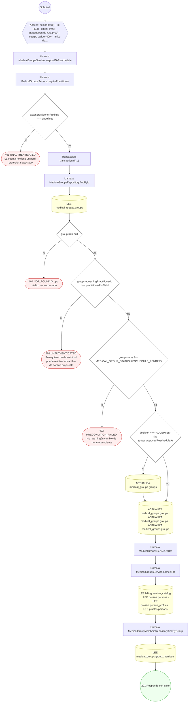

#### 13. GET /medical-groups/eligible-members

Colegas que se pueden invitar a un grupo de este servicio

| HTTP | Código | Cuándo |
|---|---|---|
| 200 | — | Éxito |
| 400 | `VALIDATION_FAILED` | Están los parámetros de consulta obligatorios |
| 401 | `UNAUTHENTICATED` | Hay una sesión válida (JWT); UnauthorizedException: La cuenta no tiene un perfil profesional asociado |
| 403 | `FORBIDDEN` | El rol está permitido; El tenant se resuelve y pertenece al actor |
| 404 | `NOT_FOUND` | ResourceNotFoundException: Servicio médico no encontrado |
| 429 | `RATE_LIMITED` | No se supera el límite de solicitudes |

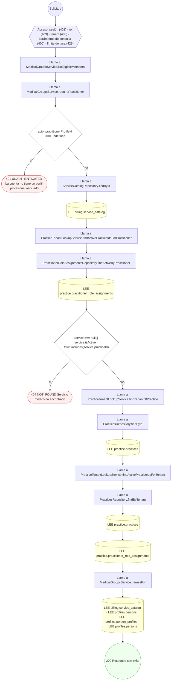

#### 14. GET /medical-groups/patients/{patientProfileId}/conditions

Diagnósticos del paciente para el selector del formulario

| HTTP | Código | Cuándo |
|---|---|---|
| 200 | — | Éxito |
| 400 | `VALIDATION_FAILED` | Los parámetros de ruta son UUID válidos |
| 401 | `UNAUTHENTICATED` | Hay una sesión válida (JWT) |
| 403 | `FORBIDDEN` | El rol está permitido; El tenant se resuelve y pertenece al actor; ForbiddenException: {WITHOUT_ACCESS_TO_HISTORY} |
| 429 | `RATE_LIMITED` | No se supera el límite de solicitudes |

```mermaid
flowchart TD
  n1(("Solicitud")):::inicio
  n2{{"Acceso: sesión (401) · rol (403) · tenant (403) · parámetros de ruta (400) · límite de tasa (429)"}}:::acceso
  n1 --> n2
  n3["Llama a MedicalGroupsService.listPatientConditions"]:::llamada
  n2 --> n3
  n4["Llama a ClinicalReadService.assertCanReadHistory"]:::llamada
  n3 --> n4
  n5{"!actor.roles.some((role) =› ROLES_THAT_ATTEND.includes(role))"}:::decision
  n4 --> n5
  n6["Llama a ClinicalReadService.assertOwnRecord"]:::llamada
  n5 -->|"sí"| n6
  n7["Llama a PersonAccountLinksRepository.findActiveByUser"]:::llamada
  n6 --> n7
  n8[("LEE profiles.person_account_links")]:::efecto
  n7 --> n8
  n9["Llama a PatientProfilesRepository.findById"]:::llamada
  n8 --> n9
  n10[("LEE profiles.patient_profiles")]:::efecto
  n9 --> n10
  n11{"!link || !profile || profile.profileId !== link.personId"}:::decision
  n10 --> n11
  n12(["403 FORBIDDEN {WITHOUT_ACCESS_TO_HISTORY}"]):::error
  n11 -->|"sí"| n12
  n13["Llama a PersonAccountLinksRepository.findActiveByUser"]:::llamada
  n11 -->|"no"| n13
  n5 -->|"no"| n13
  n14[("LEE profiles.person_account_links")]:::efecto
  n13 --> n14
  n15["Llama a HealthPractitionerProfilesRepository.findById"]:::llamada
  n14 --> n15
  n16[("LEE profiles.health_practitioner_profiles")]:::efecto
  n15 --> n16
  n17["Llama a ClinicalReadService.isAttending"]:::llamada
  n16 --> n17
  n18["Llama a SchedulingBookingsRepository.hasConsultationInProgress"]:::llamada
  n17 --> n18
  n19[("LEE scheduling.appointment_bookings · LEE scheduling.schedulable_resources")]:::efecto
  n18 --> n19
  n20["Llama a ClinicalReadService.assertOwnRecord"]:::llamada
  n19 --> n20
  n21["Llama a PersonAccountLinksRepository.findActiveByUser"]:::llamada
  n20 --> n21
  n22[("LEE profiles.person_account_links")]:::efecto
  n21 --> n22
  n23["Llama a PatientProfilesRepository.findById"]:::llamada
  n22 --> n23
  n24[("LEE profiles.patient_profiles")]:::efecto
  n23 --> n24
  n25{"!link || !profile || profile.profileId !== link.personId"}:::decision
  n24 --> n25
  n26(["403 FORBIDDEN {WITHOUT_ACCESS_TO_HISTORY}"]):::error
  n25 -->|"sí"| n26
  n27["Llama a ConditionsRepository.findByPatient"]:::llamada
  n25 -->|"no"| n27
  n28[("LEE clinical.conditions")]:::efecto
  n27 --> n28
  n29[("LEE terminology.catalog_concepts")]:::efecto
  n28 --> n29
  n30(("200 Responde con éxito")):::ok
  n29 --> n30
  classDef acceso fill:#eef,stroke:#66a
  classDef error fill:#fee,stroke:#c33
  classDef ok fill:#efe,stroke:#3a3
  classDef efecto fill:#ffd,stroke:#aa3
  classDef decision fill:#fff,stroke:#555
  classDef corte fill:#eee,stroke:#999,stroke-dasharray: 4
```

