<!-- AUTOGENERADO por tools/inventario/flujos.mjs. No editar manualmente. -->

# Flujos del módulo `messaging`

- **Procesos:** 1 · **Máquinas de estado:** 0
- **Operaciones:** 17 (16 con decisiones propias, 1 sin ellas)
- Inventario de endpoints del módulo: [messaging](../endpoints/messaging.md)

## Proceso: Módulo 35 — Mensajería (outbox, colas y notificación multicanal)

- **Código:** `messaging` · **Agrupación:** MIXTO · **Operaciones:** 17
- **Actores:** MESSAGING_ADMIN · Público (sin sesión) · SYSTEM · USER
- **Revisión:** AUTO_DETECTADA
- **Fuentes:** `src/modules/messaging/README.md`

### Para qué sirve

Publicación transaccional de eventos de dominio, relay y fan-out a suscriptores, colas de trabajo con reintento y cola muerta, y notificación multicanal consciente del consentimiento con conciliación de acuses del proveedor.

_Fuente: `src/modules/messaging/README.md:3`_

### Flujo general declarado en el README

```text
transacción de negocio
  └─ publishDomainEvent(tx, ...) ──> domain_events + outbox_messages (pending)
                                     ambos COMMIT con el cambio de negocio

/internal/outbox/relay/run  [FOR UPDATE SKIP LOCKED]
  ├─ publica ─────────> outbox published
  └─ agotó intentos ──> outbox failed

/internal/events/:id/dispatch
  └─ por cada suscripción activa que casa con el filtro
       ├─ event_deliveries (dispatched)   [idempotente por suscripción]
       └─ si el modo es cola: queued_jobs (ready)

/internal/queues/:code/claim  [SKIP LOCKED + visibility timeout]
  └─ jobs running, reservados para el worker
       ├─ /complete ──> succeeded
       └─ /fail ──────> ready con backoff, o dead_letter_jobs al agotar
                           └─ /redrive ──> job nuevo (la evidencia se conserva)

/notifications/requests
  ├─ sin opt-in u horas de silencio ──> suppressed (se registra igual)
  ├─ misma debounce key viva ─────────> se devuelve la existente
  └─ resto ───────────────────────────> pending
       └─ /internal/notifications/:id/deliver ──> notification_deliveries + in-app si aplica
            └─ /webhooks/providers/:code/receipts ──> delivered | bounced
```

_Fuente: `src/modules/messaging/README.md:73`_

### Etapas y operaciones

| Etapa | Descripción | Operación | Quién actúa | Riesgo | Tablas |
|---|---|---|---|---|---|
| `UC-35-02` | Reclamar y publicar mensajes (relay) | POST /internal/outbox/relay/run | SYSTEM · MESSAGING_ADMIN | MEDIO | 2 |
| `UC-35-03` | Despachar a suscriptores | POST /internal/events/{domainEventId}/dispatch | SYSTEM · MESSAGING_ADMIN | MEDIO | 8 |
| `UC-35-04` | Acuse de entrega del consumidor | POST /internal/event-deliveries/{id}/ack | SYSTEM · MESSAGING_ADMIN | MEDIO | 2 |
| `UC-35-05` | Encolar job con deduplicación | POST /queues/{code}/jobs | SYSTEM · MESSAGING_ADMIN | MEDIO | 3 |
| `UC-35-06` | Reclamar jobs (SKIP LOCKED) | POST /internal/queues/{code}/claim | SYSTEM · MESSAGING_ADMIN | BAJO | 2 |
| `UC-35-07` | Completar job y liberar lock | POST /internal/jobs/{id}/complete | SYSTEM · MESSAGING_ADMIN | MEDIO | 2 |
| `UC-35-08` | Reintento con backoff o cola muerta | POST /internal/jobs/{id}/fail | SYSTEM · MESSAGING_ADMIN | MEDIO | 4 |
| `UC-35-09` | Reencolar desde cola muerta | POST /queues/dead-letter/{deadLetterJobId}/redrive | MESSAGING_ADMIN | MEDIO | 4 |
| `UC-35-10` | Solicitud consciente del consentimiento | POST /notifications/requests | SYSTEM · MESSAGING_ADMIN | MEDIO | 5 |
| `UC-35-11` | Entrega multicanal | POST /internal/notifications/{requestId}/deliver | SYSTEM · MESSAGING_ADMIN | MEDIO | 8 |
| `UC-35-12` | Conciliar acuse del proveedor | POST /webhooks/providers/{providerCode}/receipts | Público (sin sesión) | ALTO | 7 |
| `UC-35-13` | Marcar in-app como leída | POST /notifications/in-app/{id}/read | USER · MESSAGING_ADMIN | MEDIO | 2 |
| `ctrl:MessagingController` | Operaciones de MessagingController que el README no asigna a un caso de uso | POST /notifications/in-app/read-all | USER · MESSAGING_ADMIN | MEDIO | 2 |
|  |  | GET /notifications/me | USER · MESSAGING_ADMIN | BAJO | 1 |
|  |  | GET /notifications/preferences/me | USER · MESSAGING_ADMIN | BAJO | 2 |
|  |  | PUT /notifications/preferences/me | USER · MESSAGING_ADMIN | MEDIO | 3 |
| `ctrl:MessagingInternalController` | Operaciones de MessagingInternalController que el README no asigna a un caso de uso | GET /internal/notifications/pending | SYSTEM · MESSAGING_ADMIN | MEDIO | 3 |

### Diagrama — etapas `UC-35-02`, `UC-35-03`, `UC-35-04`…

```mermaid
flowchart LR
  a2(["SYSTEM · MESSAGING_ADMIN"]):::actor
  a18(["MESSAGING_ADMIN"]):::actor
  a30(["Público (sin sesión)"]):::actor
  a34(["USER · MESSAGING_ADMIN"]):::actor
  t3[("messaging.outbox_messages")]:::tabla
  t5[("messaging.domain_events")]:::tabla
  t6[("messaging.event_deliveries")]:::tabla
  t7[("messaging.event_subscriptions")]:::tabla
  t8[("messaging.message_queues")]:::tabla
  t12[("messaging.queued_jobs")]:::tabla
  t16[("messaging.dead_letter_jobs")]:::tabla
  t20[("messaging.message_channels")]:::tabla
  t21[("messaging.message_templates")]:::tabla
  t22[("messaging.notification_requests")]:::tabla
  t23[("messaging.recipient_preferences")]:::tabla
  t25[("messaging.in_app_notifications")]:::tabla
  t26[("messaging.messaging_providers")]:::tabla
  t27[("messaging.notification_deliveries")]:::tabla
  t31[("messaging.delivery_receipts")]:::tabla
  subgraph s0["UC-35-02 · Reclamar y publicar mensajes (relay)"]
    o1["POST /internal/outbox/relay/run"]:::op
  end
  t9[("+2 tablas más")]
  subgraph s1["UC-35-03 · Despachar a suscriptores"]
    o4["POST /internal/events/{domainEventId}/dispatch"]:::op
  end
  subgraph s2["UC-35-04 · Acuse de entrega del consumidor"]
    o10["POST /internal/event-deliveries/{id}/ack"]:::op
  end
  subgraph s3["UC-35-05 · Encolar job con deduplicación"]
    o11["POST /queues/{code}/jobs"]:::op
  end
  subgraph s4["UC-35-06 · Reclamar jobs (SKIP LOCKED)"]
    o13["POST /internal/queues/{code}/claim"]:::op
  end
  subgraph s5["UC-35-07 · Completar job y liberar lock"]
    o14["POST /internal/jobs/{id}/complete"]:::op
  end
  subgraph s6["UC-35-08 · Reintento con backoff o cola muerta"]
    o15["POST /internal/jobs/{id}/fail"]:::op
  end
  subgraph s7["UC-35-09 · Reencolar desde cola muerta"]
    o17["POST /queues/dead-letter/{deadLetterJobId}/redrive"]:::op
  end
  subgraph s8["UC-35-10 · Solicitud consciente del consentimiento"]
    o19["POST /notifications/requests"]:::op
  end
  t28[("+2 tablas más")]
  subgraph s9["UC-35-11 · Entrega multicanal"]
    o24["POST /internal/notifications/{requestId}/deliver"]:::op
  end
  t32[("+1 tablas más")]
  subgraph s10["UC-35-12 · Conciliar acuse del proveedor"]
    o29["POST /webhooks/providers/{providerCode}/receipts"]:::op
  end
  subgraph s11["UC-35-13 · Marcar in-app como leída"]
    o33["POST /notifications/in-app/{id}/read"]:::op
  end
  subgraph s12["ctrl:MessagingController · Operaciones de MessagingController que el README no…"]
    o35["POST /notifications/in-app/read-all"]:::op
    o36["GET /notifications/me"]:::op
    o37["GET /notifications/preferences/me"]:::op
    o38["PUT /notifications/preferences/me"]:::op
  end
  subgraph s13["ctrl:MessagingInternalController · Operaciones de MessagingInternalController q…"]
    o39["GET /internal/notifications/pending"]:::op
  end
  a2 --> o1
  o1 -->|"ACTUALIZA"| t3
  o1 -->|"LEE"| t3
  a2 --> o4
  o4 -->|"LEE"| t5
  o4 -->|"CREA"| t6
  o4 -->|"LEE"| t6
  o4 -->|"LEE"| t7
  o4 -->|"LEE"| t8
  o4 -->|"LEE"| t3
  o4 -.-> t9
  a2 --> o10
  o10 -->|"ACTUALIZA"| t6
  o10 -->|"LEE"| t6
  a2 --> o11
  o11 -->|"LEE"| t8
  o11 -->|"CREA"| t12
  o11 -->|"LEE"| t12
  a2 --> o13
  o13 -->|"LEE"| t8
  o13 -->|"LEE"| t12
  a2 --> o14
  o14 -->|"ACTUALIZA"| t12
  o14 -->|"LEE"| t12
  a2 --> o15
  o15 -->|"CREA"| t16
  o15 -->|"LEE"| t8
  o15 -->|"ACTUALIZA"| t12
  o15 -->|"LEE"| t12
  a18 --> o17
  o17 -->|"LEE"| t16
  o17 -->|"LEE"| t8
  o17 -->|"CREA"| t12
  o17 -->|"LEE"| t12
  a2 --> o19
  o19 -->|"LEE"| t20
  o19 -->|"LEE"| t21
  o19 -->|"CREA"| t22
  o19 -->|"LEE"| t22
  o19 -->|"LEE"| t23
  a2 --> o24
  o24 -->|"CREA"| t25
  o24 -->|"LEE"| t20
  o24 -->|"LEE"| t26
  o24 -->|"CREA"| t27
  o24 -->|"LEE"| t27
  o24 -->|"ACTUALIZA"| t22
  o24 -.-> t28
  a30 --> o29
  o29 -->|"CREA"| t31
  o29 -->|"LEE"| t31
  o29 -->|"LEE"| t26
  o29 -->|"ACTUALIZA"| t27
  o29 -->|"LEE"| t27
  o29 -->|"ACTUALIZA"| t22
  o29 -.-> t32
  a34 --> o33
  o33 -->|"ACTUALIZA"| t25
  o33 -->|"LEE"| t25
  a34 --> o35
  o35 -->|"ACTUALIZA"| t25
  o35 -->|"LEE"| t25
  a34 --> o36
  o36 -->|"LEE"| t25
  a34 --> o37
  o37 -->|"LEE"| t20
  o37 -->|"LEE"| t23
  a34 --> o38
  o38 -->|"LEE"| t20
  o38 -->|"CREA"| t23
  o38 -->|"LEE"| t23
  a2 --> o39
  o39 -->|"LEE"| t20
  o39 -->|"ACTUALIZA"| t22
  o39 -->|"LEE"| t22
  classDef op fill:#fff,stroke:#446
  classDef actor fill:#eef,stroke:#66a
  classDef tabla fill:#ffd,stroke:#aa3
  classDef evento fill:#efe,stroke:#3a3
```

## Árbol de decisión por operación

Cada árbol se deriva del código del handler y de los métodos que invoca (hasta 4 niveles). Una rama que no decide, no escribe y no falla se poda. Los accesos y los efectos consecutivos se agrupan en un solo nodo.

### Operaciones con decisiones propias

#### 1. POST /internal/event-deliveries/{id}/ack

Registrar el acuse del consumidor sobre una entrega

| HTTP | Código | Cuándo |
|---|---|---|
| 200 | — | Éxito |
| 400 | `VALIDATION_FAILED` | Los parámetros de ruta son UUID válidos; El cuerpo cumple el DTO (sin propiedades extra) |
| 401 | `UNAUTHENTICATED` | Hay una sesión válida (JWT) |
| 403 | `FORBIDDEN` | El rol está permitido; El tenant se resuelve y pertenece al actor |
| 404 | `NOT_FOUND` | ResourceNotFoundException: Entrega no encontrada |
| 422 | `PRECONDITION_FAILED` | PreconditionFailedException: Un acuse fallido debe declarar qué falló; PreconditionFailedException: La entrega ya está resuelta |
| 429 | `RATE_LIMITED` | No se supera el límite de solicitudes |

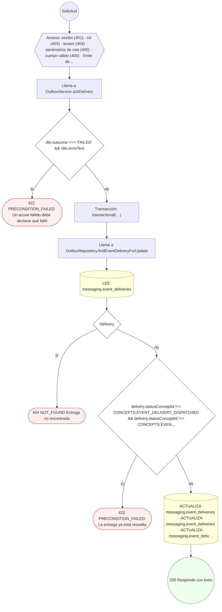

#### 2. POST /internal/events/{domainEventId}/dispatch

Repartir el evento entre sus suscriptores

| HTTP | Código | Cuándo |
|---|---|---|
| 200 | — | Éxito |
| 400 | `VALIDATION_FAILED` | Los parámetros de ruta son UUID válidos; El cuerpo cumple el DTO (sin propiedades extra) |
| 401 | `UNAUTHENTICATED` | Hay una sesión válida (JWT) |
| 403 | `FORBIDDEN` | El rol está permitido; El tenant se resuelve y pertenece al actor |
| 404 | `NOT_FOUND` | ResourceNotFoundException: Evento de dominio no encontrado |
| 422 | `PRECONDITION_FAILED` | PreconditionFailedException: El evento todavía no está publicado |
| 429 | `RATE_LIMITED` | No se supera el límite de solicitudes |

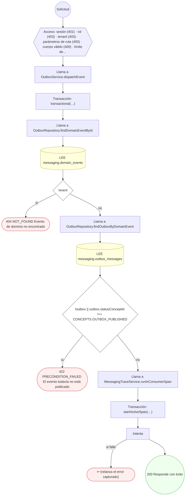

#### 3. POST /internal/jobs/{id}/complete

Cerrar el trabajo con éxito

| HTTP | Código | Cuándo |
|---|---|---|
| 200 | — | Éxito |
| 400 | `VALIDATION_FAILED` | Los parámetros de ruta son UUID válidos; El cuerpo cumple el DTO (sin propiedades extra) |
| 401 | `UNAUTHENTICATED` | Hay una sesión válida (JWT) |
| 403 | `FORBIDDEN` | El rol está permitido; El tenant se resuelve y pertenece al actor |
| 404 | `NOT_FOUND` | ResourceNotFoundException: Trabajo no encontrado |
| 422 | `PRECONDITION_FAILED` | PreconditionFailedException: El trabajo no está en ejecución; PreconditionFailedException: El trabajo está reservado por otro worker |
| 429 | `RATE_LIMITED` | No se supera el límite de solicitudes |

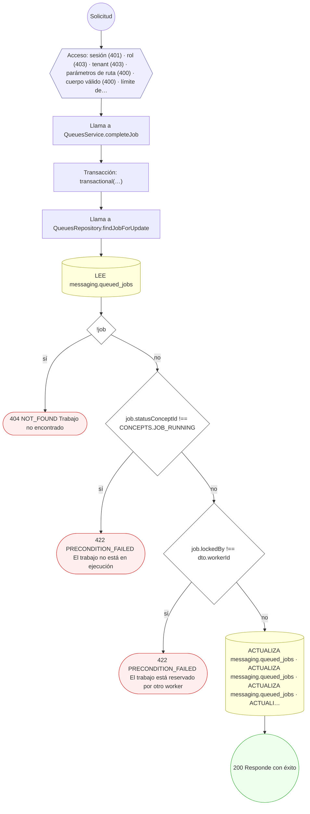

#### 4. POST /internal/jobs/{id}/fail

Registrar el fallo del trabajo

| HTTP | Código | Cuándo |
|---|---|---|
| 200 | — | Éxito |
| 400 | `VALIDATION_FAILED` | Los parámetros de ruta son UUID válidos; El cuerpo cumple el DTO (sin propiedades extra) |
| 401 | `UNAUTHENTICATED` | Hay una sesión válida (JWT) |
| 403 | `FORBIDDEN` | El rol está permitido; El tenant se resuelve y pertenece al actor |
| 404 | `NOT_FOUND` | ResourceNotFoundException: Trabajo no encontrado |
| 422 | `PRECONDITION_FAILED` | PreconditionFailedException: El trabajo no está en ejecución; PreconditionFailedException: El trabajo está reservado por otro worker |
| 429 | `RATE_LIMITED` | No se supera el límite de solicitudes |

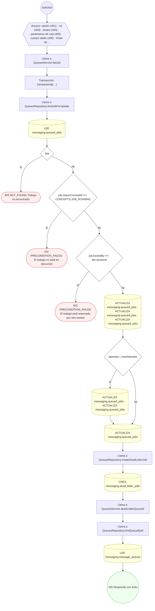

#### 5. POST /internal/notifications/{requestId}/deliver

Registrar el intento de entrega ante el proveedor

| HTTP | Código | Cuándo |
|---|---|---|
| 201 | — | Éxito |
| 400 | `VALIDATION_FAILED` | Los parámetros de ruta son UUID válidos; El cuerpo cumple el DTO (sin propiedades extra) |
| 401 | `UNAUTHENTICATED` | Hay una sesión válida (JWT) |
| 403 | `FORBIDDEN` | El rol está permitido; El tenant se resuelve y pertenece al actor |
| 404 | `NOT_FOUND` | ResourceNotFoundException: Solicitud de notificación no encontrada; ResourceNotFoundException: El proveedor configurado para el canal no existe |
| 422 | `PRECONDITION_FAILED` | PreconditionFailedException: La notificación está suprimida; PreconditionFailedException: La notificación ya no admite intentos; PreconditionFailedException: El canal no tiene configuración de proveedor activa; PreconditionFailedException: Una notificación in-app necesita destinatario interno |
| 429 | `RATE_LIMITED` | No se supera el límite de solicitudes |

```mermaid
flowchart TD
  n1(("Solicitud")):::inicio
  n2{{"Acceso: sesión (401) · rol (403) · tenant (403) · parámetros de ruta (400) · cuerpo válido (400) · límite de…"}}:::acceso
  n1 --> n2
  n3["Llama a NotificationsService.deliverNotification"]:::llamada
  n2 --> n3
  n4["Transacción: transactional(…)"]:::transaccion
  n3 --> n4
  n5["Llama a NotificationsRepository.findRequestForUpdate"]:::llamada
  n4 --> n5
  n6[("LEE messaging.notification_requests")]:::efecto
  n5 --> n6
  n7{"!request"}:::decision
  n6 --> n7
  n8(["404 NOT_FOUND Solicitud de notificación no encontrada"]):::error
  n7 -->|"sí"| n8
  n9{"request.statusConceptId === CONCEPTS.NOTIF_SUPPRESSED"}:::decision
  n7 -->|"no"| n9
  n10(["422 PRECONDITION_FAILED La notificación está suprimida"]):::error
  n9 -->|"sí"| n10
  n11{"request.statusConceptId !== CONCEPTS.NOTIF_PENDING && request.statusConceptId !== CONCEPTS.NOTIF_SENDING"}:::decision
  n9 -->|"no"| n11
  n12(["422 PRECONDITION_FAILED La notificación ya no admite intentos"]):::error
  n11 -->|"sí"| n12
  n13["Llama a NotificationsRepository.findChannelConfigs"]:::llamada
  n11 -->|"no"| n13
  n14[("LEE messaging.provider_channel_configs")]:::efecto
  n13 --> n14
  n15{"!config"}:::decision
  n14 --> n15
  n16(["422 PRECONDITION_FAILED El canal no tiene configuración de proveedor activa"]):::error
  n15 -->|"sí"| n16
  n17["Llama a NotificationsRepository.countDeliveries"]:::llamada
  n15 -->|"no"| n17
  n18[("LEE messaging.notification_deliveries")]:::efecto
  n17 --> n18
  n19["Llama a NotificationsRepository.findDeliveryByAttempt"]:::llamada
  n18 --> n19
  n20[("LEE messaging.notification_deliveries")]:::efecto
  n19 --> n20
  n21["Llama a NotificationsRepository.findProviderById"]:::llamada
  n20 --> n21
  n22[("LEE messaging.messaging_providers")]:::efecto
  n21 --> n22
  n23{"!provider"}:::decision
  n22 --> n23
  n24(["404 NOT_FOUND El proveedor configurado para el canal no existe"]):::error
  n23 -->|"sí"| n24
  n25["Llama a NotificationsRepository.createDelivery"]:::llamada
  n23 -->|"no"| n25
  n26[("CREA messaging.notification_deliveries")]:::efecto
  n25 --> n26
  n27["Llama a NotificationsRepository.findChannelById"]:::llamada
  n26 --> n27
  n28[("LEE messaging.message_channels")]:::efecto
  n27 --> n28
  n29{"sent && channel?.channelTypeConceptId === CONCEPTS.CHANNEL_TYPE_IN_APP"}:::decision
  n28 --> n29
  n30{"!request.recipientUserId"}:::decision
  n29 -->|"sí"| n30
  n31(["422 PRECONDITION_FAILED Una notificación in-app necesita destinatario interno"]):::error
  n30 -->|"sí"| n31
  n32["Llama a NotificationsRepository.createInAppNotification"]:::llamada
  n30 -->|"no"| n32
  n33[("CREA messaging.in_app_notifications")]:::efecto
  n32 --> n33
  n34[("ACTUALIZA messaging.notification_requests")]:::efecto
  n33 --> n34
  n29 -->|"no"| n34
  n35(("201 Responde con éxito")):::ok
  n34 --> n35
  classDef acceso fill:#eef,stroke:#66a
  classDef error fill:#fee,stroke:#c33
  classDef ok fill:#efe,stroke:#3a3
  classDef efecto fill:#ffd,stroke:#aa3
  classDef decision fill:#fff,stroke:#555
  classDef corte fill:#eee,stroke:#999,stroke-dasharray: 4
```

#### 6. GET /internal/notifications/pending

Listar solicitudes de notificación listas para entregar

| HTTP | Código | Cuándo |
|---|---|---|
| 200 | — | Éxito |
| 400 | `VALIDATION_FAILED` | Están los parámetros de consulta obligatorios |
| 401 | `UNAUTHENTICATED` | Hay una sesión válida (JWT) |
| 403 | `FORBIDDEN` | El rol está permitido; El tenant se resuelve y pertenece al actor |
| 429 | `RATE_LIMITED` | No se supera el límite de solicitudes |

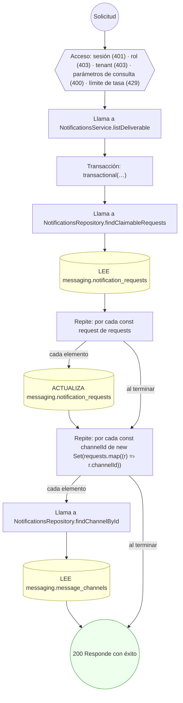

#### 7. POST /internal/outbox/relay/run

Reclamar y publicar un lote del outbox

| HTTP | Código | Cuándo |
|---|---|---|
| 200 | — | Éxito |
| 400 | `VALIDATION_FAILED` | El cuerpo cumple el DTO (sin propiedades extra) |
| 401 | `UNAUTHENTICATED` | Hay una sesión válida (JWT) |
| 403 | `FORBIDDEN` | El rol está permitido; El tenant se resuelve y pertenece al actor |
| 429 | `RATE_LIMITED` | No se supera el límite de solicitudes |

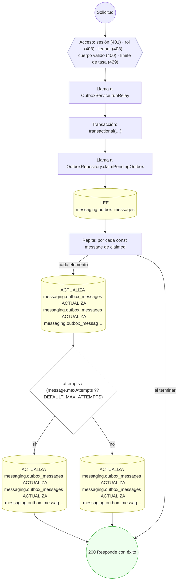

#### 8. POST /internal/queues/{code}/claim

Reclamar un lote de trabajos de la cola

| HTTP | Código | Cuándo |
|---|---|---|
| 200 | — | Éxito |
| 400 | `VALIDATION_FAILED` | El cuerpo cumple el DTO (sin propiedades extra) |
| 401 | `UNAUTHENTICATED` | Hay una sesión válida (JWT) |
| 403 | `FORBIDDEN` | El rol está permitido; El tenant se resuelve y pertenece al actor |
| 404 | `NOT_FOUND` | ResourceNotFoundException: Cola no encontrada |
| 422 | `PRECONDITION_FAILED` | PreconditionFailedException: La cola no está activa |
| 429 | `RATE_LIMITED` | No se supera el límite de solicitudes |

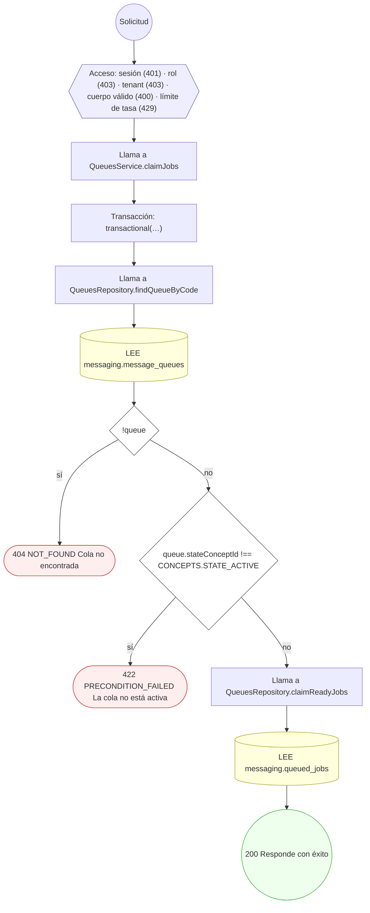

#### 9. POST /notifications/in-app/{id}/read

Marcar una notificación in-app como leída

| HTTP | Código | Cuándo |
|---|---|---|
| 200 | — | Éxito |
| 400 | `VALIDATION_FAILED` | Los parámetros de ruta son UUID válidos |
| 401 | `UNAUTHENTICATED` | Hay una sesión válida (JWT) |
| 403 | `FORBIDDEN` | El rol está permitido; El tenant se resuelve y pertenece al actor |
| 404 | `NOT_FOUND` | ResourceNotFoundException: Notificación no encontrada |
| 422 | `PRECONDITION_FAILED` | PreconditionFailedException: La notificación es de otro destinatario |
| 429 | `RATE_LIMITED` | No se supera el límite de solicitudes |

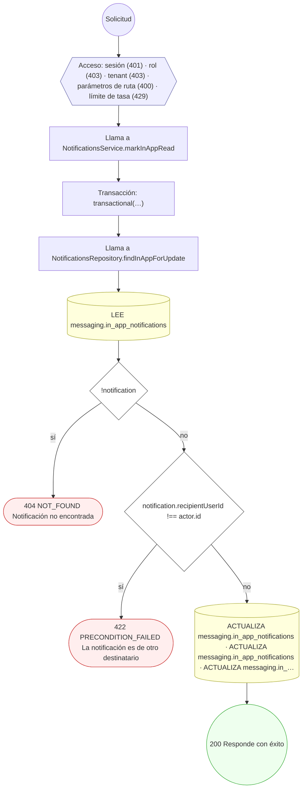

#### 10. POST /notifications/in-app/read-all

Marcar toda mi bandeja como leída

| HTTP | Código | Cuándo |
|---|---|---|
| 200 | — | Éxito |
| 401 | `UNAUTHENTICATED` | Hay una sesión válida (JWT) |
| 403 | `FORBIDDEN` | El rol está permitido; El tenant se resuelve y pertenece al actor |
| 429 | `RATE_LIMITED` | No se supera el límite de solicitudes |

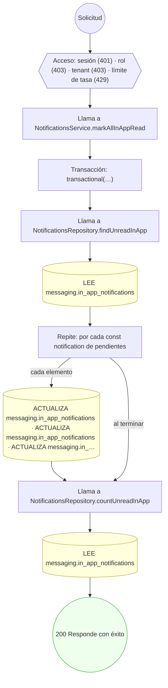

#### 11. GET /notifications/preferences/me

Mis preferencias de notificación in-app

| HTTP | Código | Cuándo |
|---|---|---|
| 200 | — | Éxito |
| 401 | `UNAUTHENTICATED` | Hay una sesión válida (JWT) |
| 403 | `FORBIDDEN` | El rol está permitido; El tenant se resuelve y pertenece al actor |
| 422 | `PRECONDITION_FAILED` | PreconditionFailedException: No hay canal in-app activo: falta correr el seed de mensajería |
| 429 | `RATE_LIMITED` | No se supera el límite de solicitudes |

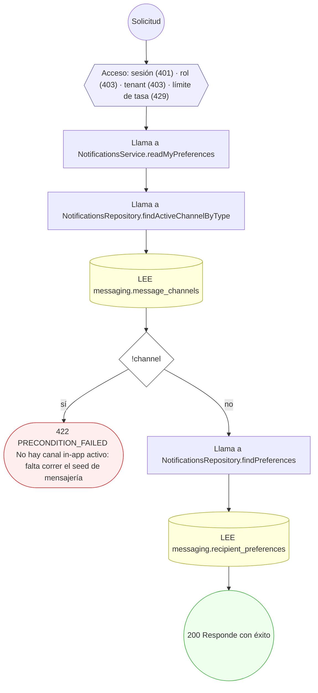

#### 12. PUT /notifications/preferences/me

Guardar mis preferencias de notificación in-app

| HTTP | Código | Cuándo |
|---|---|---|
| 200 | — | Éxito |
| 400 | `VALIDATION_FAILED` | El cuerpo cumple el DTO (sin propiedades extra) |
| 401 | `UNAUTHENTICATED` | Hay una sesión válida (JWT) |
| 403 | `FORBIDDEN` | El rol está permitido; El tenant se resuelve y pertenece al actor |
| 422 | `PRECONDITION_FAILED` | PreconditionFailedException: No hay canal in-app activo: falta correr el seed de mensajería |
| 429 | `RATE_LIMITED` | No se supera el límite de solicitudes |

```mermaid
flowchart TD
  n1(("Solicitud")):::inicio
  n2{{"Acceso: sesión (401) · rol (403) · tenant (403) · cuerpo válido (400) · límite de tasa (429)"}}:::acceso
  n1 --> n2
  n3["Llama a NotificationsService.updateMyPreferences"]:::llamada
  n2 --> n3
  n4["Transacción: transactional(…)"]:::transaccion
  n3 --> n4
  n5["Llama a NotificationsRepository.findActiveChannelByType"]:::llamada
  n4 --> n5
  n6[("LEE messaging.message_channels")]:::efecto
  n5 --> n6
  n7{"!channel"}:::decision
  n6 --> n7
  n8(["422 PRECONDITION_FAILED No hay canal in-app activo: falta correr el seed de mensajería"]):::error
  n7 -->|"sí"| n8
  n9["Llama a NotificationsRepository.findPreferences"]:::llamada
  n7 -->|"no"| n9
  n10[("LEE messaging.recipient_preferences")]:::efecto
  n9 --> n10
  n11["Repite: por cada const cambio de dto.categories ?? []"]:::bucle
  n10 --> n11
  n12{"fila"}:::decision
  n11 -->|"cada elemento"| n12
  n13["Llama a NotificationsRepository.createPreference"]:::llamada
  n12 -->|"no"| n13
  n14[("CREA messaging.recipient_preferences")]:::efecto
  n13 --> n14
  n15{"dto.quietHours !== undefined"}:::decision
  n12 -->|"sí"| n15
  n14 --> n15
  n11 -->|"al terminar"| n15
  n16{"fila"}:::decision
  n15 -->|"sí"| n16
  n17["Llama a NotificationsRepository.createPreference"]:::llamada
  n16 -->|"no"| n17
  n18[("CREA messaging.recipient_preferences")]:::efecto
  n17 --> n18
  n19["Llama a NotificationsService.readMyPreferences"]:::llamada
  n16 -->|"sí"| n19
  n18 --> n19
  n15 -->|"no"| n19
  n20["Llama a NotificationsRepository.findActiveChannelByType"]:::llamada
  n19 --> n20
  n21[("LEE messaging.message_channels")]:::efecto
  n20 --> n21
  n22{"!channel"}:::decision
  n21 --> n22
  n23(["422 PRECONDITION_FAILED No hay canal in-app activo: falta correr el seed de mensajería"]):::error
  n22 -->|"sí"| n23
  n24["Llama a NotificationsRepository.findPreferences"]:::llamada
  n22 -->|"no"| n24
  n25[("LEE messaging.recipient_preferences")]:::efecto
  n24 --> n25
  n26(("200 Responde con éxito")):::ok
  n25 --> n26
  classDef acceso fill:#eef,stroke:#66a
  classDef error fill:#fee,stroke:#c33
  classDef ok fill:#efe,stroke:#3a3
  classDef efecto fill:#ffd,stroke:#aa3
  classDef decision fill:#fff,stroke:#555
  classDef corte fill:#eee,stroke:#999,stroke-dasharray: 4
```

#### 13. POST /notifications/requests

Crear una solicitud de notificación

| HTTP | Código | Cuándo |
|---|---|---|
| 201 | — | Éxito |
| 400 | `VALIDATION_FAILED` | El cuerpo cumple el DTO (sin propiedades extra) |
| 401 | `UNAUTHENTICATED` | Hay una sesión válida (JWT) |
| 403 | `FORBIDDEN` | El rol está permitido; El tenant se resuelve y pertenece al actor |
| 404 | `NOT_FOUND` | ResourceNotFoundException: Canal no encontrado; ResourceNotFoundException: Plantilla no encontrada |
| 422 | `PRECONDITION_FAILED` | PreconditionFailedException: La notificación necesita destinatario interno o dirección de destino; PreconditionFailedException: El canal no está activo; PreconditionFailedException: La plantilla no está publicada; PreconditionFailedException: La plantilla es de otro canal |
| 429 | `RATE_LIMITED` | No se supera el límite de solicitudes |

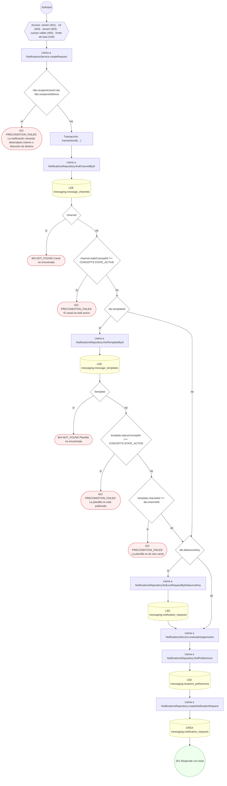

#### 14. POST /queues/{code}/jobs

Encolar un trabajo

| HTTP | Código | Cuándo |
|---|---|---|
| 201 | — | Éxito |
| 400 | `VALIDATION_FAILED` | El cuerpo cumple el DTO (sin propiedades extra) |
| 401 | `UNAUTHENTICATED` | Hay una sesión válida (JWT) |
| 403 | `FORBIDDEN` | El rol está permitido; El tenant se resuelve y pertenece al actor |
| 404 | `NOT_FOUND` | ResourceNotFoundException: Cola no encontrada |
| 422 | `PRECONDITION_FAILED` | PreconditionFailedException: La cola no está activa |
| 429 | `RATE_LIMITED` | No se supera el límite de solicitudes |

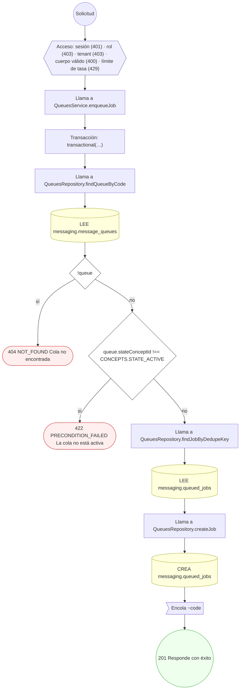

#### 15. POST /queues/dead-letter/{deadLetterJobId}/redrive

Reencolar un trabajo desde la cola muerta

| HTTP | Código | Cuándo |
|---|---|---|
| 201 | — | Éxito |
| 400 | `VALIDATION_FAILED` | Los parámetros de ruta son UUID válidos; El cuerpo cumple el DTO (sin propiedades extra) |
| 401 | `UNAUTHENTICATED` | Hay una sesión válida (JWT) |
| 403 | `FORBIDDEN` | El rol está permitido; El tenant se resuelve y pertenece al actor |
| 404 | `NOT_FOUND` | ResourceNotFoundException: Entrada de cola muerta no encontrada; ResourceNotFoundException: Cola de destino no encontrada |
| 422 | `PRECONDITION_FAILED` | PreconditionFailedException: La cola de destino no está activa |
| 429 | `RATE_LIMITED` | No se supera el límite de solicitudes |

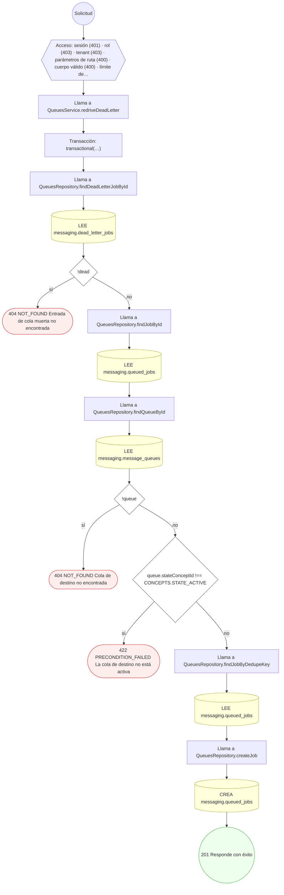

#### 16. POST /webhooks/providers/{providerCode}/receipts

Conciliar el acuse de entrega que envía el proveedor

| HTTP | Código | Cuándo |
|---|---|---|
| 200 | — | Éxito |
| 400 | `VALIDATION_FAILED` | El cuerpo cumple el DTO (sin propiedades extra) |
| 401 | `UNAUTHENTICATED` | Hay una sesión válida (JWT); UnauthorizedException: Firma del acuse del proveedor inválida |
| 404 | `NOT_FOUND` | ResourceNotFoundException: Proveedor no encontrado; ResourceNotFoundException: No hay entrega con esa referencia de mensaje |
| 429 | `RATE_LIMITED` | No se supera el límite de solicitudes |

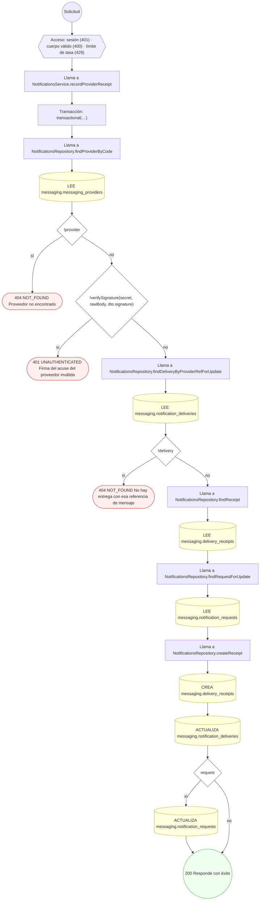

### Operaciones sin decisiones propias

Sólo comprueban el acceso y leen o escriben: no tienen ramas que dibujar. Su detalle está en la ficha de endpoints.

| Operación | Respuestas posibles | Tablas |
|---|---|---|
| GET /notifications/me | 200, 401, 403, 429 | 1 |
