<!-- AUTOGENERADO por tools/inventario/flujos.mjs. No editar manualmente. -->

# Flujos del módulo `object_storage`

- **Procesos:** 1 · **Máquinas de estado:** 0
- **Operaciones:** 13 (12 con decisiones propias, 1 sin ellas)
- Inventario de endpoints del módulo: [object_storage](../endpoints/object_storage.md)

## Proceso: Módulo 60 — Almacenamiento de Objetos (blobs, PACS y WORM)

- **Código:** `object_storage` · **Agrupación:** MIXTO · **Operaciones:** 13
- **Actores:** CLINICIAN · COMPLIANCE_OFFICER · DICOM_VIEWER · LEGAL_COUNSEL · PACS_GATEWAY · STORAGE_ADMIN · STORAGE_CLIENT · SYSTEM
- **Revisión:** AUTO_DETECTADA
- **Fuentes:** `src/modules/object_storage/README.md`

### Para qué sirve

Cargas multiparte, versiones inmutables direccionadas por contenido, catálogo DICOM con registro de accesos, payloads grandes enlazados a su origen, retención WORM y legal, verificación de integridad, archivado en frío y borrado gobernado.

_Fuente: `src/modules/object_storage/README.md:3`_

### Flujo general declarado en el README

```text
namespaces/:code/uploads/initiate ──> carga initiated  [idempotente por carga del proveedor]
  └─ uploads/:id/complete  [el tamaño recibido debe cuadrar con el declarado]
       └─ manifiesto (active) + versión inmutable + checksum + sobre de cifrado + ubicación primaria

objects/:id/versions ──> versión nueva encadenada por supersedes_version_id
                         mismo sha256 ⇒ no se versiona

dicom/studies/catalog ──> estudio → serie → instancia  [reentrante por UID]
  └─ /dicomweb/.../instances/:sopUid ──> allowed | denied — ambos se registran

versions/:id/retention-lock ──> objeto retained   [compliance = WORM]
versions/:id/legal-holds ─────> objeto legal_hold [anula el borrado]
versions/:id/integrity-checks ─> passed | failed  ⇒ failed marca el objeto corrupt
archive-jobs/build ───────────> objeto archived   [legal hold lo impide]
objects/:id/request-deletion ─> objeto pending_deletion
                                 [legal hold y retención compliance vigente lo abortan]
versions/:id/signed-url ──────> URI + versión de clave + caducidad
                                 [frío exige rehidratación; corrupto y borrado no se sirven]
```

_Fuente: `src/modules/object_storage/README.md:49`_

### Etapas y operaciones

| Etapa | Descripción | Operación | Quién actúa | Riesgo | Tablas |
|---|---|---|---|---|---|
| `UC-60-01` | Iniciar carga multiparte | POST /object-storage/namespaces/{code}/uploads/initiate | STORAGE_CLIENT · SYSTEM · STORAGE_ADMIN | MEDIO | 3 |
| `UC-60-02` | Completar y materializar versión | POST /object-storage/uploads/{id}/complete | STORAGE_CLIENT · SYSTEM · STORAGE_ADMIN | MEDIO | 11 |
| `UC-60-03` | Nueva versión inmutable | POST /object-storage/objects/{manifestId}/versions | SYSTEM · STORAGE_ADMIN | MEDIO | 8 |
| `UC-60-04` | Catalogar jerarquía DICOM | POST /object-storage/dicom/studies/catalog | PACS_GATEWAY · SYSTEM · STORAGE_ADMIN | MEDIO | 9 |
| `UC-60-05` | Acceso DICOMweb | GET /dicomweb/studies/{studyUid}/series/{seriesUid}/instances/{sopUid} | DICOM_VIEWER · CLINICIAN · STORAGE_ADMIN | MEDIO | 5 |
| `UC-60-06` | Registrar payload grande | POST /object-storage/large-payloads | SYSTEM · STORAGE_ADMIN | MEDIO | 4 |
| `UC-60-07` | Retención WORM | POST /object-storage/versions/{versionId}/retention-lock | COMPLIANCE_OFFICER · STORAGE_ADMIN | MEDIO | 6 |
| `UC-60-09` | Emitir acceso firmado | POST /object-storage/versions/{versionId}/signed-url | DICOM_VIEWER · CLINICIAN · SYSTEM · STORAGE_ADMIN | MEDIO | 5 |
| `UC-60-10` | Verificar integridad | POST /object-storage/versions/{versionId}/integrity-checks | SYSTEM · STORAGE_ADMIN | MEDIO | 8 |
| `UC-60-11` | Archivar a frío | POST /object-storage/archive-jobs/build | SYSTEM · STORAGE_ADMIN | MEDIO | 7 |
| `UC-60-12` | Borrado gobernado | POST /object-storage/objects/{manifestId}/request-deletion | COMPLIANCE_OFFICER · STORAGE_ADMIN | MEDIO | 7 |
| `ctrl:ObjectStorageController` | Operaciones de ObjectStorageController que el README no asigna a un caso de uso | POST /object-storage/versions/{versionId}/legal-holds | LEGAL_COUNSEL · STORAGE_ADMIN | MEDIO | 5 |
|  |  | DELETE /object-storage/versions/{versionId}/legal-holds/{holdId} | LEGAL_COUNSEL · STORAGE_ADMIN | MEDIO | 6 |

### Diagrama — etapas `UC-60-01`, `UC-60-02`, `UC-60-03`…

```mermaid
flowchart LR
  a2(["STORAGE_CLIENT · SYSTEM · STORAGE_ADMIN"]):::actor
  a12(["SYSTEM · STORAGE_ADMIN"]):::actor
  a15(["PACS_GATEWAY · SYSTEM · STORAGE_ADMIN"]):::actor
  a21(["DICOM_VIEWER · CLINICIAN · STORAGE_ADMIN"]):::actor
  a26(["COMPLIANCE_OFFICER · STORAGE_ADMIN"]):::actor
  a30(["DICOM_VIEWER · CLINICIAN · SYSTEM · STORAGE_ADMIN"]):::actor
  a42(["LEGAL_COUNSEL · STORAGE_ADMIN"]):::actor
  t3[("object_storage.multipart_uploads")]:::tabla
  t4[("object_storage.object_namespaces")]:::tabla
  t6[("object_storage.object_checksums")]:::tabla
  t7[("object_storage.object_encryption_envelopes")]:::tabla
  t8[("object_storage.object_locations")]:::tabla
  t9[("object_storage.object_manifests")]:::tabla
  t16[("object_storage.dicom_instance_manifests")]:::tabla
  t17[("object_storage.dicom_series_manifests")]:::tabla
  t18[("object_storage.dicom_study_manifests")]:::tabla
  t22[("object_storage.dicomweb_access_logs")]:::tabla
  t24[("object_storage.large_payload_manifests")]:::tabla
  t27[("object_storage.object_retention_locks")]:::tabla
  t28[("object_storage.object_versions")]:::tabla
  t32[("object_storage.object_integrity_checks")]:::tabla
  t35[("object_storage.archive_manifests")]:::tabla
  t36[("object_storage.object_legal_holds")]:::tabla
  t39[("object_storage.object_deletion_markers")]:::tabla
  subgraph s0["UC-60-01 · Iniciar carga multiparte"]
    o1["POST /object-storage/namespaces/{code}/uploads/initiate"]:::op
  end
  t10[("+5 tablas más")]
  subgraph s1["UC-60-02 · Completar y materializar versión"]
    o5["POST /object-storage/uploads/{id}/complete"]:::op
  end
  t13[("+2 tablas más")]
  subgraph s2["UC-60-03 · Nueva versión inmutable"]
    o11["POST /object-storage/objects/{manifestId}/versions"]:::op
  end
  t19[("+3 tablas más")]
  subgraph s3["UC-60-04 · Catalogar jerarquía DICOM"]
    o14["POST /object-storage/dicom/studies/catalog"]:::op
  end
  subgraph s4["UC-60-05 · Acceso DICOMweb"]
    o20["GET /dicomweb/studies/{studyUid}/series/{seriesUid}/instances/{sopUid}"]:::op
  end
  subgraph s5["UC-60-06 · Registrar payload grande"]
    o23["POST /object-storage/large-payloads"]:::op
  end
  subgraph s6["UC-60-07 · Retención WORM"]
    o25["POST /object-storage/versions/{versionId}/retention-lock"]:::op
  end
  subgraph s7["UC-60-09 · Emitir acceso firmado"]
    o29["POST /object-storage/versions/{versionId}/signed-url"]:::op
  end
  t33[("+2 tablas más")]
  subgraph s8["UC-60-10 · Verificar integridad"]
    o31["POST /object-storage/versions/{versionId}/integrity-checks"]:::op
  end
  t37[("+1 tablas más")]
  subgraph s9["UC-60-11 · Archivar a frío"]
    o34["POST /object-storage/archive-jobs/build"]:::op
  end
  t40[("+1 tablas más")]
  subgraph s10["UC-60-12 · Borrado gobernado"]
    o38["POST /object-storage/objects/{manifestId}/request-deletion"]:::op
  end
  subgraph s11["ctrl:ObjectStorageController · Operaciones de ObjectStorageController que el RE…"]
    o41["POST /object-storage/versions/{versionId}/legal-holds"]:::op
    o43["DELETE /object-storage/versions/{versionId}/legal-holds/{holdId}"]:::op
  end
  a2 --> o1
  o1 -->|"CREA"| t3
  o1 -->|"LEE"| t3
  o1 -->|"LEE"| t4
  a2 --> o5
  o5 -->|"ACTUALIZA"| t3
  o5 -->|"LEE"| t3
  o5 -->|"CREA"| t6
  o5 -->|"CREA"| t7
  o5 -->|"CREA"| t8
  o5 -->|"ACTUALIZA"| t9
  o5 -.-> t10
  a12 --> o11
  o11 -->|"CREA"| t6
  o11 -->|"CREA"| t7
  o11 -->|"CREA"| t8
  o11 -->|"ACTUALIZA"| t9
  o11 -->|"LEE"| t9
  o11 -->|"LEE"| t4
  o11 -.-> t13
  a15 --> o14
  o14 -->|"CREA"| t16
  o14 -->|"LEE"| t16
  o14 -->|"ACTUALIZA"| t17
  o14 -->|"CREA"| t17
  o14 -->|"LEE"| t17
  o14 -->|"ACTUALIZA"| t18
  o14 -.-> t19
  a21 --> o20
  o20 -->|"LEE"| t16
  o20 -->|"LEE"| t17
  o20 -->|"LEE"| t18
  o20 -->|"CREA"| t22
  o20 -->|"LEE"| t9
  a12 --> o23
  o23 -->|"CREA"| t24
  o23 -->|"LEE"| t24
  o23 -->|"ACTUALIZA"| t9
  o23 -->|"LEE"| t9
  a26 --> o25
  o25 -->|"ACTUALIZA"| t9
  o25 -->|"LEE"| t9
  o25 -->|"LEE"| t4
  o25 -->|"CREA"| t27
  o25 -->|"LEE"| t27
  o25 -->|"LEE"| t28
  a30 --> o29
  o29 -->|"CREA"| t22
  o29 -->|"LEE"| t7
  o29 -->|"LEE"| t8
  o29 -->|"LEE"| t9
  o29 -->|"LEE"| t28
  a12 --> o31
  o31 -->|"ACTUALIZA"| t6
  o31 -->|"LEE"| t6
  o31 -->|"CREA"| t32
  o31 -->|"ACTUALIZA"| t8
  o31 -->|"LEE"| t8
  o31 -->|"ACTUALIZA"| t9
  o31 -.-> t33
  a12 --> o34
  o34 -->|"CREA"| t35
  o34 -->|"LEE"| t35
  o34 -->|"LEE"| t36
  o34 -->|"CREA"| t8
  o34 -->|"ACTUALIZA"| t9
  o34 -->|"LEE"| t9
  o34 -.-> t37
  a26 --> o38
  o38 -->|"CREA"| t39
  o38 -->|"LEE"| t39
  o38 -->|"LEE"| t36
  o38 -->|"ACTUALIZA"| t9
  o38 -->|"LEE"| t9
  o38 -->|"LEE"| t27
  o38 -.-> t40
  a42 --> o41
  o41 -->|"CREA"| t36
  o41 -->|"LEE"| t36
  o41 -->|"ACTUALIZA"| t9
  o41 -->|"LEE"| t9
  o41 -->|"LEE"| t28
  a42 --> o43
  o43 -->|"ACTUALIZA"| t36
  o43 -->|"LEE"| t36
  o43 -->|"ACTUALIZA"| t9
  o43 -->|"LEE"| t9
  o43 -->|"LEE"| t27
  o43 -->|"LEE"| t28
  classDef op fill:#fff,stroke:#446
  classDef actor fill:#eef,stroke:#66a
  classDef tabla fill:#ffd,stroke:#aa3
  classDef evento fill:#efe,stroke:#3a3
```

## Árbol de decisión por operación

Cada árbol se deriva del código del handler y de los métodos que invoca (hasta 4 niveles). Una rama que no decide, no escribe y no falla se poda. Los accesos y los efectos consecutivos se agrupan en un solo nodo.

### Operaciones con decisiones propias

#### 1. POST /object-storage/archive-jobs/build

Archivar el objeto a almacenamiento frío

| HTTP | Código | Cuándo |
|---|---|---|
| 201 | — | Éxito |
| 400 | `VALIDATION_FAILED` | El cuerpo cumple el DTO (sin propiedades extra) |
| 401 | `UNAUTHENTICATED` | Hay una sesión válida (JWT) |
| 403 | `FORBIDDEN` | El rol está permitido; El tenant se resuelve y pertenece al actor |
| 404 | `NOT_FOUND` | ResourceNotFoundException: Objeto no encontrado |
| 422 | `PRECONDITION_FAILED` | PreconditionFailedException: El objeto no tiene ninguna versión; PreconditionFailedException: La versión está bajo retención legal: no se puede mover a frío |
| 429 | `RATE_LIMITED` | No se supera el límite de solicitudes |

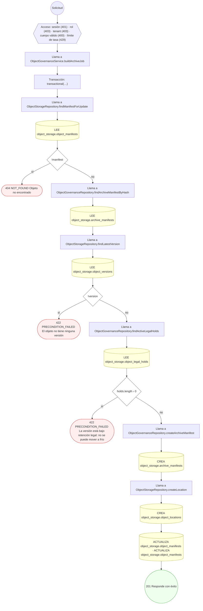

#### 2. POST /object-storage/dicom/studies/catalog

Catalogar la jerarquía DICOM estudio/serie/instancia

| HTTP | Código | Cuándo |
|---|---|---|
| 201 | — | Éxito |
| 400 | `VALIDATION_FAILED` | El cuerpo cumple el DTO (sin propiedades extra) |
| 401 | `UNAUTHENTICATED` | Hay una sesión válida (JWT) |
| 403 | `FORBIDDEN` | El rol está permitido; El tenant se resuelve y pertenece al actor |
| 404 | `NOT_FOUND` | ResourceNotFoundException: El objeto de la instancia no existe |
| 429 | `RATE_LIMITED` | No se supera el límite de solicitudes |

```mermaid
flowchart TD
  n1(("Solicitud")):::inicio
  n2{{"Acceso: sesión (401) · rol (403) · tenant (403) · cuerpo válido (400) · límite de tasa (429)"}}:::acceso
  n1 --> n2
  n3["Llama a DicomCatalogService.catalogStudy"]:::llamada
  n2 --> n3
  n4["Transacción: transactional(…)"]:::transaccion
  n3 --> n4
  n5["Llama a DicomRepository.findStudyByUidForUpdate"]:::llamada
  n4 --> n5
  n6[("LEE object_storage.dicom_study_manifests")]:::efecto
  n5 --> n6
  n7["Llama a DicomRepository.createStudy"]:::llamada
  n6 --> n7
  n8[("CREA object_storage.dicom_study_manifests")]:::efecto
  n7 --> n8
  n9["Repite: por cada const seriesDto de dto.series"]:::bucle
  n8 --> n9
  n10["Llama a DicomRepository.findSeriesByUidForUpdate"]:::llamada
  n9 -->|"cada elemento"| n10
  n11[("LEE object_storage.dicom_series_manifests")]:::efecto
  n10 --> n11
  n12["Llama a DicomRepository.createSeries"]:::llamada
  n11 --> n12
  n13[("CREA object_storage.dicom_series_manifests")]:::efecto
  n12 --> n13
  n14["Repite: por cada const instanceDto de seriesDto.instances"]:::bucle
  n13 --> n14
  n15["Llama a DicomRepository.findInstanceByUid"]:::llamada
  n14 -->|"cada elemento"| n15
  n16[("LEE object_storage.dicom_instance_manifests")]:::efecto
  n15 --> n16
  n17["Llama a ObjectStorageRepository.findManifestById"]:::llamada
  n16 --> n17
  n18[("LEE object_storage.object_manifests")]:::efecto
  n17 --> n18
  n19{"!manifest"}:::decision
  n18 --> n19
  n20(["404 NOT_FOUND El objeto de la instancia no existe"]):::error
  n19 -->|"sí"| n20
  n21["Llama a DicomRepository.createInstance"]:::llamada
  n19 -->|"no"| n21
  n22[("CREA object_storage.dicom_instance_manifests")]:::efecto
  n21 --> n22
  n23["Llama a DicomRepository.countInstancesBySeries"]:::llamada
  n22 --> n23
  n14 -->|"al terminar"| n23
  n24[("LEE object_storage.dicom_instance_manifests")]:::efecto
  n23 --> n24
  n25[("ACTUALIZA object_storage.dicom_series_manifests")]:::efecto
  n24 --> n25
  n26["Llama a DicomRepository.findSeriesByStudy"]:::llamada
  n25 --> n26
  n9 -->|"al terminar"| n26
  n27[("LEE object_storage.dicom_series_manifests")]:::efecto
  n26 --> n27
  n28[("ACTUALIZA object_storage.dicom_study_manifests · ACTUALIZA object_storage.dicom_study_manifests")]:::efecto
  n27 --> n28
  n29(("201 Responde con éxito")):::ok
  n28 --> n29
  classDef acceso fill:#eef,stroke:#66a
  classDef error fill:#fee,stroke:#c33
  classDef ok fill:#efe,stroke:#3a3
  classDef efecto fill:#ffd,stroke:#aa3
  classDef decision fill:#fff,stroke:#555
  classDef corte fill:#eee,stroke:#999,stroke-dasharray: 4
```

#### 3. POST /object-storage/large-payloads

Registrar un payload grande y vincularlo a su entidad de origen

| HTTP | Código | Cuándo |
|---|---|---|
| 201 | — | Éxito |
| 400 | `VALIDATION_FAILED` | El cuerpo cumple el DTO (sin propiedades extra) |
| 401 | `UNAUTHENTICATED` | Hay una sesión válida (JWT) |
| 403 | `FORBIDDEN` | El rol está permitido; El tenant se resuelve y pertenece al actor |
| 404 | `NOT_FOUND` | ResourceNotFoundException: Objeto no encontrado |
| 429 | `RATE_LIMITED` | No se supera el límite de solicitudes |

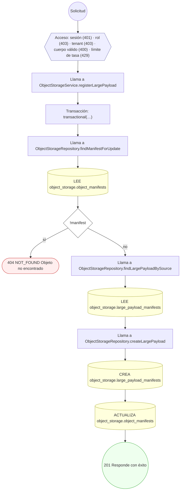

#### 4. POST /object-storage/namespaces/{code}/uploads/initiate

Iniciar una carga multiparte

| HTTP | Código | Cuándo |
|---|---|---|
| 201 | — | Éxito |
| 400 | `VALIDATION_FAILED` | El cuerpo cumple el DTO (sin propiedades extra) |
| 401 | `UNAUTHENTICATED` | Hay una sesión válida (JWT) |
| 403 | `FORBIDDEN` | El rol está permitido; El tenant se resuelve y pertenece al actor |
| 404 | `NOT_FOUND` | ResourceNotFoundException: Espacio de nombres no encontrado |
| 422 | `PRECONDITION_FAILED` | PreconditionFailedException: El espacio de nombres no está activo |
| 429 | `RATE_LIMITED` | No se supera el límite de solicitudes |

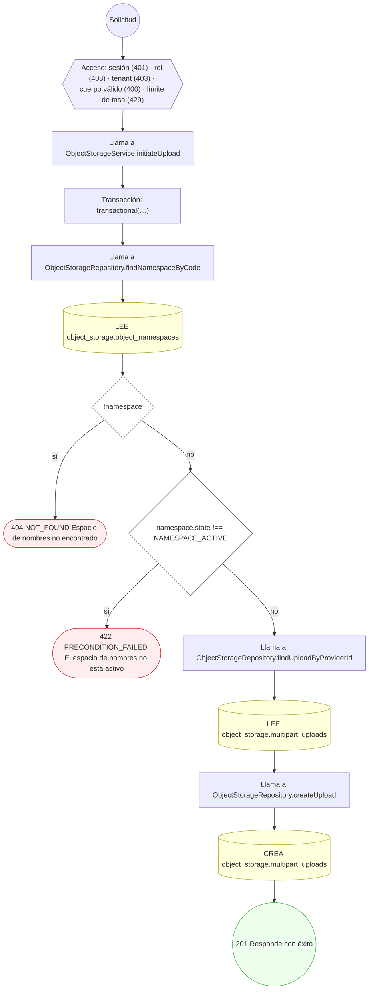

#### 5. POST /object-storage/objects/{manifestId}/request-deletion

Solicitar el borrado gobernado

| HTTP | Código | Cuándo |
|---|---|---|
| 201 | — | Éxito |
| 400 | `VALIDATION_FAILED` | Los parámetros de ruta son UUID válidos; El cuerpo cumple el DTO (sin propiedades extra) |
| 401 | `UNAUTHENTICATED` | Hay una sesión válida (JWT) |
| 403 | `FORBIDDEN` | El rol está permitido; El tenant se resuelve y pertenece al actor |
| 404 | `NOT_FOUND` | ResourceNotFoundException: Objeto no encontrado |
| 422 | `PRECONDITION_FAILED` | PreconditionFailedException: El objeto está bajo retención legal: no se puede borrar; PreconditionFailedException: El objeto está bajo retención de cumplimiento vigente |
| 429 | `RATE_LIMITED` | No se supera el límite de solicitudes |

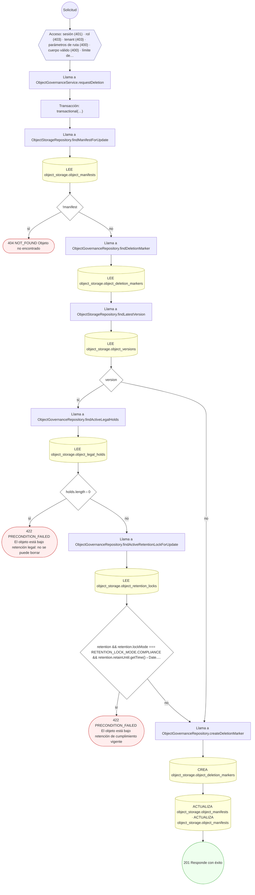

#### 6. POST /object-storage/objects/{manifestId}/versions

Crear una versión nueva del objeto

| HTTP | Código | Cuándo |
|---|---|---|
| 201 | — | Éxito |
| 400 | `VALIDATION_FAILED` | Los parámetros de ruta son UUID válidos; El cuerpo cumple el DTO (sin propiedades extra) |
| 401 | `UNAUTHENTICATED` | Hay una sesión válida (JWT) |
| 403 | `FORBIDDEN` | El rol está permitido; El tenant se resuelve y pertenece al actor |
| 404 | `NOT_FOUND` | ResourceNotFoundException: Objeto no encontrado; ResourceNotFoundException: Espacio de nombres no encontrado |
| 422 | `PRECONDITION_FAILED` | PreconditionFailedException: El objeto no está activo; PreconditionFailedException: El espacio de nombres no tiene versionado habilitado |
| 429 | `RATE_LIMITED` | No se supera el límite de solicitudes |

```mermaid
flowchart TD
  n1(("Solicitud")):::inicio
  n2{{"Acceso: sesión (401) · rol (403) · tenant (403) · parámetros de ruta (400) · cuerpo válido (400) · límite de…"}}:::acceso
  n1 --> n2
  n3["Llama a ObjectStorageService.createVersion"]:::llamada
  n2 --> n3
  n4["Transacción: transactional(…)"]:::transaccion
  n3 --> n4
  n5["Llama a ObjectStorageRepository.findManifestForUpdate"]:::llamada
  n4 --> n5
  n6[("LEE object_storage.object_manifests")]:::efecto
  n5 --> n6
  n7{"!manifest"}:::decision
  n6 --> n7
  n8(["404 NOT_FOUND Objeto no encontrado"]):::error
  n7 -->|"sí"| n8
  n9{"manifest.lifecycleState !== OBJECT_LIFECYCLE.ACTIVE"}:::decision
  n7 -->|"no"| n9
  n10(["422 PRECONDITION_FAILED El objeto no está activo"]):::error
  n9 -->|"sí"| n10
  n11["Llama a ObjectStorageRepository.findNamespaceById"]:::llamada
  n9 -->|"no"| n11
  n12[("LEE object_storage.object_namespaces")]:::efecto
  n11 --> n12
  n13{"!namespace"}:::decision
  n12 --> n13
  n14(["404 NOT_FOUND Espacio de nombres no encontrado"]):::error
  n13 -->|"sí"| n14
  n15{"!namespace.versioningEnabled"}:::decision
  n13 -->|"no"| n15
  n16(["422 PRECONDITION_FAILED El espacio de nombres no tiene versionado habilitado"]):::error
  n15 -->|"sí"| n16
  n17["Llama a ObjectStorageRepository.findVersionBySha"]:::llamada
  n15 -->|"no"| n17
  n18[("LEE object_storage.object_versions")]:::efecto
  n17 --> n18
  n19["Llama a ObjectStorageRepository.findLatestVersion"]:::llamada
  n18 --> n19
  n20[("LEE object_storage.object_versions")]:::efecto
  n19 --> n20
  n21["Llama a ObjectStorageService.materialiseVersion"]:::llamada
  n20 --> n21
  n22["Llama a ObjectStorageRepository.createVersion"]:::llamada
  n21 --> n22
  n23[("CREA object_storage.object_versions")]:::efecto
  n22 --> n23
  n24["Llama a ObjectStorageRepository.createChecksum"]:::llamada
  n23 --> n24
  n25[("CREA object_storage.object_checksums")]:::efecto
  n24 --> n25
  n26{"data.encryption"}:::decision
  n25 --> n26
  n27["Llama a ObjectStorageRepository.createEncryptionEnvelope"]:::llamada
  n26 -->|"sí"| n27
  n28[("CREA object_storage.object_encryption_envelopes")]:::efecto
  n27 --> n28
  n29["Llama a ObjectStorageRepository.createLocation"]:::llamada
  n28 --> n29
  n26 -->|"no"| n29
  n30[("CREA object_storage.object_locations")]:::efecto
  n29 --> n30
  n31[("ACTUALIZA object_storage.object_manifests · ACTUALIZA object_storage.object_manifests")]:::efecto
  n30 --> n31
  n32(("201 Responde con éxito")):::ok
  n31 --> n32
  classDef acceso fill:#eef,stroke:#66a
  classDef error fill:#fee,stroke:#c33
  classDef ok fill:#efe,stroke:#3a3
  classDef efecto fill:#ffd,stroke:#aa3
  classDef decision fill:#fff,stroke:#555
  classDef corte fill:#eee,stroke:#999,stroke-dasharray: 4
```

#### 7. POST /object-storage/uploads/{id}/complete

Completar la carga y materializar la versión del objeto

| HTTP | Código | Cuándo |
|---|---|---|
| 201 | — | Éxito |
| 400 | `VALIDATION_FAILED` | Los parámetros de ruta son UUID válidos; El cuerpo cumple el DTO (sin propiedades extra) |
| 401 | `UNAUTHENTICATED` | Hay una sesión válida (JWT) |
| 403 | `FORBIDDEN` | El rol está permitido; El tenant se resuelve y pertenece al actor |
| 404 | `NOT_FOUND` | ResourceNotFoundException: Carga no encontrada; ResourceNotFoundException: Espacio de nombres no encontrado |
| 422 | `PRECONDITION_FAILED` | PreconditionFailedException: La carga ya no está en curso; PreconditionFailedException: La carga caducó; PreconditionFailedException: El tamaño recibido no coincide con el declarado |
| 429 | `RATE_LIMITED` | No se supera el límite de solicitudes |

```mermaid
flowchart TD
  n1(("Solicitud")):::inicio
  n2{{"Acceso: sesión (401) · rol (403) · tenant (403) · parámetros de ruta (400) · cuerpo válido (400) · límite de…"}}:::acceso
  n1 --> n2
  n3["Llama a ObjectStorageService.completeUpload"]:::llamada
  n2 --> n3
  n4["Transacción: transactional(…)"]:::transaccion
  n3 --> n4
  n5["Llama a ObjectStorageRepository.findUploadForUpdate"]:::llamada
  n4 --> n5
  n6[("LEE object_storage.multipart_uploads")]:::efecto
  n5 --> n6
  n7{"!upload"}:::decision
  n6 --> n7
  n8(["404 NOT_FOUND Carga no encontrada"]):::error
  n7 -->|"sí"| n8
  n9{"upload.status !== UPLOAD_STATUS.INITIATED"}:::decision
  n7 -->|"no"| n9
  n10(["422 PRECONDITION_FAILED La carga ya no está en curso"]):::error
  n9 -->|"sí"| n10
  n11{"upload.expiresAt && upload.expiresAt.getTime() ‹= Date.now()"}:::decision
  n9 -->|"no"| n11
  n12(["422 PRECONDITION_FAILED La carga caducó"]):::error
  n11 -->|"sí"| n12
  n13{"BigInt(dto.receivedSizeBytes) !== BigInt(upload.expectedSizeBytes)"}:::decision
  n11 -->|"no"| n13
  n14(["422 PRECONDITION_FAILED El tamaño recibido no coincide con el declarado"]):::error
  n13 -->|"sí"| n14
  n15["Llama a ObjectStorageRepository.findNamespaceById"]:::llamada
  n13 -->|"no"| n15
  n16[("LEE object_storage.object_namespaces")]:::efecto
  n15 --> n16
  n17{"!namespace"}:::decision
  n16 --> n17
  n18(["404 NOT_FOUND Espacio de nombres no encontrado"]):::error
  n17 -->|"sí"| n18
  n19["Llama a ObjectStorageRepository.findManifestByLogicalIdForUpdate"]:::llamada
  n17 -->|"no"| n19
  n20[("LEE object_storage.object_manifests")]:::efecto
  n19 --> n20
  n21["Llama a ObjectStorageRepository.createManifest"]:::llamada
  n20 --> n21
  n22[("CREA object_storage.object_manifests")]:::efecto
  n21 --> n22
  n23[("ACTUALIZA object_storage.multipart_uploads · ACTUALIZA object_storage.multipart_uploads")]:::efecto
  n22 --> n23
  n24["Llama a ObjectStorageRepository.findVersionBySha"]:::llamada
  n23 --> n24
  n25[("LEE object_storage.object_versions")]:::efecto
  n24 --> n25
  n26["Llama a ObjectStorageRepository.findLatestVersion"]:::llamada
  n25 --> n26
  n27[("LEE object_storage.object_versions")]:::efecto
  n26 --> n27
  n28["Llama a ObjectStorageService.materialiseVersion"]:::llamada
  n27 --> n28
  n29["Llama a ObjectStorageRepository.createVersion"]:::llamada
  n28 --> n29
  n30[("CREA object_storage.object_versions")]:::efecto
  n29 --> n30
  n31["Llama a ObjectStorageRepository.createChecksum"]:::llamada
  n30 --> n31
  n32[("CREA object_storage.object_checksums")]:::efecto
  n31 --> n32
  n33{"data.encryption"}:::decision
  n32 --> n33
  n34["Llama a ObjectStorageRepository.createEncryptionEnvelope"]:::llamada
  n33 -->|"sí"| n34
  n35[("CREA object_storage.object_encryption_envelopes")]:::efecto
  n34 --> n35
  n36["Llama a ObjectStorageRepository.createLocation"]:::llamada
  n35 --> n36
  n33 -->|"no"| n36
  n37[("CREA object_storage.object_locations")]:::efecto
  n36 --> n37
  n38[("ACTUALIZA object_storage.object_manifests · ACTUALIZA object_storage.object_manifests")]:::efecto
  n37 --> n38
  n39(("201 Responde con éxito")):::ok
  n38 --> n39
  classDef acceso fill:#eef,stroke:#66a
  classDef error fill:#fee,stroke:#c33
  classDef ok fill:#efe,stroke:#3a3
  classDef efecto fill:#ffd,stroke:#aa3
  classDef decision fill:#fff,stroke:#555
  classDef corte fill:#eee,stroke:#999,stroke-dasharray: 4
```

#### 8. POST /object-storage/versions/{versionId}/integrity-checks

Registrar la verificación de integridad

| HTTP | Código | Cuándo |
|---|---|---|
| 201 | — | Éxito |
| 400 | `VALIDATION_FAILED` | Los parámetros de ruta son UUID válidos; El cuerpo cumple el DTO (sin propiedades extra) |
| 401 | `UNAUTHENTICATED` | Hay una sesión válida (JWT) |
| 403 | `FORBIDDEN` | El rol está permitido; El tenant se resuelve y pertenece al actor |
| 404 | `NOT_FOUND` | ResourceNotFoundException: Versión no encontrada; ResourceNotFoundException: Objeto no encontrado |
| 429 | `RATE_LIMITED` | No se supera el límite de solicitudes |

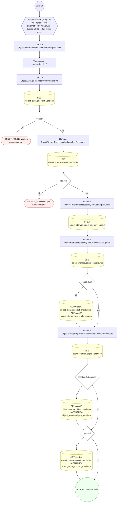

#### 9. POST /object-storage/versions/{versionId}/legal-holds

Colocar una retención legal

| HTTP | Código | Cuándo |
|---|---|---|
| 201 | — | Éxito |
| 400 | `VALIDATION_FAILED` | Los parámetros de ruta son UUID válidos; El cuerpo cumple el DTO (sin propiedades extra) |
| 401 | `UNAUTHENTICATED` | Hay una sesión válida (JWT) |
| 403 | `FORBIDDEN` | El rol está permitido; El tenant se resuelve y pertenece al actor |
| 404 | `NOT_FOUND` | ResourceNotFoundException: Versión no encontrada; ResourceNotFoundException: Objeto no encontrado |
| 429 | `RATE_LIMITED` | No se supera el límite de solicitudes |

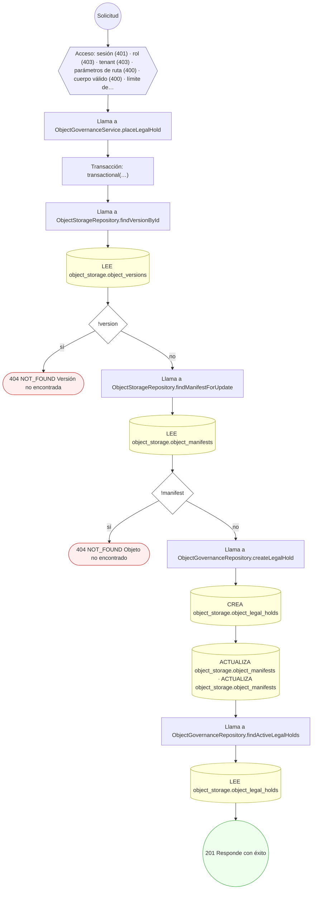

#### 10. DELETE /object-storage/versions/{versionId}/legal-holds/{holdId}

Liberar una retención legal

| HTTP | Código | Cuándo |
|---|---|---|
| 200 | — | Éxito |
| 400 | `VALIDATION_FAILED` | Los parámetros de ruta son UUID válidos |
| 401 | `UNAUTHENTICATED` | Hay una sesión válida (JWT) |
| 403 | `FORBIDDEN` | El rol está permitido; El tenant se resuelve y pertenece al actor |
| 404 | `NOT_FOUND` | ResourceNotFoundException: Retención legal no encontrada; ResourceNotFoundException: Versión no encontrada; ResourceNotFoundException: Objeto no encontrado |
| 409 | `CONFLICT` | ConflictException: La retención legal ya está liberada |
| 422 | `PRECONDITION_FAILED` | PreconditionFailedException: La retención es de otra versión |
| 429 | `RATE_LIMITED` | No se supera el límite de solicitudes |

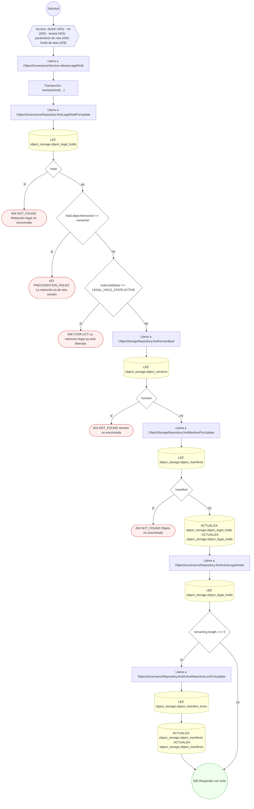

#### 11. POST /object-storage/versions/{versionId}/retention-lock

Aplicar retención WORM sobre la versión

| HTTP | Código | Cuándo |
|---|---|---|
| 201 | — | Éxito |
| 400 | `VALIDATION_FAILED` | Los parámetros de ruta son UUID válidos; El cuerpo cumple el DTO (sin propiedades extra) |
| 401 | `UNAUTHENTICATED` | Hay una sesión válida (JWT) |
| 403 | `FORBIDDEN` | El rol está permitido; El tenant se resuelve y pertenece al actor |
| 404 | `NOT_FOUND` | ResourceNotFoundException: Versión no encontrada; ResourceNotFoundException: Objeto no encontrado |
| 409 | `CONFLICT` | ConflictException: La versión ya tiene una retención vigente |
| 422 | `PRECONDITION_FAILED` | PreconditionFailedException: La retención debe terminar en el futuro; PreconditionFailedException: El espacio de nombres no tiene bloqueo de objetos habilitado |
| 429 | `RATE_LIMITED` | No se supera el límite de solicitudes |

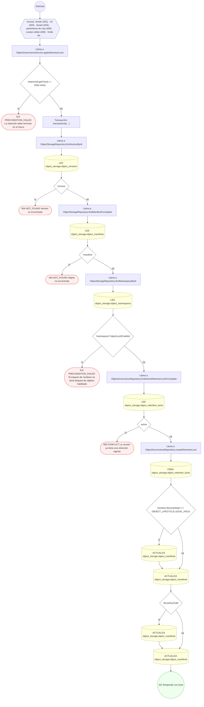

#### 12. POST /object-storage/versions/{versionId}/signed-url

Emitir acceso firmado a una versión

| HTTP | Código | Cuándo |
|---|---|---|
| 201 | — | Éxito |
| 400 | `VALIDATION_FAILED` | Los parámetros de ruta son UUID válidos; El cuerpo cumple el DTO (sin propiedades extra) |
| 401 | `UNAUTHENTICATED` | Hay una sesión válida (JWT) |
| 403 | `FORBIDDEN` | El rol está permitido; El tenant se resuelve y pertenece al actor |
| 404 | `NOT_FOUND` | ResourceNotFoundException: Versión no encontrada; ResourceNotFoundException: Objeto no encontrado; ResourceNotFoundException: La versión no tiene ubicación primaria |
| 422 | `PRECONDITION_FAILED` | PreconditionFailedException: El objeto no está disponible; PreconditionFailedException: La versión está en almacenamiento frío: requiere rehidratación previa |
| 429 | `RATE_LIMITED` | No se supera el límite de solicitudes |

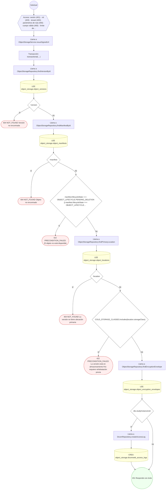

### Operaciones sin decisiones propias

Sólo comprueban el acceso y leen o escriben: no tienen ramas que dibujar. Su detalle está en la ficha de endpoints.

| Operación | Respuestas posibles | Tablas |
|---|---|---|
| GET /dicomweb/studies/{studyUid}/series/{seriesUid}/instances/{sopUid} | 200, 401, 403, 429 | 5 |
