<!-- AUTOGENERADO por tools/inventario/flujos.mjs. No editar manualmente. -->

# Flujos del módulo `observability`

- **Procesos:** 1 · **Máquinas de estado:** 0
- **Operaciones:** 14 (11 con decisiones propias, 3 sin ellas)
- Inventario de endpoints del módulo: [observability](../endpoints/observability.md)

## Proceso: observability — portal «Sistema» (módulo 70)

- **Código:** `observability` · **Agrupación:** AGRUPACION_POR_CONTROLADOR · **Operaciones:** 14
- **Actores:** GOVERNANCE_ADMIN · PLATFORM_ADMIN · RELEASE_MANAGER · SECURITY_ADMIN · SRE · SYSTEM
- **Revisión:** AUTO_DETECTADA
- **Fuentes:** `src/modules/observability/README.md`

### Para qué sirve

Captura **persistida** de peticiones HTTP, errores y consultas SQL de la API, y su lectura bajo `GET /admin/observability/*`. Es la parte «Sistema» del portal de observabilidad y gobierno (`docs/trabajo/2026-10-31-portal-observabilidad-gobierno/02-observabilidad-sistema.md` del front).

_Fuente: `src/modules/observability/README.md:3`_

### Etapas y operaciones

| Etapa | Descripción | Operación | Quién actúa | Riesgo | Tablas |
|---|---|---|---|---|---|
| `ctrl:ObservabilityController` | Operaciones de ObservabilityController que el README no asigna a un caso de uso | GET /admin/observability/coverage | PLATFORM_ADMIN · SRE · SECURITY_ADMIN · RELEASE_MANAGER · GOVERNANCE_ADMIN | BAJO | 1 |
|  |  | GET /admin/observability/endpoints | PLATFORM_ADMIN · SRE · SECURITY_ADMIN · RELEASE_MANAGER · GOVERNANCE_ADMIN | BAJO | 3 |
|  |  | GET /admin/observability/errors/events | PLATFORM_ADMIN · SRE · SECURITY_ADMIN · RELEASE_MANAGER · GOVERNANCE_ADMIN | BAJO | 2 |
|  |  | GET /admin/observability/errors/groups | PLATFORM_ADMIN · SRE · SECURITY_ADMIN · RELEASE_MANAGER · GOVERNANCE_ADMIN | BAJO | 3 |
|  |  | GET /admin/observability/errors/groups/{id} | PLATFORM_ADMIN · SRE · SECURITY_ADMIN · RELEASE_MANAGER · GOVERNANCE_ADMIN | BAJO | 3 |
|  |  | PATCH /admin/observability/errors/groups/{id} | PLATFORM_ADMIN · SRE | MEDIO | 2 |
|  |  | GET /admin/observability/modules | PLATFORM_ADMIN · SRE · SECURITY_ADMIN · RELEASE_MANAGER · GOVERNANCE_ADMIN | BAJO | 3 |
|  |  | GET /admin/observability/requests/{requestId} | PLATFORM_ADMIN · SRE · SECURITY_ADMIN · RELEASE_MANAGER · GOVERNANCE_ADMIN | BAJO | 2 |
|  |  | GET /admin/observability/sql/slow | PLATFORM_ADMIN · SRE · SECURITY_ADMIN · RELEASE_MANAGER · GOVERNANCE_ADMIN | BAJO | 2 |
|  |  | GET /admin/observability/sql/statements | PLATFORM_ADMIN · SRE · SECURITY_ADMIN · RELEASE_MANAGER · GOVERNANCE_ADMIN | BAJO | 3 |
|  |  | GET /admin/observability/sql/statements/{hash} | PLATFORM_ADMIN · SRE · SECURITY_ADMIN · RELEASE_MANAGER · GOVERNANCE_ADMIN | BAJO | 4 |
|  |  | GET /admin/observability/summary | PLATFORM_ADMIN · SRE · SECURITY_ADMIN · RELEASE_MANAGER · GOVERNANCE_ADMIN | BAJO | 4 |
|  |  | GET /admin/observability/timeseries | PLATFORM_ADMIN · SRE · SECURITY_ADMIN · RELEASE_MANAGER · GOVERNANCE_ADMIN | BAJO | 4 |
| `ctrl:ObservabilitySelftestController` | Operaciones de ObservabilitySelftestController que el README no asigna a un caso de uso | GET /internal/observability/selftest/fail | SYSTEM | BAJO | 0 |

### Diagrama — etapas `ctrl:ObservabilityController`, `ctrl:ObservabilitySelftestController`

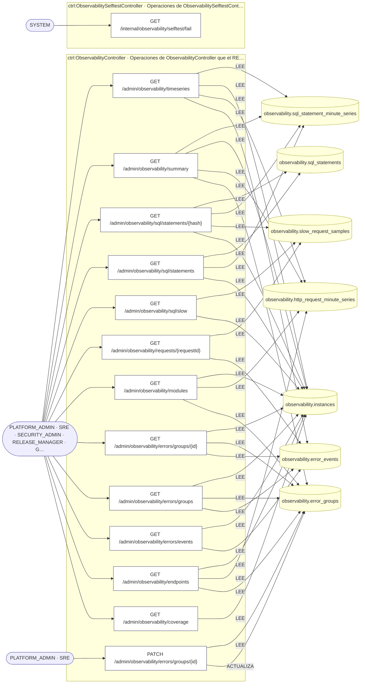

## Árbol de decisión por operación

Cada árbol se deriva del código del handler y de los métodos que invoca (hasta 4 niveles). Una rama que no decide, no escribe y no falla se poda. Los accesos y los efectos consecutivos se agrupan en un solo nodo.

### Operaciones con decisiones propias

#### 1. GET /admin/observability/endpoints

Operaciones por tráfico, fallos y latencia

| HTTP | Código | Cuándo |
|---|---|---|
| 200 | — | Éxito |
| 401 | `UNAUTHENTICATED` | Hay una sesión válida (JWT) |
| 403 | `FORBIDDEN` | El rol está permitido; El tenant se resuelve y pertenece al actor |
| 429 | `RATE_LIMITED` | No se supera el límite de solicitudes |

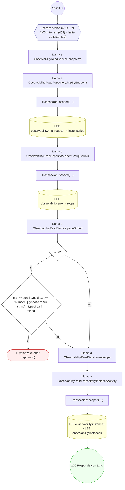

#### 2. GET /admin/observability/errors/events

Eventos de error (sin mensajes), paginados

| HTTP | Código | Cuándo |
|---|---|---|
| 200 | — | Éxito |
| 401 | `UNAUTHENTICATED` | Hay una sesión válida (JWT) |
| 403 | `FORBIDDEN` | El rol está permitido; El tenant se resuelve y pertenece al actor |
| 429 | `RATE_LIMITED` | No se supera el límite de solicitudes |

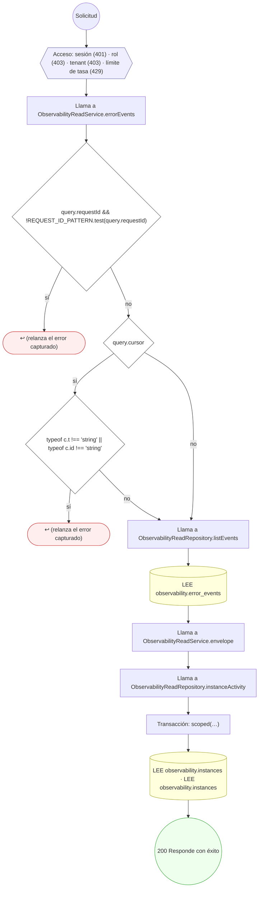

#### 3. GET /admin/observability/errors/groups

Grupos de errores (huella estable) con su actividad

| HTTP | Código | Cuándo |
|---|---|---|
| 200 | — | Éxito |
| 401 | `UNAUTHENTICATED` | Hay una sesión válida (JWT) |
| 403 | `FORBIDDEN` | El rol está permitido; El tenant se resuelve y pertenece al actor |
| 429 | `RATE_LIMITED` | No se supera el límite de solicitudes |

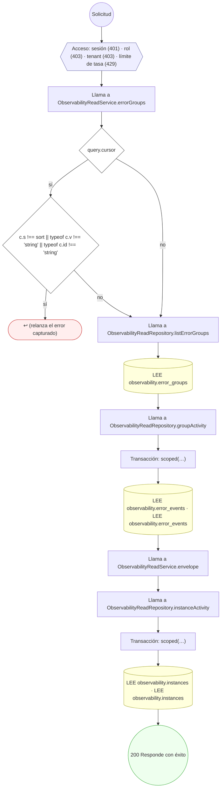

#### 4. GET /admin/observability/errors/groups/{id}

Un grupo de errores con sus eventos recientes

| HTTP | Código | Cuándo |
|---|---|---|
| 200 | — | Éxito |
| 400 | `VALIDATION_FAILED` | Los parámetros de ruta son UUID válidos |
| 401 | `UNAUTHENTICATED` | Hay una sesión válida (JWT) |
| 403 | `FORBIDDEN` | El rol está permitido; El tenant se resuelve y pertenece al actor |
| 429 | `RATE_LIMITED` | No se supera el límite de solicitudes |

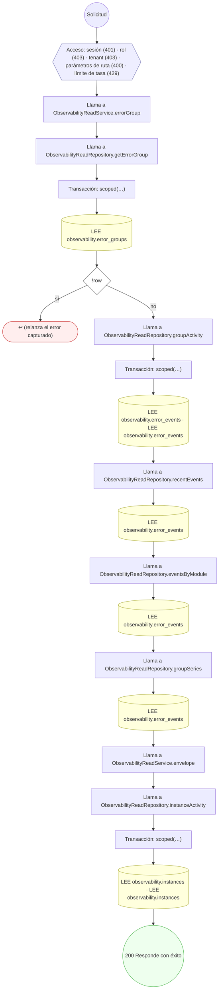

#### 5. PATCH /admin/observability/errors/groups/{id}

Marcar un grupo como visto, resuelto o ignorado (con motivo y versión)

| HTTP | Código | Cuándo |
|---|---|---|
| 200 | — | Éxito |
| 400 | `VALIDATION_FAILED` | Los parámetros de ruta son UUID válidos; El cuerpo cumple el DTO (sin propiedades extra) |
| 401 | `UNAUTHENTICATED` | Hay una sesión válida (JWT) |
| 403 | `FORBIDDEN` | El rol está permitido; El tenant se resuelve y pertenece al actor |
| 429 | `RATE_LIMITED` | No se supera el límite de solicitudes |
| 500 | `INTERNAL` | DomainException: {HttpStatus.UNPROCESSABLE_ENTITY} |

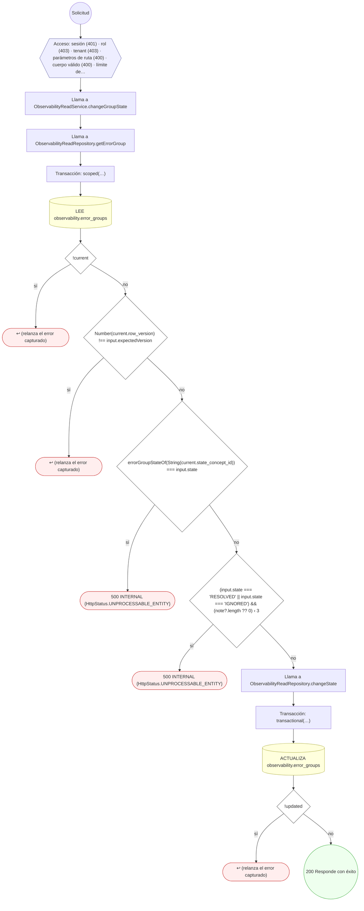

#### 6. GET /admin/observability/requests/{requestId}

Qué se guardó de una petición (errores y muestra lenta) por su requestId

| HTTP | Código | Cuándo |
|---|---|---|
| 200 | — | Éxito |
| 401 | `UNAUTHENTICATED` | Hay una sesión válida (JWT) |
| 403 | `FORBIDDEN` | El rol está permitido; El tenant se resuelve y pertenece al actor |
| 429 | `RATE_LIMITED` | No se supera el límite de solicitudes |

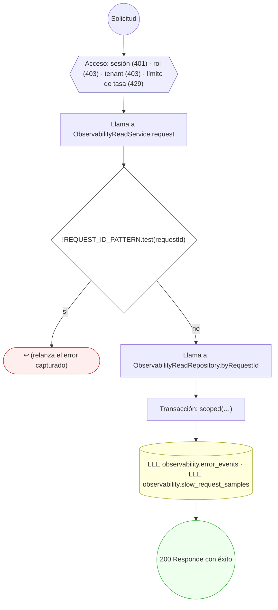

#### 7. GET /admin/observability/sql/slow

Peticiones lentas o con error muestreadas, con su SQL

| HTTP | Código | Cuándo |
|---|---|---|
| 200 | — | Éxito |
| 401 | `UNAUTHENTICATED` | Hay una sesión válida (JWT) |
| 403 | `FORBIDDEN` | El rol está permitido; El tenant se resuelve y pertenece al actor |
| 429 | `RATE_LIMITED` | No se supera el límite de solicitudes |

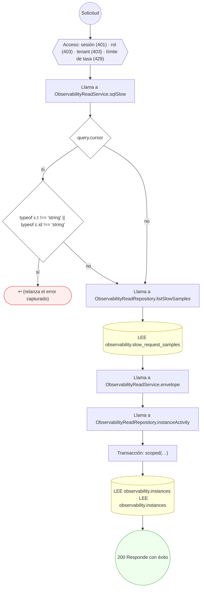

#### 8. GET /admin/observability/sql/statements

Consultas SQL por coste (huella, nunca parámetros)

| HTTP | Código | Cuándo |
|---|---|---|
| 200 | — | Éxito |
| 401 | `UNAUTHENTICATED` | Hay una sesión válida (JWT) |
| 403 | `FORBIDDEN` | El rol está permitido; El tenant se resuelve y pertenece al actor |
| 429 | `RATE_LIMITED` | No se supera el límite de solicitudes |

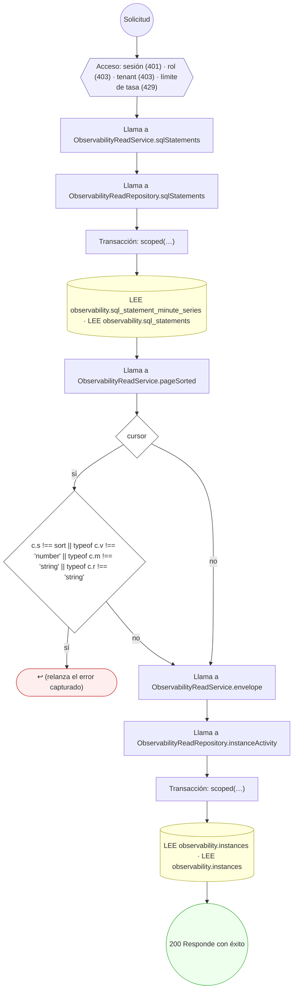

#### 9. GET /admin/observability/sql/statements/{hash}

Una consulta normalizada y quién la dispara

| HTTP | Código | Cuándo |
|---|---|---|
| 200 | — | Éxito |
| 401 | `UNAUTHENTICATED` | Hay una sesión válida (JWT) |
| 403 | `FORBIDDEN` | El rol está permitido; El tenant se resuelve y pertenece al actor |
| 429 | `RATE_LIMITED` | No se supera el límite de solicitudes |
| 500 | `INTERNAL` | DomainException: {HttpStatus.UNPROCESSABLE_ENTITY}; DomainException: {HttpStatus.NOT_FOUND} |

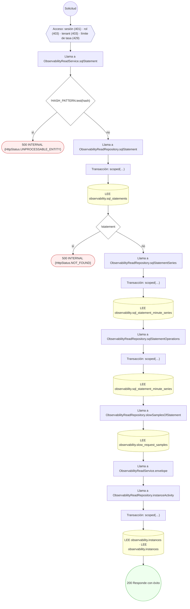

#### 10. GET /admin/observability/timeseries

Serie temporal de una métrica (un cubo sin fila es «sin dato»)

| HTTP | Código | Cuándo |
|---|---|---|
| 200 | — | Éxito |
| 400 | `VALIDATION_FAILED` | Están los parámetros de consulta obligatorios |
| 401 | `UNAUTHENTICATED` | Hay una sesión válida (JWT) |
| 403 | `FORBIDDEN` | El rol está permitido; El tenant se resuelve y pertenece al actor |
| 429 | `RATE_LIMITED` | No se supera el límite de solicitudes |
| 500 | `INTERNAL` | DomainException: {HttpStatus.UNPROCESSABLE_ENTITY} |

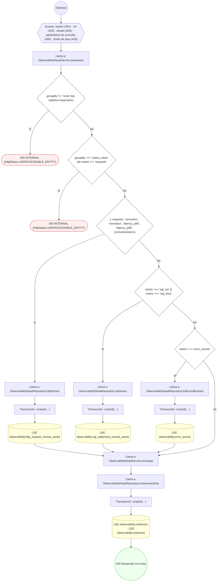

#### 11. GET /internal/observability/selftest/fail

| HTTP | Código | Cuándo |
|---|---|---|
| 401 | `UNAUTHENTICATED` | Hay una sesión válida (JWT) |
| 403 | `FORBIDDEN` | El rol está permitido; El tenant se resuelve y pertenece al actor |
| 404 | `NOT_FOUND` | NotFoundException |
| 429 | `RATE_LIMITED` | No se supera el límite de solicitudes |
| 500 | `INTERNAL` | TypeError: no se puede leer {String(holder.value.deep)}; Error: selftest: falla controlada |
| 500 | — | Éxito |

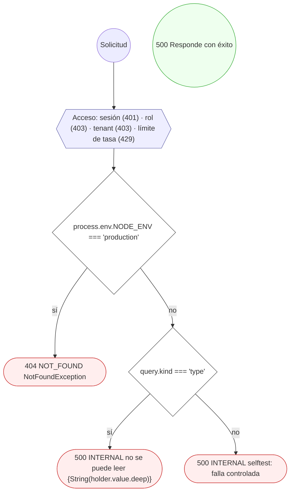

### Operaciones sin decisiones propias

Sólo comprueban el acceso y leen o escriben: no tienen ramas que dibujar. Su detalle está en la ficha de endpoints.

| Operación | Respuestas posibles | Tablas |
|---|---|---|
| GET /admin/observability/coverage | 200, 401, 403, 429 | 1 |
| GET /admin/observability/modules | 200, 401, 403, 429 | 3 |
| GET /admin/observability/summary | 200, 401, 403, 429 | 4 |
