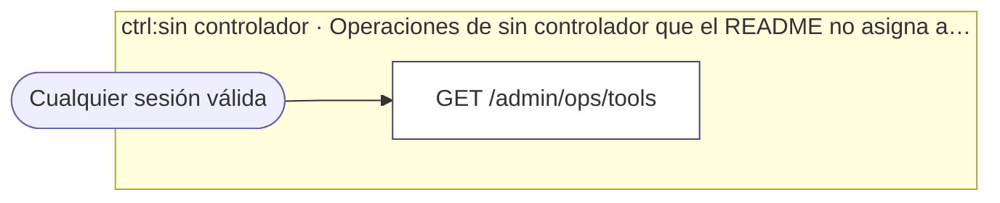

<!-- AUTOGENERADO por tools/inventario/flujos.mjs. No editar manualmente. -->

# Flujos del módulo `ops-console`

- **Procesos:** 1 · **Máquinas de estado:** 0
- **Operaciones:** 1 (0 con decisiones propias, 1 sin ellas)
- Inventario de endpoints del módulo: [ops-console](../endpoints/ops-console.md)

## Proceso: ops-console

- **Código:** `ops-console` · **Agrupación:** AGRUPACION_POR_CONTROLADOR · **Operaciones:** 1
- **Actores:** Cualquier sesión válida
- **Revisión:** AUTO_DETECTADA
- **Fuentes:** —

### Para qué sirve

_Sin fuente: ni el README del módulo ni el modelo lo describen._

### Etapas y operaciones

| Etapa | Descripción | Operación | Quién actúa | Riesgo | Tablas |
|---|---|---|---|---|---|
| `ctrl:sin controlador` | Operaciones de sin controlador que el README no asigna a un caso de uso | GET /admin/ops/tools | Cualquier sesión válida | BAJO | 0 |

### Diagrama — etapas `ctrl:sin controlador`

## Árbol de decisión por operación

Cada árbol se deriva del código del handler y de los métodos que invoca (hasta 4 niveles). Una rama que no decide, no escribe y no falla se poda. Los accesos y los efectos consecutivos se agrupan en un solo nodo.

### Operaciones sin decisiones propias

Sólo comprueban el acceso y leen o escriben: no tienen ramas que dibujar. Su detalle está en la ficha de endpoints.

| Operación | Respuestas posibles | Tablas |
|---|---|---|
| GET /admin/ops/tools | — | 0 |
