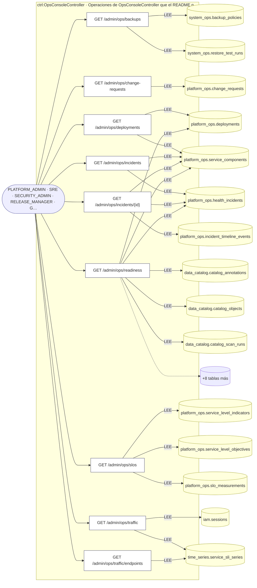
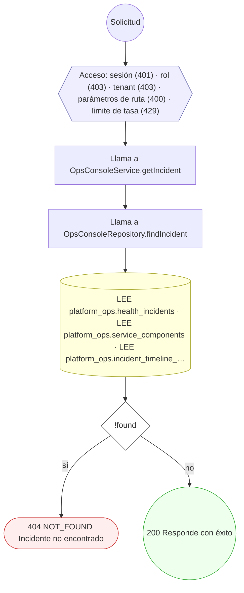
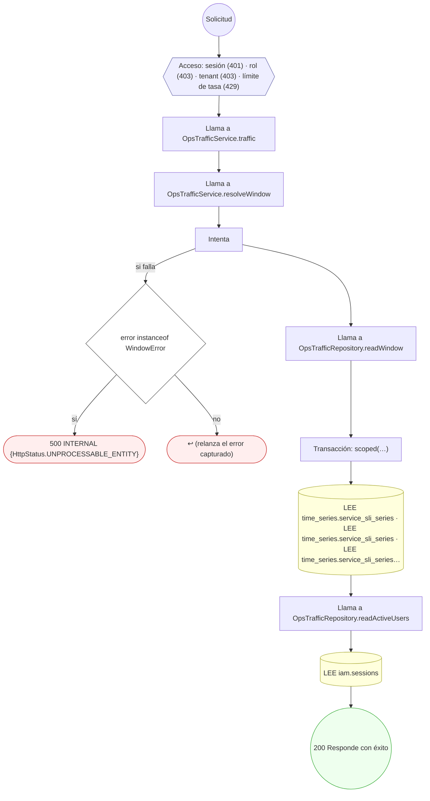
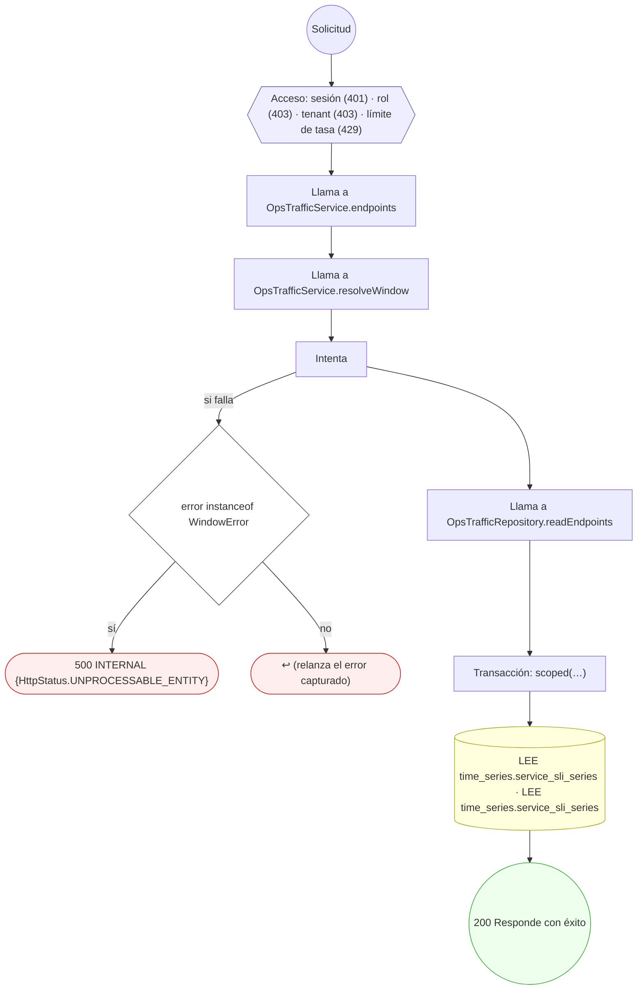

<!-- AUTOGENERADO por tools/inventario/flujos.mjs. No editar manualmente. -->

# Flujos del módulo `ops_console`

- **Procesos:** 1 · **Máquinas de estado:** 0
- **Operaciones:** 9 (3 con decisiones propias, 6 sin ellas)
- Inventario de endpoints del módulo: [ops_console](../endpoints/ops_console.md)

## Proceso: Operations console module

- **Código:** `ops_console` · **Agrupación:** AGRUPACION_POR_CONTROLADOR · **Operaciones:** 9
- **Actores:** GOVERNANCE_ADMIN · PLATFORM_ADMIN · RELEASE_MANAGER · SECURITY_ADMIN · SRE
- **Revisión:** AUTO_DETECTADA
- **Fuentes:** `src/modules/ops_console/README.md`

### Para qué sirve

Esta carpeta contiene las consultas de la consola global de operaciones: readiness, incidentes, despliegues, cambios, SLO y respaldos. Sus rutas son de sólo lectura y están reservadas a roles operativos de plataforma.

_Fuente: `src/modules/ops_console/README.md:3`_

### Etapas y operaciones

| Etapa | Descripción | Operación | Quién actúa | Riesgo | Tablas |
|---|---|---|---|---|---|
| `ctrl:OpsConsoleController` | Operaciones de OpsConsoleController que el README no asigna a un caso de uso | GET /admin/ops/backups | PLATFORM_ADMIN · SRE · SECURITY_ADMIN · RELEASE_MANAGER · GOVERNANCE_ADMIN | BAJO | 2 |
|  |  | GET /admin/ops/change-requests | PLATFORM_ADMIN · SRE · SECURITY_ADMIN · RELEASE_MANAGER · GOVERNANCE_ADMIN | BAJO | 1 |
|  |  | GET /admin/ops/deployments | PLATFORM_ADMIN · SRE · SECURITY_ADMIN · RELEASE_MANAGER · GOVERNANCE_ADMIN | BAJO | 2 |
|  |  | GET /admin/ops/incidents | PLATFORM_ADMIN · SRE · SECURITY_ADMIN · RELEASE_MANAGER · GOVERNANCE_ADMIN | BAJO | 2 |
|  |  | GET /admin/ops/incidents/{id} | PLATFORM_ADMIN · SRE · SECURITY_ADMIN · RELEASE_MANAGER · GOVERNANCE_ADMIN | BAJO | 3 |
|  |  | GET /admin/ops/readiness | PLATFORM_ADMIN · SRE · SECURITY_ADMIN · RELEASE_MANAGER · GOVERNANCE_ADMIN | BAJO | 14 |
|  |  | GET /admin/ops/slos | PLATFORM_ADMIN · SRE · SECURITY_ADMIN · RELEASE_MANAGER · GOVERNANCE_ADMIN | BAJO | 3 |
|  |  | GET /admin/ops/traffic | PLATFORM_ADMIN · SRE · SECURITY_ADMIN · RELEASE_MANAGER · GOVERNANCE_ADMIN | BAJO | 2 |
|  |  | GET /admin/ops/traffic/endpoints | PLATFORM_ADMIN · SRE · SECURITY_ADMIN · RELEASE_MANAGER · GOVERNANCE_ADMIN | BAJO | 1 |

### Diagrama — etapas `ctrl:OpsConsoleController`

## Árbol de decisión por operación

Cada árbol se deriva del código del handler y de los métodos que invoca (hasta 4 niveles). Una rama que no decide, no escribe y no falla se poda. Los accesos y los efectos consecutivos se agrupan en un solo nodo.

### Operaciones con decisiones propias

#### 1. GET /admin/ops/incidents/{id}

Incidente con su timeline

| HTTP | Código | Cuándo |
|---|---|---|
| 200 | — | Éxito |
| 400 | `VALIDATION_FAILED` | Los parámetros de ruta son UUID válidos |
| 401 | `UNAUTHENTICATED` | Hay una sesión válida (JWT) |
| 403 | `FORBIDDEN` | El rol está permitido; El tenant se resuelve y pertenece al actor |
| 404 | `NOT_FOUND` | ResourceNotFoundException: Incidente no encontrado |
| 429 | `RATE_LIMITED` | No se supera el límite de solicitudes |

#### 2. GET /admin/ops/traffic

Tráfico HTTP de la API: solicitudes, éxito, fallos, latencia y usuarios activos

| HTTP | Código | Cuándo |
|---|---|---|
| 200 | — | Éxito |
| 401 | `UNAUTHENTICATED` | Hay una sesión válida (JWT) |
| 403 | `FORBIDDEN` | El rol está permitido; El tenant se resuelve y pertenece al actor |
| 429 | `RATE_LIMITED` | No se supera el límite de solicitudes |
| 500 | `INTERNAL` | DomainException: {HttpStatus.UNPROCESSABLE_ENTITY} |

#### 3. GET /admin/ops/traffic/endpoints

Endpoints tocados en la ventana, por plantilla de ruta

| HTTP | Código | Cuándo |
|---|---|---|
| 200 | — | Éxito |
| 401 | `UNAUTHENTICATED` | Hay una sesión válida (JWT) |
| 403 | `FORBIDDEN` | El rol está permitido; El tenant se resuelve y pertenece al actor |
| 429 | `RATE_LIMITED` | No se supera el límite de solicitudes |
| 500 | `INTERNAL` | DomainException: {HttpStatus.UNPROCESSABLE_ENTITY} |

### Operaciones sin decisiones propias

Sólo comprueban el acceso y leen o escriben: no tienen ramas que dibujar. Su detalle está en la ficha de endpoints.

| Operación | Respuestas posibles | Tablas |
|---|---|---|
| GET /admin/ops/backups | 200, 401, 403, 429 | 2 |
| GET /admin/ops/change-requests | 200, 401, 403, 429 | 1 |
| GET /admin/ops/deployments | 200, 401, 403, 429 | 2 |
| GET /admin/ops/incidents | 200, 401, 403, 429 | 2 |
| GET /admin/ops/readiness | 200, 401, 403, 429 | 14 |
| GET /admin/ops/slos | 200, 401, 403, 429 | 3 |
