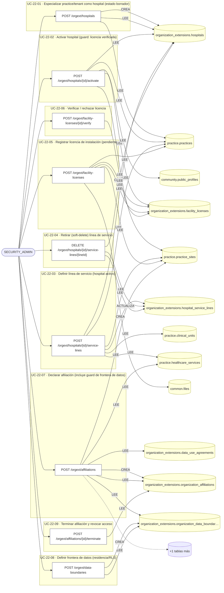
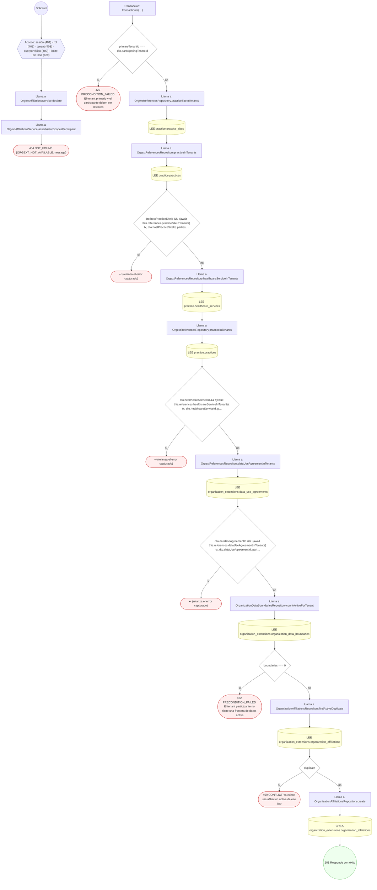
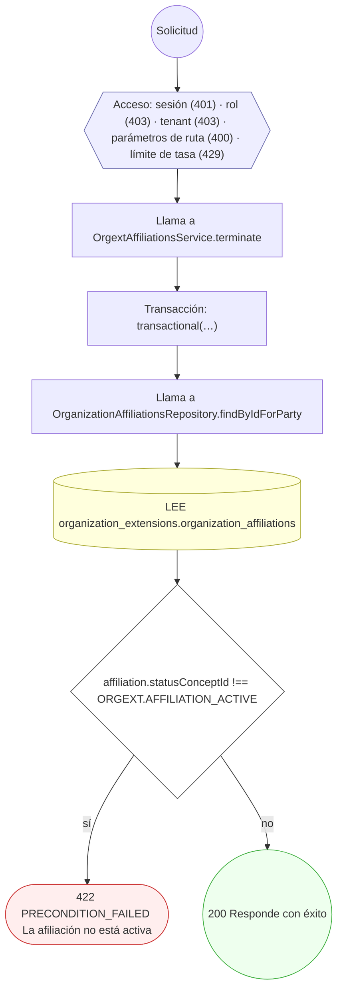
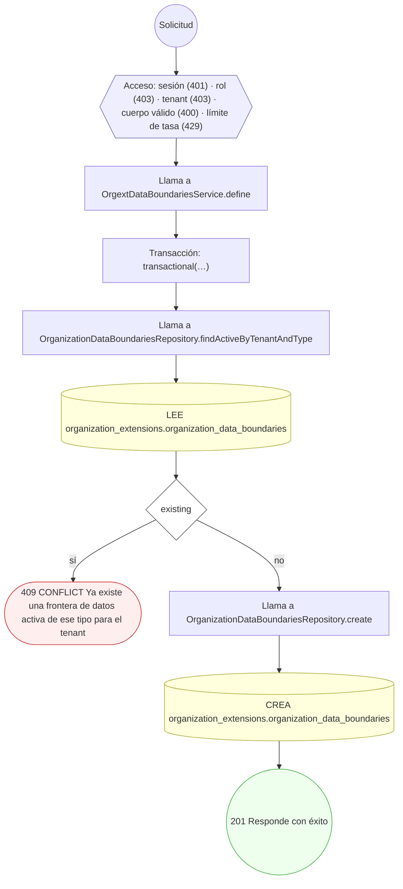
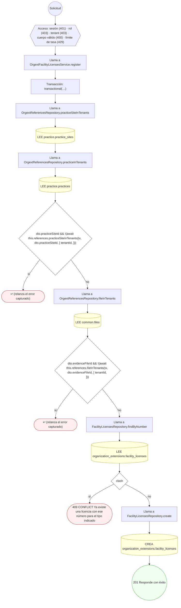
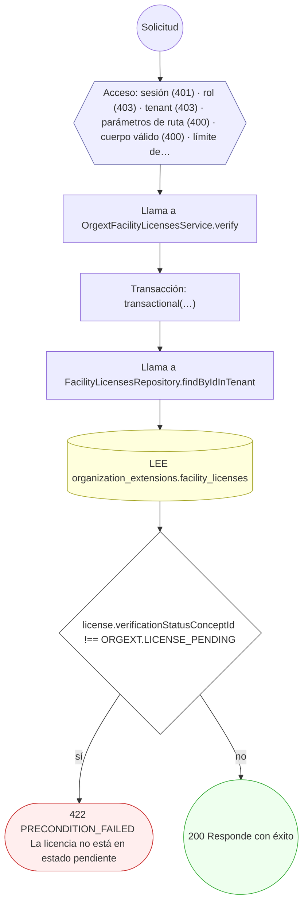
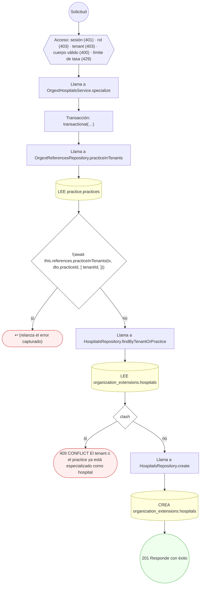
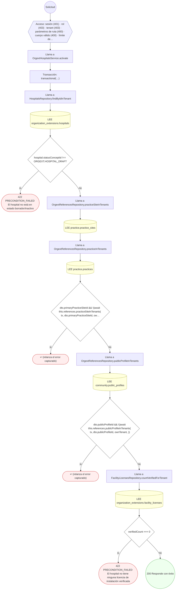
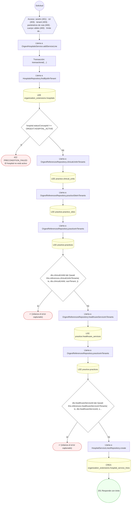
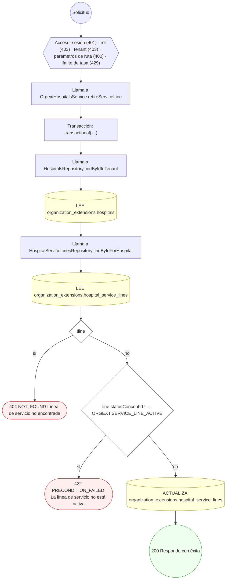

<!-- AUTOGENERADO por tools/inventario/flujos.mjs. No editar manualmente. -->

# Flujos del módulo `organization_extensions`

- **Procesos:** 1 · **Máquinas de estado:** 0
- **Operaciones:** 9 (9 con decisiones propias, 0 sin ellas)
- Inventario de endpoints del módulo: [organization_extensions](../endpoints/organization_extensions.md)

## Proceso: Módulo 22 — Organization Extensions (Healthcare Organization Specializations)

- **Código:** `organization_extensions` · **Agrupación:** CASO_DE_USO_README · **Operaciones:** 9
- **Actores:** SECURITY_ADMIN
- **Revisión:** AUTO_DETECTADA
- **Fuentes:** `src/modules/organization_extensions/README.md`

### Para qué sirve

Especializa organizaciones del directorio como hospitales y gestiona sus líneas de servicio, licencias de instalación, afiliaciones entre organizaciones y fronteras de datos (residencia/RLS).

_Fuente: `src/modules/organization_extensions/README.md:3`_

### Etapas y operaciones

| Etapa | Descripción | Operación | Quién actúa | Riesgo | Tablas |
|---|---|---|---|---|---|
| `UC-22-01` | Especializar practice/tenant como hospital (estado borrador) | POST /orgext/hospitals | SECURITY_ADMIN | MEDIO | 3 |
| `UC-22-02` | Activar hospital (guard: licencia verificada) | POST /orgext/hospitals/{id}/activate | SECURITY_ADMIN | BAJO | 5 |
| `UC-22-03` | Definir línea de servicio (hospital activo) | POST /orgext/hospitals/{id}/service-lines | SECURITY_ADMIN | MEDIO | 6 |
| `UC-22-04` | Retirar (soft-delete) línea de servicio | DELETE /orgext/hospitals/{id}/service-lines/{lineId} | SECURITY_ADMIN | MEDIO | 3 |
| `UC-22-05` | Registrar licencia de instalación (pendiente) | POST /orgext/facility-licenses | SECURITY_ADMIN | MEDIO | 5 |
| `UC-22-06` | Verificar / rechazar licencia | POST /orgext/facility-licenses/{id}/verify | SECURITY_ADMIN | BAJO | 1 |
| `UC-22-07` | Declarar afiliación (incluye guard de frontera de datos) | POST /orgext/affiliations | SECURITY_ADMIN | MEDIO | 7 |
| `UC-22-08` | Definir frontera de datos (residencia/RLS) | POST /orgext/data-boundaries | SECURITY_ADMIN | MEDIO | 2 |
| `UC-22-09` | Terminar afiliación y revocar acceso | POST /orgext/affiliations/{id}/terminate | SECURITY_ADMIN | BAJO | 1 |

### Diagrama — etapas `UC-22-01`, `UC-22-02`, `UC-22-03`…

## Árbol de decisión por operación

Cada árbol se deriva del código del handler y de los métodos que invoca (hasta 4 niveles). Una rama que no decide, no escribe y no falla se poda. Los accesos y los efectos consecutivos se agrupan en un solo nodo.

### Operaciones con decisiones propias

#### 1. POST /orgext/affiliations

Declarar afiliación entre organizaciones

| HTTP | Código | Cuándo |
|---|---|---|
| 201 | — | Éxito |
| 400 | `VALIDATION_FAILED` | El cuerpo cumple el DTO (sin propiedades extra) |
| 401 | `UNAUTHENTICATED` | Hay una sesión válida (JWT) |
| 403 | `FORBIDDEN` | El rol está permitido; El tenant se resuelve y pertenece al actor |
| 404 | `NOT_FOUND` | ResourceNotFoundException: {ORGEXT_NOT_AVAILABLE.message} |
| 409 | `CONFLICT` | ConflictException: Ya existe una afiliación activa de ese tipo |
| 422 | `PRECONDITION_FAILED` | PreconditionFailedException: El tenant primario y el participante deben ser distintos; PreconditionFailedException: El tenant participante no tiene una frontera de datos activa |
| 429 | `RATE_LIMITED` | No se supera el límite de solicitudes |

#### 2. POST /orgext/affiliations/{id}/terminate

Terminar afiliación y revocar acceso

| HTTP | Código | Cuándo |
|---|---|---|
| 200 | — | Éxito |
| 400 | `VALIDATION_FAILED` | Los parámetros de ruta son UUID válidos |
| 401 | `UNAUTHENTICATED` | Hay una sesión válida (JWT) |
| 403 | `FORBIDDEN` | El rol está permitido; El tenant se resuelve y pertenece al actor |
| 422 | `PRECONDITION_FAILED` | PreconditionFailedException: La afiliación no está activa |
| 429 | `RATE_LIMITED` | No se supera el límite de solicitudes |

#### 3. POST /orgext/data-boundaries

Definir frontera de datos (residencia/RLS)

| HTTP | Código | Cuándo |
|---|---|---|
| 201 | — | Éxito |
| 400 | `VALIDATION_FAILED` | El cuerpo cumple el DTO (sin propiedades extra) |
| 401 | `UNAUTHENTICATED` | Hay una sesión válida (JWT) |
| 403 | `FORBIDDEN` | El rol está permitido; El tenant se resuelve y pertenece al actor |
| 409 | `CONFLICT` | ConflictException: Ya existe una frontera de datos activa de ese tipo para el tenant |
| 429 | `RATE_LIMITED` | No se supera el límite de solicitudes |

#### 4. POST /orgext/facility-licenses

Registrar licencia de instalación

| HTTP | Código | Cuándo |
|---|---|---|
| 201 | — | Éxito |
| 400 | `VALIDATION_FAILED` | El cuerpo cumple el DTO (sin propiedades extra) |
| 401 | `UNAUTHENTICATED` | Hay una sesión válida (JWT) |
| 403 | `FORBIDDEN` | El rol está permitido; El tenant se resuelve y pertenece al actor |
| 409 | `CONFLICT` | ConflictException: Ya existe una licencia con ese número para el tipo indicado |
| 429 | `RATE_LIMITED` | No se supera el límite de solicitudes |

#### 5. POST /orgext/facility-licenses/{id}/verify

Verificar / rechazar licencia

| HTTP | Código | Cuándo |
|---|---|---|
| 200 | — | Éxito |
| 400 | `VALIDATION_FAILED` | Los parámetros de ruta son UUID válidos; El cuerpo cumple el DTO (sin propiedades extra) |
| 401 | `UNAUTHENTICATED` | Hay una sesión válida (JWT) |
| 403 | `FORBIDDEN` | El rol está permitido; El tenant se resuelve y pertenece al actor |
| 422 | `PRECONDITION_FAILED` | PreconditionFailedException: La licencia no está en estado pendiente |
| 429 | `RATE_LIMITED` | No se supera el límite de solicitudes |

#### 6. POST /orgext/hospitals

Especializar practice/tenant como hospital

| HTTP | Código | Cuándo |
|---|---|---|
| 201 | — | Éxito |
| 400 | `VALIDATION_FAILED` | El cuerpo cumple el DTO (sin propiedades extra) |
| 401 | `UNAUTHENTICATED` | Hay una sesión válida (JWT) |
| 403 | `FORBIDDEN` | El rol está permitido; El tenant se resuelve y pertenece al actor |
| 409 | `CONFLICT` | ConflictException: El tenant o el practice ya está especializado como hospital |
| 429 | `RATE_LIMITED` | No se supera el límite de solicitudes |

#### 7. POST /orgext/hospitals/{id}/activate

Activar hospital y publicar perfil

| HTTP | Código | Cuándo |
|---|---|---|
| 200 | — | Éxito |
| 400 | `VALIDATION_FAILED` | Los parámetros de ruta son UUID válidos; El cuerpo cumple el DTO (sin propiedades extra) |
| 401 | `UNAUTHENTICATED` | Hay una sesión válida (JWT) |
| 403 | `FORBIDDEN` | El rol está permitido; El tenant se resuelve y pertenece al actor |
| 422 | `PRECONDITION_FAILED` | PreconditionFailedException: El hospital no está en estado borrador/inactivo; PreconditionFailedException: El hospital no tiene ninguna licencia de instalación verificada |
| 429 | `RATE_LIMITED` | No se supera el límite de solicitudes |

#### 8. POST /orgext/hospitals/{id}/service-lines

Definir línea de servicio hospitalaria

| HTTP | Código | Cuándo |
|---|---|---|
| 201 | — | Éxito |
| 400 | `VALIDATION_FAILED` | Los parámetros de ruta son UUID válidos; El cuerpo cumple el DTO (sin propiedades extra) |
| 401 | `UNAUTHENTICATED` | Hay una sesión válida (JWT) |
| 403 | `FORBIDDEN` | El rol está permitido; El tenant se resuelve y pertenece al actor |
| 422 | `PRECONDITION_FAILED` | PreconditionFailedException: El hospital no está activo |
| 429 | `RATE_LIMITED` | No se supera el límite de solicitudes |

#### 9. DELETE /orgext/hospitals/{id}/service-lines/{lineId}

Retirar (soft-delete) línea de servicio

| HTTP | Código | Cuándo |
|---|---|---|
| 200 | — | Éxito |
| 400 | `VALIDATION_FAILED` | Los parámetros de ruta son UUID válidos |
| 401 | `UNAUTHENTICATED` | Hay una sesión válida (JWT) |
| 403 | `FORBIDDEN` | El rol está permitido; El tenant se resuelve y pertenece al actor |
| 404 | `NOT_FOUND` | ResourceNotFoundException: Línea de servicio no encontrada |
| 422 | `PRECONDITION_FAILED` | PreconditionFailedException: La línea de servicio no está activa |
| 429 | `RATE_LIMITED` | No se supera el límite de solicitudes |

