<!-- AUTOGENERADO por tools/inventario/flujos.mjs. No editar manualmente. -->

# Flujos del módulo `payments`

- **Procesos:** 1 · **Máquinas de estado:** 1
- **Operaciones:** 18 (17 con decisiones propias, 1 sin ellas)
- Inventario de endpoints del módulo: [payments](../endpoints/payments.md)

## Proceso: Módulo 42 — Payments

- **Código:** `payments` · **Agrupación:** MIXTO · **Operaciones:** 18
- **Actores:** CASHIER · PAYMENTS_ADMIN · Público (sin sesión)
- **Revisión:** AUTO_DETECTADA
- **Fuentes:** `src/modules/payments/README.md`

### Para qué sirve

Cobros con pasarela: intención de pago, checkout, procesamiento contra el gateway, reembolsos, anulaciones y las operaciones de cierre (tarifas, liquidaciones, payouts y conciliación).

_Fuente: `src/modules/payments/README.md:3`_

### Flujo general declarado en el README

```text
intent (pending)
  ├─ fx-lock            -> importe re-expresado en la moneda destino
  ├─ risk-assessment    -> approve | review | decline (decline => intent failed)
  ├─ splits             -> reparto entre cuentas conectadas
  └─ transactions       -> authorize (processing) | capture/sale (succeeded)
        ├─ callback     -> aplica el resultado del proveedor (idempotente)
        ├─ status-inquiry -> confirma cuando el callback no llegó
        ├─ refunds      -> solo sobre capturada/liquidada, acotado a lo cobrado
        └─ cancellation -> solo si no está liquidada
settlement import -> transacciones a `settled`
payouts           -> importe derivado de los ítems, neto de comisiones
reconciliation    -> registros del proveedor vs ledger; descuadres abren excepción
```

_Fuente: `src/modules/payments/README.md:247`_

### Etapas y operaciones

| Etapa | Descripción | Operación | Quién actúa | Riesgo | Tablas |
|---|---|---|---|---|---|
| `UC-42-01` | Crear intención de pago idempotente | POST /payments/intents | PAYMENTS_ADMIN · CASHIER | MEDIO | 2 |
| `UC-42-02` | Abrir sesión de checkout con contexto de cajero | POST /payments/checkout-sessions | PAYMENTS_ADMIN · CASHIER | MEDIO | 5 |
| `UC-42-03` | Bloquear tipo de cambio | POST /payments/intents/{id}/fx-lock | PAYMENTS_ADMIN | MEDIO | 4 |
| `UC-42-04` | Evaluar riesgo y 3-D Secure | POST /payments/intents/{id}/risk-assessment | PAYMENTS_ADMIN | MEDIO | 3 |
| `UC-42-05` | Procesar transacción (authorize/capture/sale) | POST /payments/intents/{id}/transactions | PAYMENTS_ADMIN · CASHIER | MEDIO | 7 |
| `UC-42-06` | Recibir callback del gateway (idempotente) | POST /payments/callbacks/{callbackPath} | Público (sin sesión) | ALTO | 7 |
| `UC-42-07` | Consulta independiente de estado | POST /payments/transactions/{id}/status-inquiry | PAYMENTS_ADMIN | BAJO | 1 |
| `UC-42-08` | Reembolso total o parcial | POST /payments/transactions/{id}/refunds | PAYMENTS_ADMIN | MEDIO | 3 |
| `UC-42-09` | Solicitar anulación | POST /payments/transactions/{id}/cancellation-requests | PAYMENTS_ADMIN · CASHIER | MEDIO | 2 |
| `UC-42-10` | Publicar versión del tarifario | POST /payments/fee-schedules | PAYMENTS_ADMIN | MEDIO | 3 |
| `UC-42-11` | Reparto multi-party | POST /payments/intents/{id}/splits | PAYMENTS_ADMIN | MEDIO | 3 |
| `UC-42-12` | Importar liquidación del gateway | POST /payments/settlements/import | PAYMENTS_ADMIN | MEDIO | 5 |
| `UC-42-13` | Ejecutar payout a cuenta conectada | POST /payments/payouts | PAYMENTS_ADMIN | MEDIO | 2 |
| `UC-42-14` | Conciliar gateway vs ledger | POST /payments/reconciliation-runs | PAYMENTS_ADMIN | MEDIO | 5 |
| `ctrl:PaymentsGatewayDispatchesController` | Operaciones de PaymentsGatewayDispatchesController que el README no asigna a un caso de uso | POST /payments/gateway-dispatches/{intentId}/close | PAYMENTS_ADMIN | BAJO | 1 |
|  |  | POST /payments/gateway-dispatches/{intentId}/reconcile | PAYMENTS_ADMIN | BAJO | 5 |
|  |  | GET /payments/gateway-dispatches/pending-reconciliation | PAYMENTS_ADMIN | BAJO | 1 |
| `ctrl:PaymentsGatewayWebhooksController` | Operaciones de PaymentsGatewayWebhooksController que el README no asigna a un caso de uso | POST /payments/gateway-webhooks | Público (sin sesión) | ALTO | 8 |

### Diagrama — etapas `UC-42-01`, `UC-42-02`, `UC-42-03`…

```mermaid
flowchart LR
  a2(["PAYMENTS_ADMIN · CASHIER"]):::actor
  a9(["PAYMENTS_ADMIN"]):::actor
  a17(["Público (sin sesión)"]):::actor
  t3[("payments.payment_intents")]:::tabla
  t5[("payments.cashier_payment_contexts")]:::tabla
  t6[("payments.payment_checkout_sessions")]:::tabla
  t7[("payments.payment_debts")]:::tabla
  t10[("payments.fx_rate_locks")]:::tabla
  t12[("payments.risk_assessments")]:::tabla
  t14[("payments.payment_transactions")]:::tabla
  t18[("payments.payment_webhook_events")]:::tabla
  t22[("payments.refunds")]:::tabla
  t24[("payments.payment_cancellation_requests")]:::tabla
  t26[("payments.fee_schedules")]:::tabla
  t28[("payments.payment_splits")]:::tabla
  t30[("payments.gateway_settlements")]:::tabla
  t31[("payments.settlement_lines")]:::tabla
  t33[("payments.payout_items")]:::tabla
  t34[("payments.payouts")]:::tabla
  t36[("payments.provider_reconciliation_records")]:::tabla
  t37[("payments.reconciliation_exceptions")]:::tabla
  t38[("payments.reconciliation_runs")]:::tabla
  subgraph s0["UC-42-01 · Crear intención de pago idempotente"]
    o1["POST /payments/intents"]:::op
  end
  subgraph s1["UC-42-02 · Abrir sesión de checkout con contexto de cajero"]
    o4["POST /payments/checkout-sessions"]:::op
  end
  subgraph s2["UC-42-03 · Bloquear tipo de cambio"]
    o8["POST /payments/intents/{id}/fx-lock"]:::op
  end
  subgraph s3["UC-42-04 · Evaluar riesgo y 3-D Secure"]
    o11["POST /payments/intents/{id}/risk-assessment"]:::op
  end
  t15[("+1 tablas más")]
  subgraph s4["UC-42-05 · Procesar transacción (authorize/capture/sale)"]
    o13["POST /payments/intents/{id}/transactions"]:::op
  end
  t19[("+1 tablas más")]
  subgraph s5["UC-42-06 · Recibir callback del gateway (idempotente)"]
    o16["POST /payments/callbacks/{callbackPath}"]:::op
  end
  subgraph s6["UC-42-07 · Consulta independiente de estado"]
    o20["POST /payments/transactions/{id}/status-inquiry"]:::op
  end
  subgraph s7["UC-42-08 · Reembolso total o parcial"]
    o21["POST /payments/transactions/{id}/refunds"]:::op
  end
  subgraph s8["UC-42-09 · Solicitar anulación"]
    o23["POST /payments/transactions/{id}/cancellation-requests"]:::op
  end
  subgraph s9["UC-42-10 · Publicar versión del tarifario"]
    o25["POST /payments/fee-schedules"]:::op
  end
  subgraph s10["UC-42-11 · Reparto multi-party"]
    o27["POST /payments/intents/{id}/splits"]:::op
  end
  subgraph s11["UC-42-12 · Importar liquidación del gateway"]
    o29["POST /payments/settlements/import"]:::op
  end
  subgraph s12["UC-42-13 · Ejecutar payout a cuenta conectada"]
    o32["POST /payments/payouts"]:::op
  end
  subgraph s13["UC-42-14 · Conciliar gateway vs ledger"]
    o35["POST /payments/reconciliation-runs"]:::op
  end
  subgraph s14["ctrl:PaymentsGatewayDispatchesController · Operaciones de PaymentsGatewayDispat…"]
    o39["POST /payments/gateway-dispatches/{intentId}/close"]:::op
    o40["POST /payments/gateway-dispatches/{intentId}/reconcile"]:::op
    o41["GET /payments/gateway-dispatches/pending-reconciliation"]:::op
  end
  t43[("+2 tablas más")]
  subgraph s15["ctrl:PaymentsGatewayWebhooksController · Operaciones de PaymentsGatewayWebhooks…"]
    o42["POST /payments/gateway-webhooks"]:::op
  end
  a2 --> o1
  o1 -->|"CREA"| t3
  o1 -->|"LEE"| t3
  a2 --> o4
  o4 -->|"CREA"| t5
  o4 -->|"CREA"| t6
  o4 -->|"ACTUALIZA"| t7
  o4 -->|"LEE"| t7
  o4 -->|"LEE"| t3
  a9 --> o8
  o8 -->|"CREA"| t10
  o8 -->|"LEE"| t10
  o8 -->|"ACTUALIZA"| t3
  o8 -->|"LEE"| t3
  a9 --> o11
  o11 -->|"ACTUALIZA"| t3
  o11 -->|"LEE"| t3
  o11 -->|"CREA"| t12
  a2 --> o13
  o13 -->|"LEE"| t6
  o13 -->|"LEE"| t7
  o13 -->|"ACTUALIZA"| t3
  o13 -->|"LEE"| t3
  o13 -->|"CREA"| t14
  o13 -->|"LEE"| t14
  o13 -.-> t15
  a17 --> o16
  o16 -->|"ACTUALIZA"| t3
  o16 -->|"LEE"| t3
  o16 -->|"ACTUALIZA"| t14
  o16 -->|"LEE"| t14
  o16 -->|"CREA"| t18
  o16 -->|"LEE"| t18
  o16 -.-> t19
  a9 --> o20
  o20 -->|"LEE"| t14
  a9 --> o21
  o21 -->|"LEE"| t14
  o21 -->|"CREA"| t22
  o21 -->|"LEE"| t22
  a2 --> o23
  o23 -->|"CREA"| t24
  o23 -->|"LEE"| t14
  a9 --> o25
  o25 -->|"ACTUALIZA"| t26
  o25 -->|"CREA"| t26
  o25 -->|"LEE"| t26
  a9 --> o27
  o27 -->|"LEE"| t3
  o27 -->|"CREA"| t28
  o27 -->|"LEE"| t28
  a9 --> o29
  o29 -->|"CREA"| t30
  o29 -->|"LEE"| t30
  o29 -->|"ACTUALIZA"| t14
  o29 -->|"LEE"| t14
  o29 -->|"CREA"| t31
  a9 --> o32
  o32 -->|"CREA"| t33
  o32 -->|"CREA"| t34
  a9 --> o35
  o35 -->|"LEE"| t14
  o35 -->|"CREA"| t36
  o35 -->|"CREA"| t37
  o35 -->|"ACTUALIZA"| t38
  o35 -->|"CREA"| t38
  a9 --> o39
  o39 -->|"LEE"| t3
  a9 --> o40
  o40 -->|"LEE"| t6
  o40 -->|"LEE"| t7
  o40 -->|"LEE"| t3
  o40 -->|"LEE"| t14
  o40 -->|"LEE"| t12
  a9 --> o41
  o41 -->|"LEE"| t3
  a17 --> o42
  o42 -->|"ACTUALIZA"| t6
  o42 -->|"LEE"| t6
  o42 -->|"ACTUALIZA"| t7
  o42 -->|"LEE"| t7
  o42 -->|"ACTUALIZA"| t3
  o42 -->|"LEE"| t3
  o42 -.-> t43
  classDef op fill:#fff,stroke:#446
  classDef actor fill:#eef,stroke:#66a
  classDef tabla fill:#ffd,stroke:#aa3
  classDef evento fill:#efe,stroke:#3a3
```

## Máquinas de estado

### Máquina de estados `TRANSITIONS`

Declarada en `src/modules/payments/services/payment-callback-machine.ts:43`. Los estados llevan el nombre del identificador del código; no se resuelven al catálogo de conceptos.

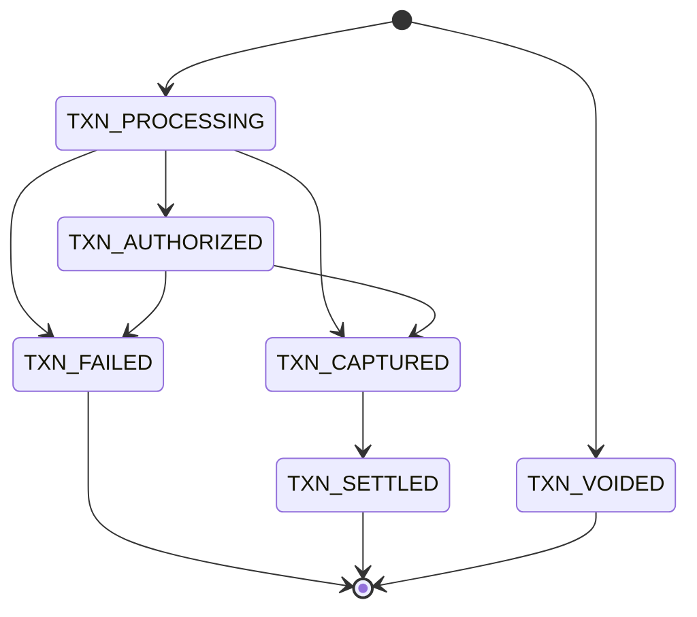

**Operaciones que ejercen esta máquina** _(POR_REFERENCIA: el handler alcanza un método que valida contra la tabla; «sin destino nombrado» significa que el estado de destino llega por el cuerpo de la petición)_:

| Operación | Estados de destino que nombra | A través de |
|---|---|---|
| PATCH /insurance-campaigns/{id}/status | sin destino nombrado | InsuranceCampaignsController.changeStatus → InsuranceCampaignsService.changeStatus |
| PATCH /insurance/campaigns/{id}/status | sin destino nombrado | InsuranceCampaignsController.changeStatus → InsuranceCampaignsService.changeStatus |
| POST /payments/callbacks/{callbackPath} | sin destino nombrado | PaymentsOperationsController.applyCallback → PaymentsTransactionsService.applyCallback |

## Árbol de decisión por operación

Cada árbol se deriva del código del handler y de los métodos que invoca (hasta 4 niveles). Una rama que no decide, no escribe y no falla se poda. Los accesos y los efectos consecutivos se agrupan en un solo nodo.

### Operaciones con decisiones propias

#### 1. POST /payments/callbacks/{callbackPath}

Recibir el callback/webhook del gateway (idempotente)

| HTTP | Código | Cuándo |
|---|---|---|
| 200 | — | Éxito |
| 400 | `VALIDATION_FAILED` | El cuerpo cumple el DTO (sin propiedades extra) |
| 401 | `UNAUTHENTICATED` | Hay una sesión válida (JWT); UnauthorizedException: Firma del webhook inválida; UnauthorizedException: Callback no autorizado para este endpoint |
| 404 | `NOT_FOUND` | ResourceNotFoundException: No hay transacción para la referencia informada |
| 429 | `RATE_LIMITED` | No se supera el límite de solicitudes |

```mermaid
flowchart TD
  n1(("Solicitud")):::inicio
  n2{{"Acceso: sesión (401) · cuerpo válido (400) · límite de tasa (429)"}}:::acceso
  n1 --> n2
  n3["Llama a PaymentsTransactionsService.applyCallback"]:::llamada
  n2 --> n3
  n4["Transacción: transactional(…)"]:::transaccion
  n3 --> n4
  n5["Llama a PaymentTransactionsRepository.findByGatewayRef"]:::llamada
  n4 --> n5
  n6[("LEE payments.payment_transactions")]:::efecto
  n5 --> n6
  n7{"!transaction"}:::decision
  n6 --> n7
  n8(["404 NOT_FOUND No hay transacción para la referencia informada"]):::error
  n7 -->|"sí"| n8
  n9{"!signature || !secrets.some((secret) =› verifySignature(secret, signedBody, signature), )"}:::decision
  n7 -->|"no"| n9
  n10(["401 UNAUTHENTICATED Firma del webhook inválida"]):::error
  n9 -->|"sí"| n10
  n11["Llama a PaymentTransactionsRepository.findCallbackEndpoints"]:::llamada
  n9 -->|"no"| n11
  n12[("LEE payments.provider_callback_endpoints")]:::efecto
  n11 --> n12
  n13{"!endpointDecision.allowed"}:::decision
  n12 --> n13
  n14(["401 UNAUTHENTICATED Callback no autorizado para este endpoint"]):::error
  n13 -->|"sí"| n14
  n15["Llama a PaymentTransactionsRepository.findWebhookEventByRef"]:::llamada
  n13 -->|"no"| n15
  n16[("LEE payments.payment_webhook_events")]:::efecto
  n15 --> n16
  n17{"!archived"}:::decision
  n16 --> n17
  n18["Llama a PaymentTransactionsRepository.recordWebhookEvent"]:::llamada
  n17 -->|"sí"| n18
  n19[("CREA payments.payment_webhook_events")]:::efecto
  n18 --> n19
  n20[("ACTUALIZA payments.payment_transactions")]:::efecto
  n19 --> n20
  n17 -->|"no"| n20
  n21{"dto.authorizationCode"}:::decision
  n20 --> n21
  n22[("ACTUALIZA payments.payment_transactions")]:::efecto
  n21 -->|"sí"| n22
  n23[("ACTUALIZA payments.payment_transactions")]:::efecto
  n22 --> n23
  n21 -->|"no"| n23
  n24["Llama a PaymentIntentsRepository.findByIdForUpdate"]:::llamada
  n23 --> n24
  n25[("LEE payments.payment_intents")]:::efecto
  n24 --> n25
  n26{"intent"}:::decision
  n25 --> n26
  n27["Llama a PaymentsTransactionsService.intentCaptured"]:::llamada
  n26 -->|"sí"| n27
  n28["Llama a PaymentTransactionsRepository.findByIntent"]:::llamada
  n27 --> n28
  n29[("LEE payments.payment_transactions")]:::efecto
  n28 --> n29
  n30[("ACTUALIZA payments.payment_intents")]:::efecto
  n29 --> n30
  n31(("200 Responde con éxito")):::ok
  n30 --> n31
  n26 -->|"no"| n31
  classDef acceso fill:#eef,stroke:#66a
  classDef error fill:#fee,stroke:#c33
  classDef ok fill:#efe,stroke:#3a3
  classDef efecto fill:#ffd,stroke:#aa3
  classDef decision fill:#fff,stroke:#555
  classDef corte fill:#eee,stroke:#999,stroke-dasharray: 4
```

#### 2. POST /payments/checkout-sessions

Abrir una sesión de checkout con contexto de cajero

| HTTP | Código | Cuándo |
|---|---|---|
| 201 | — | Éxito |
| 400 | `VALIDATION_FAILED` | El cuerpo cumple el DTO (sin propiedades extra) |
| 401 | `UNAUTHENTICATED` | Hay una sesión válida (JWT) |
| 403 | `FORBIDDEN` | El rol está permitido; El tenant se resuelve y pertenece al actor |
| 404 | `NOT_FOUND` | ResourceNotFoundException: Deuda no encontrada; ResourceNotFoundException: Intención de pago no encontrada |
| 422 | `PRECONDITION_FAILED` | PreconditionFailedException: El tenantId del cuerpo no coincide con el tenant activo; PreconditionFailedException: La deuda ya tiene un checkout abierto; PreconditionFailedException: La deuda ya está saldada |
| 429 | `RATE_LIMITED` | No se supera el límite de solicitudes |

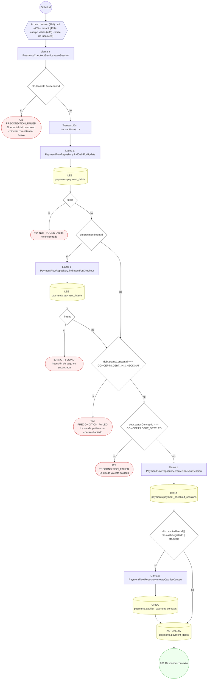

#### 3. POST /payments/fee-schedules

Publicar una versión del tarifario

| HTTP | Código | Cuándo |
|---|---|---|
| 201 | — | Éxito |
| 400 | `VALIDATION_FAILED` | El cuerpo cumple el DTO (sin propiedades extra) |
| 401 | `UNAUTHENTICATED` | Hay una sesión válida (JWT) |
| 403 | `FORBIDDEN` | El rol está permitido; El tenant se resuelve y pertenece al actor |
| 422 | `PRECONDITION_FAILED` | PreconditionFailedException: Una tarifa porcentual exige `percentage`; PreconditionFailedException: Una tarifa fija exige `fixedAmount` |
| 429 | `RATE_LIMITED` | No se supera el límite de solicitudes |


#### 4. POST /payments/gateway-dispatches/{intentId}/close

Cerrar a mano una reserva de despacho

| HTTP | Código | Cuándo |
|---|---|---|
| 201 | — | Éxito |
| 400 | `VALIDATION_FAILED` | Los parámetros de ruta son UUID válidos; El cuerpo cumple el DTO (sin propiedades extra) |
| 401 | `UNAUTHENTICATED` | Hay una sesión válida (JWT) |
| 403 | `FORBIDDEN` | El rol está permitido; El tenant se resuelve y pertenece al actor |
| 409 | `CONFLICT` | ConflictException: La intención no tiene una reserva de despacho que cerrar; ConflictException: La reserva de esta intención ya fue cerrada; ConflictException: La reserva puede seguir en vuelo: cerrarla ahora podría permitir un segundo cobro. Esperá a que requiera conciliación y no tenga actividad reciente |
| 429 | `RATE_LIMITED` | No se supera el límite de solicitudes |
| 500 | `INTERNAL` | PaymentsGatewayBusyException: {intentId} |

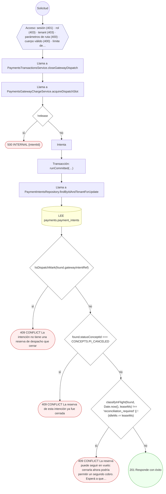

#### 5. POST /payments/gateway-dispatches/{intentId}/reconcile

Conciliar una reserva de despacho con la pasarela

| HTTP | Código | Cuándo |
|---|---|---|
| 201 | — | Éxito |
| 400 | `VALIDATION_FAILED` | Los parámetros de ruta son UUID válidos; El cuerpo cumple el DTO (sin propiedades extra) |
| 401 | `UNAUTHENTICATED` | Hay una sesión válida (JWT) |
| 403 | `FORBIDDEN` | El rol está permitido; El tenant se resuelve y pertenece al actor |
| 409 | `CONFLICT` | ConflictException: La pasarela no está activa: no hay despachos que conciliar; ConflictException: La intención ya fue cobrada; ConflictException: La intención no tiene un despacho pendiente de conciliar; ConflictException: La reserva de este cobro es más vieja que la memoria de la clave en la pasarela: reenviar podría crear un segundo cobro. Concilialo a mano contra la pasarela; ConflictException: La intención ya está en proceso y no tiene un cobro en la pasarela; ConflictException: La intención tiene una operación abierta en el gateway; ConflictException: El importe excede el saldo pendiente de la intención; ConflictException: La deuda ya tiene otro cobro en curso en la pasarela; ConflictException: El importe excede el saldo pendiente de la deuda |
| 422 | `PRECONDITION_FAILED` | PreconditionFailedException: La pasarela cobra en un solo paso: sólo admite la operación SALE; PreconditionFailedException: La intención está cancelada; PreconditionFailedException: La pasarela cobra el importe completo de la intención; PreconditionFailedException: La intención requiere evaluación de riesgo antes de cobrar; PreconditionFailedException: El motor de riesgo rechazó la intención; PreconditionFailedException: La evaluación de riesgo pide revisión humana antes de cobrar; PreconditionFailedException: El importe a procesar debe ser mayor que cero; PreconditionFailedException: La intención parece cobrar una deuda pero no se puede saber cuál: indicá sourceRefType "payment_debt" con el id de la deuda, o abrí una sesión de checkout; PreconditionFailedException: La deuda de la intención no existe; PreconditionFailedException: La deuda ya está saldada; PreconditionFailedException: La pasarela sólo cobra deudas en bolivianos (BOB) |
| 429 | `RATE_LIMITED` | No se supera el límite de solicitudes |

```mermaid
flowchart TD
  n1(("Solicitud")):::inicio
  n2{{"Acceso: sesión (401) · rol (403) · tenant (403) · parámetros de ruta (400) · cuerpo válido (400) · límite de…"}}:::acceso
  n1 --> n2
  n3["Llama a PaymentsTransactionsService.reconcileGatewayDispatch"]:::llamada
  n2 --> n3
  n4{"!this.gatewayCharge?.enabled"}:::decision
  n3 --> n4
  n5(["409 CONFLICT La pasarela no está activa: no hay despachos que conciliar"]):::error
  n4 -->|"sí"| n5
  n6["Llama a PaymentsTransactionsService.processViaGateway"]:::llamada
  n4 -->|"no"| n6
  n7["Intenta"]:::intento
  n6 --> n7
  n8["Llama a PaymentsTransactionsService.processViaGatewayWithSlot"]:::llamada
  n7 --> n8
  n9{"dto.operation !== 'SALE'"}:::decision
  n8 --> n9
  n10(["422 PRECONDITION_FAILED La pasarela cobra en un solo paso: sólo admite la operación SALE"]):::error
  n9 -->|"sí"| n10
  n11["Transacción: runCommitted(…)"]:::transaccion
  n9 -->|"no"| n11
  n12["Llama a PaymentIntentsRepository.findByIdAndTenantForUpdate"]:::llamada
  n11 --> n12
  n13[("LEE payments.payment_intents")]:::efecto
  n12 --> n13
  n14["Llama a PaymentsTransactionsService.assertIntentOpen"]:::llamada
  n13 --> n14
  n15{"intent.statusConceptId === CONCEPTS.PI_SUCCEEDED"}:::decision
  n14 --> n15
  n16(["409 CONFLICT La intención ya fue cobrada"]):::error
  n15 -->|"sí"| n16
  n17{"intent.statusConceptId === CONCEPTS.PI_CANCELED"}:::decision
  n15 -->|"no"| n17
  n18(["422 PRECONDITION_FAILED La intención está cancelada"]):::error
  n17 -->|"sí"| n18
  n19{"dto.amount && compareAmounts(dto.amount, found.amount) !== 0"}:::decision
  n17 -->|"no"| n19
  n20(["422 PRECONDITION_FAILED La pasarela cobra el importe completo de la intención"]):::error
  n19 -->|"sí"| n20
  n21{"mode === 'reconcile' && !isDispatchMark(found.gatewayIntentRef)"}:::decision
  n19 -->|"no"| n21
  n22(["409 CONFLICT La intención no tiene un despacho pendiente de conciliar"]):::error
  n21 -->|"sí"| n22
  n23{"isDispatchMark(found.gatewayIntentRef) && !canResendWithSameKey(found.gatewayIntentRef, Date.now())"}:::decision
  n21 -->|"no"| n23
  n24(["409 CONFLICT La reserva de este cobro es más vieja que la memoria de la clave en la pasarela: reenviar podría…"]):::error
  n23 -->|"sí"| n24
  n25{"found.statusConceptId === CONCEPTS.PI_PROCESSING"}:::decision
  n23 -->|"no"| n25
  n26(["409 CONFLICT La intención ya está en proceso y no tiene un cobro en la pasarela"]):::error
  n25 -->|"sí"| n26
  n27["Llama a PaymentsTransactionsService.assertNoBlockingOpenOperation"]:::llamada
  n25 -->|"no"| n27
  n28{"open && (open.statusConceptId === CONCEPTS.TXN_PROCESSING || operation !== 'CAPTURE')"}:::decision
  n27 --> n28
  n29(["409 CONFLICT La intención tiene una operación abierta en el gateway"]):::error
  n28 -->|"sí"| n29
  n30["Llama a PaymentsTransactionsService.assertRiskCleared"]:::llamada
  n28 -->|"no"| n30
  n31{"!risk"}:::decision
  n30 --> n31
  n32(["422 PRECONDITION_FAILED La intención requiere evaluación de riesgo antes de cobrar"]):::error
  n31 -->|"sí"| n32
  n33{"risk.decisionConceptId === CONCEPTS.RISK_DECLINE"}:::decision
  n31 -->|"no"| n33
  n34(["422 PRECONDITION_FAILED El motor de riesgo rechazó la intención"]):::error
  n33 -->|"sí"| n34
  n35{"blockOnReview && risk.decisionConceptId === CONCEPTS.RISK_REVIEW"}:::decision
  n33 -->|"no"| n35
  n36(["422 PRECONDITION_FAILED La evaluación de riesgo pide revisión humana antes de cobrar"]):::error
  n35 -->|"sí"| n36
  n37["Llama a PaymentsTransactionsService.assertWithinBalance"]:::llamada
  n35 -->|"no"| n37
  n38{"!isPositiveAmount(requested)"}:::decision
  n37 --> n38
  n39(["422 PRECONDITION_FAILED El importe a procesar debe ser mayor que cero"]):::error
  n38 -->|"sí"| n39
  n40{"compareAmounts(requested, balance) › 0"}:::decision
  n38 -->|"no"| n40
  n41(["409 CONFLICT El importe excede el saldo pendiente de la intención"]):::error
  n40 -->|"sí"| n41
  n42["Llama a PaymentsTransactionsService.assertDebtAllowsCharge"]:::llamada
  n40 -->|"no"| n42
  n43{"debtIds.size === 0 && mayChargeADebt({ purposeIsDebt: intent.purposeConceptId === CONCEPTS.PAY_PURPOSE_DEBT,…"}:::decision
  n42 --> n43
  n44(["422 PRECONDITION_FAILED La intención parece cobrar una deuda pero no se puede saber cuál: indicá sourceRefTyp…"]):::error
  n43 -->|"sí"| n44
  n45["Repite: por cada const paymentDebtId de debtIds"]:::bucle
  n43 -->|"no"| n45
  n46{"!debt || debt.tenantId !== intent.tenantId"}:::decision
  n45 -->|"cada elemento"| n46
  n47(["422 PRECONDITION_FAILED La deuda de la intención no existe"]):::error
  n46 -->|"sí"| n47
  n48{"debt.statusConceptId === CONCEPTS.DEBT_SETTLED"}:::decision
  n46 -->|"no"| n48
  n49(["422 PRECONDITION_FAILED La deuda ya está saldada"]):::error
  n48 -->|"sí"| n49
  n50{"debt.currencyCode !== 'BOB'"}:::decision
  n48 -->|"no"| n50
  n51(["422 PRECONDITION_FAILED La pasarela sólo cobra deudas en bolivianos (BOB)"]):::error
  n50 -->|"sí"| n51
  n52{"blocking.length › 0"}:::decision
  n50 -->|"no"| n52
  n53(["409 CONFLICT La deuda ya tiene otro cobro en curso en la pasarela"]):::error
  n52 -->|"sí"| n53
  n54{"compareAmounts(intent.amount, debt.outstandingAmount) › 0"}:::decision
  n52 -->|"no"| n54
  n55(["409 CONFLICT El importe excede el saldo pendiente de la deuda"]):::error
  n54 -->|"sí"| n55
  n56{"intent.gatewayIntentRef && !isDispatchMark(intent.gatewayIntentRef)"}:::decision
  n54 -->|"no"| n56
  n45 -->|"al terminar"| n56
  n57{"mode === 'reconcile'"}:::decision
  n56 -->|"no"| n57
  n58["Llama a PaymentsTransactionsService.resendReservedDispatch"]:::llamada
  n57 -->|"sí"| n58
  n59["Intenta"]:::intento
  n58 --> n59
  n60(["↩ (relanza el error capturado)"]):::error
  n59 -->|"si falla"| n60
  n61(("201 Responde con éxito")):::ok
  n56 -->|"sí"| n61
  n59 --> n61
  n57 -->|"no"| n61
  classDef acceso fill:#eef,stroke:#66a
  classDef error fill:#fee,stroke:#c33
  classDef ok fill:#efe,stroke:#3a3
  classDef efecto fill:#ffd,stroke:#aa3
  classDef decision fill:#fff,stroke:#555
  classDef corte fill:#eee,stroke:#999,stroke-dasharray: 4
```

#### 6. POST /payments/gateway-webhooks

Recibir un webhook de la pasarela de pagos (idempotente)

| HTTP | Código | Cuándo |
|---|---|---|
| 200 | — | Éxito |
| 401 | `UNAUTHENTICATED` | Hay una sesión válida (JWT); UnauthorizedException: La marca de tiempo del webhook está fuera de la ventana permitida / Firma del webhook inválida |
| 404 | `NOT_FOUND` | ResourceNotFoundException: No hay una intención asociada al cobro informado |
| 409 | `CONFLICT` | ConflictException: La referencia del cobro de la pasarela corresponde a más de una intención |
| 422 | `PRECONDITION_FAILED` | PreconditionFailedException: El evento es de otro modo (test/live) que la clave configurada |
| 429 | `RATE_LIMITED` | No se supera el límite de solicitudes |
| 500 | `INTERNAL` | DomainException: {HttpStatus.SERVICE_UNAVAILABLE}; DomainException: {HttpStatus.BAD_REQUEST} |

```mermaid
flowchart TD
  n1(("Solicitud")):::inicio
  n2{{"Acceso: sesión (401) · límite de tasa (429)"}}:::acceso
  n1 --> n2
  n3["Llama a PaymentsGatewayWebhookService.receive"]:::llamada
  n2 --> n3
  n4{"!this.config.viaGateway"}:::decision
  n3 --> n4
  n5(["500 INTERNAL {HttpStatus.SERVICE_UNAVAILABLE}"]):::error
  n4 -->|"sí"| n5
  n6{"!input.rawBody || input.rawBody.length === 0"}:::decision
  n4 -->|"no"| n6
  n7(["500 INTERNAL {HttpStatus.BAD_REQUEST}"]):::error
  n6 -->|"sí"| n7
  n8["Llama a PaymentsGatewayWebhookService.verify"]:::llamada
  n6 -->|"no"| n8
  n9["Intenta"]:::intento
  n8 --> n9
  n10{"!(error instanceof WebhookVerificationError)"}:::decision
  n9 -->|"si falla"| n10
  n11(["↩ (relanza el error capturado)"]):::error
  n10 -->|"sí"| n11
  n12(["401 UNAUTHENTICATED La marca de tiempo del webhook está fuera de la ventana permitida / Firma del webhook inv…"]):::error
  n10 -->|"no"| n12
  n13["Llama a PaymentsGatewayWebhookService.parse"]:::llamada
  n9 --> n13
  n14["Intenta"]:::intento
  n13 --> n14
  n15(["↩ (relanza el error capturado)"]):::error
  n14 -->|"si falla"| n15
  n16{"!event || typeof event !== 'object' || event.object !== 'event' || typeof event.id !== 'string' || !UUID.test…"}:::decision
  n14 --> n16
  n17(["↩ (relanza el error capturado)"]):::error
  n16 -->|"sí"| n17
  n18{"headerId !== event.id"}:::decision
  n16 -->|"no"| n18
  n19(["↩ (relanza el error capturado)"]):::error
  n18 -->|"sí"| n19
  n20{"this.config.mode && event.mode !== this.config.mode"}:::decision
  n18 -->|"no"| n20
  n21(["422 PRECONDITION_FAILED El evento es de otro modo (test/live) que la clave configurada"]):::error
  n20 -->|"sí"| n21
  n22["Llama a PaymentsGatewayWebhookService.reportedStatus"]:::llamada
  n20 -->|"no"| n22
  n23{"event.type === CREATED_EVENT"}:::decision
  n22 --> n23
  n24{"typeof status !== 'string' || !GATEWAY_PAYMENT_INTENT_STATUSES.includes( status as GatewayPaymentIntentStatus…"}:::decision
  n23 -->|"sí"| n24
  n25(["↩ (relanza el error capturado)"]):::error
  n24 -->|"sí"| n25
  n26{"data.status !== undefined && data.status !== status"}:::decision
  n24 -->|"no"| n26
  n23 -->|"no"| n26
  n27(["↩ (relanza el error capturado)"]):::error
  n26 -->|"sí"| n27
  n28["Llama a PaymentsGatewayWebhookService.paymentIntentId"]:::llamada
  n26 -->|"no"| n28
  n29{"typeof id !== 'string' || !PAYMENT_INTENT_ID.test(id)"}:::decision
  n28 --> n29
  n30(["↩ (relanza el error capturado)"]):::error
  n29 -->|"sí"| n30
  n31["Llama a PaymentsGatewayWebhookService.applyIntentEvent"]:::llamada
  n29 -->|"no"| n31
  n32["Llama a PaymentIntentsRepository.findByGatewayIntentRefForUpdate"]:::llamada
  n31 --> n32
  n33[("LEE payments.payment_intents")]:::efecto
  n32 --> n33
  n34{"owners.length › 1"}:::decision
  n33 --> n34
  n35(["409 CONFLICT La referencia del cobro de la pasarela corresponde a más de una intención"]):::error
  n34 -->|"sí"| n35
  n36[("LEE payments.payment_intents")]:::efecto
  n34 -->|"no"| n36
  n37{"!intent"}:::decision
  n36 --> n37
  n38(["404 NOT_FOUND No hay una intención asociada al cobro informado"]):::error
  n37 -->|"sí"| n38
  n39["Llama a PaymentTransactionsRepository.findWebhookEventByRef"]:::llamada
  n37 -->|"no"| n39
  n40[("LEE payments.payment_webhook_events")]:::efecto
  n39 --> n40
  n41{"decision === 'aplicar' && status === 'succeeded'"}:::decision
  n40 --> n41
  n42["Llama a PaymentsGatewayWebhookService.amountMatches"]:::llamada
  n41 -->|"sí"| n42
  n43["Intenta"]:::intento
  n42 --> n43
  n44(["↩ (relanza el error capturado)"]):::error
  n43 -->|"si falla"| n44
  n45{"decision === 'aplicar'"}:::decision
  n43 --> n45
  n41 -->|"no"| n45
  n46[("ACTUALIZA payments.payment_intents")]:::efecto
  n45 -->|"sí"| n46
  n47{"status === 'succeeded'"}:::decision
  n46 --> n47
  n48["Llama a PaymentsGatewayWebhookService.settleDebt"]:::llamada
  n47 -->|"sí"| n48
  n49["Llama a PaymentFlowRepository.findCheckoutSessionsByIntentForUpdate"]:::llamada
  n48 --> n49
  n50[("LEE payments.payment_checkout_sessions")]:::efecto
  n49 --> n50
  n51["Llama a PaymentFlowRepository.findDebtByIdForUpdate"]:::llamada
  n50 --> n51
  n52[("LEE payments.payment_debts")]:::efecto
  n51 --> n52
  n53[("ACTUALIZA payments.payment_debts")]:::efecto
  n52 --> n53
  n54{"compareAmounts(remaining, '0') === 0"}:::decision
  n53 --> n54
  n55[("ACTUALIZA payments.payment_debts · ACTUALIZA payments.payment_debts")]:::efecto
  n54 -->|"sí"| n55
  n56[("ACTUALIZA payments.payment_debts")]:::efecto
  n54 -->|"no"| n56
  n57["Repite: por cada const session de sessions"]:::bucle
  n55 --> n57
  n56 --> n57
  n58{"session.statusConceptId === CONCEPTS.CHECKOUT_OPEN"}:::decision
  n57 -->|"cada elemento"| n58
  n59[("ACTUALIZA payments.payment_checkout_sessions · ACTUALIZA payments.payment_checkout_sessions")]:::efecto
  n58 -->|"sí"| n59
  n60["Llama a PaymentTransactionsRepository.recordWebhookEvent"]:::llamada
  n59 --> n60
  n58 -->|"no"| n60
  n57 -->|"al terminar"| n60
  n47 -->|"no"| n60
  n45 -->|"no"| n60
  n61[("CREA payments.payment_webhook_events")]:::efecto
  n60 --> n61
  n62(("200 Responde con éxito")):::ok
  n61 --> n62
  classDef acceso fill:#eef,stroke:#66a
  classDef error fill:#fee,stroke:#c33
  classDef ok fill:#efe,stroke:#3a3
  classDef efecto fill:#ffd,stroke:#aa3
  classDef decision fill:#fff,stroke:#555
  classDef corte fill:#eee,stroke:#999,stroke-dasharray: 4
```

#### 7. POST /payments/intents

Crear una intención de pago idempotente

| HTTP | Código | Cuándo |
|---|---|---|
| 201 | — | Éxito |
| 400 | `VALIDATION_FAILED` | El cuerpo cumple el DTO (sin propiedades extra) |
| 401 | `UNAUTHENTICATED` | Hay una sesión válida (JWT) |
| 403 | `FORBIDDEN` | El rol está permitido; El tenant se resuelve y pertenece al actor |
| 422 | `PRECONDITION_FAILED` | PreconditionFailedException: La pasarela sólo cobra en bolivianos (BOB); PreconditionFailedException: El importe no se puede expresar en centavos enteros positivos; PreconditionFailedException: La pasarela admite cobros que vencen entre 60 segundos y 24 horas |
| 429 | `RATE_LIMITED` | No se supera el límite de solicitudes |

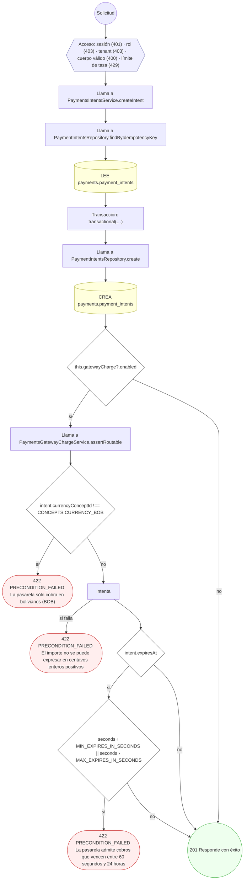

#### 8. POST /payments/intents/{id}/fx-lock

Bloquear el tipo de cambio de la intención

| HTTP | Código | Cuándo |
|---|---|---|
| 201 | — | Éxito |
| 400 | `VALIDATION_FAILED` | Los parámetros de ruta son UUID válidos; El cuerpo cumple el DTO (sin propiedades extra) |
| 401 | `UNAUTHENTICATED` | Hay una sesión válida (JWT) |
| 403 | `FORBIDDEN` | El rol está permitido; El tenant se resuelve y pertenece al actor |
| 404 | `NOT_FOUND` | ResourceNotFoundException: Intención de pago no encontrada |
| 409 | `CONFLICT` | ConflictException: La intención ya tiene un cobro en la pasarela; no admite este cambio; ConflictException: La intención ya tiene un bloqueo de cambio vigente |
| 422 | `PRECONDITION_FAILED` | PreconditionFailedException: El bloqueo de cambio exige monedas distintas; PreconditionFailedException: Solo se puede bloquear el cambio de una intención pendiente |
| 429 | `RATE_LIMITED` | No se supera el límite de solicitudes |

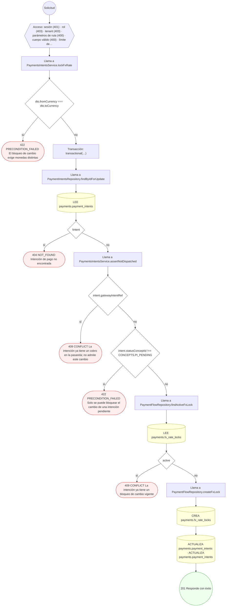

#### 9. POST /payments/intents/{id}/risk-assessment

Registrar la evaluación de riesgo y 3-D Secure

| HTTP | Código | Cuándo |
|---|---|---|
| 201 | — | Éxito |
| 400 | `VALIDATION_FAILED` | Los parámetros de ruta son UUID válidos; El cuerpo cumple el DTO (sin propiedades extra) |
| 401 | `UNAUTHENTICATED` | Hay una sesión válida (JWT) |
| 403 | `FORBIDDEN` | El rol está permitido; El tenant se resuelve y pertenece al actor |
| 404 | `NOT_FOUND` | ResourceNotFoundException: Intención de pago no encontrada |
| 409 | `CONFLICT` | ConflictException: La intención ya tiene un cobro en la pasarela; no admite este cambio |
| 429 | `RATE_LIMITED` | No se supera el límite de solicitudes |

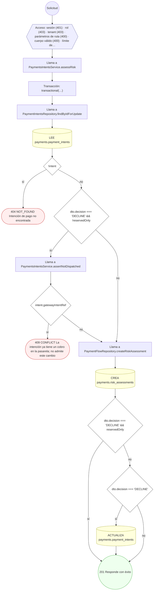

#### 10. POST /payments/intents/{id}/splits

Repartir el cobro entre cuentas conectadas

| HTTP | Código | Cuándo |
|---|---|---|
| 201 | — | Éxito |
| 400 | `VALIDATION_FAILED` | Los parámetros de ruta son UUID válidos; El cuerpo cumple el DTO (sin propiedades extra) |
| 401 | `UNAUTHENTICATED` | Hay una sesión válida (JWT) |
| 403 | `FORBIDDEN` | El rol está permitido; El tenant se resuelve y pertenece al actor |
| 404 | `NOT_FOUND` | ResourceNotFoundException: Intención de pago no encontrada |
| 409 | `CONFLICT` | ConflictException: La intención ya tiene un cobro en la pasarela; no admite este cambio; ConflictException: Los repartos superan el importe de la intención |
| 422 | `PRECONDITION_FAILED` | PreconditionFailedException: Un reparto por importe exige `amount`; PreconditionFailedException: Un reparto por porcentaje exige `percentage`; PreconditionFailedException: El reparto debe ser un importe positivo |
| 429 | `RATE_LIMITED` | No se supera el límite de solicitudes |

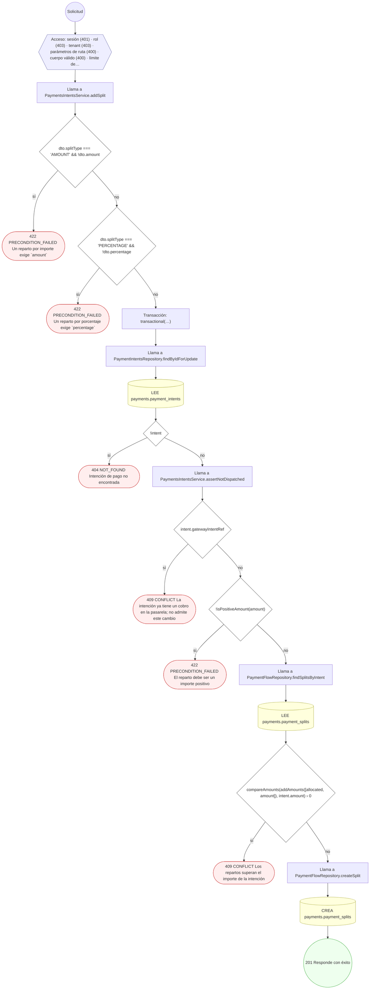

#### 11. POST /payments/intents/{id}/transactions

Procesar la transacción contra el gateway (authorize/capture)

| HTTP | Código | Cuándo |
|---|---|---|
| 201 | — | Éxito |
| 400 | `VALIDATION_FAILED` | Los parámetros de ruta son UUID válidos; El cuerpo cumple el DTO (sin propiedades extra) |
| 401 | `UNAUTHENTICATED` | Hay una sesión válida (JWT) |
| 403 | `FORBIDDEN` | El rol está permitido; El tenant se resuelve y pertenece al actor |
| 404 | `NOT_FOUND` | ResourceNotFoundException: Intención de pago no encontrada |
| 409 | `CONFLICT` | ConflictException: La intención ya fue cobrada; ConflictException: La intención no tiene un despacho pendiente de conciliar; ConflictException: La reserva de este cobro es más vieja que la memoria de la clave en la pasarela: reenviar podría crear un segundo cobro. Concilialo a mano contra la pasarela; ConflictException: La intención ya está en proceso y no tiene un cobro en la pasarela; ConflictException: La intención tiene una operación abierta en el gateway; ConflictException: El importe excede el saldo pendiente de la intención; ConflictException: La deuda ya tiene otro cobro en curso en la pasarela; ConflictException: El importe excede el saldo pendiente de la deuda; ConflictException: La intención se cobra a través de la pasarela; no admite una operación directa contra el proveedor; ConflictException: La captura excede el importe autorizado |
| 422 | `PRECONDITION_FAILED` | PreconditionFailedException: La pasarela cobra en un solo paso: sólo admite la operación SALE; PreconditionFailedException: La intención está cancelada; PreconditionFailedException: La pasarela cobra el importe completo de la intención; PreconditionFailedException: La intención requiere evaluación de riesgo antes de cobrar; PreconditionFailedException: El motor de riesgo rechazó la intención; PreconditionFailedException: La evaluación de riesgo pide revisión humana antes de cobrar; PreconditionFailedException: El importe a procesar debe ser mayor que cero; PreconditionFailedException: La intención parece cobrar una deuda pero no se puede saber cuál: indicá sourceRefType "payment_debt" con el id de la deuda, o abrí una sesión de checkout; PreconditionFailedException: La deuda de la intención no existe; PreconditionFailedException: La deuda ya está saldada; PreconditionFailedException: La pasarela sólo cobra deudas en bolivianos (BOB) |
| 429 | `RATE_LIMITED` | No se supera el límite de solicitudes |

```mermaid
flowchart TD
  n1(("Solicitud")):::inicio
  n2{{"Acceso: sesión (401) · rol (403) · tenant (403) · parámetros de ruta (400) · cuerpo válido (400) · límite de…"}}:::acceso
  n1 --> n2
  n3["Llama a PaymentsTransactionsService.processTransaction"]:::llamada
  n2 --> n3
  n4{"this.gatewayCharge?.enabled"}:::decision
  n3 --> n4
  n5["Llama a PaymentsTransactionsService.processViaGateway"]:::llamada
  n4 -->|"sí"| n5
  n6["Intenta"]:::intento
  n5 --> n6
  n7["Llama a PaymentsTransactionsService.processViaGatewayWithSlot"]:::llamada
  n6 --> n7
  n8{"dto.operation !== 'SALE'"}:::decision
  n7 --> n8
  n9(["422 PRECONDITION_FAILED La pasarela cobra en un solo paso: sólo admite la operación SALE"]):::error
  n8 -->|"sí"| n9
  n10["Transacción: runCommitted(…)"]:::transaccion
  n8 -->|"no"| n10
  n11["Llama a PaymentIntentsRepository.findByIdAndTenantForUpdate"]:::llamada
  n10 --> n11
  n12[("LEE payments.payment_intents")]:::efecto
  n11 --> n12
  n13["Llama a PaymentsTransactionsService.assertIntentOpen"]:::llamada
  n12 --> n13
  n14{"intent.statusConceptId === CONCEPTS.PI_SUCCEEDED"}:::decision
  n13 --> n14
  n15(["409 CONFLICT La intención ya fue cobrada"]):::error
  n14 -->|"sí"| n15
  n16{"intent.statusConceptId === CONCEPTS.PI_CANCELED"}:::decision
  n14 -->|"no"| n16
  n17(["422 PRECONDITION_FAILED La intención está cancelada"]):::error
  n16 -->|"sí"| n17
  n18{"dto.amount && compareAmounts(dto.amount, found.amount) !== 0"}:::decision
  n16 -->|"no"| n18
  n19(["422 PRECONDITION_FAILED La pasarela cobra el importe completo de la intención"]):::error
  n18 -->|"sí"| n19
  n20{"mode === 'reconcile' && !isDispatchMark(found.gatewayIntentRef)"}:::decision
  n18 -->|"no"| n20
  n21(["409 CONFLICT La intención no tiene un despacho pendiente de conciliar"]):::error
  n20 -->|"sí"| n21
  n22{"isDispatchMark(found.gatewayIntentRef) && !canResendWithSameKey(found.gatewayIntentRef, Date.now())"}:::decision
  n20 -->|"no"| n22
  n23(["409 CONFLICT La reserva de este cobro es más vieja que la memoria de la clave en la pasarela: reenviar podría…"]):::error
  n22 -->|"sí"| n23
  n24{"found.statusConceptId === CONCEPTS.PI_PROCESSING"}:::decision
  n22 -->|"no"| n24
  n25(["409 CONFLICT La intención ya está en proceso y no tiene un cobro en la pasarela"]):::error
  n24 -->|"sí"| n25
  n26["Llama a PaymentsTransactionsService.assertNoBlockingOpenOperation"]:::llamada
  n24 -->|"no"| n26
  n27{"open && (open.statusConceptId === CONCEPTS.TXN_PROCESSING || operation !== 'CAPTURE')"}:::decision
  n26 --> n27
  n28(["409 CONFLICT La intención tiene una operación abierta en el gateway"]):::error
  n27 -->|"sí"| n28
  n29["Llama a PaymentsTransactionsService.assertRiskCleared"]:::llamada
  n27 -->|"no"| n29
  n30{"!risk"}:::decision
  n29 --> n30
  n31(["422 PRECONDITION_FAILED La intención requiere evaluación de riesgo antes de cobrar"]):::error
  n30 -->|"sí"| n31
  n32{"risk.decisionConceptId === CONCEPTS.RISK_DECLINE"}:::decision
  n30 -->|"no"| n32
  n33(["422 PRECONDITION_FAILED El motor de riesgo rechazó la intención"]):::error
  n32 -->|"sí"| n33
  n34{"blockOnReview && risk.decisionConceptId === CONCEPTS.RISK_REVIEW"}:::decision
  n32 -->|"no"| n34
  n35(["422 PRECONDITION_FAILED La evaluación de riesgo pide revisión humana antes de cobrar"]):::error
  n34 -->|"sí"| n35
  n36["Llama a PaymentsTransactionsService.assertWithinBalance"]:::llamada
  n34 -->|"no"| n36
  n37{"!isPositiveAmount(requested)"}:::decision
  n36 --> n37
  n38(["422 PRECONDITION_FAILED El importe a procesar debe ser mayor que cero"]):::error
  n37 -->|"sí"| n38
  n39{"compareAmounts(requested, balance) › 0"}:::decision
  n37 -->|"no"| n39
  n40(["409 CONFLICT El importe excede el saldo pendiente de la intención"]):::error
  n39 -->|"sí"| n40
  n41["Llama a PaymentsTransactionsService.assertDebtAllowsCharge"]:::llamada
  n39 -->|"no"| n41
  n42{"debtIds.size === 0 && mayChargeADebt({ purposeIsDebt: intent.purposeConceptId === CONCEPTS.PAY_PURPOSE_DEBT,…"}:::decision
  n41 --> n42
  n43(["422 PRECONDITION_FAILED La intención parece cobrar una deuda pero no se puede saber cuál: indicá sourceRefTyp…"]):::error
  n42 -->|"sí"| n43
  n44["Repite: por cada const paymentDebtId de debtIds"]:::bucle
  n42 -->|"no"| n44
  n45{"!debt || debt.tenantId !== intent.tenantId"}:::decision
  n44 -->|"cada elemento"| n45
  n46(["422 PRECONDITION_FAILED La deuda de la intención no existe"]):::error
  n45 -->|"sí"| n46
  n47{"debt.statusConceptId === CONCEPTS.DEBT_SETTLED"}:::decision
  n45 -->|"no"| n47
  n48(["422 PRECONDITION_FAILED La deuda ya está saldada"]):::error
  n47 -->|"sí"| n48
  n49{"debt.currencyCode !== 'BOB'"}:::decision
  n47 -->|"no"| n49
  n50(["422 PRECONDITION_FAILED La pasarela sólo cobra deudas en bolivianos (BOB)"]):::error
  n49 -->|"sí"| n50
  n51{"blocking.length › 0"}:::decision
  n49 -->|"no"| n51
  n52(["409 CONFLICT La deuda ya tiene otro cobro en curso en la pasarela"]):::error
  n51 -->|"sí"| n52
  n53{"compareAmounts(intent.amount, debt.outstandingAmount) › 0"}:::decision
  n51 -->|"no"| n53
  n54(["409 CONFLICT El importe excede el saldo pendiente de la deuda"]):::error
  n53 -->|"sí"| n54
  n55{"intent.gatewayIntentRef && !isDispatchMark(intent.gatewayIntentRef)"}:::decision
  n53 -->|"no"| n55
  n44 -->|"al terminar"| n55
  n56{"mode === 'reconcile'"}:::decision
  n55 -->|"no"| n56
  n57["Llama a PaymentsTransactionsService.resendReservedDispatch"]:::llamada
  n56 -->|"sí"| n57
  n58["Intenta"]:::intento
  n57 --> n58
  n59(["↩ (relanza el error capturado)"]):::error
  n58 -->|"si falla"| n59
  n60["Transacción: transactional(…)"]:::transaccion
  n55 -->|"sí"| n60
  n58 --> n60
  n56 -->|"no"| n60
  n4 -->|"no"| n60
  n61["Llama a PaymentIntentsRepository.findByIdForUpdate"]:::llamada
  n60 --> n61
  n62[("LEE payments.payment_intents")]:::efecto
  n61 --> n62
  n63{"!intent"}:::decision
  n62 --> n63
  n64(["404 NOT_FOUND Intención de pago no encontrada"]):::error
  n63 -->|"sí"| n64
  n65["Llama a PaymentsTransactionsService.assertIntentOpen"]:::llamada
  n63 -->|"no"| n65
  n66{"intent.statusConceptId === CONCEPTS.PI_SUCCEEDED"}:::decision
  n65 --> n66
  n67(["409 CONFLICT La intención ya fue cobrada"]):::error
  n66 -->|"sí"| n67
  n68{"intent.statusConceptId === CONCEPTS.PI_CANCELED"}:::decision
  n66 -->|"no"| n68
  n69(["422 PRECONDITION_FAILED La intención está cancelada"]):::error
  n68 -->|"sí"| n69
  n70{"intent.gatewayIntentRef"}:::decision
  n68 -->|"no"| n70
  n71["… el resto del árbol (1 nodos) está en el JSON del inventario"]:::corte
  n70 -->|"sí"| n71
  classDef acceso fill:#eef,stroke:#66a
  classDef error fill:#fee,stroke:#c33
  classDef ok fill:#efe,stroke:#3a3
  classDef efecto fill:#ffd,stroke:#aa3
  classDef decision fill:#fff,stroke:#555
  classDef corte fill:#eee,stroke:#999,stroke-dasharray: 4
```

#### 12. POST /payments/payouts

Ejecutar un payout a una cuenta conectada

| HTTP | Código | Cuándo |
|---|---|---|
| 201 | — | Éxito |
| 400 | `VALIDATION_FAILED` | El cuerpo cumple el DTO (sin propiedades extra) |
| 401 | `UNAUTHENTICATED` | Hay una sesión válida (JWT) |
| 403 | `FORBIDDEN` | El rol está permitido; El tenant se resuelve y pertenece al actor |
| 422 | `PRECONDITION_FAILED` | PreconditionFailedException: El importe neto del payout debe ser positivo |
| 429 | `RATE_LIMITED` | No se supera el límite de solicitudes |

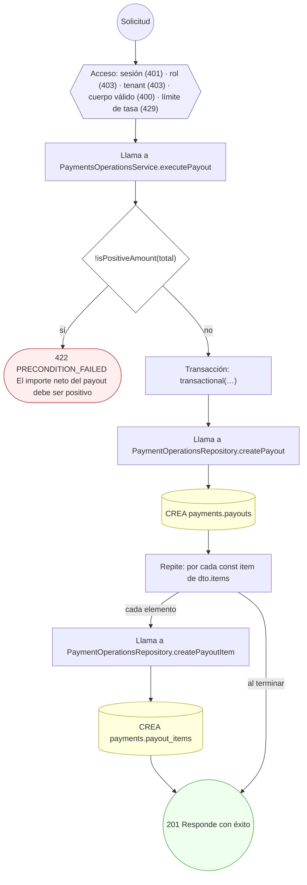

#### 13. POST /payments/reconciliation-runs

Conciliar gateway contra ledger y abrir excepciones

| HTTP | Código | Cuándo |
|---|---|---|
| 201 | — | Éxito |
| 400 | `VALIDATION_FAILED` | El cuerpo cumple el DTO (sin propiedades extra) |
| 401 | `UNAUTHENTICATED` | Hay una sesión válida (JWT) |
| 403 | `FORBIDDEN` | El rol está permitido; El tenant se resuelve y pertenece al actor |
| 429 | `RATE_LIMITED` | No se supera el límite de solicitudes |

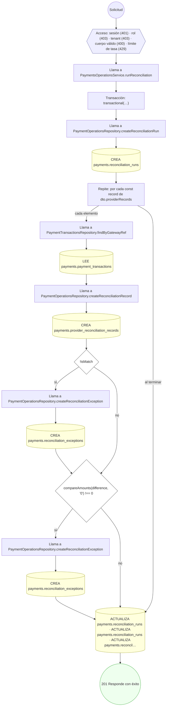

#### 14. POST /payments/settlements/import

Importar la liquidación del gateway

| HTTP | Código | Cuándo |
|---|---|---|
| 201 | — | Éxito |
| 400 | `VALIDATION_FAILED` | El cuerpo cumple el DTO (sin propiedades extra) |
| 401 | `UNAUTHENTICATED` | Hay una sesión válida (JWT) |
| 403 | `FORBIDDEN` | El rol está permitido; El tenant se resuelve y pertenece al actor |
| 429 | `RATE_LIMITED` | No se supera el límite de solicitudes |

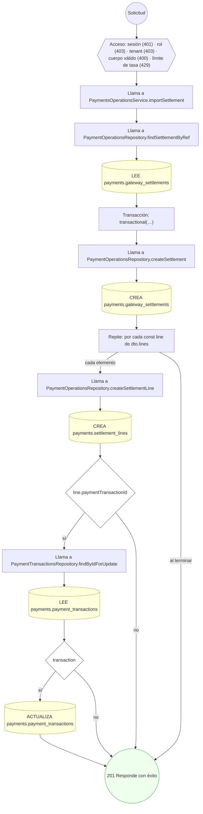

#### 15. POST /payments/transactions/{id}/cancellation-requests

Solicitar la anulación del cobro

| HTTP | Código | Cuándo |
|---|---|---|
| 201 | — | Éxito |
| 400 | `VALIDATION_FAILED` | Los parámetros de ruta son UUID válidos; El cuerpo cumple el DTO (sin propiedades extra) |
| 401 | `UNAUTHENTICATED` | Hay una sesión válida (JWT) |
| 403 | `FORBIDDEN` | El rol está permitido; El tenant se resuelve y pertenece al actor |
| 404 | `NOT_FOUND` | ResourceNotFoundException: Transacción no encontrada |
| 422 | `PRECONDITION_FAILED` | PreconditionFailedException: La transacción está liquidada; corresponde un reembolso en vez de una anulación |
| 429 | `RATE_LIMITED` | No se supera el límite de solicitudes |

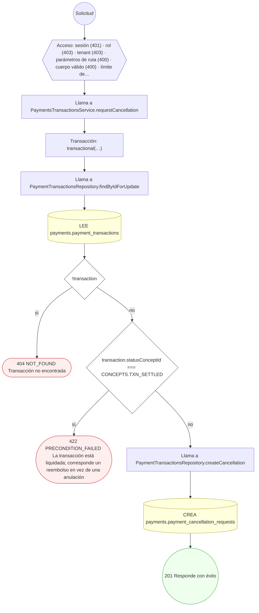

#### 16. POST /payments/transactions/{id}/refunds

Emitir un reembolso total o parcial

| HTTP | Código | Cuándo |
|---|---|---|
| 201 | — | Éxito |
| 400 | `VALIDATION_FAILED` | Los parámetros de ruta son UUID válidos; El cuerpo cumple el DTO (sin propiedades extra) |
| 401 | `UNAUTHENTICATED` | Hay una sesión válida (JWT) |
| 403 | `FORBIDDEN` | El rol está permitido; El tenant se resuelve y pertenece al actor |
| 404 | `NOT_FOUND` | ResourceNotFoundException: Transacción no encontrada |
| 409 | `CONFLICT` | ConflictException: El reembolso excede el importe capturado |
| 422 | `PRECONDITION_FAILED` | PreconditionFailedException: Solo se puede reembolsar una transacción capturada o liquidada; PreconditionFailedException: El importe del reembolso debe ser mayor que cero |
| 429 | `RATE_LIMITED` | No se supera el límite de solicitudes |


#### 17. POST /payments/transactions/{id}/status-inquiry

Consultar el estado de la transacción en el gateway

| HTTP | Código | Cuándo |
|---|---|---|
| 200 | — | Éxito |
| 400 | `VALIDATION_FAILED` | Los parámetros de ruta son UUID válidos |
| 401 | `UNAUTHENTICATED` | Hay una sesión válida (JWT) |
| 403 | `FORBIDDEN` | El rol está permitido; El tenant se resuelve y pertenece al actor |
| 404 | `NOT_FOUND` | ResourceNotFoundException: Transacción no encontrada |
| 429 | `RATE_LIMITED` | No se supera el límite de solicitudes |


### Operaciones sin decisiones propias

Sólo comprueban el acceso y leen o escriben: no tienen ramas que dibujar. Su detalle está en la ficha de endpoints.

| Operación | Respuestas posibles | Tablas |
|---|---|---|
| GET /payments/gateway-dispatches/pending-reconciliation | 200, 401, 403, 429 | 1 |
