<!-- AUTOGENERADO por tools/inventario/flujos.mjs. No editar manualmente. -->

# Flujos del módulo `payments`

- **Procesos:** 1 · **Máquinas de estado:** 1
- **Operaciones:** 14 (13 con decisiones propias, 1 sin ellas)
- Inventario de endpoints del módulo: [payments](../endpoints/payments.md)

## Proceso: Módulo 42 — Payments

- **Código:** `payments` · **Agrupación:** CASO_DE_USO_README · **Operaciones:** 14
- **Actores:** CASHIER · PAYMENTS_ADMIN · Público (sin sesión)
- **Revisión:** AUTO_DETECTADA
- **Fuentes:** `src/modules/payments/README.md`

### Para qué sirve

Cobros con pasarela: intención de pago, checkout, procesamiento contra el gateway, reembolsos, anulaciones y las operaciones de cierre (tarifas, liquidaciones, payouts y conciliación).

_Fuente: `src/modules/payments/README.md:3`_

### Flujo general declarado en el README

```text
intent (pending)
  ├─ fx-lock            -> importe re-expresado en la moneda destino
  ├─ risk-assessment    -> approve | review | decline (decline => intent failed)
  ├─ splits             -> reparto entre cuentas conectadas
  └─ transactions       -> authorize (processing) | capture/sale (succeeded)
        ├─ callback     -> aplica el resultado del proveedor (idempotente)
        ├─ status-inquiry -> confirma cuando el callback no llegó
        ├─ refunds      -> solo sobre capturada/liquidada, acotado a lo cobrado
        └─ cancellation -> solo si no está liquidada
settlement import -> transacciones a `settled`
payouts           -> importe derivado de los ítems, neto de comisiones
reconciliation    -> registros del proveedor vs ledger; descuadres abren excepción
```

_Fuente: `src/modules/payments/README.md:70`_

### Etapas y operaciones

| Etapa | Descripción | Operación | Quién actúa | Riesgo | Tablas |
|---|---|---|---|---|---|
| `UC-42-01` | Crear intención de pago idempotente | POST /payments/intents | PAYMENTS_ADMIN · CASHIER | MEDIO | 2 |
| `UC-42-02` | Abrir sesión de checkout con contexto de cajero | POST /payments/checkout-sessions | PAYMENTS_ADMIN · CASHIER | MEDIO | 4 |
| `UC-42-03` | Bloquear tipo de cambio | POST /payments/intents/{id}/fx-lock | PAYMENTS_ADMIN | MEDIO | 4 |
| `UC-42-04` | Evaluar riesgo y 3-D Secure | POST /payments/intents/{id}/risk-assessment | PAYMENTS_ADMIN | MEDIO | 3 |
| `UC-42-05` | Procesar transacción (authorize/capture/sale) | POST /payments/intents/{id}/transactions | PAYMENTS_ADMIN · CASHIER | MEDIO | 5 |
| `UC-42-06` | Recibir callback del gateway (idempotente) | POST /payments/callbacks/{callbackPath} | Público (sin sesión) | ALTO | 6 |
| `UC-42-07` | Consulta independiente de estado | POST /payments/transactions/{id}/status-inquiry | PAYMENTS_ADMIN | BAJO | 1 |
| `UC-42-08` | Reembolso total o parcial | POST /payments/transactions/{id}/refunds | PAYMENTS_ADMIN | MEDIO | 3 |
| `UC-42-09` | Solicitar anulación | POST /payments/transactions/{id}/cancellation-requests | PAYMENTS_ADMIN · CASHIER | MEDIO | 2 |
| `UC-42-10` | Publicar versión del tarifario | POST /payments/fee-schedules | PAYMENTS_ADMIN | MEDIO | 3 |
| `UC-42-11` | Reparto multi-party | POST /payments/intents/{id}/splits | PAYMENTS_ADMIN | MEDIO | 3 |
| `UC-42-12` | Importar liquidación del gateway | POST /payments/settlements/import | PAYMENTS_ADMIN | MEDIO | 5 |
| `UC-42-13` | Ejecutar payout a cuenta conectada | POST /payments/payouts | PAYMENTS_ADMIN | MEDIO | 2 |
| `UC-42-14` | Conciliar gateway vs ledger | POST /payments/reconciliation-runs | PAYMENTS_ADMIN | MEDIO | 5 |

### Diagrama — etapas `UC-42-01`, `UC-42-02`, `UC-42-03`…

```mermaid
flowchart LR
  a2(["PAYMENTS_ADMIN · CASHIER"]):::actor
  a9(["PAYMENTS_ADMIN"]):::actor
  a16(["Público (sin sesión)"]):::actor
  t3[("payments.payment_intents")]:::tabla
  t5[("payments.cashier_payment_contexts")]:::tabla
  t6[("payments.payment_checkout_sessions")]:::tabla
  t7[("payments.payment_debts")]:::tabla
  t10[("payments.fx_rate_locks")]:::tabla
  t12[("payments.risk_assessments")]:::tabla
  t14[("payments.payment_transactions")]:::tabla
  t17[("payments.payment_webhook_events")]:::tabla
  t20[("payments.refunds")]:::tabla
  t22[("payments.payment_cancellation_requests")]:::tabla
  t24[("payments.fee_schedules")]:::tabla
  t26[("payments.payment_splits")]:::tabla
  t28[("payments.gateway_settlements")]:::tabla
  t29[("payments.settlement_lines")]:::tabla
  t31[("payments.payout_items")]:::tabla
  t32[("payments.payouts")]:::tabla
  t34[("payments.provider_reconciliation_records")]:::tabla
  t35[("payments.reconciliation_exceptions")]:::tabla
  t36[("payments.reconciliation_runs")]:::tabla
  subgraph s0["UC-42-01 · Crear intención de pago idempotente"]
    o1["POST /payments/intents"]:::op
  end
  subgraph s1["UC-42-02 · Abrir sesión de checkout con contexto de cajero"]
    o4["POST /payments/checkout-sessions"]:::op
  end
  subgraph s2["UC-42-03 · Bloquear tipo de cambio"]
    o8["POST /payments/intents/{id}/fx-lock"]:::op
  end
  subgraph s3["UC-42-04 · Evaluar riesgo y 3-D Secure"]
    o11["POST /payments/intents/{id}/risk-assessment"]:::op
  end
  subgraph s4["UC-42-05 · Procesar transacción (authorize/capture/sale)"]
    o13["POST /payments/intents/{id}/transactions"]:::op
  end
  subgraph s5["UC-42-06 · Recibir callback del gateway (idempotente)"]
    o15["POST /payments/callbacks/{callbackPath}"]:::op
  end
  subgraph s6["UC-42-07 · Consulta independiente de estado"]
    o18["POST /payments/transactions/{id}/status-inquiry"]:::op
  end
  subgraph s7["UC-42-08 · Reembolso total o parcial"]
    o19["POST /payments/transactions/{id}/refunds"]:::op
  end
  subgraph s8["UC-42-09 · Solicitar anulación"]
    o21["POST /payments/transactions/{id}/cancellation-requests"]:::op
  end
  subgraph s9["UC-42-10 · Publicar versión del tarifario"]
    o23["POST /payments/fee-schedules"]:::op
  end
  subgraph s10["UC-42-11 · Reparto multi-party"]
    o25["POST /payments/intents/{id}/splits"]:::op
  end
  subgraph s11["UC-42-12 · Importar liquidación del gateway"]
    o27["POST /payments/settlements/import"]:::op
  end
  subgraph s12["UC-42-13 · Ejecutar payout a cuenta conectada"]
    o30["POST /payments/payouts"]:::op
  end
  subgraph s13["UC-42-14 · Conciliar gateway vs ledger"]
    o33["POST /payments/reconciliation-runs"]:::op
  end
  a2 --> o1
  o1 -->|"CREA"| t3
  o1 -->|"LEE"| t3
  a2 --> o4
  o4 -->|"CREA"| t5
  o4 -->|"CREA"| t6
  o4 -->|"ACTUALIZA"| t7
  o4 -->|"LEE"| t7
  a9 --> o8
  o8 -->|"CREA"| t10
  o8 -->|"LEE"| t10
  o8 -->|"ACTUALIZA"| t3
  o8 -->|"LEE"| t3
  a9 --> o11
  o11 -->|"ACTUALIZA"| t3
  o11 -->|"LEE"| t3
  o11 -->|"CREA"| t12
  a2 --> o13
  o13 -->|"ACTUALIZA"| t3
  o13 -->|"LEE"| t3
  o13 -->|"CREA"| t14
  o13 -->|"LEE"| t14
  o13 -->|"LEE"| t12
  a16 --> o15
  o15 -->|"ACTUALIZA"| t3
  o15 -->|"LEE"| t3
  o15 -->|"ACTUALIZA"| t14
  o15 -->|"LEE"| t14
  o15 -->|"CREA"| t17
  o15 -->|"LEE"| t17
  a9 --> o18
  o18 -->|"LEE"| t14
  a9 --> o19
  o19 -->|"LEE"| t14
  o19 -->|"CREA"| t20
  o19 -->|"LEE"| t20
  a2 --> o21
  o21 -->|"CREA"| t22
  o21 -->|"LEE"| t14
  a9 --> o23
  o23 -->|"ACTUALIZA"| t24
  o23 -->|"CREA"| t24
  o23 -->|"LEE"| t24
  a9 --> o25
  o25 -->|"LEE"| t3
  o25 -->|"CREA"| t26
  o25 -->|"LEE"| t26
  a9 --> o27
  o27 -->|"CREA"| t28
  o27 -->|"LEE"| t28
  o27 -->|"ACTUALIZA"| t14
  o27 -->|"LEE"| t14
  o27 -->|"CREA"| t29
  a9 --> o30
  o30 -->|"CREA"| t31
  o30 -->|"CREA"| t32
  a9 --> o33
  o33 -->|"LEE"| t14
  o33 -->|"CREA"| t34
  o33 -->|"CREA"| t35
  o33 -->|"ACTUALIZA"| t36
  o33 -->|"CREA"| t36
  classDef op fill:#fff,stroke:#446
  classDef actor fill:#eef,stroke:#66a
  classDef tabla fill:#ffd,stroke:#aa3
  classDef evento fill:#efe,stroke:#3a3
```

## Máquinas de estado

### Máquina de estados `TRANSITIONS`

Declarada en `src/modules/payments/services/payment-callback-machine.ts:43`. Los estados llevan el nombre del identificador del código; no se resuelven al catálogo de conceptos.

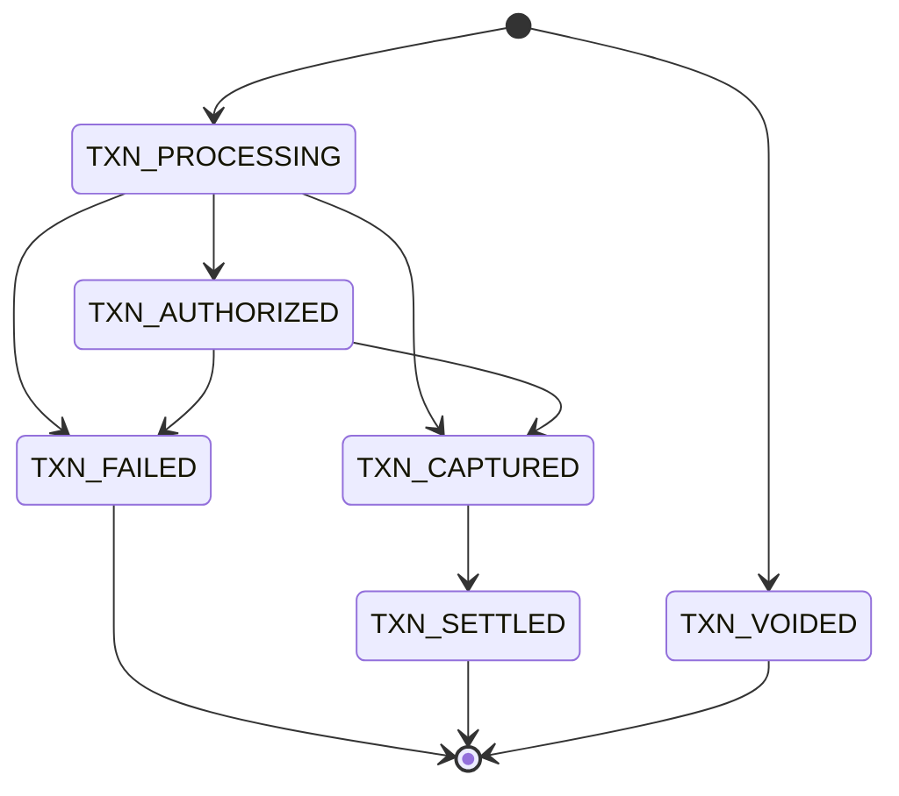

**Operaciones que ejercen esta máquina** _(POR_REFERENCIA: el handler alcanza un método que valida contra la tabla; «sin destino nombrado» significa que el estado de destino llega por el cuerpo de la petición)_:

| Operación | Estados de destino que nombra | A través de |
|---|---|---|
| PATCH /['insurance/campaigns', 'insurance-campaigns']/{id}/status | sin destino nombrado | InsuranceCampaignsService.changeStatus |
| POST /payments/callbacks/{callbackPath} | sin destino nombrado | PaymentsTransactionsService.applyCallback |

## Árbol de decisión por operación

Cada árbol se deriva del código del handler y de los métodos que invoca (hasta 4 niveles). Una rama que no decide, no escribe y no falla se poda. Los accesos y los efectos consecutivos se agrupan en un solo nodo.

### Operaciones con decisiones propias

#### 1. POST /payments/callbacks/{callbackPath}

Recibir el callback/webhook del gateway (idempotente)

| HTTP | Código | Cuándo |
|---|---|---|
| 200 | — | Éxito |
| 400 | `VALIDATION_FAILED` | El cuerpo cumple el DTO (sin propiedades extra) |
| 401 | `UNAUTHENTICATED` | Hay una sesión válida (JWT); UnauthorizedException: Firma del webhook inválida |
| 404 | `NOT_FOUND` | ResourceNotFoundException: No hay transacción para la referencia informada |
| 429 | `RATE_LIMITED` | No se supera el límite de solicitudes |

```mermaid
flowchart TD
  n1(("Solicitud")):::inicio
  n2{{"Acceso: sesión (401) · cuerpo válido (400) · límite de tasa (429)"}}:::acceso
  n1 --> n2
  n3["Llama a PaymentsTransactionsService.applyCallback"]:::llamada
  n2 --> n3
  n4["Transacción: transactional(…)"]:::transaccion
  n3 --> n4
  n5["Llama a PaymentTransactionsRepository.findByGatewayRef"]:::llamada
  n4 --> n5
  n6[("LEE payments.payment_transactions")]:::efecto
  n5 --> n6
  n7{"!transaction"}:::decision
  n6 --> n7
  n8(["404 NOT_FOUND No hay transacción para la referencia informada"]):::error
  n7 -->|"sí"| n8
  n9{"!signature || !secrets.some((secret) =› verifySignature(secret, signedBody, signature), )"}:::decision
  n7 -->|"no"| n9
  n10(["401 UNAUTHENTICATED Firma del webhook inválida"]):::error
  n9 -->|"sí"| n10
  n11["Llama a PaymentTransactionsRepository.findWebhookEventByRef"]:::llamada
  n9 -->|"no"| n11
  n12[("LEE payments.payment_webhook_events")]:::efecto
  n11 --> n12
  n13{"!archived"}:::decision
  n12 --> n13
  n14["Llama a PaymentTransactionsRepository.recordWebhookEvent"]:::llamada
  n13 -->|"sí"| n14
  n15[("CREA payments.payment_webhook_events")]:::efecto
  n14 --> n15
  n16[("ACTUALIZA payments.payment_transactions")]:::efecto
  n15 --> n16
  n13 -->|"no"| n16
  n17{"dto.authorizationCode"}:::decision
  n16 --> n17
  n18[("ACTUALIZA payments.payment_transactions")]:::efecto
  n17 -->|"sí"| n18
  n19[("ACTUALIZA payments.payment_transactions")]:::efecto
  n18 --> n19
  n17 -->|"no"| n19
  n20["Llama a PaymentIntentsRepository.findByIdForUpdate"]:::llamada
  n19 --> n20
  n21[("LEE payments.payment_intents")]:::efecto
  n20 --> n21
  n22{"intent"}:::decision
  n21 --> n22
  n23["Llama a PaymentsTransactionsService.intentCaptured"]:::llamada
  n22 -->|"sí"| n23
  n24["Llama a PaymentTransactionsRepository.findByIntent"]:::llamada
  n23 --> n24
  n25[("LEE payments.payment_transactions")]:::efecto
  n24 --> n25
  n26[("ACTUALIZA payments.payment_intents")]:::efecto
  n25 --> n26
  n27(("200 Responde con éxito")):::ok
  n26 --> n27
  n22 -->|"no"| n27
  classDef acceso fill:#eef,stroke:#66a
  classDef error fill:#fee,stroke:#c33
  classDef ok fill:#efe,stroke:#3a3
  classDef efecto fill:#ffd,stroke:#aa3
  classDef decision fill:#fff,stroke:#555
  classDef corte fill:#eee,stroke:#999,stroke-dasharray: 4
```

#### 2. POST /payments/checkout-sessions

Abrir una sesión de checkout con contexto de cajero

| HTTP | Código | Cuándo |
|---|---|---|
| 201 | — | Éxito |
| 400 | `VALIDATION_FAILED` | El cuerpo cumple el DTO (sin propiedades extra) |
| 401 | `UNAUTHENTICATED` | Hay una sesión válida (JWT) |
| 403 | `FORBIDDEN` | El rol está permitido; El tenant se resuelve y pertenece al actor |
| 404 | `NOT_FOUND` | ResourceNotFoundException: Deuda no encontrada |
| 422 | `PRECONDITION_FAILED` | PreconditionFailedException: La deuda ya tiene un checkout abierto; PreconditionFailedException: La deuda ya está saldada |
| 429 | `RATE_LIMITED` | No se supera el límite de solicitudes |

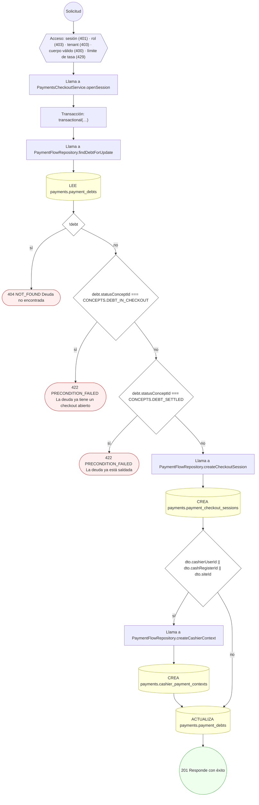

#### 3. POST /payments/fee-schedules

Publicar una versión del tarifario

| HTTP | Código | Cuándo |
|---|---|---|
| 201 | — | Éxito |
| 400 | `VALIDATION_FAILED` | El cuerpo cumple el DTO (sin propiedades extra) |
| 401 | `UNAUTHENTICATED` | Hay una sesión válida (JWT) |
| 403 | `FORBIDDEN` | El rol está permitido; El tenant se resuelve y pertenece al actor |
| 422 | `PRECONDITION_FAILED` | PreconditionFailedException: Una tarifa porcentual exige `percentage`; PreconditionFailedException: Una tarifa fija exige `fixedAmount` |
| 429 | `RATE_LIMITED` | No se supera el límite de solicitudes |

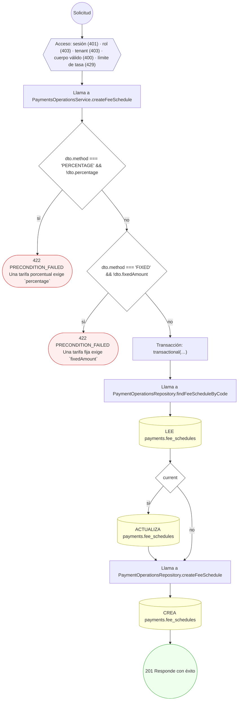

#### 4. POST /payments/intents/{id}/fx-lock

Bloquear el tipo de cambio de la intención

| HTTP | Código | Cuándo |
|---|---|---|
| 201 | — | Éxito |
| 400 | `VALIDATION_FAILED` | Los parámetros de ruta son UUID válidos; El cuerpo cumple el DTO (sin propiedades extra) |
| 401 | `UNAUTHENTICATED` | Hay una sesión válida (JWT) |
| 403 | `FORBIDDEN` | El rol está permitido; El tenant se resuelve y pertenece al actor |
| 404 | `NOT_FOUND` | ResourceNotFoundException: Intención de pago no encontrada |
| 409 | `CONFLICT` | ConflictException: La intención ya tiene un bloqueo de cambio vigente |
| 422 | `PRECONDITION_FAILED` | PreconditionFailedException: El bloqueo de cambio exige monedas distintas; PreconditionFailedException: Solo se puede bloquear el cambio de una intención pendiente |
| 429 | `RATE_LIMITED` | No se supera el límite de solicitudes |

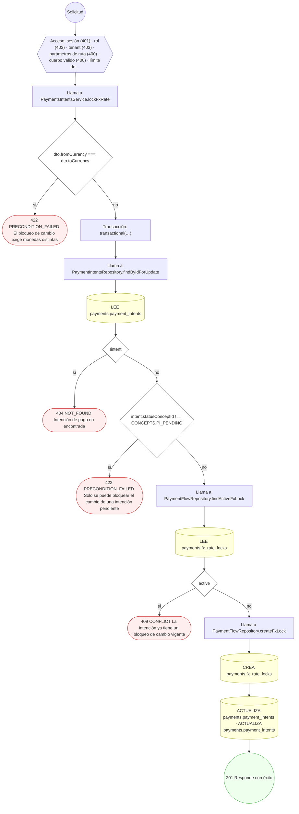

#### 5. POST /payments/intents/{id}/risk-assessment

Registrar la evaluación de riesgo y 3-D Secure

| HTTP | Código | Cuándo |
|---|---|---|
| 201 | — | Éxito |
| 400 | `VALIDATION_FAILED` | Los parámetros de ruta son UUID válidos; El cuerpo cumple el DTO (sin propiedades extra) |
| 401 | `UNAUTHENTICATED` | Hay una sesión válida (JWT) |
| 403 | `FORBIDDEN` | El rol está permitido; El tenant se resuelve y pertenece al actor |
| 404 | `NOT_FOUND` | ResourceNotFoundException: Intención de pago no encontrada |
| 429 | `RATE_LIMITED` | No se supera el límite de solicitudes |

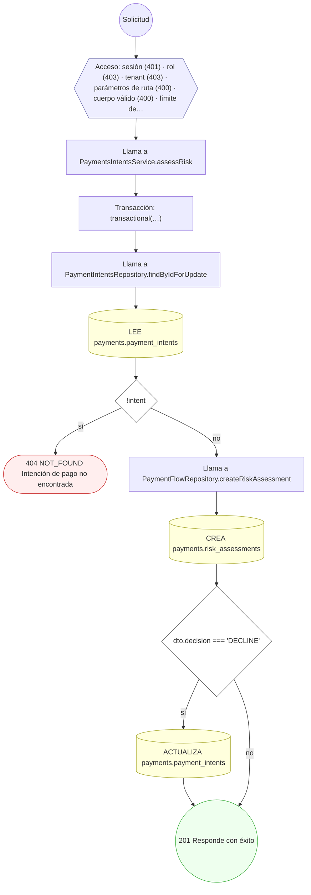

#### 6. POST /payments/intents/{id}/splits

Repartir el cobro entre cuentas conectadas

| HTTP | Código | Cuándo |
|---|---|---|
| 201 | — | Éxito |
| 400 | `VALIDATION_FAILED` | Los parámetros de ruta son UUID válidos; El cuerpo cumple el DTO (sin propiedades extra) |
| 401 | `UNAUTHENTICATED` | Hay una sesión válida (JWT) |
| 403 | `FORBIDDEN` | El rol está permitido; El tenant se resuelve y pertenece al actor |
| 404 | `NOT_FOUND` | ResourceNotFoundException: Intención de pago no encontrada |
| 409 | `CONFLICT` | ConflictException: Los repartos superan el importe de la intención |
| 422 | `PRECONDITION_FAILED` | PreconditionFailedException: Un reparto por importe exige `amount`; PreconditionFailedException: Un reparto por porcentaje exige `percentage` |
| 429 | `RATE_LIMITED` | No se supera el límite de solicitudes |

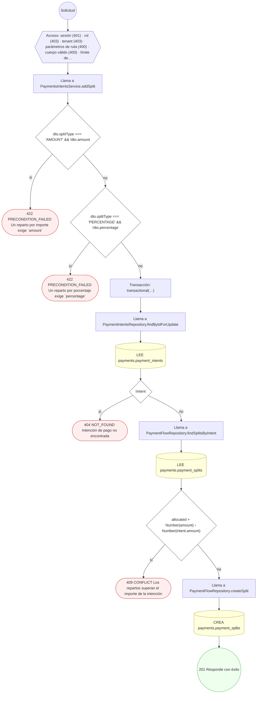

#### 7. POST /payments/intents/{id}/transactions

Procesar la transacción contra el gateway (authorize/capture)

| HTTP | Código | Cuándo |
|---|---|---|
| 201 | — | Éxito |
| 400 | `VALIDATION_FAILED` | Los parámetros de ruta son UUID válidos; El cuerpo cumple el DTO (sin propiedades extra) |
| 401 | `UNAUTHENTICATED` | Hay una sesión válida (JWT) |
| 403 | `FORBIDDEN` | El rol está permitido; El tenant se resuelve y pertenece al actor |
| 404 | `NOT_FOUND` | ResourceNotFoundException: Intención de pago no encontrada |
| 409 | `CONFLICT` | ConflictException: La intención ya fue cobrada; ConflictException: La intención tiene una operación abierta en el gateway; ConflictException: El importe excede el saldo pendiente de la intención; ConflictException: La captura excede el importe autorizado |
| 422 | `PRECONDITION_FAILED` | PreconditionFailedException: La intención está cancelada; PreconditionFailedException: La intención requiere evaluación de riesgo antes de cobrar; PreconditionFailedException: El motor de riesgo rechazó la intención; PreconditionFailedException: El importe a procesar debe ser mayor que cero |
| 429 | `RATE_LIMITED` | No se supera el límite de solicitudes |

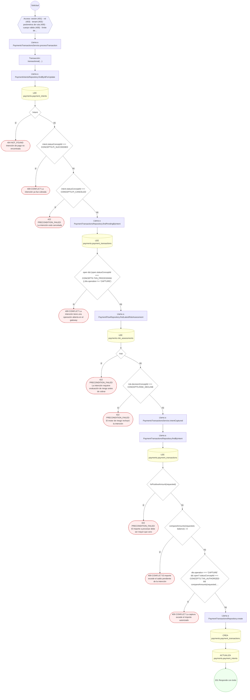

#### 8. POST /payments/payouts

Ejecutar un payout a una cuenta conectada

| HTTP | Código | Cuándo |
|---|---|---|
| 201 | — | Éxito |
| 400 | `VALIDATION_FAILED` | El cuerpo cumple el DTO (sin propiedades extra) |
| 401 | `UNAUTHENTICATED` | Hay una sesión válida (JWT) |
| 403 | `FORBIDDEN` | El rol está permitido; El tenant se resuelve y pertenece al actor |
| 422 | `PRECONDITION_FAILED` | PreconditionFailedException: El importe neto del payout debe ser positivo |
| 429 | `RATE_LIMITED` | No se supera el límite de solicitudes |

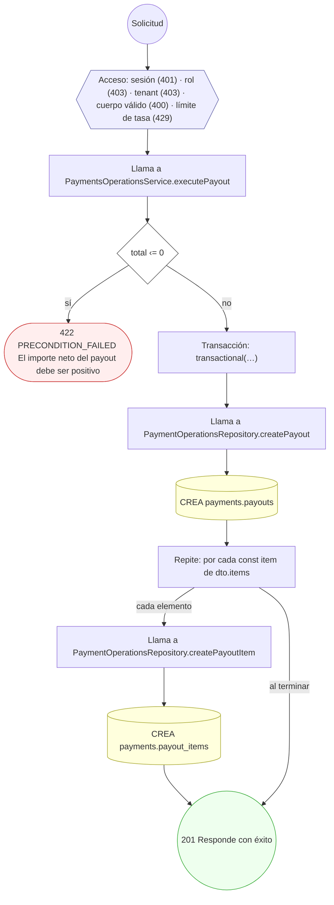

#### 9. POST /payments/reconciliation-runs

Conciliar gateway contra ledger y abrir excepciones

| HTTP | Código | Cuándo |
|---|---|---|
| 201 | — | Éxito |
| 400 | `VALIDATION_FAILED` | El cuerpo cumple el DTO (sin propiedades extra) |
| 401 | `UNAUTHENTICATED` | Hay una sesión válida (JWT) |
| 403 | `FORBIDDEN` | El rol está permitido; El tenant se resuelve y pertenece al actor |
| 429 | `RATE_LIMITED` | No se supera el límite de solicitudes |

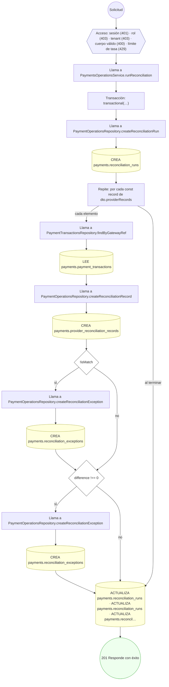

#### 10. POST /payments/settlements/import

Importar la liquidación del gateway

| HTTP | Código | Cuándo |
|---|---|---|
| 201 | — | Éxito |
| 400 | `VALIDATION_FAILED` | El cuerpo cumple el DTO (sin propiedades extra) |
| 401 | `UNAUTHENTICATED` | Hay una sesión válida (JWT) |
| 403 | `FORBIDDEN` | El rol está permitido; El tenant se resuelve y pertenece al actor |
| 429 | `RATE_LIMITED` | No se supera el límite de solicitudes |

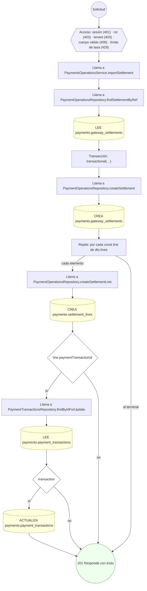

#### 11. POST /payments/transactions/{id}/cancellation-requests

Solicitar la anulación del cobro

| HTTP | Código | Cuándo |
|---|---|---|
| 201 | — | Éxito |
| 400 | `VALIDATION_FAILED` | Los parámetros de ruta son UUID válidos; El cuerpo cumple el DTO (sin propiedades extra) |
| 401 | `UNAUTHENTICATED` | Hay una sesión válida (JWT) |
| 403 | `FORBIDDEN` | El rol está permitido; El tenant se resuelve y pertenece al actor |
| 404 | `NOT_FOUND` | ResourceNotFoundException: Transacción no encontrada |
| 422 | `PRECONDITION_FAILED` | PreconditionFailedException: La transacción está liquidada; corresponde un reembolso en vez de una anulación |
| 429 | `RATE_LIMITED` | No se supera el límite de solicitudes |


#### 12. POST /payments/transactions/{id}/refunds

Emitir un reembolso total o parcial

| HTTP | Código | Cuándo |
|---|---|---|
| 201 | — | Éxito |
| 400 | `VALIDATION_FAILED` | Los parámetros de ruta son UUID válidos; El cuerpo cumple el DTO (sin propiedades extra) |
| 401 | `UNAUTHENTICATED` | Hay una sesión válida (JWT) |
| 403 | `FORBIDDEN` | El rol está permitido; El tenant se resuelve y pertenece al actor |
| 404 | `NOT_FOUND` | ResourceNotFoundException: Transacción no encontrada |
| 409 | `CONFLICT` | ConflictException: El reembolso excede el importe capturado |
| 422 | `PRECONDITION_FAILED` | PreconditionFailedException: Solo se puede reembolsar una transacción capturada o liquidada; PreconditionFailedException: El importe del reembolso debe ser mayor que cero |
| 429 | `RATE_LIMITED` | No se supera el límite de solicitudes |

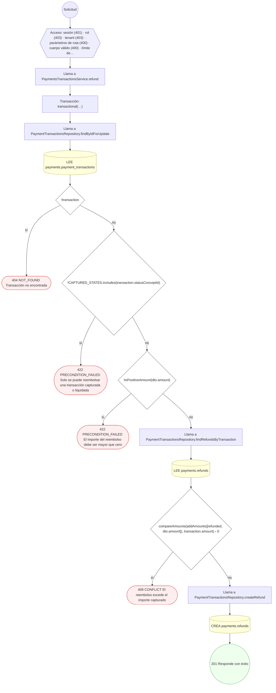

#### 13. POST /payments/transactions/{id}/status-inquiry

Consultar el estado de la transacción en el gateway

| HTTP | Código | Cuándo |
|---|---|---|
| 200 | — | Éxito |
| 400 | `VALIDATION_FAILED` | Los parámetros de ruta son UUID válidos |
| 401 | `UNAUTHENTICATED` | Hay una sesión válida (JWT) |
| 403 | `FORBIDDEN` | El rol está permitido; El tenant se resuelve y pertenece al actor |
| 404 | `NOT_FOUND` | ResourceNotFoundException: Transacción no encontrada |
| 429 | `RATE_LIMITED` | No se supera el límite de solicitudes |

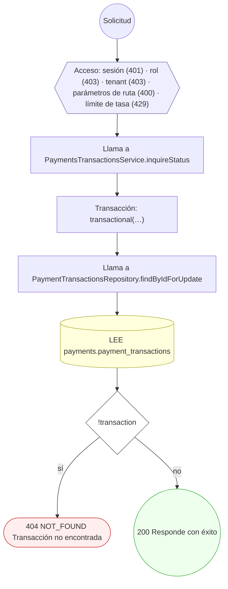

### Operaciones sin decisiones propias

Sólo comprueban el acceso y leen o escriben: no tienen ramas que dibujar. Su detalle está en la ficha de endpoints.

| Operación | Respuestas posibles | Tablas |
|---|---|---|
| POST /payments/intents | 201, 400, 401, 403, 429 | 2 |
