<!-- AUTOGENERADO por tools/inventario/flujos.mjs. No editar manualmente. -->

# Flujos del módulo `pharma_lab`

- **Procesos:** 1 · **Máquinas de estado:** 3
- **Operaciones:** 76 (69 con decisiones propias, 7 sin ellas)
- Inventario de endpoints del módulo: [pharma_lab](../endpoints/pharma_lab.md)

## Proceso: src / modules / pharma_lab

- **Código:** `pharma_lab` · **Agrupación:** AGRUPACION_POR_CONTROLADOR · **Operaciones:** 76
- **Actores:** ACCOUNTANT · BUSINESS_ADMIN · CLINICIAN · Cualquier sesión válida · FINANCE · LEGAL_COUNSEL · MEDICAL_VISITOR · PHARMACOVIGILANCE_OFFICER · PHARMA_LAB_ADMIN · PLATFORM_ADMIN · PRACTITIONER · REGULATORY_AFFAIRS
- **Revisión:** AUTO_DETECTADA
- **Fuentes:** `src/modules/pharma_lab/README.md`

### Para qué sirve

Agrupa los componentes relacionados con **pharma_lab** y mantiene cohesionada esta responsabilidad del sistema.

_Fuente: `src/modules/pharma_lab/README.md:3`_

### Etapas y operaciones

| Etapa | Descripción | Operación | Quién actúa | Riesgo | Tablas |
|---|---|---|---|---|---|
| `ctrl:MedicalVisitorsController` | Operaciones de MedicalVisitorsController que el README no asigna a un caso de uso | GET /pharma-labs/{pharmaLabId}/medical-visitors | PHARMA_LAB_ADMIN · BUSINESS_ADMIN · PLATFORM_ADMIN | BAJO | 2 |
|  |  | POST /pharma-labs/{pharmaLabId}/medical-visitors | PHARMA_LAB_ADMIN · BUSINESS_ADMIN · PLATFORM_ADMIN | ALTO | 12 |
|  |  | PUT /pharma-labs/{pharmaLabId}/medical-visitors/{medicalVisitorId}/products | PHARMA_LAB_ADMIN · BUSINESS_ADMIN · PLATFORM_ADMIN | ALTO | 7 |
|  |  | POST /pharma-labs/{pharmaLabId}/medical-visitors/{medicalVisitorId}/relink | PHARMA_LAB_ADMIN · BUSINESS_ADMIN · PLATFORM_ADMIN | MEDIO | 8 |
|  |  | PUT /pharma-labs/{pharmaLabId}/medical-visitors/{medicalVisitorId}/specialties | PHARMA_LAB_ADMIN · BUSINESS_ADMIN · PLATFORM_ADMIN | ALTO | 6 |
|  |  | POST /pharma-labs/{pharmaLabId}/medical-visitors/{medicalVisitorId}/unlink | PHARMA_LAB_ADMIN · BUSINESS_ADMIN · PLATFORM_ADMIN | ALTO | 19 |
|  |  | POST /pharma-labs/{pharmaLabId}/medical-visitors/{medicalVisitorId}/verifications | PHARMA_LAB_ADMIN · BUSINESS_ADMIN · PLATFORM_ADMIN | MEDIO | 5 |
| `ctrl:PharmaCatalogController` | Operaciones de PharmaCatalogController que el README no asigna a un caso de uso | GET /pharma-labs/{pharmaLabId}/materials | PHARMA_LAB_ADMIN · REGULATORY_AFFAIRS · MEDICAL_VISITOR · PLATFORM_ADMIN | BAJO | 2 |
|  |  | POST /pharma-labs/{pharmaLabId}/materials | PHARMA_LAB_ADMIN · REGULATORY_AFFAIRS · PLATFORM_ADMIN | MEDIO | 5 |
|  |  | GET /pharma-labs/{pharmaLabId}/materials/{materialId}/approvals | PHARMA_LAB_ADMIN · REGULATORY_AFFAIRS · PLATFORM_ADMIN | BAJO | 3 |
|  |  | GET /pharma-labs/{pharmaLabId}/materials/{materialId}/assets | PHARMA_LAB_ADMIN · REGULATORY_AFFAIRS · MEDICAL_VISITOR · PLATFORM_ADMIN | BAJO | 3 |
|  |  | POST /pharma-labs/{pharmaLabId}/materials/{materialId}/assets | PHARMA_LAB_ADMIN · REGULATORY_AFFAIRS · PLATFORM_ADMIN | MEDIO | 3 |
|  |  | POST /pharma-labs/{pharmaLabId}/materials/{materialId}/decision | PHARMA_LAB_ADMIN · REGULATORY_AFFAIRS · PLATFORM_ADMIN | MEDIO | 6 |
|  |  | POST /pharma-labs/{pharmaLabId}/materials/{materialId}/submit | PHARMA_LAB_ADMIN · REGULATORY_AFFAIRS · PLATFORM_ADMIN | MEDIO | 6 |
|  |  | GET /pharma-labs/{pharmaLabId}/products | PHARMA_LAB_ADMIN · REGULATORY_AFFAIRS · MEDICAL_VISITOR · PLATFORM_ADMIN | BAJO | 2 |
|  |  | POST /pharma-labs/{pharmaLabId}/products | PHARMA_LAB_ADMIN · REGULATORY_AFFAIRS · PLATFORM_ADMIN | MEDIO | 4 |
|  |  | PATCH /pharma-labs/{pharmaLabId}/products/{productId} | PHARMA_LAB_ADMIN · REGULATORY_AFFAIRS · PLATFORM_ADMIN | MEDIO | 5 |
|  |  | POST /pharma-labs/{pharmaLabId}/products/{productId}/status | PHARMA_LAB_ADMIN · REGULATORY_AFFAIRS · PLATFORM_ADMIN | MEDIO | 5 |
| `ctrl:PharmacovigilanceController` | Operaciones de PharmacovigilanceController que el README no asigna a un caso de uso | GET /pharma-labs/{pharmaLabId}/pharmacovigilance/reports | PHARMACOVIGILANCE_OFFICER · PHARMA_LAB_ADMIN · PLATFORM_ADMIN | BAJO | 2 |
|  |  | POST /pharma-labs/{pharmaLabId}/pharmacovigilance/reports | PRACTITIONER · CLINICIAN · PHARMACOVIGILANCE_OFFICER · PHARMA_LAB_ADMIN · BUSINESS_ADMIN | MEDIO | 9 |
|  |  | GET /pharma-labs/{pharmaLabId}/pharmacovigilance/reports/{reportId} | PHARMACOVIGILANCE_OFFICER · PHARMA_LAB_ADMIN · PLATFORM_ADMIN | BAJO | 3 |
|  |  | POST /pharma-labs/{pharmaLabId}/pharmacovigilance/reports/{reportId}/actions | PHARMACOVIGILANCE_OFFICER · PHARMA_LAB_ADMIN · PLATFORM_ADMIN | MEDIO | 6 |
| `ctrl:PharmaLabNoticesController` | Operaciones de PharmaLabNoticesController que el README no asigna a un caso de uso | POST /pharma-labs/notices/{noticeId}/read | Cualquier sesión válida | ALTO | 2 |
|  |  | GET /pharma-labs/notices/mine | Cualquier sesión válida | BAJO | 1 |
| `ctrl:PharmaLabReferenceController` | Operaciones de PharmaLabReferenceController que el README no asigna a un caso de uso | GET /pharma-labs/reference/concepts | Cualquier sesión válida | BAJO | 0 |
| `ctrl:PharmaLabsController` | Operaciones de PharmaLabsController que el README no asigna a un caso de uso | GET /pharma-labs | PHARMA_LAB_ADMIN · BUSINESS_ADMIN · PLATFORM_ADMIN | BAJO | 1 |
|  |  | POST /pharma-labs | PHARMA_LAB_ADMIN · BUSINESS_ADMIN · PLATFORM_ADMIN | MEDIO | 5 |
|  |  | GET /pharma-labs/{pharmaLabId} | PHARMA_LAB_ADMIN · BUSINESS_ADMIN · PLATFORM_ADMIN | BAJO | 1 |
|  |  | PATCH /pharma-labs/{pharmaLabId} | PHARMA_LAB_ADMIN · BUSINESS_ADMIN · PLATFORM_ADMIN | MEDIO | 4 |
|  |  | GET /pharma-labs/{pharmaLabId}/link-events | PHARMA_LAB_ADMIN · BUSINESS_ADMIN · PLATFORM_ADMIN | BAJO | 2 |
|  |  | GET /pharma-labs/{pharmaLabId}/staff | PHARMA_LAB_ADMIN · BUSINESS_ADMIN · PLATFORM_ADMIN | BAJO | 2 |
|  |  | POST /pharma-labs/{pharmaLabId}/staff | PHARMA_LAB_ADMIN · BUSINESS_ADMIN · PLATFORM_ADMIN | MEDIO | 6 |
|  |  | PATCH /pharma-labs/{pharmaLabId}/staff/{staffId}/permissions | PHARMA_LAB_ADMIN · BUSINESS_ADMIN · PLATFORM_ADMIN | MEDIO | 6 |
|  |  | POST /pharma-labs/{pharmaLabId}/staff/{staffId}/unlink | PHARMA_LAB_ADMIN · BUSINESS_ADMIN · PLATFORM_ADMIN | MEDIO | 6 |
| `ctrl:PharmaLabSocialController` | Operaciones de PharmaLabSocialController que el README no asigna a un caso de uso | POST /pharma-labs/{pharmaLabId}/cost-allocations | PHARMA_LAB_ADMIN · ACCOUNTANT · FINANCE · PLATFORM_ADMIN | MEDIO | 6 |
|  |  | GET /pharma-labs/{pharmaLabId}/cost-allocations/report | PHARMA_LAB_ADMIN · ACCOUNTANT · FINANCE · PLATFORM_ADMIN | BAJO | 3 |
|  |  | GET /pharma-labs/{pharmaLabId}/visitor-posts | PHARMA_LAB_ADMIN · BUSINESS_ADMIN · PLATFORM_ADMIN | BAJO | 2 |
|  |  | POST /pharma-labs/{pharmaLabId}/visitor-posts/{submissionId}/decision | PHARMA_LAB_ADMIN · BUSINESS_ADMIN · PLATFORM_ADMIN | MEDIO | 10 |
|  |  | POST /pharma-labs/visitor-posts | MEDICAL_VISITOR | MEDIO | 6 |
| `ctrl:RegulatoryDocumentsController` | Operaciones de RegulatoryDocumentsController que el README no asigna a un caso de uso | GET /pharma-labs/{pharmaLabId}/regulatory-documents | REGULATORY_AFFAIRS · PHARMA_LAB_ADMIN · LEGAL_COUNSEL · PLATFORM_ADMIN | BAJO | 2 |
|  |  | POST /pharma-labs/{pharmaLabId}/regulatory-documents | REGULATORY_AFFAIRS · PHARMA_LAB_ADMIN · LEGAL_COUNSEL · PLATFORM_ADMIN | MEDIO | 5 |
|  |  | GET /pharma-labs/{pharmaLabId}/regulatory-documents/{documentId} | REGULATORY_AFFAIRS · PHARMA_LAB_ADMIN · LEGAL_COUNSEL · PLATFORM_ADMIN | MEDIO | 4 |
|  |  | GET /pharma-labs/{pharmaLabId}/regulatory-documents/{documentId}/access-log | REGULATORY_AFFAIRS · PHARMA_LAB_ADMIN · LEGAL_COUNSEL · PLATFORM_ADMIN | BAJO | 3 |
|  |  | POST /pharma-labs/{pharmaLabId}/regulatory-documents/{documentId}/invalidate | REGULATORY_AFFAIRS · PHARMA_LAB_ADMIN · LEGAL_COUNSEL · PLATFORM_ADMIN | MEDIO | 7 |
|  |  | POST /pharma-labs/{pharmaLabId}/regulatory-documents/{documentId}/versions | REGULATORY_AFFAIRS · PHARMA_LAB_ADMIN · LEGAL_COUNSEL · PLATFORM_ADMIN | MEDIO | 8 |
|  |  | POST /pharma-labs/{pharmaLabId}/regulatory-documents/{documentId}/versions/{versionId}/download | REGULATORY_AFFAIRS · PHARMA_LAB_ADMIN · LEGAL_COUNSEL · PLATFORM_ADMIN | MEDIO | 6 |
|  |  | POST /pharma-labs/{pharmaLabId}/regulatory-documents/expirations/review | REGULATORY_AFFAIRS · PHARMA_LAB_ADMIN · LEGAL_COUNSEL · PLATFORM_ADMIN | MEDIO | 5 |
| `ctrl:VisitAgendaController` | Operaciones de VisitAgendaController que el README no asigna a un caso de uso | GET /visit-agenda/blocks | PRACTITIONER · CLINICIAN | BAJO | 1 |
|  |  | POST /visit-agenda/blocks | PRACTITIONER · CLINICIAN | MEDIO | 3 |
|  |  | POST /visit-agenda/blocks/{blockId}/lift | PRACTITIONER · CLINICIAN | MEDIO | 4 |
|  |  | GET /visit-agenda/doctors/{doctorUserId} | MEDICAL_VISITOR · PHARMA_LAB_ADMIN · PRACTITIONER · CLINICIAN | BAJO | 2 |
|  |  | GET /visit-agenda/me | PRACTITIONER · CLINICIAN | BAJO | 2 |
|  |  | PUT /visit-agenda/me | PRACTITIONER · CLINICIAN | ALTO | 7 |
| `ctrl:VisitRecordsController` | Operaciones de VisitRecordsController que el README no asigna a un caso de uso | POST /visit-records | MEDICAL_VISITOR | MEDIO | 14 |
|  |  | POST /visit-records/{visitRecordId}/confirm | PRACTITIONER · CLINICIAN | MEDIO | 4 |
|  |  | POST /visit-records/{visitRecordId}/rating | PRACTITIONER · CLINICIAN | MEDIO | 8 |
|  |  | GET /visit-records/inbox | PRACTITIONER · CLINICIAN | BAJO | 1 |
|  |  | GET /visit-records/labs/{pharmaLabId} | PHARMA_LAB_ADMIN · BUSINESS_ADMIN · PLATFORM_ADMIN | BAJO | 2 |
|  |  | GET /visit-records/labs/{pharmaLabId}/rating-summary | PHARMA_LAB_ADMIN · BUSINESS_ADMIN · PLATFORM_ADMIN | BAJO | 3 |
| `ctrl:VisitRequestsController` | Operaciones de VisitRequestsController que el README no asigna a un caso de uso | POST /visit-requests | MEDICAL_VISITOR | MEDIO | 22 |
|  |  | GET /visit-requests/{visitRequestId} | MEDICAL_VISITOR · PRACTITIONER · CLINICIAN | BAJO | 4 |
|  |  | POST /visit-requests/{visitRequestId}/accept | PRACTITIONER · CLINICIAN | MEDIO | 7 |
|  |  | POST /visit-requests/{visitRequestId}/cancel | MEDICAL_VISITOR · PRACTITIONER · CLINICIAN | MEDIO | 9 |
|  |  | POST /visit-requests/{visitRequestId}/propose-time | PRACTITIONER · CLINICIAN | MEDIO | 16 |
|  |  | POST /visit-requests/{visitRequestId}/reject | PRACTITIONER · CLINICIAN | MEDIO | 7 |
|  |  | POST /visit-requests/{visitRequestId}/request-info | PRACTITIONER · CLINICIAN | MEDIO | 6 |
|  |  | POST /visit-requests/{visitRequestId}/reschedule | MEDICAL_VISITOR | MEDIO | 17 |
|  |  | GET /visit-requests/inbox | PRACTITIONER · CLINICIAN | BAJO | 1 |
|  |  | GET /visit-requests/mine | MEDICAL_VISITOR | BAJO | 2 |
| `ctrl:VisitSurveysController` | Operaciones de VisitSurveysController que el README no asigna a un caso de uso | GET /visit-surveys/labs/{pharmaLabId} | PHARMA_LAB_ADMIN · PLATFORM_ADMIN | BAJO | 2 |
|  |  | POST /visit-surveys/labs/{pharmaLabId} | PHARMA_LAB_ADMIN · PLATFORM_ADMIN | MEDIO | 5 |
|  |  | POST /visit-surveys/labs/{pharmaLabId}/{surveyId}/close | PHARMA_LAB_ADMIN · PLATFORM_ADMIN | MEDIO | 5 |
|  |  | GET /visit-surveys/labs/{pharmaLabId}/{surveyId}/results | PHARMA_LAB_ADMIN · PLATFORM_ADMIN | BAJO | 5 |
|  |  | GET /visit-surveys/pending | PRACTITIONER · CLINICIAN | BAJO | 1 |
|  |  | GET /visit-surveys/responses/{responseId} | PRACTITIONER · CLINICIAN | BAJO | 3 |
|  |  | POST /visit-surveys/responses/{responseId} | PRACTITIONER · CLINICIAN | MEDIO | 6 |

### Diagrama 1 de 4 — etapas `ctrl:MedicalVisitorsController`, `ctrl:PharmaCatalogController`, `ctrl:PharmacovigilanceController`…

```mermaid
flowchart LR
  a2(["PHARMA_LAB_ADMIN · BUSINESS_ADMIN · PLATFORM_ADMIN"]):::actor
  a22(["PHARMA_LAB_ADMIN · REGULATORY_AFFAIRS · MEDICAL_VISITOR · P…"]):::actor
  a25(["PHARMA_LAB_ADMIN · REGULATORY_AFFAIRS · PLATFORM_ADMIN"]):::actor
  a39(["PHARMACOVIGILANCE_OFFICER · PHARMA_LAB_ADMIN · PLATFORM_ADM…"]):::actor
  a42(["PRACTITIONER · CLINICIAN · PHARMACOVIGILANCE_OFFICER · PHAR…"]):::actor
  a50(["Cualquier sesión válida"]):::actor
  t3[("pharma_lab.medical_visitors")]:::tabla
  t4[("pharma_lab.pharma_labs")]:::tabla
  t6[("audit.audit_log")]:::tabla
  t7[("iam.users")]:::tabla
  t8[("pharma_lab.medical_visitor_products")]:::tabla
  t9[("pharma_lab.medical_visitor_specialties")]:::tabla
  t17[("iam.refresh_tokens")]:::tabla
  t18[("iam.sessions")]:::tabla
  t23[("pharma_lab.informational_materials")]:::tabla
  t26[("pharma_lab.pharma_products")]:::tabla
  t28[("pharma_lab.material_approvals")]:::tabla
  t30[("pharma_lab.material_assets")]:::tabla
  t40[("pharma_lab.pharmacovigilance_reports")]:::tabla
  t43[("pharma_lab.pharma_lab_notices")]:::tabla
  t44[("pharma_lab.pharma_lab_staff")]:::tabla
  t47[("pharma_lab.pharmacovigilance_actions")]:::tabla
  t10[("+6 tablas más")]
  t12[("+1 tablas más")]
  t14[("+2 tablas más")]
  t19[("+13 tablas más")]
  subgraph s0["ctrl:MedicalVisitorsController · Operaciones de MedicalVisitorsController que e…"]
    o1["GET /pharma-labs/{pharmaLabId}/medical-visitors"]:::op
    o5["POST /pharma-labs/{pharmaLabId}/medical-visitors"]:::op
    o11["PUT /pharma-labs/{pharmaLabId}/medical-visitors/{medicalVisitorId}/pr…"]:::op
    o13["POST /pharma-labs/{pharmaLabId}/medical-visitors/{medicalVisitorId}/r…"]:::op
    o15["PUT /pharma-labs/{pharmaLabId}/medical-visitors/{medicalVisitorId}/sp…"]:::op
    o16["POST /pharma-labs/{pharmaLabId}/medical-visitors/{medicalVisitorId}/u…"]:::op
    o20["POST /pharma-labs/{pharmaLabId}/medical-visitors/{medicalVisitorId}/v…"]:::op
  end
  subgraph s1["ctrl:PharmaCatalogController · Operaciones de PharmaCatalogController que el RE…"]
    o21["GET /pharma-labs/{pharmaLabId}/materials"]:::op
    o24["POST /pharma-labs/{pharmaLabId}/materials"]:::op
    o27["GET /pharma-labs/{pharmaLabId}/materials/{materialId}/approvals"]:::op
    o29["GET /pharma-labs/{pharmaLabId}/materials/{materialId}/assets"]:::op
    o31["POST /pharma-labs/{pharmaLabId}/materials/{materialId}/assets"]:::op
    o32["POST /pharma-labs/{pharmaLabId}/materials/{materialId}/decision"]:::op
    o33["POST /pharma-labs/{pharmaLabId}/materials/{materialId}/submit"]:::op
    o34["GET /pharma-labs/{pharmaLabId}/products"]:::op
    o35["POST /pharma-labs/{pharmaLabId}/products"]:::op
    o36["PATCH /pharma-labs/{pharmaLabId}/products/{productId}"]:::op
    o37["POST /pharma-labs/{pharmaLabId}/products/{productId}/status"]:::op
  end
  t45[("+3 tablas más")]
  subgraph s2["ctrl:PharmacovigilanceController · Operaciones de PharmacovigilanceController q…"]
    o38["GET /pharma-labs/{pharmaLabId}/pharmacovigilance/reports"]:::op
    o41["POST /pharma-labs/{pharmaLabId}/pharmacovigilance/reports"]:::op
    o46["GET /pharma-labs/{pharmaLabId}/pharmacovigilance/reports/{reportId}"]:::op
    o48["POST /pharma-labs/{pharmaLabId}/pharmacovigilance/reports/{reportId}/…"]:::op
  end
  subgraph s3["ctrl:PharmaLabNoticesController · Operaciones de PharmaLabNoticesController que…"]
    o49["POST /pharma-labs/notices/{noticeId}/read"]:::op
    o51["GET /pharma-labs/notices/mine"]:::op
  end
  subgraph s4["ctrl:PharmaLabReferenceController · Operaciones de PharmaLabReferenceController…"]
    o52["GET /pharma-labs/reference/concepts"]:::op
  end
  a2 --> o1
  o1 -->|"LEE"| t3
  o1 -->|"LEE"| t4
  a2 --> o5
  o5 -->|"CREA"| t6
  o5 -->|"LEE"| t6
  o5 -->|"LEE"| t7
  o5 -->|"BORRA"| t8
  o5 -->|"CREA"| t8
  o5 -->|"BORRA"| t9
  o5 -.-> t10
  a2 --> o11
  o11 -->|"CREA"| t6
  o11 -->|"LEE"| t6
  o11 -->|"BORRA"| t8
  o11 -->|"CREA"| t8
  o11 -->|"LEE"| t3
  o11 -->|"LEE"| t4
  o11 -.-> t12
  a2 --> o13
  o13 -->|"CREA"| t6
  o13 -->|"LEE"| t6
  o13 -->|"ACTUALIZA"| t7
  o13 -->|"LEE"| t7
  o13 -->|"ACTUALIZA"| t3
  o13 -->|"LEE"| t3
  o13 -.-> t14
  a2 --> o15
  o15 -->|"CREA"| t6
  o15 -->|"LEE"| t6
  o15 -->|"BORRA"| t9
  o15 -->|"CREA"| t9
  o15 -->|"LEE"| t3
  o15 -->|"LEE"| t4
  a2 --> o16
  o16 -->|"CREA"| t6
  o16 -->|"LEE"| t6
  o16 -->|"ACTUALIZA"| t17
  o16 -->|"ACTUALIZA"| t18
  o16 -->|"LEE"| t18
  o16 -->|"ACTUALIZA"| t7
  o16 -.-> t19
  a2 --> o20
  o20 -->|"CREA"| t6
  o20 -->|"LEE"| t6
  o20 -->|"ACTUALIZA"| t3
  o20 -->|"LEE"| t3
  o20 -->|"LEE"| t4
  a22 --> o21
  o21 -->|"LEE"| t23
  o21 -->|"LEE"| t4
  a25 --> o24
  o24 -->|"CREA"| t6
  o24 -->|"LEE"| t6
  o24 -->|"CREA"| t23
  o24 -->|"LEE"| t4
  o24 -->|"LEE"| t26
  a25 --> o27
  o27 -->|"LEE"| t23
  o27 -->|"LEE"| t28
  o27 -->|"LEE"| t4
  a22 --> o29
  o29 -->|"LEE"| t23
  o29 -->|"LEE"| t30
  o29 -->|"LEE"| t4
  a25 --> o31
  o31 -->|"LEE"| t23
  o31 -->|"CREA"| t30
  o31 -->|"LEE"| t4
  a25 --> o32
  o32 -->|"CREA"| t6
  o32 -->|"LEE"| t6
  o32 -->|"ACTUALIZA"| t23
  o32 -->|"LEE"| t23
  o32 -->|"CREA"| t28
  o32 -->|"LEE"| t4
  a25 --> o33
  o33 -->|"CREA"| t6
  o33 -->|"LEE"| t6
  o33 -->|"ACTUALIZA"| t23
  o33 -->|"LEE"| t23
  o33 -->|"LEE"| t30
  o33 -->|"LEE"| t4
  a22 --> o34
  o34 -->|"LEE"| t4
  o34 -->|"LEE"| t26
  a25 --> o35
  o35 -->|"CREA"| t6
  o35 -->|"LEE"| t6
  o35 -->|"LEE"| t4
  o35 -->|"CREA"| t26
  a25 --> o36
  o36 -->|"CREA"| t6
  o36 -->|"LEE"| t6
  o36 -->|"LEE"| t4
  o36 -->|"ACTUALIZA"| t26
  o36 -->|"LEE"| t26
  a25 --> o37
  o37 -->|"CREA"| t6
  o37 -->|"LEE"| t6
  o37 -->|"LEE"| t4
  o37 -->|"ACTUALIZA"| t26
  o37 -->|"LEE"| t26
  a39 --> o38
  o38 -->|"LEE"| t4
  o38 -->|"LEE"| t40
  a42 --> o41
  o41 -->|"CREA"| t6
  o41 -->|"LEE"| t6
  o41 -->|"CREA"| t43
  o41 -->|"LEE"| t44
  o41 -->|"LEE"| t4
  o41 -->|"LEE"| t26
  o41 -.-> t45
  a39 --> o46
  o46 -->|"LEE"| t4
  o46 -->|"LEE"| t47
  o46 -->|"LEE"| t40
  a39 --> o48
  o48 -->|"CREA"| t6
  o48 -->|"LEE"| t6
  o48 -->|"LEE"| t4
  o48 -->|"CREA"| t47
  o48 -->|"ACTUALIZA"| t40
  o48 -->|"LEE"| t40
  a50 --> o49
  o49 -->|"ACTUALIZA"| t43
  o49 -->|"LEE"| t43
  a50 --> o51
  o51 -->|"LEE"| t43
  a50 --> o52
  classDef op fill:#fff,stroke:#446
  classDef actor fill:#eef,stroke:#66a
  classDef tabla fill:#ffd,stroke:#aa3
  classDef evento fill:#efe,stroke:#3a3
```

### Diagrama 2 de 4 — etapas `ctrl:PharmaLabsController`, `ctrl:PharmaLabSocialController`, `ctrl:RegulatoryDocumentsController`

```mermaid
flowchart LR
  a2(["PHARMA_LAB_ADMIN · BUSINESS_ADMIN · PLATFORM_ADMIN"]):::actor
  a17(["PHARMA_LAB_ADMIN · ACCOUNTANT · FINANCE · PLATFORM_ADMIN"]):::actor
  a30(["MEDICAL_VISITOR"]):::actor
  a33(["REGULATORY_AFFAIRS · PHARMA_LAB_ADMIN · LEGAL_COUNSEL · PLA…"]):::actor
  t3[("pharma_lab.pharma_labs")]:::tabla
  t5[("audit.audit_log")]:::tabla
  t6[("directory.tenants")]:::tabla
  t10[("pharma_lab.pharma_lab_link_events")]:::tabla
  t12[("pharma_lab.pharma_lab_staff")]:::tabla
  t18[("accounting.journal_transactions")]:::tabla
  t19[("pharma_lab.pharma_cost_allocations")]:::tabla
  t20[("pharma_lab.pharma_products")]:::tabla
  t23[("pharma_lab.visitor_post_submissions")]:::tabla
  t25[("community.public_profiles")]:::tabla
  t26[("community.social_posts")]:::tabla
  t27[("pharma_lab.medical_visitors")]:::tabla
  t31[("pharma_lab.informational_materials")]:::tabla
  t34[("pharma_lab.regulatory_documents")]:::tabla
  t36[("pharma_lab.regulatory_document_versions")]:::tabla
  t38[("pharma_lab.regulatory_document_access_log")]:::tabla
  t46[("pharma_lab.pharma_lab_notices")]:::tabla
  subgraph s0["ctrl:PharmaLabsController · Operaciones de PharmaLabsController que el README n…"]
    o1["GET /pharma-labs"]:::op
    o4["POST /pharma-labs"]:::op
    o7["GET /pharma-labs/{pharmaLabId}"]:::op
    o8["PATCH /pharma-labs/{pharmaLabId}"]:::op
    o9["GET /pharma-labs/{pharmaLabId}/link-events"]:::op
    o11["GET /pharma-labs/{pharmaLabId}/staff"]:::op
    o13["POST /pharma-labs/{pharmaLabId}/staff"]:::op
    o14["PATCH /pharma-labs/{pharmaLabId}/staff/{staffId}/permissions"]:::op
    o15["POST /pharma-labs/{pharmaLabId}/staff/{staffId}/unlink"]:::op
  end
  t28[("+4 tablas más")]
  subgraph s1["ctrl:PharmaLabSocialController · Operaciones de PharmaLabSocialController que e…"]
    o16["POST /pharma-labs/{pharmaLabId}/cost-allocations"]:::op
    o21["GET /pharma-labs/{pharmaLabId}/cost-allocations/report"]:::op
    o22["GET /pharma-labs/{pharmaLabId}/visitor-posts"]:::op
    o24["POST /pharma-labs/{pharmaLabId}/visitor-posts/{submissionId}/decision"]:::op
    o29["POST /pharma-labs/visitor-posts"]:::op
  end
  t41[("+1 tablas más")]
  t43[("+2 tablas más")]
  subgraph s2["ctrl:RegulatoryDocumentsController · Operaciones de RegulatoryDocumentsControll…"]
    o32["GET /pharma-labs/{pharmaLabId}/regulatory-documents"]:::op
    o35["POST /pharma-labs/{pharmaLabId}/regulatory-documents"]:::op
    o37["GET /pharma-labs/{pharmaLabId}/regulatory-documents/{documentId}"]:::op
    o39["GET /pharma-labs/{pharmaLabId}/regulatory-documents/{documentId}/acce…"]:::op
    o40["POST /pharma-labs/{pharmaLabId}/regulatory-documents/{documentId}/inv…"]:::op
    o42["POST /pharma-labs/{pharmaLabId}/regulatory-documents/{documentId}/ver…"]:::op
    o44["POST /pharma-labs/{pharmaLabId}/regulatory-documents/{documentId}/ver…"]:::op
    o45["POST /pharma-labs/{pharmaLabId}/regulatory-documents/expirations/revi…"]:::op
  end
  a2 --> o1
  o1 -->|"LEE"| t3
  a2 --> o4
  o4 -->|"CREA"| t5
  o4 -->|"LEE"| t5
  o4 -->|"LEE"| t6
  o4 -->|"CREA"| t3
  o4 -->|"LEE"| t3
  a2 --> o7
  o7 -->|"LEE"| t3
  a2 --> o8
  o8 -->|"CREA"| t5
  o8 -->|"LEE"| t5
  o8 -->|"ACTUALIZA"| t3
  o8 -->|"LEE"| t3
  a2 --> o9
  o9 -->|"LEE"| t10
  o9 -->|"LEE"| t3
  a2 --> o11
  o11 -->|"LEE"| t12
  o11 -->|"LEE"| t3
  a2 --> o13
  o13 -->|"CREA"| t5
  o13 -->|"LEE"| t5
  o13 -->|"CREA"| t10
  o13 -->|"CREA"| t12
  o13 -->|"LEE"| t12
  o13 -->|"LEE"| t3
  a2 --> o14
  o14 -->|"CREA"| t5
  o14 -->|"LEE"| t5
  o14 -->|"CREA"| t10
  o14 -->|"ACTUALIZA"| t12
  o14 -->|"LEE"| t12
  o14 -->|"LEE"| t3
  a2 --> o15
  o15 -->|"CREA"| t5
  o15 -->|"LEE"| t5
  o15 -->|"CREA"| t10
  o15 -->|"ACTUALIZA"| t12
  o15 -->|"LEE"| t12
  o15 -->|"LEE"| t3
  a17 --> o16
  o16 -->|"LEE"| t18
  o16 -->|"CREA"| t5
  o16 -->|"LEE"| t5
  o16 -->|"CREA"| t19
  o16 -->|"LEE"| t3
  o16 -->|"LEE"| t20
  a17 --> o21
  o21 -->|"LEE"| t19
  o21 -->|"LEE"| t3
  o21 -->|"LEE"| t20
  a2 --> o22
  o22 -->|"LEE"| t3
  o22 -->|"LEE"| t23
  a2 --> o24
  o24 -->|"CREA"| t5
  o24 -->|"LEE"| t5
  o24 -->|"CREA"| t25
  o24 -->|"LEE"| t25
  o24 -->|"CREA"| t26
  o24 -->|"LEE"| t27
  o24 -.-> t28
  a30 --> o29
  o29 -->|"CREA"| t5
  o29 -->|"LEE"| t5
  o29 -->|"LEE"| t31
  o29 -->|"LEE"| t27
  o29 -->|"LEE"| t3
  o29 -->|"CREA"| t23
  a33 --> o32
  o32 -->|"LEE"| t3
  o32 -->|"LEE"| t34
  a33 --> o35
  o35 -->|"CREA"| t5
  o35 -->|"LEE"| t5
  o35 -->|"LEE"| t3
  o35 -->|"CREA"| t36
  o35 -->|"CREA"| t34
  a33 --> o37
  o37 -->|"LEE"| t3
  o37 -->|"CREA"| t38
  o37 -->|"LEE"| t36
  o37 -->|"LEE"| t34
  a33 --> o39
  o39 -->|"LEE"| t3
  o39 -->|"LEE"| t38
  o39 -->|"LEE"| t34
  a33 --> o40
  o40 -->|"CREA"| t5
  o40 -->|"LEE"| t5
  o40 -->|"LEE"| t3
  o40 -->|"ACTUALIZA"| t36
  o40 -->|"LEE"| t36
  o40 -->|"ACTUALIZA"| t34
  o40 -.-> t41
  a33 --> o42
  o42 -->|"CREA"| t5
  o42 -->|"LEE"| t5
  o42 -->|"LEE"| t3
  o42 -->|"ACTUALIZA"| t36
  o42 -->|"CREA"| t36
  o42 -->|"LEE"| t36
  o42 -.-> t43
  a33 --> o44
  o44 -->|"CREA"| t5
  o44 -->|"LEE"| t5
  o44 -->|"LEE"| t3
  o44 -->|"CREA"| t38
  o44 -->|"LEE"| t36
  o44 -->|"LEE"| t34
  a33 --> o45
  o45 -->|"CREA"| t46
  o45 -->|"LEE"| t12
  o45 -->|"LEE"| t3
  o45 -->|"ACTUALIZA"| t34
  o45 -->|"LEE"| t34
  classDef op fill:#fff,stroke:#446
  classDef actor fill:#eef,stroke:#66a
  classDef tabla fill:#ffd,stroke:#aa3
  classDef evento fill:#efe,stroke:#3a3
```

### Diagrama 3 de 4 — etapas `ctrl:VisitAgendaController`, `ctrl:VisitRecordsController`, `ctrl:VisitRequestsController`

```mermaid
flowchart LR
  a2(["PRACTITIONER · CLINICIAN"]):::actor
  a8(["MEDICAL_VISITOR · PHARMA_LAB_ADMIN · PRACTITIONER · CLINICI…"]):::actor
  a15(["MEDICAL_VISITOR"]):::actor
  a28(["PHARMA_LAB_ADMIN · BUSINESS_ADMIN · PLATFORM_ADMIN"]):::actor
  a34(["MEDICAL_VISITOR · PRACTITIONER · CLINICIAN"]):::actor
  t3[("pharma_lab.doctor_visit_blocks")]:::tabla
  t5[("audit.audit_log")]:::tabla
  t9[("pharma_lab.doctor_visit_policies")]:::tabla
  t10[("pharma_lab.doctor_visit_windows")]:::tabla
  t16[("pharma_lab.informational_materials")]:::tabla
  t17[("pharma_lab.medical_visitors")]:::tabla
  t18[("pharma_lab.pharma_lab_notices")]:::tabla
  t19[("pharma_lab.pharma_labs")]:::tabla
  t22[("pharma_lab.visit_records")]:::tabla
  t24[("pharma_lab.visit_ratings")]:::tabla
  t31[("pharma_lab.medical_visitor_products")]:::tabla
  t35[("pharma_lab.visit_request_events")]:::tabla
  t36[("pharma_lab.visit_request_topics")]:::tabla
  t37[("pharma_lab.visit_requests")]:::tabla
  t13[("+1 tablas más")]
  subgraph s0["ctrl:VisitAgendaController · Operaciones de VisitAgendaController que el README…"]
    o1["GET /visit-agenda/blocks"]:::op
    o4["POST /visit-agenda/blocks"]:::op
    o6["POST /visit-agenda/blocks/{blockId}/lift"]:::op
    o7["GET /visit-agenda/doctors/{doctorUserId}"]:::op
    o11["GET /visit-agenda/me"]:::op
    o12["PUT /visit-agenda/me"]:::op
  end
  t20[("+8 tablas más")]
  t25[("+2 tablas más")]
  subgraph s1["ctrl:VisitRecordsController · Operaciones de VisitRecordsController que el READ…"]
    o14["POST /visit-records"]:::op
    o21["POST /visit-records/{visitRecordId}/confirm"]:::op
    o23["POST /visit-records/{visitRecordId}/rating"]:::op
    o26["GET /visit-records/inbox"]:::op
    o27["GET /visit-records/labs/{pharmaLabId}"]:::op
    o29["GET /visit-records/labs/{pharmaLabId}/rating-summary"]:::op
  end
  t32[("+16 tablas más")]
  t39[("+1 tablas más")]
  t41[("+3 tablas más")]
  t43[("+10 tablas más")]
  t45[("+1 tablas más")]
  t48[("+11 tablas más")]
  subgraph s2["ctrl:VisitRequestsController · Operaciones de VisitRequestsController que el RE…"]
    o30["POST /visit-requests"]:::op
    o33["GET /visit-requests/{visitRequestId}"]:::op
    o38["POST /visit-requests/{visitRequestId}/accept"]:::op
    o40["POST /visit-requests/{visitRequestId}/cancel"]:::op
    o42["POST /visit-requests/{visitRequestId}/propose-time"]:::op
    o44["POST /visit-requests/{visitRequestId}/reject"]:::op
    o46["POST /visit-requests/{visitRequestId}/request-info"]:::op
    o47["POST /visit-requests/{visitRequestId}/reschedule"]:::op
    o49["GET /visit-requests/inbox"]:::op
    o50["GET /visit-requests/mine"]:::op
  end
  a2 --> o1
  o1 -->|"LEE"| t3
  a2 --> o4
  o4 -->|"CREA"| t5
  o4 -->|"LEE"| t5
  o4 -->|"CREA"| t3
  a2 --> o6
  o6 -->|"CREA"| t5
  o6 -->|"LEE"| t5
  o6 -->|"ACTUALIZA"| t3
  o6 -->|"LEE"| t3
  a8 --> o7
  o7 -->|"LEE"| t9
  o7 -->|"LEE"| t10
  a2 --> o11
  o11 -->|"LEE"| t9
  o11 -->|"LEE"| t10
  a2 --> o12
  o12 -->|"CREA"| t5
  o12 -->|"LEE"| t5
  o12 -->|"ACTUALIZA"| t9
  o12 -->|"CREA"| t9
  o12 -->|"LEE"| t9
  o12 -->|"BORRA"| t10
  o12 -.-> t13
  a15 --> o14
  o14 -->|"CREA"| t5
  o14 -->|"LEE"| t5
  o14 -->|"LEE"| t16
  o14 -->|"LEE"| t17
  o14 -->|"CREA"| t18
  o14 -->|"LEE"| t19
  o14 -.-> t20
  a2 --> o21
  o21 -->|"CREA"| t5
  o21 -->|"LEE"| t5
  o21 -->|"ACTUALIZA"| t22
  o21 -->|"LEE"| t22
  a2 --> o23
  o23 -->|"CREA"| t5
  o23 -->|"LEE"| t5
  o23 -->|"LEE"| t17
  o23 -->|"CREA"| t18
  o23 -->|"CREA"| t24
  o23 -->|"LEE"| t24
  o23 -.-> t25
  a2 --> o26
  o26 -->|"LEE"| t22
  a28 --> o27
  o27 -->|"LEE"| t19
  o27 -->|"LEE"| t22
  a28 --> o29
  o29 -->|"LEE"| t19
  o29 -->|"LEE"| t24
  o29 -->|"LEE"| t22
  a15 --> o30
  o30 -->|"CREA"| t5
  o30 -->|"LEE"| t5
  o30 -->|"LEE"| t3
  o30 -->|"LEE"| t9
  o30 -->|"LEE"| t10
  o30 -->|"LEE"| t31
  o30 -.-> t32
  a34 --> o33
  o33 -->|"LEE"| t17
  o33 -->|"LEE"| t35
  o33 -->|"LEE"| t36
  o33 -->|"LEE"| t37
  a2 --> o38
  o38 -->|"CREA"| t5
  o38 -->|"LEE"| t5
  o38 -->|"LEE"| t17
  o38 -->|"CREA"| t18
  o38 -->|"CREA"| t35
  o38 -->|"ACTUALIZA"| t37
  o38 -.-> t39
  a34 --> o40
  o40 -->|"CREA"| t5
  o40 -->|"LEE"| t5
  o40 -->|"LEE"| t9
  o40 -->|"LEE"| t10
  o40 -->|"LEE"| t17
  o40 -->|"CREA"| t18
  o40 -.-> t41
  a2 --> o42
  o42 -->|"CREA"| t5
  o42 -->|"LEE"| t5
  o42 -->|"LEE"| t9
  o42 -->|"LEE"| t10
  o42 -->|"LEE"| t17
  o42 -->|"CREA"| t18
  o42 -.-> t43
  a2 --> o44
  o44 -->|"CREA"| t5
  o44 -->|"LEE"| t5
  o44 -->|"LEE"| t17
  o44 -->|"CREA"| t18
  o44 -->|"CREA"| t35
  o44 -->|"ACTUALIZA"| t37
  o44 -.-> t45
  a2 --> o46
  o46 -->|"CREA"| t5
  o46 -->|"LEE"| t5
  o46 -->|"LEE"| t17
  o46 -->|"CREA"| t18
  o46 -->|"CREA"| t35
  o46 -->|"LEE"| t37
  a15 --> o47
  o47 -->|"CREA"| t5
  o47 -->|"LEE"| t5
  o47 -->|"LEE"| t9
  o47 -->|"LEE"| t10
  o47 -->|"LEE"| t17
  o47 -->|"CREA"| t18
  o47 -.-> t48
  a2 --> o49
  o49 -->|"LEE"| t37
  a15 --> o50
  o50 -->|"LEE"| t17
  o50 -->|"LEE"| t37
  classDef op fill:#fff,stroke:#446
  classDef actor fill:#eef,stroke:#66a
  classDef tabla fill:#ffd,stroke:#aa3
  classDef evento fill:#efe,stroke:#3a3
```

### Diagrama 4 de 4 — etapas `ctrl:VisitSurveysController`

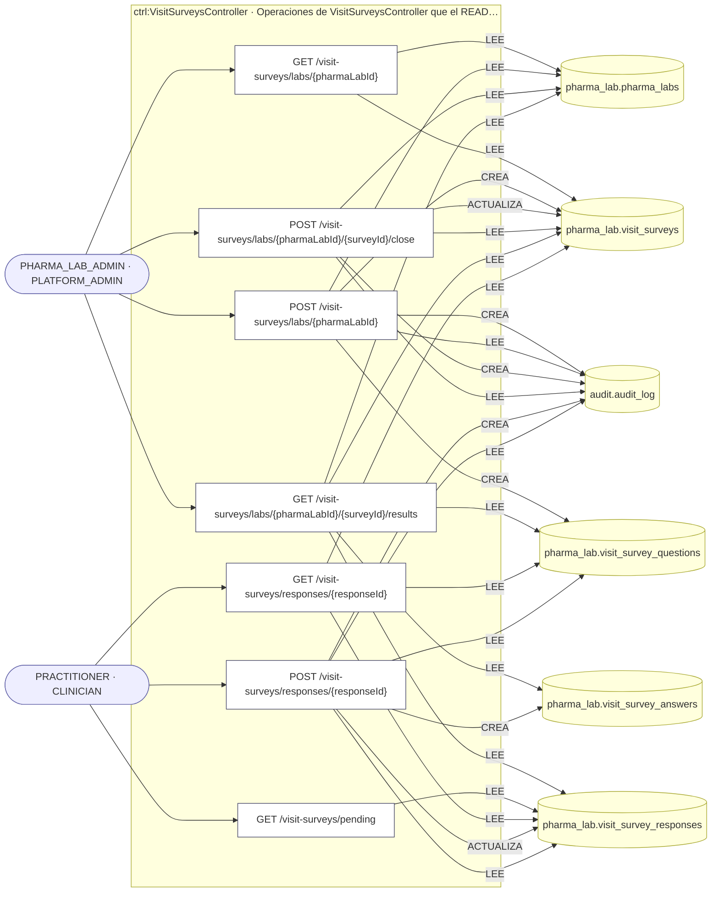

## Máquinas de estado

### Máquina de estados `ALLOWED_TRANSITIONS`

Declarada en `src/modules/pharma_lab/services/visit-requests.service.ts:44`. Los estados llevan el nombre del identificador del código; no se resuelven al catálogo de conceptos.

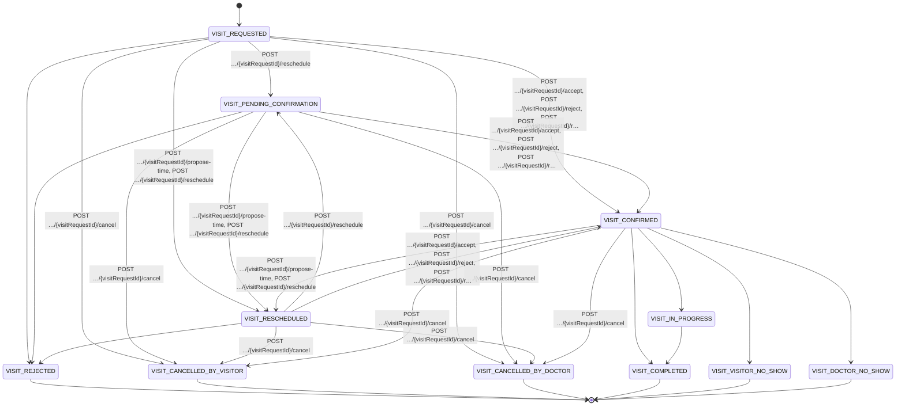

**Operaciones que ejercen esta máquina** _(POR_REFERENCIA: el handler alcanza un método que valida contra la tabla; «sin destino nombrado» significa que el estado de destino llega por el cuerpo de la petición)_:

| Operación | Estados de destino que nombra | A través de |
|---|---|---|
| POST /accounting/journal-transactions/{id}/approve | sin destino nombrado | LedgerService.transition → LedgerService.assertTransition |
| POST /accounting/journal-transactions/{id}/classify | sin destino nombrado | LedgerService.transition → LedgerService.assertTransition |
| POST /accounting/journal-transactions/{id}/post | sin destino nombrado | LedgerService.post → LedgerService.assertTransition |
| POST /accounting/journal-transactions/{id}/reverse | sin destino nombrado | LedgerService.reverseJournal → LedgerService.assertTransition |
| POST /accounting/journal-transactions/{id}/submit-review | sin destino nombrado | LedgerService.transition → LedgerService.assertTransition |
| POST /visit-requests/{visitRequestId}/accept | VISIT_CONFIRMED | VisitRequestsService.transitionByDoctor → VisitRequestsService.assertOpen → VisitRequestsService.assertTransition |
| POST /visit-requests/{visitRequestId}/cancel | VISIT_CANCELLED_BY_DOCTOR, VISIT_CANCELLED_BY_VISITOR | VisitRequestsService.cancel → VisitRequestsService.assertOpen → VisitRequestsService.assertTransition |
| POST /visit-requests/{visitRequestId}/propose-time | VISIT_RESCHEDULED | VisitRequestsService.proposeTime → VisitRequestsService.assertOpen → VisitRequestsService.assertTransition |
| POST /visit-requests/{visitRequestId}/reject | VISIT_CONFIRMED | VisitRequestsService.transitionByDoctor → VisitRequestsService.assertOpen → VisitRequestsService.assertTransition |
| POST /visit-requests/{visitRequestId}/request-info | sin destino nombrado | VisitRequestsService.requestInfo → VisitRequestsService.assertOpen |
| POST /visit-requests/{visitRequestId}/reschedule | VISIT_CONFIRMED, VISIT_PENDING_CONFIRMATION, VISIT_RESCHEDULED | VisitRequestsService.reschedule → VisitRequestsService.assertOpen → VisitRequestsService.assertTransition |

### Máquina de estados `PRODUCT_TRANSITIONS`

Declarada en `src/modules/pharma_lab/services/pharma-catalog.service.ts:43`. Los estados llevan el nombre del identificador del código; no se resuelven al catálogo de conceptos.

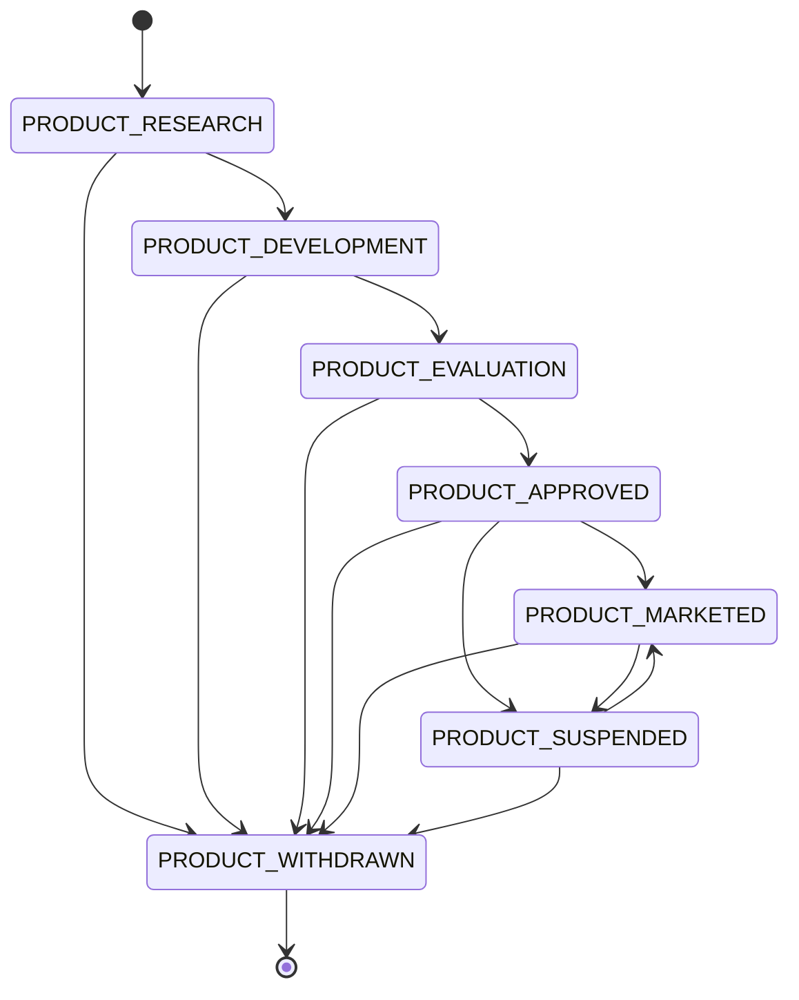

**Operaciones que ejercen esta máquina** _(POR_REFERENCIA: el handler alcanza un método que valida contra la tabla; «sin destino nombrado» significa que el estado de destino llega por el cuerpo de la petición)_:

| Operación | Estados de destino que nombra | A través de |
|---|---|---|
| POST /pharma-labs/{pharmaLabId}/products/{productId}/status | sin destino nombrado | PharmaCatalogService.changeProductStatus |

### Máquina de estados `REPORT_TRANSITIONS`

Declarada en `src/modules/pharma_lab/services/pharmacovigilance.service.ts:38`. Los estados llevan el nombre del identificador del código; no se resuelven al catálogo de conceptos.

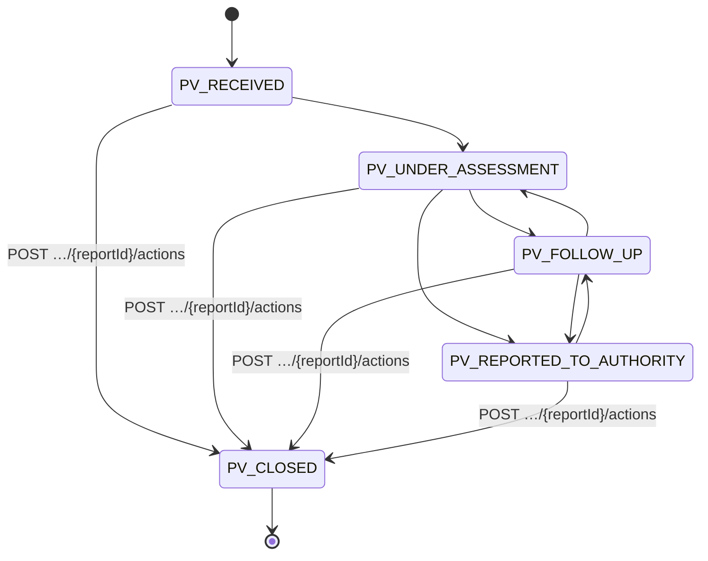

**Operaciones que ejercen esta máquina** _(POR_REFERENCIA: el handler alcanza un método que valida contra la tabla; «sin destino nombrado» significa que el estado de destino llega por el cuerpo de la petición)_:

| Operación | Estados de destino que nombra | A través de |
|---|---|---|
| POST /pharma-labs/{pharmaLabId}/pharmacovigilance/reports/{reportId}/actions | PV_CLOSED | PharmacovigilanceService.addAction |

## Árbol de decisión por operación

Cada árbol se deriva del código del handler y de los métodos que invoca (hasta 4 niveles). Una rama que no decide, no escribe y no falla se poda. Los accesos y los efectos consecutivos se agrupan en un solo nodo.

### Operaciones con decisiones propias

#### 1. POST /pharma-labs

Registrar una organización laboratorio farmacéutico

| HTTP | Código | Cuándo |
|---|---|---|
| 201 | — | Éxito |
| 400 | `VALIDATION_FAILED` | El cuerpo cumple el DTO (sin propiedades extra) |
| 401 | `UNAUTHENTICATED` | Hay una sesión válida (JWT) |
| 403 | `FORBIDDEN` | El rol está permitido; El tenant se resuelve y pertenece al actor |
| 404 | `NOT_FOUND` | ResourceNotFoundException: Organización no encontrada |
| 409 | `CONFLICT` | ConflictException: La organización ya está registrada como laboratorio |
| 429 | `RATE_LIMITED` | No se supera el límite de solicitudes |

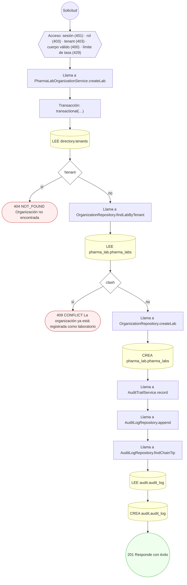

#### 2. GET /pharma-labs/{pharmaLabId}

Consultar el perfil de un laboratorio

| HTTP | Código | Cuándo |
|---|---|---|
| 200 | — | Éxito |
| 400 | `VALIDATION_FAILED` | Los parámetros de ruta son UUID válidos |
| 401 | `UNAUTHENTICATED` | Hay una sesión válida (JWT) |
| 403 | `FORBIDDEN` | El rol está permitido; El tenant se resuelve y pertenece al actor |
| 404 | `NOT_FOUND` | ResourceNotFoundException: Laboratorio no encontrado |
| 429 | `RATE_LIMITED` | No se supera el límite de solicitudes |

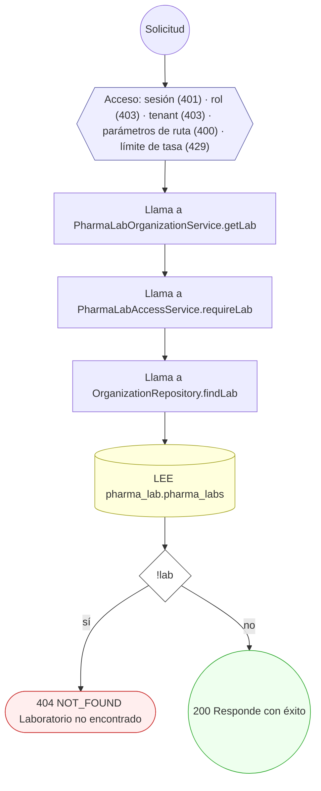

#### 3. PATCH /pharma-labs/{pharmaLabId}

Actualizar el perfil institucional

| HTTP | Código | Cuándo |
|---|---|---|
| 200 | — | Éxito |
| 400 | `VALIDATION_FAILED` | Los parámetros de ruta son UUID válidos; El cuerpo cumple el DTO (sin propiedades extra) |
| 401 | `UNAUTHENTICATED` | Hay una sesión válida (JWT) |
| 403 | `FORBIDDEN` | El rol está permitido; El tenant se resuelve y pertenece al actor |
| 404 | `NOT_FOUND` | ResourceNotFoundException: Laboratorio no encontrado |
| 429 | `RATE_LIMITED` | No se supera el límite de solicitudes |

```mermaid
flowchart TD
  n1(("Solicitud")):::inicio
  n2{{"Acceso: sesión (401) · rol (403) · tenant (403) · parámetros de ruta (400) · cuerpo válido (400) · límite de…"}}:::acceso
  n1 --> n2
  n3["Llama a PharmaLabOrganizationService.updateLab"]:::llamada
  n2 --> n3
  n4["Transacción: transactional(…)"]:::transaccion
  n3 --> n4
  n5["Llama a PharmaLabAccessService.requireLab"]:::llamada
  n4 --> n5
  n6["Llama a OrganizationRepository.findLab"]:::llamada
  n5 --> n6
  n7[("LEE pharma_lab.pharma_labs")]:::efecto
  n6 --> n7
  n8{"!lab"}:::decision
  n7 --> n8
  n9(["404 NOT_FOUND Laboratorio no encontrado"]):::error
  n8 -->|"sí"| n9
  n10[("ACTUALIZA pharma_lab.pharma_labs")]:::efecto
  n8 -->|"no"| n10
  n11{"dto.tradeName !== undefined"}:::decision
  n10 --> n11
  n12[("ACTUALIZA pharma_lab.pharma_labs")]:::efecto
  n11 -->|"sí"| n12
  n13[("ACTUALIZA pharma_lab.pharma_labs")]:::efecto
  n12 --> n13
  n11 -->|"no"| n13
  n14{"dto.taxId !== undefined"}:::decision
  n13 --> n14
  n15[("ACTUALIZA pharma_lab.pharma_labs")]:::efecto
  n14 -->|"sí"| n15
  n16[("ACTUALIZA pharma_lab.pharma_labs")]:::efecto
  n15 --> n16
  n14 -->|"no"| n16
  n17{"dto.description !== undefined"}:::decision
  n16 --> n17
  n18[("ACTUALIZA pharma_lab.pharma_labs")]:::efecto
  n17 -->|"sí"| n18
  n19{"dto.researchAreas !== undefined"}:::decision
  n18 --> n19
  n17 -->|"no"| n19
  n20[("ACTUALIZA pharma_lab.pharma_labs")]:::efecto
  n19 -->|"sí"| n20
  n21[("ACTUALIZA pharma_lab.pharma_labs")]:::efecto
  n20 --> n21
  n19 -->|"no"| n21
  n22{"dto.logoUrl !== undefined"}:::decision
  n21 --> n22
  n23[("ACTUALIZA pharma_lab.pharma_labs")]:::efecto
  n22 -->|"sí"| n23
  n24{"dto.statusConceptId !== undefined"}:::decision
  n23 --> n24
  n22 -->|"no"| n24
  n25[("ACTUALIZA pharma_lab.pharma_labs")]:::efecto
  n24 -->|"sí"| n25
  n26["Llama a AuditTrailService.record"]:::llamada
  n25 --> n26
  n24 -->|"no"| n26
  n27["Llama a AuditLogRepository.append"]:::llamada
  n26 --> n27
  n28["Llama a AuditLogRepository.findChainTip"]:::llamada
  n27 --> n28
  n29[("LEE audit.audit_log")]:::efecto
  n28 --> n29
  n30[("CREA audit.audit_log")]:::efecto
  n29 --> n30
  n31(("200 Responde con éxito")):::ok
  n30 --> n31
  classDef acceso fill:#eef,stroke:#66a
  classDef error fill:#fee,stroke:#c33
  classDef ok fill:#efe,stroke:#3a3
  classDef efecto fill:#ffd,stroke:#aa3
  classDef decision fill:#fff,stroke:#555
  classDef corte fill:#eee,stroke:#999,stroke-dasharray: 4
```

#### 4. POST /pharma-labs/{pharmaLabId}/cost-allocations

Imputar un asiento contable a las dimensiones del laboratorio

| HTTP | Código | Cuándo |
|---|---|---|
| 201 | — | Éxito |
| 400 | `VALIDATION_FAILED` | Los parámetros de ruta son UUID válidos; El cuerpo cumple el DTO (sin propiedades extra) |
| 401 | `UNAUTHENTICATED` | Hay una sesión válida (JWT) |
| 403 | `FORBIDDEN` | El rol está permitido; El tenant se resuelve y pertenece al actor |
| 404 | `NOT_FOUND` | ResourceNotFoundException: Laboratorio no encontrado; ResourceNotFoundException: Asiento contable no encontrado; ResourceNotFoundException: Producto no encontrado en el catálogo del laboratorio |
| 422 | `PRECONDITION_FAILED` | PreconditionFailedException: El laboratorio no está activo |
| 429 | `RATE_LIMITED` | No se supera el límite de solicitudes |

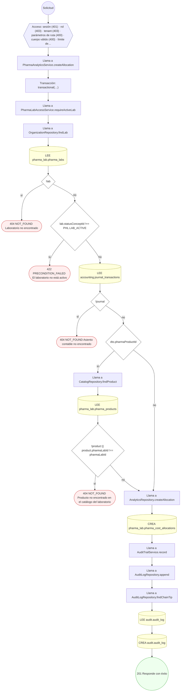

#### 5. GET /pharma-labs/{pharmaLabId}/cost-allocations/report

Rentabilidad por producto y costos por proyecto del periodo

| HTTP | Código | Cuándo |
|---|---|---|
| 200 | — | Éxito |
| 400 | `VALIDATION_FAILED` | Están los parámetros de consulta obligatorios; Los parámetros de ruta son UUID válidos |
| 401 | `UNAUTHENTICATED` | Hay una sesión válida (JWT) |
| 403 | `FORBIDDEN` | El rol está permitido; El tenant se resuelve y pertenece al actor |
| 404 | `NOT_FOUND` | ResourceNotFoundException: Laboratorio no encontrado |
| 429 | `RATE_LIMITED` | No se supera el límite de solicitudes |

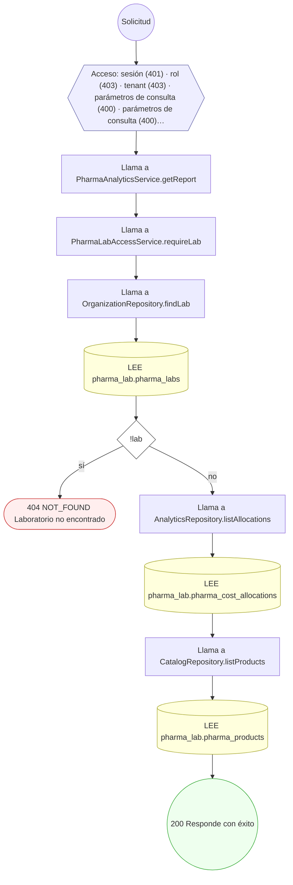

#### 6. GET /pharma-labs/{pharmaLabId}/link-events

Historial de vinculaciones y permisos

| HTTP | Código | Cuándo |
|---|---|---|
| 200 | — | Éxito |
| 400 | `VALIDATION_FAILED` | Los parámetros de ruta son UUID válidos |
| 401 | `UNAUTHENTICATED` | Hay una sesión válida (JWT) |
| 403 | `FORBIDDEN` | El rol está permitido; El tenant se resuelve y pertenece al actor |
| 404 | `NOT_FOUND` | ResourceNotFoundException: Laboratorio no encontrado |
| 429 | `RATE_LIMITED` | No se supera el límite de solicitudes |

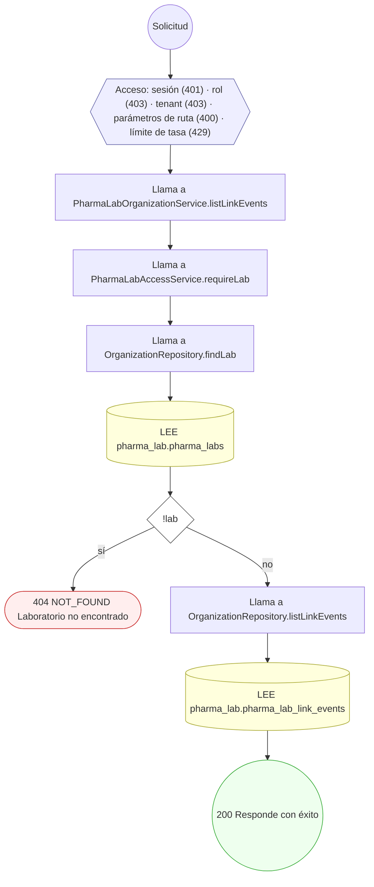

#### 7. GET /pharma-labs/{pharmaLabId}/materials

Listar el material informativo

| HTTP | Código | Cuándo |
|---|---|---|
| 200 | — | Éxito |
| 400 | `VALIDATION_FAILED` | Los parámetros de ruta son UUID válidos |
| 401 | `UNAUTHENTICATED` | Hay una sesión válida (JWT) |
| 403 | `FORBIDDEN` | El rol está permitido; El tenant se resuelve y pertenece al actor |
| 404 | `NOT_FOUND` | ResourceNotFoundException: Laboratorio no encontrado |
| 429 | `RATE_LIMITED` | No se supera el límite de solicitudes |

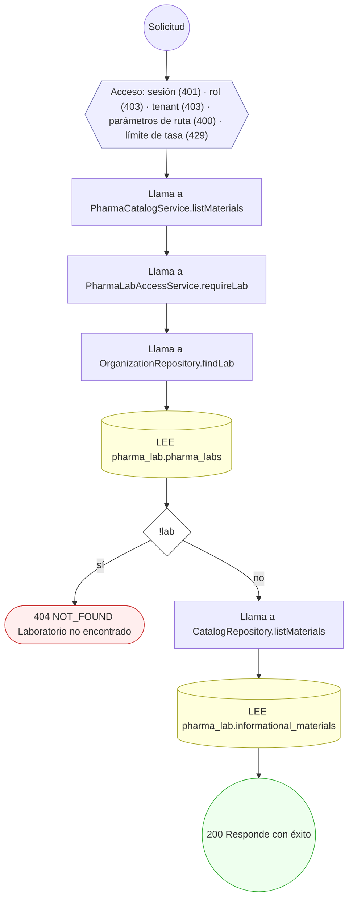

#### 8. POST /pharma-labs/{pharmaLabId}/materials

Crear material informativo (nace en borrador)

| HTTP | Código | Cuándo |
|---|---|---|
| 201 | — | Éxito |
| 400 | `VALIDATION_FAILED` | Los parámetros de ruta son UUID válidos; El cuerpo cumple el DTO (sin propiedades extra) |
| 401 | `UNAUTHENTICATED` | Hay una sesión válida (JWT) |
| 403 | `FORBIDDEN` | El rol está permitido; El tenant se resuelve y pertenece al actor |
| 404 | `NOT_FOUND` | ResourceNotFoundException: Laboratorio no encontrado; ResourceNotFoundException: Producto no encontrado en el catálogo del laboratorio |
| 422 | `PRECONDITION_FAILED` | PreconditionFailedException: El laboratorio no está activo |
| 429 | `RATE_LIMITED` | No se supera el límite de solicitudes |

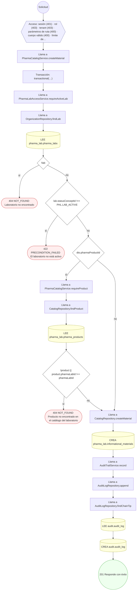

#### 9. GET /pharma-labs/{pharmaLabId}/materials/{materialId}/approvals

Historial de revisiones del material

| HTTP | Código | Cuándo |
|---|---|---|
| 200 | — | Éxito |
| 400 | `VALIDATION_FAILED` | Los parámetros de ruta son UUID válidos |
| 401 | `UNAUTHENTICATED` | Hay una sesión válida (JWT) |
| 403 | `FORBIDDEN` | El rol está permitido; El tenant se resuelve y pertenece al actor |
| 404 | `NOT_FOUND` | ResourceNotFoundException: Laboratorio no encontrado; ResourceNotFoundException: Material informativo no encontrado en el laboratorio |
| 429 | `RATE_LIMITED` | No se supera el límite de solicitudes |

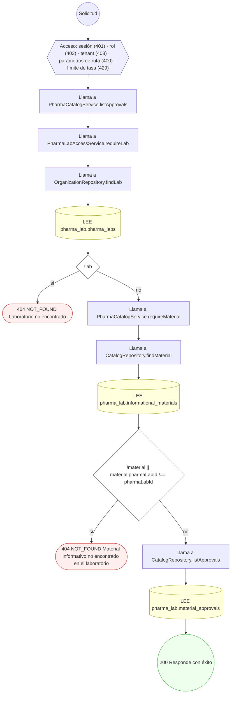

#### 10. GET /pharma-labs/{pharmaLabId}/materials/{materialId}/assets

Listar los adjuntos del material

| HTTP | Código | Cuándo |
|---|---|---|
| 200 | — | Éxito |
| 400 | `VALIDATION_FAILED` | Los parámetros de ruta son UUID válidos |
| 401 | `UNAUTHENTICATED` | Hay una sesión válida (JWT) |
| 403 | `FORBIDDEN` | El rol está permitido; El tenant se resuelve y pertenece al actor |
| 404 | `NOT_FOUND` | ResourceNotFoundException: Laboratorio no encontrado; ResourceNotFoundException: Material informativo no encontrado en el laboratorio |
| 429 | `RATE_LIMITED` | No se supera el límite de solicitudes |

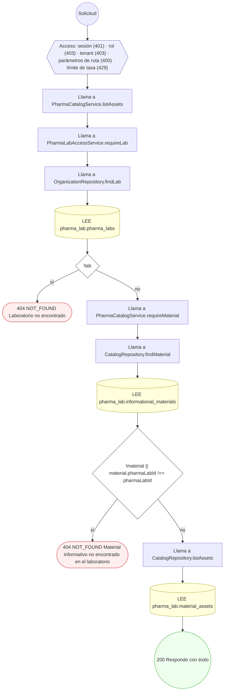

#### 11. POST /pharma-labs/{pharmaLabId}/materials/{materialId}/assets

Adjuntar un archivo al material

| HTTP | Código | Cuándo |
|---|---|---|
| 201 | — | Éxito |
| 400 | `VALIDATION_FAILED` | Los parámetros de ruta son UUID válidos; El cuerpo cumple el DTO (sin propiedades extra) |
| 401 | `UNAUTHENTICATED` | Hay una sesión válida (JWT) |
| 403 | `FORBIDDEN` | El rol está permitido; El tenant se resuelve y pertenece al actor |
| 404 | `NOT_FOUND` | ResourceNotFoundException: Laboratorio no encontrado; ResourceNotFoundException: Material informativo no encontrado en el laboratorio |
| 422 | `PRECONDITION_FAILED` | PreconditionFailedException: No se puede modificar el contenido de un material ya aprobado; creá una versión nueva |
| 429 | `RATE_LIMITED` | No se supera el límite de solicitudes |

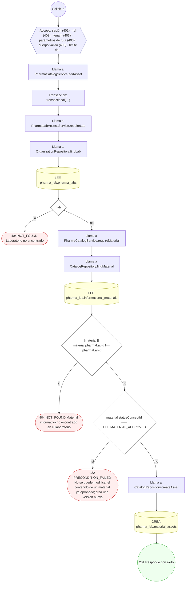

#### 12. POST /pharma-labs/{pharmaLabId}/materials/{materialId}/decision

Aprobar o rechazar el material

| HTTP | Código | Cuándo |
|---|---|---|
| 201 | — | Éxito |
| 400 | `VALIDATION_FAILED` | Los parámetros de ruta son UUID válidos; El cuerpo cumple el DTO (sin propiedades extra) |
| 401 | `UNAUTHENTICATED` | Hay una sesión válida (JWT) |
| 403 | `FORBIDDEN` | El rol está permitido; El tenant se resuelve y pertenece al actor |
| 404 | `NOT_FOUND` | ResourceNotFoundException: Laboratorio no encontrado; ResourceNotFoundException: Material informativo no encontrado en el laboratorio |
| 409 | `CONFLICT` | ConflictException: Solo se decide sobre un material en revisión |
| 422 | `PRECONDITION_FAILED` | PreconditionFailedException: La decisión debe ser aprobar o rechazar |
| 429 | `RATE_LIMITED` | No se supera el límite de solicitudes |

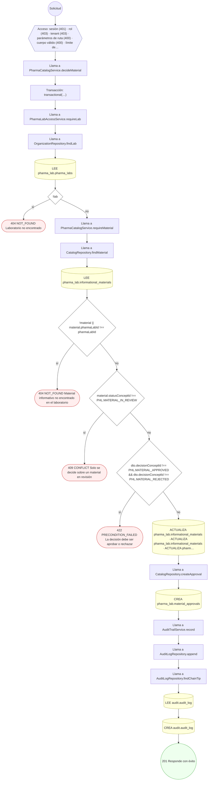

#### 13. POST /pharma-labs/{pharmaLabId}/materials/{materialId}/submit

Enviar el material a revisión interna

| HTTP | Código | Cuándo |
|---|---|---|
| 201 | — | Éxito |
| 400 | `VALIDATION_FAILED` | Los parámetros de ruta son UUID válidos |
| 401 | `UNAUTHENTICATED` | Hay una sesión válida (JWT) |
| 403 | `FORBIDDEN` | El rol está permitido; El tenant se resuelve y pertenece al actor |
| 404 | `NOT_FOUND` | ResourceNotFoundException: Laboratorio no encontrado; ResourceNotFoundException: Material informativo no encontrado en el laboratorio |
| 409 | `CONFLICT` | ConflictException: Solo se envía a revisión un material en borrador |
| 422 | `PRECONDITION_FAILED` | PreconditionFailedException: El material no tiene ningún adjunto que revisar |
| 429 | `RATE_LIMITED` | No se supera el límite de solicitudes |

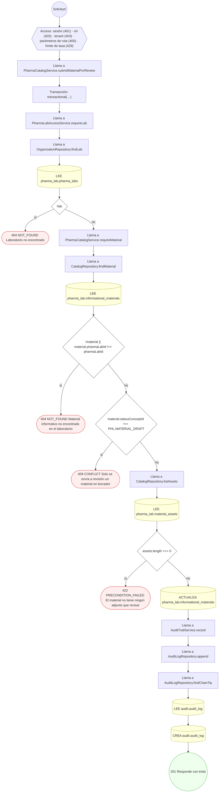

#### 14. GET /pharma-labs/{pharmaLabId}/medical-visitors

Listar los visitadores del laboratorio

| HTTP | Código | Cuándo |
|---|---|---|
| 200 | — | Éxito |
| 400 | `VALIDATION_FAILED` | Los parámetros de ruta son UUID válidos |
| 401 | `UNAUTHENTICATED` | Hay una sesión válida (JWT) |
| 403 | `FORBIDDEN` | El rol está permitido; El tenant se resuelve y pertenece al actor |
| 404 | `NOT_FOUND` | ResourceNotFoundException: Laboratorio no encontrado |
| 429 | `RATE_LIMITED` | No se supera el límite de solicitudes |

```mermaid
flowchart TD
  n1(("Solicitud")):::inicio
  n2{{"Acceso: sesión (401) · rol (403) · tenant (403) · parámetros de ruta (400) · límite de tasa (429)"}}:::acceso
  n1 --> n2
  n3["Llama a MedicalVisitorsService.listVisitors"]:::llamada
  n2 --> n3
  n4["Llama a PharmaLabAccessService.requireLab"]:::llamada
  n3 --> n4
  n5["Llama a OrganizationRepository.findLab"]:::llamada
  n4 --> n5
  n6[("LEE pharma_lab.pharma_labs")]:::efecto
  n5 --> n6
  n7{"!lab"}:::decision
  n6 --> n7
  n8(["404 NOT_FOUND Laboratorio no encontrado"]):::error
  n7 -->|"sí"| n8
  n9["Llama a VisitorsRepository.listVisitors"]:::llamada
  n7 -->|"no"| n9
  n10[("LEE pharma_lab.medical_visitors")]:::efecto
  n9 --> n10
  n11(("200 Responde con éxito")):::ok
  n10 --> n11
  classDef acceso fill:#eef,stroke:#66a
  classDef error fill:#fee,stroke:#c33
  classDef ok fill:#efe,stroke:#3a3
  classDef efecto fill:#ffd,stroke:#aa3
  classDef decision fill:#fff,stroke:#555
  classDef corte fill:#eee,stroke:#999,stroke-dasharray: 4
```

#### 15. POST /pharma-labs/{pharmaLabId}/medical-visitors

Registrar un visitador médico

| HTTP | Código | Cuándo |
|---|---|---|
| 201 | — | Éxito |
| 400 | `VALIDATION_FAILED` | Los parámetros de ruta son UUID válidos; El cuerpo cumple el DTO (sin propiedades extra) |
| 401 | `UNAUTHENTICATED` | Hay una sesión válida (JWT) |
| 403 | `FORBIDDEN` | El rol está permitido; El tenant se resuelve y pertenece al actor |
| 404 | `NOT_FOUND` | ResourceNotFoundException: Laboratorio no encontrado; ResourceNotFoundException: Cuenta no encontrada |
| 409 | `CONFLICT` | ConflictException: La cuenta ya está registrada como visitador; ConflictException: El código interno ya está en uso en el laboratorio |
| 422 | `PRECONDITION_FAILED` | PreconditionFailedException: El laboratorio no está activo; PreconditionFailedException: Algún producto no pertenece al catálogo del laboratorio |
| 429 | `RATE_LIMITED` | No se supera el límite de solicitudes |

```mermaid
flowchart TD
  n1(("Solicitud")):::inicio
  n2{{"Acceso: sesión (401) · rol (403) · tenant (403) · parámetros de ruta (400) · cuerpo válido (400) · límite de…"}}:::acceso
  n1 --> n2
  n3["Llama a MedicalVisitorsService.createVisitor"]:::llamada
  n2 --> n3
  n4["Transacción: transactional(…)"]:::transaccion
  n3 --> n4
  n5["Llama a PharmaLabAccessService.requireActiveLab"]:::llamada
  n4 --> n5
  n6["Llama a OrganizationRepository.findLab"]:::llamada
  n5 --> n6
  n7[("LEE pharma_lab.pharma_labs")]:::efecto
  n6 --> n7
  n8{"!lab"}:::decision
  n7 --> n8
  n9(["404 NOT_FOUND Laboratorio no encontrado"]):::error
  n8 -->|"sí"| n9
  n10{"lab.statusConceptId !== PHL.LAB_ACTIVE"}:::decision
  n8 -->|"no"| n10
  n11(["422 PRECONDITION_FAILED El laboratorio no está activo"]):::error
  n10 -->|"sí"| n11
  n12[("LEE iam.users")]:::efecto
  n10 -->|"no"| n12
  n13{"!user"}:::decision
  n12 --> n13
  n14(["404 NOT_FOUND Cuenta no encontrada"]):::error
  n13 -->|"sí"| n14
  n15["Llama a VisitorsRepository.findVisitorByUser"]:::llamada
  n13 -->|"no"| n15
  n16[("LEE pharma_lab.medical_visitors")]:::efecto
  n15 --> n16
  n17{"already"}:::decision
  n16 --> n17
  n18(["409 CONFLICT La cuenta ya está registrada como visitador"]):::error
  n17 -->|"sí"| n18
  n19["Llama a VisitorsRepository.findVisitorByCode"]:::llamada
  n17 -->|"no"| n19
  n20[("LEE pharma_lab.medical_visitors")]:::efecto
  n19 --> n20
  n21{"codeClash"}:::decision
  n20 --> n21
  n22(["409 CONFLICT El código interno ya está en uso en el laboratorio"]):::error
  n21 -->|"sí"| n22
  n23["Llama a VisitorsRepository.createVisitor"]:::llamada
  n21 -->|"no"| n23
  n24[("CREA pharma_lab.medical_visitors")]:::efecto
  n23 --> n24
  n25{"dto.specialtyConceptIds?.length"}:::decision
  n24 --> n25
  n26["Llama a VisitorsRepository.replaceSpecialties"]:::llamada
  n25 -->|"sí"| n26
  n27[("BORRA pharma_lab.medical_visitor_specialties")]:::efecto
  n26 --> n27
  n28["Repite: por cada const specialtyConceptId de new Set(specialtyConceptIds)"]:::bucle
  n27 --> n28
  n29[("CREA pharma_lab.medical_visitor_specialties")]:::efecto
  n28 -->|"cada elemento"| n29
  n30{"dto.pharmaProductIds?.length"}:::decision
  n29 --> n30
  n28 -->|"al terminar"| n30
  n25 -->|"no"| n30
  n31["Llama a MedicalVisitorsService.assertProductsBelongToLab"]:::llamada
  n30 -->|"sí"| n31
  n32["Llama a CatalogRepository.findProductsByIds"]:::llamada
  n31 --> n32
  n33[("LEE pharma_lab.pharma_products")]:::efecto
  n32 --> n33
  n34{"products.length !== new Set(productIds).size || foreign.length › 0"}:::decision
  n33 --> n34
  n35(["422 PRECONDITION_FAILED Algún producto no pertenece al catálogo del laboratorio"]):::error
  n34 -->|"sí"| n35
  n36["Llama a VisitorsRepository.replaceProducts"]:::llamada
  n34 -->|"no"| n36
  n37[("BORRA pharma_lab.medical_visitor_products")]:::efecto
  n36 --> n37
  n38["Repite: por cada const pharmaProductId de new Set(pharmaProductIds)"]:::bucle
  n37 --> n38
  n39[("CREA pharma_lab.medical_visitor_products")]:::efecto
  n38 -->|"cada elemento"| n39
  n40["Llama a OrganizationRepository.appendLinkEvent"]:::llamada
  n39 --> n40
  n38 -->|"al terminar"| n40
  n30 -->|"no"| n40
  n41[("CREA pharma_lab.pharma_lab_link_events")]:::efecto
  n40 --> n41
  n42["Llama a AuditTrailService.record"]:::llamada
  n41 --> n42
  n43["Llama a AuditLogRepository.append"]:::llamada
  n42 --> n43
  n44["Llama a AuditLogRepository.findChainTip"]:::llamada
  n43 --> n44
  n45[("LEE audit.audit_log")]:::efecto
  n44 --> n45
  n46[("CREA audit.audit_log")]:::efecto
  n45 --> n46
  n47(("201 Responde con éxito")):::ok
  n46 --> n47
  classDef acceso fill:#eef,stroke:#66a
  classDef error fill:#fee,stroke:#c33
  classDef ok fill:#efe,stroke:#3a3
  classDef efecto fill:#ffd,stroke:#aa3
  classDef decision fill:#fff,stroke:#555
  classDef corte fill:#eee,stroke:#999,stroke-dasharray: 4
```

#### 16. PUT /pharma-labs/{pharmaLabId}/medical-visitors/{medicalVisitorId}/products

Fijar los productos que el visitador representa

| HTTP | Código | Cuándo |
|---|---|---|
| 200 | — | Éxito |
| 400 | `VALIDATION_FAILED` | Los parámetros de ruta son UUID válidos; El cuerpo cumple el DTO (sin propiedades extra) |
| 401 | `UNAUTHENTICATED` | Hay una sesión válida (JWT) |
| 403 | `FORBIDDEN` | El rol está permitido; El tenant se resuelve y pertenece al actor |
| 404 | `NOT_FOUND` | ResourceNotFoundException: Laboratorio no encontrado; ResourceNotFoundException: Visitador no encontrado en el laboratorio |
| 422 | `PRECONDITION_FAILED` | PreconditionFailedException: Algún producto no pertenece al catálogo del laboratorio |
| 429 | `RATE_LIMITED` | No se supera el límite de solicitudes |

```mermaid
flowchart TD
  n1(("Solicitud")):::inicio
  n2{{"Acceso: sesión (401) · rol (403) · tenant (403) · parámetros de ruta (400) · cuerpo válido (400) · límite de…"}}:::acceso
  n1 --> n2
  n3["Llama a MedicalVisitorsService.setProducts"]:::llamada
  n2 --> n3
  n4["Transacción: transactional(…)"]:::transaccion
  n3 --> n4
  n5["Llama a PharmaLabAccessService.requireLab"]:::llamada
  n4 --> n5
  n6["Llama a OrganizationRepository.findLab"]:::llamada
  n5 --> n6
  n7[("LEE pharma_lab.pharma_labs")]:::efecto
  n6 --> n7
  n8{"!lab"}:::decision
  n7 --> n8
  n9(["404 NOT_FOUND Laboratorio no encontrado"]):::error
  n8 -->|"sí"| n9
  n10["Llama a PharmaLabAccessService.requireVisitorOfLab"]:::llamada
  n8 -->|"no"| n10
  n11["Llama a VisitorsRepository.findVisitor"]:::llamada
  n10 --> n11
  n12[("LEE pharma_lab.medical_visitors")]:::efecto
  n11 --> n12
  n13{"!visitor || visitor.pharmaLabId !== pharmaLabId"}:::decision
  n12 --> n13
  n14(["404 NOT_FOUND Visitador no encontrado en el laboratorio"]):::error
  n13 -->|"sí"| n14
  n15["Llama a MedicalVisitorsService.assertProductsBelongToLab"]:::llamada
  n13 -->|"no"| n15
  n16["Llama a CatalogRepository.findProductsByIds"]:::llamada
  n15 --> n16
  n17[("LEE pharma_lab.pharma_products")]:::efecto
  n16 --> n17
  n18{"products.length !== new Set(productIds).size || foreign.length › 0"}:::decision
  n17 --> n18
  n19(["422 PRECONDITION_FAILED Algún producto no pertenece al catálogo del laboratorio"]):::error
  n18 -->|"sí"| n19
  n20["Llama a VisitorsRepository.replaceProducts"]:::llamada
  n18 -->|"no"| n20
  n21[("BORRA pharma_lab.medical_visitor_products")]:::efecto
  n20 --> n21
  n22["Repite: por cada const pharmaProductId de new Set(pharmaProductIds)"]:::bucle
  n21 --> n22
  n23[("CREA pharma_lab.medical_visitor_products")]:::efecto
  n22 -->|"cada elemento"| n23
  n24["Llama a AuditTrailService.record"]:::llamada
  n23 --> n24
  n22 -->|"al terminar"| n24
  n25["Llama a AuditLogRepository.append"]:::llamada
  n24 --> n25
  n26["Llama a AuditLogRepository.findChainTip"]:::llamada
  n25 --> n26
  n27[("LEE audit.audit_log")]:::efecto
  n26 --> n27
  n28[("CREA audit.audit_log")]:::efecto
  n27 --> n28
  n29(("200 Responde con éxito")):::ok
  n28 --> n29
  classDef acceso fill:#eef,stroke:#66a
  classDef error fill:#fee,stroke:#c33
  classDef ok fill:#efe,stroke:#3a3
  classDef efecto fill:#ffd,stroke:#aa3
  classDef decision fill:#fff,stroke:#555
  classDef corte fill:#eee,stroke:#999,stroke-dasharray: 4
```

#### 17. POST /pharma-labs/{pharmaLabId}/medical-visitors/{medicalVisitorId}/relink

Revincular a un visitador con nueva autorización

| HTTP | Código | Cuándo |
|---|---|---|
| 201 | — | Éxito |
| 400 | `VALIDATION_FAILED` | Los parámetros de ruta son UUID válidos; El cuerpo cumple el DTO (sin propiedades extra) |
| 401 | `UNAUTHENTICATED` | Hay una sesión válida (JWT) |
| 403 | `FORBIDDEN` | El rol está permitido; El tenant se resuelve y pertenece al actor |
| 404 | `NOT_FOUND` | ResourceNotFoundException: Laboratorio no encontrado; ResourceNotFoundException: Visitador no encontrado en el laboratorio |
| 409 | `CONFLICT` | ConflictException: El visitador ya está vinculado |
| 422 | `PRECONDITION_FAILED` | PreconditionFailedException: El laboratorio no está activo |
| 429 | `RATE_LIMITED` | No se supera el límite de solicitudes |

```mermaid
flowchart TD
  n1(("Solicitud")):::inicio
  n2{{"Acceso: sesión (401) · rol (403) · tenant (403) · parámetros de ruta (400) · cuerpo válido (400) · límite de…"}}:::acceso
  n1 --> n2
  n3["Llama a MedicalVisitorsService.relinkVisitor"]:::llamada
  n2 --> n3
  n4["Transacción: transactional(…)"]:::transaccion
  n3 --> n4
  n5["Llama a PharmaLabAccessService.requireActiveLab"]:::llamada
  n4 --> n5
  n6["Llama a OrganizationRepository.findLab"]:::llamada
  n5 --> n6
  n7[("LEE pharma_lab.pharma_labs")]:::efecto
  n6 --> n7
  n8{"!lab"}:::decision
  n7 --> n8
  n9(["404 NOT_FOUND Laboratorio no encontrado"]):::error
  n8 -->|"sí"| n9
  n10{"lab.statusConceptId !== PHL.LAB_ACTIVE"}:::decision
  n8 -->|"no"| n10
  n11(["422 PRECONDITION_FAILED El laboratorio no está activo"]):::error
  n10 -->|"sí"| n11
  n12["Llama a PharmaLabAccessService.requireVisitorOfLab"]:::llamada
  n10 -->|"no"| n12
  n13["Llama a VisitorsRepository.findVisitor"]:::llamada
  n12 --> n13
  n14[("LEE pharma_lab.medical_visitors")]:::efecto
  n13 --> n14
  n15{"!visitor || visitor.pharmaLabId !== pharmaLabId"}:::decision
  n14 --> n15
  n16(["404 NOT_FOUND Visitador no encontrado en el laboratorio"]):::error
  n15 -->|"sí"| n16
  n17{"visitor.statusConceptId === PHL.LINK_ACTIVE"}:::decision
  n15 -->|"no"| n17
  n18(["409 CONFLICT El visitador ya está vinculado"]):::error
  n17 -->|"sí"| n18
  n19[("ACTUALIZA pharma_lab.medical_visitors · ACTUALIZA pharma_lab.medical_visitors · ACTUALIZA pharma_lab.medical_…")]:::efecto
  n17 -->|"no"| n19
  n20{"user && user.statusConceptId === CONCEPTS.USER_LOCKED"}:::decision
  n19 --> n20
  n21[("ACTUALIZA iam.users")]:::efecto
  n20 -->|"sí"| n21
  n22["Llama a OrganizationRepository.appendLinkEvent"]:::llamada
  n21 --> n22
  n20 -->|"no"| n22
  n23[("CREA pharma_lab.pharma_lab_link_events")]:::efecto
  n22 --> n23
  n24["Llama a AuditTrailService.record"]:::llamada
  n23 --> n24
  n25["Llama a AuditLogRepository.append"]:::llamada
  n24 --> n25
  n26["Llama a AuditLogRepository.findChainTip"]:::llamada
  n25 --> n26
  n27[("LEE audit.audit_log")]:::efecto
  n26 --> n27
  n28[("CREA audit.audit_log")]:::efecto
  n27 --> n28
  n29(("201 Responde con éxito")):::ok
  n28 --> n29
  classDef acceso fill:#eef,stroke:#66a
  classDef error fill:#fee,stroke:#c33
  classDef ok fill:#efe,stroke:#3a3
  classDef efecto fill:#ffd,stroke:#aa3
  classDef decision fill:#fff,stroke:#555
  classDef corte fill:#eee,stroke:#999,stroke-dasharray: 4
```

#### 18. PUT /pharma-labs/{pharmaLabId}/medical-visitors/{medicalVisitorId}/specialties

Fijar las especialidades que el visitador visita

| HTTP | Código | Cuándo |
|---|---|---|
| 200 | — | Éxito |
| 400 | `VALIDATION_FAILED` | Los parámetros de ruta son UUID válidos; El cuerpo cumple el DTO (sin propiedades extra) |
| 401 | `UNAUTHENTICATED` | Hay una sesión válida (JWT) |
| 403 | `FORBIDDEN` | El rol está permitido; El tenant se resuelve y pertenece al actor |
| 404 | `NOT_FOUND` | ResourceNotFoundException: Laboratorio no encontrado; ResourceNotFoundException: Visitador no encontrado en el laboratorio |
| 429 | `RATE_LIMITED` | No se supera el límite de solicitudes |

```mermaid
flowchart TD
  n1(("Solicitud")):::inicio
  n2{{"Acceso: sesión (401) · rol (403) · tenant (403) · parámetros de ruta (400) · cuerpo válido (400) · límite de…"}}:::acceso
  n1 --> n2
  n3["Llama a MedicalVisitorsService.setSpecialties"]:::llamada
  n2 --> n3
  n4["Transacción: transactional(…)"]:::transaccion
  n3 --> n4
  n5["Llama a PharmaLabAccessService.requireLab"]:::llamada
  n4 --> n5
  n6["Llama a OrganizationRepository.findLab"]:::llamada
  n5 --> n6
  n7[("LEE pharma_lab.pharma_labs")]:::efecto
  n6 --> n7
  n8{"!lab"}:::decision
  n7 --> n8
  n9(["404 NOT_FOUND Laboratorio no encontrado"]):::error
  n8 -->|"sí"| n9
  n10["Llama a PharmaLabAccessService.requireVisitorOfLab"]:::llamada
  n8 -->|"no"| n10
  n11["Llama a VisitorsRepository.findVisitor"]:::llamada
  n10 --> n11
  n12[("LEE pharma_lab.medical_visitors")]:::efecto
  n11 --> n12
  n13{"!visitor || visitor.pharmaLabId !== pharmaLabId"}:::decision
  n12 --> n13
  n14(["404 NOT_FOUND Visitador no encontrado en el laboratorio"]):::error
  n13 -->|"sí"| n14
  n15["Llama a VisitorsRepository.replaceSpecialties"]:::llamada
  n13 -->|"no"| n15
  n16[("BORRA pharma_lab.medical_visitor_specialties")]:::efecto
  n15 --> n16
  n17["Repite: por cada const specialtyConceptId de new Set(specialtyConceptIds)"]:::bucle
  n16 --> n17
  n18[("CREA pharma_lab.medical_visitor_specialties")]:::efecto
  n17 -->|"cada elemento"| n18
  n19["Llama a AuditTrailService.record"]:::llamada
  n18 --> n19
  n17 -->|"al terminar"| n19
  n20["Llama a AuditLogRepository.append"]:::llamada
  n19 --> n20
  n21["Llama a AuditLogRepository.findChainTip"]:::llamada
  n20 --> n21
  n22[("LEE audit.audit_log")]:::efecto
  n21 --> n22
  n23[("CREA audit.audit_log")]:::efecto
  n22 --> n23
  n24(("200 Responde con éxito")):::ok
  n23 --> n24
  classDef acceso fill:#eef,stroke:#66a
  classDef error fill:#fee,stroke:#c33
  classDef ok fill:#efe,stroke:#3a3
  classDef efecto fill:#ffd,stroke:#aa3
  classDef decision fill:#fff,stroke:#555
  classDef corte fill:#eee,stroke:#999,stroke-dasharray: 4
```

#### 19. POST /pharma-labs/{pharmaLabId}/medical-visitors/{medicalVisitorId}/unlink

Desvincular al visitador y revocar sus accesos

| HTTP | Código | Cuándo |
|---|---|---|
| 201 | — | Éxito |
| 400 | `VALIDATION_FAILED` | Los parámetros de ruta son UUID válidos; El cuerpo cumple el DTO (sin propiedades extra) |
| 401 | `UNAUTHENTICATED` | Hay una sesión válida (JWT) |
| 403 | `FORBIDDEN` | El rol está permitido; El tenant se resuelve y pertenece al actor |
| 404 | `NOT_FOUND` | ResourceNotFoundException: Laboratorio no encontrado; ResourceNotFoundException: Visitador no encontrado en el laboratorio |
| 409 | `CONFLICT` | ConflictException: El visitador ya está desvinculado |
| 429 | `RATE_LIMITED` | No se supera el límite de solicitudes |

```mermaid
flowchart TD
  n1(("Solicitud")):::inicio
  n2{{"Acceso: sesión (401) · rol (403) · tenant (403) · parámetros de ruta (400) · cuerpo válido (400) · límite de…"}}:::acceso
  n1 --> n2
  n3["Llama a MedicalVisitorsService.unlinkVisitor"]:::llamada
  n2 --> n3
  n4["Transacción: transactional(…)"]:::transaccion
  n3 --> n4
  n5["Llama a PharmaLabAccessService.requireLab"]:::llamada
  n4 --> n5
  n6["Llama a OrganizationRepository.findLab"]:::llamada
  n5 --> n6
  n7[("LEE pharma_lab.pharma_labs")]:::efecto
  n6 --> n7
  n8{"!lab"}:::decision
  n7 --> n8
  n9(["404 NOT_FOUND Laboratorio no encontrado"]):::error
  n8 -->|"sí"| n9
  n10["Llama a PharmaLabAccessService.requireVisitorOfLab"]:::llamada
  n8 -->|"no"| n10
  n11["Llama a VisitorsRepository.findVisitor"]:::llamada
  n10 --> n11
  n12[("LEE pharma_lab.medical_visitors")]:::efecto
  n11 --> n12
  n13{"!visitor || visitor.pharmaLabId !== pharmaLabId"}:::decision
  n12 --> n13
  n14(["404 NOT_FOUND Visitador no encontrado en el laboratorio"]):::error
  n13 -->|"sí"| n14
  n15{"visitor.statusConceptId === PHL.LINK_TERMINATED"}:::decision
  n13 -->|"no"| n15
  n16(["409 CONFLICT El visitador ya está desvinculado"]):::error
  n15 -->|"sí"| n16
  n17[("ACTUALIZA pharma_lab.medical_visitors · ACTUALIZA pharma_lab.medical_visitors · ACTUALIZA pharma_lab.medical_…")]:::efecto
  n15 -->|"no"| n17
  n18["Llama a VisitorsRepository.replaceProducts"]:::llamada
  n17 --> n18
  n19[("BORRA pharma_lab.medical_visitor_products")]:::efecto
  n18 --> n19
  n20["Repite: por cada const pharmaProductId de new Set(pharmaProductIds)"]:::bucle
  n19 --> n20
  n21[("CREA pharma_lab.medical_visitor_products")]:::efecto
  n20 -->|"cada elemento"| n21
  n22["Llama a OrganizationRepository.findStaffByUser"]:::llamada
  n21 --> n22
  n20 -->|"al terminar"| n22
  n23[("LEE pharma_lab.pharma_lab_staff")]:::efecto
  n22 --> n23
  n24{"staff && staff.statusConceptId === PHL.LINK_ACTIVE"}:::decision
  n23 --> n24
  n25[("ACTUALIZA pharma_lab.pharma_lab_staff · ACTUALIZA pharma_lab.pharma_lab_staff · ACTUALIZA pharma_lab.pharma_l…")]:::efecto
  n24 -->|"sí"| n25
  n26[("LEE iam.users")]:::efecto
  n25 --> n26
  n24 -->|"no"| n26
  n27{"user"}:::decision
  n26 --> n27
  n28[("ACTUALIZA iam.users")]:::efecto
  n27 -->|"sí"| n28
  n29["Llama a VisitorsRepository.revokeSessions"]:::llamada
  n28 --> n29
  n27 -->|"no"| n29
  n30[("ACTUALIZA iam.sessions")]:::efecto
  n29 --> n30
  n31["Llama a VisitorsRepository.revokeRefreshTokens"]:::llamada
  n30 --> n31
  n32[("LEE iam.sessions · ACTUALIZA iam.refresh_tokens")]:::efecto
  n31 --> n32
  n33["Llama a VisitsRepository.listOpenRequestsOfVisitor"]:::llamada
  n32 --> n33
  n34[("LEE pharma_lab.visit_requests")]:::efecto
  n33 --> n34
  n35["Repite: por cada const request de openRequests"]:::bucle
  n34 --> n35
  n36[("ACTUALIZA pharma_lab.visit_requests · ACTUALIZA pharma_lab.visit_requests")]:::efecto
  n35 -->|"cada elemento"| n36
  n37["Llama a VisitsRepository.appendRequestEvent"]:::llamada
  n36 --> n37
  n38[("CREA pharma_lab.visit_request_events")]:::efecto
  n37 --> n38
  n39["Llama a PharmaLabNotificationsService.notify"]:::llamada
  n38 --> n39
  n40[("CREA pharma_lab.pharma_lab_notices")]:::efecto
  n39 --> n40
  n41["Llama a OrganizationRepository.appendLinkEvent"]:::llamada
  n40 --> n41
  n35 -->|"al terminar"| n41
  n42[("CREA pharma_lab.pharma_lab_link_events")]:::efecto
  n41 --> n42
  n43["Llama a AuditTrailService.record"]:::llamada
  n42 --> n43
  n44["Llama a AuditLogRepository.append"]:::llamada
  n43 --> n44
  n45["Llama a AuditLogRepository.findChainTip"]:::llamada
  n44 --> n45
  n46[("LEE audit.audit_log")]:::efecto
  n45 --> n46
  n47[("CREA audit.audit_log")]:::efecto
  n46 --> n47
  n48(("201 Responde con éxito")):::ok
  n47 --> n48
  classDef acceso fill:#eef,stroke:#66a
  classDef error fill:#fee,stroke:#c33
  classDef ok fill:#efe,stroke:#3a3
  classDef efecto fill:#ffd,stroke:#aa3
  classDef decision fill:#fff,stroke:#555
  classDef corte fill:#eee,stroke:#999,stroke-dasharray: 4
```

#### 20. POST /pharma-labs/{pharmaLabId}/medical-visitors/{medicalVisitorId}/verifications

Registrar las verificaciones del visitador

| HTTP | Código | Cuándo |
|---|---|---|
| 201 | — | Éxito |
| 400 | `VALIDATION_FAILED` | Los parámetros de ruta son UUID válidos; El cuerpo cumple el DTO (sin propiedades extra) |
| 401 | `UNAUTHENTICATED` | Hay una sesión válida (JWT) |
| 403 | `FORBIDDEN` | El rol está permitido; El tenant se resuelve y pertenece al actor |
| 404 | `NOT_FOUND` | ResourceNotFoundException: Laboratorio no encontrado; ResourceNotFoundException: Visitador no encontrado en el laboratorio |
| 429 | `RATE_LIMITED` | No se supera el límite de solicitudes |

```mermaid
flowchart TD
  n1(("Solicitud")):::inicio
  n2{{"Acceso: sesión (401) · rol (403) · tenant (403) · parámetros de ruta (400) · cuerpo válido (400) · límite de…"}}:::acceso
  n1 --> n2
  n3["Llama a MedicalVisitorsService.verifyVisitor"]:::llamada
  n2 --> n3
  n4["Transacción: transactional(…)"]:::transaccion
  n3 --> n4
  n5["Llama a PharmaLabAccessService.requireLab"]:::llamada
  n4 --> n5
  n6["Llama a OrganizationRepository.findLab"]:::llamada
  n5 --> n6
  n7[("LEE pharma_lab.pharma_labs")]:::efecto
  n6 --> n7
  n8{"!lab"}:::decision
  n7 --> n8
  n9(["404 NOT_FOUND Laboratorio no encontrado"]):::error
  n8 -->|"sí"| n9
  n10["Llama a PharmaLabAccessService.requireVisitorOfLab"]:::llamada
  n8 -->|"no"| n10
  n11["Llama a VisitorsRepository.findVisitor"]:::llamada
  n10 --> n11
  n12[("LEE pharma_lab.medical_visitors")]:::efecto
  n11 --> n12
  n13{"!visitor || visitor.pharmaLabId !== pharmaLabId"}:::decision
  n12 --> n13
  n14(["404 NOT_FOUND Visitador no encontrado en el laboratorio"]):::error
  n13 -->|"sí"| n14
  n15{"dto.identityVerificationConceptId"}:::decision
  n13 -->|"no"| n15
  n16[("ACTUALIZA pharma_lab.medical_visitors")]:::efecto
  n15 -->|"sí"| n16
  n17{"dto.contractVerificationConceptId"}:::decision
  n16 --> n17
  n15 -->|"no"| n17
  n18[("ACTUALIZA pharma_lab.medical_visitors")]:::efecto
  n17 -->|"sí"| n18
  n19{"dto.credentialVerificationConceptId"}:::decision
  n18 --> n19
  n17 -->|"no"| n19
  n20[("ACTUALIZA pharma_lab.medical_visitors")]:::efecto
  n19 -->|"sí"| n20
  n21["Llama a AuditTrailService.record"]:::llamada
  n20 --> n21
  n19 -->|"no"| n21
  n22["Llama a AuditLogRepository.append"]:::llamada
  n21 --> n22
  n23["Llama a AuditLogRepository.findChainTip"]:::llamada
  n22 --> n23
  n24[("LEE audit.audit_log")]:::efecto
  n23 --> n24
  n25[("CREA audit.audit_log")]:::efecto
  n24 --> n25
  n26(("201 Responde con éxito")):::ok
  n25 --> n26
  classDef acceso fill:#eef,stroke:#66a
  classDef error fill:#fee,stroke:#c33
  classDef ok fill:#efe,stroke:#3a3
  classDef efecto fill:#ffd,stroke:#aa3
  classDef decision fill:#fff,stroke:#555
  classDef corte fill:#eee,stroke:#999,stroke-dasharray: 4
```

#### 21. GET /pharma-labs/{pharmaLabId}/pharmacovigilance/reports

Listar los reportes del laboratorio

| HTTP | Código | Cuándo |
|---|---|---|
| 200 | — | Éxito |
| 400 | `VALIDATION_FAILED` | Los parámetros de ruta son UUID válidos |
| 401 | `UNAUTHENTICATED` | Hay una sesión válida (JWT) |
| 403 | `FORBIDDEN` | El rol está permitido; El tenant se resuelve y pertenece al actor |
| 404 | `NOT_FOUND` | ResourceNotFoundException: Laboratorio no encontrado |
| 429 | `RATE_LIMITED` | No se supera el límite de solicitudes |

```mermaid
flowchart TD
  n1(("Solicitud")):::inicio
  n2{{"Acceso: sesión (401) · rol (403) · tenant (403) · parámetros de ruta (400) · límite de tasa (429)"}}:::acceso
  n1 --> n2
  n3["Llama a PharmacovigilanceService.listReports"]:::llamada
  n2 --> n3
  n4["Llama a PharmaLabAccessService.requireLab"]:::llamada
  n3 --> n4
  n5["Llama a OrganizationRepository.findLab"]:::llamada
  n4 --> n5
  n6[("LEE pharma_lab.pharma_labs")]:::efecto
  n5 --> n6
  n7{"!lab"}:::decision
  n6 --> n7
  n8(["404 NOT_FOUND Laboratorio no encontrado"]):::error
  n7 -->|"sí"| n8
  n9["Llama a PharmacovigilanceRepository.listReports"]:::llamada
  n7 -->|"no"| n9
  n10[("LEE pharma_lab.pharmacovigilance_reports")]:::efecto
  n9 --> n10
  n11(("200 Responde con éxito")):::ok
  n10 --> n11
  classDef acceso fill:#eef,stroke:#66a
  classDef error fill:#fee,stroke:#c33
  classDef ok fill:#efe,stroke:#3a3
  classDef efecto fill:#ffd,stroke:#aa3
  classDef decision fill:#fff,stroke:#555
  classDef corte fill:#eee,stroke:#999,stroke-dasharray: 4
```

#### 22. POST /pharma-labs/{pharmaLabId}/pharmacovigilance/reports

Enviar un reporte de farmacovigilancia

| HTTP | Código | Cuándo |
|---|---|---|
| 201 | — | Éxito |
| 400 | `VALIDATION_FAILED` | Los parámetros de ruta son UUID válidos; El cuerpo cumple el DTO (sin propiedades extra) |
| 401 | `UNAUTHENTICATED` | Hay una sesión válida (JWT) |
| 403 | `FORBIDDEN` | El rol está permitido; El tenant se resuelve y pertenece al actor |
| 404 | `NOT_FOUND` | ResourceNotFoundException: Laboratorio no encontrado; ResourceNotFoundException: Producto no encontrado en el catálogo del laboratorio |
| 409 | `CONFLICT` | ConflictException: No se pudo asignar un código de caso libre |
| 429 | `RATE_LIMITED` | No se supera el límite de solicitudes |

```mermaid
flowchart TD
  n1(("Solicitud")):::inicio
  n2{{"Acceso: sesión (401) · rol (403) · tenant (403) · parámetros de ruta (400) · cuerpo válido (400) · límite de…"}}:::acceso
  n1 --> n2
  n3["Llama a PharmacovigilanceService.createReport"]:::llamada
  n2 --> n3
  n4["Transacción: transactional(…)"]:::transaccion
  n3 --> n4
  n5["Llama a PharmaLabAccessService.requireLab"]:::llamada
  n4 --> n5
  n6["Llama a OrganizationRepository.findLab"]:::llamada
  n5 --> n6
  n7[("LEE pharma_lab.pharma_labs")]:::efecto
  n6 --> n7
  n8{"!lab"}:::decision
  n7 --> n8
  n9(["404 NOT_FOUND Laboratorio no encontrado"]):::error
  n8 -->|"sí"| n9
  n10["Llama a CatalogRepository.findProduct"]:::llamada
  n8 -->|"no"| n10
  n11[("LEE pharma_lab.pharma_products")]:::efecto
  n10 --> n11
  n12{"!product || product.pharmaLabId !== pharmaLabId"}:::decision
  n11 --> n12
  n13(["404 NOT_FOUND Producto no encontrado en el catálogo del laboratorio"]):::error
  n12 -->|"sí"| n13
  n14["Llama a PharmacovigilanceService.nextCaseCode"]:::llamada
  n12 -->|"no"| n14
  n15["Llama a PharmacovigilanceRepository.countReports"]:::llamada
  n14 --> n15
  n16[("LEE pharma_lab.pharmacovigilance_reports")]:::efecto
  n15 --> n16
  n17["Repite: ciclo for"]:::bucle
  n16 --> n17
  n18["Llama a PharmacovigilanceRepository.findReportByCaseCode"]:::llamada
  n17 -->|"cada elemento"| n18
  n19[("LEE pharma_lab.pharmacovigilance_reports")]:::efecto
  n18 --> n19
  n20(["409 CONFLICT No se pudo asignar un código de caso libre"]):::error
  n19 --> n20
  n17 -->|"al terminar"| n20
  n21["Llama a PharmacovigilanceRepository.createReport"]:::llamada
  n22[("CREA pharma_lab.pharmacovigilance_reports")]:::efecto
  n21 --> n22
  n23["Llama a PharmacovigilanceRepository.appendAction"]:::llamada
  n22 --> n23
  n24[("CREA pharma_lab.pharmacovigilance_actions")]:::efecto
  n23 --> n24
  n25["Llama a PharmaLabOrganizationService.listActiveStaffUserIds"]:::llamada
  n24 --> n25
  n26["Llama a OrganizationRepository.listStaff"]:::llamada
  n25 --> n26
  n27[("LEE pharma_lab.pharma_lab_staff")]:::efecto
  n26 --> n27
  n28["Llama a PharmaLabNotificationsService.notifyAll"]:::llamada
  n27 --> n28
  n29["Repite: por cada const recipientUserId de new Set(recipientUserIds)"]:::bucle
  n28 --> n29
  n30["Llama a PharmaLabNotificationsService.notify"]:::llamada
  n29 -->|"cada elemento"| n30
  n31[("CREA pharma_lab.pharma_lab_notices")]:::efecto
  n30 --> n31
  n32["Llama a AuditTrailService.record"]:::llamada
  n31 --> n32
  n29 -->|"al terminar"| n32
  n33["Llama a AuditLogRepository.append"]:::llamada
  n32 --> n33
  n34["Llama a AuditLogRepository.findChainTip"]:::llamada
  n33 --> n34
  n35[("LEE audit.audit_log")]:::efecto
  n34 --> n35
  n36[("CREA audit.audit_log")]:::efecto
  n35 --> n36
  n37(("201 Responde con éxito")):::ok
  n36 --> n37
  classDef acceso fill:#eef,stroke:#66a
  classDef error fill:#fee,stroke:#c33
  classDef ok fill:#efe,stroke:#3a3
  classDef efecto fill:#ffd,stroke:#aa3
  classDef decision fill:#fff,stroke:#555
  classDef corte fill:#eee,stroke:#999,stroke-dasharray: 4
```

#### 23. GET /pharma-labs/{pharmaLabId}/pharmacovigilance/reports/{reportId}

Consultar un reporte con su trazabilidad

| HTTP | Código | Cuándo |
|---|---|---|
| 200 | — | Éxito |
| 400 | `VALIDATION_FAILED` | Los parámetros de ruta son UUID válidos |
| 401 | `UNAUTHENTICATED` | Hay una sesión válida (JWT) |
| 403 | `FORBIDDEN` | El rol está permitido; El tenant se resuelve y pertenece al actor |
| 404 | `NOT_FOUND` | ResourceNotFoundException: Laboratorio no encontrado; ResourceNotFoundException: Reporte de farmacovigilancia no encontrado en el laboratorio |
| 429 | `RATE_LIMITED` | No se supera el límite de solicitudes |

```mermaid
flowchart TD
  n1(("Solicitud")):::inicio
  n2{{"Acceso: sesión (401) · rol (403) · tenant (403) · parámetros de ruta (400) · límite de tasa (429)"}}:::acceso
  n1 --> n2
  n3["Llama a PharmacovigilanceService.getReportDetail"]:::llamada
  n2 --> n3
  n4["Llama a PharmaLabAccessService.requireLab"]:::llamada
  n3 --> n4
  n5["Llama a OrganizationRepository.findLab"]:::llamada
  n4 --> n5
  n6[("LEE pharma_lab.pharma_labs")]:::efecto
  n5 --> n6
  n7{"!lab"}:::decision
  n6 --> n7
  n8(["404 NOT_FOUND Laboratorio no encontrado"]):::error
  n7 -->|"sí"| n8
  n9["Llama a PharmacovigilanceService.requireReport"]:::llamada
  n7 -->|"no"| n9
  n10["Llama a PharmacovigilanceRepository.findReport"]:::llamada
  n9 --> n10
  n11[("LEE pharma_lab.pharmacovigilance_reports")]:::efecto
  n10 --> n11
  n12{"!report || report.pharmaLabId !== pharmaLabId"}:::decision
  n11 --> n12
  n13(["404 NOT_FOUND Reporte de farmacovigilancia no encontrado en el laboratorio"]):::error
  n12 -->|"sí"| n13
  n14["Llama a PharmacovigilanceRepository.listActions"]:::llamada
  n12 -->|"no"| n14
  n15[("LEE pharma_lab.pharmacovigilance_actions")]:::efecto
  n14 --> n15
  n16(("200 Responde con éxito")):::ok
  n15 --> n16
  classDef acceso fill:#eef,stroke:#66a
  classDef error fill:#fee,stroke:#c33
  classDef ok fill:#efe,stroke:#3a3
  classDef efecto fill:#ffd,stroke:#aa3
  classDef decision fill:#fff,stroke:#555
  classDef corte fill:#eee,stroke:#999,stroke-dasharray: 4
```

#### 24. POST /pharma-labs/{pharmaLabId}/pharmacovigilance/reports/{reportId}/actions

Registrar una acción de seguimiento

| HTTP | Código | Cuándo |
|---|---|---|
| 201 | — | Éxito |
| 400 | `VALIDATION_FAILED` | Los parámetros de ruta son UUID válidos; El cuerpo cumple el DTO (sin propiedades extra) |
| 401 | `UNAUTHENTICATED` | Hay una sesión válida (JWT) |
| 403 | `FORBIDDEN` | El rol está permitido; El tenant se resuelve y pertenece al actor |
| 404 | `NOT_FOUND` | ResourceNotFoundException: Laboratorio no encontrado; ResourceNotFoundException: Reporte de farmacovigilancia no encontrado en el laboratorio |
| 409 | `CONFLICT` | ConflictException: La transición de estado del reporte no está permitida |
| 429 | `RATE_LIMITED` | No se supera el límite de solicitudes |

```mermaid
flowchart TD
  n1(("Solicitud")):::inicio
  n2{{"Acceso: sesión (401) · rol (403) · tenant (403) · parámetros de ruta (400) · cuerpo válido (400) · límite de…"}}:::acceso
  n1 --> n2
  n3["Llama a PharmacovigilanceService.addAction"]:::llamada
  n2 --> n3
  n4["Transacción: transactional(…)"]:::transaccion
  n3 --> n4
  n5["Llama a PharmaLabAccessService.requireLab"]:::llamada
  n4 --> n5
  n6["Llama a OrganizationRepository.findLab"]:::llamada
  n5 --> n6
  n7[("LEE pharma_lab.pharma_labs")]:::efecto
  n6 --> n7
  n8{"!lab"}:::decision
  n7 --> n8
  n9(["404 NOT_FOUND Laboratorio no encontrado"]):::error
  n8 -->|"sí"| n9
  n10["Llama a PharmacovigilanceService.requireReport"]:::llamada
  n8 -->|"no"| n10
  n11["Llama a PharmacovigilanceRepository.findReport"]:::llamada
  n10 --> n11
  n12[("LEE pharma_lab.pharmacovigilance_reports")]:::efecto
  n11 --> n12
  n13{"!report || report.pharmaLabId !== pharmaLabId"}:::decision
  n12 --> n13
  n14(["404 NOT_FOUND Reporte de farmacovigilancia no encontrado en el laboratorio"]):::error
  n13 -->|"sí"| n14
  n15{"dto.newStatusConceptId !== previous && !allowed.includes(dto.newStatusConceptId)"}:::decision
  n13 -->|"no"| n15
  n16(["409 CONFLICT La transición de estado del reporte no está permitida"]):::error
  n15 -->|"sí"| n16
  n17[("ACTUALIZA pharma_lab.pharmacovigilance_reports")]:::efecto
  n15 -->|"no"| n17
  n18{"dto.newStatusConceptId === PHL.PV_CLOSED"}:::decision
  n17 --> n18
  n19[("ACTUALIZA pharma_lab.pharmacovigilance_reports")]:::efecto
  n18 -->|"sí"| n19
  n20["Llama a PharmacovigilanceRepository.appendAction"]:::llamada
  n19 --> n20
  n18 -->|"no"| n20
  n21[("CREA pharma_lab.pharmacovigilance_actions")]:::efecto
  n20 --> n21
  n22["Llama a AuditTrailService.record"]:::llamada
  n21 --> n22
  n23["Llama a AuditLogRepository.append"]:::llamada
  n22 --> n23
  n24["Llama a AuditLogRepository.findChainTip"]:::llamada
  n23 --> n24
  n25[("LEE audit.audit_log")]:::efecto
  n24 --> n25
  n26[("CREA audit.audit_log")]:::efecto
  n25 --> n26
  n27(("201 Responde con éxito")):::ok
  n26 --> n27
  classDef acceso fill:#eef,stroke:#66a
  classDef error fill:#fee,stroke:#c33
  classDef ok fill:#efe,stroke:#3a3
  classDef efecto fill:#ffd,stroke:#aa3
  classDef decision fill:#fff,stroke:#555
  classDef corte fill:#eee,stroke:#999,stroke-dasharray: 4
```

#### 25. GET /pharma-labs/{pharmaLabId}/products

Listar el catálogo de medicamentos

| HTTP | Código | Cuándo |
|---|---|---|
| 200 | — | Éxito |
| 400 | `VALIDATION_FAILED` | Los parámetros de ruta son UUID válidos |
| 401 | `UNAUTHENTICATED` | Hay una sesión válida (JWT) |
| 403 | `FORBIDDEN` | El rol está permitido; El tenant se resuelve y pertenece al actor |
| 404 | `NOT_FOUND` | ResourceNotFoundException: Laboratorio no encontrado |
| 429 | `RATE_LIMITED` | No se supera el límite de solicitudes |

```mermaid
flowchart TD
  n1(("Solicitud")):::inicio
  n2{{"Acceso: sesión (401) · rol (403) · tenant (403) · parámetros de ruta (400) · límite de tasa (429)"}}:::acceso
  n1 --> n2
  n3["Llama a PharmaCatalogService.listProducts"]:::llamada
  n2 --> n3
  n4["Llama a PharmaLabAccessService.requireLab"]:::llamada
  n3 --> n4
  n5["Llama a OrganizationRepository.findLab"]:::llamada
  n4 --> n5
  n6[("LEE pharma_lab.pharma_labs")]:::efecto
  n5 --> n6
  n7{"!lab"}:::decision
  n6 --> n7
  n8(["404 NOT_FOUND Laboratorio no encontrado"]):::error
  n7 -->|"sí"| n8
  n9["Llama a CatalogRepository.listProducts"]:::llamada
  n7 -->|"no"| n9
  n10[("LEE pharma_lab.pharma_products")]:::efecto
  n9 --> n10
  n11(("200 Responde con éxito")):::ok
  n10 --> n11
  classDef acceso fill:#eef,stroke:#66a
  classDef error fill:#fee,stroke:#c33
  classDef ok fill:#efe,stroke:#3a3
  classDef efecto fill:#ffd,stroke:#aa3
  classDef decision fill:#fff,stroke:#555
  classDef corte fill:#eee,stroke:#999,stroke-dasharray: 4
```

#### 26. POST /pharma-labs/{pharmaLabId}/products

Registrar un medicamento en el catálogo

| HTTP | Código | Cuándo |
|---|---|---|
| 201 | — | Éxito |
| 400 | `VALIDATION_FAILED` | Los parámetros de ruta son UUID válidos; El cuerpo cumple el DTO (sin propiedades extra) |
| 401 | `UNAUTHENTICATED` | Hay una sesión válida (JWT) |
| 403 | `FORBIDDEN` | El rol está permitido; El tenant se resuelve y pertenece al actor |
| 404 | `NOT_FOUND` | ResourceNotFoundException: Laboratorio no encontrado |
| 422 | `PRECONDITION_FAILED` | PreconditionFailedException: El laboratorio no está activo; PreconditionFailedException: No se puede declarar una indicación autorizada en un producto que no está aprobado |
| 429 | `RATE_LIMITED` | No se supera el límite de solicitudes |

```mermaid
flowchart TD
  n1(("Solicitud")):::inicio
  n2{{"Acceso: sesión (401) · rol (403) · tenant (403) · parámetros de ruta (400) · cuerpo válido (400) · límite de…"}}:::acceso
  n1 --> n2
  n3["Llama a PharmaCatalogService.createProduct"]:::llamada
  n2 --> n3
  n4["Transacción: transactional(…)"]:::transaccion
  n3 --> n4
  n5["Llama a PharmaLabAccessService.requireActiveLab"]:::llamada
  n4 --> n5
  n6["Llama a OrganizationRepository.findLab"]:::llamada
  n5 --> n6
  n7[("LEE pharma_lab.pharma_labs")]:::efecto
  n6 --> n7
  n8{"!lab"}:::decision
  n7 --> n8
  n9(["404 NOT_FOUND Laboratorio no encontrado"]):::error
  n8 -->|"sí"| n9
  n10{"lab.statusConceptId !== PHL.LAB_ACTIVE"}:::decision
  n8 -->|"no"| n10
  n11(["422 PRECONDITION_FAILED El laboratorio no está activo"]):::error
  n10 -->|"sí"| n11
  n12["Llama a PharmaCatalogService.assertIndicationAllowed"]:::llamada
  n10 -->|"no"| n12
  n13{"!PUBLISHABLE_STATUSES.includes(statusConceptId)"}:::decision
  n12 --> n13
  n14(["422 PRECONDITION_FAILED No se puede declarar una indicación autorizada en un producto que no está aprobado"]):::error
  n13 -->|"sí"| n14
  n15["Llama a CatalogRepository.createProduct"]:::llamada
  n13 -->|"no"| n15
  n16[("CREA pharma_lab.pharma_products")]:::efecto
  n15 --> n16
  n17["Llama a AuditTrailService.record"]:::llamada
  n16 --> n17
  n18["Llama a AuditLogRepository.append"]:::llamada
  n17 --> n18
  n19["Llama a AuditLogRepository.findChainTip"]:::llamada
  n18 --> n19
  n20[("LEE audit.audit_log")]:::efecto
  n19 --> n20
  n21[("CREA audit.audit_log")]:::efecto
  n20 --> n21
  n22(("201 Responde con éxito")):::ok
  n21 --> n22
  classDef acceso fill:#eef,stroke:#66a
  classDef error fill:#fee,stroke:#c33
  classDef ok fill:#efe,stroke:#3a3
  classDef efecto fill:#ffd,stroke:#aa3
  classDef decision fill:#fff,stroke:#555
  classDef corte fill:#eee,stroke:#999,stroke-dasharray: 4
```

#### 27. PATCH /pharma-labs/{pharmaLabId}/products/{productId}

Actualizar un medicamento

| HTTP | Código | Cuándo |
|---|---|---|
| 200 | — | Éxito |
| 400 | `VALIDATION_FAILED` | Los parámetros de ruta son UUID válidos; El cuerpo cumple el DTO (sin propiedades extra) |
| 401 | `UNAUTHENTICATED` | Hay una sesión válida (JWT) |
| 403 | `FORBIDDEN` | El rol está permitido; El tenant se resuelve y pertenece al actor |
| 404 | `NOT_FOUND` | ResourceNotFoundException: Laboratorio no encontrado; ResourceNotFoundException: Producto no encontrado en el catálogo del laboratorio |
| 422 | `PRECONDITION_FAILED` | PreconditionFailedException: No se puede declarar una indicación autorizada en un producto que no está aprobado |
| 429 | `RATE_LIMITED` | No se supera el límite de solicitudes |

```mermaid
flowchart TD
  n1(("Solicitud")):::inicio
  n2{{"Acceso: sesión (401) · rol (403) · tenant (403) · parámetros de ruta (400) · cuerpo válido (400) · límite de…"}}:::acceso
  n1 --> n2
  n3["Llama a PharmaCatalogService.updateProduct"]:::llamada
  n2 --> n3
  n4["Transacción: transactional(…)"]:::transaccion
  n3 --> n4
  n5["Llama a PharmaLabAccessService.requireLab"]:::llamada
  n4 --> n5
  n6["Llama a OrganizationRepository.findLab"]:::llamada
  n5 --> n6
  n7[("LEE pharma_lab.pharma_labs")]:::efecto
  n6 --> n7
  n8{"!lab"}:::decision
  n7 --> n8
  n9(["404 NOT_FOUND Laboratorio no encontrado"]):::error
  n8 -->|"sí"| n9
  n10["Llama a PharmaCatalogService.requireProduct"]:::llamada
  n8 -->|"no"| n10
  n11["Llama a CatalogRepository.findProduct"]:::llamada
  n10 --> n11
  n12[("LEE pharma_lab.pharma_products")]:::efecto
  n11 --> n12
  n13{"!product || product.pharmaLabId !== pharmaLabId"}:::decision
  n12 --> n13
  n14(["404 NOT_FOUND Producto no encontrado en el catálogo del laboratorio"]):::error
  n13 -->|"sí"| n14
  n15{"dto.authorizedIndication !== undefined"}:::decision
  n13 -->|"no"| n15
  n16["Llama a PharmaCatalogService.assertIndicationAllowed"]:::llamada
  n15 -->|"sí"| n16
  n17{"!PUBLISHABLE_STATUSES.includes(statusConceptId)"}:::decision
  n16 --> n17
  n18(["422 PRECONDITION_FAILED No se puede declarar una indicación autorizada en un producto que no está aprobado"]):::error
  n17 -->|"sí"| n18
  n19[("ACTUALIZA pharma_lab.pharma_products")]:::efecto
  n17 -->|"no"| n19
  n20{"dto.presentation !== undefined"}:::decision
  n19 --> n20
  n15 -->|"no"| n20
  n21[("ACTUALIZA pharma_lab.pharma_products")]:::efecto
  n20 -->|"sí"| n21
  n22{"dto.concentration !== undefined"}:::decision
  n21 --> n22
  n20 -->|"no"| n22
  n23[("ACTUALIZA pharma_lab.pharma_products")]:::efecto
  n22 -->|"sí"| n23
  n24{"dto.sanitaryRegistryNumber !== undefined"}:::decision
  n23 --> n24
  n22 -->|"no"| n24
  n25[("ACTUALIZA pharma_lab.pharma_products")]:::efecto
  n24 -->|"sí"| n25
  n26{"dto.registryExpiresOn !== undefined"}:::decision
  n25 --> n26
  n24 -->|"no"| n26
  n27[("ACTUALIZA pharma_lab.pharma_products")]:::efecto
  n26 -->|"sí"| n27
  n28{"dto.authorizedCountries !== undefined"}:::decision
  n27 --> n28
  n26 -->|"no"| n28
  n29[("ACTUALIZA pharma_lab.pharma_products")]:::efecto
  n28 -->|"sí"| n29
  n30{"dto.disclosureLevelConceptId !== undefined"}:::decision
  n29 --> n30
  n28 -->|"no"| n30
  n31[("ACTUALIZA pharma_lab.pharma_products")]:::efecto
  n30 -->|"sí"| n31
  n32[("ACTUALIZA pharma_lab.pharma_products")]:::efecto
  n31 --> n32
  n30 -->|"no"| n32
  n33["Llama a AuditTrailService.record"]:::llamada
  n32 --> n33
  n34["Llama a AuditLogRepository.append"]:::llamada
  n33 --> n34
  n35["Llama a AuditLogRepository.findChainTip"]:::llamada
  n34 --> n35
  n36[("LEE audit.audit_log")]:::efecto
  n35 --> n36
  n37[("CREA audit.audit_log")]:::efecto
  n36 --> n37
  n38(("200 Responde con éxito")):::ok
  n37 --> n38
  classDef acceso fill:#eef,stroke:#66a
  classDef error fill:#fee,stroke:#c33
  classDef ok fill:#efe,stroke:#3a3
  classDef efecto fill:#ffd,stroke:#aa3
  classDef decision fill:#fff,stroke:#555
  classDef corte fill:#eee,stroke:#999,stroke-dasharray: 4
```

#### 28. POST /pharma-labs/{pharmaLabId}/products/{productId}/status

Cambiar el estado regulatorio de un medicamento

| HTTP | Código | Cuándo |
|---|---|---|
| 201 | — | Éxito |
| 400 | `VALIDATION_FAILED` | Los parámetros de ruta son UUID válidos; El cuerpo cumple el DTO (sin propiedades extra) |
| 401 | `UNAUTHENTICATED` | Hay una sesión válida (JWT) |
| 403 | `FORBIDDEN` | El rol está permitido; El tenant se resuelve y pertenece al actor |
| 404 | `NOT_FOUND` | ResourceNotFoundException: Laboratorio no encontrado; ResourceNotFoundException: Producto no encontrado en el catálogo del laboratorio |
| 409 | `CONFLICT` | ConflictException: La transición de estado regulatorio no está permitida |
| 429 | `RATE_LIMITED` | No se supera el límite de solicitudes |

```mermaid
flowchart TD
  n1(("Solicitud")):::inicio
  n2{{"Acceso: sesión (401) · rol (403) · tenant (403) · parámetros de ruta (400) · cuerpo válido (400) · límite de…"}}:::acceso
  n1 --> n2
  n3["Llama a PharmaCatalogService.changeProductStatus"]:::llamada
  n2 --> n3
  n4["Transacción: transactional(…)"]:::transaccion
  n3 --> n4
  n5["Llama a PharmaLabAccessService.requireLab"]:::llamada
  n4 --> n5
  n6["Llama a OrganizationRepository.findLab"]:::llamada
  n5 --> n6
  n7[("LEE pharma_lab.pharma_labs")]:::efecto
  n6 --> n7
  n8{"!lab"}:::decision
  n7 --> n8
  n9(["404 NOT_FOUND Laboratorio no encontrado"]):::error
  n8 -->|"sí"| n9
  n10["Llama a PharmaCatalogService.requireProduct"]:::llamada
  n8 -->|"no"| n10
  n11["Llama a CatalogRepository.findProduct"]:::llamada
  n10 --> n11
  n12[("LEE pharma_lab.pharma_products")]:::efecto
  n11 --> n12
  n13{"!product || product.pharmaLabId !== pharmaLabId"}:::decision
  n12 --> n13
  n14(["404 NOT_FOUND Producto no encontrado en el catálogo del laboratorio"]):::error
  n13 -->|"sí"| n14
  n15{"!allowed.includes(dto.regulatoryStatusConceptId)"}:::decision
  n13 -->|"no"| n15
  n16(["409 CONFLICT La transición de estado regulatorio no está permitida"]):::error
  n15 -->|"sí"| n16
  n17[("ACTUALIZA pharma_lab.pharma_products")]:::efecto
  n15 -->|"no"| n17
  n18{"!PUBLISHABLE_STATUSES.includes(dto.regulatoryStatusConceptId)"}:::decision
  n17 --> n18
  n19[("ACTUALIZA pharma_lab.pharma_products")]:::efecto
  n18 -->|"sí"| n19
  n20[("ACTUALIZA pharma_lab.pharma_products")]:::efecto
  n19 --> n20
  n18 -->|"no"| n20
  n21["Llama a AuditTrailService.record"]:::llamada
  n20 --> n21
  n22["Llama a AuditLogRepository.append"]:::llamada
  n21 --> n22
  n23["Llama a AuditLogRepository.findChainTip"]:::llamada
  n22 --> n23
  n24[("LEE audit.audit_log")]:::efecto
  n23 --> n24
  n25[("CREA audit.audit_log")]:::efecto
  n24 --> n25
  n26(("201 Responde con éxito")):::ok
  n25 --> n26
  classDef acceso fill:#eef,stroke:#66a
  classDef error fill:#fee,stroke:#c33
  classDef ok fill:#efe,stroke:#3a3
  classDef efecto fill:#ffd,stroke:#aa3
  classDef decision fill:#fff,stroke:#555
  classDef corte fill:#eee,stroke:#999,stroke-dasharray: 4
```

#### 29. GET /pharma-labs/{pharmaLabId}/regulatory-documents

Listar los documentos del laboratorio

| HTTP | Código | Cuándo |
|---|---|---|
| 200 | — | Éxito |
| 400 | `VALIDATION_FAILED` | Los parámetros de ruta son UUID válidos |
| 401 | `UNAUTHENTICATED` | Hay una sesión válida (JWT) |
| 403 | `FORBIDDEN` | El rol está permitido; El tenant se resuelve y pertenece al actor |
| 404 | `NOT_FOUND` | ResourceNotFoundException: Laboratorio no encontrado |
| 429 | `RATE_LIMITED` | No se supera el límite de solicitudes |

```mermaid
flowchart TD
  n1(("Solicitud")):::inicio
  n2{{"Acceso: sesión (401) · rol (403) · tenant (403) · parámetros de ruta (400) · límite de tasa (429)"}}:::acceso
  n1 --> n2
  n3["Llama a RegulatoryDocumentsService.listDocuments"]:::llamada
  n2 --> n3
  n4["Llama a PharmaLabAccessService.requireLab"]:::llamada
  n3 --> n4
  n5["Llama a OrganizationRepository.findLab"]:::llamada
  n4 --> n5
  n6[("LEE pharma_lab.pharma_labs")]:::efecto
  n5 --> n6
  n7{"!lab"}:::decision
  n6 --> n7
  n8(["404 NOT_FOUND Laboratorio no encontrado"]):::error
  n7 -->|"sí"| n8
  n9["Llama a RegulatoryRepository.listDocuments"]:::llamada
  n7 -->|"no"| n9
  n10[("LEE pharma_lab.regulatory_documents")]:::efecto
  n9 --> n10
  n11(("200 Responde con éxito")):::ok
  n10 --> n11
  classDef acceso fill:#eef,stroke:#66a
  classDef error fill:#fee,stroke:#c33
  classDef ok fill:#efe,stroke:#3a3
  classDef efecto fill:#ffd,stroke:#aa3
  classDef decision fill:#fff,stroke:#555
  classDef corte fill:#eee,stroke:#999,stroke-dasharray: 4
```

#### 30. POST /pharma-labs/{pharmaLabId}/regulatory-documents

Registrar un documento con su primera versión

| HTTP | Código | Cuándo |
|---|---|---|
| 201 | — | Éxito |
| 400 | `VALIDATION_FAILED` | Los parámetros de ruta son UUID válidos; El cuerpo cumple el DTO (sin propiedades extra) |
| 401 | `UNAUTHENTICATED` | Hay una sesión válida (JWT) |
| 403 | `FORBIDDEN` | El rol está permitido; El tenant se resuelve y pertenece al actor |
| 404 | `NOT_FOUND` | ResourceNotFoundException: Laboratorio no encontrado |
| 422 | `PRECONDITION_FAILED` | PreconditionFailedException: El laboratorio no está activo |
| 429 | `RATE_LIMITED` | No se supera el límite de solicitudes |

```mermaid
flowchart TD
  n1(("Solicitud")):::inicio
  n2{{"Acceso: sesión (401) · rol (403) · tenant (403) · parámetros de ruta (400) · cuerpo válido (400) · límite de…"}}:::acceso
  n1 --> n2
  n3["Llama a RegulatoryDocumentsService.createDocument"]:::llamada
  n2 --> n3
  n4["Transacción: transactional(…)"]:::transaccion
  n3 --> n4
  n5["Llama a PharmaLabAccessService.requireActiveLab"]:::llamada
  n4 --> n5
  n6["Llama a OrganizationRepository.findLab"]:::llamada
  n5 --> n6
  n7[("LEE pharma_lab.pharma_labs")]:::efecto
  n6 --> n7
  n8{"!lab"}:::decision
  n7 --> n8
  n9(["404 NOT_FOUND Laboratorio no encontrado"]):::error
  n8 -->|"sí"| n9
  n10{"lab.statusConceptId !== PHL.LAB_ACTIVE"}:::decision
  n8 -->|"no"| n10
  n11(["422 PRECONDITION_FAILED El laboratorio no está activo"]):::error
  n10 -->|"sí"| n11
  n12["Llama a RegulatoryRepository.createDocument"]:::llamada
  n10 -->|"no"| n12
  n13[("CREA pharma_lab.regulatory_documents")]:::efecto
  n12 --> n13
  n14["Llama a RegulatoryRepository.createVersion"]:::llamada
  n13 --> n14
  n15[("CREA pharma_lab.regulatory_document_versions")]:::efecto
  n14 --> n15
  n16["Llama a AuditTrailService.record"]:::llamada
  n15 --> n16
  n17["Llama a AuditLogRepository.append"]:::llamada
  n16 --> n17
  n18["Llama a AuditLogRepository.findChainTip"]:::llamada
  n17 --> n18
  n19[("LEE audit.audit_log")]:::efecto
  n18 --> n19
  n20[("CREA audit.audit_log")]:::efecto
  n19 --> n20
  n21(("201 Responde con éxito")):::ok
  n20 --> n21
  classDef acceso fill:#eef,stroke:#66a
  classDef error fill:#fee,stroke:#c33
  classDef ok fill:#efe,stroke:#3a3
  classDef efecto fill:#ffd,stroke:#aa3
  classDef decision fill:#fff,stroke:#555
  classDef corte fill:#eee,stroke:#999,stroke-dasharray: 4
```

#### 31. GET /pharma-labs/{pharmaLabId}/regulatory-documents/{documentId}

Consultar un documento y sus versiones

| HTTP | Código | Cuándo |
|---|---|---|
| 200 | — | Éxito |
| 400 | `VALIDATION_FAILED` | Los parámetros de ruta son UUID válidos |
| 401 | `UNAUTHENTICATED` | Hay una sesión válida (JWT) |
| 403 | `FORBIDDEN` | El rol está permitido; El tenant se resuelve y pertenece al actor |
| 404 | `NOT_FOUND` | ResourceNotFoundException: Laboratorio no encontrado; ResourceNotFoundException: Documento no encontrado en el laboratorio |
| 429 | `RATE_LIMITED` | No se supera el límite de solicitudes |

```mermaid
flowchart TD
  n1(("Solicitud")):::inicio
  n2{{"Acceso: sesión (401) · rol (403) · tenant (403) · parámetros de ruta (400) · límite de tasa (429)"}}:::acceso
  n1 --> n2
  n3["Llama a RegulatoryDocumentsService.getDocument"]:::llamada
  n2 --> n3
  n4["Transacción: transactional(…)"]:::transaccion
  n3 --> n4
  n5["Llama a PharmaLabAccessService.requireLab"]:::llamada
  n4 --> n5
  n6["Llama a OrganizationRepository.findLab"]:::llamada
  n5 --> n6
  n7[("LEE pharma_lab.pharma_labs")]:::efecto
  n6 --> n7
  n8{"!lab"}:::decision
  n7 --> n8
  n9(["404 NOT_FOUND Laboratorio no encontrado"]):::error
  n8 -->|"sí"| n9
  n10["Llama a RegulatoryDocumentsService.requireDocument"]:::llamada
  n8 -->|"no"| n10
  n11["Llama a RegulatoryRepository.findDocument"]:::llamada
  n10 --> n11
  n12[("LEE pharma_lab.regulatory_documents")]:::efecto
  n11 --> n12
  n13{"!document || document.pharmaLabId !== pharmaLabId"}:::decision
  n12 --> n13
  n14(["404 NOT_FOUND Documento no encontrado en el laboratorio"]):::error
  n13 -->|"sí"| n14
  n15["Llama a RegulatoryRepository.listVersions"]:::llamada
  n13 -->|"no"| n15
  n16[("LEE pharma_lab.regulatory_document_versions")]:::efecto
  n15 --> n16
  n17["Llama a RegulatoryRepository.appendAccess"]:::llamada
  n16 --> n17
  n18[("CREA pharma_lab.regulatory_document_access_log")]:::efecto
  n17 --> n18
  n19(("200 Responde con éxito")):::ok
  n18 --> n19
  classDef acceso fill:#eef,stroke:#66a
  classDef error fill:#fee,stroke:#c33
  classDef ok fill:#efe,stroke:#3a3
  classDef efecto fill:#ffd,stroke:#aa3
  classDef decision fill:#fff,stroke:#555
  classDef corte fill:#eee,stroke:#999,stroke-dasharray: 4
```

#### 32. GET /pharma-labs/{pharmaLabId}/regulatory-documents/{documentId}/access-log

Registro de consultas y descargas

| HTTP | Código | Cuándo |
|---|---|---|
| 200 | — | Éxito |
| 400 | `VALIDATION_FAILED` | Los parámetros de ruta son UUID válidos |
| 401 | `UNAUTHENTICATED` | Hay una sesión válida (JWT) |
| 403 | `FORBIDDEN` | El rol está permitido; El tenant se resuelve y pertenece al actor |
| 404 | `NOT_FOUND` | ResourceNotFoundException: Laboratorio no encontrado; ResourceNotFoundException: Documento no encontrado en el laboratorio |
| 429 | `RATE_LIMITED` | No se supera el límite de solicitudes |

```mermaid
flowchart TD
  n1(("Solicitud")):::inicio
  n2{{"Acceso: sesión (401) · rol (403) · tenant (403) · parámetros de ruta (400) · límite de tasa (429)"}}:::acceso
  n1 --> n2
  n3["Llama a RegulatoryDocumentsService.listAccessLog"]:::llamada
  n2 --> n3
  n4["Llama a PharmaLabAccessService.requireLab"]:::llamada
  n3 --> n4
  n5["Llama a OrganizationRepository.findLab"]:::llamada
  n4 --> n5
  n6[("LEE pharma_lab.pharma_labs")]:::efecto
  n5 --> n6
  n7{"!lab"}:::decision
  n6 --> n7
  n8(["404 NOT_FOUND Laboratorio no encontrado"]):::error
  n7 -->|"sí"| n8
  n9["Llama a RegulatoryDocumentsService.requireDocument"]:::llamada
  n7 -->|"no"| n9
  n10["Llama a RegulatoryRepository.findDocument"]:::llamada
  n9 --> n10
  n11[("LEE pharma_lab.regulatory_documents")]:::efecto
  n10 --> n11
  n12{"!document || document.pharmaLabId !== pharmaLabId"}:::decision
  n11 --> n12
  n13(["404 NOT_FOUND Documento no encontrado en el laboratorio"]):::error
  n12 -->|"sí"| n13
  n14["Llama a RegulatoryRepository.listAccesses"]:::llamada
  n12 -->|"no"| n14
  n15[("LEE pharma_lab.regulatory_document_access_log")]:::efecto
  n14 --> n15
  n16(("200 Responde con éxito")):::ok
  n15 --> n16
  classDef acceso fill:#eef,stroke:#66a
  classDef error fill:#fee,stroke:#c33
  classDef ok fill:#efe,stroke:#3a3
  classDef efecto fill:#ffd,stroke:#aa3
  classDef decision fill:#fff,stroke:#555
  classDef corte fill:#eee,stroke:#999,stroke-dasharray: 4
```

#### 33. POST /pharma-labs/{pharmaLabId}/regulatory-documents/{documentId}/invalidate

Invalidar el documento sin borrarlo

| HTTP | Código | Cuándo |
|---|---|---|
| 201 | — | Éxito |
| 400 | `VALIDATION_FAILED` | Los parámetros de ruta son UUID válidos; El cuerpo cumple el DTO (sin propiedades extra) |
| 401 | `UNAUTHENTICATED` | Hay una sesión válida (JWT) |
| 403 | `FORBIDDEN` | El rol está permitido; El tenant se resuelve y pertenece al actor |
| 404 | `NOT_FOUND` | ResourceNotFoundException: Laboratorio no encontrado; ResourceNotFoundException: Documento no encontrado en el laboratorio |
| 409 | `CONFLICT` | ConflictException: El documento ya está invalidado |
| 429 | `RATE_LIMITED` | No se supera el límite de solicitudes |

```mermaid
flowchart TD
  n1(("Solicitud")):::inicio
  n2{{"Acceso: sesión (401) · rol (403) · tenant (403) · parámetros de ruta (400) · cuerpo válido (400) · límite de…"}}:::acceso
  n1 --> n2
  n3["Llama a RegulatoryDocumentsService.invalidateDocument"]:::llamada
  n2 --> n3
  n4["Transacción: transactional(…)"]:::transaccion
  n3 --> n4
  n5["Llama a PharmaLabAccessService.requireLab"]:::llamada
  n4 --> n5
  n6["Llama a OrganizationRepository.findLab"]:::llamada
  n5 --> n6
  n7[("LEE pharma_lab.pharma_labs")]:::efecto
  n6 --> n7
  n8{"!lab"}:::decision
  n7 --> n8
  n9(["404 NOT_FOUND Laboratorio no encontrado"]):::error
  n8 -->|"sí"| n9
  n10["Llama a RegulatoryDocumentsService.requireDocument"]:::llamada
  n8 -->|"no"| n10
  n11["Llama a RegulatoryRepository.findDocument"]:::llamada
  n10 --> n11
  n12[("LEE pharma_lab.regulatory_documents")]:::efecto
  n11 --> n12
  n13{"!document || document.pharmaLabId !== pharmaLabId"}:::decision
  n12 --> n13
  n14(["404 NOT_FOUND Documento no encontrado en el laboratorio"]):::error
  n13 -->|"sí"| n14
  n15{"document.statusConceptId === PHL.DOC_INVALIDATED"}:::decision
  n13 -->|"no"| n15
  n16(["409 CONFLICT El documento ya está invalidado"]):::error
  n15 -->|"sí"| n16
  n17[("ACTUALIZA pharma_lab.regulatory_documents")]:::efecto
  n15 -->|"no"| n17
  n18["Llama a RegulatoryRepository.findCurrentVersion"]:::llamada
  n17 --> n18
  n19[("LEE pharma_lab.regulatory_document_versions")]:::efecto
  n18 --> n19
  n20{"current"}:::decision
  n19 --> n20
  n21[("ACTUALIZA pharma_lab.regulatory_document_versions · ACTUALIZA pharma_lab.regulatory_document_versions")]:::efecto
  n20 -->|"sí"| n21
  n22["Llama a AuditTrailService.record"]:::llamada
  n21 --> n22
  n20 -->|"no"| n22
  n23["Llama a AuditLogRepository.append"]:::llamada
  n22 --> n23
  n24["Llama a AuditLogRepository.findChainTip"]:::llamada
  n23 --> n24
  n25[("LEE audit.audit_log")]:::efecto
  n24 --> n25
  n26[("CREA audit.audit_log")]:::efecto
  n25 --> n26
  n27(("201 Responde con éxito")):::ok
  n26 --> n27
  classDef acceso fill:#eef,stroke:#66a
  classDef error fill:#fee,stroke:#c33
  classDef ok fill:#efe,stroke:#3a3
  classDef efecto fill:#ffd,stroke:#aa3
  classDef decision fill:#fff,stroke:#555
  classDef corte fill:#eee,stroke:#999,stroke-dasharray: 4
```

#### 34. POST /pharma-labs/{pharmaLabId}/regulatory-documents/{documentId}/versions

Sustituir el documento por una versión nueva

| HTTP | Código | Cuándo |
|---|---|---|
| 201 | — | Éxito |
| 400 | `VALIDATION_FAILED` | Los parámetros de ruta son UUID válidos; El cuerpo cumple el DTO (sin propiedades extra) |
| 401 | `UNAUTHENTICATED` | Hay una sesión válida (JWT) |
| 403 | `FORBIDDEN` | El rol está permitido; El tenant se resuelve y pertenece al actor |
| 404 | `NOT_FOUND` | ResourceNotFoundException: Laboratorio no encontrado; ResourceNotFoundException: Documento no encontrado en el laboratorio |
| 409 | `CONFLICT` | ConflictException: Un documento invalidado no admite versiones nuevas |
| 429 | `RATE_LIMITED` | No se supera el límite de solicitudes |

```mermaid
flowchart TD
  n1(("Solicitud")):::inicio
  n2{{"Acceso: sesión (401) · rol (403) · tenant (403) · parámetros de ruta (400) · cuerpo válido (400) · límite de…"}}:::acceso
  n1 --> n2
  n3["Llama a RegulatoryDocumentsService.addVersion"]:::llamada
  n2 --> n3
  n4["Transacción: transactional(…)"]:::transaccion
  n3 --> n4
  n5["Llama a PharmaLabAccessService.requireLab"]:::llamada
  n4 --> n5
  n6["Llama a OrganizationRepository.findLab"]:::llamada
  n5 --> n6
  n7[("LEE pharma_lab.pharma_labs")]:::efecto
  n6 --> n7
  n8{"!lab"}:::decision
  n7 --> n8
  n9(["404 NOT_FOUND Laboratorio no encontrado"]):::error
  n8 -->|"sí"| n9
  n10["Llama a RegulatoryDocumentsService.requireDocument"]:::llamada
  n8 -->|"no"| n10
  n11["Llama a RegulatoryRepository.findDocument"]:::llamada
  n10 --> n11
  n12[("LEE pharma_lab.regulatory_documents")]:::efecto
  n11 --> n12
  n13{"!document || document.pharmaLabId !== pharmaLabId"}:::decision
  n12 --> n13
  n14(["404 NOT_FOUND Documento no encontrado en el laboratorio"]):::error
  n13 -->|"sí"| n14
  n15{"document.statusConceptId === PHL.DOC_INVALIDATED"}:::decision
  n13 -->|"no"| n15
  n16(["409 CONFLICT Un documento invalidado no admite versiones nuevas"]):::error
  n15 -->|"sí"| n16
  n17["Llama a RegulatoryRepository.findCurrentVersion"]:::llamada
  n15 -->|"no"| n17
  n18[("LEE pharma_lab.regulatory_document_versions")]:::efecto
  n17 --> n18
  n19{"current"}:::decision
  n18 --> n19
  n20[("ACTUALIZA pharma_lab.regulatory_document_versions · ACTUALIZA pharma_lab.regulatory_document_versions")]:::efecto
  n19 -->|"sí"| n20
  n21["Llama a RegulatoryRepository.createVersion"]:::llamada
  n20 --> n21
  n19 -->|"no"| n21
  n22[("CREA pharma_lab.regulatory_document_versions")]:::efecto
  n21 --> n22
  n23[("ACTUALIZA pharma_lab.regulatory_documents · ACTUALIZA pharma_lab.regulatory_documents · ACTUALIZA pharma_lab.…")]:::efecto
  n22 --> n23
  n24["Llama a AuditTrailService.record"]:::llamada
  n23 --> n24
  n25["Llama a AuditLogRepository.append"]:::llamada
  n24 --> n25
  n26["Llama a AuditLogRepository.findChainTip"]:::llamada
  n25 --> n26
  n27[("LEE audit.audit_log")]:::efecto
  n26 --> n27
  n28[("CREA audit.audit_log")]:::efecto
  n27 --> n28
  n29(("201 Responde con éxito")):::ok
  n28 --> n29
  classDef acceso fill:#eef,stroke:#66a
  classDef error fill:#fee,stroke:#c33
  classDef ok fill:#efe,stroke:#3a3
  classDef efecto fill:#ffd,stroke:#aa3
  classDef decision fill:#fff,stroke:#555
  classDef corte fill:#eee,stroke:#999,stroke-dasharray: 4
```

#### 35. POST /pharma-labs/{pharmaLabId}/regulatory-documents/{documentId}/versions/{versionId}/download

Registrar la descarga de una versión

| HTTP | Código | Cuándo |
|---|---|---|
| 201 | — | Éxito |
| 400 | `VALIDATION_FAILED` | Los parámetros de ruta son UUID válidos |
| 401 | `UNAUTHENTICATED` | Hay una sesión válida (JWT) |
| 403 | `FORBIDDEN` | El rol está permitido; El tenant se resuelve y pertenece al actor |
| 404 | `NOT_FOUND` | ResourceNotFoundException: Laboratorio no encontrado; ResourceNotFoundException: Documento no encontrado en el laboratorio; ResourceNotFoundException: Versión no encontrada |
| 429 | `RATE_LIMITED` | No se supera el límite de solicitudes |

```mermaid
flowchart TD
  n1(("Solicitud")):::inicio
  n2{{"Acceso: sesión (401) · rol (403) · tenant (403) · parámetros de ruta (400) · límite de tasa (429)"}}:::acceso
  n1 --> n2
  n3["Llama a RegulatoryDocumentsService.registerDownload"]:::llamada
  n2 --> n3
  n4["Transacción: transactional(…)"]:::transaccion
  n3 --> n4
  n5["Llama a PharmaLabAccessService.requireLab"]:::llamada
  n4 --> n5
  n6["Llama a OrganizationRepository.findLab"]:::llamada
  n5 --> n6
  n7[("LEE pharma_lab.pharma_labs")]:::efecto
  n6 --> n7
  n8{"!lab"}:::decision
  n7 --> n8
  n9(["404 NOT_FOUND Laboratorio no encontrado"]):::error
  n8 -->|"sí"| n9
  n10["Llama a RegulatoryDocumentsService.requireDocument"]:::llamada
  n8 -->|"no"| n10
  n11["Llama a RegulatoryRepository.findDocument"]:::llamada
  n10 --> n11
  n12[("LEE pharma_lab.regulatory_documents")]:::efecto
  n11 --> n12
  n13{"!document || document.pharmaLabId !== pharmaLabId"}:::decision
  n12 --> n13
  n14(["404 NOT_FOUND Documento no encontrado en el laboratorio"]):::error
  n13 -->|"sí"| n14
  n15["Llama a RegulatoryRepository.listVersions"]:::llamada
  n13 -->|"no"| n15
  n16[("LEE pharma_lab.regulatory_document_versions")]:::efecto
  n15 --> n16
  n17{"!version"}:::decision
  n16 --> n17
  n18(["404 NOT_FOUND Versión no encontrada"]):::error
  n17 -->|"sí"| n18
  n19["Llama a RegulatoryRepository.appendAccess"]:::llamada
  n17 -->|"no"| n19
  n20[("CREA pharma_lab.regulatory_document_access_log")]:::efecto
  n19 --> n20
  n21["Llama a AuditTrailService.record"]:::llamada
  n20 --> n21
  n22["Llama a AuditLogRepository.append"]:::llamada
  n21 --> n22
  n23["Llama a AuditLogRepository.findChainTip"]:::llamada
  n22 --> n23
  n24[("LEE audit.audit_log")]:::efecto
  n23 --> n24
  n25[("CREA audit.audit_log")]:::efecto
  n24 --> n25
  n26(("201 Responde con éxito")):::ok
  n25 --> n26
  classDef acceso fill:#eef,stroke:#66a
  classDef error fill:#fee,stroke:#c33
  classDef ok fill:#efe,stroke:#3a3
  classDef efecto fill:#ffd,stroke:#aa3
  classDef decision fill:#fff,stroke:#555
  classDef corte fill:#eee,stroke:#999,stroke-dasharray: 4
```

#### 36. POST /pharma-labs/{pharmaLabId}/regulatory-documents/expirations/review

Revisar vencimientos y notificar al personal

| HTTP | Código | Cuándo |
|---|---|---|
| 201 | — | Éxito |
| 400 | `VALIDATION_FAILED` | Los parámetros de ruta son UUID válidos |
| 401 | `UNAUTHENTICATED` | Hay una sesión válida (JWT) |
| 403 | `FORBIDDEN` | El rol está permitido; El tenant se resuelve y pertenece al actor |
| 404 | `NOT_FOUND` | ResourceNotFoundException: Laboratorio no encontrado |
| 429 | `RATE_LIMITED` | No se supera el límite de solicitudes |

```mermaid
flowchart TD
  n1(("Solicitud")):::inicio
  n2{{"Acceso: sesión (401) · rol (403) · tenant (403) · parámetros de ruta (400) · límite de tasa (429)"}}:::acceso
  n1 --> n2
  n3["Llama a RegulatoryDocumentsService.reviewExpirations"]:::llamada
  n2 --> n3
  n4["Transacción: transactional(…)"]:::transaccion
  n3 --> n4
  n5["Llama a PharmaLabAccessService.requireLab"]:::llamada
  n4 --> n5
  n6["Llama a OrganizationRepository.findLab"]:::llamada
  n5 --> n6
  n7[("LEE pharma_lab.pharma_labs")]:::efecto
  n6 --> n7
  n8{"!lab"}:::decision
  n7 --> n8
  n9(["404 NOT_FOUND Laboratorio no encontrado"]):::error
  n8 -->|"sí"| n9
  n10["Llama a RegulatoryRepository.listExpiringDocuments"]:::llamada
  n8 -->|"no"| n10
  n11[("LEE pharma_lab.regulatory_documents")]:::efecto
  n10 --> n11
  n12["Llama a PharmaLabOrganizationService.listActiveStaffUserIds"]:::llamada
  n11 --> n12
  n13["Llama a OrganizationRepository.listStaff"]:::llamada
  n12 --> n13
  n14[("LEE pharma_lab.pharma_lab_staff")]:::efecto
  n13 --> n14
  n15["Repite: por cada const document de documents"]:::bucle
  n14 --> n15
  n16{"document.expiresOn ‹ todayIso"}:::decision
  n15 -->|"cada elemento"| n16
  n17{"document.statusConceptId !== PHL.DOC_EXPIRED"}:::decision
  n16 -->|"sí"| n17
  n18[("ACTUALIZA pharma_lab.regulatory_documents")]:::efecto
  n17 -->|"sí"| n18
  n19["Llama a PharmaLabNotificationsService.notifyAll"]:::llamada
  n18 --> n19
  n20["Repite: por cada const recipientUserId de new Set(recipientUserIds)"]:::bucle
  n19 --> n20
  n21["Llama a PharmaLabNotificationsService.notify"]:::llamada
  n20 -->|"cada elemento"| n21
  n22[("CREA pharma_lab.pharma_lab_notices")]:::efecto
  n21 --> n22
  n23{"todayIso ›= alertFrom && document.statusConceptId === PHL.DOC_VALID"}:::decision
  n16 -->|"no"| n23
  n24[("ACTUALIZA pharma_lab.regulatory_documents")]:::efecto
  n23 -->|"sí"| n24
  n25["Llama a PharmaLabNotificationsService.notifyAll"]:::llamada
  n24 --> n25
  n26["Repite: por cada const recipientUserId de new Set(recipientUserIds)"]:::bucle
  n25 --> n26
  n27["Llama a PharmaLabNotificationsService.notify"]:::llamada
  n26 -->|"cada elemento"| n27
  n28[("CREA pharma_lab.pharma_lab_notices")]:::efecto
  n27 --> n28
  n29(("201 Responde con éxito")):::ok
  n22 --> n29
  n20 -->|"al terminar"| n29
  n17 -->|"no"| n29
  n28 --> n29
  n26 -->|"al terminar"| n29
  n23 -->|"no"| n29
  n15 -->|"al terminar"| n29
  classDef acceso fill:#eef,stroke:#66a
  classDef error fill:#fee,stroke:#c33
  classDef ok fill:#efe,stroke:#3a3
  classDef efecto fill:#ffd,stroke:#aa3
  classDef decision fill:#fff,stroke:#555
  classDef corte fill:#eee,stroke:#999,stroke-dasharray: 4
```

#### 37. GET /pharma-labs/{pharmaLabId}/staff

Listar el personal del laboratorio

| HTTP | Código | Cuándo |
|---|---|---|
| 200 | — | Éxito |
| 400 | `VALIDATION_FAILED` | Los parámetros de ruta son UUID válidos |
| 401 | `UNAUTHENTICATED` | Hay una sesión válida (JWT) |
| 403 | `FORBIDDEN` | El rol está permitido; El tenant se resuelve y pertenece al actor |
| 404 | `NOT_FOUND` | ResourceNotFoundException: Laboratorio no encontrado |
| 429 | `RATE_LIMITED` | No se supera el límite de solicitudes |

```mermaid
flowchart TD
  n1(("Solicitud")):::inicio
  n2{{"Acceso: sesión (401) · rol (403) · tenant (403) · parámetros de ruta (400) · límite de tasa (429)"}}:::acceso
  n1 --> n2
  n3["Llama a PharmaLabOrganizationService.listStaff"]:::llamada
  n2 --> n3
  n4["Llama a PharmaLabAccessService.requireLab"]:::llamada
  n3 --> n4
  n5["Llama a OrganizationRepository.findLab"]:::llamada
  n4 --> n5
  n6[("LEE pharma_lab.pharma_labs")]:::efecto
  n5 --> n6
  n7{"!lab"}:::decision
  n6 --> n7
  n8(["404 NOT_FOUND Laboratorio no encontrado"]):::error
  n7 -->|"sí"| n8
  n9["Llama a OrganizationRepository.listStaff"]:::llamada
  n7 -->|"no"| n9
  n10[("LEE pharma_lab.pharma_lab_staff")]:::efecto
  n9 --> n10
  n11(("200 Responde con éxito")):::ok
  n10 --> n11
  classDef acceso fill:#eef,stroke:#66a
  classDef error fill:#fee,stroke:#c33
  classDef ok fill:#efe,stroke:#3a3
  classDef efecto fill:#ffd,stroke:#aa3
  classDef decision fill:#fff,stroke:#555
  classDef corte fill:#eee,stroke:#999,stroke-dasharray: 4
```

#### 38. POST /pharma-labs/{pharmaLabId}/staff

Vincular personal al laboratorio

| HTTP | Código | Cuándo |
|---|---|---|
| 201 | — | Éxito |
| 400 | `VALIDATION_FAILED` | Los parámetros de ruta son UUID válidos; El cuerpo cumple el DTO (sin propiedades extra) |
| 401 | `UNAUTHENTICATED` | Hay una sesión válida (JWT) |
| 403 | `FORBIDDEN` | El rol está permitido; El tenant se resuelve y pertenece al actor |
| 404 | `NOT_FOUND` | ResourceNotFoundException: Laboratorio no encontrado |
| 409 | `CONFLICT` | ConflictException: La cuenta ya está vinculada al laboratorio |
| 422 | `PRECONDITION_FAILED` | PreconditionFailedException: El laboratorio no está activo |
| 429 | `RATE_LIMITED` | No se supera el límite de solicitudes |

```mermaid
flowchart TD
  n1(("Solicitud")):::inicio
  n2{{"Acceso: sesión (401) · rol (403) · tenant (403) · parámetros de ruta (400) · cuerpo válido (400) · límite de…"}}:::acceso
  n1 --> n2
  n3["Llama a PharmaLabOrganizationService.linkStaff"]:::llamada
  n2 --> n3
  n4["Transacción: transactional(…)"]:::transaccion
  n3 --> n4
  n5["Llama a PharmaLabAccessService.requireActiveLab"]:::llamada
  n4 --> n5
  n6["Llama a OrganizationRepository.findLab"]:::llamada
  n5 --> n6
  n7[("LEE pharma_lab.pharma_labs")]:::efecto
  n6 --> n7
  n8{"!lab"}:::decision
  n7 --> n8
  n9(["404 NOT_FOUND Laboratorio no encontrado"]):::error
  n8 -->|"sí"| n9
  n10{"lab.statusConceptId !== PHL.LAB_ACTIVE"}:::decision
  n8 -->|"no"| n10
  n11(["422 PRECONDITION_FAILED El laboratorio no está activo"]):::error
  n10 -->|"sí"| n11
  n12["Llama a OrganizationRepository.findStaffByUser"]:::llamada
  n10 -->|"no"| n12
  n13[("LEE pharma_lab.pharma_lab_staff")]:::efecto
  n12 --> n13
  n14{"existing && existing.statusConceptId === PHL.LINK_ACTIVE"}:::decision
  n13 --> n14
  n15(["409 CONFLICT La cuenta ya está vinculada al laboratorio"]):::error
  n14 -->|"sí"| n15
  n16["Llama a OrganizationRepository.createStaff"]:::llamada
  n14 -->|"no"| n16
  n17[("CREA pharma_lab.pharma_lab_staff")]:::efecto
  n16 --> n17
  n18["Llama a OrganizationRepository.appendLinkEvent"]:::llamada
  n17 --> n18
  n19[("CREA pharma_lab.pharma_lab_link_events")]:::efecto
  n18 --> n19
  n20["Llama a AuditTrailService.record"]:::llamada
  n19 --> n20
  n21["Llama a AuditLogRepository.append"]:::llamada
  n20 --> n21
  n22["Llama a AuditLogRepository.findChainTip"]:::llamada
  n21 --> n22
  n23[("LEE audit.audit_log")]:::efecto
  n22 --> n23
  n24[("CREA audit.audit_log")]:::efecto
  n23 --> n24
  n25(("201 Responde con éxito")):::ok
  n24 --> n25
  classDef acceso fill:#eef,stroke:#66a
  classDef error fill:#fee,stroke:#c33
  classDef ok fill:#efe,stroke:#3a3
  classDef efecto fill:#ffd,stroke:#aa3
  classDef decision fill:#fff,stroke:#555
  classDef corte fill:#eee,stroke:#999,stroke-dasharray: 4
```

#### 39. PATCH /pharma-labs/{pharmaLabId}/staff/{staffId}/permissions

Cambiar los permisos de un colaborador

| HTTP | Código | Cuándo |
|---|---|---|
| 200 | — | Éxito |
| 400 | `VALIDATION_FAILED` | Los parámetros de ruta son UUID válidos; El cuerpo cumple el DTO (sin propiedades extra) |
| 401 | `UNAUTHENTICATED` | Hay una sesión válida (JWT) |
| 403 | `FORBIDDEN` | El rol está permitido; El tenant se resuelve y pertenece al actor |
| 404 | `NOT_FOUND` | ResourceNotFoundException: Laboratorio no encontrado; ResourceNotFoundException: Ficha de personal no encontrada en el laboratorio |
| 429 | `RATE_LIMITED` | No se supera el límite de solicitudes |

```mermaid
flowchart TD
  n1(("Solicitud")):::inicio
  n2{{"Acceso: sesión (401) · rol (403) · tenant (403) · parámetros de ruta (400) · cuerpo válido (400) · límite de…"}}:::acceso
  n1 --> n2
  n3["Llama a PharmaLabOrganizationService.updateStaffPermissions"]:::llamada
  n2 --> n3
  n4["Transacción: transactional(…)"]:::transaccion
  n3 --> n4
  n5["Llama a PharmaLabAccessService.requireLab"]:::llamada
  n4 --> n5
  n6["Llama a OrganizationRepository.findLab"]:::llamada
  n5 --> n6
  n7[("LEE pharma_lab.pharma_labs")]:::efecto
  n6 --> n7
  n8{"!lab"}:::decision
  n7 --> n8
  n9(["404 NOT_FOUND Laboratorio no encontrado"]):::error
  n8 -->|"sí"| n9
  n10["Llama a PharmaLabOrganizationService.requireStaff"]:::llamada
  n8 -->|"no"| n10
  n11["Llama a OrganizationRepository.findStaff"]:::llamada
  n10 --> n11
  n12[("LEE pharma_lab.pharma_lab_staff")]:::efecto
  n11 --> n12
  n13{"!staff || staff.pharmaLabId !== pharmaLabId"}:::decision
  n12 --> n13
  n14(["404 NOT_FOUND Ficha de personal no encontrada en el laboratorio"]):::error
  n13 -->|"sí"| n14
  n15[("ACTUALIZA pharma_lab.pharma_lab_staff")]:::efecto
  n13 -->|"no"| n15
  n16["Llama a OrganizationRepository.appendLinkEvent"]:::llamada
  n15 --> n16
  n17[("CREA pharma_lab.pharma_lab_link_events")]:::efecto
  n16 --> n17
  n18["Llama a AuditTrailService.record"]:::llamada
  n17 --> n18
  n19["Llama a AuditLogRepository.append"]:::llamada
  n18 --> n19
  n20["Llama a AuditLogRepository.findChainTip"]:::llamada
  n19 --> n20
  n21[("LEE audit.audit_log")]:::efecto
  n20 --> n21
  n22[("CREA audit.audit_log")]:::efecto
  n21 --> n22
  n23(("200 Responde con éxito")):::ok
  n22 --> n23
  classDef acceso fill:#eef,stroke:#66a
  classDef error fill:#fee,stroke:#c33
  classDef ok fill:#efe,stroke:#3a3
  classDef efecto fill:#ffd,stroke:#aa3
  classDef decision fill:#fff,stroke:#555
  classDef corte fill:#eee,stroke:#999,stroke-dasharray: 4
```

#### 40. POST /pharma-labs/{pharmaLabId}/staff/{staffId}/unlink

Desvincular a un colaborador

| HTTP | Código | Cuándo |
|---|---|---|
| 201 | — | Éxito |
| 400 | `VALIDATION_FAILED` | Los parámetros de ruta son UUID válidos; El cuerpo cumple el DTO (sin propiedades extra) |
| 401 | `UNAUTHENTICATED` | Hay una sesión válida (JWT) |
| 403 | `FORBIDDEN` | El rol está permitido; El tenant se resuelve y pertenece al actor |
| 404 | `NOT_FOUND` | ResourceNotFoundException: Laboratorio no encontrado; ResourceNotFoundException: Ficha de personal no encontrada en el laboratorio |
| 429 | `RATE_LIMITED` | No se supera el límite de solicitudes |

```mermaid
flowchart TD
  n1(("Solicitud")):::inicio
  n2{{"Acceso: sesión (401) · rol (403) · tenant (403) · parámetros de ruta (400) · cuerpo válido (400) · límite de…"}}:::acceso
  n1 --> n2
  n3["Llama a PharmaLabOrganizationService.unlinkStaff"]:::llamada
  n2 --> n3
  n4["Transacción: transactional(…)"]:::transaccion
  n3 --> n4
  n5["Llama a PharmaLabAccessService.requireLab"]:::llamada
  n4 --> n5
  n6["Llama a OrganizationRepository.findLab"]:::llamada
  n5 --> n6
  n7[("LEE pharma_lab.pharma_labs")]:::efecto
  n6 --> n7
  n8{"!lab"}:::decision
  n7 --> n8
  n9(["404 NOT_FOUND Laboratorio no encontrado"]):::error
  n8 -->|"sí"| n9
  n10["Llama a PharmaLabOrganizationService.requireStaff"]:::llamada
  n8 -->|"no"| n10
  n11["Llama a OrganizationRepository.findStaff"]:::llamada
  n10 --> n11
  n12[("LEE pharma_lab.pharma_lab_staff")]:::efecto
  n11 --> n12
  n13{"!staff || staff.pharmaLabId !== pharmaLabId"}:::decision
  n12 --> n13
  n14(["404 NOT_FOUND Ficha de personal no encontrada en el laboratorio"]):::error
  n13 -->|"sí"| n14
  n15[("ACTUALIZA pharma_lab.pharma_lab_staff · ACTUALIZA pharma_lab.pharma_lab_staff")]:::efecto
  n13 -->|"no"| n15
  n16["Llama a OrganizationRepository.appendLinkEvent"]:::llamada
  n15 --> n16
  n17[("CREA pharma_lab.pharma_lab_link_events")]:::efecto
  n16 --> n17
  n18[("ACTUALIZA pharma_lab.pharma_lab_staff")]:::efecto
  n17 --> n18
  n19["Llama a AuditTrailService.record"]:::llamada
  n18 --> n19
  n20["Llama a AuditLogRepository.append"]:::llamada
  n19 --> n20
  n21["Llama a AuditLogRepository.findChainTip"]:::llamada
  n20 --> n21
  n22[("LEE audit.audit_log")]:::efecto
  n21 --> n22
  n23[("CREA audit.audit_log")]:::efecto
  n22 --> n23
  n24(("201 Responde con éxito")):::ok
  n23 --> n24
  classDef acceso fill:#eef,stroke:#66a
  classDef error fill:#fee,stroke:#c33
  classDef ok fill:#efe,stroke:#3a3
  classDef efecto fill:#ffd,stroke:#aa3
  classDef decision fill:#fff,stroke:#555
  classDef corte fill:#eee,stroke:#999,stroke-dasharray: 4
```

#### 41. GET /pharma-labs/{pharmaLabId}/visitor-posts

Listar las publicaciones propuestas

| HTTP | Código | Cuándo |
|---|---|---|
| 200 | — | Éxito |
| 400 | `VALIDATION_FAILED` | Los parámetros de ruta son UUID válidos |
| 401 | `UNAUTHENTICATED` | Hay una sesión válida (JWT) |
| 403 | `FORBIDDEN` | El rol está permitido; El tenant se resuelve y pertenece al actor |
| 404 | `NOT_FOUND` | ResourceNotFoundException: Laboratorio no encontrado |
| 429 | `RATE_LIMITED` | No se supera el límite de solicitudes |

```mermaid
flowchart TD
  n1(("Solicitud")):::inicio
  n2{{"Acceso: sesión (401) · rol (403) · tenant (403) · parámetros de ruta (400) · límite de tasa (429)"}}:::acceso
  n1 --> n2
  n3["Llama a PharmaSocialService.listSubmissions"]:::llamada
  n2 --> n3
  n4["Llama a PharmaLabAccessService.requireLab"]:::llamada
  n3 --> n4
  n5["Llama a OrganizationRepository.findLab"]:::llamada
  n4 --> n5
  n6[("LEE pharma_lab.pharma_labs")]:::efecto
  n5 --> n6
  n7{"!lab"}:::decision
  n6 --> n7
  n8(["404 NOT_FOUND Laboratorio no encontrado"]):::error
  n7 -->|"sí"| n8
  n9["Llama a AnalyticsRepository.listPostSubmissions"]:::llamada
  n7 -->|"no"| n9
  n10[("LEE pharma_lab.visitor_post_submissions")]:::efecto
  n9 --> n10
  n11(("200 Responde con éxito")):::ok
  n10 --> n11
  classDef acceso fill:#eef,stroke:#66a
  classDef error fill:#fee,stroke:#c33
  classDef ok fill:#efe,stroke:#3a3
  classDef efecto fill:#ffd,stroke:#aa3
  classDef decision fill:#fff,stroke:#555
  classDef corte fill:#eee,stroke:#999,stroke-dasharray: 4
```

#### 42. POST /pharma-labs/{pharmaLabId}/visitor-posts/{submissionId}/decision

Aprobar o rechazar la publicación propuesta

| HTTP | Código | Cuándo |
|---|---|---|
| 201 | — | Éxito |
| 400 | `VALIDATION_FAILED` | Los parámetros de ruta son UUID válidos; El cuerpo cumple el DTO (sin propiedades extra) |
| 401 | `UNAUTHENTICATED` | Hay una sesión válida (JWT) |
| 403 | `FORBIDDEN` | El rol está permitido; El tenant se resuelve y pertenece al actor |
| 404 | `NOT_FOUND` | ResourceNotFoundException: Laboratorio no encontrado; ResourceNotFoundException: Propuesta no encontrada; ResourceNotFoundException: Visitador no encontrado en el laboratorio |
| 409 | `CONFLICT` | ConflictException: La propuesta ya fue resuelta |
| 422 | `PRECONDITION_FAILED` | PreconditionFailedException: La decisión debe ser aprobar o rechazar |
| 429 | `RATE_LIMITED` | No se supera el límite de solicitudes |

```mermaid
flowchart TD
  n1(("Solicitud")):::inicio
  n2{{"Acceso: sesión (401) · rol (403) · tenant (403) · parámetros de ruta (400) · cuerpo válido (400) · límite de…"}}:::acceso
  n1 --> n2
  n3["Llama a PharmaSocialService.decide"]:::llamada
  n2 --> n3
  n4["Transacción: transactional(…)"]:::transaccion
  n3 --> n4
  n5["Llama a PharmaLabAccessService.requireLab"]:::llamada
  n4 --> n5
  n6["Llama a OrganizationRepository.findLab"]:::llamada
  n5 --> n6
  n7[("LEE pharma_lab.pharma_labs")]:::efecto
  n6 --> n7
  n8{"!lab"}:::decision
  n7 --> n8
  n9(["404 NOT_FOUND Laboratorio no encontrado"]):::error
  n8 -->|"sí"| n9
  n10["Llama a AnalyticsRepository.findPostSubmission"]:::llamada
  n8 -->|"no"| n10
  n11[("LEE pharma_lab.visitor_post_submissions")]:::efecto
  n10 --> n11
  n12{"!submission || submission.pharmaLabId !== pharmaLabId"}:::decision
  n11 --> n12
  n13(["404 NOT_FOUND Propuesta no encontrada"]):::error
  n12 -->|"sí"| n13
  n14{"submission.statusConceptId !== PHL.POST_SUBMISSION_PENDING"}:::decision
  n12 -->|"no"| n14
  n15(["409 CONFLICT La propuesta ya fue resuelta"]):::error
  n14 -->|"sí"| n15
  n16{"dto.statusConceptId !== PHL.POST_SUBMISSION_APPROVED && dto.statusConceptId !== PHL.POST_SUBMISSION_REJECTED"}:::decision
  n14 -->|"no"| n16
  n17(["422 PRECONDITION_FAILED La decisión debe ser aprobar o rechazar"]):::error
  n16 -->|"sí"| n17
  n18["Llama a PharmaLabAccessService.requireVisitorOfLab"]:::llamada
  n16 -->|"no"| n18
  n19["Llama a VisitorsRepository.findVisitor"]:::llamada
  n18 --> n19
  n20[("LEE pharma_lab.medical_visitors")]:::efecto
  n19 --> n20
  n21{"!visitor || visitor.pharmaLabId !== pharmaLabId"}:::decision
  n20 --> n21
  n22(["404 NOT_FOUND Visitador no encontrado en el laboratorio"]):::error
  n21 -->|"sí"| n22
  n23[("ACTUALIZA pharma_lab.visitor_post_submissions · ACTUALIZA pharma_lab.visitor_post_submissions · ACTUALIZA pha…")]:::efecto
  n21 -->|"no"| n23
  n24{"dto.statusConceptId === PHL.POST_SUBMISSION_APPROVED"}:::decision
  n23 --> n24
  n25["Llama a PharmaSocialService.ensurePublicProfile"]:::llamada
  n24 -->|"sí"| n25
  n26[("LEE community.public_profiles · CREA community.public_profiles")]:::efecto
  n25 --> n26
  n27[("CREA community.social_posts · ACTUALIZA pharma_lab.visitor_post_submissions")]:::efecto
  n26 --> n27
  n28["Llama a PharmaLabNotificationsService.notify"]:::llamada
  n27 --> n28
  n24 -->|"no"| n28
  n29[("CREA pharma_lab.pharma_lab_notices")]:::efecto
  n28 --> n29
  n30["Llama a AuditTrailService.record"]:::llamada
  n29 --> n30
  n31["Llama a AuditLogRepository.append"]:::llamada
  n30 --> n31
  n32["Llama a AuditLogRepository.findChainTip"]:::llamada
  n31 --> n32
  n33[("LEE audit.audit_log")]:::efecto
  n32 --> n33
  n34[("CREA audit.audit_log")]:::efecto
  n33 --> n34
  n35(("201 Responde con éxito")):::ok
  n34 --> n35
  classDef acceso fill:#eef,stroke:#66a
  classDef error fill:#fee,stroke:#c33
  classDef ok fill:#efe,stroke:#3a3
  classDef efecto fill:#ffd,stroke:#aa3
  classDef decision fill:#fff,stroke:#555
  classDef corte fill:#eee,stroke:#999,stroke-dasharray: 4
```

#### 43. POST /pharma-labs/notices/{noticeId}/read

Marcar un aviso como leído

| HTTP | Código | Cuándo |
|---|---|---|
| 204 | — | Éxito |
| 400 | `VALIDATION_FAILED` | Los parámetros de ruta son UUID válidos |
| 401 | `UNAUTHENTICATED` | Hay una sesión válida (JWT) |
| 403 | `FORBIDDEN` | El rol está permitido; El tenant se resuelve y pertenece al actor |
| 404 | `NOT_FOUND` | ResourceNotFoundException: Aviso no encontrado |
| 429 | `RATE_LIMITED` | No se supera el límite de solicitudes |

```mermaid
flowchart TD
  n1(("Solicitud")):::inicio
  n2{{"Acceso: sesión (401) · rol (403) · tenant (403) · parámetros de ruta (400) · límite de tasa (429)"}}:::acceso
  n1 --> n2
  n3["Llama a PharmaLabNotificationsService.markRead"]:::llamada
  n2 --> n3
  n4["Transacción: transactional(…)"]:::transaccion
  n3 --> n4
  n5[("LEE pharma_lab.pharma_lab_notices · ACTUALIZA pharma_lab.pharma_lab_notices · ACTUALIZA pharma_lab.pharma_lab…")]:::efecto
  n4 --> n5
  n6{"!marked"}:::decision
  n5 --> n6
  n7(["404 NOT_FOUND Aviso no encontrado"]):::error
  n6 -->|"sí"| n7
  n8(("204 Responde con éxito")):::ok
  n6 -->|"no"| n8
  classDef acceso fill:#eef,stroke:#66a
  classDef error fill:#fee,stroke:#c33
  classDef ok fill:#efe,stroke:#3a3
  classDef efecto fill:#ffd,stroke:#aa3
  classDef decision fill:#fff,stroke:#555
  classDef corte fill:#eee,stroke:#999,stroke-dasharray: 4
```

#### 44. POST /pharma-labs/visitor-posts

Proponer una publicación como visitador

| HTTP | Código | Cuándo |
|---|---|---|
| 201 | — | Éxito |
| 400 | `VALIDATION_FAILED` | El cuerpo cumple el DTO (sin propiedades extra) |
| 401 | `UNAUTHENTICATED` | Hay una sesión válida (JWT) |
| 403 | `FORBIDDEN` | El rol está permitido; El tenant se resuelve y pertenece al actor |
| 404 | `NOT_FOUND` | ResourceNotFoundException: La cuenta no corresponde a un visitador médico; ResourceNotFoundException: Material informativo no encontrado en el laboratorio |
| 422 | `PRECONDITION_FAILED` | PreconditionFailedException: El visitador no tiene una vinculación activa con un laboratorio; PreconditionFailedException: El laboratorio del visitador no está activo; PreconditionFailedException: Solo se puede adjuntar material científico aprobado |
| 429 | `RATE_LIMITED` | No se supera el límite de solicitudes |

```mermaid
flowchart TD
  n1(("Solicitud")):::inicio
  n2{{"Acceso: sesión (401) · rol (403) · tenant (403) · cuerpo válido (400) · límite de tasa (429)"}}:::acceso
  n1 --> n2
  n3["Llama a PharmaSocialService.submit"]:::llamada
  n2 --> n3
  n4["Transacción: transactional(…)"]:::transaccion
  n3 --> n4
  n5["Llama a PharmaLabAccessService.requireOperatingVisitor"]:::llamada
  n4 --> n5
  n6["Llama a VisitorsRepository.findVisitorByUser"]:::llamada
  n5 --> n6
  n7[("LEE pharma_lab.medical_visitors")]:::efecto
  n6 --> n7
  n8{"!visitor"}:::decision
  n7 --> n8
  n9(["404 NOT_FOUND La cuenta no corresponde a un visitador médico"]):::error
  n8 -->|"sí"| n9
  n10["Llama a PharmaLabAccessService.requireVisitorOperable"]:::llamada
  n8 -->|"no"| n10
  n11{"visitor.statusConceptId !== PHL.LINK_ACTIVE"}:::decision
  n10 --> n11
  n12(["422 PRECONDITION_FAILED El visitador no tiene una vinculación activa con un laboratorio"]):::error
  n11 -->|"sí"| n12
  n13["Llama a OrganizationRepository.findLab"]:::llamada
  n11 -->|"no"| n13
  n14[("LEE pharma_lab.pharma_labs")]:::efecto
  n13 --> n14
  n15{"!lab || lab.statusConceptId !== PHL.LAB_ACTIVE"}:::decision
  n14 --> n15
  n16(["422 PRECONDITION_FAILED El laboratorio del visitador no está activo"]):::error
  n15 -->|"sí"| n16
  n17{"dto.informationalMaterialId"}:::decision
  n15 -->|"no"| n17
  n18["Llama a CatalogRepository.findMaterial"]:::llamada
  n17 -->|"sí"| n18
  n19[("LEE pharma_lab.informational_materials")]:::efecto
  n18 --> n19
  n20{"!material || material.pharmaLabId !== lab.id"}:::decision
  n19 --> n20
  n21(["404 NOT_FOUND Material informativo no encontrado en el laboratorio"]):::error
  n20 -->|"sí"| n21
  n22{"material.statusConceptId !== PHL.MATERIAL_APPROVED"}:::decision
  n20 -->|"no"| n22
  n23(["422 PRECONDITION_FAILED Solo se puede adjuntar material científico aprobado"]):::error
  n22 -->|"sí"| n23
  n24["Llama a AnalyticsRepository.createPostSubmission"]:::llamada
  n22 -->|"no"| n24
  n17 -->|"no"| n24
  n25[("CREA pharma_lab.visitor_post_submissions")]:::efecto
  n24 --> n25
  n26["Llama a AuditTrailService.record"]:::llamada
  n25 --> n26
  n27["Llama a AuditLogRepository.append"]:::llamada
  n26 --> n27
  n28["Llama a AuditLogRepository.findChainTip"]:::llamada
  n27 --> n28
  n29[("LEE audit.audit_log")]:::efecto
  n28 --> n29
  n30[("CREA audit.audit_log")]:::efecto
  n29 --> n30
  n31(("201 Responde con éxito")):::ok
  n30 --> n31
  classDef acceso fill:#eef,stroke:#66a
  classDef error fill:#fee,stroke:#c33
  classDef ok fill:#efe,stroke:#3a3
  classDef efecto fill:#ffd,stroke:#aa3
  classDef decision fill:#fff,stroke:#555
  classDef corte fill:#eee,stroke:#999,stroke-dasharray: 4
```

#### 45. POST /visit-agenda/blocks

Bloquear un laboratorio o un visitador

| HTTP | Código | Cuándo |
|---|---|---|
| 201 | — | Éxito |
| 400 | `VALIDATION_FAILED` | El cuerpo cumple el DTO (sin propiedades extra) |
| 401 | `UNAUTHENTICATED` | Hay una sesión válida (JWT) |
| 403 | `FORBIDDEN` | El rol está permitido; El tenant se resuelve y pertenece al actor |
| 422 | `PRECONDITION_FAILED` | PreconditionFailedException: Indicá el laboratorio o el visitador a bloquear |
| 429 | `RATE_LIMITED` | No se supera el límite de solicitudes |

```mermaid
flowchart TD
  n1(("Solicitud")):::inicio
  n2{{"Acceso: sesión (401) · rol (403) · tenant (403) · cuerpo válido (400) · límite de tasa (429)"}}:::acceso
  n1 --> n2
  n3["Llama a VisitAgendaService.createBlock"]:::llamada
  n2 --> n3
  n4{"!dto.pharmaLabId && !dto.medicalVisitorId"}:::decision
  n3 --> n4
  n5(["422 PRECONDITION_FAILED Indicá el laboratorio o el visitador a bloquear"]):::error
  n4 -->|"sí"| n5
  n6["Transacción: transactional(…)"]:::transaccion
  n4 -->|"no"| n6
  n7["Llama a AgendaRepository.createBlock"]:::llamada
  n6 --> n7
  n8[("CREA pharma_lab.doctor_visit_blocks")]:::efecto
  n7 --> n8
  n9["Llama a AuditTrailService.record"]:::llamada
  n8 --> n9
  n10["Llama a AuditLogRepository.append"]:::llamada
  n9 --> n10
  n11["Llama a AuditLogRepository.findChainTip"]:::llamada
  n10 --> n11
  n12[("LEE audit.audit_log")]:::efecto
  n11 --> n12
  n13[("CREA audit.audit_log")]:::efecto
  n12 --> n13
  n14(("201 Responde con éxito")):::ok
  n13 --> n14
  classDef acceso fill:#eef,stroke:#66a
  classDef error fill:#fee,stroke:#c33
  classDef ok fill:#efe,stroke:#3a3
  classDef efecto fill:#ffd,stroke:#aa3
  classDef decision fill:#fff,stroke:#555
  classDef corte fill:#eee,stroke:#999,stroke-dasharray: 4
```

#### 46. POST /visit-agenda/blocks/{blockId}/lift

Levantar un bloqueo

| HTTP | Código | Cuándo |
|---|---|---|
| 201 | — | Éxito |
| 400 | `VALIDATION_FAILED` | Los parámetros de ruta son UUID válidos |
| 401 | `UNAUTHENTICATED` | Hay una sesión válida (JWT) |
| 403 | `FORBIDDEN` | El rol está permitido; El tenant se resuelve y pertenece al actor |
| 404 | `NOT_FOUND` | ResourceNotFoundException: Bloqueo no encontrado |
| 409 | `CONFLICT` | ConflictException: El bloqueo ya estaba levantado |
| 429 | `RATE_LIMITED` | No se supera el límite de solicitudes |

```mermaid
flowchart TD
  n1(("Solicitud")):::inicio
  n2{{"Acceso: sesión (401) · rol (403) · tenant (403) · parámetros de ruta (400) · límite de tasa (429)"}}:::acceso
  n1 --> n2
  n3["Llama a VisitAgendaService.liftBlock"]:::llamada
  n2 --> n3
  n4["Transacción: transactional(…)"]:::transaccion
  n3 --> n4
  n5["Llama a AgendaRepository.findBlock"]:::llamada
  n4 --> n5
  n6[("LEE pharma_lab.doctor_visit_blocks")]:::efecto
  n5 --> n6
  n7{"!block || block.doctorUserId !== actor.id"}:::decision
  n6 --> n7
  n8(["404 NOT_FOUND Bloqueo no encontrado"]):::error
  n7 -->|"sí"| n8
  n9{"block.statusConceptId !== PHL.BLOCK_ACTIVE"}:::decision
  n7 -->|"no"| n9
  n10(["409 CONFLICT El bloqueo ya estaba levantado"]):::error
  n9 -->|"sí"| n10
  n11[("ACTUALIZA pharma_lab.doctor_visit_blocks · ACTUALIZA pharma_lab.doctor_visit_blocks")]:::efecto
  n9 -->|"no"| n11
  n12["Llama a AuditTrailService.record"]:::llamada
  n11 --> n12
  n13["Llama a AuditLogRepository.append"]:::llamada
  n12 --> n13
  n14["Llama a AuditLogRepository.findChainTip"]:::llamada
  n13 --> n14
  n15[("LEE audit.audit_log")]:::efecto
  n14 --> n15
  n16[("CREA audit.audit_log")]:::efecto
  n15 --> n16
  n17(("201 Responde con éxito")):::ok
  n16 --> n17
  classDef acceso fill:#eef,stroke:#66a
  classDef error fill:#fee,stroke:#c33
  classDef ok fill:#efe,stroke:#3a3
  classDef efecto fill:#ffd,stroke:#aa3
  classDef decision fill:#fff,stroke:#555
  classDef corte fill:#eee,stroke:#999,stroke-dasharray: 4
```

#### 47. GET /visit-agenda/doctors/{doctorUserId}

Consultar la agenda de visitas de un doctor

| HTTP | Código | Cuándo |
|---|---|---|
| 200 | — | Éxito |
| 400 | `VALIDATION_FAILED` | Los parámetros de ruta son UUID válidos |
| 401 | `UNAUTHENTICATED` | Hay una sesión válida (JWT) |
| 403 | `FORBIDDEN` | El rol está permitido; El tenant se resuelve y pertenece al actor |
| 404 | `NOT_FOUND` | ResourceNotFoundException: El doctor no tiene agenda de visitas habilitada |
| 429 | `RATE_LIMITED` | No se supera el límite de solicitudes |

```mermaid
flowchart TD
  n1(("Solicitud")):::inicio
  n2{{"Acceso: sesión (401) · rol (403) · tenant (403) · parámetros de ruta (400) · límite de tasa (429)"}}:::acceso
  n1 --> n2
  n3["Llama a VisitAgendaService.getPublishedAgenda"]:::llamada
  n2 --> n3
  n4["Llama a AgendaRepository.findPolicy"]:::llamada
  n3 --> n4
  n5[("LEE pharma_lab.doctor_visit_policies")]:::efecto
  n4 --> n5
  n6{"!policy || policy.statusConceptId !== PHL.POLICY_ACTIVE"}:::decision
  n5 --> n6
  n7(["404 NOT_FOUND El doctor no tiene agenda de visitas habilitada"]):::error
  n6 -->|"sí"| n7
  n8["Llama a AgendaRepository.listWindows"]:::llamada
  n6 -->|"no"| n8
  n9[("LEE pharma_lab.doctor_visit_windows")]:::efecto
  n8 --> n9
  n10(("200 Responde con éxito")):::ok
  n9 --> n10
  classDef acceso fill:#eef,stroke:#66a
  classDef error fill:#fee,stroke:#c33
  classDef ok fill:#efe,stroke:#3a3
  classDef efecto fill:#ffd,stroke:#aa3
  classDef decision fill:#fff,stroke:#555
  classDef corte fill:#eee,stroke:#999,stroke-dasharray: 4
```

#### 48. GET /visit-agenda/me

Consultar la propia agenda de visitas

| HTTP | Código | Cuándo |
|---|---|---|
| 200 | — | Éxito |
| 401 | `UNAUTHENTICATED` | Hay una sesión válida (JWT) |
| 403 | `FORBIDDEN` | El rol está permitido; El tenant se resuelve y pertenece al actor |
| 404 | `NOT_FOUND` | ResourceNotFoundException: El doctor no tiene agenda de visitas habilitada |
| 429 | `RATE_LIMITED` | No se supera el límite de solicitudes |

```mermaid
flowchart TD
  n1(("Solicitud")):::inicio
  n2{{"Acceso: sesión (401) · rol (403) · tenant (403) · límite de tasa (429)"}}:::acceso
  n1 --> n2
  n3["Llama a VisitAgendaService.getPublishedAgenda"]:::llamada
  n2 --> n3
  n4["Llama a AgendaRepository.findPolicy"]:::llamada
  n3 --> n4
  n5[("LEE pharma_lab.doctor_visit_policies")]:::efecto
  n4 --> n5
  n6{"!policy || policy.statusConceptId !== PHL.POLICY_ACTIVE"}:::decision
  n5 --> n6
  n7(["404 NOT_FOUND El doctor no tiene agenda de visitas habilitada"]):::error
  n6 -->|"sí"| n7
  n8["Llama a AgendaRepository.listWindows"]:::llamada
  n6 -->|"no"| n8
  n9[("LEE pharma_lab.doctor_visit_windows")]:::efecto
  n8 --> n9
  n10(("200 Responde con éxito")):::ok
  n9 --> n10
  classDef acceso fill:#eef,stroke:#66a
  classDef error fill:#fee,stroke:#c33
  classDef ok fill:#efe,stroke:#3a3
  classDef efecto fill:#ffd,stroke:#aa3
  classDef decision fill:#fff,stroke:#555
  classDef corte fill:#eee,stroke:#999,stroke-dasharray: 4
```

#### 49. PUT /visit-agenda/me

Configurar la agenda de visitas del doctor

| HTTP | Código | Cuándo |
|---|---|---|
| 200 | — | Éxito |
| 400 | `VALIDATION_FAILED` | El cuerpo cumple el DTO (sin propiedades extra) |
| 401 | `UNAUTHENTICATED` | Hay una sesión válida (JWT) |
| 403 | `FORBIDDEN` | El rol está permitido; El tenant se resuelve y pertenece al actor |
| 422 | `PRECONDITION_FAILED` | PreconditionFailedException: La hora de fin debe ser posterior a la de inicio; PreconditionFailedException: Dos ventanas del mismo día se superponen |
| 429 | `RATE_LIMITED` | No se supera el límite de solicitudes |

```mermaid
flowchart TD
  n1(("Solicitud")):::inicio
  n2{{"Acceso: sesión (401) · rol (403) · tenant (403) · cuerpo válido (400) · límite de tasa (429)"}}:::acceso
  n1 --> n2
  n3["Llama a VisitAgendaService.putPolicy"]:::llamada
  n2 --> n3
  n4["Llama a VisitAgendaService.assertWindowsCoherent"]:::llamada
  n3 --> n4
  n5["Repite: por cada const window de dto.windows"]:::bucle
  n4 --> n5
  n6{"window.startTime ›= window.endTime"}:::decision
  n5 -->|"cada elemento"| n6
  n7(["422 PRECONDITION_FAILED La hora de fin debe ser posterior a la de inicio"]):::error
  n6 -->|"sí"| n7
  n8["Repite: por cada const [weekday, windows] de byDay"]:::bucle
  n6 -->|"no"| n8
  n5 -->|"al terminar"| n8
  n9["Repite: ciclo for"]:::bucle
  n8 -->|"cada elemento"| n9
  n10{"sorted[i].startTime ‹ sorted[i - 1].endTime"}:::decision
  n9 -->|"cada elemento"| n10
  n11(["422 PRECONDITION_FAILED Dos ventanas del mismo día se superponen"]):::error
  n10 -->|"sí"| n11
  n12["Transacción: transactional(…)"]:::transaccion
  n10 -->|"no"| n12
  n9 -->|"al terminar"| n12
  n8 -->|"al terminar"| n12
  n13["Llama a AgendaRepository.findPolicy"]:::llamada
  n12 --> n13
  n14[("LEE pharma_lab.doctor_visit_policies")]:::efecto
  n13 --> n14
  n15{"!policy"}:::decision
  n14 --> n15
  n16["Llama a AgendaRepository.createPolicy"]:::llamada
  n15 -->|"sí"| n16
  n17[("CREA pharma_lab.doctor_visit_policies")]:::efecto
  n16 --> n17
  n18[("ACTUALIZA pharma_lab.doctor_visit_policies · ACTUALIZA pharma_lab.doctor_visit_policies · ACTUALIZA pharma_la…")]:::efecto
  n15 -->|"no"| n18
  n19["Llama a AgendaRepository.replaceWindows"]:::llamada
  n17 --> n19
  n18 --> n19
  n20[("BORRA pharma_lab.doctor_visit_windows")]:::efecto
  n19 --> n20
  n21["Repite: por cada const window de windows"]:::bucle
  n20 --> n21
  n22[("CREA pharma_lab.doctor_visit_windows")]:::efecto
  n21 -->|"cada elemento"| n22
  n23["Llama a AuditTrailService.record"]:::llamada
  n22 --> n23
  n21 -->|"al terminar"| n23
  n24["Llama a AuditLogRepository.append"]:::llamada
  n23 --> n24
  n25["Llama a AuditLogRepository.findChainTip"]:::llamada
  n24 --> n25
  n26[("LEE audit.audit_log")]:::efecto
  n25 --> n26
  n27[("CREA audit.audit_log")]:::efecto
  n26 --> n27
  n28(("200 Responde con éxito")):::ok
  n27 --> n28
  classDef acceso fill:#eef,stroke:#66a
  classDef error fill:#fee,stroke:#c33
  classDef ok fill:#efe,stroke:#3a3
  classDef efecto fill:#ffd,stroke:#aa3
  classDef decision fill:#fff,stroke:#555
  classDef corte fill:#eee,stroke:#999,stroke-dasharray: 4
```

#### 50. POST /visit-records

Registrar la visita realizada

| HTTP | Código | Cuándo |
|---|---|---|
| 201 | — | Éxito |
| 400 | `VALIDATION_FAILED` | El cuerpo cumple el DTO (sin propiedades extra) |
| 401 | `UNAUTHENTICATED` | Hay una sesión válida (JWT) |
| 403 | `FORBIDDEN` | El rol está permitido; El tenant se resuelve y pertenece al actor |
| 404 | `NOT_FOUND` | ResourceNotFoundException: La cuenta no corresponde a un visitador médico; ResourceNotFoundException: Solicitud no encontrada; ResourceNotFoundException: Material informativo no encontrado en el laboratorio |
| 409 | `CONFLICT` | ConflictException: La visita ya fue registrada |
| 422 | `PRECONDITION_FAILED` | PreconditionFailedException: El visitador no tiene una vinculación activa con un laboratorio; PreconditionFailedException: El laboratorio del visitador no está activo; PreconditionFailedException: Solo se registra una visita confirmada; PreconditionFailedException: Un visitador no puede compartir material que no está aprobado; PreconditionFailedException: El material no estaba vigente en la fecha de la visita |
| 429 | `RATE_LIMITED` | No se supera el límite de solicitudes |

```mermaid
flowchart TD
  n1(("Solicitud")):::inicio
  n2{{"Acceso: sesión (401) · rol (403) · tenant (403) · cuerpo válido (400) · límite de tasa (429)"}}:::acceso
  n1 --> n2
  n3["Llama a VisitRecordsService.createRecord"]:::llamada
  n2 --> n3
  n4["Transacción: transactional(…)"]:::transaccion
  n3 --> n4
  n5["Llama a PharmaLabAccessService.requireOperatingVisitor"]:::llamada
  n4 --> n5
  n6["Llama a VisitorsRepository.findVisitorByUser"]:::llamada
  n5 --> n6
  n7[("LEE pharma_lab.medical_visitors")]:::efecto
  n6 --> n7
  n8{"!visitor"}:::decision
  n7 --> n8
  n9(["404 NOT_FOUND La cuenta no corresponde a un visitador médico"]):::error
  n8 -->|"sí"| n9
  n10["Llama a PharmaLabAccessService.requireVisitorOperable"]:::llamada
  n8 -->|"no"| n10
  n11{"visitor.statusConceptId !== PHL.LINK_ACTIVE"}:::decision
  n10 --> n11
  n12(["422 PRECONDITION_FAILED El visitador no tiene una vinculación activa con un laboratorio"]):::error
  n11 -->|"sí"| n12
  n13["Llama a OrganizationRepository.findLab"]:::llamada
  n11 -->|"no"| n13
  n14[("LEE pharma_lab.pharma_labs")]:::efecto
  n13 --> n14
  n15{"!lab || lab.statusConceptId !== PHL.LAB_ACTIVE"}:::decision
  n14 --> n15
  n16(["422 PRECONDITION_FAILED El laboratorio del visitador no está activo"]):::error
  n15 -->|"sí"| n16
  n17["Llama a VisitsRepository.findRequest"]:::llamada
  n15 -->|"no"| n17
  n18[("LEE pharma_lab.visit_requests")]:::efecto
  n17 --> n18
  n19{"!request || request.medicalVisitorId !== visitor.id"}:::decision
  n18 --> n19
  n20(["404 NOT_FOUND Solicitud no encontrada"]):::error
  n19 -->|"sí"| n20
  n21{"request.statusConceptId !== PHL.VISIT_CONFIRMED && request.statusConceptId !== PHL.VISIT_IN_PROGRESS"}:::decision
  n19 -->|"no"| n21
  n22(["422 PRECONDITION_FAILED Solo se registra una visita confirmada"]):::error
  n21 -->|"sí"| n22
  n23["Llama a VisitsRepository.findRecordByRequest"]:::llamada
  n21 -->|"no"| n23
  n24[("LEE pharma_lab.visit_records")]:::efecto
  n23 --> n24
  n25{"already"}:::decision
  n24 --> n25
  n26(["409 CONFLICT La visita ya fue registrada"]):::error
  n25 -->|"sí"| n26
  n27["Llama a VisitRecordsService.resolveApprovedMaterials"]:::llamada
  n25 -->|"no"| n27
  n28["Llama a CatalogRepository.findMaterialsByIds"]:::llamada
  n27 --> n28
  n29[("LEE pharma_lab.informational_materials")]:::efecto
  n28 --> n29
  n30["Repite: map(…)"]:::bucle
  n29 --> n30
  n31{"!material || material.pharmaLabId !== pharmaLabId"}:::decision
  n30 -->|"cada elemento"| n31
  n32(["404 NOT_FOUND Material informativo no encontrado en el laboratorio"]):::error
  n31 -->|"sí"| n32
  n33{"material.statusConceptId !== PHL.MATERIAL_APPROVED"}:::decision
  n31 -->|"no"| n33
  n34(["422 PRECONDITION_FAILED Un visitador no puede compartir material que no está aprobado"]):::error
  n33 -->|"sí"| n34
  n35{"(material.validFrom && material.validFrom › on) || (material.validTo && material.validTo ‹ on)"}:::decision
  n33 -->|"no"| n35
  n36(["422 PRECONDITION_FAILED El material no estaba vigente en la fecha de la visita"]):::error
  n35 -->|"sí"| n36
  n37["Llama a VisitsRepository.createRecord"]:::llamada
  n35 -->|"no"| n37
  n30 -->|"al terminar"| n37
  n38[("CREA pharma_lab.visit_records")]:::efecto
  n37 --> n38
  n39["Repite: por cada const material de materials"]:::bucle
  n38 --> n39
  n40["Llama a VisitsRepository.createRecordMaterial"]:::llamada
  n39 -->|"cada elemento"| n40
  n41[("CREA pharma_lab.visit_record_materials")]:::efecto
  n40 --> n41
  n42[("ACTUALIZA pharma_lab.visit_requests · ACTUALIZA pharma_lab.visit_requests")]:::efecto
  n41 --> n42
  n39 -->|"al terminar"| n42
  n43["Llama a VisitsRepository.appendRequestEvent"]:::llamada
  n42 --> n43
  n44[("CREA pharma_lab.visit_request_events")]:::efecto
  n43 --> n44
  n45["Llama a PharmaLabNotificationsService.notify"]:::llamada
  n44 --> n45
  n46[("CREA pharma_lab.pharma_lab_notices")]:::efecto
  n45 --> n46
  n47{"attended"}:::decision
  n46 --> n47
  n48["Llama a VisitRecordsService.issueSurveyIfApplicable"]:::llamada
  n47 -->|"sí"| n48
  n49["Llama a SurveysRepository.findApplicableSurvey"]:::llamada
  n48 --> n49
  n50[("LEE pharma_lab.visit_surveys")]:::efecto
  n49 --> n50
  n51["Llama a SurveysRepository.createResponse"]:::llamada
  n50 --> n51
  n52[("CREA pharma_lab.visit_survey_responses")]:::efecto
  n51 --> n52
  n53["Llama a PharmaLabNotificationsService.notify"]:::llamada
  n52 --> n53
  n54[("CREA pharma_lab.pharma_lab_notices")]:::efecto
  n53 --> n54
  n55["Llama a AuditTrailService.record"]:::llamada
  n54 --> n55
  n47 -->|"no"| n55
  n56["Llama a AuditLogRepository.append"]:::llamada
  n55 --> n56
  n57["Llama a AuditLogRepository.findChainTip"]:::llamada
  n56 --> n57
  n58[("LEE audit.audit_log")]:::efecto
  n57 --> n58
  n59[("CREA audit.audit_log")]:::efecto
  n58 --> n59
  n60(("201 Responde con éxito")):::ok
  n59 --> n60
  classDef acceso fill:#eef,stroke:#66a
  classDef error fill:#fee,stroke:#c33
  classDef ok fill:#efe,stroke:#3a3
  classDef efecto fill:#ffd,stroke:#aa3
  classDef decision fill:#fff,stroke:#555
  classDef corte fill:#eee,stroke:#999,stroke-dasharray: 4
```

#### 51. POST /visit-records/{visitRecordId}/confirm

Confirmar que la visita ocurrió

| HTTP | Código | Cuándo |
|---|---|---|
| 201 | — | Éxito |
| 400 | `VALIDATION_FAILED` | Los parámetros de ruta son UUID válidos; El cuerpo cumple el DTO (sin propiedades extra) |
| 401 | `UNAUTHENTICATED` | Hay una sesión válida (JWT) |
| 403 | `FORBIDDEN` | El rol está permitido; El tenant se resuelve y pertenece al actor |
| 404 | `NOT_FOUND` | ResourceNotFoundException: Registro de visita no encontrado |
| 409 | `CONFLICT` | ConflictException: El registro ya fue resuelto |
| 429 | `RATE_LIMITED` | No se supera el límite de solicitudes |

```mermaid
flowchart TD
  n1(("Solicitud")):::inicio
  n2{{"Acceso: sesión (401) · rol (403) · tenant (403) · parámetros de ruta (400) · cuerpo válido (400) · límite de…"}}:::acceso
  n1 --> n2
  n3["Llama a VisitRecordsService.confirmRecord"]:::llamada
  n2 --> n3
  n4["Transacción: transactional(…)"]:::transaccion
  n3 --> n4
  n5["Llama a VisitRecordsService.requireDoctorRecord"]:::llamada
  n4 --> n5
  n6["Llama a VisitsRepository.findRecord"]:::llamada
  n5 --> n6
  n7[("LEE pharma_lab.visit_records")]:::efecto
  n6 --> n7
  n8{"!record || record.doctorUserId !== actor.id"}:::decision
  n7 --> n8
  n9(["404 NOT_FOUND Registro de visita no encontrado"]):::error
  n8 -->|"sí"| n9
  n10{"record.confirmationConceptId !== PHL.RECORD_PENDING_DOCTOR_CONFIRMATION"}:::decision
  n8 -->|"no"| n10
  n11(["409 CONFLICT El registro ya fue resuelto"]):::error
  n10 -->|"sí"| n11
  n12[("ACTUALIZA pharma_lab.visit_records · ACTUALIZA pharma_lab.visit_records")]:::efecto
  n10 -->|"no"| n12
  n13{"dto.note"}:::decision
  n12 --> n13
  n14[("ACTUALIZA pharma_lab.visit_records")]:::efecto
  n13 -->|"sí"| n14
  n15["Llama a AuditTrailService.record"]:::llamada
  n14 --> n15
  n13 -->|"no"| n15
  n16["Llama a AuditLogRepository.append"]:::llamada
  n15 --> n16
  n17["Llama a AuditLogRepository.findChainTip"]:::llamada
  n16 --> n17
  n18[("LEE audit.audit_log")]:::efecto
  n17 --> n18
  n19[("CREA audit.audit_log")]:::efecto
  n18 --> n19
  n20(("201 Responde con éxito")):::ok
  n19 --> n20
  classDef acceso fill:#eef,stroke:#66a
  classDef error fill:#fee,stroke:#c33
  classDef ok fill:#efe,stroke:#3a3
  classDef efecto fill:#ffd,stroke:#aa3
  classDef decision fill:#fff,stroke:#555
  classDef corte fill:#eee,stroke:#999,stroke-dasharray: 4
```

#### 52. POST /visit-records/{visitRecordId}/rating

Calificar la visita completada

| HTTP | Código | Cuándo |
|---|---|---|
| 201 | — | Éxito |
| 400 | `VALIDATION_FAILED` | Los parámetros de ruta son UUID válidos; El cuerpo cumple el DTO (sin propiedades extra) |
| 401 | `UNAUTHENTICATED` | Hay una sesión válida (JWT) |
| 403 | `FORBIDDEN` | El rol está permitido; El tenant se resuelve y pertenece al actor |
| 404 | `NOT_FOUND` | ResourceNotFoundException: Registro de visita no encontrado |
| 409 | `CONFLICT` | ConflictException: Ya existe una calificación de esa naturaleza para la visita |
| 422 | `PRECONDITION_FAILED` | PreconditionFailedException: Solo se califica una visita completada |
| 429 | `RATE_LIMITED` | No se supera el límite de solicitudes |

```mermaid
flowchart TD
  n1(("Solicitud")):::inicio
  n2{{"Acceso: sesión (401) · rol (403) · tenant (403) · parámetros de ruta (400) · cuerpo válido (400) · límite de…"}}:::acceso
  n1 --> n2
  n3["Llama a VisitRecordsService.rateVisit"]:::llamada
  n2 --> n3
  n4["Transacción: transactional(…)"]:::transaccion
  n3 --> n4
  n5["Llama a VisitRecordsService.requireDoctorRecord"]:::llamada
  n4 --> n5
  n6["Llama a VisitsRepository.findRecord"]:::llamada
  n5 --> n6
  n7[("LEE pharma_lab.visit_records")]:::efecto
  n6 --> n7
  n8{"!record || record.doctorUserId !== actor.id"}:::decision
  n7 --> n8
  n9(["404 NOT_FOUND Registro de visita no encontrado"]):::error
  n8 -->|"sí"| n9
  n10["Llama a VisitsRepository.findRequest"]:::llamada
  n8 -->|"no"| n10
  n11[("LEE pharma_lab.visit_requests")]:::efecto
  n10 --> n11
  n12{"!request || request.statusConceptId !== PHL.VISIT_COMPLETED"}:::decision
  n11 --> n12
  n13(["422 PRECONDITION_FAILED Solo se califica una visita completada"]):::error
  n12 -->|"sí"| n13
  n14["Llama a VisitsRepository.findRating"]:::llamada
  n12 -->|"no"| n14
  n15[("LEE pharma_lab.visit_ratings")]:::efecto
  n14 --> n15
  n16{"clash"}:::decision
  n15 --> n16
  n17(["409 CONFLICT Ya existe una calificación de esa naturaleza para la visita"]):::error
  n16 -->|"sí"| n17
  n18["Llama a VisitsRepository.createRating"]:::llamada
  n16 -->|"no"| n18
  n19[("CREA pharma_lab.visit_ratings")]:::efecto
  n18 --> n19
  n20["Llama a VisitorsRepository.findVisitor"]:::llamada
  n19 --> n20
  n21[("LEE pharma_lab.medical_visitors")]:::efecto
  n20 --> n21
  n22{"visitor && dto.kindConceptId === PHL.RATING_INTERNAL"}:::decision
  n21 --> n22
  n23["Llama a PharmaLabNotificationsService.notify"]:::llamada
  n22 -->|"sí"| n23
  n24[("CREA pharma_lab.pharma_lab_notices")]:::efecto
  n23 --> n24
  n25["Llama a AuditTrailService.record"]:::llamada
  n24 --> n25
  n22 -->|"no"| n25
  n26["Llama a AuditLogRepository.append"]:::llamada
  n25 --> n26
  n27["Llama a AuditLogRepository.findChainTip"]:::llamada
  n26 --> n27
  n28[("LEE audit.audit_log")]:::efecto
  n27 --> n28
  n29[("CREA audit.audit_log")]:::efecto
  n28 --> n29
  n30(("201 Responde con éxito")):::ok
  n29 --> n30
  classDef acceso fill:#eef,stroke:#66a
  classDef error fill:#fee,stroke:#c33
  classDef ok fill:#efe,stroke:#3a3
  classDef efecto fill:#ffd,stroke:#aa3
  classDef decision fill:#fff,stroke:#555
  classDef corte fill:#eee,stroke:#999,stroke-dasharray: 4
```

#### 53. GET /visit-records/labs/{pharmaLabId}

Historial de visitas del laboratorio

| HTTP | Código | Cuándo |
|---|---|---|
| 200 | — | Éxito |
| 400 | `VALIDATION_FAILED` | Los parámetros de ruta son UUID válidos |
| 401 | `UNAUTHENTICATED` | Hay una sesión válida (JWT) |
| 403 | `FORBIDDEN` | El rol está permitido; El tenant se resuelve y pertenece al actor |
| 404 | `NOT_FOUND` | ResourceNotFoundException: Laboratorio no encontrado |
| 429 | `RATE_LIMITED` | No se supera el límite de solicitudes |

```mermaid
flowchart TD
  n1(("Solicitud")):::inicio
  n2{{"Acceso: sesión (401) · rol (403) · tenant (403) · parámetros de ruta (400) · límite de tasa (429)"}}:::acceso
  n1 --> n2
  n3["Llama a VisitRecordsService.listLabRecords"]:::llamada
  n2 --> n3
  n4["Llama a PharmaLabAccessService.requireLab"]:::llamada
  n3 --> n4
  n5["Llama a OrganizationRepository.findLab"]:::llamada
  n4 --> n5
  n6[("LEE pharma_lab.pharma_labs")]:::efecto
  n5 --> n6
  n7{"!lab"}:::decision
  n6 --> n7
  n8(["404 NOT_FOUND Laboratorio no encontrado"]):::error
  n7 -->|"sí"| n8
  n9["Llama a VisitsRepository.listRecordsByLab"]:::llamada
  n7 -->|"no"| n9
  n10[("LEE pharma_lab.visit_records")]:::efecto
  n9 --> n10
  n11(("200 Responde con éxito")):::ok
  n10 --> n11
  classDef acceso fill:#eef,stroke:#66a
  classDef error fill:#fee,stroke:#c33
  classDef ok fill:#efe,stroke:#3a3
  classDef efecto fill:#ffd,stroke:#aa3
  classDef decision fill:#fff,stroke:#555
  classDef corte fill:#eee,stroke:#999,stroke-dasharray: 4
```

#### 54. GET /visit-records/labs/{pharmaLabId}/rating-summary

Resultados agregados de las calificaciones del laboratorio

| HTTP | Código | Cuándo |
|---|---|---|
| 200 | — | Éxito |
| 400 | `VALIDATION_FAILED` | Los parámetros de ruta son UUID válidos |
| 401 | `UNAUTHENTICATED` | Hay una sesión válida (JWT) |
| 403 | `FORBIDDEN` | El rol está permitido; El tenant se resuelve y pertenece al actor |
| 404 | `NOT_FOUND` | ResourceNotFoundException: Laboratorio no encontrado |
| 429 | `RATE_LIMITED` | No se supera el límite de solicitudes |

```mermaid
flowchart TD
  n1(("Solicitud")):::inicio
  n2{{"Acceso: sesión (401) · rol (403) · tenant (403) · parámetros de ruta (400) · límite de tasa (429)"}}:::acceso
  n1 --> n2
  n3["Llama a VisitRecordsService.getRatingAggregate"]:::llamada
  n2 --> n3
  n4["Llama a PharmaLabAccessService.requireLab"]:::llamada
  n3 --> n4
  n5["Llama a OrganizationRepository.findLab"]:::llamada
  n4 --> n5
  n6[("LEE pharma_lab.pharma_labs")]:::efecto
  n5 --> n6
  n7{"!lab"}:::decision
  n6 --> n7
  n8(["404 NOT_FOUND Laboratorio no encontrado"]):::error
  n7 -->|"sí"| n8
  n9["Llama a VisitsRepository.listRecordsByLab"]:::llamada
  n7 -->|"no"| n9
  n10[("LEE pharma_lab.visit_records")]:::efecto
  n9 --> n10
  n11["Llama a VisitsRepository.listInternalRatings"]:::llamada
  n10 --> n11
  n12[("LEE pharma_lab.visit_ratings")]:::efecto
  n11 --> n12
  n13(("200 Responde con éxito")):::ok
  n12 --> n13
  classDef acceso fill:#eef,stroke:#66a
  classDef error fill:#fee,stroke:#c33
  classDef ok fill:#efe,stroke:#3a3
  classDef efecto fill:#ffd,stroke:#aa3
  classDef decision fill:#fff,stroke:#555
  classDef corte fill:#eee,stroke:#999,stroke-dasharray: 4
```

#### 55. POST /visit-requests

Solicitar una visita médica a un doctor

| HTTP | Código | Cuándo |
|---|---|---|
| 201 | — | Éxito |
| 400 | `VALIDATION_FAILED` | El cuerpo cumple el DTO (sin propiedades extra) |
| 401 | `UNAUTHENTICATED` | Hay una sesión válida (JWT) |
| 403 | `FORBIDDEN` | El rol está permitido; El tenant se resuelve y pertenece al actor |
| 404 | `NOT_FOUND` | ResourceNotFoundException: La cuenta no corresponde a un visitador médico |
| 422 | `PRECONDITION_FAILED` | PreconditionFailedException: El visitador no tiene una vinculación activa con un laboratorio; PreconditionFailedException: El laboratorio del visitador no está activo; PreconditionFailedException: El doctor bloqueó las visitas de este laboratorio o visitador; PreconditionFailedException: El doctor solo recibe visitadores de determinadas especialidades; PreconditionFailedException: El visitador no está autorizado a representar alguno de los productos del temario; PreconditionFailedException: Alguno de los productos del temario está suspendido o retirado; PreconditionFailedException: El doctor no recibe visitas de laboratorio; PreconditionFailedException: La visita debe solicitarse con al menos {policy.minNoticeHours} horas de antelación; PreconditionFailedException: La duración máxima admitida es de {policy.maxDurationMinutes} minutos; PreconditionFailedException: El horario solicitado queda fuera de las ventanas de visita del doctor; PreconditionFailedException: La modalidad solicitada no coincide con la de la ventana de visita; PreconditionFailedException: El doctor ya alcanzó el máximo de visitas para ese día; PreconditionFailedException: El horario se superpone con otra visita ya registrada; PreconditionFailedException: La ventana de visita ya está completa; PreconditionFailedException: El horario se superpone con la agenda clínica del doctor |
| 429 | `RATE_LIMITED` | No se supera el límite de solicitudes |

```mermaid
flowchart TD
  n1(("Solicitud")):::inicio
  n2{{"Acceso: sesión (401) · rol (403) · tenant (403) · cuerpo válido (400) · límite de tasa (429)"}}:::acceso
  n1 --> n2
  n3["Llama a VisitRequestsService.createRequest"]:::llamada
  n2 --> n3
  n4["Transacción: transactional(…)"]:::transaccion
  n3 --> n4
  n5["Llama a PharmaLabAccessService.requireOperatingVisitor"]:::llamada
  n4 --> n5
  n6["Llama a VisitorsRepository.findVisitorByUser"]:::llamada
  n5 --> n6
  n7[("LEE pharma_lab.medical_visitors")]:::efecto
  n6 --> n7
  n8{"!visitor"}:::decision
  n7 --> n8
  n9(["404 NOT_FOUND La cuenta no corresponde a un visitador médico"]):::error
  n8 -->|"sí"| n9
  n10["Llama a PharmaLabAccessService.requireVisitorOperable"]:::llamada
  n8 -->|"no"| n10
  n11{"visitor.statusConceptId !== PHL.LINK_ACTIVE"}:::decision
  n10 --> n11
  n12(["422 PRECONDITION_FAILED El visitador no tiene una vinculación activa con un laboratorio"]):::error
  n11 -->|"sí"| n12
  n13["Llama a OrganizationRepository.findLab"]:::llamada
  n11 -->|"no"| n13
  n14[("LEE pharma_lab.pharma_labs")]:::efecto
  n13 --> n14
  n15{"!lab || lab.statusConceptId !== PHL.LAB_ACTIVE"}:::decision
  n14 --> n15
  n16(["422 PRECONDITION_FAILED El laboratorio del visitador no está activo"]):::error
  n15 -->|"sí"| n16
  n17["Llama a VisitorsRepository.listSpecialties"]:::llamada
  n15 -->|"no"| n17
  n18[("LEE pharma_lab.medical_visitor_specialties")]:::efecto
  n17 --> n18
  n19["Llama a VisitAgendaService.assertVisitorAccepted"]:::llamada
  n18 --> n19
  n20["Llama a AgendaRepository.findApplicableBlock"]:::llamada
  n19 --> n20
  n21[("LEE pharma_lab.doctor_visit_blocks")]:::efecto
  n20 --> n21
  n22{"block"}:::decision
  n21 --> n22
  n23(["422 PRECONDITION_FAILED El doctor bloqueó las visitas de este laboratorio o visitador"]):::error
  n22 -->|"sí"| n23
  n24["Llama a AgendaRepository.findPolicy"]:::llamada
  n22 -->|"no"| n24
  n25[("LEE pharma_lab.doctor_visit_policies")]:::efecto
  n24 --> n25
  n26{"allowed && allowed.length › 0"}:::decision
  n25 --> n26
  n27{"!match"}:::decision
  n26 -->|"sí"| n27
  n28(["422 PRECONDITION_FAILED El doctor solo recibe visitadores de determinadas especialidades"]):::error
  n27 -->|"sí"| n28
  n29["Llama a VisitRequestsService.assertTopicsAuthorized"]:::llamada
  n27 -->|"no"| n29
  n26 -->|"no"| n29
  n30["Llama a VisitorsRepository.listAuthorizedProducts"]:::llamada
  n29 --> n30
  n31[("LEE pharma_lab.medical_visitor_products")]:::efecto
  n30 --> n31
  n32{"unauthorized.length › 0"}:::decision
  n31 --> n32
  n33(["422 PRECONDITION_FAILED El visitador no está autorizado a representar alguno de los productos del temario"]):::error
  n32 -->|"sí"| n33
  n34["Llama a CatalogRepository.findProductsByIds"]:::llamada
  n32 -->|"no"| n34
  n35[("LEE pharma_lab.pharma_products")]:::efecto
  n34 --> n35
  n36{"blocked.length › 0"}:::decision
  n35 --> n36
  n37(["422 PRECONDITION_FAILED Alguno de los productos del temario está suspendido o retirado"]):::error
  n36 -->|"sí"| n37
  n38["Llama a VisitAgendaService.assertSlotAvailable"]:::llamada
  n36 -->|"no"| n38
  n39["Llama a AgendaRepository.findPolicy"]:::llamada
  n38 --> n39
  n40[("LEE pharma_lab.doctor_visit_policies")]:::efecto
  n39 --> n40
  n41{"!policy || policy.statusConceptId !== PHL.POLICY_ACTIVE"}:::decision
  n40 --> n41
  n42(["422 PRECONDITION_FAILED El doctor no recibe visitas de laboratorio"]):::error
  n41 -->|"sí"| n42
  n43{"startAt.getTime() - Date.now() ‹ noticeMs"}:::decision
  n41 -->|"no"| n43
  n44(["422 PRECONDITION_FAILED La visita debe solicitarse con al menos {policy.minNoticeHours} horas de antelación"]):::error
  n43 -->|"sí"| n44
  n45{"policy.maxDurationMinutes !== undefined && durationMinutes › policy.maxDurationMinutes"}:::decision
  n43 -->|"no"| n45
  n46(["422 PRECONDITION_FAILED La duración máxima admitida es de {policy.maxDurationMinutes} minutos"]):::error
  n45 -->|"sí"| n46
  n47["Llama a AgendaRepository.listWindows"]:::llamada
  n45 -->|"no"| n47
  n48[("LEE pharma_lab.doctor_visit_windows")]:::efecto
  n47 --> n48
  n49{"!window"}:::decision
  n48 --> n49
  n50(["422 PRECONDITION_FAILED El horario solicitado queda fuera de las ventanas de visita del doctor"]):::error
  n49 -->|"sí"| n50
  n51{"window.modalityConceptId !== modalityConceptId"}:::decision
  n49 -->|"no"| n51
  n52(["422 PRECONDITION_FAILED La modalidad solicitada no coincide con la de la ventana de visita"]):::error
  n51 -->|"sí"| n52
  n53["Llama a VisitsRepository.listOccupyingRequests"]:::llamada
  n51 -->|"no"| n53
  n54[("LEE pharma_lab.visit_requests")]:::efecto
  n53 --> n54
  n55{"policy.maxVisitsPerDay !== undefined && sameDay.length ›= policy.maxVisitsPerDay"}:::decision
  n54 --> n55
  n56(["422 PRECONDITION_FAILED El doctor ya alcanzó el máximo de visitas para ese día"]):::error
  n55 -->|"sí"| n56
  n57{"overlapping"}:::decision
  n55 -->|"no"| n57
  n58(["422 PRECONDITION_FAILED El horario se superpone con otra visita ya registrada"]):::error
  n57 -->|"sí"| n58
  n59{"window.maxVisits !== undefined"}:::decision
  n57 -->|"no"| n59
  n60{"inWindow.length ›= window.maxVisits"}:::decision
  n59 -->|"sí"| n60
  n61(["422 PRECONDITION_FAILED La ventana de visita ya está completa"]):::error
  n60 -->|"sí"| n61
  n62["Llama a DoctorCalendarRepository.findConflicts"]:::llamada
  n60 -->|"no"| n62
  n59 -->|"no"| n62
  n63[("LEE scheduling.calendar_absences")]:::efecto
  n62 --> n63
  n64["Llama a DoctorCalendarRepository.findPractitionerProfileId"]:::llamada
  n63 --> n64
  n65[("LEE profiles.person_account_links · LEE profiles.person_profiles · LEE profiles.health_practitioner_profiles")]:::efecto
  n64 --> n65
  n66[("LEE scheduling.schedulable_resources")]:::efecto
  n65 --> n66
  n67{"resources.length › 0"}:::decision
  n66 --> n67
  n68[("LEE scheduling.bookable_slots")]:::efecto
  n67 -->|"sí"| n68
  n69[("LEE procedures_perioperative.procedure_cases")]:::efecto
  n68 --> n69
  n67 -->|"no"| n69
  n70{"conflicts.length › 0"}:::decision
  n69 --> n70
  n71["… el resto del árbol (1 nodos) está en el JSON del inventario"]:::corte
  n70 -->|"sí"| n71
  classDef acceso fill:#eef,stroke:#66a
  classDef error fill:#fee,stroke:#c33
  classDef ok fill:#efe,stroke:#3a3
  classDef efecto fill:#ffd,stroke:#aa3
  classDef decision fill:#fff,stroke:#555
  classDef corte fill:#eee,stroke:#999,stroke-dasharray: 4
```

#### 56. GET /visit-requests/{visitRequestId}

Consultar una solicitud con su bitácora

| HTTP | Código | Cuándo |
|---|---|---|
| 200 | — | Éxito |
| 400 | `VALIDATION_FAILED` | Los parámetros de ruta son UUID válidos |
| 401 | `UNAUTHENTICATED` | Hay una sesión válida (JWT) |
| 403 | `FORBIDDEN` | El rol está permitido; El tenant se resuelve y pertenece al actor |
| 404 | `NOT_FOUND` | ResourceNotFoundException: Solicitud no encontrada |
| 429 | `RATE_LIMITED` | No se supera el límite de solicitudes |

```mermaid
flowchart TD
  n1(("Solicitud")):::inicio
  n2{{"Acceso: sesión (401) · rol (403) · tenant (403) · parámetros de ruta (400) · límite de tasa (429)"}}:::acceso
  n1 --> n2
  n3["Llama a VisitRequestsService.getRequestDetail"]:::llamada
  n2 --> n3
  n4["Llama a VisitsRepository.findRequest"]:::llamada
  n3 --> n4
  n5[("LEE pharma_lab.visit_requests")]:::efecto
  n4 --> n5
  n6{"!request"}:::decision
  n5 --> n6
  n7(["404 NOT_FOUND Solicitud no encontrada"]):::error
  n6 -->|"sí"| n7
  n8["Llama a VisitorsRepository.findVisitorByUser"]:::llamada
  n6 -->|"no"| n8
  n9[("LEE pharma_lab.medical_visitors")]:::efecto
  n8 --> n9
  n10{"!isParty"}:::decision
  n9 --> n10
  n11(["404 NOT_FOUND Solicitud no encontrada"]):::error
  n10 -->|"sí"| n11
  n12["Llama a VisitsRepository.listTopics"]:::llamada
  n10 -->|"no"| n12
  n13[("LEE pharma_lab.visit_request_topics")]:::efecto
  n12 --> n13
  n14["Llama a VisitsRepository.listRequestEvents"]:::llamada
  n13 --> n14
  n15[("LEE pharma_lab.visit_request_events")]:::efecto
  n14 --> n15
  n16(("200 Responde con éxito")):::ok
  n15 --> n16
  classDef acceso fill:#eef,stroke:#66a
  classDef error fill:#fee,stroke:#c33
  classDef ok fill:#efe,stroke:#3a3
  classDef efecto fill:#ffd,stroke:#aa3
  classDef decision fill:#fff,stroke:#555
  classDef corte fill:#eee,stroke:#999,stroke-dasharray: 4
```

#### 57. POST /visit-requests/{visitRequestId}/accept

Aceptar la visita

| HTTP | Código | Cuándo |
|---|---|---|
| 201 | — | Éxito |
| 400 | `VALIDATION_FAILED` | Los parámetros de ruta son UUID válidos; El cuerpo cumple el DTO (sin propiedades extra) |
| 401 | `UNAUTHENTICATED` | Hay una sesión válida (JWT) |
| 403 | `FORBIDDEN` | El rol está permitido; El tenant se resuelve y pertenece al actor |
| 404 | `NOT_FOUND` | ResourceNotFoundException: Solicitud no encontrada |
| 409 | `CONFLICT` | ConflictException: La solicitud está en un estado final y ya no admite cambios; ConflictException: La transición solicitada no está permitida para el estado actual |
| 429 | `RATE_LIMITED` | No se supera el límite de solicitudes |

```mermaid
flowchart TD
  n1(("Solicitud")):::inicio
  n2{{"Acceso: sesión (401) · rol (403) · tenant (403) · parámetros de ruta (400) · cuerpo válido (400) · límite de…"}}:::acceso
  n1 --> n2
  n3["Llama a VisitRequestsService.accept"]:::llamada
  n2 --> n3
  n4["Llama a VisitRequestsService.transitionByDoctor"]:::llamada
  n3 --> n4
  n5["Transacción: transactional(…)"]:::transaccion
  n4 --> n5
  n6["Llama a VisitRequestsService.requireDoctorRequest"]:::llamada
  n5 --> n6
  n7["Llama a VisitsRepository.findRequest"]:::llamada
  n6 --> n7
  n8[("LEE pharma_lab.visit_requests")]:::efecto
  n7 --> n8
  n9{"!request || request.doctorUserId !== actor.id"}:::decision
  n8 --> n9
  n10(["404 NOT_FOUND Solicitud no encontrada"]):::error
  n9 -->|"sí"| n10
  n11["Llama a VisitRequestsService.assertOpen"]:::llamada
  n9 -->|"no"| n11
  n12{"outgoing.length === 0"}:::decision
  n11 --> n12
  n13(["409 CONFLICT La solicitud está en un estado final y ya no admite cambios"]):::error
  n12 -->|"sí"| n13
  n14["Llama a VisitRequestsService.assertTransition"]:::llamada
  n12 -->|"no"| n14
  n15{"!allowed.includes(next)"}:::decision
  n14 --> n15
  n16(["409 CONFLICT La transición solicitada no está permitida para el estado actual"]):::error
  n15 -->|"sí"| n16
  n17[("ACTUALIZA pharma_lab.visit_requests")]:::efecto
  n15 -->|"no"| n17
  n18["Llama a VisitsRepository.appendRequestEvent"]:::llamada
  n17 --> n18
  n19[("CREA pharma_lab.visit_request_events")]:::efecto
  n18 --> n19
  n20["Llama a VisitRequestsService.notifyVisitor"]:::llamada
  n19 --> n20
  n21["Llama a VisitorsRepository.findVisitor"]:::llamada
  n20 --> n21
  n22[("LEE pharma_lab.medical_visitors")]:::efecto
  n21 --> n22
  n23["Llama a PharmaLabNotificationsService.notify"]:::llamada
  n22 --> n23
  n24[("CREA pharma_lab.pharma_lab_notices")]:::efecto
  n23 --> n24
  n25["Llama a AuditTrailService.record"]:::llamada
  n24 --> n25
  n26["Llama a AuditLogRepository.append"]:::llamada
  n25 --> n26
  n27[("CREA audit.audit_log")]:::efecto
  n26 --> n27
  n28(("201 Responde con éxito")):::ok
  n27 --> n28
  classDef acceso fill:#eef,stroke:#66a
  classDef error fill:#fee,stroke:#c33
  classDef ok fill:#efe,stroke:#3a3
  classDef efecto fill:#ffd,stroke:#aa3
  classDef decision fill:#fff,stroke:#555
  classDef corte fill:#eee,stroke:#999,stroke-dasharray: 4
```

#### 58. POST /visit-requests/{visitRequestId}/cancel

Cancelar la visita

| HTTP | Código | Cuándo |
|---|---|---|
| 201 | — | Éxito |
| 400 | `VALIDATION_FAILED` | Los parámetros de ruta son UUID válidos; El cuerpo cumple el DTO (sin propiedades extra) |
| 401 | `UNAUTHENTICATED` | Hay una sesión válida (JWT) |
| 403 | `FORBIDDEN` | El rol está permitido; El tenant se resuelve y pertenece al actor |
| 404 | `NOT_FOUND` | ResourceNotFoundException: Solicitud no encontrada; ResourceNotFoundException: El doctor no tiene agenda de visitas habilitada |
| 409 | `CONFLICT` | ConflictException: La solicitud está en un estado final y ya no admite cambios; ConflictException: La transición solicitada no está permitida para el estado actual |
| 422 | `PRECONDITION_FAILED` | PreconditionFailedException: El plazo para reprogramar o cancelar venció ({cutoffHours} horas antes del inicio) |
| 429 | `RATE_LIMITED` | No se supera el límite de solicitudes |

```mermaid
flowchart TD
  n1(("Solicitud")):::inicio
  n2{{"Acceso: sesión (401) · rol (403) · tenant (403) · parámetros de ruta (400) · cuerpo válido (400) · límite de…"}}:::acceso
  n1 --> n2
  n3["Llama a VisitRequestsService.cancel"]:::llamada
  n2 --> n3
  n4["Transacción: transactional(…)"]:::transaccion
  n3 --> n4
  n5["Llama a VisitsRepository.findRequest"]:::llamada
  n4 --> n5
  n6[("LEE pharma_lab.visit_requests")]:::efecto
  n5 --> n6
  n7{"!request"}:::decision
  n6 --> n7
  n8(["404 NOT_FOUND Solicitud no encontrada"]):::error
  n7 -->|"sí"| n8
  n9["Llama a VisitRequestsService.assertOpen"]:::llamada
  n7 -->|"no"| n9
  n10{"outgoing.length === 0"}:::decision
  n9 --> n10
  n11(["409 CONFLICT La solicitud está en un estado final y ya no admite cambios"]):::error
  n10 -->|"sí"| n11
  n12["Llama a VisitorsRepository.findVisitorByUser"]:::llamada
  n10 -->|"no"| n12
  n13[("LEE pharma_lab.medical_visitors")]:::efecto
  n12 --> n13
  n14{"!isVisitor && !isDoctor"}:::decision
  n13 --> n14
  n15(["404 NOT_FOUND Solicitud no encontrada"]):::error
  n14 -->|"sí"| n15
  n16{"isVisitor"}:::decision
  n14 -->|"no"| n16
  n17["Llama a VisitAgendaService.getPublishedAgenda"]:::llamada
  n16 -->|"sí"| n17
  n18["Llama a AgendaRepository.findPolicy"]:::llamada
  n17 --> n18
  n19[("LEE pharma_lab.doctor_visit_policies")]:::efecto
  n18 --> n19
  n20{"!policy || policy.statusConceptId !== PHL.POLICY_ACTIVE"}:::decision
  n19 --> n20
  n21(["404 NOT_FOUND El doctor no tiene agenda de visitas habilitada"]):::error
  n20 -->|"sí"| n21
  n22["Llama a AgendaRepository.listWindows"]:::llamada
  n20 -->|"no"| n22
  n23[("LEE pharma_lab.doctor_visit_windows")]:::efecto
  n22 --> n23
  n24["Llama a VisitRequestsService.assertWithinCutoff"]:::llamada
  n23 --> n24
  n25{"remainingMs ‹ cutoffHours * 3_600_000"}:::decision
  n24 --> n25
  n26(["422 PRECONDITION_FAILED El plazo para reprogramar o cancelar venció ({cutoffHours} horas antes del inicio)"]):::error
  n25 -->|"sí"| n26
  n27["Llama a VisitRequestsService.assertTransition"]:::llamada
  n25 -->|"no"| n27
  n16 -->|"no"| n27
  n28{"!allowed.includes(next)"}:::decision
  n27 --> n28
  n29(["409 CONFLICT La transición solicitada no está permitida para el estado actual"]):::error
  n28 -->|"sí"| n29
  n30[("ACTUALIZA pharma_lab.visit_requests · ACTUALIZA pharma_lab.visit_requests")]:::efecto
  n28 -->|"no"| n30
  n31["Llama a VisitsRepository.appendRequestEvent"]:::llamada
  n30 --> n31
  n32[("CREA pharma_lab.visit_request_events")]:::efecto
  n31 --> n32
  n33{"isVisitor"}:::decision
  n32 --> n33
  n34["Llama a PharmaLabNotificationsService.notify"]:::llamada
  n33 -->|"sí"| n34
  n35[("CREA pharma_lab.pharma_lab_notices")]:::efecto
  n34 --> n35
  n36["Llama a VisitRequestsService.notifyVisitor"]:::llamada
  n33 -->|"no"| n36
  n37["Llama a VisitorsRepository.findVisitor"]:::llamada
  n36 --> n37
  n38[("LEE pharma_lab.medical_visitors")]:::efecto
  n37 --> n38
  n39["Llama a PharmaLabNotificationsService.notify"]:::llamada
  n38 --> n39
  n40[("CREA pharma_lab.pharma_lab_notices")]:::efecto
  n39 --> n40
  n41["Llama a AuditTrailService.record"]:::llamada
  n35 --> n41
  n40 --> n41
  n42["Llama a AuditLogRepository.append"]:::llamada
  n41 --> n42
  n43["Llama a AuditLogRepository.findChainTip"]:::llamada
  n42 --> n43
  n44[("LEE audit.audit_log")]:::efecto
  n43 --> n44
  n45[("CREA audit.audit_log")]:::efecto
  n44 --> n45
  n46(("201 Responde con éxito")):::ok
  n45 --> n46
  classDef acceso fill:#eef,stroke:#66a
  classDef error fill:#fee,stroke:#c33
  classDef ok fill:#efe,stroke:#3a3
  classDef efecto fill:#ffd,stroke:#aa3
  classDef decision fill:#fff,stroke:#555
  classDef corte fill:#eee,stroke:#999,stroke-dasharray: 4
```

#### 59. POST /visit-requests/{visitRequestId}/propose-time

Proponer otro horario

| HTTP | Código | Cuándo |
|---|---|---|
| 201 | — | Éxito |
| 400 | `VALIDATION_FAILED` | Los parámetros de ruta son UUID válidos; El cuerpo cumple el DTO (sin propiedades extra) |
| 401 | `UNAUTHENTICATED` | Hay una sesión válida (JWT) |
| 403 | `FORBIDDEN` | El rol está permitido; El tenant se resuelve y pertenece al actor |
| 404 | `NOT_FOUND` | ResourceNotFoundException: Solicitud no encontrada |
| 409 | `CONFLICT` | ConflictException: La solicitud está en un estado final y ya no admite cambios; ConflictException: La transición solicitada no está permitida para el estado actual |
| 422 | `PRECONDITION_FAILED` | PreconditionFailedException: El doctor no recibe visitas de laboratorio; PreconditionFailedException: La visita debe solicitarse con al menos {policy.minNoticeHours} horas de antelación; PreconditionFailedException: La duración máxima admitida es de {policy.maxDurationMinutes} minutos; PreconditionFailedException: El horario solicitado queda fuera de las ventanas de visita del doctor; PreconditionFailedException: La modalidad solicitada no coincide con la de la ventana de visita; PreconditionFailedException: El doctor ya alcanzó el máximo de visitas para ese día; PreconditionFailedException: El horario se superpone con otra visita ya registrada; PreconditionFailedException: La ventana de visita ya está completa; PreconditionFailedException: El horario se superpone con la agenda clínica del doctor |
| 429 | `RATE_LIMITED` | No se supera el límite de solicitudes |

```mermaid
flowchart TD
  n1(("Solicitud")):::inicio
  n2{{"Acceso: sesión (401) · rol (403) · tenant (403) · parámetros de ruta (400) · cuerpo válido (400) · límite de…"}}:::acceso
  n1 --> n2
  n3["Llama a VisitRequestsService.proposeTime"]:::llamada
  n2 --> n3
  n4["Transacción: transactional(…)"]:::transaccion
  n3 --> n4
  n5["Llama a VisitRequestsService.requireDoctorRequest"]:::llamada
  n4 --> n5
  n6["Llama a VisitsRepository.findRequest"]:::llamada
  n5 --> n6
  n7[("LEE pharma_lab.visit_requests")]:::efecto
  n6 --> n7
  n8{"!request || request.doctorUserId !== actor.id"}:::decision
  n7 --> n8
  n9(["404 NOT_FOUND Solicitud no encontrada"]):::error
  n8 -->|"sí"| n9
  n10["Llama a VisitRequestsService.assertOpen"]:::llamada
  n8 -->|"no"| n10
  n11{"outgoing.length === 0"}:::decision
  n10 --> n11
  n12(["409 CONFLICT La solicitud está en un estado final y ya no admite cambios"]):::error
  n11 -->|"sí"| n12
  n13["Llama a VisitAgendaService.assertSlotAvailable"]:::llamada
  n11 -->|"no"| n13
  n14["Llama a AgendaRepository.findPolicy"]:::llamada
  n13 --> n14
  n15[("LEE pharma_lab.doctor_visit_policies")]:::efecto
  n14 --> n15
  n16{"!policy || policy.statusConceptId !== PHL.POLICY_ACTIVE"}:::decision
  n15 --> n16
  n17(["422 PRECONDITION_FAILED El doctor no recibe visitas de laboratorio"]):::error
  n16 -->|"sí"| n17
  n18{"startAt.getTime() - Date.now() ‹ noticeMs"}:::decision
  n16 -->|"no"| n18
  n19(["422 PRECONDITION_FAILED La visita debe solicitarse con al menos {policy.minNoticeHours} horas de antelación"]):::error
  n18 -->|"sí"| n19
  n20{"policy.maxDurationMinutes !== undefined && durationMinutes › policy.maxDurationMinutes"}:::decision
  n18 -->|"no"| n20
  n21(["422 PRECONDITION_FAILED La duración máxima admitida es de {policy.maxDurationMinutes} minutos"]):::error
  n20 -->|"sí"| n21
  n22["Llama a AgendaRepository.listWindows"]:::llamada
  n20 -->|"no"| n22
  n23[("LEE pharma_lab.doctor_visit_windows")]:::efecto
  n22 --> n23
  n24{"!window"}:::decision
  n23 --> n24
  n25(["422 PRECONDITION_FAILED El horario solicitado queda fuera de las ventanas de visita del doctor"]):::error
  n24 -->|"sí"| n25
  n26{"window.modalityConceptId !== modalityConceptId"}:::decision
  n24 -->|"no"| n26
  n27(["422 PRECONDITION_FAILED La modalidad solicitada no coincide con la de la ventana de visita"]):::error
  n26 -->|"sí"| n27
  n28["Llama a VisitsRepository.listOccupyingRequests"]:::llamada
  n26 -->|"no"| n28
  n29[("LEE pharma_lab.visit_requests")]:::efecto
  n28 --> n29
  n30{"policy.maxVisitsPerDay !== undefined && sameDay.length ›= policy.maxVisitsPerDay"}:::decision
  n29 --> n30
  n31(["422 PRECONDITION_FAILED El doctor ya alcanzó el máximo de visitas para ese día"]):::error
  n30 -->|"sí"| n31
  n32{"overlapping"}:::decision
  n30 -->|"no"| n32
  n33(["422 PRECONDITION_FAILED El horario se superpone con otra visita ya registrada"]):::error
  n32 -->|"sí"| n33
  n34{"window.maxVisits !== undefined"}:::decision
  n32 -->|"no"| n34
  n35{"inWindow.length ›= window.maxVisits"}:::decision
  n34 -->|"sí"| n35
  n36(["422 PRECONDITION_FAILED La ventana de visita ya está completa"]):::error
  n35 -->|"sí"| n36
  n37["Llama a DoctorCalendarRepository.findConflicts"]:::llamada
  n35 -->|"no"| n37
  n34 -->|"no"| n37
  n38[("LEE scheduling.calendar_absences")]:::efecto
  n37 --> n38
  n39["Llama a DoctorCalendarRepository.findPractitionerProfileId"]:::llamada
  n38 --> n39
  n40[("LEE profiles.person_account_links · LEE profiles.person_profiles · LEE profiles.health_practitioner_profiles")]:::efecto
  n39 --> n40
  n41[("LEE scheduling.schedulable_resources")]:::efecto
  n40 --> n41
  n42{"resources.length › 0"}:::decision
  n41 --> n42
  n43[("LEE scheduling.bookable_slots")]:::efecto
  n42 -->|"sí"| n43
  n44[("LEE procedures_perioperative.procedure_cases")]:::efecto
  n43 --> n44
  n42 -->|"no"| n44
  n45{"conflicts.length › 0"}:::decision
  n44 --> n45
  n46(["422 PRECONDITION_FAILED El horario se superpone con la agenda clínica del doctor"]):::error
  n45 -->|"sí"| n46
  n47["Llama a VisitRequestsService.assertTransition"]:::llamada
  n45 -->|"no"| n47
  n48{"!allowed.includes(next)"}:::decision
  n47 --> n48
  n49(["409 CONFLICT La transición solicitada no está permitida para el estado actual"]):::error
  n48 -->|"sí"| n49
  n50[("ACTUALIZA pharma_lab.visit_requests · ACTUALIZA pharma_lab.visit_requests")]:::efecto
  n48 -->|"no"| n50
  n51["Llama a VisitsRepository.appendRequestEvent"]:::llamada
  n50 --> n51
  n52[("CREA pharma_lab.visit_request_events")]:::efecto
  n51 --> n52
  n53["Llama a VisitRequestsService.notifyVisitor"]:::llamada
  n52 --> n53
  n54["Llama a VisitorsRepository.findVisitor"]:::llamada
  n53 --> n54
  n55[("LEE pharma_lab.medical_visitors")]:::efecto
  n54 --> n55
  n56["Llama a PharmaLabNotificationsService.notify"]:::llamada
  n55 --> n56
  n57[("CREA pharma_lab.pharma_lab_notices")]:::efecto
  n56 --> n57
  n58["Llama a AuditTrailService.record"]:::llamada
  n57 --> n58
  n59["Llama a AuditLogRepository.append"]:::llamada
  n58 --> n59
  n60["Llama a AuditLogRepository.findChainTip"]:::llamada
  n59 --> n60
  n61[("LEE audit.audit_log")]:::efecto
  n60 --> n61
  n62[("CREA audit.audit_log")]:::efecto
  n61 --> n62
  n63(("201 Responde con éxito")):::ok
  n62 --> n63
  classDef acceso fill:#eef,stroke:#66a
  classDef error fill:#fee,stroke:#c33
  classDef ok fill:#efe,stroke:#3a3
  classDef efecto fill:#ffd,stroke:#aa3
  classDef decision fill:#fff,stroke:#555
  classDef corte fill:#eee,stroke:#999,stroke-dasharray: 4
```

#### 60. POST /visit-requests/{visitRequestId}/reject

Rechazar la visita

| HTTP | Código | Cuándo |
|---|---|---|
| 201 | — | Éxito |
| 400 | `VALIDATION_FAILED` | Los parámetros de ruta son UUID válidos; El cuerpo cumple el DTO (sin propiedades extra) |
| 401 | `UNAUTHENTICATED` | Hay una sesión válida (JWT) |
| 403 | `FORBIDDEN` | El rol está permitido; El tenant se resuelve y pertenece al actor |
| 404 | `NOT_FOUND` | ResourceNotFoundException: Solicitud no encontrada |
| 409 | `CONFLICT` | ConflictException: La solicitud está en un estado final y ya no admite cambios; ConflictException: La transición solicitada no está permitida para el estado actual |
| 429 | `RATE_LIMITED` | No se supera el límite de solicitudes |

```mermaid
flowchart TD
  n1(("Solicitud")):::inicio
  n2{{"Acceso: sesión (401) · rol (403) · tenant (403) · parámetros de ruta (400) · cuerpo válido (400) · límite de…"}}:::acceso
  n1 --> n2
  n3["Llama a VisitRequestsService.reject"]:::llamada
  n2 --> n3
  n4["Llama a VisitRequestsService.transitionByDoctor"]:::llamada
  n3 --> n4
  n5["Transacción: transactional(…)"]:::transaccion
  n4 --> n5
  n6["Llama a VisitRequestsService.requireDoctorRequest"]:::llamada
  n5 --> n6
  n7["Llama a VisitsRepository.findRequest"]:::llamada
  n6 --> n7
  n8[("LEE pharma_lab.visit_requests")]:::efecto
  n7 --> n8
  n9{"!request || request.doctorUserId !== actor.id"}:::decision
  n8 --> n9
  n10(["404 NOT_FOUND Solicitud no encontrada"]):::error
  n9 -->|"sí"| n10
  n11["Llama a VisitRequestsService.assertOpen"]:::llamada
  n9 -->|"no"| n11
  n12{"outgoing.length === 0"}:::decision
  n11 --> n12
  n13(["409 CONFLICT La solicitud está en un estado final y ya no admite cambios"]):::error
  n12 -->|"sí"| n13
  n14["Llama a VisitRequestsService.assertTransition"]:::llamada
  n12 -->|"no"| n14
  n15{"!allowed.includes(next)"}:::decision
  n14 --> n15
  n16(["409 CONFLICT La transición solicitada no está permitida para el estado actual"]):::error
  n15 -->|"sí"| n16
  n17[("ACTUALIZA pharma_lab.visit_requests")]:::efecto
  n15 -->|"no"| n17
  n18["Llama a VisitsRepository.appendRequestEvent"]:::llamada
  n17 --> n18
  n19[("CREA pharma_lab.visit_request_events")]:::efecto
  n18 --> n19
  n20["Llama a VisitRequestsService.notifyVisitor"]:::llamada
  n19 --> n20
  n21["Llama a VisitorsRepository.findVisitor"]:::llamada
  n20 --> n21
  n22[("LEE pharma_lab.medical_visitors")]:::efecto
  n21 --> n22
  n23["Llama a PharmaLabNotificationsService.notify"]:::llamada
  n22 --> n23
  n24[("CREA pharma_lab.pharma_lab_notices")]:::efecto
  n23 --> n24
  n25["Llama a AuditTrailService.record"]:::llamada
  n24 --> n25
  n26["Llama a AuditLogRepository.append"]:::llamada
  n25 --> n26
  n27[("CREA audit.audit_log")]:::efecto
  n26 --> n27
  n28(("201 Responde con éxito")):::ok
  n27 --> n28
  classDef acceso fill:#eef,stroke:#66a
  classDef error fill:#fee,stroke:#c33
  classDef ok fill:#efe,stroke:#3a3
  classDef efecto fill:#ffd,stroke:#aa3
  classDef decision fill:#fff,stroke:#555
  classDef corte fill:#eee,stroke:#999,stroke-dasharray: 4
```

#### 61. POST /visit-requests/{visitRequestId}/request-info

Solicitar información adicional al visitador

| HTTP | Código | Cuándo |
|---|---|---|
| 201 | — | Éxito |
| 400 | `VALIDATION_FAILED` | Los parámetros de ruta son UUID válidos; El cuerpo cumple el DTO (sin propiedades extra) |
| 401 | `UNAUTHENTICATED` | Hay una sesión válida (JWT) |
| 403 | `FORBIDDEN` | El rol está permitido; El tenant se resuelve y pertenece al actor |
| 404 | `NOT_FOUND` | ResourceNotFoundException: Solicitud no encontrada |
| 409 | `CONFLICT` | ConflictException: La solicitud está en un estado final y ya no admite cambios |
| 429 | `RATE_LIMITED` | No se supera el límite de solicitudes |

```mermaid
flowchart TD
  n1(("Solicitud")):::inicio
  n2{{"Acceso: sesión (401) · rol (403) · tenant (403) · parámetros de ruta (400) · cuerpo válido (400) · límite de…"}}:::acceso
  n1 --> n2
  n3["Llama a VisitRequestsService.requestInfo"]:::llamada
  n2 --> n3
  n4["Transacción: transactional(…)"]:::transaccion
  n3 --> n4
  n5["Llama a VisitRequestsService.requireDoctorRequest"]:::llamada
  n4 --> n5
  n6["Llama a VisitsRepository.findRequest"]:::llamada
  n5 --> n6
  n7[("LEE pharma_lab.visit_requests")]:::efecto
  n6 --> n7
  n8{"!request || request.doctorUserId !== actor.id"}:::decision
  n7 --> n8
  n9(["404 NOT_FOUND Solicitud no encontrada"]):::error
  n8 -->|"sí"| n9
  n10["Llama a VisitRequestsService.assertOpen"]:::llamada
  n8 -->|"no"| n10
  n11{"outgoing.length === 0"}:::decision
  n10 --> n11
  n12(["409 CONFLICT La solicitud está en un estado final y ya no admite cambios"]):::error
  n11 -->|"sí"| n12
  n13["Llama a VisitsRepository.appendRequestEvent"]:::llamada
  n11 -->|"no"| n13
  n14[("CREA pharma_lab.visit_request_events")]:::efecto
  n13 --> n14
  n15["Llama a VisitRequestsService.notifyVisitor"]:::llamada
  n14 --> n15
  n16["Llama a VisitorsRepository.findVisitor"]:::llamada
  n15 --> n16
  n17[("LEE pharma_lab.medical_visitors")]:::efecto
  n16 --> n17
  n18["Llama a PharmaLabNotificationsService.notify"]:::llamada
  n17 --> n18
  n19[("CREA pharma_lab.pharma_lab_notices")]:::efecto
  n18 --> n19
  n20["Llama a AuditTrailService.record"]:::llamada
  n19 --> n20
  n21["Llama a AuditLogRepository.append"]:::llamada
  n20 --> n21
  n22["Llama a AuditLogRepository.findChainTip"]:::llamada
  n21 --> n22
  n23[("LEE audit.audit_log")]:::efecto
  n22 --> n23
  n24[("CREA audit.audit_log")]:::efecto
  n23 --> n24
  n25(("201 Responde con éxito")):::ok
  n24 --> n25
  classDef acceso fill:#eef,stroke:#66a
  classDef error fill:#fee,stroke:#c33
  classDef ok fill:#efe,stroke:#3a3
  classDef efecto fill:#ffd,stroke:#aa3
  classDef decision fill:#fff,stroke:#555
  classDef corte fill:#eee,stroke:#999,stroke-dasharray: 4
```

#### 62. POST /visit-requests/{visitRequestId}/reschedule

Reprogramar la visita dentro del plazo permitido

| HTTP | Código | Cuándo |
|---|---|---|
| 201 | — | Éxito |
| 400 | `VALIDATION_FAILED` | Los parámetros de ruta son UUID válidos; El cuerpo cumple el DTO (sin propiedades extra) |
| 401 | `UNAUTHENTICATED` | Hay una sesión válida (JWT) |
| 403 | `FORBIDDEN` | El rol está permitido; El tenant se resuelve y pertenece al actor |
| 404 | `NOT_FOUND` | ResourceNotFoundException: La cuenta no corresponde a un visitador médico; ResourceNotFoundException: Solicitud no encontrada |
| 409 | `CONFLICT` | ConflictException: La solicitud está en un estado final y ya no admite cambios; ConflictException: La transición solicitada no está permitida para el estado actual |
| 422 | `PRECONDITION_FAILED` | PreconditionFailedException: El visitador no tiene una vinculación activa con un laboratorio; PreconditionFailedException: El laboratorio del visitador no está activo; PreconditionFailedException: El doctor no recibe visitas de laboratorio; PreconditionFailedException: La visita debe solicitarse con al menos {policy.minNoticeHours} horas de antelación; PreconditionFailedException: La duración máxima admitida es de {policy.maxDurationMinutes} minutos; PreconditionFailedException: El horario solicitado queda fuera de las ventanas de visita del doctor; PreconditionFailedException: La modalidad solicitada no coincide con la de la ventana de visita; PreconditionFailedException: El doctor ya alcanzó el máximo de visitas para ese día; PreconditionFailedException: El horario se superpone con otra visita ya registrada; PreconditionFailedException: La ventana de visita ya está completa; PreconditionFailedException: El horario se superpone con la agenda clínica del doctor; PreconditionFailedException: El plazo para reprogramar o cancelar venció ({cutoffHours} horas antes del inicio) |
| 429 | `RATE_LIMITED` | No se supera el límite de solicitudes |

```mermaid
flowchart TD
  n1(("Solicitud")):::inicio
  n2{{"Acceso: sesión (401) · rol (403) · tenant (403) · parámetros de ruta (400) · cuerpo válido (400) · límite de…"}}:::acceso
  n1 --> n2
  n3["Llama a VisitRequestsService.reschedule"]:::llamada
  n2 --> n3
  n4["Transacción: transactional(…)"]:::transaccion
  n3 --> n4
  n5["Llama a PharmaLabAccessService.requireOperatingVisitor"]:::llamada
  n4 --> n5
  n6["Llama a VisitorsRepository.findVisitorByUser"]:::llamada
  n5 --> n6
  n7[("LEE pharma_lab.medical_visitors")]:::efecto
  n6 --> n7
  n8{"!visitor"}:::decision
  n7 --> n8
  n9(["404 NOT_FOUND La cuenta no corresponde a un visitador médico"]):::error
  n8 -->|"sí"| n9
  n10["Llama a PharmaLabAccessService.requireVisitorOperable"]:::llamada
  n8 -->|"no"| n10
  n11{"visitor.statusConceptId !== PHL.LINK_ACTIVE"}:::decision
  n10 --> n11
  n12(["422 PRECONDITION_FAILED El visitador no tiene una vinculación activa con un laboratorio"]):::error
  n11 -->|"sí"| n12
  n13["Llama a OrganizationRepository.findLab"]:::llamada
  n11 -->|"no"| n13
  n14[("LEE pharma_lab.pharma_labs")]:::efecto
  n13 --> n14
  n15{"!lab || lab.statusConceptId !== PHL.LAB_ACTIVE"}:::decision
  n14 --> n15
  n16(["422 PRECONDITION_FAILED El laboratorio del visitador no está activo"]):::error
  n15 -->|"sí"| n16
  n17["Llama a VisitRequestsService.requireVisitorRequest"]:::llamada
  n15 -->|"no"| n17
  n18["Llama a VisitsRepository.findRequest"]:::llamada
  n17 --> n18
  n19[("LEE pharma_lab.visit_requests")]:::efecto
  n18 --> n19
  n20{"!request || request.medicalVisitorId !== medicalVisitorId"}:::decision
  n19 --> n20
  n21(["404 NOT_FOUND Solicitud no encontrada"]):::error
  n20 -->|"sí"| n21
  n22["Llama a VisitRequestsService.assertOpen"]:::llamada
  n20 -->|"no"| n22
  n23{"outgoing.length === 0"}:::decision
  n22 --> n23
  n24(["409 CONFLICT La solicitud está en un estado final y ya no admite cambios"]):::error
  n23 -->|"sí"| n24
  n25["Llama a VisitAgendaService.assertSlotAvailable"]:::llamada
  n23 -->|"no"| n25
  n26["Llama a AgendaRepository.findPolicy"]:::llamada
  n25 --> n26
  n27[("LEE pharma_lab.doctor_visit_policies")]:::efecto
  n26 --> n27
  n28{"!policy || policy.statusConceptId !== PHL.POLICY_ACTIVE"}:::decision
  n27 --> n28
  n29(["422 PRECONDITION_FAILED El doctor no recibe visitas de laboratorio"]):::error
  n28 -->|"sí"| n29
  n30{"startAt.getTime() - Date.now() ‹ noticeMs"}:::decision
  n28 -->|"no"| n30
  n31(["422 PRECONDITION_FAILED La visita debe solicitarse con al menos {policy.minNoticeHours} horas de antelación"]):::error
  n30 -->|"sí"| n31
  n32{"policy.maxDurationMinutes !== undefined && durationMinutes › policy.maxDurationMinutes"}:::decision
  n30 -->|"no"| n32
  n33(["422 PRECONDITION_FAILED La duración máxima admitida es de {policy.maxDurationMinutes} minutos"]):::error
  n32 -->|"sí"| n33
  n34["Llama a AgendaRepository.listWindows"]:::llamada
  n32 -->|"no"| n34
  n35[("LEE pharma_lab.doctor_visit_windows")]:::efecto
  n34 --> n35
  n36{"!window"}:::decision
  n35 --> n36
  n37(["422 PRECONDITION_FAILED El horario solicitado queda fuera de las ventanas de visita del doctor"]):::error
  n36 -->|"sí"| n37
  n38{"window.modalityConceptId !== modalityConceptId"}:::decision
  n36 -->|"no"| n38
  n39(["422 PRECONDITION_FAILED La modalidad solicitada no coincide con la de la ventana de visita"]):::error
  n38 -->|"sí"| n39
  n40["Llama a VisitsRepository.listOccupyingRequests"]:::llamada
  n38 -->|"no"| n40
  n41[("LEE pharma_lab.visit_requests")]:::efecto
  n40 --> n41
  n42{"policy.maxVisitsPerDay !== undefined && sameDay.length ›= policy.maxVisitsPerDay"}:::decision
  n41 --> n42
  n43(["422 PRECONDITION_FAILED El doctor ya alcanzó el máximo de visitas para ese día"]):::error
  n42 -->|"sí"| n43
  n44{"overlapping"}:::decision
  n42 -->|"no"| n44
  n45(["422 PRECONDITION_FAILED El horario se superpone con otra visita ya registrada"]):::error
  n44 -->|"sí"| n45
  n46{"window.maxVisits !== undefined"}:::decision
  n44 -->|"no"| n46
  n47{"inWindow.length ›= window.maxVisits"}:::decision
  n46 -->|"sí"| n47
  n48(["422 PRECONDITION_FAILED La ventana de visita ya está completa"]):::error
  n47 -->|"sí"| n48
  n49["Llama a DoctorCalendarRepository.findConflicts"]:::llamada
  n47 -->|"no"| n49
  n46 -->|"no"| n49
  n50[("LEE scheduling.calendar_absences")]:::efecto
  n49 --> n50
  n51["Llama a DoctorCalendarRepository.findPractitionerProfileId"]:::llamada
  n50 --> n51
  n52[("LEE profiles.person_account_links · LEE profiles.person_profiles · LEE profiles.health_practitioner_profiles")]:::efecto
  n51 --> n52
  n53[("LEE scheduling.schedulable_resources")]:::efecto
  n52 --> n53
  n54{"resources.length › 0"}:::decision
  n53 --> n54
  n55[("LEE scheduling.bookable_slots")]:::efecto
  n54 -->|"sí"| n55
  n56[("LEE procedures_perioperative.procedure_cases")]:::efecto
  n55 --> n56
  n54 -->|"no"| n56
  n57{"conflicts.length › 0"}:::decision
  n56 --> n57
  n58(["422 PRECONDITION_FAILED El horario se superpone con la agenda clínica del doctor"]):::error
  n57 -->|"sí"| n58
  n59["Llama a VisitRequestsService.assertWithinCutoff"]:::llamada
  n57 -->|"no"| n59
  n60{"remainingMs ‹ cutoffHours * 3_600_000"}:::decision
  n59 --> n60
  n61(["422 PRECONDITION_FAILED El plazo para reprogramar o cancelar venció ({cutoffHours} horas antes del inicio)"]):::error
  n60 -->|"sí"| n61
  n62["Llama a VisitRequestsService.assertTransition"]:::llamada
  n60 -->|"no"| n62
  n63{"!allowed.includes(next)"}:::decision
  n62 --> n63
  n64(["409 CONFLICT La transición solicitada no está permitida para el estado actual"]):::error
  n63 -->|"sí"| n64
  n65[("ACTUALIZA pharma_lab.visit_requests · ACTUALIZA pharma_lab.visit_requests · ACTUALIZA pharma_lab.visit_reques…")]:::efecto
  n63 -->|"no"| n65
  n66["Llama a VisitsRepository.appendRequestEvent"]:::llamada
  n65 --> n66
  n67[("CREA pharma_lab.visit_request_events")]:::efecto
  n66 --> n67
  n68["Llama a PharmaLabNotificationsService.notify"]:::llamada
  n67 --> n68
  n69[("CREA pharma_lab.pharma_lab_notices")]:::efecto
  n68 --> n69
  n70["Llama a AuditTrailService.record"]:::llamada
  n69 --> n70
  n71["… el resto del árbol (4 nodos) está en el JSON del inventario"]:::corte
  n70 --> n71
  classDef acceso fill:#eef,stroke:#66a
  classDef error fill:#fee,stroke:#c33
  classDef ok fill:#efe,stroke:#3a3
  classDef efecto fill:#ffd,stroke:#aa3
  classDef decision fill:#fff,stroke:#555
  classDef corte fill:#eee,stroke:#999,stroke-dasharray: 4
```

#### 63. GET /visit-requests/mine

Listar las propias solicitudes de visita

| HTTP | Código | Cuándo |
|---|---|---|
| 200 | — | Éxito |
| 401 | `UNAUTHENTICATED` | Hay una sesión válida (JWT) |
| 403 | `FORBIDDEN` | El rol está permitido; El tenant se resuelve y pertenece al actor |
| 404 | `NOT_FOUND` | ResourceNotFoundException: La cuenta no corresponde a un visitador médico |
| 429 | `RATE_LIMITED` | No se supera el límite de solicitudes |

```mermaid
flowchart TD
  n1(("Solicitud")):::inicio
  n2{{"Acceso: sesión (401) · rol (403) · tenant (403) · límite de tasa (429)"}}:::acceso
  n1 --> n2
  n3["Llama a VisitRequestsService.listOwnRequests"]:::llamada
  n2 --> n3
  n4["Llama a VisitorsRepository.findVisitorByUser"]:::llamada
  n3 --> n4
  n5[("LEE pharma_lab.medical_visitors")]:::efecto
  n4 --> n5
  n6{"!visitor"}:::decision
  n5 --> n6
  n7(["404 NOT_FOUND La cuenta no corresponde a un visitador médico"]):::error
  n6 -->|"sí"| n7
  n8["Llama a VisitsRepository.listRequestsByVisitor"]:::llamada
  n6 -->|"no"| n8
  n9[("LEE pharma_lab.visit_requests")]:::efecto
  n8 --> n9
  n10(("200 Responde con éxito")):::ok
  n9 --> n10
  classDef acceso fill:#eef,stroke:#66a
  classDef error fill:#fee,stroke:#c33
  classDef ok fill:#efe,stroke:#3a3
  classDef efecto fill:#ffd,stroke:#aa3
  classDef decision fill:#fff,stroke:#555
  classDef corte fill:#eee,stroke:#999,stroke-dasharray: 4
```

#### 64. GET /visit-surveys/labs/{pharmaLabId}

Listar las encuestas del laboratorio

| HTTP | Código | Cuándo |
|---|---|---|
| 200 | — | Éxito |
| 400 | `VALIDATION_FAILED` | Los parámetros de ruta son UUID válidos |
| 401 | `UNAUTHENTICATED` | Hay una sesión válida (JWT) |
| 403 | `FORBIDDEN` | El rol está permitido; El tenant se resuelve y pertenece al actor |
| 404 | `NOT_FOUND` | ResourceNotFoundException: Laboratorio no encontrado |
| 429 | `RATE_LIMITED` | No se supera el límite de solicitudes |

```mermaid
flowchart TD
  n1(("Solicitud")):::inicio
  n2{{"Acceso: sesión (401) · rol (403) · tenant (403) · parámetros de ruta (400) · límite de tasa (429)"}}:::acceso
  n1 --> n2
  n3["Llama a VisitSurveysService.listSurveys"]:::llamada
  n2 --> n3
  n4["Llama a PharmaLabAccessService.requireLab"]:::llamada
  n3 --> n4
  n5["Llama a OrganizationRepository.findLab"]:::llamada
  n4 --> n5
  n6[("LEE pharma_lab.pharma_labs")]:::efecto
  n5 --> n6
  n7{"!lab"}:::decision
  n6 --> n7
  n8(["404 NOT_FOUND Laboratorio no encontrado"]):::error
  n7 -->|"sí"| n8
  n9["Llama a SurveysRepository.listSurveys"]:::llamada
  n7 -->|"no"| n9
  n10[("LEE pharma_lab.visit_surveys")]:::efecto
  n9 --> n10
  n11(("200 Responde con éxito")):::ok
  n10 --> n11
  classDef acceso fill:#eef,stroke:#66a
  classDef error fill:#fee,stroke:#c33
  classDef ok fill:#efe,stroke:#3a3
  classDef efecto fill:#ffd,stroke:#aa3
  classDef decision fill:#fff,stroke:#555
  classDef corte fill:#eee,stroke:#999,stroke-dasharray: 4
```

#### 65. POST /visit-surveys/labs/{pharmaLabId}

Configurar una encuesta posterior a la visita

| HTTP | Código | Cuándo |
|---|---|---|
| 201 | — | Éxito |
| 400 | `VALIDATION_FAILED` | Los parámetros de ruta son UUID válidos; El cuerpo cumple el DTO (sin propiedades extra) |
| 401 | `UNAUTHENTICATED` | Hay una sesión válida (JWT) |
| 403 | `FORBIDDEN` | El rol está permitido; El tenant se resuelve y pertenece al actor |
| 404 | `NOT_FOUND` | ResourceNotFoundException: Laboratorio no encontrado |
| 422 | `PRECONDITION_FAILED` | PreconditionFailedException: El laboratorio no está activo |
| 429 | `RATE_LIMITED` | No se supera el límite de solicitudes |

```mermaid
flowchart TD
  n1(("Solicitud")):::inicio
  n2{{"Acceso: sesión (401) · rol (403) · tenant (403) · parámetros de ruta (400) · cuerpo válido (400) · límite de…"}}:::acceso
  n1 --> n2
  n3["Llama a VisitSurveysService.createSurvey"]:::llamada
  n2 --> n3
  n4["Transacción: transactional(…)"]:::transaccion
  n3 --> n4
  n5["Llama a PharmaLabAccessService.requireActiveLab"]:::llamada
  n4 --> n5
  n6["Llama a OrganizationRepository.findLab"]:::llamada
  n5 --> n6
  n7[("LEE pharma_lab.pharma_labs")]:::efecto
  n6 --> n7
  n8{"!lab"}:::decision
  n7 --> n8
  n9(["404 NOT_FOUND Laboratorio no encontrado"]):::error
  n8 -->|"sí"| n9
  n10{"lab.statusConceptId !== PHL.LAB_ACTIVE"}:::decision
  n8 -->|"no"| n10
  n11(["422 PRECONDITION_FAILED El laboratorio no está activo"]):::error
  n10 -->|"sí"| n11
  n12["Llama a SurveysRepository.createSurvey"]:::llamada
  n10 -->|"no"| n12
  n13[("CREA pharma_lab.visit_surveys")]:::efecto
  n12 --> n13
  n14["Repite: forEach(…)"]:::bucle
  n13 --> n14
  n15["Llama a SurveysRepository.createQuestion"]:::llamada
  n14 -->|"cada elemento"| n15
  n16[("CREA pharma_lab.visit_survey_questions")]:::efecto
  n15 --> n16
  n17["Llama a AuditTrailService.record"]:::llamada
  n16 --> n17
  n14 -->|"al terminar"| n17
  n18["Llama a AuditLogRepository.append"]:::llamada
  n17 --> n18
  n19["Llama a AuditLogRepository.findChainTip"]:::llamada
  n18 --> n19
  n20[("LEE audit.audit_log")]:::efecto
  n19 --> n20
  n21[("CREA audit.audit_log")]:::efecto
  n20 --> n21
  n22(("201 Responde con éxito")):::ok
  n21 --> n22
  classDef acceso fill:#eef,stroke:#66a
  classDef error fill:#fee,stroke:#c33
  classDef ok fill:#efe,stroke:#3a3
  classDef efecto fill:#ffd,stroke:#aa3
  classDef decision fill:#fff,stroke:#555
  classDef corte fill:#eee,stroke:#999,stroke-dasharray: 4
```

#### 66. POST /visit-surveys/labs/{pharmaLabId}/{surveyId}/close

Cerrar una encuesta

| HTTP | Código | Cuándo |
|---|---|---|
| 201 | — | Éxito |
| 400 | `VALIDATION_FAILED` | Los parámetros de ruta son UUID válidos |
| 401 | `UNAUTHENTICATED` | Hay una sesión válida (JWT) |
| 403 | `FORBIDDEN` | El rol está permitido; El tenant se resuelve y pertenece al actor |
| 404 | `NOT_FOUND` | ResourceNotFoundException: Laboratorio no encontrado; ResourceNotFoundException: Encuesta no encontrada en el laboratorio |
| 409 | `CONFLICT` | ConflictException: La encuesta ya está cerrada |
| 429 | `RATE_LIMITED` | No se supera el límite de solicitudes |

```mermaid
flowchart TD
  n1(("Solicitud")):::inicio
  n2{{"Acceso: sesión (401) · rol (403) · tenant (403) · parámetros de ruta (400) · límite de tasa (429)"}}:::acceso
  n1 --> n2
  n3["Llama a VisitSurveysService.closeSurvey"]:::llamada
  n2 --> n3
  n4["Transacción: transactional(…)"]:::transaccion
  n3 --> n4
  n5["Llama a PharmaLabAccessService.requireLab"]:::llamada
  n4 --> n5
  n6["Llama a OrganizationRepository.findLab"]:::llamada
  n5 --> n6
  n7[("LEE pharma_lab.pharma_labs")]:::efecto
  n6 --> n7
  n8{"!lab"}:::decision
  n7 --> n8
  n9(["404 NOT_FOUND Laboratorio no encontrado"]):::error
  n8 -->|"sí"| n9
  n10["Llama a VisitSurveysService.requireSurvey"]:::llamada
  n8 -->|"no"| n10
  n11["Llama a SurveysRepository.findSurvey"]:::llamada
  n10 --> n11
  n12[("LEE pharma_lab.visit_surveys")]:::efecto
  n11 --> n12
  n13{"!survey || survey.pharmaLabId !== pharmaLabId"}:::decision
  n12 --> n13
  n14(["404 NOT_FOUND Encuesta no encontrada en el laboratorio"]):::error
  n13 -->|"sí"| n14
  n15{"survey.statusConceptId === PHL.SURVEY_CLOSED"}:::decision
  n13 -->|"no"| n15
  n16(["409 CONFLICT La encuesta ya está cerrada"]):::error
  n15 -->|"sí"| n16
  n17[("ACTUALIZA pharma_lab.visit_surveys")]:::efecto
  n15 -->|"no"| n17
  n18["Llama a AuditTrailService.record"]:::llamada
  n17 --> n18
  n19["Llama a AuditLogRepository.append"]:::llamada
  n18 --> n19
  n20["Llama a AuditLogRepository.findChainTip"]:::llamada
  n19 --> n20
  n21[("LEE audit.audit_log")]:::efecto
  n20 --> n21
  n22[("CREA audit.audit_log")]:::efecto
  n21 --> n22
  n23(("201 Responde con éxito")):::ok
  n22 --> n23
  classDef acceso fill:#eef,stroke:#66a
  classDef error fill:#fee,stroke:#c33
  classDef ok fill:#efe,stroke:#3a3
  classDef efecto fill:#ffd,stroke:#aa3
  classDef decision fill:#fff,stroke:#555
  classDef corte fill:#eee,stroke:#999,stroke-dasharray: 4
```

#### 67. GET /visit-surveys/labs/{pharmaLabId}/{surveyId}/results

Resultados agregados de la encuesta

| HTTP | Código | Cuándo |
|---|---|---|
| 200 | — | Éxito |
| 400 | `VALIDATION_FAILED` | Los parámetros de ruta son UUID válidos |
| 401 | `UNAUTHENTICATED` | Hay una sesión válida (JWT) |
| 403 | `FORBIDDEN` | El rol está permitido; El tenant se resuelve y pertenece al actor |
| 404 | `NOT_FOUND` | ResourceNotFoundException: Laboratorio no encontrado; ResourceNotFoundException: Encuesta no encontrada en el laboratorio |
| 429 | `RATE_LIMITED` | No se supera el límite de solicitudes |

```mermaid
flowchart TD
  n1(("Solicitud")):::inicio
  n2{{"Acceso: sesión (401) · rol (403) · tenant (403) · parámetros de ruta (400) · límite de tasa (429)"}}:::acceso
  n1 --> n2
  n3["Llama a VisitSurveysService.getResults"]:::llamada
  n2 --> n3
  n4["Llama a PharmaLabAccessService.requireLab"]:::llamada
  n3 --> n4
  n5["Llama a OrganizationRepository.findLab"]:::llamada
  n4 --> n5
  n6[("LEE pharma_lab.pharma_labs")]:::efecto
  n5 --> n6
  n7{"!lab"}:::decision
  n6 --> n7
  n8(["404 NOT_FOUND Laboratorio no encontrado"]):::error
  n7 -->|"sí"| n8
  n9["Llama a VisitSurveysService.requireSurvey"]:::llamada
  n7 -->|"no"| n9
  n10["Llama a SurveysRepository.findSurvey"]:::llamada
  n9 --> n10
  n11[("LEE pharma_lab.visit_surveys")]:::efecto
  n10 --> n11
  n12{"!survey || survey.pharmaLabId !== pharmaLabId"}:::decision
  n11 --> n12
  n13(["404 NOT_FOUND Encuesta no encontrada en el laboratorio"]):::error
  n12 -->|"sí"| n13
  n14["Llama a SurveysRepository.listQuestions"]:::llamada
  n12 -->|"no"| n14
  n15[("LEE pharma_lab.visit_survey_questions")]:::efecto
  n14 --> n15
  n16["Llama a SurveysRepository.listSubmittedResponses"]:::llamada
  n15 --> n16
  n17[("LEE pharma_lab.visit_survey_responses")]:::efecto
  n16 --> n17
  n18["Llama a SurveysRepository.listAnswers"]:::llamada
  n17 --> n18
  n19[("LEE pharma_lab.visit_survey_answers")]:::efecto
  n18 --> n19
  n20["Llama a SurveysRepository.countResponses"]:::llamada
  n19 --> n20
  n21[("LEE pharma_lab.visit_survey_responses")]:::efecto
  n20 --> n21
  n22(("200 Responde con éxito")):::ok
  n21 --> n22
  classDef acceso fill:#eef,stroke:#66a
  classDef error fill:#fee,stroke:#c33
  classDef ok fill:#efe,stroke:#3a3
  classDef efecto fill:#ffd,stroke:#aa3
  classDef decision fill:#fff,stroke:#555
  classDef corte fill:#eee,stroke:#999,stroke-dasharray: 4
```

#### 68. GET /visit-surveys/responses/{responseId}

Consultar el cuestionario a responder

| HTTP | Código | Cuándo |
|---|---|---|
| 200 | — | Éxito |
| 400 | `VALIDATION_FAILED` | Los parámetros de ruta son UUID válidos |
| 401 | `UNAUTHENTICATED` | Hay una sesión válida (JWT) |
| 403 | `FORBIDDEN` | El rol está permitido; El tenant se resuelve y pertenece al actor |
| 404 | `NOT_FOUND` | ResourceNotFoundException: Encuesta no encontrada |
| 429 | `RATE_LIMITED` | No se supera el límite de solicitudes |

```mermaid
flowchart TD
  n1(("Solicitud")):::inicio
  n2{{"Acceso: sesión (401) · rol (403) · tenant (403) · parámetros de ruta (400) · límite de tasa (429)"}}:::acceso
  n1 --> n2
  n3["Llama a VisitSurveysService.getQuestionnaire"]:::llamada
  n2 --> n3
  n4["Llama a SurveysRepository.findResponse"]:::llamada
  n3 --> n4
  n5[("LEE pharma_lab.visit_survey_responses")]:::efecto
  n4 --> n5
  n6{"!response || response.doctorUserId !== actor.id"}:::decision
  n5 --> n6
  n7(["404 NOT_FOUND Encuesta no encontrada"]):::error
  n6 -->|"sí"| n7
  n8["Llama a SurveysRepository.findSurvey"]:::llamada
  n6 -->|"no"| n8
  n9[("LEE pharma_lab.visit_surveys")]:::efecto
  n8 --> n9
  n10{"!survey"}:::decision
  n9 --> n10
  n11(["404 NOT_FOUND Encuesta no encontrada"]):::error
  n10 -->|"sí"| n11
  n12["Llama a SurveysRepository.listQuestions"]:::llamada
  n10 -->|"no"| n12
  n13[("LEE pharma_lab.visit_survey_questions")]:::efecto
  n12 --> n13
  n14(("200 Responde con éxito")):::ok
  n13 --> n14
  classDef acceso fill:#eef,stroke:#66a
  classDef error fill:#fee,stroke:#c33
  classDef ok fill:#efe,stroke:#3a3
  classDef efecto fill:#ffd,stroke:#aa3
  classDef decision fill:#fff,stroke:#555
  classDef corte fill:#eee,stroke:#999,stroke-dasharray: 4
```

#### 69. POST /visit-surveys/responses/{responseId}

Responder la encuesta de la visita

| HTTP | Código | Cuándo |
|---|---|---|
| 201 | — | Éxito |
| 400 | `VALIDATION_FAILED` | Los parámetros de ruta son UUID válidos; El cuerpo cumple el DTO (sin propiedades extra) |
| 401 | `UNAUTHENTICATED` | Hay una sesión válida (JWT) |
| 403 | `FORBIDDEN` | El rol está permitido; El tenant se resuelve y pertenece al actor |
| 404 | `NOT_FOUND` | ResourceNotFoundException: Encuesta no encontrada |
| 409 | `CONFLICT` | ConflictException: La encuesta ya fue respondida |
| 422 | `PRECONDITION_FAILED` | PreconditionFailedException: Faltan respuestas obligatorias; PreconditionFailedException: Alguna respuesta no corresponde a una pregunta de esta encuesta |
| 429 | `RATE_LIMITED` | No se supera el límite de solicitudes |

```mermaid
flowchart TD
  n1(("Solicitud")):::inicio
  n2{{"Acceso: sesión (401) · rol (403) · tenant (403) · parámetros de ruta (400) · cuerpo válido (400) · límite de…"}}:::acceso
  n1 --> n2
  n3["Llama a VisitSurveysService.submitResponse"]:::llamada
  n2 --> n3
  n4["Transacción: transactional(…)"]:::transaccion
  n3 --> n4
  n5["Llama a SurveysRepository.findResponse"]:::llamada
  n4 --> n5
  n6[("LEE pharma_lab.visit_survey_responses")]:::efecto
  n5 --> n6
  n7{"!response || response.doctorUserId !== actor.id"}:::decision
  n6 --> n7
  n8(["404 NOT_FOUND Encuesta no encontrada"]):::error
  n7 -->|"sí"| n8
  n9{"response.statusConceptId === PHL.RESPONSE_SUBMITTED"}:::decision
  n7 -->|"no"| n9
  n10(["409 CONFLICT La encuesta ya fue respondida"]):::error
  n9 -->|"sí"| n10
  n11["Llama a SurveysRepository.listQuestions"]:::llamada
  n9 -->|"no"| n11
  n12[("LEE pharma_lab.visit_survey_questions")]:::efecto
  n11 --> n12
  n13{"missing.length › 0"}:::decision
  n12 --> n13
  n14(["422 PRECONDITION_FAILED Faltan respuestas obligatorias"]):::error
  n13 -->|"sí"| n14
  n15{"foreign.length › 0"}:::decision
  n13 -->|"no"| n15
  n16(["422 PRECONDITION_FAILED Alguna respuesta no corresponde a una pregunta de esta encuesta"]):::error
  n15 -->|"sí"| n16
  n17["Repite: por cada const answer de dto.answers"]:::bucle
  n15 -->|"no"| n17
  n18["Llama a SurveysRepository.createAnswer"]:::llamada
  n17 -->|"cada elemento"| n18
  n19[("CREA pharma_lab.visit_survey_answers")]:::efecto
  n18 --> n19
  n20[("ACTUALIZA pharma_lab.visit_survey_responses · ACTUALIZA pharma_lab.visit_survey_responses")]:::efecto
  n19 --> n20
  n17 -->|"al terminar"| n20
  n21["Llama a AuditTrailService.record"]:::llamada
  n20 --> n21
  n22["Llama a AuditLogRepository.append"]:::llamada
  n21 --> n22
  n23["Llama a AuditLogRepository.findChainTip"]:::llamada
  n22 --> n23
  n24[("LEE audit.audit_log")]:::efecto
  n23 --> n24
  n25[("CREA audit.audit_log")]:::efecto
  n24 --> n25
  n26(("201 Responde con éxito")):::ok
  n25 --> n26
  classDef acceso fill:#eef,stroke:#66a
  classDef error fill:#fee,stroke:#c33
  classDef ok fill:#efe,stroke:#3a3
  classDef efecto fill:#ffd,stroke:#aa3
  classDef decision fill:#fff,stroke:#555
  classDef corte fill:#eee,stroke:#999,stroke-dasharray: 4
```

### Operaciones sin decisiones propias

Sólo comprueban el acceso y leen o escriben: no tienen ramas que dibujar. Su detalle está en la ficha de endpoints.

| Operación | Respuestas posibles | Tablas |
|---|---|---|
| GET /pharma-labs | 200, 401, 403, 429 | 1 |
| GET /pharma-labs/notices/mine | 200, 401, 403, 429 | 1 |
| GET /pharma-labs/reference/concepts | 200, 401, 403, 429 | 0 |
| GET /visit-agenda/blocks | 200, 401, 403, 429 | 1 |
| GET /visit-records/inbox | 200, 401, 403, 429 | 1 |
| GET /visit-requests/inbox | 200, 401, 403, 429 | 1 |
| GET /visit-surveys/pending | 200, 401, 403, 429 | 1 |
