<!-- AUTOGENERADO por tools/inventario/flujos.mjs. No editar manualmente. -->

# Flujos del módulo `pharmacy`

- **Procesos:** 1 · **Máquinas de estado:** 0
- **Operaciones:** 24 (19 con decisiones propias, 5 sin ellas)
- Inventario de endpoints del módulo: [pharmacy](../endpoints/pharmacy.md)

## Proceso: Módulo Pharmacy (24)

- **Código:** `pharmacy` · **Agrupación:** MIXTO · **Operaciones:** 24
- **Actores:** Cualquier sesión válida · PHARMACY_STAFF · Público (sin sesión) · SECURITY_ADMIN
- **Revisión:** AUTO_DETECTADA
- **Fuentes:** `src/modules/pharmacy/README.md`

### Para qué sirve

Identidad de farmacia con licencias, sedes dispensadoras, catálogo de productos con identificadores, listas de precios y precios versionados, integración externa con mapeo de productos, retiro de catálogo y proyección al read-model.

_Fuente: `src/modules/pharmacy/README.md:3`_

### Etapas y operaciones

| Etapa | Descripción | Operación | Quién actúa | Riesgo | Tablas |
|---|---|---|---|---|---|
| `P47 §2` | Editar marca, genérico, concentración, empaque y receta de un producto activo (null borra el dato) | PATCH /pharmacies/{pharmacyId}/products/{productId} | SECURITY_ADMIN · PHARMACY_STAFF | MEDIO | 3 |
| `UC-24-01` | Alta de farmacia con licencia inicial (DRAFT / PENDING) | POST /pharmacies | SECURITY_ADMIN · PHARMACY_STAFF | MEDIO | 3 |
| `UC-24-02` | Registrar sede dispensadora (requiere farmacia ACTIVE) | POST /pharmacies/{pharmacyId}/sites | SECURITY_ADMIN · PHARMACY_STAFF | MEDIO | 4 |
| `UC-24-03` | Verificar licencia y aprobar farmacia | POST /pharmacies/{pharmacyId}/licenses/{licenseId}/verify | SECURITY_ADMIN · PHARMACY_STAFF | MEDIO | 2 |
| `UC-24-04` | Publicar producto con identificadores (GTIN/NDC) | POST /pharmacies/{pharmacyId}/products | SECURITY_ADMIN · PHARMACY_STAFF | MEDIO | 7 |
| `UC-24-05` | Crear lista de precios (pública / por aseguradora) | POST /pharmacies/{pharmacyId}/price-lists | SECURITY_ADMIN · PHARMACY_STAFF | MEDIO | 4 |
| `UC-24-06` | Fijar/versionar precio | POST /pharmacies/{pharmacyId}/price-lists/{priceListId}/prices | SECURITY_ADMIN · PHARMACY_STAFF | MEDIO | 5 |
| `UC-24-07` | Establecer conexión de integración | POST /pharmacies/{pharmacyId}/integration-connections | SECURITY_ADMIN · PHARMACY_STAFF | MEDIO | 3 |
| `UC-24-08` | Mapear producto a código externo | POST /pharmacies/{pharmacyId}/integration-connections/{connId}/product-mappings | SECURITY_ADMIN · PHARMACY_STAFF | MEDIO | 4 |
| `UC-24-09` | Retirar (soft-delete) producto en cascada | DELETE /pharmacies/{pharmacyId}/products/{productId} | SECURITY_ADMIN · PHARMACY_STAFF | MEDIO | 6 |
| `UC-24-10` | Cerrar/expirar lista de precios | POST /pharmacies/{pharmacyId}/price-lists/{priceListId}/close | SECURITY_ADMIN · PHARMACY_STAFF | MEDIO | 4 |
| `UC-24-11` | Proyectar catálogo y precios a read-model | POST /pharmacies/{pharmacyId}/projections | SECURITY_ADMIN · PHARMACY_STAFF | BAJO | 2 |
| `ctrl:PharmacyController` | Operaciones de PharmacyController que el README no asigna a un caso de uso | GET /pharmacies/{pharmacyId}/categories | SECURITY_ADMIN · PHARMACY_STAFF | BAJO | 2 |
| `ctrl:PharmacyPublicController` | Operaciones de PharmacyPublicController que el README no asigna a un caso de uso | GET /public/medications | Público (sin sesión) | BAJO | 11 |
|  |  | GET /public/medications/{conceptId}/availability | Público (sin sesión) | BAJO | 11 |
| `ctrl:PharmacyReadController` | Operaciones de PharmacyReadController que el README no asigna a un caso de uso | GET /pharmacy/catalog-products | Cualquier sesión válida | BAJO | 4 |
|  |  | GET /pharmacy/pharmacies | Cualquier sesión válida | BAJO | 4 |
|  |  | GET /pharmacy/pharmacies/{id} | Cualquier sesión válida | BAJO | 9 |
|  |  | GET /pharmacy/pharmacies/{id}/contacts | Cualquier sesión válida | BAJO | 10 |
|  |  | GET /pharmacy/pharmacies/{id}/licenses | Cualquier sesión válida | BAJO | 5 |
|  |  | GET /pharmacy/pharmacies/{id}/summary | Cualquier sesión válida | BAJO | 3 |
|  |  | GET /pharmacy/products | Cualquier sesión válida | BAJO | 3 |
|  |  | GET /pharmacy/sites | Cualquier sesión válida | BAJO | 6 |
|  |  | GET /pharmacy/sites/{siteId}/prices | Cualquier sesión válida | BAJO | 6 |

### Diagrama 1 de 2 — etapas `P47 §2`, `UC-24-01`, `UC-24-02`…

```mermaid
flowchart LR
  a2(["SECURITY_ADMIN · PHARMACY_STAFF"]):::actor
  a33(["Público (sin sesión)"]):::actor
  t3[("pharmacy.pharmacy_products")]:::tabla
  t4[("terminology.catalog_concepts")]:::tabla
  t6[("pharmacy.pharmacies")]:::tabla
  t7[("pharmacy.pharmacy_licenses")]:::tabla
  t9[("pharmacy.pharmacy_sites")]:::tabla
  t10[("practice.practice_sites")]:::tabla
  t11[("practice.practices")]:::tabla
  t14[("pharmacy.pharmacy_product_identifiers")]:::tabla
  t15[("terminology.code_system_versions")]:::tabla
  t16[("terminology.code_systems")]:::tabla
  t19[("insurance.insurance_carriers")]:::tabla
  t20[("pharmacy.pharmacy_price_lists")]:::tabla
  t22[("pharmacy.pharmacy_product_prices")]:::tabla
  t24[("pharmacy.pharmacy_integration_connections")]:::tabla
  t26[("pharmacy.pharmacy_external_product_mappings")]:::tabla
  t31[("directory.tenant_memberships")]:::tabla
  t34[("common.addresses")]:::tabla
  t35[("community.public_profiles")]:::tabla
  t36[("pharmacy_inventory.inventory_locations")]:::tabla
  t37[("pharmacy_inventory.inventory_stock_positions")]:::tabla
  subgraph s0["P47 §2 · Editar marca, genérico, concentración, empaque y receta de un producto…"]
    o1["PATCH /pharmacies/{pharmacyId}/products/{productId}"]:::op
  end
  subgraph s1["UC-24-01 · Alta de farmacia con licencia inicial (DRAFT / PENDING)"]
    o5["POST /pharmacies"]:::op
  end
  subgraph s2["UC-24-02 · Registrar sede dispensadora (requiere farmacia ACTIVE)"]
    o8["POST /pharmacies/{pharmacyId}/sites"]:::op
  end
  subgraph s3["UC-24-03 · Verificar licencia y aprobar farmacia"]
    o12["POST /pharmacies/{pharmacyId}/licenses/{licenseId}/verify"]:::op
  end
  t17[("+1 tablas más")]
  subgraph s4["UC-24-04 · Publicar producto con identificadores (GTIN/NDC)"]
    o13["POST /pharmacies/{pharmacyId}/products"]:::op
  end
  subgraph s5["UC-24-05 · Crear lista de precios (pública / por aseguradora)"]
    o18["POST /pharmacies/{pharmacyId}/price-lists"]:::op
  end
  subgraph s6["UC-24-06 · Fijar/versionar precio"]
    o21["POST /pharmacies/{pharmacyId}/price-lists/{priceListId}/prices"]:::op
  end
  subgraph s7["UC-24-07 · Establecer conexión de integración"]
    o23["POST /pharmacies/{pharmacyId}/integration-connections"]:::op
  end
  subgraph s8["UC-24-08 · Mapear producto a código externo"]
    o25["POST /pharmacies/{pharmacyId}/integration-connections/{connId}/produc…"]:::op
  end
  subgraph s9["UC-24-09 · Retirar (soft-delete) producto en cascada"]
    o27["DELETE /pharmacies/{pharmacyId}/products/{productId}"]:::op
  end
  subgraph s10["UC-24-10 · Cerrar/expirar lista de precios"]
    o28["POST /pharmacies/{pharmacyId}/price-lists/{priceListId}/close"]:::op
  end
  subgraph s11["UC-24-11 · Proyectar catálogo y precios a read-model"]
    o29["POST /pharmacies/{pharmacyId}/projections"]:::op
  end
  subgraph s12["ctrl:PharmacyController · Operaciones de PharmacyController que el README no as…"]
    o30["GET /pharmacies/{pharmacyId}/categories"]:::op
  end
  t38[("+5 tablas más")]
  t40[("+5 tablas más")]
  subgraph s13["ctrl:PharmacyPublicController · Operaciones de PharmacyPublicController que el…"]
    o32["GET /public/medications"]:::op
    o39["GET /public/medications/{conceptId}/availability"]:::op
  end
  a2 --> o1
  o1 -->|"ACTUALIZA"| t3
  o1 -->|"LEE"| t3
  o1 -->|"LEE"| t4
  a2 --> o5
  o5 -->|"CREA"| t6
  o5 -->|"LEE"| t6
  o5 -->|"CREA"| t7
  a2 --> o8
  o8 -->|"CREA"| t9
  o8 -->|"LEE"| t9
  o8 -->|"LEE"| t10
  o8 -->|"LEE"| t11
  a2 --> o12
  o12 -->|"ACTUALIZA"| t7
  o12 -->|"LEE"| t7
  a2 --> o13
  o13 -->|"CREA"| t14
  o13 -->|"CREA"| t3
  o13 -->|"LEE"| t3
  o13 -->|"LEE"| t4
  o13 -->|"LEE"| t15
  o13 -->|"LEE"| t16
  o13 -.-> t17
  a2 --> o18
  o18 -->|"LEE"| t19
  o18 -->|"CREA"| t20
  o18 -->|"LEE"| t20
  o18 -->|"LEE"| t9
  a2 --> o21
  o21 -->|"LEE"| t20
  o21 -->|"ACTUALIZA"| t22
  o21 -->|"CREA"| t22
  o21 -->|"LEE"| t22
  o21 -->|"LEE"| t3
  a2 --> o23
  o23 -->|"CREA"| t24
  o23 -->|"LEE"| t24
  o23 -->|"LEE"| t9
  a2 --> o25
  o25 -->|"CREA"| t26
  o25 -->|"LEE"| t26
  o25 -->|"LEE"| t24
  o25 -->|"LEE"| t3
  a2 --> o27
  o27 -->|"ACTUALIZA"| t26
  o27 -->|"LEE"| t26
  o27 -->|"ACTUALIZA"| t22
  o27 -->|"LEE"| t22
  o27 -->|"ACTUALIZA"| t3
  o27 -->|"LEE"| t3
  a2 --> o28
  o28 -->|"ACTUALIZA"| t20
  o28 -->|"LEE"| t20
  o28 -->|"ACTUALIZA"| t22
  o28 -->|"LEE"| t22
  a2 --> o29
  o29 -->|"LEE"| t22
  o29 -->|"LEE"| t3
  a2 --> o30
  o30 -->|"LEE"| t31
  o30 -->|"LEE"| t6
  a33 --> o32
  o32 -->|"LEE"| t34
  o32 -->|"LEE"| t35
  o32 -->|"LEE"| t36
  o32 -->|"LEE"| t37
  o32 -->|"LEE"| t6
  o32 -->|"LEE"| t20
  o32 -.-> t38
  a33 --> o39
  o39 -->|"LEE"| t34
  o39 -->|"LEE"| t35
  o39 -->|"LEE"| t36
  o39 -->|"LEE"| t37
  o39 -->|"LEE"| t6
  o39 -->|"LEE"| t20
  o39 -.-> t40
  classDef op fill:#fff,stroke:#446
  classDef actor fill:#eef,stroke:#66a
  classDef tabla fill:#ffd,stroke:#aa3
  classDef evento fill:#efe,stroke:#3a3
```

### Diagrama 2 de 2 — etapas `ctrl:PharmacyReadController`

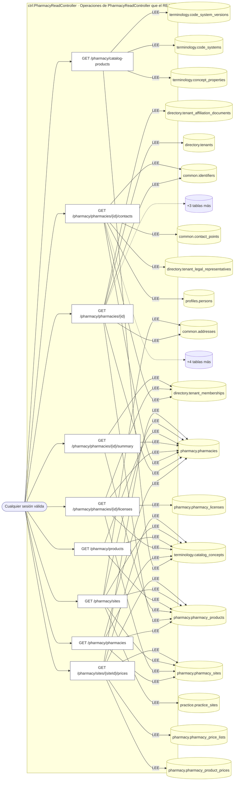

## Árbol de decisión por operación

Cada árbol se deriva del código del handler y de los métodos que invoca (hasta 4 niveles). Una rama que no decide, no escribe y no falla se poda. Los accesos y los efectos consecutivos se agrupan en un solo nodo.

### Operaciones con decisiones propias

#### 1. POST /pharmacies

Alta de farmacia con licencia inicial

| HTTP | Código | Cuándo |
|---|---|---|
| 201 | — | Éxito |
| 400 | `VALIDATION_FAILED` | El cuerpo cumple el DTO (sin propiedades extra) |
| 401 | `UNAUTHENTICATED` | Hay una sesión válida (JWT) |
| 403 | `FORBIDDEN` | El rol está permitido; El tenant se resuelve y pertenece al actor |
| 409 | `CONFLICT` | ConflictException: Ya existe una farmacia con ese código en el tenant |
| 429 | `RATE_LIMITED` | No se supera el límite de solicitudes |

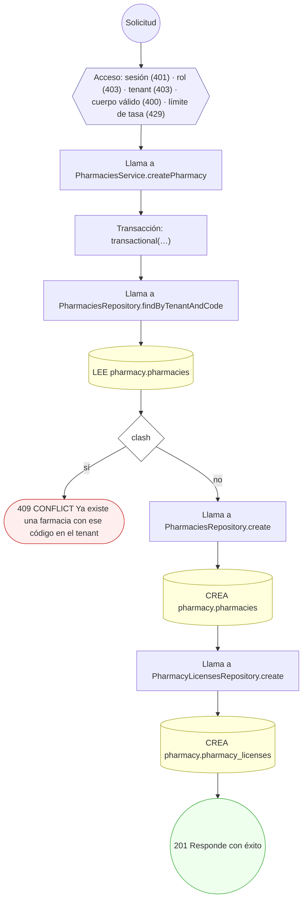

#### 2. GET /pharmacies/{pharmacyId}/categories

Categorías de la farmacia (sólo su personal)

| HTTP | Código | Cuándo |
|---|---|---|
| 200 | — | Éxito |
| 400 | `VALIDATION_FAILED` | Los parámetros de ruta son UUID válidos |
| 401 | `UNAUTHENTICATED` | Hay una sesión válida (JWT) |
| 403 | `FORBIDDEN` | El rol está permitido; El tenant se resuelve y pertenece al actor; ForbiddenException: Se requiere pertenecer a la organización, o ser administrador de la plataforma |
| 429 | `RATE_LIMITED` | No se supera el límite de solicitudes |

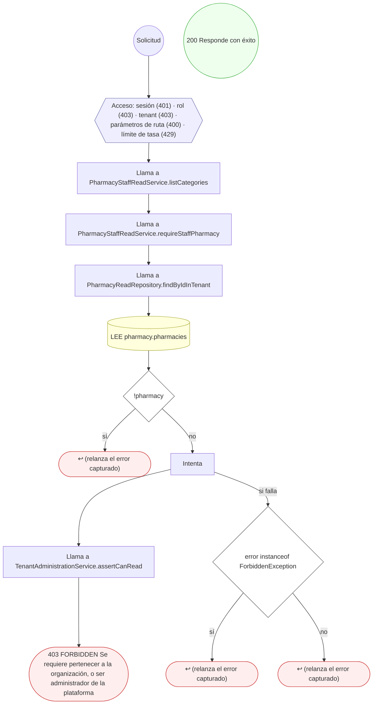

#### 3. POST /pharmacies/{pharmacyId}/integration-connections

Establecer conexión de integración externa

| HTTP | Código | Cuándo |
|---|---|---|
| 201 | — | Éxito |
| 400 | `VALIDATION_FAILED` | Los parámetros de ruta son UUID válidos; El cuerpo cumple el DTO (sin propiedades extra) |
| 401 | `UNAUTHENTICATED` | Hay una sesión válida (JWT) |
| 403 | `FORBIDDEN` | El rol está permitido; El tenant se resuelve y pertenece al actor |
| 409 | `CONFLICT` | ConflictException: Ya existe una conexión para esa integración |
| 422 | `PRECONDITION_FAILED` | PreconditionFailedException: La farmacia no está activa |
| 429 | `RATE_LIMITED` | No se supera el límite de solicitudes |

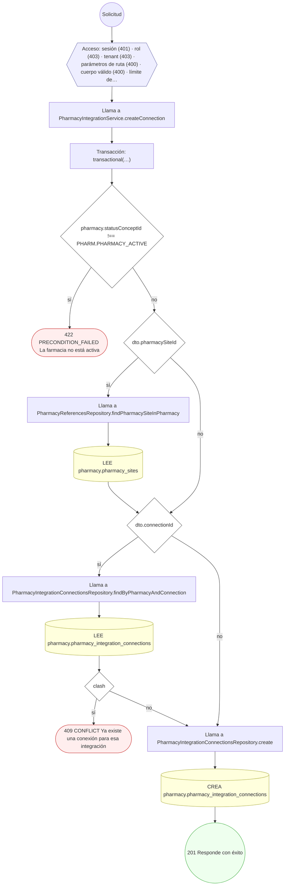

#### 4. POST /pharmacies/{pharmacyId}/integration-connections/{connId}/product-mappings

Mapear producto a código de proveedor externo

| HTTP | Código | Cuándo |
|---|---|---|
| 201 | — | Éxito |
| 400 | `VALIDATION_FAILED` | Los parámetros de ruta son UUID válidos; El cuerpo cumple el DTO (sin propiedades extra) |
| 401 | `UNAUTHENTICATED` | Hay una sesión válida (JWT) |
| 403 | `FORBIDDEN` | El rol está permitido; El tenant se resuelve y pertenece al actor |
| 404 | `NOT_FOUND` | ResourceNotFoundException: Conexión no encontrada; ResourceNotFoundException: Producto no encontrado |
| 409 | `CONFLICT` | ConflictException: El producto ya está mapeado en esta conexión |
| 422 | `PRECONDITION_FAILED` | PreconditionFailedException: La conexión no está activa; PreconditionFailedException: La conexión no soporta consulta de stock ni de precio; PreconditionFailedException: El producto no está activo |
| 429 | `RATE_LIMITED` | No se supera el límite de solicitudes |

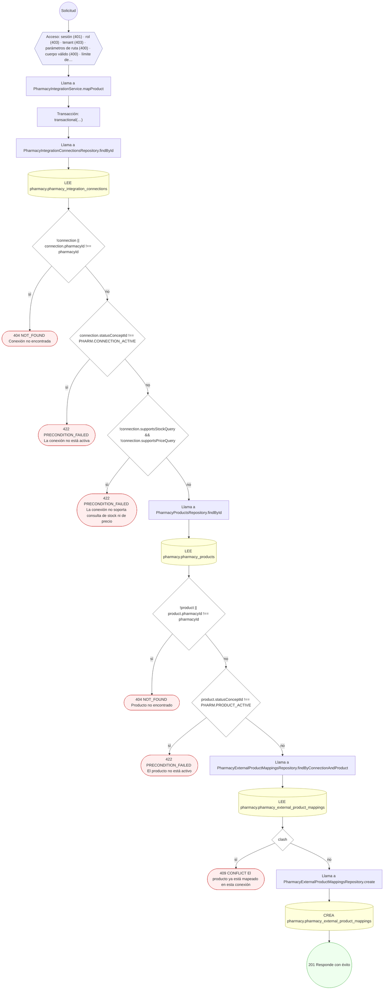

#### 5. POST /pharmacies/{pharmacyId}/licenses/{licenseId}/verify

Verificar licencia y aprobar farmacia

| HTTP | Código | Cuándo |
|---|---|---|
| 200 | — | Éxito |
| 400 | `VALIDATION_FAILED` | Los parámetros de ruta son UUID válidos; El cuerpo cumple el DTO (sin propiedades extra) |
| 401 | `UNAUTHENTICATED` | Hay una sesión válida (JWT) |
| 403 | `FORBIDDEN` | El rol está permitido; El tenant se resuelve y pertenece al actor |
| 404 | `NOT_FOUND` | ResourceNotFoundException: Licencia no encontrada |
| 422 | `PRECONDITION_FAILED` | PreconditionFailedException: La licencia no está pendiente de verificación |
| 429 | `RATE_LIMITED` | No se supera el límite de solicitudes |

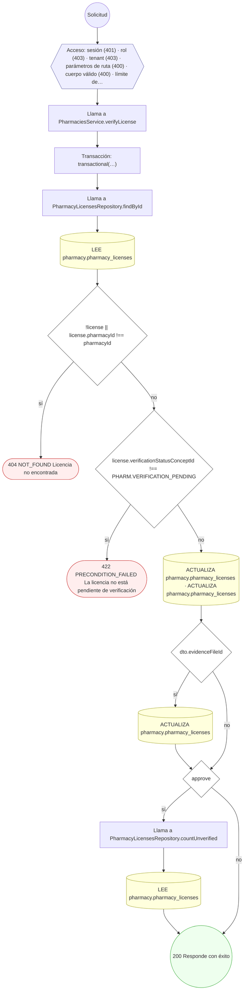

#### 6. POST /pharmacies/{pharmacyId}/price-lists

Crear lista de precios (pública / por aseguradora)

| HTTP | Código | Cuándo |
|---|---|---|
| 201 | — | Éxito |
| 400 | `VALIDATION_FAILED` | Los parámetros de ruta son UUID válidos; El cuerpo cumple el DTO (sin propiedades extra) |
| 401 | `UNAUTHENTICATED` | Hay una sesión válida (JWT) |
| 403 | `FORBIDDEN` | El rol está permitido; El tenant se resuelve y pertenece al actor |
| 409 | `CONFLICT` | ConflictException: Ya existe una lista con ese código en la farmacia |
| 422 | `PRECONDITION_FAILED` | PreconditionFailedException: La farmacia no está activa; PreconditionFailedException: Una lista por aseguradora requiere insurerTenantId |
| 429 | `RATE_LIMITED` | No se supera el límite de solicitudes |


#### 7. POST /pharmacies/{pharmacyId}/price-lists/{priceListId}/close

Cerrar/expirar lista de precios

| HTTP | Código | Cuándo |
|---|---|---|
| 200 | — | Éxito |
| 400 | `VALIDATION_FAILED` | Los parámetros de ruta son UUID válidos |
| 401 | `UNAUTHENTICATED` | Hay una sesión válida (JWT) |
| 403 | `FORBIDDEN` | El rol está permitido; El tenant se resuelve y pertenece al actor |
| 404 | `NOT_FOUND` | ResourceNotFoundException: Lista de precios no encontrada |
| 422 | `PRECONDITION_FAILED` | PreconditionFailedException: La lista de precios no está activa |
| 429 | `RATE_LIMITED` | No se supera el límite de solicitudes |


#### 8. POST /pharmacies/{pharmacyId}/price-lists/{priceListId}/prices

Fijar/versionar precio de producto

| HTTP | Código | Cuándo |
|---|---|---|
| 201 | — | Éxito |
| 400 | `VALIDATION_FAILED` | Los parámetros de ruta son UUID válidos; El cuerpo cumple el DTO (sin propiedades extra) |
| 401 | `UNAUTHENTICATED` | Hay una sesión válida (JWT) |
| 403 | `FORBIDDEN` | El rol está permitido; El tenant se resuelve y pertenece al actor |
| 404 | `NOT_FOUND` | ResourceNotFoundException: Lista de precios no encontrada; ResourceNotFoundException: Producto no encontrado |
| 422 | `PRECONDITION_FAILED` | PreconditionFailedException: La lista de precios no está activa; PreconditionFailedException: El producto no está activo |
| 429 | `RATE_LIMITED` | No se supera el límite de solicitudes |

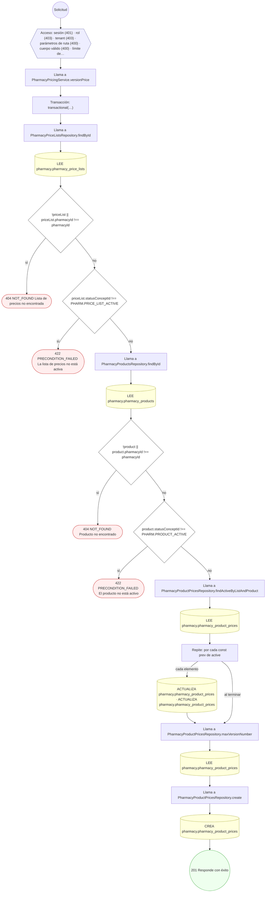

#### 9. POST /pharmacies/{pharmacyId}/products

Publicar producto en catálogo con identificadores

| HTTP | Código | Cuándo |
|---|---|---|
| 201 | — | Éxito |
| 400 | `VALIDATION_FAILED` | Los parámetros de ruta son UUID válidos; El cuerpo cumple el DTO (sin propiedades extra); BadRequestException: catalogPresentationCode sólo se manda junto con catalogProductId; BadRequestException: {supplied.join(', ')} vienen del catálogo oficial y no se mandan con catalogProductId; BadRequestException: El producto tiene más de una presentación: mande catalogPresentationCode; BadRequestException: catalogPresentationCode no es una presentación de ese producto |
| 401 | `UNAUTHENTICATED` | Hay una sesión válida (JWT) |
| 403 | `FORBIDDEN` | El rol está permitido; El tenant se resuelve y pertenece al actor |
| 404 | `NOT_FOUND` | ResourceNotFoundException: Producto del catálogo no encontrado |
| 409 | `CONFLICT` | ConflictException: Ya existe un producto con ese código en la farmacia; ConflictException: Ya cargó ese producto y presentación |
| 422 | `PRECONDITION_FAILED` | PreconditionFailedException: La farmacia no está activa; PreconditionFailedException: El registro sanitario de ese producto no está vigente |
| 429 | `RATE_LIMITED` | No se supera el límite de solicitudes |

```mermaid
flowchart TD
  n1(("Solicitud")):::inicio
  n2{{"Acceso: sesión (401) · rol (403) · tenant (403) · parámetros de ruta (400) · cuerpo válido (400) · límite de…"}}:::acceso
  n1 --> n2
  n3["Llama a PharmacyProductsService.publishProduct"]:::llamada
  n2 --> n3
  n4["Transacción: transactional(…)"]:::transaccion
  n3 --> n4
  n5{"pharmacy.statusConceptId !== PHARM.PHARMACY_ACTIVE"}:::decision
  n4 --> n5
  n6(["422 PRECONDITION_FAILED La farmacia no está activa"]):::error
  n5 -->|"sí"| n6
  n7["Llama a PharmacyProductsRepository.findByPharmacyAndCode"]:::llamada
  n5 -->|"no"| n7
  n8[("LEE pharmacy.pharmacy_products")]:::efecto
  n7 --> n8
  n9{"clash"}:::decision
  n8 --> n9
  n10(["409 CONFLICT Ya existe un producto con ese código en la farmacia"]):::error
  n9 -->|"sí"| n10
  n11["Llama a PharmacyProductsService.deriveFromCatalog"]:::llamada
  n9 -->|"no"| n11
  n12{"dto.catalogProductId === undefined"}:::decision
  n11 --> n12
  n13{"dto.catalogPresentationCode !== undefined"}:::decision
  n12 -->|"sí"| n13
  n14(["400 VALIDATION_FAILED catalogPresentationCode sólo se manda junto con catalogProductId"]):::error
  n13 -->|"sí"| n14
  n15["Llama a MedicineCatalogRepository.findProductById"]:::llamada
  n13 -->|"no"| n15
  n12 -->|"no"| n15
  n16[("LEE terminology.catalog_concepts · LEE terminology.code_system_versions · LEE terminology.code_systems")]:::efecto
  n15 --> n16
  n17["Llama a MedicineCatalogRepository.hydrate"]:::llamada
  n16 --> n17
  n18[("LEE terminology.catalog_concepts · LEE terminology.concept_properties")]:::efecto
  n17 --> n18
  n19{"!catalog"}:::decision
  n18 --> n19
  n20(["404 NOT_FOUND Producto del catálogo no encontrado"]):::error
  n19 -->|"sí"| n20
  n21{"!catalog.selectable"}:::decision
  n19 -->|"no"| n21
  n22(["422 PRECONDITION_FAILED El registro sanitario de ese producto no está vigente"]):::error
  n21 -->|"sí"| n22
  n23{"supplied.length › 0"}:::decision
  n21 -->|"no"| n23
  n24(["400 VALIDATION_FAILED {supplied.join(', ')} vienen del catálogo oficial y no se mandan con catalogProductId"]):::error
  n23 -->|"sí"| n24
  n25["Llama a PharmacyProductsService.pickPresentation"]:::llamada
  n23 -->|"no"| n25
  n26{"code === undefined"}:::decision
  n25 --> n26
  n27{"sellable.length › 1"}:::decision
  n26 -->|"sí"| n27
  n28(["400 VALIDATION_FAILED El producto tiene más de una presentación: mande catalogPresentationCode"]):::error
  n27 -->|"sí"| n28
  n29{"!found"}:::decision
  n27 -->|"no"| n29
  n26 -->|"no"| n29
  n30(["400 VALIDATION_FAILED catalogPresentationCode no es una presentación de ese producto"]):::error
  n29 -->|"sí"| n30
  n31["Llama a PharmacyProductsRepository.findByPharmacyAndCatalog"]:::llamada
  n29 -->|"no"| n31
  n32[("LEE pharmacy.pharmacy_products")]:::efecto
  n31 --> n32
  n33{"duplicate"}:::decision
  n32 --> n33
  n34(["409 CONFLICT Ya cargó ese producto y presentación"]):::error
  n33 -->|"sí"| n34
  n35["Llama a MedicineCatalogRepository.findVademecumConceptIdByAtc"]:::llamada
  n33 -->|"no"| n35
  n36[("LEE terminology.catalog_concepts · LEE terminology.code_system_versions · LEE terminology.code_systems")]:::efecto
  n35 --> n36
  n37["Llama a PharmacyProductsRepository.create"]:::llamada
  n36 --> n37
  n38[("CREA pharmacy.pharmacy_products")]:::efecto
  n37 --> n38
  n39["Repite: por cada const idf de identifiers"]:::bucle
  n38 --> n39
  n40["Llama a PharmacyProductIdentifiersRepository.create"]:::llamada
  n39 -->|"cada elemento"| n40
  n41[("CREA pharmacy.pharmacy_product_identifiers")]:::efecto
  n40 --> n41
  n42(("201 Responde con éxito")):::ok
  n41 --> n42
  n39 -->|"al terminar"| n42
  classDef acceso fill:#eef,stroke:#66a
  classDef error fill:#fee,stroke:#c33
  classDef ok fill:#efe,stroke:#3a3
  classDef efecto fill:#ffd,stroke:#aa3
  classDef decision fill:#fff,stroke:#555
  classDef corte fill:#eee,stroke:#999,stroke-dasharray: 4
```

#### 10. DELETE /pharmacies/{pharmacyId}/products/{productId}

Retirar (soft-delete) producto del catálogo

| HTTP | Código | Cuándo |
|---|---|---|
| 200 | — | Éxito |
| 400 | `VALIDATION_FAILED` | Los parámetros de ruta son UUID válidos |
| 401 | `UNAUTHENTICATED` | Hay una sesión válida (JWT) |
| 403 | `FORBIDDEN` | El rol está permitido; El tenant se resuelve y pertenece al actor |
| 404 | `NOT_FOUND` | ResourceNotFoundException: Producto no encontrado |
| 422 | `PRECONDITION_FAILED` | PreconditionFailedException: El producto no está activo |
| 429 | `RATE_LIMITED` | No se supera el límite de solicitudes |

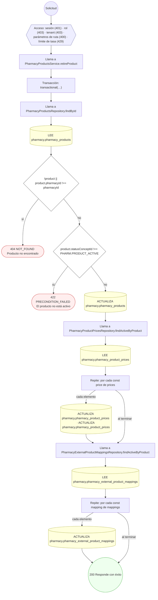

#### 11. PATCH /pharmacies/{pharmacyId}/products/{productId}

Editar los datos descriptivos de un producto del catálogo

| HTTP | Código | Cuándo |
|---|---|---|
| 200 | — | Éxito |
| 400 | `VALIDATION_FAILED` | Los parámetros de ruta son UUID válidos; El cuerpo cumple el DTO (sin propiedades extra); BadRequestException: {changed.join(', ')} vienen del catálogo oficial y no se editan |
| 401 | `UNAUTHENTICATED` | Hay una sesión válida (JWT) |
| 403 | `FORBIDDEN` | El rol está permitido; El tenant se resuelve y pertenece al actor |
| 404 | `NOT_FOUND` | ResourceNotFoundException: Producto no encontrado |
| 422 | `PRECONDITION_FAILED` | PreconditionFailedException: El producto no está activo |
| 429 | `RATE_LIMITED` | No se supera el límite de solicitudes |

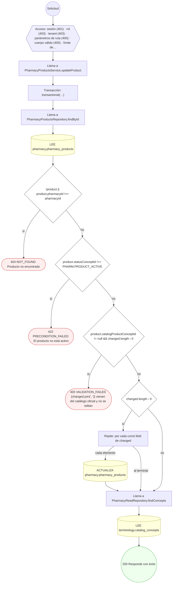

#### 12. POST /pharmacies/{pharmacyId}/projections

Proyectar catálogo y precios a read-model

| HTTP | Código | Cuándo |
|---|---|---|
| 200 | — | Éxito |
| 400 | `VALIDATION_FAILED` | Los parámetros de ruta son UUID válidos |
| 401 | `UNAUTHENTICATED` | Hay una sesión válida (JWT) |
| 403 | `FORBIDDEN` | El rol está permitido; El tenant se resuelve y pertenece al actor |
| 429 | `RATE_LIMITED` | No se supera el límite de solicitudes |

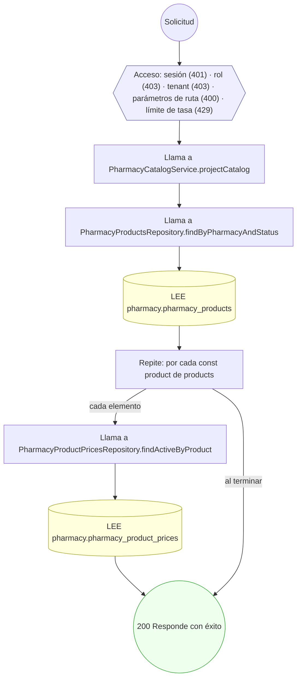

#### 13. POST /pharmacies/{pharmacyId}/sites

Registrar sede dispensadora

| HTTP | Código | Cuándo |
|---|---|---|
| 201 | — | Éxito |
| 400 | `VALIDATION_FAILED` | Los parámetros de ruta son UUID válidos; El cuerpo cumple el DTO (sin propiedades extra) |
| 401 | `UNAUTHENTICATED` | Hay una sesión válida (JWT) |
| 403 | `FORBIDDEN` | El rol está permitido; El tenant se resuelve y pertenece al actor |
| 409 | `CONFLICT` | ConflictException: Ya existe una sede con ese código en la farmacia |
| 422 | `PRECONDITION_FAILED` | PreconditionFailedException: La farmacia no está activa |
| 429 | `RATE_LIMITED` | No se supera el límite de solicitudes |

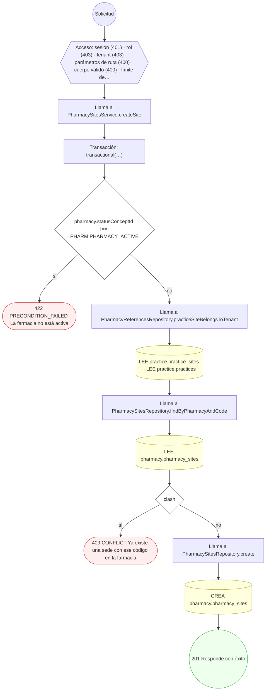

#### 14. GET /pharmacy/pharmacies/{id}

Consultar el perfil de una farmacia

| HTTP | Código | Cuándo |
|---|---|---|
| 200 | — | Éxito |
| 400 | `VALIDATION_FAILED` | Los parámetros de ruta son UUID válidos |
| 401 | `UNAUTHENTICATED` | Hay una sesión válida (JWT) |
| 403 | `FORBIDDEN` | El rol está permitido; El tenant se resuelve y pertenece al actor |
| 404 | `NOT_FOUND` | ResourceNotFoundException: Farmacia no encontrada |
| 429 | `RATE_LIMITED` | No se supera el límite de solicitudes |

```mermaid
flowchart TD
  n1(("Solicitud")):::inicio
  n2{{"Acceso: sesión (401) · rol (403) · tenant (403) · parámetros de ruta (400) · límite de tasa (429)"}}:::acceso
  n1 --> n2
  n3["Llama a PharmacyReadService.getPharmacy"]:::llamada
  n2 --> n3
  n4["Llama a PharmacyReadRepository.findVisibleById"]:::llamada
  n3 --> n4
  n5[("LEE pharmacy.pharmacies")]:::efecto
  n4 --> n5
  n6{"!pharmacy"}:::decision
  n5 --> n6
  n7(["404 NOT_FOUND Farmacia no encontrada"]):::error
  n6 -->|"sí"| n7
  n8["Llama a PharmacyReadRepository.findActiveSites"]:::llamada
  n6 -->|"no"| n8
  n9[("LEE pharmacy.pharmacy_sites")]:::efecto
  n8 --> n9
  n10["Llama a PharmacyReadRepository.findActiveProductOwners"]:::llamada
  n9 --> n10
  n11[("LEE pharmacy.pharmacy_products")]:::efecto
  n10 --> n11
  n12["Llama a PharmacyReadService.resolveLegalProfile"]:::llamada
  n11 --> n12
  n13["Llama a PharmacyReadRepository.findTenant"]:::llamada
  n12 --> n13
  n14[("LEE directory.tenants")]:::efecto
  n13 --> n14
  n15["Llama a PharmacyReadRepository.findActiveAffiliationDocuments"]:::llamada
  n14 --> n15
  n16[("LEE directory.tenant_affiliation_documents")]:::efecto
  n15 --> n16
  n17["Llama a PharmacyReadRepository.findHeadquartersAddress"]:::llamada
  n16 --> n17
  n18[("LEE common.addresses")]:::efecto
  n17 --> n18
  n19["Llama a PharmacyReadRepository.findConcepts"]:::llamada
  n18 --> n19
  n20[("LEE terminology.catalog_concepts")]:::efecto
  n19 --> n20
  n21{"taxId === null && taxDocument?.identifierId"}:::decision
  n20 --> n21
  n22["Llama a PharmacyReadRepository.findIdentifiers"]:::llamada
  n21 -->|"sí"| n22
  n23[("LEE common.identifiers")]:::efecto
  n22 --> n23
  n24["Llama a PharmacyReadService.resolveSiteContext"]:::llamada
  n23 --> n24
  n21 -->|"no"| n24
  n25["Llama a PharmacyReadRepository.findPracticeSites"]:::llamada
  n24 --> n25
  n26[("LEE practice.practice_sites")]:::efecto
  n25 --> n26
  n27["Llama a PharmacyReadRepository.findAddresses"]:::llamada
  n26 --> n27
  n28[("LEE common.addresses")]:::efecto
  n27 --> n28
  n29["Llama a PharmacyReadRepository.findConcepts"]:::llamada
  n28 --> n29
  n30[("LEE terminology.catalog_concepts")]:::efecto
  n29 --> n30
  n31(("200 Responde con éxito")):::ok
  n30 --> n31
  classDef acceso fill:#eef,stroke:#66a
  classDef error fill:#fee,stroke:#c33
  classDef ok fill:#efe,stroke:#3a3
  classDef efecto fill:#ffd,stroke:#aa3
  classDef decision fill:#fff,stroke:#555
  classDef corte fill:#eee,stroke:#999,stroke-dasharray: 4
```

#### 15. GET /pharmacy/pharmacies/{id}/contacts

Representante legal y gerencias de la farmacia (sólo su personal)

| HTTP | Código | Cuándo |
|---|---|---|
| 200 | — | Éxito |
| 400 | `VALIDATION_FAILED` | Los parámetros de ruta son UUID válidos |
| 401 | `UNAUTHENTICATED` | Hay una sesión válida (JWT) |
| 403 | `FORBIDDEN` | El rol está permitido; El tenant se resuelve y pertenece al actor; ForbiddenException: Se requiere pertenecer a la organización, o ser administrador de la plataforma |
| 429 | `RATE_LIMITED` | No se supera el límite de solicitudes |

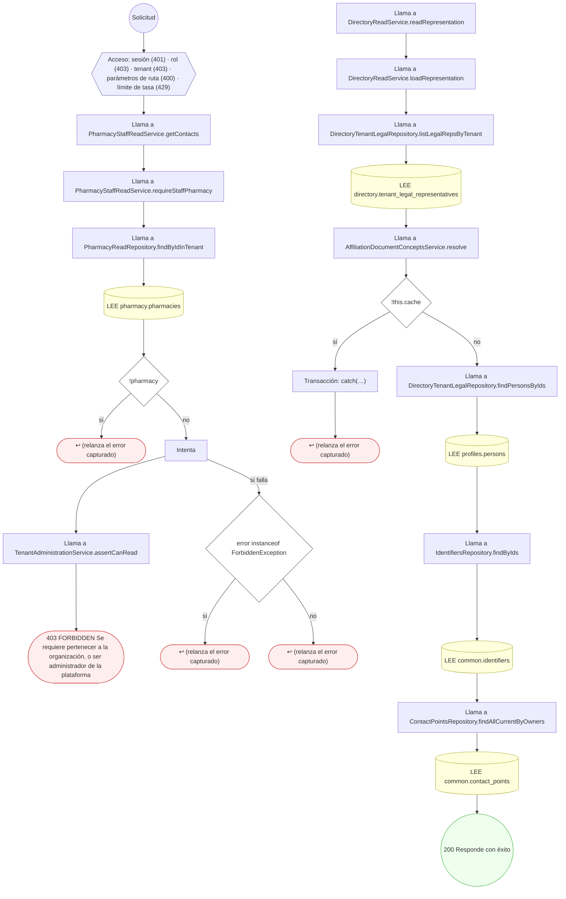

#### 16. GET /pharmacy/pharmacies/{id}/licenses

Licencias de la farmacia (sólo su personal)

| HTTP | Código | Cuándo |
|---|---|---|
| 200 | — | Éxito |
| 400 | `VALIDATION_FAILED` | Los parámetros de ruta son UUID válidos |
| 401 | `UNAUTHENTICATED` | Hay una sesión válida (JWT) |
| 403 | `FORBIDDEN` | El rol está permitido; El tenant se resuelve y pertenece al actor; ForbiddenException: Se requiere pertenecer a la organización, o ser administrador de la plataforma |
| 429 | `RATE_LIMITED` | No se supera el límite de solicitudes |

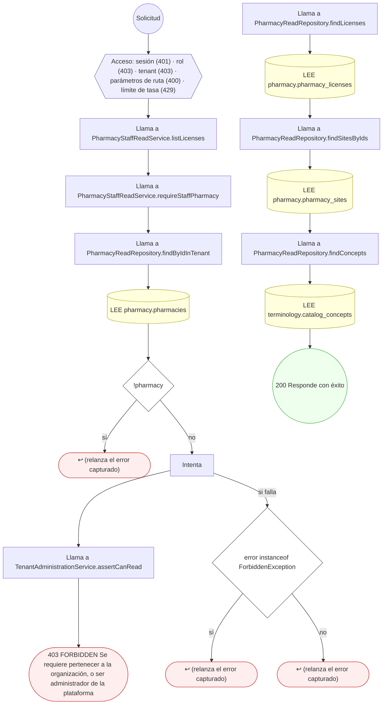

#### 17. GET /pharmacy/pharmacies/{id}/summary

Resumen del catálogo de la farmacia (sólo su personal)

| HTTP | Código | Cuándo |
|---|---|---|
| 200 | — | Éxito |
| 400 | `VALIDATION_FAILED` | Los parámetros de ruta son UUID válidos |
| 401 | `UNAUTHENTICATED` | Hay una sesión válida (JWT) |
| 403 | `FORBIDDEN` | El rol está permitido; El tenant se resuelve y pertenece al actor; ForbiddenException: Se requiere pertenecer a la organización, o ser administrador de la plataforma |
| 429 | `RATE_LIMITED` | No se supera el límite de solicitudes |

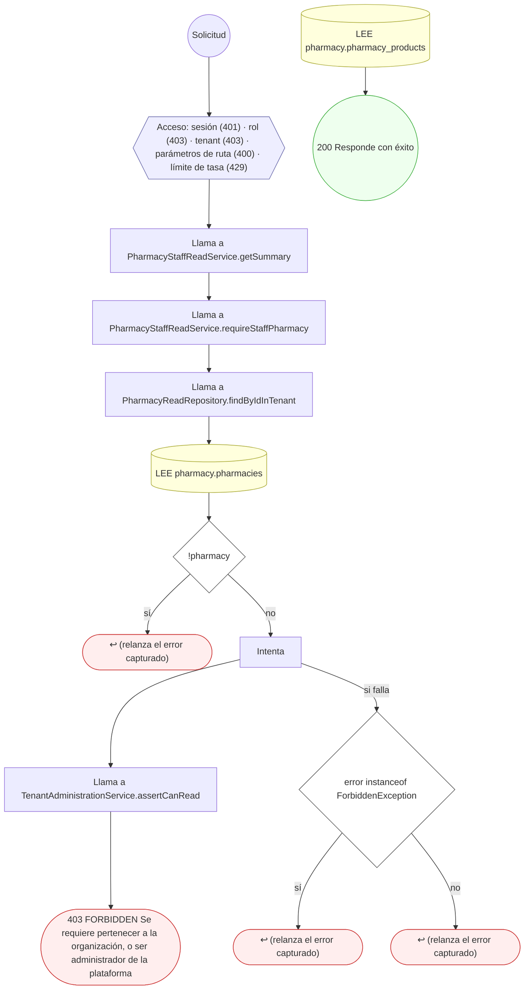

#### 18. GET /pharmacy/sites/{siteId}/prices

Consultar los precios públicos vigentes de una sede

| HTTP | Código | Cuándo |
|---|---|---|
| 200 | — | Éxito |
| 400 | `VALIDATION_FAILED` | Los parámetros de ruta son UUID válidos |
| 401 | `UNAUTHENTICATED` | Hay una sesión válida (JWT) |
| 403 | `FORBIDDEN` | El rol está permitido; El tenant se resuelve y pertenece al actor |
| 404 | `NOT_FOUND` | ResourceNotFoundException: Sede de farmacia no encontrada |
| 429 | `RATE_LIMITED` | No se supera el límite de solicitudes |

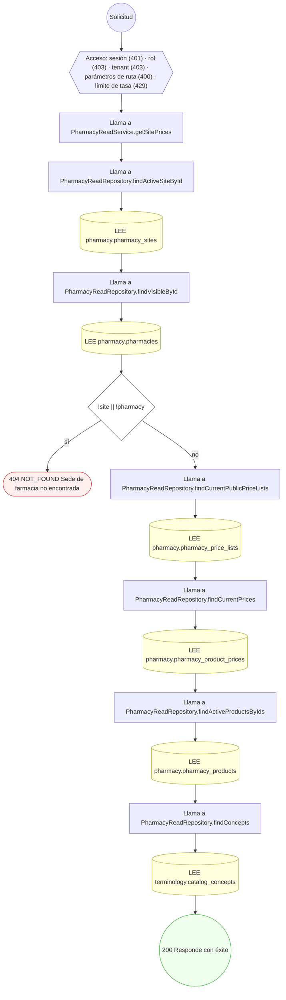

#### 19. GET /public/medications/{conceptId}/availability

Farmacias que publican un medicamento, con precio y distancia

| HTTP | Código | Cuándo |
|---|---|---|
| 200 | — | Éxito |
| 400 | `VALIDATION_FAILED` | Los parámetros de ruta son UUID válidos |
| 401 | `UNAUTHENTICATED` | Hay una sesión válida (JWT) |
| 404 | `NOT_FOUND` | ResourceNotFoundException: Medicamento no encontrado |
| 429 | `RATE_LIMITED` | No se supera el límite de solicitudes |

```mermaid
flowchart TD
  n1(("Solicitud")):::inicio
  n2{{"Acceso: sesión (401) · parámetros de ruta (400) · límite de tasa (429)"}}:::acceso
  n1 --> n2
  n3["Llama a PharmacyMarketplaceService.getAvailability"]:::llamada
  n2 --> n3
  n4["Llama a PharmacyMarketplaceRepository.findPublishedOffers"]:::llamada
  n3 --> n4
  n5[("LEE pharmacy.pharmacy_products · LEE pharmacy.pharmacies · LEE terminology.catalog_concepts · LEE pharmacy.ph…")]:::efecto
  n4 --> n5
  n6{"offers.length === 0"}:::decision
  n5 --> n6
  n7(["404 NOT_FOUND Medicamento no encontrado"]):::error
  n6 -->|"sí"| n7
  n8(("200 Responde con éxito")):::ok
  n6 -->|"no"| n8
  classDef acceso fill:#eef,stroke:#66a
  classDef error fill:#fee,stroke:#c33
  classDef ok fill:#efe,stroke:#3a3
  classDef efecto fill:#ffd,stroke:#aa3
  classDef decision fill:#fff,stroke:#555
  classDef corte fill:#eee,stroke:#999,stroke-dasharray: 4
```

### Operaciones sin decisiones propias

Sólo comprueban el acceso y leen o escriben: no tienen ramas que dibujar. Su detalle está en la ficha de endpoints.

| Operación | Respuestas posibles | Tablas |
|---|---|---|
| GET /pharmacy/catalog-products | 200, 401, 403, 429 | 4 |
| GET /pharmacy/pharmacies | 200, 401, 403, 429 | 4 |
| GET /pharmacy/products | 200, 401, 403, 429 | 3 |
| GET /pharmacy/sites | 200, 401, 403, 429 | 6 |
| GET /public/medications | 200, 401, 429 | 11 |
