<!-- AUTOGENERADO por tools/inventario/flujos.mjs. No editar manualmente. -->

# Flujos del módulo `pharmacy`

- **Procesos:** 1 · **Máquinas de estado:** 0
- **Operaciones:** 39 (33 con decisiones propias, 6 sin ellas)
- Inventario de endpoints del módulo: [pharmacy](../endpoints/pharmacy.md)

## Proceso: Módulo Pharmacy (24)

- **Código:** `pharmacy` · **Agrupación:** MIXTO · **Operaciones:** 39
- **Actores:** Cualquier sesión válida · PHARMACY_STAFF · Público (sin sesión) · SECURITY_ADMIN
- **Revisión:** AUTO_DETECTADA
- **Fuentes:** `src/modules/pharmacy/README.md`

### Para qué sirve

Identidad de farmacia con licencias, sedes dispensadoras, catálogo de productos con identificadores, listas de precios y precios versionados, integración externa con mapeo de productos, retiro de catálogo y proyección al read-model.

_Fuente: `src/modules/pharmacy/README.md:3`_

### Etapas y operaciones

| Etapa | Descripción | Operación | Quién actúa | Riesgo | Tablas |
|---|---|---|---|---|---|
| `P47 §2-5` | Editar datos descriptivos (no en uno del catálogo universal), precio, categoría, descripción, existencias o «hay / no hay», estado e imágenes (null borra lo que lo admite) | PATCH /pharmacies/{pharmacyId}/products/{productId} | SECURITY_ADMIN · PHARMACY_STAFF | ALTO | 22 |
| `P47 D7` | Existencias declaradas de varios productos, todo o nada | PATCH /pharmacies/{pharmacyId}/inventory | SECURITY_ADMIN · PHARMACY_STAFF | BAJO | 1 |
| `P47 D8` | Categorías de la vitrina (409 con nombre repetido o con productos vivos) | POST /pharmacies/{pharmacyId}/categories | SECURITY_ADMIN · PHARMACY_STAFF | MEDIO | 2 |
| `UC-24-01` | Alta de farmacia con licencia inicial (DRAFT / PENDING) | POST /pharmacies | SECURITY_ADMIN · PHARMACY_STAFF | MEDIO | 4 |
| `UC-24-02` | Registrar sede dispensadora (requiere farmacia ACTIVE) | POST /pharmacies/{pharmacyId}/sites | SECURITY_ADMIN · PHARMACY_STAFF | MEDIO | 4 |
| `UC-24-03` | Verificar licencia y aprobar farmacia | POST /pharmacies/{pharmacyId}/licenses/{licenseId}/verify | SECURITY_ADMIN · PHARMACY_STAFF | MEDIO | 3 |
| `UC-24-04` | Publicar producto con identificadores (GTIN/NDC) | POST /pharmacies/{pharmacyId}/products | SECURITY_ADMIN · PHARMACY_STAFF | ALTO | 20 |
| `UC-24-05` | Crear lista de precios (pública / por aseguradora) | POST /pharmacies/{pharmacyId}/price-lists | SECURITY_ADMIN · PHARMACY_STAFF | MEDIO | 4 |
| `UC-24-06` | Fijar/versionar precio | POST /pharmacies/{pharmacyId}/price-lists/{priceListId}/prices | SECURITY_ADMIN · PHARMACY_STAFF | MEDIO | 5 |
| `UC-24-07` | Establecer conexión de integración | POST /pharmacies/{pharmacyId}/integration-connections | SECURITY_ADMIN · PHARMACY_STAFF | MEDIO | 3 |
| `UC-24-08` | Mapear producto a código externo | POST /pharmacies/{pharmacyId}/integration-connections/{connectionId}/product-mappings | SECURITY_ADMIN · PHARMACY_STAFF | MEDIO | 4 |
| `UC-24-09` | Retirar (soft-delete) producto en cascada | DELETE /pharmacies/{pharmacyId}/products/{productId} | SECURITY_ADMIN · PHARMACY_STAFF | MEDIO | 6 |
| `UC-24-10` | Cerrar/expirar lista de precios | POST /pharmacies/{pharmacyId}/price-lists/{priceListId}/close | SECURITY_ADMIN · PHARMACY_STAFF | MEDIO | 4 |
| `UC-24-11` | Proyectar catálogo y precios a read-model | POST /pharmacies/{pharmacyId}/projections | SECURITY_ADMIN · PHARMACY_STAFF | BAJO | 2 |
| `ctrl:PharmacyBulkController` | Operaciones de PharmacyBulkController que el README no asigna a un caso de uso | POST /pharmacies/{pharmacyId}/categories/bulk | SECURITY_ADMIN · PHARMACY_STAFF | BAJO | 0 |
|  |  | POST /pharmacies/{pharmacyId}/prices/bulk | SECURITY_ADMIN · PHARMACY_STAFF | BAJO | 0 |
|  |  | POST /pharmacies/{pharmacyId}/products/bulk | SECURITY_ADMIN · PHARMACY_STAFF | BAJO | 0 |
|  |  | POST /pharmacies/{pharmacyId}/sites/bulk | SECURITY_ADMIN · PHARMACY_STAFF | BAJO | 0 |
| `ctrl:PharmacyController` | Operaciones de PharmacyController que el README no asigna a un caso de uso | GET /pharmacies/{pharmacyId}/categories | SECURITY_ADMIN · PHARMACY_STAFF | BAJO | 2 |
|  |  | DELETE /pharmacies/{pharmacyId}/categories/{categoryId} | SECURITY_ADMIN · PHARMACY_STAFF | ALTO | 4 |
|  |  | PATCH /pharmacies/{pharmacyId}/categories/{categoryId} | SECURITY_ADMIN · PHARMACY_STAFF | MEDIO | 3 |
|  |  | DELETE /pharmacies/{pharmacyId}/integration-connections/{connectionId}/product-mappings/{mappingId} | SECURITY_ADMIN · PHARMACY_STAFF | ALTO | 3 |
|  |  | PATCH /pharmacies/{pharmacyId}/integration-connections/{connectionId}/product-mappings/{mappingId} | SECURITY_ADMIN · PHARMACY_STAFF | MEDIO | 4 |
|  |  | POST /pharmacies/{pharmacyId}/on-call-shifts/{shiftId}/cancel | SECURITY_ADMIN · PHARMACY_STAFF | BAJO | 3 |
|  |  | GET /pharmacies/{pharmacyId}/opening-hours | SECURITY_ADMIN · PHARMACY_STAFF | BAJO | 3 |
|  |  | POST /pharmacies/{pharmacyId}/sites/{siteId}/on-call-shifts | SECURITY_ADMIN · PHARMACY_STAFF | MEDIO | 4 |
|  |  | PUT /pharmacies/{pharmacyId}/sites/{siteId}/open-24h | SECURITY_ADMIN · PHARMACY_STAFF | MEDIO | 4 |
| `ctrl:PharmacyPublicController` | Operaciones de PharmacyPublicController que el README no asigna a un caso de uso | GET /public/medications | Público (sin sesión) | BAJO | 9 |
|  |  | GET /public/medications/{conceptId}/availability | Público (sin sesión) | BAJO | 9 |
|  |  | GET /public/pharmacies/open-now | Público (sin sesión) | BAJO | 6 |
| `ctrl:PharmacyReadController` | Operaciones de PharmacyReadController que el README no asigna a un caso de uso | GET /pharmacy/catalog-products | Cualquier sesión válida | BAJO | 4 |
|  |  | GET /pharmacy/pharmacies | Cualquier sesión válida | BAJO | 4 |
|  |  | GET /pharmacy/pharmacies/{id} | Cualquier sesión válida | BAJO | 9 |
|  |  | GET /pharmacy/pharmacies/{id}/contacts | Cualquier sesión válida | BAJO | 10 |
|  |  | GET /pharmacy/pharmacies/{id}/licenses | Cualquier sesión válida | BAJO | 5 |
|  |  | GET /pharmacy/pharmacies/{id}/summary | Cualquier sesión válida | BAJO | 8 |
|  |  | GET /pharmacy/products | Cualquier sesión válida | BAJO | 8 |
|  |  | GET /pharmacy/sites | Cualquier sesión válida | BAJO | 7 |
|  |  | GET /pharmacy/sites/{siteId}/prices | Cualquier sesión válida | BAJO | 6 |

### Diagrama 1 de 2 — etapas `P47 §2-5`, `P47 D7`, `P47 D8`…

```mermaid
flowchart LR
  a2(["SECURITY_ADMIN · PHARMACY_STAFF"]):::actor
  t3[("common.file_versions")]:::tabla
  t4[("common.files")]:::tabla
  t5[("pharmacy.pharmacies")]:::tabla
  t6[("pharmacy.pharmacy_external_product_mappings")]:::tabla
  t7[("pharmacy.pharmacy_price_lists")]:::tabla
  t10[("pharmacy.pharmacy_products")]:::tabla
  t12[("pharmacy.pharmacy_product_categories")]:::tabla
  t14[("pharmacy.pharmacy_licenses")]:::tabla
  t16[("pharmacy.pharmacy_sites")]:::tabla
  t17[("practice.practice_sites")]:::tabla
  t18[("practice.practices")]:::tabla
  t20[("community.public_profiles")]:::tabla
  t24[("insurance.insurance_carriers")]:::tabla
  t26[("pharmacy.pharmacy_product_prices")]:::tabla
  t28[("pharmacy.pharmacy_integration_connections")]:::tabla
  t8[("+16 tablas más")]
  subgraph s0["P47 §2-5 · Editar datos descriptivos (no en uno del catálogo universal), precio…"]
    o1["PATCH /pharmacies/{pharmacyId}/products/{productId}"]:::op
  end
  subgraph s1["P47 D7 · Existencias declaradas de varios productos, todo o nada"]
    o9["PATCH /pharmacies/{pharmacyId}/inventory"]:::op
  end
  subgraph s2["P47 D8 · Categorías de la vitrina (409 con nombre repetido o con productos vivo…"]
    o11["POST /pharmacies/{pharmacyId}/categories"]:::op
  end
  subgraph s3["UC-24-01 · Alta de farmacia con licencia inicial (DRAFT / PENDING)"]
    o13["POST /pharmacies"]:::op
  end
  subgraph s4["UC-24-02 · Registrar sede dispensadora (requiere farmacia ACTIVE)"]
    o15["POST /pharmacies/{pharmacyId}/sites"]:::op
  end
  subgraph s5["UC-24-03 · Verificar licencia y aprobar farmacia"]
    o19["POST /pharmacies/{pharmacyId}/licenses/{licenseId}/verify"]:::op
  end
  t22[("+14 tablas más")]
  subgraph s6["UC-24-04 · Publicar producto con identificadores (GTIN/NDC)"]
    o21["POST /pharmacies/{pharmacyId}/products"]:::op
  end
  subgraph s7["UC-24-05 · Crear lista de precios (pública / por aseguradora)"]
    o23["POST /pharmacies/{pharmacyId}/price-lists"]:::op
  end
  subgraph s8["UC-24-06 · Fijar/versionar precio"]
    o25["POST /pharmacies/{pharmacyId}/price-lists/{priceListId}/prices"]:::op
  end
  subgraph s9["UC-24-07 · Establecer conexión de integración"]
    o27["POST /pharmacies/{pharmacyId}/integration-connections"]:::op
  end
  subgraph s10["UC-24-08 · Mapear producto a código externo"]
    o29["POST /pharmacies/{pharmacyId}/integration-connections/{connectionId}/…"]:::op
  end
  subgraph s11["UC-24-09 · Retirar (soft-delete) producto en cascada"]
    o30["DELETE /pharmacies/{pharmacyId}/products/{productId}"]:::op
  end
  subgraph s12["UC-24-10 · Cerrar/expirar lista de precios"]
    o31["POST /pharmacies/{pharmacyId}/price-lists/{priceListId}/close"]:::op
  end
  subgraph s13["UC-24-11 · Proyectar catálogo y precios a read-model"]
    o32["POST /pharmacies/{pharmacyId}/projections"]:::op
  end
  subgraph s14["ctrl:PharmacyBulkController · Operaciones de PharmacyBulkController que el READ…"]
    o33["POST /pharmacies/{pharmacyId}/categories/bulk"]:::op
    o34["POST /pharmacies/{pharmacyId}/prices/bulk"]:::op
    o35["POST /pharmacies/{pharmacyId}/products/bulk"]:::op
    o36["POST /pharmacies/{pharmacyId}/sites/bulk"]:::op
  end
  a2 --> o1
  o1 -->|"LEE"| t3
  o1 -->|"LEE"| t4
  o1 -->|"LEE"| t5
  o1 -->|"ACTUALIZA"| t6
  o1 -->|"LEE"| t6
  o1 -->|"CREA"| t7
  o1 -.-> t8
  a2 --> o9
  o9 -->|"LEE"| t10
  a2 --> o11
  o11 -->|"CREA"| t12
  o11 -->|"LEE"| t12
  a2 --> o13
  o13 -->|"CREA"| t5
  o13 -->|"LEE"| t5
  o13 -->|"CREA"| t14
  o13 -->|"CREA"| t12
  a2 --> o15
  o15 -->|"CREA"| t16
  o15 -->|"LEE"| t16
  o15 -->|"LEE"| t17
  o15 -->|"LEE"| t18
  a2 --> o19
  o19 -->|"LEE"| t20
  o19 -->|"ACTUALIZA"| t14
  o19 -->|"LEE"| t14
  a2 --> o21
  o21 -->|"LEE"| t3
  o21 -->|"LEE"| t4
  o21 -->|"LEE"| t5
  o21 -->|"CREA"| t7
  o21 -->|"LEE"| t7
  o21 -->|"LEE"| t12
  o21 -.-> t22
  a2 --> o23
  o23 -->|"LEE"| t24
  o23 -->|"CREA"| t7
  o23 -->|"LEE"| t7
  o23 -->|"LEE"| t16
  a2 --> o25
  o25 -->|"LEE"| t7
  o25 -->|"ACTUALIZA"| t26
  o25 -->|"CREA"| t26
  o25 -->|"LEE"| t26
  o25 -->|"LEE"| t10
  a2 --> o27
  o27 -->|"CREA"| t28
  o27 -->|"LEE"| t28
  o27 -->|"LEE"| t16
  a2 --> o29
  o29 -->|"CREA"| t6
  o29 -->|"LEE"| t6
  o29 -->|"LEE"| t28
  o29 -->|"LEE"| t10
  a2 --> o30
  o30 -->|"ACTUALIZA"| t6
  o30 -->|"LEE"| t6
  o30 -->|"ACTUALIZA"| t26
  o30 -->|"LEE"| t26
  o30 -->|"ACTUALIZA"| t10
  o30 -->|"LEE"| t10
  a2 --> o31
  o31 -->|"ACTUALIZA"| t7
  o31 -->|"LEE"| t7
  o31 -->|"ACTUALIZA"| t26
  o31 -->|"LEE"| t26
  a2 --> o32
  o32 -->|"LEE"| t26
  o32 -->|"LEE"| t10
  a2 --> o33
  a2 --> o34
  a2 --> o35
  a2 --> o36
  classDef op fill:#fff,stroke:#446
  classDef actor fill:#eef,stroke:#66a
  classDef tabla fill:#ffd,stroke:#aa3
  classDef evento fill:#efe,stroke:#3a3
```

### Diagrama 2 de 2 — etapas `ctrl:PharmacyController`, `ctrl:PharmacyPublicController`, `ctrl:PharmacyReadController`

```mermaid
flowchart LR
  a2(["SECURITY_ADMIN · PHARMACY_STAFF"]):::actor
  a19(["Público (sin sesión)"]):::actor
  a30(["Cualquier sesión válida"]):::actor
  t3[("pharmacy.pharmacy_product_categories")]:::tabla
  t4[("pharmacy.pharmacy_products")]:::tabla
  t8[("pharmacy.pharmacy_external_product_mappings")]:::tabla
  t9[("pharmacy.pharmacy_integration_connections")]:::tabla
  t12[("pharmacy.pharmacy_on_call_shifts")]:::tabla
  t13[("pharmacy.pharmacy_sites")]:::tabla
  t14[("practice.practice_sites")]:::tabla
  t20[("common.addresses")]:::tabla
  t21[("community.public_profiles")]:::tabla
  t22[("pharmacy.pharmacies")]:::tabla
  t23[("pharmacy.pharmacy_price_lists")]:::tabla
  t24[("pharmacy.pharmacy_product_prices")]:::tabla
  t31[("terminology.catalog_concepts")]:::tabla
  t32[("terminology.code_system_versions")]:::tabla
  t33[("terminology.code_systems")]:::tabla
  t34[("terminology.concept_properties")]:::tabla
  t37[("common.identifiers")]:::tabla
  t38[("directory.tenant_affiliation_documents")]:::tabla
  t39[("directory.tenants")]:::tabla
  t42[("common.contact_points")]:::tabla
  t43[("directory.tenant_legal_representatives")]:::tabla
  t44[("directory.tenant_memberships")]:::tabla
  t45[("profiles.persons")]:::tabla
  t48[("pharmacy.pharmacy_licenses")]:::tabla
  t50[("audit.audit_log")]:::tabla
  t53[("pharmacy.pharmacy_product_images")]:::tabla
  subgraph s0["ctrl:PharmacyController · Operaciones de PharmacyController que el README no as…"]
    o1["GET /pharmacies/{pharmacyId}/categories"]:::op
    o5["DELETE /pharmacies/{pharmacyId}/categories/{categoryId}"]:::op
    o6["PATCH /pharmacies/{pharmacyId}/categories/{categoryId}"]:::op
    o7["DELETE /pharmacies/{pharmacyId}/integration-connections/{connectionId…"]:::op
    o10["PATCH /pharmacies/{pharmacyId}/integration-connections/{connectionId}…"]:::op
    o11["POST /pharmacies/{pharmacyId}/on-call-shifts/{shiftId}/cancel"]:::op
    o15["GET /pharmacies/{pharmacyId}/opening-hours"]:::op
    o16["POST /pharmacies/{pharmacyId}/sites/{siteId}/on-call-shifts"]:::op
    o17["PUT /pharmacies/{pharmacyId}/sites/{siteId}/open-24h"]:::op
  end
  t25[("+3 tablas más")]
  t27[("+3 tablas más")]
  subgraph s1["ctrl:PharmacyPublicController · Operaciones de PharmacyPublicController que el…"]
    o18["GET /public/medications"]:::op
    o26["GET /public/medications/{conceptId}/availability"]:::op
    o28["GET /public/pharmacies/open-now"]:::op
  end
  t40[("+3 tablas más")]
  t46[("+4 tablas más")]
  t51[("+2 tablas más")]
  t54[("+2 tablas más")]
  t56[("+1 tablas más")]
  subgraph s2["ctrl:PharmacyReadController · Operaciones de PharmacyReadController que el READ…"]
    o29["GET /pharmacy/catalog-products"]:::op
    o35["GET /pharmacy/pharmacies"]:::op
    o36["GET /pharmacy/pharmacies/{id}"]:::op
    o41["GET /pharmacy/pharmacies/{id}/contacts"]:::op
    o47["GET /pharmacy/pharmacies/{id}/licenses"]:::op
    o49["GET /pharmacy/pharmacies/{id}/summary"]:::op
    o52["GET /pharmacy/products"]:::op
    o55["GET /pharmacy/sites"]:::op
    o57["GET /pharmacy/sites/{siteId}/prices"]:::op
  end
  a2 --> o1
  o1 -->|"LEE"| t3
  o1 -->|"LEE"| t4
  a2 --> o5
  o5 -->|"BORRA"| t3
  o5 -->|"LEE"| t3
  o5 -->|"ACTUALIZA"| t4
  o5 -->|"LEE"| t4
  a2 --> o6
  o6 -->|"ACTUALIZA"| t3
  o6 -->|"LEE"| t3
  o6 -->|"LEE"| t4
  a2 --> o7
  o7 -->|"BORRA"| t8
  o7 -->|"LEE"| t8
  o7 -->|"LEE"| t9
  a2 --> o10
  o10 -->|"ACTUALIZA"| t8
  o10 -->|"LEE"| t8
  o10 -->|"LEE"| t9
  o10 -->|"LEE"| t4
  a2 --> o11
  o11 -->|"LEE"| t12
  o11 -->|"LEE"| t13
  o11 -->|"LEE"| t14
  a2 --> o15
  o15 -->|"LEE"| t12
  o15 -->|"LEE"| t13
  o15 -->|"LEE"| t14
  a2 --> o16
  o16 -->|"CREA"| t12
  o16 -->|"LEE"| t12
  o16 -->|"LEE"| t13
  o16 -->|"LEE"| t14
  a2 --> o17
  o17 -->|"LEE"| t12
  o17 -->|"ACTUALIZA"| t13
  o17 -->|"LEE"| t13
  o17 -->|"LEE"| t14
  a19 --> o18
  o18 -->|"LEE"| t20
  o18 -->|"LEE"| t21
  o18 -->|"LEE"| t22
  o18 -->|"LEE"| t23
  o18 -->|"LEE"| t24
  o18 -->|"LEE"| t4
  o18 -.-> t25
  a19 --> o26
  o26 -->|"LEE"| t20
  o26 -->|"LEE"| t21
  o26 -->|"LEE"| t22
  o26 -->|"LEE"| t23
  o26 -->|"LEE"| t24
  o26 -->|"LEE"| t4
  o26 -.-> t27
  a19 --> o28
  o28 -->|"LEE"| t20
  o28 -->|"LEE"| t21
  o28 -->|"LEE"| t22
  o28 -->|"LEE"| t12
  o28 -->|"LEE"| t13
  o28 -->|"LEE"| t14
  a30 --> o29
  o29 -->|"LEE"| t31
  o29 -->|"LEE"| t32
  o29 -->|"LEE"| t33
  o29 -->|"LEE"| t34
  a30 --> o35
  o35 -->|"LEE"| t22
  o35 -->|"LEE"| t4
  o35 -->|"LEE"| t13
  o35 -->|"LEE"| t31
  a30 --> o36
  o36 -->|"LEE"| t20
  o36 -->|"LEE"| t37
  o36 -->|"LEE"| t38
  o36 -->|"LEE"| t39
  o36 -->|"LEE"| t22
  o36 -->|"LEE"| t4
  o36 -.-> t40
  a30 --> o41
  o41 -->|"LEE"| t42
  o41 -->|"LEE"| t37
  o41 -->|"LEE"| t43
  o41 -->|"LEE"| t44
  o41 -->|"LEE"| t22
  o41 -->|"LEE"| t45
  o41 -.-> t46
  a30 --> o47
  o47 -->|"LEE"| t44
  o47 -->|"LEE"| t22
  o47 -->|"LEE"| t48
  o47 -->|"LEE"| t13
  o47 -->|"LEE"| t31
  a30 --> o49
  o49 -->|"LEE"| t50
  o49 -->|"LEE"| t44
  o49 -->|"LEE"| t22
  o49 -->|"LEE"| t23
  o49 -->|"LEE"| t3
  o49 -->|"LEE"| t24
  o49 -.-> t51
  a30 --> o52
  o52 -->|"LEE"| t44
  o52 -->|"LEE"| t22
  o52 -->|"LEE"| t23
  o52 -->|"LEE"| t3
  o52 -->|"LEE"| t53
  o52 -->|"LEE"| t24
  o52 -.-> t54
  a30 --> o55
  o55 -->|"LEE"| t20
  o55 -->|"LEE"| t22
  o55 -->|"LEE"| t12
  o55 -->|"LEE"| t4
  o55 -->|"LEE"| t13
  o55 -->|"LEE"| t14
  o55 -.-> t56
  a30 --> o57
  o57 -->|"LEE"| t22
  o57 -->|"LEE"| t23
  o57 -->|"LEE"| t24
  o57 -->|"LEE"| t4
  o57 -->|"LEE"| t13
  o57 -->|"LEE"| t31
  classDef op fill:#fff,stroke:#446
  classDef actor fill:#eef,stroke:#66a
  classDef tabla fill:#ffd,stroke:#aa3
  classDef evento fill:#efe,stroke:#3a3
```

## Árbol de decisión por operación

Cada árbol se deriva del código del handler y de los métodos que invoca (hasta 4 niveles). Una rama que no decide, no escribe y no falla se poda. Los accesos y los efectos consecutivos se agrupan en un solo nodo.

### Operaciones con decisiones propias

#### 1. POST /pharmacies

Alta de farmacia con licencia inicial

| HTTP | Código | Cuándo |
|---|---|---|
| 201 | — | Éxito |
| 400 | `VALIDATION_FAILED` | El cuerpo cumple el DTO (sin propiedades extra) |
| 401 | `UNAUTHENTICATED` | Hay una sesión válida (JWT) |
| 403 | `FORBIDDEN` | El rol está permitido; El tenant se resuelve y pertenece al actor |
| 409 | `CONFLICT` | ConflictException: Ya existe una farmacia con ese código en el tenant |
| 429 | `RATE_LIMITED` | No se supera el límite de solicitudes |

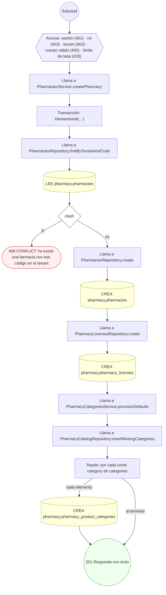

#### 2. POST /pharmacies/{pharmacyId}/categories

Crear una categoría de la farmacia

| HTTP | Código | Cuándo |
|---|---|---|
| 201 | — | Éxito |
| 400 | `VALIDATION_FAILED` | Los parámetros de ruta son UUID válidos; El cuerpo cumple el DTO (sin propiedades extra) |
| 401 | `UNAUTHENTICATED` | Hay una sesión válida (JWT) |
| 403 | `FORBIDDEN` | El rol está permitido; El tenant se resuelve y pertenece al actor |
| 409 | `CONFLICT` | ConflictException: Ya existe una categoría con ese nombre |
| 429 | `RATE_LIMITED` | No se supera el límite de solicitudes |

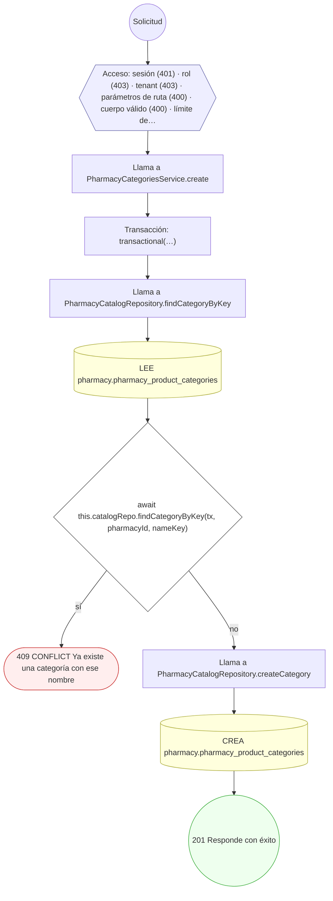

#### 3. DELETE /pharmacies/{pharmacyId}/categories/{categoryId}

Eliminar una categoría de la farmacia

| HTTP | Código | Cuándo |
|---|---|---|
| 200 | — | Éxito |
| 400 | `VALIDATION_FAILED` | Los parámetros de ruta son UUID válidos |
| 401 | `UNAUTHENTICATED` | Hay una sesión válida (JWT) |
| 403 | `FORBIDDEN` | El rol está permitido; El tenant se resuelve y pertenece al actor |
| 404 | `NOT_FOUND` | ResourceNotFoundException: Categoría no encontrada |
| 409 | `CONFLICT` | ConflictException: La categoría tiene productos: páselos a otra antes de eliminarla |
| 429 | `RATE_LIMITED` | No se supera el límite de solicitudes |

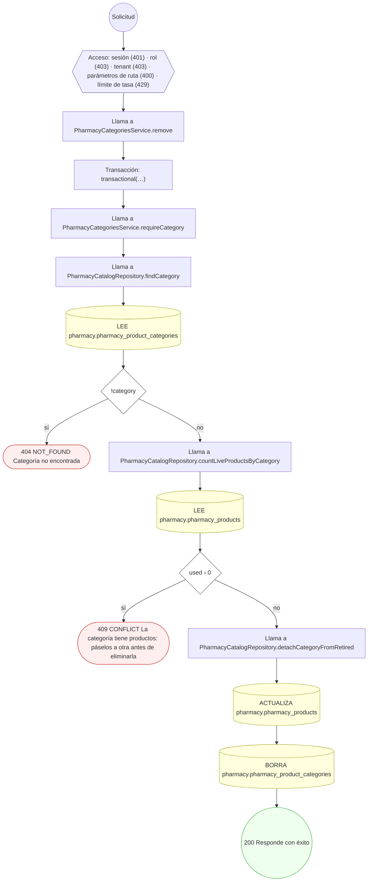

#### 4. PATCH /pharmacies/{pharmacyId}/categories/{categoryId}

Renombrar una categoría de la farmacia

| HTTP | Código | Cuándo |
|---|---|---|
| 200 | — | Éxito |
| 400 | `VALIDATION_FAILED` | Los parámetros de ruta son UUID válidos; El cuerpo cumple el DTO (sin propiedades extra) |
| 401 | `UNAUTHENTICATED` | Hay una sesión válida (JWT) |
| 403 | `FORBIDDEN` | El rol está permitido; El tenant se resuelve y pertenece al actor |
| 404 | `NOT_FOUND` | ResourceNotFoundException: Categoría no encontrada |
| 409 | `CONFLICT` | ConflictException: Ya existe una categoría con ese nombre |
| 429 | `RATE_LIMITED` | No se supera el límite de solicitudes |

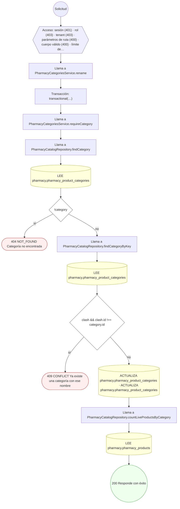

#### 5. POST /pharmacies/{pharmacyId}/categories/bulk

Cargar categorías en lote, con vista previa

| HTTP | Código | Cuándo |
|---|---|---|
| 200 | — | Éxito |
| 400 | `VALIDATION_FAILED` | Los parámetros de ruta son UUID válidos; El cuerpo cumple el DTO (sin propiedades extra); BadRequestException: dryRun debe ser true o false |
| 401 | `UNAUTHENTICATED` | Hay una sesión válida (JWT) |
| 403 | `FORBIDDEN` | El rol está permitido; El tenant se resuelve y pertenece al actor |
| 422 | `PRECONDITION_FAILED` | PreconditionFailedException: La farmacia no está activa |
| 429 | `RATE_LIMITED` | No se supera el límite de solicitudes |
| 500 | `INTERNAL` | DryRunRollback: {await withWarnings(tx, ctx, handler, { outcome: 'UNCHANGED'…}; DryRunRollback: {outcome} |


#### 6. POST /pharmacies/{pharmacyId}/integration-connections

Establecer conexión de integración externa

| HTTP | Código | Cuándo |
|---|---|---|
| 201 | — | Éxito |
| 400 | `VALIDATION_FAILED` | Los parámetros de ruta son UUID válidos; El cuerpo cumple el DTO (sin propiedades extra) |
| 401 | `UNAUTHENTICATED` | Hay una sesión válida (JWT) |
| 403 | `FORBIDDEN` | El rol está permitido; El tenant se resuelve y pertenece al actor |
| 409 | `CONFLICT` | ConflictException: Ya existe una conexión para esa integración |
| 422 | `PRECONDITION_FAILED` | PreconditionFailedException: La farmacia no está activa |
| 429 | `RATE_LIMITED` | No se supera el límite de solicitudes |


#### 7. POST /pharmacies/{pharmacyId}/integration-connections/{connectionId}/product-mappings

Mapear producto a código de proveedor externo

| HTTP | Código | Cuándo |
|---|---|---|
| 201 | — | Éxito |
| 400 | `VALIDATION_FAILED` | Los parámetros de ruta son UUID válidos; El cuerpo cumple el DTO (sin propiedades extra) |
| 401 | `UNAUTHENTICATED` | Hay una sesión válida (JWT) |
| 403 | `FORBIDDEN` | El rol está permitido; El tenant se resuelve y pertenece al actor |
| 404 | `NOT_FOUND` | ResourceNotFoundException: Conexión no encontrada; ResourceNotFoundException: Producto no encontrado |
| 409 | `CONFLICT` | ConflictException: El producto ya está mapeado en esta conexión |
| 422 | `PRECONDITION_FAILED` | PreconditionFailedException: El producto no está activo |
| 429 | `RATE_LIMITED` | No se supera el límite de solicitudes |

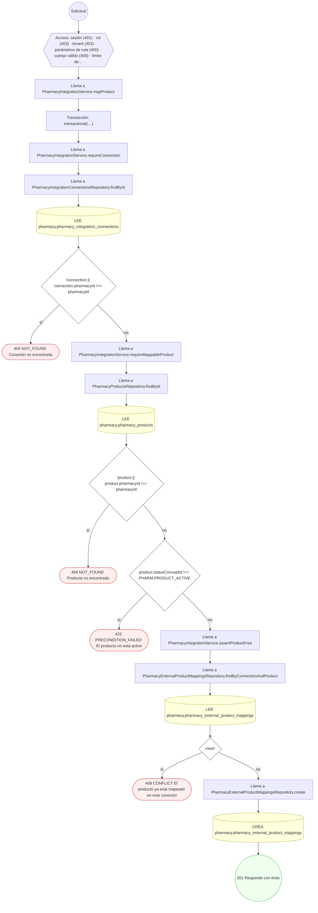

#### 8. DELETE /pharmacies/{pharmacyId}/integration-connections/{connectionId}/product-mappings/{mappingId}

Deshacer un vínculo con un código de proveedor externo

| HTTP | Código | Cuándo |
|---|---|---|
| 200 | — | Éxito |
| 400 | `VALIDATION_FAILED` | Los parámetros de ruta son UUID válidos |
| 401 | `UNAUTHENTICATED` | Hay una sesión válida (JWT) |
| 403 | `FORBIDDEN` | El rol está permitido; El tenant se resuelve y pertenece al actor |
| 404 | `NOT_FOUND` | ResourceNotFoundException: Conexión no encontrada; ResourceNotFoundException: Vínculo no encontrado |
| 429 | `RATE_LIMITED` | No se supera el límite de solicitudes |

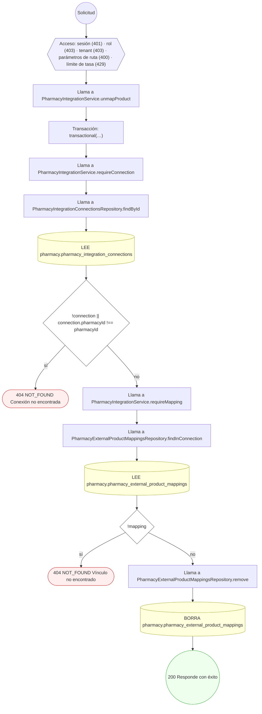

#### 9. PATCH /pharmacies/{pharmacyId}/integration-connections/{connectionId}/product-mappings/{mappingId}

Corregir un vínculo con un código de proveedor externo

| HTTP | Código | Cuándo |
|---|---|---|
| 200 | — | Éxito |
| 400 | `VALIDATION_FAILED` | Los parámetros de ruta son UUID válidos; El cuerpo cumple el DTO (sin propiedades extra) |
| 401 | `UNAUTHENTICATED` | Hay una sesión válida (JWT) |
| 403 | `FORBIDDEN` | El rol está permitido; El tenant se resuelve y pertenece al actor |
| 404 | `NOT_FOUND` | ResourceNotFoundException: Conexión no encontrada; ResourceNotFoundException: Vínculo no encontrado; ResourceNotFoundException: Producto no encontrado |
| 409 | `CONFLICT` | ConflictException: El producto ya está mapeado en esta conexión |
| 422 | `PRECONDITION_FAILED` | PreconditionFailedException: El producto no está activo |
| 429 | `RATE_LIMITED` | No se supera el límite de solicitudes |
| 500 | `INTERNAL` | DomainException: {HttpStatus.BAD_REQUEST} |

```mermaid
flowchart TD
  n1(("Solicitud")):::inicio
  n2{{"Acceso: sesión (401) · rol (403) · tenant (403) · parámetros de ruta (400) · cuerpo válido (400) · límite de…"}}:::acceso
  n1 --> n2
  n3["Llama a PharmacyIntegrationService.updateMapping"]:::llamada
  n2 --> n3
  n4{"dto.pharmacyProductId === undefined && dto.externalProductCode === undefined && dto.externalUnitCode === unde…"}:::decision
  n3 --> n4
  n5(["500 INTERNAL {HttpStatus.BAD_REQUEST}"]):::error
  n4 -->|"sí"| n5
  n6["Transacción: transactional(…)"]:::transaccion
  n4 -->|"no"| n6
  n7["Llama a PharmacyIntegrationService.requireConnection"]:::llamada
  n6 --> n7
  n8["Llama a PharmacyIntegrationConnectionsRepository.findById"]:::llamada
  n7 --> n8
  n9[("LEE pharmacy.pharmacy_integration_connections")]:::efecto
  n8 --> n9
  n10{"!connection || connection.pharmacyId !== pharmacyId"}:::decision
  n9 --> n10
  n11(["404 NOT_FOUND Conexión no encontrada"]):::error
  n10 -->|"sí"| n11
  n12["Llama a PharmacyIntegrationService.requireMapping"]:::llamada
  n10 -->|"no"| n12
  n13["Llama a PharmacyExternalProductMappingsRepository.findInConnection"]:::llamada
  n12 --> n13
  n14[("LEE pharmacy.pharmacy_external_product_mappings")]:::efecto
  n13 --> n14
  n15{"!mapping"}:::decision
  n14 --> n15
  n16(["404 NOT_FOUND Vínculo no encontrado"]):::error
  n15 -->|"sí"| n16
  n17{"dto.pharmacyProductId !== undefined && dto.pharmacyProductId !== mapping.pharmacyProductId"}:::decision
  n15 -->|"no"| n17
  n18["Llama a PharmacyIntegrationService.requireMappableProduct"]:::llamada
  n17 -->|"sí"| n18
  n19["Llama a PharmacyProductsRepository.findById"]:::llamada
  n18 --> n19
  n20[("LEE pharmacy.pharmacy_products")]:::efecto
  n19 --> n20
  n21{"!product || product.pharmacyId !== pharmacyId"}:::decision
  n20 --> n21
  n22(["404 NOT_FOUND Producto no encontrado"]):::error
  n21 -->|"sí"| n22
  n23{"product.statusConceptId !== PHARM.PRODUCT_ACTIVE"}:::decision
  n21 -->|"no"| n23
  n24(["422 PRECONDITION_FAILED El producto no está activo"]):::error
  n23 -->|"sí"| n24
  n25["Llama a PharmacyIntegrationService.assertProductFree"]:::llamada
  n23 -->|"no"| n25
  n26["Llama a PharmacyExternalProductMappingsRepository.findByConnectionAndProduct"]:::llamada
  n25 --> n26
  n27[("LEE pharmacy.pharmacy_external_product_mappings")]:::efecto
  n26 --> n27
  n28{"clash"}:::decision
  n27 --> n28
  n29(["409 CONFLICT El producto ya está mapeado en esta conexión"]):::error
  n28 -->|"sí"| n29
  n30[("ACTUALIZA pharmacy.pharmacy_external_product_mappings")]:::efecto
  n28 -->|"no"| n30
  n31{"dto.externalProductCode !== undefined"}:::decision
  n30 --> n31
  n17 -->|"no"| n31
  n32[("ACTUALIZA pharmacy.pharmacy_external_product_mappings")]:::efecto
  n31 -->|"sí"| n32
  n33{"dto.externalUnitCode !== undefined"}:::decision
  n32 --> n33
  n31 -->|"no"| n33
  n34[("ACTUALIZA pharmacy.pharmacy_external_product_mappings")]:::efecto
  n33 -->|"sí"| n34
  n35[("ACTUALIZA pharmacy.pharmacy_external_product_mappings")]:::efecto
  n34 --> n35
  n33 -->|"no"| n35
  n36(("200 Responde con éxito")):::ok
  n35 --> n36
  classDef acceso fill:#eef,stroke:#66a
  classDef error fill:#fee,stroke:#c33
  classDef ok fill:#efe,stroke:#3a3
  classDef efecto fill:#ffd,stroke:#aa3
  classDef decision fill:#fff,stroke:#555
  classDef corte fill:#eee,stroke:#999,stroke-dasharray: 4
```

#### 10. PATCH /pharmacies/{pharmacyId}/inventory

Guardar el inventario declarado de varios productos (todo o nada)

| HTTP | Código | Cuándo |
|---|---|---|
| 200 | — | Éxito |
| 400 | `VALIDATION_FAILED` | Los parámetros de ruta son UUID válidos; El cuerpo cumple el DTO (sin propiedades extra) |
| 401 | `UNAUTHENTICATED` | Hay una sesión válida (JWT) |
| 403 | `FORBIDDEN` | El rol está permitido; El tenant se resuelve y pertenece al actor |
| 422 | `PRECONDITION_FAILED` | PreconditionFailedException: El inventario tiene líneas inválidas |
| 429 | `RATE_LIMITED` | No se supera el límite de solicitudes |

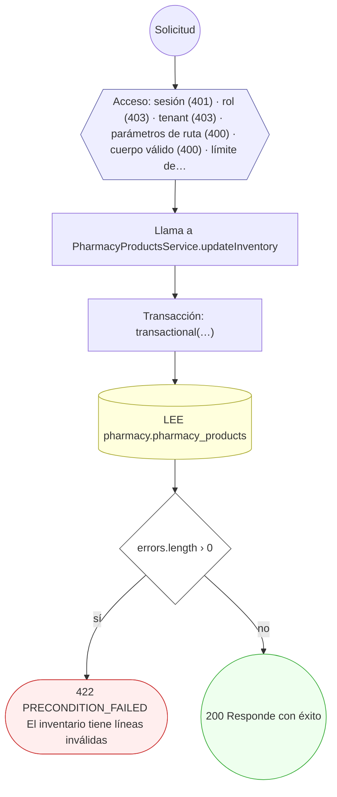

#### 11. POST /pharmacies/{pharmacyId}/licenses/{licenseId}/verify

Verificar licencia y aprobar farmacia

| HTTP | Código | Cuándo |
|---|---|---|
| 200 | — | Éxito |
| 400 | `VALIDATION_FAILED` | Los parámetros de ruta son UUID válidos; El cuerpo cumple el DTO (sin propiedades extra) |
| 401 | `UNAUTHENTICATED` | Hay una sesión válida (JWT) |
| 403 | `FORBIDDEN` | El rol está permitido; El tenant se resuelve y pertenece al actor |
| 404 | `NOT_FOUND` | ResourceNotFoundException: Licencia no encontrada |
| 422 | `PRECONDITION_FAILED` | PreconditionFailedException: La licencia no está pendiente de verificación |
| 429 | `RATE_LIMITED` | No se supera el límite de solicitudes |

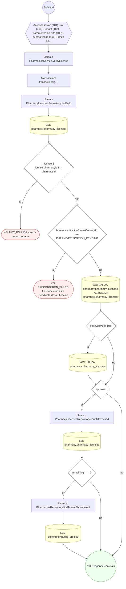

#### 12. POST /pharmacies/{pharmacyId}/on-call-shifts/{shiftId}/cancel

Cancelar un turno de guardia (deja de publicarse)

| HTTP | Código | Cuándo |
|---|---|---|
| 200 | — | Éxito |
| 400 | `VALIDATION_FAILED` | Los parámetros de ruta son UUID válidos |
| 401 | `UNAUTHENTICATED` | Hay una sesión válida (JWT) |
| 403 | `FORBIDDEN` | El rol está permitido; El tenant se resuelve y pertenece al actor |
| 422 | `PRECONDITION_FAILED` | PreconditionFailedException: El turno ya terminó o ya estaba cancelado |
| 429 | `RATE_LIMITED` | No se supera el límite de solicitudes |

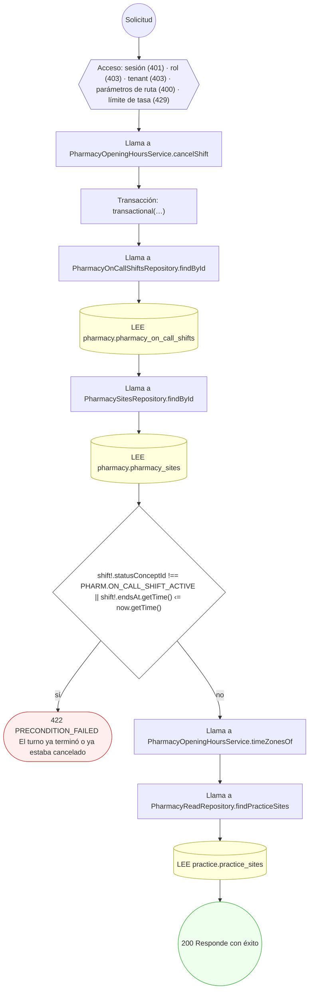

#### 13. POST /pharmacies/{pharmacyId}/price-lists

Crear lista de precios (pública / por aseguradora)

| HTTP | Código | Cuándo |
|---|---|---|
| 201 | — | Éxito |
| 400 | `VALIDATION_FAILED` | Los parámetros de ruta son UUID válidos; El cuerpo cumple el DTO (sin propiedades extra) |
| 401 | `UNAUTHENTICATED` | Hay una sesión válida (JWT) |
| 403 | `FORBIDDEN` | El rol está permitido; El tenant se resuelve y pertenece al actor |
| 409 | `CONFLICT` | ConflictException: Ya existe una lista con ese código en la farmacia |
| 422 | `PRECONDITION_FAILED` | PreconditionFailedException: La farmacia no está activa; PreconditionFailedException: Una lista por aseguradora requiere insurerTenantId |
| 429 | `RATE_LIMITED` | No se supera el límite de solicitudes |

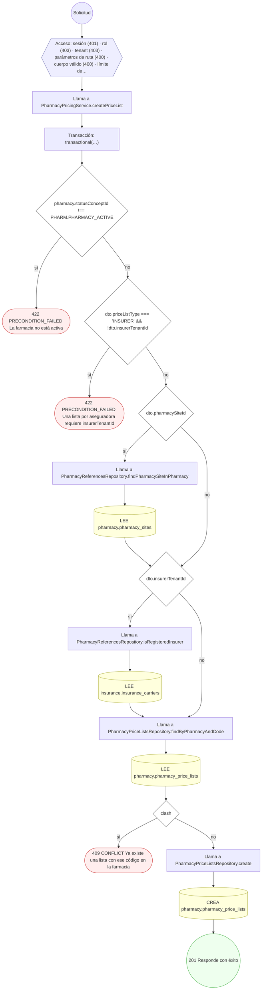

#### 14. POST /pharmacies/{pharmacyId}/price-lists/{priceListId}/close

Cerrar/expirar lista de precios

| HTTP | Código | Cuándo |
|---|---|---|
| 200 | — | Éxito |
| 400 | `VALIDATION_FAILED` | Los parámetros de ruta son UUID válidos |
| 401 | `UNAUTHENTICATED` | Hay una sesión válida (JWT) |
| 403 | `FORBIDDEN` | El rol está permitido; El tenant se resuelve y pertenece al actor |
| 404 | `NOT_FOUND` | ResourceNotFoundException: Lista de precios no encontrada |
| 422 | `PRECONDITION_FAILED` | PreconditionFailedException: La lista de precios no está activa |
| 429 | `RATE_LIMITED` | No se supera el límite de solicitudes |

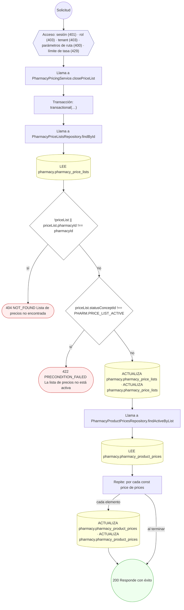

#### 15. POST /pharmacies/{pharmacyId}/price-lists/{priceListId}/prices

Fijar/versionar precio de producto

| HTTP | Código | Cuándo |
|---|---|---|
| 201 | — | Éxito |
| 400 | `VALIDATION_FAILED` | Los parámetros de ruta son UUID válidos; El cuerpo cumple el DTO (sin propiedades extra) |
| 401 | `UNAUTHENTICATED` | Hay una sesión válida (JWT) |
| 403 | `FORBIDDEN` | El rol está permitido; El tenant se resuelve y pertenece al actor |
| 404 | `NOT_FOUND` | ResourceNotFoundException: Lista de precios no encontrada; ResourceNotFoundException: Producto no encontrado |
| 422 | `PRECONDITION_FAILED` | PreconditionFailedException: La lista de precios no está activa; PreconditionFailedException: El producto no está activo |
| 429 | `RATE_LIMITED` | No se supera el límite de solicitudes |


#### 16. POST /pharmacies/{pharmacyId}/prices/bulk

Cargar precios de venta en lote, con vista previa

| HTTP | Código | Cuándo |
|---|---|---|
| 200 | — | Éxito |
| 400 | `VALIDATION_FAILED` | Los parámetros de ruta son UUID válidos; El cuerpo cumple el DTO (sin propiedades extra); BadRequestException: dryRun debe ser true o false |
| 401 | `UNAUTHENTICATED` | Hay una sesión válida (JWT) |
| 403 | `FORBIDDEN` | El rol está permitido; El tenant se resuelve y pertenece al actor |
| 422 | `PRECONDITION_FAILED` | PreconditionFailedException: La farmacia no está activa |
| 429 | `RATE_LIMITED` | No se supera el límite de solicitudes |
| 500 | `INTERNAL` | DryRunRollback: {await withWarnings(tx, ctx, handler, { outcome: 'UNCHANGED'…}; DryRunRollback: {outcome} |

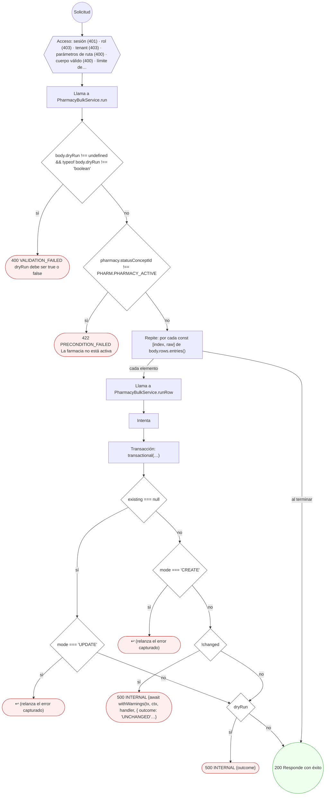

#### 17. POST /pharmacies/{pharmacyId}/products

Publicar producto en catálogo con identificadores

| HTTP | Código | Cuándo |
|---|---|---|
| 201 | — | Éxito |
| 400 | `VALIDATION_FAILED` | Los parámetros de ruta son UUID válidos; El cuerpo cumple el DTO (sin propiedades extra); BadRequestException: catalogPresentationCode sólo se manda junto con catalogProductId; BadRequestException: {supplied.join(', ')} vienen del catálogo oficial y no se mandan con catalogProductId; BadRequestException: El producto tiene más de una presentación: mande catalogPresentationCode; BadRequestException: catalogPresentationCode no es una presentación de ese producto; BadRequestException: unitPrice debe ser un importe positivo con hasta 2 decimales |
| 401 | `UNAUTHENTICATED` | Hay una sesión válida (JWT) |
| 403 | `FORBIDDEN` | El rol está permitido; El tenant se resuelve y pertenece al actor; ForbiddenException: {labels.subject} no le pertenece |
| 404 | `NOT_FOUND` | ResourceNotFoundException: Producto del catálogo no encontrado; ResourceNotFoundException: {labels.notFound} |
| 409 | `CONFLICT` | ConflictException: Ya existe un producto con ese código en la farmacia; ConflictException: Ya cargó ese producto y presentación |
| 422 | `PRECONDITION_FAILED` | PreconditionFailedException: La farmacia no está activa; PreconditionFailedException: El registro sanitario de ese producto no está vigente; PreconditionFailedException: La categoría no es una de las de su farmacia; PreconditionFailedException: {labels.subject} está borrado; PreconditionFailedException: {labels.subject} no tiene una versión vigente; PreconditionFailedException: La imagen del producto no es un archivo de imagen |
| 429 | `RATE_LIMITED` | No se supera el límite de solicitudes |

```mermaid
flowchart TD
  n1(("Solicitud")):::inicio
  n2{{"Acceso: sesión (401) · rol (403) · tenant (403) · parámetros de ruta (400) · cuerpo válido (400) · límite de…"}}:::acceso
  n1 --> n2
  n3["Llama a PharmacyProductsService.publishProduct"]:::llamada
  n2 --> n3
  n4["Transacción: transactional(…)"]:::transaccion
  n3 --> n4
  n5{"pharmacy.statusConceptId !== PHARM.PHARMACY_ACTIVE"}:::decision
  n4 --> n5
  n6(["422 PRECONDITION_FAILED La farmacia no está activa"]):::error
  n5 -->|"sí"| n6
  n7["Llama a PharmacyProductsRepository.findByPharmacyAndCode"]:::llamada
  n5 -->|"no"| n7
  n8[("LEE pharmacy.pharmacy_products")]:::efecto
  n7 --> n8
  n9{"clash"}:::decision
  n8 --> n9
  n10(["409 CONFLICT Ya existe un producto con ese código en la farmacia"]):::error
  n9 -->|"sí"| n10
  n11["Llama a PharmacyProductsService.deriveFromCatalog"]:::llamada
  n9 -->|"no"| n11
  n12{"dto.catalogProductId === undefined"}:::decision
  n11 --> n12
  n13{"dto.catalogPresentationCode !== undefined"}:::decision
  n12 -->|"sí"| n13
  n14(["400 VALIDATION_FAILED catalogPresentationCode sólo se manda junto con catalogProductId"]):::error
  n13 -->|"sí"| n14
  n15["Llama a MedicineCatalogRepository.findProductById"]:::llamada
  n13 -->|"no"| n15
  n12 -->|"no"| n15
  n16[("LEE terminology.catalog_concepts · LEE terminology.code_system_versions · LEE terminology.code_systems")]:::efecto
  n15 --> n16
  n17["Llama a MedicineCatalogRepository.hydrate"]:::llamada
  n16 --> n17
  n18[("LEE terminology.catalog_concepts · LEE terminology.concept_properties")]:::efecto
  n17 --> n18
  n19{"!catalog"}:::decision
  n18 --> n19
  n20(["404 NOT_FOUND Producto del catálogo no encontrado"]):::error
  n19 -->|"sí"| n20
  n21{"!catalog.selectable"}:::decision
  n19 -->|"no"| n21
  n22(["422 PRECONDITION_FAILED El registro sanitario de ese producto no está vigente"]):::error
  n21 -->|"sí"| n22
  n23{"supplied.length › 0"}:::decision
  n21 -->|"no"| n23
  n24(["400 VALIDATION_FAILED {supplied.join(', ')} vienen del catálogo oficial y no se mandan con catalogProductId"]):::error
  n23 -->|"sí"| n24
  n25["Llama a PharmacyProductsService.pickPresentation"]:::llamada
  n23 -->|"no"| n25
  n26{"code === undefined"}:::decision
  n25 --> n26
  n27{"sellable.length › 1"}:::decision
  n26 -->|"sí"| n27
  n28(["400 VALIDATION_FAILED El producto tiene más de una presentación: mande catalogPresentationCode"]):::error
  n27 -->|"sí"| n28
  n29{"!found"}:::decision
  n27 -->|"no"| n29
  n26 -->|"no"| n29
  n30(["400 VALIDATION_FAILED catalogPresentationCode no es una presentación de ese producto"]):::error
  n29 -->|"sí"| n30
  n31["Llama a PharmacyProductsRepository.findByPharmacyAndCatalog"]:::llamada
  n29 -->|"no"| n31
  n32[("LEE pharmacy.pharmacy_products")]:::efecto
  n31 --> n32
  n33{"duplicate"}:::decision
  n32 --> n33
  n34(["409 CONFLICT Ya cargó ese producto y presentación"]):::error
  n33 -->|"sí"| n34
  n35["Llama a MedicineCatalogRepository.findVademecumConceptIdByAtc"]:::llamada
  n33 -->|"no"| n35
  n36[("LEE terminology.catalog_concepts · LEE terminology.code_system_versions · LEE terminology.code_systems")]:::efecto
  n35 --> n36
  n37["Llama a PharmacyProductsRepository.create"]:::llamada
  n36 --> n37
  n38[("CREA pharmacy.pharmacy_products")]:::efecto
  n37 --> n38
  n39["Llama a PharmacyProductsService.applyCatalogFields"]:::llamada
  n38 --> n39
  n40{"input.category !== undefined"}:::decision
  n39 --> n40
  n41["Llama a PharmacyCategoriesService.resolveByName"]:::llamada
  n40 -->|"sí"| n41
  n42["Llama a PharmacyCatalogRepository.findCategoryByKey"]:::llamada
  n41 --> n42
  n43[("LEE pharmacy.pharmacy_product_categories")]:::efecto
  n42 --> n43
  n44{"!found"}:::decision
  n43 --> n44
  n45(["422 PRECONDITION_FAILED La categoría no es una de las de su farmacia"]):::error
  n44 -->|"sí"| n45
  n46[("ACTUALIZA pharmacy.pharmacy_products")]:::efecto
  n44 -->|"no"| n46
  n47{"input.description !== undefined"}:::decision
  n46 --> n47
  n40 -->|"no"| n47
  n48[("ACTUALIZA pharmacy.pharmacy_products")]:::efecto
  n47 -->|"sí"| n48
  n49{"input.imageFileIds !== undefined"}:::decision
  n48 --> n49
  n47 -->|"no"| n49
  n50["Llama a PharmacyProductsService.replaceImages"]:::llamada
  n49 -->|"sí"| n50
  n51["Llama a PharmacyCatalogRepository.findImageFileIds"]:::llamada
  n50 --> n51
  n52[("LEE pharmacy.pharmacy_product_images")]:::efecto
  n51 --> n52
  n53["Repite: por cada const fileId de fileIds"]:::bucle
  n52 --> n53
  n54["Llama a AttachableFileService.assertUsableBy"]:::llamada
  n53 -->|"cada elemento"| n54
  n55{"!file"}:::decision
  n54 --> n55
  n56(["404 NOT_FOUND {labels.notFound}"]):::error
  n55 -->|"sí"| n56
  n57{"file.createdByUserId !== actor.id && !enAllowlist"}:::decision
  n55 -->|"no"| n57
  n58(["403 FORBIDDEN {labels.subject} no le pertenece"]):::error
  n57 -->|"sí"| n58
  n59{"file.deletedAt || file.lifecycleStatusConceptId === CONCEPTS.FILE_DELETED"}:::decision
  n57 -->|"no"| n59
  n60(["422 PRECONDITION_FAILED {labels.subject} está borrado"]):::error
  n59 -->|"sí"| n60
  n61{"!file.currentVersionId"}:::decision
  n59 -->|"no"| n61
  n62(["422 PRECONDITION_FAILED {labels.subject} no tiene una versión vigente"]):::error
  n61 -->|"sí"| n62
  n63{"file.categoryConceptId !== CONCEPTS.FILE_CATEGORY_IMAGE"}:::decision
  n61 -->|"no"| n63
  n64(["422 PRECONDITION_FAILED La imagen del producto no es un archivo de imagen"]):::error
  n63 -->|"sí"| n64
  n65["Llama a PharmacyCatalogRepository.replaceImages"]:::llamada
  n63 -->|"no"| n65
  n53 -->|"al terminar"| n65
  n66[("BORRA pharmacy.pharmacy_product_images")]:::efecto
  n65 --> n66
  n67["Repite: forEach(…)"]:::bucle
  n66 --> n67
  n68[("CREA pharmacy.pharmacy_product_images")]:::efecto
  n67 -->|"cada elemento"| n68
  n69{"input.unitPrice !== undefined"}:::decision
  n68 --> n69
  n67 -->|"al terminar"| n69
  n49 -->|"no"| n69
  n70["Llama a PharmacyProductsService.setCatalogPrice"]:::llamada
  n69 -->|"sí"| n70
  n71["… el resto del árbol (17 nodos) está en el JSON del inventario"]:::corte
  n70 --> n71
  classDef acceso fill:#eef,stroke:#66a
  classDef error fill:#fee,stroke:#c33
  classDef ok fill:#efe,stroke:#3a3
  classDef efecto fill:#ffd,stroke:#aa3
  classDef decision fill:#fff,stroke:#555
  classDef corte fill:#eee,stroke:#999,stroke-dasharray: 4
```

#### 18. DELETE /pharmacies/{pharmacyId}/products/{productId}

Retirar (soft-delete) producto del catálogo

| HTTP | Código | Cuándo |
|---|---|---|
| 200 | — | Éxito |
| 400 | `VALIDATION_FAILED` | Los parámetros de ruta son UUID válidos |
| 401 | `UNAUTHENTICATED` | Hay una sesión válida (JWT) |
| 403 | `FORBIDDEN` | El rol está permitido; El tenant se resuelve y pertenece al actor |
| 404 | `NOT_FOUND` | ResourceNotFoundException: Producto no encontrado |
| 422 | `PRECONDITION_FAILED` | PreconditionFailedException: El producto no está activo |
| 429 | `RATE_LIMITED` | No se supera el límite de solicitudes |

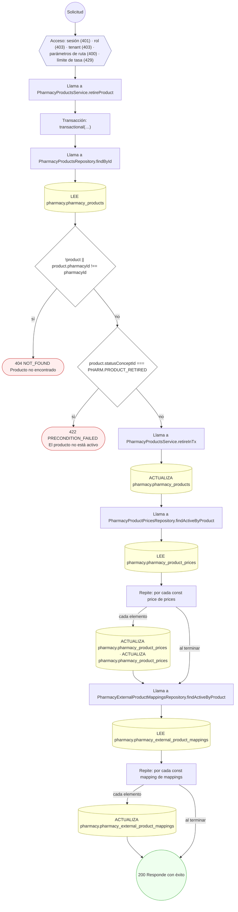

#### 19. PATCH /pharmacies/{pharmacyId}/products/{productId}

Editar un producto del catálogo de la farmacia

| HTTP | Código | Cuándo |
|---|---|---|
| 200 | — | Éxito |
| 400 | `VALIDATION_FAILED` | Los parámetros de ruta son UUID válidos; El cuerpo cumple el DTO (sin propiedades extra); BadRequestException: {changed.join(', ')} vienen del catálogo oficial y no se editan; BadRequestException: medicationConceptId viene del catálogo oficial y no se cambia; BadRequestException: unitPrice debe ser un importe positivo con hasta 2 decimales |
| 401 | `UNAUTHENTICATED` | Hay una sesión válida (JWT) |
| 403 | `FORBIDDEN` | El rol está permitido; El tenant se resuelve y pertenece al actor; ForbiddenException: {labels.subject} no le pertenece |
| 404 | `NOT_FOUND` | ResourceNotFoundException: Producto no encontrado; ResourceNotFoundException: {labels.notFound} |
| 422 | `PRECONDITION_FAILED` | PreconditionFailedException: El producto no está activo; PreconditionFailedException: Ese medicamento no está en el catálogo con que se receta; PreconditionFailedException: La categoría no es una de las de su farmacia; PreconditionFailedException: {labels.subject} está borrado; PreconditionFailedException: {labels.subject} no tiene una versión vigente; PreconditionFailedException: La imagen del producto no es un archivo de imagen |
| 429 | `RATE_LIMITED` | No se supera el límite de solicitudes |

```mermaid
flowchart TD
  n1(("Solicitud")):::inicio
  n2{{"Acceso: sesión (401) · rol (403) · tenant (403) · parámetros de ruta (400) · cuerpo válido (400) · límite de…"}}:::acceso
  n1 --> n2
  n3["Llama a PharmacyProductsService.updateProduct"]:::llamada
  n2 --> n3
  n4["Transacción: transactional(…)"]:::transaccion
  n3 --> n4
  n5["Llama a PharmacyProductsRepository.findById"]:::llamada
  n4 --> n5
  n6[("LEE pharmacy.pharmacy_products")]:::efecto
  n5 --> n6
  n7{"!product || product.pharmacyId !== pharmacyId"}:::decision
  n6 --> n7
  n8(["404 NOT_FOUND Producto no encontrado"]):::error
  n7 -->|"sí"| n8
  n9{"retired && !reactivating"}:::decision
  n7 -->|"no"| n9
  n10(["422 PRECONDITION_FAILED El producto no está activo"]):::error
  n9 -->|"sí"| n10
  n11{"product.catalogProductConceptId != null && changed.length › 0"}:::decision
  n9 -->|"no"| n11
  n12(["400 VALIDATION_FAILED {changed.join(', ')} vienen del catálogo oficial y no se editan"]):::error
  n11 -->|"sí"| n12
  n13["Repite: por cada const field de changed"]:::bucle
  n11 -->|"no"| n13
  n14[("ACTUALIZA pharmacy.pharmacy_products")]:::efecto
  n13 -->|"cada elemento"| n14
  n15["Llama a MedicationCatalogResolver.link"]:::llamada
  n14 --> n15
  n13 -->|"al terminar"| n15
  n16{"product.catalogProductConceptId != null && current !== null"}:::decision
  n15 --> n16
  n17(["400 VALIDATION_FAILED medicationConceptId viene del catálogo oficial y no se cambia"]):::error
  n16 -->|"sí"| n17
  n18{"conceptId !== null && !(await this.isMedication(conceptId))"}:::decision
  n16 -->|"no"| n18
  n19(["422 PRECONDITION_FAILED Ese medicamento no está en el catálogo con que se receta"]):::error
  n18 -->|"sí"| n19
  n20{"dto.status === 'WITHDRAWN'"}:::decision
  n18 -->|"no"| n20
  n21["Llama a PharmacyProductsService.retireInTx"]:::llamada
  n20 -->|"sí"| n21
  n22[("ACTUALIZA pharmacy.pharmacy_products")]:::efecto
  n21 --> n22
  n23["Llama a PharmacyProductPricesRepository.findActiveByProduct"]:::llamada
  n22 --> n23
  n24[("LEE pharmacy.pharmacy_product_prices")]:::efecto
  n23 --> n24
  n25["Repite: por cada const price de prices"]:::bucle
  n24 --> n25
  n26[("ACTUALIZA pharmacy.pharmacy_product_prices · ACTUALIZA pharmacy.pharmacy_product_prices")]:::efecto
  n25 -->|"cada elemento"| n26
  n27["Llama a PharmacyExternalProductMappingsRepository.findActiveByProduct"]:::llamada
  n26 --> n27
  n25 -->|"al terminar"| n27
  n28[("LEE pharmacy.pharmacy_external_product_mappings")]:::efecto
  n27 --> n28
  n29["Repite: por cada const mapping de mappings"]:::bucle
  n28 --> n29
  n30[("ACTUALIZA pharmacy.pharmacy_external_product_mappings")]:::efecto
  n29 -->|"cada elemento"| n30
  n31{"!retired"}:::decision
  n30 --> n31
  n29 -->|"al terminar"| n31
  n32["Llama a PharmacyProductsService.retireInTx"]:::llamada
  n31 -->|"sí"| n32
  n33[("ACTUALIZA pharmacy.pharmacy_products")]:::efecto
  n32 --> n33
  n34["Llama a PharmacyProductPricesRepository.findActiveByProduct"]:::llamada
  n33 --> n34
  n35[("LEE pharmacy.pharmacy_product_prices")]:::efecto
  n34 --> n35
  n36["Repite: por cada const price de prices"]:::bucle
  n35 --> n36
  n37[("ACTUALIZA pharmacy.pharmacy_product_prices · ACTUALIZA pharmacy.pharmacy_product_prices")]:::efecto
  n36 -->|"cada elemento"| n37
  n38["Llama a PharmacyExternalProductMappingsRepository.findActiveByProduct"]:::llamada
  n37 --> n38
  n36 -->|"al terminar"| n38
  n39[("LEE pharmacy.pharmacy_external_product_mappings")]:::efecto
  n38 --> n39
  n40["Repite: por cada const mapping de mappings"]:::bucle
  n39 --> n40
  n41[("ACTUALIZA pharmacy.pharmacy_external_product_mappings")]:::efecto
  n40 -->|"cada elemento"| n41
  n42{"dto.status !== undefined"}:::decision
  n20 -->|"no"| n42
  n43[("ACTUALIZA pharmacy.pharmacy_products")]:::efecto
  n42 -->|"sí"| n43
  n44["Llama a PharmacyProductsService.applyCatalogFields"]:::llamada
  n41 --> n44
  n40 -->|"al terminar"| n44
  n31 -->|"no"| n44
  n43 --> n44
  n42 -->|"no"| n44
  n45{"input.category !== undefined"}:::decision
  n44 --> n45
  n46["Llama a PharmacyCategoriesService.resolveByName"]:::llamada
  n45 -->|"sí"| n46
  n47["Llama a PharmacyCatalogRepository.findCategoryByKey"]:::llamada
  n46 --> n47
  n48[("LEE pharmacy.pharmacy_product_categories")]:::efecto
  n47 --> n48
  n49{"!found"}:::decision
  n48 --> n49
  n50(["422 PRECONDITION_FAILED La categoría no es una de las de su farmacia"]):::error
  n49 -->|"sí"| n50
  n51[("ACTUALIZA pharmacy.pharmacy_products")]:::efecto
  n49 -->|"no"| n51
  n52{"input.description !== undefined"}:::decision
  n51 --> n52
  n45 -->|"no"| n52
  n53[("ACTUALIZA pharmacy.pharmacy_products")]:::efecto
  n52 -->|"sí"| n53
  n54{"input.imageFileIds !== undefined"}:::decision
  n53 --> n54
  n52 -->|"no"| n54
  n55["Llama a PharmacyProductsService.replaceImages"]:::llamada
  n54 -->|"sí"| n55
  n56["Llama a PharmacyCatalogRepository.findImageFileIds"]:::llamada
  n55 --> n56
  n57[("LEE pharmacy.pharmacy_product_images")]:::efecto
  n56 --> n57
  n58["Repite: por cada const fileId de fileIds"]:::bucle
  n57 --> n58
  n59["Llama a AttachableFileService.assertUsableBy"]:::llamada
  n58 -->|"cada elemento"| n59
  n60{"!file"}:::decision
  n59 --> n60
  n61(["404 NOT_FOUND {labels.notFound}"]):::error
  n60 -->|"sí"| n61
  n62{"file.createdByUserId !== actor.id && !enAllowlist"}:::decision
  n60 -->|"no"| n62
  n63(["403 FORBIDDEN {labels.subject} no le pertenece"]):::error
  n62 -->|"sí"| n63
  n64{"file.deletedAt || file.lifecycleStatusConceptId === CONCEPTS.FILE_DELETED"}:::decision
  n62 -->|"no"| n64
  n65(["422 PRECONDITION_FAILED {labels.subject} está borrado"]):::error
  n64 -->|"sí"| n65
  n66{"!file.currentVersionId"}:::decision
  n64 -->|"no"| n66
  n67(["422 PRECONDITION_FAILED {labels.subject} no tiene una versión vigente"]):::error
  n66 -->|"sí"| n67
  n68{"file.categoryConceptId !== CONCEPTS.FILE_CATEGORY_IMAGE"}:::decision
  n66 -->|"no"| n68
  n69(["422 PRECONDITION_FAILED La imagen del producto no es un archivo de imagen"]):::error
  n68 -->|"sí"| n69
  n70["Llama a PharmacyCatalogRepository.replaceImages"]:::llamada
  n68 -->|"no"| n70
  n58 -->|"al terminar"| n70
  n71["… el resto del árbol (3 nodos) está en el JSON del inventario"]:::corte
  n70 --> n71
  classDef acceso fill:#eef,stroke:#66a
  classDef error fill:#fee,stroke:#c33
  classDef ok fill:#efe,stroke:#3a3
  classDef efecto fill:#ffd,stroke:#aa3
  classDef decision fill:#fff,stroke:#555
  classDef corte fill:#eee,stroke:#999,stroke-dasharray: 4
```

#### 20. POST /pharmacies/{pharmacyId}/products/bulk

Cargar productos en lote, con vista previa

| HTTP | Código | Cuándo |
|---|---|---|
| 200 | — | Éxito |
| 400 | `VALIDATION_FAILED` | Los parámetros de ruta son UUID válidos; El cuerpo cumple el DTO (sin propiedades extra); BadRequestException: dryRun debe ser true o false |
| 401 | `UNAUTHENTICATED` | Hay una sesión válida (JWT) |
| 403 | `FORBIDDEN` | El rol está permitido; El tenant se resuelve y pertenece al actor |
| 422 | `PRECONDITION_FAILED` | PreconditionFailedException: La farmacia no está activa |
| 429 | `RATE_LIMITED` | No se supera el límite de solicitudes |
| 500 | `INTERNAL` | DryRunRollback: {await withWarnings(tx, ctx, handler, { outcome: 'UNCHANGED'…}; DryRunRollback: {outcome} |

```mermaid
flowchart TD
  n1(("Solicitud")):::inicio
  n2{{"Acceso: sesión (401) · rol (403) · tenant (403) · parámetros de ruta (400) · cuerpo válido (400) · límite de…"}}:::acceso
  n1 --> n2
  n3["Llama a PharmacyBulkService.run"]:::llamada
  n2 --> n3
  n4{"body.dryRun !== undefined && typeof body.dryRun !== 'boolean'"}:::decision
  n3 --> n4
  n5(["400 VALIDATION_FAILED dryRun debe ser true o false"]):::error
  n4 -->|"sí"| n5
  n6{"pharmacy.statusConceptId !== PHARM.PHARMACY_ACTIVE"}:::decision
  n4 -->|"no"| n6
  n7(["422 PRECONDITION_FAILED La farmacia no está activa"]):::error
  n6 -->|"sí"| n7
  n8["Repite: por cada const [index, raw] de body.rows.entries()"]:::bucle
  n6 -->|"no"| n8
  n9["Llama a PharmacyBulkService.runRow"]:::llamada
  n8 -->|"cada elemento"| n9
  n10["Intenta"]:::intento
  n9 --> n10
  n11["Transacción: transactional(…)"]:::transaccion
  n10 --> n11
  n12{"existing === null"}:::decision
  n11 --> n12
  n13{"mode === 'UPDATE'"}:::decision
  n12 -->|"sí"| n13
  n14(["↩ (relanza el error capturado)"]):::error
  n13 -->|"sí"| n14
  n15{"mode === 'CREATE'"}:::decision
  n12 -->|"no"| n15
  n16(["↩ (relanza el error capturado)"]):::error
  n15 -->|"sí"| n16
  n17{"!changed"}:::decision
  n15 -->|"no"| n17
  n18(["500 INTERNAL {await withWarnings(tx, ctx, handler, { outcome: 'UNCHANGED'…}"]):::error
  n17 -->|"sí"| n18
  n19{"dryRun"}:::decision
  n13 -->|"no"| n19
  n17 -->|"no"| n19
  n20(["500 INTERNAL {outcome}"]):::error
  n19 -->|"sí"| n20
  n21(("200 Responde con éxito")):::ok
  n19 -->|"no"| n21
  n8 -->|"al terminar"| n21
  classDef acceso fill:#eef,stroke:#66a
  classDef error fill:#fee,stroke:#c33
  classDef ok fill:#efe,stroke:#3a3
  classDef efecto fill:#ffd,stroke:#aa3
  classDef decision fill:#fff,stroke:#555
  classDef corte fill:#eee,stroke:#999,stroke-dasharray: 4
```

#### 21. POST /pharmacies/{pharmacyId}/projections

Proyectar catálogo y precios a read-model

| HTTP | Código | Cuándo |
|---|---|---|
| 200 | — | Éxito |
| 400 | `VALIDATION_FAILED` | Los parámetros de ruta son UUID válidos |
| 401 | `UNAUTHENTICATED` | Hay una sesión válida (JWT) |
| 403 | `FORBIDDEN` | El rol está permitido; El tenant se resuelve y pertenece al actor |
| 429 | `RATE_LIMITED` | No se supera el límite de solicitudes |

```mermaid
flowchart TD
  n1(("Solicitud")):::inicio
  n2{{"Acceso: sesión (401) · rol (403) · tenant (403) · parámetros de ruta (400) · límite de tasa (429)"}}:::acceso
  n1 --> n2
  n3["Llama a PharmacyCatalogService.projectCatalog"]:::llamada
  n2 --> n3
  n4["Llama a PharmacyProductsRepository.findByPharmacyAndStatus"]:::llamada
  n3 --> n4
  n5[("LEE pharmacy.pharmacy_products")]:::efecto
  n4 --> n5
  n6["Repite: por cada const product de products"]:::bucle
  n5 --> n6
  n7["Llama a PharmacyProductPricesRepository.findActiveByProduct"]:::llamada
  n6 -->|"cada elemento"| n7
  n8[("LEE pharmacy.pharmacy_product_prices")]:::efecto
  n7 --> n8
  n9(("200 Responde con éxito")):::ok
  n8 --> n9
  n6 -->|"al terminar"| n9
  classDef acceso fill:#eef,stroke:#66a
  classDef error fill:#fee,stroke:#c33
  classDef ok fill:#efe,stroke:#3a3
  classDef efecto fill:#ffd,stroke:#aa3
  classDef decision fill:#fff,stroke:#555
  classDef corte fill:#eee,stroke:#999,stroke-dasharray: 4
```

#### 22. POST /pharmacies/{pharmacyId}/sites

Registrar sede dispensadora

| HTTP | Código | Cuándo |
|---|---|---|
| 201 | — | Éxito |
| 400 | `VALIDATION_FAILED` | Los parámetros de ruta son UUID válidos; El cuerpo cumple el DTO (sin propiedades extra) |
| 401 | `UNAUTHENTICATED` | Hay una sesión válida (JWT) |
| 403 | `FORBIDDEN` | El rol está permitido; El tenant se resuelve y pertenece al actor |
| 409 | `CONFLICT` | ConflictException: Ya existe una sede con ese código en la farmacia |
| 422 | `PRECONDITION_FAILED` | PreconditionFailedException: La farmacia no está activa |
| 429 | `RATE_LIMITED` | No se supera el límite de solicitudes |

```mermaid
flowchart TD
  n1(("Solicitud")):::inicio
  n2{{"Acceso: sesión (401) · rol (403) · tenant (403) · parámetros de ruta (400) · cuerpo válido (400) · límite de…"}}:::acceso
  n1 --> n2
  n3["Llama a PharmacySitesService.createSite"]:::llamada
  n2 --> n3
  n4["Transacción: transactional(…)"]:::transaccion
  n3 --> n4
  n5{"pharmacy.statusConceptId !== PHARM.PHARMACY_ACTIVE"}:::decision
  n4 --> n5
  n6(["422 PRECONDITION_FAILED La farmacia no está activa"]):::error
  n5 -->|"sí"| n6
  n7["Llama a PharmacyReferencesRepository.practiceSiteBelongsToTenant"]:::llamada
  n5 -->|"no"| n7
  n8[("LEE practice.practice_sites · LEE practice.practices")]:::efecto
  n7 --> n8
  n9["Llama a PharmacySitesRepository.findByPharmacyAndCode"]:::llamada
  n8 --> n9
  n10[("LEE pharmacy.pharmacy_sites")]:::efecto
  n9 --> n10
  n11{"clash"}:::decision
  n10 --> n11
  n12(["409 CONFLICT Ya existe una sede con ese código en la farmacia"]):::error
  n11 -->|"sí"| n12
  n13["Llama a PharmacySitesRepository.create"]:::llamada
  n11 -->|"no"| n13
  n14[("CREA pharmacy.pharmacy_sites")]:::efecto
  n13 --> n14
  n15(("201 Responde con éxito")):::ok
  n14 --> n15
  classDef acceso fill:#eef,stroke:#66a
  classDef error fill:#fee,stroke:#c33
  classDef ok fill:#efe,stroke:#3a3
  classDef efecto fill:#ffd,stroke:#aa3
  classDef decision fill:#fff,stroke:#555
  classDef corte fill:#eee,stroke:#999,stroke-dasharray: 4
```

#### 23. POST /pharmacies/{pharmacyId}/sites/{siteId}/on-call-shifts

Registrar un turno de guardia de la sede

| HTTP | Código | Cuándo |
|---|---|---|
| 201 | — | Éxito |
| 400 | `VALIDATION_FAILED` | Los parámetros de ruta son UUID válidos; El cuerpo cumple el DTO (sin propiedades extra) |
| 401 | `UNAUTHENTICATED` | Hay una sesión válida (JWT) |
| 403 | `FORBIDDEN` | El rol está permitido; El tenant se resuelve y pertenece al actor |
| 422 | `PRECONDITION_FAILED` | PreconditionFailedException: La fecha del turno no es válida; PreconditionFailedException: {WINDOW_MESSAGES[problem]} |
| 429 | `RATE_LIMITED` | No se supera el límite de solicitudes |

```mermaid
flowchart TD
  n1(("Solicitud")):::inicio
  n2{{"Acceso: sesión (401) · rol (403) · tenant (403) · parámetros de ruta (400) · cuerpo válido (400) · límite de…"}}:::acceso
  n1 --> n2
  n3["Llama a PharmacyOpeningHoursService.createShift"]:::llamada
  n2 --> n3
  n4{"Number.isNaN(startsAt.getTime()) || Number.isNaN(endsAt.getTime())"}:::decision
  n3 --> n4
  n5(["422 PRECONDITION_FAILED La fecha del turno no es válida"]):::error
  n4 -->|"sí"| n5
  n6{"problem"}:::decision
  n4 -->|"no"| n6
  n7(["422 PRECONDITION_FAILED {WINDOW_MESSAGES[problem]}"]):::error
  n6 -->|"sí"| n7
  n8["Intenta"]:::intento
  n6 -->|"no"| n8
  n9["Transacción: transactional(…)"]:::transaccion
  n8 --> n9
  n10["Llama a PharmacyOpeningHoursService.requireSite"]:::llamada
  n9 --> n10
  n11["Llama a PharmacySitesRepository.findById"]:::llamada
  n10 --> n11
  n12[("LEE pharmacy.pharmacy_sites")]:::efecto
  n11 --> n12
  n13["Llama a PharmacyOnCallShiftsRepository.findOverlapping"]:::llamada
  n12 --> n13
  n14[("LEE pharmacy.pharmacy_on_call_shifts")]:::efecto
  n13 --> n14
  n15{"clash"}:::decision
  n14 --> n15
  n16(["↩ (relanza el error capturado)"]):::error
  n15 -->|"sí"| n16
  n17["Llama a PharmacyOnCallShiftsRepository.create"]:::llamada
  n15 -->|"no"| n17
  n18[("CREA pharmacy.pharmacy_on_call_shifts")]:::efecto
  n17 --> n18
  n19["Llama a PharmacyOpeningHoursService.timeZonesOf"]:::llamada
  n18 --> n19
  n20["Llama a PharmacyReadRepository.findPracticeSites"]:::llamada
  n19 --> n20
  n21[("LEE practice.practice_sites")]:::efecto
  n20 --> n21
  n22{"isOverlapViolation(error)"}:::decision
  n8 -->|"si falla"| n22
  n23(["↩ (relanza el error capturado)"]):::error
  n22 -->|"sí"| n23
  n24(["↩ (relanza el error capturado)"]):::error
  n22 -->|"no"| n24
  n25(("201 Responde con éxito")):::ok
  n21 --> n25
  classDef acceso fill:#eef,stroke:#66a
  classDef error fill:#fee,stroke:#c33
  classDef ok fill:#efe,stroke:#3a3
  classDef efecto fill:#ffd,stroke:#aa3
  classDef decision fill:#fff,stroke:#555
  classDef corte fill:#eee,stroke:#999,stroke-dasharray: 4
```

#### 24. POST /pharmacies/{pharmacyId}/sites/bulk

Cargar sucursales (sedes de venta) en lote, con vista previa

| HTTP | Código | Cuándo |
|---|---|---|
| 200 | — | Éxito |
| 400 | `VALIDATION_FAILED` | Los parámetros de ruta son UUID válidos; El cuerpo cumple el DTO (sin propiedades extra); BadRequestException: dryRun debe ser true o false |
| 401 | `UNAUTHENTICATED` | Hay una sesión válida (JWT) |
| 403 | `FORBIDDEN` | El rol está permitido; El tenant se resuelve y pertenece al actor |
| 422 | `PRECONDITION_FAILED` | PreconditionFailedException: La farmacia no está activa |
| 429 | `RATE_LIMITED` | No se supera el límite de solicitudes |
| 500 | `INTERNAL` | DryRunRollback: {await withWarnings(tx, ctx, handler, { outcome: 'UNCHANGED'…}; DryRunRollback: {outcome} |

```mermaid
flowchart TD
  n1(("Solicitud")):::inicio
  n2{{"Acceso: sesión (401) · rol (403) · tenant (403) · parámetros de ruta (400) · cuerpo válido (400) · límite de…"}}:::acceso
  n1 --> n2
  n3["Llama a PharmacyBulkService.run"]:::llamada
  n2 --> n3
  n4{"body.dryRun !== undefined && typeof body.dryRun !== 'boolean'"}:::decision
  n3 --> n4
  n5(["400 VALIDATION_FAILED dryRun debe ser true o false"]):::error
  n4 -->|"sí"| n5
  n6{"pharmacy.statusConceptId !== PHARM.PHARMACY_ACTIVE"}:::decision
  n4 -->|"no"| n6
  n7(["422 PRECONDITION_FAILED La farmacia no está activa"]):::error
  n6 -->|"sí"| n7
  n8["Repite: por cada const [index, raw] de body.rows.entries()"]:::bucle
  n6 -->|"no"| n8
  n9["Llama a PharmacyBulkService.runRow"]:::llamada
  n8 -->|"cada elemento"| n9
  n10["Intenta"]:::intento
  n9 --> n10
  n11["Transacción: transactional(…)"]:::transaccion
  n10 --> n11
  n12{"existing === null"}:::decision
  n11 --> n12
  n13{"mode === 'UPDATE'"}:::decision
  n12 -->|"sí"| n13
  n14(["↩ (relanza el error capturado)"]):::error
  n13 -->|"sí"| n14
  n15{"mode === 'CREATE'"}:::decision
  n12 -->|"no"| n15
  n16(["↩ (relanza el error capturado)"]):::error
  n15 -->|"sí"| n16
  n17{"!changed"}:::decision
  n15 -->|"no"| n17
  n18(["500 INTERNAL {await withWarnings(tx, ctx, handler, { outcome: 'UNCHANGED'…}"]):::error
  n17 -->|"sí"| n18
  n19{"dryRun"}:::decision
  n13 -->|"no"| n19
  n17 -->|"no"| n19
  n20(["500 INTERNAL {outcome}"]):::error
  n19 -->|"sí"| n20
  n21(("200 Responde con éxito")):::ok
  n19 -->|"no"| n21
  n8 -->|"al terminar"| n21
  classDef acceso fill:#eef,stroke:#66a
  classDef error fill:#fee,stroke:#c33
  classDef ok fill:#efe,stroke:#3a3
  classDef efecto fill:#ffd,stroke:#aa3
  classDef decision fill:#fff,stroke:#555
  classDef corte fill:#eee,stroke:#999,stroke-dasharray: 4
```

#### 25. GET /pharmacy/pharmacies/{id}

Consultar el perfil de una farmacia

| HTTP | Código | Cuándo |
|---|---|---|
| 200 | — | Éxito |
| 400 | `VALIDATION_FAILED` | Los parámetros de ruta son UUID válidos |
| 401 | `UNAUTHENTICATED` | Hay una sesión válida (JWT) |
| 403 | `FORBIDDEN` | El rol está permitido; El tenant se resuelve y pertenece al actor |
| 404 | `NOT_FOUND` | ResourceNotFoundException: Farmacia no encontrada |
| 429 | `RATE_LIMITED` | No se supera el límite de solicitudes |

```mermaid
flowchart TD
  n1(("Solicitud")):::inicio
  n2{{"Acceso: sesión (401) · rol (403) · tenant (403) · parámetros de ruta (400) · límite de tasa (429)"}}:::acceso
  n1 --> n2
  n3["Llama a PharmacyReadService.getPharmacy"]:::llamada
  n2 --> n3
  n4["Llama a PharmacyReadRepository.findVisibleById"]:::llamada
  n3 --> n4
  n5[("LEE pharmacy.pharmacies")]:::efecto
  n4 --> n5
  n6{"!pharmacy"}:::decision
  n5 --> n6
  n7(["404 NOT_FOUND Farmacia no encontrada"]):::error
  n6 -->|"sí"| n7
  n8["Llama a PharmacyReadRepository.findActiveSites"]:::llamada
  n6 -->|"no"| n8
  n9[("LEE pharmacy.pharmacy_sites")]:::efecto
  n8 --> n9
  n10["Llama a PharmacyReadRepository.findActiveProductOwners"]:::llamada
  n9 --> n10
  n11[("LEE pharmacy.pharmacy_products")]:::efecto
  n10 --> n11
  n12["Llama a PharmacyReadService.resolveLegalProfile"]:::llamada
  n11 --> n12
  n13["Llama a PharmacyReadRepository.findTenant"]:::llamada
  n12 --> n13
  n14[("LEE directory.tenants")]:::efecto
  n13 --> n14
  n15["Llama a PharmacyReadRepository.findActiveAffiliationDocuments"]:::llamada
  n14 --> n15
  n16[("LEE directory.tenant_affiliation_documents")]:::efecto
  n15 --> n16
  n17["Llama a PharmacyReadRepository.findHeadquartersAddress"]:::llamada
  n16 --> n17
  n18[("LEE common.addresses")]:::efecto
  n17 --> n18
  n19["Llama a PharmacyReadRepository.findConcepts"]:::llamada
  n18 --> n19
  n20[("LEE terminology.catalog_concepts")]:::efecto
  n19 --> n20
  n21{"taxId === null && taxDocument?.identifierId"}:::decision
  n20 --> n21
  n22["Llama a PharmacyReadRepository.findIdentifiers"]:::llamada
  n21 -->|"sí"| n22
  n23[("LEE common.identifiers")]:::efecto
  n22 --> n23
  n24["Llama a PharmacyReadService.resolveSiteContext"]:::llamada
  n23 --> n24
  n21 -->|"no"| n24
  n25["Llama a PharmacyReadRepository.findPracticeSites"]:::llamada
  n24 --> n25
  n26[("LEE practice.practice_sites")]:::efecto
  n25 --> n26
  n27["Llama a PharmacyReadRepository.findAddresses"]:::llamada
  n26 --> n27
  n28[("LEE common.addresses")]:::efecto
  n27 --> n28
  n29["Llama a PharmacyReadRepository.findConcepts"]:::llamada
  n28 --> n29
  n30[("LEE terminology.catalog_concepts")]:::efecto
  n29 --> n30
  n31(("200 Responde con éxito")):::ok
  n30 --> n31
  classDef acceso fill:#eef,stroke:#66a
  classDef error fill:#fee,stroke:#c33
  classDef ok fill:#efe,stroke:#3a3
  classDef efecto fill:#ffd,stroke:#aa3
  classDef decision fill:#fff,stroke:#555
  classDef corte fill:#eee,stroke:#999,stroke-dasharray: 4
```

#### 26. GET /pharmacy/pharmacies/{id}/contacts

Representante legal y gerencias de la farmacia (sólo su personal)

| HTTP | Código | Cuándo |
|---|---|---|
| 200 | — | Éxito |
| 400 | `VALIDATION_FAILED` | Los parámetros de ruta son UUID válidos |
| 401 | `UNAUTHENTICATED` | Hay una sesión válida (JWT) |
| 403 | `FORBIDDEN` | El rol está permitido; El tenant se resuelve y pertenece al actor; ForbiddenException: Se requiere pertenecer a la organización, o ser administrador de la plataforma |
| 429 | `RATE_LIMITED` | No se supera el límite de solicitudes |

```mermaid
flowchart TD
  n1(("Solicitud")):::inicio
  n2{{"Acceso: sesión (401) · rol (403) · tenant (403) · parámetros de ruta (400) · límite de tasa (429)"}}:::acceso
  n1 --> n2
  n3["Llama a PharmacyStaffReadService.getContacts"]:::llamada
  n2 --> n3
  n4["Llama a PharmacyStaffReadService.requireStaffPharmacy"]:::llamada
  n3 --> n4
  n5["Llama a PharmacyReadRepository.findByIdInTenant"]:::llamada
  n4 --> n5
  n6[("LEE pharmacy.pharmacies")]:::efecto
  n5 --> n6
  n7{"!pharmacy"}:::decision
  n6 --> n7
  n8(["↩ (relanza el error capturado)"]):::error
  n7 -->|"sí"| n8
  n9["Intenta"]:::intento
  n7 -->|"no"| n9
  n10["Llama a TenantAdministrationService.assertCanRead"]:::llamada
  n9 --> n10
  n11(["403 FORBIDDEN Se requiere pertenecer a la organización, o ser administrador de la plataforma"]):::error
  n10 --> n11
  n12{"error instanceof ForbiddenException"}:::decision
  n9 -->|"si falla"| n12
  n13(["↩ (relanza el error capturado)"]):::error
  n12 -->|"sí"| n13
  n14(["↩ (relanza el error capturado)"]):::error
  n12 -->|"no"| n14
  n15["Llama a DirectoryReadService.readRepresentation"]:::llamada
  n16["Llama a DirectoryReadService.loadRepresentation"]:::llamada
  n15 --> n16
  n17["Llama a DirectoryTenantLegalRepository.listLegalRepsByTenant"]:::llamada
  n16 --> n17
  n18[("LEE directory.tenant_legal_representatives")]:::efecto
  n17 --> n18
  n19["Llama a AffiliationDocumentConceptsService.resolve"]:::llamada
  n18 --> n19
  n20{"!this.cache"}:::decision
  n19 --> n20
  n21["Transacción: catch(…)"]:::transaccion
  n20 -->|"sí"| n21
  n22(["↩ (relanza el error capturado)"]):::error
  n21 --> n22
  n23["Llama a DirectoryTenantLegalRepository.findPersonsByIds"]:::llamada
  n20 -->|"no"| n23
  n24[("LEE profiles.persons")]:::efecto
  n23 --> n24
  n25["Llama a IdentifiersRepository.findByIds"]:::llamada
  n24 --> n25
  n26[("LEE common.identifiers")]:::efecto
  n25 --> n26
  n27["Llama a ContactPointsRepository.findAllCurrentByOwners"]:::llamada
  n26 --> n27
  n28[("LEE common.contact_points")]:::efecto
  n27 --> n28
  n29(("200 Responde con éxito")):::ok
  n28 --> n29
  classDef acceso fill:#eef,stroke:#66a
  classDef error fill:#fee,stroke:#c33
  classDef ok fill:#efe,stroke:#3a3
  classDef efecto fill:#ffd,stroke:#aa3
  classDef decision fill:#fff,stroke:#555
  classDef corte fill:#eee,stroke:#999,stroke-dasharray: 4
```

#### 27. GET /pharmacy/pharmacies/{id}/licenses

Licencias de la farmacia (sólo su personal)

| HTTP | Código | Cuándo |
|---|---|---|
| 200 | — | Éxito |
| 400 | `VALIDATION_FAILED` | Los parámetros de ruta son UUID válidos |
| 401 | `UNAUTHENTICATED` | Hay una sesión válida (JWT) |
| 403 | `FORBIDDEN` | El rol está permitido; El tenant se resuelve y pertenece al actor; ForbiddenException: Se requiere pertenecer a la organización, o ser administrador de la plataforma |
| 429 | `RATE_LIMITED` | No se supera el límite de solicitudes |

```mermaid
flowchart TD
  n1(("Solicitud")):::inicio
  n2{{"Acceso: sesión (401) · rol (403) · tenant (403) · parámetros de ruta (400) · límite de tasa (429)"}}:::acceso
  n1 --> n2
  n3["Llama a PharmacyStaffReadService.listLicenses"]:::llamada
  n2 --> n3
  n4["Llama a PharmacyStaffReadService.requireStaffPharmacy"]:::llamada
  n3 --> n4
  n5["Llama a PharmacyReadRepository.findByIdInTenant"]:::llamada
  n4 --> n5
  n6[("LEE pharmacy.pharmacies")]:::efecto
  n5 --> n6
  n7{"!pharmacy"}:::decision
  n6 --> n7
  n8(["↩ (relanza el error capturado)"]):::error
  n7 -->|"sí"| n8
  n9["Intenta"]:::intento
  n7 -->|"no"| n9
  n10["Llama a TenantAdministrationService.assertCanRead"]:::llamada
  n9 --> n10
  n11(["403 FORBIDDEN Se requiere pertenecer a la organización, o ser administrador de la plataforma"]):::error
  n10 --> n11
  n12{"error instanceof ForbiddenException"}:::decision
  n9 -->|"si falla"| n12
  n13(["↩ (relanza el error capturado)"]):::error
  n12 -->|"sí"| n13
  n14(["↩ (relanza el error capturado)"]):::error
  n12 -->|"no"| n14
  n15["Llama a PharmacyReadRepository.findLicenses"]:::llamada
  n16[("LEE pharmacy.pharmacy_licenses")]:::efecto
  n15 --> n16
  n17["Llama a PharmacyReadRepository.findSitesByIds"]:::llamada
  n16 --> n17
  n18[("LEE pharmacy.pharmacy_sites")]:::efecto
  n17 --> n18
  n19["Llama a PharmacyReadRepository.findConcepts"]:::llamada
  n18 --> n19
  n20[("LEE terminology.catalog_concepts")]:::efecto
  n19 --> n20
  n21(("200 Responde con éxito")):::ok
  n20 --> n21
  classDef acceso fill:#eef,stroke:#66a
  classDef error fill:#fee,stroke:#c33
  classDef ok fill:#efe,stroke:#3a3
  classDef efecto fill:#ffd,stroke:#aa3
  classDef decision fill:#fff,stroke:#555
  classDef corte fill:#eee,stroke:#999,stroke-dasharray: 4
```

#### 28. GET /pharmacy/pharmacies/{id}/summary

Resumen del catálogo de la farmacia (sólo su personal)

| HTTP | Código | Cuándo |
|---|---|---|
| 200 | — | Éxito |
| 400 | `VALIDATION_FAILED` | Los parámetros de ruta son UUID válidos |
| 401 | `UNAUTHENTICATED` | Hay una sesión válida (JWT) |
| 403 | `FORBIDDEN` | El rol está permitido; El tenant se resuelve y pertenece al actor; ForbiddenException: Se requiere pertenecer a la organización, o ser administrador de la plataforma |
| 429 | `RATE_LIMITED` | No se supera el límite de solicitudes |

```mermaid
flowchart TD
  n1(("Solicitud")):::inicio
  n2{{"Acceso: sesión (401) · rol (403) · tenant (403) · parámetros de ruta (400) · límite de tasa (429)"}}:::acceso
  n1 --> n2
  n3["Llama a PharmacyStaffReadService.getSummary"]:::llamada
  n2 --> n3
  n4["Llama a PharmacyStaffReadService.requireStaffPharmacy"]:::llamada
  n3 --> n4
  n5["Llama a PharmacyReadRepository.findByIdInTenant"]:::llamada
  n4 --> n5
  n6[("LEE pharmacy.pharmacies")]:::efecto
  n5 --> n6
  n7{"!pharmacy"}:::decision
  n6 --> n7
  n8(["↩ (relanza el error capturado)"]):::error
  n7 -->|"sí"| n8
  n9["Intenta"]:::intento
  n7 -->|"no"| n9
  n10["Llama a TenantAdministrationService.assertCanRead"]:::llamada
  n9 --> n10
  n11(["403 FORBIDDEN Se requiere pertenecer a la organización, o ser administrador de la plataforma"]):::error
  n10 --> n11
  n12{"error instanceof ForbiddenException"}:::decision
  n9 -->|"si falla"| n12
  n13(["↩ (relanza el error capturado)"]):::error
  n12 -->|"sí"| n13
  n14(["↩ (relanza el error capturado)"]):::error
  n12 -->|"no"| n14
  n15[("LEE pharmacy.pharmacy_products")]:::efecto
  n16["Llama a PharmacyCatalogRepository.findCurrentPrices"]:::llamada
  n15 --> n16
  n17[("LEE pharmacy.pharmacy_product_prices · LEE pharmacy.pharmacy_price_lists · LEE terminology.catalog_concepts")]:::efecto
  n16 --> n17
  n18["Llama a PharmacyCatalogRepository.listCategories"]:::llamada
  n17 --> n18
  n19[("LEE pharmacy.pharmacy_product_categories")]:::efecto
  n18 --> n19
  n20["Llama a PharmacyCatalogRepository.findRecentActivity"]:::llamada
  n19 --> n20
  n21[("LEE audit.audit_log")]:::efecto
  n20 --> n21
  n22(("200 Responde con éxito")):::ok
  n21 --> n22
  classDef acceso fill:#eef,stroke:#66a
  classDef error fill:#fee,stroke:#c33
  classDef ok fill:#efe,stroke:#3a3
  classDef efecto fill:#ffd,stroke:#aa3
  classDef decision fill:#fff,stroke:#555
  classDef corte fill:#eee,stroke:#999,stroke-dasharray: 4
```

#### 29. GET /pharmacy/products

Buscar productos publicados por texto, medicamento o farmacia

| HTTP | Código | Cuándo |
|---|---|---|
| 200 | — | Éxito |
| 400 | `VALIDATION_FAILED` | BadRequestException: managed es true o false; BadRequestException: managed=true necesita pharmacyId: es el catálogo de una farmacia |
| 401 | `UNAUTHENTICATED` | Hay una sesión válida (JWT) |
| 403 | `FORBIDDEN` | El rol está permitido; El tenant se resuelve y pertenece al actor; ForbiddenException: Se requiere pertenecer a la organización, o ser administrador de la plataforma |
| 429 | `RATE_LIMITED` | No se supera el límite de solicitudes |

```mermaid
flowchart TD
  n1(("Solicitud")):::inicio
  n2{{"Acceso: sesión (401) · rol (403) · tenant (403) · límite de tasa (429)"}}:::acceso
  n1 --> n2
  n3{"managed !== undefined && managed !== 'true' && managed !== 'false'"}:::decision
  n2 --> n3
  n4(["400 VALIDATION_FAILED managed es true o false"]):::error
  n3 -->|"sí"| n4
  n5{"managed === 'true'"}:::decision
  n3 -->|"no"| n5
  n6{"!pharmacyId"}:::decision
  n5 -->|"sí"| n6
  n7(["400 VALIDATION_FAILED managed=true necesita pharmacyId: es el catálogo de una farmacia"]):::error
  n6 -->|"sí"| n7
  n8["Llama a PharmacyStaffReadService.listManagedProducts"]:::llamada
  n6 -->|"no"| n8
  n9["Llama a PharmacyStaffReadService.requireStaffPharmacy"]:::llamada
  n8 --> n9
  n10["Llama a PharmacyReadRepository.findByIdInTenant"]:::llamada
  n9 --> n10
  n11[("LEE pharmacy.pharmacies")]:::efecto
  n10 --> n11
  n12{"!pharmacy"}:::decision
  n11 --> n12
  n13(["↩ (relanza el error capturado)"]):::error
  n12 -->|"sí"| n13
  n14["Intenta"]:::intento
  n12 -->|"no"| n14
  n15["Llama a TenantAdministrationService.assertCanRead"]:::llamada
  n14 --> n15
  n16(["403 FORBIDDEN Se requiere pertenecer a la organización, o ser administrador de la plataforma"]):::error
  n15 --> n16
  n17{"error instanceof ForbiddenException"}:::decision
  n14 -->|"si falla"| n17
  n18(["↩ (relanza el error capturado)"]):::error
  n17 -->|"sí"| n18
  n19(["↩ (relanza el error capturado)"]):::error
  n17 -->|"no"| n19
  n20["Llama a PharmacyReadRepository.findCatalogProducts"]:::llamada
  n21[("LEE pharmacy.pharmacy_products")]:::efecto
  n20 --> n21
  n22["Llama a PharmacyReadService.toCatalogDtos"]:::llamada
  n21 --> n22
  n23["Llama a PharmacyReadRepository.findConcepts"]:::llamada
  n22 --> n23
  n24[("LEE terminology.catalog_concepts")]:::efecto
  n23 --> n24
  n25["Llama a PharmacyCatalogRepository.findCurrentPrices"]:::llamada
  n24 --> n25
  n26[("LEE pharmacy.pharmacy_product_prices · LEE pharmacy.pharmacy_price_lists · LEE terminology.catalog_concepts")]:::efecto
  n25 --> n26
  n27["Llama a PharmacyCatalogRepository.findCategoriesByIds"]:::llamada
  n26 --> n27
  n28[("LEE pharmacy.pharmacy_product_categories")]:::efecto
  n27 --> n28
  n29["Llama a PharmacyCatalogRepository.findImageFileIds"]:::llamada
  n28 --> n29
  n30[("LEE pharmacy.pharmacy_product_images")]:::efecto
  n29 --> n30
  n31["Llama a PharmacyReadService.searchProducts"]:::llamada
  n30 --> n31
  n5 -->|"no"| n31
  n32["Llama a PharmacyReadRepository.findVisibleByTenant"]:::llamada
  n31 --> n32
  n33[("LEE pharmacy.pharmacies")]:::efecto
  n32 --> n33
  n34["Llama a PharmacyReadRepository.findActiveProducts"]:::llamada
  n33 --> n34
  n35[("LEE pharmacy.pharmacy_products")]:::efecto
  n34 --> n35
  n36["Llama a PharmacyReadService.toCatalogDtos"]:::llamada
  n35 --> n36
  n37["Llama a PharmacyReadRepository.findConcepts"]:::llamada
  n36 --> n37
  n38[("LEE terminology.catalog_concepts")]:::efecto
  n37 --> n38
  n39["Llama a PharmacyCatalogRepository.findCurrentPrices"]:::llamada
  n38 --> n39
  n40[("LEE pharmacy.pharmacy_product_prices · LEE pharmacy.pharmacy_price_lists · LEE terminology.catalog_concepts")]:::efecto
  n39 --> n40
  n41["Llama a PharmacyCatalogRepository.findCategoriesByIds"]:::llamada
  n40 --> n41
  n42[("LEE pharmacy.pharmacy_product_categories")]:::efecto
  n41 --> n42
  n43["Llama a PharmacyCatalogRepository.findImageFileIds"]:::llamada
  n42 --> n43
  n44[("LEE pharmacy.pharmacy_product_images")]:::efecto
  n43 --> n44
  n45(("200 Responde con éxito")):::ok
  n44 --> n45
  classDef acceso fill:#eef,stroke:#66a
  classDef error fill:#fee,stroke:#c33
  classDef ok fill:#efe,stroke:#3a3
  classDef efecto fill:#ffd,stroke:#aa3
  classDef decision fill:#fff,stroke:#555
  classDef corte fill:#eee,stroke:#999,stroke-dasharray: 4
```

#### 30. GET /pharmacy/sites

Listar sedes publicadas, sueltas

| HTTP | Código | Cuándo |
|---|---|---|
| 200 | — | Éxito |
| 400 | `VALIDATION_FAILED` | BadRequestException: openNow debe ser `true` o `false` |
| 401 | `UNAUTHENTICATED` | Hay una sesión válida (JWT) |
| 403 | `FORBIDDEN` | El rol está permitido; El tenant se resuelve y pertenece al actor |
| 429 | `RATE_LIMITED` | No se supera el límite de solicitudes |

```mermaid
flowchart TD
  n1(("Solicitud")):::inicio
  n2{{"Acceso: sesión (401) · rol (403) · tenant (403) · límite de tasa (429)"}}:::acceso
  n1 --> n2
  n3{"openNow !== undefined && openNow !== 'true' && openNow !== 'false'"}:::decision
  n2 --> n3
  n4(["400 VALIDATION_FAILED openNow debe ser `true` o `false`"]):::error
  n3 -->|"sí"| n4
  n5["Llama a PharmacyReadService.listSites"]:::llamada
  n3 -->|"no"| n5
  n6["Llama a PharmacyReadRepository.findVisibleByTenant"]:::llamada
  n5 --> n6
  n7[("LEE pharmacy.pharmacies")]:::efecto
  n6 --> n7
  n8["Llama a PharmacyReadRepository.findActiveSites"]:::llamada
  n7 --> n8
  n9[("LEE pharmacy.pharmacy_sites")]:::efecto
  n8 --> n9
  n10["Llama a PharmacyReadRepository.findActiveProductOwners"]:::llamada
  n9 --> n10
  n11[("LEE pharmacy.pharmacy_products")]:::efecto
  n10 --> n11
  n12["Llama a PharmacyReadService.resolveSiteContext"]:::llamada
  n11 --> n12
  n13["Llama a PharmacyReadRepository.findPracticeSites"]:::llamada
  n12 --> n13
  n14[("LEE practice.practice_sites")]:::efecto
  n13 --> n14
  n15["Llama a PharmacyReadRepository.findAddresses"]:::llamada
  n14 --> n15
  n16[("LEE common.addresses")]:::efecto
  n15 --> n16
  n17["Llama a PharmacyReadRepository.findConcepts"]:::llamada
  n16 --> n17
  n18[("LEE terminology.catalog_concepts")]:::efecto
  n17 --> n18
  n19["Llama a PharmacyReadRepository.findCurrentOnCallShifts"]:::llamada
  n18 --> n19
  n20[("LEE pharmacy.pharmacy_on_call_shifts")]:::efecto
  n19 --> n20
  n21(("200 Responde con éxito")):::ok
  n20 --> n21
  classDef acceso fill:#eef,stroke:#66a
  classDef error fill:#fee,stroke:#c33
  classDef ok fill:#efe,stroke:#3a3
  classDef efecto fill:#ffd,stroke:#aa3
  classDef decision fill:#fff,stroke:#555
  classDef corte fill:#eee,stroke:#999,stroke-dasharray: 4
```

#### 31. GET /pharmacy/sites/{siteId}/prices

Consultar los precios públicos vigentes de una sede

| HTTP | Código | Cuándo |
|---|---|---|
| 200 | — | Éxito |
| 400 | `VALIDATION_FAILED` | Los parámetros de ruta son UUID válidos |
| 401 | `UNAUTHENTICATED` | Hay una sesión válida (JWT) |
| 403 | `FORBIDDEN` | El rol está permitido; El tenant se resuelve y pertenece al actor |
| 404 | `NOT_FOUND` | ResourceNotFoundException: Sede de farmacia no encontrada |
| 429 | `RATE_LIMITED` | No se supera el límite de solicitudes |

```mermaid
flowchart TD
  n1(("Solicitud")):::inicio
  n2{{"Acceso: sesión (401) · rol (403) · tenant (403) · parámetros de ruta (400) · límite de tasa (429)"}}:::acceso
  n1 --> n2
  n3["Llama a PharmacyReadService.getSitePrices"]:::llamada
  n2 --> n3
  n4["Llama a PharmacyReadRepository.findActiveSiteById"]:::llamada
  n3 --> n4
  n5[("LEE pharmacy.pharmacy_sites")]:::efecto
  n4 --> n5
  n6["Llama a PharmacyReadRepository.findVisibleById"]:::llamada
  n5 --> n6
  n7[("LEE pharmacy.pharmacies")]:::efecto
  n6 --> n7
  n8{"!site || !pharmacy"}:::decision
  n7 --> n8
  n9(["404 NOT_FOUND Sede de farmacia no encontrada"]):::error
  n8 -->|"sí"| n9
  n10["Llama a PharmacyReadRepository.findCurrentPublicPriceLists"]:::llamada
  n8 -->|"no"| n10
  n11[("LEE pharmacy.pharmacy_price_lists")]:::efecto
  n10 --> n11
  n12["Llama a PharmacyReadRepository.findCurrentPrices"]:::llamada
  n11 --> n12
  n13[("LEE pharmacy.pharmacy_product_prices")]:::efecto
  n12 --> n13
  n14["Llama a PharmacyReadRepository.findSellableProductsByIds"]:::llamada
  n13 --> n14
  n15[("LEE pharmacy.pharmacy_products")]:::efecto
  n14 --> n15
  n16["Llama a PharmacyReadRepository.findConcepts"]:::llamada
  n15 --> n16
  n17[("LEE terminology.catalog_concepts")]:::efecto
  n16 --> n17
  n18(("200 Responde con éxito")):::ok
  n17 --> n18
  classDef acceso fill:#eef,stroke:#66a
  classDef error fill:#fee,stroke:#c33
  classDef ok fill:#efe,stroke:#3a3
  classDef efecto fill:#ffd,stroke:#aa3
  classDef decision fill:#fff,stroke:#555
  classDef corte fill:#eee,stroke:#999,stroke-dasharray: 4
```

#### 32. GET /public/medications/{conceptId}/availability

Farmacias que publican un medicamento, con precio y distancia

| HTTP | Código | Cuándo |
|---|---|---|
| 200 | — | Éxito |
| 400 | `VALIDATION_FAILED` | Los parámetros de ruta son UUID válidos |
| 401 | `UNAUTHENTICATED` | Hay una sesión válida (JWT) |
| 404 | `NOT_FOUND` | ResourceNotFoundException: Medicamento no encontrado |
| 429 | `RATE_LIMITED` | No se supera el límite de solicitudes |

```mermaid
flowchart TD
  n1(("Solicitud")):::inicio
  n2{{"Acceso: sesión (401) · parámetros de ruta (400) · límite de tasa (429)"}}:::acceso
  n1 --> n2
  n3["Llama a PharmacyMarketplaceService.getAvailability"]:::llamada
  n2 --> n3
  n4["Llama a PharmacyMarketplaceRepository.findPublishedOffers"]:::llamada
  n3 --> n4
  n5[("LEE pharmacy.pharmacy_products · LEE pharmacy.pharmacies · LEE terminology.catalog_concepts · LEE pharmacy.ph…")]:::efecto
  n4 --> n5
  n6{"offers.length === 0"}:::decision
  n5 --> n6
  n7(["404 NOT_FOUND Medicamento no encontrado"]):::error
  n6 -->|"sí"| n7
  n8(("200 Responde con éxito")):::ok
  n6 -->|"no"| n8
  classDef acceso fill:#eef,stroke:#66a
  classDef error fill:#fee,stroke:#c33
  classDef ok fill:#efe,stroke:#3a3
  classDef efecto fill:#ffd,stroke:#aa3
  classDef decision fill:#fff,stroke:#555
  classDef corte fill:#eee,stroke:#999,stroke-dasharray: 4
```

#### 33. GET /public/pharmacies/open-now

Farmacias abiertas ahora: 24 h o de turno vigente

| HTTP | Código | Cuándo |
|---|---|---|
| 200 | — | Éxito |
| 400 | `VALIDATION_FAILED` | BadRequestException: mode debe ser uno de: {OPEN_NOW_MODES.join(', ')}; BadRequestException: lat y lng van juntos: mande ambos para ordenar por distancia, o ninguno |
| 401 | `UNAUTHENTICATED` | Hay una sesión válida (JWT) |
| 429 | `RATE_LIMITED` | No se supera el límite de solicitudes |

```mermaid
flowchart TD
  n1(("Solicitud")):::inicio
  n2{{"Acceso: sesión (401) · límite de tasa (429)"}}:::acceso
  n1 --> n2
  n3{"mode !== undefined && !OPEN_NOW_MODES.includes(mode as OpenNowMode)"}:::decision
  n2 --> n3
  n4(["400 VALIDATION_FAILED mode debe ser uno de: {OPEN_NOW_MODES.join(', ')}"]):::error
  n3 -->|"sí"| n4
  n5{"(lat === undefined) !== (lng === undefined)"}:::decision
  n3 -->|"no"| n5
  n6(["400 VALIDATION_FAILED lat y lng van juntos: mande ambos para ordenar por distancia, o ninguno"]):::error
  n5 -->|"sí"| n6
  n7["Llama a PharmacyOpeningHoursService.openNow"]:::llamada
  n5 -->|"no"| n7
  n8["Llama a PharmacyOnCallShiftsRepository.findOpenNow"]:::llamada
  n7 --> n8
  n9[("LEE pharmacy.pharmacy_sites · LEE pharmacy.pharmacies · LEE community.public_profiles · LEE practice.practice…")]:::efecto
  n8 --> n9
  n10(("200 Responde con éxito")):::ok
  n9 --> n10
  classDef acceso fill:#eef,stroke:#66a
  classDef error fill:#fee,stroke:#c33
  classDef ok fill:#efe,stroke:#3a3
  classDef efecto fill:#ffd,stroke:#aa3
  classDef decision fill:#fff,stroke:#555
  classDef corte fill:#eee,stroke:#999,stroke-dasharray: 4
```

### Operaciones sin decisiones propias

Sólo comprueban el acceso y leen o escriben: no tienen ramas que dibujar. Su detalle está en la ficha de endpoints.

| Operación | Respuestas posibles | Tablas |
|---|---|---|
| GET /pharmacies/{pharmacyId}/categories | 200, 400, 401, 403, 429 | 2 |
| GET /pharmacies/{pharmacyId}/opening-hours | 200, 400, 401, 403, 429 | 3 |
| PUT /pharmacies/{pharmacyId}/sites/{siteId}/open-24h | 200, 400, 401, 403, 429 | 4 |
| GET /pharmacy/catalog-products | 200, 401, 403, 429 | 4 |
| GET /pharmacy/pharmacies | 200, 401, 403, 429 | 4 |
| GET /public/medications | 200, 401, 429 | 9 |
