<!-- AUTOGENERADO por tools/inventario/flujos.mjs. No editar manualmente. -->

# Flujos del módulo `pharmacy_inventory`

- **Procesos:** 1 · **Máquinas de estado:** 1
- **Operaciones:** 47 (44 con decisiones propias, 3 sin ellas)
- Inventario de endpoints del módulo: [pharmacy_inventory](../endpoints/pharmacy_inventory.md)

## Proceso: src / modules / pharmacy inventory

- **Código:** `pharmacy_inventory` · **Agrupación:** AGRUPACION_POR_CONTROLADOR · **Operaciones:** 47
- **Actores:** Cualquier sesión válida · PATIENT · PHARMACY_STAFF · SECURITY_ADMIN · SYSTEM
- **Revisión:** AUTO_DETECTADA
- **Fuentes:** `src/modules/pharmacy_inventory/README.md`

### Para qué sirve

Inventario y operación de farmacia (schema `pharmacy_inventory`): ubicaciones, lotes, series y posiciones de stock con su libro de movimientos; conteos físicos, retiros de lote (recall), reservas y transferencias; sincronización de inventario externo; compras (proveedores, cotizaciones, órdenes y recepciones); dispensación de medicación y pedidos del paciente a la farmacia.

_Fuente: `src/modules/pharmacy_inventory/README.md:3`_

### Etapas y operaciones

| Etapa | Descripción | Operación | Quién actúa | Riesgo | Tablas |
|---|---|---|---|---|---|
| `ctrl:PharmacyDispensingController` | Operaciones de PharmacyDispensingController que el README no asigna a un caso de uso | POST /pharmacy/{pharmacyId}/dispensations | SECURITY_ADMIN | MEDIO | 19 |
|  |  | POST /pharmacy/dispensations/{id}/reverse | SECURITY_ADMIN | MEDIO | 10 |
| `ctrl:PharmacyIntegrationSyncController` | Operaciones de PharmacyIntegrationSyncController que el README no asigna a un caso de uso | GET /pharmacies/{pharmacyId}/integration-connections | SECURITY_ADMIN · PHARMACY_STAFF | BAJO | 5 |
|  |  | GET /pharmacies/{pharmacyId}/integration-connections/{connectionId}/external-products | SECURITY_ADMIN · PHARMACY_STAFF | BAJO | 5 |
|  |  | DELETE /pharmacies/{pharmacyId}/integration-connections/{connectionId}/external-system | SECURITY_ADMIN · PHARMACY_STAFF | MEDIO | 6 |
|  |  | PUT /pharmacies/{pharmacyId}/integration-connections/{connectionId}/external-system | SECURITY_ADMIN · PHARMACY_STAFF | MEDIO | 12 |
|  |  | POST /pharmacies/{pharmacyId}/integration-connections/{connectionId}/external-system/test | SECURITY_ADMIN · PHARMACY_STAFF | BAJO | 4 |
|  |  | GET /pharmacies/{pharmacyId}/integration-connections/{connectionId}/product-mappings | SECURITY_ADMIN · PHARMACY_STAFF | BAJO | 4 |
|  |  | POST /pharmacies/{pharmacyId}/integration-connections/{connectionId}/sync | SECURITY_ADMIN · PHARMACY_STAFF | MEDIO | 19 |
|  |  | GET /pharmacies/{pharmacyId}/integration-connections/{connectionId}/sync-batches | SECURITY_ADMIN · PHARMACY_STAFF | BAJO | 4 |
| `ctrl:PharmacyInventoryController` | Operaciones de PharmacyInventoryController que el README no asigna a un caso de uso | POST /pharmacy/{pharmacyId}/reservations | SECURITY_ADMIN | MEDIO | 13 |
|  |  | POST /pharmacy/{pharmacyId}/transfers | SECURITY_ADMIN | MEDIO | 10 |
|  |  | POST /pharmacy/{siteId}/count-sessions | SECURITY_ADMIN | MEDIO | 9 |
|  |  | POST /pharmacy/{siteId}/inventory-locations | SECURITY_ADMIN | MEDIO | 7 |
|  |  | POST /pharmacy/count-sessions/{id}/approve | SECURITY_ADMIN | MEDIO | 13 |
|  |  | POST /pharmacy/inventory-locations/{id}/relocate | SECURITY_ADMIN | BAJO | 0 |
|  |  | POST /pharmacy/recall-holds | SECURITY_ADMIN | MEDIO | 11 |
|  |  | POST /pharmacy/recall-holds/{id}/release | SECURITY_ADMIN | MEDIO | 11 |
| `ctrl:PharmacyInventoryInternalController` | Operaciones de PharmacyInventoryInternalController que el README no asigna a un caso de uso | POST /internal/inventory-sync-batches | SECURITY_ADMIN | MEDIO | 7 |
|  |  | POST /internal/inventory-sync/{batchId}/reconcile | SECURITY_ADMIN | MEDIO | 6 |
|  |  | POST /internal/reservations/expire | SYSTEM · SECURITY_ADMIN | MEDIO | 23 |
| `ctrl:PharmacyInventoryManagementController` | Operaciones de PharmacyInventoryManagementController que el README no asigna a un caso de uso | GET /pharmacy/{pharmacyId}/inventory/ledger | SECURITY_ADMIN · PHARMACY_STAFF | BAJO | 7 |
|  |  | GET /pharmacy/{pharmacyId}/inventory/locations | SECURITY_ADMIN · PHARMACY_STAFF | BAJO | 5 |
|  |  | GET /pharmacy/{pharmacyId}/inventory/lots | SECURITY_ADMIN · PHARMACY_STAFF | BAJO | 7 |
|  |  | GET /pharmacy/{pharmacyId}/inventory/positions | SECURITY_ADMIN · PHARMACY_STAFF | BAJO | 6 |
| `ctrl:PharmacyInventoryReadController` | Operaciones de PharmacyInventoryReadController que el README no asigna a un caso de uso | GET /pharmacy-inventory/availability | Cualquier sesión válida | BAJO | 10 |
|  |  | GET /pharmacy-inventory/availability/medications | Cualquier sesión válida | BAJO | 10 |
|  |  | GET /pharmacy-inventory/sites/{siteId}/stock | Cualquier sesión válida | BAJO | 6 |
| `ctrl:PharmacyOrdersController` | Operaciones de PharmacyOrdersController que el README no asigna a un caso de uso | GET /pharmacy/orders | SECURITY_ADMIN · PHARMACY_STAFF | MEDIO | 33 |
|  |  | POST /pharmacy/orders | PATIENT | MEDIO | 33 |
|  |  | GET /pharmacy/orders/{id} | Cualquier sesión válida | ALTO | 48 |
|  |  | POST /pharmacy/orders/{id}/accept-substitutions | PATIENT | MEDIO | 25 |
|  |  | POST /pharmacy/orders/{id}/cancel | PATIENT | MEDIO | 23 |
|  |  | POST /pharmacy/orders/{id}/confirm | SECURITY_ADMIN · PHARMACY_STAFF | MEDIO | 39 |
|  |  | POST /pharmacy/orders/{id}/conversation | Cualquier sesión válida | ALTO | 11 |
|  |  | POST /pharmacy/orders/{id}/dispense | SECURITY_ADMIN · PHARMACY_STAFF | MEDIO | 36 |
|  |  | POST /pharmacy/orders/{id}/prefer-original | PATIENT | MEDIO | 19 |
|  |  | POST /pharmacy/orders/{id}/ready | SECURITY_ADMIN · PHARMACY_STAFF | MEDIO | 28 |
|  |  | POST /pharmacy/orders/{id}/reject | SECURITY_ADMIN · PHARMACY_STAFF | MEDIO | 33 |
|  |  | POST /pharmacy/orders/{id}/review | SECURITY_ADMIN · PHARMACY_STAFF | MEDIO | 28 |
|  |  | GET /pharmacy/orders/me | PATIENT | MEDIO | 47 |
| `ctrl:PharmacyPrescriptionSharesController` | Operaciones de PharmacyPrescriptionSharesController que el README no asigna a un caso de uso | GET /pharmacy/prescription-shares/{token} | PHARMACY_STAFF | MEDIO | 21 |
| `ctrl:PharmacyProcurementController` | Operaciones de PharmacyProcurementController que el README no asigna a un caso de uso | POST /pharmacy/{pharmacyId}/goods-receipts | SECURITY_ADMIN | MEDIO | 19 |
|  |  | POST /pharmacy/{pharmacyId}/purchase-orders | SECURITY_ADMIN | MEDIO | 8 |
|  |  | POST /pharmacy/{pharmacyId}/suppliers | SECURITY_ADMIN | MEDIO | 2 |
| `ctrl:PharmacySiteAvailabilityController` | Operaciones de PharmacySiteAvailabilityController que el README no asigna a un caso de uso | POST /pharmacies/{pharmacyId}/sites/{siteId}/availability/bulk | SECURITY_ADMIN · PHARMACY_STAFF | MEDIO | 8 |
|  |  | PUT /pharmacies/{pharmacyId}/sites/{siteId}/products/{productId}/availability | SECURITY_ADMIN · PHARMACY_STAFF | MEDIO | 8 |

### Diagrama 1 de 2 — etapas `ctrl:PharmacyDispensingController`, `ctrl:PharmacyIntegrationSyncController`, `ctrl:PharmacyInventoryController`…

```mermaid
flowchart LR
  a2(["SECURITY_ADMIN"]):::actor
  a14(["SECURITY_ADMIN · PHARMACY_STAFF"]):::actor
  a59(["SYSTEM · SECURITY_ADMIN"]):::actor
  t3[("clinical.medication_requests")]:::tabla
  t4[("pharmacy_inventory.inventory_ledger_entries")]:::tabla
  t5[("pharmacy_inventory.inventory_locations")]:::tabla
  t6[("pharmacy_inventory.inventory_lots")]:::tabla
  t7[("pharmacy_inventory.inventory_reservation_lines")]:::tabla
  t10[("pharmacy_inventory.inventory_stock_positions")]:::tabla
  t11[("pharmacy_inventory.medication_dispensation_lines")]:::tabla
  t15[("integrations.provider_connections")]:::tabla
  t16[("integrations.provider_credentials")]:::tabla
  t17[("pharmacy.pharmacies")]:::tabla
  t18[("pharmacy.pharmacy_integration_connections")]:::tabla
  t19[("pharmacy.pharmacy_sites")]:::tabla
  t21[("pharmacy.pharmacy_external_product_mappings")]:::tabla
  t24[("integrations.external_providers")]:::tabla
  t28[("pharmacy.pharmacy_products")]:::tabla
  t32[("pharmacy_inventory.pharmacy_inventory_sync_batches")]:::tabla
  t33[("pharmacy_inventory.pharmacy_inventory_sync_items")]:::tabla
  t39[("pharmacy_inventory.inventory_count_lines")]:::tabla
  t40[("pharmacy_inventory.inventory_count_sessions")]:::tabla
  t43[("messaging.domain_events")]:::tabla
  t44[("messaging.outbox_messages")]:::tabla
  e46>"~null"]:::evento
  t51[("pharmacy_inventory.inventory_recall_holds")]:::tabla
  t60[("messaging.in_app_notifications")]:::tabla
  t61[("messaging.message_channels")]:::tabla
  t8[("+13 tablas más")]
  t12[("+4 tablas más")]
  subgraph s0["ctrl:PharmacyDispensingController · Operaciones de PharmacyDispensingController…"]
    o1["POST /pharmacy/{pharmacyId}/dispensations"]:::op
    o9["POST /pharmacy/dispensations/{id}/reverse"]:::op
  end
  t25[("+6 tablas más")]
  t30[("+13 tablas más")]
  subgraph s1["ctrl:PharmacyIntegrationSyncController · Operaciones de PharmacyIntegrationSync…"]
    o13["GET /pharmacies/{pharmacyId}/integration-connections"]:::op
    o20["GET /pharmacies/{pharmacyId}/integration-connections/{connectionId}/e…"]:::op
    o22["DELETE /pharmacies/{pharmacyId}/integration-connections/{connectionId…"]:::op
    o23["PUT /pharmacies/{pharmacyId}/integration-connections/{connectionId}/e…"]:::op
    o26["POST /pharmacies/{pharmacyId}/integration-connections/{connectionId}/…"]:::op
    o27["GET /pharmacies/{pharmacyId}/integration-connections/{connectionId}/p…"]:::op
    o29["POST /pharmacies/{pharmacyId}/integration-connections/{connectionId}/…"]:::op
    o31["GET /pharmacies/{pharmacyId}/integration-connections/{connectionId}/s…"]:::op
  end
  t35[("+7 tablas más")]
  t37[("+4 tablas más")]
  t41[("+3 tablas más")]
  t45[("+1 tablas más")]
  t48[("+7 tablas más")]
  t52[("+5 tablas más")]
  t54[("+5 tablas más")]
  subgraph s2["ctrl:PharmacyInventoryController · Operaciones de PharmacyInventoryController q…"]
    o34["POST /pharmacy/{pharmacyId}/reservations"]:::op
    o36["POST /pharmacy/{pharmacyId}/transfers"]:::op
    o38["POST /pharmacy/{siteId}/count-sessions"]:::op
    o42["POST /pharmacy/{siteId}/inventory-locations"]:::op
    o47["POST /pharmacy/count-sessions/{id}/approve"]:::op
    o49["POST /pharmacy/inventory-locations/{id}/relocate"]:::op
    o50["POST /pharmacy/recall-holds"]:::op
    o53["POST /pharmacy/recall-holds/{id}/release"]:::op
  end
  t56[("+1 tablas más")]
  t62[("+17 tablas más")]
  subgraph s3["ctrl:PharmacyInventoryInternalController · Operaciones de PharmacyInventoryInte…"]
    o55["POST /internal/inventory-sync-batches"]:::op
    o57["POST /internal/inventory-sync/{batchId}/reconcile"]:::op
    o58["POST /internal/reservations/expire"]:::op
  end
  t64[("+1 tablas más")]
  t67[("+1 tablas más")]
  subgraph s4["ctrl:PharmacyInventoryManagementController · Operaciones de PharmacyInventoryMa…"]
    o63["GET /pharmacy/{pharmacyId}/inventory/ledger"]:::op
    o65["GET /pharmacy/{pharmacyId}/inventory/locations"]:::op
    o66["GET /pharmacy/{pharmacyId}/inventory/lots"]:::op
    o68["GET /pharmacy/{pharmacyId}/inventory/positions"]:::op
  end
  a2 --> o1
  o1 -->|"LEE"| t3
  o1 -->|"CREA"| t4
  o1 -->|"LEE"| t4
  o1 -->|"LEE"| t5
  o1 -->|"LEE"| t6
  o1 -->|"ACTUALIZA"| t7
  o1 -.-> t8
  a2 --> o9
  o9 -->|"CREA"| t4
  o9 -->|"LEE"| t4
  o9 -->|"LEE"| t5
  o9 -->|"ACTUALIZA"| t10
  o9 -->|"LEE"| t10
  o9 -->|"LEE"| t11
  o9 -.-> t12
  a14 --> o13
  o13 -->|"LEE"| t15
  o13 -->|"LEE"| t16
  o13 -->|"LEE"| t17
  o13 -->|"LEE"| t18
  o13 -->|"LEE"| t19
  a14 --> o20
  o20 -->|"LEE"| t15
  o20 -->|"LEE"| t16
  o20 -->|"LEE"| t17
  o20 -->|"LEE"| t21
  o20 -->|"LEE"| t18
  a14 --> o22
  o22 -->|"ACTUALIZA"| t15
  o22 -->|"LEE"| t15
  o22 -->|"ACTUALIZA"| t16
  o22 -->|"LEE"| t16
  o22 -->|"LEE"| t17
  o22 -->|"LEE"| t18
  a14 --> o23
  o23 -->|"CREA"| t24
  o23 -->|"GUARDA"| t24
  o23 -->|"LEE"| t24
  o23 -->|"CREA"| t15
  o23 -->|"GUARDA"| t15
  o23 -->|"LEE"| t15
  o23 -.-> t25
  a14 --> o26
  o26 -->|"LEE"| t15
  o26 -->|"LEE"| t16
  o26 -->|"LEE"| t17
  o26 -->|"LEE"| t18
  a14 --> o27
  o27 -->|"LEE"| t17
  o27 -->|"LEE"| t21
  o27 -->|"LEE"| t18
  o27 -->|"LEE"| t28
  a14 --> o29
  o29 -->|"LEE"| t15
  o29 -->|"LEE"| t16
  o29 -->|"CREA"| t4
  o29 -->|"LEE"| t4
  o29 -->|"CREA"| t5
  o29 -->|"LEE"| t5
  o29 -.-> t30
  a14 --> o31
  o31 -->|"LEE"| t32
  o31 -->|"LEE"| t33
  o31 -->|"LEE"| t17
  o31 -->|"LEE"| t18
  a2 --> o34
  o34 -->|"LEE"| t3
  o34 -->|"CREA"| t4
  o34 -->|"LEE"| t4
  o34 -->|"LEE"| t5
  o34 -->|"LEE"| t6
  o34 -->|"CREA"| t7
  o34 -.-> t35
  a2 --> o36
  o36 -->|"CREA"| t4
  o36 -->|"LEE"| t4
  o36 -->|"LEE"| t5
  o36 -->|"LEE"| t6
  o36 -->|"ACTUALIZA"| t10
  o36 -->|"CREA"| t10
  o36 -.-> t37
  a2 --> o38
  o38 -->|"CREA"| t39
  o38 -->|"CREA"| t40
  o38 -->|"LEE"| t40
  o38 -->|"LEE"| t5
  o38 -->|"LEE"| t6
  o38 -->|"LEE"| t10
  o38 -.-> t41
  a2 --> o42
  o42 -->|"CREA"| t43
  o42 -->|"CREA"| t44
  o42 -->|"LEE"| t44
  o42 -->|"CREA"| t5
  o42 -->|"LEE"| t5
  o42 -->|"LEE"| t17
  o42 -.-> t45
  o42 -->|"evento"| e46
  a2 --> o47
  o47 -->|"ACTUALIZA"| t39
  o47 -->|"LEE"| t39
  o47 -->|"ACTUALIZA"| t40
  o47 -->|"LEE"| t40
  o47 -->|"CREA"| t4
  o47 -->|"LEE"| t4
  o47 -.-> t48
  a2 --> o49
  a2 --> o50
  o50 -->|"CREA"| t4
  o50 -->|"LEE"| t4
  o50 -->|"LEE"| t5
  o50 -->|"ACTUALIZA"| t6
  o50 -->|"LEE"| t6
  o50 -->|"CREA"| t51
  o50 -.-> t52
  a2 --> o53
  o53 -->|"CREA"| t4
  o53 -->|"LEE"| t4
  o53 -->|"LEE"| t5
  o53 -->|"LEE"| t6
  o53 -->|"ACTUALIZA"| t51
  o53 -->|"LEE"| t51
  o53 -.-> t54
  a2 --> o55
  o55 -->|"CREA"| t32
  o55 -->|"LEE"| t32
  o55 -->|"CREA"| t33
  o55 -->|"LEE"| t33
  o55 -->|"LEE"| t17
  o55 -->|"LEE"| t18
  o55 -.-> t56
  a2 --> o57
  o57 -->|"ACTUALIZA"| t32
  o57 -->|"LEE"| t32
  o57 -->|"ACTUALIZA"| t33
  o57 -->|"LEE"| t33
  o57 -->|"LEE"| t17
  o57 -->|"LEE"| t18
  a59 --> o58
  o58 -->|"LEE"| t3
  o58 -->|"CREA"| t43
  o58 -->|"ACTUALIZA"| t60
  o58 -->|"CREA"| t60
  o58 -->|"LEE"| t60
  o58 -->|"LEE"| t61
  o58 -.-> t62
  o58 -->|"evento"| e46
  a14 --> o63
  o63 -->|"LEE"| t4
  o63 -->|"LEE"| t5
  o63 -->|"LEE"| t6
  o63 -->|"LEE"| t17
  o63 -->|"LEE"| t28
  o63 -->|"LEE"| t19
  o63 -.-> t64
  a14 --> o65
  o65 -->|"LEE"| t5
  o65 -->|"LEE"| t6
  o65 -->|"LEE"| t17
  o65 -->|"LEE"| t28
  o65 -->|"LEE"| t19
  a14 --> o66
  o66 -->|"LEE"| t5
  o66 -->|"LEE"| t6
  o66 -->|"LEE"| t10
  o66 -->|"LEE"| t17
  o66 -->|"LEE"| t28
  o66 -->|"LEE"| t19
  o66 -.-> t67
  a14 --> o68
  o68 -->|"LEE"| t5
  o68 -->|"LEE"| t6
  o68 -->|"LEE"| t10
  o68 -->|"LEE"| t17
  o68 -->|"LEE"| t28
  o68 -->|"LEE"| t19
  classDef op fill:#fff,stroke:#446
  classDef actor fill:#eef,stroke:#66a
  classDef tabla fill:#ffd,stroke:#aa3
  classDef evento fill:#efe,stroke:#3a3
```

### Diagrama 2 de 2 — etapas `ctrl:PharmacyInventoryReadController`, `ctrl:PharmacyOrdersController`, `ctrl:PharmacyPrescriptionSharesController`…

```mermaid
flowchart LR
  a2(["Cualquier sesión válida"]):::actor
  a17(["SECURITY_ADMIN · PHARMACY_STAFF"]):::actor
  a26(["PATIENT"]):::actor
  a61(["PHARMACY_STAFF"]):::actor
  a68(["SECURITY_ADMIN"]):::actor
  t3[("common.addresses")]:::tabla
  t4[("pharmacy_inventory.inventory_locations")]:::tabla
  t5[("pharmacy_inventory.inventory_stock_positions")]:::tabla
  t6[("pharmacy.pharmacies")]:::tabla
  t7[("pharmacy.pharmacy_price_lists")]:::tabla
  t8[("pharmacy.pharmacy_product_prices")]:::tabla
  t13[("pharmacy.pharmacy_products")]:::tabla
  t14[("pharmacy.pharmacy_sites")]:::tabla
  t15[("terminology.catalog_concepts")]:::tabla
  t18[("clinical.medication_requests")]:::tabla
  t19[("community.public_profiles")]:::tabla
  t20[("directory.tenants")]:::tabla
  t21[("messaging.domain_events")]:::tabla
  t22[("messaging.in_app_notifications")]:::tabla
  e24>"~null"]:::evento
  t27[("integrations.provider_connections")]:::tabla
  t28[("integrations.provider_credentials")]:::tabla
  t31[("clinical.service_requests")]:::tabla
  t32[("diagnostic_units.diagnostic_study_offerings")]:::tabla
  t33[("diagnostic_units.diagnostic_units")]:::tabla
  t36[("messaging.outbox_messages")]:::tabla
  t43[("community.conversation_participants")]:::tabla
  t44[("community.conversations")]:::tabla
  t45[("community.user_blocks")]:::tabla
  t48[("insurance.insurance_claims")]:::tabla
  t62[("audit.data_access_log")]:::tabla
  t63[("common.identifiers")]:::tabla
  t64[("delegated_access.shared_access_link_uses")]:::tabla
  t65[("delegated_access.shared_access_links")]:::tabla
  t69[("pharmacy_inventory.inventory_ledger_entries")]:::tabla
  t70[("pharmacy_inventory.inventory_lots")]:::tabla
  t73[("pharmacy_inventory.pharmacy_purchase_order_lines")]:::tabla
  t74[("pharmacy_inventory.pharmacy_purchase_orders")]:::tabla
  t75[("pharmacy_inventory.pharmacy_suppliers")]:::tabla
  t9[("+4 tablas más")]
  t11[("+4 tablas más")]
  subgraph s0["ctrl:PharmacyInventoryReadController · Operaciones de PharmacyInventoryReadCont…"]
    o1["GET /pharmacy-inventory/availability"]:::op
    o10["GET /pharmacy-inventory/availability/medications"]:::op
    o12["GET /pharmacy-inventory/sites/{siteId}/stock"]:::op
  end
  t23[("+27 tablas más")]
  t29[("+27 tablas más")]
  t34[("+42 tablas más")]
  t37[("+19 tablas más")]
  t39[("+17 tablas más")]
  t41[("+33 tablas más")]
  t46[("+5 tablas más")]
  t49[("+30 tablas más")]
  t51[("+13 tablas más")]
  t53[("+22 tablas más")]
  t55[("+27 tablas más")]
  t57[("+22 tablas más")]
  t59[("+41 tablas más")]
  subgraph s1["ctrl:PharmacyOrdersController · Operaciones de PharmacyOrdersController que el…"]
    o16["GET /pharmacy/orders"]:::op
    o25["POST /pharmacy/orders"]:::op
    o30["GET /pharmacy/orders/{id}"]:::op
    o35["POST /pharmacy/orders/{id}/accept-substitutions"]:::op
    o38["POST /pharmacy/orders/{id}/cancel"]:::op
    o40["POST /pharmacy/orders/{id}/confirm"]:::op
    o42["POST /pharmacy/orders/{id}/conversation"]:::op
    o47["POST /pharmacy/orders/{id}/dispense"]:::op
    o50["POST /pharmacy/orders/{id}/prefer-original"]:::op
    o52["POST /pharmacy/orders/{id}/ready"]:::op
    o54["POST /pharmacy/orders/{id}/reject"]:::op
    o56["POST /pharmacy/orders/{id}/review"]:::op
    o58["GET /pharmacy/orders/me"]:::op
  end
  t66[("+15 tablas más")]
  subgraph s2["ctrl:PharmacyPrescriptionSharesController · Operaciones de PharmacyPrescription…"]
    o60["GET /pharmacy/prescription-shares/{token}"]:::op
  end
  t71[("+13 tablas más")]
  t76[("+2 tablas más")]
  subgraph s3["ctrl:PharmacyProcurementController · Operaciones de PharmacyProcurementControll…"]
    o67["POST /pharmacy/{pharmacyId}/goods-receipts"]:::op
    o72["POST /pharmacy/{pharmacyId}/purchase-orders"]:::op
    o77["POST /pharmacy/{pharmacyId}/suppliers"]:::op
  end
  t79[("+2 tablas más")]
  t81[("+2 tablas más")]
  subgraph s4["ctrl:PharmacySiteAvailabilityController · Operaciones de PharmacySiteAvailabili…"]
    o78["POST /pharmacies/{pharmacyId}/sites/{siteId}/availability/bulk"]:::op
    o80["PUT /pharmacies/{pharmacyId}/sites/{siteId}/products/{productId}/avai…"]:::op
  end
  a2 --> o1
  o1 -->|"LEE"| t3
  o1 -->|"LEE"| t4
  o1 -->|"LEE"| t5
  o1 -->|"LEE"| t6
  o1 -->|"LEE"| t7
  o1 -->|"LEE"| t8
  o1 -.-> t9
  a2 --> o10
  o10 -->|"LEE"| t3
  o10 -->|"LEE"| t4
  o10 -->|"LEE"| t5
  o10 -->|"LEE"| t6
  o10 -->|"LEE"| t7
  o10 -->|"LEE"| t8
  o10 -.-> t11
  a2 --> o12
  o12 -->|"LEE"| t4
  o12 -->|"LEE"| t5
  o12 -->|"LEE"| t6
  o12 -->|"LEE"| t13
  o12 -->|"LEE"| t14
  o12 -->|"LEE"| t15
  a17 --> o16
  o16 -->|"LEE"| t18
  o16 -->|"LEE"| t3
  o16 -->|"LEE"| t19
  o16 -->|"LEE"| t20
  o16 -->|"CREA"| t21
  o16 -->|"ACTUALIZA"| t22
  o16 -.-> t23
  o16 -->|"evento"| e24
  a26 --> o25
  o25 -->|"LEE"| t18
  o25 -->|"LEE"| t3
  o25 -->|"LEE"| t19
  o25 -->|"LEE"| t20
  o25 -->|"LEE"| t27
  o25 -->|"LEE"| t28
  o25 -.-> t29
  o25 -->|"evento"| e24
  a2 --> o30
  o30 -->|"LEE"| t18
  o30 -->|"LEE"| t31
  o30 -->|"LEE"| t3
  o30 -->|"LEE"| t19
  o30 -->|"LEE"| t32
  o30 -->|"LEE"| t33
  o30 -.-> t34
  o30 -->|"evento"| e24
  a26 --> o35
  o35 -->|"LEE"| t18
  o35 -->|"LEE"| t3
  o35 -->|"LEE"| t19
  o35 -->|"LEE"| t20
  o35 -->|"CREA"| t21
  o35 -->|"CREA"| t36
  o35 -.-> t37
  o35 -->|"evento"| e24
  a26 --> o38
  o38 -->|"LEE"| t18
  o38 -->|"LEE"| t3
  o38 -->|"LEE"| t19
  o38 -->|"LEE"| t20
  o38 -->|"CREA"| t21
  o38 -->|"CREA"| t36
  o38 -.-> t39
  o38 -->|"evento"| e24
  a17 --> o40
  o40 -->|"LEE"| t18
  o40 -->|"LEE"| t3
  o40 -->|"LEE"| t19
  o40 -->|"LEE"| t20
  o40 -->|"CREA"| t21
  o40 -->|"ACTUALIZA"| t22
  o40 -.-> t41
  o40 -->|"evento"| e24
  a2 --> o42
  o42 -->|"CREA"| t43
  o42 -->|"LEE"| t43
  o42 -->|"CREA"| t44
  o42 -->|"LEE"| t44
  o42 -->|"LEE"| t19
  o42 -->|"LEE"| t45
  o42 -.-> t46
  a17 --> o47
  o47 -->|"LEE"| t18
  o47 -->|"LEE"| t3
  o47 -->|"LEE"| t19
  o47 -->|"LEE"| t20
  o47 -->|"LEE"| t48
  o47 -->|"CREA"| t21
  o47 -.-> t49
  o47 -->|"evento"| e24
  a26 --> o50
  o50 -->|"LEE"| t18
  o50 -->|"LEE"| t3
  o50 -->|"LEE"| t19
  o50 -->|"LEE"| t20
  o50 -->|"CREA"| t21
  o50 -->|"CREA"| t36
  o50 -.-> t51
  o50 -->|"evento"| e24
  a17 --> o52
  o52 -->|"LEE"| t18
  o52 -->|"LEE"| t3
  o52 -->|"LEE"| t19
  o52 -->|"LEE"| t20
  o52 -->|"CREA"| t21
  o52 -->|"ACTUALIZA"| t22
  o52 -.-> t53
  o52 -->|"evento"| e24
  a17 --> o54
  o54 -->|"LEE"| t18
  o54 -->|"LEE"| t3
  o54 -->|"LEE"| t19
  o54 -->|"LEE"| t20
  o54 -->|"CREA"| t21
  o54 -->|"ACTUALIZA"| t22
  o54 -.-> t55
  o54 -->|"evento"| e24
  a17 --> o56
  o56 -->|"LEE"| t18
  o56 -->|"LEE"| t3
  o56 -->|"LEE"| t19
  o56 -->|"LEE"| t20
  o56 -->|"CREA"| t21
  o56 -->|"ACTUALIZA"| t22
  o56 -.-> t57
  o56 -->|"evento"| e24
  a26 --> o58
  o58 -->|"LEE"| t18
  o58 -->|"LEE"| t31
  o58 -->|"LEE"| t3
  o58 -->|"LEE"| t19
  o58 -->|"LEE"| t32
  o58 -->|"LEE"| t33
  o58 -.-> t59
  o58 -->|"evento"| e24
  a61 --> o60
  o60 -->|"CREA"| t62
  o60 -->|"LEE"| t18
  o60 -->|"LEE"| t63
  o60 -->|"CREA"| t64
  o60 -->|"LEE"| t65
  o60 -->|"LEE"| t4
  o60 -.-> t66
  a68 --> o67
  o67 -->|"CREA"| t69
  o67 -->|"LEE"| t69
  o67 -->|"LEE"| t4
  o67 -->|"CREA"| t70
  o67 -->|"LEE"| t70
  o67 -->|"ACTUALIZA"| t5
  o67 -.-> t71
  a68 --> o72
  o72 -->|"CREA"| t73
  o72 -->|"LEE"| t73
  o72 -->|"CREA"| t74
  o72 -->|"LEE"| t74
  o72 -->|"LEE"| t75
  o72 -->|"LEE"| t6
  o72 -.-> t76
  a68 --> o77
  o77 -->|"CREA"| t75
  o77 -->|"LEE"| t6
  a17 --> o78
  o78 -->|"CREA"| t69
  o78 -->|"CREA"| t4
  o78 -->|"LEE"| t4
  o78 -->|"CREA"| t5
  o78 -->|"LEE"| t5
  o78 -->|"LEE"| t6
  o78 -.-> t79
  a17 --> o80
  o80 -->|"CREA"| t69
  o80 -->|"CREA"| t4
  o80 -->|"LEE"| t4
  o80 -->|"CREA"| t5
  o80 -->|"LEE"| t5
  o80 -->|"LEE"| t6
  o80 -.-> t81
  classDef op fill:#fff,stroke:#446
  classDef actor fill:#eef,stroke:#66a
  classDef tabla fill:#ffd,stroke:#aa3
  classDef evento fill:#efe,stroke:#3a3
```

## Máquinas de estado

### Máquina de estados `ORDER_STAFF_TRANSITIONS`

Declarada en `src/modules/pharmacy_inventory/application/pharmacy-orders/pharmacy-orders.use-cases.ts:165`. Los estados llevan el nombre del identificador del código; no se resuelven al catálogo de conceptos.

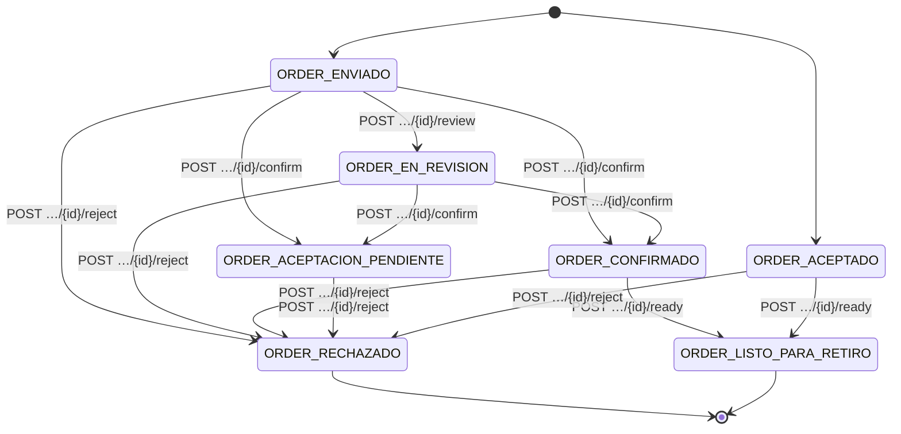

**Operaciones que ejercen esta máquina** _(POR_REFERENCIA: el handler alcanza un método que valida contra la tabla; «sin destino nombrado» significa que el estado de destino llega por el cuerpo de la petición)_:

| Operación | Estados de destino que nombra | A través de |
|---|---|---|
| POST /pharmacy/orders/{id}/confirm | ORDER_ACEPTACION_PENDIENTE, ORDER_CONFIRMADO | PharmacyOrdersUseCases.confirm → PharmacyOrdersUseCases.assertStaffTransition |
| POST /pharmacy/orders/{id}/ready | ORDER_LISTO_PARA_RETIRO | PharmacyOrdersUseCases.ready → PharmacyOrdersUseCases.assertStaffTransition |
| POST /pharmacy/orders/{id}/reject | ORDER_RECHAZADO | PharmacyOrdersUseCases.reject → PharmacyOrdersUseCases.assertStaffTransition |
| POST /pharmacy/orders/{id}/review | ORDER_EN_REVISION | PharmacyOrdersUseCases.openReview → PharmacyOrdersUseCases.assertStaffTransition |

## Árbol de decisión por operación

Cada árbol se deriva del código del handler y de los métodos que invoca (hasta 4 niveles). Una rama que no decide, no escribe y no falla se poda. Los accesos y los efectos consecutivos se agrupan en un solo nodo.

### Operaciones con decisiones propias

#### 1. POST /internal/inventory-sync-batches

Ingerir un lote de sincronización ERP

| HTTP | Código | Cuándo |
|---|---|---|
| 201 | — | Éxito |
| 400 | `VALIDATION_FAILED` | El cuerpo cumple el DTO (sin propiedades extra) |
| 401 | `UNAUTHENTICATED` | Hay una sesión válida (JWT) |
| 403 | `FORBIDDEN` | El rol está permitido; El tenant se resuelve y pertenece al actor |
| 429 | `RATE_LIMITED` | No se supera el límite de solicitudes |

```mermaid
flowchart TD
  n1(("Solicitud")):::inicio
  n2{{"Acceso: sesión (401) · rol (403) · tenant (403) · cuerpo válido (400) · límite de tasa (429)"}}:::acceso
  n1 --> n2
  n3["Llama a InventorySyncService.createBatch"]:::llamada
  n2 --> n3
  n4["Llama a CreateInventorySyncBatchUseCase.execute"]:::llamada
  n3 --> n4
  n5["Transacción: transactional(…)"]:::transaccion
  n4 --> n5
  n6["Llama a PharmacyInventoryScopePolicy.requireManagedConnection"]:::llamada
  n5 --> n6
  n7["Llama a InventoryScopeRepository.findConnection"]:::llamada
  n6 --> n7
  n8[("LEE pharmacy.pharmacy_integration_connections")]:::efecto
  n7 --> n8
  n9{"!connection"}:::decision
  n8 --> n9
  n10(["↩ (relanza el error capturado)"]):::error
  n9 -->|"sí"| n10
  n11["Repite: por cada const item de dto.items"]:::bucle
  n9 -->|"no"| n11
  n12{"item.pharmacyProductId !== undefined"}:::decision
  n11 -->|"cada elemento"| n12
  n13["Llama a PharmacyInventoryScopePolicy.requireProduct"]:::llamada
  n12 -->|"sí"| n13
  n14["Llama a InventoryScopeRepository.findProductInPharmacy"]:::llamada
  n13 --> n14
  n15[("LEE pharmacy.pharmacy_products")]:::efecto
  n14 --> n15
  n16{"!product"}:::decision
  n15 --> n16
  n17(["↩ (relanza el error capturado)"]):::error
  n16 -->|"sí"| n17
  n18["Llama a SyncRepository.createBatch"]:::llamada
  n16 -->|"no"| n18
  n12 -->|"no"| n18
  n11 -->|"al terminar"| n18
  n19[("CREA pharmacy_inventory.pharmacy_inventory_sync_batches")]:::efecto
  n18 --> n19
  n20["Repite: por cada const item de dto.items"]:::bucle
  n19 --> n20
  n21{"item.idempotencyKey"}:::decision
  n20 -->|"cada elemento"| n21
  n22["Llama a SyncRepository.findItemByIdempotencyKey"]:::llamada
  n21 -->|"sí"| n22
  n23[("LEE pharmacy_inventory.pharmacy_inventory_sync_items")]:::efecto
  n22 --> n23
  n24{"existing"}:::decision
  n23 --> n24
  n25["Llama a SyncRepository.findBatchById"]:::llamada
  n24 -->|"sí"| n25
  n26[("LEE pharmacy_inventory.pharmacy_inventory_sync_batches")]:::efecto
  n25 --> n26
  n27{"!existingBatch"}:::decision
  n26 --> n27
  n28(["↩ (relanza el error capturado)"]):::error
  n27 -->|"sí"| n28
  n29["Llama a PharmacyInventoryScopePolicy.requireManagedConnection"]:::llamada
  n27 -->|"no"| n29
  n30["Llama a InventoryScopeRepository.findConnection"]:::llamada
  n29 --> n30
  n31[("LEE pharmacy.pharmacy_integration_connections")]:::efecto
  n30 --> n31
  n32{"!connection"}:::decision
  n31 --> n32
  n33(["↩ (relanza el error capturado)"]):::error
  n32 -->|"sí"| n33
  n34{"owner.pharmacyId !== pharmacy.pharmacyId"}:::decision
  n32 -->|"no"| n34
  n35(["↩ (relanza el error capturado)"]):::error
  n34 -->|"sí"| n35
  n36["Llama a SyncRepository.createItem"]:::llamada
  n34 -->|"no"| n36
  n24 -->|"no"| n36
  n21 -->|"no"| n36
  n37[("CREA pharmacy_inventory.pharmacy_inventory_sync_items")]:::efecto
  n36 --> n37
  n38(("201 Responde con éxito")):::ok
  n37 --> n38
  n20 -->|"al terminar"| n38
  classDef acceso fill:#eef,stroke:#66a
  classDef error fill:#fee,stroke:#c33
  classDef ok fill:#efe,stroke:#3a3
  classDef efecto fill:#ffd,stroke:#aa3
  classDef decision fill:#fff,stroke:#555
  classDef corte fill:#eee,stroke:#999,stroke-dasharray: 4
```

#### 2. POST /internal/inventory-sync/{batchId}/reconcile

Conciliar lote de sincronización externa (UC-25-12)

| HTTP | Código | Cuándo |
|---|---|---|
| 200 | — | Éxito |
| 400 | `VALIDATION_FAILED` | Los parámetros de ruta son UUID válidos |
| 401 | `UNAUTHENTICATED` | Hay una sesión válida (JWT) |
| 403 | `FORBIDDEN` | El rol está permitido; El tenant se resuelve y pertenece al actor |
| 422 | `PRECONDITION_FAILED` | PreconditionFailedException: El lote no está en estado reconciliable |
| 429 | `RATE_LIMITED` | No se supera el límite de solicitudes |

```mermaid
flowchart TD
  n1(("Solicitud")):::inicio
  n2{{"Acceso: sesión (401) · rol (403) · tenant (403) · parámetros de ruta (400) · límite de tasa (429)"}}:::acceso
  n1 --> n2
  n3["Llama a InventorySyncService.reconcile"]:::llamada
  n2 --> n3
  n4["Llama a ReconcileInventorySyncBatchUseCase.execute"]:::llamada
  n3 --> n4
  n5["Transacción: transactional(…)"]:::transaccion
  n4 --> n5
  n6["Llama a SyncRepository.findBatchById"]:::llamada
  n5 --> n6
  n7[("LEE pharmacy_inventory.pharmacy_inventory_sync_batches")]:::efecto
  n6 --> n7
  n8{"!batch"}:::decision
  n7 --> n8
  n9(["↩ (relanza el error capturado)"]):::error
  n8 -->|"sí"| n9
  n10["Llama a PharmacyInventoryScopePolicy.requireManagedConnection"]:::llamada
  n8 -->|"no"| n10
  n11["Llama a InventoryScopeRepository.findConnection"]:::llamada
  n10 --> n11
  n12[("LEE pharmacy.pharmacy_integration_connections")]:::efecto
  n11 --> n12
  n13{"!connection"}:::decision
  n12 --> n13
  n14(["↩ (relanza el error capturado)"]):::error
  n13 -->|"sí"| n14
  n15{"batch.statusConceptId !== PINV.BATCH_RECEIVED"}:::decision
  n13 -->|"no"| n15
  n16(["422 PRECONDITION_FAILED El lote no está en estado reconciliable"]):::error
  n15 -->|"sí"| n16
  n17["Llama a SyncRepository.findItems"]:::llamada
  n15 -->|"no"| n17
  n18[("LEE pharmacy_inventory.pharmacy_inventory_sync_items")]:::efecto
  n17 --> n18
  n19["Repite: por cada const item de items"]:::bucle
  n18 --> n19
  n20[("ACTUALIZA pharmacy_inventory.pharmacy_inventory_sync_items")]:::efecto
  n19 -->|"cada elemento"| n20
  n21{"result.normalizedQuantity !== undefined"}:::decision
  n20 --> n21
  n22[("ACTUALIZA pharmacy_inventory.pharmacy_inventory_sync_items")]:::efecto
  n21 -->|"sí"| n22
  n23{"result.errorCode !== undefined"}:::decision
  n22 --> n23
  n21 -->|"no"| n23
  n24[("ACTUALIZA pharmacy_inventory.pharmacy_inventory_sync_items · ACTUALIZA pharmacy_inventory.pharmacy_inventory_…")]:::efecto
  n23 -->|"sí"| n24
  n25[("ACTUALIZA pharmacy_inventory.pharmacy_inventory_sync_batches · ACTUALIZA pharmacy_inventory.pharmacy_inventor…")]:::efecto
  n24 --> n25
  n23 -->|"no"| n25
  n19 -->|"al terminar"| n25
  n26(("200 Responde con éxito")):::ok
  n25 --> n26
  classDef acceso fill:#eef,stroke:#66a
  classDef error fill:#fee,stroke:#c33
  classDef ok fill:#efe,stroke:#3a3
  classDef efecto fill:#ffd,stroke:#aa3
  classDef decision fill:#fff,stroke:#555
  classDef corte fill:#eee,stroke:#999,stroke-dasharray: 4
```

#### 3. POST /internal/reservations/expire

Liberar reservas y pedidos vencidos (UC-25-05)

| HTTP | Código | Cuándo |
|---|---|---|
| 200 | — | Éxito |
| 401 | `UNAUTHENTICATED` | Hay una sesión válida (JWT) |
| 403 | `FORBIDDEN` | El rol está permitido; El tenant se resuelve y pertenece al actor |
| 429 | `RATE_LIMITED` | No se supera el límite de solicitudes |

```mermaid
flowchart TD
  n1(("Solicitud")):::inicio
  n2{{"Acceso: sesión (401) · rol (403) · tenant (403) · límite de tasa (429)"}}:::acceso
  n1 --> n2
  n3["Llama a InventoryReservationsService.expire"]:::llamada
  n2 --> n3
  n4["Llama a ExpireInventoryReservationsUseCase.execute"]:::llamada
  n3 --> n4
  n5["Transacción: transactional(…)"]:::transaccion
  n4 --> n5
  n6["Llama a ReservationsRepository.findExpired"]:::llamada
  n5 --> n6
  n7[("LEE pharmacy_inventory.inventory_reservations")]:::efecto
  n6 --> n7
  n8["Repite: por cada const reservation de expired"]:::bucle
  n7 --> n8
  n9[("ACTUALIZA pharmacy_inventory.inventory_reservations · ACTUALIZA pharmacy_inventory.inventory_reservations")]:::efecto
  n8 -->|"cada elemento"| n9
  n10["Llama a ReleaseConfirmedReservationLinesUseCase.execute"]:::llamada
  n9 --> n10
  n11["Llama a ReservationsRepository.findLinesByReservation"]:::llamada
  n10 --> n11
  n12[("LEE pharmacy_inventory.inventory_reservation_lines")]:::efecto
  n11 --> n12
  n13["Repite: por cada const line de lines"]:::bucle
  n12 --> n13
  n14[("ACTUALIZA pharmacy_inventory.inventory_reservation_lines")]:::efecto
  n13 -->|"cada elemento"| n14
  n15{"line.inventoryLocationId"}:::decision
  n14 --> n15
  n16["Llama a StockPositionsRepository.findByKeyForUpdate"]:::llamada
  n15 -->|"sí"| n16
  n17[("LEE pharmacy_inventory.inventory_stock_positions")]:::efecto
  n16 --> n17
  n18["Llama a LedgerRepository.nextSequence"]:::llamada
  n17 --> n18
  n19[("LEE pharmacy_inventory.inventory_ledger_entries")]:::efecto
  n18 --> n19
  n20["Llama a LedgerRepository.append"]:::llamada
  n19 --> n20
  n21[("CREA pharmacy_inventory.inventory_ledger_entries")]:::efecto
  n20 --> n21
  n22{"position"}:::decision
  n21 --> n22
  n23[("ACTUALIZA pharmacy_inventory.inventory_stock_positions · ACTUALIZA pharmacy_inventory.inventory_stock_positio…")]:::efecto
  n22 -->|"sí"| n23
  n24["Llama a PharmacyOrdersService.expireDue"]:::llamada
  n23 --> n24
  n22 -->|"no"| n24
  n15 -->|"no"| n24
  n13 -->|"al terminar"| n24
  n8 -->|"al terminar"| n24
  n25["Llama a PharmacyOrdersUseCases.expireDue"]:::llamada
  n24 --> n25
  n26["Transacción: transactional(…)"]:::transaccion
  n25 --> n26
  n27["Llama a PharmacyOrdersRepository.findDueOrdersForUpdate"]:::llamada
  n26 --> n27
  n28[("LEE pharmacy_inventory.inventory_reservations")]:::efecto
  n27 --> n28
  n29["Llama a PharmacyOrdersRepository.findPharmaciesByIds"]:::llamada
  n28 --> n29
  n30[("LEE pharmacy.pharmacies")]:::efecto
  n29 --> n30
  n31["Repite: por cada const order de due"]:::bucle
  n30 --> n31
  n32[("ACTUALIZA pharmacy_inventory.inventory_reservations · ACTUALIZA pharmacy_inventory.inventory_reservations")]:::efecto
  n31 -->|"cada elemento"| n32
  n33["Llama a InventoryReservationsService.releaseConfirmedLines"]:::llamada
  n32 --> n33
  n34["Llama a ReleaseConfirmedReservationLinesUseCase.execute"]:::llamada
  n33 --> n34
  n35["Repite: por cada const line de lines"]:::bucle
  n34 --> n35
  n36[("ACTUALIZA pharmacy_inventory.inventory_reservation_lines")]:::efecto
  n35 -->|"cada elemento"| n36
  n37{"line.inventoryLocationId"}:::decision
  n36 --> n37
  n38{"position"}:::decision
  n37 -->|"sí"| n38
  n39[("ACTUALIZA pharmacy_inventory.inventory_stock_positions · ACTUALIZA pharmacy_inventory.inventory_stock_positio…")]:::efecto
  n38 -->|"sí"| n39
  n40["Llama a MessagingDomainEventAdapter.publish"]:::llamada
  n39 --> n40
  n38 -->|"no"| n40
  n37 -->|"no"| n40
  n35 -->|"al terminar"| n40
  n41>"Evento ~null"]:::evento
  n40 --> n41
  n42["Repite: por cada const notice de expired"]:::bucle
  n41 --> n42
  n31 -->|"al terminar"| n42
  n43{"notice.medicationRequestId"}:::decision
  n42 -->|"cada elemento"| n43
  n44["Llama a PharmacyOrdersRepository.findPrescriberProfileId"]:::llamada
  n43 -->|"sí"| n44
  n45[("LEE clinical.medication_requests")]:::efecto
  n44 --> n45
  n46(("200 Responde con éxito")):::ok
  n45 --> n46
  n43 -->|"no"| n46
  n42 -->|"al terminar"| n46
  classDef acceso fill:#eef,stroke:#66a
  classDef error fill:#fee,stroke:#c33
  classDef ok fill:#efe,stroke:#3a3
  classDef efecto fill:#ffd,stroke:#aa3
  classDef decision fill:#fff,stroke:#555
  classDef corte fill:#eee,stroke:#999,stroke-dasharray: 4
```

#### 4. GET /pharmacies/{pharmacyId}/integration-connections/{connectionId}/external-products

Catálogo del sistema de la farmacia, con el vínculo de cada código

| HTTP | Código | Cuándo |
|---|---|---|
| 200 | — | Éxito |
| 400 | `VALIDATION_FAILED` | Los parámetros de ruta son UUID válidos |
| 401 | `UNAUTHENTICATED` | Hay una sesión válida (JWT) |
| 403 | `FORBIDDEN` | El rol está permitido; El tenant se resuelve y pertenece al actor |
| 429 | `RATE_LIMITED` | No se supera el límite de solicitudes |

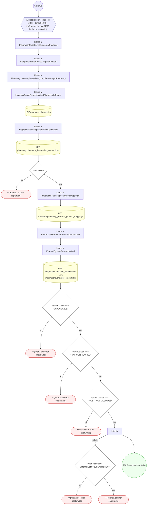

#### 5. DELETE /pharmacies/{pharmacyId}/integration-connections/{connectionId}/external-system

Quitar el sistema propio de la farmacia

| HTTP | Código | Cuándo |
|---|---|---|
| 204 | — | Éxito |
| 400 | `VALIDATION_FAILED` | Los parámetros de ruta son UUID válidos |
| 401 | `UNAUTHENTICATED` | Hay una sesión válida (JWT) |
| 403 | `FORBIDDEN` | El rol está permitido; El tenant se resuelve y pertenece al actor |
| 429 | `RATE_LIMITED` | No se supera el límite de solicitudes |

```mermaid
flowchart TD
  n1(("Solicitud")):::inicio
  n2{{"Acceso: sesión (401) · rol (403) · tenant (403) · parámetros de ruta (400) · límite de tasa (429)"}}:::acceso
  n1 --> n2
  n3["Llama a ConfigureExternalSystemUseCase.remove"]:::llamada
  n2 --> n3
  n4["Transacción: transactional(…)"]:::transaccion
  n3 --> n4
  n5["Llama a ConfigureExternalSystemUseCase.requireConnection"]:::llamada
  n4 --> n5
  n6["Llama a PharmacyInventoryScopePolicy.requireManagedPharmacy"]:::llamada
  n5 --> n6
  n7["Llama a InventoryScopeRepository.findPharmacyInTenant"]:::llamada
  n6 --> n7
  n8[("LEE pharmacy.pharmacies")]:::efecto
  n7 --> n8
  n9["Llama a IntegrationReadRepository.findConnection"]:::llamada
  n8 --> n9
  n10[("LEE pharmacy.pharmacy_integration_connections")]:::efecto
  n9 --> n10
  n11{"!connection"}:::decision
  n10 --> n11
  n12(["↩ (relanza el error capturado)"]):::error
  n11 -->|"sí"| n12
  n13{"connection.connectionId"}:::decision
  n11 -->|"no"| n13
  n14["Llama a PharmacyExternalSystemAdapter.remove"]:::llamada
  n13 -->|"sí"| n14
  n15["Llama a ExternalSystemRepository.find"]:::llamada
  n14 --> n15
  n16[("LEE integrations.provider_connections · LEE integrations.provider_credentials")]:::efecto
  n15 --> n16
  n17["Llama a ExternalSystemRepository.pauseConnection"]:::llamada
  n16 --> n17
  n18[("ACTUALIZA integrations.provider_connections · ACTUALIZA integrations.provider_connections")]:::efecto
  n17 --> n18
  n19{"row.credential"}:::decision
  n18 --> n19
  n20["Llama a ExternalSystemRepository.retireCredential"]:::llamada
  n19 -->|"sí"| n20
  n21[("ACTUALIZA integrations.provider_credentials · ACTUALIZA integrations.provider_credentials")]:::efecto
  n20 --> n21
  n22(("204 Responde con éxito")):::ok
  n21 --> n22
  n19 -->|"no"| n22
  n13 -->|"no"| n22
  classDef acceso fill:#eef,stroke:#66a
  classDef error fill:#fee,stroke:#c33
  classDef ok fill:#efe,stroke:#3a3
  classDef efecto fill:#ffd,stroke:#aa3
  classDef decision fill:#fff,stroke:#555
  classDef corte fill:#eee,stroke:#999,stroke-dasharray: 4
```

#### 6. PUT /pharmacies/{pharmacyId}/integration-connections/{connectionId}/external-system

Configurar el sistema propio de la farmacia

| HTTP | Código | Cuándo |
|---|---|---|
| 200 | — | Éxito |
| 400 | `VALIDATION_FAILED` | Los parámetros de ruta son UUID válidos; El cuerpo cumple el DTO (sin propiedades extra) |
| 401 | `UNAUTHENTICATED` | Hay una sesión válida (JWT) |
| 403 | `FORBIDDEN` | El rol está permitido; El tenant se resuelve y pertenece al actor |
| 429 | `RATE_LIMITED` | No se supera el límite de solicitudes |
| 500 | `INTERNAL` | Error: MFA_ENCRYPTION_KEY is not configured; Error: external system connection not in tenant; Error: external system not readable after save |

```mermaid
flowchart TD
  n1(("Solicitud")):::inicio
  n2{{"Acceso: sesión (401) · rol (403) · tenant (403) · parámetros de ruta (400) · cuerpo válido (400) · límite de…"}}:::acceso
  n1 --> n2
  n3["Llama a ConfigureExternalSystemUseCase.save"]:::llamada
  n2 --> n3
  n4{"!this.systems.canStoreCredentials()"}:::decision
  n3 --> n4
  n5(["↩ (relanza el error capturado)"]):::error
  n4 -->|"sí"| n5
  n6["Llama a ConfigureExternalSystemUseCase.requireConnection"]:::llamada
  n4 -->|"no"| n6
  n7["Llama a PharmacyInventoryScopePolicy.requireManagedPharmacy"]:::llamada
  n6 --> n7
  n8["Llama a InventoryScopeRepository.findPharmacyInTenant"]:::llamada
  n7 --> n8
  n9[("LEE pharmacy.pharmacies")]:::efecto
  n8 --> n9
  n10["Llama a IntegrationReadRepository.findConnection"]:::llamada
  n9 --> n10
  n11[("LEE pharmacy.pharmacy_integration_connections")]:::efecto
  n10 --> n11
  n12{"!connection"}:::decision
  n11 --> n12
  n13(["↩ (relanza el error capturado)"]):::error
  n12 -->|"sí"| n13
  n14{"problem === 'URL_INVALID'"}:::decision
  n12 -->|"no"| n14
  n15(["↩ (relanza el error capturado)"]):::error
  n14 -->|"sí"| n15
  n16{"problem === 'HOST_NOT_ALLOWED'"}:::decision
  n14 -->|"no"| n16
  n17(["↩ (relanza el error capturado)"]):::error
  n16 -->|"sí"| n17
  n18["Intenta"]:::intento
  n16 -->|"no"| n18
  n19{"error instanceof ExternalCatalogUnavailableError"}:::decision
  n18 -->|"si falla"| n19
  n20(["↩ (relanza el error capturado)"]):::error
  n19 -->|"sí"| n20
  n21(["↩ (relanza el error capturado)"]):::error
  n19 -->|"no"| n21
  n22["Transacción: transactional(…)"]:::transaccion
  n18 --> n22
  n23["Llama a ConfigureExternalSystemUseCase.requireConnection"]:::llamada
  n22 --> n23
  n24["Llama a PharmacyInventoryScopePolicy.requireManagedPharmacy"]:::llamada
  n23 --> n24
  n25["Llama a InventoryScopeRepository.findPharmacyInTenant"]:::llamada
  n24 --> n25
  n26[("LEE pharmacy.pharmacies")]:::efecto
  n25 --> n26
  n27["Llama a IntegrationReadRepository.findConnection"]:::llamada
  n26 --> n27
  n28[("LEE pharmacy.pharmacy_integration_connections")]:::efecto
  n27 --> n28
  n29{"!connection"}:::decision
  n28 --> n29
  n30(["↩ (relanza el error capturado)"]):::error
  n29 -->|"sí"| n30
  n31["Llama a PharmacyExternalSystemAdapter.save"]:::llamada
  n29 -->|"no"| n31
  n32{"!isSecretCipherConfigured()"}:::decision
  n31 --> n32
  n33(["500 INTERNAL MFA_ENCRYPTION_KEY is not configured"]):::error
  n32 -->|"sí"| n33
  n34{"data.connectionId === null"}:::decision
  n32 -->|"no"| n34
  n35["Llama a ExternalSystemRepository.ensureProvider"]:::llamada
  n34 -->|"sí"| n35
  n36[("LEE integrations.external_providers · CREA integrations.external_providers · GUARDA integrations.external_pro…")]:::efecto
  n35 --> n36
  n37["Llama a ExternalSystemRepository.createConnection"]:::llamada
  n36 --> n37
  n38[("CREA integrations.provider_connections · GUARDA integrations.provider_connections")]:::efecto
  n37 --> n38
  n39["Llama a ExternalSystemRepository.find"]:::llamada
  n34 -->|"no"| n39
  n40[("LEE integrations.provider_connections · LEE integrations.provider_credentials")]:::efecto
  n39 --> n40
  n41{"!row"}:::decision
  n40 --> n41
  n42(["500 INTERNAL external system connection not in tenant"]):::error
  n41 -->|"sí"| n42
  n43["Llama a ExternalSystemRepository.ensureProvider"]:::llamada
  n41 -->|"no"| n43
  n44[("LEE integrations.external_providers · CREA integrations.external_providers · GUARDA integrations.external_pro…")]:::efecto
  n43 --> n44
  n45{"row.credential"}:::decision
  n44 --> n45
  n46["Llama a ExternalSystemRepository.retireCredential"]:::llamada
  n45 -->|"sí"| n46
  n47[("ACTUALIZA integrations.provider_credentials · ACTUALIZA integrations.provider_credentials")]:::efecto
  n46 --> n47
  n48["Llama a ExternalSystemRepository.createCredential"]:::llamada
  n38 --> n48
  n47 --> n48
  n45 -->|"no"| n48
  n49[("CREA integrations.provider_credentials · GUARDA integrations.provider_credentials")]:::efecto
  n48 --> n49
  n50["Llama a PharmacyExternalSystemAdapter.describe"]:::llamada
  n49 --> n50
  n51["Llama a ExternalSystemRepository.findMany"]:::llamada
  n50 --> n51
  n52[("LEE integrations.provider_connections · LEE integrations.provider_credentials")]:::efecto
  n51 --> n52
  n53{"!system"}:::decision
  n52 --> n53
  n54(["500 INTERNAL external system not readable after save"]):::error
  n53 -->|"sí"| n54
  n55(("200 Responde con éxito")):::ok
  n53 -->|"no"| n55
  classDef acceso fill:#eef,stroke:#66a
  classDef error fill:#fee,stroke:#c33
  classDef ok fill:#efe,stroke:#3a3
  classDef efecto fill:#ffd,stroke:#aa3
  classDef decision fill:#fff,stroke:#555
  classDef corte fill:#eee,stroke:#999,stroke-dasharray: 4
```

#### 7. POST /pharmacies/{pharmacyId}/integration-connections/{connectionId}/external-system/test

Probar el sistema de la farmacia

| HTTP | Código | Cuándo |
|---|---|---|
| 200 | — | Éxito |
| 400 | `VALIDATION_FAILED` | Los parámetros de ruta son UUID válidos |
| 401 | `UNAUTHENTICATED` | Hay una sesión válida (JWT) |
| 403 | `FORBIDDEN` | El rol está permitido; El tenant se resuelve y pertenece al actor |
| 429 | `RATE_LIMITED` | No se supera el límite de solicitudes |
| 500 | `INTERNAL` | DomainException: {HttpStatus.UNPROCESSABLE_ENTITY} |

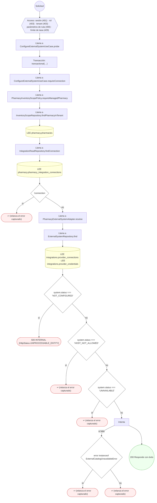

#### 8. GET /pharmacies/{pharmacyId}/integration-connections/{connectionId}/product-mappings

Vínculos de productos de una conexión

| HTTP | Código | Cuándo |
|---|---|---|
| 200 | — | Éxito |
| 400 | `VALIDATION_FAILED` | Los parámetros de ruta son UUID válidos |
| 401 | `UNAUTHENTICATED` | Hay una sesión válida (JWT) |
| 403 | `FORBIDDEN` | El rol está permitido; El tenant se resuelve y pertenece al actor |
| 429 | `RATE_LIMITED` | No se supera el límite de solicitudes |

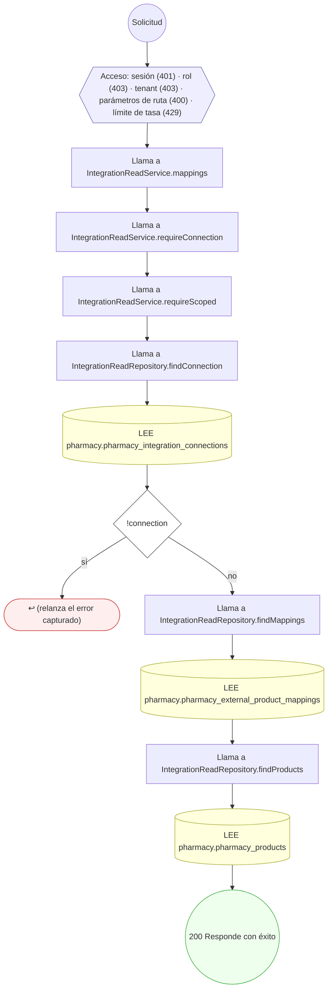

#### 9. POST /pharmacies/{pharmacyId}/integration-connections/{connectionId}/sync

Traer el stock del sistema de la farmacia y aplicarlo por sede

| HTTP | Código | Cuándo |
|---|---|---|
| 200 | — | Éxito |
| 400 | `VALIDATION_FAILED` | Los parámetros de ruta son UUID válidos |
| 401 | `UNAUTHENTICATED` | Hay una sesión válida (JWT) |
| 403 | `FORBIDDEN` | El rol está permitido; El tenant se resuelve y pertenece al actor |
| 422 | `PRECONDITION_FAILED` | PreconditionFailedException: El lote no está en estado reconciliable |
| 429 | `RATE_LIMITED` | No se supera el límite de solicitudes |

```mermaid
flowchart TD
  n1(("Solicitud")):::inicio
  n2{{"Acceso: sesión (401) · rol (403) · tenant (403) · parámetros de ruta (400) · límite de tasa (429)"}}:::acceso
  n1 --> n2
  n3["Llama a SyncExternalPharmacyCatalogUseCase.execute"]:::llamada
  n2 --> n3
  n4["Llama a SyncExternalPharmacyCatalogUseCase.plan"]:::llamada
  n3 --> n4
  n5["Transacción: transactional(…)"]:::transaccion
  n4 --> n5
  n6["Llama a PharmacyInventoryScopePolicy.requireManagedPharmacy"]:::llamada
  n5 --> n6
  n7["Llama a InventoryScopeRepository.findPharmacyInTenant"]:::llamada
  n6 --> n7
  n8[("LEE pharmacy.pharmacies")]:::efecto
  n7 --> n8
  n9["Llama a IntegrationReadRepository.findConnection"]:::llamada
  n8 --> n9
  n10[("LEE pharmacy.pharmacy_integration_connections")]:::efecto
  n9 --> n10
  n11{"!connection"}:::decision
  n10 --> n11
  n12(["↩ (relanza el error capturado)"]):::error
  n11 -->|"sí"| n12
  n13{"connection.statusConceptId !== PHARM.CONNECTION_ACTIVE || connection.supportsStockQuery !== true"}:::decision
  n11 -->|"no"| n13
  n14(["↩ (relanza el error capturado)"]):::error
  n13 -->|"sí"| n14
  n15["Llama a IntegrationReadRepository.findPharmacyCode"]:::llamada
  n13 -->|"no"| n15
  n16[("LEE pharmacy.pharmacies")]:::efecto
  n15 --> n16
  n17["Llama a IntegrationReadRepository.findActiveSites"]:::llamada
  n16 --> n17
  n18[("LEE pharmacy.pharmacy_sites")]:::efecto
  n17 --> n18
  n19["Llama a IntegrationReadRepository.findConnections"]:::llamada
  n18 --> n19
  n20[("LEE pharmacy.pharmacy_integration_connections")]:::efecto
  n19 --> n20
  n21{"duplicates.length › 0"}:::decision
  n20 --> n21
  n22(["↩ (relanza el error capturado)"]):::error
  n21 -->|"sí"| n22
  n23["Llama a IntegrationReadRepository.findMappings"]:::llamada
  n21 -->|"no"| n23
  n24[("LEE pharmacy.pharmacy_external_product_mappings")]:::efecto
  n23 --> n24
  n25["Llama a PharmacyExternalSystemAdapter.resolve"]:::llamada
  n24 --> n25
  n26["Llama a ExternalSystemRepository.find"]:::llamada
  n25 --> n26
  n27[("LEE integrations.provider_connections · LEE integrations.provider_credentials")]:::efecto
  n26 --> n27
  n28{"system.status === 'UNAVAILABLE'"}:::decision
  n27 --> n28
  n29(["↩ (relanza el error capturado)"]):::error
  n28 -->|"sí"| n29
  n30{"system.status === 'NOT_CONFIGURED'"}:::decision
  n28 -->|"no"| n30
  n31(["↩ (relanza el error capturado)"]):::error
  n30 -->|"sí"| n31
  n32{"system.status === 'HOST_NOT_ALLOWED'"}:::decision
  n30 -->|"no"| n32
  n33(["↩ (relanza el error capturado)"]):::error
  n32 -->|"sí"| n33
  n34["Llama a SyncExternalPharmacyCatalogUseCase.fetch"]:::llamada
  n32 -->|"no"| n34
  n35["Intenta"]:::intento
  n34 --> n35
  n36{"error instanceof ExternalCatalogUnavailableError"}:::decision
  n35 -->|"si falla"| n36
  n37(["↩ (relanza el error capturado)"]):::error
  n36 -->|"sí"| n37
  n38(["↩ (relanza el error capturado)"]):::error
  n36 -->|"no"| n38
  n39["Llama a CreateInventorySyncBatchUseCase.execute"]:::llamada
  n35 --> n39
  n40["Transacción: transactional(…)"]:::transaccion
  n39 --> n40
  n41["Llama a PharmacyInventoryScopePolicy.requireManagedConnection"]:::llamada
  n40 --> n41
  n42["Llama a InventoryScopeRepository.findConnection"]:::llamada
  n41 --> n42
  n43[("LEE pharmacy.pharmacy_integration_connections")]:::efecto
  n42 --> n43
  n44{"!connection"}:::decision
  n43 --> n44
  n45(["↩ (relanza el error capturado)"]):::error
  n44 -->|"sí"| n45
  n46["Repite: por cada const item de dto.items"]:::bucle
  n44 -->|"no"| n46
  n47{"item.pharmacyProductId !== undefined"}:::decision
  n46 -->|"cada elemento"| n47
  n48["Llama a PharmacyInventoryScopePolicy.requireProduct"]:::llamada
  n47 -->|"sí"| n48
  n49["Llama a InventoryScopeRepository.findProductInPharmacy"]:::llamada
  n48 --> n49
  n50[("LEE pharmacy.pharmacy_products")]:::efecto
  n49 --> n50
  n51{"!product"}:::decision
  n50 --> n51
  n52(["↩ (relanza el error capturado)"]):::error
  n51 -->|"sí"| n52
  n53["Llama a SyncRepository.createBatch"]:::llamada
  n51 -->|"no"| n53
  n47 -->|"no"| n53
  n46 -->|"al terminar"| n53
  n54[("CREA pharmacy_inventory.pharmacy_inventory_sync_batches")]:::efecto
  n53 --> n54
  n55["Repite: por cada const item de dto.items"]:::bucle
  n54 --> n55
  n56{"item.idempotencyKey"}:::decision
  n55 -->|"cada elemento"| n56
  n57["Llama a SyncRepository.findItemByIdempotencyKey"]:::llamada
  n56 -->|"sí"| n57
  n58[("LEE pharmacy_inventory.pharmacy_inventory_sync_items")]:::efecto
  n57 --> n58
  n59{"existing"}:::decision
  n58 --> n59
  n60["Llama a SyncRepository.findBatchById"]:::llamada
  n59 -->|"sí"| n60
  n61[("LEE pharmacy_inventory.pharmacy_inventory_sync_batches")]:::efecto
  n60 --> n61
  n62{"!existingBatch"}:::decision
  n61 --> n62
  n63(["↩ (relanza el error capturado)"]):::error
  n62 -->|"sí"| n63
  n64["Llama a PharmacyInventoryScopePolicy.requireManagedConnection"]:::llamada
  n62 -->|"no"| n64
  n65["Llama a InventoryScopeRepository.findConnection"]:::llamada
  n64 --> n65
  n66[("LEE pharmacy.pharmacy_integration_connections")]:::efecto
  n65 --> n66
  n67{"!connection"}:::decision
  n66 --> n67
  n68(["↩ (relanza el error capturado)"]):::error
  n67 -->|"sí"| n68
  n69{"owner.pharmacyId !== pharmacy.pharmacyId"}:::decision
  n67 -->|"no"| n69
  n70(["↩ (relanza el error capturado)"]):::error
  n69 -->|"sí"| n70
  n71["… el resto del árbol (2 nodos) está en el JSON del inventario"]:::corte
  n69 -->|"no"| n71
  n59 -->|"no"| n71
  n56 -->|"no"| n71
  classDef acceso fill:#eef,stroke:#66a
  classDef error fill:#fee,stroke:#c33
  classDef ok fill:#efe,stroke:#3a3
  classDef efecto fill:#ffd,stroke:#aa3
  classDef decision fill:#fff,stroke:#555
  classDef corte fill:#eee,stroke:#999,stroke-dasharray: 4
```

#### 10. GET /pharmacies/{pharmacyId}/integration-connections/{connectionId}/sync-batches

Últimas sincronizaciones de una conexión

| HTTP | Código | Cuándo |
|---|---|---|
| 200 | — | Éxito |
| 400 | `VALIDATION_FAILED` | Los parámetros de ruta son UUID válidos |
| 401 | `UNAUTHENTICATED` | Hay una sesión válida (JWT) |
| 403 | `FORBIDDEN` | El rol está permitido; El tenant se resuelve y pertenece al actor |
| 429 | `RATE_LIMITED` | No se supera el límite de solicitudes |

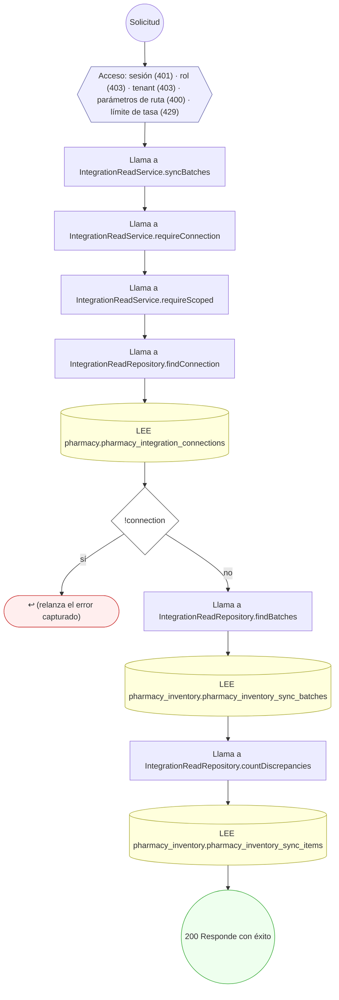

#### 11. POST /pharmacies/{pharmacyId}/sites/{siteId}/availability/bulk

Marcar en lote qué productos tiene una sucursal, y cuántos, con vista previa

| HTTP | Código | Cuándo |
|---|---|---|
| 200 | — | Éxito |
| 400 | `VALIDATION_FAILED` | Los parámetros de ruta son UUID válidos; El cuerpo cumple el DTO (sin propiedades extra); BadRequestException: dryRun debe ser true o false |
| 401 | `UNAUTHENTICATED` | Hay una sesión válida (JWT) |
| 403 | `FORBIDDEN` | El rol está permitido; El tenant se resuelve y pertenece al actor |
| 422 | `PRECONDITION_FAILED` | PreconditionFailedException: La farmacia no está activa |
| 429 | `RATE_LIMITED` | No se supera el límite de solicitudes |
| 500 | `INTERNAL` | DryRunRollback: {await withWarnings(tx, ctx, handler, { outcome: 'UNCHANGED'…}; DryRunRollback: {outcome} |

```mermaid
flowchart TD
  n1(("Solicitud")):::inicio
  n2{{"Acceso: sesión (401) · rol (403) · tenant (403) · parámetros de ruta (400) · cuerpo válido (400) · límite de…"}}:::acceso
  n1 --> n2
  n3["Llama a BulkSiteAvailabilityUseCase.execute"]:::llamada
  n2 --> n3
  n4["Llama a PharmacyInventoryScopePolicy.requireManagedPharmacy"]:::llamada
  n3 --> n4
  n5["Llama a InventoryScopeRepository.findPharmacyInTenant"]:::llamada
  n4 --> n5
  n6[("LEE pharmacy.pharmacies")]:::efecto
  n5 --> n6
  n7["Llama a PharmacyInventoryScopePolicy.requireSite"]:::llamada
  n6 --> n7
  n8["Llama a InventoryScopeRepository.findSiteInPharmacy"]:::llamada
  n7 --> n8
  n9[("LEE pharmacy.pharmacy_sites")]:::efecto
  n8 --> n9
  n10{"!site"}:::decision
  n9 --> n10
  n11(["↩ (relanza el error capturado)"]):::error
  n10 -->|"sí"| n11
  n12["Llama a PharmacyCatalogBulkLoadAdapter.run"]:::llamada
  n10 -->|"no"| n12
  n13["Llama a PharmacyBulkService.run"]:::llamada
  n12 --> n13
  n14{"body.dryRun !== undefined && typeof body.dryRun !== 'boolean'"}:::decision
  n13 --> n14
  n15(["400 VALIDATION_FAILED dryRun debe ser true o false"]):::error
  n14 -->|"sí"| n15
  n16{"pharmacy.statusConceptId !== PHARM.PHARMACY_ACTIVE"}:::decision
  n14 -->|"no"| n16
  n17(["422 PRECONDITION_FAILED La farmacia no está activa"]):::error
  n16 -->|"sí"| n17
  n18["Repite: por cada const [index, raw] de body.rows.entries()"]:::bucle
  n16 -->|"no"| n18
  n19["Llama a PharmacyBulkService.runRow"]:::llamada
  n18 -->|"cada elemento"| n19
  n20["Intenta"]:::intento
  n19 --> n20
  n21["Transacción: transactional(…)"]:::transaccion
  n20 --> n21
  n22{"existing === null"}:::decision
  n21 --> n22
  n23{"mode === 'UPDATE'"}:::decision
  n22 -->|"sí"| n23
  n24(["↩ (relanza el error capturado)"]):::error
  n23 -->|"sí"| n24
  n25{"mode === 'CREATE'"}:::decision
  n22 -->|"no"| n25
  n26(["↩ (relanza el error capturado)"]):::error
  n25 -->|"sí"| n26
  n27{"!changed"}:::decision
  n25 -->|"no"| n27
  n28(["500 INTERNAL {await withWarnings(tx, ctx, handler, { outcome: 'UNCHANGED'…}"]):::error
  n27 -->|"sí"| n28
  n29{"dryRun"}:::decision
  n23 -->|"no"| n29
  n27 -->|"no"| n29
  n30(["500 INTERNAL {outcome}"]):::error
  n29 -->|"sí"| n30
  n31["Llama a BulkSiteAvailabilityUseCase.handlerFor"]:::llamada
  n29 -->|"no"| n31
  n18 -->|"al terminar"| n31
  n32["Llama a InventoryScopeRepository.findProductByCodeInPharmacy"]:::llamada
  n31 --> n32
  n33[("LEE pharmacy.pharmacy_products")]:::efecto
  n32 --> n33
  n34["Llama a SetSiteProductAvailabilityUseCase.writeInSite"]:::llamada
  n33 --> n34
  n35{"product.statusConceptId !== PHARM.PRODUCT_ACTIVE"}:::decision
  n34 --> n35
  n36(["↩ (relanza el error capturado)"]):::error
  n35 -->|"sí"| n36
  n37{"dto.available && product.outOfStockDeclared"}:::decision
  n35 -->|"no"| n37
  n38(["↩ (relanza el error capturado)"]):::error
  n37 -->|"sí"| n38
  n39["Llama a StockPositionsRepository.countLotPositionsInSite"]:::llamada
  n37 -->|"no"| n39
  n40[("LEE pharmacy_inventory.inventory_locations · LEE pharmacy_inventory.inventory_stock_positions")]:::efecto
  n39 --> n40
  n41{"lotPositions › 0"}:::decision
  n40 --> n41
  n42(["↩ (relanza el error capturado)"]):::error
  n41 -->|"sí"| n42
  n43["Llama a StockPositionsRepository.countLoosePositionsInSite"]:::llamada
  n41 -->|"no"| n43
  n44[("LEE pharmacy_inventory.inventory_locations · LEE pharmacy_inventory.inventory_stock_positions")]:::efecto
  n43 --> n44
  n45(("200 Responde con éxito")):::ok
  n44 --> n45
  classDef acceso fill:#eef,stroke:#66a
  classDef error fill:#fee,stroke:#c33
  classDef ok fill:#efe,stroke:#3a3
  classDef efecto fill:#ffd,stroke:#aa3
  classDef decision fill:#fff,stroke:#555
  classDef corte fill:#eee,stroke:#999,stroke-dasharray: 4
```

#### 12. PUT /pharmacies/{pharmacyId}/sites/{siteId}/products/{productId}/availability

Marcar si una sucursal tiene un producto, y cuántas unidades

| HTTP | Código | Cuándo |
|---|---|---|
| 200 | — | Éxito |
| 400 | `VALIDATION_FAILED` | Los parámetros de ruta son UUID válidos; El cuerpo cumple el DTO (sin propiedades extra) |
| 401 | `UNAUTHENTICATED` | Hay una sesión válida (JWT) |
| 403 | `FORBIDDEN` | El rol está permitido; El tenant se resuelve y pertenece al actor |
| 429 | `RATE_LIMITED` | No se supera el límite de solicitudes |

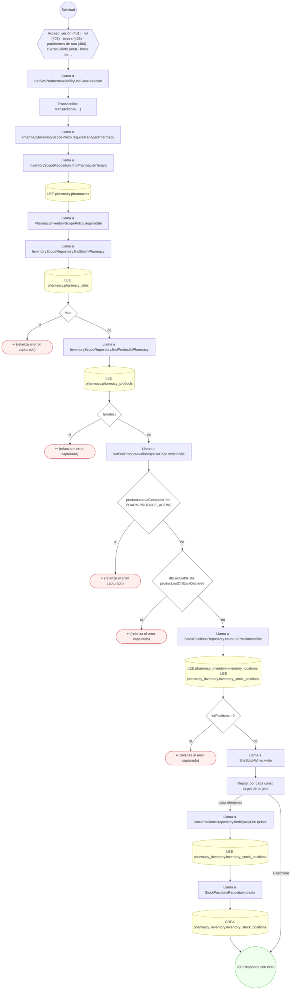

#### 13. GET /pharmacy-inventory/availability

Consultar qué sedes pueden surtir un conjunto de productos

| HTTP | Código | Cuándo |
|---|---|---|
| 200 | — | Éxito |
| 400 | `VALIDATION_FAILED` | Están los parámetros de consulta obligatorios; BadRequestException: products es obligatorio: la disponibilidad se consulta para un pedido concreto |
| 401 | `UNAUTHENTICATED` | Hay una sesión válida (JWT) |
| 403 | `FORBIDDEN` | El rol está permitido; El tenant se resuelve y pertenece al actor |
| 429 | `RATE_LIMITED` | No se supera el límite de solicitudes |

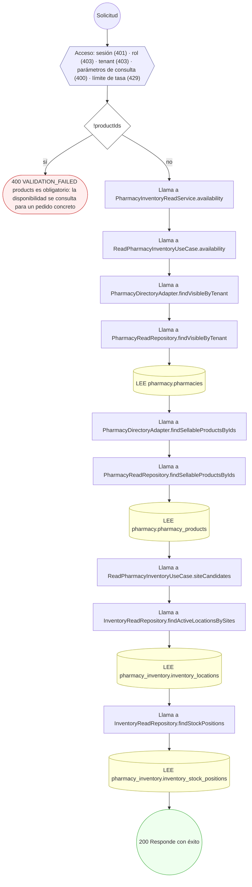

#### 14. GET /pharmacy-inventory/availability/medications

Consultar qué sedes de la red pueden surtir unos medicamentos

| HTTP | Código | Cuándo |
|---|---|---|
| 200 | — | Éxito |
| 400 | `VALIDATION_FAILED` | Están los parámetros de consulta obligatorios; BadRequestException: medications es obligatorio: la disponibilidad se consulta para una receta concreta |
| 401 | `UNAUTHENTICATED` | Hay una sesión válida (JWT) |
| 403 | `FORBIDDEN` | El rol está permitido; El tenant se resuelve y pertenece al actor |
| 429 | `RATE_LIMITED` | No se supera el límite de solicitudes |

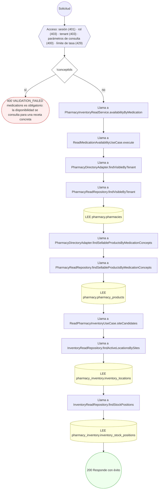

#### 15. GET /pharmacy-inventory/sites/{siteId}/stock

Consultar el stock disponible de una sede

| HTTP | Código | Cuándo |
|---|---|---|
| 200 | — | Éxito |
| 400 | `VALIDATION_FAILED` | Los parámetros de ruta son UUID válidos |
| 401 | `UNAUTHENTICATED` | Hay una sesión válida (JWT) |
| 403 | `FORBIDDEN` | El rol está permitido; El tenant se resuelve y pertenece al actor |
| 404 | `NOT_FOUND` | ResourceNotFoundException: Sede de farmacia no encontrada |
| 429 | `RATE_LIMITED` | No se supera el límite de solicitudes |

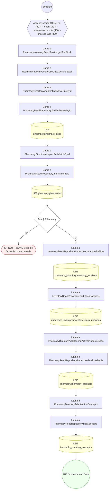

#### 16. POST /pharmacy/{pharmacyId}/dispensations

Dispensar una prescripción a un paciente (UC-25-03)

| HTTP | Código | Cuándo |
|---|---|---|
| 201 | — | Éxito |
| 400 | `VALIDATION_FAILED` | Los parámetros de ruta son UUID válidos; El cuerpo cumple el DTO (sin propiedades extra) |
| 401 | `UNAUTHENTICATED` | Hay una sesión válida (JWT) |
| 403 | `FORBIDDEN` | El rol está permitido; El tenant se resuelve y pertenece al actor |
| 409 | `CONFLICT` | ConflictException: Stock disponible insuficiente en el botiquín |
| 422 | `PRECONDITION_FAILED` | PreconditionFailedException: La reserva es un pedido de paciente: se dispensa con su código de retiro por POST /pharmacy/orders/:id/dispense; PreconditionFailedException: La reserva no está vigente; PreconditionFailedException: Stock insuficiente para dispensar |
| 429 | `RATE_LIMITED` | No se supera el límite de solicitudes |

```mermaid
flowchart TD
  n1(("Solicitud")):::inicio
  n2{{"Acceso: sesión (401) · rol (403) · tenant (403) · parámetros de ruta (400) · cuerpo válido (400) · límite de…"}}:::acceso
  n1 --> n2
  n3["Llama a MedicationDispensationsService.dispense"]:::llamada
  n2 --> n3
  n4["Llama a DispenseMedicationUseCase.execute"]:::llamada
  n3 --> n4
  n5["Transacción: transactional(…)"]:::transaccion
  n4 --> n5
  n6["Llama a PharmacyInventoryScopePolicy.requireManagedPharmacy"]:::llamada
  n5 --> n6
  n7["Llama a InventoryScopeRepository.findPharmacyInTenant"]:::llamada
  n6 --> n7
  n8[("LEE pharmacy.pharmacies")]:::efecto
  n7 --> n8
  n9{"dto.idempotencyKey"}:::decision
  n8 --> n9
  n10["Llama a DispensationsRepository.findByIdempotencyKey"]:::llamada
  n9 -->|"sí"| n10
  n11[("LEE pharmacy_inventory.medication_dispensations")]:::efecto
  n10 --> n11
  n12{"existing"}:::decision
  n11 --> n12
  n13["Llama a DispensationsRepository.findLines"]:::llamada
  n12 -->|"sí"| n13
  n14[("LEE pharmacy_inventory.medication_dispensation_lines")]:::efecto
  n13 --> n14
  n15["Llama a LedgerRepository.findEntryIdsBySource"]:::llamada
  n14 --> n15
  n16[("LEE pharmacy_inventory.inventory_ledger_entries")]:::efecto
  n15 --> n16
  n17["Llama a PharmacyInventoryScopePolicy.requireSite"]:::llamada
  n16 --> n17
  n12 -->|"no"| n17
  n9 -->|"no"| n17
  n18["Llama a InventoryScopeRepository.findSiteInPharmacy"]:::llamada
  n17 --> n18
  n19[("LEE pharmacy.pharmacy_sites")]:::efecto
  n18 --> n19
  n20{"!site"}:::decision
  n19 --> n20
  n21(["↩ (relanza el error capturado)"]):::error
  n20 -->|"sí"| n21
  n22["Llama a PharmacyInventoryScopePolicy.requirePatientContext"]:::llamada
  n20 -->|"no"| n22
  n23{"patientProfileId !== undefined"}:::decision
  n22 --> n23
  n24["Llama a InventoryScopeRepository.patientExists"]:::llamada
  n23 -->|"sí"| n24
  n25[("LEE profiles.patient_profiles")]:::efecto
  n24 --> n25
  n26["Llama a InventoryScopeRepository.patientServedByPharmacy"]:::llamada
  n25 --> n26
  n27[("LEE clinical.medication_requests · LEE pharmacy_inventory.inventory_reservations")]:::efecto
  n26 --> n27
  n28{"!served"}:::decision
  n27 --> n28
  n29(["↩ (relanza el error capturado)"]):::error
  n28 -->|"sí"| n29
  n30{"medicationRequestId !== undefined"}:::decision
  n28 -->|"no"| n30
  n23 -->|"no"| n30
  n31["Llama a InventoryScopeRepository.medicationRequestBelongsToPatient"]:::llamada
  n30 -->|"sí"| n31
  n32[("LEE clinical.medication_requests")]:::efecto
  n31 --> n32
  n33["Llama a InventoryScopeRepository.medicationRequestServedByPharmacy"]:::llamada
  n32 --> n33
  n34[("LEE clinical.medication_requests · LEE pharmacy_inventory.inventory_reservations")]:::efecto
  n33 --> n34
  n35{"!owned"}:::decision
  n34 --> n35
  n36(["↩ (relanza el error capturado)"]):::error
  n35 -->|"sí"| n36
  n37["Repite: por cada const line de dto.lines"]:::bucle
  n35 -->|"no"| n37
  n30 -->|"no"| n37
  n38["Llama a PharmacyInventoryScopePolicy.requireStockKey"]:::llamada
  n37 -->|"cada elemento"| n38
  n39["Llama a PharmacyInventoryScopePolicy.requireLocation"]:::llamada
  n38 --> n39
  n40{"!location"}:::decision
  n39 --> n40
  n41(["↩ (relanza el error capturado)"]):::error
  n40 -->|"sí"| n41
  n42["Llama a PharmacyInventoryScopePolicy.requireProduct"]:::llamada
  n40 -->|"no"| n42
  n43{"!product"}:::decision
  n42 --> n43
  n44(["↩ (relanza el error capturado)"]):::error
  n43 -->|"sí"| n44
  n45["Llama a PharmacyInventoryScopePolicy.requireLot"]:::llamada
  n43 -->|"no"| n45
  n46{"!lot || lot.pharmacyProductId !== productId"}:::decision
  n45 --> n46
  n47(["↩ (relanza el error capturado)"]):::error
  n46 -->|"sí"| n47
  n48{"dto.inventoryReservationId"}:::decision
  n46 -->|"no"| n48
  n37 -->|"al terminar"| n48
  n49["Llama a ReservationsRepository.findById"]:::llamada
  n48 -->|"sí"| n49
  n50[("LEE pharmacy_inventory.inventory_reservations")]:::efecto
  n49 --> n50
  n51{"!reservation || reservation.pharmacyId !== pharmacy.pharmacyId || reservation.pharmacySiteId !== site.siteId"}:::decision
  n50 --> n51
  n52(["↩ (relanza el error capturado)"]):::error
  n51 -->|"sí"| n52
  n53{"ORDER_STATUS_IDS.includes(reservation.reservationStatusConceptId)"}:::decision
  n51 -->|"no"| n53
  n54(["422 PRECONDITION_FAILED La reserva es un pedido de paciente: se dispensa con su código de retiro por POST /ph…"]):::error
  n53 -->|"sí"| n54
  n55{"wardStock.size › 0"}:::decision
  n53 -->|"no"| n55
  n56{"!vigente"}:::decision
  n55 -->|"sí"| n56
  n57(["422 PRECONDITION_FAILED La reserva no está vigente"]):::error
  n56 -->|"sí"| n57
  n58["Llama a ReservationsRepository.findLinesByReservation"]:::llamada
  n56 -->|"no"| n58
  n59[("LEE pharmacy_inventory.inventory_reservation_lines")]:::efecto
  n58 --> n59
  n60["Llama a DispensationsRepository.create"]:::llamada
  n59 --> n60
  n55 -->|"no"| n60
  n48 -->|"no"| n60
  n61[("CREA pharmacy_inventory.medication_dispensations")]:::efecto
  n60 --> n61
  n62["Repite: por cada const line de dto.lines"]:::bucle
  n61 --> n62
  n63["Llama a StockPositionsRepository.findByKeyForUpdate"]:::llamada
  n62 -->|"cada elemento"| n63
  n64[("LEE pharmacy_inventory.inventory_stock_positions")]:::efecto
  n63 --> n64
  n65{"wardStock.has(line.inventoryLocationId) && !wardStockCovers( position ? num(position.availableQuantity) : 0,…"}:::decision
  n64 --> n65
  n66(["409 CONFLICT Stock disponible insuficiente en el botiquín"]):::error
  n65 -->|"sí"| n66
  n67{"!position || num(position.onHandQuantity) ‹ line.dispensedQuantity"}:::decision
  n65 -->|"no"| n67
  n68(["422 PRECONDITION_FAILED Stock insuficiente para dispensar"]):::error
  n67 -->|"sí"| n68
  n69["Llama a DispensationsRepository.createLine"]:::llamada
  n67 -->|"no"| n69
  n70[("CREA pharmacy_inventory.medication_dispensation_lines")]:::efecto
  n69 --> n70
  n71["… el resto del árbol (12 nodos) está en el JSON del inventario"]:::corte
  n70 --> n71
  classDef acceso fill:#eef,stroke:#66a
  classDef error fill:#fee,stroke:#c33
  classDef ok fill:#efe,stroke:#3a3
  classDef efecto fill:#ffd,stroke:#aa3
  classDef decision fill:#fff,stroke:#555
  classDef corte fill:#eee,stroke:#999,stroke-dasharray: 4
```

#### 17. POST /pharmacy/{pharmacyId}/goods-receipts

Recepcionar mercancía por lote (UC-25-02)

| HTTP | Código | Cuándo |
|---|---|---|
| 201 | — | Éxito |
| 400 | `VALIDATION_FAILED` | Los parámetros de ruta son UUID válidos; El cuerpo cumple el DTO (sin propiedades extra) |
| 401 | `UNAUTHENTICATED` | Hay una sesión válida (JWT) |
| 403 | `FORBIDDEN` | El rol está permitido; El tenant se resuelve y pertenece al actor |
| 422 | `PRECONDITION_FAILED` | PreconditionFailedException: La orden no admite recepción |
| 429 | `RATE_LIMITED` | No se supera el límite de solicitudes |

```mermaid
flowchart TD
  n1(("Solicitud")):::inicio
  n2{{"Acceso: sesión (401) · rol (403) · tenant (403) · parámetros de ruta (400) · cuerpo válido (400) · límite de…"}}:::acceso
  n1 --> n2
  n3["Llama a PharmacyProcurementService.receiveGoods"]:::llamada
  n2 --> n3
  n4["Llama a PharmacyProcurementUseCases.receiveGoods"]:::llamada
  n3 --> n4
  n5["Transacción: transactional(…)"]:::transaccion
  n4 --> n5
  n6["Llama a PharmacyInventoryScopePolicy.requireManagedPharmacy"]:::llamada
  n5 --> n6
  n7["Llama a InventoryScopeRepository.findPharmacyInTenant"]:::llamada
  n6 --> n7
  n8[("LEE pharmacy.pharmacies")]:::efecto
  n7 --> n8
  n9{"dto.idempotencyKey"}:::decision
  n8 --> n9
  n10["Llama a GoodsReceiptsRepository.findByIdempotencyKey"]:::llamada
  n9 -->|"sí"| n10
  n11[("LEE pharmacy_inventory.pharmacy_goods_receipts")]:::efecto
  n10 --> n11
  n12{"existing"}:::decision
  n11 --> n12
  n13["Llama a PurchaseOrdersRepository.findById"]:::llamada
  n12 -->|"sí"| n13
  n14[("LEE pharmacy_inventory.pharmacy_purchase_orders")]:::efecto
  n13 --> n14
  n15{"existingOrder?.pharmacyId !== pharmacy.pharmacyId"}:::decision
  n14 --> n15
  n16(["↩ (relanza el error capturado)"]):::error
  n15 -->|"sí"| n16
  n17["Llama a GoodsReceiptsRepository.findLines"]:::llamada
  n15 -->|"no"| n17
  n18[("LEE pharmacy_inventory.pharmacy_goods_receipt_lines")]:::efecto
  n17 --> n18
  n19["Llama a LedgerRepository.findEntryIdsBySource"]:::llamada
  n18 --> n19
  n20[("LEE pharmacy_inventory.inventory_ledger_entries")]:::efecto
  n19 --> n20
  n21["Llama a PurchaseOrdersRepository.findById"]:::llamada
  n20 --> n21
  n12 -->|"no"| n21
  n9 -->|"no"| n21
  n22[("LEE pharmacy_inventory.pharmacy_purchase_orders")]:::efecto
  n21 --> n22
  n23{"!order || order.pharmacyId !== pharmacy.pharmacyId"}:::decision
  n22 --> n23
  n24(["↩ (relanza el error capturado)"]):::error
  n23 -->|"sí"| n24
  n25{"order.statusConceptId !== PINV.PO_ORDERED && order.statusConceptId !== PINV.PO_PARTIAL"}:::decision
  n23 -->|"no"| n25
  n26(["422 PRECONDITION_FAILED La orden no admite recepción"]):::error
  n25 -->|"sí"| n26
  n27["Llama a PharmacyInventoryScopePolicy.requireSite"]:::llamada
  n25 -->|"no"| n27
  n28["Llama a InventoryScopeRepository.findSiteInPharmacy"]:::llamada
  n27 --> n28
  n29[("LEE pharmacy.pharmacy_sites")]:::efecto
  n28 --> n29
  n30{"!site"}:::decision
  n29 --> n30
  n31(["↩ (relanza el error capturado)"]):::error
  n30 -->|"sí"| n31
  n32["Llama a PharmacyInventoryScopePolicy.requireLocation"]:::llamada
  n30 -->|"no"| n32
  n33["Llama a InventoryScopeRepository.findLocationInSite"]:::llamada
  n32 --> n33
  n34[("LEE pharmacy_inventory.inventory_locations")]:::efecto
  n33 --> n34
  n35{"!location"}:::decision
  n34 --> n35
  n36(["↩ (relanza el error capturado)"]):::error
  n35 -->|"sí"| n36
  n37["Repite: por cada const line de dto.lines"]:::bucle
  n35 -->|"no"| n37
  n38["Llama a PurchaseOrdersRepository.findLineById"]:::llamada
  n37 -->|"cada elemento"| n38
  n39[("LEE pharmacy_inventory.pharmacy_purchase_order_lines")]:::efecto
  n38 --> n39
  n40{"!poLine || poLine.pharmacyPurchaseOrderId !== order.id || poLine.pharmacyProductId !== line.pharmacyProductId"}:::decision
  n39 --> n40
  n41(["↩ (relanza el error capturado)"]):::error
  n40 -->|"sí"| n41
  n42["Llama a PharmacyInventoryScopePolicy.requireProduct"]:::llamada
  n40 -->|"no"| n42
  n43["Llama a InventoryScopeRepository.findProductInPharmacy"]:::llamada
  n42 --> n43
  n44[("LEE pharmacy.pharmacy_products")]:::efecto
  n43 --> n44
  n45{"!product"}:::decision
  n44 --> n45
  n46(["↩ (relanza el error capturado)"]):::error
  n45 -->|"sí"| n46
  n47["Llama a GoodsReceiptsRepository.create"]:::llamada
  n45 -->|"no"| n47
  n37 -->|"al terminar"| n47
  n48[("CREA pharmacy_inventory.pharmacy_goods_receipts")]:::efecto
  n47 --> n48
  n49["Repite: por cada const { line, poLine } de resolvedLines"]:::bucle
  n48 --> n49
  n50["Llama a LotsRepository.findByProductAndNumber"]:::llamada
  n49 -->|"cada elemento"| n50
  n51[("LEE pharmacy_inventory.inventory_lots")]:::efecto
  n50 --> n51
  n52{"!lot"}:::decision
  n51 --> n52
  n53["Llama a LotsRepository.create"]:::llamada
  n52 -->|"sí"| n53
  n54[("CREA pharmacy_inventory.inventory_lots")]:::efecto
  n53 --> n54
  n55["Llama a LedgerRepository.nextSequence"]:::llamada
  n54 --> n55
  n52 -->|"no"| n55
  n56[("LEE pharmacy_inventory.inventory_ledger_entries")]:::efecto
  n55 --> n56
  n57["Llama a LedgerRepository.append"]:::llamada
  n56 --> n57
  n58[("CREA pharmacy_inventory.inventory_ledger_entries")]:::efecto
  n57 --> n58
  n59["Llama a StockPositionsRepository.findByKeyForUpdate"]:::llamada
  n58 --> n59
  n60[("LEE pharmacy_inventory.inventory_stock_positions")]:::efecto
  n59 --> n60
  n61{"!position"}:::decision
  n60 --> n61
  n62["Llama a StockPositionsRepository.create"]:::llamada
  n61 -->|"sí"| n62
  n63[("CREA pharmacy_inventory.inventory_stock_positions")]:::efecto
  n62 --> n63
  n64[("ACTUALIZA pharmacy_inventory.inventory_stock_positions · ACTUALIZA pharmacy_inventory.inventory_stock_positio…")]:::efecto
  n61 -->|"no"| n64
  n65["Llama a GoodsReceiptsRepository.createLine"]:::llamada
  n63 --> n65
  n64 --> n65
  n66[("CREA pharmacy_inventory.pharmacy_goods_receipt_lines")]:::efecto
  n65 --> n66
  n67[("ACTUALIZA pharmacy_inventory.pharmacy_purchase_order_lines · ACTUALIZA pharmacy_inventory.pharmacy_purchase_o…")]:::efecto
  n66 --> n67
  n68[("ACTUALIZA pharmacy_inventory.pharmacy_purchase_orders")]:::efecto
  n67 --> n68
  n49 -->|"al terminar"| n68
  n69(("201 Responde con éxito")):::ok
  n68 --> n69
  classDef acceso fill:#eef,stroke:#66a
  classDef error fill:#fee,stroke:#c33
  classDef ok fill:#efe,stroke:#3a3
  classDef efecto fill:#ffd,stroke:#aa3
  classDef decision fill:#fff,stroke:#555
  classDef corte fill:#eee,stroke:#999,stroke-dasharray: 4
```

#### 18. GET /pharmacy/{pharmacyId}/inventory/ledger

Libro de movimientos (kardex), por secuencia de registro, la más reciente primero

| HTTP | Código | Cuándo |
|---|---|---|
| 200 | — | Éxito |
| 400 | `VALIDATION_FAILED` | Los parámetros de ruta son UUID válidos |
| 401 | `UNAUTHENTICATED` | Hay una sesión válida (JWT) |
| 403 | `FORBIDDEN` | El rol está permitido; El tenant se resuelve y pertenece al actor |
| 429 | `RATE_LIMITED` | No se supera el límite de solicitudes |

```mermaid
flowchart TD
  n1(("Solicitud")):::inicio
  n2{{"Acceso: sesión (401) · rol (403) · tenant (403) · parámetros de ruta (400) · límite de tasa (429)"}}:::acceso
  n1 --> n2
  n3["Llama a ReadInventoryManagementUseCase.ledger"]:::llamada
  n2 --> n3
  n4["Llama a ReadInventoryManagementUseCase.resolve"]:::llamada
  n3 --> n4
  n5["Llama a PharmacyInventoryScopePolicy.requireManagedPharmacy"]:::llamada
  n4 --> n5
  n6["Llama a InventoryScopeRepository.findPharmacyInTenant"]:::llamada
  n5 --> n6
  n7[("LEE pharmacy.pharmacies")]:::efecto
  n6 --> n7
  n8{"ids.siteId !== undefined"}:::decision
  n7 --> n8
  n9["Llama a PharmacyInventoryScopePolicy.requireSite"]:::llamada
  n8 -->|"sí"| n9
  n10["Llama a InventoryScopeRepository.findSiteInPharmacy"]:::llamada
  n9 --> n10
  n11[("LEE pharmacy.pharmacy_sites")]:::efecto
  n10 --> n11
  n12{"!site"}:::decision
  n11 --> n12
  n13(["↩ (relanza el error capturado)"]):::error
  n12 -->|"sí"| n13
  n14{"ids.locationId !== undefined"}:::decision
  n12 -->|"no"| n14
  n15["Llama a PharmacyInventoryScopePolicy.requireLocation"]:::llamada
  n14 -->|"sí"| n15
  n16["Llama a InventoryScopeRepository.findLocationInSite"]:::llamada
  n15 --> n16
  n17[("LEE pharmacy_inventory.inventory_locations")]:::efecto
  n16 --> n17
  n18{"!location"}:::decision
  n17 --> n18
  n19(["↩ (relanza el error capturado)"]):::error
  n18 -->|"sí"| n19
  n20{"ids.locationId !== undefined"}:::decision
  n8 -->|"no"| n20
  n21["Llama a PharmacyInventoryScopePolicy.requireLocationInPharmacy"]:::llamada
  n20 -->|"sí"| n21
  n22["Llama a InventoryScopeRepository.findLocation"]:::llamada
  n21 --> n22
  n23[("LEE pharmacy_inventory.inventory_locations")]:::efecto
  n22 --> n23
  n24{"!location"}:::decision
  n23 --> n24
  n25(["↩ (relanza el error capturado)"]):::error
  n24 -->|"sí"| n25
  n26["Llama a InventoryScopeRepository.findSiteInPharmacy"]:::llamada
  n24 -->|"no"| n26
  n27[("LEE pharmacy.pharmacy_sites")]:::efecto
  n26 --> n27
  n28{"!site"}:::decision
  n27 --> n28
  n29(["↩ (relanza el error capturado)"]):::error
  n28 -->|"sí"| n29
  n30{"ids.productId !== undefined"}:::decision
  n18 -->|"no"| n30
  n14 -->|"no"| n30
  n28 -->|"no"| n30
  n20 -->|"no"| n30
  n31["Llama a PharmacyInventoryScopePolicy.requireProduct"]:::llamada
  n30 -->|"sí"| n31
  n32["Llama a InventoryScopeRepository.findProductInPharmacy"]:::llamada
  n31 --> n32
  n33[("LEE pharmacy.pharmacy_products")]:::efecto
  n32 --> n33
  n34{"!product"}:::decision
  n33 --> n34
  n35(["↩ (relanza el error capturado)"]):::error
  n34 -->|"sí"| n35
  n36["Llama a ReadInventoryManagementUseCase.requireLot"]:::llamada
  n34 -->|"no"| n36
  n30 -->|"no"| n36
  n37{"ids.productId !== undefined"}:::decision
  n36 --> n37
  n38["Llama a PharmacyInventoryScopePolicy.requireLot"]:::llamada
  n37 -->|"sí"| n38
  n39{"!lot || lot.pharmacyProductId !== productId"}:::decision
  n38 --> n39
  n40(["↩ (relanza el error capturado)"]):::error
  n39 -->|"sí"| n40
  n41["Llama a LotsRepository.findById"]:::llamada
  n39 -->|"no"| n41
  n37 -->|"no"| n41
  n42[("LEE pharmacy_inventory.inventory_lots")]:::efecto
  n41 --> n42
  n43{"!lot"}:::decision
  n42 --> n43
  n44(["↩ (relanza el error capturado)"]):::error
  n43 -->|"sí"| n44
  n45["Llama a PharmacyInventoryScopePolicy.requireProduct"]:::llamada
  n43 -->|"no"| n45
  n46{"!product"}:::decision
  n45 --> n46
  n47(["↩ (relanza el error capturado)"]):::error
  n46 -->|"sí"| n47
  n48{"ids.lotId !== undefined"}:::decision
  n46 -->|"no"| n48
  n49["Llama a ReadInventoryManagementUseCase.requireLot"]:::llamada
  n48 -->|"sí"| n49
  n50{"ids.productId !== undefined"}:::decision
  n49 --> n50
  n51["Llama a PharmacyInventoryScopePolicy.requireLot"]:::llamada
  n50 -->|"sí"| n51
  n52{"!lot || lot.pharmacyProductId !== productId"}:::decision
  n51 --> n52
  n53(["↩ (relanza el error capturado)"]):::error
  n52 -->|"sí"| n53
  n54["Llama a LotsRepository.findById"]:::llamada
  n52 -->|"no"| n54
  n50 -->|"no"| n54
  n55[("LEE pharmacy_inventory.inventory_lots")]:::efecto
  n54 --> n55
  n56{"!lot"}:::decision
  n55 --> n56
  n57(["↩ (relanza el error capturado)"]):::error
  n56 -->|"sí"| n57
  n58["Llama a PharmacyInventoryScopePolicy.requireProduct"]:::llamada
  n56 -->|"no"| n58
  n59{"!product"}:::decision
  n58 --> n59
  n60(["↩ (relanza el error capturado)"]):::error
  n59 -->|"sí"| n60
  n61["Llama a LedgerManagementRepository.listForManagement"]:::llamada
  n59 -->|"no"| n61
  n48 -->|"no"| n61
  n62[("LEE pharmacy_inventory.inventory_ledger_entries · LEE terminology.catalog_concepts · LEE pharmacy.pharmacy_pr…")]:::efecto
  n61 --> n62
  n63(("200 Responde con éxito")):::ok
  n62 --> n63
  classDef acceso fill:#eef,stroke:#66a
  classDef error fill:#fee,stroke:#c33
  classDef ok fill:#efe,stroke:#3a3
  classDef efecto fill:#ffd,stroke:#aa3
  classDef decision fill:#fff,stroke:#555
  classDef corte fill:#eee,stroke:#999,stroke-dasharray: 4
```

#### 19. GET /pharmacy/{pharmacyId}/inventory/locations

Ubicaciones activas de las sedes de la farmacia

| HTTP | Código | Cuándo |
|---|---|---|
| 200 | — | Éxito |
| 400 | `VALIDATION_FAILED` | Los parámetros de ruta son UUID válidos |
| 401 | `UNAUTHENTICATED` | Hay una sesión válida (JWT) |
| 403 | `FORBIDDEN` | El rol está permitido; El tenant se resuelve y pertenece al actor |
| 429 | `RATE_LIMITED` | No se supera el límite de solicitudes |

```mermaid
flowchart TD
  n1(("Solicitud")):::inicio
  n2{{"Acceso: sesión (401) · rol (403) · tenant (403) · parámetros de ruta (400) · límite de tasa (429)"}}:::acceso
  n1 --> n2
  n3["Llama a ReadInventoryManagementUseCase.locations"]:::llamada
  n2 --> n3
  n4["Llama a ReadInventoryManagementUseCase.resolve"]:::llamada
  n3 --> n4
  n5["Llama a PharmacyInventoryScopePolicy.requireManagedPharmacy"]:::llamada
  n4 --> n5
  n6["Llama a InventoryScopeRepository.findPharmacyInTenant"]:::llamada
  n5 --> n6
  n7[("LEE pharmacy.pharmacies")]:::efecto
  n6 --> n7
  n8{"ids.siteId !== undefined"}:::decision
  n7 --> n8
  n9["Llama a PharmacyInventoryScopePolicy.requireSite"]:::llamada
  n8 -->|"sí"| n9
  n10["Llama a InventoryScopeRepository.findSiteInPharmacy"]:::llamada
  n9 --> n10
  n11[("LEE pharmacy.pharmacy_sites")]:::efecto
  n10 --> n11
  n12{"!site"}:::decision
  n11 --> n12
  n13(["↩ (relanza el error capturado)"]):::error
  n12 -->|"sí"| n13
  n14{"ids.locationId !== undefined"}:::decision
  n12 -->|"no"| n14
  n15["Llama a PharmacyInventoryScopePolicy.requireLocation"]:::llamada
  n14 -->|"sí"| n15
  n16["Llama a InventoryScopeRepository.findLocationInSite"]:::llamada
  n15 --> n16
  n17[("LEE pharmacy_inventory.inventory_locations")]:::efecto
  n16 --> n17
  n18{"!location"}:::decision
  n17 --> n18
  n19(["↩ (relanza el error capturado)"]):::error
  n18 -->|"sí"| n19
  n20{"ids.locationId !== undefined"}:::decision
  n8 -->|"no"| n20
  n21["Llama a PharmacyInventoryScopePolicy.requireLocationInPharmacy"]:::llamada
  n20 -->|"sí"| n21
  n22["Llama a InventoryScopeRepository.findLocation"]:::llamada
  n21 --> n22
  n23[("LEE pharmacy_inventory.inventory_locations")]:::efecto
  n22 --> n23
  n24{"!location"}:::decision
  n23 --> n24
  n25(["↩ (relanza el error capturado)"]):::error
  n24 -->|"sí"| n25
  n26["Llama a InventoryScopeRepository.findSiteInPharmacy"]:::llamada
  n24 -->|"no"| n26
  n27[("LEE pharmacy.pharmacy_sites")]:::efecto
  n26 --> n27
  n28{"!site"}:::decision
  n27 --> n28
  n29(["↩ (relanza el error capturado)"]):::error
  n28 -->|"sí"| n29
  n30{"ids.productId !== undefined"}:::decision
  n18 -->|"no"| n30
  n14 -->|"no"| n30
  n28 -->|"no"| n30
  n20 -->|"no"| n30
  n31["Llama a PharmacyInventoryScopePolicy.requireProduct"]:::llamada
  n30 -->|"sí"| n31
  n32["Llama a InventoryScopeRepository.findProductInPharmacy"]:::llamada
  n31 --> n32
  n33[("LEE pharmacy.pharmacy_products")]:::efecto
  n32 --> n33
  n34{"!product"}:::decision
  n33 --> n34
  n35(["↩ (relanza el error capturado)"]):::error
  n34 -->|"sí"| n35
  n36["Llama a ReadInventoryManagementUseCase.requireLot"]:::llamada
  n34 -->|"no"| n36
  n30 -->|"no"| n36
  n37{"ids.productId !== undefined"}:::decision
  n36 --> n37
  n38["Llama a PharmacyInventoryScopePolicy.requireLot"]:::llamada
  n37 -->|"sí"| n38
  n39{"!lot || lot.pharmacyProductId !== productId"}:::decision
  n38 --> n39
  n40(["↩ (relanza el error capturado)"]):::error
  n39 -->|"sí"| n40
  n41["Llama a LotsRepository.findById"]:::llamada
  n39 -->|"no"| n41
  n37 -->|"no"| n41
  n42[("LEE pharmacy_inventory.inventory_lots")]:::efecto
  n41 --> n42
  n43{"!lot"}:::decision
  n42 --> n43
  n44(["↩ (relanza el error capturado)"]):::error
  n43 -->|"sí"| n44
  n45["Llama a PharmacyInventoryScopePolicy.requireProduct"]:::llamada
  n43 -->|"no"| n45
  n46{"!product"}:::decision
  n45 --> n46
  n47(["↩ (relanza el error capturado)"]):::error
  n46 -->|"sí"| n47
  n48{"ids.lotId !== undefined"}:::decision
  n46 -->|"no"| n48
  n49["Llama a ReadInventoryManagementUseCase.requireLot"]:::llamada
  n48 -->|"sí"| n49
  n50{"ids.productId !== undefined"}:::decision
  n49 --> n50
  n51["Llama a PharmacyInventoryScopePolicy.requireLot"]:::llamada
  n50 -->|"sí"| n51
  n52{"!lot || lot.pharmacyProductId !== productId"}:::decision
  n51 --> n52
  n53(["↩ (relanza el error capturado)"]):::error
  n52 -->|"sí"| n53
  n54["Llama a LotsRepository.findById"]:::llamada
  n52 -->|"no"| n54
  n50 -->|"no"| n54
  n55[("LEE pharmacy_inventory.inventory_lots")]:::efecto
  n54 --> n55
  n56{"!lot"}:::decision
  n55 --> n56
  n57(["↩ (relanza el error capturado)"]):::error
  n56 -->|"sí"| n57
  n58["Llama a PharmacyInventoryScopePolicy.requireProduct"]:::llamada
  n56 -->|"no"| n58
  n59{"!product"}:::decision
  n58 --> n59
  n60(["↩ (relanza el error capturado)"]):::error
  n59 -->|"sí"| n60
  n61["Llama a LocationsRepository.listActiveForManagement"]:::llamada
  n59 -->|"no"| n61
  n48 -->|"no"| n61
  n62[("LEE pharmacy_inventory.inventory_locations · LEE pharmacy.pharmacy_sites")]:::efecto
  n61 --> n62
  n63(("200 Responde con éxito")):::ok
  n62 --> n63
  classDef acceso fill:#eef,stroke:#66a
  classDef error fill:#fee,stroke:#c33
  classDef ok fill:#efe,stroke:#3a3
  classDef efecto fill:#ffd,stroke:#aa3
  classDef decision fill:#fff,stroke:#555
  classDef corte fill:#eee,stroke:#999,stroke-dasharray: 4
```

#### 20. GET /pharmacy/{pharmacyId}/inventory/lots

Lotes con su vencimiento, estados y existencia por sede

| HTTP | Código | Cuándo |
|---|---|---|
| 200 | — | Éxito |
| 400 | `VALIDATION_FAILED` | Los parámetros de ruta son UUID válidos |
| 401 | `UNAUTHENTICATED` | Hay una sesión válida (JWT) |
| 403 | `FORBIDDEN` | El rol está permitido; El tenant se resuelve y pertenece al actor |
| 429 | `RATE_LIMITED` | No se supera el límite de solicitudes |

```mermaid
flowchart TD
  n1(("Solicitud")):::inicio
  n2{{"Acceso: sesión (401) · rol (403) · tenant (403) · parámetros de ruta (400) · límite de tasa (429)"}}:::acceso
  n1 --> n2
  n3["Llama a ReadInventoryManagementUseCase.lots"]:::llamada
  n2 --> n3
  n4["Llama a ReadInventoryManagementUseCase.resolve"]:::llamada
  n3 --> n4
  n5["Llama a PharmacyInventoryScopePolicy.requireManagedPharmacy"]:::llamada
  n4 --> n5
  n6["Llama a InventoryScopeRepository.findPharmacyInTenant"]:::llamada
  n5 --> n6
  n7[("LEE pharmacy.pharmacies")]:::efecto
  n6 --> n7
  n8{"ids.siteId !== undefined"}:::decision
  n7 --> n8
  n9["Llama a PharmacyInventoryScopePolicy.requireSite"]:::llamada
  n8 -->|"sí"| n9
  n10["Llama a InventoryScopeRepository.findSiteInPharmacy"]:::llamada
  n9 --> n10
  n11[("LEE pharmacy.pharmacy_sites")]:::efecto
  n10 --> n11
  n12{"!site"}:::decision
  n11 --> n12
  n13(["↩ (relanza el error capturado)"]):::error
  n12 -->|"sí"| n13
  n14{"ids.locationId !== undefined"}:::decision
  n12 -->|"no"| n14
  n15["Llama a PharmacyInventoryScopePolicy.requireLocation"]:::llamada
  n14 -->|"sí"| n15
  n16["Llama a InventoryScopeRepository.findLocationInSite"]:::llamada
  n15 --> n16
  n17[("LEE pharmacy_inventory.inventory_locations")]:::efecto
  n16 --> n17
  n18{"!location"}:::decision
  n17 --> n18
  n19(["↩ (relanza el error capturado)"]):::error
  n18 -->|"sí"| n19
  n20{"ids.locationId !== undefined"}:::decision
  n8 -->|"no"| n20
  n21["Llama a PharmacyInventoryScopePolicy.requireLocationInPharmacy"]:::llamada
  n20 -->|"sí"| n21
  n22["Llama a InventoryScopeRepository.findLocation"]:::llamada
  n21 --> n22
  n23[("LEE pharmacy_inventory.inventory_locations")]:::efecto
  n22 --> n23
  n24{"!location"}:::decision
  n23 --> n24
  n25(["↩ (relanza el error capturado)"]):::error
  n24 -->|"sí"| n25
  n26["Llama a InventoryScopeRepository.findSiteInPharmacy"]:::llamada
  n24 -->|"no"| n26
  n27[("LEE pharmacy.pharmacy_sites")]:::efecto
  n26 --> n27
  n28{"!site"}:::decision
  n27 --> n28
  n29(["↩ (relanza el error capturado)"]):::error
  n28 -->|"sí"| n29
  n30{"ids.productId !== undefined"}:::decision
  n18 -->|"no"| n30
  n14 -->|"no"| n30
  n28 -->|"no"| n30
  n20 -->|"no"| n30
  n31["Llama a PharmacyInventoryScopePolicy.requireProduct"]:::llamada
  n30 -->|"sí"| n31
  n32["Llama a InventoryScopeRepository.findProductInPharmacy"]:::llamada
  n31 --> n32
  n33[("LEE pharmacy.pharmacy_products")]:::efecto
  n32 --> n33
  n34{"!product"}:::decision
  n33 --> n34
  n35(["↩ (relanza el error capturado)"]):::error
  n34 -->|"sí"| n35
  n36["Llama a ReadInventoryManagementUseCase.requireLot"]:::llamada
  n34 -->|"no"| n36
  n30 -->|"no"| n36
  n37{"ids.productId !== undefined"}:::decision
  n36 --> n37
  n38["Llama a PharmacyInventoryScopePolicy.requireLot"]:::llamada
  n37 -->|"sí"| n38
  n39{"!lot || lot.pharmacyProductId !== productId"}:::decision
  n38 --> n39
  n40(["↩ (relanza el error capturado)"]):::error
  n39 -->|"sí"| n40
  n41["Llama a LotsRepository.findById"]:::llamada
  n39 -->|"no"| n41
  n37 -->|"no"| n41
  n42[("LEE pharmacy_inventory.inventory_lots")]:::efecto
  n41 --> n42
  n43{"!lot"}:::decision
  n42 --> n43
  n44(["↩ (relanza el error capturado)"]):::error
  n43 -->|"sí"| n44
  n45["Llama a PharmacyInventoryScopePolicy.requireProduct"]:::llamada
  n43 -->|"no"| n45
  n46{"!product"}:::decision
  n45 --> n46
  n47(["↩ (relanza el error capturado)"]):::error
  n46 -->|"sí"| n47
  n48{"ids.lotId !== undefined"}:::decision
  n46 -->|"no"| n48
  n49["Llama a ReadInventoryManagementUseCase.requireLot"]:::llamada
  n48 -->|"sí"| n49
  n50{"ids.productId !== undefined"}:::decision
  n49 --> n50
  n51["Llama a PharmacyInventoryScopePolicy.requireLot"]:::llamada
  n50 -->|"sí"| n51
  n52{"!lot || lot.pharmacyProductId !== productId"}:::decision
  n51 --> n52
  n53(["↩ (relanza el error capturado)"]):::error
  n52 -->|"sí"| n53
  n54["Llama a LotsRepository.findById"]:::llamada
  n52 -->|"no"| n54
  n50 -->|"no"| n54
  n55[("LEE pharmacy_inventory.inventory_lots")]:::efecto
  n54 --> n55
  n56{"!lot"}:::decision
  n55 --> n56
  n57(["↩ (relanza el error capturado)"]):::error
  n56 -->|"sí"| n57
  n58["Llama a PharmacyInventoryScopePolicy.requireProduct"]:::llamada
  n56 -->|"no"| n58
  n59{"!product"}:::decision
  n58 --> n59
  n60(["↩ (relanza el error capturado)"]):::error
  n59 -->|"sí"| n60
  n61["Llama a LotsRepository.listForManagement"]:::llamada
  n59 -->|"no"| n61
  n48 -->|"no"| n61
  n62[("LEE pharmacy_inventory.inventory_stock_positions · LEE pharmacy_inventory.inventory_locations · LEE pharmacy_…")]:::efecto
  n61 --> n62
  n63["Llama a StockManagementRepository.sumOnHandByLotAndSite"]:::llamada
  n62 --> n63
  n64[("LEE pharmacy_inventory.inventory_stock_positions · LEE pharmacy_inventory.inventory_locations · LEE pharmacy.…")]:::efecto
  n63 --> n64
  n65(("200 Responde con éxito")):::ok
  n64 --> n65
  classDef acceso fill:#eef,stroke:#66a
  classDef error fill:#fee,stroke:#c33
  classDef ok fill:#efe,stroke:#3a3
  classDef efecto fill:#ffd,stroke:#aa3
  classDef decision fill:#fff,stroke:#555
  classDef corte fill:#eee,stroke:#999,stroke-dasharray: 4
```

#### 21. GET /pharmacy/{pharmacyId}/inventory/positions

Existencias por sede, ubicación y lote, con su desglose

| HTTP | Código | Cuándo |
|---|---|---|
| 200 | — | Éxito |
| 400 | `VALIDATION_FAILED` | Los parámetros de ruta son UUID válidos |
| 401 | `UNAUTHENTICATED` | Hay una sesión válida (JWT) |
| 403 | `FORBIDDEN` | El rol está permitido; El tenant se resuelve y pertenece al actor |
| 429 | `RATE_LIMITED` | No se supera el límite de solicitudes |

```mermaid
flowchart TD
  n1(("Solicitud")):::inicio
  n2{{"Acceso: sesión (401) · rol (403) · tenant (403) · parámetros de ruta (400) · límite de tasa (429)"}}:::acceso
  n1 --> n2
  n3["Llama a ReadInventoryManagementUseCase.positions"]:::llamada
  n2 --> n3
  n4["Llama a ReadInventoryManagementUseCase.resolve"]:::llamada
  n3 --> n4
  n5["Llama a PharmacyInventoryScopePolicy.requireManagedPharmacy"]:::llamada
  n4 --> n5
  n6["Llama a InventoryScopeRepository.findPharmacyInTenant"]:::llamada
  n5 --> n6
  n7[("LEE pharmacy.pharmacies")]:::efecto
  n6 --> n7
  n8{"ids.siteId !== undefined"}:::decision
  n7 --> n8
  n9["Llama a PharmacyInventoryScopePolicy.requireSite"]:::llamada
  n8 -->|"sí"| n9
  n10["Llama a InventoryScopeRepository.findSiteInPharmacy"]:::llamada
  n9 --> n10
  n11[("LEE pharmacy.pharmacy_sites")]:::efecto
  n10 --> n11
  n12{"!site"}:::decision
  n11 --> n12
  n13(["↩ (relanza el error capturado)"]):::error
  n12 -->|"sí"| n13
  n14{"ids.locationId !== undefined"}:::decision
  n12 -->|"no"| n14
  n15["Llama a PharmacyInventoryScopePolicy.requireLocation"]:::llamada
  n14 -->|"sí"| n15
  n16["Llama a InventoryScopeRepository.findLocationInSite"]:::llamada
  n15 --> n16
  n17[("LEE pharmacy_inventory.inventory_locations")]:::efecto
  n16 --> n17
  n18{"!location"}:::decision
  n17 --> n18
  n19(["↩ (relanza el error capturado)"]):::error
  n18 -->|"sí"| n19
  n20{"ids.locationId !== undefined"}:::decision
  n8 -->|"no"| n20
  n21["Llama a PharmacyInventoryScopePolicy.requireLocationInPharmacy"]:::llamada
  n20 -->|"sí"| n21
  n22["Llama a InventoryScopeRepository.findLocation"]:::llamada
  n21 --> n22
  n23[("LEE pharmacy_inventory.inventory_locations")]:::efecto
  n22 --> n23
  n24{"!location"}:::decision
  n23 --> n24
  n25(["↩ (relanza el error capturado)"]):::error
  n24 -->|"sí"| n25
  n26["Llama a InventoryScopeRepository.findSiteInPharmacy"]:::llamada
  n24 -->|"no"| n26
  n27[("LEE pharmacy.pharmacy_sites")]:::efecto
  n26 --> n27
  n28{"!site"}:::decision
  n27 --> n28
  n29(["↩ (relanza el error capturado)"]):::error
  n28 -->|"sí"| n29
  n30{"ids.productId !== undefined"}:::decision
  n18 -->|"no"| n30
  n14 -->|"no"| n30
  n28 -->|"no"| n30
  n20 -->|"no"| n30
  n31["Llama a PharmacyInventoryScopePolicy.requireProduct"]:::llamada
  n30 -->|"sí"| n31
  n32["Llama a InventoryScopeRepository.findProductInPharmacy"]:::llamada
  n31 --> n32
  n33[("LEE pharmacy.pharmacy_products")]:::efecto
  n32 --> n33
  n34{"!product"}:::decision
  n33 --> n34
  n35(["↩ (relanza el error capturado)"]):::error
  n34 -->|"sí"| n35
  n36["Llama a ReadInventoryManagementUseCase.requireLot"]:::llamada
  n34 -->|"no"| n36
  n30 -->|"no"| n36
  n37{"ids.productId !== undefined"}:::decision
  n36 --> n37
  n38["Llama a PharmacyInventoryScopePolicy.requireLot"]:::llamada
  n37 -->|"sí"| n38
  n39{"!lot || lot.pharmacyProductId !== productId"}:::decision
  n38 --> n39
  n40(["↩ (relanza el error capturado)"]):::error
  n39 -->|"sí"| n40
  n41["Llama a LotsRepository.findById"]:::llamada
  n39 -->|"no"| n41
  n37 -->|"no"| n41
  n42[("LEE pharmacy_inventory.inventory_lots")]:::efecto
  n41 --> n42
  n43{"!lot"}:::decision
  n42 --> n43
  n44(["↩ (relanza el error capturado)"]):::error
  n43 -->|"sí"| n44
  n45["Llama a PharmacyInventoryScopePolicy.requireProduct"]:::llamada
  n43 -->|"no"| n45
  n46{"!product"}:::decision
  n45 --> n46
  n47(["↩ (relanza el error capturado)"]):::error
  n46 -->|"sí"| n47
  n48{"ids.lotId !== undefined"}:::decision
  n46 -->|"no"| n48
  n49["Llama a ReadInventoryManagementUseCase.requireLot"]:::llamada
  n48 -->|"sí"| n49
  n50{"ids.productId !== undefined"}:::decision
  n49 --> n50
  n51["Llama a PharmacyInventoryScopePolicy.requireLot"]:::llamada
  n50 -->|"sí"| n51
  n52{"!lot || lot.pharmacyProductId !== productId"}:::decision
  n51 --> n52
  n53(["↩ (relanza el error capturado)"]):::error
  n52 -->|"sí"| n53
  n54["Llama a LotsRepository.findById"]:::llamada
  n52 -->|"no"| n54
  n50 -->|"no"| n54
  n55[("LEE pharmacy_inventory.inventory_lots")]:::efecto
  n54 --> n55
  n56{"!lot"}:::decision
  n55 --> n56
  n57(["↩ (relanza el error capturado)"]):::error
  n56 -->|"sí"| n57
  n58["Llama a PharmacyInventoryScopePolicy.requireProduct"]:::llamada
  n56 -->|"no"| n58
  n59{"!product"}:::decision
  n58 --> n59
  n60(["↩ (relanza el error capturado)"]):::error
  n59 -->|"sí"| n60
  n61["Llama a StockManagementRepository.listForManagement"]:::llamada
  n59 -->|"no"| n61
  n48 -->|"no"| n61
  n62[("LEE pharmacy_inventory.inventory_stock_positions · LEE pharmacy_inventory.inventory_locations · LEE pharmacy.…")]:::efecto
  n61 --> n62
  n63(("200 Responde con éxito")):::ok
  n62 --> n63
  classDef acceso fill:#eef,stroke:#66a
  classDef error fill:#fee,stroke:#c33
  classDef ok fill:#efe,stroke:#3a3
  classDef efecto fill:#ffd,stroke:#aa3
  classDef decision fill:#fff,stroke:#555
  classDef corte fill:#eee,stroke:#999,stroke-dasharray: 4
```

#### 22. POST /pharmacy/{pharmacyId}/purchase-orders

Emitir una orden de compra a proveedor (UC-25-01)

| HTTP | Código | Cuándo |
|---|---|---|
| 201 | — | Éxito |
| 400 | `VALIDATION_FAILED` | Los parámetros de ruta son UUID válidos; El cuerpo cumple el DTO (sin propiedades extra) |
| 401 | `UNAUTHENTICATED` | Hay una sesión válida (JWT) |
| 403 | `FORBIDDEN` | El rol está permitido; El tenant se resuelve y pertenece al actor |
| 422 | `PRECONDITION_FAILED` | PreconditionFailedException: El proveedor no está activo |
| 429 | `RATE_LIMITED` | No se supera el límite de solicitudes |

```mermaid
flowchart TD
  n1(("Solicitud")):::inicio
  n2{{"Acceso: sesión (401) · rol (403) · tenant (403) · parámetros de ruta (400) · cuerpo válido (400) · límite de…"}}:::acceso
  n1 --> n2
  n3["Llama a PharmacyProcurementService.createPurchaseOrder"]:::llamada
  n2 --> n3
  n4["Llama a PharmacyProcurementUseCases.createPurchaseOrder"]:::llamada
  n3 --> n4
  n5["Transacción: transactional(…)"]:::transaccion
  n4 --> n5
  n6["Llama a PharmacyInventoryScopePolicy.requireManagedPharmacy"]:::llamada
  n5 --> n6
  n7["Llama a InventoryScopeRepository.findPharmacyInTenant"]:::llamada
  n6 --> n7
  n8[("LEE pharmacy.pharmacies")]:::efecto
  n7 --> n8
  n9{"dto.idempotencyKey"}:::decision
  n8 --> n9
  n10["Llama a PurchaseOrdersRepository.findByIdempotencyKey"]:::llamada
  n9 -->|"sí"| n10
  n11[("LEE pharmacy_inventory.pharmacy_purchase_orders")]:::efecto
  n10 --> n11
  n12{"existing"}:::decision
  n11 --> n12
  n13["Llama a PurchaseOrdersRepository.findLinesByOrder"]:::llamada
  n12 -->|"sí"| n13
  n14[("LEE pharmacy_inventory.pharmacy_purchase_order_lines")]:::efecto
  n13 --> n14
  n15["Llama a PharmacyInventoryScopePolicy.requireSite"]:::llamada
  n14 --> n15
  n12 -->|"no"| n15
  n9 -->|"no"| n15
  n16["Llama a InventoryScopeRepository.findSiteInPharmacy"]:::llamada
  n15 --> n16
  n17[("LEE pharmacy.pharmacy_sites")]:::efecto
  n16 --> n17
  n18{"!site"}:::decision
  n17 --> n18
  n19(["↩ (relanza el error capturado)"]):::error
  n18 -->|"sí"| n19
  n20["Llama a SuppliersRepository.findById"]:::llamada
  n18 -->|"no"| n20
  n21[("LEE pharmacy_inventory.pharmacy_suppliers")]:::efecto
  n20 --> n21
  n22{"!supplier || supplier.pharmacyId !== pharmacy.pharmacyId"}:::decision
  n21 --> n22
  n23(["↩ (relanza el error capturado)"]):::error
  n22 -->|"sí"| n23
  n24{"supplier.statusConceptId !== PINV.SUPPLIER_ACTIVE"}:::decision
  n22 -->|"no"| n24
  n25(["422 PRECONDITION_FAILED El proveedor no está activo"]):::error
  n24 -->|"sí"| n25
  n26["Repite: por cada const line de dto.lines"]:::bucle
  n24 -->|"no"| n26
  n27["Llama a PharmacyInventoryScopePolicy.requireProduct"]:::llamada
  n26 -->|"cada elemento"| n27
  n28["Llama a InventoryScopeRepository.findProductInPharmacy"]:::llamada
  n27 --> n28
  n29[("LEE pharmacy.pharmacy_products")]:::efecto
  n28 --> n29
  n30{"!product"}:::decision
  n29 --> n30
  n31(["↩ (relanza el error capturado)"]):::error
  n30 -->|"sí"| n31
  n32["Llama a PurchaseOrdersRepository.create"]:::llamada
  n30 -->|"no"| n32
  n26 -->|"al terminar"| n32
  n33[("CREA pharmacy_inventory.pharmacy_purchase_orders")]:::efecto
  n32 --> n33
  n34["Repite: por cada const line de dto.lines"]:::bucle
  n33 --> n34
  n35["Llama a PurchaseOrdersRepository.createLine"]:::llamada
  n34 -->|"cada elemento"| n35
  n36[("CREA pharmacy_inventory.pharmacy_purchase_order_lines")]:::efecto
  n35 --> n36
  n37(("201 Responde con éxito")):::ok
  n36 --> n37
  n34 -->|"al terminar"| n37
  classDef acceso fill:#eef,stroke:#66a
  classDef error fill:#fee,stroke:#c33
  classDef ok fill:#efe,stroke:#3a3
  classDef efecto fill:#ffd,stroke:#aa3
  classDef decision fill:#fff,stroke:#555
  classDef corte fill:#eee,stroke:#999,stroke-dasharray: 4
```

#### 23. POST /pharmacy/{pharmacyId}/reservations

Reservar stock para una prescripción (UC-25-04)

| HTTP | Código | Cuándo |
|---|---|---|
| 201 | — | Éxito |
| 400 | `VALIDATION_FAILED` | Los parámetros de ruta son UUID válidos; El cuerpo cumple el DTO (sin propiedades extra) |
| 401 | `UNAUTHENTICATED` | Hay una sesión válida (JWT) |
| 403 | `FORBIDDEN` | El rol está permitido; El tenant se resuelve y pertenece al actor |
| 422 | `PRECONDITION_FAILED` | PreconditionFailedException: Stock disponible insuficiente para reservar |
| 429 | `RATE_LIMITED` | No se supera el límite de solicitudes |

```mermaid
flowchart TD
  n1(("Solicitud")):::inicio
  n2{{"Acceso: sesión (401) · rol (403) · tenant (403) · parámetros de ruta (400) · cuerpo válido (400) · límite de…"}}:::acceso
  n1 --> n2
  n3["Llama a InventoryReservationsService.reserve"]:::llamada
  n2 --> n3
  n4["Llama a ReserveInventoryUseCase.execute"]:::llamada
  n3 --> n4
  n5["Transacción: transactional(…)"]:::transaccion
  n4 --> n5
  n6["Llama a PharmacyInventoryScopePolicy.requireManagedPharmacy"]:::llamada
  n5 --> n6
  n7["Llama a InventoryScopeRepository.findPharmacyInTenant"]:::llamada
  n6 --> n7
  n8[("LEE pharmacy.pharmacies")]:::efecto
  n7 --> n8
  n9["Llama a PharmacyInventoryScopePolicy.requireSite"]:::llamada
  n8 --> n9
  n10["Llama a InventoryScopeRepository.findSiteInPharmacy"]:::llamada
  n9 --> n10
  n11[("LEE pharmacy.pharmacy_sites")]:::efecto
  n10 --> n11
  n12{"!site"}:::decision
  n11 --> n12
  n13(["↩ (relanza el error capturado)"]):::error
  n12 -->|"sí"| n13
  n14["Llama a PharmacyInventoryScopePolicy.requirePatientContext"]:::llamada
  n12 -->|"no"| n14
  n15{"patientProfileId !== undefined"}:::decision
  n14 --> n15
  n16["Llama a InventoryScopeRepository.patientExists"]:::llamada
  n15 -->|"sí"| n16
  n17[("LEE profiles.patient_profiles")]:::efecto
  n16 --> n17
  n18["Llama a InventoryScopeRepository.patientServedByPharmacy"]:::llamada
  n17 --> n18
  n19[("LEE clinical.medication_requests · LEE pharmacy_inventory.inventory_reservations")]:::efecto
  n18 --> n19
  n20{"!served"}:::decision
  n19 --> n20
  n21(["↩ (relanza el error capturado)"]):::error
  n20 -->|"sí"| n21
  n22{"medicationRequestId !== undefined"}:::decision
  n20 -->|"no"| n22
  n15 -->|"no"| n22
  n23["Llama a InventoryScopeRepository.medicationRequestBelongsToPatient"]:::llamada
  n22 -->|"sí"| n23
  n24[("LEE clinical.medication_requests")]:::efecto
  n23 --> n24
  n25["Llama a InventoryScopeRepository.medicationRequestServedByPharmacy"]:::llamada
  n24 --> n25
  n26[("LEE clinical.medication_requests · LEE pharmacy_inventory.inventory_reservations")]:::efecto
  n25 --> n26
  n27{"!owned"}:::decision
  n26 --> n27
  n28(["↩ (relanza el error capturado)"]):::error
  n27 -->|"sí"| n28
  n29["Repite: por cada const line de dto.lines"]:::bucle
  n27 -->|"no"| n29
  n22 -->|"no"| n29
  n30["Llama a PharmacyInventoryScopePolicy.requireStockKey"]:::llamada
  n29 -->|"cada elemento"| n30
  n31["Llama a PharmacyInventoryScopePolicy.requireLocation"]:::llamada
  n30 --> n31
  n32{"!location"}:::decision
  n31 --> n32
  n33(["↩ (relanza el error capturado)"]):::error
  n32 -->|"sí"| n33
  n34["Llama a PharmacyInventoryScopePolicy.requireProduct"]:::llamada
  n32 -->|"no"| n34
  n35{"!product"}:::decision
  n34 --> n35
  n36(["↩ (relanza el error capturado)"]):::error
  n35 -->|"sí"| n36
  n37["Llama a PharmacyInventoryScopePolicy.requireLot"]:::llamada
  n35 -->|"no"| n37
  n38{"!lot || lot.pharmacyProductId !== productId"}:::decision
  n37 --> n38
  n39(["↩ (relanza el error capturado)"]):::error
  n38 -->|"sí"| n39
  n40["Llama a ReservationsRepository.create"]:::llamada
  n38 -->|"no"| n40
  n29 -->|"al terminar"| n40
  n41[("CREA pharmacy_inventory.inventory_reservations")]:::efecto
  n40 --> n41
  n42["Repite: por cada const line de dto.lines"]:::bucle
  n41 --> n42
  n43["Llama a StockPositionsRepository.findByKeyForUpdate"]:::llamada
  n42 -->|"cada elemento"| n43
  n44[("LEE pharmacy_inventory.inventory_stock_positions")]:::efecto
  n43 --> n44
  n45{"available ‹ line.requestedQuantity"}:::decision
  n44 --> n45
  n46(["422 PRECONDITION_FAILED Stock disponible insuficiente para reservar"]):::error
  n45 -->|"sí"| n46
  n47["Llama a ReservationsRepository.createLine"]:::llamada
  n45 -->|"no"| n47
  n48[("CREA pharmacy_inventory.inventory_reservation_lines")]:::efecto
  n47 --> n48
  n49["Llama a LedgerRepository.nextSequence"]:::llamada
  n48 --> n49
  n50[("LEE pharmacy_inventory.inventory_ledger_entries")]:::efecto
  n49 --> n50
  n51["Llama a LedgerRepository.append"]:::llamada
  n50 --> n51
  n52[("CREA pharmacy_inventory.inventory_ledger_entries")]:::efecto
  n51 --> n52
  n53(("201 Responde con éxito")):::ok
  n52 --> n53
  n42 -->|"al terminar"| n53
  classDef acceso fill:#eef,stroke:#66a
  classDef error fill:#fee,stroke:#c33
  classDef ok fill:#efe,stroke:#3a3
  classDef efecto fill:#ffd,stroke:#aa3
  classDef decision fill:#fff,stroke:#555
  classDef corte fill:#eee,stroke:#999,stroke-dasharray: 4
```

#### 24. POST /pharmacy/{pharmacyId}/transfers

Transferir stock entre ubicaciones (UC-25-10)

| HTTP | Código | Cuándo |
|---|---|---|
| 201 | — | Éxito |
| 400 | `VALIDATION_FAILED` | Los parámetros de ruta son UUID válidos; El cuerpo cumple el DTO (sin propiedades extra) |
| 401 | `UNAUTHENTICATED` | Hay una sesión válida (JWT) |
| 403 | `FORBIDDEN` | El rol está permitido; El tenant se resuelve y pertenece al actor |
| 409 | `CONFLICT` | ConflictException: Stock disponible insuficiente en el botiquín |
| 422 | `PRECONDITION_FAILED` | PreconditionFailedException: Stock disponible insuficiente en origen |
| 429 | `RATE_LIMITED` | No se supera el límite de solicitudes |

```mermaid
flowchart TD
  n1(("Solicitud")):::inicio
  n2{{"Acceso: sesión (401) · rol (403) · tenant (403) · parámetros de ruta (400) · cuerpo válido (400) · límite de…"}}:::acceso
  n1 --> n2
  n3["Llama a InventoryTransfersService.transfer"]:::llamada
  n2 --> n3
  n4["Llama a TransferInventoryUseCase.execute"]:::llamada
  n3 --> n4
  n5["Transacción: transactional(…)"]:::transaccion
  n4 --> n5
  n6["Llama a PharmacyInventoryScopePolicy.requireManagedPharmacy"]:::llamada
  n5 --> n6
  n7["Llama a InventoryScopeRepository.findPharmacyInTenant"]:::llamada
  n6 --> n7
  n8[("LEE pharmacy.pharmacies")]:::efecto
  n7 --> n8
  n9["Llama a PharmacyInventoryScopePolicy.requireSite"]:::llamada
  n8 --> n9
  n10["Llama a InventoryScopeRepository.findSiteInPharmacy"]:::llamada
  n9 --> n10
  n11[("LEE pharmacy.pharmacy_sites")]:::efecto
  n10 --> n11
  n12{"!site"}:::decision
  n11 --> n12
  n13(["↩ (relanza el error capturado)"]):::error
  n12 -->|"sí"| n13
  n14["Llama a PharmacyInventoryScopePolicy.requireLocationInPharmacy"]:::llamada
  n12 -->|"no"| n14
  n15["Llama a InventoryScopeRepository.findLocation"]:::llamada
  n14 --> n15
  n16[("LEE pharmacy_inventory.inventory_locations")]:::efecto
  n15 --> n16
  n17{"!location"}:::decision
  n16 --> n17
  n18(["↩ (relanza el error capturado)"]):::error
  n17 -->|"sí"| n18
  n19["Llama a InventoryScopeRepository.findSiteInPharmacy"]:::llamada
  n17 -->|"no"| n19
  n20[("LEE pharmacy.pharmacy_sites")]:::efecto
  n19 --> n20
  n21{"!site"}:::decision
  n20 --> n21
  n22(["↩ (relanza el error capturado)"]):::error
  n21 -->|"sí"| n22
  n23["Llama a PharmacyInventoryScopePolicy.requireLocationInPharmacy"]:::llamada
  n21 -->|"no"| n23
  n24["Llama a InventoryScopeRepository.findLocation"]:::llamada
  n23 --> n24
  n25[("LEE pharmacy_inventory.inventory_locations")]:::efecto
  n24 --> n25
  n26{"!location"}:::decision
  n25 --> n26
  n27(["↩ (relanza el error capturado)"]):::error
  n26 -->|"sí"| n27
  n28["Llama a InventoryScopeRepository.findSiteInPharmacy"]:::llamada
  n26 -->|"no"| n28
  n29[("LEE pharmacy.pharmacy_sites")]:::efecto
  n28 --> n29
  n30{"!site"}:::decision
  n29 --> n30
  n31(["↩ (relanza el error capturado)"]):::error
  n30 -->|"sí"| n31
  n32["Llama a PharmacyInventoryScopePolicy.requireProduct"]:::llamada
  n30 -->|"no"| n32
  n33["Llama a InventoryScopeRepository.findProductInPharmacy"]:::llamada
  n32 --> n33
  n34[("LEE pharmacy.pharmacy_products")]:::efecto
  n33 --> n34
  n35{"!product"}:::decision
  n34 --> n35
  n36(["↩ (relanza el error capturado)"]):::error
  n35 -->|"sí"| n36
  n37["Llama a PharmacyInventoryScopePolicy.requireLot"]:::llamada
  n35 -->|"no"| n37
  n38["Llama a InventoryScopeRepository.findLot"]:::llamada
  n37 --> n38
  n39[("LEE pharmacy_inventory.inventory_lots")]:::efecto
  n38 --> n39
  n40{"!lot || lot.pharmacyProductId !== productId"}:::decision
  n39 --> n40
  n41(["↩ (relanza el error capturado)"]):::error
  n40 -->|"sí"| n41
  n42["Llama a StockPositionsRepository.findByKeyForUpdate"]:::llamada
  n40 -->|"no"| n42
  n43[("LEE pharmacy_inventory.inventory_stock_positions")]:::efecto
  n42 --> n43
  n44{"from?.locationTypeConceptId === PINV.LOCATION_TYPE_WARD_STOCK && (!fromPosition || num(fromPosition.available…"}:::decision
  n43 --> n44
  n45(["409 CONFLICT Stock disponible insuficiente en el botiquín"]):::error
  n44 -->|"sí"| n45
  n46{"!fromPosition || num(fromPosition.availableQuantity) ‹ dto.quantity"}:::decision
  n44 -->|"no"| n46
  n47(["422 PRECONDITION_FAILED Stock disponible insuficiente en origen"]):::error
  n46 -->|"sí"| n47
  n48["Llama a LedgerRepository.nextSequence"]:::llamada
  n46 -->|"no"| n48
  n49[("LEE pharmacy_inventory.inventory_ledger_entries")]:::efecto
  n48 --> n49
  n50["Llama a LedgerRepository.append"]:::llamada
  n49 --> n50
  n51[("CREA pharmacy_inventory.inventory_ledger_entries")]:::efecto
  n50 --> n51
  n52["Llama a LedgerRepository.nextSequence"]:::llamada
  n51 --> n52
  n53[("LEE pharmacy_inventory.inventory_ledger_entries")]:::efecto
  n52 --> n53
  n54["Llama a LedgerRepository.append"]:::llamada
  n53 --> n54
  n55[("CREA pharmacy_inventory.inventory_ledger_entries")]:::efecto
  n54 --> n55
  n56[("ACTUALIZA pharmacy_inventory.inventory_stock_positions · ACTUALIZA pharmacy_inventory.inventory_stock_positio…")]:::efecto
  n55 --> n56
  n57["Llama a StockPositionsRepository.findByKeyForUpdate"]:::llamada
  n56 --> n57
  n58[("LEE pharmacy_inventory.inventory_stock_positions")]:::efecto
  n57 --> n58
  n59{"!toPosition"}:::decision
  n58 --> n59
  n60["Llama a StockPositionsRepository.create"]:::llamada
  n59 -->|"sí"| n60
  n61[("CREA pharmacy_inventory.inventory_stock_positions")]:::efecto
  n60 --> n61
  n62[("ACTUALIZA pharmacy_inventory.inventory_stock_positions · ACTUALIZA pharmacy_inventory.inventory_stock_positio…")]:::efecto
  n59 -->|"no"| n62
  n63(("201 Responde con éxito")):::ok
  n61 --> n63
  n62 --> n63
  classDef acceso fill:#eef,stroke:#66a
  classDef error fill:#fee,stroke:#c33
  classDef ok fill:#efe,stroke:#3a3
  classDef efecto fill:#ffd,stroke:#aa3
  classDef decision fill:#fff,stroke:#555
  classDef corte fill:#eee,stroke:#999,stroke-dasharray: 4
```

#### 25. POST /pharmacy/{siteId}/count-sessions

Iniciar y congelar una sesión de conteo (UC-25-06)

| HTTP | Código | Cuándo |
|---|---|---|
| 201 | — | Éxito |
| 400 | `VALIDATION_FAILED` | Los parámetros de ruta son UUID válidos; El cuerpo cumple el DTO (sin propiedades extra) |
| 401 | `UNAUTHENTICATED` | Hay una sesión válida (JWT) |
| 403 | `FORBIDDEN` | El rol está permitido; El tenant se resuelve y pertenece al actor |
| 409 | `CONFLICT` | ConflictException: Ya existe una sesión de conteo abierta en la ubicación |
| 429 | `RATE_LIMITED` | No se supera el límite de solicitudes |

```mermaid
flowchart TD
  n1(("Solicitud")):::inicio
  n2{{"Acceso: sesión (401) · rol (403) · tenant (403) · parámetros de ruta (400) · cuerpo válido (400) · límite de…"}}:::acceso
  n1 --> n2
  n3["Llama a InventoryCountService.openSession"]:::llamada
  n2 --> n3
  n4["Llama a OpenInventoryCountUseCase.execute"]:::llamada
  n3 --> n4
  n5["Transacción: transactional(…)"]:::transaccion
  n4 --> n5
  n6["Llama a PharmacyInventoryScopePolicy.requireManagedSite"]:::llamada
  n5 --> n6
  n7["Llama a InventoryScopeRepository.findSite"]:::llamada
  n6 --> n7
  n8[("LEE pharmacy.pharmacy_sites")]:::efecto
  n7 --> n8
  n9{"!site"}:::decision
  n8 --> n9
  n10(["↩ (relanza el error capturado)"]):::error
  n9 -->|"sí"| n10
  n11["Llama a PharmacyInventoryScopePolicy.requireLocation"]:::llamada
  n9 -->|"no"| n11
  n12["Llama a InventoryScopeRepository.findLocationInSite"]:::llamada
  n11 --> n12
  n13[("LEE pharmacy_inventory.inventory_locations")]:::efecto
  n12 --> n13
  n14{"!location"}:::decision
  n13 --> n14
  n15(["↩ (relanza el error capturado)"]):::error
  n14 -->|"sí"| n15
  n16["Repite: por cada const item de dto.items"]:::bucle
  n14 -->|"no"| n16
  n17["Llama a PharmacyInventoryScopePolicy.requireProduct"]:::llamada
  n16 -->|"cada elemento"| n17
  n18["Llama a InventoryScopeRepository.findProductInPharmacy"]:::llamada
  n17 --> n18
  n19[("LEE pharmacy.pharmacy_products")]:::efecto
  n18 --> n19
  n20{"!product"}:::decision
  n19 --> n20
  n21(["↩ (relanza el error capturado)"]):::error
  n20 -->|"sí"| n21
  n22["Llama a PharmacyInventoryScopePolicy.requireLot"]:::llamada
  n20 -->|"no"| n22
  n23["Llama a InventoryScopeRepository.findLot"]:::llamada
  n22 --> n23
  n24[("LEE pharmacy_inventory.inventory_lots")]:::efecto
  n23 --> n24
  n25{"!lot || lot.pharmacyProductId !== productId"}:::decision
  n24 --> n25
  n26(["↩ (relanza el error capturado)"]):::error
  n25 -->|"sí"| n26
  n27["Llama a CountSessionsRepository.countOpenAtLocation"]:::llamada
  n25 -->|"no"| n27
  n16 -->|"al terminar"| n27
  n28[("LEE pharmacy_inventory.inventory_count_sessions")]:::efecto
  n27 --> n28
  n29{"openCount › 0"}:::decision
  n28 --> n29
  n30(["409 CONFLICT Ya existe una sesión de conteo abierta en la ubicación"]):::error
  n29 -->|"sí"| n30
  n31["Llama a CountSessionsRepository.create"]:::llamada
  n29 -->|"no"| n31
  n32[("CREA pharmacy_inventory.inventory_count_sessions")]:::efecto
  n31 --> n32
  n33["Repite: por cada const item de dto.items"]:::bucle
  n32 --> n33
  n34["Llama a StockPositionsRepository.findByKey"]:::llamada
  n33 -->|"cada elemento"| n34
  n35[("LEE pharmacy_inventory.inventory_stock_positions")]:::efecto
  n34 --> n35
  n36["Llama a CountSessionsRepository.createLine"]:::llamada
  n35 --> n36
  n37[("CREA pharmacy_inventory.inventory_count_lines")]:::efecto
  n36 --> n37
  n38(("201 Responde con éxito")):::ok
  n37 --> n38
  n33 -->|"al terminar"| n38
  classDef acceso fill:#eef,stroke:#66a
  classDef error fill:#fee,stroke:#c33
  classDef ok fill:#efe,stroke:#3a3
  classDef efecto fill:#ffd,stroke:#aa3
  classDef decision fill:#fff,stroke:#555
  classDef corte fill:#eee,stroke:#999,stroke-dasharray: 4
```

#### 26. POST /pharmacy/{siteId}/inventory-locations

Crear una ubicación de inventario

| HTTP | Código | Cuándo |
|---|---|---|
| 201 | — | Éxito |
| 400 | `VALIDATION_FAILED` | Los parámetros de ruta son UUID válidos; El cuerpo cumple el DTO (sin propiedades extra) |
| 401 | `UNAUTHENTICATED` | Hay una sesión válida (JWT) |
| 403 | `FORBIDDEN` | El rol está permitido; El tenant se resuelve y pertenece al actor |
| 429 | `RATE_LIMITED` | No se supera el límite de solicitudes |

```mermaid
flowchart TD
  n1(("Solicitud")):::inicio
  n2{{"Acceso: sesión (401) · rol (403) · tenant (403) · parámetros de ruta (400) · cuerpo válido (400) · límite de…"}}:::acceso
  n1 --> n2
  n3["Llama a InventoryLocationsService.create"]:::llamada
  n2 --> n3
  n4["Llama a CreateInventoryLocationUseCase.execute"]:::llamada
  n3 --> n4
  n5["Transacción: transactional(…)"]:::transaccion
  n4 --> n5
  n6["Llama a PharmacyInventoryScopePolicy.requireManagedSite"]:::llamada
  n5 --> n6
  n7["Llama a InventoryScopeRepository.findSite"]:::llamada
  n6 --> n7
  n8[("LEE pharmacy.pharmacy_sites")]:::efecto
  n7 --> n8
  n9{"!site"}:::decision
  n8 --> n9
  n10(["↩ (relanza el error capturado)"]):::error
  n9 -->|"sí"| n10
  n11{"dto.parentLocationId"}:::decision
  n9 -->|"no"| n11
  n12["Llama a PharmacyInventoryScopePolicy.requireLocation"]:::llamada
  n11 -->|"sí"| n12
  n13["Llama a InventoryScopeRepository.findLocationInSite"]:::llamada
  n12 --> n13
  n14[("LEE pharmacy_inventory.inventory_locations")]:::efecto
  n13 --> n14
  n15{"!location"}:::decision
  n14 --> n15
  n16(["↩ (relanza el error capturado)"]):::error
  n15 -->|"sí"| n16
  n17{"placed || locationType !== 'SHELF'"}:::decision
  n15 -->|"no"| n17
  n11 -->|"no"| n17
  n18["Llama a LocationsRepository.findActiveWardStock"]:::llamada
  n17 -->|"sí"| n18
  n19[("LEE pharmacy_inventory.inventory_locations")]:::efecto
  n18 --> n19
  n20{"locationType === 'WARD_STOCK' && (await this.locations.findActiveWardStock(tx, dto.clinicalUnitId!))"}:::decision
  n19 --> n20
  n21(["↩ (relanza el error capturado)"]):::error
  n20 -->|"sí"| n21
  n22["Llama a LocationsRepository.create"]:::llamada
  n20 -->|"no"| n22
  n17 -->|"no"| n22
  n23[("CREA pharmacy_inventory.inventory_locations")]:::efecto
  n22 --> n23
  n24["Intenta"]:::intento
  n23 --> n24
  n25(["↩ (relanza el error capturado)"]):::error
  n24 -->|"si falla"| n25
  n26{"placed && this.events"}:::decision
  n24 --> n26
  n27["Llama a MessagingDomainEventAdapter.publish"]:::llamada
  n26 -->|"sí"| n27
  n28>"Evento ~null"]:::evento
  n27 --> n28
  n29(("201 Responde con éxito")):::ok
  n28 --> n29
  n26 -->|"no"| n29
  classDef acceso fill:#eef,stroke:#66a
  classDef error fill:#fee,stroke:#c33
  classDef ok fill:#efe,stroke:#3a3
  classDef efecto fill:#ffd,stroke:#aa3
  classDef decision fill:#fff,stroke:#555
  classDef corte fill:#eee,stroke:#999,stroke-dasharray: 4
```

#### 27. POST /pharmacy/count-sessions/{id}/approve

Aprobar conteo y ajustar ledger por varianza (UC-25-07)

| HTTP | Código | Cuándo |
|---|---|---|
| 200 | — | Éxito |
| 400 | `VALIDATION_FAILED` | Los parámetros de ruta son UUID válidos; El cuerpo cumple el DTO (sin propiedades extra) |
| 401 | `UNAUTHENTICATED` | Hay una sesión válida (JWT) |
| 403 | `FORBIDDEN` | El rol está permitido; El tenant se resuelve y pertenece al actor |
| 404 | `NOT_FOUND` | ResourceNotFoundException: Línea de conteo no encontrada |
| 422 | `PRECONDITION_FAILED` | PreconditionFailedException: La sesión no está en estado aprobable |
| 429 | `RATE_LIMITED` | No se supera el límite de solicitudes |

```mermaid
flowchart TD
  n1(("Solicitud")):::inicio
  n2{{"Acceso: sesión (401) · rol (403) · tenant (403) · parámetros de ruta (400) · cuerpo válido (400) · límite de…"}}:::acceso
  n1 --> n2
  n3["Llama a InventoryCountService.approve"]:::llamada
  n2 --> n3
  n4["Llama a ApproveInventoryCountUseCase.execute"]:::llamada
  n3 --> n4
  n5["Transacción: transactional(…)"]:::transaccion
  n4 --> n5
  n6["Llama a CountSessionsRepository.findById"]:::llamada
  n5 --> n6
  n7[("LEE pharmacy_inventory.inventory_count_sessions")]:::efecto
  n6 --> n7
  n8{"!session"}:::decision
  n7 --> n8
  n9(["↩ (relanza el error capturado)"]):::error
  n8 -->|"sí"| n9
  n10["Llama a PharmacyInventoryScopePolicy.requireManagedSite"]:::llamada
  n8 -->|"no"| n10
  n11["Llama a InventoryScopeRepository.findSite"]:::llamada
  n10 --> n11
  n12[("LEE pharmacy.pharmacy_sites")]:::efecto
  n11 --> n12
  n13{"!site"}:::decision
  n12 --> n13
  n14(["↩ (relanza el error capturado)"]):::error
  n13 -->|"sí"| n14
  n15["Llama a PharmacyInventoryScopePolicy.assertStoredStockKey"]:::llamada
  n13 -->|"no"| n15
  n16["Llama a InventoryScopeRepository.findLocationInSite"]:::llamada
  n15 --> n16
  n17[("LEE pharmacy_inventory.inventory_locations")]:::efecto
  n16 --> n17
  n18{"!location"}:::decision
  n17 --> n18
  n19(["↩ (relanza el error capturado)"]):::error
  n18 -->|"sí"| n19
  n20["Llama a InventoryScopeRepository.findProductInPharmacy"]:::llamada
  n18 -->|"no"| n20
  n21[("LEE pharmacy.pharmacy_products")]:::efecto
  n20 --> n21
  n22{"!product"}:::decision
  n21 --> n22
  n23(["↩ (relanza el error capturado)"]):::error
  n22 -->|"sí"| n23
  n24["Llama a InventoryScopeRepository.findLot"]:::llamada
  n22 -->|"no"| n24
  n25[("LEE pharmacy_inventory.inventory_lots")]:::efecto
  n24 --> n25
  n26{"!lot || lot.pharmacyProductId !== key.pharmacyProductId"}:::decision
  n25 --> n26
  n27(["↩ (relanza el error capturado)"]):::error
  n26 -->|"sí"| n27
  n28{"!approvable.includes(session.statusConceptId)"}:::decision
  n26 -->|"no"| n28
  n29(["422 PRECONDITION_FAILED La sesión no está en estado aprobable"]):::error
  n28 -->|"sí"| n29
  n30["Repite: por cada const [lineId, counted] de countByLine"]:::bucle
  n28 -->|"no"| n30
  n31["Llama a CountSessionsRepository.findLineById"]:::llamada
  n30 -->|"cada elemento"| n31
  n32[("LEE pharmacy_inventory.inventory_count_lines")]:::efecto
  n31 --> n32
  n33{"!line || line.inventoryCountSessionId !== session.id"}:::decision
  n32 --> n33
  n34(["404 NOT_FOUND Línea de conteo no encontrada"]):::error
  n33 -->|"sí"| n34
  n35["Llama a PharmacyInventoryScopePolicy.assertStoredStockKey"]:::llamada
  n33 -->|"no"| n35
  n36["Llama a InventoryScopeRepository.findLocationInSite"]:::llamada
  n35 --> n36
  n37[("LEE pharmacy_inventory.inventory_locations")]:::efecto
  n36 --> n37
  n38{"!location"}:::decision
  n37 --> n38
  n39(["↩ (relanza el error capturado)"]):::error
  n38 -->|"sí"| n39
  n40["Llama a InventoryScopeRepository.findProductInPharmacy"]:::llamada
  n38 -->|"no"| n40
  n41[("LEE pharmacy.pharmacy_products")]:::efecto
  n40 --> n41
  n42{"!product"}:::decision
  n41 --> n42
  n43(["↩ (relanza el error capturado)"]):::error
  n42 -->|"sí"| n43
  n44["Llama a InventoryScopeRepository.findLot"]:::llamada
  n42 -->|"no"| n44
  n45[("LEE pharmacy_inventory.inventory_lots")]:::efecto
  n44 --> n45
  n46{"!lot || lot.pharmacyProductId !== key.pharmacyProductId"}:::decision
  n45 --> n46
  n47(["↩ (relanza el error capturado)"]):::error
  n46 -->|"sí"| n47
  n48[("ACTUALIZA pharmacy_inventory.inventory_count_lines · ACTUALIZA pharmacy_inventory.inventory_count_lines")]:::efecto
  n46 -->|"no"| n48
  n49{"variance !== 0"}:::decision
  n48 --> n49
  n50[("ACTUALIZA pharmacy_inventory.inventory_count_lines")]:::efecto
  n49 -->|"sí"| n50
  n51["Llama a LedgerRepository.nextSequence"]:::llamada
  n50 --> n51
  n52[("LEE pharmacy_inventory.inventory_ledger_entries")]:::efecto
  n51 --> n52
  n53["Llama a LedgerRepository.append"]:::llamada
  n52 --> n53
  n54[("CREA pharmacy_inventory.inventory_ledger_entries")]:::efecto
  n53 --> n54
  n55["Llama a StockPositionsRepository.findByKeyForUpdate"]:::llamada
  n54 --> n55
  n56[("LEE pharmacy_inventory.inventory_stock_positions")]:::efecto
  n55 --> n56
  n57{"position"}:::decision
  n56 --> n57
  n58[("ACTUALIZA pharmacy_inventory.inventory_stock_positions · ACTUALIZA pharmacy_inventory.inventory_stock_positio…")]:::efecto
  n57 -->|"sí"| n58
  n59[("ACTUALIZA pharmacy_inventory.inventory_count_sessions · ACTUALIZA pharmacy_inventory.inventory_count_sessions…")]:::efecto
  n58 --> n59
  n57 -->|"no"| n59
  n49 -->|"no"| n59
  n30 -->|"al terminar"| n59
  n60(("200 Responde con éxito")):::ok
  n59 --> n60
  classDef acceso fill:#eef,stroke:#66a
  classDef error fill:#fee,stroke:#c33
  classDef ok fill:#efe,stroke:#3a3
  classDef efecto fill:#ffd,stroke:#aa3
  classDef decision fill:#fff,stroke:#555
  classDef corte fill:#eee,stroke:#999,stroke-dasharray: 4
```

#### 28. POST /pharmacy/dispensations/{id}/reverse

Reversar una dispensación (UC-25-11)

| HTTP | Código | Cuándo |
|---|---|---|
| 200 | — | Éxito |
| 400 | `VALIDATION_FAILED` | Los parámetros de ruta son UUID válidos; El cuerpo cumple el DTO (sin propiedades extra) |
| 401 | `UNAUTHENTICATED` | Hay una sesión válida (JWT) |
| 403 | `FORBIDDEN` | El rol está permitido; El tenant se resuelve y pertenece al actor |
| 422 | `PRECONDITION_FAILED` | PreconditionFailedException: La dispensación no está en estado reversible |
| 429 | `RATE_LIMITED` | No se supera el límite de solicitudes |

```mermaid
flowchart TD
  n1(("Solicitud")):::inicio
  n2{{"Acceso: sesión (401) · rol (403) · tenant (403) · parámetros de ruta (400) · cuerpo válido (400) · límite de…"}}:::acceso
  n1 --> n2
  n3["Llama a MedicationDispensationsService.reverse"]:::llamada
  n2 --> n3
  n4["Llama a ReverseMedicationDispensationUseCase.execute"]:::llamada
  n3 --> n4
  n5["Transacción: transactional(…)"]:::transaccion
  n4 --> n5
  n6["Llama a DispensationsRepository.findById"]:::llamada
  n5 --> n6
  n7[("LEE pharmacy_inventory.medication_dispensations")]:::efecto
  n6 --> n7
  n8{"!dispensation"}:::decision
  n7 --> n8
  n9(["↩ (relanza el error capturado)"]):::error
  n8 -->|"sí"| n9
  n10["Llama a PharmacyInventoryScopePolicy.requireManagedPharmacy"]:::llamada
  n8 -->|"no"| n10
  n11["Llama a InventoryScopeRepository.findPharmacyInTenant"]:::llamada
  n10 --> n11
  n12[("LEE pharmacy.pharmacies")]:::efecto
  n11 --> n12
  n13{"dto.inventoryLocationId"}:::decision
  n12 --> n13
  n14["Llama a PharmacyInventoryScopePolicy.requireSite"]:::llamada
  n13 -->|"sí"| n14
  n15["Llama a InventoryScopeRepository.findSiteInPharmacy"]:::llamada
  n14 --> n15
  n16[("LEE pharmacy.pharmacy_sites")]:::efecto
  n15 --> n16
  n17{"!site"}:::decision
  n16 --> n17
  n18(["↩ (relanza el error capturado)"]):::error
  n17 -->|"sí"| n18
  n19["Llama a PharmacyInventoryScopePolicy.requireLocation"]:::llamada
  n17 -->|"no"| n19
  n20["Llama a InventoryScopeRepository.findLocationInSite"]:::llamada
  n19 --> n20
  n21[("LEE pharmacy_inventory.inventory_locations")]:::efecto
  n20 --> n21
  n22{"!location"}:::decision
  n21 --> n22
  n23(["↩ (relanza el error capturado)"]):::error
  n22 -->|"sí"| n23
  n24{"dispensation.dispensationStatusConceptId !== PINV.DISPENSE_DISPENSED"}:::decision
  n22 -->|"no"| n24
  n13 -->|"no"| n24
  n25(["422 PRECONDITION_FAILED La dispensación no está en estado reversible"]):::error
  n24 -->|"sí"| n25
  n26[("ACTUALIZA pharmacy_inventory.medication_dispensations")]:::efecto
  n24 -->|"no"| n26
  n27["Llama a DispensationsRepository.findLines"]:::llamada
  n26 --> n27
  n28[("LEE pharmacy_inventory.medication_dispensation_lines")]:::efecto
  n27 --> n28
  n29["Repite: por cada const dl de lines"]:::bucle
  n28 --> n29
  n30["Llama a LedgerRepository.nextSequence"]:::llamada
  n29 -->|"cada elemento"| n30
  n31[("LEE pharmacy_inventory.inventory_ledger_entries")]:::efecto
  n30 --> n31
  n32{"locationId"}:::decision
  n31 --> n32
  n33["Llama a LedgerRepository.append"]:::llamada
  n32 -->|"sí"| n33
  n34[("CREA pharmacy_inventory.inventory_ledger_entries")]:::efecto
  n33 --> n34
  n35["Llama a StockPositionsRepository.findByKeyForUpdate"]:::llamada
  n34 --> n35
  n36[("LEE pharmacy_inventory.inventory_stock_positions")]:::efecto
  n35 --> n36
  n37{"position"}:::decision
  n36 --> n37
  n38[("ACTUALIZA pharmacy_inventory.inventory_stock_positions · ACTUALIZA pharmacy_inventory.inventory_stock_positio…")]:::efecto
  n37 -->|"sí"| n38
  n39(("200 Responde con éxito")):::ok
  n38 --> n39
  n37 -->|"no"| n39
  n32 -->|"no"| n39
  n29 -->|"al terminar"| n39
  classDef acceso fill:#eef,stroke:#66a
  classDef error fill:#fee,stroke:#c33
  classDef ok fill:#efe,stroke:#3a3
  classDef efecto fill:#ffd,stroke:#aa3
  classDef decision fill:#fff,stroke:#555
  classDef corte fill:#eee,stroke:#999,stroke-dasharray: 4
```

#### 29. GET /pharmacy/orders

Bandeja de pedidos de las farmacias del tenant (FAR-E2)

| HTTP | Código | Cuándo |
|---|---|---|
| 200 | — | Éxito |
| 401 | `UNAUTHENTICATED` | Hay una sesión válida (JWT) |
| 403 | `FORBIDDEN` | El rol está permitido; El tenant se resuelve y pertenece al actor |
| 422 | `PRECONDITION_FAILED` | PreconditionFailedException: Estado de pedido desconocido |
| 429 | `RATE_LIMITED` | No se supera el límite de solicitudes |

```mermaid
flowchart TD
  n1(("Solicitud")):::inicio
  n2{{"Acceso: sesión (401) · rol (403) · tenant (403) · límite de tasa (429)"}}:::acceso
  n1 --> n2
  n3["Llama a PharmacyOrdersService.listForPharmacyTenant"]:::llamada
  n2 --> n3
  n4["Llama a PharmacyOrdersUseCases.listForPharmacyTenant"]:::llamada
  n3 --> n4
  n5["Llama a PharmacyOrdersUseCases.resolveStatusFilter"]:::llamada
  n4 --> n5
  n6{"id === undefined"}:::decision
  n5 --> n6
  n7(["422 PRECONDITION_FAILED Estado de pedido desconocido"]):::error
  n6 -->|"sí"| n7
  n8["Llama a PharmacyOrdersRepository.findPharmaciesByTenant"]:::llamada
  n6 -->|"no"| n8
  n9[("LEE pharmacy.pharmacies")]:::efecto
  n8 --> n9
  n10["Llama a PharmacyOrdersRepository.findOrdersForPharmacies"]:::llamada
  n9 --> n10
  n11[("LEE pharmacy_inventory.inventory_reservations")]:::efecto
  n10 --> n11
  n12{"dueIds.length › 0"}:::decision
  n11 --> n12
  n13["Llama a PharmacyOrdersUseCases.expireDue"]:::llamada
  n12 -->|"sí"| n13
  n14["Transacción: transactional(…)"]:::transaccion
  n13 --> n14
  n15["Llama a PharmacyOrdersRepository.findDueOrdersForUpdate"]:::llamada
  n14 --> n15
  n16[("LEE pharmacy_inventory.inventory_reservations")]:::efecto
  n15 --> n16
  n17["Llama a PharmacyOrdersRepository.findPharmaciesByIds"]:::llamada
  n16 --> n17
  n18[("LEE pharmacy.pharmacies")]:::efecto
  n17 --> n18
  n19["Repite: por cada const order de due"]:::bucle
  n18 --> n19
  n20[("ACTUALIZA pharmacy_inventory.inventory_reservations · ACTUALIZA pharmacy_inventory.inventory_reservations")]:::efecto
  n19 -->|"cada elemento"| n20
  n21["Llama a MessagingDomainEventAdapter.publish"]:::llamada
  n20 --> n21
  n22>"Evento ~null"]:::evento
  n21 --> n22
  n23["Repite: por cada const notice de expired"]:::bucle
  n22 --> n23
  n19 -->|"al terminar"| n23
  n24{"notice.medicationRequestId"}:::decision
  n23 -->|"cada elemento"| n24
  n25["Llama a PharmacyOrdersRepository.findPrescriberProfileId"]:::llamada
  n24 -->|"sí"| n25
  n26[("LEE clinical.medication_requests")]:::efecto
  n25 --> n26
  n27["Llama a PharmacyOrdersRepository.findOrdersForPharmacies"]:::llamada
  n26 --> n27
  n24 -->|"no"| n27
  n23 -->|"al terminar"| n27
  n28[("LEE pharmacy_inventory.inventory_reservations")]:::efecto
  n27 --> n28
  n29["Llama a PharmacyOrdersUseCases.composeOrders"]:::llamada
  n28 --> n29
  n12 -->|"no"| n29
  n30["Llama a PharmacyOrdersRepository.findPrescriberProfileIdsByRequestIds"]:::llamada
  n29 --> n30
  n31[("LEE clinical.medication_requests")]:::efecto
  n30 --> n31
  n32["Llama a PharmacyOrdersRepository.findLinesByReservationIds"]:::llamada
  n31 --> n32
  n33[("LEE pharmacy_inventory.inventory_reservation_lines")]:::efecto
  n32 --> n33
  n34["Llama a PharmacyOrdersRepository.findSitesByIds"]:::llamada
  n33 --> n34
  n35[("LEE pharmacy.pharmacy_sites")]:::efecto
  n34 --> n35
  n36["Llama a PharmacyOrdersRepository.findPharmaciesByIdsInTenant"]:::llamada
  n35 --> n36
  n37[("LEE pharmacy.pharmacies")]:::efecto
  n36 --> n37
  n38["Llama a PharmacyOrdersRepository.findPersonNamesByProfileIds"]:::llamada
  n37 --> n38
  n39[("LEE profiles.persons · LEE profiles.person_profiles · LEE profiles.persons")]:::efecto
  n38 --> n39
  n40["Llama a PharmacyOrdersRepository.findPrimarySpecialtyConceptIds"]:::llamada
  n39 --> n40
  n41[("LEE profiles.practitioner_specialties")]:::efecto
  n40 --> n41
  n42["Llama a PharmacyOrdersRepository.findAddressesByIds"]:::llamada
  n41 --> n42
  n43[("LEE common.addresses")]:::efecto
  n42 --> n43
  n44["Llama a PharmacyOrderSubstitutionsRepository.findByReservationIds"]:::llamada
  n43 --> n44
  n45[("LEE pharmacy_inventory.pharmacy_order_substitutions")]:::efecto
  n44 --> n45
  n46["Llama a PharmacyOrdersRepository.findProductsByIds"]:::llamada
  n45 --> n46
  n47[("LEE pharmacy.pharmacy_products")]:::efecto
  n46 --> n47
  n48["Llama a PharmacyOrdersRepository.findConceptsByIds"]:::llamada
  n47 --> n48
  n49[("LEE terminology.catalog_concepts")]:::efecto
  n48 --> n49
  n50(("200 Responde con éxito")):::ok
  n49 --> n50
  classDef acceso fill:#eef,stroke:#66a
  classDef error fill:#fee,stroke:#c33
  classDef ok fill:#efe,stroke:#3a3
  classDef efecto fill:#ffd,stroke:#aa3
  classDef decision fill:#fff,stroke:#555
  classDef corte fill:#eee,stroke:#999,stroke-dasharray: 4
```

#### 30. POST /pharmacy/orders

Crear un pedido de farmacia (FAR-E1)

| HTTP | Código | Cuándo |
|---|---|---|
| 201 | — | Éxito |
| 400 | `VALIDATION_FAILED` | El cuerpo cumple el DTO (sin propiedades extra) |
| 401 | `UNAUTHENTICATED` | Hay una sesión válida (JWT) |
| 403 | `FORBIDDEN` | El rol está permitido; El tenant se resuelve y pertenece al actor |
| 404 | `NOT_FOUND` | ResourceNotFoundException: Sede de farmacia no encontrada; ResourceNotFoundException: Receta no encontrada; ResourceNotFoundException: Producto no disponible en la sede |
| 422 | `PRECONDITION_FAILED` | PreconditionFailedException: La cuenta autenticada no tiene perfil de paciente; PreconditionFailedException: El pedido repite productos; use una línea por producto; PreconditionFailedException: El envío a domicilio o al trabajo llega con el carril de envío (FAR-E4); hoy solo RETIRO; PreconditionFailedException: {PRESCRIPTION_ORDER_MESSAGES[violation.reason]} |
| 429 | `RATE_LIMITED` | No se supera el límite de solicitudes |
| 500 | `INTERNAL` | ExternalCatalogUnavailableError: invalid stock |

```mermaid
flowchart TD
  n1(("Solicitud")):::inicio
  n2{{"Acceso: sesión (401) · rol (403) · tenant (403) · cuerpo válido (400) · límite de tasa (429)"}}:::acceso
  n1 --> n2
  n3["Llama a PharmacyOrdersService.create"]:::llamada
  n2 --> n3
  n4["Llama a PharmacyOrdersUseCases.create"]:::llamada
  n3 --> n4
  n5["Llama a PharmacyOrdersUseCases.requirePatientProfile"]:::llamada
  n4 --> n5
  n6{"!actor.patientProfileId"}:::decision
  n5 --> n6
  n7(["422 PRECONDITION_FAILED La cuenta autenticada no tiene perfil de paciente"]):::error
  n6 -->|"sí"| n7
  n8["Llama a PharmacyOrdersUseCases.assertNoDuplicateProducts"]:::llamada
  n6 -->|"no"| n8
  n9{"repeated.size › 0"}:::decision
  n8 --> n9
  n10(["422 PRECONDITION_FAILED El pedido repite productos; use una línea por producto"]):::error
  n9 -->|"sí"| n10
  n11["Llama a PharmacyOrdersUseCases.resolveDeliveryMode"]:::llamada
  n9 -->|"no"| n11
  n12{"deliveryMode !== 'RETIRO'"}:::decision
  n11 --> n12
  n13(["422 PRECONDITION_FAILED El envío a domicilio o al trabajo llega con el carril de envío (FAR-E4); hoy solo RET…"]):::error
  n12 -->|"sí"| n13
  n14{"dto.idempotencyKey"}:::decision
  n12 -->|"no"| n14
  n15["Llama a PharmacyOrdersRepository.findOrderByIdempotencyKey"]:::llamada
  n14 -->|"sí"| n15
  n16[("LEE pharmacy_inventory.inventory_reservations")]:::efecto
  n15 --> n16
  n17{"existing"}:::decision
  n16 --> n17
  n18["Llama a PharmacyOrdersUseCases.readOwnOrder"]:::llamada
  n17 -->|"sí"| n18
  n19["Llama a PharmacyOrdersRepository.findOrderById"]:::llamada
  n18 --> n19
  n20[("LEE pharmacy_inventory.inventory_reservations")]:::efecto
  n19 --> n20
  n21{"!order || order.patientProfileId !== patientProfileId"}:::decision
  n20 --> n21
  n22(["↩ (relanza el error capturado)"]):::error
  n21 -->|"sí"| n22
  n23{"!dto"}:::decision
  n21 -->|"no"| n23
  n24(["↩ (relanza el error capturado)"]):::error
  n23 -->|"sí"| n24
  n25["Llama a PharmacyOrdersUseCases.validateCreatePrerequisites"]:::llamada
  n23 -->|"no"| n25
  n17 -->|"no"| n25
  n14 -->|"no"| n25
  n26{"!site || !pharmacy"}:::decision
  n25 --> n26
  n27(["404 NOT_FOUND Sede de farmacia no encontrada"]):::error
  n26 -->|"sí"| n27
  n28{"dto.medicationRequestId && !request"}:::decision
  n26 -->|"no"| n28
  n29(["404 NOT_FOUND Receta no encontrada"]):::error
  n28 -->|"sí"| n29
  n30{"unknown.length › 0"}:::decision
  n28 -->|"no"| n30
  n31(["404 NOT_FOUND Producto no disponible en la sede"]):::error
  n30 -->|"sí"| n31
  n32["Llama a PrescriptionOrderGuard.assertOrderRespectsPrescription"]:::llamada
  n30 -->|"no"| n32
  n33(["422 PRECONDITION_FAILED {PRESCRIPTION_ORDER_MESSAGES[violation.reason]}"]):::error
  n32 --> n33
  n34["Llama a ExternalOrderStock.resolve"]:::llamada
  n35["Llama a IntegrationReadRepository.findConnections"]:::llamada
  n34 --> n35
  n36[("LEE pharmacy.pharmacy_integration_connections")]:::efecto
  n35 --> n36
  n37["Llama a IntegrationReadRepository.findActiveSites"]:::llamada
  n36 --> n37
  n38[("LEE pharmacy.pharmacy_sites")]:::efecto
  n37 --> n38
  n39["Llama a IntegrationReadRepository.findMappings"]:::llamada
  n38 --> n39
  n40[("LEE pharmacy.pharmacy_external_product_mappings")]:::efecto
  n39 --> n40
  n41["Intenta"]:::intento
  n40 --> n41
  n42["Repite: por cada const line de stock"]:::bucle
  n41 --> n42
  n43{"!Number.isSafeInteger(line.quantity) || line.quantity ‹ 0"}:::decision
  n42 -->|"cada elemento"| n43
  n44(["500 INTERNAL invalid stock"]):::error
  n43 -->|"sí"| n44
  n45{"!(error instanceof ExternalCatalogUnavailableError)"}:::decision
  n41 -->|"si falla"| n45
  n46(["↩ (relanza el error capturado)"]):::error
  n45 -->|"sí"| n46
  n47["Transacción: transactional(…)"]:::transaccion
  n43 -->|"no"| n47
  n42 -->|"al terminar"| n47
  n45 -->|"no"| n47
  n48{"dto.idempotencyKey"}:::decision
  n47 --> n48
  n49["Llama a PharmacyOrdersRepository.findOrderByIdempotencyKey"]:::llamada
  n48 -->|"sí"| n49
  n50[("LEE pharmacy_inventory.inventory_reservations")]:::efecto
  n49 --> n50
  n51["Llama a PharmacyOrdersUseCases.validateCreatePrerequisites"]:::llamada
  n50 --> n51
  n48 -->|"no"| n51
  n52{"!site || !pharmacy"}:::decision
  n51 --> n52
  n53(["404 NOT_FOUND Sede de farmacia no encontrada"]):::error
  n52 -->|"sí"| n53
  n54{"dto.medicationRequestId && !request"}:::decision
  n52 -->|"no"| n54
  n55(["404 NOT_FOUND Receta no encontrada"]):::error
  n54 -->|"sí"| n55
  n56{"unknown.length › 0"}:::decision
  n54 -->|"no"| n56
  n57(["404 NOT_FOUND Producto no disponible en la sede"]):::error
  n56 -->|"sí"| n57
  n58["Llama a PrescriptionOrderGuard.assertOrderRespectsPrescription"]:::llamada
  n56 -->|"no"| n58
  n59(["422 PRECONDITION_FAILED {PRESCRIPTION_ORDER_MESSAGES[violation.reason]}"]):::error
  n58 --> n59
  n60["Llama a ReservationsRepository.create"]:::llamada
  n61[("CREA pharmacy_inventory.inventory_reservations")]:::efecto
  n60 --> n61
  n62["Llama a PharmacyOrdersUseCases.reserveOrderLines"]:::llamada
  n61 --> n62
  n63["Llama a InventoryReadRepository.findActiveLocationsBySites"]:::llamada
  n62 --> n63
  n64[("LEE pharmacy_inventory.inventory_locations")]:::efecto
  n63 --> n64
  n65["Llama a InventoryReadRepository.findStockPositions"]:::llamada
  n64 --> n65
  n66[("LEE pharmacy_inventory.inventory_stock_positions")]:::efecto
  n65 --> n66
  n67["Repite: por cada const line de dto.lines"]:::bucle
  n66 --> n67
  n68{"!liveOut && (manuallyPending || entersPendingConfirmation(product, held))"}:::decision
  n67 -->|"cada elemento"| n68
  n69["Llama a ReservationsRepository.createLine"]:::llamada
  n68 -->|"sí"| n69
  n70[("CREA pharmacy_inventory.inventory_reservation_lines")]:::efecto
  n69 --> n70
  n71["… el resto del árbol (6 nodos) está en el JSON del inventario"]:::corte
  n70 --> n71
  n68 -->|"no"| n71
  classDef acceso fill:#eef,stroke:#66a
  classDef error fill:#fee,stroke:#c33
  classDef ok fill:#efe,stroke:#3a3
  classDef efecto fill:#ffd,stroke:#aa3
  classDef decision fill:#fff,stroke:#555
  classDef corte fill:#eee,stroke:#999,stroke-dasharray: 4
```

#### 31. GET /pharmacy/orders/{id}

Consultar un pedido de farmacia (FAR-E1)

| HTTP | Código | Cuándo |
|---|---|---|
| 200 | — | Éxito |
| 400 | `VALIDATION_FAILED` | Los parámetros de ruta son UUID válidos |
| 401 | `UNAUTHENTICATED` | Hay una sesión válida (JWT) |
| 403 | `FORBIDDEN` | El rol está permitido; El tenant se resuelve y pertenece al actor |
| 429 | `RATE_LIMITED` | No se supera el límite de solicitudes |

```mermaid
flowchart TD
  n1(("Solicitud")):::inicio
  n2{{"Acceso: sesión (401) · rol (403) · tenant (403) · parámetros de ruta (400) · límite de tasa (429)"}}:::acceso
  n1 --> n2
  n3["Llama a PharmacyOrdersService.getOrder"]:::llamada
  n2 --> n3
  n4["Llama a PharmacyOrdersUseCases.getOrder"]:::llamada
  n3 --> n4
  n5["Llama a PharmacyOrdersRepository.findOrderById"]:::llamada
  n4 --> n5
  n6[("LEE pharmacy_inventory.inventory_reservations")]:::efecto
  n5 --> n6
  n7{"!order"}:::decision
  n6 --> n7
  n8(["↩ (relanza el error capturado)"]):::error
  n7 -->|"sí"| n8
  n9{"!isOwner && tenantId === undefined"}:::decision
  n7 -->|"no"| n9
  n10(["↩ (relanza el error capturado)"]):::error
  n9 -->|"sí"| n10
  n11["Llama a PharmacyOrdersRepository.findPharmaciesByIdsInTenant"]:::llamada
  n9 -->|"no"| n11
  n12[("LEE pharmacy.pharmacies")]:::efecto
  n11 --> n12
  n13{"!pharmacy"}:::decision
  n12 --> n13
  n14(["↩ (relanza el error capturado)"]):::error
  n13 -->|"sí"| n14
  n15{"!isOwner && !isStaff && !(await this.tenantAdministration.canAdminister( em, pharmacy.tenantId, actor, ))"}:::decision
  n13 -->|"no"| n15
  n16(["↩ (relanza el error capturado)"]):::error
  n15 -->|"sí"| n16
  n17{"this.isDue(order)"}:::decision
  n15 -->|"no"| n17
  n18["Llama a PharmacyOrdersUseCases.expireDue"]:::llamada
  n17 -->|"sí"| n18
  n19["Transacción: transactional(…)"]:::transaccion
  n18 --> n19
  n20["Llama a PharmacyOrdersRepository.findDueOrdersForUpdate"]:::llamada
  n19 --> n20
  n21[("LEE pharmacy_inventory.inventory_reservations")]:::efecto
  n20 --> n21
  n22["Llama a PharmacyOrdersRepository.findPharmaciesByIds"]:::llamada
  n21 --> n22
  n23[("LEE pharmacy.pharmacies")]:::efecto
  n22 --> n23
  n24["Repite: por cada const order de due"]:::bucle
  n23 --> n24
  n25[("ACTUALIZA pharmacy_inventory.inventory_reservations · ACTUALIZA pharmacy_inventory.inventory_reservations")]:::efecto
  n24 -->|"cada elemento"| n25
  n26["Llama a MessagingDomainEventAdapter.publish"]:::llamada
  n25 --> n26
  n27>"Evento ~null"]:::evento
  n26 --> n27
  n28["Repite: por cada const notice de expired"]:::bucle
  n27 --> n28
  n24 -->|"al terminar"| n28
  n29{"notice.medicationRequestId"}:::decision
  n28 -->|"cada elemento"| n29
  n30["Llama a PharmacyOrdersRepository.findPrescriberProfileId"]:::llamada
  n29 -->|"sí"| n30
  n31[("LEE clinical.medication_requests")]:::efecto
  n30 --> n31
  n32["Llama a PharmacyOrdersRepository.findOrderById"]:::llamada
  n31 --> n32
  n29 -->|"no"| n32
  n28 -->|"al terminar"| n32
  n33[("LEE pharmacy_inventory.inventory_reservations")]:::efecto
  n32 --> n33
  n34{"!order"}:::decision
  n33 --> n34
  n35(["↩ (relanza el error capturado)"]):::error
  n34 -->|"sí"| n35
  n36["Llama a PharmacyOrdersUseCases.composeOrders"]:::llamada
  n34 -->|"no"| n36
  n17 -->|"no"| n36
  n37["Llama a PharmacyOrdersRepository.findPrescriberProfileIdsByRequestIds"]:::llamada
  n36 --> n37
  n38[("LEE clinical.medication_requests")]:::efecto
  n37 --> n38
  n39["Llama a PharmacyOrdersRepository.findLinesByReservationIds"]:::llamada
  n38 --> n39
  n40[("LEE pharmacy_inventory.inventory_reservation_lines")]:::efecto
  n39 --> n40
  n41["Llama a PharmacyOrdersRepository.findSitesByIds"]:::llamada
  n40 --> n41
  n42[("LEE pharmacy.pharmacy_sites")]:::efecto
  n41 --> n42
  n43["Llama a PharmacyOrdersRepository.findPharmaciesByIdsInTenant"]:::llamada
  n42 --> n43
  n44[("LEE pharmacy.pharmacies")]:::efecto
  n43 --> n44
  n45["Llama a PharmacyOrdersRepository.findPersonNamesByProfileIds"]:::llamada
  n44 --> n45
  n46[("LEE profiles.persons · LEE profiles.person_profiles · LEE profiles.persons")]:::efecto
  n45 --> n46
  n47["Llama a PharmacyOrdersRepository.findPrimarySpecialtyConceptIds"]:::llamada
  n46 --> n47
  n48[("LEE profiles.practitioner_specialties")]:::efecto
  n47 --> n48
  n49["Llama a PharmacyOrdersRepository.findAddressesByIds"]:::llamada
  n48 --> n49
  n50[("LEE common.addresses")]:::efecto
  n49 --> n50
  n51["Llama a PharmacyOrderSubstitutionsRepository.findByReservationIds"]:::llamada
  n50 --> n51
  n52[("LEE pharmacy_inventory.pharmacy_order_substitutions")]:::efecto
  n51 --> n52
  n53["Llama a PharmacyOrdersRepository.findProductsByIds"]:::llamada
  n52 --> n53
  n54[("LEE pharmacy.pharmacy_products")]:::efecto
  n53 --> n54
  n55["Llama a PharmacyOrdersRepository.findConceptsByIds"]:::llamada
  n54 --> n55
  n56[("LEE terminology.catalog_concepts")]:::efecto
  n55 --> n56
  n57{"!dto"}:::decision
  n56 --> n57
  n58(["↩ (relanza el error capturado)"]):::error
  n57 -->|"sí"| n58
  n59(("200 Responde con éxito")):::ok
  n57 -->|"no"| n59
  classDef acceso fill:#eef,stroke:#66a
  classDef error fill:#fee,stroke:#c33
  classDef ok fill:#efe,stroke:#3a3
  classDef efecto fill:#ffd,stroke:#aa3
  classDef decision fill:#fff,stroke:#555
  classDef corte fill:#eee,stroke:#999,stroke-dasharray: 4
```

#### 32. POST /pharmacy/orders/{id}/accept-substitutions

Aceptar los genéricos propuestos (paciente)

| HTTP | Código | Cuándo |
|---|---|---|
| 200 | — | Éxito |
| 400 | `VALIDATION_FAILED` | Los parámetros de ruta son UUID válidos |
| 401 | `UNAUTHENTICATED` | Hay una sesión válida (JWT) |
| 403 | `FORBIDDEN` | El rol está permitido; El tenant se resuelve y pertenece al actor |
| 422 | `PRECONDITION_FAILED` | PreconditionFailedException: La cuenta autenticada no tiene perfil de paciente; PreconditionFailedException: El pedido no tiene una decisión de sustituciones pendiente; PreconditionFailedException: El pedido no tiene propuestas de sustitución en pie |
| 429 | `RATE_LIMITED` | No se supera el límite de solicitudes |

```mermaid
flowchart TD
  n1(("Solicitud")):::inicio
  n2{{"Acceso: sesión (401) · rol (403) · tenant (403) · parámetros de ruta (400) · límite de tasa (429)"}}:::acceso
  n1 --> n2
  n3["Llama a PharmacyOrdersService.acceptSubstitutions"]:::llamada
  n2 --> n3
  n4["Llama a PharmacyOrdersUseCases.acceptSubstitutions"]:::llamada
  n3 --> n4
  n5["Llama a PharmacyOrdersUseCases.requirePatientProfile"]:::llamada
  n4 --> n5
  n6{"!actor.patientProfileId"}:::decision
  n5 --> n6
  n7(["422 PRECONDITION_FAILED La cuenta autenticada no tiene perfil de paciente"]):::error
  n6 -->|"sí"| n7
  n8["Transacción: transactional(…)"]:::transaccion
  n6 -->|"no"| n8
  n9["Llama a PharmacyOrdersUseCases.loadOwnOrderForUpdate"]:::llamada
  n8 --> n9
  n10["Llama a PharmacyOrdersRepository.findOrderByIdForUpdate"]:::llamada
  n9 --> n10
  n11[("LEE pharmacy_inventory.inventory_reservations")]:::efecto
  n10 --> n11
  n12{"!order || order.patientProfileId !== patientProfileId"}:::decision
  n11 --> n12
  n13(["↩ (relanza el error capturado)"]):::error
  n12 -->|"sí"| n13
  n14["Llama a PharmacyOrdersRepository.findPharmaciesByIdsInTenant"]:::llamada
  n12 -->|"no"| n14
  n15[("LEE pharmacy.pharmacies")]:::efecto
  n14 --> n15
  n16{"!pharmacy"}:::decision
  n15 --> n16
  n17(["↩ (relanza el error capturado)"]):::error
  n16 -->|"sí"| n17
  n18["Llama a PharmacyOrdersUseCases.pendingProposalsOf"]:::llamada
  n16 -->|"no"| n18
  n19{"order.reservationStatusConceptId !== PINV.ORDER_ACEPTACION_PENDIENTE"}:::decision
  n18 --> n19
  n20(["422 PRECONDITION_FAILED El pedido no tiene una decisión de sustituciones pendiente"]):::error
  n19 -->|"sí"| n20
  n21["Llama a PharmacyOrderSubstitutionsRepository.findByReservationIds"]:::llamada
  n19 -->|"no"| n21
  n22[("LEE pharmacy_inventory.pharmacy_order_substitutions")]:::efecto
  n21 --> n22
  n23{"pending.length === 0"}:::decision
  n22 --> n23
  n24(["422 PRECONDITION_FAILED El pedido no tiene propuestas de sustitución en pie"]):::error
  n23 -->|"sí"| n24
  n25["Llama a PharmacyOrdersRepository.findLinesByReservationIds"]:::llamada
  n23 -->|"no"| n25
  n26[("LEE pharmacy_inventory.inventory_reservation_lines")]:::efecto
  n25 --> n26
  n27["Llama a InventoryReadRepository.findActiveLocationsBySites"]:::llamada
  n26 --> n27
  n28[("LEE pharmacy_inventory.inventory_locations")]:::efecto
  n27 --> n28
  n29["Llama a InventoryReadRepository.findStockPositions"]:::llamada
  n28 --> n29
  n30[("LEE pharmacy_inventory.inventory_stock_positions")]:::efecto
  n29 --> n30
  n31["Repite: por cada const proposal de pending"]:::bucle
  n30 --> n31
  n32{"confirmed.length › 0"}:::decision
  n31 -->|"cada elemento"| n32
  n33["Llama a InventoryReservationsService.releaseConfirmedLines"]:::llamada
  n32 -->|"sí"| n33
  n34["Llama a ReleaseConfirmedReservationLinesUseCase.execute"]:::llamada
  n33 --> n34
  n35["Repite: por cada const line de lines"]:::bucle
  n34 --> n35
  n36[("ACTUALIZA pharmacy_inventory.inventory_reservation_lines")]:::efecto
  n35 -->|"cada elemento"| n36
  n37{"line.inventoryLocationId"}:::decision
  n36 --> n37
  n38{"position"}:::decision
  n37 -->|"sí"| n38
  n39[("ACTUALIZA pharmacy_inventory.inventory_stock_positions · ACTUALIZA pharmacy_inventory.inventory_stock_positio…")]:::efecto
  n38 -->|"sí"| n39
  n40["Llama a PharmacyOrdersUseCases.reserveLineStock"]:::llamada
  n39 --> n40
  n38 -->|"no"| n40
  n37 -->|"no"| n40
  n35 -->|"al terminar"| n40
  n32 -->|"no"| n40
  n41["Repite: por cada const candidate de candidates"]:::bucle
  n40 --> n41
  n42["Llama a StockPositionsRepository.findByKeyForUpdate"]:::llamada
  n41 -->|"cada elemento"| n42
  n43[("LEE pharmacy_inventory.inventory_stock_positions")]:::efecto
  n42 --> n43
  n44["Repite: por cada const { position, take } de portions"]:::bucle
  n43 --> n44
  n41 -->|"al terminar"| n44
  n45["Llama a LedgerRepository.nextSequence"]:::llamada
  n44 -->|"cada elemento"| n45
  n46[("LEE pharmacy_inventory.inventory_ledger_entries")]:::efecto
  n45 --> n46
  n47["Llama a LedgerRepository.append"]:::llamada
  n46 --> n47
  n48[("CREA pharmacy_inventory.inventory_ledger_entries")]:::efecto
  n47 --> n48
  n49[("ACTUALIZA pharmacy_inventory.inventory_stock_positions · ACTUALIZA pharmacy_inventory.inventory_stock_positio…")]:::efecto
  n48 --> n49
  n50[("ACTUALIZA pharmacy_inventory.pharmacy_order_substitutions · ACTUALIZA pharmacy_inventory.pharmacy_order_subst…")]:::efecto
  n49 --> n50
  n44 -->|"al terminar"| n50
  n51[("ACTUALIZA pharmacy_inventory.inventory_reservations")]:::efecto
  n50 --> n51
  n31 -->|"al terminar"| n51
  n52["Llama a PharmacyOrdersUseCases.sealFrozenTotal"]:::llamada
  n51 --> n52
  n53{"!priceable || currencies.size › 1"}:::decision
  n52 --> n53
  n54[("ACTUALIZA pharmacy_inventory.inventory_reservations · ACTUALIZA pharmacy_inventory.inventory_reservations")]:::efecto
  n53 -->|"sí"| n54
  n55[("ACTUALIZA pharmacy_inventory.inventory_reservations · ACTUALIZA pharmacy_inventory.inventory_reservations")]:::efecto
  n54 --> n55
  n53 -->|"no"| n55
  n56["Llama a PharmacyOrdersRepository.findLinesByReservationIds"]:::llamada
  n55 --> n56
  n57[("LEE pharmacy_inventory.inventory_reservation_lines")]:::efecto
  n56 --> n57
  n58["Llama a PharmacyOrdersUseCases.publishStaffEvent"]:::llamada
  n57 --> n58
  n59["Llama a MessagingDomainEventAdapter.publish"]:::llamada
  n58 --> n59
  n60>"Evento ~null"]:::evento
  n59 --> n60
  n61["Llama a PharmacyOrdersUseCases.patientEventTenant"]:::llamada
  n60 --> n61
  n62["Llama a PharmacyOrdersRepository.findPharmaciesByIdsInTenant"]:::llamada
  n61 --> n62
  n63[("LEE pharmacy.pharmacies")]:::efecto
  n62 --> n63
  n64{"!pharmacy"}:::decision
  n63 --> n64
  n65(["↩ (relanza el error capturado)"]):::error
  n64 -->|"sí"| n65
  n66["Llama a PharmacyOrdersUseCases.readOwnOrder"]:::llamada
  n64 -->|"no"| n66
  n67["Llama a PharmacyOrdersRepository.findOrderById"]:::llamada
  n66 --> n67
  n68[("LEE pharmacy_inventory.inventory_reservations")]:::efecto
  n67 --> n68
  n69{"!order || order.patientProfileId !== patientProfileId"}:::decision
  n68 --> n69
  n70(["↩ (relanza el error capturado)"]):::error
  n69 -->|"sí"| n70
  n71["… el resto del árbol (2 nodos) está en el JSON del inventario"]:::corte
  n69 -->|"no"| n71
  classDef acceso fill:#eef,stroke:#66a
  classDef error fill:#fee,stroke:#c33
  classDef ok fill:#efe,stroke:#3a3
  classDef efecto fill:#ffd,stroke:#aa3
  classDef decision fill:#fff,stroke:#555
  classDef corte fill:#eee,stroke:#999,stroke-dasharray: 4
```

#### 33. POST /pharmacy/orders/{id}/cancel

Cancelar un pedido de farmacia (FAR-E1)

| HTTP | Código | Cuándo |
|---|---|---|
| 200 | — | Éxito |
| 400 | `VALIDATION_FAILED` | Los parámetros de ruta son UUID válidos |
| 401 | `UNAUTHENTICATED` | Hay una sesión válida (JWT) |
| 403 | `FORBIDDEN` | El rol está permitido; El tenant se resuelve y pertenece al actor |
| 409 | `CONFLICT` | ConflictException: El pedido ya está en un estado terminal y no puede cancelarse |
| 422 | `PRECONDITION_FAILED` | PreconditionFailedException: La cuenta autenticada no tiene perfil de paciente |
| 429 | `RATE_LIMITED` | No se supera el límite de solicitudes |

```mermaid
flowchart TD
  n1(("Solicitud")):::inicio
  n2{{"Acceso: sesión (401) · rol (403) · tenant (403) · parámetros de ruta (400) · límite de tasa (429)"}}:::acceso
  n1 --> n2
  n3["Llama a PharmacyOrdersService.cancel"]:::llamada
  n2 --> n3
  n4["Llama a PharmacyOrdersUseCases.cancel"]:::llamada
  n3 --> n4
  n5["Llama a PharmacyOrdersUseCases.requirePatientProfile"]:::llamada
  n4 --> n5
  n6{"!actor.patientProfileId"}:::decision
  n5 --> n6
  n7(["422 PRECONDITION_FAILED La cuenta autenticada no tiene perfil de paciente"]):::error
  n6 -->|"sí"| n7
  n8["Transacción: transactional(…)"]:::transaccion
  n6 -->|"no"| n8
  n9["Llama a PharmacyOrdersRepository.findOrderByIdForUpdate"]:::llamada
  n8 --> n9
  n10[("LEE pharmacy_inventory.inventory_reservations")]:::efecto
  n9 --> n10
  n11{"!order || order.patientProfileId !== patientProfileId"}:::decision
  n10 --> n11
  n12(["↩ (relanza el error capturado)"]):::error
  n11 -->|"sí"| n12
  n13["Llama a PharmacyOrdersRepository.findPharmaciesByIdsInTenant"]:::llamada
  n11 -->|"no"| n13
  n14[("LEE pharmacy.pharmacies")]:::efecto
  n13 --> n14
  n15{"!pharmacy"}:::decision
  n14 --> n15
  n16(["↩ (relanza el error capturado)"]):::error
  n15 -->|"sí"| n16
  n17{"ORDER_TERMINAL_STATUS_IDS.includes(order.reservationStatusConceptId)"}:::decision
  n15 -->|"no"| n17
  n18(["409 CONFLICT El pedido ya está en un estado terminal y no puede cancelarse"]):::error
  n17 -->|"sí"| n18
  n19[("ACTUALIZA pharmacy_inventory.inventory_reservations · ACTUALIZA pharmacy_inventory.inventory_reservations")]:::efecto
  n17 -->|"no"| n19
  n20["Llama a InventoryReservationsService.releaseConfirmedLines"]:::llamada
  n19 --> n20
  n21["Llama a ReleaseConfirmedReservationLinesUseCase.execute"]:::llamada
  n20 --> n21
  n22["Repite: por cada const line de lines"]:::bucle
  n21 --> n22
  n23[("ACTUALIZA pharmacy_inventory.inventory_reservation_lines")]:::efecto
  n22 -->|"cada elemento"| n23
  n24{"line.inventoryLocationId"}:::decision
  n23 --> n24
  n25{"position"}:::decision
  n24 -->|"sí"| n25
  n26[("ACTUALIZA pharmacy_inventory.inventory_stock_positions · ACTUALIZA pharmacy_inventory.inventory_stock_positio…")]:::efecto
  n25 -->|"sí"| n26
  n27["Llama a MessagingDomainEventAdapter.publish"]:::llamada
  n26 --> n27
  n25 -->|"no"| n27
  n24 -->|"no"| n27
  n22 -->|"al terminar"| n27
  n28>"Evento ~null"]:::evento
  n27 --> n28
  n29["Llama a PharmacyOrdersUseCases.readOwnOrder"]:::llamada
  n28 --> n29
  n30["Llama a PharmacyOrdersRepository.findOrderById"]:::llamada
  n29 --> n30
  n31[("LEE pharmacy_inventory.inventory_reservations")]:::efecto
  n30 --> n31
  n32{"!order || order.patientProfileId !== patientProfileId"}:::decision
  n31 --> n32
  n33(["↩ (relanza el error capturado)"]):::error
  n32 -->|"sí"| n33
  n34{"!dto"}:::decision
  n32 -->|"no"| n34
  n35(["↩ (relanza el error capturado)"]):::error
  n34 -->|"sí"| n35
  n36(("200 Responde con éxito")):::ok
  n34 -->|"no"| n36
  classDef acceso fill:#eef,stroke:#66a
  classDef error fill:#fee,stroke:#c33
  classDef ok fill:#efe,stroke:#3a3
  classDef efecto fill:#ffd,stroke:#aa3
  classDef decision fill:#fff,stroke:#555
  classDef corte fill:#eee,stroke:#999,stroke-dasharray: 4
```

#### 34. POST /pharmacy/orders/{id}/confirm

Confirmar el pedido (FAR-E2)

| HTTP | Código | Cuándo |
|---|---|---|
| 200 | — | Éxito |
| 400 | `VALIDATION_FAILED` | Los parámetros de ruta son UUID válidos; El cuerpo cumple el DTO (sin propiedades extra) |
| 401 | `UNAUTHENTICATED` | Hay una sesión válida (JWT) |
| 403 | `FORBIDDEN` | El rol está permitido; El tenant se resuelve y pertenece al actor |
| 422 | `PRECONDITION_FAILED` | PreconditionFailedException: Hay más de un ajuste para el mismo renglón; PreconditionFailedException: La transición no es legal para el estado actual del pedido; PreconditionFailedException: La sucursal lleva este producto por lotes: su existencia cambia con recepciones y conteos; PreconditionFailedException: El ajuste refiere un producto que no está en el pedido; PreconditionFailedException: PROPONER_GENERICO exige el producto propuesto (proposedProductId); PreconditionFailedException: El producto propuesto no está disponible en esta farmacia; PreconditionFailedException: El producto propuesto no es del mismo medicamento que el original |
| 429 | `RATE_LIMITED` | No se supera el límite de solicitudes |

```mermaid
flowchart TD
  n1(("Solicitud")):::inicio
  n2{{"Acceso: sesión (401) · rol (403) · tenant (403) · parámetros de ruta (400) · cuerpo válido (400) · límite de…"}}:::acceso
  n1 --> n2
  n3["Llama a PharmacyOrdersService.confirm"]:::llamada
  n2 --> n3
  n4["Llama a PharmacyOrdersUseCases.confirm"]:::llamada
  n3 --> n4
  n5["Llama a PharmacyOrdersUseCases.assertOneAdjustmentPerProduct"]:::llamada
  n4 --> n5
  n6{"repeated.size › 0"}:::decision
  n5 --> n6
  n7(["422 PRECONDITION_FAILED Hay más de un ajuste para el mismo renglón"]):::error
  n6 -->|"sí"| n7
  n8["Transacción: transactional(…)"]:::transaccion
  n6 -->|"no"| n8
  n9["Llama a PharmacyOrdersUseCases.loadTenantOrderForUpdate"]:::llamada
  n8 --> n9
  n10["Llama a PharmacyOrdersRepository.findOrderByIdForUpdate"]:::llamada
  n9 --> n10
  n11[("LEE pharmacy_inventory.inventory_reservations")]:::efecto
  n10 --> n11
  n12{"!order"}:::decision
  n11 --> n12
  n13(["↩ (relanza el error capturado)"]):::error
  n12 -->|"sí"| n13
  n14["Llama a PharmacyOrdersRepository.findPharmaciesByIdsInTenant"]:::llamada
  n12 -->|"no"| n14
  n15[("LEE pharmacy.pharmacies")]:::efecto
  n14 --> n15
  n16{"!pharmacy"}:::decision
  n15 --> n16
  n17(["↩ (relanza el error capturado)"]):::error
  n16 -->|"sí"| n17
  n18["Llama a PharmacyOrdersUseCases.assertStaffTransition"]:::llamada
  n16 -->|"no"| n18
  n19{"!allowed?.has(toStatusId)"}:::decision
  n18 --> n19
  n20(["422 PRECONDITION_FAILED La transición no es legal para el estado actual del pedido"]):::error
  n19 -->|"sí"| n20
  n21["Llama a PharmacyOrdersRepository.findLinesByReservationIds"]:::llamada
  n19 -->|"no"| n21
  n22[("LEE pharmacy_inventory.inventory_reservation_lines")]:::efecto
  n21 --> n22
  n23["Llama a PendingOrderLines.resolveOnConfirm"]:::llamada
  n22 --> n23
  n24["Repite: por cada const adjustment de adjustments"]:::bucle
  n23 --> n24
  n25{"!pendingProducts.has(adjustment.productId)"}:::decision
  n24 -->|"cada elemento"| n25
  n26(["↩ (relanza el error capturado)"]):::error
  n25 -->|"sí"| n26
  n27{"adjustment.quantity === undefined"}:::decision
  n25 -->|"no"| n27
  n28(["↩ (relanza el error capturado)"]):::error
  n27 -->|"sí"| n28
  n29["Repite: por cada const { line } de confirmed"]:::bucle
  n27 -->|"no"| n29
  n24 -->|"al terminar"| n29
  n30{"adjustmentOf.get(line.pharmacyProductId)?.decision === 'CONFIRMAR_STOCK' && (before.get(line.pharmacyProductI…"}:::decision
  n29 -->|"cada elemento"| n30
  n31(["422 PRECONDITION_FAILED La sucursal lleva este producto por lotes: su existencia cambia con recepciones y con…"]):::error
  n30 -->|"sí"| n31
  n32["Repite: por cada const { line, positions } de pending.toReserve"]:::bucle
  n30 -->|"no"| n32
  n29 -->|"al terminar"| n32
  n33["Llama a PharmacyOrdersUseCases.reserveLineStock"]:::llamada
  n32 -->|"cada elemento"| n33
  n34["Repite: por cada const candidate de candidates"]:::bucle
  n33 --> n34
  n35["Llama a StockPositionsRepository.findByKeyForUpdate"]:::llamada
  n34 -->|"cada elemento"| n35
  n36[("LEE pharmacy_inventory.inventory_stock_positions")]:::efecto
  n35 --> n36
  n37["Repite: por cada const { position, take } de portions"]:::bucle
  n36 --> n37
  n34 -->|"al terminar"| n37
  n38["Llama a LedgerRepository.nextSequence"]:::llamada
  n37 -->|"cada elemento"| n38
  n39[("LEE pharmacy_inventory.inventory_ledger_entries")]:::efecto
  n38 --> n39
  n40["Llama a LedgerRepository.append"]:::llamada
  n39 --> n40
  n41[("CREA pharmacy_inventory.inventory_ledger_entries")]:::efecto
  n40 --> n41
  n42[("ACTUALIZA pharmacy_inventory.inventory_stock_positions · ACTUALIZA pharmacy_inventory.inventory_stock_positio…")]:::efecto
  n41 --> n42
  n43["Repite: por cada const adjustment de adjustments"]:::bucle
  n42 --> n43
  n37 -->|"al terminar"| n43
  n32 -->|"al terminar"| n43
  n44{"!portions"}:::decision
  n43 -->|"cada elemento"| n44
  n45(["422 PRECONDITION_FAILED El ajuste refiere un producto que no está en el pedido"]):::error
  n44 -->|"sí"| n45
  n46{"confirmed.length › 0"}:::decision
  n44 -->|"no"| n46
  n47["Llama a InventoryReservationsService.releaseConfirmedLines"]:::llamada
  n46 -->|"sí"| n47
  n48["Llama a ReleaseConfirmedReservationLinesUseCase.execute"]:::llamada
  n47 --> n48
  n49["Repite: por cada const line de lines"]:::bucle
  n48 --> n49
  n50[("ACTUALIZA pharmacy_inventory.inventory_reservation_lines")]:::efecto
  n49 -->|"cada elemento"| n50
  n51{"line.inventoryLocationId"}:::decision
  n50 --> n51
  n52{"position"}:::decision
  n51 -->|"sí"| n52
  n53[("ACTUALIZA pharmacy_inventory.inventory_stock_positions · ACTUALIZA pharmacy_inventory.inventory_stock_positio…")]:::efecto
  n52 -->|"sí"| n53
  n54{"proposals.length › 0"}:::decision
  n53 --> n54
  n52 -->|"no"| n54
  n51 -->|"no"| n54
  n49 -->|"al terminar"| n54
  n46 -->|"no"| n54
  n43 -->|"al terminar"| n54
  n55["Llama a PharmacyOrdersUseCases.persistProposals"]:::llamada
  n54 -->|"sí"| n55
  n56{"withoutProposed.length › 0"}:::decision
  n55 --> n56
  n57(["422 PRECONDITION_FAILED PROPONER_GENERICO exige el producto propuesto (proposedProductId)"]):::error
  n56 -->|"sí"| n57
  n58["Llama a PharmacyOrdersRepository.findProductsByIds"]:::llamada
  n56 -->|"no"| n58
  n59[("LEE pharmacy.pharmacy_products")]:::efecto
  n58 --> n59
  n60["Repite: por cada const proposal de proposals"]:::bucle
  n59 --> n60
  n61{"!proposed || proposed.pharmacyId !== order.pharmacyId || proposedId === proposal.productId"}:::decision
  n60 -->|"cada elemento"| n61
  n62(["422 PRECONDITION_FAILED El producto propuesto no está disponible en esta farmacia"]):::error
  n61 -->|"sí"| n62
  n63{"!original?.medicationConceptId || original.medicationConceptId !== proposed.medicationConceptId"}:::decision
  n61 -->|"no"| n63
  n64(["422 PRECONDITION_FAILED El producto propuesto no es del mismo medicamento que el original"]):::error
  n63 -->|"sí"| n64
  n65{"!portions || portions.length === 0"}:::decision
  n63 -->|"no"| n65
  n66(["422 PRECONDITION_FAILED El ajuste refiere un producto que no está en el pedido"]):::error
  n65 -->|"sí"| n66
  n67["Llama a PharmacyOrderSubstitutionsRepository.create"]:::llamada
  n65 -->|"no"| n67
  n68[("CREA pharmacy_inventory.pharmacy_order_substitutions")]:::efecto
  n67 --> n68
  n69[("ACTUALIZA pharmacy_inventory.inventory_reservations · ACTUALIZA pharmacy_inventory.inventory_reservations")]:::efecto
  n68 --> n69
  n60 -->|"al terminar"| n69
  n54 -->|"no"| n69
  n70["Llama a PharmacyOrdersUseCases.sealFrozenTotal"]:::llamada
  n69 --> n70
  n71["… el resto del árbol (5 nodos) está en el JSON del inventario"]:::corte
  n70 --> n71
  classDef acceso fill:#eef,stroke:#66a
  classDef error fill:#fee,stroke:#c33
  classDef ok fill:#efe,stroke:#3a3
  classDef efecto fill:#ffd,stroke:#aa3
  classDef decision fill:#fff,stroke:#555
  classDef corte fill:#eee,stroke:#999,stroke-dasharray: 4
```

#### 35. POST /pharmacy/orders/{id}/conversation

Abrir el chat del pedido con la farmacia

| HTTP | Código | Cuándo |
|---|---|---|
| 200 | — | Éxito |
| 400 | `VALIDATION_FAILED` | Los parámetros de ruta son UUID válidos |
| 401 | `UNAUTHENTICATED` | Hay una sesión válida (JWT) |
| 403 | `FORBIDDEN` | El rol está permitido; El tenant se resuelve y pertenece al actor |
| 422 | `PRECONDITION_FAILED` | PreconditionFailedException: El paciente todavía no tiene un perfil con el que conversar; PreconditionFailedException: La farmacia no tiene una vitrina activa con la que conversar |
| 429 | `RATE_LIMITED` | No se supera el límite de solicitudes |

```mermaid
flowchart TD
  n1(("Solicitud")):::inicio
  n2{{"Acceso: sesión (401) · rol (403) · tenant (403) · parámetros de ruta (400) · límite de tasa (429)"}}:::acceso
  n1 --> n2
  n3["Llama a PharmacyOrdersService.openConversation"]:::llamada
  n2 --> n3
  n4["Llama a PharmacyOrdersUseCases.openConversation"]:::llamada
  n3 --> n4
  n5["Llama a PharmacyOrdersRepository.findOrderById"]:::llamada
  n4 --> n5
  n6[("LEE pharmacy_inventory.inventory_reservations")]:::efecto
  n5 --> n6
  n7{"!order"}:::decision
  n6 --> n7
  n8(["↩ (relanza el error capturado)"]):::error
  n7 -->|"sí"| n8
  n9{"!isOwner && !isPharmacyStaff"}:::decision
  n7 -->|"no"| n9
  n10(["↩ (relanza el error capturado)"]):::error
  n9 -->|"sí"| n10
  n11["Llama a PharmacyOrdersRepository.findPharmaciesByIdsInTenant"]:::llamada
  n9 -->|"no"| n11
  n12[("LEE pharmacy.pharmacies")]:::efecto
  n11 --> n12
  n13{"!pharmacy"}:::decision
  n12 --> n13
  n14(["↩ (relanza el error capturado)"]):::error
  n13 -->|"sí"| n14
  n15{"isOwner"}:::decision
  n13 -->|"no"| n15
  n16{"order.patientProfileId"}:::decision
  n15 -->|"no"| n16
  n17["Llama a ProfilesPersonAccountLinksAdapter.findActiveByPerson"]:::llamada
  n16 -->|"sí"| n17
  n18["Llama a PersonAccountLinksRepository.findActiveByPerson"]:::llamada
  n17 --> n18
  n19[("LEE profiles.person_account_links")]:::efecto
  n18 --> n19
  n20{"!patientUserId"}:::decision
  n15 -->|"sí"| n20
  n19 --> n20
  n16 -->|"no"| n20
  n21(["422 PRECONDITION_FAILED El paciente todavía no tiene un perfil con el que conversar"]):::error
  n20 -->|"sí"| n21
  n22["Llama a CommunityPharmacyOrderChatAdapter.openOrderConversation"]:::llamada
  n20 -->|"no"| n22
  n23["Llama a CommunityOrderChatService.openOrderConversation"]:::llamada
  n22 --> n23
  n24{"!organization"}:::decision
  n23 --> n24
  n25(["422 PRECONDITION_FAILED La farmacia no tiene una vitrina activa con la que conversar"]):::error
  n24 -->|"sí"| n25
  n26{"!patientProfile || patientProfile.statusConceptId !== CONCEPTS.STATE_ACTIVE || this.organizationStaff.isOrgan…"}:::decision
  n24 -->|"no"| n26
  n27(["422 PRECONDITION_FAILED El paciente todavía no tiene un perfil con el que conversar"]):::error
  n26 -->|"sí"| n27
  n28(("200 Responde con éxito")):::ok
  n26 -->|"no"| n28
  classDef acceso fill:#eef,stroke:#66a
  classDef error fill:#fee,stroke:#c33
  classDef ok fill:#efe,stroke:#3a3
  classDef efecto fill:#ffd,stroke:#aa3
  classDef decision fill:#fff,stroke:#555
  classDef corte fill:#eee,stroke:#999,stroke-dasharray: 4
```

#### 36. POST /pharmacy/orders/{id}/dispense

Dispensar el pedido en el mostrador (FAR-E3)

| HTTP | Código | Cuándo |
|---|---|---|
| 200 | — | Éxito |
| 400 | `VALIDATION_FAILED` | Los parámetros de ruta son UUID válidos; El cuerpo cumple el DTO (sin propiedades extra) |
| 401 | `UNAUTHENTICATED` | Hay una sesión válida (JWT) |
| 403 | `FORBIDDEN` | El rol está permitido; El tenant se resuelve y pertenece al actor |
| 409 | `CONFLICT` | ConflictException: La clave de idempotencia ya se usó para otra entrega |
| 422 | `PRECONDITION_FAILED` | PreconditionFailedException: Solo un pedido listo para retiro puede dispensarse; PreconditionFailedException: El código de retiro no coincide. El pedido no se modificó.; PreconditionFailedException: La entrega refiere productos sin saldo en pie en este pedido; PreconditionFailedException: El pedido no tiene saldo en pie que entregar |
| 429 | `RATE_LIMITED` | No se supera el límite de solicitudes |

```mermaid
flowchart TD
  n1(("Solicitud")):::inicio
  n2{{"Acceso: sesión (401) · rol (403) · tenant (403) · parámetros de ruta (400) · cuerpo válido (400) · límite de…"}}:::acceso
  n1 --> n2
  n3["Llama a PharmacyOrdersService.dispense"]:::llamada
  n2 --> n3
  n4["Llama a PharmacyOrdersUseCases.dispense"]:::llamada
  n3 --> n4
  n5["Transacción: transactional(…)"]:::transaccion
  n4 --> n5
  n6["Llama a PharmacyOrdersUseCases.loadTenantOrderForUpdate"]:::llamada
  n5 --> n6
  n7["Llama a PharmacyOrdersRepository.findOrderByIdForUpdate"]:::llamada
  n6 --> n7
  n8[("LEE pharmacy_inventory.inventory_reservations")]:::efecto
  n7 --> n8
  n9{"!order"}:::decision
  n8 --> n9
  n10(["↩ (relanza el error capturado)"]):::error
  n9 -->|"sí"| n10
  n11["Llama a PharmacyOrdersRepository.findPharmaciesByIdsInTenant"]:::llamada
  n9 -->|"no"| n11
  n12[("LEE pharmacy.pharmacies")]:::efecto
  n11 --> n12
  n13{"!pharmacy"}:::decision
  n12 --> n13
  n14(["↩ (relanza el error capturado)"]):::error
  n13 -->|"sí"| n14
  n15{"dto.idempotencyKey"}:::decision
  n13 -->|"no"| n15
  n16["Llama a DispensationsRepository.findByIdempotencyKey"]:::llamada
  n15 -->|"sí"| n16
  n17[("LEE pharmacy_inventory.medication_dispensations")]:::efecto
  n16 --> n17
  n18{"existing"}:::decision
  n17 --> n18
  n19(["409 CONFLICT La clave de idempotencia ya se usó para otra entrega"]):::error
  n18 -->|"sí"| n19
  n20{"order.reservationStatusConceptId !== PINV.ORDER_LISTO_PARA_RETIRO"}:::decision
  n18 -->|"no"| n20
  n15 -->|"no"| n20
  n21(["422 PRECONDITION_FAILED Solo un pedido listo para retiro puede dispensarse"]):::error
  n20 -->|"sí"| n21
  n22{"!order.pickupCode || presented !== order.pickupCode"}:::decision
  n20 -->|"no"| n22
  n23(["422 PRECONDITION_FAILED El código de retiro no coincide. El pedido no se modificó."]):::error
  n22 -->|"sí"| n23
  n24["Llama a PharmacyOrdersRepository.findLinesByReservationIds"]:::llamada
  n22 -->|"no"| n24
  n25[("LEE pharmacy_inventory.inventory_reservation_lines")]:::efecto
  n24 --> n25
  n26{"dto.productIds !== undefined"}:::decision
  n25 --> n26
  n27{"notPending.length › 0"}:::decision
  n26 -->|"sí"| n27
  n28(["422 PRECONDITION_FAILED La entrega refiere productos sin saldo en pie en este pedido"]):::error
  n27 -->|"sí"| n28
  n29{"targets.length === 0"}:::decision
  n27 -->|"no"| n29
  n26 -->|"no"| n29
  n30(["422 PRECONDITION_FAILED El pedido no tiene saldo en pie que entregar"]):::error
  n29 -->|"sí"| n30
  n31["Llama a DispensationsRepository.create"]:::llamada
  n29 -->|"no"| n31
  n32[("CREA pharmacy_inventory.medication_dispensations")]:::efecto
  n31 --> n32
  n33["Repite: por cada const line de targets"]:::bucle
  n32 --> n33
  n34["Llama a DispensationsRepository.createLine"]:::llamada
  n33 -->|"cada elemento"| n34
  n35[("CREA pharmacy_inventory.medication_dispensation_lines")]:::efecto
  n34 --> n35
  n36{"line.inventoryLocationId"}:::decision
  n35 --> n36
  n37["Llama a LedgerRepository.nextSequence"]:::llamada
  n36 -->|"sí"| n37
  n38[("LEE pharmacy_inventory.inventory_ledger_entries")]:::efecto
  n37 --> n38
  n39["Llama a LedgerRepository.append"]:::llamada
  n38 --> n39
  n40[("CREA pharmacy_inventory.inventory_ledger_entries")]:::efecto
  n39 --> n40
  n41["Llama a StockPositionsRepository.findByKeyForUpdate"]:::llamada
  n40 --> n41
  n42[("LEE pharmacy_inventory.inventory_stock_positions")]:::efecto
  n41 --> n42
  n43{"position"}:::decision
  n42 --> n43
  n44[("ACTUALIZA pharmacy_inventory.inventory_stock_positions · ACTUALIZA pharmacy_inventory.inventory_stock_positio…")]:::efecto
  n43 -->|"sí"| n44
  n45{"complete"}:::decision
  n44 --> n45
  n43 -->|"no"| n45
  n36 -->|"no"| n45
  n33 -->|"al terminar"| n45
  n46[("ACTUALIZA pharmacy_inventory.inventory_reservations")]:::efecto
  n45 -->|"sí"| n46
  n47["Llama a PharmacyOrdersUseCases.publishStaffEvent"]:::llamada
  n46 --> n47
  n45 -->|"no"| n47
  n48["Llama a MessagingDomainEventAdapter.publish"]:::llamada
  n47 --> n48
  n49>"Evento ~null"]:::evento
  n48 --> n49
  n50{"outcome?.complete && outcome.medicationRequestId"}:::decision
  n49 --> n50
  n51["Llama a PharmacyOrdersRepository.findPrescriberProfileId"]:::llamada
  n50 -->|"sí"| n51
  n52[("LEE clinical.medication_requests")]:::efecto
  n51 --> n52
  n53["Llama a PharmacyOrdersUseCases.readOrderForTenant"]:::llamada
  n52 --> n53
  n50 -->|"no"| n53
  n54["Llama a PharmacyOrdersRepository.findOrderById"]:::llamada
  n53 --> n54
  n55[("LEE pharmacy_inventory.inventory_reservations")]:::efecto
  n54 --> n55
  n56{"!order"}:::decision
  n55 --> n56
  n57(["↩ (relanza el error capturado)"]):::error
  n56 -->|"sí"| n57
  n58{"!dto"}:::decision
  n56 -->|"no"| n58
  n59(["↩ (relanza el error capturado)"]):::error
  n58 -->|"sí"| n59
  n60(("200 Responde con éxito")):::ok
  n58 -->|"no"| n60
  classDef acceso fill:#eef,stroke:#66a
  classDef error fill:#fee,stroke:#c33
  classDef ok fill:#efe,stroke:#3a3
  classDef efecto fill:#ffd,stroke:#aa3
  classDef decision fill:#fff,stroke:#555
  classDef corte fill:#eee,stroke:#999,stroke-dasharray: 4
```

#### 37. POST /pharmacy/orders/{id}/prefer-original

Preferir los productos originales (paciente)

| HTTP | Código | Cuándo |
|---|---|---|
| 200 | — | Éxito |
| 400 | `VALIDATION_FAILED` | Los parámetros de ruta son UUID válidos |
| 401 | `UNAUTHENTICATED` | Hay una sesión válida (JWT) |
| 403 | `FORBIDDEN` | El rol está permitido; El tenant se resuelve y pertenece al actor |
| 422 | `PRECONDITION_FAILED` | PreconditionFailedException: La cuenta autenticada no tiene perfil de paciente; PreconditionFailedException: El pedido no tiene una decisión de sustituciones pendiente; PreconditionFailedException: El pedido no tiene propuestas de sustitución en pie |
| 429 | `RATE_LIMITED` | No se supera el límite de solicitudes |

```mermaid
flowchart TD
  n1(("Solicitud")):::inicio
  n2{{"Acceso: sesión (401) · rol (403) · tenant (403) · parámetros de ruta (400) · límite de tasa (429)"}}:::acceso
  n1 --> n2
  n3["Llama a PharmacyOrdersService.preferOriginal"]:::llamada
  n2 --> n3
  n4["Llama a PharmacyOrdersUseCases.preferOriginal"]:::llamada
  n3 --> n4
  n5["Llama a PharmacyOrdersUseCases.requirePatientProfile"]:::llamada
  n4 --> n5
  n6{"!actor.patientProfileId"}:::decision
  n5 --> n6
  n7(["422 PRECONDITION_FAILED La cuenta autenticada no tiene perfil de paciente"]):::error
  n6 -->|"sí"| n7
  n8["Transacción: transactional(…)"]:::transaccion
  n6 -->|"no"| n8
  n9["Llama a PharmacyOrdersUseCases.loadOwnOrderForUpdate"]:::llamada
  n8 --> n9
  n10["Llama a PharmacyOrdersRepository.findOrderByIdForUpdate"]:::llamada
  n9 --> n10
  n11[("LEE pharmacy_inventory.inventory_reservations")]:::efecto
  n10 --> n11
  n12{"!order || order.patientProfileId !== patientProfileId"}:::decision
  n11 --> n12
  n13(["↩ (relanza el error capturado)"]):::error
  n12 -->|"sí"| n13
  n14["Llama a PharmacyOrdersRepository.findPharmaciesByIdsInTenant"]:::llamada
  n12 -->|"no"| n14
  n15[("LEE pharmacy.pharmacies")]:::efecto
  n14 --> n15
  n16{"!pharmacy"}:::decision
  n15 --> n16
  n17(["↩ (relanza el error capturado)"]):::error
  n16 -->|"sí"| n17
  n18["Llama a PharmacyOrdersUseCases.pendingProposalsOf"]:::llamada
  n16 -->|"no"| n18
  n19{"order.reservationStatusConceptId !== PINV.ORDER_ACEPTACION_PENDIENTE"}:::decision
  n18 --> n19
  n20(["422 PRECONDITION_FAILED El pedido no tiene una decisión de sustituciones pendiente"]):::error
  n19 -->|"sí"| n20
  n21["Llama a PharmacyOrderSubstitutionsRepository.findByReservationIds"]:::llamada
  n19 -->|"no"| n21
  n22[("LEE pharmacy_inventory.pharmacy_order_substitutions")]:::efecto
  n21 --> n22
  n23{"pending.length === 0"}:::decision
  n22 --> n23
  n24(["422 PRECONDITION_FAILED El pedido no tiene propuestas de sustitución en pie"]):::error
  n23 -->|"sí"| n24
  n25["Repite: por cada const proposal de pending"]:::bucle
  n23 -->|"no"| n25
  n26[("ACTUALIZA pharmacy_inventory.pharmacy_order_substitutions · ACTUALIZA pharmacy_inventory.pharmacy_order_subst…")]:::efecto
  n25 -->|"cada elemento"| n26
  n27[("ACTUALIZA pharmacy_inventory.inventory_reservations")]:::efecto
  n26 --> n27
  n25 -->|"al terminar"| n27
  n28["Llama a PharmacyOrdersUseCases.publishStaffEvent"]:::llamada
  n27 --> n28
  n29["Llama a MessagingDomainEventAdapter.publish"]:::llamada
  n28 --> n29
  n30>"Evento ~null"]:::evento
  n29 --> n30
  n31["Llama a PharmacyOrdersUseCases.patientEventTenant"]:::llamada
  n30 --> n31
  n32["Llama a PharmacyOrdersRepository.findPharmaciesByIdsInTenant"]:::llamada
  n31 --> n32
  n33[("LEE pharmacy.pharmacies")]:::efecto
  n32 --> n33
  n34{"!pharmacy"}:::decision
  n33 --> n34
  n35(["↩ (relanza el error capturado)"]):::error
  n34 -->|"sí"| n35
  n36["Llama a PharmacyOrdersUseCases.readOwnOrder"]:::llamada
  n34 -->|"no"| n36
  n37["Llama a PharmacyOrdersRepository.findOrderById"]:::llamada
  n36 --> n37
  n38[("LEE pharmacy_inventory.inventory_reservations")]:::efecto
  n37 --> n38
  n39{"!order || order.patientProfileId !== patientProfileId"}:::decision
  n38 --> n39
  n40(["↩ (relanza el error capturado)"]):::error
  n39 -->|"sí"| n40
  n41{"!dto"}:::decision
  n39 -->|"no"| n41
  n42(["↩ (relanza el error capturado)"]):::error
  n41 -->|"sí"| n42
  n43(("200 Responde con éxito")):::ok
  n41 -->|"no"| n43
  classDef acceso fill:#eef,stroke:#66a
  classDef error fill:#fee,stroke:#c33
  classDef ok fill:#efe,stroke:#3a3
  classDef efecto fill:#ffd,stroke:#aa3
  classDef decision fill:#fff,stroke:#555
  classDef corte fill:#eee,stroke:#999,stroke-dasharray: 4
```

#### 38. POST /pharmacy/orders/{id}/ready

Marcar el pedido listo para retiro (FAR-E2/E3)

| HTTP | Código | Cuándo |
|---|---|---|
| 200 | — | Éxito |
| 400 | `VALIDATION_FAILED` | Los parámetros de ruta son UUID válidos |
| 401 | `UNAUTHENTICATED` | Hay una sesión válida (JWT) |
| 403 | `FORBIDDEN` | El rol está permitido; El tenant se resuelve y pertenece al actor |
| 409 | `CONFLICT` | ConflictException: No se pudo sellar un código de retiro único; reintente la operación |
| 422 | `PRECONDITION_FAILED` | PreconditionFailedException: La transición no es legal para el estado actual del pedido; PreconditionFailedException: El pedido no declara modalidad de entrega: no puede demostrarse que sea un retiro; PreconditionFailedException: El pedido es de envío: se cierra por el carril de envío, no por el mostrador; PreconditionFailedException: La sede no ofrece retiro en mostrador |
| 429 | `RATE_LIMITED` | No se supera el límite de solicitudes |

```mermaid
flowchart TD
  n1(("Solicitud")):::inicio
  n2{{"Acceso: sesión (401) · rol (403) · tenant (403) · parámetros de ruta (400) · límite de tasa (429)"}}:::acceso
  n1 --> n2
  n3["Llama a PharmacyOrdersService.ready"]:::llamada
  n2 --> n3
  n4["Llama a PharmacyOrdersUseCases.ready"]:::llamada
  n3 --> n4
  n5["Repite: ciclo for"]:::bucle
  n4 --> n5
  n6["Intenta"]:::intento
  n5 -->|"cada elemento"| n6
  n7["Transacción: transactional(…)"]:::transaccion
  n6 --> n7
  n8["Llama a PharmacyOrdersUseCases.loadTenantOrderForUpdate"]:::llamada
  n7 --> n8
  n9["Llama a PharmacyOrdersRepository.findOrderByIdForUpdate"]:::llamada
  n8 --> n9
  n10[("LEE pharmacy_inventory.inventory_reservations")]:::efecto
  n9 --> n10
  n11{"!order"}:::decision
  n10 --> n11
  n12(["↩ (relanza el error capturado)"]):::error
  n11 -->|"sí"| n12
  n13["Llama a PharmacyOrdersRepository.findPharmaciesByIdsInTenant"]:::llamada
  n11 -->|"no"| n13
  n14[("LEE pharmacy.pharmacies")]:::efecto
  n13 --> n14
  n15{"!pharmacy"}:::decision
  n14 --> n15
  n16(["↩ (relanza el error capturado)"]):::error
  n15 -->|"sí"| n16
  n17["Llama a PharmacyOrdersUseCases.assertStaffTransition"]:::llamada
  n15 -->|"no"| n17
  n18{"!allowed?.has(toStatusId)"}:::decision
  n17 --> n18
  n19(["422 PRECONDITION_FAILED La transición no es legal para el estado actual del pedido"]):::error
  n18 -->|"sí"| n19
  n20["Llama a PharmacyOrdersUseCases.assertPickupOrder"]:::llamada
  n18 -->|"no"| n20
  n21{"!order.deliveryModeConceptId"}:::decision
  n20 --> n21
  n22(["422 PRECONDITION_FAILED El pedido no declara modalidad de entrega: no puede demostrarse que sea un retiro"]):::error
  n21 -->|"sí"| n22
  n23{"order.deliveryModeConceptId !== PINV.DELIVERY_RETIRO"}:::decision
  n21 -->|"no"| n23
  n24(["422 PRECONDITION_FAILED El pedido es de envío: se cierra por el carril de envío, no por el mostrador"]):::error
  n23 -->|"sí"| n24
  n25["Llama a PharmacyOrdersRepository.findSitesByIds"]:::llamada
  n23 -->|"no"| n25
  n26[("LEE pharmacy.pharmacy_sites")]:::efecto
  n25 --> n26
  n27{"site?.pickupAvailable !== true"}:::decision
  n26 --> n27
  n28(["422 PRECONDITION_FAILED La sede no ofrece retiro en mostrador"]):::error
  n27 -->|"sí"| n28
  n29[("ACTUALIZA pharmacy_inventory.inventory_reservations · ACTUALIZA pharmacy_inventory.inventory_reservations · A…")]:::efecto
  n27 -->|"no"| n29
  n30["Llama a PharmacyOrdersUseCases.publishStaffEvent"]:::llamada
  n29 --> n30
  n31["Llama a MessagingDomainEventAdapter.publish"]:::llamada
  n30 --> n31
  n32>"Evento ~null"]:::evento
  n31 --> n32
  n33["Llama a PharmacyOrdersUseCases.readOrderForTenant"]:::llamada
  n32 --> n33
  n34["Llama a PharmacyOrdersRepository.findOrderById"]:::llamada
  n33 --> n34
  n35[("LEE pharmacy_inventory.inventory_reservations")]:::efecto
  n34 --> n35
  n36{"!order"}:::decision
  n35 --> n36
  n37(["↩ (relanza el error capturado)"]):::error
  n36 -->|"sí"| n37
  n38{"!dto"}:::decision
  n36 -->|"no"| n38
  n39(["↩ (relanza el error capturado)"]):::error
  n38 -->|"sí"| n39
  n40{"!isPickupCodeCollision(error)"}:::decision
  n6 -->|"si falla"| n40
  n41(["↩ (relanza el error capturado)"]):::error
  n40 -->|"sí"| n41
  n42(["409 CONFLICT No se pudo sellar un código de retiro único; reintente la operación"]):::error
  n38 -->|"no"| n42
  n40 -->|"no"| n42
  n5 -->|"al terminar"| n42
  n43(("200 Responde con éxito")):::ok
  classDef acceso fill:#eef,stroke:#66a
  classDef error fill:#fee,stroke:#c33
  classDef ok fill:#efe,stroke:#3a3
  classDef efecto fill:#ffd,stroke:#aa3
  classDef decision fill:#fff,stroke:#555
  classDef corte fill:#eee,stroke:#999,stroke-dasharray: 4
```

#### 39. POST /pharmacy/orders/{id}/reject

Rechazar el pedido (FAR-E2)

| HTTP | Código | Cuándo |
|---|---|---|
| 200 | — | Éxito |
| 400 | `VALIDATION_FAILED` | Los parámetros de ruta son UUID válidos; El cuerpo cumple el DTO (sin propiedades extra) |
| 401 | `UNAUTHENTICATED` | Hay una sesión válida (JWT) |
| 403 | `FORBIDDEN` | El rol está permitido; El tenant se resuelve y pertenece al actor |
| 422 | `PRECONDITION_FAILED` | PreconditionFailedException: El rechazo exige un motivo en palabras; PreconditionFailedException: La transición no es legal para el estado actual del pedido |
| 429 | `RATE_LIMITED` | No se supera el límite de solicitudes |

```mermaid
flowchart TD
  n1(("Solicitud")):::inicio
  n2{{"Acceso: sesión (401) · rol (403) · tenant (403) · parámetros de ruta (400) · cuerpo válido (400) · límite de…"}}:::acceso
  n1 --> n2
  n3["Llama a PharmacyOrdersService.reject"]:::llamada
  n2 --> n3
  n4["Llama a PharmacyOrdersUseCases.reject"]:::llamada
  n3 --> n4
  n5{"reason === ''"}:::decision
  n4 --> n5
  n6(["422 PRECONDITION_FAILED El rechazo exige un motivo en palabras"]):::error
  n5 -->|"sí"| n6
  n7["Transacción: transactional(…)"]:::transaccion
  n5 -->|"no"| n7
  n8["Llama a PharmacyOrdersUseCases.loadTenantOrderForUpdate"]:::llamada
  n7 --> n8
  n9["Llama a PharmacyOrdersRepository.findOrderByIdForUpdate"]:::llamada
  n8 --> n9
  n10[("LEE pharmacy_inventory.inventory_reservations")]:::efecto
  n9 --> n10
  n11{"!order"}:::decision
  n10 --> n11
  n12(["↩ (relanza el error capturado)"]):::error
  n11 -->|"sí"| n12
  n13["Llama a PharmacyOrdersRepository.findPharmaciesByIdsInTenant"]:::llamada
  n11 -->|"no"| n13
  n14[("LEE pharmacy.pharmacies")]:::efecto
  n13 --> n14
  n15{"!pharmacy"}:::decision
  n14 --> n15
  n16(["↩ (relanza el error capturado)"]):::error
  n15 -->|"sí"| n16
  n17["Llama a PharmacyOrdersUseCases.assertStaffTransition"]:::llamada
  n15 -->|"no"| n17
  n18{"!allowed?.has(toStatusId)"}:::decision
  n17 --> n18
  n19(["422 PRECONDITION_FAILED La transición no es legal para el estado actual del pedido"]):::error
  n18 -->|"sí"| n19
  n20[("ACTUALIZA pharmacy_inventory.inventory_reservations · ACTUALIZA pharmacy_inventory.inventory_reservations · A…")]:::efecto
  n18 -->|"no"| n20
  n21["Llama a InventoryReservationsService.releaseConfirmedLines"]:::llamada
  n20 --> n21
  n22["Llama a ReleaseConfirmedReservationLinesUseCase.execute"]:::llamada
  n21 --> n22
  n23["Repite: por cada const line de lines"]:::bucle
  n22 --> n23
  n24[("ACTUALIZA pharmacy_inventory.inventory_reservation_lines")]:::efecto
  n23 -->|"cada elemento"| n24
  n25{"line.inventoryLocationId"}:::decision
  n24 --> n25
  n26{"position"}:::decision
  n25 -->|"sí"| n26
  n27[("ACTUALIZA pharmacy_inventory.inventory_stock_positions · ACTUALIZA pharmacy_inventory.inventory_stock_positio…")]:::efecto
  n26 -->|"sí"| n27
  n28["Llama a PharmacyOrdersUseCases.publishStaffEvent"]:::llamada
  n27 --> n28
  n26 -->|"no"| n28
  n25 -->|"no"| n28
  n23 -->|"al terminar"| n28
  n29["Llama a MessagingDomainEventAdapter.publish"]:::llamada
  n28 --> n29
  n30>"Evento ~null"]:::evento
  n29 --> n30
  n31["Llama a PharmacyOrdersUseCases.readOrderForTenant"]:::llamada
  n30 --> n31
  n32["Llama a PharmacyOrdersRepository.findOrderById"]:::llamada
  n31 --> n32
  n33[("LEE pharmacy_inventory.inventory_reservations")]:::efecto
  n32 --> n33
  n34{"!order"}:::decision
  n33 --> n34
  n35(["↩ (relanza el error capturado)"]):::error
  n34 -->|"sí"| n35
  n36{"!dto"}:::decision
  n34 -->|"no"| n36
  n37(["↩ (relanza el error capturado)"]):::error
  n36 -->|"sí"| n37
  n38(("200 Responde con éxito")):::ok
  n36 -->|"no"| n38
  classDef acceso fill:#eef,stroke:#66a
  classDef error fill:#fee,stroke:#c33
  classDef ok fill:#efe,stroke:#3a3
  classDef efecto fill:#ffd,stroke:#aa3
  classDef decision fill:#fff,stroke:#555
  classDef corte fill:#eee,stroke:#999,stroke-dasharray: 4
```

#### 40. POST /pharmacy/orders/{id}/review

Abrir revisión del pedido (FAR-E2)

| HTTP | Código | Cuándo |
|---|---|---|
| 200 | — | Éxito |
| 400 | `VALIDATION_FAILED` | Los parámetros de ruta son UUID válidos |
| 401 | `UNAUTHENTICATED` | Hay una sesión válida (JWT) |
| 403 | `FORBIDDEN` | El rol está permitido; El tenant se resuelve y pertenece al actor |
| 422 | `PRECONDITION_FAILED` | PreconditionFailedException: La transición no es legal para el estado actual del pedido |
| 429 | `RATE_LIMITED` | No se supera el límite de solicitudes |

```mermaid
flowchart TD
  n1(("Solicitud")):::inicio
  n2{{"Acceso: sesión (401) · rol (403) · tenant (403) · parámetros de ruta (400) · límite de tasa (429)"}}:::acceso
  n1 --> n2
  n3["Llama a PharmacyOrdersService.openReview"]:::llamada
  n2 --> n3
  n4["Llama a PharmacyOrdersUseCases.openReview"]:::llamada
  n3 --> n4
  n5["Transacción: transactional(…)"]:::transaccion
  n4 --> n5
  n6["Llama a PharmacyOrdersUseCases.loadTenantOrderForUpdate"]:::llamada
  n5 --> n6
  n7["Llama a PharmacyOrdersRepository.findOrderByIdForUpdate"]:::llamada
  n6 --> n7
  n8[("LEE pharmacy_inventory.inventory_reservations")]:::efecto
  n7 --> n8
  n9{"!order"}:::decision
  n8 --> n9
  n10(["↩ (relanza el error capturado)"]):::error
  n9 -->|"sí"| n10
  n11["Llama a PharmacyOrdersRepository.findPharmaciesByIdsInTenant"]:::llamada
  n9 -->|"no"| n11
  n12[("LEE pharmacy.pharmacies")]:::efecto
  n11 --> n12
  n13{"!pharmacy"}:::decision
  n12 --> n13
  n14(["↩ (relanza el error capturado)"]):::error
  n13 -->|"sí"| n14
  n15["Llama a PharmacyOrdersUseCases.assertStaffTransition"]:::llamada
  n13 -->|"no"| n15
  n16{"!allowed?.has(toStatusId)"}:::decision
  n15 --> n16
  n17(["422 PRECONDITION_FAILED La transición no es legal para el estado actual del pedido"]):::error
  n16 -->|"sí"| n17
  n18[("ACTUALIZA pharmacy_inventory.inventory_reservations")]:::efecto
  n16 -->|"no"| n18
  n19["Llama a PharmacyOrdersUseCases.publishStaffEvent"]:::llamada
  n18 --> n19
  n20["Llama a MessagingDomainEventAdapter.publish"]:::llamada
  n19 --> n20
  n21>"Evento ~null"]:::evento
  n20 --> n21
  n22["Llama a PharmacyOrdersUseCases.readOrderForTenant"]:::llamada
  n21 --> n22
  n23["Llama a PharmacyOrdersRepository.findOrderById"]:::llamada
  n22 --> n23
  n24[("LEE pharmacy_inventory.inventory_reservations")]:::efecto
  n23 --> n24
  n25{"!order"}:::decision
  n24 --> n25
  n26(["↩ (relanza el error capturado)"]):::error
  n25 -->|"sí"| n26
  n27{"!dto"}:::decision
  n25 -->|"no"| n27
  n28(["↩ (relanza el error capturado)"]):::error
  n27 -->|"sí"| n28
  n29(("200 Responde con éxito")):::ok
  n27 -->|"no"| n29
  classDef acceso fill:#eef,stroke:#66a
  classDef error fill:#fee,stroke:#c33
  classDef ok fill:#efe,stroke:#3a3
  classDef efecto fill:#ffd,stroke:#aa3
  classDef decision fill:#fff,stroke:#555
  classDef corte fill:#eee,stroke:#999,stroke-dasharray: 4
```

#### 41. GET /pharmacy/orders/me

Mis pedidos de farmacia, más nuevos primero (FAR-E1)

| HTTP | Código | Cuándo |
|---|---|---|
| 200 | — | Éxito |
| 401 | `UNAUTHENTICATED` | Hay una sesión válida (JWT) |
| 403 | `FORBIDDEN` | El rol está permitido; El tenant se resuelve y pertenece al actor |
| 422 | `PRECONDITION_FAILED` | PreconditionFailedException: La cuenta autenticada no tiene perfil de paciente |
| 429 | `RATE_LIMITED` | No se supera el límite de solicitudes |

```mermaid
flowchart TD
  n1(("Solicitud")):::inicio
  n2{{"Acceso: sesión (401) · rol (403) · tenant (403) · límite de tasa (429)"}}:::acceso
  n1 --> n2
  n3["Llama a PharmacyOrdersService.listMine"]:::llamada
  n2 --> n3
  n4["Llama a PharmacyOrdersUseCases.listMine"]:::llamada
  n3 --> n4
  n5["Llama a PharmacyOrdersUseCases.requirePatientProfile"]:::llamada
  n4 --> n5
  n6{"!actor.patientProfileId"}:::decision
  n5 --> n6
  n7(["422 PRECONDITION_FAILED La cuenta autenticada no tiene perfil de paciente"]):::error
  n6 -->|"sí"| n7
  n8["Llama a PharmacyOrdersRepository.findOrdersByPatient"]:::llamada
  n6 -->|"no"| n8
  n9[("LEE pharmacy_inventory.inventory_reservations")]:::efecto
  n8 --> n9
  n10{"dueIds.length › 0"}:::decision
  n9 --> n10
  n11["Llama a PharmacyOrdersUseCases.expireDue"]:::llamada
  n10 -->|"sí"| n11
  n12["Transacción: transactional(…)"]:::transaccion
  n11 --> n12
  n13["Llama a PharmacyOrdersRepository.findDueOrdersForUpdate"]:::llamada
  n12 --> n13
  n14[("LEE pharmacy_inventory.inventory_reservations")]:::efecto
  n13 --> n14
  n15["Llama a PharmacyOrdersRepository.findPharmaciesByIds"]:::llamada
  n14 --> n15
  n16[("LEE pharmacy.pharmacies")]:::efecto
  n15 --> n16
  n17["Repite: por cada const order de due"]:::bucle
  n16 --> n17
  n18[("ACTUALIZA pharmacy_inventory.inventory_reservations · ACTUALIZA pharmacy_inventory.inventory_reservations")]:::efecto
  n17 -->|"cada elemento"| n18
  n19["Llama a MessagingDomainEventAdapter.publish"]:::llamada
  n18 --> n19
  n20>"Evento ~null"]:::evento
  n19 --> n20
  n21["Repite: por cada const notice de expired"]:::bucle
  n20 --> n21
  n17 -->|"al terminar"| n21
  n22{"notice.medicationRequestId"}:::decision
  n21 -->|"cada elemento"| n22
  n23["Llama a PharmacyOrdersRepository.findPrescriberProfileId"]:::llamada
  n22 -->|"sí"| n23
  n24[("LEE clinical.medication_requests")]:::efecto
  n23 --> n24
  n25["Llama a PharmacyOrdersRepository.findOrdersByPatient"]:::llamada
  n24 --> n25
  n22 -->|"no"| n25
  n21 -->|"al terminar"| n25
  n26[("LEE pharmacy_inventory.inventory_reservations")]:::efecto
  n25 --> n26
  n27["Llama a PharmacyOrdersUseCases.composeOrders"]:::llamada
  n26 --> n27
  n10 -->|"no"| n27
  n28["Llama a PharmacyOrdersRepository.findPrescriberProfileIdsByRequestIds"]:::llamada
  n27 --> n28
  n29[("LEE clinical.medication_requests")]:::efecto
  n28 --> n29
  n30["Llama a PharmacyOrdersRepository.findLinesByReservationIds"]:::llamada
  n29 --> n30
  n31[("LEE pharmacy_inventory.inventory_reservation_lines")]:::efecto
  n30 --> n31
  n32["Llama a PharmacyOrdersRepository.findSitesByIds"]:::llamada
  n31 --> n32
  n33[("LEE pharmacy.pharmacy_sites")]:::efecto
  n32 --> n33
  n34["Llama a PharmacyOrdersRepository.findPharmaciesByIdsInTenant"]:::llamada
  n33 --> n34
  n35[("LEE pharmacy.pharmacies")]:::efecto
  n34 --> n35
  n36["Llama a PharmacyOrdersRepository.findPersonNamesByProfileIds"]:::llamada
  n35 --> n36
  n37[("LEE profiles.persons · LEE profiles.person_profiles · LEE profiles.persons")]:::efecto
  n36 --> n37
  n38["Llama a PharmacyOrdersRepository.findPrimarySpecialtyConceptIds"]:::llamada
  n37 --> n38
  n39[("LEE profiles.practitioner_specialties")]:::efecto
  n38 --> n39
  n40["Llama a PharmacyOrdersRepository.findAddressesByIds"]:::llamada
  n39 --> n40
  n41[("LEE common.addresses")]:::efecto
  n40 --> n41
  n42["Llama a PharmacyOrderSubstitutionsRepository.findByReservationIds"]:::llamada
  n41 --> n42
  n43[("LEE pharmacy_inventory.pharmacy_order_substitutions")]:::efecto
  n42 --> n43
  n44["Llama a PharmacyOrdersRepository.findProductsByIds"]:::llamada
  n43 --> n44
  n45[("LEE pharmacy.pharmacy_products")]:::efecto
  n44 --> n45
  n46["Llama a PharmacyOrdersRepository.findConceptsByIds"]:::llamada
  n45 --> n46
  n47[("LEE terminology.catalog_concepts")]:::efecto
  n46 --> n47
  n48(("200 Responde con éxito")):::ok
  n47 --> n48
  classDef acceso fill:#eef,stroke:#66a
  classDef error fill:#fee,stroke:#c33
  classDef ok fill:#efe,stroke:#3a3
  classDef efecto fill:#ffd,stroke:#aa3
  classDef decision fill:#fff,stroke:#555
  classDef corte fill:#eee,stroke:#999,stroke-dasharray: 4
```

#### 42. GET /pharmacy/prescription-shares/{token}

Abrir una receta compartida desde la farmacia (FAR-02)

| HTTP | Código | Cuándo |
|---|---|---|
| 200 | — | Éxito |
| 401 | `UNAUTHENTICATED` | Hay una sesión válida (JWT) |
| 403 | `FORBIDDEN` | El rol está permitido; El tenant se resuelve y pertenece al actor |
| 404 | `NOT_FOUND` | ResourceNotFoundException: Esta organización no tiene una farmacia verificada. |
| 429 | `RATE_LIMITED` | No se supera el límite de solicitudes |

```mermaid
flowchart TD
  n1(("Solicitud")):::inicio
  n2{{"Acceso: sesión (401) · rol (403) · tenant (403) · límite de tasa (429)"}}:::acceso
  n1 --> n2
  n3["Llama a OpenPrescriptionShareUseCase.execute"]:::llamada
  n2 --> n3
  n4["Llama a PharmacyDirectoryAdapter.findVisibleByTenant"]:::llamada
  n3 --> n4
  n5["Llama a PharmacyReadRepository.findVisibleByTenant"]:::llamada
  n4 --> n5
  n6[("LEE pharmacy.pharmacies")]:::efecto
  n5 --> n6
  n7{"pharmacies.length === 0"}:::decision
  n6 --> n7
  n8(["404 NOT_FOUND Esta organización no tiene una farmacia verificada."]):::error
  n7 -->|"sí"| n8
  n9["Transacción: openForPharmacy(…)"]:::transaccion
  n7 -->|"no"| n9
  n10["Llama a OpenPrescriptionShareUseCase.compose"]:::llamada
  n9 --> n10
  n11["Llama a PrescriptionShareReadRepository.findActiveProductsByMedicationConcepts"]:::llamada
  n10 --> n11
  n12[("LEE pharmacy.pharmacy_products")]:::efecto
  n11 --> n12
  n13["Llama a PharmacyDirectoryAdapter.findActiveSites"]:::llamada
  n12 --> n13
  n14["Llama a PharmacyReadRepository.findActiveSites"]:::llamada
  n13 --> n14
  n15[("LEE pharmacy.pharmacy_sites")]:::efecto
  n14 --> n15
  n16["Llama a OpenPrescriptionShareUseCase.stockUpdates"]:::llamada
  n15 --> n16
  n17["Llama a InventoryReadRepository.findActiveLocationsBySites"]:::llamada
  n16 --> n17
  n18[("LEE pharmacy_inventory.inventory_locations")]:::efecto
  n17 --> n18
  n19["Llama a InventoryReadRepository.findStockPositions"]:::llamada
  n18 --> n19
  n20[("LEE pharmacy_inventory.inventory_stock_positions")]:::efecto
  n19 --> n20
  n21["Llama a OpenPrescriptionShareUseCase.balanceOf"]:::llamada
  n20 --> n21
  n22["Llama a PrescriptionBalanceRepository.balanceByConcept"]:::llamada
  n21 --> n22
  n23[("LEE pharmacy_inventory.medication_dispensation_lines · LEE pharmacy_inventory.medication_dispensations · LEE…")]:::efecto
  n22 --> n23
  n24["Llama a ProfilesPatientIdentityAdapter.findByPatientProfile"]:::llamada
  n23 --> n24
  n25["Llama a PatientProfilesRepository.findById"]:::llamada
  n24 --> n25
  n26[("LEE profiles.patient_profiles")]:::efecto
  n25 --> n26
  n27["Llama a PersonsRepository.findById"]:::llamada
  n26 --> n27
  n28[("LEE profiles.persons")]:::efecto
  n27 --> n28
  n29["Llama a IdentifiersRepository.findCurrentByOwner"]:::llamada
  n28 --> n29
  n30[("LEE common.identifiers")]:::efecto
  n29 --> n30
  n31["Llama a AuditPrescriptionShareAccessLogAdapter.recordPharmacyRead"]:::llamada
  n30 --> n31
  n32["Llama a DataAccessLogRepository.record"]:::llamada
  n31 --> n32
  n33[("CREA audit.data_access_log")]:::efecto
  n32 --> n33
  n34(("200 Responde con éxito")):::ok
  n33 --> n34
  classDef acceso fill:#eef,stroke:#66a
  classDef error fill:#fee,stroke:#c33
  classDef ok fill:#efe,stroke:#3a3
  classDef efecto fill:#ffd,stroke:#aa3
  classDef decision fill:#fff,stroke:#555
  classDef corte fill:#eee,stroke:#999,stroke-dasharray: 4
```

#### 43. POST /pharmacy/recall-holds

Aplicar retiro/recall de lote (UC-25-08)

| HTTP | Código | Cuándo |
|---|---|---|
| 201 | — | Éxito |
| 400 | `VALIDATION_FAILED` | El cuerpo cumple el DTO (sin propiedades extra) |
| 401 | `UNAUTHENTICATED` | Hay una sesión válida (JWT) |
| 403 | `FORBIDDEN` | El rol está permitido; El tenant se resuelve y pertenece al actor |
| 429 | `RATE_LIMITED` | No se supera el límite de solicitudes |

```mermaid
flowchart TD
  n1(("Solicitud")):::inicio
  n2{{"Acceso: sesión (401) · rol (403) · tenant (403) · cuerpo válido (400) · límite de tasa (429)"}}:::acceso
  n1 --> n2
  n3["Llama a InventoryRecallService.createHold"]:::llamada
  n2 --> n3
  n4["Llama a CreateRecallHoldUseCase.execute"]:::llamada
  n3 --> n4
  n5["Transacción: transactional(…)"]:::transaccion
  n4 --> n5
  n6["Llama a PharmacyInventoryScopePolicy.requireManagedPharmacy"]:::llamada
  n5 --> n6
  n7["Llama a InventoryScopeRepository.findPharmacyInTenant"]:::llamada
  n6 --> n7
  n8[("LEE pharmacy.pharmacies")]:::efecto
  n7 --> n8
  n9["Llama a PharmacyInventoryScopePolicy.requireSite"]:::llamada
  n8 --> n9
  n10["Llama a InventoryScopeRepository.findSiteInPharmacy"]:::llamada
  n9 --> n10
  n11[("LEE pharmacy.pharmacy_sites")]:::efecto
  n10 --> n11
  n12{"!site"}:::decision
  n11 --> n12
  n13(["↩ (relanza el error capturado)"]):::error
  n12 -->|"sí"| n13
  n14["Llama a PharmacyInventoryScopePolicy.requireStockKey"]:::llamada
  n12 -->|"no"| n14
  n15["Llama a PharmacyInventoryScopePolicy.requireLocation"]:::llamada
  n14 --> n15
  n16{"!location"}:::decision
  n15 --> n16
  n17(["↩ (relanza el error capturado)"]):::error
  n16 -->|"sí"| n17
  n18["Llama a PharmacyInventoryScopePolicy.requireProduct"]:::llamada
  n16 -->|"no"| n18
  n19{"!product"}:::decision
  n18 --> n19
  n20(["↩ (relanza el error capturado)"]):::error
  n19 -->|"sí"| n20
  n21["Llama a PharmacyInventoryScopePolicy.requireLot"]:::llamada
  n19 -->|"no"| n21
  n22{"!lot || lot.pharmacyProductId !== productId"}:::decision
  n21 --> n22
  n23(["↩ (relanza el error capturado)"]):::error
  n22 -->|"sí"| n23
  n24["Llama a LotsRepository.findById"]:::llamada
  n22 -->|"no"| n24
  n25[("LEE pharmacy_inventory.inventory_lots")]:::efecto
  n24 --> n25
  n26{"!lot"}:::decision
  n25 --> n26
  n27(["↩ (relanza el error capturado)"]):::error
  n26 -->|"sí"| n27
  n28["Llama a RecallHoldsRepository.create"]:::llamada
  n26 -->|"no"| n28
  n29[("CREA pharmacy_inventory.inventory_recall_holds")]:::efecto
  n28 --> n29
  n30[("ACTUALIZA pharmacy_inventory.inventory_lots · ACTUALIZA pharmacy_inventory.inventory_lots")]:::efecto
  n29 --> n30
  n31["Llama a StockPositionsRepository.findByKey"]:::llamada
  n30 --> n31
  n32[("LEE pharmacy_inventory.inventory_stock_positions")]:::efecto
  n31 --> n32
  n33["Llama a LedgerRepository.nextSequence"]:::llamada
  n32 --> n33
  n34[("LEE pharmacy_inventory.inventory_ledger_entries")]:::efecto
  n33 --> n34
  n35["Llama a LedgerRepository.append"]:::llamada
  n34 --> n35
  n36[("CREA pharmacy_inventory.inventory_ledger_entries")]:::efecto
  n35 --> n36
  n37{"position"}:::decision
  n36 --> n37
  n38[("ACTUALIZA pharmacy_inventory.inventory_stock_positions · ACTUALIZA pharmacy_inventory.inventory_stock_positio…")]:::efecto
  n37 -->|"sí"| n38
  n39(("201 Responde con éxito")):::ok
  n38 --> n39
  n37 -->|"no"| n39
  classDef acceso fill:#eef,stroke:#66a
  classDef error fill:#fee,stroke:#c33
  classDef ok fill:#efe,stroke:#3a3
  classDef efecto fill:#ffd,stroke:#aa3
  classDef decision fill:#fff,stroke:#555
  classDef corte fill:#eee,stroke:#999,stroke-dasharray: 4
```

#### 44. POST /pharmacy/recall-holds/{id}/release

Liberar recall y reactivar lote (UC-25-09)

| HTTP | Código | Cuándo |
|---|---|---|
| 200 | — | Éxito |
| 400 | `VALIDATION_FAILED` | Los parámetros de ruta son UUID válidos; El cuerpo cumple el DTO (sin propiedades extra) |
| 401 | `UNAUTHENTICATED` | Hay una sesión válida (JWT) |
| 403 | `FORBIDDEN` | El rol está permitido; El tenant se resuelve y pertenece al actor |
| 422 | `PRECONDITION_FAILED` | PreconditionFailedException: El hold no está activo |
| 429 | `RATE_LIMITED` | No se supera el límite de solicitudes |

```mermaid
flowchart TD
  n1(("Solicitud")):::inicio
  n2{{"Acceso: sesión (401) · rol (403) · tenant (403) · parámetros de ruta (400) · cuerpo válido (400) · límite de…"}}:::acceso
  n1 --> n2
  n3["Llama a InventoryRecallService.release"]:::llamada
  n2 --> n3
  n4["Llama a ReleaseRecallHoldUseCase.execute"]:::llamada
  n3 --> n4
  n5["Transacción: transactional(…)"]:::transaccion
  n4 --> n5
  n6["Llama a RecallHoldsRepository.findById"]:::llamada
  n5 --> n6
  n7[("LEE pharmacy_inventory.inventory_recall_holds")]:::efecto
  n6 --> n7
  n8{"!hold"}:::decision
  n7 --> n8
  n9(["↩ (relanza el error capturado)"]):::error
  n8 -->|"sí"| n9
  n10["Llama a PharmacyInventoryScopePolicy.requireManagedProduct"]:::llamada
  n8 -->|"no"| n10
  n11["Llama a InventoryScopeRepository.findProduct"]:::llamada
  n10 --> n11
  n12[("LEE pharmacy.pharmacy_products")]:::efecto
  n11 --> n12
  n13{"!product"}:::decision
  n12 --> n13
  n14(["↩ (relanza el error capturado)"]):::error
  n13 -->|"sí"| n14
  n15{"hold.holdStatusConceptId !== PINV.HOLD_ACTIVE"}:::decision
  n13 -->|"no"| n15
  n16(["422 PRECONDITION_FAILED El hold no está activo"]):::error
  n15 -->|"sí"| n16
  n17["Llama a LotsRepository.findById"]:::llamada
  n15 -->|"no"| n17
  n18[("LEE pharmacy_inventory.inventory_lots")]:::efecto
  n17 --> n18
  n19{"lot && lot.pharmacyProductId !== hold.pharmacyProductId"}:::decision
  n18 --> n19
  n20(["↩ (relanza el error capturado)"]):::error
  n19 -->|"sí"| n20
  n21{"lot && hold.inventoryLotId"}:::decision
  n19 -->|"no"| n21
  n22["Llama a StockPositionsRepository.findByLot"]:::llamada
  n21 -->|"sí"| n22
  n23[("LEE pharmacy_inventory.inventory_stock_positions")]:::efecto
  n22 --> n23
  n24["Repite: por cada const position de positions"]:::bucle
  n23 --> n24
  n25{"position.pharmacyProductId !== hold.pharmacyProductId"}:::decision
  n24 -->|"cada elemento"| n25
  n26(["↩ (relanza el error capturado)"]):::error
  n25 -->|"sí"| n26
  n27["Llama a PharmacyInventoryScopePolicy.resolveStoredLocation"]:::llamada
  n25 -->|"no"| n27
  n28["Llama a InventoryScopeRepository.findLocation"]:::llamada
  n27 --> n28
  n29[("LEE pharmacy_inventory.inventory_locations")]:::efecto
  n28 --> n29
  n30{"!location"}:::decision
  n29 --> n30
  n31(["↩ (relanza el error capturado)"]):::error
  n30 -->|"sí"| n31
  n32["Llama a InventoryScopeRepository.findSiteInPharmacy"]:::llamada
  n30 -->|"no"| n32
  n33[("LEE pharmacy.pharmacy_sites")]:::efecto
  n32 --> n33
  n34{"!site"}:::decision
  n33 --> n34
  n35(["↩ (relanza el error capturado)"]):::error
  n34 -->|"sí"| n35
  n36[("ACTUALIZA pharmacy_inventory.inventory_recall_holds · ACTUALIZA pharmacy_inventory.inventory_recall_holds")]:::efecto
  n34 -->|"no"| n36
  n24 -->|"al terminar"| n36
  n21 -->|"no"| n36
  n37["Repite: por cada const { position, siteId, quarantined } de releases"]:::bucle
  n36 --> n37
  n38["Llama a LedgerRepository.nextSequence"]:::llamada
  n37 -->|"cada elemento"| n38
  n39[("LEE pharmacy_inventory.inventory_ledger_entries")]:::efecto
  n38 --> n39
  n40["Llama a LedgerRepository.append"]:::llamada
  n39 --> n40
  n41[("CREA pharmacy_inventory.inventory_ledger_entries")]:::efecto
  n40 --> n41
  n42[("ACTUALIZA pharmacy_inventory.inventory_stock_positions")]:::efecto
  n41 --> n42
  n43{"writeOff"}:::decision
  n42 --> n43
  n44[("ACTUALIZA pharmacy_inventory.inventory_stock_positions")]:::efecto
  n43 -->|"sí"| n44
  n45[("ACTUALIZA pharmacy_inventory.inventory_stock_positions · ACTUALIZA pharmacy_inventory.inventory_stock_positio…")]:::efecto
  n44 --> n45
  n43 -->|"no"| n45
  n46(("200 Responde con éxito")):::ok
  n45 --> n46
  n37 -->|"al terminar"| n46
  classDef acceso fill:#eef,stroke:#66a
  classDef error fill:#fee,stroke:#c33
  classDef ok fill:#efe,stroke:#3a3
  classDef efecto fill:#ffd,stroke:#aa3
  classDef decision fill:#fff,stroke:#555
  classDef corte fill:#eee,stroke:#999,stroke-dasharray: 4
```

### Operaciones sin decisiones propias

Sólo comprueban el acceso y leen o escriben: no tienen ramas que dibujar. Su detalle está en la ficha de endpoints.

| Operación | Respuestas posibles | Tablas |
|---|---|---|
| GET /pharmacies/{pharmacyId}/integration-connections | 200, 400, 401, 403, 429 | 5 |
| POST /pharmacy/{pharmacyId}/suppliers | 201, 400, 401, 403, 429 | 2 |
| POST /pharmacy/inventory-locations/{id}/relocate | 200, 400, 401, 403, 429 | 0 |
