<!-- AUTOGENERADO por tools/inventario/flujos.mjs. No editar manualmente. -->

# Flujos del módulo `pharmacy_inventory`

- **Procesos:** 1 · **Máquinas de estado:** 1
- **Operaciones:** 31 (30 con decisiones propias, 1 sin ellas)
- Inventario de endpoints del módulo: [pharmacy_inventory](../endpoints/pharmacy_inventory.md)

## Proceso: src / modules / pharmacy inventory

- **Código:** `pharmacy_inventory` · **Agrupación:** AGRUPACION_POR_CONTROLADOR · **Operaciones:** 31
- **Actores:** Cualquier sesión válida · PATIENT · PHARMACY_STAFF · SECURITY_ADMIN · SYSTEM
- **Revisión:** AUTO_DETECTADA
- **Fuentes:** `src/modules/pharmacy_inventory/README.md`

### Para qué sirve

Inventario y operación de farmacia (schema `pharmacy_inventory`): ubicaciones, lotes, series y posiciones de stock con su libro de movimientos; conteos físicos, retiros de lote (recall), reservas y transferencias; sincronización de inventario externo; compras (proveedores, cotizaciones, órdenes y recepciones); dispensación de medicación y pedidos del paciente a la farmacia.

_Fuente: `src/modules/pharmacy_inventory/README.md:3`_

### Etapas y operaciones

| Etapa | Descripción | Operación | Quién actúa | Riesgo | Tablas |
|---|---|---|---|---|---|
| `ctrl:PharmacyDispensingController` | Operaciones de PharmacyDispensingController que el README no asigna a un caso de uso | POST /pharmacy/{pharmacyId}/dispensations | SECURITY_ADMIN | MEDIO | 19 |
|  |  | POST /pharmacy/dispensations/{id}/reverse | SECURITY_ADMIN | MEDIO | 10 |
| `ctrl:PharmacyInventoryController` | Operaciones de PharmacyInventoryController que el README no asigna a un caso de uso | POST /pharmacy/{pharmacyId}/reservations | SECURITY_ADMIN | MEDIO | 13 |
|  |  | POST /pharmacy/{pharmacyId}/transfers | SECURITY_ADMIN | MEDIO | 10 |
|  |  | POST /pharmacy/{siteId}/count-sessions | SECURITY_ADMIN | MEDIO | 9 |
|  |  | POST /pharmacy/{siteId}/inventory-locations | SECURITY_ADMIN | MEDIO | 4 |
|  |  | POST /pharmacy/count-sessions/{id}/approve | SECURITY_ADMIN | MEDIO | 13 |
|  |  | POST /pharmacy/recall-holds | SECURITY_ADMIN | MEDIO | 11 |
|  |  | POST /pharmacy/recall-holds/{id}/release | SECURITY_ADMIN | MEDIO | 11 |
| `ctrl:PharmacyInventoryInternalController` | Operaciones de PharmacyInventoryInternalController que el README no asigna a un caso de uso | POST /internal/inventory-sync-batches | SECURITY_ADMIN | MEDIO | 7 |
|  |  | POST /internal/inventory-sync/{batchId}/reconcile | SECURITY_ADMIN | MEDIO | 6 |
|  |  | POST /internal/reservations/expire | SYSTEM · SECURITY_ADMIN | MEDIO | 24 |
| `ctrl:PharmacyInventoryReadController` | Operaciones de PharmacyInventoryReadController que el README no asigna a un caso de uso | GET /pharmacy-inventory/availability | Cualquier sesión válida | BAJO | 10 |
|  |  | GET /pharmacy-inventory/sites/{siteId}/stock | Cualquier sesión válida | BAJO | 6 |
| `ctrl:PharmacyOrdersController` | Operaciones de PharmacyOrdersController que el README no asigna a un caso de uso | GET /pharmacy/orders | SECURITY_ADMIN · PHARMACY_STAFF | MEDIO | 34 |
|  |  | POST /pharmacy/orders | PATIENT | MEDIO | 27 |
|  |  | GET /pharmacy/orders/{id} | Cualquier sesión válida | ALTO | 49 |
|  |  | POST /pharmacy/orders/{id}/accept-substitutions | PATIENT | MEDIO | 26 |
|  |  | POST /pharmacy/orders/{id}/cancel | PATIENT | MEDIO | 23 |
|  |  | POST /pharmacy/orders/{id}/confirm | SECURITY_ADMIN · PHARMACY_STAFF | MEDIO | 37 |
|  |  | POST /pharmacy/orders/{id}/conversation | Cualquier sesión válida | ALTO | 11 |
|  |  | POST /pharmacy/orders/{id}/dispense | SECURITY_ADMIN · PHARMACY_STAFF | MEDIO | 37 |
|  |  | POST /pharmacy/orders/{id}/prefer-original | PATIENT | MEDIO | 19 |
|  |  | POST /pharmacy/orders/{id}/ready | SECURITY_ADMIN · PHARMACY_STAFF | MEDIO | 29 |
|  |  | POST /pharmacy/orders/{id}/reject | SECURITY_ADMIN · PHARMACY_STAFF | MEDIO | 34 |
|  |  | POST /pharmacy/orders/{id}/review | SECURITY_ADMIN · PHARMACY_STAFF | MEDIO | 29 |
|  |  | GET /pharmacy/orders/me | PATIENT | MEDIO | 48 |
| `ctrl:PharmacyProcurementController` | Operaciones de PharmacyProcurementController que el README no asigna a un caso de uso | POST /pharmacy/{pharmacyId}/goods-receipts | SECURITY_ADMIN | MEDIO | 19 |
|  |  | POST /pharmacy/{pharmacyId}/purchase-orders | SECURITY_ADMIN | MEDIO | 8 |
|  |  | POST /pharmacy/{pharmacyId}/suppliers | SECURITY_ADMIN | MEDIO | 2 |
| `ctrl:PharmacySiteAvailabilityController` | Operaciones de PharmacySiteAvailabilityController que el README no asigna a un caso de uso | PUT /pharmacies/{pharmacyId}/sites/{siteId}/products/{productId}/availability | SECURITY_ADMIN · PHARMACY_STAFF | MEDIO | 8 |

### Diagrama 1 de 2 — etapas `ctrl:PharmacyDispensingController`, `ctrl:PharmacyInventoryController`, `ctrl:PharmacyInventoryInternalController`…

```mermaid
flowchart LR
  a2(["SECURITY_ADMIN"]):::actor
  a38(["SYSTEM · SECURITY_ADMIN"]):::actor
  a45(["Cualquier sesión válida"]):::actor
  t3[("clinical.medication_requests")]:::tabla
  t4[("pharmacy_inventory.inventory_ledger_entries")]:::tabla
  t5[("pharmacy_inventory.inventory_locations")]:::tabla
  t6[("pharmacy_inventory.inventory_lots")]:::tabla
  t7[("pharmacy_inventory.inventory_reservation_lines")]:::tabla
  t10[("pharmacy_inventory.inventory_stock_positions")]:::tabla
  t11[("pharmacy_inventory.medication_dispensation_lines")]:::tabla
  t18[("pharmacy_inventory.inventory_count_lines")]:::tabla
  t19[("pharmacy_inventory.inventory_count_sessions")]:::tabla
  t22[("pharmacy.pharmacies")]:::tabla
  t23[("pharmacy.pharmacy_sites")]:::tabla
  t27[("pharmacy_inventory.inventory_recall_holds")]:::tabla
  t32[("pharmacy_inventory.pharmacy_inventory_sync_batches")]:::tabla
  t33[("pharmacy_inventory.pharmacy_inventory_sync_items")]:::tabla
  t34[("pharmacy.pharmacy_integration_connections")]:::tabla
  t39[("iam.devices")]:::tabla
  t40[("messaging.domain_events")]:::tabla
  t41[("messaging.in_app_notifications")]:::tabla
  e43>"~null"]:::evento
  t46[("common.addresses")]:::tabla
  t47[("pharmacy.pharmacy_price_lists")]:::tabla
  t48[("pharmacy.pharmacy_product_prices")]:::tabla
  t51[("pharmacy.pharmacy_products")]:::tabla
  t52[("terminology.catalog_concepts")]:::tabla
  t8[("+13 tablas más")]
  t12[("+4 tablas más")]
  subgraph s0["ctrl:PharmacyDispensingController · Operaciones de PharmacyDispensingController…"]
    o1["POST /pharmacy/{pharmacyId}/dispensations"]:::op
    o9["POST /pharmacy/dispensations/{id}/reverse"]:::op
  end
  t14[("+7 tablas más")]
  t16[("+4 tablas más")]
  t20[("+3 tablas más")]
  t25[("+7 tablas más")]
  t28[("+5 tablas más")]
  t30[("+5 tablas más")]
  subgraph s1["ctrl:PharmacyInventoryController · Operaciones de PharmacyInventoryController q…"]
    o13["POST /pharmacy/{pharmacyId}/reservations"]:::op
    o15["POST /pharmacy/{pharmacyId}/transfers"]:::op
    o17["POST /pharmacy/{siteId}/count-sessions"]:::op
    o21["POST /pharmacy/{siteId}/inventory-locations"]:::op
    o24["POST /pharmacy/count-sessions/{id}/approve"]:::op
    o26["POST /pharmacy/recall-holds"]:::op
    o29["POST /pharmacy/recall-holds/{id}/release"]:::op
  end
  t35[("+1 tablas más")]
  t42[("+18 tablas más")]
  subgraph s2["ctrl:PharmacyInventoryInternalController · Operaciones de PharmacyInventoryInte…"]
    o31["POST /internal/inventory-sync-batches"]:::op
    o36["POST /internal/inventory-sync/{batchId}/reconcile"]:::op
    o37["POST /internal/reservations/expire"]:::op
  end
  t49[("+4 tablas más")]
  subgraph s3["ctrl:PharmacyInventoryReadController · Operaciones de PharmacyInventoryReadCont…"]
    o44["GET /pharmacy-inventory/availability"]:::op
    o50["GET /pharmacy-inventory/sites/{siteId}/stock"]:::op
  end
  a2 --> o1
  o1 -->|"LEE"| t3
  o1 -->|"CREA"| t4
  o1 -->|"LEE"| t4
  o1 -->|"LEE"| t5
  o1 -->|"LEE"| t6
  o1 -->|"ACTUALIZA"| t7
  o1 -.-> t8
  a2 --> o9
  o9 -->|"CREA"| t4
  o9 -->|"LEE"| t4
  o9 -->|"LEE"| t5
  o9 -->|"ACTUALIZA"| t10
  o9 -->|"LEE"| t10
  o9 -->|"LEE"| t11
  o9 -.-> t12
  a2 --> o13
  o13 -->|"LEE"| t3
  o13 -->|"CREA"| t4
  o13 -->|"LEE"| t4
  o13 -->|"LEE"| t5
  o13 -->|"LEE"| t6
  o13 -->|"CREA"| t7
  o13 -.-> t14
  a2 --> o15
  o15 -->|"CREA"| t4
  o15 -->|"LEE"| t4
  o15 -->|"LEE"| t5
  o15 -->|"LEE"| t6
  o15 -->|"ACTUALIZA"| t10
  o15 -->|"CREA"| t10
  o15 -.-> t16
  a2 --> o17
  o17 -->|"CREA"| t18
  o17 -->|"CREA"| t19
  o17 -->|"LEE"| t19
  o17 -->|"LEE"| t5
  o17 -->|"LEE"| t6
  o17 -->|"LEE"| t10
  o17 -.-> t20
  a2 --> o21
  o21 -->|"CREA"| t5
  o21 -->|"LEE"| t5
  o21 -->|"LEE"| t22
  o21 -->|"LEE"| t23
  a2 --> o24
  o24 -->|"ACTUALIZA"| t18
  o24 -->|"LEE"| t18
  o24 -->|"ACTUALIZA"| t19
  o24 -->|"LEE"| t19
  o24 -->|"CREA"| t4
  o24 -->|"LEE"| t4
  o24 -.-> t25
  a2 --> o26
  o26 -->|"CREA"| t4
  o26 -->|"LEE"| t4
  o26 -->|"LEE"| t5
  o26 -->|"ACTUALIZA"| t6
  o26 -->|"LEE"| t6
  o26 -->|"CREA"| t27
  o26 -.-> t28
  a2 --> o29
  o29 -->|"CREA"| t4
  o29 -->|"LEE"| t4
  o29 -->|"LEE"| t5
  o29 -->|"LEE"| t6
  o29 -->|"ACTUALIZA"| t27
  o29 -->|"LEE"| t27
  o29 -.-> t30
  a2 --> o31
  o31 -->|"CREA"| t32
  o31 -->|"LEE"| t32
  o31 -->|"CREA"| t33
  o31 -->|"LEE"| t33
  o31 -->|"LEE"| t22
  o31 -->|"LEE"| t34
  o31 -.-> t35
  a2 --> o36
  o36 -->|"ACTUALIZA"| t32
  o36 -->|"LEE"| t32
  o36 -->|"ACTUALIZA"| t33
  o36 -->|"LEE"| t33
  o36 -->|"LEE"| t22
  o36 -->|"LEE"| t34
  a38 --> o37
  o37 -->|"LEE"| t3
  o37 -->|"ACTUALIZA"| t39
  o37 -->|"LEE"| t39
  o37 -->|"CREA"| t40
  o37 -->|"CREA"| t41
  o37 -->|"LEE"| t41
  o37 -.-> t42
  o37 -->|"evento"| e43
  a45 --> o44
  o44 -->|"LEE"| t46
  o44 -->|"LEE"| t5
  o44 -->|"LEE"| t10
  o44 -->|"LEE"| t22
  o44 -->|"LEE"| t47
  o44 -->|"LEE"| t48
  o44 -.-> t49
  a45 --> o50
  o50 -->|"LEE"| t5
  o50 -->|"LEE"| t10
  o50 -->|"LEE"| t22
  o50 -->|"LEE"| t51
  o50 -->|"LEE"| t23
  o50 -->|"LEE"| t52
  classDef op fill:#fff,stroke:#446
  classDef actor fill:#eef,stroke:#66a
  classDef tabla fill:#ffd,stroke:#aa3
  classDef evento fill:#efe,stroke:#3a3
```

### Diagrama 2 de 2 — etapas `ctrl:PharmacyOrdersController`, `ctrl:PharmacyProcurementController`, `ctrl:PharmacySiteAvailabilityController`

```mermaid
flowchart LR
  a2(["SECURITY_ADMIN · PHARMACY_STAFF"]):::actor
  a11(["PATIENT"]):::actor
  a16(["Cualquier sesión válida"]):::actor
  a45(["SECURITY_ADMIN"]):::actor
  t3[("clinical.medication_requests")]:::tabla
  t4[("common.addresses")]:::tabla
  t5[("community.public_profiles")]:::tabla
  t6[("directory.tenants")]:::tabla
  t7[("iam.devices")]:::tabla
  e9>"~null"]:::evento
  t12[("messaging.domain_events")]:::tabla
  t13[("messaging.outbox_messages")]:::tabla
  t17[("clinical.service_requests")]:::tabla
  t18[("diagnostic_units.diagnostic_study_offerings")]:::tabla
  t19[("diagnostic_units.diagnostic_units")]:::tabla
  t28[("community.conversation_participants")]:::tabla
  t29[("community.conversations")]:::tabla
  t30[("community.user_blocks")]:::tabla
  t46[("pharmacy_inventory.inventory_ledger_entries")]:::tabla
  t47[("pharmacy_inventory.inventory_locations")]:::tabla
  t48[("pharmacy_inventory.inventory_lots")]:::tabla
  t49[("pharmacy_inventory.inventory_stock_positions")]:::tabla
  t52[("pharmacy_inventory.pharmacy_purchase_order_lines")]:::tabla
  t53[("pharmacy_inventory.pharmacy_purchase_orders")]:::tabla
  t54[("pharmacy_inventory.pharmacy_suppliers")]:::tabla
  t55[("pharmacy.pharmacies")]:::tabla
  t8[("+28 tablas más")]
  t14[("+21 tablas más")]
  t20[("+43 tablas más")]
  t22[("+20 tablas más")]
  t24[("+17 tablas más")]
  t26[("+31 tablas más")]
  t31[("+5 tablas más")]
  t33[("+31 tablas más")]
  t35[("+13 tablas más")]
  t37[("+23 tablas más")]
  t39[("+28 tablas más")]
  t41[("+23 tablas más")]
  t43[("+42 tablas más")]
  subgraph s0["ctrl:PharmacyOrdersController · Operaciones de PharmacyOrdersController que el…"]
    o1["GET /pharmacy/orders"]:::op
    o10["POST /pharmacy/orders"]:::op
    o15["GET /pharmacy/orders/{id}"]:::op
    o21["POST /pharmacy/orders/{id}/accept-substitutions"]:::op
    o23["POST /pharmacy/orders/{id}/cancel"]:::op
    o25["POST /pharmacy/orders/{id}/confirm"]:::op
    o27["POST /pharmacy/orders/{id}/conversation"]:::op
    o32["POST /pharmacy/orders/{id}/dispense"]:::op
    o34["POST /pharmacy/orders/{id}/prefer-original"]:::op
    o36["POST /pharmacy/orders/{id}/ready"]:::op
    o38["POST /pharmacy/orders/{id}/reject"]:::op
    o40["POST /pharmacy/orders/{id}/review"]:::op
    o42["GET /pharmacy/orders/me"]:::op
  end
  t50[("+13 tablas más")]
  t56[("+2 tablas más")]
  subgraph s1["ctrl:PharmacyProcurementController · Operaciones de PharmacyProcurementControll…"]
    o44["POST /pharmacy/{pharmacyId}/goods-receipts"]:::op
    o51["POST /pharmacy/{pharmacyId}/purchase-orders"]:::op
    o57["POST /pharmacy/{pharmacyId}/suppliers"]:::op
  end
  t59[("+2 tablas más")]
  subgraph s2["ctrl:PharmacySiteAvailabilityController · Operaciones de PharmacySiteAvailabili…"]
    o58["PUT /pharmacies/{pharmacyId}/sites/{siteId}/products/{productId}/avai…"]:::op
  end
  a2 --> o1
  o1 -->|"LEE"| t3
  o1 -->|"LEE"| t4
  o1 -->|"LEE"| t5
  o1 -->|"LEE"| t6
  o1 -->|"ACTUALIZA"| t7
  o1 -->|"LEE"| t7
  o1 -.-> t8
  o1 -->|"evento"| e9
  a11 --> o10
  o10 -->|"LEE"| t3
  o10 -->|"LEE"| t4
  o10 -->|"LEE"| t5
  o10 -->|"LEE"| t6
  o10 -->|"CREA"| t12
  o10 -->|"CREA"| t13
  o10 -.-> t14
  o10 -->|"evento"| e9
  a16 --> o15
  o15 -->|"LEE"| t3
  o15 -->|"LEE"| t17
  o15 -->|"LEE"| t4
  o15 -->|"LEE"| t5
  o15 -->|"LEE"| t18
  o15 -->|"LEE"| t19
  o15 -.-> t20
  o15 -->|"evento"| e9
  a11 --> o21
  o21 -->|"LEE"| t3
  o21 -->|"LEE"| t4
  o21 -->|"LEE"| t5
  o21 -->|"LEE"| t6
  o21 -->|"CREA"| t12
  o21 -->|"CREA"| t13
  o21 -.-> t22
  o21 -->|"evento"| e9
  a11 --> o23
  o23 -->|"LEE"| t3
  o23 -->|"LEE"| t4
  o23 -->|"LEE"| t5
  o23 -->|"LEE"| t6
  o23 -->|"CREA"| t12
  o23 -->|"CREA"| t13
  o23 -.-> t24
  o23 -->|"evento"| e9
  a2 --> o25
  o25 -->|"LEE"| t3
  o25 -->|"LEE"| t4
  o25 -->|"LEE"| t5
  o25 -->|"LEE"| t6
  o25 -->|"ACTUALIZA"| t7
  o25 -->|"LEE"| t7
  o25 -.-> t26
  o25 -->|"evento"| e9
  a16 --> o27
  o27 -->|"CREA"| t28
  o27 -->|"LEE"| t28
  o27 -->|"CREA"| t29
  o27 -->|"LEE"| t29
  o27 -->|"LEE"| t5
  o27 -->|"LEE"| t30
  o27 -.-> t31
  a2 --> o32
  o32 -->|"LEE"| t3
  o32 -->|"LEE"| t4
  o32 -->|"LEE"| t5
  o32 -->|"LEE"| t6
  o32 -->|"ACTUALIZA"| t7
  o32 -->|"LEE"| t7
  o32 -.-> t33
  o32 -->|"evento"| e9
  a11 --> o34
  o34 -->|"LEE"| t3
  o34 -->|"LEE"| t4
  o34 -->|"LEE"| t5
  o34 -->|"LEE"| t6
  o34 -->|"CREA"| t12
  o34 -->|"CREA"| t13
  o34 -.-> t35
  o34 -->|"evento"| e9
  a2 --> o36
  o36 -->|"LEE"| t3
  o36 -->|"LEE"| t4
  o36 -->|"LEE"| t5
  o36 -->|"LEE"| t6
  o36 -->|"ACTUALIZA"| t7
  o36 -->|"LEE"| t7
  o36 -.-> t37
  o36 -->|"evento"| e9
  a2 --> o38
  o38 -->|"LEE"| t3
  o38 -->|"LEE"| t4
  o38 -->|"LEE"| t5
  o38 -->|"LEE"| t6
  o38 -->|"ACTUALIZA"| t7
  o38 -->|"LEE"| t7
  o38 -.-> t39
  o38 -->|"evento"| e9
  a2 --> o40
  o40 -->|"LEE"| t3
  o40 -->|"LEE"| t4
  o40 -->|"LEE"| t5
  o40 -->|"LEE"| t6
  o40 -->|"ACTUALIZA"| t7
  o40 -->|"LEE"| t7
  o40 -.-> t41
  o40 -->|"evento"| e9
  a11 --> o42
  o42 -->|"LEE"| t3
  o42 -->|"LEE"| t17
  o42 -->|"LEE"| t4
  o42 -->|"LEE"| t5
  o42 -->|"LEE"| t18
  o42 -->|"LEE"| t19
  o42 -.-> t43
  o42 -->|"evento"| e9
  a45 --> o44
  o44 -->|"CREA"| t46
  o44 -->|"LEE"| t46
  o44 -->|"LEE"| t47
  o44 -->|"CREA"| t48
  o44 -->|"LEE"| t48
  o44 -->|"ACTUALIZA"| t49
  o44 -.-> t50
  a45 --> o51
  o51 -->|"CREA"| t52
  o51 -->|"LEE"| t52
  o51 -->|"CREA"| t53
  o51 -->|"LEE"| t53
  o51 -->|"LEE"| t54
  o51 -->|"LEE"| t55
  o51 -.-> t56
  a45 --> o57
  o57 -->|"CREA"| t54
  o57 -->|"LEE"| t55
  a2 --> o58
  o58 -->|"CREA"| t46
  o58 -->|"CREA"| t47
  o58 -->|"LEE"| t47
  o58 -->|"CREA"| t49
  o58 -->|"LEE"| t49
  o58 -->|"LEE"| t55
  o58 -.-> t59
  classDef op fill:#fff,stroke:#446
  classDef actor fill:#eef,stroke:#66a
  classDef tabla fill:#ffd,stroke:#aa3
  classDef evento fill:#efe,stroke:#3a3
```

## Máquinas de estado

### Máquina de estados `ORDER_STAFF_TRANSITIONS`

Declarada en `src/modules/pharmacy_inventory/application/pharmacy-orders/pharmacy-orders.use-cases.ts:169`. Los estados llevan el nombre del identificador del código; no se resuelven al catálogo de conceptos.

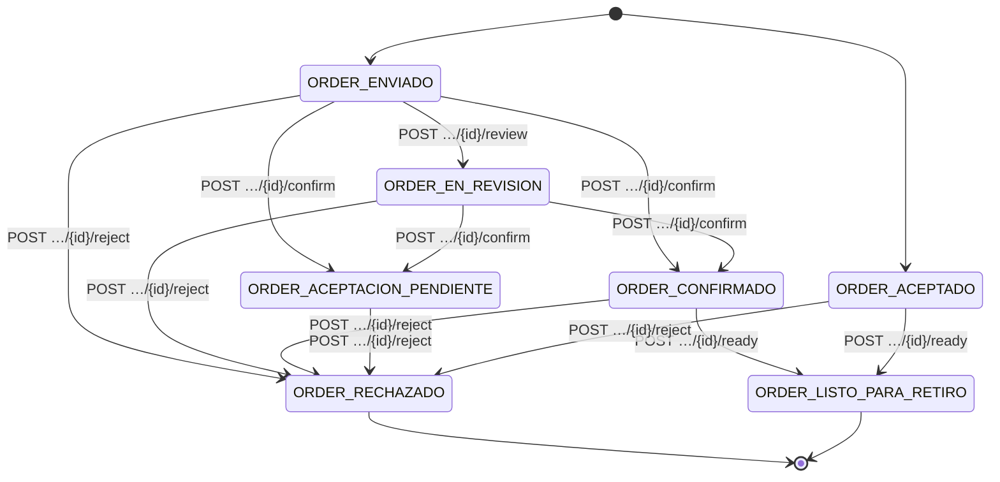

**Operaciones que ejercen esta máquina** _(POR_REFERENCIA: el handler alcanza un método que valida contra la tabla; «sin destino nombrado» significa que el estado de destino llega por el cuerpo de la petición)_:

| Operación | Estados de destino que nombra | A través de |
|---|---|---|
| POST /pharmacy/orders/{id}/confirm | ORDER_ACEPTACION_PENDIENTE, ORDER_CONFIRMADO | PharmacyOrdersUseCases.confirm → PharmacyOrdersUseCases.assertStaffTransition |
| POST /pharmacy/orders/{id}/ready | ORDER_LISTO_PARA_RETIRO | PharmacyOrdersUseCases.ready → PharmacyOrdersUseCases.assertStaffTransition |
| POST /pharmacy/orders/{id}/reject | ORDER_RECHAZADO | PharmacyOrdersUseCases.reject → PharmacyOrdersUseCases.assertStaffTransition |
| POST /pharmacy/orders/{id}/review | ORDER_EN_REVISION | PharmacyOrdersUseCases.openReview → PharmacyOrdersUseCases.assertStaffTransition |

## Árbol de decisión por operación

Cada árbol se deriva del código del handler y de los métodos que invoca (hasta 4 niveles). Una rama que no decide, no escribe y no falla se poda. Los accesos y los efectos consecutivos se agrupan en un solo nodo.

### Operaciones con decisiones propias

#### 1. POST /internal/inventory-sync-batches

Ingerir un lote de sincronización ERP

| HTTP | Código | Cuándo |
|---|---|---|
| 201 | — | Éxito |
| 400 | `VALIDATION_FAILED` | El cuerpo cumple el DTO (sin propiedades extra) |
| 401 | `UNAUTHENTICATED` | Hay una sesión válida (JWT) |
| 403 | `FORBIDDEN` | El rol está permitido; El tenant se resuelve y pertenece al actor |
| 429 | `RATE_LIMITED` | No se supera el límite de solicitudes |

```mermaid
flowchart TD
  n1(("Solicitud")):::inicio
  n2{{"Acceso: sesión (401) · rol (403) · tenant (403) · cuerpo válido (400) · límite de tasa (429)"}}:::acceso
  n1 --> n2
  n3["Llama a InventorySyncService.createBatch"]:::llamada
  n2 --> n3
  n4["Llama a CreateInventorySyncBatchUseCase.execute"]:::llamada
  n3 --> n4
  n5["Transacción: transactional(…)"]:::transaccion
  n4 --> n5
  n6["Llama a PharmacyInventoryScopePolicy.requireManagedConnection"]:::llamada
  n5 --> n6
  n7["Llama a InventoryScopeRepository.findConnection"]:::llamada
  n6 --> n7
  n8[("LEE pharmacy.pharmacy_integration_connections")]:::efecto
  n7 --> n8
  n9{"!connection"}:::decision
  n8 --> n9
  n10(["↩ (relanza el error capturado)"]):::error
  n9 -->|"sí"| n10
  n11["Repite: por cada const item de dto.items"]:::bucle
  n9 -->|"no"| n11
  n12{"item.pharmacyProductId !== undefined"}:::decision
  n11 -->|"cada elemento"| n12
  n13["Llama a PharmacyInventoryScopePolicy.requireProduct"]:::llamada
  n12 -->|"sí"| n13
  n14["Llama a InventoryScopeRepository.findProductInPharmacy"]:::llamada
  n13 --> n14
  n15[("LEE pharmacy.pharmacy_products")]:::efecto
  n14 --> n15
  n16{"!product"}:::decision
  n15 --> n16
  n17(["↩ (relanza el error capturado)"]):::error
  n16 -->|"sí"| n17
  n18["Llama a SyncRepository.createBatch"]:::llamada
  n16 -->|"no"| n18
  n12 -->|"no"| n18
  n11 -->|"al terminar"| n18
  n19[("CREA pharmacy_inventory.pharmacy_inventory_sync_batches")]:::efecto
  n18 --> n19
  n20["Repite: por cada const item de dto.items"]:::bucle
  n19 --> n20
  n21{"item.idempotencyKey"}:::decision
  n20 -->|"cada elemento"| n21
  n22["Llama a SyncRepository.findItemByIdempotencyKey"]:::llamada
  n21 -->|"sí"| n22
  n23[("LEE pharmacy_inventory.pharmacy_inventory_sync_items")]:::efecto
  n22 --> n23
  n24{"existing"}:::decision
  n23 --> n24
  n25["Llama a SyncRepository.findBatchById"]:::llamada
  n24 -->|"sí"| n25
  n26[("LEE pharmacy_inventory.pharmacy_inventory_sync_batches")]:::efecto
  n25 --> n26
  n27{"!existingBatch"}:::decision
  n26 --> n27
  n28(["↩ (relanza el error capturado)"]):::error
  n27 -->|"sí"| n28
  n29["Llama a PharmacyInventoryScopePolicy.requireManagedConnection"]:::llamada
  n27 -->|"no"| n29
  n30["Llama a InventoryScopeRepository.findConnection"]:::llamada
  n29 --> n30
  n31[("LEE pharmacy.pharmacy_integration_connections")]:::efecto
  n30 --> n31
  n32{"!connection"}:::decision
  n31 --> n32
  n33(["↩ (relanza el error capturado)"]):::error
  n32 -->|"sí"| n33
  n34{"owner.pharmacyId !== pharmacy.pharmacyId"}:::decision
  n32 -->|"no"| n34
  n35(["↩ (relanza el error capturado)"]):::error
  n34 -->|"sí"| n35
  n36["Llama a SyncRepository.createItem"]:::llamada
  n34 -->|"no"| n36
  n24 -->|"no"| n36
  n21 -->|"no"| n36
  n37[("CREA pharmacy_inventory.pharmacy_inventory_sync_items")]:::efecto
  n36 --> n37
  n38(("201 Responde con éxito")):::ok
  n37 --> n38
  n20 -->|"al terminar"| n38
  classDef acceso fill:#eef,stroke:#66a
  classDef error fill:#fee,stroke:#c33
  classDef ok fill:#efe,stroke:#3a3
  classDef efecto fill:#ffd,stroke:#aa3
  classDef decision fill:#fff,stroke:#555
  classDef corte fill:#eee,stroke:#999,stroke-dasharray: 4
```

#### 2. POST /internal/inventory-sync/{batchId}/reconcile

Conciliar lote de sincronización externa (UC-25-12)

| HTTP | Código | Cuándo |
|---|---|---|
| 200 | — | Éxito |
| 400 | `VALIDATION_FAILED` | Los parámetros de ruta son UUID válidos |
| 401 | `UNAUTHENTICATED` | Hay una sesión válida (JWT) |
| 403 | `FORBIDDEN` | El rol está permitido; El tenant se resuelve y pertenece al actor |
| 422 | `PRECONDITION_FAILED` | PreconditionFailedException: El lote no está en estado reconciliable |
| 429 | `RATE_LIMITED` | No se supera el límite de solicitudes |

```mermaid
flowchart TD
  n1(("Solicitud")):::inicio
  n2{{"Acceso: sesión (401) · rol (403) · tenant (403) · parámetros de ruta (400) · límite de tasa (429)"}}:::acceso
  n1 --> n2
  n3["Llama a InventorySyncService.reconcile"]:::llamada
  n2 --> n3
  n4["Llama a ReconcileInventorySyncBatchUseCase.execute"]:::llamada
  n3 --> n4
  n5["Transacción: transactional(…)"]:::transaccion
  n4 --> n5
  n6["Llama a SyncRepository.findBatchById"]:::llamada
  n5 --> n6
  n7[("LEE pharmacy_inventory.pharmacy_inventory_sync_batches")]:::efecto
  n6 --> n7
  n8{"!batch"}:::decision
  n7 --> n8
  n9(["↩ (relanza el error capturado)"]):::error
  n8 -->|"sí"| n9
  n10["Llama a PharmacyInventoryScopePolicy.requireManagedConnection"]:::llamada
  n8 -->|"no"| n10
  n11["Llama a InventoryScopeRepository.findConnection"]:::llamada
  n10 --> n11
  n12[("LEE pharmacy.pharmacy_integration_connections")]:::efecto
  n11 --> n12
  n13{"!connection"}:::decision
  n12 --> n13
  n14(["↩ (relanza el error capturado)"]):::error
  n13 -->|"sí"| n14
  n15{"batch.statusConceptId !== PINV.BATCH_RECEIVED"}:::decision
  n13 -->|"no"| n15
  n16(["422 PRECONDITION_FAILED El lote no está en estado reconciliable"]):::error
  n15 -->|"sí"| n16
  n17["Llama a SyncRepository.findItems"]:::llamada
  n15 -->|"no"| n17
  n18[("LEE pharmacy_inventory.pharmacy_inventory_sync_items")]:::efecto
  n17 --> n18
  n19["Repite: por cada const item de items"]:::bucle
  n18 --> n19
  n20[("ACTUALIZA pharmacy_inventory.pharmacy_inventory_sync_items")]:::efecto
  n19 -->|"cada elemento"| n20
  n21{"result.normalizedQuantity !== undefined"}:::decision
  n20 --> n21
  n22[("ACTUALIZA pharmacy_inventory.pharmacy_inventory_sync_items")]:::efecto
  n21 -->|"sí"| n22
  n23{"result.errorCode !== undefined"}:::decision
  n22 --> n23
  n21 -->|"no"| n23
  n24[("ACTUALIZA pharmacy_inventory.pharmacy_inventory_sync_items · ACTUALIZA pharmacy_inventory.pharmacy_inventory_…")]:::efecto
  n23 -->|"sí"| n24
  n25[("ACTUALIZA pharmacy_inventory.pharmacy_inventory_sync_batches · ACTUALIZA pharmacy_inventory.pharmacy_inventor…")]:::efecto
  n24 --> n25
  n23 -->|"no"| n25
  n19 -->|"al terminar"| n25
  n26(("200 Responde con éxito")):::ok
  n25 --> n26
  classDef acceso fill:#eef,stroke:#66a
  classDef error fill:#fee,stroke:#c33
  classDef ok fill:#efe,stroke:#3a3
  classDef efecto fill:#ffd,stroke:#aa3
  classDef decision fill:#fff,stroke:#555
  classDef corte fill:#eee,stroke:#999,stroke-dasharray: 4
```

#### 3. POST /internal/reservations/expire

Liberar reservas y pedidos vencidos (UC-25-05)

| HTTP | Código | Cuándo |
|---|---|---|
| 200 | — | Éxito |
| 401 | `UNAUTHENTICATED` | Hay una sesión válida (JWT) |
| 403 | `FORBIDDEN` | El rol está permitido; El tenant se resuelve y pertenece al actor |
| 429 | `RATE_LIMITED` | No se supera el límite de solicitudes |

```mermaid
flowchart TD
  n1(("Solicitud")):::inicio
  n2{{"Acceso: sesión (401) · rol (403) · tenant (403) · límite de tasa (429)"}}:::acceso
  n1 --> n2
  n3["Llama a InventoryReservationsService.expire"]:::llamada
  n2 --> n3
  n4["Llama a ExpireInventoryReservationsUseCase.execute"]:::llamada
  n3 --> n4
  n5["Transacción: transactional(…)"]:::transaccion
  n4 --> n5
  n6["Llama a ReservationsRepository.findExpired"]:::llamada
  n5 --> n6
  n7[("LEE pharmacy_inventory.inventory_reservations")]:::efecto
  n6 --> n7
  n8["Repite: por cada const reservation de expired"]:::bucle
  n7 --> n8
  n9[("ACTUALIZA pharmacy_inventory.inventory_reservations · ACTUALIZA pharmacy_inventory.inventory_reservations")]:::efecto
  n8 -->|"cada elemento"| n9
  n10["Llama a ReleaseConfirmedReservationLinesUseCase.execute"]:::llamada
  n9 --> n10
  n11["Llama a ReservationsRepository.findLinesByReservation"]:::llamada
  n10 --> n11
  n12[("LEE pharmacy_inventory.inventory_reservation_lines")]:::efecto
  n11 --> n12
  n13["Repite: por cada const line de lines"]:::bucle
  n12 --> n13
  n14[("ACTUALIZA pharmacy_inventory.inventory_reservation_lines")]:::efecto
  n13 -->|"cada elemento"| n14
  n15{"line.inventoryLocationId"}:::decision
  n14 --> n15
  n16["Llama a StockPositionsRepository.findByKeyForUpdate"]:::llamada
  n15 -->|"sí"| n16
  n17[("LEE pharmacy_inventory.inventory_stock_positions")]:::efecto
  n16 --> n17
  n18["Llama a LedgerRepository.nextSequence"]:::llamada
  n17 --> n18
  n19[("LEE pharmacy_inventory.inventory_ledger_entries")]:::efecto
  n18 --> n19
  n20["Llama a LedgerRepository.append"]:::llamada
  n19 --> n20
  n21[("CREA pharmacy_inventory.inventory_ledger_entries")]:::efecto
  n20 --> n21
  n22{"position"}:::decision
  n21 --> n22
  n23[("ACTUALIZA pharmacy_inventory.inventory_stock_positions · ACTUALIZA pharmacy_inventory.inventory_stock_positio…")]:::efecto
  n22 -->|"sí"| n23
  n24["Llama a PharmacyOrdersService.expireDue"]:::llamada
  n23 --> n24
  n22 -->|"no"| n24
  n15 -->|"no"| n24
  n13 -->|"al terminar"| n24
  n8 -->|"al terminar"| n24
  n25["Llama a PharmacyOrdersUseCases.expireDue"]:::llamada
  n24 --> n25
  n26["Transacción: transactional(…)"]:::transaccion
  n25 --> n26
  n27["Llama a PharmacyOrdersRepository.findDueOrdersForUpdate"]:::llamada
  n26 --> n27
  n28[("LEE pharmacy_inventory.inventory_reservations")]:::efecto
  n27 --> n28
  n29["Llama a PharmacyOrdersRepository.findPharmaciesByIds"]:::llamada
  n28 --> n29
  n30[("LEE pharmacy.pharmacies")]:::efecto
  n29 --> n30
  n31["Repite: por cada const order de due"]:::bucle
  n30 --> n31
  n32[("ACTUALIZA pharmacy_inventory.inventory_reservations · ACTUALIZA pharmacy_inventory.inventory_reservations")]:::efecto
  n31 -->|"cada elemento"| n32
  n33["Llama a InventoryReservationsService.releaseConfirmedLines"]:::llamada
  n32 --> n33
  n34["Llama a ReleaseConfirmedReservationLinesUseCase.execute"]:::llamada
  n33 --> n34
  n35["Repite: por cada const line de lines"]:::bucle
  n34 --> n35
  n36[("ACTUALIZA pharmacy_inventory.inventory_reservation_lines")]:::efecto
  n35 -->|"cada elemento"| n36
  n37{"line.inventoryLocationId"}:::decision
  n36 --> n37
  n38{"position"}:::decision
  n37 -->|"sí"| n38
  n39[("ACTUALIZA pharmacy_inventory.inventory_stock_positions · ACTUALIZA pharmacy_inventory.inventory_stock_positio…")]:::efecto
  n38 -->|"sí"| n39
  n40["Llama a MessagingDomainEventAdapter.publish"]:::llamada
  n39 --> n40
  n38 -->|"no"| n40
  n37 -->|"no"| n40
  n35 -->|"al terminar"| n40
  n41>"Evento ~null"]:::evento
  n40 --> n41
  n42["Repite: por cada const notice de expired"]:::bucle
  n41 --> n42
  n31 -->|"al terminar"| n42
  n43{"notice.medicationRequestId"}:::decision
  n42 -->|"cada elemento"| n43
  n44["Llama a PharmacyOrdersRepository.findPrescriberProfileId"]:::llamada
  n43 -->|"sí"| n44
  n45[("LEE clinical.medication_requests")]:::efecto
  n44 --> n45
  n46(("200 Responde con éxito")):::ok
  n45 --> n46
  n43 -->|"no"| n46
  n42 -->|"al terminar"| n46
  classDef acceso fill:#eef,stroke:#66a
  classDef error fill:#fee,stroke:#c33
  classDef ok fill:#efe,stroke:#3a3
  classDef efecto fill:#ffd,stroke:#aa3
  classDef decision fill:#fff,stroke:#555
  classDef corte fill:#eee,stroke:#999,stroke-dasharray: 4
```

#### 4. PUT /pharmacies/{pharmacyId}/sites/{siteId}/products/{productId}/availability

«Lo tengo / No lo tengo» de un producto en una sede.

| HTTP | Código | Cuándo |
|---|---|---|
| 200 | — | Éxito |
| 400 | `VALIDATION_FAILED` | Los parámetros de ruta son UUID válidos |
| 401 | `UNAUTHENTICATED` | Hay una sesión válida (JWT) |
| 403 | `FORBIDDEN` | El rol está permitido; El tenant se resuelve y pertenece al actor |
| 429 | `RATE_LIMITED` | No se supera el límite de solicitudes |
| 500 | `INTERNAL` | DomainException: {HttpStatus.BAD_REQUEST} |

```mermaid
flowchart TD
  n1(("Solicitud")):::inicio
  n2{{"Acceso: sesión (401) · rol (403) · tenant (403) · parámetros de ruta (400) · límite de tasa (429)"}}:::acceso
  n1 --> n2
  n3["Llama a SetSiteProductAvailabilityUseCase.execute"]:::llamada
  n2 --> n3
  n4{"dto.available && dto.quantity === 0"}:::decision
  n3 --> n4
  n5(["500 INTERNAL {HttpStatus.BAD_REQUEST}"]):::error
  n4 -->|"sí"| n5
  n6["Transacción: transactional(…)"]:::transaccion
  n4 -->|"no"| n6
  n7["Llama a PharmacyInventoryScopePolicy.requireManagedPharmacy"]:::llamada
  n6 --> n7
  n8["Llama a InventoryScopeRepository.findPharmacyInTenant"]:::llamada
  n7 --> n8
  n9[("LEE pharmacy.pharmacies")]:::efecto
  n8 --> n9
  n10["Llama a PharmacyInventoryScopePolicy.requireSite"]:::llamada
  n9 --> n10
  n11["Llama a InventoryScopeRepository.findSiteInPharmacy"]:::llamada
  n10 --> n11
  n12[("LEE pharmacy.pharmacy_sites")]:::efecto
  n11 --> n12
  n13{"!site"}:::decision
  n12 --> n13
  n14(["↩ (relanza el error capturado)"]):::error
  n13 -->|"sí"| n14
  n15["Llama a InventoryScopeRepository.findProductInPharmacy"]:::llamada
  n13 -->|"no"| n15
  n16[("LEE pharmacy.pharmacy_products")]:::efecto
  n15 --> n16
  n17{"!product"}:::decision
  n16 --> n17
  n18(["↩ (relanza el error capturado)"]):::error
  n17 -->|"sí"| n18
  n19{"product.statusConceptId !== PHARM.PRODUCT_ACTIVE"}:::decision
  n17 -->|"no"| n19
  n20(["↩ (relanza el error capturado)"]):::error
  n19 -->|"sí"| n20
  n21{"dto.available && product.outOfStockDeclared"}:::decision
  n19 -->|"no"| n21
  n22(["↩ (relanza el error capturado)"]):::error
  n21 -->|"sí"| n22
  n23["Llama a StockPositionsRepository.countLotPositionsInSite"]:::llamada
  n21 -->|"no"| n23
  n24[("LEE pharmacy_inventory.inventory_locations · LEE pharmacy_inventory.inventory_stock_positions")]:::efecto
  n23 --> n24
  n25{"lotPositions › 0"}:::decision
  n24 --> n25
  n26(["↩ (relanza el error capturado)"]):::error
  n25 -->|"sí"| n26
  n27["Llama a SiteStockWriter.write"]:::llamada
  n25 -->|"no"| n27
  n28["Llama a SiteStockWriter.defaultLocationId"]:::llamada
  n27 --> n28
  n29["Llama a LocationsRepository.findFirstActiveInSite"]:::llamada
  n28 --> n29
  n30[("LEE pharmacy_inventory.inventory_locations")]:::efecto
  n29 --> n30
  n31["Llama a LocationsRepository.create"]:::llamada
  n30 --> n31
  n32[("CREA pharmacy_inventory.inventory_locations")]:::efecto
  n31 --> n32
  n33["Llama a StockPositionsRepository.findProductsWithoutPositionInSite"]:::llamada
  n32 --> n33
  n34[("LEE pharmacy.pharmacy_products · LEE pharmacy_inventory.inventory_locations · LEE pharmacy_inventory.inventor…")]:::efecto
  n33 --> n34
  n35["Repite: por cada const product de missing"]:::bucle
  n34 --> n35
  n36{"quantity !== 0"}:::decision
  n35 -->|"cada elemento"| n36
  n37["Llama a SiteStockWriter.append"]:::llamada
  n36 -->|"sí"| n37
  n38["Llama a LedgerRepository.append"]:::llamada
  n37 --> n38
  n39[("CREA pharmacy_inventory.inventory_ledger_entries")]:::efecto
  n38 --> n39
  n40["Llama a StockPositionsRepository.create"]:::llamada
  n39 --> n40
  n36 -->|"no"| n40
  n41[("CREA pharmacy_inventory.inventory_stock_positions")]:::efecto
  n40 --> n41
  n42["Repite: por cada const target de targets"]:::bucle
  n41 --> n42
  n35 -->|"al terminar"| n42
  n43["Llama a StockPositionsRepository.findByKeyForUpdate"]:::llamada
  n42 -->|"cada elemento"| n43
  n44[("LEE pharmacy_inventory.inventory_stock_positions")]:::efecto
  n43 --> n44
  n45["Llama a StockPositionsRepository.create"]:::llamada
  n44 --> n45
  n46[("CREA pharmacy_inventory.inventory_stock_positions")]:::efecto
  n45 --> n46
  n47{"delta !== 0"}:::decision
  n46 --> n47
  n48["Llama a SiteStockWriter.append"]:::llamada
  n47 -->|"sí"| n48
  n49["Llama a LedgerRepository.append"]:::llamada
  n48 --> n49
  n50[("CREA pharmacy_inventory.inventory_ledger_entries")]:::efecto
  n49 --> n50
  n51(("200 Responde con éxito")):::ok
  n50 --> n51
  n47 -->|"no"| n51
  n42 -->|"al terminar"| n51
  classDef acceso fill:#eef,stroke:#66a
  classDef error fill:#fee,stroke:#c33
  classDef ok fill:#efe,stroke:#3a3
  classDef efecto fill:#ffd,stroke:#aa3
  classDef decision fill:#fff,stroke:#555
  classDef corte fill:#eee,stroke:#999,stroke-dasharray: 4
```

#### 5. GET /pharmacy-inventory/availability

Consultar qué sedes pueden surtir un conjunto de productos

| HTTP | Código | Cuándo |
|---|---|---|
| 200 | — | Éxito |
| 400 | `VALIDATION_FAILED` | Están los parámetros de consulta obligatorios; BadRequestException: products es obligatorio: la disponibilidad se consulta para un pedido concreto |
| 401 | `UNAUTHENTICATED` | Hay una sesión válida (JWT) |
| 403 | `FORBIDDEN` | El rol está permitido; El tenant se resuelve y pertenece al actor |
| 429 | `RATE_LIMITED` | No se supera el límite de solicitudes |

```mermaid
flowchart TD
  n1(("Solicitud")):::inicio
  n2{{"Acceso: sesión (401) · rol (403) · tenant (403) · parámetros de consulta (400) · límite de tasa (429)"}}:::acceso
  n1 --> n2
  n3{"!productIds"}:::decision
  n2 --> n3
  n4(["400 VALIDATION_FAILED products es obligatorio: la disponibilidad se consulta para un pedido concreto"]):::error
  n3 -->|"sí"| n4
  n5["Llama a PharmacyInventoryReadService.availability"]:::llamada
  n3 -->|"no"| n5
  n6["Llama a ReadPharmacyInventoryUseCase.availability"]:::llamada
  n5 --> n6
  n7["Llama a PharmacyDirectoryAdapter.findVisibleByTenant"]:::llamada
  n6 --> n7
  n8["Llama a PharmacyReadRepository.findVisibleByTenant"]:::llamada
  n7 --> n8
  n9[("LEE pharmacy.pharmacies")]:::efecto
  n8 --> n9
  n10["Llama a PharmacyDirectoryAdapter.findSellableProductsByIds"]:::llamada
  n9 --> n10
  n11["Llama a PharmacyReadRepository.findSellableProductsByIds"]:::llamada
  n10 --> n11
  n12[("LEE pharmacy.pharmacy_products")]:::efecto
  n11 --> n12
  n13["Llama a PharmacyDirectoryAdapter.findActiveSites"]:::llamada
  n12 --> n13
  n14["Llama a PharmacyReadRepository.findActiveSites"]:::llamada
  n13 --> n14
  n15[("LEE pharmacy.pharmacy_sites")]:::efecto
  n14 --> n15
  n16["Llama a InventoryReadRepository.findActiveLocationsBySites"]:::llamada
  n15 --> n16
  n17[("LEE pharmacy_inventory.inventory_locations")]:::efecto
  n16 --> n17
  n18["Llama a PharmacyDirectoryAdapter.findCurrentPublicPriceLists"]:::llamada
  n17 --> n18
  n19["Llama a PharmacyReadRepository.findCurrentPublicPriceLists"]:::llamada
  n18 --> n19
  n20[("LEE pharmacy.pharmacy_price_lists")]:::efecto
  n19 --> n20
  n21["Llama a InventoryReadRepository.findStockPositions"]:::llamada
  n20 --> n21
  n22[("LEE pharmacy_inventory.inventory_stock_positions")]:::efecto
  n21 --> n22
  n23["Llama a PharmacyDirectoryAdapter.findCurrentPrices"]:::llamada
  n22 --> n23
  n24["Llama a PharmacyReadRepository.findCurrentPrices"]:::llamada
  n23 --> n24
  n25[("LEE pharmacy.pharmacy_product_prices")]:::efecto
  n24 --> n25
  n26["Llama a PharmacyDirectoryAdapter.findConcepts"]:::llamada
  n25 --> n26
  n27["Llama a PharmacyReadRepository.findConcepts"]:::llamada
  n26 --> n27
  n28[("LEE terminology.catalog_concepts")]:::efecto
  n27 --> n28
  n29(("200 Responde con éxito")):::ok
  n28 --> n29
  classDef acceso fill:#eef,stroke:#66a
  classDef error fill:#fee,stroke:#c33
  classDef ok fill:#efe,stroke:#3a3
  classDef efecto fill:#ffd,stroke:#aa3
  classDef decision fill:#fff,stroke:#555
  classDef corte fill:#eee,stroke:#999,stroke-dasharray: 4
```

#### 6. GET /pharmacy-inventory/sites/{siteId}/stock

Consultar el stock disponible de una sede

| HTTP | Código | Cuándo |
|---|---|---|
| 200 | — | Éxito |
| 400 | `VALIDATION_FAILED` | Los parámetros de ruta son UUID válidos |
| 401 | `UNAUTHENTICATED` | Hay una sesión válida (JWT) |
| 403 | `FORBIDDEN` | El rol está permitido; El tenant se resuelve y pertenece al actor |
| 404 | `NOT_FOUND` | ResourceNotFoundException: Sede de farmacia no encontrada |
| 429 | `RATE_LIMITED` | No se supera el límite de solicitudes |

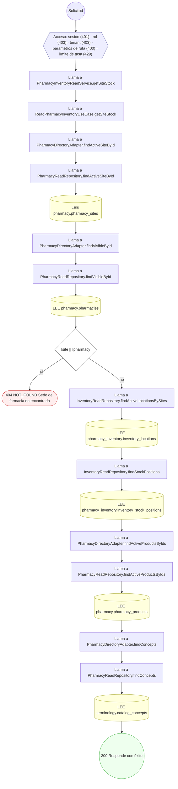

#### 7. POST /pharmacy/{pharmacyId}/dispensations

Dispensar una prescripción a un paciente (UC-25-03)

| HTTP | Código | Cuándo |
|---|---|---|
| 201 | — | Éxito |
| 400 | `VALIDATION_FAILED` | Los parámetros de ruta son UUID válidos; El cuerpo cumple el DTO (sin propiedades extra) |
| 401 | `UNAUTHENTICATED` | Hay una sesión válida (JWT) |
| 403 | `FORBIDDEN` | El rol está permitido; El tenant se resuelve y pertenece al actor |
| 422 | `PRECONDITION_FAILED` | PreconditionFailedException: La reserva es un pedido de paciente: se dispensa con su código de retiro por POST /pharmacy/orders/:id/dispense; PreconditionFailedException: Stock insuficiente para dispensar |
| 429 | `RATE_LIMITED` | No se supera el límite de solicitudes |

```mermaid
flowchart TD
  n1(("Solicitud")):::inicio
  n2{{"Acceso: sesión (401) · rol (403) · tenant (403) · parámetros de ruta (400) · cuerpo válido (400) · límite de…"}}:::acceso
  n1 --> n2
  n3["Llama a MedicationDispensationsService.dispense"]:::llamada
  n2 --> n3
  n4["Llama a DispenseMedicationUseCase.execute"]:::llamada
  n3 --> n4
  n5["Transacción: transactional(…)"]:::transaccion
  n4 --> n5
  n6["Llama a PharmacyInventoryScopePolicy.requireManagedPharmacy"]:::llamada
  n5 --> n6
  n7["Llama a InventoryScopeRepository.findPharmacyInTenant"]:::llamada
  n6 --> n7
  n8[("LEE pharmacy.pharmacies")]:::efecto
  n7 --> n8
  n9{"dto.idempotencyKey"}:::decision
  n8 --> n9
  n10["Llama a DispensationsRepository.findByIdempotencyKey"]:::llamada
  n9 -->|"sí"| n10
  n11[("LEE pharmacy_inventory.medication_dispensations")]:::efecto
  n10 --> n11
  n12{"existing"}:::decision
  n11 --> n12
  n13["Llama a DispensationsRepository.findLines"]:::llamada
  n12 -->|"sí"| n13
  n14[("LEE pharmacy_inventory.medication_dispensation_lines")]:::efecto
  n13 --> n14
  n15["Llama a LedgerRepository.findEntryIdsBySource"]:::llamada
  n14 --> n15
  n16[("LEE pharmacy_inventory.inventory_ledger_entries")]:::efecto
  n15 --> n16
  n17["Llama a PharmacyInventoryScopePolicy.requireSite"]:::llamada
  n16 --> n17
  n12 -->|"no"| n17
  n9 -->|"no"| n17
  n18["Llama a InventoryScopeRepository.findSiteInPharmacy"]:::llamada
  n17 --> n18
  n19[("LEE pharmacy.pharmacy_sites")]:::efecto
  n18 --> n19
  n20{"!site"}:::decision
  n19 --> n20
  n21(["↩ (relanza el error capturado)"]):::error
  n20 -->|"sí"| n21
  n22["Llama a PharmacyInventoryScopePolicy.requirePatientContext"]:::llamada
  n20 -->|"no"| n22
  n23{"patientProfileId !== undefined"}:::decision
  n22 --> n23
  n24["Llama a InventoryScopeRepository.patientExists"]:::llamada
  n23 -->|"sí"| n24
  n25[("LEE profiles.patient_profiles")]:::efecto
  n24 --> n25
  n26["Llama a InventoryScopeRepository.patientServedByPharmacy"]:::llamada
  n25 --> n26
  n27[("LEE clinical.medication_requests · LEE pharmacy_inventory.inventory_reservations")]:::efecto
  n26 --> n27
  n28{"!served"}:::decision
  n27 --> n28
  n29(["↩ (relanza el error capturado)"]):::error
  n28 -->|"sí"| n29
  n30{"medicationRequestId !== undefined"}:::decision
  n28 -->|"no"| n30
  n23 -->|"no"| n30
  n31["Llama a InventoryScopeRepository.medicationRequestBelongsToPatient"]:::llamada
  n30 -->|"sí"| n31
  n32[("LEE clinical.medication_requests")]:::efecto
  n31 --> n32
  n33["Llama a InventoryScopeRepository.medicationRequestServedByPharmacy"]:::llamada
  n32 --> n33
  n34[("LEE clinical.medication_requests · LEE pharmacy_inventory.inventory_reservations")]:::efecto
  n33 --> n34
  n35{"!owned"}:::decision
  n34 --> n35
  n36(["↩ (relanza el error capturado)"]):::error
  n35 -->|"sí"| n36
  n37["Repite: por cada const line de dto.lines"]:::bucle
  n35 -->|"no"| n37
  n30 -->|"no"| n37
  n38["Llama a PharmacyInventoryScopePolicy.requireStockKey"]:::llamada
  n37 -->|"cada elemento"| n38
  n39["Llama a PharmacyInventoryScopePolicy.requireLocation"]:::llamada
  n38 --> n39
  n40{"!location"}:::decision
  n39 --> n40
  n41(["↩ (relanza el error capturado)"]):::error
  n40 -->|"sí"| n41
  n42["Llama a PharmacyInventoryScopePolicy.requireProduct"]:::llamada
  n40 -->|"no"| n42
  n43{"!product"}:::decision
  n42 --> n43
  n44(["↩ (relanza el error capturado)"]):::error
  n43 -->|"sí"| n44
  n45["Llama a PharmacyInventoryScopePolicy.requireLot"]:::llamada
  n43 -->|"no"| n45
  n46{"!lot || lot.pharmacyProductId !== productId"}:::decision
  n45 --> n46
  n47(["↩ (relanza el error capturado)"]):::error
  n46 -->|"sí"| n47
  n48{"dto.inventoryReservationId"}:::decision
  n46 -->|"no"| n48
  n37 -->|"al terminar"| n48
  n49["Llama a ReservationsRepository.findById"]:::llamada
  n48 -->|"sí"| n49
  n50[("LEE pharmacy_inventory.inventory_reservations")]:::efecto
  n49 --> n50
  n51{"!reservation || reservation.pharmacyId !== pharmacy.pharmacyId || reservation.pharmacySiteId !== site.siteId"}:::decision
  n50 --> n51
  n52(["↩ (relanza el error capturado)"]):::error
  n51 -->|"sí"| n52
  n53{"ORDER_STATUS_IDS.includes(reservation.reservationStatusConceptId)"}:::decision
  n51 -->|"no"| n53
  n54(["422 PRECONDITION_FAILED La reserva es un pedido de paciente: se dispensa con su código de retiro por POST /ph…"]):::error
  n53 -->|"sí"| n54
  n55["Llama a DispensationsRepository.create"]:::llamada
  n53 -->|"no"| n55
  n48 -->|"no"| n55
  n56[("CREA pharmacy_inventory.medication_dispensations")]:::efecto
  n55 --> n56
  n57["Repite: por cada const line de dto.lines"]:::bucle
  n56 --> n57
  n58["Llama a StockPositionsRepository.findByKeyForUpdate"]:::llamada
  n57 -->|"cada elemento"| n58
  n59[("LEE pharmacy_inventory.inventory_stock_positions")]:::efecto
  n58 --> n59
  n60{"!position || num(position.onHandQuantity) ‹ line.dispensedQuantity"}:::decision
  n59 --> n60
  n61(["422 PRECONDITION_FAILED Stock insuficiente para dispensar"]):::error
  n60 -->|"sí"| n61
  n62["Llama a DispensationsRepository.createLine"]:::llamada
  n60 -->|"no"| n62
  n63[("CREA pharmacy_inventory.medication_dispensation_lines")]:::efecto
  n62 --> n63
  n64["Llama a LedgerRepository.nextSequence"]:::llamada
  n63 --> n64
  n65[("LEE pharmacy_inventory.inventory_ledger_entries")]:::efecto
  n64 --> n65
  n66["Llama a LedgerRepository.append"]:::llamada
  n65 --> n66
  n67[("CREA pharmacy_inventory.inventory_ledger_entries")]:::efecto
  n66 --> n67
  n68[("ACTUALIZA pharmacy_inventory.inventory_stock_positions")]:::efecto
  n67 --> n68
  n69{"dto.inventoryReservationId && num(position.reservedQuantity) ›= line.dispensedQuantity"}:::decision
  n68 --> n69
  n70[("ACTUALIZA pharmacy_inventory.inventory_stock_positions")]:::efecto
  n69 -->|"sí"| n70
  n71["… el resto del árbol (3 nodos) está en el JSON del inventario"]:::corte
  n70 --> n71
  n69 -->|"no"| n71
  classDef acceso fill:#eef,stroke:#66a
  classDef error fill:#fee,stroke:#c33
  classDef ok fill:#efe,stroke:#3a3
  classDef efecto fill:#ffd,stroke:#aa3
  classDef decision fill:#fff,stroke:#555
  classDef corte fill:#eee,stroke:#999,stroke-dasharray: 4
```

#### 8. POST /pharmacy/{pharmacyId}/goods-receipts

Recepcionar mercancía por lote (UC-25-02)

| HTTP | Código | Cuándo |
|---|---|---|
| 201 | — | Éxito |
| 400 | `VALIDATION_FAILED` | Los parámetros de ruta son UUID válidos; El cuerpo cumple el DTO (sin propiedades extra) |
| 401 | `UNAUTHENTICATED` | Hay una sesión válida (JWT) |
| 403 | `FORBIDDEN` | El rol está permitido; El tenant se resuelve y pertenece al actor |
| 422 | `PRECONDITION_FAILED` | PreconditionFailedException: La orden no admite recepción |
| 429 | `RATE_LIMITED` | No se supera el límite de solicitudes |

```mermaid
flowchart TD
  n1(("Solicitud")):::inicio
  n2{{"Acceso: sesión (401) · rol (403) · tenant (403) · parámetros de ruta (400) · cuerpo válido (400) · límite de…"}}:::acceso
  n1 --> n2
  n3["Llama a PharmacyProcurementService.receiveGoods"]:::llamada
  n2 --> n3
  n4["Llama a PharmacyProcurementUseCases.receiveGoods"]:::llamada
  n3 --> n4
  n5["Transacción: transactional(…)"]:::transaccion
  n4 --> n5
  n6["Llama a PharmacyInventoryScopePolicy.requireManagedPharmacy"]:::llamada
  n5 --> n6
  n7["Llama a InventoryScopeRepository.findPharmacyInTenant"]:::llamada
  n6 --> n7
  n8[("LEE pharmacy.pharmacies")]:::efecto
  n7 --> n8
  n9{"dto.idempotencyKey"}:::decision
  n8 --> n9
  n10["Llama a GoodsReceiptsRepository.findByIdempotencyKey"]:::llamada
  n9 -->|"sí"| n10
  n11[("LEE pharmacy_inventory.pharmacy_goods_receipts")]:::efecto
  n10 --> n11
  n12{"existing"}:::decision
  n11 --> n12
  n13["Llama a PurchaseOrdersRepository.findById"]:::llamada
  n12 -->|"sí"| n13
  n14[("LEE pharmacy_inventory.pharmacy_purchase_orders")]:::efecto
  n13 --> n14
  n15{"existingOrder?.pharmacyId !== pharmacy.pharmacyId"}:::decision
  n14 --> n15
  n16(["↩ (relanza el error capturado)"]):::error
  n15 -->|"sí"| n16
  n17["Llama a GoodsReceiptsRepository.findLines"]:::llamada
  n15 -->|"no"| n17
  n18[("LEE pharmacy_inventory.pharmacy_goods_receipt_lines")]:::efecto
  n17 --> n18
  n19["Llama a LedgerRepository.findEntryIdsBySource"]:::llamada
  n18 --> n19
  n20[("LEE pharmacy_inventory.inventory_ledger_entries")]:::efecto
  n19 --> n20
  n21["Llama a PurchaseOrdersRepository.findById"]:::llamada
  n20 --> n21
  n12 -->|"no"| n21
  n9 -->|"no"| n21
  n22[("LEE pharmacy_inventory.pharmacy_purchase_orders")]:::efecto
  n21 --> n22
  n23{"!order || order.pharmacyId !== pharmacy.pharmacyId"}:::decision
  n22 --> n23
  n24(["↩ (relanza el error capturado)"]):::error
  n23 -->|"sí"| n24
  n25{"order.statusConceptId !== PINV.PO_ORDERED && order.statusConceptId !== PINV.PO_PARTIAL"}:::decision
  n23 -->|"no"| n25
  n26(["422 PRECONDITION_FAILED La orden no admite recepción"]):::error
  n25 -->|"sí"| n26
  n27["Llama a PharmacyInventoryScopePolicy.requireSite"]:::llamada
  n25 -->|"no"| n27
  n28["Llama a InventoryScopeRepository.findSiteInPharmacy"]:::llamada
  n27 --> n28
  n29[("LEE pharmacy.pharmacy_sites")]:::efecto
  n28 --> n29
  n30{"!site"}:::decision
  n29 --> n30
  n31(["↩ (relanza el error capturado)"]):::error
  n30 -->|"sí"| n31
  n32["Llama a PharmacyInventoryScopePolicy.requireLocation"]:::llamada
  n30 -->|"no"| n32
  n33["Llama a InventoryScopeRepository.findLocationInSite"]:::llamada
  n32 --> n33
  n34[("LEE pharmacy_inventory.inventory_locations")]:::efecto
  n33 --> n34
  n35{"!location"}:::decision
  n34 --> n35
  n36(["↩ (relanza el error capturado)"]):::error
  n35 -->|"sí"| n36
  n37["Repite: por cada const line de dto.lines"]:::bucle
  n35 -->|"no"| n37
  n38["Llama a PurchaseOrdersRepository.findLineById"]:::llamada
  n37 -->|"cada elemento"| n38
  n39[("LEE pharmacy_inventory.pharmacy_purchase_order_lines")]:::efecto
  n38 --> n39
  n40{"!poLine || poLine.pharmacyPurchaseOrderId !== order.id || poLine.pharmacyProductId !== line.pharmacyProductId"}:::decision
  n39 --> n40
  n41(["↩ (relanza el error capturado)"]):::error
  n40 -->|"sí"| n41
  n42["Llama a PharmacyInventoryScopePolicy.requireProduct"]:::llamada
  n40 -->|"no"| n42
  n43["Llama a InventoryScopeRepository.findProductInPharmacy"]:::llamada
  n42 --> n43
  n44[("LEE pharmacy.pharmacy_products")]:::efecto
  n43 --> n44
  n45{"!product"}:::decision
  n44 --> n45
  n46(["↩ (relanza el error capturado)"]):::error
  n45 -->|"sí"| n46
  n47["Llama a GoodsReceiptsRepository.create"]:::llamada
  n45 -->|"no"| n47
  n37 -->|"al terminar"| n47
  n48[("CREA pharmacy_inventory.pharmacy_goods_receipts")]:::efecto
  n47 --> n48
  n49["Repite: por cada const { line, poLine } de resolvedLines"]:::bucle
  n48 --> n49
  n50["Llama a LotsRepository.findByProductAndNumber"]:::llamada
  n49 -->|"cada elemento"| n50
  n51[("LEE pharmacy_inventory.inventory_lots")]:::efecto
  n50 --> n51
  n52{"!lot"}:::decision
  n51 --> n52
  n53["Llama a LotsRepository.create"]:::llamada
  n52 -->|"sí"| n53
  n54[("CREA pharmacy_inventory.inventory_lots")]:::efecto
  n53 --> n54
  n55["Llama a LedgerRepository.nextSequence"]:::llamada
  n54 --> n55
  n52 -->|"no"| n55
  n56[("LEE pharmacy_inventory.inventory_ledger_entries")]:::efecto
  n55 --> n56
  n57["Llama a LedgerRepository.append"]:::llamada
  n56 --> n57
  n58[("CREA pharmacy_inventory.inventory_ledger_entries")]:::efecto
  n57 --> n58
  n59["Llama a StockPositionsRepository.findByKeyForUpdate"]:::llamada
  n58 --> n59
  n60[("LEE pharmacy_inventory.inventory_stock_positions")]:::efecto
  n59 --> n60
  n61{"!position"}:::decision
  n60 --> n61
  n62["Llama a StockPositionsRepository.create"]:::llamada
  n61 -->|"sí"| n62
  n63[("CREA pharmacy_inventory.inventory_stock_positions")]:::efecto
  n62 --> n63
  n64[("ACTUALIZA pharmacy_inventory.inventory_stock_positions · ACTUALIZA pharmacy_inventory.inventory_stock_positio…")]:::efecto
  n61 -->|"no"| n64
  n65["Llama a GoodsReceiptsRepository.createLine"]:::llamada
  n63 --> n65
  n64 --> n65
  n66[("CREA pharmacy_inventory.pharmacy_goods_receipt_lines")]:::efecto
  n65 --> n66
  n67[("ACTUALIZA pharmacy_inventory.pharmacy_purchase_order_lines · ACTUALIZA pharmacy_inventory.pharmacy_purchase_o…")]:::efecto
  n66 --> n67
  n68[("ACTUALIZA pharmacy_inventory.pharmacy_purchase_orders")]:::efecto
  n67 --> n68
  n49 -->|"al terminar"| n68
  n69(("201 Responde con éxito")):::ok
  n68 --> n69
  classDef acceso fill:#eef,stroke:#66a
  classDef error fill:#fee,stroke:#c33
  classDef ok fill:#efe,stroke:#3a3
  classDef efecto fill:#ffd,stroke:#aa3
  classDef decision fill:#fff,stroke:#555
  classDef corte fill:#eee,stroke:#999,stroke-dasharray: 4
```

#### 9. POST /pharmacy/{pharmacyId}/purchase-orders

Emitir una orden de compra a proveedor (UC-25-01)

| HTTP | Código | Cuándo |
|---|---|---|
| 201 | — | Éxito |
| 400 | `VALIDATION_FAILED` | Los parámetros de ruta son UUID válidos; El cuerpo cumple el DTO (sin propiedades extra) |
| 401 | `UNAUTHENTICATED` | Hay una sesión válida (JWT) |
| 403 | `FORBIDDEN` | El rol está permitido; El tenant se resuelve y pertenece al actor |
| 422 | `PRECONDITION_FAILED` | PreconditionFailedException: El proveedor no está activo |
| 429 | `RATE_LIMITED` | No se supera el límite de solicitudes |

```mermaid
flowchart TD
  n1(("Solicitud")):::inicio
  n2{{"Acceso: sesión (401) · rol (403) · tenant (403) · parámetros de ruta (400) · cuerpo válido (400) · límite de…"}}:::acceso
  n1 --> n2
  n3["Llama a PharmacyProcurementService.createPurchaseOrder"]:::llamada
  n2 --> n3
  n4["Llama a PharmacyProcurementUseCases.createPurchaseOrder"]:::llamada
  n3 --> n4
  n5["Transacción: transactional(…)"]:::transaccion
  n4 --> n5
  n6["Llama a PharmacyInventoryScopePolicy.requireManagedPharmacy"]:::llamada
  n5 --> n6
  n7["Llama a InventoryScopeRepository.findPharmacyInTenant"]:::llamada
  n6 --> n7
  n8[("LEE pharmacy.pharmacies")]:::efecto
  n7 --> n8
  n9{"dto.idempotencyKey"}:::decision
  n8 --> n9
  n10["Llama a PurchaseOrdersRepository.findByIdempotencyKey"]:::llamada
  n9 -->|"sí"| n10
  n11[("LEE pharmacy_inventory.pharmacy_purchase_orders")]:::efecto
  n10 --> n11
  n12{"existing"}:::decision
  n11 --> n12
  n13["Llama a PurchaseOrdersRepository.findLinesByOrder"]:::llamada
  n12 -->|"sí"| n13
  n14[("LEE pharmacy_inventory.pharmacy_purchase_order_lines")]:::efecto
  n13 --> n14
  n15["Llama a PharmacyInventoryScopePolicy.requireSite"]:::llamada
  n14 --> n15
  n12 -->|"no"| n15
  n9 -->|"no"| n15
  n16["Llama a InventoryScopeRepository.findSiteInPharmacy"]:::llamada
  n15 --> n16
  n17[("LEE pharmacy.pharmacy_sites")]:::efecto
  n16 --> n17
  n18{"!site"}:::decision
  n17 --> n18
  n19(["↩ (relanza el error capturado)"]):::error
  n18 -->|"sí"| n19
  n20["Llama a SuppliersRepository.findById"]:::llamada
  n18 -->|"no"| n20
  n21[("LEE pharmacy_inventory.pharmacy_suppliers")]:::efecto
  n20 --> n21
  n22{"!supplier || supplier.pharmacyId !== pharmacy.pharmacyId"}:::decision
  n21 --> n22
  n23(["↩ (relanza el error capturado)"]):::error
  n22 -->|"sí"| n23
  n24{"supplier.statusConceptId !== PINV.SUPPLIER_ACTIVE"}:::decision
  n22 -->|"no"| n24
  n25(["422 PRECONDITION_FAILED El proveedor no está activo"]):::error
  n24 -->|"sí"| n25
  n26["Repite: por cada const line de dto.lines"]:::bucle
  n24 -->|"no"| n26
  n27["Llama a PharmacyInventoryScopePolicy.requireProduct"]:::llamada
  n26 -->|"cada elemento"| n27
  n28["Llama a InventoryScopeRepository.findProductInPharmacy"]:::llamada
  n27 --> n28
  n29[("LEE pharmacy.pharmacy_products")]:::efecto
  n28 --> n29
  n30{"!product"}:::decision
  n29 --> n30
  n31(["↩ (relanza el error capturado)"]):::error
  n30 -->|"sí"| n31
  n32["Llama a PurchaseOrdersRepository.create"]:::llamada
  n30 -->|"no"| n32
  n26 -->|"al terminar"| n32
  n33[("CREA pharmacy_inventory.pharmacy_purchase_orders")]:::efecto
  n32 --> n33
  n34["Repite: por cada const line de dto.lines"]:::bucle
  n33 --> n34
  n35["Llama a PurchaseOrdersRepository.createLine"]:::llamada
  n34 -->|"cada elemento"| n35
  n36[("CREA pharmacy_inventory.pharmacy_purchase_order_lines")]:::efecto
  n35 --> n36
  n37(("201 Responde con éxito")):::ok
  n36 --> n37
  n34 -->|"al terminar"| n37
  classDef acceso fill:#eef,stroke:#66a
  classDef error fill:#fee,stroke:#c33
  classDef ok fill:#efe,stroke:#3a3
  classDef efecto fill:#ffd,stroke:#aa3
  classDef decision fill:#fff,stroke:#555
  classDef corte fill:#eee,stroke:#999,stroke-dasharray: 4
```

#### 10. POST /pharmacy/{pharmacyId}/reservations

Reservar stock para una prescripción (UC-25-04)

| HTTP | Código | Cuándo |
|---|---|---|
| 201 | — | Éxito |
| 400 | `VALIDATION_FAILED` | Los parámetros de ruta son UUID válidos; El cuerpo cumple el DTO (sin propiedades extra) |
| 401 | `UNAUTHENTICATED` | Hay una sesión válida (JWT) |
| 403 | `FORBIDDEN` | El rol está permitido; El tenant se resuelve y pertenece al actor |
| 422 | `PRECONDITION_FAILED` | PreconditionFailedException: Stock disponible insuficiente para reservar |
| 429 | `RATE_LIMITED` | No se supera el límite de solicitudes |

```mermaid
flowchart TD
  n1(("Solicitud")):::inicio
  n2{{"Acceso: sesión (401) · rol (403) · tenant (403) · parámetros de ruta (400) · cuerpo válido (400) · límite de…"}}:::acceso
  n1 --> n2
  n3["Llama a InventoryReservationsService.reserve"]:::llamada
  n2 --> n3
  n4["Llama a ReserveInventoryUseCase.execute"]:::llamada
  n3 --> n4
  n5["Transacción: transactional(…)"]:::transaccion
  n4 --> n5
  n6["Llama a PharmacyInventoryScopePolicy.requireManagedPharmacy"]:::llamada
  n5 --> n6
  n7["Llama a InventoryScopeRepository.findPharmacyInTenant"]:::llamada
  n6 --> n7
  n8[("LEE pharmacy.pharmacies")]:::efecto
  n7 --> n8
  n9["Llama a PharmacyInventoryScopePolicy.requireSite"]:::llamada
  n8 --> n9
  n10["Llama a InventoryScopeRepository.findSiteInPharmacy"]:::llamada
  n9 --> n10
  n11[("LEE pharmacy.pharmacy_sites")]:::efecto
  n10 --> n11
  n12{"!site"}:::decision
  n11 --> n12
  n13(["↩ (relanza el error capturado)"]):::error
  n12 -->|"sí"| n13
  n14["Llama a PharmacyInventoryScopePolicy.requirePatientContext"]:::llamada
  n12 -->|"no"| n14
  n15{"patientProfileId !== undefined"}:::decision
  n14 --> n15
  n16["Llama a InventoryScopeRepository.patientExists"]:::llamada
  n15 -->|"sí"| n16
  n17[("LEE profiles.patient_profiles")]:::efecto
  n16 --> n17
  n18["Llama a InventoryScopeRepository.patientServedByPharmacy"]:::llamada
  n17 --> n18
  n19[("LEE clinical.medication_requests · LEE pharmacy_inventory.inventory_reservations")]:::efecto
  n18 --> n19
  n20{"!served"}:::decision
  n19 --> n20
  n21(["↩ (relanza el error capturado)"]):::error
  n20 -->|"sí"| n21
  n22{"medicationRequestId !== undefined"}:::decision
  n20 -->|"no"| n22
  n15 -->|"no"| n22
  n23["Llama a InventoryScopeRepository.medicationRequestBelongsToPatient"]:::llamada
  n22 -->|"sí"| n23
  n24[("LEE clinical.medication_requests")]:::efecto
  n23 --> n24
  n25["Llama a InventoryScopeRepository.medicationRequestServedByPharmacy"]:::llamada
  n24 --> n25
  n26[("LEE clinical.medication_requests · LEE pharmacy_inventory.inventory_reservations")]:::efecto
  n25 --> n26
  n27{"!owned"}:::decision
  n26 --> n27
  n28(["↩ (relanza el error capturado)"]):::error
  n27 -->|"sí"| n28
  n29["Repite: por cada const line de dto.lines"]:::bucle
  n27 -->|"no"| n29
  n22 -->|"no"| n29
  n30["Llama a PharmacyInventoryScopePolicy.requireStockKey"]:::llamada
  n29 -->|"cada elemento"| n30
  n31["Llama a PharmacyInventoryScopePolicy.requireLocation"]:::llamada
  n30 --> n31
  n32{"!location"}:::decision
  n31 --> n32
  n33(["↩ (relanza el error capturado)"]):::error
  n32 -->|"sí"| n33
  n34["Llama a PharmacyInventoryScopePolicy.requireProduct"]:::llamada
  n32 -->|"no"| n34
  n35{"!product"}:::decision
  n34 --> n35
  n36(["↩ (relanza el error capturado)"]):::error
  n35 -->|"sí"| n36
  n37["Llama a PharmacyInventoryScopePolicy.requireLot"]:::llamada
  n35 -->|"no"| n37
  n38{"!lot || lot.pharmacyProductId !== productId"}:::decision
  n37 --> n38
  n39(["↩ (relanza el error capturado)"]):::error
  n38 -->|"sí"| n39
  n40["Llama a ReservationsRepository.create"]:::llamada
  n38 -->|"no"| n40
  n29 -->|"al terminar"| n40
  n41[("CREA pharmacy_inventory.inventory_reservations")]:::efecto
  n40 --> n41
  n42["Repite: por cada const line de dto.lines"]:::bucle
  n41 --> n42
  n43["Llama a StockPositionsRepository.findByKeyForUpdate"]:::llamada
  n42 -->|"cada elemento"| n43
  n44[("LEE pharmacy_inventory.inventory_stock_positions")]:::efecto
  n43 --> n44
  n45{"available ‹ line.requestedQuantity"}:::decision
  n44 --> n45
  n46(["422 PRECONDITION_FAILED Stock disponible insuficiente para reservar"]):::error
  n45 -->|"sí"| n46
  n47["Llama a ReservationsRepository.createLine"]:::llamada
  n45 -->|"no"| n47
  n48[("CREA pharmacy_inventory.inventory_reservation_lines")]:::efecto
  n47 --> n48
  n49["Llama a LedgerRepository.nextSequence"]:::llamada
  n48 --> n49
  n50[("LEE pharmacy_inventory.inventory_ledger_entries")]:::efecto
  n49 --> n50
  n51["Llama a LedgerRepository.append"]:::llamada
  n50 --> n51
  n52[("CREA pharmacy_inventory.inventory_ledger_entries")]:::efecto
  n51 --> n52
  n53(("201 Responde con éxito")):::ok
  n52 --> n53
  n42 -->|"al terminar"| n53
  classDef acceso fill:#eef,stroke:#66a
  classDef error fill:#fee,stroke:#c33
  classDef ok fill:#efe,stroke:#3a3
  classDef efecto fill:#ffd,stroke:#aa3
  classDef decision fill:#fff,stroke:#555
  classDef corte fill:#eee,stroke:#999,stroke-dasharray: 4
```

#### 11. POST /pharmacy/{pharmacyId}/transfers

Transferir stock entre ubicaciones (UC-25-10)

| HTTP | Código | Cuándo |
|---|---|---|
| 201 | — | Éxito |
| 400 | `VALIDATION_FAILED` | Los parámetros de ruta son UUID válidos; El cuerpo cumple el DTO (sin propiedades extra) |
| 401 | `UNAUTHENTICATED` | Hay una sesión válida (JWT) |
| 403 | `FORBIDDEN` | El rol está permitido; El tenant se resuelve y pertenece al actor |
| 422 | `PRECONDITION_FAILED` | PreconditionFailedException: Stock disponible insuficiente en origen |
| 429 | `RATE_LIMITED` | No se supera el límite de solicitudes |

```mermaid
flowchart TD
  n1(("Solicitud")):::inicio
  n2{{"Acceso: sesión (401) · rol (403) · tenant (403) · parámetros de ruta (400) · cuerpo válido (400) · límite de…"}}:::acceso
  n1 --> n2
  n3["Llama a InventoryTransfersService.transfer"]:::llamada
  n2 --> n3
  n4["Llama a TransferInventoryUseCase.execute"]:::llamada
  n3 --> n4
  n5["Transacción: transactional(…)"]:::transaccion
  n4 --> n5
  n6["Llama a PharmacyInventoryScopePolicy.requireManagedPharmacy"]:::llamada
  n5 --> n6
  n7["Llama a InventoryScopeRepository.findPharmacyInTenant"]:::llamada
  n6 --> n7
  n8[("LEE pharmacy.pharmacies")]:::efecto
  n7 --> n8
  n9["Llama a PharmacyInventoryScopePolicy.requireSite"]:::llamada
  n8 --> n9
  n10["Llama a InventoryScopeRepository.findSiteInPharmacy"]:::llamada
  n9 --> n10
  n11[("LEE pharmacy.pharmacy_sites")]:::efecto
  n10 --> n11
  n12{"!site"}:::decision
  n11 --> n12
  n13(["↩ (relanza el error capturado)"]):::error
  n12 -->|"sí"| n13
  n14["Llama a PharmacyInventoryScopePolicy.requireLocationInPharmacy"]:::llamada
  n12 -->|"no"| n14
  n15["Llama a InventoryScopeRepository.findLocation"]:::llamada
  n14 --> n15
  n16[("LEE pharmacy_inventory.inventory_locations")]:::efecto
  n15 --> n16
  n17{"!location"}:::decision
  n16 --> n17
  n18(["↩ (relanza el error capturado)"]):::error
  n17 -->|"sí"| n18
  n19["Llama a InventoryScopeRepository.findSiteInPharmacy"]:::llamada
  n17 -->|"no"| n19
  n20[("LEE pharmacy.pharmacy_sites")]:::efecto
  n19 --> n20
  n21{"!site"}:::decision
  n20 --> n21
  n22(["↩ (relanza el error capturado)"]):::error
  n21 -->|"sí"| n22
  n23["Llama a PharmacyInventoryScopePolicy.requireLocationInPharmacy"]:::llamada
  n21 -->|"no"| n23
  n24["Llama a InventoryScopeRepository.findLocation"]:::llamada
  n23 --> n24
  n25[("LEE pharmacy_inventory.inventory_locations")]:::efecto
  n24 --> n25
  n26{"!location"}:::decision
  n25 --> n26
  n27(["↩ (relanza el error capturado)"]):::error
  n26 -->|"sí"| n27
  n28["Llama a InventoryScopeRepository.findSiteInPharmacy"]:::llamada
  n26 -->|"no"| n28
  n29[("LEE pharmacy.pharmacy_sites")]:::efecto
  n28 --> n29
  n30{"!site"}:::decision
  n29 --> n30
  n31(["↩ (relanza el error capturado)"]):::error
  n30 -->|"sí"| n31
  n32["Llama a PharmacyInventoryScopePolicy.requireProduct"]:::llamada
  n30 -->|"no"| n32
  n33["Llama a InventoryScopeRepository.findProductInPharmacy"]:::llamada
  n32 --> n33
  n34[("LEE pharmacy.pharmacy_products")]:::efecto
  n33 --> n34
  n35{"!product"}:::decision
  n34 --> n35
  n36(["↩ (relanza el error capturado)"]):::error
  n35 -->|"sí"| n36
  n37["Llama a PharmacyInventoryScopePolicy.requireLot"]:::llamada
  n35 -->|"no"| n37
  n38["Llama a InventoryScopeRepository.findLot"]:::llamada
  n37 --> n38
  n39[("LEE pharmacy_inventory.inventory_lots")]:::efecto
  n38 --> n39
  n40{"!lot || lot.pharmacyProductId !== productId"}:::decision
  n39 --> n40
  n41(["↩ (relanza el error capturado)"]):::error
  n40 -->|"sí"| n41
  n42["Llama a StockPositionsRepository.findByKeyForUpdate"]:::llamada
  n40 -->|"no"| n42
  n43[("LEE pharmacy_inventory.inventory_stock_positions")]:::efecto
  n42 --> n43
  n44{"!fromPosition || num(fromPosition.availableQuantity) ‹ dto.quantity"}:::decision
  n43 --> n44
  n45(["422 PRECONDITION_FAILED Stock disponible insuficiente en origen"]):::error
  n44 -->|"sí"| n45
  n46["Llama a LedgerRepository.nextSequence"]:::llamada
  n44 -->|"no"| n46
  n47[("LEE pharmacy_inventory.inventory_ledger_entries")]:::efecto
  n46 --> n47
  n48["Llama a LedgerRepository.append"]:::llamada
  n47 --> n48
  n49[("CREA pharmacy_inventory.inventory_ledger_entries")]:::efecto
  n48 --> n49
  n50["Llama a LedgerRepository.nextSequence"]:::llamada
  n49 --> n50
  n51[("LEE pharmacy_inventory.inventory_ledger_entries")]:::efecto
  n50 --> n51
  n52["Llama a LedgerRepository.append"]:::llamada
  n51 --> n52
  n53[("CREA pharmacy_inventory.inventory_ledger_entries")]:::efecto
  n52 --> n53
  n54[("ACTUALIZA pharmacy_inventory.inventory_stock_positions · ACTUALIZA pharmacy_inventory.inventory_stock_positio…")]:::efecto
  n53 --> n54
  n55["Llama a StockPositionsRepository.findByKeyForUpdate"]:::llamada
  n54 --> n55
  n56[("LEE pharmacy_inventory.inventory_stock_positions")]:::efecto
  n55 --> n56
  n57{"!toPosition"}:::decision
  n56 --> n57
  n58["Llama a StockPositionsRepository.create"]:::llamada
  n57 -->|"sí"| n58
  n59[("CREA pharmacy_inventory.inventory_stock_positions")]:::efecto
  n58 --> n59
  n60[("ACTUALIZA pharmacy_inventory.inventory_stock_positions · ACTUALIZA pharmacy_inventory.inventory_stock_positio…")]:::efecto
  n57 -->|"no"| n60
  n61(("201 Responde con éxito")):::ok
  n59 --> n61
  n60 --> n61
  classDef acceso fill:#eef,stroke:#66a
  classDef error fill:#fee,stroke:#c33
  classDef ok fill:#efe,stroke:#3a3
  classDef efecto fill:#ffd,stroke:#aa3
  classDef decision fill:#fff,stroke:#555
  classDef corte fill:#eee,stroke:#999,stroke-dasharray: 4
```

#### 12. POST /pharmacy/{siteId}/count-sessions

Iniciar y congelar una sesión de conteo (UC-25-06)

| HTTP | Código | Cuándo |
|---|---|---|
| 201 | — | Éxito |
| 400 | `VALIDATION_FAILED` | Los parámetros de ruta son UUID válidos; El cuerpo cumple el DTO (sin propiedades extra) |
| 401 | `UNAUTHENTICATED` | Hay una sesión válida (JWT) |
| 403 | `FORBIDDEN` | El rol está permitido; El tenant se resuelve y pertenece al actor |
| 409 | `CONFLICT` | ConflictException: Ya existe una sesión de conteo abierta en la ubicación |
| 429 | `RATE_LIMITED` | No se supera el límite de solicitudes |

```mermaid
flowchart TD
  n1(("Solicitud")):::inicio
  n2{{"Acceso: sesión (401) · rol (403) · tenant (403) · parámetros de ruta (400) · cuerpo válido (400) · límite de…"}}:::acceso
  n1 --> n2
  n3["Llama a InventoryCountService.openSession"]:::llamada
  n2 --> n3
  n4["Llama a OpenInventoryCountUseCase.execute"]:::llamada
  n3 --> n4
  n5["Transacción: transactional(…)"]:::transaccion
  n4 --> n5
  n6["Llama a PharmacyInventoryScopePolicy.requireManagedSite"]:::llamada
  n5 --> n6
  n7["Llama a InventoryScopeRepository.findSite"]:::llamada
  n6 --> n7
  n8[("LEE pharmacy.pharmacy_sites")]:::efecto
  n7 --> n8
  n9{"!site"}:::decision
  n8 --> n9
  n10(["↩ (relanza el error capturado)"]):::error
  n9 -->|"sí"| n10
  n11["Llama a PharmacyInventoryScopePolicy.requireLocation"]:::llamada
  n9 -->|"no"| n11
  n12["Llama a InventoryScopeRepository.findLocationInSite"]:::llamada
  n11 --> n12
  n13[("LEE pharmacy_inventory.inventory_locations")]:::efecto
  n12 --> n13
  n14{"!location"}:::decision
  n13 --> n14
  n15(["↩ (relanza el error capturado)"]):::error
  n14 -->|"sí"| n15
  n16["Repite: por cada const item de dto.items"]:::bucle
  n14 -->|"no"| n16
  n17["Llama a PharmacyInventoryScopePolicy.requireProduct"]:::llamada
  n16 -->|"cada elemento"| n17
  n18["Llama a InventoryScopeRepository.findProductInPharmacy"]:::llamada
  n17 --> n18
  n19[("LEE pharmacy.pharmacy_products")]:::efecto
  n18 --> n19
  n20{"!product"}:::decision
  n19 --> n20
  n21(["↩ (relanza el error capturado)"]):::error
  n20 -->|"sí"| n21
  n22["Llama a PharmacyInventoryScopePolicy.requireLot"]:::llamada
  n20 -->|"no"| n22
  n23["Llama a InventoryScopeRepository.findLot"]:::llamada
  n22 --> n23
  n24[("LEE pharmacy_inventory.inventory_lots")]:::efecto
  n23 --> n24
  n25{"!lot || lot.pharmacyProductId !== productId"}:::decision
  n24 --> n25
  n26(["↩ (relanza el error capturado)"]):::error
  n25 -->|"sí"| n26
  n27["Llama a CountSessionsRepository.countOpenAtLocation"]:::llamada
  n25 -->|"no"| n27
  n16 -->|"al terminar"| n27
  n28[("LEE pharmacy_inventory.inventory_count_sessions")]:::efecto
  n27 --> n28
  n29{"openCount › 0"}:::decision
  n28 --> n29
  n30(["409 CONFLICT Ya existe una sesión de conteo abierta en la ubicación"]):::error
  n29 -->|"sí"| n30
  n31["Llama a CountSessionsRepository.create"]:::llamada
  n29 -->|"no"| n31
  n32[("CREA pharmacy_inventory.inventory_count_sessions")]:::efecto
  n31 --> n32
  n33["Repite: por cada const item de dto.items"]:::bucle
  n32 --> n33
  n34["Llama a StockPositionsRepository.findByKey"]:::llamada
  n33 -->|"cada elemento"| n34
  n35[("LEE pharmacy_inventory.inventory_stock_positions")]:::efecto
  n34 --> n35
  n36["Llama a CountSessionsRepository.createLine"]:::llamada
  n35 --> n36
  n37[("CREA pharmacy_inventory.inventory_count_lines")]:::efecto
  n36 --> n37
  n38(("201 Responde con éxito")):::ok
  n37 --> n38
  n33 -->|"al terminar"| n38
  classDef acceso fill:#eef,stroke:#66a
  classDef error fill:#fee,stroke:#c33
  classDef ok fill:#efe,stroke:#3a3
  classDef efecto fill:#ffd,stroke:#aa3
  classDef decision fill:#fff,stroke:#555
  classDef corte fill:#eee,stroke:#999,stroke-dasharray: 4
```

#### 13. POST /pharmacy/{siteId}/inventory-locations

Crear una ubicación de inventario

| HTTP | Código | Cuándo |
|---|---|---|
| 201 | — | Éxito |
| 400 | `VALIDATION_FAILED` | Los parámetros de ruta son UUID válidos; El cuerpo cumple el DTO (sin propiedades extra) |
| 401 | `UNAUTHENTICATED` | Hay una sesión válida (JWT) |
| 403 | `FORBIDDEN` | El rol está permitido; El tenant se resuelve y pertenece al actor |
| 429 | `RATE_LIMITED` | No se supera el límite de solicitudes |

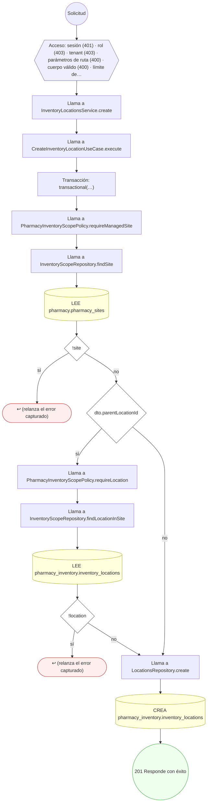

#### 14. POST /pharmacy/count-sessions/{id}/approve

Aprobar conteo y ajustar ledger por varianza (UC-25-07)

| HTTP | Código | Cuándo |
|---|---|---|
| 200 | — | Éxito |
| 400 | `VALIDATION_FAILED` | Los parámetros de ruta son UUID válidos; El cuerpo cumple el DTO (sin propiedades extra) |
| 401 | `UNAUTHENTICATED` | Hay una sesión válida (JWT) |
| 403 | `FORBIDDEN` | El rol está permitido; El tenant se resuelve y pertenece al actor |
| 404 | `NOT_FOUND` | ResourceNotFoundException: Línea de conteo no encontrada |
| 422 | `PRECONDITION_FAILED` | PreconditionFailedException: La sesión no está en estado aprobable |
| 429 | `RATE_LIMITED` | No se supera el límite de solicitudes |

```mermaid
flowchart TD
  n1(("Solicitud")):::inicio
  n2{{"Acceso: sesión (401) · rol (403) · tenant (403) · parámetros de ruta (400) · cuerpo válido (400) · límite de…"}}:::acceso
  n1 --> n2
  n3["Llama a InventoryCountService.approve"]:::llamada
  n2 --> n3
  n4["Llama a ApproveInventoryCountUseCase.execute"]:::llamada
  n3 --> n4
  n5["Transacción: transactional(…)"]:::transaccion
  n4 --> n5
  n6["Llama a CountSessionsRepository.findById"]:::llamada
  n5 --> n6
  n7[("LEE pharmacy_inventory.inventory_count_sessions")]:::efecto
  n6 --> n7
  n8{"!session"}:::decision
  n7 --> n8
  n9(["↩ (relanza el error capturado)"]):::error
  n8 -->|"sí"| n9
  n10["Llama a PharmacyInventoryScopePolicy.requireManagedSite"]:::llamada
  n8 -->|"no"| n10
  n11["Llama a InventoryScopeRepository.findSite"]:::llamada
  n10 --> n11
  n12[("LEE pharmacy.pharmacy_sites")]:::efecto
  n11 --> n12
  n13{"!site"}:::decision
  n12 --> n13
  n14(["↩ (relanza el error capturado)"]):::error
  n13 -->|"sí"| n14
  n15["Llama a PharmacyInventoryScopePolicy.assertStoredStockKey"]:::llamada
  n13 -->|"no"| n15
  n16["Llama a InventoryScopeRepository.findLocationInSite"]:::llamada
  n15 --> n16
  n17[("LEE pharmacy_inventory.inventory_locations")]:::efecto
  n16 --> n17
  n18{"!location"}:::decision
  n17 --> n18
  n19(["↩ (relanza el error capturado)"]):::error
  n18 -->|"sí"| n19
  n20["Llama a InventoryScopeRepository.findProductInPharmacy"]:::llamada
  n18 -->|"no"| n20
  n21[("LEE pharmacy.pharmacy_products")]:::efecto
  n20 --> n21
  n22{"!product"}:::decision
  n21 --> n22
  n23(["↩ (relanza el error capturado)"]):::error
  n22 -->|"sí"| n23
  n24["Llama a InventoryScopeRepository.findLot"]:::llamada
  n22 -->|"no"| n24
  n25[("LEE pharmacy_inventory.inventory_lots")]:::efecto
  n24 --> n25
  n26{"!lot || lot.pharmacyProductId !== key.pharmacyProductId"}:::decision
  n25 --> n26
  n27(["↩ (relanza el error capturado)"]):::error
  n26 -->|"sí"| n27
  n28{"!approvable.includes(session.statusConceptId)"}:::decision
  n26 -->|"no"| n28
  n29(["422 PRECONDITION_FAILED La sesión no está en estado aprobable"]):::error
  n28 -->|"sí"| n29
  n30["Repite: por cada const [lineId, counted] de countByLine"]:::bucle
  n28 -->|"no"| n30
  n31["Llama a CountSessionsRepository.findLineById"]:::llamada
  n30 -->|"cada elemento"| n31
  n32[("LEE pharmacy_inventory.inventory_count_lines")]:::efecto
  n31 --> n32
  n33{"!line || line.inventoryCountSessionId !== session.id"}:::decision
  n32 --> n33
  n34(["404 NOT_FOUND Línea de conteo no encontrada"]):::error
  n33 -->|"sí"| n34
  n35["Llama a PharmacyInventoryScopePolicy.assertStoredStockKey"]:::llamada
  n33 -->|"no"| n35
  n36["Llama a InventoryScopeRepository.findLocationInSite"]:::llamada
  n35 --> n36
  n37[("LEE pharmacy_inventory.inventory_locations")]:::efecto
  n36 --> n37
  n38{"!location"}:::decision
  n37 --> n38
  n39(["↩ (relanza el error capturado)"]):::error
  n38 -->|"sí"| n39
  n40["Llama a InventoryScopeRepository.findProductInPharmacy"]:::llamada
  n38 -->|"no"| n40
  n41[("LEE pharmacy.pharmacy_products")]:::efecto
  n40 --> n41
  n42{"!product"}:::decision
  n41 --> n42
  n43(["↩ (relanza el error capturado)"]):::error
  n42 -->|"sí"| n43
  n44["Llama a InventoryScopeRepository.findLot"]:::llamada
  n42 -->|"no"| n44
  n45[("LEE pharmacy_inventory.inventory_lots")]:::efecto
  n44 --> n45
  n46{"!lot || lot.pharmacyProductId !== key.pharmacyProductId"}:::decision
  n45 --> n46
  n47(["↩ (relanza el error capturado)"]):::error
  n46 -->|"sí"| n47
  n48[("ACTUALIZA pharmacy_inventory.inventory_count_lines · ACTUALIZA pharmacy_inventory.inventory_count_lines")]:::efecto
  n46 -->|"no"| n48
  n49{"variance !== 0"}:::decision
  n48 --> n49
  n50[("ACTUALIZA pharmacy_inventory.inventory_count_lines")]:::efecto
  n49 -->|"sí"| n50
  n51["Llama a LedgerRepository.nextSequence"]:::llamada
  n50 --> n51
  n52[("LEE pharmacy_inventory.inventory_ledger_entries")]:::efecto
  n51 --> n52
  n53["Llama a LedgerRepository.append"]:::llamada
  n52 --> n53
  n54[("CREA pharmacy_inventory.inventory_ledger_entries")]:::efecto
  n53 --> n54
  n55["Llama a StockPositionsRepository.findByKeyForUpdate"]:::llamada
  n54 --> n55
  n56[("LEE pharmacy_inventory.inventory_stock_positions")]:::efecto
  n55 --> n56
  n57{"position"}:::decision
  n56 --> n57
  n58[("ACTUALIZA pharmacy_inventory.inventory_stock_positions · ACTUALIZA pharmacy_inventory.inventory_stock_positio…")]:::efecto
  n57 -->|"sí"| n58
  n59[("ACTUALIZA pharmacy_inventory.inventory_count_sessions · ACTUALIZA pharmacy_inventory.inventory_count_sessions…")]:::efecto
  n58 --> n59
  n57 -->|"no"| n59
  n49 -->|"no"| n59
  n30 -->|"al terminar"| n59
  n60(("200 Responde con éxito")):::ok
  n59 --> n60
  classDef acceso fill:#eef,stroke:#66a
  classDef error fill:#fee,stroke:#c33
  classDef ok fill:#efe,stroke:#3a3
  classDef efecto fill:#ffd,stroke:#aa3
  classDef decision fill:#fff,stroke:#555
  classDef corte fill:#eee,stroke:#999,stroke-dasharray: 4
```

#### 15. POST /pharmacy/dispensations/{id}/reverse

Reversar una dispensación (UC-25-11)

| HTTP | Código | Cuándo |
|---|---|---|
| 200 | — | Éxito |
| 400 | `VALIDATION_FAILED` | Los parámetros de ruta son UUID válidos; El cuerpo cumple el DTO (sin propiedades extra) |
| 401 | `UNAUTHENTICATED` | Hay una sesión válida (JWT) |
| 403 | `FORBIDDEN` | El rol está permitido; El tenant se resuelve y pertenece al actor |
| 422 | `PRECONDITION_FAILED` | PreconditionFailedException: La dispensación no está en estado reversible |
| 429 | `RATE_LIMITED` | No se supera el límite de solicitudes |

```mermaid
flowchart TD
  n1(("Solicitud")):::inicio
  n2{{"Acceso: sesión (401) · rol (403) · tenant (403) · parámetros de ruta (400) · cuerpo válido (400) · límite de…"}}:::acceso
  n1 --> n2
  n3["Llama a MedicationDispensationsService.reverse"]:::llamada
  n2 --> n3
  n4["Llama a ReverseMedicationDispensationUseCase.execute"]:::llamada
  n3 --> n4
  n5["Transacción: transactional(…)"]:::transaccion
  n4 --> n5
  n6["Llama a DispensationsRepository.findById"]:::llamada
  n5 --> n6
  n7[("LEE pharmacy_inventory.medication_dispensations")]:::efecto
  n6 --> n7
  n8{"!dispensation"}:::decision
  n7 --> n8
  n9(["↩ (relanza el error capturado)"]):::error
  n8 -->|"sí"| n9
  n10["Llama a PharmacyInventoryScopePolicy.requireManagedPharmacy"]:::llamada
  n8 -->|"no"| n10
  n11["Llama a InventoryScopeRepository.findPharmacyInTenant"]:::llamada
  n10 --> n11
  n12[("LEE pharmacy.pharmacies")]:::efecto
  n11 --> n12
  n13{"dto.inventoryLocationId"}:::decision
  n12 --> n13
  n14["Llama a PharmacyInventoryScopePolicy.requireSite"]:::llamada
  n13 -->|"sí"| n14
  n15["Llama a InventoryScopeRepository.findSiteInPharmacy"]:::llamada
  n14 --> n15
  n16[("LEE pharmacy.pharmacy_sites")]:::efecto
  n15 --> n16
  n17{"!site"}:::decision
  n16 --> n17
  n18(["↩ (relanza el error capturado)"]):::error
  n17 -->|"sí"| n18
  n19["Llama a PharmacyInventoryScopePolicy.requireLocation"]:::llamada
  n17 -->|"no"| n19
  n20["Llama a InventoryScopeRepository.findLocationInSite"]:::llamada
  n19 --> n20
  n21[("LEE pharmacy_inventory.inventory_locations")]:::efecto
  n20 --> n21
  n22{"!location"}:::decision
  n21 --> n22
  n23(["↩ (relanza el error capturado)"]):::error
  n22 -->|"sí"| n23
  n24{"dispensation.dispensationStatusConceptId !== PINV.DISPENSE_DISPENSED"}:::decision
  n22 -->|"no"| n24
  n13 -->|"no"| n24
  n25(["422 PRECONDITION_FAILED La dispensación no está en estado reversible"]):::error
  n24 -->|"sí"| n25
  n26[("ACTUALIZA pharmacy_inventory.medication_dispensations")]:::efecto
  n24 -->|"no"| n26
  n27["Llama a DispensationsRepository.findLines"]:::llamada
  n26 --> n27
  n28[("LEE pharmacy_inventory.medication_dispensation_lines")]:::efecto
  n27 --> n28
  n29["Repite: por cada const dl de lines"]:::bucle
  n28 --> n29
  n30["Llama a LedgerRepository.nextSequence"]:::llamada
  n29 -->|"cada elemento"| n30
  n31[("LEE pharmacy_inventory.inventory_ledger_entries")]:::efecto
  n30 --> n31
  n32{"locationId"}:::decision
  n31 --> n32
  n33["Llama a LedgerRepository.append"]:::llamada
  n32 -->|"sí"| n33
  n34[("CREA pharmacy_inventory.inventory_ledger_entries")]:::efecto
  n33 --> n34
  n35["Llama a StockPositionsRepository.findByKeyForUpdate"]:::llamada
  n34 --> n35
  n36[("LEE pharmacy_inventory.inventory_stock_positions")]:::efecto
  n35 --> n36
  n37{"position"}:::decision
  n36 --> n37
  n38[("ACTUALIZA pharmacy_inventory.inventory_stock_positions · ACTUALIZA pharmacy_inventory.inventory_stock_positio…")]:::efecto
  n37 -->|"sí"| n38
  n39(("200 Responde con éxito")):::ok
  n38 --> n39
  n37 -->|"no"| n39
  n32 -->|"no"| n39
  n29 -->|"al terminar"| n39
  classDef acceso fill:#eef,stroke:#66a
  classDef error fill:#fee,stroke:#c33
  classDef ok fill:#efe,stroke:#3a3
  classDef efecto fill:#ffd,stroke:#aa3
  classDef decision fill:#fff,stroke:#555
  classDef corte fill:#eee,stroke:#999,stroke-dasharray: 4
```

#### 16. GET /pharmacy/orders

Bandeja de pedidos de las farmacias del tenant (FAR-E2)

| HTTP | Código | Cuándo |
|---|---|---|
| 200 | — | Éxito |
| 401 | `UNAUTHENTICATED` | Hay una sesión válida (JWT) |
| 403 | `FORBIDDEN` | El rol está permitido; El tenant se resuelve y pertenece al actor |
| 422 | `PRECONDITION_FAILED` | PreconditionFailedException: Estado de pedido desconocido |
| 429 | `RATE_LIMITED` | No se supera el límite de solicitudes |

```mermaid
flowchart TD
  n1(("Solicitud")):::inicio
  n2{{"Acceso: sesión (401) · rol (403) · tenant (403) · límite de tasa (429)"}}:::acceso
  n1 --> n2
  n3["Llama a PharmacyOrdersService.listForPharmacyTenant"]:::llamada
  n2 --> n3
  n4["Llama a PharmacyOrdersUseCases.listForPharmacyTenant"]:::llamada
  n3 --> n4
  n5["Llama a PharmacyOrdersUseCases.resolveStatusFilter"]:::llamada
  n4 --> n5
  n6{"id === undefined"}:::decision
  n5 --> n6
  n7(["422 PRECONDITION_FAILED Estado de pedido desconocido"]):::error
  n6 -->|"sí"| n7
  n8["Llama a PharmacyOrdersRepository.findPharmaciesByTenant"]:::llamada
  n6 -->|"no"| n8
  n9[("LEE pharmacy.pharmacies")]:::efecto
  n8 --> n9
  n10["Llama a PharmacyOrdersRepository.findOrdersForPharmacies"]:::llamada
  n9 --> n10
  n11[("LEE pharmacy_inventory.inventory_reservations")]:::efecto
  n10 --> n11
  n12{"dueIds.length › 0"}:::decision
  n11 --> n12
  n13["Llama a PharmacyOrdersUseCases.expireDue"]:::llamada
  n12 -->|"sí"| n13
  n14["Transacción: transactional(…)"]:::transaccion
  n13 --> n14
  n15["Llama a PharmacyOrdersRepository.findDueOrdersForUpdate"]:::llamada
  n14 --> n15
  n16[("LEE pharmacy_inventory.inventory_reservations")]:::efecto
  n15 --> n16
  n17["Llama a PharmacyOrdersRepository.findPharmaciesByIds"]:::llamada
  n16 --> n17
  n18[("LEE pharmacy.pharmacies")]:::efecto
  n17 --> n18
  n19["Repite: por cada const order de due"]:::bucle
  n18 --> n19
  n20[("ACTUALIZA pharmacy_inventory.inventory_reservations · ACTUALIZA pharmacy_inventory.inventory_reservations")]:::efecto
  n19 -->|"cada elemento"| n20
  n21["Llama a MessagingDomainEventAdapter.publish"]:::llamada
  n20 --> n21
  n22>"Evento ~null"]:::evento
  n21 --> n22
  n23["Repite: por cada const notice de expired"]:::bucle
  n22 --> n23
  n19 -->|"al terminar"| n23
  n24{"notice.medicationRequestId"}:::decision
  n23 -->|"cada elemento"| n24
  n25["Llama a PharmacyOrdersRepository.findPrescriberProfileId"]:::llamada
  n24 -->|"sí"| n25
  n26[("LEE clinical.medication_requests")]:::efecto
  n25 --> n26
  n27["Llama a PharmacyOrdersRepository.findOrdersForPharmacies"]:::llamada
  n26 --> n27
  n24 -->|"no"| n27
  n23 -->|"al terminar"| n27
  n28[("LEE pharmacy_inventory.inventory_reservations")]:::efecto
  n27 --> n28
  n29["Llama a PharmacyOrdersUseCases.composeOrders"]:::llamada
  n28 --> n29
  n12 -->|"no"| n29
  n30["Llama a PharmacyOrdersRepository.findPrescriberProfileIdsByRequestIds"]:::llamada
  n29 --> n30
  n31[("LEE clinical.medication_requests")]:::efecto
  n30 --> n31
  n32["Llama a PharmacyOrdersRepository.findLinesByReservationIds"]:::llamada
  n31 --> n32
  n33[("LEE pharmacy_inventory.inventory_reservation_lines")]:::efecto
  n32 --> n33
  n34["Llama a PharmacyOrdersRepository.findSitesByIds"]:::llamada
  n33 --> n34
  n35[("LEE pharmacy.pharmacy_sites")]:::efecto
  n34 --> n35
  n36["Llama a PharmacyOrdersRepository.findPharmaciesByIdsInTenant"]:::llamada
  n35 --> n36
  n37[("LEE pharmacy.pharmacies")]:::efecto
  n36 --> n37
  n38["Llama a PharmacyOrdersRepository.findPersonNamesByProfileIds"]:::llamada
  n37 --> n38
  n39[("LEE profiles.persons · LEE profiles.person_profiles · LEE profiles.persons")]:::efecto
  n38 --> n39
  n40["Llama a PharmacyOrdersRepository.findPrimarySpecialtyConceptIds"]:::llamada
  n39 --> n40
  n41[("LEE profiles.practitioner_specialties")]:::efecto
  n40 --> n41
  n42["Llama a PharmacyOrdersRepository.findAddressesByIds"]:::llamada
  n41 --> n42
  n43[("LEE common.addresses")]:::efecto
  n42 --> n43
  n44["Llama a PharmacyOrderSubstitutionsRepository.findByReservationIds"]:::llamada
  n43 --> n44
  n45[("LEE pharmacy_inventory.pharmacy_order_substitutions")]:::efecto
  n44 --> n45
  n46["Llama a PharmacyOrdersRepository.findProductsByIds"]:::llamada
  n45 --> n46
  n47[("LEE pharmacy.pharmacy_products")]:::efecto
  n46 --> n47
  n48["Llama a PharmacyOrdersRepository.findConceptsByIds"]:::llamada
  n47 --> n48
  n49[("LEE terminology.catalog_concepts")]:::efecto
  n48 --> n49
  n50(("200 Responde con éxito")):::ok
  n49 --> n50
  classDef acceso fill:#eef,stroke:#66a
  classDef error fill:#fee,stroke:#c33
  classDef ok fill:#efe,stroke:#3a3
  classDef efecto fill:#ffd,stroke:#aa3
  classDef decision fill:#fff,stroke:#555
  classDef corte fill:#eee,stroke:#999,stroke-dasharray: 4
```

#### 17. POST /pharmacy/orders

Crear un pedido de farmacia (FAR-E1)

| HTTP | Código | Cuándo |
|---|---|---|
| 201 | — | Éxito |
| 400 | `VALIDATION_FAILED` | El cuerpo cumple el DTO (sin propiedades extra) |
| 401 | `UNAUTHENTICATED` | Hay una sesión válida (JWT) |
| 403 | `FORBIDDEN` | El rol está permitido; El tenant se resuelve y pertenece al actor |
| 404 | `NOT_FOUND` | ResourceNotFoundException: Sede de farmacia no encontrada; ResourceNotFoundException: Receta no encontrada; ResourceNotFoundException: Producto no disponible en la sede |
| 422 | `PRECONDITION_FAILED` | PreconditionFailedException: La cuenta autenticada no tiene perfil de paciente; PreconditionFailedException: El pedido repite productos; use una línea por producto; PreconditionFailedException: El envío a domicilio o al trabajo llega con el carril de envío (FAR-E4); hoy solo RETIRO |
| 429 | `RATE_LIMITED` | No se supera el límite de solicitudes |

```mermaid
flowchart TD
  n1(("Solicitud")):::inicio
  n2{{"Acceso: sesión (401) · rol (403) · tenant (403) · cuerpo válido (400) · límite de tasa (429)"}}:::acceso
  n1 --> n2
  n3["Llama a PharmacyOrdersService.create"]:::llamada
  n2 --> n3
  n4["Llama a PharmacyOrdersUseCases.create"]:::llamada
  n3 --> n4
  n5["Llama a PharmacyOrdersUseCases.requirePatientProfile"]:::llamada
  n4 --> n5
  n6{"!actor.patientProfileId"}:::decision
  n5 --> n6
  n7(["422 PRECONDITION_FAILED La cuenta autenticada no tiene perfil de paciente"]):::error
  n6 -->|"sí"| n7
  n8["Llama a PharmacyOrdersUseCases.assertNoDuplicateProducts"]:::llamada
  n6 -->|"no"| n8
  n9{"repeated.size › 0"}:::decision
  n8 --> n9
  n10(["422 PRECONDITION_FAILED El pedido repite productos; use una línea por producto"]):::error
  n9 -->|"sí"| n10
  n11["Llama a PharmacyOrdersUseCases.resolveDeliveryMode"]:::llamada
  n9 -->|"no"| n11
  n12{"deliveryMode !== 'RETIRO'"}:::decision
  n11 --> n12
  n13(["422 PRECONDITION_FAILED El envío a domicilio o al trabajo llega con el carril de envío (FAR-E4); hoy solo RET…"]):::error
  n12 -->|"sí"| n13
  n14["Transacción: transactional(…)"]:::transaccion
  n12 -->|"no"| n14
  n15{"dto.idempotencyKey"}:::decision
  n14 --> n15
  n16["Llama a PharmacyOrdersRepository.findOrderByIdempotencyKey"]:::llamada
  n15 -->|"sí"| n16
  n17[("LEE pharmacy_inventory.inventory_reservations")]:::efecto
  n16 --> n17
  n18["Llama a PharmacyDirectoryAdapter.findActiveSiteById"]:::llamada
  n17 --> n18
  n15 -->|"no"| n18
  n19["Llama a PharmacyReadRepository.findActiveSiteById"]:::llamada
  n18 --> n19
  n20[("LEE pharmacy.pharmacy_sites")]:::efecto
  n19 --> n20
  n21["Llama a PharmacyDirectoryAdapter.findVisibleById"]:::llamada
  n20 --> n21
  n22["Llama a PharmacyReadRepository.findVisibleById"]:::llamada
  n21 --> n22
  n23[("LEE pharmacy.pharmacies")]:::efecto
  n22 --> n23
  n24{"!site || !pharmacy"}:::decision
  n23 --> n24
  n25(["404 NOT_FOUND Sede de farmacia no encontrada"]):::error
  n24 -->|"sí"| n25
  n26{"dto.medicationRequestId"}:::decision
  n24 -->|"no"| n26
  n27["Llama a PharmacyOrdersRepository.findOwnMedicationRequest"]:::llamada
  n26 -->|"sí"| n27
  n28[("LEE clinical.medication_requests")]:::efecto
  n27 --> n28
  n29{"!request"}:::decision
  n28 --> n29
  n30(["404 NOT_FOUND Receta no encontrada"]):::error
  n29 -->|"sí"| n30
  n31["Llama a PharmacyDirectoryAdapter.findSellableProductsByIds"]:::llamada
  n29 -->|"no"| n31
  n26 -->|"no"| n31
  n32["Llama a PharmacyReadRepository.findSellableProductsByIds"]:::llamada
  n31 --> n32
  n33[("LEE pharmacy.pharmacy_products")]:::efecto
  n32 --> n33
  n34{"unknown.length › 0"}:::decision
  n33 --> n34
  n35(["404 NOT_FOUND Producto no disponible en la sede"]):::error
  n34 -->|"sí"| n35
  n36["Llama a ReservationsRepository.create"]:::llamada
  n34 -->|"no"| n36
  n37[("CREA pharmacy_inventory.inventory_reservations")]:::efecto
  n36 --> n37
  n38["Llama a PharmacyOrdersUseCases.reserveOrderLines"]:::llamada
  n37 --> n38
  n39["Llama a InventoryReadRepository.findActiveLocationsBySites"]:::llamada
  n38 --> n39
  n40[("LEE pharmacy_inventory.inventory_locations")]:::efecto
  n39 --> n40
  n41["Llama a InventoryReadRepository.findStockPositions"]:::llamada
  n40 --> n41
  n42[("LEE pharmacy_inventory.inventory_stock_positions")]:::efecto
  n41 --> n42
  n43["Repite: por cada const line de dto.lines"]:::bucle
  n42 --> n43
  n44["Llama a PharmacyOrdersUseCases.reserveLineStock"]:::llamada
  n43 -->|"cada elemento"| n44
  n45["Repite: por cada const { position, take } de portions"]:::bucle
  n44 --> n45
  n46[("ACTUALIZA pharmacy_inventory.inventory_stock_positions · ACTUALIZA pharmacy_inventory.inventory_stock_positio…")]:::efecto
  n45 -->|"cada elemento"| n46
  n47["Llama a PharmacyOrdersUseCases.sealFrozenTotal"]:::llamada
  n46 --> n47
  n45 -->|"al terminar"| n47
  n43 -->|"al terminar"| n47
  n48{"!priceable || currencies.size › 1"}:::decision
  n47 --> n48
  n49[("ACTUALIZA pharmacy_inventory.inventory_reservations · ACTUALIZA pharmacy_inventory.inventory_reservations")]:::efecto
  n48 -->|"sí"| n49
  n50[("ACTUALIZA pharmacy_inventory.inventory_reservations · ACTUALIZA pharmacy_inventory.inventory_reservations")]:::efecto
  n49 --> n50
  n48 -->|"no"| n50
  n51["Llama a PharmacyOrdersRepository.findLinesByReservationIds"]:::llamada
  n50 --> n51
  n52[("LEE pharmacy_inventory.inventory_reservation_lines")]:::efecto
  n51 --> n52
  n53["Llama a MessagingDomainEventAdapter.publish"]:::llamada
  n52 --> n53
  n54>"Evento ~null"]:::evento
  n53 --> n54
  n55["Llama a PharmacyOrdersUseCases.readOwnOrder"]:::llamada
  n54 --> n55
  n56["Llama a PharmacyOrdersRepository.findOrderById"]:::llamada
  n55 --> n56
  n57[("LEE pharmacy_inventory.inventory_reservations")]:::efecto
  n56 --> n57
  n58{"!order || order.patientProfileId !== patientProfileId"}:::decision
  n57 --> n58
  n59(["↩ (relanza el error capturado)"]):::error
  n58 -->|"sí"| n59
  n60{"!dto"}:::decision
  n58 -->|"no"| n60
  n61(["↩ (relanza el error capturado)"]):::error
  n60 -->|"sí"| n61
  n62(("201 Responde con éxito")):::ok
  n60 -->|"no"| n62
  classDef acceso fill:#eef,stroke:#66a
  classDef error fill:#fee,stroke:#c33
  classDef ok fill:#efe,stroke:#3a3
  classDef efecto fill:#ffd,stroke:#aa3
  classDef decision fill:#fff,stroke:#555
  classDef corte fill:#eee,stroke:#999,stroke-dasharray: 4
```

#### 18. GET /pharmacy/orders/{id}

Consultar un pedido de farmacia (FAR-E1)

| HTTP | Código | Cuándo |
|---|---|---|
| 200 | — | Éxito |
| 400 | `VALIDATION_FAILED` | Los parámetros de ruta son UUID válidos |
| 401 | `UNAUTHENTICATED` | Hay una sesión válida (JWT) |
| 403 | `FORBIDDEN` | El rol está permitido; El tenant se resuelve y pertenece al actor |
| 429 | `RATE_LIMITED` | No se supera el límite de solicitudes |

```mermaid
flowchart TD
  n1(("Solicitud")):::inicio
  n2{{"Acceso: sesión (401) · rol (403) · tenant (403) · parámetros de ruta (400) · límite de tasa (429)"}}:::acceso
  n1 --> n2
  n3["Llama a PharmacyOrdersService.getOrder"]:::llamada
  n2 --> n3
  n4["Llama a PharmacyOrdersUseCases.getOrder"]:::llamada
  n3 --> n4
  n5["Llama a PharmacyOrdersRepository.findOrderById"]:::llamada
  n4 --> n5
  n6[("LEE pharmacy_inventory.inventory_reservations")]:::efecto
  n5 --> n6
  n7{"!order"}:::decision
  n6 --> n7
  n8(["↩ (relanza el error capturado)"]):::error
  n7 -->|"sí"| n8
  n9["Llama a PharmacyOrdersRepository.findPharmaciesByIdsInTenant"]:::llamada
  n7 -->|"no"| n9
  n10[("LEE pharmacy.pharmacies")]:::efecto
  n9 --> n10
  n11{"!pharmacy"}:::decision
  n10 --> n11
  n12(["↩ (relanza el error capturado)"]):::error
  n11 -->|"sí"| n12
  n13{"!isOwner && !isStaff && !(await this.tenantAdministration.canAdminister( em, pharmacy.tenantId, actor, ))"}:::decision
  n11 -->|"no"| n13
  n14(["↩ (relanza el error capturado)"]):::error
  n13 -->|"sí"| n14
  n15{"this.isDue(order)"}:::decision
  n13 -->|"no"| n15
  n16["Llama a PharmacyOrdersUseCases.expireDue"]:::llamada
  n15 -->|"sí"| n16
  n17["Transacción: transactional(…)"]:::transaccion
  n16 --> n17
  n18["Llama a PharmacyOrdersRepository.findDueOrdersForUpdate"]:::llamada
  n17 --> n18
  n19[("LEE pharmacy_inventory.inventory_reservations")]:::efecto
  n18 --> n19
  n20["Llama a PharmacyOrdersRepository.findPharmaciesByIds"]:::llamada
  n19 --> n20
  n21[("LEE pharmacy.pharmacies")]:::efecto
  n20 --> n21
  n22["Repite: por cada const order de due"]:::bucle
  n21 --> n22
  n23[("ACTUALIZA pharmacy_inventory.inventory_reservations · ACTUALIZA pharmacy_inventory.inventory_reservations")]:::efecto
  n22 -->|"cada elemento"| n23
  n24["Llama a MessagingDomainEventAdapter.publish"]:::llamada
  n23 --> n24
  n25>"Evento ~null"]:::evento
  n24 --> n25
  n26["Repite: por cada const notice de expired"]:::bucle
  n25 --> n26
  n22 -->|"al terminar"| n26
  n27{"notice.medicationRequestId"}:::decision
  n26 -->|"cada elemento"| n27
  n28["Llama a PharmacyOrdersRepository.findPrescriberProfileId"]:::llamada
  n27 -->|"sí"| n28
  n29[("LEE clinical.medication_requests")]:::efecto
  n28 --> n29
  n30["Llama a PharmacyOrdersRepository.findOrderById"]:::llamada
  n29 --> n30
  n27 -->|"no"| n30
  n26 -->|"al terminar"| n30
  n31[("LEE pharmacy_inventory.inventory_reservations")]:::efecto
  n30 --> n31
  n32{"!order"}:::decision
  n31 --> n32
  n33(["↩ (relanza el error capturado)"]):::error
  n32 -->|"sí"| n33
  n34["Llama a PharmacyOrdersUseCases.composeOrders"]:::llamada
  n32 -->|"no"| n34
  n15 -->|"no"| n34
  n35["Llama a PharmacyOrdersRepository.findPrescriberProfileIdsByRequestIds"]:::llamada
  n34 --> n35
  n36[("LEE clinical.medication_requests")]:::efecto
  n35 --> n36
  n37["Llama a PharmacyOrdersRepository.findLinesByReservationIds"]:::llamada
  n36 --> n37
  n38[("LEE pharmacy_inventory.inventory_reservation_lines")]:::efecto
  n37 --> n38
  n39["Llama a PharmacyOrdersRepository.findSitesByIds"]:::llamada
  n38 --> n39
  n40[("LEE pharmacy.pharmacy_sites")]:::efecto
  n39 --> n40
  n41["Llama a PharmacyOrdersRepository.findPharmaciesByIdsInTenant"]:::llamada
  n40 --> n41
  n42[("LEE pharmacy.pharmacies")]:::efecto
  n41 --> n42
  n43["Llama a PharmacyOrdersRepository.findPersonNamesByProfileIds"]:::llamada
  n42 --> n43
  n44[("LEE profiles.persons · LEE profiles.person_profiles · LEE profiles.persons")]:::efecto
  n43 --> n44
  n45["Llama a PharmacyOrdersRepository.findPrimarySpecialtyConceptIds"]:::llamada
  n44 --> n45
  n46[("LEE profiles.practitioner_specialties")]:::efecto
  n45 --> n46
  n47["Llama a PharmacyOrdersRepository.findAddressesByIds"]:::llamada
  n46 --> n47
  n48[("LEE common.addresses")]:::efecto
  n47 --> n48
  n49["Llama a PharmacyOrderSubstitutionsRepository.findByReservationIds"]:::llamada
  n48 --> n49
  n50[("LEE pharmacy_inventory.pharmacy_order_substitutions")]:::efecto
  n49 --> n50
  n51["Llama a PharmacyOrdersRepository.findProductsByIds"]:::llamada
  n50 --> n51
  n52[("LEE pharmacy.pharmacy_products")]:::efecto
  n51 --> n52
  n53["Llama a PharmacyOrdersRepository.findConceptsByIds"]:::llamada
  n52 --> n53
  n54[("LEE terminology.catalog_concepts")]:::efecto
  n53 --> n54
  n55{"!dto"}:::decision
  n54 --> n55
  n56(["↩ (relanza el error capturado)"]):::error
  n55 -->|"sí"| n56
  n57(("200 Responde con éxito")):::ok
  n55 -->|"no"| n57
  classDef acceso fill:#eef,stroke:#66a
  classDef error fill:#fee,stroke:#c33
  classDef ok fill:#efe,stroke:#3a3
  classDef efecto fill:#ffd,stroke:#aa3
  classDef decision fill:#fff,stroke:#555
  classDef corte fill:#eee,stroke:#999,stroke-dasharray: 4
```

#### 19. POST /pharmacy/orders/{id}/accept-substitutions

Aceptar los genéricos propuestos (paciente)

| HTTP | Código | Cuándo |
|---|---|---|
| 200 | — | Éxito |
| 400 | `VALIDATION_FAILED` | Los parámetros de ruta son UUID válidos |
| 401 | `UNAUTHENTICATED` | Hay una sesión válida (JWT) |
| 403 | `FORBIDDEN` | El rol está permitido; El tenant se resuelve y pertenece al actor |
| 422 | `PRECONDITION_FAILED` | PreconditionFailedException: La cuenta autenticada no tiene perfil de paciente; PreconditionFailedException: El pedido no tiene una decisión de sustituciones pendiente; PreconditionFailedException: El pedido no tiene propuestas de sustitución en pie |
| 429 | `RATE_LIMITED` | No se supera el límite de solicitudes |

```mermaid
flowchart TD
  n1(("Solicitud")):::inicio
  n2{{"Acceso: sesión (401) · rol (403) · tenant (403) · parámetros de ruta (400) · límite de tasa (429)"}}:::acceso
  n1 --> n2
  n3["Llama a PharmacyOrdersService.acceptSubstitutions"]:::llamada
  n2 --> n3
  n4["Llama a PharmacyOrdersUseCases.acceptSubstitutions"]:::llamada
  n3 --> n4
  n5["Llama a PharmacyOrdersUseCases.requirePatientProfile"]:::llamada
  n4 --> n5
  n6{"!actor.patientProfileId"}:::decision
  n5 --> n6
  n7(["422 PRECONDITION_FAILED La cuenta autenticada no tiene perfil de paciente"]):::error
  n6 -->|"sí"| n7
  n8["Transacción: transactional(…)"]:::transaccion
  n6 -->|"no"| n8
  n9["Llama a PharmacyOrdersUseCases.loadOwnOrderForUpdate"]:::llamada
  n8 --> n9
  n10["Llama a PharmacyOrdersRepository.findOrderByIdForUpdate"]:::llamada
  n9 --> n10
  n11[("LEE pharmacy_inventory.inventory_reservations")]:::efecto
  n10 --> n11
  n12{"!order || order.patientProfileId !== patientProfileId"}:::decision
  n11 --> n12
  n13(["↩ (relanza el error capturado)"]):::error
  n12 -->|"sí"| n13
  n14["Llama a PharmacyOrdersRepository.findPharmaciesByIdsInTenant"]:::llamada
  n12 -->|"no"| n14
  n15[("LEE pharmacy.pharmacies")]:::efecto
  n14 --> n15
  n16{"!pharmacy"}:::decision
  n15 --> n16
  n17(["↩ (relanza el error capturado)"]):::error
  n16 -->|"sí"| n17
  n18["Llama a PharmacyOrdersUseCases.pendingProposalsOf"]:::llamada
  n16 -->|"no"| n18
  n19{"order.reservationStatusConceptId !== PINV.ORDER_ACEPTACION_PENDIENTE"}:::decision
  n18 --> n19
  n20(["422 PRECONDITION_FAILED El pedido no tiene una decisión de sustituciones pendiente"]):::error
  n19 -->|"sí"| n20
  n21["Llama a PharmacyOrderSubstitutionsRepository.findByReservationIds"]:::llamada
  n19 -->|"no"| n21
  n22[("LEE pharmacy_inventory.pharmacy_order_substitutions")]:::efecto
  n21 --> n22
  n23{"pending.length === 0"}:::decision
  n22 --> n23
  n24(["422 PRECONDITION_FAILED El pedido no tiene propuestas de sustitución en pie"]):::error
  n23 -->|"sí"| n24
  n25["Llama a PharmacyOrdersRepository.findLinesByReservationIds"]:::llamada
  n23 -->|"no"| n25
  n26[("LEE pharmacy_inventory.inventory_reservation_lines")]:::efecto
  n25 --> n26
  n27["Llama a InventoryReadRepository.findActiveLocationsBySites"]:::llamada
  n26 --> n27
  n28[("LEE pharmacy_inventory.inventory_locations")]:::efecto
  n27 --> n28
  n29["Llama a InventoryReadRepository.findStockPositions"]:::llamada
  n28 --> n29
  n30[("LEE pharmacy_inventory.inventory_stock_positions")]:::efecto
  n29 --> n30
  n31["Repite: por cada const proposal de pending"]:::bucle
  n30 --> n31
  n32{"confirmed.length › 0"}:::decision
  n31 -->|"cada elemento"| n32
  n33["Llama a InventoryReservationsService.releaseConfirmedLines"]:::llamada
  n32 -->|"sí"| n33
  n34["Llama a ReleaseConfirmedReservationLinesUseCase.execute"]:::llamada
  n33 --> n34
  n35["Repite: por cada const line de lines"]:::bucle
  n34 --> n35
  n36[("ACTUALIZA pharmacy_inventory.inventory_reservation_lines")]:::efecto
  n35 -->|"cada elemento"| n36
  n37{"line.inventoryLocationId"}:::decision
  n36 --> n37
  n38{"position"}:::decision
  n37 -->|"sí"| n38
  n39[("ACTUALIZA pharmacy_inventory.inventory_stock_positions · ACTUALIZA pharmacy_inventory.inventory_stock_positio…")]:::efecto
  n38 -->|"sí"| n39
  n40["Llama a PharmacyOrdersUseCases.reserveLineStock"]:::llamada
  n39 --> n40
  n38 -->|"no"| n40
  n37 -->|"no"| n40
  n35 -->|"al terminar"| n40
  n32 -->|"no"| n40
  n41["Repite: por cada const candidate de candidates"]:::bucle
  n40 --> n41
  n42["Llama a StockPositionsRepository.findByKeyForUpdate"]:::llamada
  n41 -->|"cada elemento"| n42
  n43[("LEE pharmacy_inventory.inventory_stock_positions")]:::efecto
  n42 --> n43
  n44{"remaining › 0"}:::decision
  n43 --> n44
  n41 -->|"al terminar"| n44
  n45["Llama a ReservationsRepository.createLine"]:::llamada
  n44 -->|"sí"| n45
  n46[("CREA pharmacy_inventory.inventory_reservation_lines")]:::efecto
  n45 --> n46
  n47["Repite: por cada const { position, take } de portions"]:::bucle
  n46 --> n47
  n44 -->|"no"| n47
  n48["Llama a ReservationsRepository.createLine"]:::llamada
  n47 -->|"cada elemento"| n48
  n49[("CREA pharmacy_inventory.inventory_reservation_lines")]:::efecto
  n48 --> n49
  n50["Llama a LedgerRepository.nextSequence"]:::llamada
  n49 --> n50
  n51[("LEE pharmacy_inventory.inventory_ledger_entries")]:::efecto
  n50 --> n51
  n52["Llama a LedgerRepository.append"]:::llamada
  n51 --> n52
  n53[("CREA pharmacy_inventory.inventory_ledger_entries")]:::efecto
  n52 --> n53
  n54[("ACTUALIZA pharmacy_inventory.inventory_stock_positions · ACTUALIZA pharmacy_inventory.inventory_stock_positio…")]:::efecto
  n53 --> n54
  n55[("ACTUALIZA pharmacy_inventory.pharmacy_order_substitutions · ACTUALIZA pharmacy_inventory.pharmacy_order_subst…")]:::efecto
  n54 --> n55
  n47 -->|"al terminar"| n55
  n56[("ACTUALIZA pharmacy_inventory.inventory_reservations")]:::efecto
  n55 --> n56
  n31 -->|"al terminar"| n56
  n57["Llama a PharmacyOrdersUseCases.sealFrozenTotal"]:::llamada
  n56 --> n57
  n58{"!priceable || currencies.size › 1"}:::decision
  n57 --> n58
  n59[("ACTUALIZA pharmacy_inventory.inventory_reservations · ACTUALIZA pharmacy_inventory.inventory_reservations")]:::efecto
  n58 -->|"sí"| n59
  n60[("ACTUALIZA pharmacy_inventory.inventory_reservations · ACTUALIZA pharmacy_inventory.inventory_reservations")]:::efecto
  n59 --> n60
  n58 -->|"no"| n60
  n61["Llama a PharmacyOrdersRepository.findLinesByReservationIds"]:::llamada
  n60 --> n61
  n62[("LEE pharmacy_inventory.inventory_reservation_lines")]:::efecto
  n61 --> n62
  n63["Llama a PharmacyOrdersUseCases.publishStaffEvent"]:::llamada
  n62 --> n63
  n64["Llama a MessagingDomainEventAdapter.publish"]:::llamada
  n63 --> n64
  n65>"Evento ~null"]:::evento
  n64 --> n65
  n66["Llama a PharmacyOrdersUseCases.tenantOfPharmacy"]:::llamada
  n65 --> n66
  n67["Llama a PharmacyOrdersRepository.findPharmaciesByIdsInTenant"]:::llamada
  n66 --> n67
  n68[("LEE pharmacy.pharmacies")]:::efecto
  n67 --> n68
  n69{"!pharmacy"}:::decision
  n68 --> n69
  n70(["↩ (relanza el error capturado)"]):::error
  n69 -->|"sí"| n70
  n71["… el resto del árbol (7 nodos) está en el JSON del inventario"]:::corte
  n69 -->|"no"| n71
  classDef acceso fill:#eef,stroke:#66a
  classDef error fill:#fee,stroke:#c33
  classDef ok fill:#efe,stroke:#3a3
  classDef efecto fill:#ffd,stroke:#aa3
  classDef decision fill:#fff,stroke:#555
  classDef corte fill:#eee,stroke:#999,stroke-dasharray: 4
```

#### 20. POST /pharmacy/orders/{id}/cancel

Cancelar un pedido de farmacia (FAR-E1)

| HTTP | Código | Cuándo |
|---|---|---|
| 200 | — | Éxito |
| 400 | `VALIDATION_FAILED` | Los parámetros de ruta son UUID válidos |
| 401 | `UNAUTHENTICATED` | Hay una sesión válida (JWT) |
| 403 | `FORBIDDEN` | El rol está permitido; El tenant se resuelve y pertenece al actor |
| 409 | `CONFLICT` | ConflictException: El pedido ya está en un estado terminal y no puede cancelarse |
| 422 | `PRECONDITION_FAILED` | PreconditionFailedException: La cuenta autenticada no tiene perfil de paciente |
| 429 | `RATE_LIMITED` | No se supera el límite de solicitudes |

```mermaid
flowchart TD
  n1(("Solicitud")):::inicio
  n2{{"Acceso: sesión (401) · rol (403) · tenant (403) · parámetros de ruta (400) · límite de tasa (429)"}}:::acceso
  n1 --> n2
  n3["Llama a PharmacyOrdersService.cancel"]:::llamada
  n2 --> n3
  n4["Llama a PharmacyOrdersUseCases.cancel"]:::llamada
  n3 --> n4
  n5["Llama a PharmacyOrdersUseCases.requirePatientProfile"]:::llamada
  n4 --> n5
  n6{"!actor.patientProfileId"}:::decision
  n5 --> n6
  n7(["422 PRECONDITION_FAILED La cuenta autenticada no tiene perfil de paciente"]):::error
  n6 -->|"sí"| n7
  n8["Transacción: transactional(…)"]:::transaccion
  n6 -->|"no"| n8
  n9["Llama a PharmacyOrdersRepository.findOrderByIdForUpdate"]:::llamada
  n8 --> n9
  n10[("LEE pharmacy_inventory.inventory_reservations")]:::efecto
  n9 --> n10
  n11{"!order || order.patientProfileId !== patientProfileId"}:::decision
  n10 --> n11
  n12(["↩ (relanza el error capturado)"]):::error
  n11 -->|"sí"| n12
  n13["Llama a PharmacyOrdersRepository.findPharmaciesByIdsInTenant"]:::llamada
  n11 -->|"no"| n13
  n14[("LEE pharmacy.pharmacies")]:::efecto
  n13 --> n14
  n15{"!pharmacy"}:::decision
  n14 --> n15
  n16(["↩ (relanza el error capturado)"]):::error
  n15 -->|"sí"| n16
  n17{"ORDER_TERMINAL_STATUS_IDS.includes(order.reservationStatusConceptId)"}:::decision
  n15 -->|"no"| n17
  n18(["409 CONFLICT El pedido ya está en un estado terminal y no puede cancelarse"]):::error
  n17 -->|"sí"| n18
  n19[("ACTUALIZA pharmacy_inventory.inventory_reservations · ACTUALIZA pharmacy_inventory.inventory_reservations")]:::efecto
  n17 -->|"no"| n19
  n20["Llama a InventoryReservationsService.releaseConfirmedLines"]:::llamada
  n19 --> n20
  n21["Llama a ReleaseConfirmedReservationLinesUseCase.execute"]:::llamada
  n20 --> n21
  n22["Repite: por cada const line de lines"]:::bucle
  n21 --> n22
  n23[("ACTUALIZA pharmacy_inventory.inventory_reservation_lines")]:::efecto
  n22 -->|"cada elemento"| n23
  n24{"line.inventoryLocationId"}:::decision
  n23 --> n24
  n25{"position"}:::decision
  n24 -->|"sí"| n25
  n26[("ACTUALIZA pharmacy_inventory.inventory_stock_positions · ACTUALIZA pharmacy_inventory.inventory_stock_positio…")]:::efecto
  n25 -->|"sí"| n26
  n27["Llama a MessagingDomainEventAdapter.publish"]:::llamada
  n26 --> n27
  n25 -->|"no"| n27
  n24 -->|"no"| n27
  n22 -->|"al terminar"| n27
  n28>"Evento ~null"]:::evento
  n27 --> n28
  n29["Llama a PharmacyOrdersUseCases.readOwnOrder"]:::llamada
  n28 --> n29
  n30["Llama a PharmacyOrdersRepository.findOrderById"]:::llamada
  n29 --> n30
  n31[("LEE pharmacy_inventory.inventory_reservations")]:::efecto
  n30 --> n31
  n32{"!order || order.patientProfileId !== patientProfileId"}:::decision
  n31 --> n32
  n33(["↩ (relanza el error capturado)"]):::error
  n32 -->|"sí"| n33
  n34{"!dto"}:::decision
  n32 -->|"no"| n34
  n35(["↩ (relanza el error capturado)"]):::error
  n34 -->|"sí"| n35
  n36(("200 Responde con éxito")):::ok
  n34 -->|"no"| n36
  classDef acceso fill:#eef,stroke:#66a
  classDef error fill:#fee,stroke:#c33
  classDef ok fill:#efe,stroke:#3a3
  classDef efecto fill:#ffd,stroke:#aa3
  classDef decision fill:#fff,stroke:#555
  classDef corte fill:#eee,stroke:#999,stroke-dasharray: 4
```

#### 21. POST /pharmacy/orders/{id}/confirm

Confirmar el pedido (FAR-E2)

| HTTP | Código | Cuándo |
|---|---|---|
| 200 | — | Éxito |
| 400 | `VALIDATION_FAILED` | Los parámetros de ruta son UUID válidos; El cuerpo cumple el DTO (sin propiedades extra) |
| 401 | `UNAUTHENTICATED` | Hay una sesión válida (JWT) |
| 403 | `FORBIDDEN` | El rol está permitido; El tenant se resuelve y pertenece al actor |
| 422 | `PRECONDITION_FAILED` | PreconditionFailedException: Hay más de un ajuste para el mismo renglón; PreconditionFailedException: La transición no es legal para el estado actual del pedido; PreconditionFailedException: El ajuste refiere un producto que no está en el pedido; PreconditionFailedException: PROPONER_GENERICO exige el producto propuesto (proposedProductId); PreconditionFailedException: El producto propuesto no está disponible en esta farmacia; PreconditionFailedException: El producto propuesto no es del mismo medicamento que el original |
| 429 | `RATE_LIMITED` | No se supera el límite de solicitudes |

```mermaid
flowchart TD
  n1(("Solicitud")):::inicio
  n2{{"Acceso: sesión (401) · rol (403) · tenant (403) · parámetros de ruta (400) · cuerpo válido (400) · límite de…"}}:::acceso
  n1 --> n2
  n3["Llama a PharmacyOrdersService.confirm"]:::llamada
  n2 --> n3
  n4["Llama a PharmacyOrdersUseCases.confirm"]:::llamada
  n3 --> n4
  n5["Llama a PharmacyOrdersUseCases.assertOneAdjustmentPerProduct"]:::llamada
  n4 --> n5
  n6{"repeated.size › 0"}:::decision
  n5 --> n6
  n7(["422 PRECONDITION_FAILED Hay más de un ajuste para el mismo renglón"]):::error
  n6 -->|"sí"| n7
  n8["Transacción: transactional(…)"]:::transaccion
  n6 -->|"no"| n8
  n9["Llama a PharmacyOrdersUseCases.loadTenantOrderForUpdate"]:::llamada
  n8 --> n9
  n10["Llama a PharmacyOrdersRepository.findOrderByIdForUpdate"]:::llamada
  n9 --> n10
  n11[("LEE pharmacy_inventory.inventory_reservations")]:::efecto
  n10 --> n11
  n12{"!order"}:::decision
  n11 --> n12
  n13(["↩ (relanza el error capturado)"]):::error
  n12 -->|"sí"| n13
  n14["Llama a PharmacyOrdersRepository.findPharmaciesByIdsInTenant"]:::llamada
  n12 -->|"no"| n14
  n15[("LEE pharmacy.pharmacies")]:::efecto
  n14 --> n15
  n16{"!pharmacy"}:::decision
  n15 --> n16
  n17(["↩ (relanza el error capturado)"]):::error
  n16 -->|"sí"| n17
  n18["Llama a PharmacyOrdersUseCases.assertStaffTransition"]:::llamada
  n16 -->|"no"| n18
  n19{"!allowed?.has(toStatusId)"}:::decision
  n18 --> n19
  n20(["422 PRECONDITION_FAILED La transición no es legal para el estado actual del pedido"]):::error
  n19 -->|"sí"| n20
  n21["Llama a PharmacyOrdersRepository.findLinesByReservationIds"]:::llamada
  n19 -->|"no"| n21
  n22[("LEE pharmacy_inventory.inventory_reservation_lines")]:::efecto
  n21 --> n22
  n23["Repite: por cada const adjustment de adjustments"]:::bucle
  n22 --> n23
  n24{"!portions"}:::decision
  n23 -->|"cada elemento"| n24
  n25(["422 PRECONDITION_FAILED El ajuste refiere un producto que no está en el pedido"]):::error
  n24 -->|"sí"| n25
  n26{"confirmed.length › 0"}:::decision
  n24 -->|"no"| n26
  n27["Llama a InventoryReservationsService.releaseConfirmedLines"]:::llamada
  n26 -->|"sí"| n27
  n28["Llama a ReleaseConfirmedReservationLinesUseCase.execute"]:::llamada
  n27 --> n28
  n29["Repite: por cada const line de lines"]:::bucle
  n28 --> n29
  n30[("ACTUALIZA pharmacy_inventory.inventory_reservation_lines")]:::efecto
  n29 -->|"cada elemento"| n30
  n31{"line.inventoryLocationId"}:::decision
  n30 --> n31
  n32{"position"}:::decision
  n31 -->|"sí"| n32
  n33[("ACTUALIZA pharmacy_inventory.inventory_stock_positions · ACTUALIZA pharmacy_inventory.inventory_stock_positio…")]:::efecto
  n32 -->|"sí"| n33
  n34{"proposals.length › 0"}:::decision
  n33 --> n34
  n32 -->|"no"| n34
  n31 -->|"no"| n34
  n29 -->|"al terminar"| n34
  n26 -->|"no"| n34
  n23 -->|"al terminar"| n34
  n35["Llama a PharmacyOrdersUseCases.persistProposals"]:::llamada
  n34 -->|"sí"| n35
  n36{"withoutProposed.length › 0"}:::decision
  n35 --> n36
  n37(["422 PRECONDITION_FAILED PROPONER_GENERICO exige el producto propuesto (proposedProductId)"]):::error
  n36 -->|"sí"| n37
  n38["Llama a PharmacyOrdersRepository.findProductsByIds"]:::llamada
  n36 -->|"no"| n38
  n39[("LEE pharmacy.pharmacy_products")]:::efecto
  n38 --> n39
  n40["Repite: por cada const proposal de proposals"]:::bucle
  n39 --> n40
  n41{"!proposed || proposed.pharmacyId !== order.pharmacyId || proposedId === proposal.productId"}:::decision
  n40 -->|"cada elemento"| n41
  n42(["422 PRECONDITION_FAILED El producto propuesto no está disponible en esta farmacia"]):::error
  n41 -->|"sí"| n42
  n43{"!original?.medicationConceptId || original.medicationConceptId !== proposed.medicationConceptId"}:::decision
  n41 -->|"no"| n43
  n44(["422 PRECONDITION_FAILED El producto propuesto no es del mismo medicamento que el original"]):::error
  n43 -->|"sí"| n44
  n45{"!portions || portions.length === 0"}:::decision
  n43 -->|"no"| n45
  n46(["422 PRECONDITION_FAILED El ajuste refiere un producto que no está en el pedido"]):::error
  n45 -->|"sí"| n46
  n47["Llama a PharmacyOrderSubstitutionsRepository.create"]:::llamada
  n45 -->|"no"| n47
  n48[("CREA pharmacy_inventory.pharmacy_order_substitutions")]:::efecto
  n47 --> n48
  n49[("ACTUALIZA pharmacy_inventory.inventory_reservations · ACTUALIZA pharmacy_inventory.inventory_reservations")]:::efecto
  n48 --> n49
  n40 -->|"al terminar"| n49
  n34 -->|"no"| n49
  n50["Llama a PharmacyOrdersUseCases.sealFrozenTotal"]:::llamada
  n49 --> n50
  n51{"!priceable || currencies.size › 1"}:::decision
  n50 --> n51
  n52[("ACTUALIZA pharmacy_inventory.inventory_reservations · ACTUALIZA pharmacy_inventory.inventory_reservations")]:::efecto
  n51 -->|"sí"| n52
  n53[("ACTUALIZA pharmacy_inventory.inventory_reservations · ACTUALIZA pharmacy_inventory.inventory_reservations")]:::efecto
  n52 --> n53
  n51 -->|"no"| n53
  n54["Llama a PharmacyOrdersUseCases.publishStaffEvent"]:::llamada
  n53 --> n54
  n55["Llama a MessagingDomainEventAdapter.publish"]:::llamada
  n54 --> n55
  n56>"Evento ~null"]:::evento
  n55 --> n56
  n57["Llama a PharmacyOrdersUseCases.readOrderForTenant"]:::llamada
  n56 --> n57
  n58["Llama a PharmacyOrdersRepository.findOrderById"]:::llamada
  n57 --> n58
  n59[("LEE pharmacy_inventory.inventory_reservations")]:::efecto
  n58 --> n59
  n60{"!order"}:::decision
  n59 --> n60
  n61(["↩ (relanza el error capturado)"]):::error
  n60 -->|"sí"| n61
  n62{"!dto"}:::decision
  n60 -->|"no"| n62
  n63(["↩ (relanza el error capturado)"]):::error
  n62 -->|"sí"| n63
  n64(("200 Responde con éxito")):::ok
  n62 -->|"no"| n64
  classDef acceso fill:#eef,stroke:#66a
  classDef error fill:#fee,stroke:#c33
  classDef ok fill:#efe,stroke:#3a3
  classDef efecto fill:#ffd,stroke:#aa3
  classDef decision fill:#fff,stroke:#555
  classDef corte fill:#eee,stroke:#999,stroke-dasharray: 4
```

#### 22. POST /pharmacy/orders/{id}/conversation

Abrir el chat del pedido con la farmacia

| HTTP | Código | Cuándo |
|---|---|---|
| 200 | — | Éxito |
| 400 | `VALIDATION_FAILED` | Los parámetros de ruta son UUID válidos |
| 401 | `UNAUTHENTICATED` | Hay una sesión válida (JWT) |
| 403 | `FORBIDDEN` | El rol está permitido; El tenant se resuelve y pertenece al actor |
| 422 | `PRECONDITION_FAILED` | PreconditionFailedException: El paciente todavía no tiene un perfil con el que conversar; PreconditionFailedException: La farmacia no tiene una vitrina activa con la que conversar |
| 429 | `RATE_LIMITED` | No se supera el límite de solicitudes |

```mermaid
flowchart TD
  n1(("Solicitud")):::inicio
  n2{{"Acceso: sesión (401) · rol (403) · tenant (403) · parámetros de ruta (400) · límite de tasa (429)"}}:::acceso
  n1 --> n2
  n3["Llama a PharmacyOrdersService.openConversation"]:::llamada
  n2 --> n3
  n4["Llama a PharmacyOrdersUseCases.openConversation"]:::llamada
  n3 --> n4
  n5["Llama a PharmacyOrdersRepository.findOrderById"]:::llamada
  n4 --> n5
  n6[("LEE pharmacy_inventory.inventory_reservations")]:::efecto
  n5 --> n6
  n7{"!order"}:::decision
  n6 --> n7
  n8(["↩ (relanza el error capturado)"]):::error
  n7 -->|"sí"| n8
  n9{"!isOwner && !isPharmacyStaff"}:::decision
  n7 -->|"no"| n9
  n10(["↩ (relanza el error capturado)"]):::error
  n9 -->|"sí"| n10
  n11["Llama a PharmacyOrdersRepository.findPharmaciesByIdsInTenant"]:::llamada
  n9 -->|"no"| n11
  n12[("LEE pharmacy.pharmacies")]:::efecto
  n11 --> n12
  n13{"!pharmacy"}:::decision
  n12 --> n13
  n14(["↩ (relanza el error capturado)"]):::error
  n13 -->|"sí"| n14
  n15{"isOwner"}:::decision
  n13 -->|"no"| n15
  n16{"order.patientProfileId"}:::decision
  n15 -->|"no"| n16
  n17["Llama a ProfilesPersonAccountLinksAdapter.findActiveByPerson"]:::llamada
  n16 -->|"sí"| n17
  n18["Llama a PersonAccountLinksRepository.findActiveByPerson"]:::llamada
  n17 --> n18
  n19[("LEE profiles.person_account_links")]:::efecto
  n18 --> n19
  n20{"!patientUserId"}:::decision
  n15 -->|"sí"| n20
  n19 --> n20
  n16 -->|"no"| n20
  n21(["422 PRECONDITION_FAILED El paciente todavía no tiene un perfil con el que conversar"]):::error
  n20 -->|"sí"| n21
  n22["Llama a CommunityPharmacyOrderChatAdapter.openOrderConversation"]:::llamada
  n20 -->|"no"| n22
  n23["Llama a CommunityOrderChatService.openOrderConversation"]:::llamada
  n22 --> n23
  n24{"!organization"}:::decision
  n23 --> n24
  n25(["422 PRECONDITION_FAILED La farmacia no tiene una vitrina activa con la que conversar"]):::error
  n24 -->|"sí"| n25
  n26{"!patientProfile || patientProfile.statusConceptId !== CONCEPTS.STATE_ACTIVE || this.organizationStaff.isOrgan…"}:::decision
  n24 -->|"no"| n26
  n27(["422 PRECONDITION_FAILED El paciente todavía no tiene un perfil con el que conversar"]):::error
  n26 -->|"sí"| n27
  n28(("200 Responde con éxito")):::ok
  n26 -->|"no"| n28
  classDef acceso fill:#eef,stroke:#66a
  classDef error fill:#fee,stroke:#c33
  classDef ok fill:#efe,stroke:#3a3
  classDef efecto fill:#ffd,stroke:#aa3
  classDef decision fill:#fff,stroke:#555
  classDef corte fill:#eee,stroke:#999,stroke-dasharray: 4
```

#### 23. POST /pharmacy/orders/{id}/dispense

Dispensar el pedido en el mostrador (FAR-E3)

| HTTP | Código | Cuándo |
|---|---|---|
| 200 | — | Éxito |
| 400 | `VALIDATION_FAILED` | Los parámetros de ruta son UUID válidos; El cuerpo cumple el DTO (sin propiedades extra) |
| 401 | `UNAUTHENTICATED` | Hay una sesión válida (JWT) |
| 403 | `FORBIDDEN` | El rol está permitido; El tenant se resuelve y pertenece al actor |
| 409 | `CONFLICT` | ConflictException: La clave de idempotencia ya se usó para otra entrega |
| 422 | `PRECONDITION_FAILED` | PreconditionFailedException: Solo un pedido listo para retiro puede dispensarse; PreconditionFailedException: El código de retiro no coincide. El pedido no se modificó.; PreconditionFailedException: La entrega refiere productos sin saldo en pie en este pedido; PreconditionFailedException: El pedido no tiene saldo en pie que entregar |
| 429 | `RATE_LIMITED` | No se supera el límite de solicitudes |

```mermaid
flowchart TD
  n1(("Solicitud")):::inicio
  n2{{"Acceso: sesión (401) · rol (403) · tenant (403) · parámetros de ruta (400) · cuerpo válido (400) · límite de…"}}:::acceso
  n1 --> n2
  n3["Llama a PharmacyOrdersService.dispense"]:::llamada
  n2 --> n3
  n4["Llama a PharmacyOrdersUseCases.dispense"]:::llamada
  n3 --> n4
  n5["Transacción: transactional(…)"]:::transaccion
  n4 --> n5
  n6["Llama a PharmacyOrdersUseCases.loadTenantOrderForUpdate"]:::llamada
  n5 --> n6
  n7["Llama a PharmacyOrdersRepository.findOrderByIdForUpdate"]:::llamada
  n6 --> n7
  n8[("LEE pharmacy_inventory.inventory_reservations")]:::efecto
  n7 --> n8
  n9{"!order"}:::decision
  n8 --> n9
  n10(["↩ (relanza el error capturado)"]):::error
  n9 -->|"sí"| n10
  n11["Llama a PharmacyOrdersRepository.findPharmaciesByIdsInTenant"]:::llamada
  n9 -->|"no"| n11
  n12[("LEE pharmacy.pharmacies")]:::efecto
  n11 --> n12
  n13{"!pharmacy"}:::decision
  n12 --> n13
  n14(["↩ (relanza el error capturado)"]):::error
  n13 -->|"sí"| n14
  n15{"dto.idempotencyKey"}:::decision
  n13 -->|"no"| n15
  n16["Llama a DispensationsRepository.findByIdempotencyKey"]:::llamada
  n15 -->|"sí"| n16
  n17[("LEE pharmacy_inventory.medication_dispensations")]:::efecto
  n16 --> n17
  n18{"existing"}:::decision
  n17 --> n18
  n19(["409 CONFLICT La clave de idempotencia ya se usó para otra entrega"]):::error
  n18 -->|"sí"| n19
  n20{"order.reservationStatusConceptId !== PINV.ORDER_LISTO_PARA_RETIRO"}:::decision
  n18 -->|"no"| n20
  n15 -->|"no"| n20
  n21(["422 PRECONDITION_FAILED Solo un pedido listo para retiro puede dispensarse"]):::error
  n20 -->|"sí"| n21
  n22{"!order.pickupCode || presented !== order.pickupCode"}:::decision
  n20 -->|"no"| n22
  n23(["422 PRECONDITION_FAILED El código de retiro no coincide. El pedido no se modificó."]):::error
  n22 -->|"sí"| n23
  n24["Llama a PharmacyOrdersRepository.findLinesByReservationIds"]:::llamada
  n22 -->|"no"| n24
  n25[("LEE pharmacy_inventory.inventory_reservation_lines")]:::efecto
  n24 --> n25
  n26{"dto.productIds !== undefined"}:::decision
  n25 --> n26
  n27{"notPending.length › 0"}:::decision
  n26 -->|"sí"| n27
  n28(["422 PRECONDITION_FAILED La entrega refiere productos sin saldo en pie en este pedido"]):::error
  n27 -->|"sí"| n28
  n29{"targets.length === 0"}:::decision
  n27 -->|"no"| n29
  n26 -->|"no"| n29
  n30(["422 PRECONDITION_FAILED El pedido no tiene saldo en pie que entregar"]):::error
  n29 -->|"sí"| n30
  n31["Llama a DispensationsRepository.create"]:::llamada
  n29 -->|"no"| n31
  n32[("CREA pharmacy_inventory.medication_dispensations")]:::efecto
  n31 --> n32
  n33["Repite: por cada const line de targets"]:::bucle
  n32 --> n33
  n34["Llama a DispensationsRepository.createLine"]:::llamada
  n33 -->|"cada elemento"| n34
  n35[("CREA pharmacy_inventory.medication_dispensation_lines")]:::efecto
  n34 --> n35
  n36{"line.inventoryLocationId"}:::decision
  n35 --> n36
  n37["Llama a LedgerRepository.nextSequence"]:::llamada
  n36 -->|"sí"| n37
  n38[("LEE pharmacy_inventory.inventory_ledger_entries")]:::efecto
  n37 --> n38
  n39["Llama a LedgerRepository.append"]:::llamada
  n38 --> n39
  n40[("CREA pharmacy_inventory.inventory_ledger_entries")]:::efecto
  n39 --> n40
  n41["Llama a StockPositionsRepository.findByKeyForUpdate"]:::llamada
  n40 --> n41
  n42[("LEE pharmacy_inventory.inventory_stock_positions")]:::efecto
  n41 --> n42
  n43{"position"}:::decision
  n42 --> n43
  n44[("ACTUALIZA pharmacy_inventory.inventory_stock_positions · ACTUALIZA pharmacy_inventory.inventory_stock_positio…")]:::efecto
  n43 -->|"sí"| n44
  n45{"complete"}:::decision
  n44 --> n45
  n43 -->|"no"| n45
  n36 -->|"no"| n45
  n33 -->|"al terminar"| n45
  n46[("ACTUALIZA pharmacy_inventory.inventory_reservations")]:::efecto
  n45 -->|"sí"| n46
  n47["Llama a PharmacyOrdersUseCases.publishStaffEvent"]:::llamada
  n46 --> n47
  n45 -->|"no"| n47
  n48["Llama a MessagingDomainEventAdapter.publish"]:::llamada
  n47 --> n48
  n49>"Evento ~null"]:::evento
  n48 --> n49
  n50{"outcome?.complete && outcome.medicationRequestId"}:::decision
  n49 --> n50
  n51["Llama a PharmacyOrdersRepository.findPrescriberProfileId"]:::llamada
  n50 -->|"sí"| n51
  n52[("LEE clinical.medication_requests")]:::efecto
  n51 --> n52
  n53["Llama a PharmacyOrdersUseCases.readOrderForTenant"]:::llamada
  n52 --> n53
  n50 -->|"no"| n53
  n54["Llama a PharmacyOrdersRepository.findOrderById"]:::llamada
  n53 --> n54
  n55[("LEE pharmacy_inventory.inventory_reservations")]:::efecto
  n54 --> n55
  n56{"!order"}:::decision
  n55 --> n56
  n57(["↩ (relanza el error capturado)"]):::error
  n56 -->|"sí"| n57
  n58{"!dto"}:::decision
  n56 -->|"no"| n58
  n59(["↩ (relanza el error capturado)"]):::error
  n58 -->|"sí"| n59
  n60(("200 Responde con éxito")):::ok
  n58 -->|"no"| n60
  classDef acceso fill:#eef,stroke:#66a
  classDef error fill:#fee,stroke:#c33
  classDef ok fill:#efe,stroke:#3a3
  classDef efecto fill:#ffd,stroke:#aa3
  classDef decision fill:#fff,stroke:#555
  classDef corte fill:#eee,stroke:#999,stroke-dasharray: 4
```

#### 24. POST /pharmacy/orders/{id}/prefer-original

Preferir los productos originales (paciente)

| HTTP | Código | Cuándo |
|---|---|---|
| 200 | — | Éxito |
| 400 | `VALIDATION_FAILED` | Los parámetros de ruta son UUID válidos |
| 401 | `UNAUTHENTICATED` | Hay una sesión válida (JWT) |
| 403 | `FORBIDDEN` | El rol está permitido; El tenant se resuelve y pertenece al actor |
| 422 | `PRECONDITION_FAILED` | PreconditionFailedException: La cuenta autenticada no tiene perfil de paciente; PreconditionFailedException: El pedido no tiene una decisión de sustituciones pendiente; PreconditionFailedException: El pedido no tiene propuestas de sustitución en pie |
| 429 | `RATE_LIMITED` | No se supera el límite de solicitudes |

```mermaid
flowchart TD
  n1(("Solicitud")):::inicio
  n2{{"Acceso: sesión (401) · rol (403) · tenant (403) · parámetros de ruta (400) · límite de tasa (429)"}}:::acceso
  n1 --> n2
  n3["Llama a PharmacyOrdersService.preferOriginal"]:::llamada
  n2 --> n3
  n4["Llama a PharmacyOrdersUseCases.preferOriginal"]:::llamada
  n3 --> n4
  n5["Llama a PharmacyOrdersUseCases.requirePatientProfile"]:::llamada
  n4 --> n5
  n6{"!actor.patientProfileId"}:::decision
  n5 --> n6
  n7(["422 PRECONDITION_FAILED La cuenta autenticada no tiene perfil de paciente"]):::error
  n6 -->|"sí"| n7
  n8["Transacción: transactional(…)"]:::transaccion
  n6 -->|"no"| n8
  n9["Llama a PharmacyOrdersUseCases.loadOwnOrderForUpdate"]:::llamada
  n8 --> n9
  n10["Llama a PharmacyOrdersRepository.findOrderByIdForUpdate"]:::llamada
  n9 --> n10
  n11[("LEE pharmacy_inventory.inventory_reservations")]:::efecto
  n10 --> n11
  n12{"!order || order.patientProfileId !== patientProfileId"}:::decision
  n11 --> n12
  n13(["↩ (relanza el error capturado)"]):::error
  n12 -->|"sí"| n13
  n14["Llama a PharmacyOrdersRepository.findPharmaciesByIdsInTenant"]:::llamada
  n12 -->|"no"| n14
  n15[("LEE pharmacy.pharmacies")]:::efecto
  n14 --> n15
  n16{"!pharmacy"}:::decision
  n15 --> n16
  n17(["↩ (relanza el error capturado)"]):::error
  n16 -->|"sí"| n17
  n18["Llama a PharmacyOrdersUseCases.pendingProposalsOf"]:::llamada
  n16 -->|"no"| n18
  n19{"order.reservationStatusConceptId !== PINV.ORDER_ACEPTACION_PENDIENTE"}:::decision
  n18 --> n19
  n20(["422 PRECONDITION_FAILED El pedido no tiene una decisión de sustituciones pendiente"]):::error
  n19 -->|"sí"| n20
  n21["Llama a PharmacyOrderSubstitutionsRepository.findByReservationIds"]:::llamada
  n19 -->|"no"| n21
  n22[("LEE pharmacy_inventory.pharmacy_order_substitutions")]:::efecto
  n21 --> n22
  n23{"pending.length === 0"}:::decision
  n22 --> n23
  n24(["422 PRECONDITION_FAILED El pedido no tiene propuestas de sustitución en pie"]):::error
  n23 -->|"sí"| n24
  n25["Repite: por cada const proposal de pending"]:::bucle
  n23 -->|"no"| n25
  n26[("ACTUALIZA pharmacy_inventory.pharmacy_order_substitutions · ACTUALIZA pharmacy_inventory.pharmacy_order_subst…")]:::efecto
  n25 -->|"cada elemento"| n26
  n27[("ACTUALIZA pharmacy_inventory.inventory_reservations")]:::efecto
  n26 --> n27
  n25 -->|"al terminar"| n27
  n28["Llama a PharmacyOrdersUseCases.publishStaffEvent"]:::llamada
  n27 --> n28
  n29["Llama a MessagingDomainEventAdapter.publish"]:::llamada
  n28 --> n29
  n30>"Evento ~null"]:::evento
  n29 --> n30
  n31["Llama a PharmacyOrdersUseCases.tenantOfPharmacy"]:::llamada
  n30 --> n31
  n32["Llama a PharmacyOrdersRepository.findPharmaciesByIdsInTenant"]:::llamada
  n31 --> n32
  n33[("LEE pharmacy.pharmacies")]:::efecto
  n32 --> n33
  n34{"!pharmacy"}:::decision
  n33 --> n34
  n35(["↩ (relanza el error capturado)"]):::error
  n34 -->|"sí"| n35
  n36["Llama a PharmacyOrdersUseCases.readOwnOrder"]:::llamada
  n34 -->|"no"| n36
  n37["Llama a PharmacyOrdersRepository.findOrderById"]:::llamada
  n36 --> n37
  n38[("LEE pharmacy_inventory.inventory_reservations")]:::efecto
  n37 --> n38
  n39{"!order || order.patientProfileId !== patientProfileId"}:::decision
  n38 --> n39
  n40(["↩ (relanza el error capturado)"]):::error
  n39 -->|"sí"| n40
  n41{"!dto"}:::decision
  n39 -->|"no"| n41
  n42(["↩ (relanza el error capturado)"]):::error
  n41 -->|"sí"| n42
  n43(("200 Responde con éxito")):::ok
  n41 -->|"no"| n43
  classDef acceso fill:#eef,stroke:#66a
  classDef error fill:#fee,stroke:#c33
  classDef ok fill:#efe,stroke:#3a3
  classDef efecto fill:#ffd,stroke:#aa3
  classDef decision fill:#fff,stroke:#555
  classDef corte fill:#eee,stroke:#999,stroke-dasharray: 4
```

#### 25. POST /pharmacy/orders/{id}/ready

Marcar el pedido listo para retiro (FAR-E2/E3)

| HTTP | Código | Cuándo |
|---|---|---|
| 200 | — | Éxito |
| 400 | `VALIDATION_FAILED` | Los parámetros de ruta son UUID válidos |
| 401 | `UNAUTHENTICATED` | Hay una sesión válida (JWT) |
| 403 | `FORBIDDEN` | El rol está permitido; El tenant se resuelve y pertenece al actor |
| 409 | `CONFLICT` | ConflictException: No se pudo sellar un código de retiro único; reintente la operación |
| 422 | `PRECONDITION_FAILED` | PreconditionFailedException: La transición no es legal para el estado actual del pedido; PreconditionFailedException: El pedido no declara modalidad de entrega: no puede demostrarse que sea un retiro; PreconditionFailedException: El pedido es de envío: se cierra por el carril de envío, no por el mostrador; PreconditionFailedException: La sede no ofrece retiro en mostrador |
| 429 | `RATE_LIMITED` | No se supera el límite de solicitudes |

```mermaid
flowchart TD
  n1(("Solicitud")):::inicio
  n2{{"Acceso: sesión (401) · rol (403) · tenant (403) · parámetros de ruta (400) · límite de tasa (429)"}}:::acceso
  n1 --> n2
  n3["Llama a PharmacyOrdersService.ready"]:::llamada
  n2 --> n3
  n4["Llama a PharmacyOrdersUseCases.ready"]:::llamada
  n3 --> n4
  n5["Repite: ciclo for"]:::bucle
  n4 --> n5
  n6["Intenta"]:::intento
  n5 -->|"cada elemento"| n6
  n7["Transacción: transactional(…)"]:::transaccion
  n6 --> n7
  n8["Llama a PharmacyOrdersUseCases.loadTenantOrderForUpdate"]:::llamada
  n7 --> n8
  n9["Llama a PharmacyOrdersRepository.findOrderByIdForUpdate"]:::llamada
  n8 --> n9
  n10[("LEE pharmacy_inventory.inventory_reservations")]:::efecto
  n9 --> n10
  n11{"!order"}:::decision
  n10 --> n11
  n12(["↩ (relanza el error capturado)"]):::error
  n11 -->|"sí"| n12
  n13["Llama a PharmacyOrdersRepository.findPharmaciesByIdsInTenant"]:::llamada
  n11 -->|"no"| n13
  n14[("LEE pharmacy.pharmacies")]:::efecto
  n13 --> n14
  n15{"!pharmacy"}:::decision
  n14 --> n15
  n16(["↩ (relanza el error capturado)"]):::error
  n15 -->|"sí"| n16
  n17["Llama a PharmacyOrdersUseCases.assertStaffTransition"]:::llamada
  n15 -->|"no"| n17
  n18{"!allowed?.has(toStatusId)"}:::decision
  n17 --> n18
  n19(["422 PRECONDITION_FAILED La transición no es legal para el estado actual del pedido"]):::error
  n18 -->|"sí"| n19
  n20["Llama a PharmacyOrdersUseCases.assertPickupOrder"]:::llamada
  n18 -->|"no"| n20
  n21{"!order.deliveryModeConceptId"}:::decision
  n20 --> n21
  n22(["422 PRECONDITION_FAILED El pedido no declara modalidad de entrega: no puede demostrarse que sea un retiro"]):::error
  n21 -->|"sí"| n22
  n23{"order.deliveryModeConceptId !== PINV.DELIVERY_RETIRO"}:::decision
  n21 -->|"no"| n23
  n24(["422 PRECONDITION_FAILED El pedido es de envío: se cierra por el carril de envío, no por el mostrador"]):::error
  n23 -->|"sí"| n24
  n25["Llama a PharmacyOrdersRepository.findSitesByIds"]:::llamada
  n23 -->|"no"| n25
  n26[("LEE pharmacy.pharmacy_sites")]:::efecto
  n25 --> n26
  n27{"site?.pickupAvailable !== true"}:::decision
  n26 --> n27
  n28(["422 PRECONDITION_FAILED La sede no ofrece retiro en mostrador"]):::error
  n27 -->|"sí"| n28
  n29[("ACTUALIZA pharmacy_inventory.inventory_reservations · ACTUALIZA pharmacy_inventory.inventory_reservations · A…")]:::efecto
  n27 -->|"no"| n29
  n30["Llama a PharmacyOrdersUseCases.publishStaffEvent"]:::llamada
  n29 --> n30
  n31["Llama a MessagingDomainEventAdapter.publish"]:::llamada
  n30 --> n31
  n32>"Evento ~null"]:::evento
  n31 --> n32
  n33["Llama a PharmacyOrdersUseCases.readOrderForTenant"]:::llamada
  n32 --> n33
  n34["Llama a PharmacyOrdersRepository.findOrderById"]:::llamada
  n33 --> n34
  n35[("LEE pharmacy_inventory.inventory_reservations")]:::efecto
  n34 --> n35
  n36{"!order"}:::decision
  n35 --> n36
  n37(["↩ (relanza el error capturado)"]):::error
  n36 -->|"sí"| n37
  n38{"!dto"}:::decision
  n36 -->|"no"| n38
  n39(["↩ (relanza el error capturado)"]):::error
  n38 -->|"sí"| n39
  n40{"!isPickupCodeCollision(error)"}:::decision
  n6 -->|"si falla"| n40
  n41(["↩ (relanza el error capturado)"]):::error
  n40 -->|"sí"| n41
  n42(["409 CONFLICT No se pudo sellar un código de retiro único; reintente la operación"]):::error
  n38 -->|"no"| n42
  n40 -->|"no"| n42
  n5 -->|"al terminar"| n42
  n43(("200 Responde con éxito")):::ok
  classDef acceso fill:#eef,stroke:#66a
  classDef error fill:#fee,stroke:#c33
  classDef ok fill:#efe,stroke:#3a3
  classDef efecto fill:#ffd,stroke:#aa3
  classDef decision fill:#fff,stroke:#555
  classDef corte fill:#eee,stroke:#999,stroke-dasharray: 4
```

#### 26. POST /pharmacy/orders/{id}/reject

Rechazar el pedido (FAR-E2)

| HTTP | Código | Cuándo |
|---|---|---|
| 200 | — | Éxito |
| 400 | `VALIDATION_FAILED` | Los parámetros de ruta son UUID válidos; El cuerpo cumple el DTO (sin propiedades extra) |
| 401 | `UNAUTHENTICATED` | Hay una sesión válida (JWT) |
| 403 | `FORBIDDEN` | El rol está permitido; El tenant se resuelve y pertenece al actor |
| 422 | `PRECONDITION_FAILED` | PreconditionFailedException: El rechazo exige un motivo en palabras; PreconditionFailedException: La transición no es legal para el estado actual del pedido |
| 429 | `RATE_LIMITED` | No se supera el límite de solicitudes |

```mermaid
flowchart TD
  n1(("Solicitud")):::inicio
  n2{{"Acceso: sesión (401) · rol (403) · tenant (403) · parámetros de ruta (400) · cuerpo válido (400) · límite de…"}}:::acceso
  n1 --> n2
  n3["Llama a PharmacyOrdersService.reject"]:::llamada
  n2 --> n3
  n4["Llama a PharmacyOrdersUseCases.reject"]:::llamada
  n3 --> n4
  n5{"reason === ''"}:::decision
  n4 --> n5
  n6(["422 PRECONDITION_FAILED El rechazo exige un motivo en palabras"]):::error
  n5 -->|"sí"| n6
  n7["Transacción: transactional(…)"]:::transaccion
  n5 -->|"no"| n7
  n8["Llama a PharmacyOrdersUseCases.loadTenantOrderForUpdate"]:::llamada
  n7 --> n8
  n9["Llama a PharmacyOrdersRepository.findOrderByIdForUpdate"]:::llamada
  n8 --> n9
  n10[("LEE pharmacy_inventory.inventory_reservations")]:::efecto
  n9 --> n10
  n11{"!order"}:::decision
  n10 --> n11
  n12(["↩ (relanza el error capturado)"]):::error
  n11 -->|"sí"| n12
  n13["Llama a PharmacyOrdersRepository.findPharmaciesByIdsInTenant"]:::llamada
  n11 -->|"no"| n13
  n14[("LEE pharmacy.pharmacies")]:::efecto
  n13 --> n14
  n15{"!pharmacy"}:::decision
  n14 --> n15
  n16(["↩ (relanza el error capturado)"]):::error
  n15 -->|"sí"| n16
  n17["Llama a PharmacyOrdersUseCases.assertStaffTransition"]:::llamada
  n15 -->|"no"| n17
  n18{"!allowed?.has(toStatusId)"}:::decision
  n17 --> n18
  n19(["422 PRECONDITION_FAILED La transición no es legal para el estado actual del pedido"]):::error
  n18 -->|"sí"| n19
  n20[("ACTUALIZA pharmacy_inventory.inventory_reservations · ACTUALIZA pharmacy_inventory.inventory_reservations · A…")]:::efecto
  n18 -->|"no"| n20
  n21["Llama a InventoryReservationsService.releaseConfirmedLines"]:::llamada
  n20 --> n21
  n22["Llama a ReleaseConfirmedReservationLinesUseCase.execute"]:::llamada
  n21 --> n22
  n23["Repite: por cada const line de lines"]:::bucle
  n22 --> n23
  n24[("ACTUALIZA pharmacy_inventory.inventory_reservation_lines")]:::efecto
  n23 -->|"cada elemento"| n24
  n25{"line.inventoryLocationId"}:::decision
  n24 --> n25
  n26{"position"}:::decision
  n25 -->|"sí"| n26
  n27[("ACTUALIZA pharmacy_inventory.inventory_stock_positions · ACTUALIZA pharmacy_inventory.inventory_stock_positio…")]:::efecto
  n26 -->|"sí"| n27
  n28["Llama a PharmacyOrdersUseCases.publishStaffEvent"]:::llamada
  n27 --> n28
  n26 -->|"no"| n28
  n25 -->|"no"| n28
  n23 -->|"al terminar"| n28
  n29["Llama a MessagingDomainEventAdapter.publish"]:::llamada
  n28 --> n29
  n30>"Evento ~null"]:::evento
  n29 --> n30
  n31["Llama a PharmacyOrdersUseCases.readOrderForTenant"]:::llamada
  n30 --> n31
  n32["Llama a PharmacyOrdersRepository.findOrderById"]:::llamada
  n31 --> n32
  n33[("LEE pharmacy_inventory.inventory_reservations")]:::efecto
  n32 --> n33
  n34{"!order"}:::decision
  n33 --> n34
  n35(["↩ (relanza el error capturado)"]):::error
  n34 -->|"sí"| n35
  n36{"!dto"}:::decision
  n34 -->|"no"| n36
  n37(["↩ (relanza el error capturado)"]):::error
  n36 -->|"sí"| n37
  n38(("200 Responde con éxito")):::ok
  n36 -->|"no"| n38
  classDef acceso fill:#eef,stroke:#66a
  classDef error fill:#fee,stroke:#c33
  classDef ok fill:#efe,stroke:#3a3
  classDef efecto fill:#ffd,stroke:#aa3
  classDef decision fill:#fff,stroke:#555
  classDef corte fill:#eee,stroke:#999,stroke-dasharray: 4
```

#### 27. POST /pharmacy/orders/{id}/review

Abrir revisión del pedido (FAR-E2)

| HTTP | Código | Cuándo |
|---|---|---|
| 200 | — | Éxito |
| 400 | `VALIDATION_FAILED` | Los parámetros de ruta son UUID válidos |
| 401 | `UNAUTHENTICATED` | Hay una sesión válida (JWT) |
| 403 | `FORBIDDEN` | El rol está permitido; El tenant se resuelve y pertenece al actor |
| 422 | `PRECONDITION_FAILED` | PreconditionFailedException: La transición no es legal para el estado actual del pedido |
| 429 | `RATE_LIMITED` | No se supera el límite de solicitudes |

```mermaid
flowchart TD
  n1(("Solicitud")):::inicio
  n2{{"Acceso: sesión (401) · rol (403) · tenant (403) · parámetros de ruta (400) · límite de tasa (429)"}}:::acceso
  n1 --> n2
  n3["Llama a PharmacyOrdersService.openReview"]:::llamada
  n2 --> n3
  n4["Llama a PharmacyOrdersUseCases.openReview"]:::llamada
  n3 --> n4
  n5["Transacción: transactional(…)"]:::transaccion
  n4 --> n5
  n6["Llama a PharmacyOrdersUseCases.loadTenantOrderForUpdate"]:::llamada
  n5 --> n6
  n7["Llama a PharmacyOrdersRepository.findOrderByIdForUpdate"]:::llamada
  n6 --> n7
  n8[("LEE pharmacy_inventory.inventory_reservations")]:::efecto
  n7 --> n8
  n9{"!order"}:::decision
  n8 --> n9
  n10(["↩ (relanza el error capturado)"]):::error
  n9 -->|"sí"| n10
  n11["Llama a PharmacyOrdersRepository.findPharmaciesByIdsInTenant"]:::llamada
  n9 -->|"no"| n11
  n12[("LEE pharmacy.pharmacies")]:::efecto
  n11 --> n12
  n13{"!pharmacy"}:::decision
  n12 --> n13
  n14(["↩ (relanza el error capturado)"]):::error
  n13 -->|"sí"| n14
  n15["Llama a PharmacyOrdersUseCases.assertStaffTransition"]:::llamada
  n13 -->|"no"| n15
  n16{"!allowed?.has(toStatusId)"}:::decision
  n15 --> n16
  n17(["422 PRECONDITION_FAILED La transición no es legal para el estado actual del pedido"]):::error
  n16 -->|"sí"| n17
  n18[("ACTUALIZA pharmacy_inventory.inventory_reservations")]:::efecto
  n16 -->|"no"| n18
  n19["Llama a PharmacyOrdersUseCases.publishStaffEvent"]:::llamada
  n18 --> n19
  n20["Llama a MessagingDomainEventAdapter.publish"]:::llamada
  n19 --> n20
  n21>"Evento ~null"]:::evento
  n20 --> n21
  n22["Llama a PharmacyOrdersUseCases.readOrderForTenant"]:::llamada
  n21 --> n22
  n23["Llama a PharmacyOrdersRepository.findOrderById"]:::llamada
  n22 --> n23
  n24[("LEE pharmacy_inventory.inventory_reservations")]:::efecto
  n23 --> n24
  n25{"!order"}:::decision
  n24 --> n25
  n26(["↩ (relanza el error capturado)"]):::error
  n25 -->|"sí"| n26
  n27{"!dto"}:::decision
  n25 -->|"no"| n27
  n28(["↩ (relanza el error capturado)"]):::error
  n27 -->|"sí"| n28
  n29(("200 Responde con éxito")):::ok
  n27 -->|"no"| n29
  classDef acceso fill:#eef,stroke:#66a
  classDef error fill:#fee,stroke:#c33
  classDef ok fill:#efe,stroke:#3a3
  classDef efecto fill:#ffd,stroke:#aa3
  classDef decision fill:#fff,stroke:#555
  classDef corte fill:#eee,stroke:#999,stroke-dasharray: 4
```

#### 28. GET /pharmacy/orders/me

Mis pedidos de farmacia, más nuevos primero (FAR-E1)

| HTTP | Código | Cuándo |
|---|---|---|
| 200 | — | Éxito |
| 401 | `UNAUTHENTICATED` | Hay una sesión válida (JWT) |
| 403 | `FORBIDDEN` | El rol está permitido; El tenant se resuelve y pertenece al actor |
| 422 | `PRECONDITION_FAILED` | PreconditionFailedException: La cuenta autenticada no tiene perfil de paciente |
| 429 | `RATE_LIMITED` | No se supera el límite de solicitudes |

```mermaid
flowchart TD
  n1(("Solicitud")):::inicio
  n2{{"Acceso: sesión (401) · rol (403) · tenant (403) · límite de tasa (429)"}}:::acceso
  n1 --> n2
  n3["Llama a PharmacyOrdersService.listMine"]:::llamada
  n2 --> n3
  n4["Llama a PharmacyOrdersUseCases.listMine"]:::llamada
  n3 --> n4
  n5["Llama a PharmacyOrdersUseCases.requirePatientProfile"]:::llamada
  n4 --> n5
  n6{"!actor.patientProfileId"}:::decision
  n5 --> n6
  n7(["422 PRECONDITION_FAILED La cuenta autenticada no tiene perfil de paciente"]):::error
  n6 -->|"sí"| n7
  n8["Llama a PharmacyOrdersRepository.findOrdersByPatient"]:::llamada
  n6 -->|"no"| n8
  n9[("LEE pharmacy_inventory.inventory_reservations")]:::efecto
  n8 --> n9
  n10{"dueIds.length › 0"}:::decision
  n9 --> n10
  n11["Llama a PharmacyOrdersUseCases.expireDue"]:::llamada
  n10 -->|"sí"| n11
  n12["Transacción: transactional(…)"]:::transaccion
  n11 --> n12
  n13["Llama a PharmacyOrdersRepository.findDueOrdersForUpdate"]:::llamada
  n12 --> n13
  n14[("LEE pharmacy_inventory.inventory_reservations")]:::efecto
  n13 --> n14
  n15["Llama a PharmacyOrdersRepository.findPharmaciesByIds"]:::llamada
  n14 --> n15
  n16[("LEE pharmacy.pharmacies")]:::efecto
  n15 --> n16
  n17["Repite: por cada const order de due"]:::bucle
  n16 --> n17
  n18[("ACTUALIZA pharmacy_inventory.inventory_reservations · ACTUALIZA pharmacy_inventory.inventory_reservations")]:::efecto
  n17 -->|"cada elemento"| n18
  n19["Llama a MessagingDomainEventAdapter.publish"]:::llamada
  n18 --> n19
  n20>"Evento ~null"]:::evento
  n19 --> n20
  n21["Repite: por cada const notice de expired"]:::bucle
  n20 --> n21
  n17 -->|"al terminar"| n21
  n22{"notice.medicationRequestId"}:::decision
  n21 -->|"cada elemento"| n22
  n23["Llama a PharmacyOrdersRepository.findPrescriberProfileId"]:::llamada
  n22 -->|"sí"| n23
  n24[("LEE clinical.medication_requests")]:::efecto
  n23 --> n24
  n25["Llama a PharmacyOrdersRepository.findOrdersByPatient"]:::llamada
  n24 --> n25
  n22 -->|"no"| n25
  n21 -->|"al terminar"| n25
  n26[("LEE pharmacy_inventory.inventory_reservations")]:::efecto
  n25 --> n26
  n27["Llama a PharmacyOrdersUseCases.composeOrders"]:::llamada
  n26 --> n27
  n10 -->|"no"| n27
  n28["Llama a PharmacyOrdersRepository.findPrescriberProfileIdsByRequestIds"]:::llamada
  n27 --> n28
  n29[("LEE clinical.medication_requests")]:::efecto
  n28 --> n29
  n30["Llama a PharmacyOrdersRepository.findLinesByReservationIds"]:::llamada
  n29 --> n30
  n31[("LEE pharmacy_inventory.inventory_reservation_lines")]:::efecto
  n30 --> n31
  n32["Llama a PharmacyOrdersRepository.findSitesByIds"]:::llamada
  n31 --> n32
  n33[("LEE pharmacy.pharmacy_sites")]:::efecto
  n32 --> n33
  n34["Llama a PharmacyOrdersRepository.findPharmaciesByIdsInTenant"]:::llamada
  n33 --> n34
  n35[("LEE pharmacy.pharmacies")]:::efecto
  n34 --> n35
  n36["Llama a PharmacyOrdersRepository.findPersonNamesByProfileIds"]:::llamada
  n35 --> n36
  n37[("LEE profiles.persons · LEE profiles.person_profiles · LEE profiles.persons")]:::efecto
  n36 --> n37
  n38["Llama a PharmacyOrdersRepository.findPrimarySpecialtyConceptIds"]:::llamada
  n37 --> n38
  n39[("LEE profiles.practitioner_specialties")]:::efecto
  n38 --> n39
  n40["Llama a PharmacyOrdersRepository.findAddressesByIds"]:::llamada
  n39 --> n40
  n41[("LEE common.addresses")]:::efecto
  n40 --> n41
  n42["Llama a PharmacyOrderSubstitutionsRepository.findByReservationIds"]:::llamada
  n41 --> n42
  n43[("LEE pharmacy_inventory.pharmacy_order_substitutions")]:::efecto
  n42 --> n43
  n44["Llama a PharmacyOrdersRepository.findProductsByIds"]:::llamada
  n43 --> n44
  n45[("LEE pharmacy.pharmacy_products")]:::efecto
  n44 --> n45
  n46["Llama a PharmacyOrdersRepository.findConceptsByIds"]:::llamada
  n45 --> n46
  n47[("LEE terminology.catalog_concepts")]:::efecto
  n46 --> n47
  n48(("200 Responde con éxito")):::ok
  n47 --> n48
  classDef acceso fill:#eef,stroke:#66a
  classDef error fill:#fee,stroke:#c33
  classDef ok fill:#efe,stroke:#3a3
  classDef efecto fill:#ffd,stroke:#aa3
  classDef decision fill:#fff,stroke:#555
  classDef corte fill:#eee,stroke:#999,stroke-dasharray: 4
```

#### 29. POST /pharmacy/recall-holds

Aplicar retiro/recall de lote (UC-25-08)

| HTTP | Código | Cuándo |
|---|---|---|
| 201 | — | Éxito |
| 400 | `VALIDATION_FAILED` | El cuerpo cumple el DTO (sin propiedades extra) |
| 401 | `UNAUTHENTICATED` | Hay una sesión válida (JWT) |
| 403 | `FORBIDDEN` | El rol está permitido; El tenant se resuelve y pertenece al actor |
| 429 | `RATE_LIMITED` | No se supera el límite de solicitudes |

```mermaid
flowchart TD
  n1(("Solicitud")):::inicio
  n2{{"Acceso: sesión (401) · rol (403) · tenant (403) · cuerpo válido (400) · límite de tasa (429)"}}:::acceso
  n1 --> n2
  n3["Llama a InventoryRecallService.createHold"]:::llamada
  n2 --> n3
  n4["Llama a CreateRecallHoldUseCase.execute"]:::llamada
  n3 --> n4
  n5["Transacción: transactional(…)"]:::transaccion
  n4 --> n5
  n6["Llama a PharmacyInventoryScopePolicy.requireManagedPharmacy"]:::llamada
  n5 --> n6
  n7["Llama a InventoryScopeRepository.findPharmacyInTenant"]:::llamada
  n6 --> n7
  n8[("LEE pharmacy.pharmacies")]:::efecto
  n7 --> n8
  n9["Llama a PharmacyInventoryScopePolicy.requireSite"]:::llamada
  n8 --> n9
  n10["Llama a InventoryScopeRepository.findSiteInPharmacy"]:::llamada
  n9 --> n10
  n11[("LEE pharmacy.pharmacy_sites")]:::efecto
  n10 --> n11
  n12{"!site"}:::decision
  n11 --> n12
  n13(["↩ (relanza el error capturado)"]):::error
  n12 -->|"sí"| n13
  n14["Llama a PharmacyInventoryScopePolicy.requireStockKey"]:::llamada
  n12 -->|"no"| n14
  n15["Llama a PharmacyInventoryScopePolicy.requireLocation"]:::llamada
  n14 --> n15
  n16{"!location"}:::decision
  n15 --> n16
  n17(["↩ (relanza el error capturado)"]):::error
  n16 -->|"sí"| n17
  n18["Llama a PharmacyInventoryScopePolicy.requireProduct"]:::llamada
  n16 -->|"no"| n18
  n19{"!product"}:::decision
  n18 --> n19
  n20(["↩ (relanza el error capturado)"]):::error
  n19 -->|"sí"| n20
  n21["Llama a PharmacyInventoryScopePolicy.requireLot"]:::llamada
  n19 -->|"no"| n21
  n22{"!lot || lot.pharmacyProductId !== productId"}:::decision
  n21 --> n22
  n23(["↩ (relanza el error capturado)"]):::error
  n22 -->|"sí"| n23
  n24["Llama a LotsRepository.findById"]:::llamada
  n22 -->|"no"| n24
  n25[("LEE pharmacy_inventory.inventory_lots")]:::efecto
  n24 --> n25
  n26{"!lot"}:::decision
  n25 --> n26
  n27(["↩ (relanza el error capturado)"]):::error
  n26 -->|"sí"| n27
  n28["Llama a RecallHoldsRepository.create"]:::llamada
  n26 -->|"no"| n28
  n29[("CREA pharmacy_inventory.inventory_recall_holds")]:::efecto
  n28 --> n29
  n30[("ACTUALIZA pharmacy_inventory.inventory_lots · ACTUALIZA pharmacy_inventory.inventory_lots")]:::efecto
  n29 --> n30
  n31["Llama a StockPositionsRepository.findByKey"]:::llamada
  n30 --> n31
  n32[("LEE pharmacy_inventory.inventory_stock_positions")]:::efecto
  n31 --> n32
  n33["Llama a LedgerRepository.nextSequence"]:::llamada
  n32 --> n33
  n34[("LEE pharmacy_inventory.inventory_ledger_entries")]:::efecto
  n33 --> n34
  n35["Llama a LedgerRepository.append"]:::llamada
  n34 --> n35
  n36[("CREA pharmacy_inventory.inventory_ledger_entries")]:::efecto
  n35 --> n36
  n37{"position"}:::decision
  n36 --> n37
  n38[("ACTUALIZA pharmacy_inventory.inventory_stock_positions · ACTUALIZA pharmacy_inventory.inventory_stock_positio…")]:::efecto
  n37 -->|"sí"| n38
  n39(("201 Responde con éxito")):::ok
  n38 --> n39
  n37 -->|"no"| n39
  classDef acceso fill:#eef,stroke:#66a
  classDef error fill:#fee,stroke:#c33
  classDef ok fill:#efe,stroke:#3a3
  classDef efecto fill:#ffd,stroke:#aa3
  classDef decision fill:#fff,stroke:#555
  classDef corte fill:#eee,stroke:#999,stroke-dasharray: 4
```

#### 30. POST /pharmacy/recall-holds/{id}/release

Liberar recall y reactivar lote (UC-25-09)

| HTTP | Código | Cuándo |
|---|---|---|
| 200 | — | Éxito |
| 400 | `VALIDATION_FAILED` | Los parámetros de ruta son UUID válidos; El cuerpo cumple el DTO (sin propiedades extra) |
| 401 | `UNAUTHENTICATED` | Hay una sesión válida (JWT) |
| 403 | `FORBIDDEN` | El rol está permitido; El tenant se resuelve y pertenece al actor |
| 422 | `PRECONDITION_FAILED` | PreconditionFailedException: El hold no está activo |
| 429 | `RATE_LIMITED` | No se supera el límite de solicitudes |

```mermaid
flowchart TD
  n1(("Solicitud")):::inicio
  n2{{"Acceso: sesión (401) · rol (403) · tenant (403) · parámetros de ruta (400) · cuerpo válido (400) · límite de…"}}:::acceso
  n1 --> n2
  n3["Llama a InventoryRecallService.release"]:::llamada
  n2 --> n3
  n4["Llama a ReleaseRecallHoldUseCase.execute"]:::llamada
  n3 --> n4
  n5["Transacción: transactional(…)"]:::transaccion
  n4 --> n5
  n6["Llama a RecallHoldsRepository.findById"]:::llamada
  n5 --> n6
  n7[("LEE pharmacy_inventory.inventory_recall_holds")]:::efecto
  n6 --> n7
  n8{"!hold"}:::decision
  n7 --> n8
  n9(["↩ (relanza el error capturado)"]):::error
  n8 -->|"sí"| n9
  n10["Llama a PharmacyInventoryScopePolicy.requireManagedProduct"]:::llamada
  n8 -->|"no"| n10
  n11["Llama a InventoryScopeRepository.findProduct"]:::llamada
  n10 --> n11
  n12[("LEE pharmacy.pharmacy_products")]:::efecto
  n11 --> n12
  n13{"!product"}:::decision
  n12 --> n13
  n14(["↩ (relanza el error capturado)"]):::error
  n13 -->|"sí"| n14
  n15{"hold.holdStatusConceptId !== PINV.HOLD_ACTIVE"}:::decision
  n13 -->|"no"| n15
  n16(["422 PRECONDITION_FAILED El hold no está activo"]):::error
  n15 -->|"sí"| n16
  n17["Llama a LotsRepository.findById"]:::llamada
  n15 -->|"no"| n17
  n18[("LEE pharmacy_inventory.inventory_lots")]:::efecto
  n17 --> n18
  n19{"lot && lot.pharmacyProductId !== hold.pharmacyProductId"}:::decision
  n18 --> n19
  n20(["↩ (relanza el error capturado)"]):::error
  n19 -->|"sí"| n20
  n21{"lot && hold.inventoryLotId"}:::decision
  n19 -->|"no"| n21
  n22["Llama a StockPositionsRepository.findByLot"]:::llamada
  n21 -->|"sí"| n22
  n23[("LEE pharmacy_inventory.inventory_stock_positions")]:::efecto
  n22 --> n23
  n24["Repite: por cada const position de positions"]:::bucle
  n23 --> n24
  n25{"position.pharmacyProductId !== hold.pharmacyProductId"}:::decision
  n24 -->|"cada elemento"| n25
  n26(["↩ (relanza el error capturado)"]):::error
  n25 -->|"sí"| n26
  n27["Llama a PharmacyInventoryScopePolicy.resolveStoredLocation"]:::llamada
  n25 -->|"no"| n27
  n28["Llama a InventoryScopeRepository.findLocation"]:::llamada
  n27 --> n28
  n29[("LEE pharmacy_inventory.inventory_locations")]:::efecto
  n28 --> n29
  n30{"!location"}:::decision
  n29 --> n30
  n31(["↩ (relanza el error capturado)"]):::error
  n30 -->|"sí"| n31
  n32["Llama a InventoryScopeRepository.findSiteInPharmacy"]:::llamada
  n30 -->|"no"| n32
  n33[("LEE pharmacy.pharmacy_sites")]:::efecto
  n32 --> n33
  n34{"!site"}:::decision
  n33 --> n34
  n35(["↩ (relanza el error capturado)"]):::error
  n34 -->|"sí"| n35
  n36[("ACTUALIZA pharmacy_inventory.inventory_recall_holds · ACTUALIZA pharmacy_inventory.inventory_recall_holds")]:::efecto
  n34 -->|"no"| n36
  n24 -->|"al terminar"| n36
  n21 -->|"no"| n36
  n37["Repite: por cada const { position, siteId, quarantined } de releases"]:::bucle
  n36 --> n37
  n38["Llama a LedgerRepository.nextSequence"]:::llamada
  n37 -->|"cada elemento"| n38
  n39[("LEE pharmacy_inventory.inventory_ledger_entries")]:::efecto
  n38 --> n39
  n40["Llama a LedgerRepository.append"]:::llamada
  n39 --> n40
  n41[("CREA pharmacy_inventory.inventory_ledger_entries")]:::efecto
  n40 --> n41
  n42[("ACTUALIZA pharmacy_inventory.inventory_stock_positions")]:::efecto
  n41 --> n42
  n43{"writeOff"}:::decision
  n42 --> n43
  n44[("ACTUALIZA pharmacy_inventory.inventory_stock_positions")]:::efecto
  n43 -->|"sí"| n44
  n45[("ACTUALIZA pharmacy_inventory.inventory_stock_positions · ACTUALIZA pharmacy_inventory.inventory_stock_positio…")]:::efecto
  n44 --> n45
  n43 -->|"no"| n45
  n46(("200 Responde con éxito")):::ok
  n45 --> n46
  n37 -->|"al terminar"| n46
  classDef acceso fill:#eef,stroke:#66a
  classDef error fill:#fee,stroke:#c33
  classDef ok fill:#efe,stroke:#3a3
  classDef efecto fill:#ffd,stroke:#aa3
  classDef decision fill:#fff,stroke:#555
  classDef corte fill:#eee,stroke:#999,stroke-dasharray: 4
```

### Operaciones sin decisiones propias

Sólo comprueban el acceso y leen o escriben: no tienen ramas que dibujar. Su detalle está en la ficha de endpoints.

| Operación | Respuestas posibles | Tablas |
|---|---|---|
| POST /pharmacy/{pharmacyId}/suppliers | 201, 400, 401, 403, 429 | 2 |
