<!-- AUTOGENERADO por tools/inventario/flujos.mjs. No editar manualmente. -->

# Flujos del módulo `pharmacy_inventory`

- **Procesos:** 1 · **Máquinas de estado:** 1
- **Operaciones:** 29 (27 con decisiones propias, 2 sin ellas)
- Inventario de endpoints del módulo: [pharmacy_inventory](../endpoints/pharmacy_inventory.md)

## Proceso: src / modules / pharmacy inventory

- **Código:** `pharmacy_inventory` · **Agrupación:** AGRUPACION_POR_CONTROLADOR · **Operaciones:** 29
- **Actores:** Cualquier sesión válida · PATIENT · SECURITY_ADMIN · SYSTEM
- **Revisión:** AUTO_DETECTADA
- **Fuentes:** `src/modules/pharmacy_inventory/README.md`

### Para qué sirve

Agrupa los componentes relacionados con **pharmacy inventory** y mantiene cohesionada esta responsabilidad del sistema.

_Fuente: `src/modules/pharmacy_inventory/README.md:3`_

### Etapas y operaciones

| Etapa | Descripción | Operación | Quién actúa | Riesgo | Tablas |
|---|---|---|---|---|---|
| `ctrl:PharmacyDispensingController` | Operaciones de PharmacyDispensingController que el README no asigna a un caso de uso | POST /pharmacy/{pharmacyId}/dispensations | SECURITY_ADMIN | MEDIO | 12 |
|  |  | POST /pharmacy/dispensations/{id}/reverse | SECURITY_ADMIN | MEDIO | 7 |
| `ctrl:PharmacyInventoryController` | Operaciones de PharmacyInventoryController que el README no asigna a un caso de uso | POST /pharmacy/{pharmacyId}/reservations | SECURITY_ADMIN | MEDIO | 5 |
|  |  | POST /pharmacy/{pharmacyId}/transfers | SECURITY_ADMIN | MEDIO | 6 |
|  |  | POST /pharmacy/{siteId}/count-sessions | SECURITY_ADMIN | MEDIO | 5 |
|  |  | POST /pharmacy/{siteId}/inventory-locations | SECURITY_ADMIN | MEDIO | 1 |
|  |  | POST /pharmacy/count-sessions/{id}/approve | SECURITY_ADMIN | MEDIO | 8 |
|  |  | POST /pharmacy/recall-holds | SECURITY_ADMIN | MEDIO | 7 |
|  |  | POST /pharmacy/recall-holds/{id}/release | SECURITY_ADMIN | MEDIO | 8 |
| `ctrl:PharmacyInventoryInternalController` | Operaciones de PharmacyInventoryInternalController que el README no asigna a un caso de uso | POST /internal/inventory-sync-batches | SECURITY_ADMIN | MEDIO | 3 |
|  |  | POST /internal/inventory-sync/{batchId}/reconcile | SECURITY_ADMIN | MEDIO | 4 |
|  |  | POST /internal/reservations/expire | SYSTEM · SECURITY_ADMIN | MEDIO | 22 |
| `ctrl:PharmacyInventoryReadController` | Operaciones de PharmacyInventoryReadController que el README no asigna a un caso de uso | GET /pharmacy-inventory/availability | Cualquier sesión válida | BAJO | 10 |
|  |  | GET /pharmacy-inventory/sites/{siteId}/stock | Cualquier sesión válida | BAJO | 6 |
| `ctrl:PharmacyOrdersController` | Operaciones de PharmacyOrdersController que el README no asigna a un caso de uso | GET /pharmacy/orders | SECURITY_ADMIN | MEDIO | 28 |
|  |  | POST /pharmacy/orders | PATIENT | MEDIO | 23 |
|  |  | GET /pharmacy/orders/{id} | PATIENT · SECURITY_ADMIN | MEDIO | 28 |
|  |  | POST /pharmacy/orders/{id}/accept-substitutions | PATIENT | MEDIO | 21 |
|  |  | POST /pharmacy/orders/{id}/cancel | PATIENT | MEDIO | 18 |
|  |  | POST /pharmacy/orders/{id}/confirm | SECURITY_ADMIN | MEDIO | 30 |
|  |  | POST /pharmacy/orders/{id}/dispense | SECURITY_ADMIN | MEDIO | 30 |
|  |  | POST /pharmacy/orders/{id}/prefer-original | PATIENT | MEDIO | 14 |
|  |  | POST /pharmacy/orders/{id}/ready | SECURITY_ADMIN | MEDIO | 22 |
|  |  | POST /pharmacy/orders/{id}/reject | SECURITY_ADMIN | MEDIO | 27 |
|  |  | POST /pharmacy/orders/{id}/review | SECURITY_ADMIN | MEDIO | 22 |
|  |  | GET /pharmacy/orders/me | PATIENT | MEDIO | 28 |
| `ctrl:PharmacyProcurementController` | Operaciones de PharmacyProcurementController que el README no asigna a un caso de uso | POST /pharmacy/{pharmacyId}/goods-receipts | SECURITY_ADMIN | MEDIO | 16 |
|  |  | POST /pharmacy/{pharmacyId}/purchase-orders | SECURITY_ADMIN | MEDIO | 5 |
|  |  | POST /pharmacy/{pharmacyId}/suppliers | SECURITY_ADMIN | MEDIO | 1 |

### Diagrama 1 de 2 — etapas `ctrl:PharmacyDispensingController`, `ctrl:PharmacyInventoryController`, `ctrl:PharmacyInventoryInternalController`…

```mermaid
flowchart LR
  a2(["SECURITY_ADMIN"]):::actor
  a32(["SYSTEM · SECURITY_ADMIN"]):::actor
  a41(["Cualquier sesión válida"]):::actor
  a54(["PATIENT"]):::actor
  a59(["PATIENT · SECURITY_ADMIN"]):::actor
  t3[("pharmacy_inventory.inventory_ledger_entries")]:::tabla
  t4[("pharmacy_inventory.inventory_reservation_lines")]:::tabla
  t5[("pharmacy_inventory.inventory_reservations")]:::tabla
  t8[("pharmacy_inventory.inventory_stock_positions")]:::tabla
  t9[("pharmacy_inventory.medication_dispensation_lines")]:::tabla
  t10[("pharmacy_inventory.medication_dispensations")]:::tabla
  t14[("pharmacy_inventory.inventory_locations")]:::tabla
  t16[("pharmacy_inventory.inventory_count_lines")]:::tabla
  t17[("pharmacy_inventory.inventory_count_sessions")]:::tabla
  t22[("pharmacy_inventory.inventory_lots")]:::tabla
  t23[("pharmacy_inventory.inventory_recall_holds")]:::tabla
  t28[("pharmacy_inventory.pharmacy_inventory_sync_batches")]:::tabla
  t29[("pharmacy_inventory.pharmacy_inventory_sync_items")]:::tabla
  t33[("clinical.medication_requests")]:::tabla
  t34[("messaging.domain_events")]:::tabla
  t35[("messaging.in_app_notifications")]:::tabla
  t36[("messaging.message_channels")]:::tabla
  t37[("messaging.messaging_providers")]:::tabla
  e39>"PharmacyOrderExpired"]:::evento
  t42[("common.addresses")]:::tabla
  t43[("pharmacy.pharmacies")]:::tabla
  t44[("pharmacy.pharmacy_price_lists")]:::tabla
  t45[("pharmacy.pharmacy_product_prices")]:::tabla
  t48[("pharmacy.pharmacy_products")]:::tabla
  t49[("pharmacy.pharmacy_sites")]:::tabla
  t50[("terminology.catalog_concepts")]:::tabla
  t55[("messaging.outbox_messages")]:::tabla
  e57>"PharmacyOrderSubmitted"]:::evento
  e63>"~event.eventType"]:::evento
  e66>"PharmacyOrderCancelled"]:::evento
  t68[("messaging.notification_deliveries")]:::tabla
  t6[("+6 tablas más")]
  t11[("+1 tablas más")]
  subgraph s0["ctrl:PharmacyDispensingController · Operaciones de PharmacyDispensingController…"]
    o1["POST /pharmacy/{pharmacyId}/dispensations"]:::op
    o7["POST /pharmacy/dispensations/{id}/reverse"]:::op
  end
  t20[("+2 tablas más")]
  t24[("+1 tablas más")]
  t26[("+2 tablas más")]
  subgraph s1["ctrl:PharmacyInventoryController · Operaciones de PharmacyInventoryController q…"]
    o12["POST /pharmacy/{pharmacyId}/reservations"]:::op
    o13["POST /pharmacy/{pharmacyId}/transfers"]:::op
    o15["POST /pharmacy/{siteId}/count-sessions"]:::op
    o18["POST /pharmacy/{siteId}/inventory-locations"]:::op
    o19["POST /pharmacy/count-sessions/{id}/approve"]:::op
    o21["POST /pharmacy/recall-holds"]:::op
    o25["POST /pharmacy/recall-holds/{id}/release"]:::op
  end
  t38[("+16 tablas más")]
  subgraph s2["ctrl:PharmacyInventoryInternalController · Operaciones de PharmacyInventoryInte…"]
    o27["POST /internal/inventory-sync-batches"]:::op
    o30["POST /internal/inventory-sync/{batchId}/reconcile"]:::op
    o31["POST /internal/reservations/expire"]:::op
  end
  t46[("+4 tablas más")]
  subgraph s3["ctrl:PharmacyInventoryReadController · Operaciones de PharmacyInventoryReadCont…"]
    o40["GET /pharmacy-inventory/availability"]:::op
    o47["GET /pharmacy-inventory/sites/{siteId}/stock"]:::op
  end
  t52[("+22 tablas más")]
  t56[("+17 tablas más")]
  t60[("+22 tablas más")]
  t62[("+15 tablas más")]
  t65[("+12 tablas más")]
  t69[("+24 tablas más")]
  t71[("+24 tablas más")]
  t73[("+8 tablas más")]
  t75[("+16 tablas más")]
  t77[("+21 tablas más")]
  t79[("+16 tablas más")]
  t81[("+22 tablas más")]
  subgraph s4["ctrl:PharmacyOrdersController · Operaciones de PharmacyOrdersController que el…"]
    o51["GET /pharmacy/orders"]:::op
    o53["POST /pharmacy/orders"]:::op
    o58["GET /pharmacy/orders/{id}"]:::op
    o61["POST /pharmacy/orders/{id}/accept-substitutions"]:::op
    o64["POST /pharmacy/orders/{id}/cancel"]:::op
    o67["POST /pharmacy/orders/{id}/confirm"]:::op
    o70["POST /pharmacy/orders/{id}/dispense"]:::op
    o72["POST /pharmacy/orders/{id}/prefer-original"]:::op
    o74["POST /pharmacy/orders/{id}/ready"]:::op
    o76["POST /pharmacy/orders/{id}/reject"]:::op
    o78["POST /pharmacy/orders/{id}/review"]:::op
    o80["GET /pharmacy/orders/me"]:::op
  end
  a2 --> o1
  o1 -->|"CREA"| t3
  o1 -->|"LEE"| t3
  o1 -->|"ACTUALIZA"| t4
  o1 -->|"LEE"| t4
  o1 -->|"ACTUALIZA"| t5
  o1 -->|"LEE"| t5
  o1 -.-> t6
  a2 --> o7
  o7 -->|"CREA"| t3
  o7 -->|"LEE"| t3
  o7 -->|"ACTUALIZA"| t8
  o7 -->|"LEE"| t8
  o7 -->|"LEE"| t9
  o7 -->|"ACTUALIZA"| t10
  o7 -.-> t11
  a2 --> o12
  o12 -->|"CREA"| t3
  o12 -->|"LEE"| t3
  o12 -->|"CREA"| t4
  o12 -->|"CREA"| t5
  o12 -->|"LEE"| t8
  a2 --> o13
  o13 -->|"CREA"| t3
  o13 -->|"LEE"| t3
  o13 -->|"LEE"| t14
  o13 -->|"ACTUALIZA"| t8
  o13 -->|"CREA"| t8
  o13 -->|"LEE"| t8
  a2 --> o15
  o15 -->|"CREA"| t16
  o15 -->|"CREA"| t17
  o15 -->|"LEE"| t17
  o15 -->|"LEE"| t14
  o15 -->|"LEE"| t8
  a2 --> o18
  o18 -->|"CREA"| t14
  a2 --> o19
  o19 -->|"ACTUALIZA"| t16
  o19 -->|"LEE"| t16
  o19 -->|"ACTUALIZA"| t17
  o19 -->|"LEE"| t17
  o19 -->|"CREA"| t3
  o19 -->|"LEE"| t3
  o19 -.-> t20
  a2 --> o21
  o21 -->|"CREA"| t3
  o21 -->|"LEE"| t3
  o21 -->|"ACTUALIZA"| t22
  o21 -->|"LEE"| t22
  o21 -->|"CREA"| t23
  o21 -->|"ACTUALIZA"| t8
  o21 -.-> t24
  a2 --> o25
  o25 -->|"CREA"| t3
  o25 -->|"LEE"| t3
  o25 -->|"ACTUALIZA"| t22
  o25 -->|"LEE"| t22
  o25 -->|"ACTUALIZA"| t23
  o25 -->|"LEE"| t23
  o25 -.-> t26
  a2 --> o27
  o27 -->|"CREA"| t28
  o27 -->|"CREA"| t29
  o27 -->|"LEE"| t29
  a2 --> o30
  o30 -->|"ACTUALIZA"| t28
  o30 -->|"LEE"| t28
  o30 -->|"ACTUALIZA"| t29
  o30 -->|"LEE"| t29
  a32 --> o31
  o31 -->|"LEE"| t33
  o31 -->|"CREA"| t34
  o31 -->|"CREA"| t35
  o31 -->|"LEE"| t35
  o31 -->|"LEE"| t36
  o31 -->|"LEE"| t37
  o31 -.-> t38
  o31 -->|"evento"| e39
  a41 --> o40
  o40 -->|"LEE"| t42
  o40 -->|"LEE"| t14
  o40 -->|"LEE"| t8
  o40 -->|"LEE"| t43
  o40 -->|"LEE"| t44
  o40 -->|"LEE"| t45
  o40 -.-> t46
  a41 --> o47
  o47 -->|"LEE"| t14
  o47 -->|"LEE"| t8
  o47 -->|"LEE"| t43
  o47 -->|"LEE"| t48
  o47 -->|"LEE"| t49
  o47 -->|"LEE"| t50
  a2 --> o51
  o51 -->|"LEE"| t33
  o51 -->|"CREA"| t34
  o51 -->|"CREA"| t35
  o51 -->|"LEE"| t35
  o51 -->|"LEE"| t36
  o51 -->|"LEE"| t37
  o51 -.-> t52
  o51 -->|"evento"| e39
  a54 --> o53
  o53 -->|"LEE"| t33
  o53 -->|"CREA"| t34
  o53 -->|"CREA"| t55
  o53 -->|"LEE"| t55
  o53 -->|"CREA"| t3
  o53 -->|"LEE"| t3
  o53 -.-> t56
  o53 -->|"evento"| e57
  a59 --> o58
  o58 -->|"LEE"| t33
  o58 -->|"CREA"| t34
  o58 -->|"CREA"| t35
  o58 -->|"LEE"| t35
  o58 -->|"LEE"| t36
  o58 -->|"LEE"| t37
  o58 -.-> t60
  o58 -->|"evento"| e39
  a54 --> o61
  o61 -->|"CREA"| t34
  o61 -->|"CREA"| t55
  o61 -->|"LEE"| t55
  o61 -->|"CREA"| t3
  o61 -->|"LEE"| t3
  o61 -->|"LEE"| t14
  o61 -.-> t62
  o61 -->|"evento"| e63
  a54 --> o64
  o64 -->|"CREA"| t34
  o64 -->|"CREA"| t55
  o64 -->|"LEE"| t55
  o64 -->|"CREA"| t3
  o64 -->|"LEE"| t3
  o64 -->|"ACTUALIZA"| t4
  o64 -.-> t65
  o64 -->|"evento"| e66
  a2 --> o67
  o67 -->|"CREA"| t34
  o67 -->|"CREA"| t35
  o67 -->|"LEE"| t35
  o67 -->|"LEE"| t36
  o67 -->|"LEE"| t37
  o67 -->|"CREA"| t68
  o67 -.-> t69
  o67 -->|"evento"| e63
  a2 --> o70
  o70 -->|"LEE"| t33
  o70 -->|"CREA"| t34
  o70 -->|"CREA"| t35
  o70 -->|"LEE"| t35
  o70 -->|"LEE"| t36
  o70 -->|"LEE"| t37
  o70 -.-> t71
  o70 -->|"evento"| e63
  a54 --> o72
  o72 -->|"CREA"| t34
  o72 -->|"CREA"| t55
  o72 -->|"LEE"| t55
  o72 -->|"LEE"| t4
  o72 -->|"ACTUALIZA"| t5
  o72 -->|"LEE"| t5
  o72 -.-> t73
  o72 -->|"evento"| e63
  a2 --> o74
  o74 -->|"CREA"| t34
  o74 -->|"CREA"| t35
  o74 -->|"LEE"| t35
  o74 -->|"LEE"| t36
  o74 -->|"LEE"| t37
  o74 -->|"CREA"| t68
  o74 -.-> t75
  o74 -->|"evento"| e63
  a2 --> o76
  o76 -->|"CREA"| t34
  o76 -->|"CREA"| t35
  o76 -->|"LEE"| t35
  o76 -->|"LEE"| t36
  o76 -->|"LEE"| t37
  o76 -->|"CREA"| t68
  o76 -.-> t77
  o76 -->|"evento"| e63
  a2 --> o78
  o78 -->|"CREA"| t34
  o78 -->|"CREA"| t35
  o78 -->|"LEE"| t35
  o78 -->|"LEE"| t36
  o78 -->|"LEE"| t37
  o78 -->|"CREA"| t68
  o78 -.-> t79
  o78 -->|"evento"| e63
  a54 --> o80
  o80 -->|"LEE"| t33
  o80 -->|"CREA"| t34
  o80 -->|"CREA"| t35
  o80 -->|"LEE"| t35
  o80 -->|"LEE"| t36
  o80 -->|"LEE"| t37
  o80 -.-> t81
  o80 -->|"evento"| e39
  classDef op fill:#fff,stroke:#446
  classDef actor fill:#eef,stroke:#66a
  classDef tabla fill:#ffd,stroke:#aa3
  classDef evento fill:#efe,stroke:#3a3
```

### Diagrama 2 de 2 — etapas `ctrl:PharmacyProcurementController`

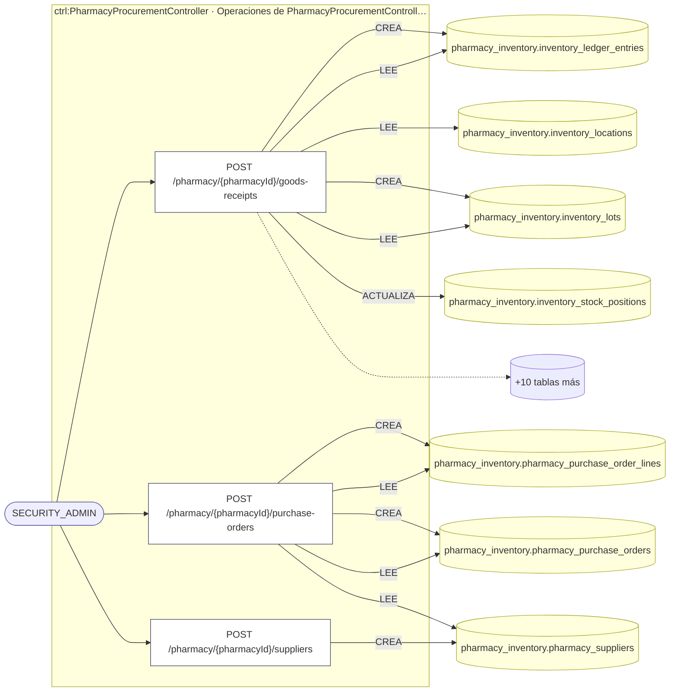

## Máquinas de estado

### Máquina de estados `ORDER_STAFF_TRANSITIONS`

Declarada en `src/modules/pharmacy_inventory/services/pharmacy-orders.service.ts:156`. Los estados llevan el nombre del identificador del código; no se resuelven al catálogo de conceptos.

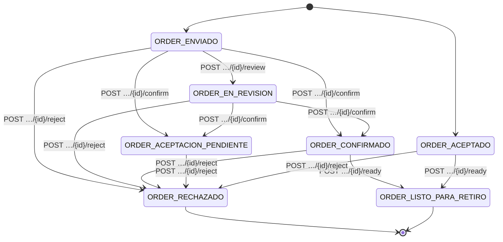

**Operaciones que ejercen esta máquina** _(POR_REFERENCIA: el handler alcanza un método que valida contra la tabla; «sin destino nombrado» significa que el estado de destino llega por el cuerpo de la petición)_:

| Operación | Estados de destino que nombra | A través de |
|---|---|---|
| POST /pharmacy/orders/{id}/confirm | ORDER_ACEPTACION_PENDIENTE, ORDER_CONFIRMADO | PharmacyOrdersService.confirm → PharmacyOrdersService.assertStaffTransition |
| POST /pharmacy/orders/{id}/ready | ORDER_LISTO_PARA_RETIRO | PharmacyOrdersService.ready → PharmacyOrdersService.assertStaffTransition |
| POST /pharmacy/orders/{id}/reject | ORDER_RECHAZADO | PharmacyOrdersService.reject → PharmacyOrdersService.assertStaffTransition |
| POST /pharmacy/orders/{id}/review | ORDER_EN_REVISION | PharmacyOrdersService.openReview → PharmacyOrdersService.assertStaffTransition |

## Árbol de decisión por operación

Cada árbol se deriva del código del handler y de los métodos que invoca (hasta 4 niveles). Una rama que no decide, no escribe y no falla se poda. Los accesos y los efectos consecutivos se agrupan en un solo nodo.

### Operaciones con decisiones propias

#### 1. POST /internal/inventory-sync-batches

Ingerir un lote de sincronización ERP

| HTTP | Código | Cuándo |
|---|---|---|
| 201 | — | Éxito |
| 400 | `VALIDATION_FAILED` | El cuerpo cumple el DTO (sin propiedades extra) |
| 401 | `UNAUTHENTICATED` | Hay una sesión válida (JWT) |
| 403 | `FORBIDDEN` | El rol está permitido; El tenant se resuelve y pertenece al actor |
| 429 | `RATE_LIMITED` | No se supera el límite de solicitudes |

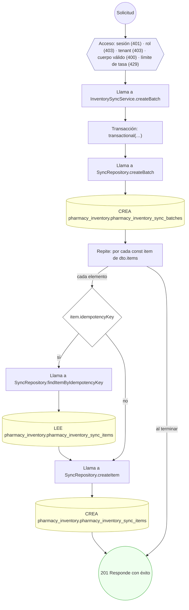

#### 2. POST /internal/inventory-sync/{batchId}/reconcile

Conciliar lote de sincronización externa (UC-25-12)

| HTTP | Código | Cuándo |
|---|---|---|
| 200 | — | Éxito |
| 400 | `VALIDATION_FAILED` | Los parámetros de ruta son UUID válidos |
| 401 | `UNAUTHENTICATED` | Hay una sesión válida (JWT) |
| 403 | `FORBIDDEN` | El rol está permitido; El tenant se resuelve y pertenece al actor |
| 404 | `NOT_FOUND` | ResourceNotFoundException: Lote de sincronización no encontrado |
| 422 | `PRECONDITION_FAILED` | PreconditionFailedException: El lote no está en estado reconciliable |
| 429 | `RATE_LIMITED` | No se supera el límite de solicitudes |

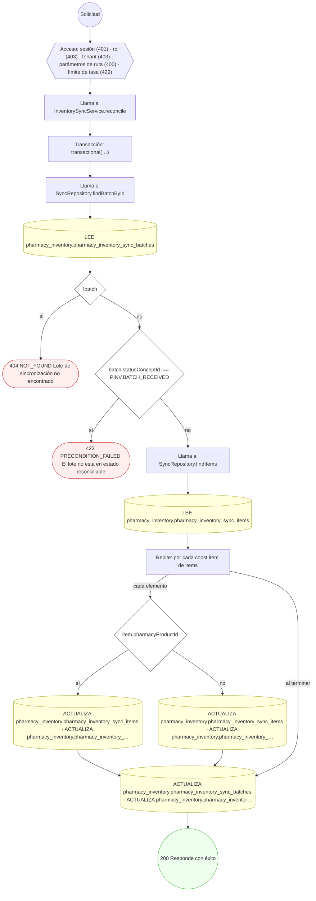

#### 3. POST /internal/reservations/expire

Liberar reservas y pedidos vencidos (UC-25-05)

| HTTP | Código | Cuándo |
|---|---|---|
| 200 | — | Éxito |
| 401 | `UNAUTHENTICATED` | Hay una sesión válida (JWT) |
| 403 | `FORBIDDEN` | El rol está permitido; El tenant se resuelve y pertenece al actor |
| 429 | `RATE_LIMITED` | No se supera el límite de solicitudes |

```mermaid
flowchart TD
  n1(("Solicitud")):::inicio
  n2{{"Acceso: sesión (401) · rol (403) · tenant (403) · límite de tasa (429)"}}:::acceso
  n1 --> n2
  n3["Llama a InventoryReservationsService.expire"]:::llamada
  n2 --> n3
  n4["Transacción: transactional(…)"]:::transaccion
  n3 --> n4
  n5["Llama a ReservationsRepository.findExpired"]:::llamada
  n4 --> n5
  n6[("LEE pharmacy_inventory.inventory_reservations")]:::efecto
  n5 --> n6
  n7["Repite: por cada const reservation de expired"]:::bucle
  n6 --> n7
  n8[("ACTUALIZA pharmacy_inventory.inventory_reservations · ACTUALIZA pharmacy_inventory.inventory_reservations")]:::efecto
  n7 -->|"cada elemento"| n8
  n9["Llama a InventoryReservationsService.releaseConfirmedLines"]:::llamada
  n8 --> n9
  n10["Llama a ReservationsRepository.findLinesByReservation"]:::llamada
  n9 --> n10
  n11[("LEE pharmacy_inventory.inventory_reservation_lines")]:::efecto
  n10 --> n11
  n12["Repite: por cada const rl de lines"]:::bucle
  n11 --> n12
  n13[("ACTUALIZA pharmacy_inventory.inventory_reservation_lines")]:::efecto
  n12 -->|"cada elemento"| n13
  n14{"rl.inventoryLocationId"}:::decision
  n13 --> n14
  n15["Llama a StockPositionsRepository.findByKeyForUpdate"]:::llamada
  n14 -->|"sí"| n15
  n16[("LEE pharmacy_inventory.inventory_stock_positions")]:::efecto
  n15 --> n16
  n17["Llama a LedgerRepository.nextSequence"]:::llamada
  n16 --> n17
  n18[("LEE pharmacy_inventory.inventory_ledger_entries")]:::efecto
  n17 --> n18
  n19["Llama a LedgerRepository.append"]:::llamada
  n18 --> n19
  n20[("CREA pharmacy_inventory.inventory_ledger_entries")]:::efecto
  n19 --> n20
  n21{"position"}:::decision
  n20 --> n21
  n22[("ACTUALIZA pharmacy_inventory.inventory_stock_positions · ACTUALIZA pharmacy_inventory.inventory_stock_positio…")]:::efecto
  n21 -->|"sí"| n22
  n23["Llama a PharmacyOrdersService.expireDue"]:::llamada
  n22 --> n23
  n21 -->|"no"| n23
  n14 -->|"no"| n23
  n12 -->|"al terminar"| n23
  n7 -->|"al terminar"| n23
  n24["Transacción: transactional(…)"]:::transaccion
  n23 --> n24
  n25["Llama a PharmacyOrdersRepository.findDueOrdersForUpdate"]:::llamada
  n24 --> n25
  n26[("LEE pharmacy_inventory.inventory_reservations")]:::efecto
  n25 --> n26
  n27["Llama a PharmacyOrdersRepository.findPharmaciesByIds"]:::llamada
  n26 --> n27
  n28[("LEE pharmacy.pharmacies")]:::efecto
  n27 --> n28
  n29["Repite: por cada const order de due"]:::bucle
  n28 --> n29
  n30[("ACTUALIZA pharmacy_inventory.inventory_reservations · ACTUALIZA pharmacy_inventory.inventory_reservations")]:::efecto
  n29 -->|"cada elemento"| n30
  n31["Llama a InventoryReservationsService.releaseConfirmedLines"]:::llamada
  n30 --> n31
  n32["Llama a ReservationsRepository.findLinesByReservation"]:::llamada
  n31 --> n32
  n33[("LEE pharmacy_inventory.inventory_reservation_lines")]:::efecto
  n32 --> n33
  n34["Repite: por cada const rl de lines"]:::bucle
  n33 --> n34
  n35[("ACTUALIZA pharmacy_inventory.inventory_reservation_lines")]:::efecto
  n34 -->|"cada elemento"| n35
  n36{"rl.inventoryLocationId"}:::decision
  n35 --> n36
  n37["Llama a StockPositionsRepository.findByKeyForUpdate"]:::llamada
  n36 -->|"sí"| n37
  n38[("LEE pharmacy_inventory.inventory_stock_positions")]:::efecto
  n37 --> n38
  n39["Llama a LedgerRepository.nextSequence"]:::llamada
  n38 --> n39
  n40[("LEE pharmacy_inventory.inventory_ledger_entries")]:::efecto
  n39 --> n40
  n41["Llama a LedgerRepository.append"]:::llamada
  n40 --> n41
  n42[("CREA pharmacy_inventory.inventory_ledger_entries")]:::efecto
  n41 --> n42
  n43{"position"}:::decision
  n42 --> n43
  n44[("ACTUALIZA pharmacy_inventory.inventory_stock_positions · ACTUALIZA pharmacy_inventory.inventory_stock_positio…")]:::efecto
  n43 -->|"sí"| n44
  n45["Llama a OutboxService.publishDomainEvent"]:::llamada
  n44 --> n45
  n43 -->|"no"| n45
  n36 -->|"no"| n45
  n34 -->|"al terminar"| n45
  n46["Llama a MessagingTraceService.runInProducerSpan"]:::llamada
  n45 --> n46
  n47["Transacción: startActiveSpan(…)"]:::transaccion
  n46 --> n47
  n48["Intenta"]:::intento
  n47 --> n48
  n49(["↩ (relanza el error capturado)"]):::error
  n48 -->|"si falla"| n49
  n50["Llama a OutboxService.persistDomainEvent"]:::llamada
  n48 --> n50
  n51["Llama a OutboxRepository.findOutboxByIdempotencyKey"]:::llamada
  n50 --> n51
  n52[("LEE messaging.outbox_messages")]:::efecto
  n51 --> n52
  n53["Llama a OutboxRepository.createDomainEvent"]:::llamada
  n52 --> n53
  n54[("CREA messaging.domain_events")]:::efecto
  n53 --> n54
  n55["Llama a OutboxRepository.createOutboxMessage"]:::llamada
  n54 --> n55
  n56[("CREA messaging.outbox_messages")]:::efecto
  n55 --> n56
  n57>"Evento PharmacyOrderExpired"]:::evento
  n56 --> n57
  n58["Repite: por cada const notice de expired"]:::bucle
  n57 --> n58
  n29 -->|"al terminar"| n58
  n59{"notice.medicationRequestId"}:::decision
  n58 -->|"cada elemento"| n59
  n60["Llama a PharmacyOrdersRepository.findPrescriberProfileId"]:::llamada
  n59 -->|"sí"| n60
  n61[("LEE clinical.medication_requests")]:::efecto
  n60 --> n61
  n62{"prescriberProfileId"}:::decision
  n61 --> n62
  n63["Llama a PharmacyOrderNotificationsService.expiredToPrescriber"]:::llamada
  n62 -->|"sí"| n63
  n64["Llama a PharmacyOrderNotificationsService.emitToPerson"]:::llamada
  n63 --> n64
  n65["Intenta"]:::intento
  n64 --> n65
  n66["Llama a PersonAccountLinksRepository.findActiveByPerson"]:::llamada
  n65 --> n66
  n67[("LEE profiles.person_account_links")]:::efecto
  n66 --> n67
  n68(("200 Responde con éxito")):::ok
  n67 --> n68
  n62 -->|"no"| n68
  n59 -->|"no"| n68
  n58 -->|"al terminar"| n68
  classDef acceso fill:#eef,stroke:#66a
  classDef error fill:#fee,stroke:#c33
  classDef ok fill:#efe,stroke:#3a3
  classDef efecto fill:#ffd,stroke:#aa3
  classDef decision fill:#fff,stroke:#555
  classDef corte fill:#eee,stroke:#999,stroke-dasharray: 4
```

#### 4. GET /pharmacy-inventory/availability

Consultar qué sedes pueden surtir un conjunto de productos

| HTTP | Código | Cuándo |
|---|---|---|
| 200 | — | Éxito |
| 400 | `VALIDATION_FAILED` | Están los parámetros de consulta obligatorios; BadRequestException: products es obligatorio: la disponibilidad se consulta para un pedido concreto |
| 401 | `UNAUTHENTICATED` | Hay una sesión válida (JWT) |
| 403 | `FORBIDDEN` | El rol está permitido; El tenant se resuelve y pertenece al actor |
| 429 | `RATE_LIMITED` | No se supera el límite de solicitudes |

```mermaid
flowchart TD
  n1(("Solicitud")):::inicio
  n2{{"Acceso: sesión (401) · rol (403) · tenant (403) · parámetros de consulta (400) · límite de tasa (429)"}}:::acceso
  n1 --> n2
  n3{"!productIds"}:::decision
  n2 --> n3
  n4(["400 VALIDATION_FAILED products es obligatorio: la disponibilidad se consulta para un pedido concreto"]):::error
  n3 -->|"sí"| n4
  n5["Llama a PharmacyInventoryReadService.availability"]:::llamada
  n3 -->|"no"| n5
  n6["Llama a PharmacyReadRepository.findVisibleByTenant"]:::llamada
  n5 --> n6
  n7[("LEE pharmacy.pharmacies")]:::efecto
  n6 --> n7
  n8["Llama a PharmacyReadRepository.findActiveProductsByIds"]:::llamada
  n7 --> n8
  n9[("LEE pharmacy.pharmacy_products")]:::efecto
  n8 --> n9
  n10["Llama a PharmacyReadRepository.findActiveSites"]:::llamada
  n9 --> n10
  n11[("LEE pharmacy.pharmacy_sites")]:::efecto
  n10 --> n11
  n12["Llama a InventoryReadRepository.findActiveLocationsBySites"]:::llamada
  n11 --> n12
  n13[("LEE pharmacy_inventory.inventory_locations")]:::efecto
  n12 --> n13
  n14["Llama a PharmacyReadRepository.findCurrentPublicPriceLists"]:::llamada
  n13 --> n14
  n15[("LEE pharmacy.pharmacy_price_lists")]:::efecto
  n14 --> n15
  n16["Llama a PharmacyInventoryReadService.resolveAddresses"]:::llamada
  n15 --> n16
  n17["Llama a PharmacyReadRepository.findPracticeSites"]:::llamada
  n16 --> n17
  n18[("LEE practice.practice_sites")]:::efecto
  n17 --> n18
  n19["Llama a PharmacyReadRepository.findAddresses"]:::llamada
  n18 --> n19
  n20[("LEE common.addresses")]:::efecto
  n19 --> n20
  n21["Llama a InventoryReadRepository.findStockPositions"]:::llamada
  n20 --> n21
  n22[("LEE pharmacy_inventory.inventory_stock_positions")]:::efecto
  n21 --> n22
  n23["Llama a PharmacyReadRepository.findCurrentPrices"]:::llamada
  n22 --> n23
  n24[("LEE pharmacy.pharmacy_product_prices")]:::efecto
  n23 --> n24
  n25["Llama a PharmacyReadRepository.findConcepts"]:::llamada
  n24 --> n25
  n26[("LEE terminology.catalog_concepts")]:::efecto
  n25 --> n26
  n27(("200 Responde con éxito")):::ok
  n26 --> n27
  classDef acceso fill:#eef,stroke:#66a
  classDef error fill:#fee,stroke:#c33
  classDef ok fill:#efe,stroke:#3a3
  classDef efecto fill:#ffd,stroke:#aa3
  classDef decision fill:#fff,stroke:#555
  classDef corte fill:#eee,stroke:#999,stroke-dasharray: 4
```

#### 5. GET /pharmacy-inventory/sites/{siteId}/stock

Consultar el stock disponible de una sede

| HTTP | Código | Cuándo |
|---|---|---|
| 200 | — | Éxito |
| 400 | `VALIDATION_FAILED` | Los parámetros de ruta son UUID válidos |
| 401 | `UNAUTHENTICATED` | Hay una sesión válida (JWT) |
| 403 | `FORBIDDEN` | El rol está permitido; El tenant se resuelve y pertenece al actor |
| 404 | `NOT_FOUND` | ResourceNotFoundException: Sede de farmacia no encontrada |
| 429 | `RATE_LIMITED` | No se supera el límite de solicitudes |

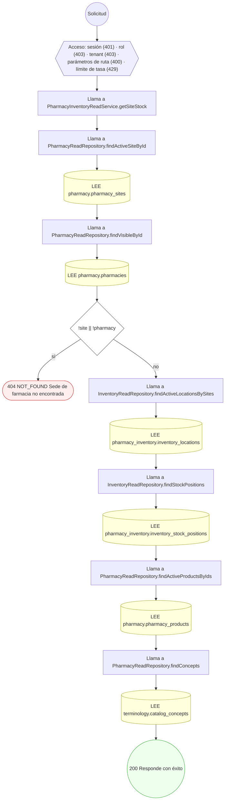

#### 6. POST /pharmacy/{pharmacyId}/dispensations

Dispensar una prescripción a un paciente (UC-25-03)

| HTTP | Código | Cuándo |
|---|---|---|
| 201 | — | Éxito |
| 400 | `VALIDATION_FAILED` | Los parámetros de ruta son UUID válidos; El cuerpo cumple el DTO (sin propiedades extra) |
| 401 | `UNAUTHENTICATED` | Hay una sesión válida (JWT) |
| 403 | `FORBIDDEN` | El rol está permitido; El tenant se resuelve y pertenece al actor |
| 404 | `NOT_FOUND` | ResourceNotFoundException: Reserva no encontrada |
| 422 | `PRECONDITION_FAILED` | PreconditionFailedException: La reserva es un pedido de paciente: se dispensa con su código de retiro por POST /pharmacy/orders/:id/dispense; PreconditionFailedException: Stock insuficiente para dispensar |
| 429 | `RATE_LIMITED` | No se supera el límite de solicitudes |

```mermaid
flowchart TD
  n1(("Solicitud")):::inicio
  n2{{"Acceso: sesión (401) · rol (403) · tenant (403) · parámetros de ruta (400) · cuerpo válido (400) · límite de…"}}:::acceso
  n1 --> n2
  n3["Llama a MedicationDispensationsService.dispense"]:::llamada
  n2 --> n3
  n4["Transacción: transactional(…)"]:::transaccion
  n3 --> n4
  n5{"dto.idempotencyKey"}:::decision
  n4 --> n5
  n6["Llama a DispensationsRepository.findByIdempotencyKey"]:::llamada
  n5 -->|"sí"| n6
  n7[("LEE pharmacy_inventory.medication_dispensations")]:::efecto
  n6 --> n7
  n8{"existing"}:::decision
  n7 --> n8
  n9["Llama a DispensationsRepository.findLines"]:::llamada
  n8 -->|"sí"| n9
  n10[("LEE pharmacy_inventory.medication_dispensation_lines")]:::efecto
  n9 --> n10
  n11["Llama a LedgerRepository.findEntryIdsBySource"]:::llamada
  n10 --> n11
  n12[("LEE pharmacy_inventory.inventory_ledger_entries")]:::efecto
  n11 --> n12
  n13{"dto.inventoryReservationId"}:::decision
  n12 --> n13
  n8 -->|"no"| n13
  n5 -->|"no"| n13
  n14["Llama a ReservationsRepository.findById"]:::llamada
  n13 -->|"sí"| n14
  n15[("LEE pharmacy_inventory.inventory_reservations")]:::efecto
  n14 --> n15
  n16{"!reservation"}:::decision
  n15 --> n16
  n17(["404 NOT_FOUND Reserva no encontrada"]):::error
  n16 -->|"sí"| n17
  n18{"ORDER_STATUS_IDS.includes(reservation.reservationStatusConceptId)"}:::decision
  n16 -->|"no"| n18
  n19(["422 PRECONDITION_FAILED La reserva es un pedido de paciente: se dispensa con su código de retiro por POST /ph…"]):::error
  n18 -->|"sí"| n19
  n20["Llama a DispensationsRepository.create"]:::llamada
  n18 -->|"no"| n20
  n13 -->|"no"| n20
  n21[("CREA pharmacy_inventory.medication_dispensations")]:::efecto
  n20 --> n21
  n22["Repite: por cada const line de dto.lines"]:::bucle
  n21 --> n22
  n23["Llama a StockPositionsRepository.findByKeyForUpdate"]:::llamada
  n22 -->|"cada elemento"| n23
  n24[("LEE pharmacy_inventory.inventory_stock_positions")]:::efecto
  n23 --> n24
  n25{"!position || num(position.onHandQuantity) ‹ line.dispensedQuantity"}:::decision
  n24 --> n25
  n26(["422 PRECONDITION_FAILED Stock insuficiente para dispensar"]):::error
  n25 -->|"sí"| n26
  n27["Llama a DispensationsRepository.createLine"]:::llamada
  n25 -->|"no"| n27
  n28[("CREA pharmacy_inventory.medication_dispensation_lines")]:::efecto
  n27 --> n28
  n29["Llama a LedgerRepository.nextSequence"]:::llamada
  n28 --> n29
  n30[("LEE pharmacy_inventory.inventory_ledger_entries")]:::efecto
  n29 --> n30
  n31["Llama a LedgerRepository.append"]:::llamada
  n30 --> n31
  n32[("CREA pharmacy_inventory.inventory_ledger_entries")]:::efecto
  n31 --> n32
  n33[("ACTUALIZA pharmacy_inventory.inventory_stock_positions")]:::efecto
  n32 --> n33
  n34{"dto.inventoryReservationId && num(position.reservedQuantity) ›= line.dispensedQuantity"}:::decision
  n33 --> n34
  n35[("ACTUALIZA pharmacy_inventory.inventory_stock_positions")]:::efecto
  n34 -->|"sí"| n35
  n36[("ACTUALIZA pharmacy_inventory.inventory_stock_positions · ACTUALIZA pharmacy_inventory.inventory_stock_positio…")]:::efecto
  n35 --> n36
  n34 -->|"no"| n36
  n37{"dto.inventoryReservationId"}:::decision
  n36 --> n37
  n22 -->|"al terminar"| n37
  n38["Llama a ReservationsRepository.findById"]:::llamada
  n37 -->|"sí"| n38
  n39[("LEE pharmacy_inventory.inventory_reservations")]:::efecto
  n38 --> n39
  n40{"reservation"}:::decision
  n39 --> n40
  n41[("ACTUALIZA pharmacy_inventory.inventory_reservations")]:::efecto
  n40 -->|"sí"| n41
  n42["Llama a ReservationsRepository.findLinesByReservation"]:::llamada
  n41 --> n42
  n43[("LEE pharmacy_inventory.inventory_reservation_lines")]:::efecto
  n42 --> n43
  n44["Repite: por cada const rl de rlines"]:::bucle
  n43 --> n44
  n45[("ACTUALIZA pharmacy_inventory.inventory_reservation_lines · ACTUALIZA pharmacy_inventory.inventory_reservation…")]:::efecto
  n44 -->|"cada elemento"| n45
  n46(("201 Responde con éxito")):::ok
  n45 --> n46
  n44 -->|"al terminar"| n46
  n40 -->|"no"| n46
  n37 -->|"no"| n46
  classDef acceso fill:#eef,stroke:#66a
  classDef error fill:#fee,stroke:#c33
  classDef ok fill:#efe,stroke:#3a3
  classDef efecto fill:#ffd,stroke:#aa3
  classDef decision fill:#fff,stroke:#555
  classDef corte fill:#eee,stroke:#999,stroke-dasharray: 4
```

#### 7. POST /pharmacy/{pharmacyId}/goods-receipts

Recepcionar mercancía por lote (UC-25-02)

| HTTP | Código | Cuándo |
|---|---|---|
| 201 | — | Éxito |
| 400 | `VALIDATION_FAILED` | Los parámetros de ruta son UUID válidos; El cuerpo cumple el DTO (sin propiedades extra) |
| 401 | `UNAUTHENTICATED` | Hay una sesión válida (JWT) |
| 403 | `FORBIDDEN` | El rol está permitido; El tenant se resuelve y pertenece al actor |
| 404 | `NOT_FOUND` | ResourceNotFoundException: Orden de compra no encontrada; ResourceNotFoundException: Ubicación destino no encontrada; ResourceNotFoundException: Línea de orden no encontrada |
| 422 | `PRECONDITION_FAILED` | PreconditionFailedException: La orden no admite recepción |
| 429 | `RATE_LIMITED` | No se supera el límite de solicitudes |

```mermaid
flowchart TD
  n1(("Solicitud")):::inicio
  n2{{"Acceso: sesión (401) · rol (403) · tenant (403) · parámetros de ruta (400) · cuerpo válido (400) · límite de…"}}:::acceso
  n1 --> n2
  n3["Llama a PharmacyProcurementService.receiveGoods"]:::llamada
  n2 --> n3
  n4["Transacción: transactional(…)"]:::transaccion
  n3 --> n4
  n5{"dto.idempotencyKey"}:::decision
  n4 --> n5
  n6["Llama a GoodsReceiptsRepository.findByIdempotencyKey"]:::llamada
  n5 -->|"sí"| n6
  n7[("LEE pharmacy_inventory.pharmacy_goods_receipts")]:::efecto
  n6 --> n7
  n8{"existing"}:::decision
  n7 --> n8
  n9["Llama a GoodsReceiptsRepository.findLines"]:::llamada
  n8 -->|"sí"| n9
  n10[("LEE pharmacy_inventory.pharmacy_goods_receipt_lines")]:::efecto
  n9 --> n10
  n11["Llama a LedgerRepository.findEntryIdsBySource"]:::llamada
  n10 --> n11
  n12[("LEE pharmacy_inventory.inventory_ledger_entries")]:::efecto
  n11 --> n12
  n13["Llama a PurchaseOrdersRepository.findById"]:::llamada
  n12 --> n13
  n8 -->|"no"| n13
  n5 -->|"no"| n13
  n14[("LEE pharmacy_inventory.pharmacy_purchase_orders")]:::efecto
  n13 --> n14
  n15{"!order"}:::decision
  n14 --> n15
  n16(["404 NOT_FOUND Orden de compra no encontrada"]):::error
  n15 -->|"sí"| n16
  n17{"order.statusConceptId !== PINV.PO_ORDERED && order.statusConceptId !== PINV.PO_PARTIAL"}:::decision
  n15 -->|"no"| n17
  n18(["422 PRECONDITION_FAILED La orden no admite recepción"]):::error
  n17 -->|"sí"| n18
  n19["Llama a LocationsRepository.findById"]:::llamada
  n17 -->|"no"| n19
  n20[("LEE pharmacy_inventory.inventory_locations")]:::efecto
  n19 --> n20
  n21{"!location"}:::decision
  n20 --> n21
  n22(["404 NOT_FOUND Ubicación destino no encontrada"]):::error
  n21 -->|"sí"| n22
  n23["Llama a GoodsReceiptsRepository.create"]:::llamada
  n21 -->|"no"| n23
  n24[("CREA pharmacy_inventory.pharmacy_goods_receipts")]:::efecto
  n23 --> n24
  n25["Repite: por cada const line de dto.lines"]:::bucle
  n24 --> n25
  n26["Llama a PurchaseOrdersRepository.findLineById"]:::llamada
  n25 -->|"cada elemento"| n26
  n27[("LEE pharmacy_inventory.pharmacy_purchase_order_lines")]:::efecto
  n26 --> n27
  n28{"!poLine"}:::decision
  n27 --> n28
  n29(["404 NOT_FOUND Línea de orden no encontrada"]):::error
  n28 -->|"sí"| n29
  n30["Llama a LotsRepository.findByProductAndNumber"]:::llamada
  n28 -->|"no"| n30
  n31[("LEE pharmacy_inventory.inventory_lots")]:::efecto
  n30 --> n31
  n32{"!lot"}:::decision
  n31 --> n32
  n33["Llama a LotsRepository.create"]:::llamada
  n32 -->|"sí"| n33
  n34[("CREA pharmacy_inventory.inventory_lots")]:::efecto
  n33 --> n34
  n35["Llama a LedgerRepository.nextSequence"]:::llamada
  n34 --> n35
  n32 -->|"no"| n35
  n36[("LEE pharmacy_inventory.inventory_ledger_entries")]:::efecto
  n35 --> n36
  n37["Llama a LedgerRepository.append"]:::llamada
  n36 --> n37
  n38[("CREA pharmacy_inventory.inventory_ledger_entries")]:::efecto
  n37 --> n38
  n39["Llama a StockPositionsRepository.findByKeyForUpdate"]:::llamada
  n38 --> n39
  n40[("LEE pharmacy_inventory.inventory_stock_positions")]:::efecto
  n39 --> n40
  n41{"!position"}:::decision
  n40 --> n41
  n42["Llama a StockPositionsRepository.create"]:::llamada
  n41 -->|"sí"| n42
  n43[("CREA pharmacy_inventory.inventory_stock_positions")]:::efecto
  n42 --> n43
  n44[("ACTUALIZA pharmacy_inventory.inventory_stock_positions · ACTUALIZA pharmacy_inventory.inventory_stock_positio…")]:::efecto
  n41 -->|"no"| n44
  n45["Llama a GoodsReceiptsRepository.createLine"]:::llamada
  n43 --> n45
  n44 --> n45
  n46[("CREA pharmacy_inventory.pharmacy_goods_receipt_lines")]:::efecto
  n45 --> n46
  n47[("ACTUALIZA pharmacy_inventory.pharmacy_purchase_order_lines · ACTUALIZA pharmacy_inventory.pharmacy_purchase_o…")]:::efecto
  n46 --> n47
  n48[("ACTUALIZA pharmacy_inventory.pharmacy_purchase_orders")]:::efecto
  n47 --> n48
  n25 -->|"al terminar"| n48
  n49(("201 Responde con éxito")):::ok
  n48 --> n49
  classDef acceso fill:#eef,stroke:#66a
  classDef error fill:#fee,stroke:#c33
  classDef ok fill:#efe,stroke:#3a3
  classDef efecto fill:#ffd,stroke:#aa3
  classDef decision fill:#fff,stroke:#555
  classDef corte fill:#eee,stroke:#999,stroke-dasharray: 4
```

#### 8. POST /pharmacy/{pharmacyId}/purchase-orders

Emitir una orden de compra a proveedor (UC-25-01)

| HTTP | Código | Cuándo |
|---|---|---|
| 201 | — | Éxito |
| 400 | `VALIDATION_FAILED` | Los parámetros de ruta son UUID válidos; El cuerpo cumple el DTO (sin propiedades extra) |
| 401 | `UNAUTHENTICATED` | Hay una sesión válida (JWT) |
| 403 | `FORBIDDEN` | El rol está permitido; El tenant se resuelve y pertenece al actor |
| 404 | `NOT_FOUND` | ResourceNotFoundException: Proveedor no encontrado |
| 422 | `PRECONDITION_FAILED` | PreconditionFailedException: El proveedor no está activo |
| 429 | `RATE_LIMITED` | No se supera el límite de solicitudes |

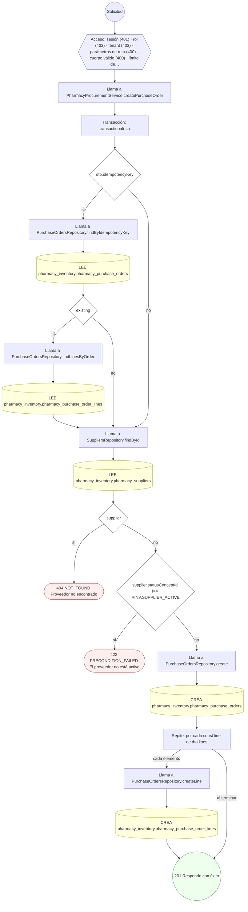

#### 9. POST /pharmacy/{pharmacyId}/reservations

Reservar stock para una prescripción (UC-25-04)

| HTTP | Código | Cuándo |
|---|---|---|
| 201 | — | Éxito |
| 400 | `VALIDATION_FAILED` | Los parámetros de ruta son UUID válidos; El cuerpo cumple el DTO (sin propiedades extra) |
| 401 | `UNAUTHENTICATED` | Hay una sesión válida (JWT) |
| 403 | `FORBIDDEN` | El rol está permitido; El tenant se resuelve y pertenece al actor |
| 422 | `PRECONDITION_FAILED` | PreconditionFailedException: Stock disponible insuficiente para reservar |
| 429 | `RATE_LIMITED` | No se supera el límite de solicitudes |

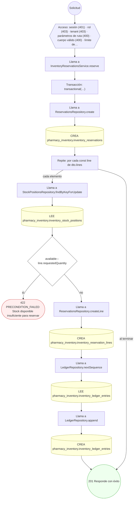

#### 10. POST /pharmacy/{pharmacyId}/transfers

Transferir stock entre ubicaciones (UC-25-10)

| HTTP | Código | Cuándo |
|---|---|---|
| 201 | — | Éxito |
| 400 | `VALIDATION_FAILED` | Los parámetros de ruta son UUID válidos; El cuerpo cumple el DTO (sin propiedades extra) |
| 401 | `UNAUTHENTICATED` | Hay una sesión válida (JWT) |
| 403 | `FORBIDDEN` | El rol está permitido; El tenant se resuelve y pertenece al actor |
| 404 | `NOT_FOUND` | ResourceNotFoundException: Ubicación origen no encontrada; ResourceNotFoundException: Ubicación destino no encontrada |
| 422 | `PRECONDITION_FAILED` | PreconditionFailedException: Stock disponible insuficiente en origen |
| 429 | `RATE_LIMITED` | No se supera el límite de solicitudes |

```mermaid
flowchart TD
  n1(("Solicitud")):::inicio
  n2{{"Acceso: sesión (401) · rol (403) · tenant (403) · parámetros de ruta (400) · cuerpo válido (400) · límite de…"}}:::acceso
  n1 --> n2
  n3["Llama a InventoryTransfersService.transfer"]:::llamada
  n2 --> n3
  n4["Transacción: transactional(…)"]:::transaccion
  n3 --> n4
  n5["Llama a LocationsRepository.findById"]:::llamada
  n4 --> n5
  n6[("LEE pharmacy_inventory.inventory_locations")]:::efecto
  n5 --> n6
  n7{"!from"}:::decision
  n6 --> n7
  n8(["404 NOT_FOUND Ubicación origen no encontrada"]):::error
  n7 -->|"sí"| n8
  n9["Llama a LocationsRepository.findById"]:::llamada
  n7 -->|"no"| n9
  n10[("LEE pharmacy_inventory.inventory_locations")]:::efecto
  n9 --> n10
  n11{"!to"}:::decision
  n10 --> n11
  n12(["404 NOT_FOUND Ubicación destino no encontrada"]):::error
  n11 -->|"sí"| n12
  n13["Llama a StockPositionsRepository.findByKeyForUpdate"]:::llamada
  n11 -->|"no"| n13
  n14[("LEE pharmacy_inventory.inventory_stock_positions")]:::efecto
  n13 --> n14
  n15{"!fromPosition || num(fromPosition.availableQuantity) ‹ dto.quantity"}:::decision
  n14 --> n15
  n16(["422 PRECONDITION_FAILED Stock disponible insuficiente en origen"]):::error
  n15 -->|"sí"| n16
  n17["Llama a LedgerRepository.nextSequence"]:::llamada
  n15 -->|"no"| n17
  n18[("LEE pharmacy_inventory.inventory_ledger_entries")]:::efecto
  n17 --> n18
  n19["Llama a LedgerRepository.append"]:::llamada
  n18 --> n19
  n20[("CREA pharmacy_inventory.inventory_ledger_entries")]:::efecto
  n19 --> n20
  n21["Llama a LedgerRepository.nextSequence"]:::llamada
  n20 --> n21
  n22[("LEE pharmacy_inventory.inventory_ledger_entries")]:::efecto
  n21 --> n22
  n23["Llama a LedgerRepository.append"]:::llamada
  n22 --> n23
  n24[("CREA pharmacy_inventory.inventory_ledger_entries")]:::efecto
  n23 --> n24
  n25[("ACTUALIZA pharmacy_inventory.inventory_stock_positions · ACTUALIZA pharmacy_inventory.inventory_stock_positio…")]:::efecto
  n24 --> n25
  n26["Llama a StockPositionsRepository.findByKeyForUpdate"]:::llamada
  n25 --> n26
  n27[("LEE pharmacy_inventory.inventory_stock_positions")]:::efecto
  n26 --> n27
  n28{"!toPosition"}:::decision
  n27 --> n28
  n29["Llama a StockPositionsRepository.create"]:::llamada
  n28 -->|"sí"| n29
  n30[("CREA pharmacy_inventory.inventory_stock_positions")]:::efecto
  n29 --> n30
  n31[("ACTUALIZA pharmacy_inventory.inventory_stock_positions · ACTUALIZA pharmacy_inventory.inventory_stock_positio…")]:::efecto
  n28 -->|"no"| n31
  n32(("201 Responde con éxito")):::ok
  n30 --> n32
  n31 --> n32
  classDef acceso fill:#eef,stroke:#66a
  classDef error fill:#fee,stroke:#c33
  classDef ok fill:#efe,stroke:#3a3
  classDef efecto fill:#ffd,stroke:#aa3
  classDef decision fill:#fff,stroke:#555
  classDef corte fill:#eee,stroke:#999,stroke-dasharray: 4
```

#### 11. POST /pharmacy/{siteId}/count-sessions

Iniciar y congelar una sesión de conteo (UC-25-06)

| HTTP | Código | Cuándo |
|---|---|---|
| 201 | — | Éxito |
| 400 | `VALIDATION_FAILED` | Los parámetros de ruta son UUID válidos; El cuerpo cumple el DTO (sin propiedades extra) |
| 401 | `UNAUTHENTICATED` | Hay una sesión válida (JWT) |
| 403 | `FORBIDDEN` | El rol está permitido; El tenant se resuelve y pertenece al actor |
| 404 | `NOT_FOUND` | ResourceNotFoundException: Ubicación no encontrada |
| 409 | `CONFLICT` | ConflictException: Ya existe una sesión de conteo abierta en la ubicación |
| 429 | `RATE_LIMITED` | No se supera el límite de solicitudes |

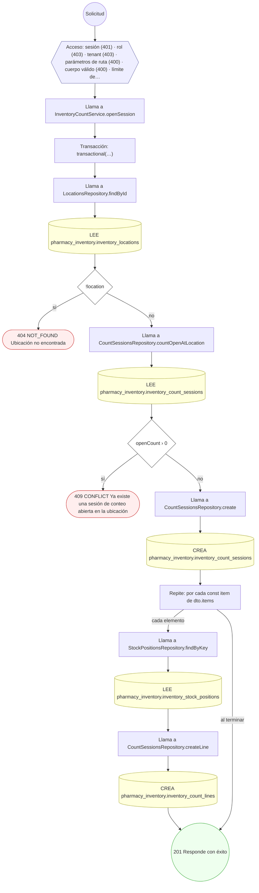

#### 12. POST /pharmacy/count-sessions/{id}/approve

Aprobar conteo y ajustar ledger por varianza (UC-25-07)

| HTTP | Código | Cuándo |
|---|---|---|
| 200 | — | Éxito |
| 400 | `VALIDATION_FAILED` | Los parámetros de ruta son UUID válidos; El cuerpo cumple el DTO (sin propiedades extra) |
| 401 | `UNAUTHENTICATED` | Hay una sesión válida (JWT) |
| 403 | `FORBIDDEN` | El rol está permitido; El tenant se resuelve y pertenece al actor |
| 404 | `NOT_FOUND` | ResourceNotFoundException: Sesión de conteo no encontrada; ResourceNotFoundException: Línea de conteo no encontrada |
| 422 | `PRECONDITION_FAILED` | PreconditionFailedException: La sesión no está en estado aprobable |
| 429 | `RATE_LIMITED` | No se supera el límite de solicitudes |

```mermaid
flowchart TD
  n1(("Solicitud")):::inicio
  n2{{"Acceso: sesión (401) · rol (403) · tenant (403) · parámetros de ruta (400) · cuerpo válido (400) · límite de…"}}:::acceso
  n1 --> n2
  n3["Llama a InventoryCountService.approve"]:::llamada
  n2 --> n3
  n4["Transacción: transactional(…)"]:::transaccion
  n3 --> n4
  n5["Llama a CountSessionsRepository.findById"]:::llamada
  n4 --> n5
  n6[("LEE pharmacy_inventory.inventory_count_sessions")]:::efecto
  n5 --> n6
  n7{"!session"}:::decision
  n6 --> n7
  n8(["404 NOT_FOUND Sesión de conteo no encontrada"]):::error
  n7 -->|"sí"| n8
  n9{"!approvable.includes(session.statusConceptId)"}:::decision
  n7 -->|"no"| n9
  n10(["422 PRECONDITION_FAILED La sesión no está en estado aprobable"]):::error
  n9 -->|"sí"| n10
  n11["Repite: por cada const [lineId, counted] de countByLine"]:::bucle
  n9 -->|"no"| n11
  n12["Llama a CountSessionsRepository.findLineById"]:::llamada
  n11 -->|"cada elemento"| n12
  n13[("LEE pharmacy_inventory.inventory_count_lines")]:::efecto
  n12 --> n13
  n14{"!line || line.inventoryCountSessionId !== session.id"}:::decision
  n13 --> n14
  n15(["404 NOT_FOUND Línea de conteo no encontrada"]):::error
  n14 -->|"sí"| n15
  n16[("ACTUALIZA pharmacy_inventory.inventory_count_lines · ACTUALIZA pharmacy_inventory.inventory_count_lines")]:::efecto
  n14 -->|"no"| n16
  n17{"variance !== 0"}:::decision
  n16 --> n17
  n18[("ACTUALIZA pharmacy_inventory.inventory_count_lines")]:::efecto
  n17 -->|"sí"| n18
  n19["Llama a LedgerRepository.nextSequence"]:::llamada
  n18 --> n19
  n20[("LEE pharmacy_inventory.inventory_ledger_entries")]:::efecto
  n19 --> n20
  n21["Llama a LedgerRepository.append"]:::llamada
  n20 --> n21
  n22[("CREA pharmacy_inventory.inventory_ledger_entries")]:::efecto
  n21 --> n22
  n23["Llama a StockPositionsRepository.findByKeyForUpdate"]:::llamada
  n22 --> n23
  n24[("LEE pharmacy_inventory.inventory_stock_positions")]:::efecto
  n23 --> n24
  n25{"position"}:::decision
  n24 --> n25
  n26[("ACTUALIZA pharmacy_inventory.inventory_stock_positions · ACTUALIZA pharmacy_inventory.inventory_stock_positio…")]:::efecto
  n25 -->|"sí"| n26
  n27[("ACTUALIZA pharmacy_inventory.inventory_count_sessions · ACTUALIZA pharmacy_inventory.inventory_count_sessions…")]:::efecto
  n26 --> n27
  n25 -->|"no"| n27
  n17 -->|"no"| n27
  n11 -->|"al terminar"| n27
  n28(("200 Responde con éxito")):::ok
  n27 --> n28
  classDef acceso fill:#eef,stroke:#66a
  classDef error fill:#fee,stroke:#c33
  classDef ok fill:#efe,stroke:#3a3
  classDef efecto fill:#ffd,stroke:#aa3
  classDef decision fill:#fff,stroke:#555
  classDef corte fill:#eee,stroke:#999,stroke-dasharray: 4
```

#### 13. POST /pharmacy/dispensations/{id}/reverse

Reversar una dispensación (UC-25-11)

| HTTP | Código | Cuándo |
|---|---|---|
| 200 | — | Éxito |
| 400 | `VALIDATION_FAILED` | Los parámetros de ruta son UUID válidos; El cuerpo cumple el DTO (sin propiedades extra) |
| 401 | `UNAUTHENTICATED` | Hay una sesión válida (JWT) |
| 403 | `FORBIDDEN` | El rol está permitido; El tenant se resuelve y pertenece al actor |
| 404 | `NOT_FOUND` | ResourceNotFoundException: Dispensación no encontrada |
| 422 | `PRECONDITION_FAILED` | PreconditionFailedException: La dispensación no está en estado reversible |
| 429 | `RATE_LIMITED` | No se supera el límite de solicitudes |

```mermaid
flowchart TD
  n1(("Solicitud")):::inicio
  n2{{"Acceso: sesión (401) · rol (403) · tenant (403) · parámetros de ruta (400) · cuerpo válido (400) · límite de…"}}:::acceso
  n1 --> n2
  n3["Llama a MedicationDispensationsService.reverse"]:::llamada
  n2 --> n3
  n4["Transacción: transactional(…)"]:::transaccion
  n3 --> n4
  n5["Llama a DispensationsRepository.findById"]:::llamada
  n4 --> n5
  n6[("LEE pharmacy_inventory.medication_dispensations")]:::efecto
  n5 --> n6
  n7{"!dispensation"}:::decision
  n6 --> n7
  n8(["404 NOT_FOUND Dispensación no encontrada"]):::error
  n7 -->|"sí"| n8
  n9{"dispensation.dispensationStatusConceptId !== PINV.DISPENSE_DISPENSED"}:::decision
  n7 -->|"no"| n9
  n10(["422 PRECONDITION_FAILED La dispensación no está en estado reversible"]):::error
  n9 -->|"sí"| n10
  n11[("ACTUALIZA pharmacy_inventory.medication_dispensations")]:::efecto
  n9 -->|"no"| n11
  n12["Llama a DispensationsRepository.findLines"]:::llamada
  n11 --> n12
  n13[("LEE pharmacy_inventory.medication_dispensation_lines")]:::efecto
  n12 --> n13
  n14["Repite: por cada const dl de lines"]:::bucle
  n13 --> n14
  n15["Llama a LedgerRepository.nextSequence"]:::llamada
  n14 -->|"cada elemento"| n15
  n16[("LEE pharmacy_inventory.inventory_ledger_entries")]:::efecto
  n15 --> n16
  n17{"locationId"}:::decision
  n16 --> n17
  n18["Llama a LedgerRepository.append"]:::llamada
  n17 -->|"sí"| n18
  n19[("CREA pharmacy_inventory.inventory_ledger_entries")]:::efecto
  n18 --> n19
  n20["Llama a StockPositionsRepository.findByKeyForUpdate"]:::llamada
  n19 --> n20
  n21[("LEE pharmacy_inventory.inventory_stock_positions")]:::efecto
  n20 --> n21
  n22{"position"}:::decision
  n21 --> n22
  n23[("ACTUALIZA pharmacy_inventory.inventory_stock_positions · ACTUALIZA pharmacy_inventory.inventory_stock_positio…")]:::efecto
  n22 -->|"sí"| n23
  n24(("200 Responde con éxito")):::ok
  n23 --> n24
  n22 -->|"no"| n24
  n17 -->|"no"| n24
  n14 -->|"al terminar"| n24
  classDef acceso fill:#eef,stroke:#66a
  classDef error fill:#fee,stroke:#c33
  classDef ok fill:#efe,stroke:#3a3
  classDef efecto fill:#ffd,stroke:#aa3
  classDef decision fill:#fff,stroke:#555
  classDef corte fill:#eee,stroke:#999,stroke-dasharray: 4
```

#### 14. GET /pharmacy/orders

Bandeja de pedidos de las farmacias del tenant (FAR-E2)

| HTTP | Código | Cuándo |
|---|---|---|
| 200 | — | Éxito |
| 401 | `UNAUTHENTICATED` | Hay una sesión válida (JWT) |
| 403 | `FORBIDDEN` | El rol está permitido; El tenant se resuelve y pertenece al actor |
| 422 | `PRECONDITION_FAILED` | PreconditionFailedException: Estado de pedido desconocido |
| 429 | `RATE_LIMITED` | No se supera el límite de solicitudes |

```mermaid
flowchart TD
  n1(("Solicitud")):::inicio
  n2{{"Acceso: sesión (401) · rol (403) · tenant (403) · límite de tasa (429)"}}:::acceso
  n1 --> n2
  n3["Llama a PharmacyOrdersService.listForPharmacyTenant"]:::llamada
  n2 --> n3
  n4["Llama a PharmacyOrdersService.resolveStatusFilter"]:::llamada
  n3 --> n4
  n5{"id === undefined"}:::decision
  n4 --> n5
  n6(["422 PRECONDITION_FAILED Estado de pedido desconocido"]):::error
  n5 -->|"sí"| n6
  n7["Llama a PharmacyOrdersRepository.findPharmaciesByTenant"]:::llamada
  n5 -->|"no"| n7
  n8[("LEE pharmacy.pharmacies")]:::efecto
  n7 --> n8
  n9["Llama a PharmacyOrdersRepository.findOrdersForPharmacies"]:::llamada
  n8 --> n9
  n10[("LEE pharmacy_inventory.inventory_reservations")]:::efecto
  n9 --> n10
  n11{"dueIds.length › 0"}:::decision
  n10 --> n11
  n12["Llama a PharmacyOrdersService.expireDue"]:::llamada
  n11 -->|"sí"| n12
  n13["Transacción: transactional(…)"]:::transaccion
  n12 --> n13
  n14["Llama a PharmacyOrdersRepository.findDueOrdersForUpdate"]:::llamada
  n13 --> n14
  n15[("LEE pharmacy_inventory.inventory_reservations")]:::efecto
  n14 --> n15
  n16["Llama a PharmacyOrdersRepository.findPharmaciesByIds"]:::llamada
  n15 --> n16
  n17[("LEE pharmacy.pharmacies")]:::efecto
  n16 --> n17
  n18["Repite: por cada const order de due"]:::bucle
  n17 --> n18
  n19[("ACTUALIZA pharmacy_inventory.inventory_reservations · ACTUALIZA pharmacy_inventory.inventory_reservations")]:::efecto
  n18 -->|"cada elemento"| n19
  n20["Llama a InventoryReservationsService.releaseConfirmedLines"]:::llamada
  n19 --> n20
  n21["Llama a ReservationsRepository.findLinesByReservation"]:::llamada
  n20 --> n21
  n22[("LEE pharmacy_inventory.inventory_reservation_lines")]:::efecto
  n21 --> n22
  n23["Repite: por cada const rl de lines"]:::bucle
  n22 --> n23
  n24[("ACTUALIZA pharmacy_inventory.inventory_reservation_lines")]:::efecto
  n23 -->|"cada elemento"| n24
  n25{"rl.inventoryLocationId"}:::decision
  n24 --> n25
  n26["Llama a StockPositionsRepository.findByKeyForUpdate"]:::llamada
  n25 -->|"sí"| n26
  n27[("LEE pharmacy_inventory.inventory_stock_positions")]:::efecto
  n26 --> n27
  n28["Llama a LedgerRepository.nextSequence"]:::llamada
  n27 --> n28
  n29[("LEE pharmacy_inventory.inventory_ledger_entries")]:::efecto
  n28 --> n29
  n30["Llama a LedgerRepository.append"]:::llamada
  n29 --> n30
  n31[("CREA pharmacy_inventory.inventory_ledger_entries")]:::efecto
  n30 --> n31
  n32{"position"}:::decision
  n31 --> n32
  n33[("ACTUALIZA pharmacy_inventory.inventory_stock_positions · ACTUALIZA pharmacy_inventory.inventory_stock_positio…")]:::efecto
  n32 -->|"sí"| n33
  n34["Llama a OutboxService.publishDomainEvent"]:::llamada
  n33 --> n34
  n32 -->|"no"| n34
  n25 -->|"no"| n34
  n23 -->|"al terminar"| n34
  n35["Llama a MessagingTraceService.runInProducerSpan"]:::llamada
  n34 --> n35
  n36["Transacción: startActiveSpan(…)"]:::transaccion
  n35 --> n36
  n37["Intenta"]:::intento
  n36 --> n37
  n38(["↩ (relanza el error capturado)"]):::error
  n37 -->|"si falla"| n38
  n39>"Evento PharmacyOrderExpired"]:::evento
  n37 --> n39
  n40["Repite: por cada const notice de expired"]:::bucle
  n39 --> n40
  n18 -->|"al terminar"| n40
  n41{"notice.medicationRequestId"}:::decision
  n40 -->|"cada elemento"| n41
  n42["Llama a PharmacyOrdersRepository.findPrescriberProfileId"]:::llamada
  n41 -->|"sí"| n42
  n43[("LEE clinical.medication_requests")]:::efecto
  n42 --> n43
  n44["Llama a PharmacyOrdersRepository.findOrdersForPharmacies"]:::llamada
  n43 --> n44
  n41 -->|"no"| n44
  n40 -->|"al terminar"| n44
  n45[("LEE pharmacy_inventory.inventory_reservations")]:::efecto
  n44 --> n45
  n46["Llama a PharmacyOrdersService.composeOrders"]:::llamada
  n45 --> n46
  n11 -->|"no"| n46
  n47["Llama a PharmacyOrdersRepository.findLinesByReservationIds"]:::llamada
  n46 --> n47
  n48[("LEE pharmacy_inventory.inventory_reservation_lines")]:::efecto
  n47 --> n48
  n49["Llama a PharmacyOrdersRepository.findSitesByIds"]:::llamada
  n48 --> n49
  n50[("LEE pharmacy.pharmacy_sites")]:::efecto
  n49 --> n50
  n51["Llama a PharmacyOrdersRepository.findPharmaciesByIdsInTenant"]:::llamada
  n50 --> n51
  n52[("LEE pharmacy.pharmacies")]:::efecto
  n51 --> n52
  n53["Llama a PharmacyOrdersRepository.findPersonNamesByProfileIds"]:::llamada
  n52 --> n53
  n54[("LEE profiles.persons · LEE profiles.person_profiles · LEE profiles.persons")]:::efecto
  n53 --> n54
  n55["Llama a PharmacyOrderSubstitutionsRepository.findByReservationIds"]:::llamada
  n54 --> n55
  n56[("LEE pharmacy_inventory.pharmacy_order_substitutions")]:::efecto
  n55 --> n56
  n57["Llama a PharmacyOrdersRepository.findProductsByIds"]:::llamada
  n56 --> n57
  n58[("LEE pharmacy.pharmacy_products")]:::efecto
  n57 --> n58
  n59["Llama a PharmacyOrdersRepository.findConceptsByIds"]:::llamada
  n58 --> n59
  n60[("LEE terminology.catalog_concepts")]:::efecto
  n59 --> n60
  n61(("200 Responde con éxito")):::ok
  n60 --> n61
  classDef acceso fill:#eef,stroke:#66a
  classDef error fill:#fee,stroke:#c33
  classDef ok fill:#efe,stroke:#3a3
  classDef efecto fill:#ffd,stroke:#aa3
  classDef decision fill:#fff,stroke:#555
  classDef corte fill:#eee,stroke:#999,stroke-dasharray: 4
```

#### 15. POST /pharmacy/orders

Crear un pedido de farmacia (FAR-E1)

| HTTP | Código | Cuándo |
|---|---|---|
| 201 | — | Éxito |
| 400 | `VALIDATION_FAILED` | El cuerpo cumple el DTO (sin propiedades extra) |
| 401 | `UNAUTHENTICATED` | Hay una sesión válida (JWT) |
| 403 | `FORBIDDEN` | El rol está permitido; El tenant se resuelve y pertenece al actor |
| 404 | `NOT_FOUND` | ResourceNotFoundException: Sede de farmacia no encontrada; ResourceNotFoundException: Receta no encontrada; ResourceNotFoundException: Producto no disponible en la sede |
| 422 | `PRECONDITION_FAILED` | PreconditionFailedException: La cuenta autenticada no tiene perfil de paciente; PreconditionFailedException: El pedido repite productos; use una línea por producto; PreconditionFailedException: El envío a domicilio o al trabajo llega con el carril de envío (FAR-E4); hoy solo RETIRO |
| 429 | `RATE_LIMITED` | No se supera el límite de solicitudes |

```mermaid
flowchart TD
  n1(("Solicitud")):::inicio
  n2{{"Acceso: sesión (401) · rol (403) · tenant (403) · cuerpo válido (400) · límite de tasa (429)"}}:::acceso
  n1 --> n2
  n3["Llama a PharmacyOrdersService.create"]:::llamada
  n2 --> n3
  n4["Llama a PharmacyOrdersService.requirePatientProfile"]:::llamada
  n3 --> n4
  n5{"!actor.patientProfileId"}:::decision
  n4 --> n5
  n6(["422 PRECONDITION_FAILED La cuenta autenticada no tiene perfil de paciente"]):::error
  n5 -->|"sí"| n6
  n7["Llama a PharmacyOrdersService.assertNoDuplicateProducts"]:::llamada
  n5 -->|"no"| n7
  n8{"repeated.size › 0"}:::decision
  n7 --> n8
  n9(["422 PRECONDITION_FAILED El pedido repite productos; use una línea por producto"]):::error
  n8 -->|"sí"| n9
  n10["Llama a PharmacyOrdersService.resolveDeliveryMode"]:::llamada
  n8 -->|"no"| n10
  n11{"deliveryMode !== 'RETIRO'"}:::decision
  n10 --> n11
  n12(["422 PRECONDITION_FAILED El envío a domicilio o al trabajo llega con el carril de envío (FAR-E4); hoy solo RET…"]):::error
  n11 -->|"sí"| n12
  n13["Transacción: transactional(…)"]:::transaccion
  n11 -->|"no"| n13
  n14{"dto.idempotencyKey"}:::decision
  n13 --> n14
  n15["Llama a PharmacyOrdersRepository.findOrderByIdempotencyKey"]:::llamada
  n14 -->|"sí"| n15
  n16[("LEE pharmacy_inventory.inventory_reservations")]:::efecto
  n15 --> n16
  n17["Llama a PharmacyReadRepository.findActiveSiteById"]:::llamada
  n16 --> n17
  n14 -->|"no"| n17
  n18[("LEE pharmacy.pharmacy_sites")]:::efecto
  n17 --> n18
  n19["Llama a PharmacyReadRepository.findVisibleById"]:::llamada
  n18 --> n19
  n20[("LEE pharmacy.pharmacies")]:::efecto
  n19 --> n20
  n21{"!site || !pharmacy"}:::decision
  n20 --> n21
  n22(["404 NOT_FOUND Sede de farmacia no encontrada"]):::error
  n21 -->|"sí"| n22
  n23{"dto.medicationRequestId"}:::decision
  n21 -->|"no"| n23
  n24["Llama a PharmacyOrdersRepository.findOwnMedicationRequest"]:::llamada
  n23 -->|"sí"| n24
  n25[("LEE clinical.medication_requests")]:::efecto
  n24 --> n25
  n26{"!request"}:::decision
  n25 --> n26
  n27(["404 NOT_FOUND Receta no encontrada"]):::error
  n26 -->|"sí"| n27
  n28["Llama a PharmacyReadRepository.findActiveProductsByIds"]:::llamada
  n26 -->|"no"| n28
  n23 -->|"no"| n28
  n29[("LEE pharmacy.pharmacy_products")]:::efecto
  n28 --> n29
  n30{"unknown.length › 0"}:::decision
  n29 --> n30
  n31(["404 NOT_FOUND Producto no disponible en la sede"]):::error
  n30 -->|"sí"| n31
  n32["Llama a PharmacyOrdersService.freezePricesFor"]:::llamada
  n30 -->|"no"| n32
  n33["Llama a PharmacyReadRepository.findCurrentPublicPriceLists"]:::llamada
  n32 --> n33
  n34[("LEE pharmacy.pharmacy_price_lists")]:::efecto
  n33 --> n34
  n35["Llama a PharmacyReadRepository.findCurrentPrices"]:::llamada
  n34 --> n35
  n36[("LEE pharmacy.pharmacy_product_prices")]:::efecto
  n35 --> n36
  n37["Llama a ReservationsRepository.create"]:::llamada
  n36 --> n37
  n38[("CREA pharmacy_inventory.inventory_reservations")]:::efecto
  n37 --> n38
  n39["Llama a PharmacyOrdersService.reserveOrderLines"]:::llamada
  n38 --> n39
  n40["Llama a InventoryReadRepository.findActiveLocationsBySites"]:::llamada
  n39 --> n40
  n41[("LEE pharmacy_inventory.inventory_locations")]:::efecto
  n40 --> n41
  n42["Llama a InventoryReadRepository.findStockPositions"]:::llamada
  n41 --> n42
  n43[("LEE pharmacy_inventory.inventory_stock_positions")]:::efecto
  n42 --> n43
  n44["Repite: por cada const line de dto.lines"]:::bucle
  n43 --> n44
  n45["Llama a PharmacyOrdersService.reserveLineStock"]:::llamada
  n44 -->|"cada elemento"| n45
  n46["Repite: por cada const candidate de candidates"]:::bucle
  n45 --> n46
  n47["Llama a StockPositionsRepository.findByKeyForUpdate"]:::llamada
  n46 -->|"cada elemento"| n47
  n48[("LEE pharmacy_inventory.inventory_stock_positions")]:::efecto
  n47 --> n48
  n49{"remaining › 0"}:::decision
  n48 --> n49
  n46 -->|"al terminar"| n49
  n50["Llama a ReservationsRepository.createLine"]:::llamada
  n49 -->|"sí"| n50
  n51[("CREA pharmacy_inventory.inventory_reservation_lines")]:::efecto
  n50 --> n51
  n52["Repite: por cada const { position, take } de portions"]:::bucle
  n51 --> n52
  n49 -->|"no"| n52
  n53["Llama a ReservationsRepository.createLine"]:::llamada
  n52 -->|"cada elemento"| n53
  n54[("CREA pharmacy_inventory.inventory_reservation_lines")]:::efecto
  n53 --> n54
  n55["Llama a LedgerRepository.nextSequence"]:::llamada
  n54 --> n55
  n56[("LEE pharmacy_inventory.inventory_ledger_entries")]:::efecto
  n55 --> n56
  n57["Llama a LedgerRepository.append"]:::llamada
  n56 --> n57
  n58[("CREA pharmacy_inventory.inventory_ledger_entries")]:::efecto
  n57 --> n58
  n59[("ACTUALIZA pharmacy_inventory.inventory_stock_positions · ACTUALIZA pharmacy_inventory.inventory_stock_positio…")]:::efecto
  n58 --> n59
  n60["Llama a PharmacyOrdersService.sealFrozenTotal"]:::llamada
  n59 --> n60
  n52 -->|"al terminar"| n60
  n44 -->|"al terminar"| n60
  n61{"!priceable || currencies.size › 1"}:::decision
  n60 --> n61
  n62[("ACTUALIZA pharmacy_inventory.inventory_reservations · ACTUALIZA pharmacy_inventory.inventory_reservations")]:::efecto
  n61 -->|"sí"| n62
  n63[("ACTUALIZA pharmacy_inventory.inventory_reservations · ACTUALIZA pharmacy_inventory.inventory_reservations")]:::efecto
  n62 --> n63
  n61 -->|"no"| n63
  n64["Llama a PharmacyOrdersRepository.findLinesByReservationIds"]:::llamada
  n63 --> n64
  n65[("LEE pharmacy_inventory.inventory_reservation_lines")]:::efecto
  n64 --> n65
  n66["Llama a OutboxService.publishDomainEvent"]:::llamada
  n65 --> n66
  n67["Llama a MessagingTraceService.runInProducerSpan"]:::llamada
  n66 --> n67
  n68["Transacción: startActiveSpan(…)"]:::transaccion
  n67 --> n68
  n69["Intenta"]:::intento
  n68 --> n69
  n70(["↩ (relanza el error capturado)"]):::error
  n69 -->|"si falla"| n70
  n71["… el resto del árbol (7 nodos) está en el JSON del inventario"]:::corte
  n69 --> n71
  classDef acceso fill:#eef,stroke:#66a
  classDef error fill:#fee,stroke:#c33
  classDef ok fill:#efe,stroke:#3a3
  classDef efecto fill:#ffd,stroke:#aa3
  classDef decision fill:#fff,stroke:#555
  classDef corte fill:#eee,stroke:#999,stroke-dasharray: 4
```

#### 16. GET /pharmacy/orders/{id}

Consultar un pedido de farmacia (FAR-E1)

| HTTP | Código | Cuándo |
|---|---|---|
| 200 | — | Éxito |
| 400 | `VALIDATION_FAILED` | Los parámetros de ruta son UUID válidos |
| 401 | `UNAUTHENTICATED` | Hay una sesión válida (JWT) |
| 403 | `FORBIDDEN` | El rol está permitido; El tenant se resuelve y pertenece al actor |
| 429 | `RATE_LIMITED` | No se supera el límite de solicitudes |

```mermaid
flowchart TD
  n1(("Solicitud")):::inicio
  n2{{"Acceso: sesión (401) · rol (403) · tenant (403) · parámetros de ruta (400) · límite de tasa (429)"}}:::acceso
  n1 --> n2
  n3["Llama a PharmacyOrdersService.getOrder"]:::llamada
  n2 --> n3
  n4["Llama a PharmacyOrdersRepository.findOrderById"]:::llamada
  n3 --> n4
  n5[("LEE pharmacy_inventory.inventory_reservations")]:::efecto
  n4 --> n5
  n6{"!order"}:::decision
  n5 --> n6
  n7(["↩ (relanza el error capturado)"]):::error
  n6 -->|"sí"| n7
  n8{"!isOwner && !isStaff"}:::decision
  n6 -->|"no"| n8
  n9(["↩ (relanza el error capturado)"]):::error
  n8 -->|"sí"| n9
  n10{"this.isDue(order)"}:::decision
  n8 -->|"no"| n10
  n11["Llama a PharmacyOrdersService.expireDue"]:::llamada
  n10 -->|"sí"| n11
  n12["Transacción: transactional(…)"]:::transaccion
  n11 --> n12
  n13["Llama a PharmacyOrdersRepository.findDueOrdersForUpdate"]:::llamada
  n12 --> n13
  n14[("LEE pharmacy_inventory.inventory_reservations")]:::efecto
  n13 --> n14
  n15["Llama a PharmacyOrdersRepository.findPharmaciesByIds"]:::llamada
  n14 --> n15
  n16[("LEE pharmacy.pharmacies")]:::efecto
  n15 --> n16
  n17["Repite: por cada const order de due"]:::bucle
  n16 --> n17
  n18[("ACTUALIZA pharmacy_inventory.inventory_reservations · ACTUALIZA pharmacy_inventory.inventory_reservations")]:::efecto
  n17 -->|"cada elemento"| n18
  n19["Llama a InventoryReservationsService.releaseConfirmedLines"]:::llamada
  n18 --> n19
  n20["Llama a ReservationsRepository.findLinesByReservation"]:::llamada
  n19 --> n20
  n21[("LEE pharmacy_inventory.inventory_reservation_lines")]:::efecto
  n20 --> n21
  n22["Repite: por cada const rl de lines"]:::bucle
  n21 --> n22
  n23[("ACTUALIZA pharmacy_inventory.inventory_reservation_lines")]:::efecto
  n22 -->|"cada elemento"| n23
  n24{"rl.inventoryLocationId"}:::decision
  n23 --> n24
  n25["Llama a StockPositionsRepository.findByKeyForUpdate"]:::llamada
  n24 -->|"sí"| n25
  n26[("LEE pharmacy_inventory.inventory_stock_positions")]:::efecto
  n25 --> n26
  n27["Llama a LedgerRepository.nextSequence"]:::llamada
  n26 --> n27
  n28[("LEE pharmacy_inventory.inventory_ledger_entries")]:::efecto
  n27 --> n28
  n29["Llama a LedgerRepository.append"]:::llamada
  n28 --> n29
  n30[("CREA pharmacy_inventory.inventory_ledger_entries")]:::efecto
  n29 --> n30
  n31{"position"}:::decision
  n30 --> n31
  n32[("ACTUALIZA pharmacy_inventory.inventory_stock_positions · ACTUALIZA pharmacy_inventory.inventory_stock_positio…")]:::efecto
  n31 -->|"sí"| n32
  n33["Llama a OutboxService.publishDomainEvent"]:::llamada
  n32 --> n33
  n31 -->|"no"| n33
  n24 -->|"no"| n33
  n22 -->|"al terminar"| n33
  n34["Llama a MessagingTraceService.runInProducerSpan"]:::llamada
  n33 --> n34
  n35["Transacción: startActiveSpan(…)"]:::transaccion
  n34 --> n35
  n36["Intenta"]:::intento
  n35 --> n36
  n37(["↩ (relanza el error capturado)"]):::error
  n36 -->|"si falla"| n37
  n38>"Evento PharmacyOrderExpired"]:::evento
  n36 --> n38
  n39["Repite: por cada const notice de expired"]:::bucle
  n38 --> n39
  n17 -->|"al terminar"| n39
  n40{"notice.medicationRequestId"}:::decision
  n39 -->|"cada elemento"| n40
  n41["Llama a PharmacyOrdersRepository.findPrescriberProfileId"]:::llamada
  n40 -->|"sí"| n41
  n42[("LEE clinical.medication_requests")]:::efecto
  n41 --> n42
  n43["Llama a PharmacyOrdersRepository.findOrderById"]:::llamada
  n42 --> n43
  n40 -->|"no"| n43
  n39 -->|"al terminar"| n43
  n44[("LEE pharmacy_inventory.inventory_reservations")]:::efecto
  n43 --> n44
  n45{"!order"}:::decision
  n44 --> n45
  n46(["↩ (relanza el error capturado)"]):::error
  n45 -->|"sí"| n46
  n47["Llama a PharmacyOrdersService.composeOrders"]:::llamada
  n45 -->|"no"| n47
  n10 -->|"no"| n47
  n48["Llama a PharmacyOrdersRepository.findLinesByReservationIds"]:::llamada
  n47 --> n48
  n49[("LEE pharmacy_inventory.inventory_reservation_lines")]:::efecto
  n48 --> n49
  n50["Llama a PharmacyOrdersRepository.findSitesByIds"]:::llamada
  n49 --> n50
  n51[("LEE pharmacy.pharmacy_sites")]:::efecto
  n50 --> n51
  n52["Llama a PharmacyOrdersRepository.findPharmaciesByIdsInTenant"]:::llamada
  n51 --> n52
  n53[("LEE pharmacy.pharmacies")]:::efecto
  n52 --> n53
  n54["Llama a PharmacyOrdersRepository.findPersonNamesByProfileIds"]:::llamada
  n53 --> n54
  n55[("LEE profiles.persons · LEE profiles.person_profiles · LEE profiles.persons")]:::efecto
  n54 --> n55
  n56["Llama a PharmacyOrderSubstitutionsRepository.findByReservationIds"]:::llamada
  n55 --> n56
  n57[("LEE pharmacy_inventory.pharmacy_order_substitutions")]:::efecto
  n56 --> n57
  n58["Llama a PharmacyOrdersRepository.findProductsByIds"]:::llamada
  n57 --> n58
  n59[("LEE pharmacy.pharmacy_products")]:::efecto
  n58 --> n59
  n60["Llama a PharmacyOrdersRepository.findConceptsByIds"]:::llamada
  n59 --> n60
  n61[("LEE terminology.catalog_concepts")]:::efecto
  n60 --> n61
  n62{"!dto"}:::decision
  n61 --> n62
  n63(["↩ (relanza el error capturado)"]):::error
  n62 -->|"sí"| n63
  n64(("200 Responde con éxito")):::ok
  n62 -->|"no"| n64
  classDef acceso fill:#eef,stroke:#66a
  classDef error fill:#fee,stroke:#c33
  classDef ok fill:#efe,stroke:#3a3
  classDef efecto fill:#ffd,stroke:#aa3
  classDef decision fill:#fff,stroke:#555
  classDef corte fill:#eee,stroke:#999,stroke-dasharray: 4
```

#### 17. POST /pharmacy/orders/{id}/accept-substitutions

FAR-E2/I2: el titular acepta los genéricos propuestos. Todo-o-nada, como los dos botones del front: `ACEPTACION_PENDIENTE → ACEPTADO`.

| HTTP | Código | Cuándo |
|---|---|---|
| 200 | — | Éxito |
| 400 | `VALIDATION_FAILED` | Los parámetros de ruta son UUID válidos |
| 401 | `UNAUTHENTICATED` | Hay una sesión válida (JWT) |
| 403 | `FORBIDDEN` | El rol está permitido; El tenant se resuelve y pertenece al actor |
| 422 | `PRECONDITION_FAILED` | PreconditionFailedException: La cuenta autenticada no tiene perfil de paciente; PreconditionFailedException: El pedido no tiene una decisión de sustituciones pendiente; PreconditionFailedException: El pedido no tiene propuestas de sustitución en pie |
| 429 | `RATE_LIMITED` | No se supera el límite de solicitudes |

```mermaid
flowchart TD
  n1(("Solicitud")):::inicio
  n2{{"Acceso: sesión (401) · rol (403) · tenant (403) · parámetros de ruta (400) · límite de tasa (429)"}}:::acceso
  n1 --> n2
  n3["Llama a PharmacyOrdersService.acceptSubstitutions"]:::llamada
  n2 --> n3
  n4["Llama a PharmacyOrdersService.requirePatientProfile"]:::llamada
  n3 --> n4
  n5{"!actor.patientProfileId"}:::decision
  n4 --> n5
  n6(["422 PRECONDITION_FAILED La cuenta autenticada no tiene perfil de paciente"]):::error
  n5 -->|"sí"| n6
  n7["Transacción: transactional(…)"]:::transaccion
  n5 -->|"no"| n7
  n8["Llama a PharmacyOrdersService.loadOwnOrderForUpdate"]:::llamada
  n7 --> n8
  n9["Llama a PharmacyOrdersRepository.findOrderByIdForUpdate"]:::llamada
  n8 --> n9
  n10[("LEE pharmacy_inventory.inventory_reservations")]:::efecto
  n9 --> n10
  n11{"!order || order.patientProfileId !== patientProfileId"}:::decision
  n10 --> n11
  n12(["↩ (relanza el error capturado)"]):::error
  n11 -->|"sí"| n12
  n13["Llama a PharmacyOrdersRepository.findPharmaciesByIdsInTenant"]:::llamada
  n11 -->|"no"| n13
  n14[("LEE pharmacy.pharmacies")]:::efecto
  n13 --> n14
  n15{"!pharmacy"}:::decision
  n14 --> n15
  n16(["↩ (relanza el error capturado)"]):::error
  n15 -->|"sí"| n16
  n17["Llama a PharmacyOrdersService.pendingProposalsOf"]:::llamada
  n15 -->|"no"| n17
  n18{"order.reservationStatusConceptId !== PINV.ORDER_ACEPTACION_PENDIENTE"}:::decision
  n17 --> n18
  n19(["422 PRECONDITION_FAILED El pedido no tiene una decisión de sustituciones pendiente"]):::error
  n18 -->|"sí"| n19
  n20["Llama a PharmacyOrderSubstitutionsRepository.findByReservationIds"]:::llamada
  n18 -->|"no"| n20
  n21[("LEE pharmacy_inventory.pharmacy_order_substitutions")]:::efecto
  n20 --> n21
  n22{"pending.length === 0"}:::decision
  n21 --> n22
  n23(["422 PRECONDITION_FAILED El pedido no tiene propuestas de sustitución en pie"]):::error
  n22 -->|"sí"| n23
  n24["Llama a PharmacyOrdersRepository.findLinesByReservationIds"]:::llamada
  n22 -->|"no"| n24
  n25[("LEE pharmacy_inventory.inventory_reservation_lines")]:::efecto
  n24 --> n25
  n26["Llama a InventoryReadRepository.findActiveLocationsBySites"]:::llamada
  n25 --> n26
  n27[("LEE pharmacy_inventory.inventory_locations")]:::efecto
  n26 --> n27
  n28["Llama a InventoryReadRepository.findStockPositions"]:::llamada
  n27 --> n28
  n29[("LEE pharmacy_inventory.inventory_stock_positions")]:::efecto
  n28 --> n29
  n30["Repite: por cada const proposal de pending"]:::bucle
  n29 --> n30
  n31{"confirmed.length › 0"}:::decision
  n30 -->|"cada elemento"| n31
  n32["Llama a InventoryReservationsService.releaseConfirmedLines"]:::llamada
  n31 -->|"sí"| n32
  n33["Llama a ReservationsRepository.findLinesByReservation"]:::llamada
  n32 --> n33
  n34[("LEE pharmacy_inventory.inventory_reservation_lines")]:::efecto
  n33 --> n34
  n35["Repite: por cada const rl de lines"]:::bucle
  n34 --> n35
  n36[("ACTUALIZA pharmacy_inventory.inventory_reservation_lines")]:::efecto
  n35 -->|"cada elemento"| n36
  n37{"rl.inventoryLocationId"}:::decision
  n36 --> n37
  n38["Llama a StockPositionsRepository.findByKeyForUpdate"]:::llamada
  n37 -->|"sí"| n38
  n39[("LEE pharmacy_inventory.inventory_stock_positions")]:::efecto
  n38 --> n39
  n40["Llama a LedgerRepository.nextSequence"]:::llamada
  n39 --> n40
  n41[("LEE pharmacy_inventory.inventory_ledger_entries")]:::efecto
  n40 --> n41
  n42["Llama a LedgerRepository.append"]:::llamada
  n41 --> n42
  n43[("CREA pharmacy_inventory.inventory_ledger_entries")]:::efecto
  n42 --> n43
  n44{"position"}:::decision
  n43 --> n44
  n45[("ACTUALIZA pharmacy_inventory.inventory_stock_positions · ACTUALIZA pharmacy_inventory.inventory_stock_positio…")]:::efecto
  n44 -->|"sí"| n45
  n46["Llama a PharmacyOrdersService.reserveLineStock"]:::llamada
  n45 --> n46
  n44 -->|"no"| n46
  n37 -->|"no"| n46
  n35 -->|"al terminar"| n46
  n31 -->|"no"| n46
  n47["Repite: por cada const candidate de candidates"]:::bucle
  n46 --> n47
  n48["Llama a StockPositionsRepository.findByKeyForUpdate"]:::llamada
  n47 -->|"cada elemento"| n48
  n49[("LEE pharmacy_inventory.inventory_stock_positions")]:::efecto
  n48 --> n49
  n50{"remaining › 0"}:::decision
  n49 --> n50
  n47 -->|"al terminar"| n50
  n51["Llama a ReservationsRepository.createLine"]:::llamada
  n50 -->|"sí"| n51
  n52[("CREA pharmacy_inventory.inventory_reservation_lines")]:::efecto
  n51 --> n52
  n53["Repite: por cada const { position, take } de portions"]:::bucle
  n52 --> n53
  n50 -->|"no"| n53
  n54["Llama a ReservationsRepository.createLine"]:::llamada
  n53 -->|"cada elemento"| n54
  n55[("CREA pharmacy_inventory.inventory_reservation_lines")]:::efecto
  n54 --> n55
  n56["Llama a LedgerRepository.nextSequence"]:::llamada
  n55 --> n56
  n57[("LEE pharmacy_inventory.inventory_ledger_entries")]:::efecto
  n56 --> n57
  n58["Llama a LedgerRepository.append"]:::llamada
  n57 --> n58
  n59[("CREA pharmacy_inventory.inventory_ledger_entries")]:::efecto
  n58 --> n59
  n60[("ACTUALIZA pharmacy_inventory.inventory_stock_positions · ACTUALIZA pharmacy_inventory.inventory_stock_positio…")]:::efecto
  n59 --> n60
  n61[("ACTUALIZA pharmacy_inventory.pharmacy_order_substitutions · ACTUALIZA pharmacy_inventory.pharmacy_order_subst…")]:::efecto
  n60 --> n61
  n53 -->|"al terminar"| n61
  n62[("ACTUALIZA pharmacy_inventory.inventory_reservations")]:::efecto
  n61 --> n62
  n30 -->|"al terminar"| n62
  n63["Llama a PharmacyOrdersService.sealFrozenTotal"]:::llamada
  n62 --> n63
  n64{"!priceable || currencies.size › 1"}:::decision
  n63 --> n64
  n65[("ACTUALIZA pharmacy_inventory.inventory_reservations · ACTUALIZA pharmacy_inventory.inventory_reservations")]:::efecto
  n64 -->|"sí"| n65
  n66[("ACTUALIZA pharmacy_inventory.inventory_reservations · ACTUALIZA pharmacy_inventory.inventory_reservations")]:::efecto
  n65 --> n66
  n64 -->|"no"| n66
  n67["Llama a PharmacyOrdersRepository.findLinesByReservationIds"]:::llamada
  n66 --> n67
  n68[("LEE pharmacy_inventory.inventory_reservation_lines")]:::efecto
  n67 --> n68
  n69["Llama a PharmacyOrdersService.publishStaffEvent"]:::llamada
  n68 --> n69
  n70["Llama a OutboxService.publishDomainEvent"]:::llamada
  n69 --> n70
  n71["… el resto del árbol (4 nodos) está en el JSON del inventario"]:::corte
  n70 --> n71
  classDef acceso fill:#eef,stroke:#66a
  classDef error fill:#fee,stroke:#c33
  classDef ok fill:#efe,stroke:#3a3
  classDef efecto fill:#ffd,stroke:#aa3
  classDef decision fill:#fff,stroke:#555
  classDef corte fill:#eee,stroke:#999,stroke-dasharray: 4
```

#### 18. POST /pharmacy/orders/{id}/cancel

Cancelar un pedido de farmacia (FAR-E1)

| HTTP | Código | Cuándo |
|---|---|---|
| 200 | — | Éxito |
| 400 | `VALIDATION_FAILED` | Los parámetros de ruta son UUID válidos |
| 401 | `UNAUTHENTICATED` | Hay una sesión válida (JWT) |
| 403 | `FORBIDDEN` | El rol está permitido; El tenant se resuelve y pertenece al actor |
| 409 | `CONFLICT` | ConflictException: El pedido ya está en un estado terminal y no puede cancelarse |
| 422 | `PRECONDITION_FAILED` | PreconditionFailedException: La cuenta autenticada no tiene perfil de paciente |
| 429 | `RATE_LIMITED` | No se supera el límite de solicitudes |

```mermaid
flowchart TD
  n1(("Solicitud")):::inicio
  n2{{"Acceso: sesión (401) · rol (403) · tenant (403) · parámetros de ruta (400) · límite de tasa (429)"}}:::acceso
  n1 --> n2
  n3["Llama a PharmacyOrdersService.cancel"]:::llamada
  n2 --> n3
  n4["Llama a PharmacyOrdersService.requirePatientProfile"]:::llamada
  n3 --> n4
  n5{"!actor.patientProfileId"}:::decision
  n4 --> n5
  n6(["422 PRECONDITION_FAILED La cuenta autenticada no tiene perfil de paciente"]):::error
  n5 -->|"sí"| n6
  n7["Transacción: transactional(…)"]:::transaccion
  n5 -->|"no"| n7
  n8["Llama a PharmacyOrdersRepository.findOrderByIdForUpdate"]:::llamada
  n7 --> n8
  n9[("LEE pharmacy_inventory.inventory_reservations")]:::efecto
  n8 --> n9
  n10{"!order || order.patientProfileId !== patientProfileId"}:::decision
  n9 --> n10
  n11(["↩ (relanza el error capturado)"]):::error
  n10 -->|"sí"| n11
  n12["Llama a PharmacyOrdersRepository.findPharmaciesByIdsInTenant"]:::llamada
  n10 -->|"no"| n12
  n13[("LEE pharmacy.pharmacies")]:::efecto
  n12 --> n13
  n14{"!pharmacy"}:::decision
  n13 --> n14
  n15(["↩ (relanza el error capturado)"]):::error
  n14 -->|"sí"| n15
  n16{"ORDER_TERMINAL_STATUS_IDS.includes(order.reservationStatusConceptId)"}:::decision
  n14 -->|"no"| n16
  n17(["409 CONFLICT El pedido ya está en un estado terminal y no puede cancelarse"]):::error
  n16 -->|"sí"| n17
  n18[("ACTUALIZA pharmacy_inventory.inventory_reservations · ACTUALIZA pharmacy_inventory.inventory_reservations")]:::efecto
  n16 -->|"no"| n18
  n19["Llama a InventoryReservationsService.releaseConfirmedLines"]:::llamada
  n18 --> n19
  n20["Llama a ReservationsRepository.findLinesByReservation"]:::llamada
  n19 --> n20
  n21[("LEE pharmacy_inventory.inventory_reservation_lines")]:::efecto
  n20 --> n21
  n22["Repite: por cada const rl de lines"]:::bucle
  n21 --> n22
  n23[("ACTUALIZA pharmacy_inventory.inventory_reservation_lines")]:::efecto
  n22 -->|"cada elemento"| n23
  n24{"rl.inventoryLocationId"}:::decision
  n23 --> n24
  n25["Llama a StockPositionsRepository.findByKeyForUpdate"]:::llamada
  n24 -->|"sí"| n25
  n26[("LEE pharmacy_inventory.inventory_stock_positions")]:::efecto
  n25 --> n26
  n27["Llama a LedgerRepository.nextSequence"]:::llamada
  n26 --> n27
  n28[("LEE pharmacy_inventory.inventory_ledger_entries")]:::efecto
  n27 --> n28
  n29["Llama a LedgerRepository.append"]:::llamada
  n28 --> n29
  n30[("CREA pharmacy_inventory.inventory_ledger_entries")]:::efecto
  n29 --> n30
  n31{"position"}:::decision
  n30 --> n31
  n32[("ACTUALIZA pharmacy_inventory.inventory_stock_positions · ACTUALIZA pharmacy_inventory.inventory_stock_positio…")]:::efecto
  n31 -->|"sí"| n32
  n33["Llama a OutboxService.publishDomainEvent"]:::llamada
  n32 --> n33
  n31 -->|"no"| n33
  n24 -->|"no"| n33
  n22 -->|"al terminar"| n33
  n34["Llama a MessagingTraceService.runInProducerSpan"]:::llamada
  n33 --> n34
  n35["Transacción: startActiveSpan(…)"]:::transaccion
  n34 --> n35
  n36["Intenta"]:::intento
  n35 --> n36
  n37(["↩ (relanza el error capturado)"]):::error
  n36 -->|"si falla"| n37
  n38["Llama a OutboxService.persistDomainEvent"]:::llamada
  n36 --> n38
  n39["Llama a OutboxRepository.findOutboxByIdempotencyKey"]:::llamada
  n38 --> n39
  n40[("LEE messaging.outbox_messages")]:::efecto
  n39 --> n40
  n41["Llama a OutboxRepository.createDomainEvent"]:::llamada
  n40 --> n41
  n42[("CREA messaging.domain_events")]:::efecto
  n41 --> n42
  n43["Llama a OutboxRepository.createOutboxMessage"]:::llamada
  n42 --> n43
  n44[("CREA messaging.outbox_messages")]:::efecto
  n43 --> n44
  n45>"Evento PharmacyOrderCancelled"]:::evento
  n44 --> n45
  n46["Llama a PharmacyOrdersService.readOwnOrder"]:::llamada
  n45 --> n46
  n47["Llama a PharmacyOrdersRepository.findOrderById"]:::llamada
  n46 --> n47
  n48[("LEE pharmacy_inventory.inventory_reservations")]:::efecto
  n47 --> n48
  n49{"!order || order.patientProfileId !== patientProfileId"}:::decision
  n48 --> n49
  n50(["↩ (relanza el error capturado)"]):::error
  n49 -->|"sí"| n50
  n51["Llama a PharmacyOrdersService.composeOrders"]:::llamada
  n49 -->|"no"| n51
  n52["Llama a PharmacyOrdersRepository.findLinesByReservationIds"]:::llamada
  n51 --> n52
  n53[("LEE pharmacy_inventory.inventory_reservation_lines")]:::efecto
  n52 --> n53
  n54["Llama a PharmacyOrdersRepository.findSitesByIds"]:::llamada
  n53 --> n54
  n55[("LEE pharmacy.pharmacy_sites")]:::efecto
  n54 --> n55
  n56["Llama a PharmacyOrdersRepository.findPharmaciesByIdsInTenant"]:::llamada
  n55 --> n56
  n57[("LEE pharmacy.pharmacies")]:::efecto
  n56 --> n57
  n58["Llama a PharmacyOrdersRepository.findPersonNamesByProfileIds"]:::llamada
  n57 --> n58
  n59[("LEE profiles.persons · LEE profiles.person_profiles · LEE profiles.persons")]:::efecto
  n58 --> n59
  n60["Llama a PharmacyOrderSubstitutionsRepository.findByReservationIds"]:::llamada
  n59 --> n60
  n61[("LEE pharmacy_inventory.pharmacy_order_substitutions")]:::efecto
  n60 --> n61
  n62["Llama a PharmacyOrdersRepository.findProductsByIds"]:::llamada
  n61 --> n62
  n63[("LEE pharmacy.pharmacy_products")]:::efecto
  n62 --> n63
  n64["Llama a PharmacyOrdersRepository.findConceptsByIds"]:::llamada
  n63 --> n64
  n65[("LEE terminology.catalog_concepts")]:::efecto
  n64 --> n65
  n66{"!dto"}:::decision
  n65 --> n66
  n67(["↩ (relanza el error capturado)"]):::error
  n66 -->|"sí"| n67
  n68(("200 Responde con éxito")):::ok
  n66 -->|"no"| n68
  classDef acceso fill:#eef,stroke:#66a
  classDef error fill:#fee,stroke:#c33
  classDef ok fill:#efe,stroke:#3a3
  classDef efecto fill:#ffd,stroke:#aa3
  classDef decision fill:#fff,stroke:#555
  classDef corte fill:#eee,stroke:#999,stroke-dasharray: 4
```

#### 19. POST /pharmacy/orders/{id}/confirm

Confirmar el pedido (FAR-E2)

| HTTP | Código | Cuándo |
|---|---|---|
| 200 | — | Éxito |
| 400 | `VALIDATION_FAILED` | Los parámetros de ruta son UUID válidos; El cuerpo cumple el DTO (sin propiedades extra) |
| 401 | `UNAUTHENTICATED` | Hay una sesión válida (JWT) |
| 403 | `FORBIDDEN` | El rol está permitido; El tenant se resuelve y pertenece al actor |
| 422 | `PRECONDITION_FAILED` | PreconditionFailedException: Hay más de un ajuste para el mismo renglón; PreconditionFailedException: La transición no es legal para el estado actual del pedido; PreconditionFailedException: El ajuste refiere un producto que no está en el pedido; PreconditionFailedException: PROPONER_GENERICO exige el producto propuesto (proposedProductId); PreconditionFailedException: El producto propuesto no está disponible en esta farmacia; PreconditionFailedException: El producto propuesto no es del mismo medicamento que el original |
| 429 | `RATE_LIMITED` | No se supera el límite de solicitudes |

```mermaid
flowchart TD
  n1(("Solicitud")):::inicio
  n2{{"Acceso: sesión (401) · rol (403) · tenant (403) · parámetros de ruta (400) · cuerpo válido (400) · límite de…"}}:::acceso
  n1 --> n2
  n3["Llama a PharmacyOrdersService.confirm"]:::llamada
  n2 --> n3
  n4["Llama a PharmacyOrdersService.assertOneAdjustmentPerProduct"]:::llamada
  n3 --> n4
  n5{"repeated.size › 0"}:::decision
  n4 --> n5
  n6(["422 PRECONDITION_FAILED Hay más de un ajuste para el mismo renglón"]):::error
  n5 -->|"sí"| n6
  n7["Transacción: transactional(…)"]:::transaccion
  n5 -->|"no"| n7
  n8["Llama a PharmacyOrdersService.loadTenantOrderForUpdate"]:::llamada
  n7 --> n8
  n9["Llama a PharmacyOrdersRepository.findOrderByIdForUpdate"]:::llamada
  n8 --> n9
  n10[("LEE pharmacy_inventory.inventory_reservations")]:::efecto
  n9 --> n10
  n11{"!order"}:::decision
  n10 --> n11
  n12(["↩ (relanza el error capturado)"]):::error
  n11 -->|"sí"| n12
  n13["Llama a PharmacyOrdersRepository.findPharmaciesByIdsInTenant"]:::llamada
  n11 -->|"no"| n13
  n14[("LEE pharmacy.pharmacies")]:::efecto
  n13 --> n14
  n15{"!pharmacy"}:::decision
  n14 --> n15
  n16(["↩ (relanza el error capturado)"]):::error
  n15 -->|"sí"| n16
  n17["Llama a PharmacyOrdersService.assertStaffTransition"]:::llamada
  n15 -->|"no"| n17
  n18{"!allowed?.has(toStatusId)"}:::decision
  n17 --> n18
  n19(["422 PRECONDITION_FAILED La transición no es legal para el estado actual del pedido"]):::error
  n18 -->|"sí"| n19
  n20["Llama a PharmacyOrdersRepository.findLinesByReservationIds"]:::llamada
  n18 -->|"no"| n20
  n21[("LEE pharmacy_inventory.inventory_reservation_lines")]:::efecto
  n20 --> n21
  n22["Repite: por cada const adjustment de adjustments"]:::bucle
  n21 --> n22
  n23{"!portions"}:::decision
  n22 -->|"cada elemento"| n23
  n24(["422 PRECONDITION_FAILED El ajuste refiere un producto que no está en el pedido"]):::error
  n23 -->|"sí"| n24
  n25{"confirmed.length › 0"}:::decision
  n23 -->|"no"| n25
  n26["Llama a InventoryReservationsService.releaseConfirmedLines"]:::llamada
  n25 -->|"sí"| n26
  n27["Llama a ReservationsRepository.findLinesByReservation"]:::llamada
  n26 --> n27
  n28[("LEE pharmacy_inventory.inventory_reservation_lines")]:::efecto
  n27 --> n28
  n29["Repite: por cada const rl de lines"]:::bucle
  n28 --> n29
  n30[("ACTUALIZA pharmacy_inventory.inventory_reservation_lines")]:::efecto
  n29 -->|"cada elemento"| n30
  n31{"rl.inventoryLocationId"}:::decision
  n30 --> n31
  n32["Llama a StockPositionsRepository.findByKeyForUpdate"]:::llamada
  n31 -->|"sí"| n32
  n33[("LEE pharmacy_inventory.inventory_stock_positions")]:::efecto
  n32 --> n33
  n34["Llama a LedgerRepository.nextSequence"]:::llamada
  n33 --> n34
  n35[("LEE pharmacy_inventory.inventory_ledger_entries")]:::efecto
  n34 --> n35
  n36["Llama a LedgerRepository.append"]:::llamada
  n35 --> n36
  n37[("CREA pharmacy_inventory.inventory_ledger_entries")]:::efecto
  n36 --> n37
  n38{"position"}:::decision
  n37 --> n38
  n39[("ACTUALIZA pharmacy_inventory.inventory_stock_positions · ACTUALIZA pharmacy_inventory.inventory_stock_positio…")]:::efecto
  n38 -->|"sí"| n39
  n40{"proposals.length › 0"}:::decision
  n39 --> n40
  n38 -->|"no"| n40
  n31 -->|"no"| n40
  n29 -->|"al terminar"| n40
  n25 -->|"no"| n40
  n22 -->|"al terminar"| n40
  n41["Llama a PharmacyOrdersService.persistProposals"]:::llamada
  n40 -->|"sí"| n41
  n42{"withoutProposed.length › 0"}:::decision
  n41 --> n42
  n43(["422 PRECONDITION_FAILED PROPONER_GENERICO exige el producto propuesto (proposedProductId)"]):::error
  n42 -->|"sí"| n43
  n44["Llama a PharmacyOrdersRepository.findProductsByIds"]:::llamada
  n42 -->|"no"| n44
  n45[("LEE pharmacy.pharmacy_products")]:::efecto
  n44 --> n45
  n46["Llama a PharmacyOrdersService.freezePricesFor"]:::llamada
  n45 --> n46
  n47["Llama a PharmacyReadRepository.findCurrentPublicPriceLists"]:::llamada
  n46 --> n47
  n48[("LEE pharmacy.pharmacy_price_lists")]:::efecto
  n47 --> n48
  n49["Llama a PharmacyReadRepository.findCurrentPrices"]:::llamada
  n48 --> n49
  n50[("LEE pharmacy.pharmacy_product_prices")]:::efecto
  n49 --> n50
  n51["Repite: por cada const proposal de proposals"]:::bucle
  n50 --> n51
  n52{"!proposed || proposed.pharmacyId !== order.pharmacyId || proposedId === proposal.productId"}:::decision
  n51 -->|"cada elemento"| n52
  n53(["422 PRECONDITION_FAILED El producto propuesto no está disponible en esta farmacia"]):::error
  n52 -->|"sí"| n53
  n54{"!original?.medicationConceptId || original.medicationConceptId !== proposed.medicationConceptId"}:::decision
  n52 -->|"no"| n54
  n55(["422 PRECONDITION_FAILED El producto propuesto no es del mismo medicamento que el original"]):::error
  n54 -->|"sí"| n55
  n56{"!portions || portions.length === 0"}:::decision
  n54 -->|"no"| n56
  n57(["422 PRECONDITION_FAILED El ajuste refiere un producto que no está en el pedido"]):::error
  n56 -->|"sí"| n57
  n58["Llama a PharmacyOrderSubstitutionsRepository.create"]:::llamada
  n56 -->|"no"| n58
  n59[("CREA pharmacy_inventory.pharmacy_order_substitutions")]:::efecto
  n58 --> n59
  n60[("ACTUALIZA pharmacy_inventory.inventory_reservations · ACTUALIZA pharmacy_inventory.inventory_reservations")]:::efecto
  n59 --> n60
  n51 -->|"al terminar"| n60
  n40 -->|"no"| n60
  n61["Llama a PharmacyOrdersService.sealFrozenTotal"]:::llamada
  n60 --> n61
  n62{"!priceable || currencies.size › 1"}:::decision
  n61 --> n62
  n63[("ACTUALIZA pharmacy_inventory.inventory_reservations · ACTUALIZA pharmacy_inventory.inventory_reservations")]:::efecto
  n62 -->|"sí"| n63
  n64[("ACTUALIZA pharmacy_inventory.inventory_reservations · ACTUALIZA pharmacy_inventory.inventory_reservations")]:::efecto
  n63 --> n64
  n62 -->|"no"| n64
  n65["Llama a PharmacyOrdersService.publishStaffEvent"]:::llamada
  n64 --> n65
  n66["Llama a OutboxService.publishDomainEvent"]:::llamada
  n65 --> n66
  n67["Llama a MessagingTraceService.runInProducerSpan"]:::llamada
  n66 --> n67
  n68["Transacción: startActiveSpan(…)"]:::transaccion
  n67 --> n68
  n69["Intenta"]:::intento
  n68 --> n69
  n70(["↩ (relanza el error capturado)"]):::error
  n69 -->|"si falla"| n70
  n71["… el resto del árbol (1 nodos) está en el JSON del inventario"]:::corte
  n69 --> n71
  classDef acceso fill:#eef,stroke:#66a
  classDef error fill:#fee,stroke:#c33
  classDef ok fill:#efe,stroke:#3a3
  classDef efecto fill:#ffd,stroke:#aa3
  classDef decision fill:#fff,stroke:#555
  classDef corte fill:#eee,stroke:#999,stroke-dasharray: 4
```

#### 20. POST /pharmacy/orders/{id}/dispense

FAR-E3: la entrega en el mostrador, contra el código de retiro. Parcial acumulativa: mientras quede saldo el pedido sigue LISTO_PARA_RETIRO con el mismo código, y pasa a RETIRADO cuando la última línea se cubre.

| HTTP | Código | Cuándo |
|---|---|---|
| 200 | — | Éxito |
| 400 | `VALIDATION_FAILED` | Los parámetros de ruta son UUID válidos |
| 401 | `UNAUTHENTICATED` | Hay una sesión válida (JWT) |
| 403 | `FORBIDDEN` | El rol está permitido; El tenant se resuelve y pertenece al actor |
| 409 | `CONFLICT` | ConflictException: La clave de idempotencia ya se usó para otra entrega |
| 422 | `PRECONDITION_FAILED` | PreconditionFailedException: Solo un pedido listo para retiro puede dispensarse; PreconditionFailedException: El código de retiro no coincide. El pedido no se modificó.; PreconditionFailedException: La entrega refiere productos sin saldo en pie en este pedido; PreconditionFailedException: El pedido no tiene saldo en pie que entregar |
| 429 | `RATE_LIMITED` | No se supera el límite de solicitudes |

```mermaid
flowchart TD
  n1(("Solicitud")):::inicio
  n2{{"Acceso: sesión (401) · rol (403) · tenant (403) · parámetros de ruta (400) · límite de tasa (429)"}}:::acceso
  n1 --> n2
  n3["Llama a PharmacyOrdersService.dispense"]:::llamada
  n2 --> n3
  n4["Transacción: transactional(…)"]:::transaccion
  n3 --> n4
  n5["Llama a PharmacyOrdersService.loadTenantOrderForUpdate"]:::llamada
  n4 --> n5
  n6["Llama a PharmacyOrdersRepository.findOrderByIdForUpdate"]:::llamada
  n5 --> n6
  n7[("LEE pharmacy_inventory.inventory_reservations")]:::efecto
  n6 --> n7
  n8{"!order"}:::decision
  n7 --> n8
  n9(["↩ (relanza el error capturado)"]):::error
  n8 -->|"sí"| n9
  n10["Llama a PharmacyOrdersRepository.findPharmaciesByIdsInTenant"]:::llamada
  n8 -->|"no"| n10
  n11[("LEE pharmacy.pharmacies")]:::efecto
  n10 --> n11
  n12{"!pharmacy"}:::decision
  n11 --> n12
  n13(["↩ (relanza el error capturado)"]):::error
  n12 -->|"sí"| n13
  n14{"dto.idempotencyKey"}:::decision
  n12 -->|"no"| n14
  n15["Llama a DispensationsRepository.findByIdempotencyKey"]:::llamada
  n14 -->|"sí"| n15
  n16[("LEE pharmacy_inventory.medication_dispensations")]:::efecto
  n15 --> n16
  n17{"existing"}:::decision
  n16 --> n17
  n18(["409 CONFLICT La clave de idempotencia ya se usó para otra entrega"]):::error
  n17 -->|"sí"| n18
  n19{"order.reservationStatusConceptId !== PINV.ORDER_LISTO_PARA_RETIRO"}:::decision
  n17 -->|"no"| n19
  n14 -->|"no"| n19
  n20(["422 PRECONDITION_FAILED Solo un pedido listo para retiro puede dispensarse"]):::error
  n19 -->|"sí"| n20
  n21{"!order.pickupCode || presented !== order.pickupCode"}:::decision
  n19 -->|"no"| n21
  n22(["422 PRECONDITION_FAILED El código de retiro no coincide. El pedido no se modificó."]):::error
  n21 -->|"sí"| n22
  n23["Llama a PharmacyOrdersRepository.findLinesByReservationIds"]:::llamada
  n21 -->|"no"| n23
  n24[("LEE pharmacy_inventory.inventory_reservation_lines")]:::efecto
  n23 --> n24
  n25{"dto.productIds !== undefined"}:::decision
  n24 --> n25
  n26{"notPending.length › 0"}:::decision
  n25 -->|"sí"| n26
  n27(["422 PRECONDITION_FAILED La entrega refiere productos sin saldo en pie en este pedido"]):::error
  n26 -->|"sí"| n27
  n28{"targets.length === 0"}:::decision
  n26 -->|"no"| n28
  n25 -->|"no"| n28
  n29(["422 PRECONDITION_FAILED El pedido no tiene saldo en pie que entregar"]):::error
  n28 -->|"sí"| n29
  n30["Llama a DispensationsRepository.create"]:::llamada
  n28 -->|"no"| n30
  n31[("CREA pharmacy_inventory.medication_dispensations")]:::efecto
  n30 --> n31
  n32["Repite: por cada const line de targets"]:::bucle
  n31 --> n32
  n33["Llama a DispensationsRepository.createLine"]:::llamada
  n32 -->|"cada elemento"| n33
  n34[("CREA pharmacy_inventory.medication_dispensation_lines")]:::efecto
  n33 --> n34
  n35{"line.inventoryLocationId"}:::decision
  n34 --> n35
  n36["Llama a LedgerRepository.nextSequence"]:::llamada
  n35 -->|"sí"| n36
  n37[("LEE pharmacy_inventory.inventory_ledger_entries")]:::efecto
  n36 --> n37
  n38["Llama a LedgerRepository.append"]:::llamada
  n37 --> n38
  n39[("CREA pharmacy_inventory.inventory_ledger_entries")]:::efecto
  n38 --> n39
  n40["Llama a StockPositionsRepository.findByKeyForUpdate"]:::llamada
  n39 --> n40
  n41[("LEE pharmacy_inventory.inventory_stock_positions")]:::efecto
  n40 --> n41
  n42{"position"}:::decision
  n41 --> n42
  n43[("ACTUALIZA pharmacy_inventory.inventory_stock_positions · ACTUALIZA pharmacy_inventory.inventory_stock_positio…")]:::efecto
  n42 -->|"sí"| n43
  n44{"complete"}:::decision
  n43 --> n44
  n42 -->|"no"| n44
  n35 -->|"no"| n44
  n32 -->|"al terminar"| n44
  n45[("ACTUALIZA pharmacy_inventory.inventory_reservations")]:::efecto
  n44 -->|"sí"| n45
  n46["Llama a PharmacyOrdersService.publishStaffEvent"]:::llamada
  n45 --> n46
  n44 -->|"no"| n46
  n47["Llama a OutboxService.publishDomainEvent"]:::llamada
  n46 --> n47
  n48["Llama a MessagingTraceService.runInProducerSpan"]:::llamada
  n47 --> n48
  n49["Transacción: startActiveSpan(…)"]:::transaccion
  n48 --> n49
  n50["Intenta"]:::intento
  n49 --> n50
  n51(["↩ (relanza el error capturado)"]):::error
  n50 -->|"si falla"| n51
  n52>"Evento ~event.eventType"]:::evento
  n50 --> n52
  n53{"outcome?.complete && outcome.medicationRequestId"}:::decision
  n52 --> n53
  n54["Llama a PharmacyOrdersRepository.findPrescriberProfileId"]:::llamada
  n53 -->|"sí"| n54
  n55[("LEE clinical.medication_requests")]:::efecto
  n54 --> n55
  n56{"prescriberProfileId"}:::decision
  n55 --> n56
  n57["Llama a PharmacyOrderNotificationsService.dispensedToPrescriber"]:::llamada
  n56 -->|"sí"| n57
  n58["Llama a PharmacyOrderNotificationsService.emitToPerson"]:::llamada
  n57 --> n58
  n59["Intenta"]:::intento
  n58 --> n59
  n60["Llama a PersonAccountLinksRepository.findActiveByPerson"]:::llamada
  n59 --> n60
  n61[("LEE profiles.person_account_links")]:::efecto
  n60 --> n61
  n62["Llama a PharmacyOrdersService.readOrderForTenant"]:::llamada
  n61 --> n62
  n56 -->|"no"| n62
  n53 -->|"no"| n62
  n63["Llama a PharmacyOrdersRepository.findOrderById"]:::llamada
  n62 --> n63
  n64[("LEE pharmacy_inventory.inventory_reservations")]:::efecto
  n63 --> n64
  n65{"!order"}:::decision
  n64 --> n65
  n66(["↩ (relanza el error capturado)"]):::error
  n65 -->|"sí"| n66
  n67["Llama a PharmacyOrdersService.composeOrders"]:::llamada
  n65 -->|"no"| n67
  n68["Llama a PharmacyOrdersRepository.findLinesByReservationIds"]:::llamada
  n67 --> n68
  n69[("LEE pharmacy_inventory.inventory_reservation_lines")]:::efecto
  n68 --> n69
  n70["Llama a PharmacyOrdersRepository.findSitesByIds"]:::llamada
  n69 --> n70
  n71["… el resto del árbol (1 nodos) está en el JSON del inventario"]:::corte
  n70 --> n71
  classDef acceso fill:#eef,stroke:#66a
  classDef error fill:#fee,stroke:#c33
  classDef ok fill:#efe,stroke:#3a3
  classDef efecto fill:#ffd,stroke:#aa3
  classDef decision fill:#fff,stroke:#555
  classDef corte fill:#eee,stroke:#999,stroke-dasharray: 4
```

#### 21. POST /pharmacy/orders/{id}/prefer-original

FAR-E2/I2: el titular prefiere los originales. `ACEPTACION_PENDIENTE → CONFIRMADO`; las líneas no se tocan.

| HTTP | Código | Cuándo |
|---|---|---|
| 200 | — | Éxito |
| 400 | `VALIDATION_FAILED` | Los parámetros de ruta son UUID válidos |
| 401 | `UNAUTHENTICATED` | Hay una sesión válida (JWT) |
| 403 | `FORBIDDEN` | El rol está permitido; El tenant se resuelve y pertenece al actor |
| 422 | `PRECONDITION_FAILED` | PreconditionFailedException: La cuenta autenticada no tiene perfil de paciente; PreconditionFailedException: El pedido no tiene una decisión de sustituciones pendiente; PreconditionFailedException: El pedido no tiene propuestas de sustitución en pie |
| 429 | `RATE_LIMITED` | No se supera el límite de solicitudes |

```mermaid
flowchart TD
  n1(("Solicitud")):::inicio
  n2{{"Acceso: sesión (401) · rol (403) · tenant (403) · parámetros de ruta (400) · límite de tasa (429)"}}:::acceso
  n1 --> n2
  n3["Llama a PharmacyOrdersService.preferOriginal"]:::llamada
  n2 --> n3
  n4["Llama a PharmacyOrdersService.requirePatientProfile"]:::llamada
  n3 --> n4
  n5{"!actor.patientProfileId"}:::decision
  n4 --> n5
  n6(["422 PRECONDITION_FAILED La cuenta autenticada no tiene perfil de paciente"]):::error
  n5 -->|"sí"| n6
  n7["Transacción: transactional(…)"]:::transaccion
  n5 -->|"no"| n7
  n8["Llama a PharmacyOrdersService.loadOwnOrderForUpdate"]:::llamada
  n7 --> n8
  n9["Llama a PharmacyOrdersRepository.findOrderByIdForUpdate"]:::llamada
  n8 --> n9
  n10[("LEE pharmacy_inventory.inventory_reservations")]:::efecto
  n9 --> n10
  n11{"!order || order.patientProfileId !== patientProfileId"}:::decision
  n10 --> n11
  n12(["↩ (relanza el error capturado)"]):::error
  n11 -->|"sí"| n12
  n13["Llama a PharmacyOrdersRepository.findPharmaciesByIdsInTenant"]:::llamada
  n11 -->|"no"| n13
  n14[("LEE pharmacy.pharmacies")]:::efecto
  n13 --> n14
  n15{"!pharmacy"}:::decision
  n14 --> n15
  n16(["↩ (relanza el error capturado)"]):::error
  n15 -->|"sí"| n16
  n17["Llama a PharmacyOrdersService.pendingProposalsOf"]:::llamada
  n15 -->|"no"| n17
  n18{"order.reservationStatusConceptId !== PINV.ORDER_ACEPTACION_PENDIENTE"}:::decision
  n17 --> n18
  n19(["422 PRECONDITION_FAILED El pedido no tiene una decisión de sustituciones pendiente"]):::error
  n18 -->|"sí"| n19
  n20["Llama a PharmacyOrderSubstitutionsRepository.findByReservationIds"]:::llamada
  n18 -->|"no"| n20
  n21[("LEE pharmacy_inventory.pharmacy_order_substitutions")]:::efecto
  n20 --> n21
  n22{"pending.length === 0"}:::decision
  n21 --> n22
  n23(["422 PRECONDITION_FAILED El pedido no tiene propuestas de sustitución en pie"]):::error
  n22 -->|"sí"| n23
  n24["Repite: por cada const proposal de pending"]:::bucle
  n22 -->|"no"| n24
  n25[("ACTUALIZA pharmacy_inventory.pharmacy_order_substitutions · ACTUALIZA pharmacy_inventory.pharmacy_order_subst…")]:::efecto
  n24 -->|"cada elemento"| n25
  n26[("ACTUALIZA pharmacy_inventory.inventory_reservations")]:::efecto
  n25 --> n26
  n24 -->|"al terminar"| n26
  n27["Llama a PharmacyOrdersService.publishStaffEvent"]:::llamada
  n26 --> n27
  n28["Llama a OutboxService.publishDomainEvent"]:::llamada
  n27 --> n28
  n29["Llama a MessagingTraceService.runInProducerSpan"]:::llamada
  n28 --> n29
  n30["Transacción: startActiveSpan(…)"]:::transaccion
  n29 --> n30
  n31["Intenta"]:::intento
  n30 --> n31
  n32(["↩ (relanza el error capturado)"]):::error
  n31 -->|"si falla"| n32
  n33>"Evento ~event.eventType"]:::evento
  n31 --> n33
  n34["Llama a PharmacyOrdersService.readOwnOrder"]:::llamada
  n33 --> n34
  n35["Llama a PharmacyOrdersRepository.findOrderById"]:::llamada
  n34 --> n35
  n36[("LEE pharmacy_inventory.inventory_reservations")]:::efecto
  n35 --> n36
  n37{"!order || order.patientProfileId !== patientProfileId"}:::decision
  n36 --> n37
  n38(["↩ (relanza el error capturado)"]):::error
  n37 -->|"sí"| n38
  n39["Llama a PharmacyOrdersService.composeOrders"]:::llamada
  n37 -->|"no"| n39
  n40["Llama a PharmacyOrdersRepository.findLinesByReservationIds"]:::llamada
  n39 --> n40
  n41[("LEE pharmacy_inventory.inventory_reservation_lines")]:::efecto
  n40 --> n41
  n42["Llama a PharmacyOrdersRepository.findSitesByIds"]:::llamada
  n41 --> n42
  n43[("LEE pharmacy.pharmacy_sites")]:::efecto
  n42 --> n43
  n44["Llama a PharmacyOrdersRepository.findPharmaciesByIdsInTenant"]:::llamada
  n43 --> n44
  n45[("LEE pharmacy.pharmacies")]:::efecto
  n44 --> n45
  n46["Llama a PharmacyOrdersRepository.findPersonNamesByProfileIds"]:::llamada
  n45 --> n46
  n47[("LEE profiles.persons · LEE profiles.person_profiles · LEE profiles.persons")]:::efecto
  n46 --> n47
  n48["Llama a PharmacyOrderSubstitutionsRepository.findByReservationIds"]:::llamada
  n47 --> n48
  n49[("LEE pharmacy_inventory.pharmacy_order_substitutions")]:::efecto
  n48 --> n49
  n50["Llama a PharmacyOrdersRepository.findProductsByIds"]:::llamada
  n49 --> n50
  n51[("LEE pharmacy.pharmacy_products")]:::efecto
  n50 --> n51
  n52["Llama a PharmacyOrdersRepository.findConceptsByIds"]:::llamada
  n51 --> n52
  n53[("LEE terminology.catalog_concepts")]:::efecto
  n52 --> n53
  n54{"!dto"}:::decision
  n53 --> n54
  n55(["↩ (relanza el error capturado)"]):::error
  n54 -->|"sí"| n55
  n56(("200 Responde con éxito")):::ok
  n54 -->|"no"| n56
  classDef acceso fill:#eef,stroke:#66a
  classDef error fill:#fee,stroke:#c33
  classDef ok fill:#efe,stroke:#3a3
  classDef efecto fill:#ffd,stroke:#aa3
  classDef decision fill:#fff,stroke:#555
  classDef corte fill:#eee,stroke:#999,stroke-dasharray: 4
```

#### 22. POST /pharmacy/orders/{id}/ready

Marcar el pedido listo para retiro (FAR-E2 — bloqueado)

| HTTP | Código | Cuándo |
|---|---|---|
| 200 | — | Éxito |
| 400 | `VALIDATION_FAILED` | Los parámetros de ruta son UUID válidos |
| 401 | `UNAUTHENTICATED` | Hay una sesión válida (JWT) |
| 403 | `FORBIDDEN` | El rol está permitido; El tenant se resuelve y pertenece al actor |
| 409 | `CONFLICT` | ConflictException: No se pudo sellar un código de retiro único; reintente la operación |
| 422 | `PRECONDITION_FAILED` | PreconditionFailedException: La transición no es legal para el estado actual del pedido; PreconditionFailedException: El pedido no declara modalidad de entrega: no puede demostrarse que sea un retiro; PreconditionFailedException: El pedido es de envío: se cierra por el carril de envío, no por el mostrador; PreconditionFailedException: La sede no ofrece retiro en mostrador |
| 429 | `RATE_LIMITED` | No se supera el límite de solicitudes |

```mermaid
flowchart TD
  n1(("Solicitud")):::inicio
  n2{{"Acceso: sesión (401) · rol (403) · tenant (403) · parámetros de ruta (400) · límite de tasa (429)"}}:::acceso
  n1 --> n2
  n3["Llama a PharmacyOrdersService.ready"]:::llamada
  n2 --> n3
  n4["Repite: ciclo for"]:::bucle
  n3 --> n4
  n5["Intenta"]:::intento
  n4 -->|"cada elemento"| n5
  n6["Transacción: transactional(…)"]:::transaccion
  n5 --> n6
  n7["Llama a PharmacyOrdersService.loadTenantOrderForUpdate"]:::llamada
  n6 --> n7
  n8["Llama a PharmacyOrdersRepository.findOrderByIdForUpdate"]:::llamada
  n7 --> n8
  n9[("LEE pharmacy_inventory.inventory_reservations")]:::efecto
  n8 --> n9
  n10{"!order"}:::decision
  n9 --> n10
  n11(["↩ (relanza el error capturado)"]):::error
  n10 -->|"sí"| n11
  n12["Llama a PharmacyOrdersRepository.findPharmaciesByIdsInTenant"]:::llamada
  n10 -->|"no"| n12
  n13[("LEE pharmacy.pharmacies")]:::efecto
  n12 --> n13
  n14{"!pharmacy"}:::decision
  n13 --> n14
  n15(["↩ (relanza el error capturado)"]):::error
  n14 -->|"sí"| n15
  n16["Llama a PharmacyOrdersService.assertStaffTransition"]:::llamada
  n14 -->|"no"| n16
  n17{"!allowed?.has(toStatusId)"}:::decision
  n16 --> n17
  n18(["422 PRECONDITION_FAILED La transición no es legal para el estado actual del pedido"]):::error
  n17 -->|"sí"| n18
  n19["Llama a PharmacyOrdersService.assertPickupOrder"]:::llamada
  n17 -->|"no"| n19
  n20{"!order.deliveryModeConceptId"}:::decision
  n19 --> n20
  n21(["422 PRECONDITION_FAILED El pedido no declara modalidad de entrega: no puede demostrarse que sea un retiro"]):::error
  n20 -->|"sí"| n21
  n22{"order.deliveryModeConceptId !== PINV.DELIVERY_RETIRO"}:::decision
  n20 -->|"no"| n22
  n23(["422 PRECONDITION_FAILED El pedido es de envío: se cierra por el carril de envío, no por el mostrador"]):::error
  n22 -->|"sí"| n23
  n24["Llama a PharmacyOrdersRepository.findSitesByIds"]:::llamada
  n22 -->|"no"| n24
  n25[("LEE pharmacy.pharmacy_sites")]:::efecto
  n24 --> n25
  n26{"site?.pickupAvailable !== true"}:::decision
  n25 --> n26
  n27(["422 PRECONDITION_FAILED La sede no ofrece retiro en mostrador"]):::error
  n26 -->|"sí"| n27
  n28[("ACTUALIZA pharmacy_inventory.inventory_reservations · ACTUALIZA pharmacy_inventory.inventory_reservations · A…")]:::efecto
  n26 -->|"no"| n28
  n29["Llama a PharmacyOrdersService.publishStaffEvent"]:::llamada
  n28 --> n29
  n30["Llama a OutboxService.publishDomainEvent"]:::llamada
  n29 --> n30
  n31["Llama a MessagingTraceService.runInProducerSpan"]:::llamada
  n30 --> n31
  n32["Transacción: startActiveSpan(…)"]:::transaccion
  n31 --> n32
  n33["Intenta"]:::intento
  n32 --> n33
  n34(["↩ (relanza el error capturado)"]):::error
  n33 -->|"si falla"| n34
  n35>"Evento ~event.eventType"]:::evento
  n33 --> n35
  n36["Llama a PharmacyOrdersService.readOrderForTenant"]:::llamada
  n35 --> n36
  n37["Llama a PharmacyOrdersRepository.findOrderById"]:::llamada
  n36 --> n37
  n38[("LEE pharmacy_inventory.inventory_reservations")]:::efecto
  n37 --> n38
  n39{"!order"}:::decision
  n38 --> n39
  n40(["↩ (relanza el error capturado)"]):::error
  n39 -->|"sí"| n40
  n41["Llama a PharmacyOrdersService.composeOrders"]:::llamada
  n39 -->|"no"| n41
  n42["Llama a PharmacyOrdersRepository.findLinesByReservationIds"]:::llamada
  n41 --> n42
  n43[("LEE pharmacy_inventory.inventory_reservation_lines")]:::efecto
  n42 --> n43
  n44["Llama a PharmacyOrdersRepository.findSitesByIds"]:::llamada
  n43 --> n44
  n45[("LEE pharmacy.pharmacy_sites")]:::efecto
  n44 --> n45
  n46["Llama a PharmacyOrdersRepository.findPharmaciesByIdsInTenant"]:::llamada
  n45 --> n46
  n47[("LEE pharmacy.pharmacies")]:::efecto
  n46 --> n47
  n48["Llama a PharmacyOrdersRepository.findPersonNamesByProfileIds"]:::llamada
  n47 --> n48
  n49[("LEE profiles.persons · LEE profiles.person_profiles · LEE profiles.persons")]:::efecto
  n48 --> n49
  n50["Llama a PharmacyOrderSubstitutionsRepository.findByReservationIds"]:::llamada
  n49 --> n50
  n51[("LEE pharmacy_inventory.pharmacy_order_substitutions")]:::efecto
  n50 --> n51
  n52["Llama a PharmacyOrdersRepository.findProductsByIds"]:::llamada
  n51 --> n52
  n53[("LEE pharmacy.pharmacy_products")]:::efecto
  n52 --> n53
  n54["Llama a PharmacyOrdersRepository.findConceptsByIds"]:::llamada
  n53 --> n54
  n55[("LEE terminology.catalog_concepts")]:::efecto
  n54 --> n55
  n56{"!dto"}:::decision
  n55 --> n56
  n57(["↩ (relanza el error capturado)"]):::error
  n56 -->|"sí"| n57
  n58{"!isPickupCodeCollision(error)"}:::decision
  n5 -->|"si falla"| n58
  n59(["↩ (relanza el error capturado)"]):::error
  n58 -->|"sí"| n59
  n60(["409 CONFLICT No se pudo sellar un código de retiro único; reintente la operación"]):::error
  n56 -->|"no"| n60
  n58 -->|"no"| n60
  n4 -->|"al terminar"| n60
  n61(("200 Responde con éxito")):::ok
  classDef acceso fill:#eef,stroke:#66a
  classDef error fill:#fee,stroke:#c33
  classDef ok fill:#efe,stroke:#3a3
  classDef efecto fill:#ffd,stroke:#aa3
  classDef decision fill:#fff,stroke:#555
  classDef corte fill:#eee,stroke:#999,stroke-dasharray: 4
```

#### 23. POST /pharmacy/orders/{id}/reject

Rechazar el pedido (FAR-E2)

| HTTP | Código | Cuándo |
|---|---|---|
| 200 | — | Éxito |
| 400 | `VALIDATION_FAILED` | Los parámetros de ruta son UUID válidos; El cuerpo cumple el DTO (sin propiedades extra) |
| 401 | `UNAUTHENTICATED` | Hay una sesión válida (JWT) |
| 403 | `FORBIDDEN` | El rol está permitido; El tenant se resuelve y pertenece al actor |
| 422 | `PRECONDITION_FAILED` | PreconditionFailedException: El rechazo exige un motivo en palabras; PreconditionFailedException: La transición no es legal para el estado actual del pedido |
| 429 | `RATE_LIMITED` | No se supera el límite de solicitudes |

```mermaid
flowchart TD
  n1(("Solicitud")):::inicio
  n2{{"Acceso: sesión (401) · rol (403) · tenant (403) · parámetros de ruta (400) · cuerpo válido (400) · límite de…"}}:::acceso
  n1 --> n2
  n3["Llama a PharmacyOrdersService.reject"]:::llamada
  n2 --> n3
  n4{"reason === ''"}:::decision
  n3 --> n4
  n5(["422 PRECONDITION_FAILED El rechazo exige un motivo en palabras"]):::error
  n4 -->|"sí"| n5
  n6["Transacción: transactional(…)"]:::transaccion
  n4 -->|"no"| n6
  n7["Llama a PharmacyOrdersService.loadTenantOrderForUpdate"]:::llamada
  n6 --> n7
  n8["Llama a PharmacyOrdersRepository.findOrderByIdForUpdate"]:::llamada
  n7 --> n8
  n9[("LEE pharmacy_inventory.inventory_reservations")]:::efecto
  n8 --> n9
  n10{"!order"}:::decision
  n9 --> n10
  n11(["↩ (relanza el error capturado)"]):::error
  n10 -->|"sí"| n11
  n12["Llama a PharmacyOrdersRepository.findPharmaciesByIdsInTenant"]:::llamada
  n10 -->|"no"| n12
  n13[("LEE pharmacy.pharmacies")]:::efecto
  n12 --> n13
  n14{"!pharmacy"}:::decision
  n13 --> n14
  n15(["↩ (relanza el error capturado)"]):::error
  n14 -->|"sí"| n15
  n16["Llama a PharmacyOrdersService.assertStaffTransition"]:::llamada
  n14 -->|"no"| n16
  n17{"!allowed?.has(toStatusId)"}:::decision
  n16 --> n17
  n18(["422 PRECONDITION_FAILED La transición no es legal para el estado actual del pedido"]):::error
  n17 -->|"sí"| n18
  n19[("ACTUALIZA pharmacy_inventory.inventory_reservations · ACTUALIZA pharmacy_inventory.inventory_reservations · A…")]:::efecto
  n17 -->|"no"| n19
  n20["Llama a InventoryReservationsService.releaseConfirmedLines"]:::llamada
  n19 --> n20
  n21["Llama a ReservationsRepository.findLinesByReservation"]:::llamada
  n20 --> n21
  n22[("LEE pharmacy_inventory.inventory_reservation_lines")]:::efecto
  n21 --> n22
  n23["Repite: por cada const rl de lines"]:::bucle
  n22 --> n23
  n24[("ACTUALIZA pharmacy_inventory.inventory_reservation_lines")]:::efecto
  n23 -->|"cada elemento"| n24
  n25{"rl.inventoryLocationId"}:::decision
  n24 --> n25
  n26["Llama a StockPositionsRepository.findByKeyForUpdate"]:::llamada
  n25 -->|"sí"| n26
  n27[("LEE pharmacy_inventory.inventory_stock_positions")]:::efecto
  n26 --> n27
  n28["Llama a LedgerRepository.nextSequence"]:::llamada
  n27 --> n28
  n29[("LEE pharmacy_inventory.inventory_ledger_entries")]:::efecto
  n28 --> n29
  n30["Llama a LedgerRepository.append"]:::llamada
  n29 --> n30
  n31[("CREA pharmacy_inventory.inventory_ledger_entries")]:::efecto
  n30 --> n31
  n32{"position"}:::decision
  n31 --> n32
  n33[("ACTUALIZA pharmacy_inventory.inventory_stock_positions · ACTUALIZA pharmacy_inventory.inventory_stock_positio…")]:::efecto
  n32 -->|"sí"| n33
  n34["Llama a PharmacyOrdersService.publishStaffEvent"]:::llamada
  n33 --> n34
  n32 -->|"no"| n34
  n25 -->|"no"| n34
  n23 -->|"al terminar"| n34
  n35["Llama a OutboxService.publishDomainEvent"]:::llamada
  n34 --> n35
  n36["Llama a MessagingTraceService.runInProducerSpan"]:::llamada
  n35 --> n36
  n37["Transacción: startActiveSpan(…)"]:::transaccion
  n36 --> n37
  n38["Intenta"]:::intento
  n37 --> n38
  n39(["↩ (relanza el error capturado)"]):::error
  n38 -->|"si falla"| n39
  n40>"Evento ~event.eventType"]:::evento
  n38 --> n40
  n41["Llama a PharmacyOrdersService.readOrderForTenant"]:::llamada
  n40 --> n41
  n42["Llama a PharmacyOrdersRepository.findOrderById"]:::llamada
  n41 --> n42
  n43[("LEE pharmacy_inventory.inventory_reservations")]:::efecto
  n42 --> n43
  n44{"!order"}:::decision
  n43 --> n44
  n45(["↩ (relanza el error capturado)"]):::error
  n44 -->|"sí"| n45
  n46["Llama a PharmacyOrdersService.composeOrders"]:::llamada
  n44 -->|"no"| n46
  n47["Llama a PharmacyOrdersRepository.findLinesByReservationIds"]:::llamada
  n46 --> n47
  n48[("LEE pharmacy_inventory.inventory_reservation_lines")]:::efecto
  n47 --> n48
  n49["Llama a PharmacyOrdersRepository.findSitesByIds"]:::llamada
  n48 --> n49
  n50[("LEE pharmacy.pharmacy_sites")]:::efecto
  n49 --> n50
  n51["Llama a PharmacyOrdersRepository.findPharmaciesByIdsInTenant"]:::llamada
  n50 --> n51
  n52[("LEE pharmacy.pharmacies")]:::efecto
  n51 --> n52
  n53["Llama a PharmacyOrdersRepository.findPersonNamesByProfileIds"]:::llamada
  n52 --> n53
  n54[("LEE profiles.persons · LEE profiles.person_profiles · LEE profiles.persons")]:::efecto
  n53 --> n54
  n55["Llama a PharmacyOrderSubstitutionsRepository.findByReservationIds"]:::llamada
  n54 --> n55
  n56[("LEE pharmacy_inventory.pharmacy_order_substitutions")]:::efecto
  n55 --> n56
  n57["Llama a PharmacyOrdersRepository.findProductsByIds"]:::llamada
  n56 --> n57
  n58[("LEE pharmacy.pharmacy_products")]:::efecto
  n57 --> n58
  n59["Llama a PharmacyOrdersRepository.findConceptsByIds"]:::llamada
  n58 --> n59
  n60[("LEE terminology.catalog_concepts")]:::efecto
  n59 --> n60
  n61{"!dto"}:::decision
  n60 --> n61
  n62(["↩ (relanza el error capturado)"]):::error
  n61 -->|"sí"| n62
  n63(("200 Responde con éxito")):::ok
  n61 -->|"no"| n63
  classDef acceso fill:#eef,stroke:#66a
  classDef error fill:#fee,stroke:#c33
  classDef ok fill:#efe,stroke:#3a3
  classDef efecto fill:#ffd,stroke:#aa3
  classDef decision fill:#fff,stroke:#555
  classDef corte fill:#eee,stroke:#999,stroke-dasharray: 4
```

#### 24. POST /pharmacy/orders/{id}/review

Abrir revisión del pedido (FAR-E2)

| HTTP | Código | Cuándo |
|---|---|---|
| 200 | — | Éxito |
| 400 | `VALIDATION_FAILED` | Los parámetros de ruta son UUID válidos |
| 401 | `UNAUTHENTICATED` | Hay una sesión válida (JWT) |
| 403 | `FORBIDDEN` | El rol está permitido; El tenant se resuelve y pertenece al actor |
| 422 | `PRECONDITION_FAILED` | PreconditionFailedException: La transición no es legal para el estado actual del pedido |
| 429 | `RATE_LIMITED` | No se supera el límite de solicitudes |

```mermaid
flowchart TD
  n1(("Solicitud")):::inicio
  n2{{"Acceso: sesión (401) · rol (403) · tenant (403) · parámetros de ruta (400) · límite de tasa (429)"}}:::acceso
  n1 --> n2
  n3["Llama a PharmacyOrdersService.openReview"]:::llamada
  n2 --> n3
  n4["Transacción: transactional(…)"]:::transaccion
  n3 --> n4
  n5["Llama a PharmacyOrdersService.loadTenantOrderForUpdate"]:::llamada
  n4 --> n5
  n6["Llama a PharmacyOrdersRepository.findOrderByIdForUpdate"]:::llamada
  n5 --> n6
  n7[("LEE pharmacy_inventory.inventory_reservations")]:::efecto
  n6 --> n7
  n8{"!order"}:::decision
  n7 --> n8
  n9(["↩ (relanza el error capturado)"]):::error
  n8 -->|"sí"| n9
  n10["Llama a PharmacyOrdersRepository.findPharmaciesByIdsInTenant"]:::llamada
  n8 -->|"no"| n10
  n11[("LEE pharmacy.pharmacies")]:::efecto
  n10 --> n11
  n12{"!pharmacy"}:::decision
  n11 --> n12
  n13(["↩ (relanza el error capturado)"]):::error
  n12 -->|"sí"| n13
  n14["Llama a PharmacyOrdersService.assertStaffTransition"]:::llamada
  n12 -->|"no"| n14
  n15{"!allowed?.has(toStatusId)"}:::decision
  n14 --> n15
  n16(["422 PRECONDITION_FAILED La transición no es legal para el estado actual del pedido"]):::error
  n15 -->|"sí"| n16
  n17[("ACTUALIZA pharmacy_inventory.inventory_reservations")]:::efecto
  n15 -->|"no"| n17
  n18["Llama a PharmacyOrdersService.publishStaffEvent"]:::llamada
  n17 --> n18
  n19["Llama a OutboxService.publishDomainEvent"]:::llamada
  n18 --> n19
  n20["Llama a MessagingTraceService.runInProducerSpan"]:::llamada
  n19 --> n20
  n21["Transacción: startActiveSpan(…)"]:::transaccion
  n20 --> n21
  n22["Intenta"]:::intento
  n21 --> n22
  n23(["↩ (relanza el error capturado)"]):::error
  n22 -->|"si falla"| n23
  n24>"Evento ~event.eventType"]:::evento
  n22 --> n24
  n25["Llama a PharmacyOrdersService.readOrderForTenant"]:::llamada
  n24 --> n25
  n26["Llama a PharmacyOrdersRepository.findOrderById"]:::llamada
  n25 --> n26
  n27[("LEE pharmacy_inventory.inventory_reservations")]:::efecto
  n26 --> n27
  n28{"!order"}:::decision
  n27 --> n28
  n29(["↩ (relanza el error capturado)"]):::error
  n28 -->|"sí"| n29
  n30["Llama a PharmacyOrdersService.composeOrders"]:::llamada
  n28 -->|"no"| n30
  n31["Llama a PharmacyOrdersRepository.findLinesByReservationIds"]:::llamada
  n30 --> n31
  n32[("LEE pharmacy_inventory.inventory_reservation_lines")]:::efecto
  n31 --> n32
  n33["Llama a PharmacyOrdersRepository.findSitesByIds"]:::llamada
  n32 --> n33
  n34[("LEE pharmacy.pharmacy_sites")]:::efecto
  n33 --> n34
  n35["Llama a PharmacyOrdersRepository.findPharmaciesByIdsInTenant"]:::llamada
  n34 --> n35
  n36[("LEE pharmacy.pharmacies")]:::efecto
  n35 --> n36
  n37["Llama a PharmacyOrdersRepository.findPersonNamesByProfileIds"]:::llamada
  n36 --> n37
  n38[("LEE profiles.persons · LEE profiles.person_profiles · LEE profiles.persons")]:::efecto
  n37 --> n38
  n39["Llama a PharmacyOrderSubstitutionsRepository.findByReservationIds"]:::llamada
  n38 --> n39
  n40[("LEE pharmacy_inventory.pharmacy_order_substitutions")]:::efecto
  n39 --> n40
  n41["Llama a PharmacyOrdersRepository.findProductsByIds"]:::llamada
  n40 --> n41
  n42[("LEE pharmacy.pharmacy_products")]:::efecto
  n41 --> n42
  n43["Llama a PharmacyOrdersRepository.findConceptsByIds"]:::llamada
  n42 --> n43
  n44[("LEE terminology.catalog_concepts")]:::efecto
  n43 --> n44
  n45{"!dto"}:::decision
  n44 --> n45
  n46(["↩ (relanza el error capturado)"]):::error
  n45 -->|"sí"| n46
  n47(("200 Responde con éxito")):::ok
  n45 -->|"no"| n47
  classDef acceso fill:#eef,stroke:#66a
  classDef error fill:#fee,stroke:#c33
  classDef ok fill:#efe,stroke:#3a3
  classDef efecto fill:#ffd,stroke:#aa3
  classDef decision fill:#fff,stroke:#555
  classDef corte fill:#eee,stroke:#999,stroke-dasharray: 4
```

#### 25. GET /pharmacy/orders/me

Mis pedidos de farmacia, más nuevos primero (FAR-E1)

| HTTP | Código | Cuándo |
|---|---|---|
| 200 | — | Éxito |
| 401 | `UNAUTHENTICATED` | Hay una sesión válida (JWT) |
| 403 | `FORBIDDEN` | El rol está permitido; El tenant se resuelve y pertenece al actor |
| 422 | `PRECONDITION_FAILED` | PreconditionFailedException: La cuenta autenticada no tiene perfil de paciente |
| 429 | `RATE_LIMITED` | No se supera el límite de solicitudes |

```mermaid
flowchart TD
  n1(("Solicitud")):::inicio
  n2{{"Acceso: sesión (401) · rol (403) · tenant (403) · límite de tasa (429)"}}:::acceso
  n1 --> n2
  n3["Llama a PharmacyOrdersService.listMine"]:::llamada
  n2 --> n3
  n4["Llama a PharmacyOrdersService.requirePatientProfile"]:::llamada
  n3 --> n4
  n5{"!actor.patientProfileId"}:::decision
  n4 --> n5
  n6(["422 PRECONDITION_FAILED La cuenta autenticada no tiene perfil de paciente"]):::error
  n5 -->|"sí"| n6
  n7["Llama a PharmacyOrdersRepository.findOrdersByPatient"]:::llamada
  n5 -->|"no"| n7
  n8[("LEE pharmacy_inventory.inventory_reservations")]:::efecto
  n7 --> n8
  n9{"dueIds.length › 0"}:::decision
  n8 --> n9
  n10["Llama a PharmacyOrdersService.expireDue"]:::llamada
  n9 -->|"sí"| n10
  n11["Transacción: transactional(…)"]:::transaccion
  n10 --> n11
  n12["Llama a PharmacyOrdersRepository.findDueOrdersForUpdate"]:::llamada
  n11 --> n12
  n13[("LEE pharmacy_inventory.inventory_reservations")]:::efecto
  n12 --> n13
  n14["Llama a PharmacyOrdersRepository.findPharmaciesByIds"]:::llamada
  n13 --> n14
  n15[("LEE pharmacy.pharmacies")]:::efecto
  n14 --> n15
  n16["Repite: por cada const order de due"]:::bucle
  n15 --> n16
  n17[("ACTUALIZA pharmacy_inventory.inventory_reservations · ACTUALIZA pharmacy_inventory.inventory_reservations")]:::efecto
  n16 -->|"cada elemento"| n17
  n18["Llama a InventoryReservationsService.releaseConfirmedLines"]:::llamada
  n17 --> n18
  n19["Llama a ReservationsRepository.findLinesByReservation"]:::llamada
  n18 --> n19
  n20[("LEE pharmacy_inventory.inventory_reservation_lines")]:::efecto
  n19 --> n20
  n21["Repite: por cada const rl de lines"]:::bucle
  n20 --> n21
  n22[("ACTUALIZA pharmacy_inventory.inventory_reservation_lines")]:::efecto
  n21 -->|"cada elemento"| n22
  n23{"rl.inventoryLocationId"}:::decision
  n22 --> n23
  n24["Llama a StockPositionsRepository.findByKeyForUpdate"]:::llamada
  n23 -->|"sí"| n24
  n25[("LEE pharmacy_inventory.inventory_stock_positions")]:::efecto
  n24 --> n25
  n26["Llama a LedgerRepository.nextSequence"]:::llamada
  n25 --> n26
  n27[("LEE pharmacy_inventory.inventory_ledger_entries")]:::efecto
  n26 --> n27
  n28["Llama a LedgerRepository.append"]:::llamada
  n27 --> n28
  n29[("CREA pharmacy_inventory.inventory_ledger_entries")]:::efecto
  n28 --> n29
  n30{"position"}:::decision
  n29 --> n30
  n31[("ACTUALIZA pharmacy_inventory.inventory_stock_positions · ACTUALIZA pharmacy_inventory.inventory_stock_positio…")]:::efecto
  n30 -->|"sí"| n31
  n32["Llama a OutboxService.publishDomainEvent"]:::llamada
  n31 --> n32
  n30 -->|"no"| n32
  n23 -->|"no"| n32
  n21 -->|"al terminar"| n32
  n33["Llama a MessagingTraceService.runInProducerSpan"]:::llamada
  n32 --> n33
  n34["Transacción: startActiveSpan(…)"]:::transaccion
  n33 --> n34
  n35["Intenta"]:::intento
  n34 --> n35
  n36(["↩ (relanza el error capturado)"]):::error
  n35 -->|"si falla"| n36
  n37>"Evento PharmacyOrderExpired"]:::evento
  n35 --> n37
  n38["Repite: por cada const notice de expired"]:::bucle
  n37 --> n38
  n16 -->|"al terminar"| n38
  n39{"notice.medicationRequestId"}:::decision
  n38 -->|"cada elemento"| n39
  n40["Llama a PharmacyOrdersRepository.findPrescriberProfileId"]:::llamada
  n39 -->|"sí"| n40
  n41[("LEE clinical.medication_requests")]:::efecto
  n40 --> n41
  n42["Llama a PharmacyOrdersRepository.findOrdersByPatient"]:::llamada
  n41 --> n42
  n39 -->|"no"| n42
  n38 -->|"al terminar"| n42
  n43[("LEE pharmacy_inventory.inventory_reservations")]:::efecto
  n42 --> n43
  n44["Llama a PharmacyOrdersService.composeOrders"]:::llamada
  n43 --> n44
  n9 -->|"no"| n44
  n45["Llama a PharmacyOrdersRepository.findLinesByReservationIds"]:::llamada
  n44 --> n45
  n46[("LEE pharmacy_inventory.inventory_reservation_lines")]:::efecto
  n45 --> n46
  n47["Llama a PharmacyOrdersRepository.findSitesByIds"]:::llamada
  n46 --> n47
  n48[("LEE pharmacy.pharmacy_sites")]:::efecto
  n47 --> n48
  n49["Llama a PharmacyOrdersRepository.findPharmaciesByIdsInTenant"]:::llamada
  n48 --> n49
  n50[("LEE pharmacy.pharmacies")]:::efecto
  n49 --> n50
  n51["Llama a PharmacyOrdersRepository.findPersonNamesByProfileIds"]:::llamada
  n50 --> n51
  n52[("LEE profiles.persons · LEE profiles.person_profiles · LEE profiles.persons")]:::efecto
  n51 --> n52
  n53["Llama a PharmacyOrderSubstitutionsRepository.findByReservationIds"]:::llamada
  n52 --> n53
  n54[("LEE pharmacy_inventory.pharmacy_order_substitutions")]:::efecto
  n53 --> n54
  n55["Llama a PharmacyOrdersRepository.findProductsByIds"]:::llamada
  n54 --> n55
  n56[("LEE pharmacy.pharmacy_products")]:::efecto
  n55 --> n56
  n57["Llama a PharmacyOrdersRepository.findConceptsByIds"]:::llamada
  n56 --> n57
  n58[("LEE terminology.catalog_concepts")]:::efecto
  n57 --> n58
  n59(("200 Responde con éxito")):::ok
  n58 --> n59
  classDef acceso fill:#eef,stroke:#66a
  classDef error fill:#fee,stroke:#c33
  classDef ok fill:#efe,stroke:#3a3
  classDef efecto fill:#ffd,stroke:#aa3
  classDef decision fill:#fff,stroke:#555
  classDef corte fill:#eee,stroke:#999,stroke-dasharray: 4
```

#### 26. POST /pharmacy/recall-holds

Aplicar retiro/recall de lote (UC-25-08)

| HTTP | Código | Cuándo |
|---|---|---|
| 201 | — | Éxito |
| 400 | `VALIDATION_FAILED` | El cuerpo cumple el DTO (sin propiedades extra) |
| 401 | `UNAUTHENTICATED` | Hay una sesión válida (JWT) |
| 403 | `FORBIDDEN` | El rol está permitido; El tenant se resuelve y pertenece al actor |
| 404 | `NOT_FOUND` | ResourceNotFoundException: Lote no encontrado |
| 429 | `RATE_LIMITED` | No se supera el límite de solicitudes |

```mermaid
flowchart TD
  n1(("Solicitud")):::inicio
  n2{{"Acceso: sesión (401) · rol (403) · tenant (403) · cuerpo válido (400) · límite de tasa (429)"}}:::acceso
  n1 --> n2
  n3["Llama a InventoryRecallService.createHold"]:::llamada
  n2 --> n3
  n4["Transacción: transactional(…)"]:::transaccion
  n3 --> n4
  n5["Llama a LotsRepository.findById"]:::llamada
  n4 --> n5
  n6[("LEE pharmacy_inventory.inventory_lots")]:::efecto
  n5 --> n6
  n7{"!lot"}:::decision
  n6 --> n7
  n8(["404 NOT_FOUND Lote no encontrado"]):::error
  n7 -->|"sí"| n8
  n9["Llama a RecallHoldsRepository.create"]:::llamada
  n7 -->|"no"| n9
  n10[("CREA pharmacy_inventory.inventory_recall_holds")]:::efecto
  n9 --> n10
  n11[("ACTUALIZA pharmacy_inventory.inventory_lots · ACTUALIZA pharmacy_inventory.inventory_lots")]:::efecto
  n10 --> n11
  n12["Llama a StockPositionsRepository.findByKey"]:::llamada
  n11 --> n12
  n13[("LEE pharmacy_inventory.inventory_stock_positions")]:::efecto
  n12 --> n13
  n14["Llama a LedgerRepository.nextSequence"]:::llamada
  n13 --> n14
  n15[("LEE pharmacy_inventory.inventory_ledger_entries")]:::efecto
  n14 --> n15
  n16["Llama a LedgerRepository.append"]:::llamada
  n15 --> n16
  n17[("CREA pharmacy_inventory.inventory_ledger_entries")]:::efecto
  n16 --> n17
  n18{"position"}:::decision
  n17 --> n18
  n19[("ACTUALIZA pharmacy_inventory.inventory_stock_positions · ACTUALIZA pharmacy_inventory.inventory_stock_positio…")]:::efecto
  n18 -->|"sí"| n19
  n20(("201 Responde con éxito")):::ok
  n19 --> n20
  n18 -->|"no"| n20
  classDef acceso fill:#eef,stroke:#66a
  classDef error fill:#fee,stroke:#c33
  classDef ok fill:#efe,stroke:#3a3
  classDef efecto fill:#ffd,stroke:#aa3
  classDef decision fill:#fff,stroke:#555
  classDef corte fill:#eee,stroke:#999,stroke-dasharray: 4
```

#### 27. POST /pharmacy/recall-holds/{id}/release

Liberar recall y reactivar lote (UC-25-09)

| HTTP | Código | Cuándo |
|---|---|---|
| 200 | — | Éxito |
| 400 | `VALIDATION_FAILED` | Los parámetros de ruta son UUID válidos; El cuerpo cumple el DTO (sin propiedades extra) |
| 401 | `UNAUTHENTICATED` | Hay una sesión válida (JWT) |
| 403 | `FORBIDDEN` | El rol está permitido; El tenant se resuelve y pertenece al actor |
| 404 | `NOT_FOUND` | ResourceNotFoundException: Hold de recall no encontrado |
| 422 | `PRECONDITION_FAILED` | PreconditionFailedException: El hold no está activo |
| 429 | `RATE_LIMITED` | No se supera el límite de solicitudes |

```mermaid
flowchart TD
  n1(("Solicitud")):::inicio
  n2{{"Acceso: sesión (401) · rol (403) · tenant (403) · parámetros de ruta (400) · cuerpo válido (400) · límite de…"}}:::acceso
  n1 --> n2
  n3["Llama a InventoryRecallService.release"]:::llamada
  n2 --> n3
  n4["Transacción: transactional(…)"]:::transaccion
  n3 --> n4
  n5["Llama a RecallHoldsRepository.findById"]:::llamada
  n4 --> n5
  n6[("LEE pharmacy_inventory.inventory_recall_holds")]:::efecto
  n5 --> n6
  n7{"!hold"}:::decision
  n6 --> n7
  n8(["404 NOT_FOUND Hold de recall no encontrado"]):::error
  n7 -->|"sí"| n8
  n9{"hold.holdStatusConceptId !== PINV.HOLD_ACTIVE"}:::decision
  n7 -->|"no"| n9
  n10(["422 PRECONDITION_FAILED El hold no está activo"]):::error
  n9 -->|"sí"| n10
  n11[("ACTUALIZA pharmacy_inventory.inventory_recall_holds · ACTUALIZA pharmacy_inventory.inventory_recall_holds")]:::efecto
  n9 -->|"no"| n11
  n12{"hold.inventoryLotId"}:::decision
  n11 --> n12
  n13["Llama a LotsRepository.findById"]:::llamada
  n12 -->|"sí"| n13
  n14[("LEE pharmacy_inventory.inventory_lots")]:::efecto
  n13 --> n14
  n15{"lot"}:::decision
  n14 --> n15
  n16[("ACTUALIZA pharmacy_inventory.inventory_lots · ACTUALIZA pharmacy_inventory.inventory_lots")]:::efecto
  n15 -->|"sí"| n16
  n17["Llama a StockPositionsRepository.findByLot"]:::llamada
  n16 --> n17
  n18[("LEE pharmacy_inventory.inventory_stock_positions")]:::efecto
  n17 --> n18
  n19["Repite: por cada const pos de positions"]:::bucle
  n18 --> n19
  n20["Llama a LedgerRepository.nextSequence"]:::llamada
  n19 -->|"cada elemento"| n20
  n21[("LEE pharmacy_inventory.inventory_ledger_entries")]:::efecto
  n20 --> n21
  n22["Llama a LedgerRepository.append"]:::llamada
  n21 --> n22
  n23[("CREA pharmacy_inventory.inventory_ledger_entries")]:::efecto
  n22 --> n23
  n24[("ACTUALIZA pharmacy_inventory.inventory_stock_positions")]:::efecto
  n23 --> n24
  n25{"writeOff"}:::decision
  n24 --> n25
  n26[("ACTUALIZA pharmacy_inventory.inventory_stock_positions")]:::efecto
  n25 -->|"sí"| n26
  n27[("ACTUALIZA pharmacy_inventory.inventory_stock_positions · ACTUALIZA pharmacy_inventory.inventory_stock_positio…")]:::efecto
  n26 --> n27
  n25 -->|"no"| n27
  n28(("200 Responde con éxito")):::ok
  n27 --> n28
  n19 -->|"al terminar"| n28
  n15 -->|"no"| n28
  n12 -->|"no"| n28
  classDef acceso fill:#eef,stroke:#66a
  classDef error fill:#fee,stroke:#c33
  classDef ok fill:#efe,stroke:#3a3
  classDef efecto fill:#ffd,stroke:#aa3
  classDef decision fill:#fff,stroke:#555
  classDef corte fill:#eee,stroke:#999,stroke-dasharray: 4
```

### Operaciones sin decisiones propias

Sólo comprueban el acceso y leen o escriben: no tienen ramas que dibujar. Su detalle está en la ficha de endpoints.

| Operación | Respuestas posibles | Tablas |
|---|---|---|
| POST /pharmacy/{pharmacyId}/suppliers | 201, 400, 401, 403, 429 | 1 |
| POST /pharmacy/{siteId}/inventory-locations | 201, 400, 401, 403, 429 | 1 |
