<!-- AUTOGENERADO por tools/inventario/flujos.mjs. No editar manualmente. -->

# Flujos del módulo `platform_ops`

- **Procesos:** 1 · **Máquinas de estado:** 0
- **Operaciones:** 20 (18 con decisiones propias, 2 sin ellas)
- Inventario de endpoints del módulo: [platform_ops](../endpoints/platform_ops.md)

## Proceso: Módulo 46 — Operaciones de Plataforma, Observabilidad y Releases

- **Código:** `platform_ops` · **Agrupación:** MIXTO · **Operaciones:** 20
- **Actores:** CAPACITY_PLANNER · CHANGE_APPROVER · DEPLOY_PIPELINE · GOVERNANCE_ADMIN · INCIDENT_COMMANDER · PLATFORM_ADMIN · RELEASE_MANAGER · SECURITY_ADMIN · SRE · SYSTEM
- **Revisión:** AUTO_DETECTADA
- **Fuentes:** `src/modules/platform_ops/README.md`

### Para qué sirve

Solicitudes de cambio con aprobación del CAB, artefactos inmutables, despliegues con reversión, health checks que derivan incidentes, ciclo de vida del incidente con timeline append-only, postmortems, SLO y presupuesto de error con congelamiento de despliegues, capacidad, revisiones de preparación, runbooks versionados y ejercicios de resiliencia.

_Fuente: `src/modules/platform_ops/README.md:3`_

### Flujo general declarado en el README

```text
cambio (requested)
   ├─ approvals ──> in_review ──> approved   (rechazo ⇒ rejected, y ahí acaba)
   │
artefacto (inmutable, direccionado por contenido)
   │
deployments  [puertas: cambio approved · ORR "go" en producción · sin congelamiento]
   ├─ en curso ─────────────> succeeded ⇒ pasa a vigente y el cambio queda implementado
   └─ failed ───────────────> el vigente no cambia de manos
        └─ rollback ────────> despliegue nuevo al artefacto estable + el fallido a rolled_back

health-checks/:id/runs
   └─ N fallos consecutivos ⇒ incidente open (uno solo mientras siga vivo)
        └─ PATCH incidents ──> acknowledged ──> mitigated ──> resolved
             └─ postmortem ──> acciones + mejoras en el backlog

slo/:id/measurements ──> pass | warn | fail
   └─ error-budget/burn-events ──> warning | critical | exhausted
        └─ exhausted + política que congela ⇒ los despliegues quedan bloqueados

capacity-plans/:id/measurements ──> utilización; cruzar el guardrail permite recomputar el plan
readiness-reviews/:id/complete ──> go | no_go; lo abierto pasa al backlog
runbooks/:id/versions ──> versión inmutable y vigente; runbook-executions deja rastro
resilience-exercises/:id/complete ──> pass | fail derivado del objetivo de recuperación
```

_Fuente: `src/modules/platform_ops/README.md:80`_

### Etapas y operaciones

| Etapa | Descripción | Operación | Quién actúa | Riesgo | Tablas |
|---|---|---|---|---|---|
| `UC-46-01` | Registrar solicitud de cambio | POST /ops/change-requests | RELEASE_MANAGER · PLATFORM_ADMIN | MEDIO | 4 |
| `UC-46-02` | Decisión del CAB, multi-paso | POST /ops/change-requests/{id}/approvals | CHANGE_APPROVER · PLATFORM_ADMIN | MEDIO | 3 |
| `UC-46-03` | Publicar artefacto inmutable | POST /ops/artifacts | DEPLOY_PIPELINE · RELEASE_MANAGER · PLATFORM_ADMIN | MEDIO | 4 |
| `UC-46-04` | Ejecutar despliegue con puertas | POST /ops/deployments | RELEASE_MANAGER · DEPLOY_PIPELINE · PLATFORM_ADMIN | MEDIO | 8 |
| `UC-46-05` | Revertir despliegue | POST /ops/deployments/{id}/rollback | SRE · RELEASE_MANAGER · PLATFORM_ADMIN | MEDIO | 2 |
| `UC-46-06` | Corrida y derivación de incidente | POST /ops/health-checks/{id}/runs | SYSTEM · SRE · PLATFORM_ADMIN | MEDIO | 7 |
| `UC-46-07` | Ciclo de vida del incidente | PATCH /ops/incidents/{id} | INCIDENT_COMMANDER · SRE · PLATFORM_ADMIN | MEDIO | 7 |
| `UC-46-08` | Postmortem y acciones | POST /ops/incidents/{id}/postmortem | SRE · INCIDENT_COMMANDER · PLATFORM_ADMIN | MEDIO | 5 |
| `UC-46-09` | Medición de ventana SLO | POST /ops/slo/{id}/measurements | SYSTEM · SRE · PLATFORM_ADMIN | MEDIO | 5 |
| `UC-46-10` | Quema y congelamiento | POST /ops/error-budget/{policyId}/burn-events | SYSTEM · SRE · PLATFORM_ADMIN | MEDIO | 7 |
| `UC-46-11` | Medición de capacidad | POST /ops/capacity-plans/{id}/measurements | CAPACITY_PLANNER · SRE · PLATFORM_ADMIN | MEDIO | 3 |
| `UC-46-12` | Cerrar revisión de preparación | POST /ops/readiness-reviews/{id}/complete | RELEASE_MANAGER · PLATFORM_ADMIN | MEDIO | 4 |
| `UC-46-13` | Versión y ejecución de runbook | POST /ops/runbook-executions | SRE · PLATFORM_ADMIN | MEDIO | 6 |
|  |  | POST /ops/runbooks/{id}/versions | SRE · PLATFORM_ADMIN | MEDIO | 3 |
| `UC-46-14` | Cerrar ejercicio de resiliencia | POST /ops/resilience-exercises/{id}/complete | SRE · PLATFORM_ADMIN | MEDIO | 3 |
| `ctrl:OpsToolsController` | Operaciones de OpsToolsController que el README no asigna a un caso de uso | GET /admin/ops/tools | PLATFORM_ADMIN · SRE · SECURITY_ADMIN · RELEASE_MANAGER · GOVERNANCE_ADMIN | BAJO | 5 |
|  |  | GET /admin/ops/tools/{code} | PLATFORM_ADMIN · SRE · SECURITY_ADMIN · RELEASE_MANAGER · GOVERNANCE_ADMIN | BAJO | 5 |
| `ctrl:RuntimePiecesController` | Operaciones de RuntimePiecesController que el README no asigna a un caso de uso | GET /admin/ops/runtime-pieces | PLATFORM_ADMIN · SRE · SECURITY_ADMIN · RELEASE_MANAGER · GOVERNANCE_ADMIN | BAJO | 1 |
|  |  | GET /admin/ops/runtime-pieces/{id} | PLATFORM_ADMIN · SRE · SECURITY_ADMIN · RELEASE_MANAGER · GOVERNANCE_ADMIN | BAJO | 1 |
|  |  | POST /admin/ops/runtime-pieces/discover | PLATFORM_ADMIN · SRE | MEDIO | 5 |

### Diagrama 1 de 2 — etapas `UC-46-01`, `UC-46-02`, `UC-46-03`…

```mermaid
flowchart LR
  a2(["RELEASE_MANAGER · PLATFORM_ADMIN"]):::actor
  a7(["CHANGE_APPROVER · PLATFORM_ADMIN"]):::actor
  a10(["DEPLOY_PIPELINE · RELEASE_MANAGER · PLATFORM_ADMIN"]):::actor
  a14(["RELEASE_MANAGER · DEPLOY_PIPELINE · PLATFORM_ADMIN"]):::actor
  a19(["SRE · RELEASE_MANAGER · PLATFORM_ADMIN"]):::actor
  a21(["SYSTEM · SRE · PLATFORM_ADMIN"]):::actor
  a27(["INCIDENT_COMMANDER · SRE · PLATFORM_ADMIN"]):::actor
  a32(["SRE · INCIDENT_COMMANDER · PLATFORM_ADMIN"]):::actor
  a44(["CAPACITY_PLANNER · SRE · PLATFORM_ADMIN"]):::actor
  a51(["SRE · PLATFORM_ADMIN"]):::actor
  a61(["PLATFORM_ADMIN · SRE · SECURITY_ADMIN · RELEASE_MANAGER · G…"]):::actor
  t3[("platform_ops.change_requests")]:::tabla
  t4[("platform_ops.maintenance_windows")]:::tabla
  t5[("platform_ops.service_components")]:::tabla
  t8[("platform_ops.change_approvals")]:::tabla
  t11[("platform_ops.artifacts")]:::tabla
  t12[("platform_ops.tool_registry")]:::tabla
  t15[("platform_ops.deployments")]:::tabla
  t16[("platform_ops.error_budget_burn_events")]:::tabla
  t22[("platform_ops.health_check_runs")]:::tabla
  t23[("platform_ops.health_checks")]:::tabla
  t24[("platform_ops.health_incidents")]:::tabla
  t28[("platform_ops.incident_communications")]:::tabla
  t29[("platform_ops.incident_responders")]:::tabla
  t33[("platform_ops.operational_improvement_items")]:::tabla
  t34[("platform_ops.postmortem_action_items")]:::tabla
  t35[("platform_ops.postmortems")]:::tabla
  t37[("platform_ops.service_level_indicators")]:::tabla
  t38[("platform_ops.service_level_objectives")]:::tabla
  t39[("platform_ops.slo_measurements")]:::tabla
  t41[("platform_ops.error_budget_policies")]:::tabla
  t45[("platform_ops.capacity_measurements")]:::tabla
  t46[("platform_ops.capacity_plans")]:::tabla
  t48[("platform_ops.operational_readiness_reviews")]:::tabla
  t49[("platform_ops.readiness_review_findings")]:::tabla
  t52[("platform_ops.incident_timeline_events")]:::tabla
  t53[("platform_ops.runbook_executions")]:::tabla
  t54[("platform_ops.runbook_versions")]:::tabla
  t55[("platform_ops.runbooks")]:::tabla
  t58[("platform_ops.recovery_objectives")]:::tabla
  t59[("platform_ops.resilience_exercises")]:::tabla
  t62[("platform_ops.component_tools")]:::tabla
  subgraph s0["UC-46-01 · Registrar solicitud de cambio"]
    o1["POST /ops/change-requests"]:::op
  end
  subgraph s1["UC-46-02 · Decisión del CAB, multi-paso"]
    o6["POST /ops/change-requests/{id}/approvals"]:::op
  end
  subgraph s2["UC-46-03 · Publicar artefacto inmutable"]
    o9["POST /ops/artifacts"]:::op
  end
  t17[("+2 tablas más")]
  subgraph s3["UC-46-04 · Ejecutar despliegue con puertas"]
    o13["POST /ops/deployments"]:::op
  end
  subgraph s4["UC-46-05 · Revertir despliegue"]
    o18["POST /ops/deployments/{id}/rollback"]:::op
  end
  t25[("+1 tablas más")]
  subgraph s5["UC-46-06 · Corrida y derivación de incidente"]
    o20["POST /ops/health-checks/{id}/runs"]:::op
  end
  t30[("+1 tablas más")]
  subgraph s6["UC-46-07 · Ciclo de vida del incidente"]
    o26["PATCH /ops/incidents/{id}"]:::op
  end
  subgraph s7["UC-46-08 · Postmortem y acciones"]
    o31["POST /ops/incidents/{id}/postmortem"]:::op
  end
  subgraph s8["UC-46-09 · Medición de ventana SLO"]
    o36["POST /ops/slo/{id}/measurements"]:::op
  end
  t42[("+1 tablas más")]
  subgraph s9["UC-46-10 · Quema y congelamiento"]
    o40["POST /ops/error-budget/{policyId}/burn-events"]:::op
  end
  subgraph s10["UC-46-11 · Medición de capacidad"]
    o43["POST /ops/capacity-plans/{id}/measurements"]:::op
  end
  subgraph s11["UC-46-12 · Cerrar revisión de preparación"]
    o47["POST /ops/readiness-reviews/{id}/complete"]:::op
  end
  subgraph s12["UC-46-13 · Versión y ejecución de runbook"]
    o50["POST /ops/runbook-executions"]:::op
    o56["POST /ops/runbooks/{id}/versions"]:::op
  end
  subgraph s13["UC-46-14 · Cerrar ejercicio de resiliencia"]
    o57["POST /ops/resilience-exercises/{id}/complete"]:::op
  end
  subgraph s14["ctrl:OpsToolsController · Operaciones de OpsToolsController que el README no as…"]
    o60["GET /admin/ops/tools"]:::op
    o63["GET /admin/ops/tools/{code}"]:::op
  end
  a2 --> o1
  o1 -->|"CREA"| t3
  o1 -->|"LEE"| t3
  o1 -->|"LEE"| t4
  o1 -->|"LEE"| t5
  a7 --> o6
  o6 -->|"CREA"| t8
  o6 -->|"LEE"| t8
  o6 -->|"LEE"| t3
  a10 --> o9
  o9 -->|"CREA"| t11
  o9 -->|"LEE"| t11
  o9 -->|"LEE"| t5
  o9 -->|"LEE"| t12
  a14 --> o13
  o13 -->|"LEE"| t11
  o13 -->|"LEE"| t3
  o13 -->|"ACTUALIZA"| t15
  o13 -->|"CREA"| t15
  o13 -->|"LEE"| t15
  o13 -->|"LEE"| t16
  o13 -.-> t17
  a19 --> o18
  o18 -->|"CREA"| t15
  o18 -->|"LEE"| t15
  a21 --> o20
  o20 -->|"LEE"| t15
  o20 -->|"CREA"| t22
  o20 -->|"LEE"| t22
  o20 -->|"LEE"| t23
  o20 -->|"CREA"| t24
  o20 -->|"LEE"| t24
  o20 -.-> t25
  a27 --> o26
  o26 -->|"ACTUALIZA"| t24
  o26 -->|"LEE"| t24
  o26 -->|"CREA"| t28
  o26 -->|"ACTUALIZA"| t29
  o26 -->|"CREA"| t29
  o26 -->|"LEE"| t29
  o26 -.-> t30
  a32 --> o31
  o31 -->|"LEE"| t24
  o31 -->|"CREA"| t33
  o31 -->|"CREA"| t34
  o31 -->|"CREA"| t35
  o31 -->|"LEE"| t35
  a21 --> o36
  o36 -->|"LEE"| t5
  o36 -->|"LEE"| t37
  o36 -->|"LEE"| t38
  o36 -->|"CREA"| t39
  o36 -->|"LEE"| t39
  a21 --> o40
  o40 -->|"CREA"| t16
  o40 -->|"LEE"| t41
  o40 -->|"LEE"| t24
  o40 -->|"LEE"| t5
  o40 -->|"LEE"| t37
  o40 -->|"LEE"| t38
  o40 -.-> t42
  a44 --> o43
  o43 -->|"CREA"| t45
  o43 -->|"LEE"| t46
  o43 -->|"LEE"| t5
  a2 --> o47
  o47 -->|"CREA"| t33
  o47 -->|"LEE"| t48
  o47 -->|"LEE"| t49
  o47 -->|"LEE"| t5
  a51 --> o50
  o50 -->|"LEE"| t3
  o50 -->|"LEE"| t24
  o50 -->|"CREA"| t52
  o50 -->|"CREA"| t53
  o50 -->|"LEE"| t54
  o50 -->|"LEE"| t55
  a51 --> o56
  o56 -->|"CREA"| t54
  o56 -->|"LEE"| t54
  o56 -->|"LEE"| t55
  a51 --> o57
  o57 -->|"CREA"| t33
  o57 -->|"LEE"| t58
  o57 -->|"LEE"| t59
  a61 --> o60
  o60 -->|"LEE"| t62
  o60 -->|"LEE"| t22
  o60 -->|"LEE"| t23
  o60 -->|"LEE"| t5
  o60 -->|"LEE"| t12
  a61 --> o63
  o63 -->|"LEE"| t62
  o63 -->|"LEE"| t22
  o63 -->|"LEE"| t23
  o63 -->|"LEE"| t5
  o63 -->|"LEE"| t12
  classDef op fill:#fff,stroke:#446
  classDef actor fill:#eef,stroke:#66a
  classDef tabla fill:#ffd,stroke:#aa3
  classDef evento fill:#efe,stroke:#3a3
```

### Diagrama 2 de 2 — etapas `ctrl:RuntimePiecesController`

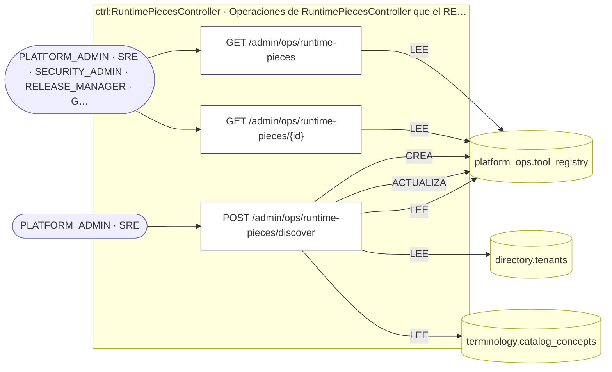

## Árbol de decisión por operación

Cada árbol se deriva del código del handler y de los métodos que invoca (hasta 4 niveles). Una rama que no decide, no escribe y no falla se poda. Los accesos y los efectos consecutivos se agrupan en un solo nodo.

### Operaciones con decisiones propias

#### 1. GET /admin/ops/runtime-pieces/{id}


| HTTP | Código | Cuándo |
|---|---|---|
| 200 | — | Éxito |
| 401 | `UNAUTHENTICATED` | Hay una sesión válida (JWT) |
| 403 | `FORBIDDEN` | El rol está permitido; El tenant se resuelve y pertenece al actor |
| 404 | `NOT_FOUND` | ResourceNotFoundException: Pieza no encontrada |
| 429 | `RATE_LIMITED` | No se supera el límite de solicitudes |

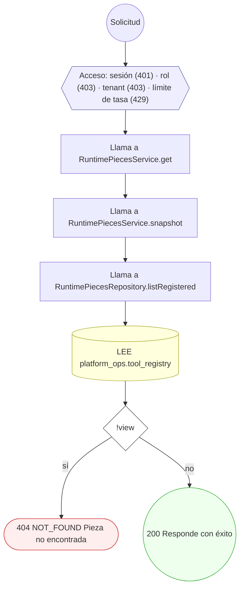

#### 2. POST /admin/ops/runtime-pieces/discover


| HTTP | Código | Cuándo |
|---|---|---|
| 200 | — | Éxito |
| 401 | `UNAUTHENTICATED` | Hay una sesión válida (JWT) |
| 403 | `FORBIDDEN` | El rol está permitido; El tenant se resuelve y pertenece al actor |
| 409 | `CONFLICT` | ConflictException: {scan.reason ?? 'No hay código fuente para escanear'} |
| 422 | `PRECONDITION_FAILED` | PreconditionFailedException: Faltan conceptos del catálogo para registrar las piezas: ejecutar el seed de terminología; PreconditionFailedException: No existe el tenant de plataforma que es dueño de las piezas |
| 429 | `RATE_LIMITED` | No se supera el límite de solicitudes |

```mermaid
flowchart TD
  n1(("Solicitud")):::inicio
  n2{{"Acceso: sesión (401) · rol (403) · tenant (403) · límite de tasa (429)"}}:::acceso
  n1 --> n2
  n3["Llama a RuntimePiecesService.discover"]:::llamada
  n2 --> n3
  n4["Llama a RuntimePiecesSeedService.run"]:::llamada
  n3 --> n4
  n5{"!scan.available"}:::decision
  n4 --> n5
  n6(["409 CONFLICT {scan.reason ?? 'No hay código fuente para escanear'}"]):::error
  n5 -->|"sí"| n6
  n7["Transacción: transaction(…)"]:::transaccion
  n5 -->|"no"| n7
  n8["Llama a RuntimePiecesSeedService.assertPreconditions"]:::llamada
  n7 --> n8
  n9["Llama a RuntimePiecesRepository.existingConcepts"]:::llamada
  n8 --> n9
  n10[("LEE terminology.catalog_concepts")]:::efecto
  n9 --> n10
  n11{"missing.length › 0"}:::decision
  n10 --> n11
  n12(["422 PRECONDITION_FAILED Faltan conceptos del catálogo para registrar las piezas: ejecutar el seed de terminol…"]):::error
  n11 -->|"sí"| n12
  n13["Llama a RuntimePiecesRepository.tenantExists"]:::llamada
  n11 -->|"no"| n13
  n14[("LEE directory.tenants")]:::efecto
  n13 --> n14
  n15{"!(await this.repo.tenantExists(tx, RUNTIME_PIECES_TENANT_ID))"}:::decision
  n14 --> n15
  n16(["422 PRECONDITION_FAILED No existe el tenant de plataforma que es dueño de las piezas"]):::error
  n15 -->|"sí"| n16
  n17["Llama a RuntimePiecesRepository.listRegistered"]:::llamada
  n15 -->|"no"| n17
  n18[("LEE platform_ops.tool_registry")]:::efecto
  n17 --> n18
  n19["Repite: por cada const piece de scan.pieces"]:::bucle
  n18 --> n19
  n20{"!row"}:::decision
  n19 -->|"cada elemento"| n20
  n21{"!dryRun"}:::decision
  n20 -->|"sí"| n21
  n22["Llama a RuntimePiecesRepository.insertIfAbsent"]:::llamada
  n21 -->|"sí"| n22
  n23[("CREA platform_ops.tool_registry")]:::efecto
  n22 --> n23
  n24{"!dryRun"}:::decision
  n23 --> n24
  n21 -->|"no"| n24
  n20 -->|"no"| n24
  n25["Llama a RuntimePiecesRepository.updateDerived"]:::llamada
  n24 -->|"sí"| n25
  n26[("ACTUALIZA platform_ops.tool_registry")]:::efecto
  n25 --> n26
  n27(("200 Responde con éxito")):::ok
  n26 --> n27
  n24 -->|"no"| n27
  n19 -->|"al terminar"| n27
  classDef acceso fill:#eef,stroke:#66a
  classDef error fill:#fee,stroke:#c33
  classDef ok fill:#efe,stroke:#3a3
  classDef efecto fill:#ffd,stroke:#aa3
  classDef decision fill:#fff,stroke:#555
  classDef corte fill:#eee,stroke:#999,stroke-dasharray: 4
```

#### 3. GET /admin/ops/tools/{code}

Una herramienta con su historial corto de comprobaciones

| HTTP | Código | Cuándo |
|---|---|---|
| 200 | — | Éxito |
| 401 | `UNAUTHENTICATED` | Hay una sesión válida (JWT) |
| 403 | `FORBIDDEN` | El rol está permitido; El tenant se resuelve y pertenece al actor |
| 404 | `NOT_FOUND` | ResourceNotFoundException: Herramienta no encontrada |
| 429 | `RATE_LIMITED` | No se supera el límite de solicitudes |

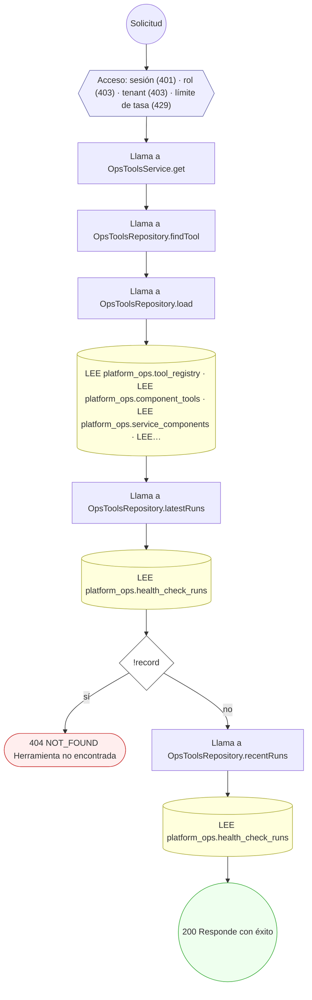

#### 4. POST /ops/artifacts

Publicar un artefacto inmutable

| HTTP | Código | Cuándo |
|---|---|---|
| 201 | — | Éxito |
| 400 | `VALIDATION_FAILED` | El cuerpo cumple el DTO (sin propiedades extra) |
| 401 | `UNAUTHENTICATED` | Hay una sesión válida (JWT) |
| 403 | `FORBIDDEN` | El rol está permitido; El tenant se resuelve y pertenece al actor |
| 409 | `CONFLICT` | ConflictException: Ya existe un artefacto con esa referencia; ConflictException: El componente ya publicó esa versión |
| 422 | `PRECONDITION_FAILED` | PreconditionFailedException: La herramienta no está homologada |
| 429 | `RATE_LIMITED` | No se supera el límite de solicitudes |

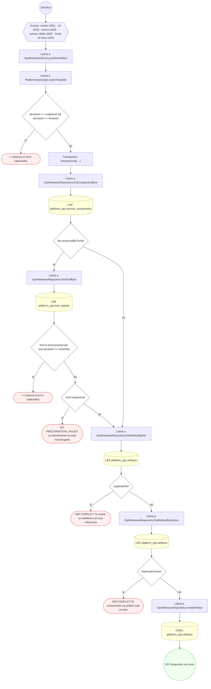

#### 5. POST /ops/capacity-plans/{id}/measurements

Registrar una medición de capacidad

| HTTP | Código | Cuándo |
|---|---|---|
| 201 | — | Éxito |
| 400 | `VALIDATION_FAILED` | Los parámetros de ruta son UUID válidos; El cuerpo cumple el DTO (sin propiedades extra) |
| 401 | `UNAUTHENTICATED` | Hay una sesión válida (JWT) |
| 403 | `FORBIDDEN` | El rol está permitido; El tenant se resuelve y pertenece al actor |
| 422 | `PRECONDITION_FAILED` | PreconditionFailedException: La capacidad debe ser mayor que cero; PreconditionFailedException: El plan de capacidad no está activo; PreconditionFailedException: La medición cae fuera del horizonte del plan |
| 429 | `RATE_LIMITED` | No se supera el límite de solicitudes |

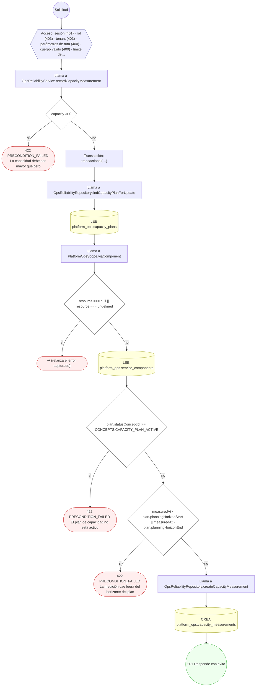

#### 6. POST /ops/change-requests

Registrar una solicitud de cambio

| HTTP | Código | Cuándo |
|---|---|---|
| 201 | — | Éxito |
| 400 | `VALIDATION_FAILED` | El cuerpo cumple el DTO (sin propiedades extra) |
| 401 | `UNAUTHENTICATED` | Hay una sesión válida (JWT) |
| 403 | `FORBIDDEN` | El rol está permitido; El tenant se resuelve y pertenece al actor |
| 409 | `CONFLICT` | ConflictException: No se pudo asignar un número de cambio libre |
| 422 | `PRECONDITION_FAILED` | PreconditionFailedException: La ventana planificada está invertida; PreconditionFailedException: El componente no está activo; PreconditionFailedException: La ventana de mantenimiento está cerrada; PreconditionFailedException: El cambio empieza antes que su ventana; PreconditionFailedException: El cambio termina después que su ventana |
| 429 | `RATE_LIMITED` | No se supera el límite de solicitudes |

```mermaid
flowchart TD
  n1(("Solicitud")):::inicio
  n2{{"Acceso: sesión (401) · rol (403) · tenant (403) · cuerpo válido (400) · límite de tasa (429)"}}:::acceso
  n1 --> n2
  n3["Llama a OpsReleasesService.createChangeRequest"]:::llamada
  n2 --> n3
  n4["Llama a PlatformOpsScope.ownerTenantId"]:::llamada
  n3 --> n4
  n5{"declared !== undefined && declared !== tenantId"}:::decision
  n4 --> n5
  n6(["↩ (relanza el error capturado)"]):::error
  n5 -->|"sí"| n6
  n7{"plannedStartAt && plannedEndAt && plannedEndAt ‹= plannedStartAt"}:::decision
  n5 -->|"no"| n7
  n8(["422 PRECONDITION_FAILED La ventana planificada está invertida"]):::error
  n7 -->|"sí"| n8
  n9["Transacción: transactional(…)"]:::transaccion
  n7 -->|"no"| n9
  n10["Llama a OpsReleasesRepository.findComponentById"]:::llamada
  n9 --> n10
  n11[("LEE platform_ops.service_components")]:::efecto
  n10 --> n11
  n12{"component.stateConceptId !== CONCEPTS.STATE_ACTIVE"}:::decision
  n11 --> n12
  n13(["422 PRECONDITION_FAILED El componente no está activo"]):::error
  n12 -->|"sí"| n13
  n14{"dto.maintenanceWindowId"}:::decision
  n12 -->|"no"| n14
  n15["Llama a OpsReleasesRepository.findWindowForUpdate"]:::llamada
  n14 -->|"sí"| n15
  n16[("LEE platform_ops.maintenance_windows")]:::efecto
  n15 --> n16
  n17{"window.statusConceptId === CONCEPTS.MAINTENANCE_WINDOW_CLOSED"}:::decision
  n16 --> n17
  n18(["422 PRECONDITION_FAILED La ventana de mantenimiento está cerrada"]):::error
  n17 -->|"sí"| n18
  n19{"plannedStartAt && plannedStartAt ‹ window.startsAt"}:::decision
  n17 -->|"no"| n19
  n20(["422 PRECONDITION_FAILED El cambio empieza antes que su ventana"]):::error
  n19 -->|"sí"| n20
  n21{"plannedEndAt && plannedEndAt › window.endsAt"}:::decision
  n19 -->|"no"| n21
  n22(["422 PRECONDITION_FAILED El cambio termina después que su ventana"]):::error
  n21 -->|"sí"| n22
  n23["Llama a OpsReleasesService.nextChangeNumber"]:::llamada
  n21 -->|"no"| n23
  n14 -->|"no"| n23
  n24["Llama a OpsReleasesRepository.countChangeRequests"]:::llamada
  n23 --> n24
  n25[("LEE platform_ops.change_requests")]:::efecto
  n24 --> n25
  n26["Repite: ciclo for"]:::bucle
  n25 --> n26
  n27["Llama a OpsReleasesRepository.findChangeRequestByNumber"]:::llamada
  n26 -->|"cada elemento"| n27
  n28[("LEE platform_ops.change_requests")]:::efecto
  n27 --> n28
  n29(["409 CONFLICT No se pudo asignar un número de cambio libre"]):::error
  n28 --> n29
  n26 -->|"al terminar"| n29
  n30["Llama a OpsReleasesRepository.createChangeRequest"]:::llamada
  n31[("CREA platform_ops.change_requests")]:::efecto
  n30 --> n31
  n32(("201 Responde con éxito")):::ok
  n31 --> n32
  classDef acceso fill:#eef,stroke:#66a
  classDef error fill:#fee,stroke:#c33
  classDef ok fill:#efe,stroke:#3a3
  classDef efecto fill:#ffd,stroke:#aa3
  classDef decision fill:#fff,stroke:#555
  classDef corte fill:#eee,stroke:#999,stroke-dasharray: 4
```

#### 7. POST /ops/change-requests/{id}/approvals

Registrar la decisión del CAB

| HTTP | Código | Cuándo |
|---|---|---|
| 201 | — | Éxito |
| 400 | `VALIDATION_FAILED` | Los parámetros de ruta son UUID válidos; El cuerpo cumple el DTO (sin propiedades extra) |
| 401 | `UNAUTHENTICATED` | Hay una sesión válida (JWT) |
| 403 | `FORBIDDEN` | El rol está permitido; El tenant se resuelve y pertenece al actor |
| 409 | `CONFLICT` | ConflictException: Ese aprobador ya votó en este paso |
| 422 | `PRECONDITION_FAILED` | PreconditionFailedException: La solicitud ya no admite decisiones; PreconditionFailedException: Quien solicita el cambio no puede aprobarlo; PreconditionFailedException: El paso anterior todavía no está aprobado |
| 429 | `RATE_LIMITED` | No se supera el límite de solicitudes |

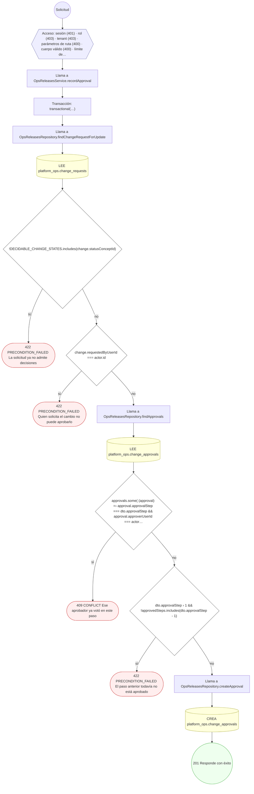

#### 8. POST /ops/deployments

Ejecutar un despliegue

| HTTP | Código | Cuándo |
|---|---|---|
| 201 | — | Éxito |
| 400 | `VALIDATION_FAILED` | El cuerpo cumple el DTO (sin propiedades extra) |
| 401 | `UNAUTHENTICATED` | Hay una sesión válida (JWT) |
| 403 | `FORBIDDEN` | El rol está permitido; El tenant se resuelve y pertenece al actor |
| 409 | `CONFLICT` | ConflictException: No se pudo asignar un número de despliegue libre |
| 422 | `PRECONDITION_FAILED` | PreconditionFailedException: El cambio no está aprobado; PreconditionFailedException: El artefacto no está activo; PreconditionFailedException: El artefacto pertenece a otro componente; PreconditionFailedException: Producción exige una revisión de preparación con decisión "go"; PreconditionFailedException: Los despliegues están congelados por agotamiento del error budget |
| 429 | `RATE_LIMITED` | No se supera el límite de solicitudes |

```mermaid
flowchart TD
  n1(("Solicitud")):::inicio
  n2{{"Acceso: sesión (401) · rol (403) · tenant (403) · cuerpo válido (400) · límite de tasa (429)"}}:::acceso
  n1 --> n2
  n3["Llama a OpsReleasesService.createDeployment"]:::llamada
  n2 --> n3
  n4["Transacción: transactional(…)"]:::transaccion
  n3 --> n4
  n5["Llama a OpsReleasesRepository.findChangeRequestForUpdate"]:::llamada
  n4 --> n5
  n6[("LEE platform_ops.change_requests")]:::efecto
  n5 --> n6
  n7{"change.statusConceptId !== CONCEPTS.CHANGE_APPROVED"}:::decision
  n6 --> n7
  n8(["422 PRECONDITION_FAILED El cambio no está aprobado"]):::error
  n7 -->|"sí"| n8
  n9["Llama a OpsReleasesRepository.findArtifactById"]:::llamada
  n7 -->|"no"| n9
  n10[("LEE platform_ops.artifacts")]:::efecto
  n9 --> n10
  n11{"artifact.stateConceptId !== CONCEPTS.STATE_ACTIVE"}:::decision
  n10 --> n11
  n12(["422 PRECONDITION_FAILED El artefacto no está activo"]):::error
  n11 -->|"sí"| n12
  n13{"artifact.serviceComponentId !== change.serviceComponentId"}:::decision
  n11 -->|"no"| n13
  n14(["422 PRECONDITION_FAILED El artefacto pertenece a otro componente"]):::error
  n13 -->|"sí"| n14
  n15{"dto.environment === 'PRODUCTION'"}:::decision
  n13 -->|"no"| n15
  n16["Llama a OpsPracticesRepository.findGoReview"]:::llamada
  n15 -->|"sí"| n16
  n17[("LEE platform_ops.operational_readiness_reviews")]:::efecto
  n16 --> n17
  n18{"!review"}:::decision
  n17 --> n18
  n19(["422 PRECONDITION_FAILED Producción exige una revisión de preparación con decisión 'go'"]):::error
  n18 -->|"sí"| n19
  n20["Llama a OpsReleasesService.deploymentsFrozen"]:::llamada
  n18 -->|"no"| n20
  n15 -->|"no"| n20
  n21["Llama a OpsReliabilityRepository.findFreezingPolicies"]:::llamada
  n20 --> n21
  n22[("LEE platform_ops.error_budget_policies")]:::efecto
  n21 --> n22
  n23["Repite: por cada const policy de policies"]:::bucle
  n22 --> n23
  n24["Llama a OpsReliabilityRepository.findLatestBurnEvent"]:::llamada
  n23 -->|"cada elemento"| n24
  n25[("LEE platform_ops.error_budget_burn_events")]:::efecto
  n24 --> n25
  n26{"await this.deploymentsFrozen(tx)"}:::decision
  n25 --> n26
  n23 -->|"al terminar"| n26
  n27(["422 PRECONDITION_FAILED Los despliegues están congelados por agotamiento del error budget"]):::error
  n26 -->|"sí"| n27
  n28["Llama a OpsReleasesRepository.findCurrentDeploymentForUpdate"]:::llamada
  n26 -->|"no"| n28
  n29[("LEE platform_ops.deployments")]:::efecto
  n28 --> n29
  n30["Llama a OpsReleasesService.nextDeploymentNumber"]:::llamada
  n29 --> n30
  n31["Llama a OpsReleasesRepository.countDeployments"]:::llamada
  n30 --> n31
  n32[("LEE platform_ops.deployments")]:::efecto
  n31 --> n32
  n33["Repite: ciclo for"]:::bucle
  n32 --> n33
  n34["Llama a OpsReleasesRepository.findDeploymentByNumber"]:::llamada
  n33 -->|"cada elemento"| n34
  n35[("LEE platform_ops.deployments")]:::efecto
  n34 --> n35
  n36(["409 CONFLICT No se pudo asignar un número de despliegue libre"]):::error
  n35 --> n36
  n33 -->|"al terminar"| n36
  n37["Llama a OpsReleasesRepository.createDeployment"]:::llamada
  n38[("CREA platform_ops.deployments")]:::efecto
  n37 --> n38
  n39{"succeeded && current"}:::decision
  n38 --> n39
  n40[("ACTUALIZA platform_ops.deployments")]:::efecto
  n39 -->|"sí"| n40
  n41(("201 Responde con éxito")):::ok
  n40 --> n41
  n39 -->|"no"| n41
  classDef acceso fill:#eef,stroke:#66a
  classDef error fill:#fee,stroke:#c33
  classDef ok fill:#efe,stroke:#3a3
  classDef efecto fill:#ffd,stroke:#aa3
  classDef decision fill:#fff,stroke:#555
  classDef corte fill:#eee,stroke:#999,stroke-dasharray: 4
```

#### 9. POST /ops/deployments/{id}/rollback

Revertir un despliegue

| HTTP | Código | Cuándo |
|---|---|---|
| 201 | — | Éxito |
| 400 | `VALIDATION_FAILED` | Los parámetros de ruta son UUID válidos; El cuerpo cumple el DTO (sin propiedades extra) |
| 401 | `UNAUTHENTICATED` | Hay una sesión válida (JWT) |
| 403 | `FORBIDDEN` | El rol está permitido; El tenant se resuelve y pertenece al actor |
| 409 | `CONFLICT` | ConflictException: No se pudo asignar un número de despliegue libre |
| 422 | `PRECONDITION_FAILED` | PreconditionFailedException: El despliegue no está en un estado reversible; PreconditionFailedException: El despliegue ya no es el vigente; PreconditionFailedException: No hay un despliegue estable anterior al que volver; PreconditionFailedException: El destino de la reversión es de otro componente o entorno |
| 429 | `RATE_LIMITED` | No se supera el límite de solicitudes |

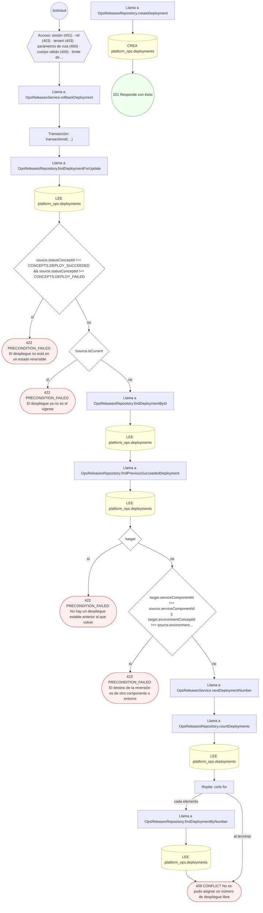

#### 10. POST /ops/error-budget/{policyId}/burn-events

Registrar la quema del presupuesto de error

| HTTP | Código | Cuándo |
|---|---|---|
| 201 | — | Éxito |
| 400 | `VALIDATION_FAILED` | Los parámetros de ruta son UUID válidos; El cuerpo cumple el DTO (sin propiedades extra) |
| 401 | `UNAUTHENTICATED` | Hay una sesión válida (JWT) |
| 403 | `FORBIDDEN` | El rol está permitido; El tenant se resuelve y pertenece al actor |
| 422 | `PRECONDITION_FAILED` | PreconditionFailedException: La política no está activa; PreconditionFailedException: La política no tiene ninguna medición del objetivo sobre la que evaluar; PreconditionFailedException: El ritmo de quema no alcanza el umbral de aviso de la política |
| 429 | `RATE_LIMITED` | No se supera el límite de solicitudes |

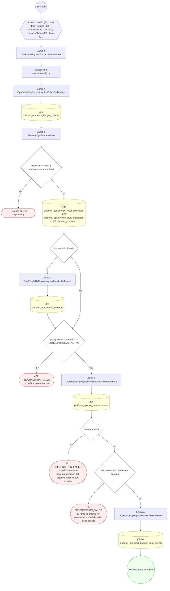

#### 11. POST /ops/health-checks/{id}/runs

Registrar una corrida de health check

| HTTP | Código | Cuándo |
|---|---|---|
| 201 | — | Éxito |
| 400 | `VALIDATION_FAILED` | Los parámetros de ruta son UUID válidos; El cuerpo cumple el DTO (sin propiedades extra) |
| 401 | `UNAUTHENTICATED` | Hay una sesión válida (JWT) |
| 403 | `FORBIDDEN` | El rol está permitido; El tenant se resuelve y pertenece al actor |
| 422 | `PRECONDITION_FAILED` | PreconditionFailedException: El health check no está activo; PreconditionFailedException: El health check está deshabilitado |
| 429 | `RATE_LIMITED` | No se supera el límite de solicitudes |

```mermaid
flowchart TD
  n1(("Solicitud")):::inicio
  n2{{"Acceso: sesión (401) · rol (403) · tenant (403) · parámetros de ruta (400) · cuerpo válido (400) · límite de…"}}:::acceso
  n1 --> n2
  n3["Llama a OpsIncidentsService.recordHealthRun"]:::llamada
  n2 --> n3
  n4["Transacción: transactional(…)"]:::transaccion
  n3 --> n4
  n5["Llama a OpsIncidentsRepository.findHealthCheckById"]:::llamada
  n4 --> n5
  n6[("LEE platform_ops.health_checks")]:::efecto
  n5 --> n6
  n7{"dto.deploymentId"}:::decision
  n6 --> n7
  n8["Llama a OpsIncidentsRepository.findDeploymentInTenant"]:::llamada
  n7 -->|"sí"| n8
  n9[("LEE platform_ops.deployments")]:::efecto
  n8 --> n9
  n10{"check.stateConceptId !== CONCEPTS.STATE_ACTIVE"}:::decision
  n9 --> n10
  n7 -->|"no"| n10
  n11(["422 PRECONDITION_FAILED El health check no está activo"]):::error
  n10 -->|"sí"| n11
  n12{"check.isEnabled === false"}:::decision
  n10 -->|"no"| n12
  n13(["422 PRECONDITION_FAILED El health check está deshabilitado"]):::error
  n12 -->|"sí"| n13
  n14["Llama a OpsIncidentsRepository.findRecentRuns"]:::llamada
  n12 -->|"no"| n14
  n15[("LEE platform_ops.health_check_runs")]:::efecto
  n14 --> n15
  n16["Llama a OpsIncidentsRepository.createHealthRun"]:::llamada
  n15 --> n16
  n17[("CREA platform_ops.health_check_runs")]:::efecto
  n16 --> n17
  n18["Llama a OpsIncidentsRepository.findOpenIncidentByCheckForUpdate"]:::llamada
  n17 --> n18
  n19[("LEE platform_ops.health_incidents")]:::efecto
  n18 --> n19
  n20{"live"}:::decision
  n19 --> n20
  n21["Llama a OpsIncidentsRepository.createTimelineEvent"]:::llamada
  n20 -->|"sí"| n21
  n22[("CREA platform_ops.incident_timeline_events")]:::efecto
  n21 --> n22
  n23["Llama a OpsIncidentsService.nextIncidentNumber"]:::llamada
  n22 --> n23
  n20 -->|"no"| n23
  n24["Llama a OpsIncidentsRepository.countIncidents"]:::llamada
  n23 --> n24
  n25[("LEE platform_ops.health_incidents")]:::efecto
  n24 --> n25
  n26["Llama a OpsIncidentsRepository.createIncident"]:::llamada
  n25 --> n26
  n27[("CREA platform_ops.health_incidents")]:::efecto
  n26 --> n27
  n28["Llama a OpsIncidentsRepository.createTimelineEvent"]:::llamada
  n27 --> n28
  n29[("CREA platform_ops.incident_timeline_events")]:::efecto
  n28 --> n29
  n30(("201 Responde con éxito")):::ok
  n29 --> n30
  classDef acceso fill:#eef,stroke:#66a
  classDef error fill:#fee,stroke:#c33
  classDef ok fill:#efe,stroke:#3a3
  classDef efecto fill:#ffd,stroke:#aa3
  classDef decision fill:#fff,stroke:#555
  classDef corte fill:#eee,stroke:#999,stroke-dasharray: 4
```

#### 12. PATCH /ops/incidents/{id}

Mover el incidente, sumar respondientes y publicar comunicaciones

| HTTP | Código | Cuándo |
|---|---|---|
| 200 | — | Éxito |
| 400 | `VALIDATION_FAILED` | Los parámetros de ruta son UUID válidos; El cuerpo cumple el DTO (sin propiedades extra) |
| 401 | `UNAUTHENTICATED` | Hay una sesión válida (JWT) |
| 403 | `FORBIDDEN` | El rol está permitido; El tenant se resuelve y pertenece al actor |
| 422 | `PRECONDITION_FAILED` | PreconditionFailedException: El incidente ya está resuelto; PreconditionFailedException: La transición no es válida desde el estado actual; PreconditionFailedException: Resolver exige causa raíz y descripción de la resolución |
| 429 | `RATE_LIMITED` | No se supera el límite de solicitudes |

```mermaid
flowchart TD
  n1(("Solicitud")):::inicio
  n2{{"Acceso: sesión (401) · rol (403) · tenant (403) · parámetros de ruta (400) · cuerpo válido (400) · límite de…"}}:::acceso
  n1 --> n2
  n3["Llama a OpsIncidentsService.updateIncident"]:::llamada
  n2 --> n3
  n4["Transacción: transactional(…)"]:::transaccion
  n3 --> n4
  n5["Llama a OpsIncidentsRepository.findIncidentForUpdate"]:::llamada
  n4 --> n5
  n6[("LEE platform_ops.health_incidents")]:::efecto
  n5 --> n6
  n7{"incident.statusConceptId === CONCEPTS.INCIDENT_RESOLVED"}:::decision
  n6 --> n7
  n8(["422 PRECONDITION_FAILED El incidente ya está resuelto"]):::error
  n7 -->|"sí"| n8
  n9{"dto.transition !== 'UPDATE'"}:::decision
  n7 -->|"no"| n9
  n10["Llama a OpsIncidentsService.applyTransition"]:::llamada
  n9 -->|"sí"| n10
  n11{"!transition.from.includes(incident.statusConceptId)"}:::decision
  n10 --> n11
  n12(["422 PRECONDITION_FAILED La transición no es válida desde el estado actual"]):::error
  n11 -->|"sí"| n12
  n13{"dto.transition === 'RESOLVE'"}:::decision
  n11 -->|"no"| n13
  n14{"!rootCause || !resolution"}:::decision
  n13 -->|"sí"| n14
  n15(["422 PRECONDITION_FAILED Resolver exige causa raíz y descripción de la resolución"]):::error
  n14 -->|"sí"| n15
  n16[("ACTUALIZA platform_ops.health_incidents · ACTUALIZA platform_ops.health_incidents · ACTUALIZA platform_ops.he…")]:::efecto
  n14 -->|"no"| n16
  n17{"dto.transition === 'ACKNOWLEDGE'"}:::decision
  n16 --> n17
  n13 -->|"no"| n17
  n18[("ACTUALIZA platform_ops.health_incidents")]:::efecto
  n17 -->|"sí"| n18
  n19[("ACTUALIZA platform_ops.health_incidents")]:::efecto
  n18 --> n19
  n17 -->|"no"| n19
  n20{"dto.rootCauseText"}:::decision
  n19 --> n20
  n21[("ACTUALIZA platform_ops.health_incidents")]:::efecto
  n20 -->|"sí"| n21
  n22[("ACTUALIZA platform_ops.health_incidents")]:::efecto
  n21 --> n22
  n20 -->|"no"| n22
  n23{"dto.resolutionText"}:::decision
  n22 --> n23
  n24[("ACTUALIZA platform_ops.health_incidents")]:::efecto
  n23 -->|"sí"| n24
  n25[("ACTUALIZA platform_ops.health_incidents")]:::efecto
  n24 --> n25
  n23 -->|"no"| n25
  n26["Llama a OpsIncidentsRepository.createTimelineEvent"]:::llamada
  n25 --> n26
  n27[("CREA platform_ops.incident_timeline_events")]:::efecto
  n26 --> n27
  n28{"dto.summary"}:::decision
  n9 -->|"no"| n28
  n29["Llama a OpsIncidentsRepository.createTimelineEvent"]:::llamada
  n28 -->|"sí"| n29
  n30[("CREA platform_ops.incident_timeline_events")]:::efecto
  n29 --> n30
  n31["Repite: por cada const responder de dto.responders ?? []"]:::bucle
  n27 --> n31
  n30 --> n31
  n28 -->|"no"| n31
  n32["Llama a OpsIncidentsRepository.findResponder"]:::llamada
  n31 -->|"cada elemento"| n32
  n33[("LEE platform_ops.incident_responders")]:::efecto
  n32 --> n33
  n34{"existing"}:::decision
  n33 --> n34
  n35{"responder.acknowledged && !existing.acknowledgedAt"}:::decision
  n34 -->|"sí"| n35
  n36[("ACTUALIZA platform_ops.incident_responders")]:::efecto
  n35 -->|"sí"| n36
  n37["Llama a OpsIncidentsRepository.createResponder"]:::llamada
  n36 --> n37
  n35 -->|"no"| n37
  n34 -->|"no"| n37
  n38[("CREA platform_ops.incident_responders")]:::efecto
  n37 --> n38
  n39["Llama a OpsIncidentsRepository.createTimelineEvent"]:::llamada
  n38 --> n39
  n40[("CREA platform_ops.incident_timeline_events")]:::efecto
  n39 --> n40
  n41["Repite: por cada const communication de dto.communications ?? []"]:::bucle
  n40 --> n41
  n31 -->|"al terminar"| n41
  n42["Llama a OpsIncidentsRepository.createCommunication"]:::llamada
  n41 -->|"cada elemento"| n42
  n43[("CREA platform_ops.incident_communications")]:::efecto
  n42 --> n43
  n44["Llama a OpsIncidentsRepository.createTimelineEvent"]:::llamada
  n43 --> n44
  n45[("CREA platform_ops.incident_timeline_events")]:::efecto
  n44 --> n45
  n46(("200 Responde con éxito")):::ok
  n45 --> n46
  n41 -->|"al terminar"| n46
  classDef acceso fill:#eef,stroke:#66a
  classDef error fill:#fee,stroke:#c33
  classDef ok fill:#efe,stroke:#3a3
  classDef efecto fill:#ffd,stroke:#aa3
  classDef decision fill:#fff,stroke:#555
  classDef corte fill:#eee,stroke:#999,stroke-dasharray: 4
```

#### 13. POST /ops/incidents/{id}/postmortem

Abrir el postmortem del incidente resuelto

| HTTP | Código | Cuándo |
|---|---|---|
| 201 | — | Éxito |
| 400 | `VALIDATION_FAILED` | Los parámetros de ruta son UUID válidos; El cuerpo cumple el DTO (sin propiedades extra) |
| 401 | `UNAUTHENTICATED` | Hay una sesión válida (JWT) |
| 403 | `FORBIDDEN` | El rol está permitido; El tenant se resuelve y pertenece al actor |
| 409 | `CONFLICT` | ConflictException: El incidente ya tiene postmortem |
| 422 | `PRECONDITION_FAILED` | PreconditionFailedException: El código de acción está repetido; PreconditionFailedException: El incidente todavía no está resuelto |
| 429 | `RATE_LIMITED` | No se supera el límite de solicitudes |

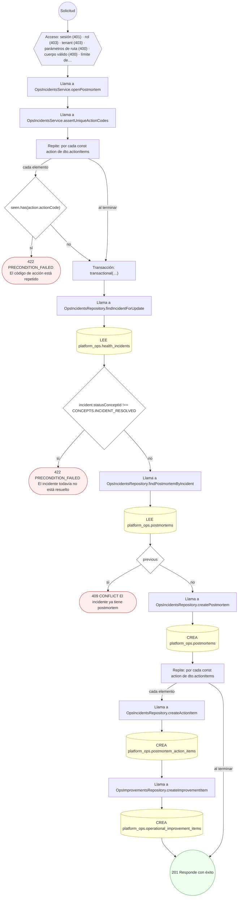

#### 14. POST /ops/readiness-reviews/{id}/complete

Cerrar la revisión de preparación con su decisión

| HTTP | Código | Cuándo |
|---|---|---|
| 200 | — | Éxito |
| 400 | `VALIDATION_FAILED` | Los parámetros de ruta son UUID válidos; El cuerpo cumple el DTO (sin propiedades extra) |
| 401 | `UNAUTHENTICATED` | Hay una sesión válida (JWT) |
| 403 | `FORBIDDEN` | El rol está permitido; El tenant se resuelve y pertenece al actor |
| 404 | `NOT_FOUND` | ResourceNotFoundException: El hallazgo no pertenece a esta revisión |
| 409 | `CONFLICT` | ConflictException: El hallazgo ya no está abierto |
| 422 | `PRECONDITION_FAILED` | PreconditionFailedException: La revisión no está en curso; PreconditionFailedException: Quedan hallazgos críticos o altos sin resolver |
| 429 | `RATE_LIMITED` | No se supera el límite de solicitudes |

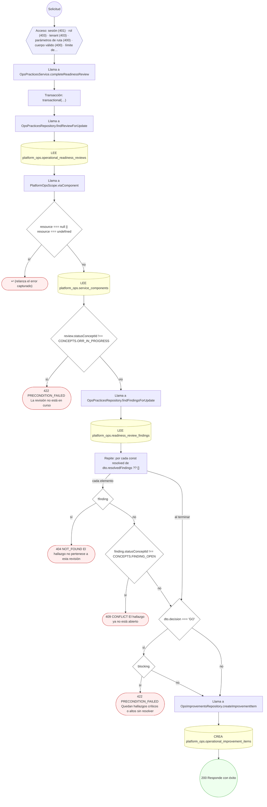

#### 15. POST /ops/resilience-exercises/{id}/complete

Cerrar un ejercicio de resiliencia

| HTTP | Código | Cuándo |
|---|---|---|
| 200 | — | Éxito |
| 400 | `VALIDATION_FAILED` | Los parámetros de ruta son UUID válidos; El cuerpo cumple el DTO (sin propiedades extra) |
| 401 | `UNAUTHENTICATED` | Hay una sesión válida (JWT) |
| 403 | `FORBIDDEN` | El rol está permitido; El tenant se resuelve y pertenece al actor |
| 409 | `CONFLICT` | ConflictException: El ejercicio ya está cerrado |
| 422 | `PRECONDITION_FAILED` | PreconditionFailedException: El ejercicio termina antes de empezar; PreconditionFailedException: El componente no tiene objetivo de recuperación vigente |
| 429 | `RATE_LIMITED` | No se supera el límite de solicitudes |

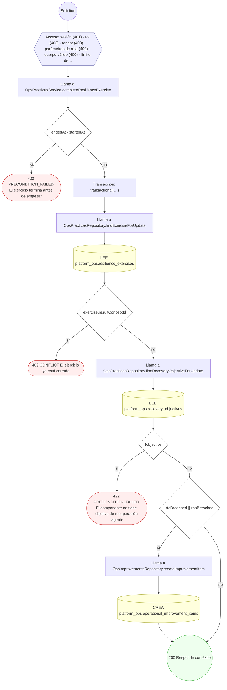

#### 16. POST /ops/runbook-executions

Registrar la ejecución de un runbook

| HTTP | Código | Cuándo |
|---|---|---|
| 201 | — | Éxito |
| 400 | `VALIDATION_FAILED` | El cuerpo cumple el DTO (sin propiedades extra) |
| 401 | `UNAUTHENTICATED` | Hay una sesión válida (JWT) |
| 403 | `FORBIDDEN` | El rol está permitido; El tenant se resuelve y pertenece al actor |
| 422 | `PRECONDITION_FAILED` | PreconditionFailedException: La ejecución termina antes de empezar |
| 429 | `RATE_LIMITED` | No se supera el límite de solicitudes |

```mermaid
flowchart TD
  n1(("Solicitud")):::inicio
  n2{{"Acceso: sesión (401) · rol (403) · tenant (403) · cuerpo válido (400) · límite de tasa (429)"}}:::acceso
  n1 --> n2
  n3["Llama a OpsPracticesService.recordRunbookExecution"]:::llamada
  n2 --> n3
  n4{"endedAt && endedAt ‹ startedAt"}:::decision
  n3 --> n4
  n5(["422 PRECONDITION_FAILED La ejecución termina antes de empezar"]):::error
  n4 -->|"sí"| n5
  n6["Transacción: transactional(…)"]:::transaccion
  n4 -->|"no"| n6
  n7["Llama a OpsPracticesRepository.findRunbookVersionById"]:::llamada
  n6 --> n7
  n8[("LEE platform_ops.runbook_versions")]:::efecto
  n7 --> n8
  n9["Llama a PlatformOpsScope.viaRunbook"]:::llamada
  n8 --> n9
  n10{"resource === null || resource === undefined"}:::decision
  n9 --> n10
  n11(["↩ (relanza el error capturado)"]):::error
  n10 -->|"sí"| n11
  n12[("LEE platform_ops.runbooks")]:::efecto
  n10 -->|"no"| n12
  n13{"dto.healthIncidentId"}:::decision
  n12 --> n13
  n14["Llama a OpsIncidentsRepository.findIncidentById"]:::llamada
  n13 -->|"sí"| n14
  n15[("LEE platform_ops.health_incidents")]:::efecto
  n14 --> n15
  n16{"dto.changeRequestId"}:::decision
  n15 --> n16
  n13 -->|"no"| n16
  n17["Llama a OpsPracticesRepository.findChangeRequestInTenant"]:::llamada
  n16 -->|"sí"| n17
  n18[("LEE platform_ops.change_requests")]:::efecto
  n17 --> n18
  n19["Llama a OpsPracticesRepository.createRunbookExecution"]:::llamada
  n18 --> n19
  n16 -->|"no"| n19
  n20[("CREA platform_ops.runbook_executions")]:::efecto
  n19 --> n20
  n21{"dto.healthIncidentId"}:::decision
  n20 --> n21
  n22["Llama a OpsIncidentsRepository.createTimelineEvent"]:::llamada
  n21 -->|"sí"| n22
  n23[("CREA platform_ops.incident_timeline_events")]:::efecto
  n22 --> n23
  n24(("201 Responde con éxito")):::ok
  n23 --> n24
  n21 -->|"no"| n24
  classDef acceso fill:#eef,stroke:#66a
  classDef error fill:#fee,stroke:#c33
  classDef ok fill:#efe,stroke:#3a3
  classDef efecto fill:#ffd,stroke:#aa3
  classDef decision fill:#fff,stroke:#555
  classDef corte fill:#eee,stroke:#999,stroke-dasharray: 4
```

#### 17. POST /ops/runbooks/{id}/versions

Publicar una versión del runbook

| HTTP | Código | Cuándo |
|---|---|---|
| 201 | — | Éxito |
| 400 | `VALIDATION_FAILED` | Los parámetros de ruta son UUID válidos; El cuerpo cumple el DTO (sin propiedades extra) |
| 401 | `UNAUTHENTICATED` | Hay una sesión válida (JWT) |
| 403 | `FORBIDDEN` | El rol está permitido; El tenant se resuelve y pertenece al actor |
| 409 | `CONFLICT` | ConflictException: Esa versión del runbook ya existe |
| 422 | `PRECONDITION_FAILED` | PreconditionFailedException: El runbook no está activo |
| 429 | `RATE_LIMITED` | No se supera el límite de solicitudes |

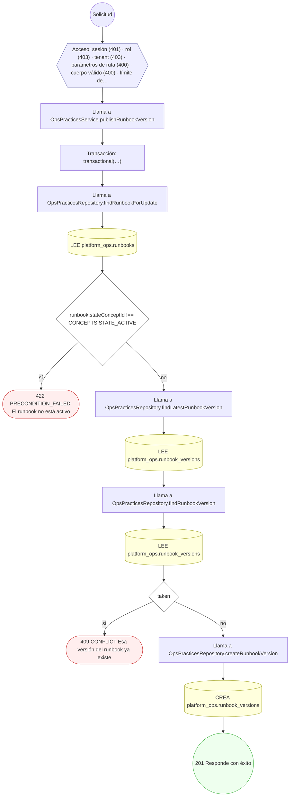

#### 18. POST /ops/slo/{id}/measurements

Registrar la medición de una ventana del SLO

| HTTP | Código | Cuándo |
|---|---|---|
| 201 | — | Éxito |
| 400 | `VALIDATION_FAILED` | Los parámetros de ruta son UUID válidos; El cuerpo cumple el DTO (sin propiedades extra) |
| 401 | `UNAUTHENTICATED` | Hay una sesión válida (JWT) |
| 403 | `FORBIDDEN` | El rol está permitido; El tenant se resuelve y pertenece al actor |
| 422 | `PRECONDITION_FAILED` | PreconditionFailedException: La ventana de medición está invertida; PreconditionFailedException: Una ventana sin eventos no mide nada; PreconditionFailedException: Los eventos buenos no pueden superar a los totales; PreconditionFailedException: El objetivo no está activo; PreconditionFailedException: La ventana precede a la vigencia del objetivo; PreconditionFailedException: La ventana excede la vigencia del objetivo |
| 429 | `RATE_LIMITED` | No se supera el límite de solicitudes |

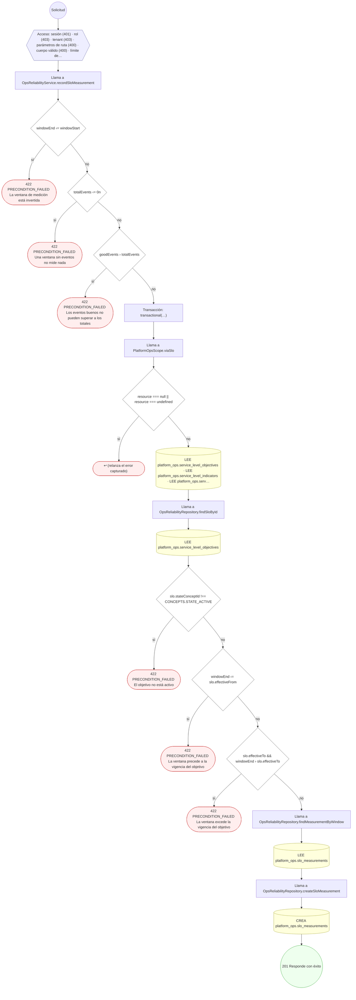

### Operaciones sin decisiones propias

Sólo comprueban el acceso y leen o escriben: no tienen ramas que dibujar. Su detalle está en la ficha de endpoints.

| Operación | Respuestas posibles | Tablas |
|---|---|---|
| GET /admin/ops/runtime-pieces | 200, 401, 403, 429 | 1 |
| GET /admin/ops/tools | 200, 401, 403, 429 | 5 |
