<!-- AUTOGENERADO por tools/inventario/flujos.mjs. No editar manualmente. -->

# Flujos del módulo `polyglot_storage`

- **Procesos:** 1 · **Máquinas de estado:** 0
- **Operaciones:** 15 (15 con decisiones propias, 0 sin ellas)
- Inventario de endpoints del módulo: [polyglot_storage](../endpoints/polyglot_storage.md)

## Proceso: Módulo 54 — Almacenamiento Políglota (gobierno de colocación)

- **Código:** `polyglot_storage` · **Agrupación:** CASO_DE_USO_README · **Operaciones:** 15
- **Actores:** FINOPS_ANALYST · GOVERNANCE_ADMIN · PLATFORM_ADMIN · SECURITY_ADMIN · SYSTEM
- **Revisión:** AUTO_DETECTADA
- **Fuentes:** `src/modules/polyglot_storage/README.md`

### Para qué sirve

Gobierno de dónde puede vivir cada dato: backends con sus regiones y capacidades, datasets versionados con huella de esquema, colecciones físicas, colocaciones que sólo se aprueban si cumplen residencia y clasificación a la vez, políticas de consistencia, acceso, cifrado, replicación y retención, salud con failover, consolidación de costes e integridad de las proyecciones.

_Fuente: `src/modules/polyglot_storage/README.md:3`_

### Flujo general declarado en el README

```text
storage-backends ──> backend REGISTERED + regiones + capacidades PENDING
datasets ──────────> dataset DRAFT + versión 1.0.0 DRAFT (compatibilidad NONE)
  └─ datasets/:id/versions ──> versión ACTIVE, dataset ACTIVE
                               la anterior queda SUPERSEDED
collections ───────> colección DRAFT + esquema ACTIVE   [exige dataset ACTIVE]

policies · consistency-policies · encryption-profiles ──> reglas ACTIVE

placements/approve  [las cuatro comprobaciones a la vez]
  ├─ país prohibido / fuera de permitidos ──> rechazo
  ├─ región fuera de permitidas ───────────> rechazo
  ├─ datos de paciente sin cifrado de campo > rechazo
  └─ todo cumple ──────────────────────────> colocación APPROVED
       └─ tenants/:id/storage-bindings ──> vínculo ACTIVE, colocación ACTIVATED

ops/store-health-checks  UNHEALTHY
  └─ política AUTOMATIC ──> colocaciones DEGRADED + vínculos mueven su primario
governance/placements/:id/failover ──> lo mismo, a mano

finops/storage-cost-snapshots ──> idempotente por ámbito y periodo
ops/integrity/:datasetId/verify ──> hashes distintos + política ⇒ colocación QUARANTINED
```

_Fuente: `src/modules/polyglot_storage/README.md:81`_

### Etapas y operaciones

| Etapa | Descripción | Operación | Quién actúa | Riesgo | Tablas |
|---|---|---|---|---|---|
| `UC-54-01` | Registrar backend con regiones y capacidades | POST /governance/storage-backends | PLATFORM_ADMIN | MEDIO | 4 |
| `UC-54-02` | Definir dataset + versión inicial | POST /governance/datasets | GOVERNANCE_ADMIN · PLATFORM_ADMIN | MEDIO | 4 |
| `UC-54-03` | Publicar versión con huella de esquema | POST /governance/datasets/{id}/versions | GOVERNANCE_ADMIN · PLATFORM_ADMIN | MEDIO | 5 |
| `UC-54-04` | Definir colección y su esquema versionado | POST /governance/collections | GOVERNANCE_ADMIN · PLATFORM_ADMIN | MEDIO | 6 |
| `UC-54-05` | Aprobar colocación respetando residencia | POST /governance/placements/approve | GOVERNANCE_ADMIN · PLATFORM_ADMIN | MEDIO | 9 |
| `UC-54-06` | Política de consistencia del store | POST /governance/consistency-policies | GOVERNANCE_ADMIN · PLATFORM_ADMIN | MEDIO | 2 |
| `UC-54-07` | Política de acceso al dato | POST /governance/datasets/{id}/data-access-policies | GOVERNANCE_ADMIN · PLATFORM_ADMIN | MEDIO | 3 |
| `UC-54-08` | Vincular tenant a colocación | POST /governance/tenants/{tenantId}/storage-bindings | GOVERNANCE_ADMIN · PLATFORM_ADMIN | MEDIO | 4 |
| `UC-54-09` | Perfil de cifrado con rotación | POST /governance/encryption-profiles | SECURITY_ADMIN · PLATFORM_ADMIN | MEDIO | 4 |
| `UC-54-10` | Residencia, replicación y retención | POST /governance/policies | GOVERNANCE_ADMIN · PLATFORM_ADMIN | MEDIO | 6 |
| `UC-54-11` | Salud y failover | POST /governance/placements/{id}/failover | PLATFORM_ADMIN | MEDIO | 4 |
|  |  | POST /ops/store-health-checks | SYSTEM · PLATFORM_ADMIN | MEDIO | 7 |
| `UC-54-12` | Consolidar costes por tenant/dataset | POST /finops/storage-cost-snapshots | SYSTEM · FINOPS_ANALYST · PLATFORM_ADMIN | MEDIO | 4 |
| `UC-54-13` | Integridad y cuarentena | POST /ops/integrity-policies | GOVERNANCE_ADMIN · PLATFORM_ADMIN | MEDIO | 4 |
|  |  | POST /ops/integrity/{datasetId}/verify | SYSTEM · PLATFORM_ADMIN | MEDIO | 3 |

### Diagrama — etapas `UC-54-01`, `UC-54-02`, `UC-54-03`…

```mermaid
flowchart LR
  a2(["PLATFORM_ADMIN"]):::actor
  a7(["GOVERNANCE_ADMIN · PLATFORM_ADMIN"]):::actor
  a25(["SECURITY_ADMIN · PLATFORM_ADMIN"]):::actor
  a34(["SYSTEM · PLATFORM_ADMIN"]):::actor
  a38(["SYSTEM · FINOPS_ANALYST · PLATFORM_ADMIN"]):::actor
  t3[("polyglot_storage.storage_backend_regions")]:::tabla
  t4[("polyglot_storage.storage_backends")]:::tabla
  t5[("polyglot_storage.storage_capabilities")]:::tabla
  t8[("polyglot_storage.data_classifications")]:::tabla
  t9[("polyglot_storage.dataset_definitions")]:::tabla
  t10[("polyglot_storage.dataset_versions")]:::tabla
  t13[("polyglot_storage.collection_definitions")]:::tabla
  t14[("polyglot_storage.collection_schema_versions")]:::tabla
  t16[("polyglot_storage.dataset_placements")]:::tabla
  t19[("polyglot_storage.consistency_policies")]:::tabla
  t21[("polyglot_storage.data_access_policies")]:::tabla
  t23[("polyglot_storage.tenant_storage_bindings")]:::tabla
  t26[("polyglot_storage.encryption_profiles")]:::tabla
  t27[("polyglot_storage.key_rotation_policies")]:::tabla
  t29[("polyglot_storage.replication_policies")]:::tabla
  t30[("polyglot_storage.residency_policies")]:::tabla
  t31[("polyglot_storage.retention_policies")]:::tabla
  t35[("polyglot_storage.store_health_checks")]:::tabla
  t39[("polyglot_storage.storage_cost_snapshots")]:::tabla
  t41[("polyglot_storage.storage_integrity_policies")]:::tabla
  subgraph s0["UC-54-01 · Registrar backend con regiones y capacidades"]
    o1["POST /governance/storage-backends"]:::op
  end
  subgraph s1["UC-54-02 · Definir dataset + versión inicial"]
    o6["POST /governance/datasets"]:::op
  end
  subgraph s2["UC-54-03 · Publicar versión con huella de esquema"]
    o11["POST /governance/datasets/{id}/versions"]:::op
  end
  subgraph s3["UC-54-04 · Definir colección y su esquema versionado"]
    o12["POST /governance/collections"]:::op
  end
  t17[("+3 tablas más")]
  subgraph s4["UC-54-05 · Aprobar colocación respetando residencia"]
    o15["POST /governance/placements/approve"]:::op
  end
  subgraph s5["UC-54-06 · Política de consistencia del store"]
    o18["POST /governance/consistency-policies"]:::op
  end
  subgraph s6["UC-54-07 · Política de acceso al dato"]
    o20["POST /governance/datasets/{id}/data-access-policies"]:::op
  end
  subgraph s7["UC-54-08 · Vincular tenant a colocación"]
    o22["POST /governance/tenants/{tenantId}/storage-bindings"]:::op
  end
  subgraph s8["UC-54-09 · Perfil de cifrado con rotación"]
    o24["POST /governance/encryption-profiles"]:::op
  end
  subgraph s9["UC-54-10 · Residencia, replicación y retención"]
    o28["POST /governance/policies"]:::op
  end
  t36[("+1 tablas más")]
  subgraph s10["UC-54-11 · Salud y failover"]
    o32["POST /governance/placements/{id}/failover"]:::op
    o33["POST /ops/store-health-checks"]:::op
  end
  subgraph s11["UC-54-12 · Consolidar costes por tenant/dataset"]
    o37["POST /finops/storage-cost-snapshots"]:::op
  end
  subgraph s12["UC-54-13 · Integridad y cuarentena"]
    o40["POST /ops/integrity-policies"]:::op
    o42["POST /ops/integrity/{datasetId}/verify"]:::op
  end
  a2 --> o1
  o1 -->|"CREA"| t3
  o1 -->|"CREA"| t4
  o1 -->|"LEE"| t4
  o1 -->|"CREA"| t5
  a7 --> o6
  o6 -->|"LEE"| t8
  o6 -->|"CREA"| t9
  o6 -->|"LEE"| t9
  o6 -->|"CREA"| t10
  a7 --> o11
  o11 -->|"ACTUALIZA"| t9
  o11 -->|"LEE"| t9
  o11 -->|"ACTUALIZA"| t10
  o11 -->|"CREA"| t10
  o11 -->|"LEE"| t10
  a7 --> o12
  o12 -->|"CREA"| t13
  o12 -->|"LEE"| t13
  o12 -->|"CREA"| t14
  o12 -->|"LEE"| t9
  o12 -->|"LEE"| t10
  o12 -->|"LEE"| t4
  a7 --> o15
  o15 -->|"LEE"| t13
  o15 -->|"LEE"| t8
  o15 -->|"LEE"| t9
  o15 -->|"CREA"| t16
  o15 -->|"LEE"| t16
  o15 -->|"LEE"| t10
  o15 -.-> t17
  a7 --> o18
  o18 -->|"CREA"| t19
  o18 -->|"LEE"| t19
  a7 --> o20
  o20 -->|"CREA"| t21
  o20 -->|"LEE"| t21
  o20 -->|"LEE"| t9
  a7 --> o22
  o22 -->|"ACTUALIZA"| t16
  o22 -->|"LEE"| t16
  o22 -->|"CREA"| t23
  o22 -->|"LEE"| t23
  a25 --> o24
  o24 -->|"CREA"| t26
  o24 -->|"LEE"| t26
  o24 -->|"CREA"| t27
  o24 -->|"LEE"| t27
  a7 --> o28
  o28 -->|"CREA"| t29
  o28 -->|"LEE"| t29
  o28 -->|"CREA"| t30
  o28 -->|"LEE"| t30
  o28 -->|"CREA"| t31
  o28 -->|"LEE"| t31
  a2 --> o32
  o32 -->|"ACTUALIZA"| t16
  o32 -->|"LEE"| t16
  o32 -->|"ACTUALIZA"| t23
  o32 -->|"LEE"| t23
  a34 --> o33
  o33 -->|"ACTUALIZA"| t16
  o33 -->|"LEE"| t16
  o33 -->|"LEE"| t29
  o33 -->|"LEE"| t3
  o33 -->|"CREA"| t35
  o33 -->|"ACTUALIZA"| t23
  o33 -.-> t36
  a38 --> o37
  o37 -->|"LEE"| t3
  o37 -->|"ACTUALIZA"| t39
  o37 -->|"CREA"| t39
  o37 -->|"LEE"| t39
  a7 --> o40
  o40 -->|"LEE"| t9
  o40 -->|"ACTUALIZA"| t41
  o40 -->|"CREA"| t41
  o40 -->|"LEE"| t41
  a34 --> o42
  o42 -->|"ACTUALIZA"| t16
  o42 -->|"LEE"| t16
  o42 -->|"LEE"| t41
  classDef op fill:#fff,stroke:#446
  classDef actor fill:#eef,stroke:#66a
  classDef tabla fill:#ffd,stroke:#aa3
  classDef evento fill:#efe,stroke:#3a3
```

## Árbol de decisión por operación

Cada árbol se deriva del código del handler y de los métodos que invoca (hasta 4 niveles). Una rama que no decide, no escribe y no falla se poda. Los accesos y los efectos consecutivos se agrupan en un solo nodo.

### Operaciones con decisiones propias

#### 1. POST /finops/storage-cost-snapshots

Consolidar la instantánea de costes del periodo

| HTTP | Código | Cuándo |
|---|---|---|
| 201 | — | Éxito |
| 400 | `VALIDATION_FAILED` | El cuerpo cumple el DTO (sin propiedades extra) |
| 401 | `UNAUTHENTICATED` | Hay una sesión válida (JWT) |
| 403 | `FORBIDDEN` | El rol está permitido; El tenant se resuelve y pertenece al actor |
| 404 | `NOT_FOUND` | ResourceNotFoundException: Región no encontrada |
| 422 | `PRECONDITION_FAILED` | PreconditionFailedException: El periodo está invertido; PreconditionFailedException: El periodo todavía no ha cerrado |
| 429 | `RATE_LIMITED` | No se supera el límite de solicitudes |

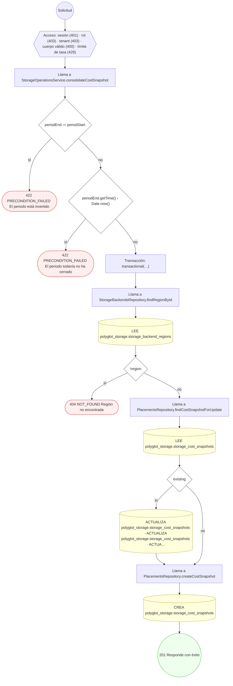

#### 2. POST /governance/collections

Definir una colección física y su esquema versionado

| HTTP | Código | Cuándo |
|---|---|---|
| 201 | — | Éxito |
| 400 | `VALIDATION_FAILED` | El cuerpo cumple el DTO (sin propiedades extra) |
| 401 | `UNAUTHENTICATED` | Hay una sesión válida (JWT) |
| 403 | `FORBIDDEN` | El rol está permitido; El tenant se resuelve y pertenece al actor |
| 404 | `NOT_FOUND` | ResourceNotFoundException: Dataset no encontrado; ResourceNotFoundException: Backend no encontrado; ResourceNotFoundException: Versión del dataset no encontrada |
| 409 | `CONFLICT` | ConflictException: El backend ya tiene una colección con ese nombre |
| 422 | `PRECONDITION_FAILED` | PreconditionFailedException: El dataset no está activo; PreconditionFailedException: La versión pertenece a otro dataset |
| 429 | `RATE_LIMITED` | No se supera el límite de solicitudes |

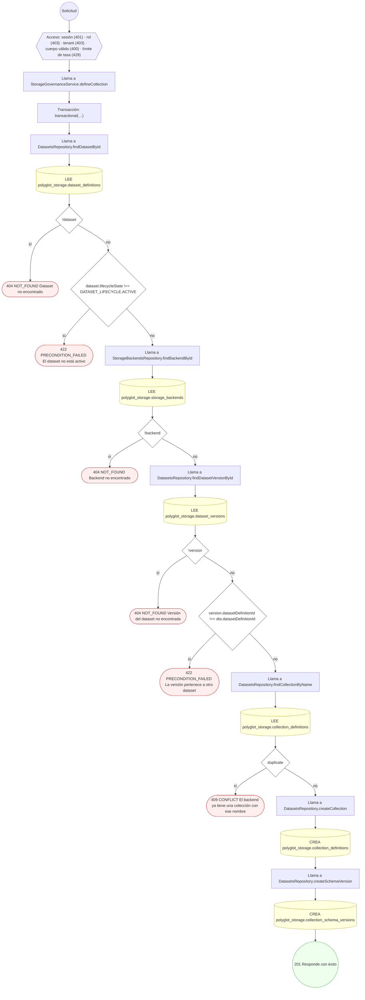

#### 3. POST /governance/consistency-policies

Definir una política de consistencia

| HTTP | Código | Cuándo |
|---|---|---|
| 201 | — | Éxito |
| 400 | `VALIDATION_FAILED` | El cuerpo cumple el DTO (sin propiedades extra) |
| 401 | `UNAUTHENTICATED` | Hay una sesión válida (JWT) |
| 403 | `FORBIDDEN` | El rol está permitido; El tenant se resuelve y pertenece al actor |
| 409 | `CONFLICT` | ConflictException: Ya existe una política de consistencia con ese código |
| 422 | `PRECONDITION_FAILED` | PreconditionFailedException: Exigir leer lo propio recién escrito obliga a tolerancia cero de lectura rancia |
| 429 | `RATE_LIMITED` | No se supera el límite de solicitudes |

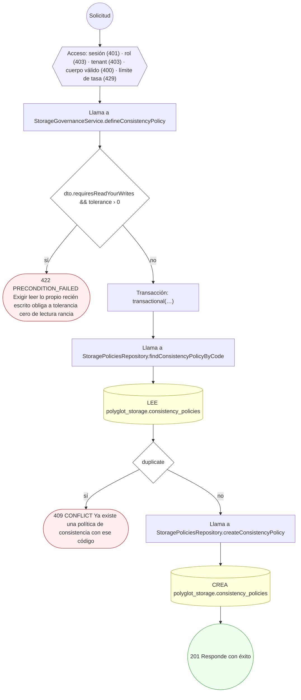

#### 4. POST /governance/datasets

Definir un dataset gobernado con su versión inicial

| HTTP | Código | Cuándo |
|---|---|---|
| 201 | — | Éxito |
| 400 | `VALIDATION_FAILED` | El cuerpo cumple el DTO (sin propiedades extra) |
| 401 | `UNAUTHENTICATED` | Hay una sesión válida (JWT) |
| 403 | `FORBIDDEN` | El rol está permitido; El tenant se resuelve y pertenece al actor |
| 404 | `NOT_FOUND` | ResourceNotFoundException: Clasificación de datos no encontrada |
| 409 | `CONFLICT` | ConflictException: Ya existe un dataset con ese código |
| 429 | `RATE_LIMITED` | No se supera el límite de solicitudes |

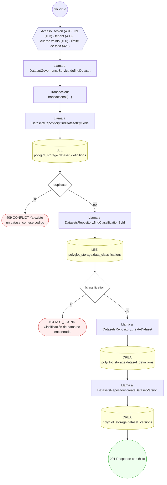

#### 5. POST /governance/datasets/{id}/data-access-policies

Definir la política de acceso al dato del dataset

| HTTP | Código | Cuándo |
|---|---|---|
| 201 | — | Éxito |
| 400 | `VALIDATION_FAILED` | Los parámetros de ruta son UUID válidos; El cuerpo cumple el DTO (sin propiedades extra) |
| 401 | `UNAUTHENTICATED` | Hay una sesión válida (JWT) |
| 403 | `FORBIDDEN` | El rol está permitido; El tenant se resuelve y pertenece al actor |
| 404 | `NOT_FOUND` | ResourceNotFoundException: Dataset no encontrado |
| 409 | `CONFLICT` | ConflictException: Ya existe una política para ese propósito y tipo de principal |
| 422 | `PRECONDITION_FAILED` | PreconditionFailedException: El dataset no está activo |
| 429 | `RATE_LIMITED` | No se supera el límite de solicitudes |

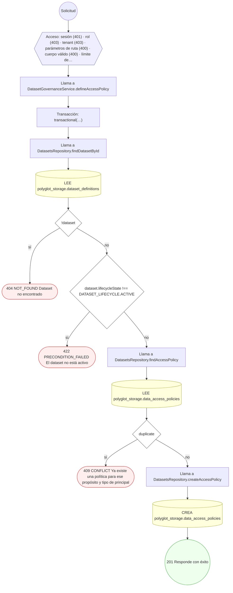

#### 6. POST /governance/datasets/{id}/versions

Publicar una versión nueva del dataset

| HTTP | Código | Cuándo |
|---|---|---|
| 201 | — | Éxito |
| 400 | `VALIDATION_FAILED` | Los parámetros de ruta son UUID válidos; El cuerpo cumple el DTO (sin propiedades extra) |
| 401 | `UNAUTHENTICATED` | Hay una sesión válida (JWT) |
| 403 | `FORBIDDEN` | El rol está permitido; El tenant se resuelve y pertenece al actor |
| 404 | `NOT_FOUND` | ResourceNotFoundException: Dataset no encontrado |
| 409 | `CONFLICT` | ConflictException: El dataset ya tiene esa versión |
| 422 | `PRECONDITION_FAILED` | PreconditionFailedException: Una versión que sucede a otra debe declarar su compatibilidad |
| 429 | `RATE_LIMITED` | No se supera el límite de solicitudes |

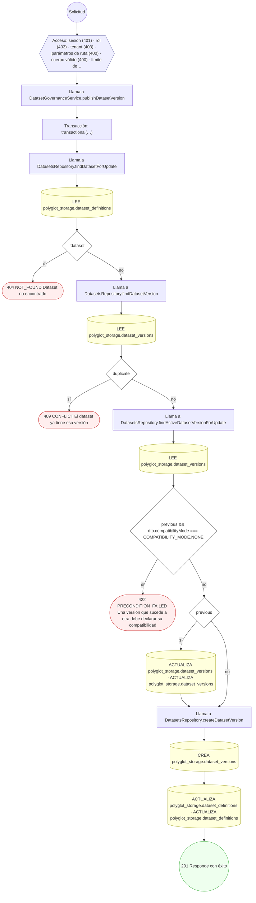

#### 7. POST /governance/encryption-profiles

Definir un perfil de cifrado con su política de rotación

| HTTP | Código | Cuándo |
|---|---|---|
| 201 | — | Éxito |
| 400 | `VALIDATION_FAILED` | El cuerpo cumple el DTO (sin propiedades extra) |
| 401 | `UNAUTHENTICATED` | Hay una sesión válida (JWT) |
| 403 | `FORBIDDEN` | El rol está permitido; El tenant se resuelve y pertenece al actor |
| 409 | `CONFLICT` | ConflictException: Ya existe un perfil de cifrado con ese código |
| 429 | `RATE_LIMITED` | No se supera el límite de solicitudes |

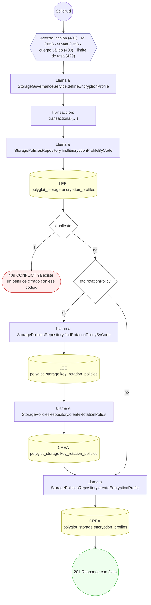

#### 8. POST /governance/placements/{id}/failover

Forzar el failover de una colocación

| HTTP | Código | Cuándo |
|---|---|---|
| 200 | — | Éxito |
| 400 | `VALIDATION_FAILED` | Los parámetros de ruta son UUID válidos; El cuerpo cumple el DTO (sin propiedades extra) |
| 401 | `UNAUTHENTICATED` | Hay una sesión válida (JWT) |
| 403 | `FORBIDDEN` | El rol está permitido; El tenant se resuelve y pertenece al actor |
| 404 | `NOT_FOUND` | ResourceNotFoundException: Colocación no encontrada |
| 422 | `PRECONDITION_FAILED` | PreconditionFailedException: La colocación no está sirviendo tráfico |
| 429 | `RATE_LIMITED` | No se supera el límite de solicitudes |

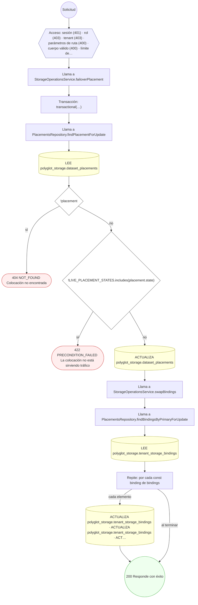

#### 9. POST /governance/placements/approve

Aprobar una colocación respetando residencia y clasificación

| HTTP | Código | Cuándo |
|---|---|---|
| 201 | — | Éxito |
| 400 | `VALIDATION_FAILED` | El cuerpo cumple el DTO (sin propiedades extra) |
| 401 | `UNAUTHENTICATED` | Hay una sesión válida (JWT) |
| 403 | `FORBIDDEN` | El rol está permitido; El tenant se resuelve y pertenece al actor |
| 404 | `NOT_FOUND` | ResourceNotFoundException: Versión del dataset no encontrada; ResourceNotFoundException: Colección no encontrada; ResourceNotFoundException: Región no encontrada; ResourceNotFoundException: Política de residencia no encontrada; ResourceNotFoundException: Perfil de cifrado no encontrado |
| 422 | `PRECONDITION_FAILED` | PreconditionFailedException: La versión del dataset no está activa; PreconditionFailedException: La política de residencia prohíbe ese país; PreconditionFailedException: El país de la región no está entre los permitidos por la residencia; PreconditionFailedException: La región no está entre las permitidas por la residencia; PreconditionFailedException: Un dataset con datos de paciente exige cifrado a nivel de campo |
| 429 | `RATE_LIMITED` | No se supera el límite de solicitudes |

```mermaid
flowchart TD
  n1(("Solicitud")):::inicio
  n2{{"Acceso: sesión (401) · rol (403) · tenant (403) · cuerpo válido (400) · límite de tasa (429)"}}:::acceso
  n1 --> n2
  n3["Llama a DatasetGovernanceService.approvePlacement"]:::llamada
  n2 --> n3
  n4["Transacción: transactional(…)"]:::transaccion
  n3 --> n4
  n5["Llama a DatasetsRepository.findDatasetVersionById"]:::llamada
  n4 --> n5
  n6[("LEE polyglot_storage.dataset_versions")]:::efecto
  n5 --> n6
  n7{"!version"}:::decision
  n6 --> n7
  n8(["404 NOT_FOUND Versión del dataset no encontrada"]):::error
  n7 -->|"sí"| n8
  n9{"version.state !== VERSION_STATE.ACTIVE"}:::decision
  n7 -->|"no"| n9
  n10(["422 PRECONDITION_FAILED La versión del dataset no está activa"]):::error
  n9 -->|"sí"| n10
  n11["Llama a PlacementsRepository.findPlacement"]:::llamada
  n9 -->|"no"| n11
  n12[("LEE polyglot_storage.dataset_placements")]:::efecto
  n11 --> n12
  n13["Llama a DatasetsRepository.findCollectionById"]:::llamada
  n12 --> n13
  n14[("LEE polyglot_storage.collection_definitions")]:::efecto
  n13 --> n14
  n15{"!collection"}:::decision
  n14 --> n15
  n16(["404 NOT_FOUND Colección no encontrada"]):::error
  n15 -->|"sí"| n16
  n17["Llama a StorageBackendsRepository.findRegionById"]:::llamada
  n15 -->|"no"| n17
  n18[("LEE polyglot_storage.storage_backend_regions")]:::efecto
  n17 --> n18
  n19{"!region"}:::decision
  n18 --> n19
  n20(["404 NOT_FOUND Región no encontrada"]):::error
  n19 -->|"sí"| n20
  n21["Llama a StoragePoliciesRepository.findResidencyPolicyById"]:::llamada
  n19 -->|"no"| n21
  n22[("LEE polyglot_storage.residency_policies")]:::efecto
  n21 --> n22
  n23{"!residency"}:::decision
  n22 --> n23
  n24(["404 NOT_FOUND Política de residencia no encontrada"]):::error
  n23 -->|"sí"| n24
  n25["Llama a StoragePoliciesRepository.findEncryptionProfileById"]:::llamada
  n23 -->|"no"| n25
  n26[("LEE polyglot_storage.encryption_profiles")]:::efecto
  n25 --> n26
  n27{"!encryption"}:::decision
  n26 --> n27
  n28(["404 NOT_FOUND Perfil de cifrado no encontrado"]):::error
  n27 -->|"sí"| n28
  n29["Llama a DatasetsRepository.findDatasetById"]:::llamada
  n27 -->|"no"| n29
  n30[("LEE polyglot_storage.dataset_definitions")]:::efecto
  n29 --> n30
  n31["Llama a DatasetsRepository.findClassificationById"]:::llamada
  n30 --> n31
  n32[("LEE polyglot_storage.data_classifications")]:::efecto
  n31 --> n32
  n33["Llama a DatasetGovernanceService.assertResidency"]:::llamada
  n32 --> n33
  n34{"forbidden.includes(region.countryCode)"}:::decision
  n33 --> n34
  n35(["422 PRECONDITION_FAILED La política de residencia prohíbe ese país"]):::error
  n34 -->|"sí"| n35
  n36{"allowedCountries.length › 0 && !allowedCountries.includes(region.countryCode)"}:::decision
  n34 -->|"no"| n36
  n37(["422 PRECONDITION_FAILED El país de la región no está entre los permitidos por la residencia"]):::error
  n36 -->|"sí"| n37
  n38{"allowedRegions.length › 0 && !allowedRegions.includes(region.regionCode)"}:::decision
  n36 -->|"no"| n38
  n39(["422 PRECONDITION_FAILED La región no está entre las permitidas por la residencia"]):::error
  n38 -->|"sí"| n39
  n40{"classification?.containsPhi && !encryption.fieldLevelEncryption"}:::decision
  n38 -->|"no"| n40
  n41(["422 PRECONDITION_FAILED Un dataset con datos de paciente exige cifrado a nivel de campo"]):::error
  n40 -->|"sí"| n41
  n42["Llama a PlacementsRepository.createPlacement"]:::llamada
  n40 -->|"no"| n42
  n43[("CREA polyglot_storage.dataset_placements")]:::efecto
  n42 --> n43
  n44(("201 Responde con éxito")):::ok
  n43 --> n44
  classDef acceso fill:#eef,stroke:#66a
  classDef error fill:#fee,stroke:#c33
  classDef ok fill:#efe,stroke:#3a3
  classDef efecto fill:#ffd,stroke:#aa3
  classDef decision fill:#fff,stroke:#555
  classDef corte fill:#eee,stroke:#999,stroke-dasharray: 4
```

#### 10. POST /governance/policies

Definir políticas de residencia, replicación y retención

| HTTP | Código | Cuándo |
|---|---|---|
| 201 | — | Éxito |
| 400 | `VALIDATION_FAILED` | El cuerpo cumple el DTO (sin propiedades extra) |
| 401 | `UNAUTHENTICATED` | Hay una sesión válida (JWT) |
| 403 | `FORBIDDEN` | El rol está permitido; El tenant se resuelve y pertenece al actor |
| 409 | `CONFLICT` | ConflictException: Ya existe una política de residencia con ese código; ConflictException: Ya existe una política de replicación con ese código; ConflictException: Ya existe una política de retención con ese código |
| 422 | `PRECONDITION_FAILED` | PreconditionFailedException: Hay que declarar al menos una política; PreconditionFailedException: Prohibir la réplica entre regiones exige declarar los países permitidos |
| 429 | `RATE_LIMITED` | No se supera el límite de solicitudes |

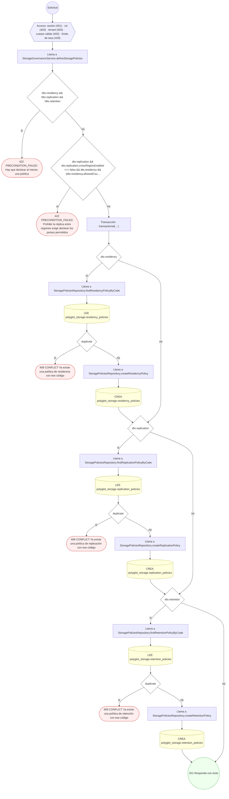

#### 11. POST /governance/storage-backends

Registrar un backend con sus regiones y capacidades

| HTTP | Código | Cuándo |
|---|---|---|
| 201 | — | Éxito |
| 400 | `VALIDATION_FAILED` | El cuerpo cumple el DTO (sin propiedades extra) |
| 401 | `UNAUTHENTICATED` | Hay una sesión válida (JWT) |
| 403 | `FORBIDDEN` | El rol está permitido; El tenant se resuelve y pertenece al actor |
| 409 | `CONFLICT` | ConflictException: Ya existe un backend con ese código |
| 422 | `PRECONDITION_FAILED` | PreconditionFailedException: Sólo una región puede ser la primaria; PreconditionFailedException: {message} |
| 429 | `RATE_LIMITED` | No se supera el límite de solicitudes |

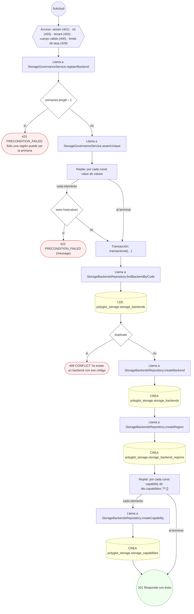

#### 12. POST /governance/tenants/{tenantId}/storage-bindings

Vincular el tenant a su colocación

| HTTP | Código | Cuándo |
|---|---|---|
| 201 | — | Éxito |
| 400 | `VALIDATION_FAILED` | Los parámetros de ruta son UUID válidos; El cuerpo cumple el DTO (sin propiedades extra) |
| 401 | `UNAUTHENTICATED` | Hay una sesión válida (JWT) |
| 403 | `FORBIDDEN` | El rol está permitido; El tenant se resuelve y pertenece al actor |
| 404 | `NOT_FOUND` | ResourceNotFoundException: Colocación primaria no encontrada; ResourceNotFoundException: Colocación secundaria no encontrada |
| 409 | `CONFLICT` | ConflictException: El tenant ya está vinculado a ese dataset |
| 422 | `PRECONDITION_FAILED` | PreconditionFailedException: La colocación primaria no está aprobada; PreconditionFailedException: La colocación secundaria no puede ser la misma que la primaria |
| 429 | `RATE_LIMITED` | No se supera el límite de solicitudes |

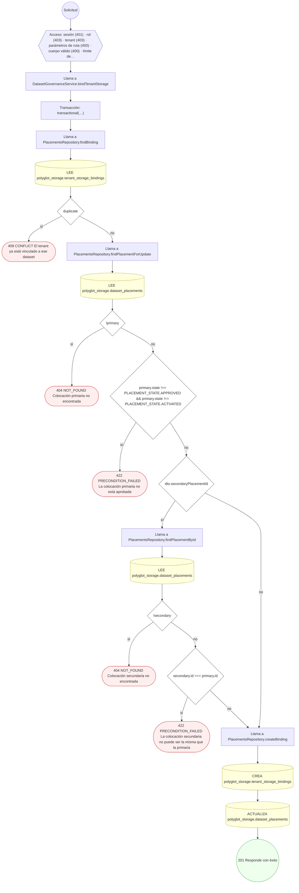

#### 13. POST /ops/integrity-policies

Definir la política de integridad del dataset

| HTTP | Código | Cuándo |
|---|---|---|
| 201 | — | Éxito |
| 400 | `VALIDATION_FAILED` | El cuerpo cumple el DTO (sin propiedades extra) |
| 401 | `UNAUTHENTICATED` | Hay una sesión válida (JWT) |
| 403 | `FORBIDDEN` | El rol está permitido; El tenant se resuelve y pertenece al actor |
| 404 | `NOT_FOUND` | ResourceNotFoundException: Dataset no encontrado |
| 422 | `PRECONDITION_FAILED` | PreconditionFailedException: El porcentaje de muestra debe estar entre 0 y 100 |
| 429 | `RATE_LIMITED` | No se supera el límite de solicitudes |

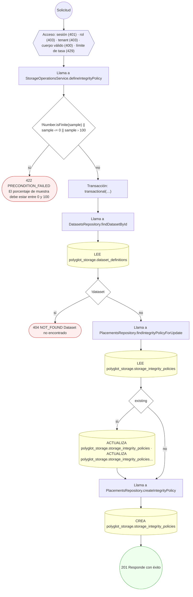

#### 14. POST /ops/integrity/{datasetId}/verify

Verificar que la proyección cuadra con la fuente canónica

| HTTP | Código | Cuándo |
|---|---|---|
| 200 | — | Éxito |
| 400 | `VALIDATION_FAILED` | Los parámetros de ruta son UUID válidos; El cuerpo cumple el DTO (sin propiedades extra) |
| 401 | `UNAUTHENTICATED` | Hay una sesión válida (JWT) |
| 403 | `FORBIDDEN` | El rol está permitido; El tenant se resuelve y pertenece al actor |
| 404 | `NOT_FOUND` | ResourceNotFoundException: El dataset no tiene política de integridad; ResourceNotFoundException: Colocación no encontrada |
| 429 | `RATE_LIMITED` | No se supera el límite de solicitudes |

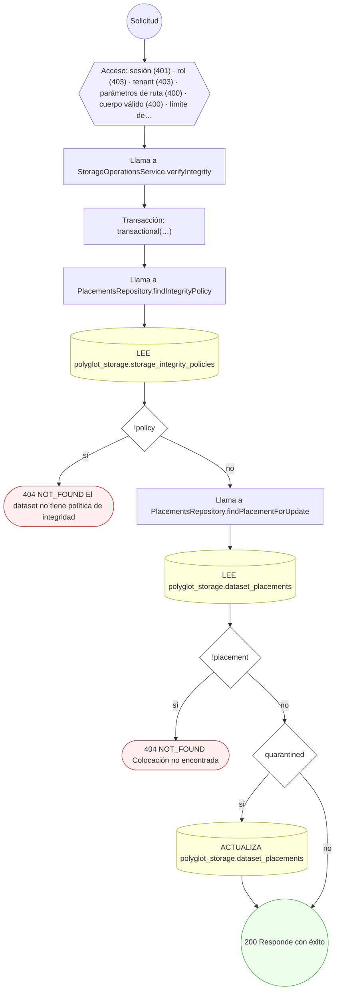

#### 15. POST /ops/store-health-checks

Registrar una comprobación de salud de la región

| HTTP | Código | Cuándo |
|---|---|---|
| 201 | — | Éxito |
| 400 | `VALIDATION_FAILED` | El cuerpo cumple el DTO (sin propiedades extra) |
| 401 | `UNAUTHENTICATED` | Hay una sesión válida (JWT) |
| 403 | `FORBIDDEN` | El rol está permitido; El tenant se resuelve y pertenece al actor |
| 404 | `NOT_FOUND` | ResourceNotFoundException: Región no encontrada |
| 429 | `RATE_LIMITED` | No se supera el límite de solicitudes |

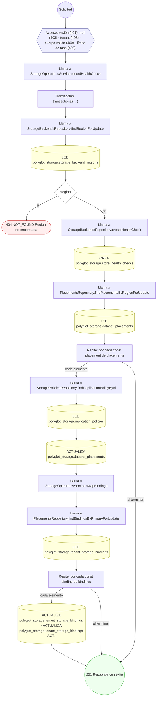

