<!-- AUTOGENERADO por tools/inventario/flujos.mjs. No editar manualmente. -->

# Flujos del módulo `practice`

- **Procesos:** 1 · **Máquinas de estado:** 1
- **Operaciones:** 24 (21 con decisiones propias, 3 sin ellas)
- Inventario de endpoints del módulo: [practice](../endpoints/practice.md)

## Proceso: Módulo Practice (14)

- **Código:** `practice` · **Agrupación:** MIXTO · **Operaciones:** 24
- **Actores:** ACCOUNTING_APPROVER · ANESTHESIOLOGIST · CLINICIAN · PATIENT · PERIOP_ADMIN · PERIOP_NURSE · PRACTITIONER · SCHEDULING_ADMIN · SCHEDULING_AGENT · SECURITY_ADMIN · SURGEON · SURGERY_SCHEDULER
- **Revisión:** AUTO_DETECTADA
- **Fuentes:** `src/modules/practice/README.md`

### Para qué sirve

Care Organizations, Sites, Units, Spaces and Workforce. Modela la organización de atención (`practice`), sus sedes (`practice_sites`), la estructura clínica jerárquica (`clinical_units`, `care_spaces`), el catálogo de servicios (`healthcare_services`), el personal (`practitioner_role_assignments`, `practitioner_support_assignments`), acreditaciones (`practice_accreditations`), ajustes (`practice_settings`) e inventario (`inventory_items`, `inventory_movements`).

_Fuente: `src/modules/practice/README.md:3`_

### Etapas y operaciones

| Etapa | Descripción | Operación | Quién actúa | Riesgo | Tablas |
|---|---|---|---|---|---|
| `UC-14-01` | Alta de sitio (op. status PLANNED) | POST /practices/{practiceId}/sites | SECURITY_ADMIN | MEDIO | 3 |
| `UC-14-02` | Registrar acreditación (PENDING) | POST /practices/{practiceId}/accreditations | SECURITY_ADMIN | MEDIO | 3 |
| `UC-14-03` | Verificar (→VERIFIED) o caducar (→EXPIRED) | POST /accreditations/{id}/verify | SECURITY_ADMIN | MEDIO | 2 |
| `UC-14-04` | Crear unidad clínica jerárquica | POST /sites/{siteId}/clinical-units | SECURITY_ADMIN | MEDIO | 3 |
| `UC-14-05` | Crear espacio de atención (AVAILABLE) | POST /sites/{siteId}/care-spaces | SECURITY_ADMIN | MEDIO | 4 |
| `UC-14-06` | Publicar servicio de salud | POST /practices/{practiceId}/healthcare-services | SECURITY_ADMIN | MEDIO | 4 |
| `UC-14-07` | Configurar ajuste (upsert) | PUT /practices/{practiceId}/settings/{settingKey} | SECURITY_ADMIN | MEDIO | 4 |
| `UC-14-08` | Asignar rol de profesional | POST /practices/{practiceId}/role-assignments | SECURITY_ADMIN | MEDIO | 3 |
| `UC-14-09` | Adjuntar personal de apoyo | POST /role-assignments/{roleId}/support-assignments | SECURITY_ADMIN | MEDIO | 2 |
| `UC-14-10` | Alta de insumo (stock 0) | POST /practices/{practiceId}/inventory-items | SECURITY_ADMIN | MEDIO | 1 |
| `UC-14-11` | Movimiento de stock (IN/OUT/ADJUST) | POST /inventory-items/{itemId}/movements | SECURITY_ADMIN | MEDIO | 3 |
| `UC-14-12` | Desmantelar sitio en cascada | DELETE /practices/{practiceId}/sites/{siteId} | SECURITY_ADMIN | MEDIO | 10 |
| `ctrl:PracticesController` | Operaciones de PracticesController que el README no asigna a un caso de uso | GET /practices | SECURITY_ADMIN · SURGERY_SCHEDULER · PERIOP_ADMIN · SURGEON · ANESTHESIOLOGIST · PERIOP_NURSE · SCHEDULING_ADMIN · PRACTITIONER · CLINICIAN · ACCOUNTING_APPROVER | BAJO | 1 |
|  |  | POST /practices | SECURITY_ADMIN | MEDIO | 1 |
|  |  | GET /practices/{practiceId}/organization | SECURITY_ADMIN · PERIOP_ADMIN · SURGERY_SCHEDULER · SCHEDULING_ADMIN · PRACTITIONER · CLINICIAN · ACCOUNTING_APPROVER | BAJO | 9 |
|  |  | POST /practices/{practiceId}/role-assignments/self-request | PRACTITIONER | MEDIO | 3 |
|  |  | GET /practices/{practiceId}/sites | SECURITY_ADMIN · SURGERY_SCHEDULER · PERIOP_ADMIN · SURGEON · ANESTHESIOLOGIST · PERIOP_NURSE · SCHEDULING_ADMIN | BAJO | 2 |
| `ctrl:PractitionerSitesController` | Operaciones de PractitionerSitesController que el README no asigna a un caso de uso | GET /practitioners/{profileId}/sites | SECURITY_ADMIN · SCHEDULING_ADMIN · SCHEDULING_AGENT · PRACTITIONER · CLINICIAN · PATIENT | BAJO | 4 |
|  |  | GET /practitioners/me/role-assignments | PRACTITIONER | BAJO | 2 |
| `ctrl:RoleAssignmentsController` | Operaciones de RoleAssignmentsController que el README no asigna a un caso de uso | POST /role-assignments/{roleId}/approve | SECURITY_ADMIN | MEDIO | 2 |
|  |  | POST /role-assignments/{roleId}/end | SECURITY_ADMIN | MEDIO | 2 |
|  |  | POST /role-assignments/{roleId}/reject | SECURITY_ADMIN | MEDIO | 2 |
|  |  | POST /role-assignments/{roleId}/suspend | SECURITY_ADMIN | MEDIO | 2 |
| `ctrl:SitesController` | Operaciones de SitesController que el README no asigna a un caso de uso | GET /sites/{siteId}/care-spaces | SECURITY_ADMIN · SURGERY_SCHEDULER · PERIOP_ADMIN · SURGEON · ANESTHESIOLOGIST · PERIOP_NURSE · SCHEDULING_ADMIN | BAJO | 3 |

### Diagrama 1 de 2 — etapas `UC-14-01`, `UC-14-02`, `UC-14-03`…

```mermaid
flowchart LR
  a2(["SECURITY_ADMIN"]):::actor
  a27(["SECURITY_ADMIN · SURGERY_SCHEDULER · PERIOP_ADMIN · SURGEON…"]):::actor
  a30(["SECURITY_ADMIN · PERIOP_ADMIN · SURGERY_SCHEDULER · SCHEDUL…"]):::actor
  a33(["PRACTITIONER"]):::actor
  a35(["SECURITY_ADMIN · SURGERY_SCHEDULER · PERIOP_ADMIN · SURGEON…"]):::actor
  a37(["SECURITY_ADMIN · SCHEDULING_ADMIN · SCHEDULING_AGENT · PRAC…"]):::actor
  t3[("practice.practice_sites")]:::tabla
  t4[("practice.practices")]:::tabla
  t6[("practice.practice_accreditations")]:::tabla
  t9[("practice.clinical_units")]:::tabla
  t11[("practice.care_spaces")]:::tabla
  t13[("practice.healthcare_services")]:::tabla
  t15[("practice.practice_settings")]:::tabla
  t17[("practice.practitioner_role_assignments")]:::tabla
  t19[("practice.practitioner_support_assignments")]:::tabla
  t21[("practice.inventory_items")]:::tabla
  t23[("practice.inventory_movements")]:::tabla
  t38[("common.addresses")]:::tabla
  subgraph s0["UC-14-01 · Alta de sitio (op. status PLANNED)"]
    o1["POST /practices/{practiceId}/sites"]:::op
  end
  subgraph s1["UC-14-02 · Registrar acreditación (PENDING)"]
    o5["POST /practices/{practiceId}/accreditations"]:::op
  end
  subgraph s2["UC-14-03 · Verificar (→VERIFIED) o caducar (→EXPIRED)"]
    o7["POST /accreditations/{id}/verify"]:::op
  end
  subgraph s3["UC-14-04 · Crear unidad clínica jerárquica"]
    o8["POST /sites/{siteId}/clinical-units"]:::op
  end
  subgraph s4["UC-14-05 · Crear espacio de atención (AVAILABLE)"]
    o10["POST /sites/{siteId}/care-spaces"]:::op
  end
  subgraph s5["UC-14-06 · Publicar servicio de salud"]
    o12["POST /practices/{practiceId}/healthcare-services"]:::op
  end
  subgraph s6["UC-14-07 · Configurar ajuste (upsert)"]
    o14["PUT /practices/{practiceId}/settings/{settingKey}"]:::op
  end
  subgraph s7["UC-14-08 · Asignar rol de profesional"]
    o16["POST /practices/{practiceId}/role-assignments"]:::op
  end
  subgraph s8["UC-14-09 · Adjuntar personal de apoyo"]
    o18["POST /role-assignments/{roleId}/support-assignments"]:::op
  end
  subgraph s9["UC-14-10 · Alta de insumo (stock 0)"]
    o20["POST /practices/{practiceId}/inventory-items"]:::op
  end
  subgraph s10["UC-14-11 · Movimiento de stock (IN/OUT/ADJUST)"]
    o22["POST /inventory-items/{itemId}/movements"]:::op
  end
  t25[("+4 tablas más")]
  subgraph s11["UC-14-12 · Desmantelar sitio en cascada"]
    o24["DELETE /practices/{practiceId}/sites/{siteId}"]:::op
  end
  t31[("+3 tablas más")]
  subgraph s12["ctrl:PracticesController · Operaciones de PracticesController que el README no…"]
    o26["GET /practices"]:::op
    o28["POST /practices"]:::op
    o29["GET /practices/{practiceId}/organization"]:::op
    o32["POST /practices/{practiceId}/role-assignments/self-request"]:::op
    o34["GET /practices/{practiceId}/sites"]:::op
  end
  subgraph s13["ctrl:PractitionerSitesController · Operaciones de PractitionerSitesController q…"]
    o36["GET /practitioners/{profileId}/sites"]:::op
    o39["GET /practitioners/me/role-assignments"]:::op
  end
  a2 --> o1
  o1 -->|"CREA"| t3
  o1 -->|"LEE"| t3
  o1 -->|"LEE"| t4
  a2 --> o5
  o5 -->|"CREA"| t6
  o5 -->|"LEE"| t3
  o5 -->|"LEE"| t4
  a2 --> o7
  o7 -->|"ACTUALIZA"| t6
  o7 -->|"LEE"| t6
  a2 --> o8
  o8 -->|"CREA"| t9
  o8 -->|"LEE"| t9
  o8 -->|"LEE"| t3
  a2 --> o10
  o10 -->|"CREA"| t11
  o10 -->|"LEE"| t11
  o10 -->|"LEE"| t9
  o10 -->|"LEE"| t3
  a2 --> o12
  o12 -->|"LEE"| t9
  o12 -->|"CREA"| t13
  o12 -->|"LEE"| t3
  o12 -->|"LEE"| t4
  a2 --> o14
  o14 -->|"ACTUALIZA"| t15
  o14 -->|"CREA"| t15
  o14 -->|"LEE"| t15
  o14 -->|"LEE"| t4
  a2 --> o16
  o16 -->|"LEE"| t3
  o16 -->|"LEE"| t4
  o16 -->|"CREA"| t17
  a2 --> o18
  o18 -->|"LEE"| t17
  o18 -->|"CREA"| t19
  a2 --> o20
  o20 -->|"CREA"| t21
  a2 --> o22
  o22 -->|"ACTUALIZA"| t21
  o22 -->|"LEE"| t21
  o22 -->|"CREA"| t23
  a2 --> o24
  o24 -->|"ACTUALIZA"| t11
  o24 -->|"LEE"| t11
  o24 -->|"ACTUALIZA"| t9
  o24 -->|"LEE"| t9
  o24 -->|"ACTUALIZA"| t13
  o24 -->|"LEE"| t13
  o24 -.-> t25
  a27 --> o26
  o26 -->|"LEE"| t4
  a2 --> o28
  o28 -->|"CREA"| t4
  a30 --> o29
  o29 -->|"LEE"| t11
  o29 -->|"LEE"| t9
  o29 -->|"LEE"| t13
  o29 -->|"LEE"| t21
  o29 -->|"LEE"| t6
  o29 -->|"LEE"| t3
  o29 -.-> t31
  a33 --> o32
  o32 -->|"LEE"| t3
  o32 -->|"LEE"| t4
  o32 -->|"CREA"| t17
  a35 --> o34
  o34 -->|"LEE"| t3
  o34 -->|"LEE"| t4
  a37 --> o36
  o36 -->|"LEE"| t38
  o36 -->|"LEE"| t3
  o36 -->|"LEE"| t4
  o36 -->|"LEE"| t17
  a33 --> o39
  o39 -->|"LEE"| t4
  o39 -->|"LEE"| t17
  classDef op fill:#fff,stroke:#446
  classDef actor fill:#eef,stroke:#66a
  classDef tabla fill:#ffd,stroke:#aa3
  classDef evento fill:#efe,stroke:#3a3
```

### Diagrama 2 de 2 — etapas `ctrl:RoleAssignmentsController`, `ctrl:SitesController`

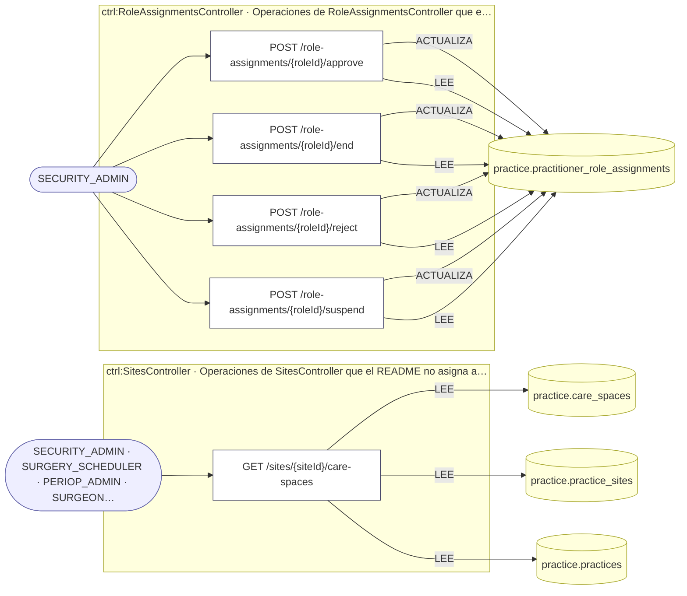

## Máquinas de estado

### Máquina de estados `ASSIGNMENT_TRANSITIONS`

Declarada en `src/modules/practice/services/practice-workforce.service.ts:27`. Los estados llevan el nombre del identificador del código; no se resuelven al catálogo de conceptos.

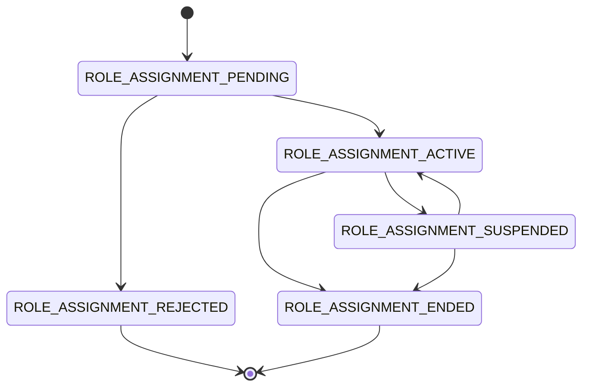

**Operaciones que ejercen esta máquina** _(POR_REFERENCIA: el handler alcanza un método que valida contra la tabla; «sin destino nombrado» significa que el estado de destino llega por el cuerpo de la petición)_:

| Operación | Estados de destino que nombra | A través de |
|---|---|---|
| POST /role-assignments/{roleId}/approve | ROLE_ASSIGNMENT_ACTIVE, ROLE_ASSIGNMENT_ENDED, ROLE_ASSIGNMENT_REJECTED | PracticeWorkforceService.approveAssignment → PracticeWorkforceService.transitionAssignment |
| POST /role-assignments/{roleId}/end | ROLE_ASSIGNMENT_ENDED, ROLE_ASSIGNMENT_REJECTED | PracticeWorkforceService.endAssignment → PracticeWorkforceService.transitionAssignment |
| POST /role-assignments/{roleId}/reject | ROLE_ASSIGNMENT_ENDED, ROLE_ASSIGNMENT_REJECTED | PracticeWorkforceService.rejectAssignment → PracticeWorkforceService.transitionAssignment |
| POST /role-assignments/{roleId}/suspend | ROLE_ASSIGNMENT_ENDED, ROLE_ASSIGNMENT_REJECTED, ROLE_ASSIGNMENT_SUSPENDED | PracticeWorkforceService.suspendAssignment → PracticeWorkforceService.transitionAssignment |

## Árbol de decisión por operación

Cada árbol se deriva del código del handler y de los métodos que invoca (hasta 4 niveles). Una rama que no decide, no escribe y no falla se poda. Los accesos y los efectos consecutivos se agrupan en un solo nodo.

### Operaciones con decisiones propias

#### 1. POST /accreditations/{id}/verify

Verificar o caducar una acreditación (transición de estado)

| HTTP | Código | Cuándo |
|---|---|---|
| 200 | — | Éxito |
| 400 | `VALIDATION_FAILED` | Los parámetros de ruta son UUID válidos; El cuerpo cumple el DTO (sin propiedades extra) |
| 401 | `UNAUTHENTICATED` | Hay una sesión válida (JWT) |
| 403 | `FORBIDDEN` | El rol está permitido; El tenant se resuelve y pertenece al actor |
| 404 | `NOT_FOUND` | ResourceNotFoundException: Acreditación no encontrada |
| 422 | `PRECONDITION_FAILED` | PreconditionFailedException: La acreditación no está pendiente de verificación |
| 429 | `RATE_LIMITED` | No se supera el límite de solicitudes |

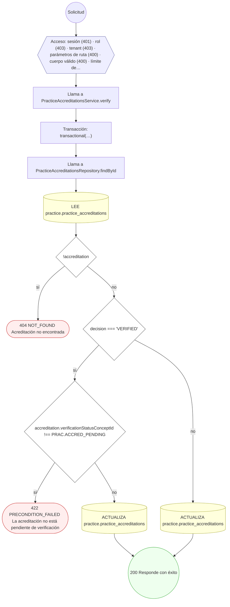

#### 2. POST /inventory-items/{itemId}/movements

Registrar un movimiento de inventario (ajuste de stock)

| HTTP | Código | Cuándo |
|---|---|---|
| 201 | — | Éxito |
| 400 | `VALIDATION_FAILED` | Los parámetros de ruta son UUID válidos; El cuerpo cumple el DTO (sin propiedades extra) |
| 401 | `UNAUTHENTICATED` | Hay una sesión válida (JWT) |
| 403 | `FORBIDDEN` | El rol está permitido; El tenant se resuelve y pertenece al actor |
| 404 | `NOT_FOUND` | ResourceNotFoundException: Insumo de inventario no encontrado |
| 422 | `PRECONDITION_FAILED` | PreconditionFailedException: El insumo no está activo; PreconditionFailedException: Stock insuficiente para la salida |
| 429 | `RATE_LIMITED` | No se supera el límite de solicitudes |

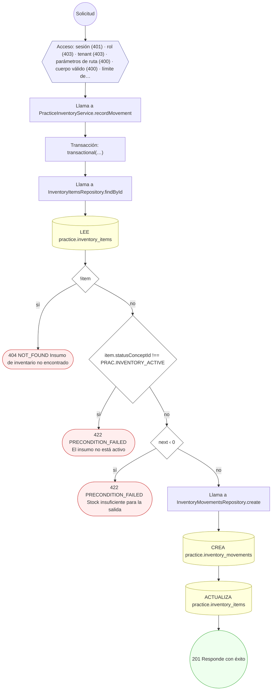

#### 3. POST /practices/{practiceId}/accreditations

Registrar una acreditación con evidencia

| HTTP | Código | Cuándo |
|---|---|---|
| 201 | — | Éxito |
| 400 | `VALIDATION_FAILED` | Los parámetros de ruta son UUID válidos; El cuerpo cumple el DTO (sin propiedades extra) |
| 401 | `UNAUTHENTICATED` | Hay una sesión válida (JWT) |
| 403 | `FORBIDDEN` | El rol está permitido; El tenant se resuelve y pertenece al actor |
| 404 | `NOT_FOUND` | ResourceNotFoundException: Práctica no encontrada |
| 422 | `PRECONDITION_FAILED` | PreconditionFailedException: El sitio no pertenece a la práctica |
| 429 | `RATE_LIMITED` | No se supera el límite de solicitudes |

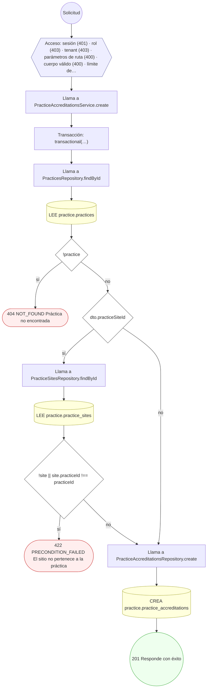

#### 4. POST /practices/{practiceId}/healthcare-services

Publicar un servicio de salud

| HTTP | Código | Cuándo |
|---|---|---|
| 201 | — | Éxito |
| 400 | `VALIDATION_FAILED` | Los parámetros de ruta son UUID válidos; El cuerpo cumple el DTO (sin propiedades extra) |
| 401 | `UNAUTHENTICATED` | Hay una sesión válida (JWT) |
| 403 | `FORBIDDEN` | El rol está permitido; El tenant se resuelve y pertenece al actor |
| 404 | `NOT_FOUND` | ResourceNotFoundException: Práctica no encontrada |
| 422 | `PRECONDITION_FAILED` | PreconditionFailedException: La práctica no está activa; PreconditionFailedException: El sitio no pertenece a la práctica; PreconditionFailedException: La unidad clínica no existe |
| 429 | `RATE_LIMITED` | No se supera el límite de solicitudes |

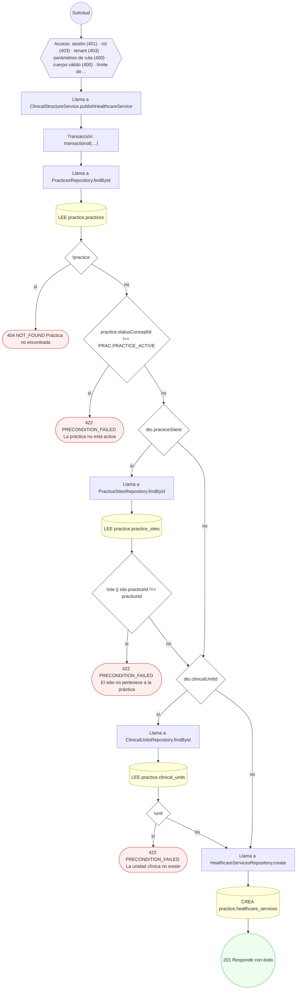

#### 5. GET /practices/{practiceId}/organization

Consola de organización médica: estructura, plantilla y legajo

| HTTP | Código | Cuándo |
|---|---|---|
| 200 | — | Éxito |
| 400 | `VALIDATION_FAILED` | Los parámetros de ruta son UUID válidos |
| 401 | `UNAUTHENTICATED` | Hay una sesión válida (JWT) |
| 403 | `FORBIDDEN` | El rol está permitido; El tenant se resuelve y pertenece al actor |
| 404 | `NOT_FOUND` | ResourceNotFoundException: Práctica no encontrada |
| 429 | `RATE_LIMITED` | No se supera el límite de solicitudes |

```mermaid
flowchart TD
  n1(("Solicitud")):::inicio
  n2{{"Acceso: sesión (401) · rol (403) · tenant (403) · parámetros de ruta (400) · límite de tasa (429)"}}:::acceso
  n1 --> n2
  n3["Llama a PracticeOrganizationReadService.getConsole"]:::llamada
  n2 --> n3
  n4["Llama a PracticesRepository.findById"]:::llamada
  n3 --> n4
  n5[("LEE practice.practices")]:::efecto
  n4 --> n5
  n6{"!practice || practice.tenantId !== tenantId"}:::decision
  n5 --> n6
  n7(["404 NOT_FOUND Práctica no encontrada"]):::error
  n6 -->|"sí"| n7
  n8["Llama a PracticeOrganizationReadRepository.findSites"]:::llamada
  n6 -->|"no"| n8
  n9[("LEE practice.practice_sites")]:::efecto
  n8 --> n9
  n10["Llama a PracticeOrganizationReadRepository.findHealthcareServices"]:::llamada
  n9 --> n10
  n11[("LEE practice.healthcare_services")]:::efecto
  n10 --> n11
  n12["Llama a PracticeOrganizationReadRepository.findRoleAssignments"]:::llamada
  n11 --> n12
  n13[("LEE practice.practitioner_role_assignments")]:::efecto
  n12 --> n13
  n14["Llama a PracticeOrganizationReadRepository.findAccreditations"]:::llamada
  n13 --> n14
  n15[("LEE practice.practice_accreditations")]:::efecto
  n14 --> n15
  n16["Llama a PracticeOrganizationReadRepository.findInventoryItems"]:::llamada
  n15 --> n16
  n17[("LEE practice.inventory_items")]:::efecto
  n16 --> n17
  n18["Llama a PracticeOrganizationReadRepository.findClinicalUnits"]:::llamada
  n17 --> n18
  n19[("LEE practice.clinical_units")]:::efecto
  n18 --> n19
  n20["Llama a PracticeOrganizationReadRepository.findCareSpaces"]:::llamada
  n19 --> n20
  n21[("LEE practice.care_spaces")]:::efecto
  n20 --> n21
  n22["Llama a PracticeOrganizationReadRepository.findConcepts"]:::llamada
  n21 --> n22
  n23[("LEE terminology.catalog_concepts")]:::efecto
  n22 --> n23
  n24(("200 Responde con éxito")):::ok
  n23 --> n24
  classDef acceso fill:#eef,stroke:#66a
  classDef error fill:#fee,stroke:#c33
  classDef ok fill:#efe,stroke:#3a3
  classDef efecto fill:#ffd,stroke:#aa3
  classDef decision fill:#fff,stroke:#555
  classDef corte fill:#eee,stroke:#999,stroke-dasharray: 4
```

#### 6. POST /practices/{practiceId}/role-assignments

Asignar un rol de profesional a sitio/unidad/servicio

| HTTP | Código | Cuándo |
|---|---|---|
| 201 | — | Éxito |
| 400 | `VALIDATION_FAILED` | Los parámetros de ruta son UUID válidos; El cuerpo cumple el DTO (sin propiedades extra) |
| 401 | `UNAUTHENTICATED` | Hay una sesión válida (JWT) |
| 403 | `FORBIDDEN` | El rol está permitido; El tenant se resuelve y pertenece al actor |
| 404 | `NOT_FOUND` | ResourceNotFoundException: Práctica no encontrada |
| 422 | `PRECONDITION_FAILED` | PreconditionFailedException: La práctica no está activa; PreconditionFailedException: El sitio no pertenece a la práctica |
| 429 | `RATE_LIMITED` | No se supera el límite de solicitudes |

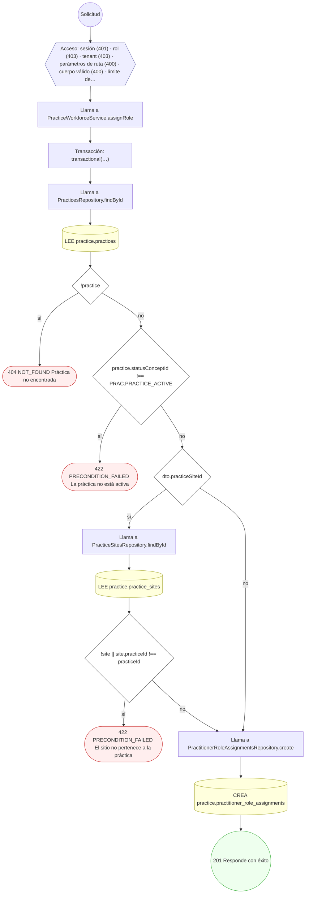

#### 7. POST /practices/{practiceId}/role-assignments/self-request

Solicitar la propia vinculación a una organización

| HTTP | Código | Cuándo |
|---|---|---|
| 201 | — | Éxito |
| 400 | `VALIDATION_FAILED` | Los parámetros de ruta son UUID válidos; El cuerpo cumple el DTO (sin propiedades extra) |
| 401 | `UNAUTHENTICATED` | Hay una sesión válida (JWT) |
| 403 | `FORBIDDEN` | El rol está permitido; El tenant se resuelve y pertenece al actor |
| 404 | `NOT_FOUND` | ResourceNotFoundException: Práctica no encontrada |
| 422 | `PRECONDITION_FAILED` | PreconditionFailedException: La cuenta no tiene un perfil profesional asociado; PreconditionFailedException: La práctica no está activa; PreconditionFailedException: El sitio no pertenece a la práctica |
| 429 | `RATE_LIMITED` | No se supera el límite de solicitudes |

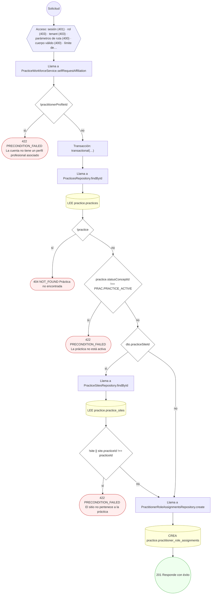

#### 8. PUT /practices/{practiceId}/settings/{settingKey}

Configurar un ajuste de práctica (upsert)

| HTTP | Código | Cuándo |
|---|---|---|
| 200 | — | Éxito |
| 400 | `VALIDATION_FAILED` | Los parámetros de ruta son UUID válidos; El cuerpo cumple el DTO (sin propiedades extra) |
| 401 | `UNAUTHENTICATED` | Hay una sesión válida (JWT) |
| 403 | `FORBIDDEN` | El rol está permitido; El tenant se resuelve y pertenece al actor |
| 404 | `NOT_FOUND` | ResourceNotFoundException: Práctica no encontrada |
| 429 | `RATE_LIMITED` | No se supera el límite de solicitudes |

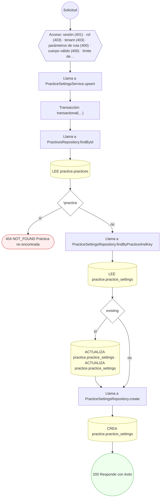

#### 9. GET /practices/{practiceId}/sites

Listar las sedes de una práctica

| HTTP | Código | Cuándo |
|---|---|---|
| 200 | — | Éxito |
| 400 | `VALIDATION_FAILED` | Los parámetros de ruta son UUID válidos |
| 401 | `UNAUTHENTICATED` | Hay una sesión válida (JWT) |
| 403 | `FORBIDDEN` | El rol está permitido; El tenant se resuelve y pertenece al actor |
| 404 | `NOT_FOUND` | ResourceNotFoundException: Práctica no encontrada |
| 429 | `RATE_LIMITED` | No se supera el límite de solicitudes |

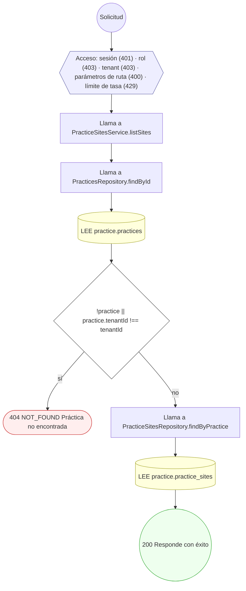

#### 10. POST /practices/{practiceId}/sites

Dar de alta un sitio de práctica

| HTTP | Código | Cuándo |
|---|---|---|
| 201 | — | Éxito |
| 400 | `VALIDATION_FAILED` | Los parámetros de ruta son UUID válidos; El cuerpo cumple el DTO (sin propiedades extra) |
| 401 | `UNAUTHENTICATED` | Hay una sesión válida (JWT) |
| 403 | `FORBIDDEN` | El rol está permitido; El tenant se resuelve y pertenece al actor |
| 404 | `NOT_FOUND` | ResourceNotFoundException: Práctica no encontrada |
| 409 | `CONFLICT` | ConflictException: Ya existe un sitio con ese código en la práctica |
| 422 | `PRECONDITION_FAILED` | PreconditionFailedException: La práctica no está activa |
| 429 | `RATE_LIMITED` | No se supera el límite de solicitudes |

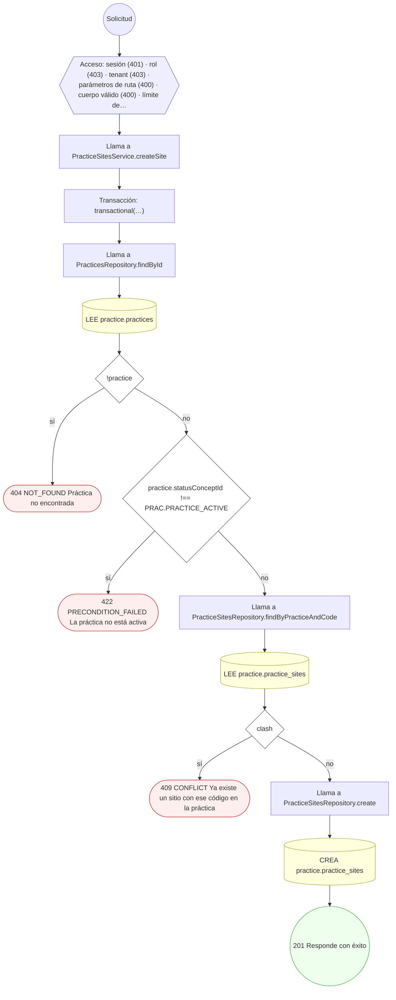

#### 11. DELETE /practices/{practiceId}/sites/{siteId}

Desmantelar un sitio en cascada (soft-delete)

| HTTP | Código | Cuándo |
|---|---|---|
| 200 | — | Éxito |
| 400 | `VALIDATION_FAILED` | Los parámetros de ruta son UUID válidos |
| 401 | `UNAUTHENTICATED` | Hay una sesión válida (JWT) |
| 403 | `FORBIDDEN` | El rol está permitido; El tenant se resuelve y pertenece al actor |
| 404 | `NOT_FOUND` | ResourceNotFoundException: Sitio no encontrado en la práctica |
| 409 | `CONFLICT` | ConflictException: El sitio ya está retirado |
| 429 | `RATE_LIMITED` | No se supera el límite de solicitudes |

```mermaid
flowchart TD
  n1(("Solicitud")):::inicio
  n2{{"Acceso: sesión (401) · rol (403) · tenant (403) · parámetros de ruta (400) · límite de tasa (429)"}}:::acceso
  n1 --> n2
  n3["Llama a PracticeSitesService.decommissionSite"]:::llamada
  n2 --> n3
  n4["Transacción: transactional(…)"]:::transaccion
  n3 --> n4
  n5["Llama a PracticeSitesRepository.findById"]:::llamada
  n4 --> n5
  n6[("LEE practice.practice_sites")]:::efecto
  n5 --> n6
  n7{"!site || site.practiceId !== practiceId"}:::decision
  n6 --> n7
  n8(["404 NOT_FOUND Sitio no encontrado en la práctica"]):::error
  n7 -->|"sí"| n8
  n9{"site.statusConceptId === PRAC.SITE_RETIRED"}:::decision
  n7 -->|"no"| n9
  n10(["409 CONFLICT El sitio ya está retirado"]):::error
  n9 -->|"sí"| n10
  n11[("ACTUALIZA practice.practice_sites · ACTUALIZA practice.practice_sites")]:::efecto
  n9 -->|"no"| n11
  n12["Llama a ClinicalUnitsRepository.findBySite"]:::llamada
  n11 --> n12
  n13[("LEE practice.clinical_units")]:::efecto
  n12 --> n13
  n14["Repite: por cada const unit de units"]:::bucle
  n13 --> n14
  n15[("ACTUALIZA practice.clinical_units")]:::efecto
  n14 -->|"cada elemento"| n15
  n16["Llama a CareSpacesRepository.findBySite"]:::llamada
  n15 --> n16
  n14 -->|"al terminar"| n16
  n17[("LEE practice.care_spaces")]:::efecto
  n16 --> n17
  n18["Repite: por cada const space de spaces"]:::bucle
  n17 --> n18
  n19[("ACTUALIZA practice.care_spaces · ACTUALIZA practice.care_spaces")]:::efecto
  n18 -->|"cada elemento"| n19
  n20["Llama a HealthcareServicesRepository.findBySite"]:::llamada
  n19 --> n20
  n18 -->|"al terminar"| n20
  n21[("LEE practice.healthcare_services")]:::efecto
  n20 --> n21
  n22["Repite: por cada const svc de services"]:::bucle
  n21 --> n22
  n23[("ACTUALIZA practice.healthcare_services")]:::efecto
  n22 -->|"cada elemento"| n23
  n24["Llama a PractitionerRoleAssignmentsRepository.findBySite"]:::llamada
  n23 --> n24
  n22 -->|"al terminar"| n24
  n25[("LEE practice.practitioner_role_assignments")]:::efecto
  n24 --> n25
  n26["Repite: por cada const role de roles"]:::bucle
  n25 --> n26
  n27[("ACTUALIZA practice.practitioner_role_assignments · ACTUALIZA practice.practitioner_role_assignments")]:::efecto
  n26 -->|"cada elemento"| n27
  n28(("200 Responde con éxito")):::ok
  n27 --> n28
  n26 -->|"al terminar"| n28
  classDef acceso fill:#eef,stroke:#66a
  classDef error fill:#fee,stroke:#c33
  classDef ok fill:#efe,stroke:#3a3
  classDef efecto fill:#ffd,stroke:#aa3
  classDef decision fill:#fff,stroke:#555
  classDef corte fill:#eee,stroke:#999,stroke-dasharray: 4
```

#### 12. GET /practitioners/{profileId}/sites

Consultorios donde atiende el profesional

| HTTP | Código | Cuándo |
|---|---|---|
| 200 | — | Éxito |
| 400 | `VALIDATION_FAILED` | Los parámetros de ruta son UUID válidos |
| 401 | `UNAUTHENTICATED` | Hay una sesión válida (JWT) |
| 403 | `FORBIDDEN` | El rol está permitido; El tenant se resuelve y pertenece al actor |
| 429 | `RATE_LIMITED` | No se supera el límite de solicitudes |

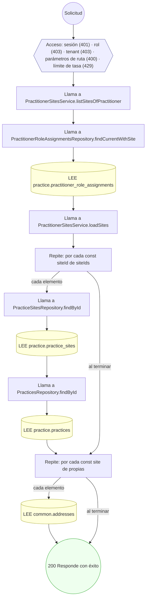

#### 13. GET /practitioners/me/role-assignments

Mis vinculaciones con organizaciones

| HTTP | Código | Cuándo |
|---|---|---|
| 200 | — | Éxito |
| 401 | `UNAUTHENTICATED` | Hay una sesión válida (JWT) |
| 403 | `FORBIDDEN` | El rol está permitido; El tenant se resuelve y pertenece al actor |
| 422 | `PRECONDITION_FAILED` | PreconditionFailedException: La cuenta no tiene un perfil profesional asociado |
| 429 | `RATE_LIMITED` | No se supera el límite de solicitudes |

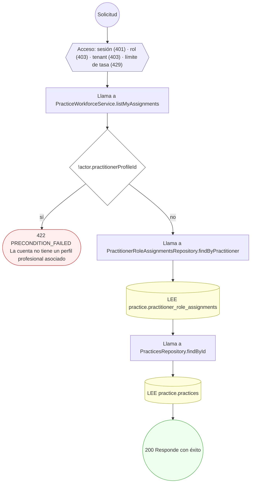

#### 14. POST /role-assignments/{roleId}/approve

Aprobar una vinculación pendiente

| HTTP | Código | Cuándo |
|---|---|---|
| 200 | — | Éxito |
| 400 | `VALIDATION_FAILED` | Los parámetros de ruta son UUID válidos; El cuerpo cumple el DTO (sin propiedades extra) |
| 401 | `UNAUTHENTICATED` | Hay una sesión válida (JWT) |
| 403 | `FORBIDDEN` | El rol está permitido; El tenant se resuelve y pertenece al actor |
| 404 | `NOT_FOUND` | ResourceNotFoundException: Vinculación profesional-organización no encontrada |
| 422 | `PRECONDITION_FAILED` | PreconditionFailedException: La vinculación no admite esa transición desde su estado actual |
| 429 | `RATE_LIMITED` | No se supera el límite de solicitudes |

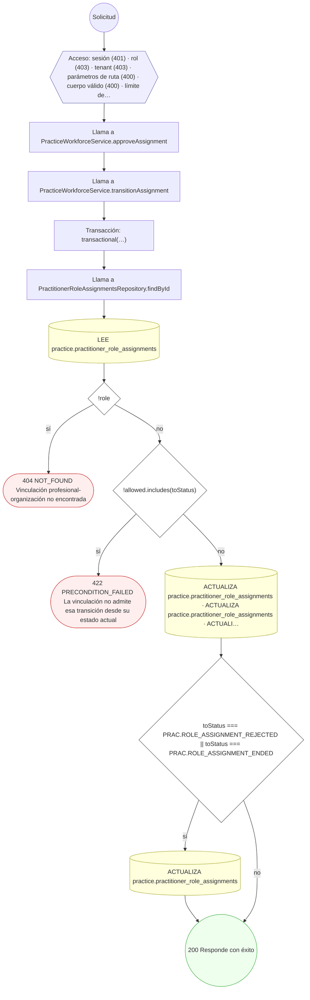

#### 15. POST /role-assignments/{roleId}/end

Finalizar una vinculación

| HTTP | Código | Cuándo |
|---|---|---|
| 200 | — | Éxito |
| 400 | `VALIDATION_FAILED` | Los parámetros de ruta son UUID válidos; El cuerpo cumple el DTO (sin propiedades extra) |
| 401 | `UNAUTHENTICATED` | Hay una sesión válida (JWT) |
| 403 | `FORBIDDEN` | El rol está permitido; El tenant se resuelve y pertenece al actor |
| 404 | `NOT_FOUND` | ResourceNotFoundException: Vinculación profesional-organización no encontrada |
| 422 | `PRECONDITION_FAILED` | PreconditionFailedException: La vinculación no admite esa transición desde su estado actual |
| 429 | `RATE_LIMITED` | No se supera el límite de solicitudes |


#### 16. POST /role-assignments/{roleId}/reject

Rechazar una vinculación pendiente

| HTTP | Código | Cuándo |
|---|---|---|
| 200 | — | Éxito |
| 400 | `VALIDATION_FAILED` | Los parámetros de ruta son UUID válidos; El cuerpo cumple el DTO (sin propiedades extra) |
| 401 | `UNAUTHENTICATED` | Hay una sesión válida (JWT) |
| 403 | `FORBIDDEN` | El rol está permitido; El tenant se resuelve y pertenece al actor |
| 404 | `NOT_FOUND` | ResourceNotFoundException: Vinculación profesional-organización no encontrada |
| 422 | `PRECONDITION_FAILED` | PreconditionFailedException: La vinculación no admite esa transición desde su estado actual |
| 429 | `RATE_LIMITED` | No se supera el límite de solicitudes |

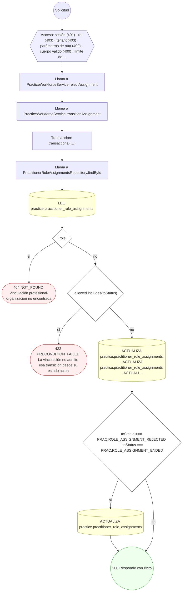

#### 17. POST /role-assignments/{roleId}/support-assignments

Adjuntar personal de apoyo a un rol de profesional

| HTTP | Código | Cuándo |
|---|---|---|
| 201 | — | Éxito |
| 400 | `VALIDATION_FAILED` | Los parámetros de ruta son UUID válidos; El cuerpo cumple el DTO (sin propiedades extra) |
| 401 | `UNAUTHENTICATED` | Hay una sesión válida (JWT) |
| 403 | `FORBIDDEN` | El rol está permitido; El tenant se resuelve y pertenece al actor |
| 404 | `NOT_FOUND` | ResourceNotFoundException: Rol de profesional no encontrado |
| 422 | `PRECONDITION_FAILED` | PreconditionFailedException: El rol de profesional no está activo |
| 429 | `RATE_LIMITED` | No se supera el límite de solicitudes |

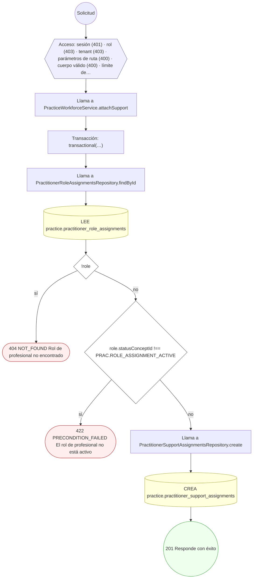

#### 18. POST /role-assignments/{roleId}/suspend

Suspender una vinculación activa

| HTTP | Código | Cuándo |
|---|---|---|
| 200 | — | Éxito |
| 400 | `VALIDATION_FAILED` | Los parámetros de ruta son UUID válidos; El cuerpo cumple el DTO (sin propiedades extra) |
| 401 | `UNAUTHENTICATED` | Hay una sesión válida (JWT) |
| 403 | `FORBIDDEN` | El rol está permitido; El tenant se resuelve y pertenece al actor |
| 404 | `NOT_FOUND` | ResourceNotFoundException: Vinculación profesional-organización no encontrada |
| 422 | `PRECONDITION_FAILED` | PreconditionFailedException: La vinculación no admite esa transición desde su estado actual |
| 429 | `RATE_LIMITED` | No se supera el límite de solicitudes |

```mermaid
flowchart TD
  n1(("Solicitud")):::inicio
  n2{{"Acceso: sesión (401) · rol (403) · tenant (403) · parámetros de ruta (400) · cuerpo válido (400) · límite de…"}}:::acceso
  n1 --> n2
  n3["Llama a PracticeWorkforceService.suspendAssignment"]:::llamada
  n2 --> n3
  n4["Llama a PracticeWorkforceService.transitionAssignment"]:::llamada
  n3 --> n4
  n5["Transacción: transactional(…)"]:::transaccion
  n4 --> n5
  n6["Llama a PractitionerRoleAssignmentsRepository.findById"]:::llamada
  n5 --> n6
  n7[("LEE practice.practitioner_role_assignments")]:::efecto
  n6 --> n7
  n8{"!role"}:::decision
  n7 --> n8
  n9(["404 NOT_FOUND Vinculación profesional-organización no encontrada"]):::error
  n8 -->|"sí"| n9
  n10{"!allowed.includes(toStatus)"}:::decision
  n8 -->|"no"| n10
  n11(["422 PRECONDITION_FAILED La vinculación no admite esa transición desde su estado actual"]):::error
  n10 -->|"sí"| n11
  n12[("ACTUALIZA practice.practitioner_role_assignments · ACTUALIZA practice.practitioner_role_assignments · ACTUALI…")]:::efecto
  n10 -->|"no"| n12
  n13{"toStatus === PRAC.ROLE_ASSIGNMENT_REJECTED || toStatus === PRAC.ROLE_ASSIGNMENT_ENDED"}:::decision
  n12 --> n13
  n14[("ACTUALIZA practice.practitioner_role_assignments")]:::efecto
  n13 -->|"sí"| n14
  n15(("200 Responde con éxito")):::ok
  n14 --> n15
  n13 -->|"no"| n15
  classDef acceso fill:#eef,stroke:#66a
  classDef error fill:#fee,stroke:#c33
  classDef ok fill:#efe,stroke:#3a3
  classDef efecto fill:#ffd,stroke:#aa3
  classDef decision fill:#fff,stroke:#555
  classDef corte fill:#eee,stroke:#999,stroke-dasharray: 4
```

#### 19. GET /sites/{siteId}/care-spaces

Listar los espacios de atención de la sede

| HTTP | Código | Cuándo |
|---|---|---|
| 200 | — | Éxito |
| 400 | `VALIDATION_FAILED` | Los parámetros de ruta son UUID válidos |
| 401 | `UNAUTHENTICATED` | Hay una sesión válida (JWT) |
| 403 | `FORBIDDEN` | El rol está permitido; El tenant se resuelve y pertenece al actor |
| 404 | `NOT_FOUND` | ResourceNotFoundException: Sede no encontrada |
| 429 | `RATE_LIMITED` | No se supera el límite de solicitudes |

```mermaid
flowchart TD
  n1(("Solicitud")):::inicio
  n2{{"Acceso: sesión (401) · rol (403) · tenant (403) · parámetros de ruta (400) · límite de tasa (429)"}}:::acceso
  n1 --> n2
  n3["Llama a PracticeSitesService.listCareSpaces"]:::llamada
  n2 --> n3
  n4["Llama a PracticeSitesRepository.findById"]:::llamada
  n3 --> n4
  n5[("LEE practice.practice_sites")]:::efecto
  n4 --> n5
  n6{"!site"}:::decision
  n5 --> n6
  n7(["404 NOT_FOUND Sede no encontrada"]):::error
  n6 -->|"sí"| n7
  n8["Llama a PracticesRepository.findById"]:::llamada
  n6 -->|"no"| n8
  n9[("LEE practice.practices")]:::efecto
  n8 --> n9
  n10{"!practice || practice.tenantId !== tenantId"}:::decision
  n9 --> n10
  n11(["404 NOT_FOUND Sede no encontrada"]):::error
  n10 -->|"sí"| n11
  n12["Llama a CareSpacesRepository.findBySite"]:::llamada
  n10 -->|"no"| n12
  n13[("LEE practice.care_spaces")]:::efecto
  n12 --> n13
  n14(("200 Responde con éxito")):::ok
  n13 --> n14
  classDef acceso fill:#eef,stroke:#66a
  classDef error fill:#fee,stroke:#c33
  classDef ok fill:#efe,stroke:#3a3
  classDef efecto fill:#ffd,stroke:#aa3
  classDef decision fill:#fff,stroke:#555
  classDef corte fill:#eee,stroke:#999,stroke-dasharray: 4
```

#### 20. POST /sites/{siteId}/care-spaces

Crear un espacio de atención bajo una unidad/sitio

| HTTP | Código | Cuándo |
|---|---|---|
| 201 | — | Éxito |
| 400 | `VALIDATION_FAILED` | Los parámetros de ruta son UUID válidos; El cuerpo cumple el DTO (sin propiedades extra) |
| 401 | `UNAUTHENTICATED` | Hay una sesión válida (JWT) |
| 403 | `FORBIDDEN` | El rol está permitido; El tenant se resuelve y pertenece al actor |
| 404 | `NOT_FOUND` | ResourceNotFoundException: Sitio no encontrado |
| 409 | `CONFLICT` | ConflictException: Ya existe un espacio con ese código en el sitio |
| 422 | `PRECONDITION_FAILED` | PreconditionFailedException: El sitio no está activo; PreconditionFailedException: La unidad no pertenece al sitio; PreconditionFailedException: El espacio padre no pertenece al sitio |
| 429 | `RATE_LIMITED` | No se supera el límite de solicitudes |

```mermaid
flowchart TD
  n1(("Solicitud")):::inicio
  n2{{"Acceso: sesión (401) · rol (403) · tenant (403) · parámetros de ruta (400) · cuerpo válido (400) · límite de…"}}:::acceso
  n1 --> n2
  n3["Llama a ClinicalStructureService.createCareSpace"]:::llamada
  n2 --> n3
  n4["Transacción: transactional(…)"]:::transaccion
  n3 --> n4
  n5["Llama a PracticeSitesRepository.findById"]:::llamada
  n4 --> n5
  n6[("LEE practice.practice_sites")]:::efecto
  n5 --> n6
  n7{"!site"}:::decision
  n6 --> n7
  n8(["404 NOT_FOUND Sitio no encontrado"]):::error
  n7 -->|"sí"| n8
  n9{"site.statusConceptId !== PRAC.SITE_ACTIVE"}:::decision
  n7 -->|"no"| n9
  n10(["422 PRECONDITION_FAILED El sitio no está activo"]):::error
  n9 -->|"sí"| n10
  n11{"dto.clinicalUnitId"}:::decision
  n9 -->|"no"| n11
  n12["Llama a ClinicalUnitsRepository.findById"]:::llamada
  n11 -->|"sí"| n12
  n13[("LEE practice.clinical_units")]:::efecto
  n12 --> n13
  n14{"!unit || unit.practiceSiteId !== siteId"}:::decision
  n13 --> n14
  n15(["422 PRECONDITION_FAILED La unidad no pertenece al sitio"]):::error
  n14 -->|"sí"| n15
  n16{"dto.parentSpaceId"}:::decision
  n14 -->|"no"| n16
  n11 -->|"no"| n16
  n17["Llama a CareSpacesRepository.findById"]:::llamada
  n16 -->|"sí"| n17
  n18[("LEE practice.care_spaces")]:::efecto
  n17 --> n18
  n19{"!parent || parent.practiceSiteId !== siteId"}:::decision
  n18 --> n19
  n20(["422 PRECONDITION_FAILED El espacio padre no pertenece al sitio"]):::error
  n19 -->|"sí"| n20
  n21["Llama a CareSpacesRepository.findBySite"]:::llamada
  n19 -->|"no"| n21
  n16 -->|"no"| n21
  n22[("LEE practice.care_spaces")]:::efecto
  n21 --> n22
  n23{"clash"}:::decision
  n22 --> n23
  n24(["409 CONFLICT Ya existe un espacio con ese código en el sitio"]):::error
  n23 -->|"sí"| n24
  n25["Llama a CareSpacesRepository.create"]:::llamada
  n23 -->|"no"| n25
  n26[("CREA practice.care_spaces")]:::efecto
  n25 --> n26
  n27(("201 Responde con éxito")):::ok
  n26 --> n27
  classDef acceso fill:#eef,stroke:#66a
  classDef error fill:#fee,stroke:#c33
  classDef ok fill:#efe,stroke:#3a3
  classDef efecto fill:#ffd,stroke:#aa3
  classDef decision fill:#fff,stroke:#555
  classDef corte fill:#eee,stroke:#999,stroke-dasharray: 4
```

#### 21. POST /sites/{siteId}/clinical-units

Crear una unidad clínica jerárquica

| HTTP | Código | Cuándo |
|---|---|---|
| 201 | — | Éxito |
| 400 | `VALIDATION_FAILED` | Los parámetros de ruta son UUID válidos; El cuerpo cumple el DTO (sin propiedades extra) |
| 401 | `UNAUTHENTICATED` | Hay una sesión válida (JWT) |
| 403 | `FORBIDDEN` | El rol está permitido; El tenant se resuelve y pertenece al actor |
| 404 | `NOT_FOUND` | ResourceNotFoundException: Sitio no encontrado |
| 409 | `CONFLICT` | ConflictException: Ya existe una unidad con ese código en el sitio |
| 422 | `PRECONDITION_FAILED` | PreconditionFailedException: El sitio no está activo; PreconditionFailedException: La unidad padre no pertenece al sitio |
| 429 | `RATE_LIMITED` | No se supera el límite de solicitudes |

```mermaid
flowchart TD
  n1(("Solicitud")):::inicio
  n2{{"Acceso: sesión (401) · rol (403) · tenant (403) · parámetros de ruta (400) · cuerpo válido (400) · límite de…"}}:::acceso
  n1 --> n2
  n3["Llama a ClinicalStructureService.createClinicalUnit"]:::llamada
  n2 --> n3
  n4["Transacción: transactional(…)"]:::transaccion
  n3 --> n4
  n5["Llama a PracticeSitesRepository.findById"]:::llamada
  n4 --> n5
  n6[("LEE practice.practice_sites")]:::efecto
  n5 --> n6
  n7{"!site"}:::decision
  n6 --> n7
  n8(["404 NOT_FOUND Sitio no encontrado"]):::error
  n7 -->|"sí"| n8
  n9{"site.statusConceptId !== PRAC.SITE_ACTIVE"}:::decision
  n7 -->|"no"| n9
  n10(["422 PRECONDITION_FAILED El sitio no está activo"]):::error
  n9 -->|"sí"| n10
  n11{"dto.parentUnitId"}:::decision
  n9 -->|"no"| n11
  n12["Llama a ClinicalUnitsRepository.findById"]:::llamada
  n11 -->|"sí"| n12
  n13[("LEE practice.clinical_units")]:::efecto
  n12 --> n13
  n14{"!parent || parent.practiceSiteId !== siteId"}:::decision
  n13 --> n14
  n15(["422 PRECONDITION_FAILED La unidad padre no pertenece al sitio"]):::error
  n14 -->|"sí"| n15
  n16["Llama a ClinicalUnitsRepository.findBySite"]:::llamada
  n14 -->|"no"| n16
  n11 -->|"no"| n16
  n17[("LEE practice.clinical_units")]:::efecto
  n16 --> n17
  n18{"clash"}:::decision
  n17 --> n18
  n19(["409 CONFLICT Ya existe una unidad con ese código en el sitio"]):::error
  n18 -->|"sí"| n19
  n20["Llama a ClinicalUnitsRepository.create"]:::llamada
  n18 -->|"no"| n20
  n21[("CREA practice.clinical_units")]:::efecto
  n20 --> n21
  n22(("201 Responde con éxito")):::ok
  n21 --> n22
  classDef acceso fill:#eef,stroke:#66a
  classDef error fill:#fee,stroke:#c33
  classDef ok fill:#efe,stroke:#3a3
  classDef efecto fill:#ffd,stroke:#aa3
  classDef decision fill:#fff,stroke:#555
  classDef corte fill:#eee,stroke:#999,stroke-dasharray: 4
```

### Operaciones sin decisiones propias

Sólo comprueban el acceso y leen o escriben: no tienen ramas que dibujar. Su detalle está en la ficha de endpoints.

| Operación | Respuestas posibles | Tablas |
|---|---|---|
| GET /practices | 200, 401, 403, 429 | 1 |
| POST /practices | 201, 400, 401, 403, 429 | 1 |
| POST /practices/{practiceId}/inventory-items | 201, 400, 401, 403, 429 | 1 |
