<!-- AUTOGENERADO por tools/inventario/flujos.mjs. No editar manualmente. -->

# Flujos del módulo `practice`

- **Procesos:** 1 · **Máquinas de estado:** 1
- **Operaciones:** 83 (76 con decisiones propias, 7 sin ellas)
- Inventario de endpoints del módulo: [practice](../endpoints/practice.md)

## Proceso: Módulo Practice (14)

- **Código:** `practice` · **Agrupación:** MIXTO · **Operaciones:** 83
- **Actores:** ACCOUNTING_APPROVER · ANESTHESIOLOGIST · CLINICIAN · Cualquier sesión válida · PATIENT · PERIOP_ADMIN · PERIOP_NURSE · PRACTITIONER · SCHEDULING_ADMIN · SCHEDULING_AGENT · SECURITY_ADMIN · SURGEON · SURGERY_SCHEDULER · SYSTEM · SYSTEM_WORKER
- **Revisión:** AUTO_DETECTADA
- **Fuentes:** `src/modules/practice/README.md`

### Para qué sirve

Care Organizations, Sites, Units, Spaces and Workforce. Modela la organización de atención (`practice`), sus sedes (`practice_sites`), la estructura clínica jerárquica (`clinical_units`, `care_spaces`), el catálogo de servicios (`healthcare_services`), el personal (`practitioner_role_assignments`, `practitioner_support_assignments`), acreditaciones (`practice_accreditations`), ajustes (`practice_settings`) e inventario (`inventory_items`, `inventory_movements`).

_Fuente: `src/modules/practice/README.md:3`_

### Etapas y operaciones

| Etapa | Descripción | Operación | Quién actúa | Riesgo | Tablas |
|---|---|---|---|---|---|
| `UC-14-01` | Alta de sitio (op. status PLANNED) | POST /practices/{practiceId}/sites | Cualquier sesión válida | ALTO | 4 |
| `UC-14-02` | Registrar acreditación (PENDING) | POST /practices/{practiceId}/accreditations | SECURITY_ADMIN | MEDIO | 2 |
| `UC-14-03` | Verificar (→VERIFIED) o caducar (→EXPIRED) | POST /accreditations/{id}/verify | SECURITY_ADMIN | BAJO | 2 |
| `UC-14-04` | Crear unidad clínica jerárquica | POST /sites/{siteId}/clinical-units | Cualquier sesión válida | ALTO | 5 |
| `UC-14-05` | Crear espacio de atención (F1: PLANNED salvo activate; cuerpo de F0 sin forma/función: ACTIVO y AVAILABLE) | POST /sites/{siteId}/care-spaces | Cualquier sesión válida | ALTO | 8 |
| `UC-14-06` | Publicar servicio de salud | POST /practices/{practiceId}/healthcare-services | Cualquier sesión válida | ALTO | 7 |
| `UC-14-07` | Configurar ajuste (upsert) | PUT /practices/{practiceId}/settings/{settingKey} | SECURITY_ADMIN | MEDIO | 3 |
| `UC-14-08` | Asignar rol de profesional | POST /practices/{practiceId}/role-assignments | SECURITY_ADMIN | MEDIO | 4 |
| `UC-14-09` | Adjuntar personal de apoyo | POST /role-assignments/{roleId}/support-assignments | SECURITY_ADMIN | MEDIO | 3 |
| `UC-14-10` | Alta de insumo (stock 0) | POST /practices/{practiceId}/inventory-items | SECURITY_ADMIN | MEDIO | 1 |
| `UC-14-11` | Movimiento de stock (IN/OUT/ADJUST) | POST /inventory-items/{itemId}/movements | SECURITY_ADMIN | MEDIO | 3 |
| `UC-14-12` | Desmantelar sitio en cascada | DELETE /practices/{practiceId}/sites/{siteId} | Cualquier sesión válida | ALTO | 12 |
| `ctrl:CareSpaceOpsController` | Operaciones de CareSpaceOpsController que el README no asigna a un caso de uso | POST /care-space-blocks/{id}/cancel | Cualquier sesión válida | ALTO | 6 |
|  |  | POST /care-space-blocks/{id}/end | Cualquier sesión válida | ALTO | 10 |
|  |  | POST /care-spaces/{id}/availability | Cualquier sesión válida | ALTO | 25 |
|  |  | GET /care-spaces/{id}/blocks | Cualquier sesión válida | BAJO | 8 |
|  |  | POST /care-spaces/{id}/hygiene | Cualquier sesión válida | ALTO | 19 |
|  |  | POST /care-spaces/{id}/isolation | Cualquier sesión válida | ALTO | 22 |
|  |  | GET /care-spaces/{id}/operational-state | Cualquier sesión válida | BAJO | 16 |
|  |  | GET /care-spaces/{id}/status-events | Cualquier sesión válida | BAJO | 8 |
|  |  | POST /cleaning-orders/{id}/assign | Cualquier sesión válida | BAJO | 1 |
|  |  | POST /cleaning-orders/{id}/cancel | Cualquier sesión válida | BAJO | 0 |
|  |  | POST /cleaning-orders/{id}/finish | Cualquier sesión válida | BAJO | 0 |
|  |  | POST /cleaning-orders/{id}/inspect | Cualquier sesión válida | BAJO | 0 |
|  |  | POST /cleaning-orders/{id}/start | Cualquier sesión válida | BAJO | 0 |
|  |  | POST /internal/practice/blocks-tick | SYSTEM · SYSTEM_WORKER | MEDIO | 7 |
|  |  | GET /sites/{siteId}/bed-board | Cualquier sesión válida | BAJO | 15 |
|  |  | GET /sites/{siteId}/cleaning-orders | Cualquier sesión válida | BAJO | 9 |
|  |  | POST /sites/{siteId}/cleaning-orders | Cualquier sesión válida | ALTO | 14 |
| `ctrl:CareSpacesController` | Operaciones de CareSpacesController que el README no asigna a un caso de uso | GET /care-spaces/{id} | Cualquier sesión válida | BAJO | 3 |
|  |  | PATCH /care-spaces/{id} | Cualquier sesión válida | ALTO | 11 |
|  |  | GET /care-spaces/{id}/history | Cualquier sesión válida | BAJO | 3 |
|  |  | POST /care-spaces/{id}/lifecycle | Cualquier sesión válida | ALTO | 20 |
|  |  | POST /care-spaces/{id}/move | Cualquier sesión válida | BAJO | 7 |
|  |  | GET /care-spaces/{id}/retire-check | Cualquier sesión válida | BAJO | 13 |
|  |  | POST /care-spaces/{id}/unit-assignments | Cualquier sesión válida | ALTO | 7 |
|  |  | DELETE /care-spaces/{id}/unit-assignments/{assignmentId} | Cualquier sesión válida | ALTO | 6 |
| `ctrl:ClinicalUnitsController` | Operaciones de ClinicalUnitsController que el README no asigna a un caso de uso | GET /clinical-units/{id} | Cualquier sesión válida | BAJO | 4 |
|  |  | PATCH /clinical-units/{id} | Cualquier sesión válida | BAJO | 6 |
|  |  | POST /clinical-units/{id}/lifecycle | Cualquier sesión válida | ALTO | 10 |
| `ctrl:InfrastructureAccessController` | Operaciones de InfrastructureAccessController que el README no asigna a un caso de uso | GET /practice/infrastructure-access/me | Cualquier sesión válida | BAJO | 7 |
| `ctrl:InfrastructureCatalogController` | Operaciones de InfrastructureCatalogController que el README no asigna a un caso de uso | GET /practice/infrastructure-catalog | Cualquier sesión válida | BAJO | 2 |
| `ctrl:OrganizationPracticesController` | Operaciones de OrganizationPracticesController que el README no asigna a un caso de uso | POST /tenants/{tenantId}/practices | Cualquier sesión válida | ALTO | 7 |
| `ctrl:PracticeInvitationsController` | Operaciones de PracticeInvitationsController que el README no asigna a un caso de uso | POST /practices/{practiceId}/role-assignments/invitations | Cualquier sesión válida | ALTO | 7 |
| `ctrl:PracticesController` | Operaciones de PracticesController que el README no asigna a un caso de uso | GET /practices | Cualquier sesión válida | BAJO | 3 |
|  |  | POST /practices | SECURITY_ADMIN | MEDIO | 2 |
|  |  | GET /practices/{practiceId}/healthcare-services | Cualquier sesión válida | BAJO | 6 |
|  |  | PATCH /practices/{practiceId}/healthcare-services/{id} | Cualquier sesión válida | ALTO | 7 |
|  |  | GET /practices/{practiceId}/organization | SECURITY_ADMIN · PERIOP_ADMIN · SURGERY_SCHEDULER · SCHEDULING_ADMIN · PRACTITIONER · CLINICIAN · ACCOUNTING_APPROVER | BAJO | 9 |
|  |  | GET /practices/{practiceId}/role-assignments | Cualquier sesión válida | BAJO | 3 |
|  |  | POST /practices/{practiceId}/role-assignments/self-request | PRACTITIONER | MEDIO | 5 |
|  |  | GET /practices/{practiceId}/sites | Cualquier sesión válida | BAJO | 3 |
| `ctrl:PractitionerInvitationsController` | Operaciones de PractitionerInvitationsController que el README no asigna a un caso de uso | POST /practitioners/me/role-assignments/{roleId}/accept | PRACTITIONER | MEDIO | 2 |
|  |  | POST /practitioners/me/role-assignments/{roleId}/decline | PRACTITIONER | MEDIO | 2 |
| `ctrl:PractitionerSitesController` | Operaciones de PractitionerSitesController que el README no asigna a un caso de uso | GET /practitioners/{profileId}/sites | SECURITY_ADMIN · SCHEDULING_ADMIN · SCHEDULING_AGENT · PRACTITIONER · CLINICIAN · PATIENT | BAJO | 5 |
|  |  | GET /practitioners/me/role-assignments | PRACTITIONER | BAJO | 3 |
|  |  | POST /practitioners/me/sites | PRACTITIONER · CLINICIAN | MEDIO | 10 |
|  |  | DELETE /practitioners/me/sites/{siteId} | PRACTITIONER · CLINICIAN | MEDIO | 4 |
|  |  | PATCH /practitioners/me/sites/{siteId} | PRACTITIONER · CLINICIAN | MEDIO | 9 |
|  |  | PUT /practitioners/me/sites/{siteId}/bank-qr | PRACTITIONER · CLINICIAN | BAJO | 6 |
|  |  | PUT /practitioners/me/sites/{siteId}/contact-phone | PRACTITIONER · CLINICIAN | MEDIO | 7 |
|  |  | PUT /practitioners/me/sites/{siteId}/logo | PRACTITIONER · CLINICIAN | MEDIO | 9 |
| `ctrl:RoleAssignmentsController` | Operaciones de RoleAssignmentsController que el README no asigna a un caso de uso | POST /role-assignments/{roleId}/approve | Cualquier sesión válida | BAJO | 3 |
|  |  | POST /role-assignments/{roleId}/end | SECURITY_ADMIN | BAJO | 3 |
|  |  | POST /role-assignments/{roleId}/reject | Cualquier sesión válida | BAJO | 3 |
|  |  | POST /role-assignments/{roleId}/suspend | SECURITY_ADMIN | BAJO | 3 |
| `ctrl:SiteInfrastructureController` | Operaciones de SiteInfrastructureController que el README no asigna a un caso de uso | GET /sites/{siteId}/capacity | Cualquier sesión válida | BAJO | 5 |
|  |  | POST /sites/{siteId}/care-spaces/bulk | Cualquier sesión válida | ALTO | 8 |
|  |  | POST /sites/{siteId}/care-spaces/import | Cualquier sesión válida | ALTO | 8 |
|  |  | GET /sites/{siteId}/clinical-units | Cualquier sesión válida | BAJO | 3 |
|  |  | POST /sites/{siteId}/declared-capacities | Cualquier sesión válida | ALTO | 6 |
|  |  | GET /sites/{siteId}/licenses | Cualquier sesión válida | BAJO | 3 |
|  |  | POST /sites/{siteId}/licenses | Cualquier sesión válida | ALTO | 6 |
|  |  | GET /sites/{siteId}/regulatory | Cualquier sesión válida | BAJO | 5 |
|  |  | PATCH /sites/{siteId}/regulatory | Cualquier sesión válida | ALTO | 6 |
|  |  | POST /sites/{siteId}/regulatory/verify-snis | Cualquier sesión válida | ALTO | 6 |
|  |  | GET /sites/{siteId}/structure | Cualquier sesión válida | BAJO | 6 |
| `ctrl:SiteLicensesController` | Operaciones de SiteLicensesController que el README no asigna a un caso de uso | PATCH /site-licenses/{id} | Cualquier sesión válida | ALTO | 4 |
| `ctrl:SitesController` | Operaciones de SitesController que el README no asigna a un caso de uso | GET /sites/{siteId}/care-spaces | SECURITY_ADMIN · SURGERY_SCHEDULER · PERIOP_ADMIN · SURGEON · ANESTHESIOLOGIST · PERIOP_NURSE · SCHEDULING_ADMIN | BAJO | 3 |
| `ctrl:SpaceAssetsController` | Operaciones de SpaceAssetsController que el README no asigna a un caso de uso | GET /care-spaces/{id}/equipment | Cualquier sesión válida | BAJO | 11 |
|  |  | GET /care-spaces/{id}/stock | Cualquier sesión válida | BAJO | 14 |
|  |  | GET /sites/{siteId}/diagnostic-equipment | Cualquier sesión válida | BAJO | 11 |
|  |  | GET /sites/{siteId}/sample-collection-points | Cualquier sesión válida | BAJO | 12 |

### Diagrama 1 de 4 — etapas `UC-14-01`, `UC-14-02`, `UC-14-03`…

```mermaid
flowchart LR
  a2(["Cualquier sesión válida"]):::actor
  a7(["SECURITY_ADMIN"]):::actor
  t3[("directory.branches")]:::tabla
  t4[("directory.tenant_memberships")]:::tabla
  t5[("practice.practice_sites")]:::tabla
  t8[("practice.practice_accreditations")]:::tabla
  t10[("practice.practices")]:::tabla
  t12[("directory.branch_memberships")]:::tabla
  t13[("practice.clinical_units")]:::tabla
  t15[("practice.care_spaces")]:::tabla
  t16[("practice.facility_typology_rules")]:::tabla
  t19[("practice.healthcare_services")]:::tabla
  t22[("practice.practice_settings")]:::tabla
  t24[("practice.practitioner_role_assignments")]:::tabla
  t26[("practice.practitioner_support_assignments")]:::tabla
  t28[("practice.inventory_items")]:::tabla
  t30[("practice.inventory_movements")]:::tabla
  subgraph s0["UC-14-01 · Alta de sitio (op. status PLANNED)"]
    o1["POST /practices/{practiceId}/sites"]:::op
  end
  subgraph s1["UC-14-02 · Registrar acreditación (PENDING)"]
    o6["POST /practices/{practiceId}/accreditations"]:::op
  end
  subgraph s2["UC-14-03 · Verificar (→VERIFIED) o caducar (→EXPIRED)"]
    o9["POST /accreditations/{id}/verify"]:::op
  end
  subgraph s3["UC-14-04 · Crear unidad clínica jerárquica"]
    o11["POST /sites/{siteId}/clinical-units"]:::op
  end
  t17[("+2 tablas más")]
  subgraph s4["UC-14-05 · Crear espacio de atención (F1: PLANNED salvo activate; cuerpo de F0…"]
    o14["POST /sites/{siteId}/care-spaces"]:::op
  end
  t20[("+1 tablas más")]
  subgraph s5["UC-14-06 · Publicar servicio de salud"]
    o18["POST /practices/{practiceId}/healthcare-services"]:::op
  end
  subgraph s6["UC-14-07 · Configurar ajuste (upsert)"]
    o21["PUT /practices/{practiceId}/settings/{settingKey}"]:::op
  end
  subgraph s7["UC-14-08 · Asignar rol de profesional"]
    o23["POST /practices/{practiceId}/role-assignments"]:::op
  end
  subgraph s8["UC-14-09 · Adjuntar personal de apoyo"]
    o25["POST /role-assignments/{roleId}/support-assignments"]:::op
  end
  subgraph s9["UC-14-10 · Alta de insumo (stock 0)"]
    o27["POST /practices/{practiceId}/inventory-items"]:::op
  end
  subgraph s10["UC-14-11 · Movimiento de stock (IN/OUT/ADJUST)"]
    o29["POST /inventory-items/{itemId}/movements"]:::op
  end
  t32[("+6 tablas más")]
  subgraph s11["UC-14-12 · Desmantelar sitio en cascada"]
    o31["DELETE /practices/{practiceId}/sites/{siteId}"]:::op
  end
  a2 --> o1
  o1 -->|"LEE"| t3
  o1 -->|"LEE"| t4
  o1 -->|"CREA"| t5
  o1 -->|"LEE"| t5
  a7 --> o6
  o6 -->|"CREA"| t8
  o6 -->|"LEE"| t5
  a7 --> o9
  o9 -->|"LEE"| t8
  o9 -->|"LEE"| t10
  a2 --> o11
  o11 -->|"LEE"| t12
  o11 -->|"LEE"| t4
  o11 -->|"CREA"| t13
  o11 -->|"LEE"| t13
  o11 -->|"LEE"| t5
  a2 --> o14
  o14 -->|"LEE"| t12
  o14 -->|"LEE"| t4
  o14 -->|"CREA"| t15
  o14 -->|"LEE"| t15
  o14 -->|"LEE"| t13
  o14 -->|"LEE"| t16
  o14 -.-> t17
  a2 --> o18
  o18 -->|"LEE"| t4
  o18 -->|"LEE"| t13
  o18 -->|"CREA"| t19
  o18 -->|"LEE"| t19
  o18 -->|"LEE"| t5
  o18 -->|"LEE"| t10
  o18 -.-> t20
  a7 --> o21
  o21 -->|"ACTUALIZA"| t22
  o21 -->|"CREA"| t22
  o21 -->|"LEE"| t22
  a7 --> o23
  o23 -->|"LEE"| t13
  o23 -->|"LEE"| t19
  o23 -->|"LEE"| t5
  o23 -->|"CREA"| t24
  a7 --> o25
  o25 -->|"LEE"| t10
  o25 -->|"LEE"| t24
  o25 -->|"CREA"| t26
  a7 --> o27
  o27 -->|"CREA"| t28
  a7 --> o29
  o29 -->|"LEE"| t28
  o29 -->|"CREA"| t30
  o29 -->|"LEE"| t10
  a2 --> o31
  o31 -->|"LEE"| t4
  o31 -->|"ACTUALIZA"| t15
  o31 -->|"LEE"| t15
  o31 -->|"ACTUALIZA"| t13
  o31 -->|"LEE"| t13
  o31 -->|"ACTUALIZA"| t19
  o31 -.-> t32
  classDef op fill:#fff,stroke:#446
  classDef actor fill:#eef,stroke:#66a
  classDef tabla fill:#ffd,stroke:#aa3
  classDef evento fill:#efe,stroke:#3a3
```

### Diagrama 2 de 4 — etapas `ctrl:CareSpaceOpsController`, `ctrl:CareSpacesController`, `ctrl:ClinicalUnitsController`

```mermaid
flowchart LR
  a2(["Cualquier sesión válida"]):::actor
  a34(["SYSTEM · SYSTEM_WORKER"]):::actor
  t3[("clinical.encounter_locations")]:::tabla
  t4[("practice.care_space_blocks")]:::tabla
  t5[("practice.care_space_status_events")]:::tabla
  t6[("practice.care_spaces")]:::tabla
  t7[("practice.practice_settings")]:::tabla
  t11[("clinical.appointments")]:::tabla
  t12[("clinical.encounters")]:::tabla
  t13[("delegated_access.organization_user_assignments")]:::tabla
  t14[("directory.branch_memberships")]:::tabla
  t15[("directory.tenant_memberships")]:::tabla
  t18[("practice.clinical_units")]:::tabla
  t39[("practice.cleaning_orders")]:::tabla
  t44[("practice.space_unit_assignments")]:::tabla
  t46[("practice.care_space_category_periods")]:::tabla
  t49[("iam.users")]:::tabla
  t51[("accounting.infrastructure_items")]:::tabla
  t52[("audit.care_spaces_history")]:::tabla
  t53[("diagnostic_units.diagnostic_equipment")]:::tabla
  t56[("practice.facility_typology_rules")]:::tabla
  t57[("practice.practice_sites")]:::tabla
  t58[("practice.space_form_parent_rules")]:::tabla
  t61[("pharmacy_inventory.inventory_locations")]:::tabla
  t62[("pharmacy_inventory.inventory_stock_positions")]:::tabla
  t70[("audit.clinical_units_history")]:::tabla
  t9[("+4 tablas más")]
  t16[("+19 tablas más")]
  t19[("+2 tablas más")]
  t21[("+13 tablas más")]
  t23[("+16 tablas más")]
  t25[("+10 tablas más")]
  t27[("+2 tablas más")]
  t35[("+1 tablas más")]
  t37[("+9 tablas más")]
  t40[("+3 tablas más")]
  t42[("+8 tablas más")]
  subgraph s0["ctrl:CareSpaceOpsController · Operaciones de CareSpaceOpsController que el READ…"]
    o1["POST /care-space-blocks/{id}/cancel"]:::op
    o8["POST /care-space-blocks/{id}/end"]:::op
    o10["POST /care-spaces/{id}/availability"]:::op
    o17["GET /care-spaces/{id}/blocks"]:::op
    o20["POST /care-spaces/{id}/hygiene"]:::op
    o22["POST /care-spaces/{id}/isolation"]:::op
    o24["GET /care-spaces/{id}/operational-state"]:::op
    o26["GET /care-spaces/{id}/status-events"]:::op
    o28["POST /cleaning-orders/{id}/assign"]:::op
    o29["POST /cleaning-orders/{id}/cancel"]:::op
    o30["POST /cleaning-orders/{id}/finish"]:::op
    o31["POST /cleaning-orders/{id}/inspect"]:::op
    o32["POST /cleaning-orders/{id}/start"]:::op
    o33["POST /internal/practice/blocks-tick"]:::op
    o36["GET /sites/{siteId}/bed-board"]:::op
    o38["GET /sites/{siteId}/cleaning-orders"]:::op
    o41["POST /sites/{siteId}/cleaning-orders"]:::op
  end
  t47[("+5 tablas más")]
  t54[("+14 tablas más")]
  t59[("+1 tablas más")]
  t63[("+7 tablas más")]
  t65[("+1 tablas más")]
  subgraph s1["ctrl:CareSpacesController · Operaciones de CareSpacesController que el README n…"]
    o43["GET /care-spaces/{id}"]:::op
    o45["PATCH /care-spaces/{id}"]:::op
    o48["GET /care-spaces/{id}/history"]:::op
    o50["POST /care-spaces/{id}/lifecycle"]:::op
    o55["POST /care-spaces/{id}/move"]:::op
    o60["GET /care-spaces/{id}/retire-check"]:::op
    o64["POST /care-spaces/{id}/unit-assignments"]:::op
    o66["DELETE /care-spaces/{id}/unit-assignments/{assignmentId}"]:::op
  end
  t71[("+4 tablas más")]
  subgraph s2["ctrl:ClinicalUnitsController · Operaciones de ClinicalUnitsController que el RE…"]
    o67["GET /clinical-units/{id}"]:::op
    o68["PATCH /clinical-units/{id}"]:::op
    o69["POST /clinical-units/{id}/lifecycle"]:::op
  end
  a2 --> o1
  o1 -->|"LEE"| t3
  o1 -->|"LEE"| t4
  o1 -->|"CREA"| t5
  o1 -->|"ACTUALIZA"| t6
  o1 -->|"LEE"| t6
  o1 -->|"LEE"| t7
  a2 --> o8
  o8 -->|"LEE"| t3
  o8 -->|"ACTUALIZA"| t4
  o8 -->|"LEE"| t4
  o8 -->|"CREA"| t5
  o8 -->|"ACTUALIZA"| t6
  o8 -->|"LEE"| t6
  o8 -.-> t9
  a2 --> o10
  o10 -->|"LEE"| t11
  o10 -->|"LEE"| t3
  o10 -->|"LEE"| t12
  o10 -->|"LEE"| t13
  o10 -->|"LEE"| t14
  o10 -->|"LEE"| t15
  o10 -.-> t16
  a2 --> o17
  o17 -->|"LEE"| t13
  o17 -->|"LEE"| t14
  o17 -->|"LEE"| t15
  o17 -->|"LEE"| t4
  o17 -->|"LEE"| t6
  o17 -->|"LEE"| t18
  o17 -.-> t19
  a2 --> o20
  o20 -->|"LEE"| t3
  o20 -->|"LEE"| t12
  o20 -->|"LEE"| t13
  o20 -->|"LEE"| t14
  o20 -->|"LEE"| t15
  o20 -->|"CREA"| t5
  o20 -.-> t21
  a2 --> o22
  o22 -->|"LEE"| t3
  o22 -->|"LEE"| t12
  o22 -->|"LEE"| t13
  o22 -->|"LEE"| t14
  o22 -->|"LEE"| t15
  o22 -->|"CREA"| t4
  o22 -.-> t23
  a2 --> o24
  o24 -->|"LEE"| t3
  o24 -->|"LEE"| t12
  o24 -->|"LEE"| t13
  o24 -->|"LEE"| t14
  o24 -->|"LEE"| t15
  o24 -->|"LEE"| t4
  o24 -.-> t25
  a2 --> o26
  o26 -->|"LEE"| t13
  o26 -->|"LEE"| t14
  o26 -->|"LEE"| t15
  o26 -->|"LEE"| t5
  o26 -->|"LEE"| t6
  o26 -->|"LEE"| t18
  o26 -.-> t27
  a2 --> o28
  o28 -->|"LEE"| t15
  a2 --> o29
  a2 --> o30
  a2 --> o31
  a2 --> o32
  a34 --> o33
  o33 -->|"LEE"| t3
  o33 -->|"LEE"| t4
  o33 -->|"CREA"| t5
  o33 -->|"ACTUALIZA"| t6
  o33 -->|"LEE"| t6
  o33 -->|"LEE"| t7
  o33 -.-> t35
  a2 --> o36
  o36 -->|"LEE"| t3
  o36 -->|"LEE"| t12
  o36 -->|"LEE"| t13
  o36 -->|"LEE"| t14
  o36 -->|"LEE"| t15
  o36 -->|"LEE"| t5
  o36 -.-> t37
  a2 --> o38
  o38 -->|"LEE"| t13
  o38 -->|"LEE"| t14
  o38 -->|"LEE"| t15
  o38 -->|"LEE"| t6
  o38 -->|"LEE"| t39
  o38 -->|"LEE"| t18
  o38 -.-> t40
  a2 --> o41
  o41 -->|"LEE"| t3
  o41 -->|"LEE"| t13
  o41 -->|"LEE"| t14
  o41 -->|"LEE"| t15
  o41 -->|"CREA"| t5
  o41 -->|"ACTUALIZA"| t6
  o41 -.-> t42
  a2 --> o43
  o43 -->|"LEE"| t15
  o43 -->|"LEE"| t6
  o43 -->|"LEE"| t44
  a2 --> o45
  o45 -->|"LEE"| t14
  o45 -->|"LEE"| t15
  o45 -->|"ACTUALIZA"| t46
  o45 -->|"CREA"| t46
  o45 -->|"LEE"| t46
  o45 -->|"LEE"| t6
  o45 -.-> t47
  a2 --> o48
  o48 -->|"LEE"| t15
  o48 -->|"LEE"| t49
  o48 -->|"LEE"| t6
  a2 --> o50
  o50 -->|"LEE"| t51
  o50 -->|"ACTUALIZA"| t52
  o50 -->|"CREA"| t52
  o50 -->|"LEE"| t52
  o50 -->|"LEE"| t3
  o50 -->|"LEE"| t53
  o50 -.-> t54
  a2 --> o55
  o55 -->|"LEE"| t14
  o55 -->|"LEE"| t15
  o55 -->|"LEE"| t6
  o55 -->|"LEE"| t56
  o55 -->|"LEE"| t57
  o55 -->|"LEE"| t58
  o55 -.-> t59
  a2 --> o60
  o60 -->|"LEE"| t51
  o60 -->|"LEE"| t3
  o60 -->|"LEE"| t53
  o60 -->|"LEE"| t15
  o60 -->|"LEE"| t61
  o60 -->|"LEE"| t62
  o60 -.-> t63
  a2 --> o64
  o64 -->|"LEE"| t14
  o64 -->|"LEE"| t15
  o64 -->|"LEE"| t6
  o64 -->|"LEE"| t18
  o64 -->|"LEE"| t57
  o64 -->|"CREA"| t44
  o64 -.-> t65
  a2 --> o66
  o66 -->|"LEE"| t14
  o66 -->|"LEE"| t15
  o66 -->|"LEE"| t6
  o66 -->|"LEE"| t57
  o66 -->|"ACTUALIZA"| t44
  o66 -->|"LEE"| t44
  a2 --> o67
  o67 -->|"LEE"| t15
  o67 -->|"LEE"| t6
  o67 -->|"LEE"| t18
  o67 -->|"LEE"| t44
  a2 --> o68
  o68 -->|"LEE"| t14
  o68 -->|"LEE"| t15
  o68 -->|"LEE"| t6
  o68 -->|"LEE"| t18
  o68 -->|"LEE"| t57
  o68 -->|"LEE"| t44
  a2 --> o69
  o69 -->|"ACTUALIZA"| t70
  o69 -->|"CREA"| t70
  o69 -->|"LEE"| t70
  o69 -->|"LEE"| t14
  o69 -->|"LEE"| t15
  o69 -->|"LEE"| t6
  o69 -.-> t71
  classDef op fill:#fff,stroke:#446
  classDef actor fill:#eef,stroke:#66a
  classDef tabla fill:#ffd,stroke:#aa3
  classDef evento fill:#efe,stroke:#3a3
```

### Diagrama 3 de 4 — etapas `ctrl:InfrastructureAccessController`, `ctrl:InfrastructureCatalogController`, `ctrl:OrganizationPracticesController`…

```mermaid
flowchart LR
  a2(["Cualquier sesión válida"]):::actor
  a24(["SECURITY_ADMIN"]):::actor
  a32(["SECURITY_ADMIN · PERIOP_ADMIN · SURGERY_SCHEDULER · SCHEDUL…"]):::actor
  a38(["PRACTITIONER"]):::actor
  a43(["SECURITY_ADMIN · SCHEDULING_ADMIN · SCHEDULING_AGENT · PRAC…"]):::actor
  a48(["PRACTITIONER · CLINICIAN"]):::actor
  t3[("delegated_access.organization_user_assignments")]:::tabla
  t4[("directory.branch_memberships")]:::tabla
  t5[("directory.tenant_memberships")]:::tabla
  t6[("practice.care_spaces")]:::tabla
  t7[("practice.clinical_units")]:::tabla
  t8[("practice.practice_sites")]:::tabla
  t11[("practice.facility_typology_rules")]:::tabla
  t12[("practice.space_form_parent_rules")]:::tabla
  t14[("common.addresses")]:::tabla
  t15[("directory.tenants")]:::tabla
  t16[("practice.practices")]:::tabla
  t19[("practice.healthcare_services")]:::tabla
  t20[("practice.practitioner_role_assignments")]:::tabla
  t25[("billing.service_catalog")]:::tabla
  t27[("terminology.catalog_concepts")]:::tabla
  t28[("terminology.concept_properties")]:::tabla
  t33[("practice.inventory_items")]:::tabla
  t34[("practice.practice_accreditations")]:::tabla
  t44[("profiles.person_account_links")]:::tabla
  t46[("community.public_profiles")]:::tabla
  t49[("common.file_versions")]:::tabla
  t50[("common.files")]:::tabla
  t53[("profiles.health_practitioner_profiles")]:::tabla
  t9[("+1 tablas más")]
  subgraph s0["ctrl:InfrastructureAccessController · Operaciones de InfrastructureAccessContro…"]
    o1["GET /practice/infrastructure-access/me"]:::op
  end
  subgraph s1["ctrl:InfrastructureCatalogController · Operaciones de InfrastructureCatalogCont…"]
    o10["GET /practice/infrastructure-catalog"]:::op
  end
  t17[("+1 tablas más")]
  subgraph s2["ctrl:OrganizationPracticesController · Operaciones de OrganizationPracticesCont…"]
    o13["POST /tenants/{tenantId}/practices"]:::op
  end
  t21[("+1 tablas más")]
  subgraph s3["ctrl:PracticeInvitationsController · Operaciones de PracticeInvitationsControll…"]
    o18["POST /practices/{practiceId}/role-assignments/invitations"]:::op
  end
  t30[("+1 tablas más")]
  t35[("+3 tablas más")]
  subgraph s4["ctrl:PracticesController · Operaciones de PracticesController que el README no…"]
    o22["GET /practices"]:::op
    o23["POST /practices"]:::op
    o26["GET /practices/{practiceId}/healthcare-services"]:::op
    o29["PATCH /practices/{practiceId}/healthcare-services/{id}"]:::op
    o31["GET /practices/{practiceId}/organization"]:::op
    o36["GET /practices/{practiceId}/role-assignments"]:::op
    o37["POST /practices/{practiceId}/role-assignments/self-request"]:::op
    o39["GET /practices/{practiceId}/sites"]:::op
  end
  subgraph s5["ctrl:PractitionerInvitationsController · Operaciones de PractitionerInvitations…"]
    o40["POST /practitioners/me/role-assignments/{roleId}/accept"]:::op
    o41["POST /practitioners/me/role-assignments/{roleId}/decline"]:::op
  end
  t51[("+4 tablas más")]
  t55[("+3 tablas más")]
  t58[("+1 tablas más")]
  t60[("+3 tablas más")]
  subgraph s6["ctrl:PractitionerSitesController · Operaciones de PractitionerSitesController q…"]
    o42["GET /practitioners/{profileId}/sites"]:::op
    o45["GET /practitioners/me/role-assignments"]:::op
    o47["POST /practitioners/me/sites"]:::op
    o52["DELETE /practitioners/me/sites/{siteId}"]:::op
    o54["PATCH /practitioners/me/sites/{siteId}"]:::op
    o56["PUT /practitioners/me/sites/{siteId}/bank-qr"]:::op
    o57["PUT /practitioners/me/sites/{siteId}/contact-phone"]:::op
    o59["PUT /practitioners/me/sites/{siteId}/logo"]:::op
  end
  a2 --> o1
  o1 -->|"LEE"| t3
  o1 -->|"LEE"| t4
  o1 -->|"LEE"| t5
  o1 -->|"LEE"| t6
  o1 -->|"LEE"| t7
  o1 -->|"LEE"| t8
  o1 -.-> t9
  a2 --> o10
  o10 -->|"LEE"| t11
  o10 -->|"LEE"| t12
  a2 --> o13
  o13 -->|"CREA"| t14
  o13 -->|"LEE"| t5
  o13 -->|"LEE"| t15
  o13 -->|"CREA"| t8
  o13 -->|"LEE"| t8
  o13 -->|"CREA"| t16
  o13 -.-> t17
  a2 --> o18
  o18 -->|"LEE"| t5
  o18 -->|"LEE"| t19
  o18 -->|"LEE"| t8
  o18 -->|"LEE"| t16
  o18 -->|"CREA"| t20
  o18 -->|"LEE"| t20
  o18 -.-> t21
  a2 --> o22
  o22 -->|"LEE"| t5
  o22 -->|"LEE"| t16
  o22 -->|"LEE"| t20
  a24 --> o23
  o23 -->|"CREA"| t25
  o23 -->|"CREA"| t16
  a2 --> o26
  o26 -->|"LEE"| t25
  o26 -->|"LEE"| t5
  o26 -->|"LEE"| t19
  o26 -->|"LEE"| t16
  o26 -->|"LEE"| t27
  o26 -->|"LEE"| t28
  a2 --> o29
  o29 -->|"LEE"| t25
  o29 -->|"LEE"| t5
  o29 -->|"ACTUALIZA"| t19
  o29 -->|"LEE"| t19
  o29 -->|"LEE"| t16
  o29 -->|"LEE"| t27
  o29 -.-> t30
  a32 --> o31
  o31 -->|"LEE"| t6
  o31 -->|"LEE"| t7
  o31 -->|"LEE"| t19
  o31 -->|"LEE"| t33
  o31 -->|"LEE"| t34
  o31 -->|"LEE"| t8
  o31 -.-> t35
  a2 --> o36
  o36 -->|"LEE"| t5
  o36 -->|"LEE"| t16
  o36 -->|"LEE"| t20
  a38 --> o37
  o37 -->|"LEE"| t19
  o37 -->|"LEE"| t8
  o37 -->|"LEE"| t16
  o37 -->|"CREA"| t20
  o37 -->|"LEE"| t20
  a2 --> o39
  o39 -->|"LEE"| t5
  o39 -->|"LEE"| t8
  o39 -->|"LEE"| t16
  a38 --> o40
  o40 -->|"ACTUALIZA"| t20
  o40 -->|"LEE"| t20
  a38 --> o41
  o41 -->|"ACTUALIZA"| t20
  o41 -->|"LEE"| t20
  a43 --> o42
  o42 -->|"LEE"| t14
  o42 -->|"LEE"| t8
  o42 -->|"LEE"| t16
  o42 -->|"LEE"| t20
  o42 -->|"LEE"| t44
  a38 --> o45
  o45 -->|"LEE"| t46
  o45 -->|"LEE"| t16
  o45 -->|"LEE"| t20
  a48 --> o47
  o47 -->|"CREA"| t14
  o47 -->|"LEE"| t49
  o47 -->|"LEE"| t50
  o47 -->|"CREA"| t8
  o47 -->|"LEE"| t8
  o47 -->|"CREA"| t16
  o47 -.-> t51
  a48 --> o52
  o52 -->|"ACTUALIZA"| t20
  o52 -->|"LEE"| t20
  o52 -->|"LEE"| t53
  o52 -->|"LEE"| t44
  a48 --> o54
  o54 -->|"ACTUALIZA"| t14
  o54 -->|"CREA"| t14
  o54 -->|"LEE"| t14
  o54 -->|"ACTUALIZA"| t8
  o54 -->|"LEE"| t8
  o54 -->|"LEE"| t16
  o54 -.-> t55
  a48 --> o56
  o56 -->|"LEE"| t14
  o56 -->|"LEE"| t8
  o56 -->|"LEE"| t16
  o56 -->|"LEE"| t20
  o56 -->|"LEE"| t53
  o56 -->|"LEE"| t44
  a48 --> o57
  o57 -->|"LEE"| t14
  o57 -->|"LEE"| t8
  o57 -->|"LEE"| t16
  o57 -->|"ACTUALIZA"| t20
  o57 -->|"LEE"| t20
  o57 -->|"LEE"| t53
  o57 -.-> t58
  a48 --> o59
  o59 -->|"LEE"| t14
  o59 -->|"LEE"| t49
  o59 -->|"LEE"| t50
  o59 -->|"ACTUALIZA"| t8
  o59 -->|"LEE"| t8
  o59 -->|"LEE"| t16
  o59 -.-> t60
  classDef op fill:#fff,stroke:#446
  classDef actor fill:#eef,stroke:#66a
  classDef tabla fill:#ffd,stroke:#aa3
  classDef evento fill:#efe,stroke:#3a3
```

### Diagrama 4 de 4 — etapas `ctrl:RoleAssignmentsController`, `ctrl:SiteInfrastructureController`, `ctrl:SiteLicensesController`…

```mermaid
flowchart LR
  a2(["Cualquier sesión válida"]):::actor
  a7(["SECURITY_ADMIN"]):::actor
  a35(["SECURITY_ADMIN · SURGERY_SCHEDULER · PERIOP_ADMIN · SURGEON…"]):::actor
  t3[("directory.tenant_memberships")]:::tabla
  t4[("practice.practices")]:::tabla
  t5[("practice.practitioner_role_assignments")]:::tabla
  t11[("organization_extensions.hospitals")]:::tabla
  t12[("practice.care_spaces")]:::tabla
  t13[("practice.practice_sites")]:::tabla
  t14[("practice.site_declared_capacities")]:::tabla
  t16[("directory.branch_memberships")]:::tabla
  t17[("practice.clinical_units")]:::tabla
  t18[("practice.facility_typology_rules")]:::tabla
  t25[("organization_extensions.facility_licenses")]:::tabla
  t27[("practice.healthcare_services")]:::tabla
  t32[("practice.space_unit_assignments")]:::tabla
  t37[("delegated_access.organization_user_assignments")]:::tabla
  t38[("diagnostic_units.diagnostic_equipment")]:::tabla
  t39[("diagnostic_units.diagnostic_unit_sites")]:::tabla
  t40[("diagnostic_units.diagnostic_units")]:::tabla
  t43[("pharmacy_inventory.inventory_locations")]:::tabla
  t44[("pharmacy_inventory.inventory_lots")]:::tabla
  t45[("pharmacy_inventory.inventory_stock_positions")]:::tabla
  t50[("clinical.encounter_locations")]:::tabla
  t51[("clinical.encounters")]:::tabla
  t52[("practice.care_space_status_events")]:::tabla
  t53[("practice.cleaning_orders")]:::tabla
  subgraph s0["ctrl:RoleAssignmentsController · Operaciones de RoleAssignmentsController que e…"]
    o1["POST /role-assignments/{roleId}/approve"]:::op
    o6["POST /role-assignments/{roleId}/end"]:::op
    o8["POST /role-assignments/{roleId}/reject"]:::op
    o9["POST /role-assignments/{roleId}/suspend"]:::op
  end
  t19[("+2 tablas más")]
  t21[("+2 tablas más")]
  subgraph s1["ctrl:SiteInfrastructureController · Operaciones de SiteInfrastructureController…"]
    o10["GET /sites/{siteId}/capacity"]:::op
    o15["POST /sites/{siteId}/care-spaces/bulk"]:::op
    o20["POST /sites/{siteId}/care-spaces/import"]:::op
    o22["GET /sites/{siteId}/clinical-units"]:::op
    o23["POST /sites/{siteId}/declared-capacities"]:::op
    o24["GET /sites/{siteId}/licenses"]:::op
    o26["POST /sites/{siteId}/licenses"]:::op
    o28["GET /sites/{siteId}/regulatory"]:::op
    o29["PATCH /sites/{siteId}/regulatory"]:::op
    o30["POST /sites/{siteId}/regulatory/verify-snis"]:::op
    o31["GET /sites/{siteId}/structure"]:::op
  end
  subgraph s2["ctrl:SiteLicensesController · Operaciones de SiteLicensesController que el READ…"]
    o33["PATCH /site-licenses/{id}"]:::op
  end
  subgraph s3["ctrl:SitesController · Operaciones de SitesController que el README no asigna a…"]
    o34["GET /sites/{siteId}/care-spaces"]:::op
  end
  t41[("+5 tablas más")]
  t46[("+8 tablas más")]
  t48[("+5 tablas más")]
  t54[("+6 tablas más")]
  subgraph s4["ctrl:SpaceAssetsController · Operaciones de SpaceAssetsController que el README…"]
    o36["GET /care-spaces/{id}/equipment"]:::op
    o42["GET /care-spaces/{id}/stock"]:::op
    o47["GET /sites/{siteId}/diagnostic-equipment"]:::op
    o49["GET /sites/{siteId}/sample-collection-points"]:::op
  end
  a2 --> o1
  o1 -->|"LEE"| t3
  o1 -->|"LEE"| t4
  o1 -->|"LEE"| t5
  a7 --> o6
  o6 -->|"LEE"| t3
  o6 -->|"LEE"| t4
  o6 -->|"LEE"| t5
  a2 --> o8
  o8 -->|"LEE"| t3
  o8 -->|"LEE"| t4
  o8 -->|"LEE"| t5
  a7 --> o9
  o9 -->|"LEE"| t3
  o9 -->|"LEE"| t4
  o9 -->|"LEE"| t5
  a2 --> o10
  o10 -->|"LEE"| t3
  o10 -->|"LEE"| t11
  o10 -->|"LEE"| t12
  o10 -->|"LEE"| t13
  o10 -->|"LEE"| t14
  a2 --> o15
  o15 -->|"LEE"| t16
  o15 -->|"LEE"| t3
  o15 -->|"CREA"| t12
  o15 -->|"LEE"| t12
  o15 -->|"LEE"| t17
  o15 -->|"LEE"| t18
  o15 -.-> t19
  a2 --> o20
  o20 -->|"LEE"| t16
  o20 -->|"LEE"| t3
  o20 -->|"CREA"| t12
  o20 -->|"LEE"| t12
  o20 -->|"LEE"| t17
  o20 -->|"LEE"| t18
  o20 -.-> t21
  a2 --> o22
  o22 -->|"LEE"| t3
  o22 -->|"LEE"| t17
  o22 -->|"LEE"| t13
  a2 --> o23
  o23 -->|"LEE"| t3
  o23 -->|"LEE"| t11
  o23 -->|"LEE"| t12
  o23 -->|"LEE"| t13
  o23 -->|"CREA"| t14
  o23 -->|"LEE"| t14
  a2 --> o24
  o24 -->|"LEE"| t3
  o24 -->|"LEE"| t25
  o24 -->|"LEE"| t13
  a2 --> o26
  o26 -->|"LEE"| t3
  o26 -->|"CREA"| t25
  o26 -->|"LEE"| t25
  o26 -->|"LEE"| t17
  o26 -->|"LEE"| t27
  o26 -->|"LEE"| t13
  a2 --> o28
  o28 -->|"LEE"| t16
  o28 -->|"LEE"| t3
  o28 -->|"LEE"| t12
  o28 -->|"LEE"| t18
  o28 -->|"LEE"| t13
  a2 --> o29
  o29 -->|"LEE"| t16
  o29 -->|"LEE"| t3
  o29 -->|"LEE"| t12
  o29 -->|"LEE"| t18
  o29 -->|"ACTUALIZA"| t13
  o29 -->|"LEE"| t13
  a2 --> o30
  o30 -->|"LEE"| t16
  o30 -->|"LEE"| t3
  o30 -->|"LEE"| t12
  o30 -->|"LEE"| t18
  o30 -->|"ACTUALIZA"| t13
  o30 -->|"LEE"| t13
  a2 --> o31
  o31 -->|"LEE"| t16
  o31 -->|"LEE"| t3
  o31 -->|"LEE"| t12
  o31 -->|"LEE"| t17
  o31 -->|"LEE"| t13
  o31 -->|"LEE"| t32
  a2 --> o33
  o33 -->|"LEE"| t3
  o33 -->|"ACTUALIZA"| t25
  o33 -->|"LEE"| t25
  o33 -->|"LEE"| t13
  a35 --> o34
  o34 -->|"LEE"| t12
  o34 -->|"LEE"| t13
  o34 -->|"LEE"| t4
  a2 --> o36
  o36 -->|"LEE"| t37
  o36 -->|"LEE"| t38
  o36 -->|"LEE"| t39
  o36 -->|"LEE"| t40
  o36 -->|"LEE"| t16
  o36 -->|"LEE"| t3
  o36 -.-> t41
  a2 --> o42
  o42 -->|"LEE"| t37
  o42 -->|"LEE"| t16
  o42 -->|"LEE"| t3
  o42 -->|"LEE"| t43
  o42 -->|"LEE"| t44
  o42 -->|"LEE"| t45
  o42 -.-> t46
  a2 --> o47
  o47 -->|"LEE"| t37
  o47 -->|"LEE"| t38
  o47 -->|"LEE"| t39
  o47 -->|"LEE"| t40
  o47 -->|"LEE"| t16
  o47 -->|"LEE"| t3
  o47 -.-> t48
  a2 --> o49
  o49 -->|"LEE"| t50
  o49 -->|"LEE"| t51
  o49 -->|"LEE"| t52
  o49 -->|"LEE"| t12
  o49 -->|"LEE"| t53
  o49 -->|"LEE"| t17
  o49 -.-> t54
  classDef op fill:#fff,stroke:#446
  classDef actor fill:#eef,stroke:#66a
  classDef tabla fill:#ffd,stroke:#aa3
  classDef evento fill:#efe,stroke:#3a3
```

## Máquinas de estado

### Máquina de estados `PRACTICE_ASSIGNMENT_TRANSITIONS`

Declarada en `src/modules/practice/services/role-assignment-transitions.ts:10`. Los estados llevan el nombre del identificador del código; no se resuelven al catálogo de conceptos.

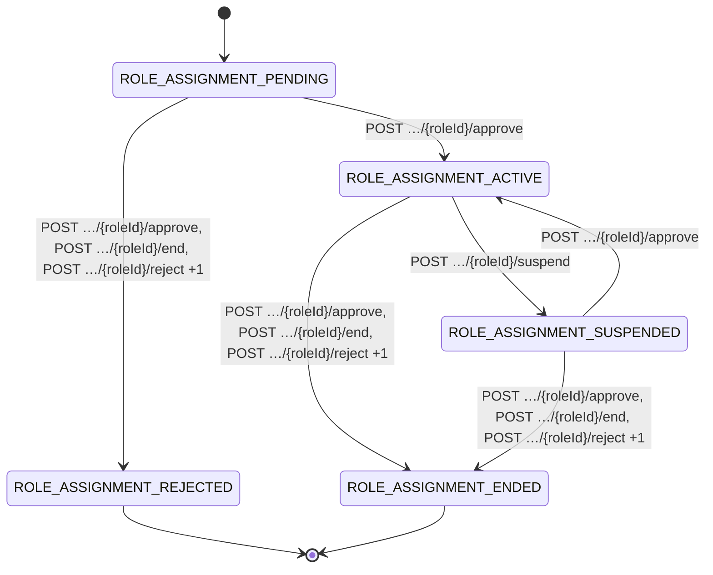

**Operaciones que ejercen esta máquina** _(POR_REFERENCIA: el handler alcanza un método que valida contra la tabla; «sin destino nombrado» significa que el estado de destino llega por el cuerpo de la petición)_:

| Operación | Estados de destino que nombra | A través de |
|---|---|---|
| POST /role-assignments/{roleId}/approve | ROLE_ASSIGNMENT_ACTIVE, ROLE_ASSIGNMENT_ENDED, ROLE_ASSIGNMENT_REJECTED | PracticeWorkforceService.approveAssignment → PracticeWorkforceService.transitionAssignment |
| POST /role-assignments/{roleId}/end | ROLE_ASSIGNMENT_ENDED, ROLE_ASSIGNMENT_REJECTED | PracticeWorkforceService.endAssignment → PracticeWorkforceService.transitionAssignment |
| POST /role-assignments/{roleId}/reject | ROLE_ASSIGNMENT_ENDED, ROLE_ASSIGNMENT_REJECTED | PracticeWorkforceService.rejectAssignment → PracticeWorkforceService.transitionAssignment |
| POST /role-assignments/{roleId}/suspend | ROLE_ASSIGNMENT_ENDED, ROLE_ASSIGNMENT_REJECTED, ROLE_ASSIGNMENT_SUSPENDED | PracticeWorkforceService.suspendAssignment → PracticeWorkforceService.transitionAssignment |

## Árbol de decisión por operación

Cada árbol se deriva del código del handler y de los métodos que invoca (hasta 4 niveles). Una rama que no decide, no escribe y no falla se poda. Los accesos y los efectos consecutivos se agrupan en un solo nodo.

### Operaciones con decisiones propias

#### 1. POST /accreditations/{id}/verify

Verificar o caducar una acreditación (transición de estado)

| HTTP | Código | Cuándo |
|---|---|---|
| 200 | — | Éxito |
| 400 | `VALIDATION_FAILED` | Los parámetros de ruta son UUID válidos; El cuerpo cumple el DTO (sin propiedades extra) |
| 401 | `UNAUTHENTICATED` | Hay una sesión válida (JWT) |
| 403 | `FORBIDDEN` | El rol está permitido; El tenant se resuelve y pertenece al actor |
| 422 | `PRECONDITION_FAILED` | PreconditionFailedException: La acreditación no está pendiente de verificación |
| 429 | `RATE_LIMITED` | No se supera el límite de solicitudes |

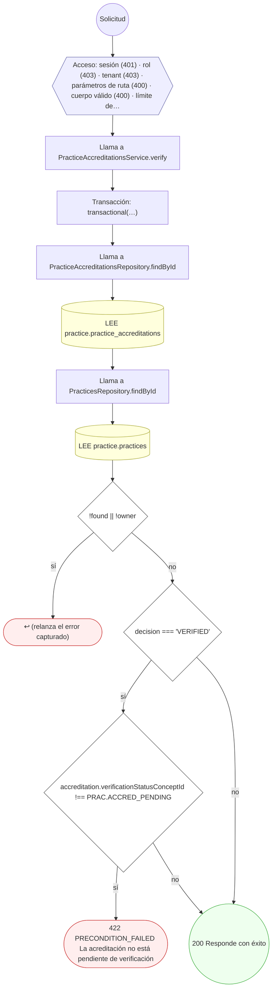

#### 2. POST /care-space-blocks/{id}/cancel

Cancelar un bloqueo

| HTTP | Código | Cuándo |
|---|---|---|
| 200 | — | Éxito |
| 400 | `VALIDATION_FAILED` | Los parámetros de ruta son UUID válidos; El cuerpo cumple el DTO (sin propiedades extra) |
| 401 | `UNAUTHENTICATED` | Hay una sesión válida (JWT) |
| 403 | `FORBIDDEN` | El rol está permitido; El tenant se resuelve y pertenece al actor |
| 429 | `RATE_LIMITED` | No se supera el límite de solicitudes |
| 500 | `INTERNAL` | Error: Entidad de historial no registrada: {entity} |

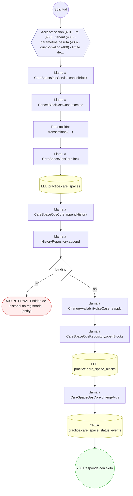

#### 3. POST /care-space-blocks/{id}/end

Terminar un bloqueo

| HTTP | Código | Cuándo |
|---|---|---|
| 200 | — | Éxito |
| 400 | `VALIDATION_FAILED` | Los parámetros de ruta son UUID válidos; El cuerpo cumple el DTO (sin propiedades extra) |
| 401 | `UNAUTHENTICATED` | Hay una sesión válida (JWT) |
| 403 | `FORBIDDEN` | El rol está permitido; El tenant se resuelve y pertenece al actor |
| 429 | `RATE_LIMITED` | No se supera el límite de solicitudes |

```mermaid
flowchart TD
  n1(("Solicitud")):::inicio
  n2{{"Acceso: sesión (401) · rol (403) · tenant (403) · parámetros de ruta (400) · cuerpo válido (400) · límite de…"}}:::acceso
  n1 --> n2
  n3["Llama a CareSpaceOpsService.endBlock"]:::llamada
  n2 --> n3
  n4["Llama a EndBlockUseCase.execute"]:::llamada
  n3 --> n4
  n5["Transacción: transactional(…)"]:::transaccion
  n4 --> n5
  n6["Llama a CareSpaceOpsCore.lock"]:::llamada
  n5 --> n6
  n7[("LEE practice.care_spaces")]:::efecto
  n6 --> n7
  n8["Llama a ChangeAvailabilityUseCase.endBlock"]:::llamada
  n7 --> n8
  n9[("ACTUALIZA practice.care_space_blocks · ACTUALIZA practice.care_space_blocks · ACTUALIZA practice.care_space_b…")]:::efecto
  n8 --> n9
  n10["Llama a ChangeAvailabilityUseCase.reapply"]:::llamada
  n9 --> n10
  n11["Llama a CareSpaceOpsRepository.openBlocks"]:::llamada
  n10 --> n11
  n12[("LEE practice.care_space_blocks")]:::efecto
  n11 --> n12
  n13["Llama a CareSpaceOpsCore.changeAxis"]:::llamada
  n12 --> n13
  n14[("CREA practice.care_space_status_events")]:::efecto
  n13 --> n14
  n15{"kind === 'BLOCK_MAINTENANCE'"}:::decision
  n14 --> n15
  n16["Llama a CareSpaceOpsCore.openCleaningOrder"]:::llamada
  n15 -->|"sí"| n16
  n17["Llama a CareSpaceOpsRepository.openCleaningOrders"]:::llamada
  n16 --> n17
  n18[("LEE practice.cleaning_orders")]:::efecto
  n17 --> n18
  n19["Llama a CareSpaceOpsCore.supersedeIfDone"]:::llamada
  n18 --> n19
  n20[("ACTUALIZA practice.cleaning_orders · ACTUALIZA practice.cleaning_orders")]:::efecto
  n19 --> n20
  n21{"open"}:::decision
  n20 --> n21
  n22(["↩ (relanza el error capturado)"]):::error
  n21 -->|"sí"| n22
  n23[("CREA practice.cleaning_orders")]:::efecto
  n21 -->|"no"| n23
  n24{"hygiene !== 'HYG_DIRTY' && hygiene !== 'HYG_CONTAMINATED'"}:::decision
  n23 --> n24
  n25["Llama a CareSpaceOpsCore.changeAxis"]:::llamada
  n24 -->|"sí"| n25
  n26[("CREA practice.care_space_status_events")]:::efecto
  n25 --> n26
  n27(("200 Responde con éxito")):::ok
  n26 --> n27
  n24 -->|"no"| n27
  n15 -->|"no"| n27
  classDef acceso fill:#eef,stroke:#66a
  classDef error fill:#fee,stroke:#c33
  classDef ok fill:#efe,stroke:#3a3
  classDef efecto fill:#ffd,stroke:#aa3
  classDef decision fill:#fff,stroke:#555
  classDef corte fill:#eee,stroke:#999,stroke-dasharray: 4
```

#### 4. GET /care-spaces/{id}

Ficha de un espacio de atención

| HTTP | Código | Cuándo |
|---|---|---|
| 200 | — | Éxito |
| 400 | `VALIDATION_FAILED` | Los parámetros de ruta son UUID válidos |
| 401 | `UNAUTHENTICATED` | Hay una sesión válida (JWT) |
| 403 | `FORBIDDEN` | El rol está permitido; El tenant se resuelve y pertenece al actor; ForbiddenException: Se requiere pertenecer a la organización, o ser administrador de la plataforma |
| 404 | `NOT_FOUND` | ResourceNotFoundException: Espacio no encontrado |
| 429 | `RATE_LIMITED` | No se supera el límite de solicitudes |

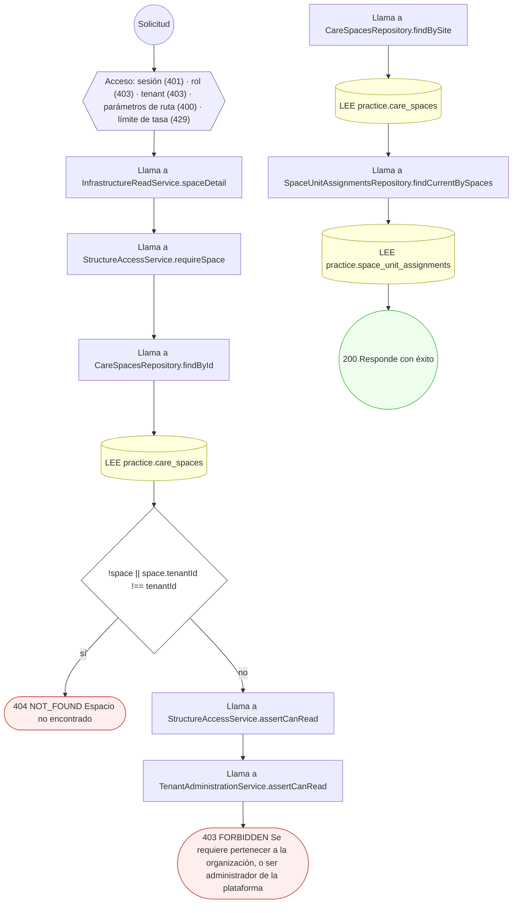

#### 5. PATCH /care-spaces/{id}

Editar un espacio de atención

| HTTP | Código | Cuándo |
|---|---|---|
| 200 | — | Éxito |
| 400 | `VALIDATION_FAILED` | Los parámetros de ruta son UUID válidos; El cuerpo cumple el DTO (sin propiedades extra) |
| 401 | `UNAUTHENTICATED` | Hay una sesión válida (JWT) |
| 403 | `FORBIDDEN` | El rol está permitido; El tenant se resuelve y pertenece al actor; ForbiddenException: Se requiere administrar la organización o la sucursal de esta sede |
| 404 | `NOT_FOUND` | ResourceNotFoundException: Espacio no encontrado; ResourceNotFoundException: Sitio no encontrado; ResourceNotFoundException: Unidad clínica no encontrada |
| 429 | `RATE_LIMITED` | No se supera el límite de solicitudes |

```mermaid
flowchart TD
  n1(("Solicitud")):::inicio
  n2{{"Acceso: sesión (401) · rol (403) · tenant (403) · parámetros de ruta (400) · cuerpo válido (400) · límite de…"}}:::acceso
  n1 --> n2
  n3["Llama a CareSpacesAdminService.update"]:::llamada
  n2 --> n3
  n4["Transacción: transactional(…)"]:::transaccion
  n3 --> n4
  n5["Llama a CareSpacesAdminService.writableSpace"]:::llamada
  n4 --> n5
  n6["Llama a StructureAccessService.requireSpace"]:::llamada
  n5 --> n6
  n7["Llama a CareSpacesRepository.findById"]:::llamada
  n6 --> n7
  n8[("LEE practice.care_spaces")]:::efecto
  n7 --> n8
  n9{"!space || space.tenantId !== tenantId"}:::decision
  n8 --> n9
  n10(["404 NOT_FOUND Espacio no encontrado"]):::error
  n9 -->|"sí"| n10
  n11["Llama a StructureAccessService.requireSite"]:::llamada
  n9 -->|"no"| n11
  n12["Llama a PracticeSitesRepository.findById"]:::llamada
  n11 --> n12
  n13[("LEE practice.practice_sites")]:::efecto
  n12 --> n13
  n14{"!site || site.tenantId !== tenantId"}:::decision
  n13 --> n14
  n15(["404 NOT_FOUND Sitio no encontrado"]):::error
  n14 -->|"sí"| n15
  n16["Llama a StructureAccessService.assertCanWriteSite"]:::llamada
  n14 -->|"no"| n16
  n17["Llama a StructureAccessService.isBranchAdmin"]:::llamada
  n16 --> n17
  n18[("LEE directory.branch_memberships")]:::efecto
  n17 --> n18
  n19{"await this.isBranchAdmin(tx, site, actor)"}:::decision
  n18 --> n19
  n20["Llama a StructureAccessService.isBranchAdmin"]:::llamada
  n19 -->|"sí"| n20
  n21[("LEE directory.branch_memberships")]:::efecto
  n20 --> n21
  n22(["403 FORBIDDEN Se requiere administrar la organización o la sucursal de esta sede"]):::error
  n21 --> n22
  n19 -->|"no"| n22
  n23{"!allowRetiredForLifecycle && space.statusConceptId === PRAC.SPACE_RETIRED"}:::decision
  n24(["↩ (relanza el error capturado)"]):::error
  n23 -->|"sí"| n24
  n25["Llama a CareSpacesRepository.findBySite"]:::llamada
  n23 -->|"no"| n25
  n26[("LEE practice.care_spaces")]:::efecto
  n25 --> n26
  n27["Llama a CareSpacesAdminService.loadRules"]:::llamada
  n26 --> n27
  n28["Llama a StructureRulesRepository.parentRules"]:::llamada
  n27 --> n28
  n29[("LEE practice.space_form_parent_rules")]:::efecto
  n28 --> n29
  n30["Llama a StructureRulesRepository.typologyRules"]:::llamada
  n29 --> n30
  n31[("LEE practice.facility_typology_rules")]:::efecto
  n30 --> n31
  n32{"(codeChanges || formChanges) && state !== 'PLANNED'"}:::decision
  n31 --> n32
  n33(["↩ (relanza el error capturado)"]):::error
  n32 -->|"sí"| n33
  n34{"codeChanges"}:::decision
  n32 -->|"no"| n34
  n35{"siteSpaces.some((s) =› s.id !== space.id && s.code === dto.code)"}:::decision
  n34 -->|"sí"| n35
  n36(["↩ (relanza el error capturado)"]):::error
  n35 -->|"sí"| n36
  n37{"formChanges || dto.functionCode !== undefined"}:::decision
  n35 -->|"no"| n37
  n34 -->|"no"| n37
  n38{"!formIdOf(formCode)"}:::decision
  n37 -->|"sí"| n38
  n39(["↩ (relanza el error capturado)"]):::error
  n38 -->|"sí"| n39
  n40{"!fit.ok"}:::decision
  n38 -->|"no"| n40
  n41(["↩ (relanza el error capturado)"]):::error
  n40 -->|"sí"| n41
  n42{"!typo.ok"}:::decision
  n40 -->|"no"| n42
  n43(["↩ (relanza el error capturado)"]):::error
  n42 -->|"sí"| n43
  n44{"formChanges"}:::decision
  n42 -->|"no"| n44
  n37 -->|"no"| n44
  n45{"!asChild.ok"}:::decision
  n44 -->|"sí"| n45
  n46(["↩ (relanza el error capturado)"]):::error
  n45 -->|"sí"| n46
  n47["Repite: por cada const child de siteSpaces.filter( (s) =› s.parentSpaceId === spa…"]:::bucle
  n45 -->|"no"| n47
  n48{"!asParent.ok"}:::decision
  n47 -->|"cada elemento"| n48
  n49(["↩ (relanza el error capturado)"]):::error
  n48 -->|"sí"| n49
  n50{"dto.clinicalUnitId !== undefined"}:::decision
  n48 -->|"no"| n50
  n47 -->|"al terminar"| n50
  n44 -->|"no"| n50
  n51{"dto.clinicalUnitId !== null"}:::decision
  n50 -->|"sí"| n51
  n52["Llama a CareSpacesAdminService.sameSiteUnit"]:::llamada
  n51 -->|"sí"| n52
  n53["Llama a ClinicalUnitsRepository.findById"]:::llamada
  n52 --> n53
  n54[("LEE practice.clinical_units")]:::efecto
  n53 --> n54
  n55{"!unit || unit.practiceSiteId !== site.id || unit.tenantId !== site.tenantId"}:::decision
  n54 --> n55
  n56(["404 NOT_FOUND Unidad clínica no encontrada"]):::error
  n55 -->|"sí"| n56
  n57{"unit.statusConceptId === PRAC.UNIT_RETIRED"}:::decision
  n55 -->|"no"| n57
  n58(["↩ (relanza el error capturado)"]):::error
  n57 -->|"sí"| n58
  n59{"attrs.errors.length"}:::decision
  n57 -->|"no"| n59
  n51 -->|"no"| n59
  n50 -->|"no"| n59
  n60(["↩ (relanza el error capturado)"]):::error
  n59 -->|"sí"| n60
  n61{"nextCategory !== previousCategory"}:::decision
  n59 -->|"no"| n61
  n62["Llama a CareSpacesAdminService.rollCategoryPeriod"]:::llamada
  n61 -->|"sí"| n62
  n63[("LEE practice.care_space_category_periods")]:::efecto
  n62 --> n63
  n64["Repite: por cada const p de open"]:::bucle
  n63 --> n64
  n65[("ACTUALIZA practice.care_space_category_periods · ACTUALIZA practice.care_space_category_periods · ACTUALIZA p…")]:::efecto
  n64 -->|"cada elemento"| n65
  n66{"categoryId"}:::decision
  n65 --> n66
  n64 -->|"al terminar"| n66
  n67[("CREA practice.care_space_category_periods")]:::efecto
  n66 -->|"sí"| n67
  n68["Llama a CareSpacesAdminService.detail"]:::llamada
  n67 --> n68
  n66 -->|"no"| n68
  n61 -->|"no"| n68
  n69["Llama a SpaceUnitAssignmentsRepository.findCurrentBySpaces"]:::llamada
  n68 --> n69
  n70[("LEE practice.space_unit_assignments")]:::efecto
  n69 --> n70
  n71["… el resto del árbol (1 nodos) está en el JSON del inventario"]:::corte
  n70 --> n71
  classDef acceso fill:#eef,stroke:#66a
  classDef error fill:#fee,stroke:#c33
  classDef ok fill:#efe,stroke:#3a3
  classDef efecto fill:#ffd,stroke:#aa3
  classDef decision fill:#fff,stroke:#555
  classDef corte fill:#eee,stroke:#999,stroke-dasharray: 4
```

#### 6. POST /care-spaces/{id}/availability

Cambiar la disponibilidad de un espacio

| HTTP | Código | Cuándo |
|---|---|---|
| 200 | — | Éxito |
| 400 | `VALIDATION_FAILED` | Los parámetros de ruta son UUID válidos; El cuerpo cumple el DTO (sin propiedades extra) |
| 401 | `UNAUTHENTICATED` | Hay una sesión válida (JWT) |
| 403 | `FORBIDDEN` | El rol está permitido; El tenant se resuelve y pertenece al actor; InsufficientRoleException: Su rol no permite esta acción sobre este espacio |
| 404 | `NOT_FOUND` | ResourceNotFoundException: Espacio no encontrado; ResourceNotFoundException: Unidad clínica no encontrada; ResourceNotFoundException: Sitio no encontrado |
| 429 | `RATE_LIMITED` | No se supera el límite de solicitudes |
| 500 | `INTERNAL` | Error: Acción de infraestructura no registrada: {action}; Error: Entidad de historial no registrada: {entity} |

```mermaid
flowchart TD
  n1(("Solicitud")):::inicio
  n2{{"Acceso: sesión (401) · rol (403) · tenant (403) · parámetros de ruta (400) · cuerpo válido (400) · límite de…"}}:::acceso
  n1 --> n2
  n3["Llama a CareSpaceOpsService.changeAvailability"]:::llamada
  n2 --> n3
  n4["Llama a ChangeAvailabilityUseCase.execute"]:::llamada
  n3 --> n4
  n5["Transacción: transactional(…)"]:::transaccion
  n4 --> n5
  n6["Llama a InfrastructureAccessService.assertCan"]:::llamada
  n5 --> n6
  n7["Llama a InfrastructureAccessService.resolve"]:::llamada
  n6 --> n7
  n8{"'careSpaceId' in target"}:::decision
  n7 --> n8
  n9{"!found || found.tenantId !== tenantId"}:::decision
  n8 -->|"sí"| n9
  n10(["404 NOT_FOUND Espacio no encontrado"]):::error
  n9 -->|"sí"| n10
  n11{"'unitId' in target"}:::decision
  n8 -->|"no"| n11
  n12{"!found || found.tenantId !== tenantId"}:::decision
  n11 -->|"sí"| n12
  n13(["404 NOT_FOUND Unidad clínica no encontrada"]):::error
  n12 -->|"sí"| n13
  n14{"!site || site.tenantId !== tenantId"}:::decision
  n9 -->|"no"| n14
  n12 -->|"no"| n14
  n11 -->|"no"| n14
  n15(["404 NOT_FOUND Sitio no encontrado"]):::error
  n14 -->|"sí"| n15
  n16["Llama a InfrastructureAccessService.decide"]:::llamada
  n14 -->|"no"| n16
  n17(["403 FORBIDDEN Su rol no permite esta acción sobre este espacio"]):::error
  n16 --> n17
  n18["Llama a CareSpaceOpsCore.lock"]:::llamada
  n19[("LEE practice.care_spaces")]:::efecto
  n18 --> n19
  n20{"ended.length › 0"}:::decision
  n19 --> n20
  n21["Llama a CareSpaceOpsRepository.openBlocks"]:::llamada
  n20 -->|"sí"| n21
  n22[("LEE practice.care_space_blocks")]:::efecto
  n21 --> n22
  n23["Llama a InfrastructureAccessService.can"]:::llamada
  n22 --> n23
  n24["Llama a InfraPolicyRegistry.rule"]:::llamada
  n23 --> n24
  n25{"!rule"}:::decision
  n24 --> n25
  n26(["500 INTERNAL Acción de infraestructura no registrada: {action}"]):::error
  n25 -->|"sí"| n26
  n27{"allowed.length === 0"}:::decision
  n25 -->|"no"| n27
  n28{"open.length › 0"}:::decision
  n27 -->|"sí"| n28
  n29["Llama a InfrastructureAccessService.decide"]:::llamada
  n28 -->|"sí"| n29
  n30["Llama a InfraPolicyRegistry.rule"]:::llamada
  n29 --> n30
  n31{"!rule"}:::decision
  n30 --> n31
  n32(["500 INTERNAL Acción de infraestructura no registrada: {action}"]):::error
  n31 -->|"sí"| n32
  n33(["403 FORBIDDEN Su rol no permite esta acción sobre este espacio"]):::error
  n31 -->|"no"| n33
  n34(["↩ (relanza el error capturado)"]):::error
  n28 -->|"no"| n34
  n35["Repite: por cada const block de allowed"]:::bucle
  n27 -->|"no"| n35
  n36["Llama a ChangeAvailabilityUseCase.endBlock"]:::llamada
  n35 -->|"cada elemento"| n36
  n37[("ACTUALIZA practice.care_space_blocks · ACTUALIZA practice.care_space_blocks · ACTUALIZA practice.care_space_b…")]:::efecto
  n36 --> n37
  n38["Llama a ChangeAvailabilityUseCase.reapply"]:::llamada
  n37 --> n38
  n35 -->|"al terminar"| n38
  n39["Llama a CareSpaceOpsRepository.openBlocks"]:::llamada
  n38 --> n39
  n40[("LEE practice.care_space_blocks")]:::efecto
  n39 --> n40
  n41["Llama a CareSpaceOpsCore.changeAxis"]:::llamada
  n40 --> n41
  n42[("CREA practice.care_space_status_events")]:::efecto
  n41 --> n42
  n43["Llama a OpsCellBuilder.cellFor"]:::llamada
  n42 --> n43
  n44["Llama a CareSpaceOpsRepository.chain"]:::llamada
  n43 --> n44
  n45[("LEE practice.care_spaces")]:::efecto
  n44 --> n45
  n46["Llama a CareSpaceOpsRepository.openCleaningOrders"]:::llamada
  n45 --> n46
  n47[("LEE practice.cleaning_orders")]:::efecto
  n46 --> n47
  n48["Llama a CareSpaceOpsRepository.lastEventBySpace"]:::llamada
  n47 --> n48
  n49[("LEE practice.care_space_status_events")]:::efecto
  n48 --> n49
  n50{"withPatient && snap.occupancy.encounterId"}:::decision
  n49 --> n50
  n51["Llama a CareSpaceOpsRepository.patientBadges"]:::llamada
  n50 -->|"sí"| n51
  n52[("LEE clinical.encounters · LEE profiles.patient_profiles · LEE profiles.person_profiles · LEE profiles.persons")]:::efecto
  n51 --> n52
  n53[("LEE practice.space_unit_assignments")]:::efecto
  n52 --> n53
  n50 -->|"no"| n53
  n54["Llama a CareSpaceOpsRepository.openBlocks"]:::llamada
  n53 --> n54
  n20 -->|"no"| n54
  n55[("LEE practice.care_space_blocks")]:::efecto
  n54 --> n55
  n56{"overlapping"}:::decision
  n55 --> n56
  n57(["↩ (relanza el error capturado)"]):::error
  n56 -->|"sí"| n57
  n58["Llama a CareSpaceOpsRepository.futureCommitments"]:::llamada
  n56 -->|"no"| n58
  n59[("LEE procedures_perioperative.procedure_cases · LEE clinical.appointments · LEE scheduling.appointment_booking…")]:::efecto
  n58 --> n59
  n60{"conflicts.length › 0 && !dto.acknowledgeConflicts"}:::decision
  n59 --> n60
  n61(["↩ (relanza el error capturado)"]):::error
  n60 -->|"sí"| n61
  n62[("CREA practice.care_space_blocks")]:::efecto
  n60 -->|"no"| n62
  n63["Llama a CareSpaceOpsCore.appendHistory"]:::llamada
  n62 --> n63
  n64["Llama a HistoryRepository.append"]:::llamada
  n63 --> n64
  n65{"!binding"}:::decision
  n64 --> n65
  n66(["500 INTERNAL Entidad de historial no registrada: {entity}"]):::error
  n65 -->|"sí"| n66
  n67["Llama a OpsCellBuilder.cellFor"]:::llamada
  n65 -->|"no"| n67
  n68["Llama a CareSpaceOpsRepository.chain"]:::llamada
  n67 --> n68
  n69[("LEE practice.care_spaces")]:::efecto
  n68 --> n69
  n70["Llama a CareSpaceOpsRepository.openCleaningOrders"]:::llamada
  n69 --> n70
  n71["… el resto del árbol (1 nodos) está en el JSON del inventario"]:::corte
  n70 --> n71
  classDef acceso fill:#eef,stroke:#66a
  classDef error fill:#fee,stroke:#c33
  classDef ok fill:#efe,stroke:#3a3
  classDef efecto fill:#ffd,stroke:#aa3
  classDef decision fill:#fff,stroke:#555
  classDef corte fill:#eee,stroke:#999,stroke-dasharray: 4
```

#### 7. GET /care-spaces/{id}/blocks

Bloqueos de un espacio

| HTTP | Código | Cuándo |
|---|---|---|
| 200 | — | Éxito |
| 400 | `VALIDATION_FAILED` | Los parámetros de ruta son UUID válidos |
| 401 | `UNAUTHENTICATED` | Hay una sesión válida (JWT) |
| 403 | `FORBIDDEN` | El rol está permitido; El tenant se resuelve y pertenece al actor; InsufficientRoleException: Su rol no permite esta acción sobre este espacio |
| 404 | `NOT_FOUND` | ResourceNotFoundException: Espacio no encontrado; ResourceNotFoundException: Unidad clínica no encontrada; ResourceNotFoundException: Sitio no encontrado |
| 429 | `RATE_LIMITED` | No se supera el límite de solicitudes |
| 500 | `INTERNAL` | Error: Acción de infraestructura no registrada: {action} |

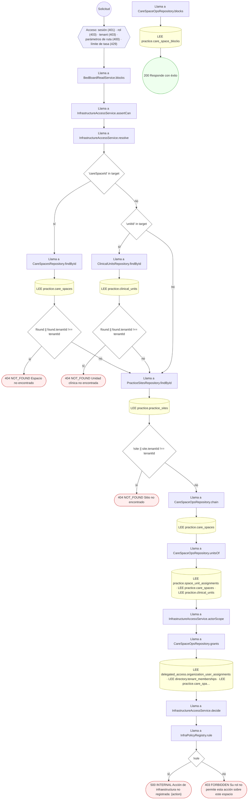

#### 8. GET /care-spaces/{id}/equipment

Equipos ubicados en un espacio (F5a)

| HTTP | Código | Cuándo |
|---|---|---|
| 200 | — | Éxito |
| 400 | `VALIDATION_FAILED` | Los parámetros de ruta son UUID válidos |
| 401 | `UNAUTHENTICATED` | Hay una sesión válida (JWT) |
| 403 | `FORBIDDEN` | El rol está permitido; El tenant se resuelve y pertenece al actor; InsufficientRoleException: Su rol no permite esta acción sobre este espacio |
| 404 | `NOT_FOUND` | ResourceNotFoundException: Espacio no encontrado; ResourceNotFoundException: Unidad clínica no encontrada; ResourceNotFoundException: Sitio no encontrado |
| 429 | `RATE_LIMITED` | No se supera el límite de solicitudes |
| 500 | `INTERNAL` | Error: Acción de infraestructura no registrada: {action} |

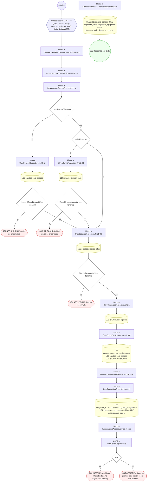

#### 9. GET /care-spaces/{id}/history

Historial de un espacio de atención

| HTTP | Código | Cuándo |
|---|---|---|
| 200 | — | Éxito |
| 400 | `VALIDATION_FAILED` | Los parámetros de ruta son UUID válidos |
| 401 | `UNAUTHENTICATED` | Hay una sesión válida (JWT) |
| 403 | `FORBIDDEN` | El rol está permitido; El tenant se resuelve y pertenece al actor; ForbiddenException: Se requiere pertenecer a la organización, o ser administrador de la plataforma |
| 404 | `NOT_FOUND` | ResourceNotFoundException: Espacio no encontrado |
| 429 | `RATE_LIMITED` | No se supera el límite de solicitudes |

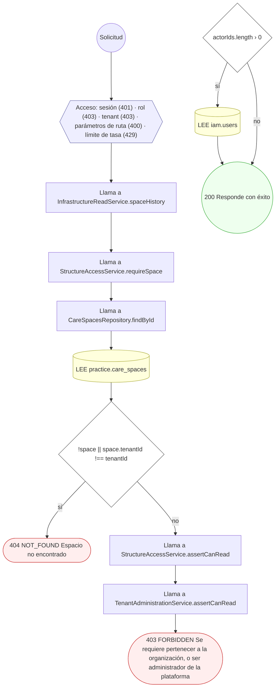

#### 10. POST /care-spaces/{id}/hygiene

Marcar un espacio sucio o contaminado

| HTTP | Código | Cuándo |
|---|---|---|
| 200 | — | Éxito |
| 400 | `VALIDATION_FAILED` | Los parámetros de ruta son UUID válidos; El cuerpo cumple el DTO (sin propiedades extra) |
| 401 | `UNAUTHENTICATED` | Hay una sesión válida (JWT) |
| 403 | `FORBIDDEN` | El rol está permitido; El tenant se resuelve y pertenece al actor; InsufficientRoleException: Su rol no permite esta acción sobre este espacio |
| 404 | `NOT_FOUND` | ResourceNotFoundException: Espacio no encontrado; ResourceNotFoundException: Unidad clínica no encontrada; ResourceNotFoundException: Sitio no encontrado |
| 429 | `RATE_LIMITED` | No se supera el límite de solicitudes |

```mermaid
flowchart TD
  n1(("Solicitud")):::inicio
  n2{{"Acceso: sesión (401) · rol (403) · tenant (403) · parámetros de ruta (400) · cuerpo válido (400) · límite de…"}}:::acceso
  n1 --> n2
  n3["Llama a CareSpaceOpsService.changeHygiene"]:::llamada
  n2 --> n3
  n4["Llama a ChangeHygieneUseCase.execute"]:::llamada
  n3 --> n4
  n5["Transacción: transactional(…)"]:::transaccion
  n4 --> n5
  n6["Llama a InfrastructureAccessService.assertCan"]:::llamada
  n5 --> n6
  n7["Llama a InfrastructureAccessService.resolve"]:::llamada
  n6 --> n7
  n8{"'careSpaceId' in target"}:::decision
  n7 --> n8
  n9{"!found || found.tenantId !== tenantId"}:::decision
  n8 -->|"sí"| n9
  n10(["404 NOT_FOUND Espacio no encontrado"]):::error
  n9 -->|"sí"| n10
  n11{"'unitId' in target"}:::decision
  n8 -->|"no"| n11
  n12{"!found || found.tenantId !== tenantId"}:::decision
  n11 -->|"sí"| n12
  n13(["404 NOT_FOUND Unidad clínica no encontrada"]):::error
  n12 -->|"sí"| n13
  n14{"!site || site.tenantId !== tenantId"}:::decision
  n9 -->|"no"| n14
  n12 -->|"no"| n14
  n11 -->|"no"| n14
  n15(["404 NOT_FOUND Sitio no encontrado"]):::error
  n14 -->|"sí"| n15
  n16["Llama a InfrastructureAccessService.decide"]:::llamada
  n14 -->|"no"| n16
  n17(["403 FORBIDDEN Su rol no permite esta acción sobre este espacio"]):::error
  n16 --> n17
  n18["Llama a CareSpaceOpsCore.lock"]:::llamada
  n19[("LEE practice.care_spaces")]:::efecto
  n18 --> n19
  n20{"dto.action === 'mark-dirty'"}:::decision
  n19 --> n20
  n21["Llama a CareSpaceOpsCore.openCleaningOrder"]:::llamada
  n20 -->|"sí"| n21
  n22["Llama a CareSpaceOpsRepository.openCleaningOrders"]:::llamada
  n21 --> n22
  n23[("LEE practice.cleaning_orders")]:::efecto
  n22 --> n23
  n24["Llama a CareSpaceOpsCore.supersedeIfDone"]:::llamada
  n23 --> n24
  n25[("ACTUALIZA practice.cleaning_orders · ACTUALIZA practice.cleaning_orders")]:::efecto
  n24 --> n25
  n26{"open"}:::decision
  n25 --> n26
  n27(["↩ (relanza el error capturado)"]):::error
  n26 -->|"sí"| n27
  n28[("CREA practice.cleaning_orders")]:::efecto
  n26 -->|"no"| n28
  n29{"hygiene !== 'HYG_DIRTY' && hygiene !== 'HYG_CONTAMINATED'"}:::decision
  n28 --> n29
  n30["Llama a CareSpaceOpsCore.changeAxis"]:::llamada
  n29 -->|"sí"| n30
  n31[("CREA practice.care_space_status_events")]:::efecto
  n30 --> n31
  n32["Llama a CareSpaceOpsCore.changeAxis"]:::llamada
  n20 -->|"no"| n32
  n33["Llama a CareSpaceOpsCore.updateOps"]:::llamada
  n32 --> n33
  n34[("ACTUALIZA practice.care_spaces")]:::efecto
  n33 --> n34
  n35[("CREA practice.care_space_status_events")]:::efecto
  n34 --> n35
  n36["Llama a CareSpaceOpsCore.openCleaningOrder"]:::llamada
  n35 --> n36
  n37["Llama a CareSpaceOpsRepository.openCleaningOrders"]:::llamada
  n36 --> n37
  n38[("LEE practice.cleaning_orders")]:::efecto
  n37 --> n38
  n39["Llama a CareSpaceOpsCore.supersedeIfDone"]:::llamada
  n38 --> n39
  n40[("ACTUALIZA practice.cleaning_orders · ACTUALIZA practice.cleaning_orders")]:::efecto
  n39 --> n40
  n41{"open"}:::decision
  n40 --> n41
  n42(["↩ (relanza el error capturado)"]):::error
  n41 -->|"sí"| n42
  n43[("CREA practice.cleaning_orders")]:::efecto
  n41 -->|"no"| n43
  n44{"hygiene !== 'HYG_DIRTY' && hygiene !== 'HYG_CONTAMINATED'"}:::decision
  n43 --> n44
  n45["Llama a CareSpaceOpsCore.changeAxis"]:::llamada
  n44 -->|"sí"| n45
  n46[("CREA practice.care_space_status_events")]:::efecto
  n45 --> n46
  n47["Llama a OpsCellBuilder.cellFor"]:::llamada
  n31 --> n47
  n29 -->|"no"| n47
  n46 --> n47
  n44 -->|"no"| n47
  n48["Llama a CareSpaceOpsRepository.chain"]:::llamada
  n47 --> n48
  n49[("LEE practice.care_spaces")]:::efecto
  n48 --> n49
  n50["Llama a CareSpaceOpsRepository.openCleaningOrders"]:::llamada
  n49 --> n50
  n51[("LEE practice.cleaning_orders")]:::efecto
  n50 --> n51
  n52["Llama a CareSpaceOpsRepository.lastEventBySpace"]:::llamada
  n51 --> n52
  n53[("LEE practice.care_space_status_events")]:::efecto
  n52 --> n53
  n54{"withPatient && snap.occupancy.encounterId"}:::decision
  n53 --> n54
  n55["Llama a CareSpaceOpsRepository.patientBadges"]:::llamada
  n54 -->|"sí"| n55
  n56[("LEE clinical.encounters · LEE profiles.patient_profiles · LEE profiles.person_profiles · LEE profiles.persons")]:::efecto
  n55 --> n56
  n57[("LEE practice.space_unit_assignments")]:::efecto
  n56 --> n57
  n54 -->|"no"| n57
  n58(("200 Responde con éxito")):::ok
  n57 --> n58
  classDef acceso fill:#eef,stroke:#66a
  classDef error fill:#fee,stroke:#c33
  classDef ok fill:#efe,stroke:#3a3
  classDef efecto fill:#ffd,stroke:#aa3
  classDef decision fill:#fff,stroke:#555
  classDef corte fill:#eee,stroke:#999,stroke-dasharray: 4
```

#### 11. POST /care-spaces/{id}/isolation

Cambiar el aislamiento de un espacio

| HTTP | Código | Cuándo |
|---|---|---|
| 200 | — | Éxito |
| 400 | `VALIDATION_FAILED` | Los parámetros de ruta son UUID válidos; El cuerpo cumple el DTO (sin propiedades extra) |
| 401 | `UNAUTHENTICATED` | Hay una sesión válida (JWT) |
| 403 | `FORBIDDEN` | El rol está permitido; El tenant se resuelve y pertenece al actor; InsufficientRoleException: Su rol no permite esta acción sobre este espacio |
| 404 | `NOT_FOUND` | ResourceNotFoundException: Espacio no encontrado; ResourceNotFoundException: Unidad clínica no encontrada; ResourceNotFoundException: Sitio no encontrado |
| 429 | `RATE_LIMITED` | No se supera el límite de solicitudes |
| 500 | `INTERNAL` | Error: Acción de infraestructura no registrada: {action}; Error: Entidad de historial no registrada: {entity} |

```mermaid
flowchart TD
  n1(("Solicitud")):::inicio
  n2{{"Acceso: sesión (401) · rol (403) · tenant (403) · parámetros de ruta (400) · cuerpo válido (400) · límite de…"}}:::acceso
  n1 --> n2
  n3["Llama a CareSpaceOpsService.changeIsolation"]:::llamada
  n2 --> n3
  n4["Llama a ChangeIsolationUseCase.execute"]:::llamada
  n3 --> n4
  n5["Transacción: transactional(…)"]:::transaccion
  n4 --> n5
  n6["Llama a InfrastructureAccessService.assertCan"]:::llamada
  n5 --> n6
  n7["Llama a InfrastructureAccessService.resolve"]:::llamada
  n6 --> n7
  n8{"'careSpaceId' in target"}:::decision
  n7 --> n8
  n9{"!found || found.tenantId !== tenantId"}:::decision
  n8 -->|"sí"| n9
  n10(["404 NOT_FOUND Espacio no encontrado"]):::error
  n9 -->|"sí"| n10
  n11{"'unitId' in target"}:::decision
  n8 -->|"no"| n11
  n12{"!found || found.tenantId !== tenantId"}:::decision
  n11 -->|"sí"| n12
  n13(["404 NOT_FOUND Unidad clínica no encontrada"]):::error
  n12 -->|"sí"| n13
  n14{"!site || site.tenantId !== tenantId"}:::decision
  n9 -->|"no"| n14
  n12 -->|"no"| n14
  n11 -->|"no"| n14
  n15(["404 NOT_FOUND Sitio no encontrado"]):::error
  n14 -->|"sí"| n15
  n16["Llama a InfrastructureAccessService.decide"]:::llamada
  n14 -->|"no"| n16
  n17(["403 FORBIDDEN Su rol no permite esta acción sobre este espacio"]):::error
  n16 --> n17
  n18{"!dto.reasonText?.trim()"}:::decision
  n19(["↩ (relanza el error capturado)"]):::error
  n18 -->|"sí"| n19
  n20["Llama a InfrastructureAccessService.can"]:::llamada
  n18 -->|"no"| n20
  n21["Llama a InfraPolicyRegistry.rule"]:::llamada
  n20 --> n21
  n22{"!rule"}:::decision
  n21 --> n22
  n23(["500 INTERNAL Acción de infraestructura no registrada: {action}"]):::error
  n22 -->|"sí"| n23
  n24{"dto.cohortApproved && !this.access.can('f2.isolation.cohort-approve', roles)"}:::decision
  n22 -->|"no"| n24
  n25(["↩ (relanza el error capturado)"]):::error
  n24 -->|"sí"| n25
  n26[("LEE practice.care_spaces")]:::efecto
  n24 -->|"no"| n26
  n27["Repite: por cada const sibling de siblings"]:::bucle
  n26 --> n27
  n28["Llama a InfrastructureAccessService.assertCan"]:::llamada
  n27 -->|"cada elemento"| n28
  n29["Llama a InfrastructureAccessService.resolve"]:::llamada
  n28 --> n29
  n30{"'careSpaceId' in target"}:::decision
  n29 --> n30
  n31{"!found || found.tenantId !== tenantId"}:::decision
  n30 -->|"sí"| n31
  n32(["404 NOT_FOUND Espacio no encontrado"]):::error
  n31 -->|"sí"| n32
  n33{"'unitId' in target"}:::decision
  n30 -->|"no"| n33
  n34{"!found || found.tenantId !== tenantId"}:::decision
  n33 -->|"sí"| n34
  n35(["404 NOT_FOUND Unidad clínica no encontrada"]):::error
  n34 -->|"sí"| n35
  n36{"!site || site.tenantId !== tenantId"}:::decision
  n31 -->|"no"| n36
  n34 -->|"no"| n36
  n33 -->|"no"| n36
  n37(["404 NOT_FOUND Sitio no encontrado"]):::error
  n36 -->|"sí"| n37
  n38["Llama a InfrastructureAccessService.decide"]:::llamada
  n36 -->|"no"| n38
  n39(["403 FORBIDDEN Su rol no permite esta acción sobre este espacio"]):::error
  n38 --> n39
  n40["Llama a CareSpaceOpsCore.lock"]:::llamada
  n27 -->|"al terminar"| n40
  n41[("LEE practice.care_spaces")]:::efecto
  n40 --> n41
  n42{"dto.isolationCode !== 'ISO_NONE'"}:::decision
  n41 --> n42
  n43["Llama a CareSpaceOpsCore.settings"]:::llamada
  n42 -->|"sí"| n43
  n44["Llama a CareSpaceOpsRepository.settings"]:::llamada
  n43 --> n44
  n45[("LEE practice.practice_settings")]:::efecto
  n44 --> n45
  n46["Llama a CareSpaceOpsCore.changeAxis"]:::llamada
  n45 --> n46
  n47["Llama a CareSpaceOpsCore.updateOps"]:::llamada
  n46 --> n47
  n48[("ACTUALIZA practice.care_spaces")]:::efecto
  n47 --> n48
  n49[("CREA practice.care_space_status_events")]:::efecto
  n48 --> n49
  n50{"!dto.cohortApproved"}:::decision
  n49 --> n50
  n51["Llama a CareSpaceOpsCore.occupancy"]:::llamada
  n50 -->|"sí"| n51
  n52["Llama a CareSpaceOpsRepository.occupancy"]:::llamada
  n51 --> n52
  n53[("LEE clinical.encounter_locations")]:::efecto
  n52 --> n53
  n54["Repite: por cada const sibling de siblings"]:::bucle
  n53 --> n54
  n55["Llama a CareSpaceOpsRepository.openBlocks"]:::llamada
  n54 -->|"cada elemento"| n55
  n56[("LEE practice.care_space_blocks")]:::efecto
  n55 --> n56
  n57[("CREA practice.care_space_blocks")]:::efecto
  n56 --> n57
  n58["Llama a CareSpaceOpsCore.appendHistory"]:::llamada
  n57 --> n58
  n59["Llama a HistoryRepository.append"]:::llamada
  n58 --> n59
  n60{"!binding"}:::decision
  n59 --> n60
  n61(["500 INTERNAL Entidad de historial no registrada: {entity}"]):::error
  n60 -->|"sí"| n61
  n62["Llama a CareSpaceOpsCore.changeAxis"]:::llamada
  n42 -->|"no"| n62
  n63["Llama a CareSpaceOpsCore.updateOps"]:::llamada
  n62 --> n63
  n64[("ACTUALIZA practice.care_spaces")]:::efecto
  n63 --> n64
  n65[("CREA practice.care_space_status_events")]:::efecto
  n64 --> n65
  n66{"changed"}:::decision
  n65 --> n66
  n67["Llama a CareSpaceOpsCore.openCleaningOrder"]:::llamada
  n66 -->|"sí"| n67
  n68["Llama a CareSpaceOpsRepository.openCleaningOrders"]:::llamada
  n67 --> n68
  n69[("LEE practice.cleaning_orders")]:::efecto
  n68 --> n69
  n70["Llama a CareSpaceOpsCore.supersedeIfDone"]:::llamada
  n69 --> n70
  n71["… el resto del árbol (2 nodos) está en el JSON del inventario"]:::corte
  n70 --> n71
  classDef acceso fill:#eef,stroke:#66a
  classDef error fill:#fee,stroke:#c33
  classDef ok fill:#efe,stroke:#3a3
  classDef efecto fill:#ffd,stroke:#aa3
  classDef decision fill:#fff,stroke:#555
  classDef corte fill:#eee,stroke:#999,stroke-dasharray: 4
```

#### 12. POST /care-spaces/{id}/lifecycle

Cambiar el ciclo de vida de un espacio

| HTTP | Código | Cuándo |
|---|---|---|
| 200 | — | Éxito |
| 400 | `VALIDATION_FAILED` | Los parámetros de ruta son UUID válidos; El cuerpo cumple el DTO (sin propiedades extra) |
| 401 | `UNAUTHENTICATED` | Hay una sesión válida (JWT) |
| 403 | `FORBIDDEN` | El rol está permitido; El tenant se resuelve y pertenece al actor; ForbiddenException: Se requiere administrar la organización o la sucursal de esta sede |
| 404 | `NOT_FOUND` | ResourceNotFoundException: Espacio no encontrado; ResourceNotFoundException: Sitio no encontrado |
| 429 | `RATE_LIMITED` | No se supera el límite de solicitudes |
| 500 | `INTERNAL` | Error: Entidad de historial no registrada: {entity} |

```mermaid
flowchart TD
  n1(("Solicitud")):::inicio
  n2{{"Acceso: sesión (401) · rol (403) · tenant (403) · parámetros de ruta (400) · cuerpo válido (400) · límite de…"}}:::acceso
  n1 --> n2
  n3["Llama a CareSpacesAdminService.changeLifecycle"]:::llamada
  n2 --> n3
  n4["Transacción: transactional(…)"]:::transaccion
  n3 --> n4
  n5["Llama a CareSpacesAdminService.writableSpace"]:::llamada
  n4 --> n5
  n6["Llama a StructureAccessService.requireSpace"]:::llamada
  n5 --> n6
  n7["Llama a CareSpacesRepository.findById"]:::llamada
  n6 --> n7
  n8[("LEE practice.care_spaces")]:::efecto
  n7 --> n8
  n9{"!space || space.tenantId !== tenantId"}:::decision
  n8 --> n9
  n10(["404 NOT_FOUND Espacio no encontrado"]):::error
  n9 -->|"sí"| n10
  n11["Llama a StructureAccessService.requireSite"]:::llamada
  n9 -->|"no"| n11
  n12["Llama a PracticeSitesRepository.findById"]:::llamada
  n11 --> n12
  n13[("LEE practice.practice_sites")]:::efecto
  n12 --> n13
  n14{"!site || site.tenantId !== tenantId"}:::decision
  n13 --> n14
  n15(["404 NOT_FOUND Sitio no encontrado"]):::error
  n14 -->|"sí"| n15
  n16["Llama a StructureAccessService.assertCanWriteSite"]:::llamada
  n14 -->|"no"| n16
  n17["Llama a StructureAccessService.isBranchAdmin"]:::llamada
  n16 --> n17
  n18[("LEE directory.branch_memberships")]:::efecto
  n17 --> n18
  n19{"await this.isBranchAdmin(tx, site, actor)"}:::decision
  n18 --> n19
  n20["Llama a StructureAccessService.isBranchAdmin"]:::llamada
  n19 -->|"sí"| n20
  n21[("LEE directory.branch_memberships")]:::efecto
  n20 --> n21
  n22(["403 FORBIDDEN Se requiere administrar la organización o la sucursal de esta sede"]):::error
  n21 --> n22
  n19 -->|"no"| n22
  n23{"!allowRetiredForLifecycle && space.statusConceptId === PRAC.SPACE_RETIRED"}:::decision
  n24(["↩ (relanza el error capturado)"]):::error
  n23 -->|"sí"| n24
  n25{"!verdict.ok"}:::decision
  n23 -->|"no"| n25
  n26(["↩ (relanza el error capturado)"]):::error
  n25 -->|"sí"| n26
  n27["Llama a CareSpacesRepository.findBySite"]:::llamada
  n25 -->|"no"| n27
  n28[("LEE practice.care_spaces")]:::efecto
  n27 --> n28
  n29{"to === 'ACTIVE'"}:::decision
  n28 --> n29
  n30{"!allowed.ok"}:::decision
  n29 -->|"sí"| n30
  n31(["↩ (relanza el error capturado)"]):::error
  n30 -->|"sí"| n31
  n32{"to === 'SUSPENDED'"}:::decision
  n30 -->|"no"| n32
  n29 -->|"no"| n32
  n33{"b"}:::decision
  n32 -->|"sí"| n33
  n34(["↩ (relanza el error capturado)"]):::error
  n33 -->|"sí"| n34
  n35{"to === 'RETIRED'"}:::decision
  n33 -->|"no"| n35
  n32 -->|"no"| n35
  n36["Llama a CareSpacesAdminService.retireBlockers"]:::llamada
  n35 -->|"sí"| n36
  n37["Llama a CareSpacesRepository.findChildren"]:::llamada
  n36 --> n37
  n38[("LEE practice.care_spaces")]:::efecto
  n37 --> n38
  n39["Llama a RetireBlockersRepository.forSpace"]:::llamada
  n38 --> n39
  n40[("LEE clinical.encounter_locations · LEE procedures_perioperative.procedure_cases · LEE scheduling.availability…")]:::efecto
  n39 --> n40
  n41{"blockers.length › 0"}:::decision
  n40 --> n41
  n42(["↩ (relanza el error capturado)"]):::error
  n41 -->|"sí"| n42
  n43["Repite: por cada const a de await this.assignmentsRepo.findCurrentBySpaces(tx…"]:::bucle
  n41 -->|"no"| n43
  n44[("ACTUALIZA practice.space_unit_assignments")]:::efecto
  n43 -->|"cada elemento"| n44
  n45["Llama a HistoryRepository.append"]:::llamada
  n44 --> n45
  n43 -->|"al terminar"| n45
  n35 -->|"no"| n45
  n46{"!binding"}:::decision
  n45 --> n46
  n47(["500 INTERNAL Entidad de historial no registrada: {entity}"]):::error
  n46 -->|"sí"| n47
  n48[("LEE audit.care_spaces_history · ACTUALIZA audit.care_spaces_history · CREA audit.care_spaces_history")]:::efecto
  n46 -->|"no"| n48
  n49["Llama a CareSpacesAdminService.detail"]:::llamada
  n48 --> n49
  n50["Llama a SpaceUnitAssignmentsRepository.findCurrentBySpaces"]:::llamada
  n49 --> n50
  n51[("LEE practice.space_unit_assignments")]:::efecto
  n50 --> n51
  n52(("200 Responde con éxito")):::ok
  n51 --> n52
  classDef acceso fill:#eef,stroke:#66a
  classDef error fill:#fee,stroke:#c33
  classDef ok fill:#efe,stroke:#3a3
  classDef efecto fill:#ffd,stroke:#aa3
  classDef decision fill:#fff,stroke:#555
  classDef corte fill:#eee,stroke:#999,stroke-dasharray: 4
```

#### 13. POST /care-spaces/{id}/move

Mover un espacio de atención

| HTTP | Código | Cuándo |
|---|---|---|
| 200 | — | Éxito |
| 400 | `VALIDATION_FAILED` | Los parámetros de ruta son UUID válidos; El cuerpo cumple el DTO (sin propiedades extra) |
| 401 | `UNAUTHENTICATED` | Hay una sesión válida (JWT) |
| 403 | `FORBIDDEN` | El rol está permitido; El tenant se resuelve y pertenece al actor; ForbiddenException: Se requiere administrar la organización o la sucursal de esta sede |
| 404 | `NOT_FOUND` | ResourceNotFoundException: Espacio no encontrado; ResourceNotFoundException: Sitio no encontrado |
| 429 | `RATE_LIMITED` | No se supera el límite de solicitudes |

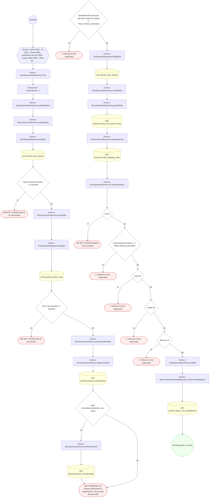

#### 14. GET /care-spaces/{id}/operational-state

Estado operativo de un espacio

| HTTP | Código | Cuándo |
|---|---|---|
| 200 | — | Éxito |
| 400 | `VALIDATION_FAILED` | Los parámetros de ruta son UUID válidos |
| 401 | `UNAUTHENTICATED` | Hay una sesión válida (JWT) |
| 403 | `FORBIDDEN` | El rol está permitido; El tenant se resuelve y pertenece al actor; InsufficientRoleException: Su rol no permite esta acción sobre este espacio |
| 404 | `NOT_FOUND` | ResourceNotFoundException: Espacio no encontrado; ResourceNotFoundException: Unidad clínica no encontrada; ResourceNotFoundException: Sitio no encontrado |
| 429 | `RATE_LIMITED` | No se supera el límite de solicitudes |
| 500 | `INTERNAL` | Error: Acción de infraestructura no registrada: {action} |

```mermaid
flowchart TD
  n1(("Solicitud")):::inicio
  n2{{"Acceso: sesión (401) · rol (403) · tenant (403) · parámetros de ruta (400) · límite de tasa (429)"}}:::acceso
  n1 --> n2
  n3["Llama a BedBoardReadService.operationalState"]:::llamada
  n2 --> n3
  n4["Llama a InfrastructureAccessService.assertCan"]:::llamada
  n3 --> n4
  n5["Llama a InfrastructureAccessService.resolve"]:::llamada
  n4 --> n5
  n6{"'careSpaceId' in target"}:::decision
  n5 --> n6
  n7["Llama a CareSpacesRepository.findById"]:::llamada
  n6 -->|"sí"| n7
  n8[("LEE practice.care_spaces")]:::efecto
  n7 --> n8
  n9{"!found || found.tenantId !== tenantId"}:::decision
  n8 --> n9
  n10(["404 NOT_FOUND Espacio no encontrado"]):::error
  n9 -->|"sí"| n10
  n11{"'unitId' in target"}:::decision
  n6 -->|"no"| n11
  n12["Llama a ClinicalUnitsRepository.findById"]:::llamada
  n11 -->|"sí"| n12
  n13[("LEE practice.clinical_units")]:::efecto
  n12 --> n13
  n14{"!found || found.tenantId !== tenantId"}:::decision
  n13 --> n14
  n15(["404 NOT_FOUND Unidad clínica no encontrada"]):::error
  n14 -->|"sí"| n15
  n16["Llama a PracticeSitesRepository.findById"]:::llamada
  n9 -->|"no"| n16
  n14 -->|"no"| n16
  n11 -->|"no"| n16
  n17[("LEE practice.practice_sites")]:::efecto
  n16 --> n17
  n18{"!site || site.tenantId !== tenantId"}:::decision
  n17 --> n18
  n19(["404 NOT_FOUND Sitio no encontrado"]):::error
  n18 -->|"sí"| n19
  n20["Llama a CareSpaceOpsRepository.chain"]:::llamada
  n18 -->|"no"| n20
  n21[("LEE practice.care_spaces")]:::efecto
  n20 --> n21
  n22["Llama a CareSpaceOpsRepository.unitsOf"]:::llamada
  n21 --> n22
  n23[("LEE practice.space_unit_assignments · LEE practice.care_spaces · LEE practice.clinical_units")]:::efecto
  n22 --> n23
  n24["Llama a InfrastructureAccessService.actorScope"]:::llamada
  n23 --> n24
  n25["Llama a CareSpaceOpsRepository.grants"]:::llamada
  n24 --> n25
  n26[("LEE delegated_access.organization_user_assignments · LEE directory.tenant_memberships · LEE practice.care_spa…")]:::efecto
  n25 --> n26
  n27["Llama a InfrastructureAccessService.decide"]:::llamada
  n26 --> n27
  n28["Llama a InfraPolicyRegistry.rule"]:::llamada
  n27 --> n28
  n29{"!rule"}:::decision
  n28 --> n29
  n30(["500 INTERNAL Acción de infraestructura no registrada: {action}"]):::error
  n29 -->|"sí"| n30
  n31(["403 FORBIDDEN Su rol no permite esta acción sobre este espacio"]):::error
  n29 -->|"no"| n31
  n32["Llama a OpsCellBuilder.cellFor"]:::llamada
  n33["Llama a CareSpaceOpsRepository.chain"]:::llamada
  n32 --> n33
  n34[("LEE practice.care_spaces")]:::efecto
  n33 --> n34
  n35["Llama a CareSpaceOpsRepository.openCleaningOrders"]:::llamada
  n34 --> n35
  n36[("LEE practice.cleaning_orders")]:::efecto
  n35 --> n36
  n37["Llama a CareSpaceOpsRepository.lastEventBySpace"]:::llamada
  n36 --> n37
  n38[("LEE practice.care_space_status_events")]:::efecto
  n37 --> n38
  n39{"withPatient && snap.occupancy.encounterId"}:::decision
  n38 --> n39
  n40["Llama a CareSpaceOpsRepository.patientBadges"]:::llamada
  n39 -->|"sí"| n40
  n41[("LEE clinical.encounters · LEE profiles.patient_profiles · LEE profiles.person_profiles · LEE profiles.persons")]:::efecto
  n40 --> n41
  n42[("LEE practice.space_unit_assignments")]:::efecto
  n41 --> n42
  n39 -->|"no"| n42
  n43["Llama a InfrastructureAccessService.allowedActions"]:::llamada
  n42 --> n43
  n44["Llama a InfrastructureAccessService.can"]:::llamada
  n43 --> n44
  n45["Llama a InfraPolicyRegistry.rule"]:::llamada
  n44 --> n45
  n46{"!rule"}:::decision
  n45 --> n46
  n47(["500 INTERNAL Acción de infraestructura no registrada: {action}"]):::error
  n46 -->|"sí"| n47
  n48["Llama a CareSpaceOpsRepository.openBlocks"]:::llamada
  n46 -->|"no"| n48
  n49[("LEE practice.care_space_blocks")]:::efecto
  n48 --> n49
  n50["Llama a CareSpaceOpsRepository.openCleaningOrders"]:::llamada
  n49 --> n50
  n51[("LEE practice.cleaning_orders")]:::efecto
  n50 --> n51
  n52["Llama a CareSpaceOpsCore.settings"]:::llamada
  n51 --> n52
  n53["Llama a CareSpaceOpsRepository.settings"]:::llamada
  n52 --> n53
  n54[("LEE practice.practice_settings")]:::efecto
  n53 --> n54
  n55["Llama a InfrastructureAccessService.can"]:::llamada
  n54 --> n55
  n56["Llama a InfraPolicyRegistry.rule"]:::llamada
  n55 --> n56
  n57{"!rule"}:::decision
  n56 --> n57
  n58(["500 INTERNAL Acción de infraestructura no registrada: {action}"]):::error
  n57 -->|"sí"| n58
  n59(("200 Responde con éxito")):::ok
  n57 -->|"no"| n59
  classDef acceso fill:#eef,stroke:#66a
  classDef error fill:#fee,stroke:#c33
  classDef ok fill:#efe,stroke:#3a3
  classDef efecto fill:#ffd,stroke:#aa3
  classDef decision fill:#fff,stroke:#555
  classDef corte fill:#eee,stroke:#999,stroke-dasharray: 4
```

#### 15. GET /care-spaces/{id}/retire-check

Bloqueos para retirar un espacio

| HTTP | Código | Cuándo |
|---|---|---|
| 200 | — | Éxito |
| 400 | `VALIDATION_FAILED` | Los parámetros de ruta son UUID válidos |
| 401 | `UNAUTHENTICATED` | Hay una sesión válida (JWT) |
| 403 | `FORBIDDEN` | El rol está permitido; El tenant se resuelve y pertenece al actor; ForbiddenException: Se requiere pertenecer a la organización, o ser administrador de la plataforma |
| 404 | `NOT_FOUND` | ResourceNotFoundException: Espacio no encontrado |
| 429 | `RATE_LIMITED` | No se supera el límite de solicitudes |

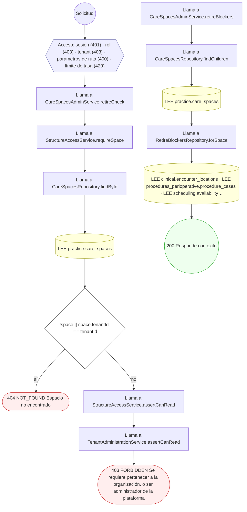

#### 16. GET /care-spaces/{id}/status-events

Historial de estados de un espacio (A20)

| HTTP | Código | Cuándo |
|---|---|---|
| 200 | — | Éxito |
| 400 | `VALIDATION_FAILED` | Los parámetros de ruta son UUID válidos |
| 401 | `UNAUTHENTICATED` | Hay una sesión válida (JWT) |
| 403 | `FORBIDDEN` | El rol está permitido; El tenant se resuelve y pertenece al actor; InsufficientRoleException: Su rol no permite esta acción sobre este espacio |
| 404 | `NOT_FOUND` | ResourceNotFoundException: Espacio no encontrado; ResourceNotFoundException: Unidad clínica no encontrada; ResourceNotFoundException: Sitio no encontrado |
| 429 | `RATE_LIMITED` | No se supera el límite de solicitudes |
| 500 | `INTERNAL` | Error: Acción de infraestructura no registrada: {action} |

```mermaid
flowchart TD
  n1(("Solicitud")):::inicio
  n2{{"Acceso: sesión (401) · rol (403) · tenant (403) · parámetros de ruta (400) · límite de tasa (429)"}}:::acceso
  n1 --> n2
  n3["Llama a BedBoardReadService.statusEvents"]:::llamada
  n2 --> n3
  n4["Llama a InfrastructureAccessService.assertCan"]:::llamada
  n3 --> n4
  n5["Llama a InfrastructureAccessService.resolve"]:::llamada
  n4 --> n5
  n6{"'careSpaceId' in target"}:::decision
  n5 --> n6
  n7["Llama a CareSpacesRepository.findById"]:::llamada
  n6 -->|"sí"| n7
  n8[("LEE practice.care_spaces")]:::efecto
  n7 --> n8
  n9{"!found || found.tenantId !== tenantId"}:::decision
  n8 --> n9
  n10(["404 NOT_FOUND Espacio no encontrado"]):::error
  n9 -->|"sí"| n10
  n11{"'unitId' in target"}:::decision
  n6 -->|"no"| n11
  n12["Llama a ClinicalUnitsRepository.findById"]:::llamada
  n11 -->|"sí"| n12
  n13[("LEE practice.clinical_units")]:::efecto
  n12 --> n13
  n14{"!found || found.tenantId !== tenantId"}:::decision
  n13 --> n14
  n15(["404 NOT_FOUND Unidad clínica no encontrada"]):::error
  n14 -->|"sí"| n15
  n16["Llama a PracticeSitesRepository.findById"]:::llamada
  n9 -->|"no"| n16
  n14 -->|"no"| n16
  n11 -->|"no"| n16
  n17[("LEE practice.practice_sites")]:::efecto
  n16 --> n17
  n18{"!site || site.tenantId !== tenantId"}:::decision
  n17 --> n18
  n19(["404 NOT_FOUND Sitio no encontrado"]):::error
  n18 -->|"sí"| n19
  n20["Llama a CareSpaceOpsRepository.chain"]:::llamada
  n18 -->|"no"| n20
  n21[("LEE practice.care_spaces")]:::efecto
  n20 --> n21
  n22["Llama a CareSpaceOpsRepository.unitsOf"]:::llamada
  n21 --> n22
  n23[("LEE practice.space_unit_assignments · LEE practice.care_spaces · LEE practice.clinical_units")]:::efecto
  n22 --> n23
  n24["Llama a InfrastructureAccessService.actorScope"]:::llamada
  n23 --> n24
  n25["Llama a CareSpaceOpsRepository.grants"]:::llamada
  n24 --> n25
  n26[("LEE delegated_access.organization_user_assignments · LEE directory.tenant_memberships · LEE practice.care_spa…")]:::efecto
  n25 --> n26
  n27["Llama a InfrastructureAccessService.decide"]:::llamada
  n26 --> n27
  n28["Llama a InfraPolicyRegistry.rule"]:::llamada
  n27 --> n28
  n29{"!rule"}:::decision
  n28 --> n29
  n30(["500 INTERNAL Acción de infraestructura no registrada: {action}"]):::error
  n29 -->|"sí"| n30
  n31(["403 FORBIDDEN Su rol no permite esta acción sobre este espacio"]):::error
  n29 -->|"no"| n31
  n32["Llama a CareSpaceOpsRepository.statusEvents"]:::llamada
  n33[("LEE practice.care_space_status_events")]:::efecto
  n32 --> n33
  n34(("200 Responde con éxito")):::ok
  n33 --> n34
  classDef acceso fill:#eef,stroke:#66a
  classDef error fill:#fee,stroke:#c33
  classDef ok fill:#efe,stroke:#3a3
  classDef efecto fill:#ffd,stroke:#aa3
  classDef decision fill:#fff,stroke:#555
  classDef corte fill:#eee,stroke:#999,stroke-dasharray: 4
```

#### 17. GET /care-spaces/{id}/stock

Stock ubicado en un espacio (F5c)

| HTTP | Código | Cuándo |
|---|---|---|
| 200 | — | Éxito |
| 400 | `VALIDATION_FAILED` | Los parámetros de ruta son UUID válidos |
| 401 | `UNAUTHENTICATED` | Hay una sesión válida (JWT) |
| 403 | `FORBIDDEN` | El rol está permitido; El tenant se resuelve y pertenece al actor; InsufficientRoleException: Su rol no permite esta acción sobre este espacio |
| 404 | `NOT_FOUND` | ResourceNotFoundException: Espacio no encontrado; ResourceNotFoundException: Unidad clínica no encontrada; ResourceNotFoundException: Sitio no encontrado |
| 429 | `RATE_LIMITED` | No se supera el límite de solicitudes |
| 500 | `INTERNAL` | Error: Acción de infraestructura no registrada: {action} |

```mermaid
flowchart TD
  n1(("Solicitud")):::inicio
  n2{{"Acceso: sesión (401) · rol (403) · tenant (403) · parámetros de ruta (400) · límite de tasa (429)"}}:::acceso
  n1 --> n2
  n3["Llama a SpaceAssetsReadService.stock"]:::llamada
  n2 --> n3
  n4["Llama a InfrastructureAccessService.assertCan"]:::llamada
  n3 --> n4
  n5["Llama a InfrastructureAccessService.resolve"]:::llamada
  n4 --> n5
  n6{"'careSpaceId' in target"}:::decision
  n5 --> n6
  n7["Llama a CareSpacesRepository.findById"]:::llamada
  n6 -->|"sí"| n7
  n8[("LEE practice.care_spaces")]:::efecto
  n7 --> n8
  n9{"!found || found.tenantId !== tenantId"}:::decision
  n8 --> n9
  n10(["404 NOT_FOUND Espacio no encontrado"]):::error
  n9 -->|"sí"| n10
  n11{"'unitId' in target"}:::decision
  n6 -->|"no"| n11
  n12["Llama a ClinicalUnitsRepository.findById"]:::llamada
  n11 -->|"sí"| n12
  n13[("LEE practice.clinical_units")]:::efecto
  n12 --> n13
  n14{"!found || found.tenantId !== tenantId"}:::decision
  n13 --> n14
  n15(["404 NOT_FOUND Unidad clínica no encontrada"]):::error
  n14 -->|"sí"| n15
  n16["Llama a PracticeSitesRepository.findById"]:::llamada
  n9 -->|"no"| n16
  n14 -->|"no"| n16
  n11 -->|"no"| n16
  n17[("LEE practice.practice_sites")]:::efecto
  n16 --> n17
  n18{"!site || site.tenantId !== tenantId"}:::decision
  n17 --> n18
  n19(["404 NOT_FOUND Sitio no encontrado"]):::error
  n18 -->|"sí"| n19
  n20["Llama a CareSpaceOpsRepository.chain"]:::llamada
  n18 -->|"no"| n20
  n21[("LEE practice.care_spaces")]:::efecto
  n20 --> n21
  n22["Llama a CareSpaceOpsRepository.unitsOf"]:::llamada
  n21 --> n22
  n23[("LEE practice.space_unit_assignments · LEE practice.care_spaces · LEE practice.clinical_units")]:::efecto
  n22 --> n23
  n24["Llama a InfrastructureAccessService.actorScope"]:::llamada
  n23 --> n24
  n25["Llama a CareSpaceOpsRepository.grants"]:::llamada
  n24 --> n25
  n26[("LEE delegated_access.organization_user_assignments · LEE directory.tenant_memberships · LEE practice.care_spa…")]:::efecto
  n25 --> n26
  n27["Llama a InfrastructureAccessService.decide"]:::llamada
  n26 --> n27
  n28["Llama a InfraPolicyRegistry.rule"]:::llamada
  n27 --> n28
  n29{"!rule"}:::decision
  n28 --> n29
  n30(["500 INTERNAL Acción de infraestructura no registrada: {action}"]):::error
  n29 -->|"sí"| n30
  n31(["403 FORBIDDEN Su rol no permite esta acción sobre este espacio"]):::error
  n29 -->|"no"| n31
  n32[("LEE pharmacy.pharmacy_sites · LEE pharmacy.pharmacies · LEE pharmacy_inventory.inventory_locations · LEE phar…")]:::efecto
  n33(("200 Responde con éxito")):::ok
  n32 --> n33
  classDef acceso fill:#eef,stroke:#66a
  classDef error fill:#fee,stroke:#c33
  classDef ok fill:#efe,stroke:#3a3
  classDef efecto fill:#ffd,stroke:#aa3
  classDef decision fill:#fff,stroke:#555
  classDef corte fill:#eee,stroke:#999,stroke-dasharray: 4
```

#### 18. POST /care-spaces/{id}/unit-assignments

Vincular un espacio a una unidad clínica

| HTTP | Código | Cuándo |
|---|---|---|
| 201 | — | Éxito |
| 400 | `VALIDATION_FAILED` | Los parámetros de ruta son UUID válidos; El cuerpo cumple el DTO (sin propiedades extra) |
| 401 | `UNAUTHENTICATED` | Hay una sesión válida (JWT) |
| 403 | `FORBIDDEN` | El rol está permitido; El tenant se resuelve y pertenece al actor; ForbiddenException: Se requiere administrar la organización o la sucursal de esta sede |
| 404 | `NOT_FOUND` | ResourceNotFoundException: Espacio no encontrado; ResourceNotFoundException: Sitio no encontrado; ResourceNotFoundException: Unidad clínica no encontrada |
| 429 | `RATE_LIMITED` | No se supera el límite de solicitudes |

```mermaid
flowchart TD
  n1(("Solicitud")):::inicio
  n2{{"Acceso: sesión (401) · rol (403) · tenant (403) · parámetros de ruta (400) · cuerpo válido (400) · límite de…"}}:::acceso
  n1 --> n2
  n3["Llama a CareSpacesAdminService.addAssignment"]:::llamada
  n2 --> n3
  n4["Transacción: transactional(…)"]:::transaccion
  n3 --> n4
  n5["Llama a CareSpacesAdminService.writableSpace"]:::llamada
  n4 --> n5
  n6["Llama a StructureAccessService.requireSpace"]:::llamada
  n5 --> n6
  n7["Llama a CareSpacesRepository.findById"]:::llamada
  n6 --> n7
  n8[("LEE practice.care_spaces")]:::efecto
  n7 --> n8
  n9{"!space || space.tenantId !== tenantId"}:::decision
  n8 --> n9
  n10(["404 NOT_FOUND Espacio no encontrado"]):::error
  n9 -->|"sí"| n10
  n11["Llama a StructureAccessService.requireSite"]:::llamada
  n9 -->|"no"| n11
  n12["Llama a PracticeSitesRepository.findById"]:::llamada
  n11 --> n12
  n13[("LEE practice.practice_sites")]:::efecto
  n12 --> n13
  n14{"!site || site.tenantId !== tenantId"}:::decision
  n13 --> n14
  n15(["404 NOT_FOUND Sitio no encontrado"]):::error
  n14 -->|"sí"| n15
  n16["Llama a StructureAccessService.assertCanWriteSite"]:::llamada
  n14 -->|"no"| n16
  n17["Llama a StructureAccessService.isBranchAdmin"]:::llamada
  n16 --> n17
  n18[("LEE directory.branch_memberships")]:::efecto
  n17 --> n18
  n19{"await this.isBranchAdmin(tx, site, actor)"}:::decision
  n18 --> n19
  n20["Llama a StructureAccessService.isBranchAdmin"]:::llamada
  n19 -->|"sí"| n20
  n21[("LEE directory.branch_memberships")]:::efecto
  n20 --> n21
  n22(["403 FORBIDDEN Se requiere administrar la organización o la sucursal de esta sede"]):::error
  n21 --> n22
  n19 -->|"no"| n22
  n23{"!allowRetiredForLifecycle && space.statusConceptId === PRAC.SPACE_RETIRED"}:::decision
  n24(["↩ (relanza el error capturado)"]):::error
  n23 -->|"sí"| n24
  n25["Llama a CareSpacesAdminService.sameSiteUnit"]:::llamada
  n23 -->|"no"| n25
  n26["Llama a ClinicalUnitsRepository.findById"]:::llamada
  n25 --> n26
  n27[("LEE practice.clinical_units")]:::efecto
  n26 --> n27
  n28{"!unit || unit.practiceSiteId !== site.id || unit.tenantId !== site.tenantId"}:::decision
  n27 --> n28
  n29(["404 NOT_FOUND Unidad clínica no encontrada"]):::error
  n28 -->|"sí"| n29
  n30{"unit.statusConceptId === PRAC.UNIT_RETIRED"}:::decision
  n28 -->|"no"| n30
  n31(["↩ (relanza el error capturado)"]):::error
  n30 -->|"sí"| n31
  n32["Llama a SpaceUnitAssignmentsRepository.findCurrentBySpaces"]:::llamada
  n30 -->|"no"| n32
  n33[("LEE practice.space_unit_assignments")]:::efecto
  n32 --> n33
  n34{"current.some((a) =› a.clinicalUnitId === dto.clinicalUnitId)"}:::decision
  n33 --> n34
  n35(["↩ (relanza el error capturado)"]):::error
  n34 -->|"sí"| n35
  n36{"roleId === PRAC.SPACE_UNIT_ROLE_OWNER && current.some((a) =› a.roleConceptId === PRAC.SPACE_UNIT_ROLE_OWNER)"}:::decision
  n34 -->|"no"| n36
  n37(["↩ (relanza el error capturado)"]):::error
  n36 -->|"sí"| n37
  n38["Llama a SpaceUnitAssignmentsRepository.create"]:::llamada
  n36 -->|"no"| n38
  n39[("CREA practice.space_unit_assignments")]:::efecto
  n38 --> n39
  n40(("201 Responde con éxito")):::ok
  n39 --> n40
  classDef acceso fill:#eef,stroke:#66a
  classDef error fill:#fee,stroke:#c33
  classDef ok fill:#efe,stroke:#3a3
  classDef efecto fill:#ffd,stroke:#aa3
  classDef decision fill:#fff,stroke:#555
  classDef corte fill:#eee,stroke:#999,stroke-dasharray: 4
```

#### 19. DELETE /care-spaces/{id}/unit-assignments/{assignmentId}

Desvincular un espacio de una unidad clínica

| HTTP | Código | Cuándo |
|---|---|---|
| 200 | — | Éxito |
| 400 | `VALIDATION_FAILED` | Los parámetros de ruta son UUID válidos |
| 401 | `UNAUTHENTICATED` | Hay una sesión válida (JWT) |
| 403 | `FORBIDDEN` | El rol está permitido; El tenant se resuelve y pertenece al actor; ForbiddenException: Se requiere administrar la organización o la sucursal de esta sede |
| 404 | `NOT_FOUND` | ResourceNotFoundException: Espacio no encontrado; ResourceNotFoundException: Sitio no encontrado; ResourceNotFoundException: Vínculo no encontrado |
| 429 | `RATE_LIMITED` | No se supera el límite de solicitudes |

```mermaid
flowchart TD
  n1(("Solicitud")):::inicio
  n2{{"Acceso: sesión (401) · rol (403) · tenant (403) · parámetros de ruta (400) · límite de tasa (429)"}}:::acceso
  n1 --> n2
  n3["Llama a CareSpacesAdminService.removeAssignment"]:::llamada
  n2 --> n3
  n4["Transacción: transactional(…)"]:::transaccion
  n3 --> n4
  n5["Llama a CareSpacesAdminService.writableSpace"]:::llamada
  n4 --> n5
  n6["Llama a StructureAccessService.requireSpace"]:::llamada
  n5 --> n6
  n7["Llama a CareSpacesRepository.findById"]:::llamada
  n6 --> n7
  n8[("LEE practice.care_spaces")]:::efecto
  n7 --> n8
  n9{"!space || space.tenantId !== tenantId"}:::decision
  n8 --> n9
  n10(["404 NOT_FOUND Espacio no encontrado"]):::error
  n9 -->|"sí"| n10
  n11["Llama a StructureAccessService.requireSite"]:::llamada
  n9 -->|"no"| n11
  n12["Llama a PracticeSitesRepository.findById"]:::llamada
  n11 --> n12
  n13[("LEE practice.practice_sites")]:::efecto
  n12 --> n13
  n14{"!site || site.tenantId !== tenantId"}:::decision
  n13 --> n14
  n15(["404 NOT_FOUND Sitio no encontrado"]):::error
  n14 -->|"sí"| n15
  n16["Llama a StructureAccessService.assertCanWriteSite"]:::llamada
  n14 -->|"no"| n16
  n17["Llama a StructureAccessService.isBranchAdmin"]:::llamada
  n16 --> n17
  n18[("LEE directory.branch_memberships")]:::efecto
  n17 --> n18
  n19{"await this.isBranchAdmin(tx, site, actor)"}:::decision
  n18 --> n19
  n20["Llama a StructureAccessService.isBranchAdmin"]:::llamada
  n19 -->|"sí"| n20
  n21[("LEE directory.branch_memberships")]:::efecto
  n20 --> n21
  n22(["403 FORBIDDEN Se requiere administrar la organización o la sucursal de esta sede"]):::error
  n21 --> n22
  n19 -->|"no"| n22
  n23{"!allowRetiredForLifecycle && space.statusConceptId === PRAC.SPACE_RETIRED"}:::decision
  n24(["↩ (relanza el error capturado)"]):::error
  n23 -->|"sí"| n24
  n25["Llama a SpaceUnitAssignmentsRepository.findById"]:::llamada
  n23 -->|"no"| n25
  n26[("LEE practice.space_unit_assignments")]:::efecto
  n25 --> n26
  n27{"!assignment || assignment.careSpaceId !== space.id || assignment.tenantId !== tenantId || assignment.validTo"}:::decision
  n26 --> n27
  n28(["404 NOT_FOUND Vínculo no encontrado"]):::error
  n27 -->|"sí"| n28
  n29[("ACTUALIZA practice.space_unit_assignments")]:::efecto
  n27 -->|"no"| n29
  n30(("200 Responde con éxito")):::ok
  n29 --> n30
  classDef acceso fill:#eef,stroke:#66a
  classDef error fill:#fee,stroke:#c33
  classDef ok fill:#efe,stroke:#3a3
  classDef efecto fill:#ffd,stroke:#aa3
  classDef decision fill:#fff,stroke:#555
  classDef corte fill:#eee,stroke:#999,stroke-dasharray: 4
```

#### 20. POST /cleaning-orders/{id}/assign

Asignar una orden de limpieza

| HTTP | Código | Cuándo |
|---|---|---|
| 200 | — | Éxito |
| 400 | `VALIDATION_FAILED` | Los parámetros de ruta son UUID válidos; El cuerpo cumple el DTO (sin propiedades extra) |
| 401 | `UNAUTHENTICATED` | Hay una sesión válida (JWT) |
| 403 | `FORBIDDEN` | El rol está permitido; El tenant se resuelve y pertenece al actor |
| 404 | `NOT_FOUND` | ResourceNotFoundException: Usuario no encontrado |
| 429 | `RATE_LIMITED` | No se supera el límite de solicitudes |

```mermaid
flowchart TD
  n1(("Solicitud")):::inicio
  n2{{"Acceso: sesión (401) · rol (403) · tenant (403) · parámetros de ruta (400) · cuerpo válido (400) · límite de…"}}:::acceso
  n1 --> n2
  n3["Llama a CleaningOrdersService.assign"]:::llamada
  n2 --> n3
  n4["Llama a AssignCleaningOrderUseCase.execute"]:::llamada
  n3 --> n4
  n5["Transacción: transactional(…)"]:::transaccion
  n4 --> n5
  n6{"userId"}:::decision
  n5 --> n6
  n7[("LEE directory.tenant_memberships")]:::efecto
  n6 -->|"sí"| n7
  n8{"rows.length === 0"}:::decision
  n7 --> n8
  n9(["404 NOT_FOUND Usuario no encontrado"]):::error
  n8 -->|"sí"| n9
  n10(("200 Responde con éxito")):::ok
  n8 -->|"no"| n10
  n6 -->|"no"| n10
  classDef acceso fill:#eef,stroke:#66a
  classDef error fill:#fee,stroke:#c33
  classDef ok fill:#efe,stroke:#3a3
  classDef efecto fill:#ffd,stroke:#aa3
  classDef decision fill:#fff,stroke:#555
  classDef corte fill:#eee,stroke:#999,stroke-dasharray: 4
```

#### 21. GET /clinical-units/{id}

Ficha de una unidad clínica

| HTTP | Código | Cuándo |
|---|---|---|
| 200 | — | Éxito |
| 400 | `VALIDATION_FAILED` | Los parámetros de ruta son UUID válidos |
| 401 | `UNAUTHENTICATED` | Hay una sesión válida (JWT) |
| 403 | `FORBIDDEN` | El rol está permitido; El tenant se resuelve y pertenece al actor; ForbiddenException: Se requiere pertenecer a la organización, o ser administrador de la plataforma |
| 404 | `NOT_FOUND` | ResourceNotFoundException: Unidad clínica no encontrada |
| 429 | `RATE_LIMITED` | No se supera el límite de solicitudes |

```mermaid
flowchart TD
  n1(("Solicitud")):::inicio
  n2{{"Acceso: sesión (401) · rol (403) · tenant (403) · parámetros de ruta (400) · límite de tasa (429)"}}:::acceso
  n1 --> n2
  n3["Llama a ClinicalUnitsAdminService.detail"]:::llamada
  n2 --> n3
  n4["Llama a StructureAccessService.requireUnit"]:::llamada
  n3 --> n4
  n5["Llama a ClinicalUnitsRepository.findById"]:::llamada
  n4 --> n5
  n6[("LEE practice.clinical_units")]:::efecto
  n5 --> n6
  n7{"!unit || unit.tenantId !== tenantId"}:::decision
  n6 --> n7
  n8(["404 NOT_FOUND Unidad clínica no encontrada"]):::error
  n7 -->|"sí"| n8
  n9["Llama a StructureAccessService.assertCanRead"]:::llamada
  n7 -->|"no"| n9
  n10["Llama a TenantAdministrationService.assertCanRead"]:::llamada
  n9 --> n10
  n11(["403 FORBIDDEN Se requiere pertenecer a la organización, o ser administrador de la plataforma"]):::error
  n10 --> n11
  n12["Llama a ClinicalUnitsAdminService.toDetail"]:::llamada
  n13["Llama a ClinicalUnitsRepository.findBySite"]:::llamada
  n12 --> n13
  n14[("LEE practice.clinical_units")]:::efecto
  n13 --> n14
  n15["Llama a CareSpacesRepository.findBySite"]:::llamada
  n14 --> n15
  n16[("LEE practice.care_spaces")]:::efecto
  n15 --> n16
  n17["Llama a SpaceUnitAssignmentsRepository.findCurrentByUnit"]:::llamada
  n16 --> n17
  n18[("LEE practice.space_unit_assignments")]:::efecto
  n17 --> n18
  n19(("200 Responde con éxito")):::ok
  n18 --> n19
  classDef acceso fill:#eef,stroke:#66a
  classDef error fill:#fee,stroke:#c33
  classDef ok fill:#efe,stroke:#3a3
  classDef efecto fill:#ffd,stroke:#aa3
  classDef decision fill:#fff,stroke:#555
  classDef corte fill:#eee,stroke:#999,stroke-dasharray: 4
```

#### 22. PATCH /clinical-units/{id}

Editar una unidad clínica

| HTTP | Código | Cuándo |
|---|---|---|
| 200 | — | Éxito |
| 400 | `VALIDATION_FAILED` | Los parámetros de ruta son UUID válidos; El cuerpo cumple el DTO (sin propiedades extra) |
| 401 | `UNAUTHENTICATED` | Hay una sesión válida (JWT) |
| 403 | `FORBIDDEN` | El rol está permitido; El tenant se resuelve y pertenece al actor; ForbiddenException: Se requiere administrar la organización o la sucursal de esta sede |
| 404 | `NOT_FOUND` | ResourceNotFoundException: Unidad clínica no encontrada; ResourceNotFoundException: Sitio no encontrado |
| 429 | `RATE_LIMITED` | No se supera el límite de solicitudes |

```mermaid
flowchart TD
  n1(("Solicitud")):::inicio
  n2{{"Acceso: sesión (401) · rol (403) · tenant (403) · parámetros de ruta (400) · cuerpo válido (400) · límite de…"}}:::acceso
  n1 --> n2
  n3["Llama a ClinicalUnitsAdminService.update"]:::llamada
  n2 --> n3
  n4["Transacción: transactional(…)"]:::transaccion
  n3 --> n4
  n5["Llama a ClinicalUnitsAdminService.writable"]:::llamada
  n4 --> n5
  n6["Llama a StructureAccessService.requireUnit"]:::llamada
  n5 --> n6
  n7["Llama a ClinicalUnitsRepository.findById"]:::llamada
  n6 --> n7
  n8[("LEE practice.clinical_units")]:::efecto
  n7 --> n8
  n9{"!unit || unit.tenantId !== tenantId"}:::decision
  n8 --> n9
  n10(["404 NOT_FOUND Unidad clínica no encontrada"]):::error
  n9 -->|"sí"| n10
  n11["Llama a StructureAccessService.requireSite"]:::llamada
  n9 -->|"no"| n11
  n12["Llama a PracticeSitesRepository.findById"]:::llamada
  n11 --> n12
  n13[("LEE practice.practice_sites")]:::efecto
  n12 --> n13
  n14{"!site || site.tenantId !== tenantId"}:::decision
  n13 --> n14
  n15(["404 NOT_FOUND Sitio no encontrado"]):::error
  n14 -->|"sí"| n15
  n16["Llama a StructureAccessService.assertCanWriteSite"]:::llamada
  n14 -->|"no"| n16
  n17["Llama a StructureAccessService.isBranchAdmin"]:::llamada
  n16 --> n17
  n18[("LEE directory.branch_memberships")]:::efecto
  n17 --> n18
  n19{"await this.isBranchAdmin(tx, site, actor)"}:::decision
  n18 --> n19
  n20["Llama a StructureAccessService.isBranchAdmin"]:::llamada
  n19 -->|"sí"| n20
  n21[("LEE directory.branch_memberships")]:::efecto
  n20 --> n21
  n22(["403 FORBIDDEN Se requiere administrar la organización o la sucursal de esta sede"]):::error
  n21 --> n22
  n19 -->|"no"| n22
  n23["Llama a ClinicalUnitsRepository.findBySite"]:::llamada
  n24[("LEE practice.clinical_units")]:::efecto
  n23 --> n24
  n25{"unit.statusConceptId === PRAC.UNIT_RETIRED"}:::decision
  n24 --> n25
  n26(["↩ (relanza el error capturado)"]):::error
  n25 -->|"sí"| n26
  n27{"dto.code !== undefined && dto.code !== unit.code"}:::decision
  n25 -->|"no"| n27
  n28{"stateOf(unit) !== 'PLANNED'"}:::decision
  n27 -->|"sí"| n28
  n29(["↩ (relanza el error capturado)"]):::error
  n28 -->|"sí"| n29
  n30{"siteUnits.some((u) =› u.id !== unit.id && u.code === dto.code)"}:::decision
  n28 -->|"no"| n30
  n31(["↩ (relanza el error capturado)"]):::error
  n30 -->|"sí"| n31
  n32{"dto.parentUnitId !== undefined"}:::decision
  n30 -->|"no"| n32
  n27 -->|"no"| n32
  n33{"parentId !== null"}:::decision
  n32 -->|"sí"| n33
  n34{"!parent"}:::decision
  n33 -->|"sí"| n34
  n35(["404 NOT_FOUND Unidad clínica no encontrada"]):::error
  n34 -->|"sí"| n35
  n36{"!lifecycle.ok"}:::decision
  n34 -->|"no"| n36
  n37(["↩ (relanza el error capturado)"]):::error
  n36 -->|"sí"| n37
  n38{"!cycle.ok"}:::decision
  n36 -->|"no"| n38
  n33 -->|"no"| n38
  n39(["↩ (relanza el error capturado)"]):::error
  n38 -->|"sí"| n39
  n40["Llama a ClinicalUnitsAdminService.toDetail"]:::llamada
  n38 -->|"no"| n40
  n32 -->|"no"| n40
  n41["Llama a ClinicalUnitsRepository.findBySite"]:::llamada
  n40 --> n41
  n42[("LEE practice.clinical_units")]:::efecto
  n41 --> n42
  n43["Llama a CareSpacesRepository.findBySite"]:::llamada
  n42 --> n43
  n44[("LEE practice.care_spaces")]:::efecto
  n43 --> n44
  n45["Llama a SpaceUnitAssignmentsRepository.findCurrentByUnit"]:::llamada
  n44 --> n45
  n46[("LEE practice.space_unit_assignments")]:::efecto
  n45 --> n46
  n47(("200 Responde con éxito")):::ok
  n46 --> n47
  classDef acceso fill:#eef,stroke:#66a
  classDef error fill:#fee,stroke:#c33
  classDef ok fill:#efe,stroke:#3a3
  classDef efecto fill:#ffd,stroke:#aa3
  classDef decision fill:#fff,stroke:#555
  classDef corte fill:#eee,stroke:#999,stroke-dasharray: 4
```

#### 23. POST /clinical-units/{id}/lifecycle

Cambiar el ciclo de vida de una unidad clínica

| HTTP | Código | Cuándo |
|---|---|---|
| 200 | — | Éxito |
| 400 | `VALIDATION_FAILED` | Los parámetros de ruta son UUID válidos; El cuerpo cumple el DTO (sin propiedades extra) |
| 401 | `UNAUTHENTICATED` | Hay una sesión válida (JWT) |
| 403 | `FORBIDDEN` | El rol está permitido; El tenant se resuelve y pertenece al actor; ForbiddenException: Se requiere administrar la organización o la sucursal de esta sede |
| 404 | `NOT_FOUND` | ResourceNotFoundException: Unidad clínica no encontrada; ResourceNotFoundException: Sitio no encontrado |
| 429 | `RATE_LIMITED` | No se supera el límite de solicitudes |
| 500 | `INTERNAL` | Error: Entidad de historial no registrada: {entity} |

```mermaid
flowchart TD
  n1(("Solicitud")):::inicio
  n2{{"Acceso: sesión (401) · rol (403) · tenant (403) · parámetros de ruta (400) · cuerpo válido (400) · límite de…"}}:::acceso
  n1 --> n2
  n3["Llama a ClinicalUnitsAdminService.changeLifecycle"]:::llamada
  n2 --> n3
  n4["Transacción: transactional(…)"]:::transaccion
  n3 --> n4
  n5["Llama a ClinicalUnitsAdminService.writable"]:::llamada
  n4 --> n5
  n6["Llama a StructureAccessService.requireUnit"]:::llamada
  n5 --> n6
  n7["Llama a ClinicalUnitsRepository.findById"]:::llamada
  n6 --> n7
  n8[("LEE practice.clinical_units")]:::efecto
  n7 --> n8
  n9{"!unit || unit.tenantId !== tenantId"}:::decision
  n8 --> n9
  n10(["404 NOT_FOUND Unidad clínica no encontrada"]):::error
  n9 -->|"sí"| n10
  n11["Llama a StructureAccessService.requireSite"]:::llamada
  n9 -->|"no"| n11
  n12["Llama a PracticeSitesRepository.findById"]:::llamada
  n11 --> n12
  n13[("LEE practice.practice_sites")]:::efecto
  n12 --> n13
  n14{"!site || site.tenantId !== tenantId"}:::decision
  n13 --> n14
  n15(["404 NOT_FOUND Sitio no encontrado"]):::error
  n14 -->|"sí"| n15
  n16["Llama a StructureAccessService.assertCanWriteSite"]:::llamada
  n14 -->|"no"| n16
  n17["Llama a StructureAccessService.isBranchAdmin"]:::llamada
  n16 --> n17
  n18[("LEE directory.branch_memberships")]:::efecto
  n17 --> n18
  n19{"await this.isBranchAdmin(tx, site, actor)"}:::decision
  n18 --> n19
  n20["Llama a StructureAccessService.isBranchAdmin"]:::llamada
  n19 -->|"sí"| n20
  n21[("LEE directory.branch_memberships")]:::efecto
  n20 --> n21
  n22(["403 FORBIDDEN Se requiere administrar la organización o la sucursal de esta sede"]):::error
  n21 --> n22
  n19 -->|"no"| n22
  n23["Llama a ClinicalUnitsRepository.findBySite"]:::llamada
  n24[("LEE practice.clinical_units")]:::efecto
  n23 --> n24
  n25{"!verdict.ok"}:::decision
  n24 --> n25
  n26(["↩ (relanza el error capturado)"]):::error
  n25 -->|"sí"| n26
  n27{"to === 'ACTIVE'"}:::decision
  n25 -->|"no"| n27
  n28{"!allowed.ok"}:::decision
  n27 -->|"sí"| n28
  n29(["↩ (relanza el error capturado)"]):::error
  n28 -->|"sí"| n29
  n30{"to === 'SUSPENDED'"}:::decision
  n28 -->|"no"| n30
  n27 -->|"no"| n30
  n31{"b"}:::decision
  n30 -->|"sí"| n31
  n32(["↩ (relanza el error capturado)"]):::error
  n31 -->|"sí"| n32
  n33{"to === 'RETIRED'"}:::decision
  n31 -->|"no"| n33
  n30 -->|"no"| n33
  n34["Llama a ClinicalUnitsAdminService.retireBlockers"]:::llamada
  n33 -->|"sí"| n34
  n35["Llama a CareSpacesRepository.findBySite"]:::llamada
  n34 --> n35
  n36[("LEE practice.care_spaces")]:::efecto
  n35 --> n36
  n37["Llama a SpaceUnitAssignmentsRepository.findCurrentByUnit"]:::llamada
  n36 --> n37
  n38[("LEE practice.space_unit_assignments")]:::efecto
  n37 --> n38
  n39[("LEE practice.practitioner_role_assignments")]:::efecto
  n38 --> n39
  n40{"blockers.length › 0"}:::decision
  n39 --> n40
  n41(["↩ (relanza el error capturado)"]):::error
  n40 -->|"sí"| n41
  n42["Llama a HistoryRepository.append"]:::llamada
  n40 -->|"no"| n42
  n33 -->|"no"| n42
  n43{"!binding"}:::decision
  n42 --> n43
  n44(["500 INTERNAL Entidad de historial no registrada: {entity}"]):::error
  n43 -->|"sí"| n44
  n45[("LEE audit.clinical_units_history · ACTUALIZA audit.clinical_units_history · CREA audit.clinical_units_history")]:::efecto
  n43 -->|"no"| n45
  n46["Llama a ClinicalUnitsAdminService.toDetail"]:::llamada
  n45 --> n46
  n47["Llama a ClinicalUnitsRepository.findBySite"]:::llamada
  n46 --> n47
  n48[("LEE practice.clinical_units")]:::efecto
  n47 --> n48
  n49["Llama a CareSpacesRepository.findBySite"]:::llamada
  n48 --> n49
  n50[("LEE practice.care_spaces")]:::efecto
  n49 --> n50
  n51["Llama a SpaceUnitAssignmentsRepository.findCurrentByUnit"]:::llamada
  n50 --> n51
  n52[("LEE practice.space_unit_assignments")]:::efecto
  n51 --> n52
  n53(("200 Responde con éxito")):::ok
  n52 --> n53
  classDef acceso fill:#eef,stroke:#66a
  classDef error fill:#fee,stroke:#c33
  classDef ok fill:#efe,stroke:#3a3
  classDef efecto fill:#ffd,stroke:#aa3
  classDef decision fill:#fff,stroke:#555
  classDef corte fill:#eee,stroke:#999,stroke-dasharray: 4
```

#### 24. POST /internal/practice/blocks-tick

Aplicar bloqueos programados y avisar vencidos (worker)

| HTTP | Código | Cuándo |
|---|---|---|
| 200 | — | Éxito |
| 401 | `UNAUTHENTICATED` | Hay una sesión válida (JWT) |
| 403 | `FORBIDDEN` | El rol está permitido; El tenant se resuelve y pertenece al actor |
| 429 | `RATE_LIMITED` | No se supera el límite de solicitudes |

```mermaid
flowchart TD
  n1(("Solicitud")):::inicio
  n2{{"Acceso: sesión (401) · rol (403) · tenant (403) · límite de tasa (429)"}}:::acceso
  n1 --> n2
  n3["Llama a CareSpaceOpsService.runBlocksTick"]:::llamada
  n2 --> n3
  n4["Llama a RunBlocksTickUseCase.execute"]:::llamada
  n3 --> n4
  n5["Transacción: transactional(…)"]:::transaccion
  n4 --> n5
  n6["Llama a CareSpaceOpsRepository.dueBlocks"]:::llamada
  n5 --> n6
  n7[("LEE practice.care_space_blocks")]:::efecto
  n6 --> n7
  n8["Repite: por cada const block de starting"]:::bucle
  n7 --> n8
  n9["Llama a CareSpaceOpsCore.lock"]:::llamada
  n8 -->|"cada elemento"| n9
  n10[("LEE practice.care_spaces")]:::efecto
  n9 --> n10
  n11[("LEE practice.care_spaces · LEE practice.practice_sites")]:::efecto
  n10 --> n11
  n12(("200 Responde con éxito")):::ok
  n11 --> n12
  n8 -->|"al terminar"| n12
  classDef acceso fill:#eef,stroke:#66a
  classDef error fill:#fee,stroke:#c33
  classDef ok fill:#efe,stroke:#3a3
  classDef efecto fill:#ffd,stroke:#aa3
  classDef decision fill:#fff,stroke:#555
  classDef corte fill:#eee,stroke:#999,stroke-dasharray: 4
```

#### 25. POST /inventory-items/{itemId}/movements

Registrar un movimiento de inventario (ajuste de stock)

| HTTP | Código | Cuándo |
|---|---|---|
| 201 | — | Éxito |
| 400 | `VALIDATION_FAILED` | Los parámetros de ruta son UUID válidos; El cuerpo cumple el DTO (sin propiedades extra) |
| 401 | `UNAUTHENTICATED` | Hay una sesión válida (JWT) |
| 403 | `FORBIDDEN` | El rol está permitido; El tenant se resuelve y pertenece al actor |
| 422 | `PRECONDITION_FAILED` | PreconditionFailedException: El insumo no está activo; PreconditionFailedException: Stock insuficiente para la salida |
| 429 | `RATE_LIMITED` | No se supera el límite de solicitudes |

```mermaid
flowchart TD
  n1(("Solicitud")):::inicio
  n2{{"Acceso: sesión (401) · rol (403) · tenant (403) · parámetros de ruta (400) · cuerpo válido (400) · límite de…"}}:::acceso
  n1 --> n2
  n3["Llama a PracticeInventoryService.recordMovement"]:::llamada
  n2 --> n3
  n4["Transacción: transactional(…)"]:::transaccion
  n3 --> n4
  n5["Llama a InventoryItemsRepository.findById"]:::llamada
  n4 --> n5
  n6[("LEE practice.inventory_items")]:::efecto
  n5 --> n6
  n7["Llama a PracticesRepository.findById"]:::llamada
  n6 --> n7
  n8[("LEE practice.practices")]:::efecto
  n7 --> n8
  n9{"!found || !owner"}:::decision
  n8 --> n9
  n10(["↩ (relanza el error capturado)"]):::error
  n9 -->|"sí"| n10
  n11{"item.statusConceptId !== PRAC.INVENTORY_ACTIVE"}:::decision
  n9 -->|"no"| n11
  n12(["422 PRECONDITION_FAILED El insumo no está activo"]):::error
  n11 -->|"sí"| n12
  n13{"next ‹ 0"}:::decision
  n11 -->|"no"| n13
  n14(["422 PRECONDITION_FAILED Stock insuficiente para la salida"]):::error
  n13 -->|"sí"| n14
  n15["Llama a InventoryMovementsRepository.create"]:::llamada
  n13 -->|"no"| n15
  n16[("CREA practice.inventory_movements")]:::efecto
  n15 --> n16
  n17(("201 Responde con éxito")):::ok
  n16 --> n17
  classDef acceso fill:#eef,stroke:#66a
  classDef error fill:#fee,stroke:#c33
  classDef ok fill:#efe,stroke:#3a3
  classDef efecto fill:#ffd,stroke:#aa3
  classDef decision fill:#fff,stroke:#555
  classDef corte fill:#eee,stroke:#999,stroke-dasharray: 4
```

#### 26. GET /practice/infrastructure-access/me

Acceso del actor a la infraestructura del tenant activo

| HTTP | Código | Cuándo |
|---|---|---|
| 200 | — | Éxito |
| 401 | `UNAUTHENTICATED` | Hay una sesión válida (JWT) |
| 403 | `FORBIDDEN` | El rol está permitido; El tenant se resuelve y pertenece al actor |
| 429 | `RATE_LIMITED` | No se supera el límite de solicitudes |
| 500 | `INTERNAL` | Error: Acción de infraestructura no registrada: {action} |

```mermaid
flowchart TD
  n1(("Solicitud")):::inicio
  n2{{"Acceso: sesión (401) · rol (403) · tenant (403) · límite de tasa (429)"}}:::acceso
  n1 --> n2
  n3["Llama a InfrastructureAccessMeService.me"]:::llamada
  n2 --> n3
  n4[("LEE practice.practice_sites · LEE practice.practices")]:::efecto
  n3 --> n4
  n5["Repite: por cada const r de rows"]:::bucle
  n4 --> n5
  n6["Llama a InfrastructureAccessService.actorScope"]:::llamada
  n5 -->|"cada elemento"| n6
  n7["Llama a StructureAccessService.adminLevelOf"]:::llamada
  n6 --> n7
  n8["Llama a StructureAccessService.isBranchAdmin"]:::llamada
  n7 --> n8
  n9[("LEE directory.branch_memberships")]:::efecto
  n8 --> n9
  n10{"await this.isBranchAdmin(tx, site, actor)"}:::decision
  n9 --> n10
  n11["Llama a StructureAccessService.isBranchAdmin"]:::llamada
  n10 -->|"sí"| n11
  n12[("LEE directory.branch_memberships")]:::efecto
  n11 --> n12
  n13["Llama a CareSpaceOpsRepository.grants"]:::llamada
  n12 --> n13
  n10 -->|"no"| n13
  n14[("LEE delegated_access.organization_user_assignments · LEE directory.tenant_memberships · LEE practice.care_spa…")]:::efecto
  n13 --> n14
  n15["Llama a InfrastructureAccessService.allowedActions"]:::llamada
  n14 --> n15
  n16["Llama a InfrastructureAccessService.can"]:::llamada
  n15 --> n16
  n17["Llama a InfraPolicyRegistry.rule"]:::llamada
  n16 --> n17
  n18{"!rule"}:::decision
  n17 --> n18
  n19(["500 INTERNAL Acción de infraestructura no registrada: {action}"]):::error
  n18 -->|"sí"| n19
  n20["Llama a InfrastructureAccessService.allowedActions"]:::llamada
  n18 -->|"no"| n20
  n21["Llama a InfrastructureAccessService.can"]:::llamada
  n20 --> n21
  n22["Llama a InfraPolicyRegistry.rule"]:::llamada
  n21 --> n22
  n23{"!rule"}:::decision
  n22 --> n23
  n24(["500 INTERNAL Acción de infraestructura no registrada: {action}"]):::error
  n23 -->|"sí"| n24
  n25(("200 Responde con éxito")):::ok
  n23 -->|"no"| n25
  n5 -->|"al terminar"| n25
  classDef acceso fill:#eef,stroke:#66a
  classDef error fill:#fee,stroke:#c33
  classDef ok fill:#efe,stroke:#3a3
  classDef efecto fill:#ffd,stroke:#aa3
  classDef decision fill:#fff,stroke:#555
  classDef corte fill:#eee,stroke:#999,stroke-dasharray: 4
```

#### 27. GET /practices

Listar las prácticas activas del tenant

| HTTP | Código | Cuándo |
|---|---|---|
| 200 | — | Éxito |
| 401 | `UNAUTHENTICATED` | Hay una sesión válida (JWT) |
| 403 | `FORBIDDEN` | El rol está permitido; El tenant se resuelve y pertenece al actor |
| 429 | `RATE_LIMITED` | No se supera el límite de solicitudes |

```mermaid
flowchart TD
  n1(("Solicitud")):::inicio
  n2{{"Acceso: sesión (401) · rol (403) · tenant (403) · límite de tasa (429)"}}:::acceso
  n1 --> n2
  n3["Llama a PracticeSitesService.listPractices"]:::llamada
  n2 --> n3
  n4["Llama a PracticeSitesService.assertCanReadPractices"]:::llamada
  n3 --> n4
  n5{"!byRole && !administers"}:::decision
  n4 --> n5
  n6(["↩ (relanza el error capturado)"]):::error
  n5 -->|"sí"| n6
  n7["Llama a PracticesRepository.findByTenant"]:::llamada
  n5 -->|"no"| n7
  n8[("LEE practice.practices")]:::efecto
  n7 --> n8
  n9["Llama a PracticeAccessService.allowedPracticeIds"]:::llamada
  n8 --> n9
  n10["Llama a PracticeTenantLookupService.findActivePracticeIdsForPractitioner"]:::llamada
  n9 --> n10
  n11["Llama a PractitionerRoleAssignmentsRepository.findActiveByPractitioner"]:::llamada
  n10 --> n11
  n12[("LEE practice.practitioner_role_assignments")]:::efecto
  n11 --> n12
  n13(("200 Responde con éxito")):::ok
  n12 --> n13
  classDef acceso fill:#eef,stroke:#66a
  classDef error fill:#fee,stroke:#c33
  classDef ok fill:#efe,stroke:#3a3
  classDef efecto fill:#ffd,stroke:#aa3
  classDef decision fill:#fff,stroke:#555
  classDef corte fill:#eee,stroke:#999,stroke-dasharray: 4
```

#### 28. POST /practices/{practiceId}/accreditations

Registrar una acreditación con evidencia

| HTTP | Código | Cuándo |
|---|---|---|
| 201 | — | Éxito |
| 400 | `VALIDATION_FAILED` | Los parámetros de ruta son UUID válidos; El cuerpo cumple el DTO (sin propiedades extra) |
| 401 | `UNAUTHENTICATED` | Hay una sesión válida (JWT) |
| 403 | `FORBIDDEN` | El rol está permitido; El tenant se resuelve y pertenece al actor |
| 422 | `PRECONDITION_FAILED` | PreconditionFailedException: El sitio no pertenece a la práctica |
| 429 | `RATE_LIMITED` | No se supera el límite de solicitudes |

```mermaid
flowchart TD
  n1(("Solicitud")):::inicio
  n2{{"Acceso: sesión (401) · rol (403) · tenant (403) · parámetros de ruta (400) · cuerpo válido (400) · límite de…"}}:::acceso
  n1 --> n2
  n3["Llama a PracticeAccreditationsService.create"]:::llamada
  n2 --> n3
  n4["Transacción: transactional(…)"]:::transaccion
  n3 --> n4
  n5{"dto.practiceSiteId"}:::decision
  n4 --> n5
  n6["Llama a PracticeSitesRepository.findById"]:::llamada
  n5 -->|"sí"| n6
  n7[("LEE practice.practice_sites")]:::efecto
  n6 --> n7
  n8{"!site || site.practiceId !== practiceId"}:::decision
  n7 --> n8
  n9(["422 PRECONDITION_FAILED El sitio no pertenece a la práctica"]):::error
  n8 -->|"sí"| n9
  n10["Llama a PracticeAccreditationsRepository.create"]:::llamada
  n8 -->|"no"| n10
  n5 -->|"no"| n10
  n11[("CREA practice.practice_accreditations")]:::efecto
  n10 --> n11
  n12(("201 Responde con éxito")):::ok
  n11 --> n12
  classDef acceso fill:#eef,stroke:#66a
  classDef error fill:#fee,stroke:#c33
  classDef ok fill:#efe,stroke:#3a3
  classDef efecto fill:#ffd,stroke:#aa3
  classDef decision fill:#fff,stroke:#555
  classDef corte fill:#eee,stroke:#999,stroke-dasharray: 4
```

#### 29. GET /practices/{practiceId}/healthcare-services

Listar los procedimientos que ofrecen las sedes de la práctica

| HTTP | Código | Cuándo |
|---|---|---|
| 200 | — | Éxito |
| 400 | `VALIDATION_FAILED` | Los parámetros de ruta son UUID válidos |
| 401 | `UNAUTHENTICATED` | Hay una sesión válida (JWT) |
| 403 | `FORBIDDEN` | El rol está permitido; El tenant se resuelve y pertenece al actor; ForbiddenException: Se requiere ser OWNER o ADMIN de la organización, o administrador de la plataforma |
| 429 | `RATE_LIMITED` | No se supera el límite de solicitudes |

```mermaid
flowchart TD
  n1(("Solicitud")):::inicio
  n2{{"Acceso: sesión (401) · rol (403) · tenant (403) · parámetros de ruta (400) · límite de tasa (429)"}}:::acceso
  n1 --> n2
  n3["Llama a HealthcareServiceOffersService.listOffers"]:::llamada
  n2 --> n3
  n4["Llama a PracticeAdministrationService.assertCanAdministerPractice"]:::llamada
  n3 --> n4
  n5["Llama a PracticesRepository.findById"]:::llamada
  n4 --> n5
  n6[("LEE practice.practices")]:::efecto
  n5 --> n6
  n7{"!practice"}:::decision
  n6 --> n7
  n8(["↩ (relanza el error capturado)"]):::error
  n7 -->|"sí"| n8
  n9["Llama a TenantAdministrationService.assertCanAdminister"]:::llamada
  n7 -->|"no"| n9
  n10(["403 FORBIDDEN Se requiere ser OWNER o ADMIN de la organización, o administrador de la plataforma"]):::error
  n9 --> n10
  n11["Llama a HealthcareServicesRepository.listByPractice"]:::llamada
  n12[("LEE practice.healthcare_services")]:::efecto
  n11 --> n12
  n13["Llama a HealthcareServiceOffersService.toOffers"]:::llamada
  n12 --> n13
  n14["Llama a ServiceCatalogRepository.findByIds"]:::llamada
  n13 --> n14
  n15[("LEE billing.service_catalog")]:::efecto
  n14 --> n15
  n16[("LEE terminology.catalog_concepts")]:::efecto
  n15 --> n16
  n17["Llama a ProcedureReferenceReader.referencesFor"]:::llamada
  n16 --> n17
  n18[("LEE terminology.concept_properties")]:::efecto
  n17 --> n18
  n19(("200 Responde con éxito")):::ok
  n18 --> n19
  classDef acceso fill:#eef,stroke:#66a
  classDef error fill:#fee,stroke:#c33
  classDef ok fill:#efe,stroke:#3a3
  classDef efecto fill:#ffd,stroke:#aa3
  classDef decision fill:#fff,stroke:#555
  classDef corte fill:#eee,stroke:#999,stroke-dasharray: 4
```

#### 30. POST /practices/{practiceId}/healthcare-services

Publicar un procedimiento del nomenclador en una sede

| HTTP | Código | Cuándo |
|---|---|---|
| 201 | — | Éxito |
| 400 | `VALIDATION_FAILED` | Los parámetros de ruta son UUID válidos; El cuerpo cumple el DTO (sin propiedades extra) |
| 401 | `UNAUTHENTICATED` | Hay una sesión válida (JWT) |
| 403 | `FORBIDDEN` | El rol está permitido; El tenant se resuelve y pertenece al actor; ForbiddenException: Se requiere ser OWNER o ADMIN de la organización, o administrador de la plataforma |
| 422 | `PRECONDITION_FAILED` | PreconditionFailedException: La práctica no está activa; PreconditionFailedException: El sitio no pertenece a la práctica; PreconditionFailedException: La unidad clínica no existe; PreconditionFailedException: El concepto no es un procedimiento del nomenclador |
| 429 | `RATE_LIMITED` | No se supera el límite de solicitudes |

```mermaid
flowchart TD
  n1(("Solicitud")):::inicio
  n2{{"Acceso: sesión (401) · rol (403) · tenant (403) · parámetros de ruta (400) · cuerpo válido (400) · límite de…"}}:::acceso
  n1 --> n2
  n3["Llama a ClinicalStructureService.publishHealthcareService"]:::llamada
  n2 --> n3
  n4["Intenta"]:::intento
  n3 --> n4
  n5["Transacción: transactional(…)"]:::transaccion
  n4 --> n5
  n6["Llama a PracticeAdministrationService.assertCanAdministerPractice"]:::llamada
  n5 --> n6
  n7["Llama a PracticesRepository.findById"]:::llamada
  n6 --> n7
  n8[("LEE practice.practices")]:::efecto
  n7 --> n8
  n9{"!practice"}:::decision
  n8 --> n9
  n10(["↩ (relanza el error capturado)"]):::error
  n9 -->|"sí"| n10
  n11["Llama a TenantAdministrationService.assertCanAdminister"]:::llamada
  n9 -->|"no"| n11
  n12(["403 FORBIDDEN Se requiere ser OWNER o ADMIN de la organización, o administrador de la plataforma"]):::error
  n11 --> n12
  n13{"practice.statusConceptId !== PRAC.PRACTICE_ACTIVE"}:::decision
  n14(["422 PRECONDITION_FAILED La práctica no está activa"]):::error
  n13 -->|"sí"| n14
  n15["Llama a PracticeSitesRepository.findById"]:::llamada
  n13 -->|"no"| n15
  n16[("LEE practice.practice_sites")]:::efecto
  n15 --> n16
  n17{"!site || site.practiceId !== practiceId"}:::decision
  n16 --> n17
  n18(["422 PRECONDITION_FAILED El sitio no pertenece a la práctica"]):::error
  n17 -->|"sí"| n18
  n19{"dto.clinicalUnitId"}:::decision
  n17 -->|"no"| n19
  n20["Llama a ClinicalUnitsRepository.findById"]:::llamada
  n19 -->|"sí"| n20
  n21[("LEE practice.clinical_units")]:::efecto
  n20 --> n21
  n22["Llama a PracticeSitesRepository.findById"]:::llamada
  n21 --> n22
  n23[("LEE practice.practice_sites")]:::efecto
  n22 --> n23
  n24{"!unit || !unitSite || unitSite.practiceId !== practiceId"}:::decision
  n23 --> n24
  n25(["422 PRECONDITION_FAILED La unidad clínica no existe"]):::error
  n24 -->|"sí"| n25
  n26["Llama a ProcedureReferenceReader.isProcedure"]:::llamada
  n24 -->|"no"| n26
  n19 -->|"no"| n26
  n27[("LEE terminology.value_set_members")]:::efecto
  n26 --> n27
  n28{"!(await this.procedures.isProcedure(tx, dto.serviceConceptId))"}:::decision
  n27 --> n28
  n29(["422 PRECONDITION_FAILED El concepto no es un procedimiento del nomenclador"]):::error
  n28 -->|"sí"| n29
  n30["Llama a HealthcareServicesRepository.findBySiteAndConcept"]:::llamada
  n28 -->|"no"| n30
  n31[("LEE practice.healthcare_services")]:::efecto
  n30 --> n31
  n32{"existing"}:::decision
  n31 --> n32
  n33(["↩ (relanza el error capturado)"]):::error
  n32 -->|"sí"| n33
  n34["Llama a HealthcareServicesRepository.create"]:::llamada
  n32 -->|"no"| n34
  n35[("CREA practice.healthcare_services")]:::efecto
  n34 --> n35
  n36{"error instanceof UniqueConstraintViolationException"}:::decision
  n4 -->|"si falla"| n36
  n37(["↩ (relanza el error capturado)"]):::error
  n36 -->|"sí"| n37
  n38(["↩ (relanza el error capturado)"]):::error
  n36 -->|"no"| n38
  n39(("201 Responde con éxito")):::ok
  n35 --> n39
  classDef acceso fill:#eef,stroke:#66a
  classDef error fill:#fee,stroke:#c33
  classDef ok fill:#efe,stroke:#3a3
  classDef efecto fill:#ffd,stroke:#aa3
  classDef decision fill:#fff,stroke:#555
  classDef corte fill:#eee,stroke:#999,stroke-dasharray: 4
```

#### 31. PATCH /practices/{practiceId}/healthcare-services/{id}

Actualizar el precio o el estado de un procedimiento de la sede

| HTTP | Código | Cuándo |
|---|---|---|
| 200 | — | Éxito |
| 400 | `VALIDATION_FAILED` | Los parámetros de ruta son UUID válidos; El cuerpo cumple el DTO (sin propiedades extra) |
| 401 | `UNAUTHENTICATED` | Hay una sesión válida (JWT) |
| 403 | `FORBIDDEN` | El rol está permitido; El tenant se resuelve y pertenece al actor; ForbiddenException: Se requiere ser OWNER o ADMIN de la organización, o administrador de la plataforma |
| 429 | `RATE_LIMITED` | No se supera el límite de solicitudes |

```mermaid
flowchart TD
  n1(("Solicitud")):::inicio
  n2{{"Acceso: sesión (401) · rol (403) · tenant (403) · parámetros de ruta (400) · cuerpo válido (400) · límite de…"}}:::acceso
  n1 --> n2
  n3["Llama a HealthcareServiceOffersService.updateOffer"]:::llamada
  n2 --> n3
  n4["Transacción: transactional(…)"]:::transaccion
  n3 --> n4
  n5["Llama a PracticeAdministrationService.assertCanAdministerPractice"]:::llamada
  n4 --> n5
  n6["Llama a PracticesRepository.findById"]:::llamada
  n5 --> n6
  n7[("LEE practice.practices")]:::efecto
  n6 --> n7
  n8{"!practice"}:::decision
  n7 --> n8
  n9(["↩ (relanza el error capturado)"]):::error
  n8 -->|"sí"| n9
  n10["Llama a TenantAdministrationService.assertCanAdminister"]:::llamada
  n8 -->|"no"| n10
  n11(["403 FORBIDDEN Se requiere ser OWNER o ADMIN de la organización, o administrador de la plataforma"]):::error
  n10 --> n11
  n12["Llama a HealthcareServicesRepository.findById"]:::llamada
  n13[("LEE practice.healthcare_services")]:::efecto
  n12 --> n13
  n14{"!service || service.practiceId !== practiceId"}:::decision
  n13 --> n14
  n15(["↩ (relanza el error capturado)"]):::error
  n14 -->|"sí"| n15
  n16{"dto.serviceCatalogId !== undefined"}:::decision
  n14 -->|"no"| n16
  n17[("ACTUALIZA practice.healthcare_services")]:::efecto
  n16 -->|"sí"| n17
  n18{"dto.active !== undefined"}:::decision
  n17 --> n18
  n16 -->|"no"| n18
  n19[("ACTUALIZA practice.healthcare_services")]:::efecto
  n18 -->|"sí"| n19
  n20[("ACTUALIZA practice.healthcare_services · ACTUALIZA practice.healthcare_services")]:::efecto
  n19 --> n20
  n18 -->|"no"| n20
  n21["Llama a HealthcareServiceOffersService.toOffers"]:::llamada
  n20 --> n21
  n22["Llama a ServiceCatalogRepository.findByIds"]:::llamada
  n21 --> n22
  n23[("LEE billing.service_catalog")]:::efecto
  n22 --> n23
  n24[("LEE terminology.catalog_concepts")]:::efecto
  n23 --> n24
  n25["Llama a ProcedureReferenceReader.referencesFor"]:::llamada
  n24 --> n25
  n26[("LEE terminology.concept_properties")]:::efecto
  n25 --> n26
  n27(("200 Responde con éxito")):::ok
  n26 --> n27
  classDef acceso fill:#eef,stroke:#66a
  classDef error fill:#fee,stroke:#c33
  classDef ok fill:#efe,stroke:#3a3
  classDef efecto fill:#ffd,stroke:#aa3
  classDef decision fill:#fff,stroke:#555
  classDef corte fill:#eee,stroke:#999,stroke-dasharray: 4
```

#### 32. GET /practices/{practiceId}/organization

Consola de organización médica: estructura, plantilla y legajo

| HTTP | Código | Cuándo |
|---|---|---|
| 200 | — | Éxito |
| 400 | `VALIDATION_FAILED` | Los parámetros de ruta son UUID válidos |
| 401 | `UNAUTHENTICATED` | Hay una sesión válida (JWT) |
| 403 | `FORBIDDEN` | El rol está permitido; El tenant se resuelve y pertenece al actor |
| 404 | `NOT_FOUND` | ResourceNotFoundException: Práctica no encontrada |
| 429 | `RATE_LIMITED` | No se supera el límite de solicitudes |

```mermaid
flowchart TD
  n1(("Solicitud")):::inicio
  n2{{"Acceso: sesión (401) · rol (403) · tenant (403) · parámetros de ruta (400) · límite de tasa (429)"}}:::acceso
  n1 --> n2
  n3["Llama a PracticeOrganizationReadService.getConsole"]:::llamada
  n2 --> n3
  n4["Llama a PracticesRepository.findById"]:::llamada
  n3 --> n4
  n5[("LEE practice.practices")]:::efecto
  n4 --> n5
  n6{"!practice || practice.tenantId !== tenantId || !allowed"}:::decision
  n5 --> n6
  n7(["404 NOT_FOUND Práctica no encontrada"]):::error
  n6 -->|"sí"| n7
  n8["Llama a PracticeOrganizationReadRepository.findSites"]:::llamada
  n6 -->|"no"| n8
  n9[("LEE practice.practice_sites")]:::efecto
  n8 --> n9
  n10["Llama a PracticeOrganizationReadRepository.findHealthcareServices"]:::llamada
  n9 --> n10
  n11[("LEE practice.healthcare_services")]:::efecto
  n10 --> n11
  n12["Llama a PracticeOrganizationReadRepository.findRoleAssignments"]:::llamada
  n11 --> n12
  n13[("LEE practice.practitioner_role_assignments")]:::efecto
  n12 --> n13
  n14["Llama a PracticeOrganizationReadRepository.findAccreditations"]:::llamada
  n13 --> n14
  n15[("LEE practice.practice_accreditations")]:::efecto
  n14 --> n15
  n16["Llama a PracticeOrganizationReadRepository.findInventoryItems"]:::llamada
  n15 --> n16
  n17[("LEE practice.inventory_items")]:::efecto
  n16 --> n17
  n18["Llama a PracticeOrganizationReadRepository.findClinicalUnits"]:::llamada
  n17 --> n18
  n19[("LEE practice.clinical_units")]:::efecto
  n18 --> n19
  n20["Llama a PracticeOrganizationReadRepository.findCareSpaces"]:::llamada
  n19 --> n20
  n21[("LEE practice.care_spaces")]:::efecto
  n20 --> n21
  n22["Llama a PracticeOrganizationReadRepository.findConcepts"]:::llamada
  n21 --> n22
  n23[("LEE terminology.catalog_concepts")]:::efecto
  n22 --> n23
  n24(("200 Responde con éxito")):::ok
  n23 --> n24
  classDef acceso fill:#eef,stroke:#66a
  classDef error fill:#fee,stroke:#c33
  classDef ok fill:#efe,stroke:#3a3
  classDef efecto fill:#ffd,stroke:#aa3
  classDef decision fill:#fff,stroke:#555
  classDef corte fill:#eee,stroke:#999,stroke-dasharray: 4
```

#### 33. GET /practices/{practiceId}/role-assignments

Listar las vinculaciones profesional-organización de la práctica

| HTTP | Código | Cuándo |
|---|---|---|
| 200 | — | Éxito |
| 400 | `VALIDATION_FAILED` | Los parámetros de ruta son UUID válidos |
| 401 | `UNAUTHENTICATED` | Hay una sesión válida (JWT) |
| 403 | `FORBIDDEN` | El rol está permitido; El tenant se resuelve y pertenece al actor; ForbiddenException: Se requiere ser OWNER o ADMIN de la organización, o administrador de la plataforma |
| 429 | `RATE_LIMITED` | No se supera el límite de solicitudes |

```mermaid
flowchart TD
  n1(("Solicitud")):::inicio
  n2{{"Acceso: sesión (401) · rol (403) · tenant (403) · parámetros de ruta (400) · límite de tasa (429)"}}:::acceso
  n1 --> n2
  n3["Llama a PracticeWorkforceService.listPracticeAssignments"]:::llamada
  n2 --> n3
  n4["Llama a PracticeAdministrationService.assertCanAdministerPractice"]:::llamada
  n3 --> n4
  n5["Llama a PracticesRepository.findById"]:::llamada
  n4 --> n5
  n6[("LEE practice.practices")]:::efecto
  n5 --> n6
  n7{"!practice"}:::decision
  n6 --> n7
  n8(["↩ (relanza el error capturado)"]):::error
  n7 -->|"sí"| n8
  n9["Llama a TenantAdministrationService.assertCanAdminister"]:::llamada
  n7 -->|"no"| n9
  n10(["403 FORBIDDEN Se requiere ser OWNER o ADMIN de la organización, o administrador de la plataforma"]):::error
  n9 --> n10
  n11["Llama a PractitionerRoleAssignmentsRepository.findByPracticePage"]:::llamada
  n12[("LEE practice.practitioner_role_assignments")]:::efecto
  n11 --> n12
  n13(("200 Responde con éxito")):::ok
  n12 --> n13
  classDef acceso fill:#eef,stroke:#66a
  classDef error fill:#fee,stroke:#c33
  classDef ok fill:#efe,stroke:#3a3
  classDef efecto fill:#ffd,stroke:#aa3
  classDef decision fill:#fff,stroke:#555
  classDef corte fill:#eee,stroke:#999,stroke-dasharray: 4
```

#### 34. POST /practices/{practiceId}/role-assignments

Asignar un rol de profesional a sitio/unidad/servicio

| HTTP | Código | Cuándo |
|---|---|---|
| 201 | — | Éxito |
| 400 | `VALIDATION_FAILED` | Los parámetros de ruta son UUID válidos; El cuerpo cumple el DTO (sin propiedades extra) |
| 401 | `UNAUTHENTICATED` | Hay una sesión válida (JWT) |
| 403 | `FORBIDDEN` | El rol está permitido; El tenant se resuelve y pertenece al actor |
| 422 | `PRECONDITION_FAILED` | PreconditionFailedException: La práctica no está activa; PreconditionFailedException: El sitio no pertenece a la práctica; PreconditionFailedException: La unidad no pertenece a la práctica; PreconditionFailedException: El servicio no pertenece a la práctica |
| 429 | `RATE_LIMITED` | No se supera el límite de solicitudes |

```mermaid
flowchart TD
  n1(("Solicitud")):::inicio
  n2{{"Acceso: sesión (401) · rol (403) · tenant (403) · parámetros de ruta (400) · cuerpo válido (400) · límite de…"}}:::acceso
  n1 --> n2
  n3["Llama a PracticeWorkforceService.assignRole"]:::llamada
  n2 --> n3
  n4["Transacción: transactional(…)"]:::transaccion
  n3 --> n4
  n5{"practice.statusConceptId !== PRAC.PRACTICE_ACTIVE"}:::decision
  n4 --> n5
  n6(["422 PRECONDITION_FAILED La práctica no está activa"]):::error
  n5 -->|"sí"| n6
  n7{"dto.practiceSiteId"}:::decision
  n5 -->|"no"| n7
  n8["Llama a PracticeSitesRepository.findById"]:::llamada
  n7 -->|"sí"| n8
  n9[("LEE practice.practice_sites")]:::efecto
  n8 --> n9
  n10{"!site || site.practiceId !== practiceId"}:::decision
  n9 --> n10
  n11(["422 PRECONDITION_FAILED El sitio no pertenece a la práctica"]):::error
  n10 -->|"sí"| n11
  n12{"dto.clinicalUnitId"}:::decision
  n10 -->|"no"| n12
  n7 -->|"no"| n12
  n13["Llama a ClinicalUnitsRepository.findById"]:::llamada
  n12 -->|"sí"| n13
  n14[("LEE practice.clinical_units")]:::efecto
  n13 --> n14
  n15["Llama a PracticeSitesRepository.findById"]:::llamada
  n14 --> n15
  n16[("LEE practice.practice_sites")]:::efecto
  n15 --> n16
  n17{"!unit || !unitSite || unitSite.practiceId !== practiceId"}:::decision
  n16 --> n17
  n18(["422 PRECONDITION_FAILED La unidad no pertenece a la práctica"]):::error
  n17 -->|"sí"| n18
  n19{"dto.healthcareServiceId"}:::decision
  n17 -->|"no"| n19
  n12 -->|"no"| n19
  n20["Llama a HealthcareServicesRepository.findById"]:::llamada
  n19 -->|"sí"| n20
  n21[("LEE practice.healthcare_services")]:::efecto
  n20 --> n21
  n22{"!service || service.practiceId !== practiceId"}:::decision
  n21 --> n22
  n23(["422 PRECONDITION_FAILED El servicio no pertenece a la práctica"]):::error
  n22 -->|"sí"| n23
  n24["Llama a PractitionerRoleAssignmentsRepository.create"]:::llamada
  n22 -->|"no"| n24
  n19 -->|"no"| n24
  n25[("CREA practice.practitioner_role_assignments")]:::efecto
  n24 --> n25
  n26(("201 Responde con éxito")):::ok
  n25 --> n26
  classDef acceso fill:#eef,stroke:#66a
  classDef error fill:#fee,stroke:#c33
  classDef ok fill:#efe,stroke:#3a3
  classDef efecto fill:#ffd,stroke:#aa3
  classDef decision fill:#fff,stroke:#555
  classDef corte fill:#eee,stroke:#999,stroke-dasharray: 4
```

#### 35. POST /practices/{practiceId}/role-assignments/invitations

Invitar a un profesional a procedimientos de una sede

| HTTP | Código | Cuándo |
|---|---|---|
| 201 | — | Éxito |
| 400 | `VALIDATION_FAILED` | Los parámetros de ruta son UUID válidos; El cuerpo cumple el DTO (sin propiedades extra) |
| 401 | `UNAUTHENTICATED` | Hay una sesión válida (JWT) |
| 403 | `FORBIDDEN` | El rol está permitido; El tenant se resuelve y pertenece al actor; ForbiddenException: Se requiere ser OWNER o ADMIN de la organización, o administrador de la plataforma |
| 409 | `CONFLICT` | ConflictException: El profesional ya tiene una vinculación en curso con ese procedimiento |
| 422 | `PRECONDITION_FAILED` | PreconditionFailedException: La práctica no está activa; PreconditionFailedException: El sitio no pertenece a la práctica; PreconditionFailedException: El profesional no existe; PreconditionFailedException: El procedimiento no está publicado y activo en esa sede |
| 429 | `RATE_LIMITED` | No se supera el límite de solicitudes |

```mermaid
flowchart TD
  n1(("Solicitud")):::inicio
  n2{{"Acceso: sesión (401) · rol (403) · tenant (403) · parámetros de ruta (400) · cuerpo válido (400) · límite de…"}}:::acceso
  n1 --> n2
  n3["Llama a PracticeAffiliationInvitationsService.invite"]:::llamada
  n2 --> n3
  n4["Transacción: transactional(…)"]:::transaccion
  n3 --> n4
  n5["Llama a PracticeAdministrationService.assertCanAdministerPractice"]:::llamada
  n4 --> n5
  n6["Llama a PracticesRepository.findById"]:::llamada
  n5 --> n6
  n7[("LEE practice.practices")]:::efecto
  n6 --> n7
  n8{"!practice"}:::decision
  n7 --> n8
  n9(["↩ (relanza el error capturado)"]):::error
  n8 -->|"sí"| n9
  n10["Llama a TenantAdministrationService.assertCanAdminister"]:::llamada
  n8 -->|"no"| n10
  n11(["403 FORBIDDEN Se requiere ser OWNER o ADMIN de la organización, o administrador de la plataforma"]):::error
  n10 --> n11
  n12{"practice.statusConceptId !== PRAC.PRACTICE_ACTIVE"}:::decision
  n13(["422 PRECONDITION_FAILED La práctica no está activa"]):::error
  n12 -->|"sí"| n13
  n14["Llama a PracticeSitesRepository.findById"]:::llamada
  n12 -->|"no"| n14
  n15[("LEE practice.practice_sites")]:::efecto
  n14 --> n15
  n16{"!site || site.practiceId !== practiceId"}:::decision
  n15 --> n16
  n17(["422 PRECONDITION_FAILED El sitio no pertenece a la práctica"]):::error
  n16 -->|"sí"| n17
  n18["Llama a HealthPractitionerProfilesRepository.findById"]:::llamada
  n16 -->|"no"| n18
  n19[("LEE profiles.health_practitioner_profiles")]:::efecto
  n18 --> n19
  n20{"!practitioner"}:::decision
  n19 --> n20
  n21(["422 PRECONDITION_FAILED El profesional no existe"]):::error
  n20 -->|"sí"| n21
  n22["Repite: por cada const serviceId de dto.healthcareServiceIds"]:::bucle
  n20 -->|"no"| n22
  n23["Llama a HealthcareServicesRepository.findById"]:::llamada
  n22 -->|"cada elemento"| n23
  n24[("LEE practice.healthcare_services")]:::efecto
  n23 --> n24
  n25{"!service || service.practiceId !== practiceId || service.practiceSiteId !== dto.practiceSiteId || service.sta…"}:::decision
  n24 --> n25
  n26(["422 PRECONDITION_FAILED El procedimiento no está publicado y activo en esa sede"]):::error
  n25 -->|"sí"| n26
  n27["Llama a PractitionerRoleAssignmentsRepository.findOpenForServices"]:::llamada
  n25 -->|"no"| n27
  n22 -->|"al terminar"| n27
  n28[("LEE practice.practitioner_role_assignments")]:::efecto
  n27 --> n28
  n29{"open.length › 0"}:::decision
  n28 --> n29
  n30(["409 CONFLICT El profesional ya tiene una vinculación en curso con ese procedimiento"]):::error
  n29 -->|"sí"| n30
  n31["Llama a PractitionerRoleAssignmentsRepository.create"]:::llamada
  n29 -->|"no"| n31
  n32[("CREA practice.practitioner_role_assignments")]:::efecto
  n31 --> n32
  n33(("201 Responde con éxito")):::ok
  n32 --> n33
  classDef acceso fill:#eef,stroke:#66a
  classDef error fill:#fee,stroke:#c33
  classDef ok fill:#efe,stroke:#3a3
  classDef efecto fill:#ffd,stroke:#aa3
  classDef decision fill:#fff,stroke:#555
  classDef corte fill:#eee,stroke:#999,stroke-dasharray: 4
```

#### 36. POST /practices/{practiceId}/role-assignments/self-request

Solicitar la propia vinculación a una organización

| HTTP | Código | Cuándo |
|---|---|---|
| 201 | — | Éxito |
| 400 | `VALIDATION_FAILED` | Los parámetros de ruta son UUID válidos; El cuerpo cumple el DTO (sin propiedades extra) |
| 401 | `UNAUTHENTICATED` | Hay una sesión válida (JWT) |
| 403 | `FORBIDDEN` | El rol está permitido; El tenant se resuelve y pertenece al actor |
| 404 | `NOT_FOUND` | ResourceNotFoundException: Práctica no encontrada |
| 409 | `CONFLICT` | ConflictException: Ya tenés una vinculación en curso con ese procedimiento |
| 422 | `PRECONDITION_FAILED` | PreconditionFailedException: La cuenta no tiene un perfil profesional asociado; PreconditionFailedException: La práctica no está activa; PreconditionFailedException: El sitio no pertenece a la práctica; PreconditionFailedException: El procedimiento no está publicado y activo en esa sede |
| 429 | `RATE_LIMITED` | No se supera el límite de solicitudes |

```mermaid
flowchart TD
  n1(("Solicitud")):::inicio
  n2{{"Acceso: sesión (401) · rol (403) · tenant (403) · parámetros de ruta (400) · cuerpo válido (400) · límite de…"}}:::acceso
  n1 --> n2
  n3["Llama a PracticeWorkforceService.selfRequestAffiliation"]:::llamada
  n2 --> n3
  n4{"!practitionerProfileId"}:::decision
  n3 --> n4
  n5(["422 PRECONDITION_FAILED La cuenta no tiene un perfil profesional asociado"]):::error
  n4 -->|"sí"| n5
  n6["Transacción: transactional(…)"]:::transaccion
  n4 -->|"no"| n6
  n7["Llama a PracticesRepository.findById"]:::llamada
  n6 --> n7
  n8[("LEE practice.practices")]:::efecto
  n7 --> n8
  n9{"!practice"}:::decision
  n8 --> n9
  n10(["404 NOT_FOUND Práctica no encontrada"]):::error
  n9 -->|"sí"| n10
  n11{"practice.statusConceptId !== PRAC.PRACTICE_ACTIVE"}:::decision
  n9 -->|"no"| n11
  n12(["422 PRECONDITION_FAILED La práctica no está activa"]):::error
  n11 -->|"sí"| n12
  n13{"dto.practiceSiteId"}:::decision
  n11 -->|"no"| n13
  n14["Llama a PracticeSitesRepository.findById"]:::llamada
  n13 -->|"sí"| n14
  n15[("LEE practice.practice_sites")]:::efecto
  n14 --> n15
  n16{"!site || site.practiceId !== practiceId"}:::decision
  n15 --> n16
  n17(["422 PRECONDITION_FAILED El sitio no pertenece a la práctica"]):::error
  n16 -->|"sí"| n17
  n18{"dto.healthcareServiceId"}:::decision
  n16 -->|"no"| n18
  n13 -->|"no"| n18
  n19["Llama a PracticeWorkforceService.assertServiceOfferedBySite"]:::llamada
  n18 -->|"sí"| n19
  n20["Llama a HealthcareServicesRepository.findById"]:::llamada
  n19 --> n20
  n21[("LEE practice.healthcare_services")]:::efecto
  n20 --> n21
  n22{"!practiceSiteId || !service || service.practiceId !== practiceId || service.practiceSiteId !== practiceSiteId…"}:::decision
  n21 --> n22
  n23(["422 PRECONDITION_FAILED El procedimiento no está publicado y activo en esa sede"]):::error
  n22 -->|"sí"| n23
  n24["Llama a PractitionerRoleAssignmentsRepository.findOpenForServices"]:::llamada
  n22 -->|"no"| n24
  n25[("LEE practice.practitioner_role_assignments")]:::efecto
  n24 --> n25
  n26{"open.length › 0"}:::decision
  n25 --> n26
  n27(["409 CONFLICT Ya tenés una vinculación en curso con ese procedimiento"]):::error
  n26 -->|"sí"| n27
  n28["Llama a PractitionerRoleAssignmentsRepository.create"]:::llamada
  n26 -->|"no"| n28
  n18 -->|"no"| n28
  n29[("CREA practice.practitioner_role_assignments")]:::efecto
  n28 --> n29
  n30(("201 Responde con éxito")):::ok
  n29 --> n30
  classDef acceso fill:#eef,stroke:#66a
  classDef error fill:#fee,stroke:#c33
  classDef ok fill:#efe,stroke:#3a3
  classDef efecto fill:#ffd,stroke:#aa3
  classDef decision fill:#fff,stroke:#555
  classDef corte fill:#eee,stroke:#999,stroke-dasharray: 4
```

#### 37. PUT /practices/{practiceId}/settings/{settingKey}

Configurar un ajuste de práctica (upsert)

| HTTP | Código | Cuándo |
|---|---|---|
| 200 | — | Éxito |
| 400 | `VALIDATION_FAILED` | Los parámetros de ruta son UUID válidos; El cuerpo cumple el DTO (sin propiedades extra) |
| 401 | `UNAUTHENTICATED` | Hay una sesión válida (JWT) |
| 403 | `FORBIDDEN` | El rol está permitido; El tenant se resuelve y pertenece al actor |
| 429 | `RATE_LIMITED` | No se supera el límite de solicitudes |

```mermaid
flowchart TD
  n1(("Solicitud")):::inicio
  n2{{"Acceso: sesión (401) · rol (403) · tenant (403) · parámetros de ruta (400) · cuerpo válido (400) · límite de…"}}:::acceso
  n1 --> n2
  n3["Llama a PracticeSettingsService.upsert"]:::llamada
  n2 --> n3
  n4["Transacción: transactional(…)"]:::transaccion
  n3 --> n4
  n5["Llama a PracticeSettingsRepository.findByPracticeAndKey"]:::llamada
  n4 --> n5
  n6[("LEE practice.practice_settings")]:::efecto
  n5 --> n6
  n7{"existing"}:::decision
  n6 --> n7
  n8[("ACTUALIZA practice.practice_settings · ACTUALIZA practice.practice_settings")]:::efecto
  n7 -->|"sí"| n8
  n9["Llama a PracticeSettingsRepository.create"]:::llamada
  n8 --> n9
  n7 -->|"no"| n9
  n10[("CREA practice.practice_settings")]:::efecto
  n9 --> n10
  n11(("200 Responde con éxito")):::ok
  n10 --> n11
  classDef acceso fill:#eef,stroke:#66a
  classDef error fill:#fee,stroke:#c33
  classDef ok fill:#efe,stroke:#3a3
  classDef efecto fill:#ffd,stroke:#aa3
  classDef decision fill:#fff,stroke:#555
  classDef corte fill:#eee,stroke:#999,stroke-dasharray: 4
```

#### 38. GET /practices/{practiceId}/sites

Listar las sedes de una práctica

| HTTP | Código | Cuándo |
|---|---|---|
| 200 | — | Éxito |
| 400 | `VALIDATION_FAILED` | Los parámetros de ruta son UUID válidos |
| 401 | `UNAUTHENTICATED` | Hay una sesión válida (JWT) |
| 403 | `FORBIDDEN` | El rol está permitido; El tenant se resuelve y pertenece al actor |
| 404 | `NOT_FOUND` | ResourceNotFoundException: Práctica no encontrada |
| 429 | `RATE_LIMITED` | No se supera el límite de solicitudes |

```mermaid
flowchart TD
  n1(("Solicitud")):::inicio
  n2{{"Acceso: sesión (401) · rol (403) · tenant (403) · parámetros de ruta (400) · límite de tasa (429)"}}:::acceso
  n1 --> n2
  n3["Llama a PracticeSitesService.listSites"]:::llamada
  n2 --> n3
  n4["Llama a PracticeSitesService.assertCanReadPractices"]:::llamada
  n3 --> n4
  n5{"!byRole && !administers"}:::decision
  n4 --> n5
  n6(["↩ (relanza el error capturado)"]):::error
  n5 -->|"sí"| n6
  n7["Llama a PracticesRepository.findById"]:::llamada
  n5 -->|"no"| n7
  n8[("LEE practice.practices")]:::efecto
  n7 --> n8
  n9{"!practice || practice.tenantId !== tenantId"}:::decision
  n8 --> n9
  n10(["404 NOT_FOUND Práctica no encontrada"]):::error
  n9 -->|"sí"| n10
  n11["Llama a PracticeSitesRepository.findByPractice"]:::llamada
  n9 -->|"no"| n11
  n12[("LEE practice.practice_sites")]:::efecto
  n11 --> n12
  n13(("200 Responde con éxito")):::ok
  n12 --> n13
  classDef acceso fill:#eef,stroke:#66a
  classDef error fill:#fee,stroke:#c33
  classDef ok fill:#efe,stroke:#3a3
  classDef efecto fill:#ffd,stroke:#aa3
  classDef decision fill:#fff,stroke:#555
  classDef corte fill:#eee,stroke:#999,stroke-dasharray: 4
```

#### 39. POST /practices/{practiceId}/sites

Dar de alta un sitio de práctica

| HTTP | Código | Cuándo |
|---|---|---|
| 201 | — | Éxito |
| 400 | `VALIDATION_FAILED` | Los parámetros de ruta son UUID válidos; El cuerpo cumple el DTO (sin propiedades extra) |
| 401 | `UNAUTHENTICATED` | Hay una sesión válida (JWT) |
| 403 | `FORBIDDEN` | El rol está permitido; El tenant se resuelve y pertenece al actor; ForbiddenException: Se requiere ser OWNER o ADMIN de la organización, o administrador de la plataforma |
| 404 | `NOT_FOUND` | ResourceNotFoundException: Branch no encontrada |
| 409 | `CONFLICT` | ConflictException: Ya existe un sitio con ese código en la práctica |
| 422 | `PRECONDITION_FAILED` | PreconditionFailedException: La práctica no está activa |
| 429 | `RATE_LIMITED` | No se supera el límite de solicitudes |

```mermaid
flowchart TD
  n1(("Solicitud")):::inicio
  n2{{"Acceso: sesión (401) · rol (403) · tenant (403) · parámetros de ruta (400) · cuerpo válido (400) · límite de…"}}:::acceso
  n1 --> n2
  n3["Llama a PracticeSitesService.createSite"]:::llamada
  n2 --> n3
  n4["Transacción: transactional(…)"]:::transaccion
  n3 --> n4
  n5["Llama a StructureAccessService.assertCanAdministerOrganization"]:::llamada
  n4 --> n5
  n6["Llama a StructureAccessService.isOrganizationAdmin"]:::llamada
  n5 --> n6
  n7["Llama a TenantMembershipsRepository.findActiveByUserTenant"]:::llamada
  n6 --> n7
  n8[("LEE directory.tenant_memberships")]:::efecto
  n7 --> n8
  n9{"await this.isOrganizationAdmin(tx, tenantId, actor)"}:::decision
  n8 --> n9
  n10["Llama a StructureAccessService.isOrganizationAdmin"]:::llamada
  n9 -->|"sí"| n10
  n11["Llama a TenantMembershipsRepository.findActiveByUserTenant"]:::llamada
  n10 --> n11
  n12[("LEE directory.tenant_memberships")]:::efecto
  n11 --> n12
  n13(["403 FORBIDDEN Se requiere ser OWNER o ADMIN de la organización, o administrador de la plataforma"]):::error
  n12 --> n13
  n9 -->|"no"| n13
  n14{"practice.statusConceptId !== PRAC.PRACTICE_ACTIVE"}:::decision
  n15(["422 PRECONDITION_FAILED La práctica no está activa"]):::error
  n14 -->|"sí"| n15
  n16{"dto.branchId"}:::decision
  n14 -->|"no"| n16
  n17["Llama a BranchesRepository.findById"]:::llamada
  n16 -->|"sí"| n17
  n18[("LEE directory.branches")]:::efecto
  n17 --> n18
  n19{"!branch"}:::decision
  n18 --> n19
  n20(["404 NOT_FOUND Branch no encontrada"]):::error
  n19 -->|"sí"| n20
  n21{"branch.tenantId !== practice.tenantId"}:::decision
  n19 -->|"no"| n21
  n22(["404 NOT_FOUND Branch no encontrada"]):::error
  n21 -->|"sí"| n22
  n23["Llama a PracticeSitesRepository.findByPracticeAndCode"]:::llamada
  n21 -->|"no"| n23
  n16 -->|"no"| n23
  n24[("LEE practice.practice_sites")]:::efecto
  n23 --> n24
  n25{"clash"}:::decision
  n24 --> n25
  n26(["409 CONFLICT Ya existe un sitio con ese código en la práctica"]):::error
  n25 -->|"sí"| n26
  n27["Llama a PracticeSitesRepository.create"]:::llamada
  n25 -->|"no"| n27
  n28[("CREA practice.practice_sites")]:::efecto
  n27 --> n28
  n29(("201 Responde con éxito")):::ok
  n28 --> n29
  classDef acceso fill:#eef,stroke:#66a
  classDef error fill:#fee,stroke:#c33
  classDef ok fill:#efe,stroke:#3a3
  classDef efecto fill:#ffd,stroke:#aa3
  classDef decision fill:#fff,stroke:#555
  classDef corte fill:#eee,stroke:#999,stroke-dasharray: 4
```

#### 40. DELETE /practices/{practiceId}/sites/{siteId}

Desmantelar un sitio en cascada (soft-delete)

| HTTP | Código | Cuándo |
|---|---|---|
| 200 | — | Éxito |
| 400 | `VALIDATION_FAILED` | Los parámetros de ruta son UUID válidos |
| 401 | `UNAUTHENTICATED` | Hay una sesión válida (JWT) |
| 403 | `FORBIDDEN` | El rol está permitido; El tenant se resuelve y pertenece al actor; ForbiddenException: Se requiere ser OWNER o ADMIN de la organización, o administrador de la plataforma |
| 404 | `NOT_FOUND` | ResourceNotFoundException: Sitio no encontrado en la práctica |
| 409 | `CONFLICT` | ConflictException: El sitio ya está retirado |
| 429 | `RATE_LIMITED` | No se supera el límite de solicitudes |

```mermaid
flowchart TD
  n1(("Solicitud")):::inicio
  n2{{"Acceso: sesión (401) · rol (403) · tenant (403) · parámetros de ruta (400) · límite de tasa (429)"}}:::acceso
  n1 --> n2
  n3["Llama a PracticeSitesService.decommissionSite"]:::llamada
  n2 --> n3
  n4["Transacción: transactional(…)"]:::transaccion
  n3 --> n4
  n5["Llama a PracticeSitesRepository.findById"]:::llamada
  n4 --> n5
  n6[("LEE practice.practice_sites")]:::efecto
  n5 --> n6
  n7["Llama a PracticesRepository.findById"]:::llamada
  n6 --> n7
  n8[("LEE practice.practices")]:::efecto
  n7 --> n8
  n9{"!site || site.practiceId !== practiceId || !practice || practice.tenantId !== tenantId"}:::decision
  n8 --> n9
  n10(["404 NOT_FOUND Sitio no encontrado en la práctica"]):::error
  n9 -->|"sí"| n10
  n11["Llama a StructureAccessService.assertCanAdministerOrganization"]:::llamada
  n9 -->|"no"| n11
  n12["Llama a StructureAccessService.isOrganizationAdmin"]:::llamada
  n11 --> n12
  n13["Llama a TenantMembershipsRepository.findActiveByUserTenant"]:::llamada
  n12 --> n13
  n14[("LEE directory.tenant_memberships")]:::efecto
  n13 --> n14
  n15{"await this.isOrganizationAdmin(tx, tenantId, actor)"}:::decision
  n14 --> n15
  n16["Llama a StructureAccessService.isOrganizationAdmin"]:::llamada
  n15 -->|"sí"| n16
  n17["Llama a TenantMembershipsRepository.findActiveByUserTenant"]:::llamada
  n16 --> n17
  n18[("LEE directory.tenant_memberships")]:::efecto
  n17 --> n18
  n19(["403 FORBIDDEN Se requiere ser OWNER o ADMIN de la organización, o administrador de la plataforma"]):::error
  n18 --> n19
  n15 -->|"no"| n19
  n20{"site.statusConceptId === PRAC.SITE_RETIRED"}:::decision
  n21(["409 CONFLICT El sitio ya está retirado"]):::error
  n20 -->|"sí"| n21
  n22[("ACTUALIZA practice.practice_sites · ACTUALIZA practice.practice_sites")]:::efecto
  n20 -->|"no"| n22
  n23["Llama a ClinicalUnitsRepository.findBySite"]:::llamada
  n22 --> n23
  n24[("LEE practice.clinical_units")]:::efecto
  n23 --> n24
  n25["Repite: por cada const unit de units"]:::bucle
  n24 --> n25
  n26[("ACTUALIZA practice.clinical_units")]:::efecto
  n25 -->|"cada elemento"| n26
  n27["Llama a CareSpacesRepository.findBySite"]:::llamada
  n26 --> n27
  n25 -->|"al terminar"| n27
  n28[("LEE practice.care_spaces")]:::efecto
  n27 --> n28
  n29["Repite: por cada const space de spaces"]:::bucle
  n28 --> n29
  n30[("ACTUALIZA practice.care_spaces · ACTUALIZA practice.care_spaces")]:::efecto
  n29 -->|"cada elemento"| n30
  n31["Llama a HealthcareServicesRepository.findBySite"]:::llamada
  n30 --> n31
  n29 -->|"al terminar"| n31
  n32[("LEE practice.healthcare_services")]:::efecto
  n31 --> n32
  n33["Repite: por cada const svc de services"]:::bucle
  n32 --> n33
  n34[("ACTUALIZA practice.healthcare_services")]:::efecto
  n33 -->|"cada elemento"| n34
  n35["Llama a PractitionerRoleAssignmentsRepository.findBySite"]:::llamada
  n34 --> n35
  n33 -->|"al terminar"| n35
  n36[("LEE practice.practitioner_role_assignments")]:::efecto
  n35 --> n36
  n37["Repite: por cada const role de roles"]:::bucle
  n36 --> n37
  n38[("ACTUALIZA practice.practitioner_role_assignments · ACTUALIZA practice.practitioner_role_assignments")]:::efecto
  n37 -->|"cada elemento"| n38
  n39(("200 Responde con éxito")):::ok
  n38 --> n39
  n37 -->|"al terminar"| n39
  classDef acceso fill:#eef,stroke:#66a
  classDef error fill:#fee,stroke:#c33
  classDef ok fill:#efe,stroke:#3a3
  classDef efecto fill:#ffd,stroke:#aa3
  classDef decision fill:#fff,stroke:#555
  classDef corte fill:#eee,stroke:#999,stroke-dasharray: 4
```

#### 41. GET /practitioners/{profileId}/sites

Consultorios donde atiende el profesional

| HTTP | Código | Cuándo |
|---|---|---|
| 200 | — | Éxito |
| 400 | `VALIDATION_FAILED` | Los parámetros de ruta son UUID válidos |
| 401 | `UNAUTHENTICATED` | Hay una sesión válida (JWT) |
| 403 | `FORBIDDEN` | El rol está permitido; El tenant se resuelve y pertenece al actor |
| 429 | `RATE_LIMITED` | No se supera el límite de solicitudes |

```mermaid
flowchart TD
  n1(("Solicitud")):::inicio
  n2{{"Acceso: sesión (401) · rol (403) · tenant (403) · parámetros de ruta (400) · límite de tasa (429)"}}:::acceso
  n1 --> n2
  n3["Llama a PractitionerSitesService.listSitesOfPractitioner"]:::llamada
  n2 --> n3
  n4["Llama a PractitionerRoleAssignmentsRepository.findCurrentWithSite"]:::llamada
  n3 --> n4
  n5[("LEE practice.practitioner_role_assignments")]:::efecto
  n4 --> n5
  n6["Llama a PersonAccountLinksRepository.findActiveByPerson"]:::llamada
  n5 --> n6
  n7[("LEE profiles.person_account_links")]:::efecto
  n6 --> n7
  n8["Llama a PractitionerSitesService.loadSites"]:::llamada
  n7 --> n8
  n9["Repite: por cada const siteId de siteIds"]:::bucle
  n8 --> n9
  n10["Llama a PracticeSitesRepository.findById"]:::llamada
  n9 -->|"cada elemento"| n10
  n11[("LEE practice.practice_sites")]:::efecto
  n10 --> n11
  n12["Llama a PracticesRepository.findById"]:::llamada
  n11 --> n12
  n13[("LEE practice.practices")]:::efecto
  n12 --> n13
  n14["Llama a PractitionerSitesService.projectSite"]:::llamada
  n13 --> n14
  n15[("LEE common.addresses")]:::efecto
  n14 --> n15
  n16(("200 Responde con éxito")):::ok
  n15 --> n16
  n9 -->|"al terminar"| n16
  classDef acceso fill:#eef,stroke:#66a
  classDef error fill:#fee,stroke:#c33
  classDef ok fill:#efe,stroke:#3a3
  classDef efecto fill:#ffd,stroke:#aa3
  classDef decision fill:#fff,stroke:#555
  classDef corte fill:#eee,stroke:#999,stroke-dasharray: 4
```

#### 42. GET /practitioners/me/role-assignments

Mis vinculaciones con organizaciones

| HTTP | Código | Cuándo |
|---|---|---|
| 200 | — | Éxito |
| 401 | `UNAUTHENTICATED` | Hay una sesión válida (JWT) |
| 403 | `FORBIDDEN` | El rol está permitido; El tenant se resuelve y pertenece al actor |
| 422 | `PRECONDITION_FAILED` | PreconditionFailedException: La cuenta no tiene un perfil profesional asociado |
| 429 | `RATE_LIMITED` | No se supera el límite de solicitudes |

```mermaid
flowchart TD
  n1(("Solicitud")):::inicio
  n2{{"Acceso: sesión (401) · rol (403) · tenant (403) · límite de tasa (429)"}}:::acceso
  n1 --> n2
  n3["Llama a PracticeWorkforceService.listMyAssignments"]:::llamada
  n2 --> n3
  n4{"!actor.practitionerProfileId"}:::decision
  n3 --> n4
  n5(["422 PRECONDITION_FAILED La cuenta no tiene un perfil profesional asociado"]):::error
  n4 -->|"sí"| n5
  n6["Llama a PractitionerRoleAssignmentsRepository.findByPractitioner"]:::llamada
  n4 -->|"no"| n6
  n7[("LEE practice.practitioner_role_assignments")]:::efecto
  n6 --> n7
  n8["Llama a PracticesRepository.findById"]:::llamada
  n7 --> n8
  n9[("LEE practice.practices")]:::efecto
  n8 --> n9
  n10[("LEE community.public_profiles")]:::efecto
  n9 --> n10
  n11(("200 Responde con éxito")):::ok
  n10 --> n11
  classDef acceso fill:#eef,stroke:#66a
  classDef error fill:#fee,stroke:#c33
  classDef ok fill:#efe,stroke:#3a3
  classDef efecto fill:#ffd,stroke:#aa3
  classDef decision fill:#fff,stroke:#555
  classDef corte fill:#eee,stroke:#999,stroke-dasharray: 4
```

#### 43. POST /practitioners/me/role-assignments/{roleId}/accept

Aceptar una invitación de un centro

| HTTP | Código | Cuándo |
|---|---|---|
| 200 | — | Éxito |
| 400 | `VALIDATION_FAILED` | Los parámetros de ruta son UUID válidos |
| 401 | `UNAUTHENTICATED` | Hay una sesión válida (JWT) |
| 403 | `FORBIDDEN` | El rol está permitido; El tenant se resuelve y pertenece al actor |
| 404 | `NOT_FOUND` | ResourceNotFoundException: Vinculación no encontrada |
| 422 | `PRECONDITION_FAILED` | PreconditionFailedException: La cuenta no tiene un perfil profesional asociado; PreconditionFailedException: La vinculación no admite esa acción desde su estado actual |
| 429 | `RATE_LIMITED` | No se supera el límite de solicitudes |

```mermaid
flowchart TD
  n1(("Solicitud")):::inicio
  n2{{"Acceso: sesión (401) · rol (403) · tenant (403) · parámetros de ruta (400) · límite de tasa (429)"}}:::acceso
  n1 --> n2
  n3["Llama a PracticeAffiliationInvitationsService.accept"]:::llamada
  n2 --> n3
  n4["Llama a PracticeAffiliationInvitationsService.resolve"]:::llamada
  n3 --> n4
  n5{"!practitionerProfileId"}:::decision
  n4 --> n5
  n6(["422 PRECONDITION_FAILED La cuenta no tiene un perfil profesional asociado"]):::error
  n5 -->|"sí"| n6
  n7["Transacción: transactional(…)"]:::transaccion
  n5 -->|"no"| n7
  n8["Llama a PractitionerRoleAssignmentsRepository.findByIdForPractitioner"]:::llamada
  n7 --> n8
  n9[("LEE practice.practitioner_role_assignments")]:::efecto
  n8 --> n9
  n10{"!role"}:::decision
  n9 --> n10
  n11(["404 NOT_FOUND Vinculación no encontrada"]):::error
  n10 -->|"sí"| n11
  n12{"!allowed.includes(toStatus)"}:::decision
  n10 -->|"no"| n12
  n13(["422 PRECONDITION_FAILED La vinculación no admite esa acción desde su estado actual"]):::error
  n12 -->|"sí"| n13
  n14[("ACTUALIZA practice.practitioner_role_assignments · ACTUALIZA practice.practitioner_role_assignments · ACTUALI…")]:::efecto
  n12 -->|"no"| n14
  n15{"toStatus === PRAC.ROLE_ASSIGNMENT_REJECTED"}:::decision
  n14 --> n15
  n16[("ACTUALIZA practice.practitioner_role_assignments")]:::efecto
  n15 -->|"sí"| n16
  n17(("200 Responde con éxito")):::ok
  n16 --> n17
  n15 -->|"no"| n17
  classDef acceso fill:#eef,stroke:#66a
  classDef error fill:#fee,stroke:#c33
  classDef ok fill:#efe,stroke:#3a3
  classDef efecto fill:#ffd,stroke:#aa3
  classDef decision fill:#fff,stroke:#555
  classDef corte fill:#eee,stroke:#999,stroke-dasharray: 4
```

#### 44. POST /practitioners/me/role-assignments/{roleId}/decline

Declinar una invitación de un centro

| HTTP | Código | Cuándo |
|---|---|---|
| 200 | — | Éxito |
| 400 | `VALIDATION_FAILED` | Los parámetros de ruta son UUID válidos |
| 401 | `UNAUTHENTICATED` | Hay una sesión válida (JWT) |
| 403 | `FORBIDDEN` | El rol está permitido; El tenant se resuelve y pertenece al actor |
| 404 | `NOT_FOUND` | ResourceNotFoundException: Vinculación no encontrada |
| 422 | `PRECONDITION_FAILED` | PreconditionFailedException: La cuenta no tiene un perfil profesional asociado; PreconditionFailedException: La vinculación no admite esa acción desde su estado actual |
| 429 | `RATE_LIMITED` | No se supera el límite de solicitudes |

```mermaid
flowchart TD
  n1(("Solicitud")):::inicio
  n2{{"Acceso: sesión (401) · rol (403) · tenant (403) · parámetros de ruta (400) · límite de tasa (429)"}}:::acceso
  n1 --> n2
  n3["Llama a PracticeAffiliationInvitationsService.decline"]:::llamada
  n2 --> n3
  n4["Llama a PracticeAffiliationInvitationsService.resolve"]:::llamada
  n3 --> n4
  n5{"!practitionerProfileId"}:::decision
  n4 --> n5
  n6(["422 PRECONDITION_FAILED La cuenta no tiene un perfil profesional asociado"]):::error
  n5 -->|"sí"| n6
  n7["Transacción: transactional(…)"]:::transaccion
  n5 -->|"no"| n7
  n8["Llama a PractitionerRoleAssignmentsRepository.findByIdForPractitioner"]:::llamada
  n7 --> n8
  n9[("LEE practice.practitioner_role_assignments")]:::efecto
  n8 --> n9
  n10{"!role"}:::decision
  n9 --> n10
  n11(["404 NOT_FOUND Vinculación no encontrada"]):::error
  n10 -->|"sí"| n11
  n12{"!allowed.includes(toStatus)"}:::decision
  n10 -->|"no"| n12
  n13(["422 PRECONDITION_FAILED La vinculación no admite esa acción desde su estado actual"]):::error
  n12 -->|"sí"| n13
  n14[("ACTUALIZA practice.practitioner_role_assignments · ACTUALIZA practice.practitioner_role_assignments · ACTUALI…")]:::efecto
  n12 -->|"no"| n14
  n15{"toStatus === PRAC.ROLE_ASSIGNMENT_REJECTED"}:::decision
  n14 --> n15
  n16[("ACTUALIZA practice.practitioner_role_assignments")]:::efecto
  n15 -->|"sí"| n16
  n17(("200 Responde con éxito")):::ok
  n16 --> n17
  n15 -->|"no"| n17
  classDef acceso fill:#eef,stroke:#66a
  classDef error fill:#fee,stroke:#c33
  classDef ok fill:#efe,stroke:#3a3
  classDef efecto fill:#ffd,stroke:#aa3
  classDef decision fill:#fff,stroke:#555
  classDef corte fill:#eee,stroke:#999,stroke-dasharray: 4
```

#### 45. POST /practitioners/me/sites

Registrar un consultorio propio

| HTTP | Código | Cuándo |
|---|---|---|
| 201 | — | Éxito |
| 400 | `VALIDATION_FAILED` | El cuerpo cumple el DTO (sin propiedades extra) |
| 401 | `UNAUTHENTICATED` | Hay una sesión válida (JWT) |
| 403 | `FORBIDDEN` | El rol está permitido; El tenant se resuelve y pertenece al actor; ForbiddenException: Esta cuenta no tiene un perfil profesional asociado; ForbiddenException: {labels.subject} no le pertenece |
| 404 | `NOT_FOUND` | ResourceNotFoundException: {labels.notFound} |
| 422 | `PRECONDITION_FAILED` | PreconditionFailedException: {labels.subject} está borrado; PreconditionFailedException: {labels.subject} no tiene una versión vigente; PreconditionFailedException: {labels.subject} resultó infectado; PreconditionFailedException: {labels.subject} no es de un formato admitido para este uso; PreconditionFailedException: El logo no es un archivo suyo que se pueda usar; PreconditionFailedException: El logo debe ser una imagen |
| 429 | `RATE_LIMITED` | No se supera el límite de solicitudes |

```mermaid
flowchart TD
  n1(("Solicitud")):::inicio
  n2{{"Acceso: sesión (401) · rol (403) · tenant (403) · cuerpo válido (400) · límite de tasa (429)"}}:::acceso
  n1 --> n2
  n3["Llama a PractitionerSitesService.createOwnSite"]:::llamada
  n2 --> n3
  n4["Transacción: transactional(…)"]:::transaccion
  n3 --> n4
  n5["Llama a ProfileOwnershipService.requireOwnPractitionerProfileId"]:::llamada
  n4 --> n5
  n6["Llama a ProfileOwnershipService.personOf"]:::llamada
  n5 --> n6
  n7["Llama a PersonAccountLinksRepository.findActiveByUser"]:::llamada
  n6 --> n7
  n8[("LEE profiles.person_account_links")]:::efecto
  n7 --> n8
  n9{"personId"}:::decision
  n8 --> n9
  n10["Llama a HealthPractitionerProfilesRepository.findById"]:::llamada
  n9 -->|"sí"| n10
  n11[("LEE profiles.health_practitioner_profiles")]:::efecto
  n10 --> n11
  n12(["403 FORBIDDEN Esta cuenta no tiene un perfil profesional asociado"]):::error
  n11 --> n12
  n9 -->|"no"| n12
  n13{"dto.logoFileId"}:::decision
  n14["Llama a PractitionerSitesService.assertUsableLogo"]:::llamada
  n13 -->|"sí"| n14
  n15["Intenta"]:::intento
  n14 --> n15
  n16["Llama a AttachableFileService.assertUsableBy"]:::llamada
  n15 --> n16
  n17["Llama a FilesRepository.findById"]:::llamada
  n16 --> n17
  n18[("LEE common.files")]:::efecto
  n17 --> n18
  n19{"!file"}:::decision
  n18 --> n19
  n20(["404 NOT_FOUND {labels.notFound}"]):::error
  n19 -->|"sí"| n20
  n21{"file.createdByUserId !== actor.id && !enAllowlist"}:::decision
  n19 -->|"no"| n21
  n22(["403 FORBIDDEN {labels.subject} no le pertenece"]):::error
  n21 -->|"sí"| n22
  n23{"file.deletedAt || file.lifecycleStatusConceptId === CONCEPTS.FILE_DELETED"}:::decision
  n21 -->|"no"| n23
  n24(["422 PRECONDITION_FAILED {labels.subject} está borrado"]):::error
  n23 -->|"sí"| n24
  n25{"!file.currentVersionId"}:::decision
  n23 -->|"no"| n25
  n26(["422 PRECONDITION_FAILED {labels.subject} no tiene una versión vigente"]):::error
  n25 -->|"sí"| n26
  n27["Llama a AttachableFileService.assertVersionUsable"]:::llamada
  n25 -->|"no"| n27
  n28{"file.deletedAt || file.lifecycleStatusConceptId === CONCEPTS.FILE_DELETED"}:::decision
  n27 --> n28
  n29(["422 PRECONDITION_FAILED {labels.subject} está borrado"]):::error
  n28 -->|"sí"| n29
  n30{"!file.currentVersionId"}:::decision
  n28 -->|"no"| n30
  n31(["422 PRECONDITION_FAILED {labels.subject} no tiene una versión vigente"]):::error
  n30 -->|"sí"| n31
  n32{"!version"}:::decision
  n30 -->|"no"| n32
  n33(["422 PRECONDITION_FAILED {labels.subject} no tiene una versión vigente"]):::error
  n32 -->|"sí"| n33
  n34{"version.malwareScanStatusConceptId === CONCEPTS.SCAN_INFECTED"}:::decision
  n32 -->|"no"| n34
  n35(["422 PRECONDITION_FAILED {labels.subject} resultó infectado"]):::error
  n34 -->|"sí"| n35
  n36{"accepted && !accepted.includes(version.mimeType ?? '')"}:::decision
  n34 -->|"no"| n36
  n37(["422 PRECONDITION_FAILED {labels.subject} no es de un formato admitido para este uso"]):::error
  n36 -->|"sí"| n37
  n38{"err instanceof ForbiddenException || err instanceof ResourceNotFoundException"}:::decision
  n15 -->|"si falla"| n38
  n39(["422 PRECONDITION_FAILED El logo no es un archivo suyo que se pueda usar"]):::error
  n38 -->|"sí"| n39
  n40(["↩ (relanza el error capturado)"]):::error
  n38 -->|"no"| n40
  n41{"usable.file.categoryConceptId !== CONCEPTS.FILE_CATEGORY_IMAGE"}:::decision
  n36 -->|"no"| n41
  n42(["422 PRECONDITION_FAILED El logo debe ser una imagen"]):::error
  n41 -->|"sí"| n42
  n43["Llama a OwnSiteProvisioningService.provision"]:::llamada
  n41 -->|"no"| n43
  n13 -->|"no"| n43
  n44["Llama a PracticesRepository.findOwnOffice"]:::llamada
  n43 --> n44
  n45[("LEE practice.practices")]:::efecto
  n44 --> n45
  n46{"!practice"}:::decision
  n45 --> n46
  n47["Llama a PracticesRepository.create"]:::llamada
  n46 -->|"sí"| n47
  n48[("CREA practice.practices")]:::efecto
  n47 --> n48
  n49{"dto.address"}:::decision
  n48 --> n49
  n46 -->|"no"| n49
  n50["Llama a AddressesRepository.create"]:::llamada
  n49 -->|"sí"| n50
  n51[("CREA common.addresses")]:::efecto
  n50 --> n51
  n52["Llama a OwnSiteProvisioningService.uniqueSiteCode"]:::llamada
  n51 --> n52
  n49 -->|"no"| n52
  n53["Llama a PracticeSitesRepository.findByPracticeAndCode"]:::llamada
  n52 --> n53
  n54[("LEE practice.practice_sites")]:::efecto
  n53 --> n54
  n55["Llama a PracticeSitesRepository.create"]:::llamada
  n54 --> n55
  n56[("CREA practice.practice_sites")]:::efecto
  n55 --> n56
  n57["Llama a PractitionerRoleAssignmentsRepository.create"]:::llamada
  n56 --> n57
  n58[("CREA practice.practitioner_role_assignments")]:::efecto
  n57 --> n58
  n59(("201 Responde con éxito")):::ok
  n58 --> n59
  classDef acceso fill:#eef,stroke:#66a
  classDef error fill:#fee,stroke:#c33
  classDef ok fill:#efe,stroke:#3a3
  classDef efecto fill:#ffd,stroke:#aa3
  classDef decision fill:#fff,stroke:#555
  classDef corte fill:#eee,stroke:#999,stroke-dasharray: 4
```

#### 46. DELETE /practitioners/me/sites/{siteId}

Retirar un consultorio propio

| HTTP | Código | Cuándo |
|---|---|---|
| 204 | — | Éxito |
| 400 | `VALIDATION_FAILED` | Los parámetros de ruta son UUID válidos |
| 401 | `UNAUTHENTICATED` | Hay una sesión válida (JWT) |
| 403 | `FORBIDDEN` | El rol está permitido; El tenant se resuelve y pertenece al actor; ForbiddenException: Esta cuenta no tiene un perfil profesional asociado |
| 404 | `NOT_FOUND` | ResourceNotFoundException: No tiene una vinculación vigente con esa sede |
| 429 | `RATE_LIMITED` | No se supera el límite de solicitudes |

```mermaid
flowchart TD
  n1(("Solicitud")):::inicio
  n2{{"Acceso: sesión (401) · rol (403) · tenant (403) · parámetros de ruta (400) · límite de tasa (429)"}}:::acceso
  n1 --> n2
  n3["Llama a PractitionerSitesService.deleteOwnSite"]:::llamada
  n2 --> n3
  n4["Transacción: transactional(…)"]:::transaccion
  n3 --> n4
  n5["Llama a ProfileOwnershipService.requireOwnPractitionerProfileId"]:::llamada
  n4 --> n5
  n6["Llama a ProfileOwnershipService.personOf"]:::llamada
  n5 --> n6
  n7["Llama a PersonAccountLinksRepository.findActiveByUser"]:::llamada
  n6 --> n7
  n8[("LEE profiles.person_account_links")]:::efecto
  n7 --> n8
  n9{"personId"}:::decision
  n8 --> n9
  n10["Llama a HealthPractitionerProfilesRepository.findById"]:::llamada
  n9 -->|"sí"| n10
  n11[("LEE profiles.health_practitioner_profiles")]:::efecto
  n10 --> n11
  n12(["403 FORBIDDEN Esta cuenta no tiene un perfil profesional asociado"]):::error
  n11 --> n12
  n9 -->|"no"| n12
  n13["Llama a PractitionerRoleAssignmentsRepository.findCurrentBySite"]:::llamada
  n14[("LEE practice.practitioner_role_assignments")]:::efecto
  n13 --> n14
  n15{"!assignment"}:::decision
  n14 --> n15
  n16(["404 NOT_FOUND No tiene una vinculación vigente con esa sede"]):::error
  n15 -->|"sí"| n16
  n17[("ACTUALIZA practice.practitioner_role_assignments · ACTUALIZA practice.practitioner_role_assignments · ACTUALI…")]:::efecto
  n15 -->|"no"| n17
  n18(("204 Responde con éxito")):::ok
  n17 --> n18
  classDef acceso fill:#eef,stroke:#66a
  classDef error fill:#fee,stroke:#c33
  classDef ok fill:#efe,stroke:#3a3
  classDef efecto fill:#ffd,stroke:#aa3
  classDef decision fill:#fff,stroke:#555
  classDef corte fill:#eee,stroke:#999,stroke-dasharray: 4
```

#### 47. PATCH /practitioners/me/sites/{siteId}

Corregir un consultorio propio

| HTTP | Código | Cuándo |
|---|---|---|
| 200 | — | Éxito |
| 400 | `VALIDATION_FAILED` | Los parámetros de ruta son UUID válidos; El cuerpo cumple el DTO (sin propiedades extra) |
| 401 | `UNAUTHENTICATED` | Hay una sesión válida (JWT) |
| 403 | `FORBIDDEN` | El rol está permitido; El tenant se resuelve y pertenece al actor; ForbiddenException: Esta cuenta no tiene un perfil profesional asociado |
| 404 | `NOT_FOUND` | ResourceNotFoundException: Esa sede no es un consultorio propio suyo |
| 429 | `RATE_LIMITED` | No se supera el límite de solicitudes |

```mermaid
flowchart TD
  n1(("Solicitud")):::inicio
  n2{{"Acceso: sesión (401) · rol (403) · tenant (403) · parámetros de ruta (400) · cuerpo válido (400) · límite de…"}}:::acceso
  n1 --> n2
  n3["Llama a PractitionerSitesService.updateOwnSite"]:::llamada
  n2 --> n3
  n4["Transacción: transactional(…)"]:::transaccion
  n3 --> n4
  n5["Llama a PractitionerSitesService.requireOwnSite"]:::llamada
  n4 --> n5
  n6["Llama a PracticeSitesRepository.findById"]:::llamada
  n5 --> n6
  n7[("LEE practice.practice_sites")]:::efecto
  n6 --> n7
  n8["Llama a PractitionerSitesService.isOwnPractice"]:::llamada
  n7 --> n8
  n9["Llama a PracticesRepository.findOwnOffice"]:::llamada
  n8 --> n9
  n10[("LEE practice.practices")]:::efecto
  n9 --> n10
  n11{"!site || !isOwn"}:::decision
  n10 --> n11
  n12(["404 NOT_FOUND Esa sede no es un consultorio propio suyo"]):::error
  n11 -->|"sí"| n12
  n13[("ACTUALIZA practice.practice_sites")]:::efecto
  n11 -->|"no"| n13
  n14{"dto.name !== undefined"}:::decision
  n13 --> n14
  n15[("ACTUALIZA practice.practice_sites")]:::efecto
  n14 -->|"sí"| n15
  n16[("ACTUALIZA practice.practice_sites")]:::efecto
  n15 --> n16
  n14 -->|"no"| n16
  n17{"dto.timeZone !== undefined"}:::decision
  n16 --> n17
  n18[("ACTUALIZA practice.practice_sites")]:::efecto
  n17 -->|"sí"| n18
  n19{"dto.address"}:::decision
  n18 --> n19
  n17 -->|"no"| n19
  n20["Llama a PractitionerSitesService.moveAddress"]:::llamada
  n19 -->|"sí"| n20
  n21{"site.addressId"}:::decision
  n20 --> n21
  n22[("LEE common.addresses")]:::efecto
  n21 -->|"sí"| n22
  n23{"current"}:::decision
  n22 --> n23
  n24["Llama a AddressesRepository.closeCurrent"]:::llamada
  n23 -->|"sí"| n24
  n25[("ACTUALIZA common.addresses")]:::efecto
  n24 --> n25
  n26["Llama a AddressesRepository.create"]:::llamada
  n25 --> n26
  n23 -->|"no"| n26
  n21 -->|"no"| n26
  n27[("CREA common.addresses")]:::efecto
  n26 --> n27
  n28[("ACTUALIZA practice.practice_sites")]:::efecto
  n27 --> n28
  n29["Llama a ProfileOwnershipService.requireOwnPractitionerProfileId"]:::llamada
  n28 --> n29
  n19 -->|"no"| n29
  n30["Llama a ProfileOwnershipService.personOf"]:::llamada
  n29 --> n30
  n31["Llama a PersonAccountLinksRepository.findActiveByUser"]:::llamada
  n30 --> n31
  n32[("LEE profiles.person_account_links")]:::efecto
  n31 --> n32
  n33{"personId"}:::decision
  n32 --> n33
  n34["Llama a HealthPractitionerProfilesRepository.findById"]:::llamada
  n33 -->|"sí"| n34
  n35[("LEE profiles.health_practitioner_profiles")]:::efecto
  n34 --> n35
  n36(["403 FORBIDDEN Esta cuenta no tiene un perfil profesional asociado"]):::error
  n35 --> n36
  n33 -->|"no"| n36
  n37["Llama a PractitionerRoleAssignmentsRepository.findCurrentBySite"]:::llamada
  n38[("LEE practice.practitioner_role_assignments")]:::efecto
  n37 --> n38
  n39["Llama a PractitionerSitesService.projectSite"]:::llamada
  n38 --> n39
  n40[("LEE common.addresses")]:::efecto
  n39 --> n40
  n41(("200 Responde con éxito")):::ok
  n40 --> n41
  classDef acceso fill:#eef,stroke:#66a
  classDef error fill:#fee,stroke:#c33
  classDef ok fill:#efe,stroke:#3a3
  classDef efecto fill:#ffd,stroke:#aa3
  classDef decision fill:#fff,stroke:#555
  classDef corte fill:#eee,stroke:#999,stroke-dasharray: 4
```

#### 48. PUT /practitioners/me/sites/{siteId}/bank-qr

Fijar o quitar el QR bancario de una sede

| HTTP | Código | Cuándo |
|---|---|---|
| 200 | — | Éxito |
| 400 | `VALIDATION_FAILED` | Los parámetros de ruta son UUID válidos; El cuerpo cumple el DTO (sin propiedades extra) |
| 401 | `UNAUTHENTICATED` | Hay una sesión válida (JWT) |
| 403 | `FORBIDDEN` | El rol está permitido; El tenant se resuelve y pertenece al actor; ForbiddenException: Esta cuenta no tiene un perfil profesional asociado |
| 404 | `NOT_FOUND` | ResourceNotFoundException: No tiene una vinculación vigente con esa sede |
| 429 | `RATE_LIMITED` | No se supera el límite de solicitudes |

```mermaid
flowchart TD
  n1(("Solicitud")):::inicio
  n2{{"Acceso: sesión (401) · rol (403) · tenant (403) · parámetros de ruta (400) · cuerpo válido (400) · límite de…"}}:::acceso
  n1 --> n2
  n3["Llama a PractitionerSitesService.setSiteBankQr"]:::llamada
  n2 --> n3
  n4["Transacción: transactional(…)"]:::transaccion
  n3 --> n4
  n5["Llama a ProfileOwnershipService.requireOwnPractitionerProfileId"]:::llamada
  n4 --> n5
  n6["Llama a ProfileOwnershipService.personOf"]:::llamada
  n5 --> n6
  n7["Llama a PersonAccountLinksRepository.findActiveByUser"]:::llamada
  n6 --> n7
  n8[("LEE profiles.person_account_links")]:::efecto
  n7 --> n8
  n9{"personId"}:::decision
  n8 --> n9
  n10["Llama a HealthPractitionerProfilesRepository.findById"]:::llamada
  n9 -->|"sí"| n10
  n11[("LEE profiles.health_practitioner_profiles")]:::efecto
  n10 --> n11
  n12(["403 FORBIDDEN Esta cuenta no tiene un perfil profesional asociado"]):::error
  n11 --> n12
  n9 -->|"no"| n12
  n13["Llama a PractitionerRoleAssignmentsRepository.findCurrentBySite"]:::llamada
  n14[("LEE practice.practitioner_role_assignments")]:::efecto
  n13 --> n14
  n15["Llama a PracticeSitesRepository.findById"]:::llamada
  n14 --> n15
  n16[("LEE practice.practice_sites")]:::efecto
  n15 --> n16
  n17{"!site"}:::decision
  n16 --> n17
  n18(["404 NOT_FOUND No tiene una vinculación vigente con esa sede"]):::error
  n17 -->|"sí"| n18
  n19["Llama a PractitionerSitesService.projectSite"]:::llamada
  n17 -->|"no"| n19
  n20[("LEE common.addresses")]:::efecto
  n19 --> n20
  n21["Llama a PractitionerSitesService.isOwnPractice"]:::llamada
  n20 --> n21
  n22["Llama a PracticesRepository.findOwnOffice"]:::llamada
  n21 --> n22
  n23[("LEE practice.practices")]:::efecto
  n22 --> n23
  n24(("200 Responde con éxito")):::ok
  n23 --> n24
  classDef acceso fill:#eef,stroke:#66a
  classDef error fill:#fee,stroke:#c33
  classDef ok fill:#efe,stroke:#3a3
  classDef efecto fill:#ffd,stroke:#aa3
  classDef decision fill:#fff,stroke:#555
  classDef corte fill:#eee,stroke:#999,stroke-dasharray: 4
```

#### 49. PUT /practitioners/me/sites/{siteId}/contact-phone

Guardar o quitar mi teléfono en una sede

| HTTP | Código | Cuándo |
|---|---|---|
| 200 | — | Éxito |
| 400 | `VALIDATION_FAILED` | Los parámetros de ruta son UUID válidos; El cuerpo cumple el DTO (sin propiedades extra) |
| 401 | `UNAUTHENTICATED` | Hay una sesión válida (JWT) |
| 403 | `FORBIDDEN` | El rol está permitido; El tenant se resuelve y pertenece al actor; ForbiddenException: Esta cuenta no tiene un perfil profesional asociado |
| 404 | `NOT_FOUND` | ResourceNotFoundException: No tiene una vinculación vigente con esa sede |
| 429 | `RATE_LIMITED` | No se supera el límite de solicitudes |

```mermaid
flowchart TD
  n1(("Solicitud")):::inicio
  n2{{"Acceso: sesión (401) · rol (403) · tenant (403) · parámetros de ruta (400) · cuerpo válido (400) · límite de…"}}:::acceso
  n1 --> n2
  n3["Llama a PractitionerSitesService.setSiteContactPhone"]:::llamada
  n2 --> n3
  n4["Transacción: transactional(…)"]:::transaccion
  n3 --> n4
  n5["Llama a ProfileOwnershipService.requireOwnPractitionerProfileId"]:::llamada
  n4 --> n5
  n6["Llama a ProfileOwnershipService.personOf"]:::llamada
  n5 --> n6
  n7["Llama a PersonAccountLinksRepository.findActiveByUser"]:::llamada
  n6 --> n7
  n8[("LEE profiles.person_account_links")]:::efecto
  n7 --> n8
  n9{"personId"}:::decision
  n8 --> n9
  n10["Llama a HealthPractitionerProfilesRepository.findById"]:::llamada
  n9 -->|"sí"| n10
  n11[("LEE profiles.health_practitioner_profiles")]:::efecto
  n10 --> n11
  n12(["403 FORBIDDEN Esta cuenta no tiene un perfil profesional asociado"]):::error
  n11 --> n12
  n9 -->|"no"| n12
  n13["Llama a PractitionerRoleAssignmentsRepository.findCurrentBySite"]:::llamada
  n14[("LEE practice.practitioner_role_assignments")]:::efecto
  n13 --> n14
  n15["Llama a PracticeSitesRepository.findById"]:::llamada
  n14 --> n15
  n16[("LEE practice.practice_sites")]:::efecto
  n15 --> n16
  n17["Llama a PracticesRepository.findById"]:::llamada
  n16 --> n17
  n18[("LEE practice.practices")]:::efecto
  n17 --> n18
  n19{"!assignment || !site || !practice"}:::decision
  n18 --> n19
  n20(["404 NOT_FOUND No tiene una vinculación vigente con esa sede"]):::error
  n19 -->|"sí"| n20
  n21[("ACTUALIZA practice.practitioner_role_assignments")]:::efecto
  n19 -->|"no"| n21
  n22["Llama a PractitionerSitesService.projectSite"]:::llamada
  n21 --> n22
  n23[("LEE common.addresses")]:::efecto
  n22 --> n23
  n24["Llama a PractitionerSitesService.isOwnPractice"]:::llamada
  n23 --> n24
  n25["Llama a PracticesRepository.findOwnOffice"]:::llamada
  n24 --> n25
  n26[("LEE practice.practices")]:::efecto
  n25 --> n26
  n27(("200 Responde con éxito")):::ok
  n26 --> n27
  classDef acceso fill:#eef,stroke:#66a
  classDef error fill:#fee,stroke:#c33
  classDef ok fill:#efe,stroke:#3a3
  classDef efecto fill:#ffd,stroke:#aa3
  classDef decision fill:#fff,stroke:#555
  classDef corte fill:#eee,stroke:#999,stroke-dasharray: 4
```

#### 50. PUT /practitioners/me/sites/{siteId}/logo

Fijar o quitar el logo del consultorio propio

| HTTP | Código | Cuándo |
|---|---|---|
| 200 | — | Éxito |
| 400 | `VALIDATION_FAILED` | Los parámetros de ruta son UUID válidos; El cuerpo cumple el DTO (sin propiedades extra) |
| 401 | `UNAUTHENTICATED` | Hay una sesión válida (JWT) |
| 403 | `FORBIDDEN` | El rol está permitido; El tenant se resuelve y pertenece al actor; ForbiddenException: {labels.subject} no le pertenece; ForbiddenException: Esta cuenta no tiene un perfil profesional asociado |
| 404 | `NOT_FOUND` | ResourceNotFoundException: Esa sede no es un consultorio propio suyo; ResourceNotFoundException: {labels.notFound} |
| 422 | `PRECONDITION_FAILED` | PreconditionFailedException: {labels.subject} está borrado; PreconditionFailedException: {labels.subject} no tiene una versión vigente; PreconditionFailedException: {labels.subject} resultó infectado; PreconditionFailedException: {labels.subject} no es de un formato admitido para este uso; PreconditionFailedException: El logo no es un archivo suyo que se pueda usar; PreconditionFailedException: El logo debe ser una imagen |
| 429 | `RATE_LIMITED` | No se supera el límite de solicitudes |

```mermaid
flowchart TD
  n1(("Solicitud")):::inicio
  n2{{"Acceso: sesión (401) · rol (403) · tenant (403) · parámetros de ruta (400) · cuerpo válido (400) · límite de…"}}:::acceso
  n1 --> n2
  n3["Llama a PractitionerSitesService.setSiteLogo"]:::llamada
  n2 --> n3
  n4["Transacción: transactional(…)"]:::transaccion
  n3 --> n4
  n5["Llama a PractitionerSitesService.requireOwnSite"]:::llamada
  n4 --> n5
  n6["Llama a PracticeSitesRepository.findById"]:::llamada
  n5 --> n6
  n7[("LEE practice.practice_sites")]:::efecto
  n6 --> n7
  n8["Llama a PractitionerSitesService.isOwnPractice"]:::llamada
  n7 --> n8
  n9["Llama a PracticesRepository.findOwnOffice"]:::llamada
  n8 --> n9
  n10[("LEE practice.practices")]:::efecto
  n9 --> n10
  n11{"!site || !isOwn"}:::decision
  n10 --> n11
  n12(["404 NOT_FOUND Esa sede no es un consultorio propio suyo"]):::error
  n11 -->|"sí"| n12
  n13{"fileId !== null"}:::decision
  n11 -->|"no"| n13
  n14["Llama a PractitionerSitesService.assertUsableLogo"]:::llamada
  n13 -->|"sí"| n14
  n15["Intenta"]:::intento
  n14 --> n15
  n16["Llama a AttachableFileService.assertUsableBy"]:::llamada
  n15 --> n16
  n17["Llama a FilesRepository.findById"]:::llamada
  n16 --> n17
  n18[("LEE common.files")]:::efecto
  n17 --> n18
  n19{"!file"}:::decision
  n18 --> n19
  n20(["404 NOT_FOUND {labels.notFound}"]):::error
  n19 -->|"sí"| n20
  n21{"file.createdByUserId !== actor.id && !enAllowlist"}:::decision
  n19 -->|"no"| n21
  n22(["403 FORBIDDEN {labels.subject} no le pertenece"]):::error
  n21 -->|"sí"| n22
  n23{"file.deletedAt || file.lifecycleStatusConceptId === CONCEPTS.FILE_DELETED"}:::decision
  n21 -->|"no"| n23
  n24(["422 PRECONDITION_FAILED {labels.subject} está borrado"]):::error
  n23 -->|"sí"| n24
  n25{"!file.currentVersionId"}:::decision
  n23 -->|"no"| n25
  n26(["422 PRECONDITION_FAILED {labels.subject} no tiene una versión vigente"]):::error
  n25 -->|"sí"| n26
  n27["Llama a AttachableFileService.assertVersionUsable"]:::llamada
  n25 -->|"no"| n27
  n28{"file.deletedAt || file.lifecycleStatusConceptId === CONCEPTS.FILE_DELETED"}:::decision
  n27 --> n28
  n29(["422 PRECONDITION_FAILED {labels.subject} está borrado"]):::error
  n28 -->|"sí"| n29
  n30{"!file.currentVersionId"}:::decision
  n28 -->|"no"| n30
  n31(["422 PRECONDITION_FAILED {labels.subject} no tiene una versión vigente"]):::error
  n30 -->|"sí"| n31
  n32{"!version"}:::decision
  n30 -->|"no"| n32
  n33(["422 PRECONDITION_FAILED {labels.subject} no tiene una versión vigente"]):::error
  n32 -->|"sí"| n33
  n34{"version.malwareScanStatusConceptId === CONCEPTS.SCAN_INFECTED"}:::decision
  n32 -->|"no"| n34
  n35(["422 PRECONDITION_FAILED {labels.subject} resultó infectado"]):::error
  n34 -->|"sí"| n35
  n36{"accepted && !accepted.includes(version.mimeType ?? '')"}:::decision
  n34 -->|"no"| n36
  n37(["422 PRECONDITION_FAILED {labels.subject} no es de un formato admitido para este uso"]):::error
  n36 -->|"sí"| n37
  n38{"err instanceof ForbiddenException || err instanceof ResourceNotFoundException"}:::decision
  n15 -->|"si falla"| n38
  n39(["422 PRECONDITION_FAILED El logo no es un archivo suyo que se pueda usar"]):::error
  n38 -->|"sí"| n39
  n40(["↩ (relanza el error capturado)"]):::error
  n38 -->|"no"| n40
  n41{"usable.file.categoryConceptId !== CONCEPTS.FILE_CATEGORY_IMAGE"}:::decision
  n36 -->|"no"| n41
  n42(["422 PRECONDITION_FAILED El logo debe ser una imagen"]):::error
  n41 -->|"sí"| n42
  n43[("ACTUALIZA practice.practice_sites")]:::efecto
  n41 -->|"no"| n43
  n13 -->|"no"| n43
  n44["Llama a ProfileOwnershipService.requireOwnPractitionerProfileId"]:::llamada
  n43 --> n44
  n45["Llama a ProfileOwnershipService.personOf"]:::llamada
  n44 --> n45
  n46["Llama a PersonAccountLinksRepository.findActiveByUser"]:::llamada
  n45 --> n46
  n47[("LEE profiles.person_account_links")]:::efecto
  n46 --> n47
  n48{"personId"}:::decision
  n47 --> n48
  n49["Llama a HealthPractitionerProfilesRepository.findById"]:::llamada
  n48 -->|"sí"| n49
  n50[("LEE profiles.health_practitioner_profiles")]:::efecto
  n49 --> n50
  n51(["403 FORBIDDEN Esta cuenta no tiene un perfil profesional asociado"]):::error
  n50 --> n51
  n48 -->|"no"| n51
  n52["Llama a PractitionerRoleAssignmentsRepository.findCurrentBySite"]:::llamada
  n53[("LEE practice.practitioner_role_assignments")]:::efecto
  n52 --> n53
  n54["Llama a PractitionerSitesService.projectSite"]:::llamada
  n53 --> n54
  n55[("LEE common.addresses")]:::efecto
  n54 --> n55
  n56(("200 Responde con éxito")):::ok
  n55 --> n56
  classDef acceso fill:#eef,stroke:#66a
  classDef error fill:#fee,stroke:#c33
  classDef ok fill:#efe,stroke:#3a3
  classDef efecto fill:#ffd,stroke:#aa3
  classDef decision fill:#fff,stroke:#555
  classDef corte fill:#eee,stroke:#999,stroke-dasharray: 4
```

#### 51. POST /role-assignments/{roleId}/approve

Aprobar una vinculación pendiente

| HTTP | Código | Cuándo |
|---|---|---|
| 200 | — | Éxito |
| 400 | `VALIDATION_FAILED` | Los parámetros de ruta son UUID válidos; El cuerpo cumple el DTO (sin propiedades extra) |
| 401 | `UNAUTHENTICATED` | Hay una sesión válida (JWT) |
| 403 | `FORBIDDEN` | El rol está permitido; El tenant se resuelve y pertenece al actor |
| 422 | `PRECONDITION_FAILED` | PreconditionFailedException: La vinculación no admite esa transición desde su estado actual |
| 429 | `RATE_LIMITED` | No se supera el límite de solicitudes |

```mermaid
flowchart TD
  n1(("Solicitud")):::inicio
  n2{{"Acceso: sesión (401) · rol (403) · tenant (403) · parámetros de ruta (400) · cuerpo válido (400) · límite de…"}}:::acceso
  n1 --> n2
  n3["Llama a PracticeWorkforceService.approveAssignment"]:::llamada
  n2 --> n3
  n4["Llama a PracticeWorkforceService.transitionAssignment"]:::llamada
  n3 --> n4
  n5["Transacción: transactional(…)"]:::transaccion
  n4 --> n5
  n6["Llama a PracticeWorkforceService.loadRoleForAdministrator"]:::llamada
  n5 --> n6
  n7["Llama a PractitionerRoleAssignmentsRepository.findById"]:::llamada
  n6 --> n7
  n8[("LEE practice.practitioner_role_assignments")]:::efecto
  n7 --> n8
  n9{"!role"}:::decision
  n8 --> n9
  n10(["↩ (relanza el error capturado)"]):::error
  n9 -->|"sí"| n10
  n11["Llama a PracticeAdministrationService.assertCanAdministerPractice"]:::llamada
  n9 -->|"no"| n11
  n12{"!practice"}:::decision
  n11 --> n12
  n13(["↩ (relanza el error capturado)"]):::error
  n12 -->|"sí"| n13
  n14["Llama a PracticeWorkforceService.loadRoleInScope"]:::llamada
  n12 -->|"no"| n14
  n15["Llama a PractitionerRoleAssignmentsRepository.findById"]:::llamada
  n14 --> n15
  n16[("LEE practice.practitioner_role_assignments")]:::efecto
  n15 --> n16
  n17["Llama a PracticesRepository.findById"]:::llamada
  n16 --> n17
  n18[("LEE practice.practices")]:::efecto
  n17 --> n18
  n19{"!role || !practice"}:::decision
  n18 --> n19
  n20(["↩ (relanza el error capturado)"]):::error
  n19 -->|"sí"| n20
  n21{"!allowed.includes(toStatus)"}:::decision
  n19 -->|"no"| n21
  n22(["422 PRECONDITION_FAILED La vinculación no admite esa transición desde su estado actual"]):::error
  n21 -->|"sí"| n22
  n23(("200 Responde con éxito")):::ok
  n21 -->|"no"| n23
  classDef acceso fill:#eef,stroke:#66a
  classDef error fill:#fee,stroke:#c33
  classDef ok fill:#efe,stroke:#3a3
  classDef efecto fill:#ffd,stroke:#aa3
  classDef decision fill:#fff,stroke:#555
  classDef corte fill:#eee,stroke:#999,stroke-dasharray: 4
```

#### 52. POST /role-assignments/{roleId}/end

Finalizar una vinculación

| HTTP | Código | Cuándo |
|---|---|---|
| 200 | — | Éxito |
| 400 | `VALIDATION_FAILED` | Los parámetros de ruta son UUID válidos; El cuerpo cumple el DTO (sin propiedades extra) |
| 401 | `UNAUTHENTICATED` | Hay una sesión válida (JWT) |
| 403 | `FORBIDDEN` | El rol está permitido; El tenant se resuelve y pertenece al actor |
| 422 | `PRECONDITION_FAILED` | PreconditionFailedException: La vinculación no admite esa transición desde su estado actual |
| 429 | `RATE_LIMITED` | No se supera el límite de solicitudes |

```mermaid
flowchart TD
  n1(("Solicitud")):::inicio
  n2{{"Acceso: sesión (401) · rol (403) · tenant (403) · parámetros de ruta (400) · cuerpo válido (400) · límite de…"}}:::acceso
  n1 --> n2
  n3["Llama a PracticeWorkforceService.endAssignment"]:::llamada
  n2 --> n3
  n4["Llama a PracticeWorkforceService.transitionAssignment"]:::llamada
  n3 --> n4
  n5["Transacción: transactional(…)"]:::transaccion
  n4 --> n5
  n6["Llama a PracticeWorkforceService.loadRoleForAdministrator"]:::llamada
  n5 --> n6
  n7["Llama a PractitionerRoleAssignmentsRepository.findById"]:::llamada
  n6 --> n7
  n8[("LEE practice.practitioner_role_assignments")]:::efecto
  n7 --> n8
  n9{"!role"}:::decision
  n8 --> n9
  n10(["↩ (relanza el error capturado)"]):::error
  n9 -->|"sí"| n10
  n11["Llama a PracticeAdministrationService.assertCanAdministerPractice"]:::llamada
  n9 -->|"no"| n11
  n12{"!practice"}:::decision
  n11 --> n12
  n13(["↩ (relanza el error capturado)"]):::error
  n12 -->|"sí"| n13
  n14["Llama a PracticeWorkforceService.loadRoleInScope"]:::llamada
  n12 -->|"no"| n14
  n15["Llama a PractitionerRoleAssignmentsRepository.findById"]:::llamada
  n14 --> n15
  n16[("LEE practice.practitioner_role_assignments")]:::efecto
  n15 --> n16
  n17["Llama a PracticesRepository.findById"]:::llamada
  n16 --> n17
  n18[("LEE practice.practices")]:::efecto
  n17 --> n18
  n19{"!role || !practice"}:::decision
  n18 --> n19
  n20(["↩ (relanza el error capturado)"]):::error
  n19 -->|"sí"| n20
  n21{"!allowed.includes(toStatus)"}:::decision
  n19 -->|"no"| n21
  n22(["422 PRECONDITION_FAILED La vinculación no admite esa transición desde su estado actual"]):::error
  n21 -->|"sí"| n22
  n23(("200 Responde con éxito")):::ok
  n21 -->|"no"| n23
  classDef acceso fill:#eef,stroke:#66a
  classDef error fill:#fee,stroke:#c33
  classDef ok fill:#efe,stroke:#3a3
  classDef efecto fill:#ffd,stroke:#aa3
  classDef decision fill:#fff,stroke:#555
  classDef corte fill:#eee,stroke:#999,stroke-dasharray: 4
```

#### 53. POST /role-assignments/{roleId}/reject

Rechazar una vinculación pendiente

| HTTP | Código | Cuándo |
|---|---|---|
| 200 | — | Éxito |
| 400 | `VALIDATION_FAILED` | Los parámetros de ruta son UUID válidos; El cuerpo cumple el DTO (sin propiedades extra) |
| 401 | `UNAUTHENTICATED` | Hay una sesión válida (JWT) |
| 403 | `FORBIDDEN` | El rol está permitido; El tenant se resuelve y pertenece al actor |
| 422 | `PRECONDITION_FAILED` | PreconditionFailedException: La vinculación no admite esa transición desde su estado actual |
| 429 | `RATE_LIMITED` | No se supera el límite de solicitudes |

```mermaid
flowchart TD
  n1(("Solicitud")):::inicio
  n2{{"Acceso: sesión (401) · rol (403) · tenant (403) · parámetros de ruta (400) · cuerpo válido (400) · límite de…"}}:::acceso
  n1 --> n2
  n3["Llama a PracticeWorkforceService.rejectAssignment"]:::llamada
  n2 --> n3
  n4["Llama a PracticeWorkforceService.transitionAssignment"]:::llamada
  n3 --> n4
  n5["Transacción: transactional(…)"]:::transaccion
  n4 --> n5
  n6["Llama a PracticeWorkforceService.loadRoleForAdministrator"]:::llamada
  n5 --> n6
  n7["Llama a PractitionerRoleAssignmentsRepository.findById"]:::llamada
  n6 --> n7
  n8[("LEE practice.practitioner_role_assignments")]:::efecto
  n7 --> n8
  n9{"!role"}:::decision
  n8 --> n9
  n10(["↩ (relanza el error capturado)"]):::error
  n9 -->|"sí"| n10
  n11["Llama a PracticeAdministrationService.assertCanAdministerPractice"]:::llamada
  n9 -->|"no"| n11
  n12{"!practice"}:::decision
  n11 --> n12
  n13(["↩ (relanza el error capturado)"]):::error
  n12 -->|"sí"| n13
  n14["Llama a PracticeWorkforceService.loadRoleInScope"]:::llamada
  n12 -->|"no"| n14
  n15["Llama a PractitionerRoleAssignmentsRepository.findById"]:::llamada
  n14 --> n15
  n16[("LEE practice.practitioner_role_assignments")]:::efecto
  n15 --> n16
  n17["Llama a PracticesRepository.findById"]:::llamada
  n16 --> n17
  n18[("LEE practice.practices")]:::efecto
  n17 --> n18
  n19{"!role || !practice"}:::decision
  n18 --> n19
  n20(["↩ (relanza el error capturado)"]):::error
  n19 -->|"sí"| n20
  n21{"!allowed.includes(toStatus)"}:::decision
  n19 -->|"no"| n21
  n22(["422 PRECONDITION_FAILED La vinculación no admite esa transición desde su estado actual"]):::error
  n21 -->|"sí"| n22
  n23(("200 Responde con éxito")):::ok
  n21 -->|"no"| n23
  classDef acceso fill:#eef,stroke:#66a
  classDef error fill:#fee,stroke:#c33
  classDef ok fill:#efe,stroke:#3a3
  classDef efecto fill:#ffd,stroke:#aa3
  classDef decision fill:#fff,stroke:#555
  classDef corte fill:#eee,stroke:#999,stroke-dasharray: 4
```

#### 54. POST /role-assignments/{roleId}/support-assignments

Adjuntar personal de apoyo a un rol de profesional

| HTTP | Código | Cuándo |
|---|---|---|
| 201 | — | Éxito |
| 400 | `VALIDATION_FAILED` | Los parámetros de ruta son UUID válidos; El cuerpo cumple el DTO (sin propiedades extra) |
| 401 | `UNAUTHENTICATED` | Hay una sesión válida (JWT) |
| 403 | `FORBIDDEN` | El rol está permitido; El tenant se resuelve y pertenece al actor |
| 422 | `PRECONDITION_FAILED` | PreconditionFailedException: El rol de profesional no está activo |
| 429 | `RATE_LIMITED` | No se supera el límite de solicitudes |

```mermaid
flowchart TD
  n1(("Solicitud")):::inicio
  n2{{"Acceso: sesión (401) · rol (403) · tenant (403) · parámetros de ruta (400) · cuerpo válido (400) · límite de…"}}:::acceso
  n1 --> n2
  n3["Llama a PracticeWorkforceService.attachSupport"]:::llamada
  n2 --> n3
  n4["Transacción: transactional(…)"]:::transaccion
  n3 --> n4
  n5["Llama a PracticeWorkforceService.loadRoleInScope"]:::llamada
  n4 --> n5
  n6["Llama a PractitionerRoleAssignmentsRepository.findById"]:::llamada
  n5 --> n6
  n7[("LEE practice.practitioner_role_assignments")]:::efecto
  n6 --> n7
  n8["Llama a PracticesRepository.findById"]:::llamada
  n7 --> n8
  n9[("LEE practice.practices")]:::efecto
  n8 --> n9
  n10{"!role || !practice"}:::decision
  n9 --> n10
  n11(["↩ (relanza el error capturado)"]):::error
  n10 -->|"sí"| n11
  n12{"role.statusConceptId !== PRAC.ROLE_ASSIGNMENT_ACTIVE"}:::decision
  n10 -->|"no"| n12
  n13(["422 PRECONDITION_FAILED El rol de profesional no está activo"]):::error
  n12 -->|"sí"| n13
  n14["Llama a PractitionerSupportAssignmentsRepository.create"]:::llamada
  n12 -->|"no"| n14
  n15[("CREA practice.practitioner_support_assignments")]:::efecto
  n14 --> n15
  n16(("201 Responde con éxito")):::ok
  n15 --> n16
  classDef acceso fill:#eef,stroke:#66a
  classDef error fill:#fee,stroke:#c33
  classDef ok fill:#efe,stroke:#3a3
  classDef efecto fill:#ffd,stroke:#aa3
  classDef decision fill:#fff,stroke:#555
  classDef corte fill:#eee,stroke:#999,stroke-dasharray: 4
```

#### 55. POST /role-assignments/{roleId}/suspend

Suspender una vinculación activa

| HTTP | Código | Cuándo |
|---|---|---|
| 200 | — | Éxito |
| 400 | `VALIDATION_FAILED` | Los parámetros de ruta son UUID válidos; El cuerpo cumple el DTO (sin propiedades extra) |
| 401 | `UNAUTHENTICATED` | Hay una sesión válida (JWT) |
| 403 | `FORBIDDEN` | El rol está permitido; El tenant se resuelve y pertenece al actor |
| 422 | `PRECONDITION_FAILED` | PreconditionFailedException: La vinculación no admite esa transición desde su estado actual |
| 429 | `RATE_LIMITED` | No se supera el límite de solicitudes |

```mermaid
flowchart TD
  n1(("Solicitud")):::inicio
  n2{{"Acceso: sesión (401) · rol (403) · tenant (403) · parámetros de ruta (400) · cuerpo válido (400) · límite de…"}}:::acceso
  n1 --> n2
  n3["Llama a PracticeWorkforceService.suspendAssignment"]:::llamada
  n2 --> n3
  n4["Llama a PracticeWorkforceService.transitionAssignment"]:::llamada
  n3 --> n4
  n5["Transacción: transactional(…)"]:::transaccion
  n4 --> n5
  n6["Llama a PracticeWorkforceService.loadRoleForAdministrator"]:::llamada
  n5 --> n6
  n7["Llama a PractitionerRoleAssignmentsRepository.findById"]:::llamada
  n6 --> n7
  n8[("LEE practice.practitioner_role_assignments")]:::efecto
  n7 --> n8
  n9{"!role"}:::decision
  n8 --> n9
  n10(["↩ (relanza el error capturado)"]):::error
  n9 -->|"sí"| n10
  n11["Llama a PracticeAdministrationService.assertCanAdministerPractice"]:::llamada
  n9 -->|"no"| n11
  n12{"!practice"}:::decision
  n11 --> n12
  n13(["↩ (relanza el error capturado)"]):::error
  n12 -->|"sí"| n13
  n14["Llama a PracticeWorkforceService.loadRoleInScope"]:::llamada
  n12 -->|"no"| n14
  n15["Llama a PractitionerRoleAssignmentsRepository.findById"]:::llamada
  n14 --> n15
  n16[("LEE practice.practitioner_role_assignments")]:::efecto
  n15 --> n16
  n17["Llama a PracticesRepository.findById"]:::llamada
  n16 --> n17
  n18[("LEE practice.practices")]:::efecto
  n17 --> n18
  n19{"!role || !practice"}:::decision
  n18 --> n19
  n20(["↩ (relanza el error capturado)"]):::error
  n19 -->|"sí"| n20
  n21{"!allowed.includes(toStatus)"}:::decision
  n19 -->|"no"| n21
  n22(["422 PRECONDITION_FAILED La vinculación no admite esa transición desde su estado actual"]):::error
  n21 -->|"sí"| n22
  n23(("200 Responde con éxito")):::ok
  n21 -->|"no"| n23
  classDef acceso fill:#eef,stroke:#66a
  classDef error fill:#fee,stroke:#c33
  classDef ok fill:#efe,stroke:#3a3
  classDef efecto fill:#ffd,stroke:#aa3
  classDef decision fill:#fff,stroke:#555
  classDef corte fill:#eee,stroke:#999,stroke-dasharray: 4
```

#### 56. PATCH /site-licenses/{id}

Editar una habilitación del establecimiento

| HTTP | Código | Cuándo |
|---|---|---|
| 200 | — | Éxito |
| 400 | `VALIDATION_FAILED` | Los parámetros de ruta son UUID válidos; El cuerpo cumple el DTO (sin propiedades extra) |
| 401 | `UNAUTHENTICATED` | Hay una sesión válida (JWT) |
| 403 | `FORBIDDEN` | El rol está permitido; El tenant se resuelve y pertenece al actor; ForbiddenException: Se requiere ser OWNER o ADMIN de la organización, o administrador de la plataforma; ForbiddenException: Sólo la plataforma cambia el estado de una habilitación |
| 404 | `NOT_FOUND` | ResourceNotFoundException: Habilitación no encontrada; ResourceNotFoundException: Sitio no encontrado |
| 429 | `RATE_LIMITED` | No se supera el límite de solicitudes |

```mermaid
flowchart TD
  n1(("Solicitud")):::inicio
  n2{{"Acceso: sesión (401) · rol (403) · tenant (403) · parámetros de ruta (400) · cuerpo válido (400) · límite de…"}}:::acceso
  n1 --> n2
  n3["Llama a SiteEstablishmentService.updateLicense"]:::llamada
  n2 --> n3
  n4["Transacción: transactional(…)"]:::transaccion
  n3 --> n4
  n5["Llama a FacilityLicensesRepository.findByIdInTenant"]:::llamada
  n4 --> n5
  n6[("LEE organization_extensions.facility_licenses")]:::efecto
  n5 --> n6
  n7{"!license || license.tenantId !== tenantId || !license.practiceSiteId"}:::decision
  n6 --> n7
  n8(["404 NOT_FOUND Habilitación no encontrada"]):::error
  n7 -->|"sí"| n8
  n9["Llama a StructureAccessService.requireSite"]:::llamada
  n7 -->|"no"| n9
  n10["Llama a PracticeSitesRepository.findById"]:::llamada
  n9 --> n10
  n11[("LEE practice.practice_sites")]:::efecto
  n10 --> n11
  n12{"!site || site.tenantId !== tenantId"}:::decision
  n11 --> n12
  n13(["404 NOT_FOUND Sitio no encontrado"]):::error
  n12 -->|"sí"| n13
  n14["Llama a StructureAccessService.assertCanAdministerOrganization"]:::llamada
  n12 -->|"no"| n14
  n15["Llama a StructureAccessService.isOrganizationAdmin"]:::llamada
  n14 --> n15
  n16["Llama a TenantMembershipsRepository.findActiveByUserTenant"]:::llamada
  n15 --> n16
  n17[("LEE directory.tenant_memberships")]:::efecto
  n16 --> n17
  n18{"await this.isOrganizationAdmin(tx, tenantId, actor)"}:::decision
  n17 --> n18
  n19["Llama a StructureAccessService.isOrganizationAdmin"]:::llamada
  n18 -->|"sí"| n19
  n20["Llama a TenantMembershipsRepository.findActiveByUserTenant"]:::llamada
  n19 --> n20
  n21[("LEE directory.tenant_memberships")]:::efecto
  n20 --> n21
  n22(["403 FORBIDDEN Se requiere ser OWNER o ADMIN de la organización, o administrador de la plataforma"]):::error
  n21 --> n22
  n18 -->|"no"| n22
  n23["Llama a SiteEstablishmentService.assertNoNotes"]:::llamada
  n24{"notes?.trim()"}:::decision
  n23 --> n24
  n25(["↩ (relanza el error capturado)"]):::error
  n24 -->|"sí"| n25
  n26{"dto.authorityName !== undefined"}:::decision
  n24 -->|"no"| n26
  n27[("ACTUALIZA organization_extensions.facility_licenses")]:::efecto
  n26 -->|"sí"| n27
  n28{"dto.resolutionNumber !== undefined"}:::decision
  n27 --> n28
  n26 -->|"no"| n28
  n29[("ACTUALIZA organization_extensions.facility_licenses")]:::efecto
  n28 -->|"sí"| n29
  n30{"dto.issuedOn !== undefined"}:::decision
  n29 --> n30
  n28 -->|"no"| n30
  n31[("ACTUALIZA organization_extensions.facility_licenses")]:::efecto
  n30 -->|"sí"| n31
  n32{"dto.expiresOn !== undefined"}:::decision
  n31 --> n32
  n30 -->|"no"| n32
  n33[("ACTUALIZA organization_extensions.facility_licenses")]:::efecto
  n32 -->|"sí"| n33
  n34{"dto.documentFileId !== undefined"}:::decision
  n33 --> n34
  n32 -->|"no"| n34
  n35[("ACTUALIZA organization_extensions.facility_licenses")]:::efecto
  n34 -->|"sí"| n35
  n36{"dto.status !== undefined"}:::decision
  n35 --> n36
  n34 -->|"no"| n36
  n37{"!platform"}:::decision
  n36 -->|"sí"| n37
  n38(["403 FORBIDDEN Sólo la plataforma cambia el estado de una habilitación"]):::error
  n37 -->|"sí"| n38
  n39{"!verification"}:::decision
  n37 -->|"no"| n39
  n40(["↩ (relanza el error capturado)"]):::error
  n39 -->|"sí"| n40
  n41[("ACTUALIZA organization_extensions.facility_licenses")]:::efecto
  n39 -->|"no"| n41
  n42{"changes.length › 0 && !platform && license.verificationStatusConceptId === ORGEXT.LICENSE_VERIFIED"}:::decision
  n36 -->|"no"| n42
  n43[("ACTUALIZA organization_extensions.facility_licenses")]:::efecto
  n42 -->|"sí"| n43
  n44(("200 Responde con éxito")):::ok
  n41 --> n44
  n43 --> n44
  n42 -->|"no"| n44
  classDef acceso fill:#eef,stroke:#66a
  classDef error fill:#fee,stroke:#c33
  classDef ok fill:#efe,stroke:#3a3
  classDef efecto fill:#ffd,stroke:#aa3
  classDef decision fill:#fff,stroke:#555
  classDef corte fill:#eee,stroke:#999,stroke-dasharray: 4
```

#### 57. GET /sites/{siteId}/bed-board

Tablero de camas de una sede

| HTTP | Código | Cuándo |
|---|---|---|
| 200 | — | Éxito |
| 400 | `VALIDATION_FAILED` | Los parámetros de ruta son UUID válidos |
| 401 | `UNAUTHENTICATED` | Hay una sesión válida (JWT) |
| 403 | `FORBIDDEN` | El rol está permitido; El tenant se resuelve y pertenece al actor; InsufficientRoleException: Su rol no permite esta acción sobre este espacio |
| 404 | `NOT_FOUND` | ResourceNotFoundException: Espacio no encontrado; ResourceNotFoundException: Unidad clínica no encontrada; ResourceNotFoundException: Sitio no encontrado |
| 429 | `RATE_LIMITED` | No se supera el límite de solicitudes |
| 500 | `INTERNAL` | Error: Acción de infraestructura no registrada: {action} |

```mermaid
flowchart TD
  n1(("Solicitud")):::inicio
  n2{{"Acceso: sesión (401) · rol (403) · tenant (403) · parámetros de ruta (400) · límite de tasa (429)"}}:::acceso
  n1 --> n2
  n3["Llama a BedBoardReadService.bedBoard"]:::llamada
  n2 --> n3
  n4["Llama a InfrastructureAccessService.assertCan"]:::llamada
  n3 --> n4
  n5["Llama a InfrastructureAccessService.resolve"]:::llamada
  n4 --> n5
  n6{"'careSpaceId' in target"}:::decision
  n5 --> n6
  n7["Llama a CareSpacesRepository.findById"]:::llamada
  n6 -->|"sí"| n7
  n8[("LEE practice.care_spaces")]:::efecto
  n7 --> n8
  n9{"!found || found.tenantId !== tenantId"}:::decision
  n8 --> n9
  n10(["404 NOT_FOUND Espacio no encontrado"]):::error
  n9 -->|"sí"| n10
  n11{"'unitId' in target"}:::decision
  n6 -->|"no"| n11
  n12["Llama a ClinicalUnitsRepository.findById"]:::llamada
  n11 -->|"sí"| n12
  n13[("LEE practice.clinical_units")]:::efecto
  n12 --> n13
  n14{"!found || found.tenantId !== tenantId"}:::decision
  n13 --> n14
  n15(["404 NOT_FOUND Unidad clínica no encontrada"]):::error
  n14 -->|"sí"| n15
  n16["Llama a PracticeSitesRepository.findById"]:::llamada
  n9 -->|"no"| n16
  n14 -->|"no"| n16
  n11 -->|"no"| n16
  n17[("LEE practice.practice_sites")]:::efecto
  n16 --> n17
  n18{"!site || site.tenantId !== tenantId"}:::decision
  n17 --> n18
  n19(["404 NOT_FOUND Sitio no encontrado"]):::error
  n18 -->|"sí"| n19
  n20["Llama a CareSpaceOpsRepository.chain"]:::llamada
  n18 -->|"no"| n20
  n21[("LEE practice.care_spaces")]:::efecto
  n20 --> n21
  n22["Llama a CareSpaceOpsRepository.unitsOf"]:::llamada
  n21 --> n22
  n23[("LEE practice.space_unit_assignments · LEE practice.care_spaces · LEE practice.clinical_units")]:::efecto
  n22 --> n23
  n24["Llama a InfrastructureAccessService.actorScope"]:::llamada
  n23 --> n24
  n25["Llama a CareSpaceOpsRepository.grants"]:::llamada
  n24 --> n25
  n26[("LEE delegated_access.organization_user_assignments · LEE directory.tenant_memberships · LEE practice.care_spa…")]:::efecto
  n25 --> n26
  n27["Llama a InfrastructureAccessService.decide"]:::llamada
  n26 --> n27
  n28["Llama a InfraPolicyRegistry.rule"]:::llamada
  n27 --> n28
  n29{"!rule"}:::decision
  n28 --> n29
  n30(["500 INTERNAL Acción de infraestructura no registrada: {action}"]):::error
  n29 -->|"sí"| n30
  n31(["403 FORBIDDEN Su rol no permite esta acción sobre este espacio"]):::error
  n29 -->|"no"| n31
  n32["Llama a InfrastructureAccessService.scopeFilter"]:::llamada
  n33["Llama a InfrastructureAccessService.assertCan"]:::llamada
  n32 --> n33
  n34["Llama a InfrastructureAccessService.resolve"]:::llamada
  n33 --> n34
  n35{"'careSpaceId' in target"}:::decision
  n34 --> n35
  n36{"!found || found.tenantId !== tenantId"}:::decision
  n35 -->|"sí"| n36
  n37(["404 NOT_FOUND Espacio no encontrado"]):::error
  n36 -->|"sí"| n37
  n38{"'unitId' in target"}:::decision
  n35 -->|"no"| n38
  n39{"!found || found.tenantId !== tenantId"}:::decision
  n38 -->|"sí"| n39
  n40(["404 NOT_FOUND Unidad clínica no encontrada"]):::error
  n39 -->|"sí"| n40
  n41{"!site || site.tenantId !== tenantId"}:::decision
  n36 -->|"no"| n41
  n39 -->|"no"| n41
  n38 -->|"no"| n41
  n42(["404 NOT_FOUND Sitio no encontrado"]):::error
  n41 -->|"sí"| n42
  n43["Llama a InfrastructureAccessService.decide"]:::llamada
  n41 -->|"no"| n43
  n44(["403 FORBIDDEN Su rol no permite esta acción sobre este espacio"]):::error
  n43 --> n44
  n45["Llama a CareSpaceOpsRepository.siteScopeIndex"]:::llamada
  n46[("LEE practice.care_spaces · LEE practice.space_unit_assignments · LEE practice.clinical_units")]:::efecto
  n45 --> n46
  n47{"!allSite"}:::decision
  n46 --> n47
  n48["Repite: por cada const sp de index.spaces"]:::bucle
  n47 -->|"sí"| n48
  n49["Llama a InfrastructureAccessService.can"]:::llamada
  n48 -->|"cada elemento"| n49
  n50["Llama a InfraPolicyRegistry.rule"]:::llamada
  n49 --> n50
  n51{"!rule"}:::decision
  n50 --> n51
  n52(["500 INTERNAL Acción de infraestructura no registrada: {action}"]):::error
  n51 -->|"sí"| n52
  n53["Llama a InfrastructureAccessService.assertTargetInScope"]:::llamada
  n51 -->|"no"| n53
  n48 -->|"al terminar"| n53
  n47 -->|"no"| n53
  n54{"ref.careSpaceId && !filter.allowsSpace(ref.careSpaceId)"}:::decision
  n53 --> n54
  n55(["404 NOT_FOUND Espacio no encontrado"]):::error
  n54 -->|"sí"| n55
  n56{"ref.unitId && !filter.allowsUnit(ref.unitId)"}:::decision
  n54 -->|"no"| n56
  n57(["404 NOT_FOUND Unidad clínica no encontrada"]):::error
  n56 -->|"sí"| n57
  n58["Llama a BedBoardReadService.index"]:::llamada
  n56 -->|"no"| n58
  n59[("LEE practice.care_spaces · LEE practice.clinical_units · LEE practice.space_unit_assignments")]:::efecto
  n58 --> n59
  n60["Llama a CareSpaceOpsCore.settings"]:::llamada
  n59 --> n60
  n61["Llama a CareSpaceOpsRepository.settings"]:::llamada
  n60 --> n61
  n62[("LEE practice.practice_settings")]:::efecto
  n61 --> n62
  n63["Llama a CareSpaceOpsCore.occupancy"]:::llamada
  n62 --> n63
  n64["Llama a CareSpaceOpsRepository.occupancy"]:::llamada
  n63 --> n64
  n65[("LEE clinical.encounter_locations")]:::efecto
  n64 --> n65
  n66["Llama a CareSpaceOpsRepository.openCleaningOrders"]:::llamada
  n65 --> n66
  n67[("LEE practice.cleaning_orders")]:::efecto
  n66 --> n67
  n68["Llama a CareSpaceOpsRepository.lastEventBySpace"]:::llamada
  n67 --> n68
  n69[("LEE practice.care_space_status_events")]:::efecto
  n68 --> n69
  n70["Llama a CareSpaceOpsRepository.lastEventAt"]:::llamada
  n69 --> n70
  n71["… el resto del árbol (1 nodos) está en el JSON del inventario"]:::corte
  n70 --> n71
  classDef acceso fill:#eef,stroke:#66a
  classDef error fill:#fee,stroke:#c33
  classDef ok fill:#efe,stroke:#3a3
  classDef efecto fill:#ffd,stroke:#aa3
  classDef decision fill:#fff,stroke:#555
  classDef corte fill:#eee,stroke:#999,stroke-dasharray: 4
```

#### 58. GET /sites/{siteId}/capacity

Capacidad declarada vs. derivada del establecimiento

| HTTP | Código | Cuándo |
|---|---|---|
| 200 | — | Éxito |
| 400 | `VALIDATION_FAILED` | Los parámetros de ruta son UUID válidos |
| 401 | `UNAUTHENTICATED` | Hay una sesión válida (JWT) |
| 403 | `FORBIDDEN` | El rol está permitido; El tenant se resuelve y pertenece al actor; ForbiddenException: Se requiere pertenecer a la organización, o ser administrador de la plataforma |
| 404 | `NOT_FOUND` | ResourceNotFoundException: Sitio no encontrado |
| 429 | `RATE_LIMITED` | No se supera el límite de solicitudes |

```mermaid
flowchart TD
  n1(("Solicitud")):::inicio
  n2{{"Acceso: sesión (401) · rol (403) · tenant (403) · parámetros de ruta (400) · límite de tasa (429)"}}:::acceso
  n1 --> n2
  n3["Llama a SiteEstablishmentService.capacity"]:::llamada
  n2 --> n3
  n4["Llama a StructureAccessService.requireSite"]:::llamada
  n3 --> n4
  n5["Llama a PracticeSitesRepository.findById"]:::llamada
  n4 --> n5
  n6[("LEE practice.practice_sites")]:::efecto
  n5 --> n6
  n7{"!site || site.tenantId !== tenantId"}:::decision
  n6 --> n7
  n8(["404 NOT_FOUND Sitio no encontrado"]):::error
  n7 -->|"sí"| n8
  n9["Llama a StructureAccessService.assertCanRead"]:::llamada
  n7 -->|"no"| n9
  n10["Llama a TenantAdministrationService.assertCanRead"]:::llamada
  n9 --> n10
  n11(["403 FORBIDDEN Se requiere pertenecer a la organización, o ser administrador de la plataforma"]):::error
  n10 --> n11
  n12["Llama a SiteEstablishmentService.capacityOf"]:::llamada
  n13["Llama a SiteDeclaredCapacitiesRepository.findBySite"]:::llamada
  n12 --> n13
  n14[("LEE practice.site_declared_capacities")]:::efecto
  n13 --> n14
  n15[("LEE organization_extensions.hospitals")]:::efecto
  n14 --> n15
  n16["Llama a CareSpacesRepository.findBySite"]:::llamada
  n15 --> n16
  n17[("LEE practice.care_spaces")]:::efecto
  n16 --> n17
  n18(("200 Responde con éxito")):::ok
  n17 --> n18
  classDef acceso fill:#eef,stroke:#66a
  classDef error fill:#fee,stroke:#c33
  classDef ok fill:#efe,stroke:#3a3
  classDef efecto fill:#ffd,stroke:#aa3
  classDef decision fill:#fff,stroke:#555
  classDef corte fill:#eee,stroke:#999,stroke-dasharray: 4
```

#### 59. GET /sites/{siteId}/care-spaces

Listar los espacios de atención de la sede

| HTTP | Código | Cuándo |
|---|---|---|
| 200 | — | Éxito |
| 400 | `VALIDATION_FAILED` | Los parámetros de ruta son UUID válidos |
| 401 | `UNAUTHENTICATED` | Hay una sesión válida (JWT) |
| 403 | `FORBIDDEN` | El rol está permitido; El tenant se resuelve y pertenece al actor |
| 404 | `NOT_FOUND` | ResourceNotFoundException: Sede no encontrada |
| 429 | `RATE_LIMITED` | No se supera el límite de solicitudes |

```mermaid
flowchart TD
  n1(("Solicitud")):::inicio
  n2{{"Acceso: sesión (401) · rol (403) · tenant (403) · parámetros de ruta (400) · límite de tasa (429)"}}:::acceso
  n1 --> n2
  n3["Llama a PracticeSitesService.listCareSpaces"]:::llamada
  n2 --> n3
  n4["Llama a PracticeSitesRepository.findById"]:::llamada
  n3 --> n4
  n5[("LEE practice.practice_sites")]:::efecto
  n4 --> n5
  n6{"!site"}:::decision
  n5 --> n6
  n7(["404 NOT_FOUND Sede no encontrada"]):::error
  n6 -->|"sí"| n7
  n8["Llama a PracticesRepository.findById"]:::llamada
  n6 -->|"no"| n8
  n9[("LEE practice.practices")]:::efecto
  n8 --> n9
  n10{"!practice || practice.tenantId !== tenantId"}:::decision
  n9 --> n10
  n11(["404 NOT_FOUND Sede no encontrada"]):::error
  n10 -->|"sí"| n11
  n12["Llama a CareSpacesRepository.findBySite"]:::llamada
  n10 -->|"no"| n12
  n13[("LEE practice.care_spaces")]:::efecto
  n12 --> n13
  n14(("200 Responde con éxito")):::ok
  n13 --> n14
  classDef acceso fill:#eef,stroke:#66a
  classDef error fill:#fee,stroke:#c33
  classDef ok fill:#efe,stroke:#3a3
  classDef efecto fill:#ffd,stroke:#aa3
  classDef decision fill:#fff,stroke:#555
  classDef corte fill:#eee,stroke:#999,stroke-dasharray: 4
```

#### 60. POST /sites/{siteId}/care-spaces

Crear un espacio de atención bajo una unidad/sitio

| HTTP | Código | Cuándo |
|---|---|---|
| 201 | — | Éxito |
| 400 | `VALIDATION_FAILED` | Los parámetros de ruta son UUID válidos; El cuerpo cumple el DTO (sin propiedades extra) |
| 401 | `UNAUTHENTICATED` | Hay una sesión válida (JWT) |
| 403 | `FORBIDDEN` | El rol está permitido; El tenant se resuelve y pertenece al actor; ForbiddenException: Se requiere administrar la organización o la sucursal de esta sede |
| 404 | `NOT_FOUND` | ResourceNotFoundException: Sitio no encontrado; ResourceNotFoundException: Espacio no encontrado; ResourceNotFoundException: Unidad clínica no encontrada |
| 429 | `RATE_LIMITED` | No se supera el límite de solicitudes |

```mermaid
flowchart TD
  n1(("Solicitud")):::inicio
  n2{{"Acceso: sesión (401) · rol (403) · tenant (403) · parámetros de ruta (400) · cuerpo válido (400) · límite de…"}}:::acceso
  n1 --> n2
  n3["Llama a CareSpacesAdminService.create"]:::llamada
  n2 --> n3
  n4["Transacción: transactional(…)"]:::transaccion
  n3 --> n4
  n5["Llama a CareSpacesAdminService.writableSite"]:::llamada
  n4 --> n5
  n6["Llama a StructureAccessService.requireSite"]:::llamada
  n5 --> n6
  n7["Llama a PracticeSitesRepository.findById"]:::llamada
  n6 --> n7
  n8[("LEE practice.practice_sites")]:::efecto
  n7 --> n8
  n9{"!site || site.tenantId !== tenantId"}:::decision
  n8 --> n9
  n10(["404 NOT_FOUND Sitio no encontrado"]):::error
  n9 -->|"sí"| n10
  n11["Llama a StructureAccessService.assertCanWriteSite"]:::llamada
  n9 -->|"no"| n11
  n12["Llama a StructureAccessService.isBranchAdmin"]:::llamada
  n11 --> n12
  n13[("LEE directory.branch_memberships")]:::efecto
  n12 --> n13
  n14{"await this.isBranchAdmin(tx, site, actor)"}:::decision
  n13 --> n14
  n15["Llama a StructureAccessService.isBranchAdmin"]:::llamada
  n14 -->|"sí"| n15
  n16[("LEE directory.branch_memberships")]:::efecto
  n15 --> n16
  n17(["403 FORBIDDEN Se requiere administrar la organización o la sucursal de esta sede"]):::error
  n16 --> n17
  n14 -->|"no"| n17
  n18{"site.statusConceptId !== PRAC.SITE_ACTIVE"}:::decision
  n19(["↩ (relanza el error capturado)"]):::error
  n18 -->|"sí"| n19
  n20["Llama a CareSpacesRepository.findBySite"]:::llamada
  n18 -->|"no"| n20
  n21[("LEE practice.care_spaces")]:::efecto
  n20 --> n21
  n22["Llama a CareSpacesAdminService.sameSiteSpace"]:::llamada
  n21 --> n22
  n23{"!found"}:::decision
  n22 --> n23
  n24(["404 NOT_FOUND Espacio no encontrado"]):::error
  n23 -->|"sí"| n24
  n25{"found.statusConceptId === PRAC.SPACE_RETIRED"}:::decision
  n23 -->|"no"| n25
  n26(["↩ (relanza el error capturado)"]):::error
  n25 -->|"sí"| n26
  n27{"dto.clinicalUnitId"}:::decision
  n25 -->|"no"| n27
  n28["Llama a CareSpacesAdminService.sameSiteUnit"]:::llamada
  n27 -->|"sí"| n28
  n29["Llama a ClinicalUnitsRepository.findById"]:::llamada
  n28 --> n29
  n30[("LEE practice.clinical_units")]:::efecto
  n29 --> n30
  n31{"!unit || unit.practiceSiteId !== site.id || unit.tenantId !== site.tenantId"}:::decision
  n30 --> n31
  n32(["404 NOT_FOUND Unidad clínica no encontrada"]):::error
  n31 -->|"sí"| n32
  n33{"unit.statusConceptId === PRAC.UNIT_RETIRED"}:::decision
  n31 -->|"no"| n33
  n34(["↩ (relanza el error capturado)"]):::error
  n33 -->|"sí"| n34
  n35["Llama a CareSpacesAdminService.loadRules"]:::llamada
  n33 -->|"no"| n35
  n27 -->|"no"| n35
  n36["Llama a StructureRulesRepository.parentRules"]:::llamada
  n35 --> n36
  n37[("LEE practice.space_form_parent_rules")]:::efecto
  n36 --> n37
  n38["Llama a StructureRulesRepository.typologyRules"]:::llamada
  n37 --> n38
  n39[("LEE practice.facility_typology_rules")]:::efecto
  n38 --> n39
  n40["Llama a CareSpacesAdminService.throwFirst"]:::llamada
  n39 --> n40
  n41{"first.reason === String(PracticeErrorReason.SPACE_CODE_TAKEN)"}:::decision
  n40 --> n41
  n42(["↩ (relanza el error capturado)"]):::error
  n41 -->|"sí"| n42
  n43(["↩ (relanza el error capturado)"]):::error
  n41 -->|"no"| n43
  n44["Llama a CareSpacesAdminService.throwFirst"]:::llamada
  n45{"first.reason === String(PracticeErrorReason.SPACE_CODE_TAKEN)"}:::decision
  n44 --> n45
  n46(["↩ (relanza el error capturado)"]):::error
  n45 -->|"sí"| n46
  n47(["↩ (relanza el error capturado)"]):::error
  n45 -->|"no"| n47
  n48["Llama a CareSpacesAdminService.insert"]:::llamada
  n49["Llama a CareSpacesRepository.create"]:::llamada
  n48 --> n49
  n50[("CREA practice.care_spaces")]:::efecto
  n49 --> n50
  n51(("201 Responde con éxito")):::ok
  n50 --> n51
  classDef acceso fill:#eef,stroke:#66a
  classDef error fill:#fee,stroke:#c33
  classDef ok fill:#efe,stroke:#3a3
  classDef efecto fill:#ffd,stroke:#aa3
  classDef decision fill:#fff,stroke:#555
  classDef corte fill:#eee,stroke:#999,stroke-dasharray: 4
```

#### 61. POST /sites/{siteId}/care-spaces/bulk

Alta masiva de espacios por patrón

| HTTP | Código | Cuándo |
|---|---|---|
| 201 | — | Éxito |
| 400 | `VALIDATION_FAILED` | Los parámetros de ruta son UUID válidos; El cuerpo cumple el DTO (sin propiedades extra) |
| 401 | `UNAUTHENTICATED` | Hay una sesión válida (JWT) |
| 403 | `FORBIDDEN` | El rol está permitido; El tenant se resuelve y pertenece al actor; ForbiddenException: Se requiere administrar la organización o la sucursal de esta sede |
| 404 | `NOT_FOUND` | ResourceNotFoundException: Sitio no encontrado; ResourceNotFoundException: Espacio no encontrado; ResourceNotFoundException: Unidad clínica no encontrada |
| 429 | `RATE_LIMITED` | No se supera el límite de solicitudes |

```mermaid
flowchart TD
  n1(("Solicitud")):::inicio
  n2{{"Acceso: sesión (401) · rol (403) · tenant (403) · parámetros de ruta (400) · cuerpo válido (400) · límite de…"}}:::acceso
  n1 --> n2
  n3["Llama a CareSpacesAdminService.bulkCreate"]:::llamada
  n2 --> n3
  n4["Transacción: transactional(…)"]:::transaccion
  n3 --> n4
  n5["Llama a CareSpacesAdminService.writableSite"]:::llamada
  n4 --> n5
  n6["Llama a StructureAccessService.requireSite"]:::llamada
  n5 --> n6
  n7["Llama a PracticeSitesRepository.findById"]:::llamada
  n6 --> n7
  n8[("LEE practice.practice_sites")]:::efecto
  n7 --> n8
  n9{"!site || site.tenantId !== tenantId"}:::decision
  n8 --> n9
  n10(["404 NOT_FOUND Sitio no encontrado"]):::error
  n9 -->|"sí"| n10
  n11["Llama a StructureAccessService.assertCanWriteSite"]:::llamada
  n9 -->|"no"| n11
  n12["Llama a StructureAccessService.isBranchAdmin"]:::llamada
  n11 --> n12
  n13[("LEE directory.branch_memberships")]:::efecto
  n12 --> n13
  n14{"await this.isBranchAdmin(tx, site, actor)"}:::decision
  n13 --> n14
  n15["Llama a StructureAccessService.isBranchAdmin"]:::llamada
  n14 -->|"sí"| n15
  n16[("LEE directory.branch_memberships")]:::efecto
  n15 --> n16
  n17(["403 FORBIDDEN Se requiere administrar la organización o la sucursal de esta sede"]):::error
  n16 --> n17
  n14 -->|"no"| n17
  n18{"site.statusConceptId !== PRAC.SITE_ACTIVE"}:::decision
  n19(["↩ (relanza el error capturado)"]):::error
  n18 -->|"sí"| n19
  n20{"!expanded.ok"}:::decision
  n18 -->|"no"| n20
  n21(["↩ (relanza el error capturado)"]):::error
  n20 -->|"sí"| n21
  n22["Llama a CareSpacesRepository.findBySite"]:::llamada
  n20 -->|"no"| n22
  n23[("LEE practice.care_spaces")]:::efecto
  n22 --> n23
  n24["Llama a CareSpacesAdminService.sameSiteSpace"]:::llamada
  n23 --> n24
  n25{"!found"}:::decision
  n24 --> n25
  n26(["404 NOT_FOUND Espacio no encontrado"]):::error
  n25 -->|"sí"| n26
  n27{"found.statusConceptId === PRAC.SPACE_RETIRED"}:::decision
  n25 -->|"no"| n27
  n28(["↩ (relanza el error capturado)"]):::error
  n27 -->|"sí"| n28
  n29{"dto.clinicalUnitId"}:::decision
  n27 -->|"no"| n29
  n30["Llama a CareSpacesAdminService.sameSiteUnit"]:::llamada
  n29 -->|"sí"| n30
  n31["Llama a ClinicalUnitsRepository.findById"]:::llamada
  n30 --> n31
  n32[("LEE practice.clinical_units")]:::efecto
  n31 --> n32
  n33{"!unit || unit.practiceSiteId !== site.id || unit.tenantId !== site.tenantId"}:::decision
  n32 --> n33
  n34(["404 NOT_FOUND Unidad clínica no encontrada"]):::error
  n33 -->|"sí"| n34
  n35{"unit.statusConceptId === PRAC.UNIT_RETIRED"}:::decision
  n33 -->|"no"| n35
  n36(["↩ (relanza el error capturado)"]):::error
  n35 -->|"sí"| n36
  n37["Llama a CareSpacesAdminService.loadRules"]:::llamada
  n35 -->|"no"| n37
  n29 -->|"no"| n37
  n38["Llama a StructureRulesRepository.parentRules"]:::llamada
  n37 --> n38
  n39[("LEE practice.space_form_parent_rules")]:::efecto
  n38 --> n39
  n40["Llama a StructureRulesRepository.typologyRules"]:::llamada
  n39 --> n40
  n41[("LEE practice.facility_typology_rules")]:::efecto
  n40 --> n41
  n42{"rows.some((r) =› r.status === 'error')"}:::decision
  n41 --> n42
  n43(["↩ (relanza el error capturado)"]):::error
  n42 -->|"sí"| n43
  n44["Llama a CareSpacesAdminService.insert"]:::llamada
  n42 -->|"no"| n44
  n45["Llama a CareSpacesRepository.create"]:::llamada
  n44 --> n45
  n46[("CREA practice.care_spaces")]:::efecto
  n45 --> n46
  n47(("201 Responde con éxito")):::ok
  n46 --> n47
  classDef acceso fill:#eef,stroke:#66a
  classDef error fill:#fee,stroke:#c33
  classDef ok fill:#efe,stroke:#3a3
  classDef efecto fill:#ffd,stroke:#aa3
  classDef decision fill:#fff,stroke:#555
  classDef corte fill:#eee,stroke:#999,stroke-dasharray: 4
```

#### 62. POST /sites/{siteId}/care-spaces/import

Importar espacios (dryRun=true valida sin escribir)

| HTTP | Código | Cuándo |
|---|---|---|
| 200 | — | Éxito |
| 400 | `VALIDATION_FAILED` | Los parámetros de ruta son UUID válidos; El cuerpo cumple el DTO (sin propiedades extra) |
| 401 | `UNAUTHENTICATED` | Hay una sesión válida (JWT) |
| 403 | `FORBIDDEN` | El rol está permitido; El tenant se resuelve y pertenece al actor; ForbiddenException: Se requiere administrar la organización o la sucursal de esta sede |
| 404 | `NOT_FOUND` | ResourceNotFoundException: Sitio no encontrado |
| 429 | `RATE_LIMITED` | No se supera el límite de solicitudes |

```mermaid
flowchart TD
  n1(("Solicitud")):::inicio
  n2{{"Acceso: sesión (401) · rol (403) · tenant (403) · parámetros de ruta (400) · cuerpo válido (400) · límite de…"}}:::acceso
  n1 --> n2
  n3["Llama a CareSpacesAdminService.importRows"]:::llamada
  n2 --> n3
  n4["Transacción: transactional(…)"]:::transaccion
  n3 --> n4
  n5["Llama a CareSpacesAdminService.writableSite"]:::llamada
  n4 --> n5
  n6["Llama a StructureAccessService.requireSite"]:::llamada
  n5 --> n6
  n7["Llama a PracticeSitesRepository.findById"]:::llamada
  n6 --> n7
  n8[("LEE practice.practice_sites")]:::efecto
  n7 --> n8
  n9{"!site || site.tenantId !== tenantId"}:::decision
  n8 --> n9
  n10(["404 NOT_FOUND Sitio no encontrado"]):::error
  n9 -->|"sí"| n10
  n11["Llama a StructureAccessService.assertCanWriteSite"]:::llamada
  n9 -->|"no"| n11
  n12["Llama a StructureAccessService.isBranchAdmin"]:::llamada
  n11 --> n12
  n13[("LEE directory.branch_memberships")]:::efecto
  n12 --> n13
  n14{"await this.isBranchAdmin(tx, site, actor)"}:::decision
  n13 --> n14
  n15["Llama a StructureAccessService.isBranchAdmin"]:::llamada
  n14 -->|"sí"| n15
  n16[("LEE directory.branch_memberships")]:::efecto
  n15 --> n16
  n17(["403 FORBIDDEN Se requiere administrar la organización o la sucursal de esta sede"]):::error
  n16 --> n17
  n14 -->|"no"| n17
  n18{"site.statusConceptId !== PRAC.SITE_ACTIVE"}:::decision
  n19(["↩ (relanza el error capturado)"]):::error
  n18 -->|"sí"| n19
  n20["Llama a CareSpacesRepository.findBySite"]:::llamada
  n18 -->|"no"| n20
  n21[("LEE practice.care_spaces")]:::efecto
  n20 --> n21
  n22["Llama a ClinicalUnitsRepository.findBySite"]:::llamada
  n21 --> n22
  n23[("LEE practice.clinical_units")]:::efecto
  n22 --> n23
  n24["Llama a CareSpacesAdminService.loadRules"]:::llamada
  n23 --> n24
  n25["Llama a StructureRulesRepository.parentRules"]:::llamada
  n24 --> n25
  n26[("LEE practice.space_form_parent_rules")]:::efecto
  n25 --> n26
  n27["Llama a StructureRulesRepository.typologyRules"]:::llamada
  n26 --> n27
  n28[("LEE practice.facility_typology_rules")]:::efecto
  n27 --> n28
  n29["Repite: por cada const { row, attrs, unitId } de planned"]:::bucle
  n28 --> n29
  n30["Llama a CareSpacesAdminService.insert"]:::llamada
  n29 -->|"cada elemento"| n30
  n31["Llama a CareSpacesRepository.create"]:::llamada
  n30 --> n31
  n32[("CREA practice.care_spaces")]:::efecto
  n31 --> n32
  n33(("200 Responde con éxito")):::ok
  n32 --> n33
  n29 -->|"al terminar"| n33
  classDef acceso fill:#eef,stroke:#66a
  classDef error fill:#fee,stroke:#c33
  classDef ok fill:#efe,stroke:#3a3
  classDef efecto fill:#ffd,stroke:#aa3
  classDef decision fill:#fff,stroke:#555
  classDef corte fill:#eee,stroke:#999,stroke-dasharray: 4
```

#### 63. GET /sites/{siteId}/cleaning-orders

Cola de limpieza de una sede

| HTTP | Código | Cuándo |
|---|---|---|
| 200 | — | Éxito |
| 400 | `VALIDATION_FAILED` | Los parámetros de ruta son UUID válidos |
| 401 | `UNAUTHENTICATED` | Hay una sesión válida (JWT) |
| 403 | `FORBIDDEN` | El rol está permitido; El tenant se resuelve y pertenece al actor; InsufficientRoleException: Su rol no permite esta acción sobre este espacio |
| 404 | `NOT_FOUND` | ResourceNotFoundException: Espacio no encontrado; ResourceNotFoundException: Unidad clínica no encontrada; ResourceNotFoundException: Sitio no encontrado |
| 429 | `RATE_LIMITED` | No se supera el límite de solicitudes |
| 500 | `INTERNAL` | Error: Acción de infraestructura no registrada: {action} |

```mermaid
flowchart TD
  n1(("Solicitud")):::inicio
  n2{{"Acceso: sesión (401) · rol (403) · tenant (403) · parámetros de ruta (400) · límite de tasa (429)"}}:::acceso
  n1 --> n2
  n3["Llama a BedBoardReadService.cleaningOrders"]:::llamada
  n2 --> n3
  n4["Llama a InfrastructureAccessService.assertCan"]:::llamada
  n3 --> n4
  n5["Llama a InfrastructureAccessService.resolve"]:::llamada
  n4 --> n5
  n6{"'careSpaceId' in target"}:::decision
  n5 --> n6
  n7["Llama a CareSpacesRepository.findById"]:::llamada
  n6 -->|"sí"| n7
  n8[("LEE practice.care_spaces")]:::efecto
  n7 --> n8
  n9{"!found || found.tenantId !== tenantId"}:::decision
  n8 --> n9
  n10(["404 NOT_FOUND Espacio no encontrado"]):::error
  n9 -->|"sí"| n10
  n11{"'unitId' in target"}:::decision
  n6 -->|"no"| n11
  n12["Llama a ClinicalUnitsRepository.findById"]:::llamada
  n11 -->|"sí"| n12
  n13[("LEE practice.clinical_units")]:::efecto
  n12 --> n13
  n14{"!found || found.tenantId !== tenantId"}:::decision
  n13 --> n14
  n15(["404 NOT_FOUND Unidad clínica no encontrada"]):::error
  n14 -->|"sí"| n15
  n16["Llama a PracticeSitesRepository.findById"]:::llamada
  n9 -->|"no"| n16
  n14 -->|"no"| n16
  n11 -->|"no"| n16
  n17[("LEE practice.practice_sites")]:::efecto
  n16 --> n17
  n18{"!site || site.tenantId !== tenantId"}:::decision
  n17 --> n18
  n19(["404 NOT_FOUND Sitio no encontrado"]):::error
  n18 -->|"sí"| n19
  n20["Llama a CareSpaceOpsRepository.chain"]:::llamada
  n18 -->|"no"| n20
  n21[("LEE practice.care_spaces")]:::efecto
  n20 --> n21
  n22["Llama a CareSpaceOpsRepository.unitsOf"]:::llamada
  n21 --> n22
  n23[("LEE practice.space_unit_assignments · LEE practice.care_spaces · LEE practice.clinical_units")]:::efecto
  n22 --> n23
  n24["Llama a InfrastructureAccessService.actorScope"]:::llamada
  n23 --> n24
  n25["Llama a CareSpaceOpsRepository.grants"]:::llamada
  n24 --> n25
  n26[("LEE delegated_access.organization_user_assignments · LEE directory.tenant_memberships · LEE practice.care_spa…")]:::efecto
  n25 --> n26
  n27["Llama a InfrastructureAccessService.decide"]:::llamada
  n26 --> n27
  n28["Llama a InfraPolicyRegistry.rule"]:::llamada
  n27 --> n28
  n29{"!rule"}:::decision
  n28 --> n29
  n30(["500 INTERNAL Acción de infraestructura no registrada: {action}"]):::error
  n29 -->|"sí"| n30
  n31(["403 FORBIDDEN Su rol no permite esta acción sobre este espacio"]):::error
  n29 -->|"no"| n31
  n32["Llama a InfrastructureAccessService.scopeFilter"]:::llamada
  n33["Llama a InfrastructureAccessService.assertCan"]:::llamada
  n32 --> n33
  n34["Llama a InfrastructureAccessService.resolve"]:::llamada
  n33 --> n34
  n35{"'careSpaceId' in target"}:::decision
  n34 --> n35
  n36{"!found || found.tenantId !== tenantId"}:::decision
  n35 -->|"sí"| n36
  n37(["404 NOT_FOUND Espacio no encontrado"]):::error
  n36 -->|"sí"| n37
  n38{"'unitId' in target"}:::decision
  n35 -->|"no"| n38
  n39{"!found || found.tenantId !== tenantId"}:::decision
  n38 -->|"sí"| n39
  n40(["404 NOT_FOUND Unidad clínica no encontrada"]):::error
  n39 -->|"sí"| n40
  n41{"!site || site.tenantId !== tenantId"}:::decision
  n36 -->|"no"| n41
  n39 -->|"no"| n41
  n38 -->|"no"| n41
  n42(["404 NOT_FOUND Sitio no encontrado"]):::error
  n41 -->|"sí"| n42
  n43["Llama a InfrastructureAccessService.decide"]:::llamada
  n41 -->|"no"| n43
  n44(["403 FORBIDDEN Su rol no permite esta acción sobre este espacio"]):::error
  n43 --> n44
  n45["Llama a CareSpaceOpsRepository.siteScopeIndex"]:::llamada
  n46[("LEE practice.care_spaces · LEE practice.space_unit_assignments · LEE practice.clinical_units")]:::efecto
  n45 --> n46
  n47{"!allSite"}:::decision
  n46 --> n47
  n48["Repite: por cada const sp de index.spaces"]:::bucle
  n47 -->|"sí"| n48
  n49["Llama a InfrastructureAccessService.can"]:::llamada
  n48 -->|"cada elemento"| n49
  n50["Llama a InfraPolicyRegistry.rule"]:::llamada
  n49 --> n50
  n51{"!rule"}:::decision
  n50 --> n51
  n52(["500 INTERNAL Acción de infraestructura no registrada: {action}"]):::error
  n51 -->|"sí"| n52
  n53["Llama a InfrastructureAccessService.assertTargetInScope"]:::llamada
  n51 -->|"no"| n53
  n48 -->|"al terminar"| n53
  n47 -->|"no"| n53
  n54{"ref.careSpaceId && !filter.allowsSpace(ref.careSpaceId)"}:::decision
  n53 --> n54
  n55(["404 NOT_FOUND Espacio no encontrado"]):::error
  n54 -->|"sí"| n55
  n56{"ref.unitId && !filter.allowsUnit(ref.unitId)"}:::decision
  n54 -->|"no"| n56
  n57(["404 NOT_FOUND Unidad clínica no encontrada"]):::error
  n56 -->|"sí"| n57
  n58["Llama a BedBoardReadService.index"]:::llamada
  n56 -->|"no"| n58
  n59[("LEE practice.care_spaces · LEE practice.clinical_units · LEE practice.space_unit_assignments")]:::efecto
  n58 --> n59
  n60["Llama a CareSpaceOpsCore.settings"]:::llamada
  n59 --> n60
  n61["Llama a CareSpaceOpsRepository.settings"]:::llamada
  n60 --> n61
  n62[("LEE practice.practice_settings")]:::efecto
  n61 --> n62
  n63[("LEE practice.cleaning_orders")]:::efecto
  n62 --> n63
  n64["Repite: por cada const order de rows"]:::bucle
  n63 --> n64
  n65["Llama a InfrastructureAccessService.can"]:::llamada
  n64 -->|"cada elemento"| n65
  n66["Llama a InfraPolicyRegistry.rule"]:::llamada
  n65 --> n66
  n67{"!rule"}:::decision
  n66 --> n67
  n68(["500 INTERNAL Acción de infraestructura no registrada: {action}"]):::error
  n67 -->|"sí"| n68
  n69["Llama a InfrastructureAccessService.can"]:::llamada
  n67 -->|"no"| n69
  n70["Llama a InfraPolicyRegistry.rule"]:::llamada
  n69 --> n70
  n71["… el resto del árbol (2 nodos) está en el JSON del inventario"]:::corte
  n70 --> n71
  classDef acceso fill:#eef,stroke:#66a
  classDef error fill:#fee,stroke:#c33
  classDef ok fill:#efe,stroke:#3a3
  classDef efecto fill:#ffd,stroke:#aa3
  classDef decision fill:#fff,stroke:#555
  classDef corte fill:#eee,stroke:#999,stroke-dasharray: 4
```

#### 64. POST /sites/{siteId}/cleaning-orders

Crear una orden de limpieza

| HTTP | Código | Cuándo |
|---|---|---|
| 201 | — | Éxito |
| 400 | `VALIDATION_FAILED` | Los parámetros de ruta son UUID válidos; El cuerpo cumple el DTO (sin propiedades extra) |
| 401 | `UNAUTHENTICATED` | Hay una sesión válida (JWT) |
| 403 | `FORBIDDEN` | El rol está permitido; El tenant se resuelve y pertenece al actor; InsufficientRoleException: Su rol no permite esta acción sobre este espacio |
| 404 | `NOT_FOUND` | ResourceNotFoundException: Espacio no encontrado; ResourceNotFoundException: Unidad clínica no encontrada; ResourceNotFoundException: Sitio no encontrado |
| 429 | `RATE_LIMITED` | No se supera el límite de solicitudes |

```mermaid
flowchart TD
  n1(("Solicitud")):::inicio
  n2{{"Acceso: sesión (401) · rol (403) · tenant (403) · parámetros de ruta (400) · cuerpo válido (400) · límite de…"}}:::acceso
  n1 --> n2
  n3["Llama a CleaningOrdersService.create"]:::llamada
  n2 --> n3
  n4["Llama a CreateCleaningOrderUseCase.execute"]:::llamada
  n3 --> n4
  n5["Transacción: transactional(…)"]:::transaccion
  n4 --> n5
  n6["Llama a InfrastructureAccessService.assertCan"]:::llamada
  n5 --> n6
  n7["Llama a InfrastructureAccessService.resolve"]:::llamada
  n6 --> n7
  n8{"'careSpaceId' in target"}:::decision
  n7 --> n8
  n9{"!found || found.tenantId !== tenantId"}:::decision
  n8 -->|"sí"| n9
  n10(["404 NOT_FOUND Espacio no encontrado"]):::error
  n9 -->|"sí"| n10
  n11{"'unitId' in target"}:::decision
  n8 -->|"no"| n11
  n12{"!found || found.tenantId !== tenantId"}:::decision
  n11 -->|"sí"| n12
  n13(["404 NOT_FOUND Unidad clínica no encontrada"]):::error
  n12 -->|"sí"| n13
  n14{"!site || site.tenantId !== tenantId"}:::decision
  n9 -->|"no"| n14
  n12 -->|"no"| n14
  n11 -->|"no"| n14
  n15(["404 NOT_FOUND Sitio no encontrado"]):::error
  n14 -->|"sí"| n15
  n16["Llama a InfrastructureAccessService.decide"]:::llamada
  n14 -->|"no"| n16
  n17(["403 FORBIDDEN Su rol no permite esta acción sobre este espacio"]):::error
  n16 --> n17
  n18{"target.site.id !== siteId"}:::decision
  n19(["404 NOT_FOUND Espacio no encontrado"]):::error
  n18 -->|"sí"| n19
  n20["Llama a CareSpaceOpsCore.lock"]:::llamada
  n18 -->|"no"| n20
  n21[("LEE practice.care_spaces")]:::efecto
  n20 --> n21
  n22["Llama a CareSpaceOpsCore.openCleaningOrder"]:::llamada
  n21 --> n22
  n23["Llama a CareSpaceOpsRepository.openCleaningOrders"]:::llamada
  n22 --> n23
  n24[("LEE practice.cleaning_orders")]:::efecto
  n23 --> n24
  n25["Llama a CareSpaceOpsCore.supersedeIfDone"]:::llamada
  n24 --> n25
  n26[("ACTUALIZA practice.cleaning_orders · ACTUALIZA practice.cleaning_orders")]:::efecto
  n25 --> n26
  n27{"open"}:::decision
  n26 --> n27
  n28(["↩ (relanza el error capturado)"]):::error
  n27 -->|"sí"| n28
  n29[("CREA practice.cleaning_orders")]:::efecto
  n27 -->|"no"| n29
  n30{"hygiene !== 'HYG_DIRTY' && hygiene !== 'HYG_CONTAMINATED'"}:::decision
  n29 --> n30
  n31["Llama a CareSpaceOpsCore.changeAxis"]:::llamada
  n30 -->|"sí"| n31
  n32[("CREA practice.care_space_status_events")]:::efecto
  n31 --> n32
  n33(("201 Responde con éxito")):::ok
  n32 --> n33
  n30 -->|"no"| n33
  classDef acceso fill:#eef,stroke:#66a
  classDef error fill:#fee,stroke:#c33
  classDef ok fill:#efe,stroke:#3a3
  classDef efecto fill:#ffd,stroke:#aa3
  classDef decision fill:#fff,stroke:#555
  classDef corte fill:#eee,stroke:#999,stroke-dasharray: 4
```

#### 65. GET /sites/{siteId}/clinical-units

Listar las unidades clínicas de la sede

| HTTP | Código | Cuándo |
|---|---|---|
| 200 | — | Éxito |
| 400 | `VALIDATION_FAILED` | Los parámetros de ruta son UUID válidos |
| 401 | `UNAUTHENTICATED` | Hay una sesión válida (JWT) |
| 403 | `FORBIDDEN` | El rol está permitido; El tenant se resuelve y pertenece al actor; ForbiddenException: Se requiere pertenecer a la organización, o ser administrador de la plataforma |
| 404 | `NOT_FOUND` | ResourceNotFoundException: Sitio no encontrado |
| 429 | `RATE_LIMITED` | No se supera el límite de solicitudes |

```mermaid
flowchart TD
  n1(("Solicitud")):::inicio
  n2{{"Acceso: sesión (401) · rol (403) · tenant (403) · parámetros de ruta (400) · límite de tasa (429)"}}:::acceso
  n1 --> n2
  n3["Llama a ClinicalUnitsAdminService.list"]:::llamada
  n2 --> n3
  n4["Llama a StructureAccessService.requireSite"]:::llamada
  n3 --> n4
  n5["Llama a PracticeSitesRepository.findById"]:::llamada
  n4 --> n5
  n6[("LEE practice.practice_sites")]:::efecto
  n5 --> n6
  n7{"!site || site.tenantId !== tenantId"}:::decision
  n6 --> n7
  n8(["404 NOT_FOUND Sitio no encontrado"]):::error
  n7 -->|"sí"| n8
  n9["Llama a StructureAccessService.assertCanRead"]:::llamada
  n7 -->|"no"| n9
  n10["Llama a TenantAdministrationService.assertCanRead"]:::llamada
  n9 --> n10
  n11(["403 FORBIDDEN Se requiere pertenecer a la organización, o ser administrador de la plataforma"]):::error
  n10 --> n11
  n12["Llama a ClinicalUnitsRepository.findBySite"]:::llamada
  n13[("LEE practice.clinical_units")]:::efecto
  n12 --> n13
  n14(("200 Responde con éxito")):::ok
  n13 --> n14
  classDef acceso fill:#eef,stroke:#66a
  classDef error fill:#fee,stroke:#c33
  classDef ok fill:#efe,stroke:#3a3
  classDef efecto fill:#ffd,stroke:#aa3
  classDef decision fill:#fff,stroke:#555
  classDef corte fill:#eee,stroke:#999,stroke-dasharray: 4
```

#### 66. POST /sites/{siteId}/clinical-units

Crear una unidad clínica jerárquica

| HTTP | Código | Cuándo |
|---|---|---|
| 201 | — | Éxito |
| 400 | `VALIDATION_FAILED` | Los parámetros de ruta son UUID válidos; El cuerpo cumple el DTO (sin propiedades extra) |
| 401 | `UNAUTHENTICATED` | Hay una sesión válida (JWT) |
| 403 | `FORBIDDEN` | El rol está permitido; El tenant se resuelve y pertenece al actor; ForbiddenException: Se requiere administrar la organización o la sucursal de esta sede |
| 404 | `NOT_FOUND` | ResourceNotFoundException: Sitio no encontrado |
| 409 | `CONFLICT` | ConflictException: Ya existe una unidad con ese código en el sitio |
| 422 | `PRECONDITION_FAILED` | PreconditionFailedException: El sitio no está activo; PreconditionFailedException: La unidad padre no pertenece al sitio |
| 429 | `RATE_LIMITED` | No se supera el límite de solicitudes |

```mermaid
flowchart TD
  n1(("Solicitud")):::inicio
  n2{{"Acceso: sesión (401) · rol (403) · tenant (403) · parámetros de ruta (400) · cuerpo válido (400) · límite de…"}}:::acceso
  n1 --> n2
  n3["Llama a ClinicalStructureService.createClinicalUnit"]:::llamada
  n2 --> n3
  n4["Transacción: transactional(…)"]:::transaccion
  n3 --> n4
  n5["Llama a StructureAccessService.requireSite"]:::llamada
  n4 --> n5
  n6["Llama a PracticeSitesRepository.findById"]:::llamada
  n5 --> n6
  n7[("LEE practice.practice_sites")]:::efecto
  n6 --> n7
  n8{"!site || site.tenantId !== tenantId"}:::decision
  n7 --> n8
  n9(["404 NOT_FOUND Sitio no encontrado"]):::error
  n8 -->|"sí"| n9
  n10["Llama a StructureAccessService.assertCanWriteSite"]:::llamada
  n8 -->|"no"| n10
  n11["Llama a StructureAccessService.isOrganizationAdmin"]:::llamada
  n10 --> n11
  n12["Llama a TenantMembershipsRepository.findActiveByUserTenant"]:::llamada
  n11 --> n12
  n13[("LEE directory.tenant_memberships")]:::efecto
  n12 --> n13
  n14{"await this.isOrganizationAdmin(tx, site.tenantId, actor)"}:::decision
  n13 --> n14
  n15["Llama a StructureAccessService.isOrganizationAdmin"]:::llamada
  n14 -->|"sí"| n15
  n16["Llama a TenantMembershipsRepository.findActiveByUserTenant"]:::llamada
  n15 --> n16
  n17[("LEE directory.tenant_memberships")]:::efecto
  n16 --> n17
  n18["Llama a StructureAccessService.isBranchAdmin"]:::llamada
  n17 --> n18
  n14 -->|"no"| n18
  n19["Llama a TenantMembershipsRepository.findActiveByUserTenant"]:::llamada
  n18 --> n19
  n20[("LEE directory.tenant_memberships")]:::efecto
  n19 --> n20
  n21[("LEE directory.branch_memberships")]:::efecto
  n20 --> n21
  n22{"await this.isBranchAdmin(tx, site, actor)"}:::decision
  n21 --> n22
  n23["Llama a StructureAccessService.isBranchAdmin"]:::llamada
  n22 -->|"sí"| n23
  n24["Llama a TenantMembershipsRepository.findActiveByUserTenant"]:::llamada
  n23 --> n24
  n25[("LEE directory.tenant_memberships")]:::efecto
  n24 --> n25
  n26[("LEE directory.branch_memberships")]:::efecto
  n25 --> n26
  n27(["403 FORBIDDEN Se requiere administrar la organización o la sucursal de esta sede"]):::error
  n26 --> n27
  n22 -->|"no"| n27
  n28{"site.statusConceptId !== PRAC.SITE_ACTIVE"}:::decision
  n29(["422 PRECONDITION_FAILED El sitio no está activo"]):::error
  n28 -->|"sí"| n29
  n30{"dto.parentUnitId"}:::decision
  n28 -->|"no"| n30
  n31["Llama a ClinicalUnitsRepository.findById"]:::llamada
  n30 -->|"sí"| n31
  n32[("LEE practice.clinical_units")]:::efecto
  n31 --> n32
  n33{"!parent || parent.practiceSiteId !== siteId || parent.statusConceptId === PRAC.UNIT_RETIRED"}:::decision
  n32 --> n33
  n34(["422 PRECONDITION_FAILED La unidad padre no pertenece al sitio"]):::error
  n33 -->|"sí"| n34
  n35["Llama a ClinicalUnitsRepository.findBySite"]:::llamada
  n33 -->|"no"| n35
  n30 -->|"no"| n35
  n36[("LEE practice.clinical_units")]:::efecto
  n35 --> n36
  n37{"clash"}:::decision
  n36 --> n37
  n38(["409 CONFLICT Ya existe una unidad con ese código en el sitio"]):::error
  n37 -->|"sí"| n38
  n39["Llama a ClinicalUnitsRepository.create"]:::llamada
  n37 -->|"no"| n39
  n40[("CREA practice.clinical_units")]:::efecto
  n39 --> n40
  n41(("201 Responde con éxito")):::ok
  n40 --> n41
  classDef acceso fill:#eef,stroke:#66a
  classDef error fill:#fee,stroke:#c33
  classDef ok fill:#efe,stroke:#3a3
  classDef efecto fill:#ffd,stroke:#aa3
  classDef decision fill:#fff,stroke:#555
  classDef corte fill:#eee,stroke:#999,stroke-dasharray: 4
```

#### 67. POST /sites/{siteId}/declared-capacities

Declarar capacidad del establecimiento

| HTTP | Código | Cuándo |
|---|---|---|
| 201 | — | Éxito |
| 400 | `VALIDATION_FAILED` | Los parámetros de ruta son UUID válidos; El cuerpo cumple el DTO (sin propiedades extra) |
| 401 | `UNAUTHENTICATED` | Hay una sesión válida (JWT) |
| 403 | `FORBIDDEN` | El rol está permitido; El tenant se resuelve y pertenece al actor; ForbiddenException: Se requiere ser OWNER o ADMIN de la organización, o administrador de la plataforma |
| 404 | `NOT_FOUND` | ResourceNotFoundException: Sitio no encontrado |
| 429 | `RATE_LIMITED` | No se supera el límite de solicitudes |

```mermaid
flowchart TD
  n1(("Solicitud")):::inicio
  n2{{"Acceso: sesión (401) · rol (403) · tenant (403) · parámetros de ruta (400) · cuerpo válido (400) · límite de…"}}:::acceso
  n1 --> n2
  n3["Llama a SiteEstablishmentService.declareCapacity"]:::llamada
  n2 --> n3
  n4["Transacción: transactional(…)"]:::transaccion
  n3 --> n4
  n5["Llama a StructureAccessService.requireSite"]:::llamada
  n4 --> n5
  n6["Llama a PracticeSitesRepository.findById"]:::llamada
  n5 --> n6
  n7[("LEE practice.practice_sites")]:::efecto
  n6 --> n7
  n8{"!site || site.tenantId !== tenantId"}:::decision
  n7 --> n8
  n9(["404 NOT_FOUND Sitio no encontrado"]):::error
  n8 -->|"sí"| n9
  n10["Llama a StructureAccessService.assertCanAdministerOrganization"]:::llamada
  n8 -->|"no"| n10
  n11["Llama a StructureAccessService.isOrganizationAdmin"]:::llamada
  n10 --> n11
  n12["Llama a TenantMembershipsRepository.findActiveByUserTenant"]:::llamada
  n11 --> n12
  n13[("LEE directory.tenant_memberships")]:::efecto
  n12 --> n13
  n14{"await this.isOrganizationAdmin(tx, tenantId, actor)"}:::decision
  n13 --> n14
  n15["Llama a StructureAccessService.isOrganizationAdmin"]:::llamada
  n14 -->|"sí"| n15
  n16["Llama a TenantMembershipsRepository.findActiveByUserTenant"]:::llamada
  n15 --> n16
  n17[("LEE directory.tenant_memberships")]:::efecto
  n16 --> n17
  n18(["403 FORBIDDEN Se requiere ser OWNER o ADMIN de la organización, o administrador de la plataforma"]):::error
  n17 --> n18
  n14 -->|"no"| n18
  n19{"!kindId"}:::decision
  n20(["↩ (relanza el error capturado)"]):::error
  n19 -->|"sí"| n20
  n21["Llama a SiteDeclaredCapacitiesRepository.create"]:::llamada
  n19 -->|"no"| n21
  n22[("CREA practice.site_declared_capacities")]:::efecto
  n21 --> n22
  n23["Llama a SiteEstablishmentService.capacityOf"]:::llamada
  n22 --> n23
  n24["Llama a SiteDeclaredCapacitiesRepository.findBySite"]:::llamada
  n23 --> n24
  n25[("LEE practice.site_declared_capacities")]:::efecto
  n24 --> n25
  n26[("LEE organization_extensions.hospitals")]:::efecto
  n25 --> n26
  n27["Llama a CareSpacesRepository.findBySite"]:::llamada
  n26 --> n27
  n28[("LEE practice.care_spaces")]:::efecto
  n27 --> n28
  n29(("201 Responde con éxito")):::ok
  n28 --> n29
  classDef acceso fill:#eef,stroke:#66a
  classDef error fill:#fee,stroke:#c33
  classDef ok fill:#efe,stroke:#3a3
  classDef efecto fill:#ffd,stroke:#aa3
  classDef decision fill:#fff,stroke:#555
  classDef corte fill:#eee,stroke:#999,stroke-dasharray: 4
```

#### 68. GET /sites/{siteId}/diagnostic-equipment

Equipos diagnósticos de una sede (F5a)

| HTTP | Código | Cuándo |
|---|---|---|
| 200 | — | Éxito |
| 400 | `VALIDATION_FAILED` | Los parámetros de ruta son UUID válidos |
| 401 | `UNAUTHENTICATED` | Hay una sesión válida (JWT) |
| 403 | `FORBIDDEN` | El rol está permitido; El tenant se resuelve y pertenece al actor; InsufficientRoleException: Su rol no permite esta acción sobre este espacio |
| 404 | `NOT_FOUND` | ResourceNotFoundException: Espacio no encontrado; ResourceNotFoundException: Unidad clínica no encontrada; ResourceNotFoundException: Sitio no encontrado |
| 429 | `RATE_LIMITED` | No se supera el límite de solicitudes |
| 500 | `INTERNAL` | Error: Acción de infraestructura no registrada: {action} |

```mermaid
flowchart TD
  n1(("Solicitud")):::inicio
  n2{{"Acceso: sesión (401) · rol (403) · tenant (403) · parámetros de ruta (400) · límite de tasa (429)"}}:::acceso
  n1 --> n2
  n3["Llama a SpaceAssetsReadService.siteEquipment"]:::llamada
  n2 --> n3
  n4["Llama a InfrastructureAccessService.scopeFilter"]:::llamada
  n3 --> n4
  n5["Llama a InfrastructureAccessService.assertCan"]:::llamada
  n4 --> n5
  n6["Llama a InfrastructureAccessService.resolve"]:::llamada
  n5 --> n6
  n7{"'careSpaceId' in target"}:::decision
  n6 --> n7
  n8{"!found || found.tenantId !== tenantId"}:::decision
  n7 -->|"sí"| n8
  n9(["404 NOT_FOUND Espacio no encontrado"]):::error
  n8 -->|"sí"| n9
  n10{"'unitId' in target"}:::decision
  n7 -->|"no"| n10
  n11{"!found || found.tenantId !== tenantId"}:::decision
  n10 -->|"sí"| n11
  n12(["404 NOT_FOUND Unidad clínica no encontrada"]):::error
  n11 -->|"sí"| n12
  n13{"!site || site.tenantId !== tenantId"}:::decision
  n8 -->|"no"| n13
  n11 -->|"no"| n13
  n10 -->|"no"| n13
  n14(["404 NOT_FOUND Sitio no encontrado"]):::error
  n13 -->|"sí"| n14
  n15["Llama a InfrastructureAccessService.decide"]:::llamada
  n13 -->|"no"| n15
  n16(["403 FORBIDDEN Su rol no permite esta acción sobre este espacio"]):::error
  n15 --> n16
  n17["Llama a CareSpaceOpsRepository.siteScopeIndex"]:::llamada
  n18[("LEE practice.care_spaces · LEE practice.space_unit_assignments · LEE practice.clinical_units")]:::efecto
  n17 --> n18
  n19{"!allSite"}:::decision
  n18 --> n19
  n20["Repite: por cada const sp de index.spaces"]:::bucle
  n19 -->|"sí"| n20
  n21["Llama a InfrastructureAccessService.can"]:::llamada
  n20 -->|"cada elemento"| n21
  n22["Llama a InfraPolicyRegistry.rule"]:::llamada
  n21 --> n22
  n23{"!rule"}:::decision
  n22 --> n23
  n24(["500 INTERNAL Acción de infraestructura no registrada: {action}"]):::error
  n23 -->|"sí"| n24
  n25["Llama a SpaceAssetsReadService.equipmentRows"]:::llamada
  n23 -->|"no"| n25
  n20 -->|"al terminar"| n25
  n19 -->|"no"| n25
  n26[("LEE practice.care_spaces · LEE diagnostic_units.diagnostic_equipment · LEE diagnostic_units.diagnostic_unit_s…")]:::efecto
  n25 --> n26
  n27(("200 Responde con éxito")):::ok
  n26 --> n27
  classDef acceso fill:#eef,stroke:#66a
  classDef error fill:#fee,stroke:#c33
  classDef ok fill:#efe,stroke:#3a3
  classDef efecto fill:#ffd,stroke:#aa3
  classDef decision fill:#fff,stroke:#555
  classDef corte fill:#eee,stroke:#999,stroke-dasharray: 4
```

#### 69. GET /sites/{siteId}/licenses

Habilitaciones del establecimiento

| HTTP | Código | Cuándo |
|---|---|---|
| 200 | — | Éxito |
| 400 | `VALIDATION_FAILED` | Los parámetros de ruta son UUID válidos |
| 401 | `UNAUTHENTICATED` | Hay una sesión válida (JWT) |
| 403 | `FORBIDDEN` | El rol está permitido; El tenant se resuelve y pertenece al actor; ForbiddenException: Se requiere pertenecer a la organización, o ser administrador de la plataforma |
| 404 | `NOT_FOUND` | ResourceNotFoundException: Sitio no encontrado |
| 429 | `RATE_LIMITED` | No se supera el límite de solicitudes |

```mermaid
flowchart TD
  n1(("Solicitud")):::inicio
  n2{{"Acceso: sesión (401) · rol (403) · tenant (403) · parámetros de ruta (400) · límite de tasa (429)"}}:::acceso
  n1 --> n2
  n3["Llama a SiteEstablishmentService.listLicenses"]:::llamada
  n2 --> n3
  n4["Llama a StructureAccessService.requireSite"]:::llamada
  n3 --> n4
  n5["Llama a PracticeSitesRepository.findById"]:::llamada
  n4 --> n5
  n6[("LEE practice.practice_sites")]:::efecto
  n5 --> n6
  n7{"!site || site.tenantId !== tenantId"}:::decision
  n6 --> n7
  n8(["404 NOT_FOUND Sitio no encontrado"]):::error
  n7 -->|"sí"| n8
  n9["Llama a StructureAccessService.assertCanRead"]:::llamada
  n7 -->|"no"| n9
  n10["Llama a TenantAdministrationService.assertCanRead"]:::llamada
  n9 --> n10
  n11(["403 FORBIDDEN Se requiere pertenecer a la organización, o ser administrador de la plataforma"]):::error
  n10 --> n11
  n12["Llama a FacilityLicensesRepository.findBySite"]:::llamada
  n13[("LEE organization_extensions.facility_licenses")]:::efecto
  n12 --> n13
  n14(("200 Responde con éxito")):::ok
  n13 --> n14
  classDef acceso fill:#eef,stroke:#66a
  classDef error fill:#fee,stroke:#c33
  classDef ok fill:#efe,stroke:#3a3
  classDef efecto fill:#ffd,stroke:#aa3
  classDef decision fill:#fff,stroke:#555
  classDef corte fill:#eee,stroke:#999,stroke-dasharray: 4
```

#### 70. POST /sites/{siteId}/licenses

Registrar una habilitación del establecimiento

| HTTP | Código | Cuándo |
|---|---|---|
| 201 | — | Éxito |
| 400 | `VALIDATION_FAILED` | Los parámetros de ruta son UUID válidos; El cuerpo cumple el DTO (sin propiedades extra) |
| 401 | `UNAUTHENTICATED` | Hay una sesión válida (JWT) |
| 403 | `FORBIDDEN` | El rol está permitido; El tenant se resuelve y pertenece al actor; ForbiddenException: Se requiere ser OWNER o ADMIN de la organización, o administrador de la plataforma |
| 404 | `NOT_FOUND` | ResourceNotFoundException: Sitio no encontrado; ResourceNotFoundException: Unidad clínica no encontrada; ResourceNotFoundException: Servicio no encontrado |
| 429 | `RATE_LIMITED` | No se supera el límite de solicitudes |

```mermaid
flowchart TD
  n1(("Solicitud")):::inicio
  n2{{"Acceso: sesión (401) · rol (403) · tenant (403) · parámetros de ruta (400) · cuerpo válido (400) · límite de…"}}:::acceso
  n1 --> n2
  n3["Llama a SiteEstablishmentService.createLicense"]:::llamada
  n2 --> n3
  n4["Transacción: transactional(…)"]:::transaccion
  n3 --> n4
  n5["Llama a StructureAccessService.requireSite"]:::llamada
  n4 --> n5
  n6["Llama a PracticeSitesRepository.findById"]:::llamada
  n5 --> n6
  n7[("LEE practice.practice_sites")]:::efecto
  n6 --> n7
  n8{"!site || site.tenantId !== tenantId"}:::decision
  n7 --> n8
  n9(["404 NOT_FOUND Sitio no encontrado"]):::error
  n8 -->|"sí"| n9
  n10["Llama a StructureAccessService.assertCanAdministerOrganization"]:::llamada
  n8 -->|"no"| n10
  n11["Llama a StructureAccessService.isOrganizationAdmin"]:::llamada
  n10 --> n11
  n12["Llama a TenantMembershipsRepository.findActiveByUserTenant"]:::llamada
  n11 --> n12
  n13[("LEE directory.tenant_memberships")]:::efecto
  n12 --> n13
  n14{"await this.isOrganizationAdmin(tx, tenantId, actor)"}:::decision
  n13 --> n14
  n15["Llama a StructureAccessService.isOrganizationAdmin"]:::llamada
  n14 -->|"sí"| n15
  n16["Llama a TenantMembershipsRepository.findActiveByUserTenant"]:::llamada
  n15 --> n16
  n17[("LEE directory.tenant_memberships")]:::efecto
  n16 --> n17
  n18(["403 FORBIDDEN Se requiere ser OWNER o ADMIN de la organización, o administrador de la plataforma"]):::error
  n17 --> n18
  n14 -->|"no"| n18
  n19["Llama a SiteEstablishmentService.assertNoNotes"]:::llamada
  n20{"notes?.trim()"}:::decision
  n19 --> n20
  n21(["↩ (relanza el error capturado)"]):::error
  n20 -->|"sí"| n21
  n22["Llama a SiteEstablishmentService.assertScope"]:::llamada
  n20 -->|"no"| n22
  n23{"unitId"}:::decision
  n22 --> n23
  n24["Llama a ClinicalUnitsRepository.findById"]:::llamada
  n23 -->|"sí"| n24
  n25[("LEE practice.clinical_units")]:::efecto
  n24 --> n25
  n26{"!unit || unit.practiceSiteId !== site.id || unit.tenantId !== site.tenantId"}:::decision
  n25 --> n26
  n27(["404 NOT_FOUND Unidad clínica no encontrada"]):::error
  n26 -->|"sí"| n27
  n28{"serviceId"}:::decision
  n26 -->|"no"| n28
  n23 -->|"no"| n28
  n29[("LEE practice.healthcare_services")]:::efecto
  n28 -->|"sí"| n29
  n30{"!service || service.practiceId !== site.practiceId || (service.practiceSiteId && service.practiceSiteId !== s…"}:::decision
  n29 --> n30
  n31(["404 NOT_FOUND Servicio no encontrado"]):::error
  n30 -->|"sí"| n31
  n32["Llama a FacilityLicensesRepository.findByNumber"]:::llamada
  n30 -->|"no"| n32
  n28 -->|"no"| n32
  n33[("LEE organization_extensions.facility_licenses")]:::efecto
  n32 --> n33
  n34{"await this.licensesRepo.findByNumber( tx, site.tenantId, typeId, dto.resolutionNumber, )"}:::decision
  n33 --> n34
  n35(["↩ (relanza el error capturado)"]):::error
  n34 -->|"sí"| n35
  n36["Llama a FacilityLicensesRepository.create"]:::llamada
  n34 -->|"no"| n36
  n37[("CREA organization_extensions.facility_licenses")]:::efecto
  n36 --> n37
  n38(("201 Responde con éxito")):::ok
  n37 --> n38
  classDef acceso fill:#eef,stroke:#66a
  classDef error fill:#fee,stroke:#c33
  classDef ok fill:#efe,stroke:#3a3
  classDef efecto fill:#ffd,stroke:#aa3
  classDef decision fill:#fff,stroke:#555
  classDef corte fill:#eee,stroke:#999,stroke-dasharray: 4
```

#### 71. GET /sites/{siteId}/regulatory

Datos regulatorios del establecimiento

| HTTP | Código | Cuándo |
|---|---|---|
| 200 | — | Éxito |
| 400 | `VALIDATION_FAILED` | Los parámetros de ruta son UUID válidos |
| 401 | `UNAUTHENTICATED` | Hay una sesión válida (JWT) |
| 403 | `FORBIDDEN` | El rol está permitido; El tenant se resuelve y pertenece al actor; ForbiddenException: Se requiere pertenecer a la organización, o ser administrador de la plataforma |
| 404 | `NOT_FOUND` | ResourceNotFoundException: Sitio no encontrado |
| 429 | `RATE_LIMITED` | No se supera el límite de solicitudes |

```mermaid
flowchart TD
  n1(("Solicitud")):::inicio
  n2{{"Acceso: sesión (401) · rol (403) · tenant (403) · parámetros de ruta (400) · límite de tasa (429)"}}:::acceso
  n1 --> n2
  n3["Llama a SiteEstablishmentService.getRegulatory"]:::llamada
  n2 --> n3
  n4["Llama a StructureAccessService.requireSite"]:::llamada
  n3 --> n4
  n5["Llama a PracticeSitesRepository.findById"]:::llamada
  n4 --> n5
  n6[("LEE practice.practice_sites")]:::efecto
  n5 --> n6
  n7{"!site || site.tenantId !== tenantId"}:::decision
  n6 --> n7
  n8(["404 NOT_FOUND Sitio no encontrado"]):::error
  n7 -->|"sí"| n8
  n9["Llama a StructureAccessService.assertCanRead"]:::llamada
  n7 -->|"no"| n9
  n10["Llama a TenantAdministrationService.assertCanRead"]:::llamada
  n9 --> n10
  n11(["403 FORBIDDEN Se requiere pertenecer a la organización, o ser administrador de la plataforma"]):::error
  n10 --> n11
  n12["Llama a StructureRulesRepository.typologyRules"]:::llamada
  n13[("LEE practice.facility_typology_rules")]:::efecto
  n12 --> n13
  n14["Llama a CareSpacesRepository.findBySite"]:::llamada
  n13 --> n14
  n15[("LEE practice.care_spaces")]:::efecto
  n14 --> n15
  n16["Llama a SiteEstablishmentService.regulatoryView"]:::llamada
  n15 --> n16
  n17["Llama a StructureAccessService.canWriteSite"]:::llamada
  n16 --> n17
  n18["Llama a StructureAccessService.isBranchAdmin"]:::llamada
  n17 --> n18
  n19[("LEE directory.branch_memberships")]:::efecto
  n18 --> n19
  n20(("200 Responde con éxito")):::ok
  n19 --> n20
  classDef acceso fill:#eef,stroke:#66a
  classDef error fill:#fee,stroke:#c33
  classDef ok fill:#efe,stroke:#3a3
  classDef efecto fill:#ffd,stroke:#aa3
  classDef decision fill:#fff,stroke:#555
  classDef corte fill:#eee,stroke:#999,stroke-dasharray: 4
```

#### 72. PATCH /sites/{siteId}/regulatory

Editar los datos regulatorios del establecimiento

| HTTP | Código | Cuándo |
|---|---|---|
| 200 | — | Éxito |
| 400 | `VALIDATION_FAILED` | Los parámetros de ruta son UUID válidos; El cuerpo cumple el DTO (sin propiedades extra) |
| 401 | `UNAUTHENTICATED` | Hay una sesión válida (JWT) |
| 403 | `FORBIDDEN` | El rol está permitido; El tenant se resuelve y pertenece al actor; ForbiddenException: Se requiere ser OWNER o ADMIN de la organización, o administrador de la plataforma |
| 404 | `NOT_FOUND` | ResourceNotFoundException: Sitio no encontrado |
| 429 | `RATE_LIMITED` | No se supera el límite de solicitudes |

```mermaid
flowchart TD
  n1(("Solicitud")):::inicio
  n2{{"Acceso: sesión (401) · rol (403) · tenant (403) · parámetros de ruta (400) · cuerpo válido (400) · límite de…"}}:::acceso
  n1 --> n2
  n3["Llama a SiteEstablishmentService.updateRegulatory"]:::llamada
  n2 --> n3
  n4["Transacción: transactional(…)"]:::transaccion
  n3 --> n4
  n5["Llama a StructureAccessService.requireSite"]:::llamada
  n4 --> n5
  n6["Llama a PracticeSitesRepository.findById"]:::llamada
  n5 --> n6
  n7[("LEE practice.practice_sites")]:::efecto
  n6 --> n7
  n8{"!site || site.tenantId !== tenantId"}:::decision
  n7 --> n8
  n9(["404 NOT_FOUND Sitio no encontrado"]):::error
  n8 -->|"sí"| n9
  n10["Llama a StructureAccessService.assertCanAdministerOrganization"]:::llamada
  n8 -->|"no"| n10
  n11["Llama a StructureAccessService.isOrganizationAdmin"]:::llamada
  n10 --> n11
  n12["Llama a TenantMembershipsRepository.findActiveByUserTenant"]:::llamada
  n11 --> n12
  n13[("LEE directory.tenant_memberships")]:::efecto
  n12 --> n13
  n14{"await this.isOrganizationAdmin(tx, tenantId, actor)"}:::decision
  n13 --> n14
  n15["Llama a StructureAccessService.isOrganizationAdmin"]:::llamada
  n14 -->|"sí"| n15
  n16["Llama a TenantMembershipsRepository.findActiveByUserTenant"]:::llamada
  n15 --> n16
  n17[("LEE directory.tenant_memberships")]:::efecto
  n16 --> n17
  n18(["403 FORBIDDEN Se requiere ser OWNER o ADMIN de la organización, o administrador de la plataforma"]):::error
  n17 --> n18
  n14 -->|"no"| n18
  n19["Repite: por cada const [field, column, prefix] de REGULATORY_CODED"]:::bucle
  n20{"value === null"}:::decision
  n19 -->|"cada elemento"| n20
  n21{"!id"}:::decision
  n20 -->|"no"| n21
  n22(["↩ (relanza el error capturado)"]):::error
  n21 -->|"sí"| n22
  n23{"dto.snisCode !== undefined && (dto.snisCode ?? undefined) !== site.snisCode"}:::decision
  n20 -->|"sí"| n23
  n21 -->|"no"| n23
  n19 -->|"al terminar"| n23
  n24[("ACTUALIZA practice.practice_sites")]:::efecto
  n23 -->|"sí"| n24
  n25["Llama a StructureRulesRepository.typologyRules"]:::llamada
  n24 --> n25
  n23 -->|"no"| n25
  n26[("LEE practice.facility_typology_rules")]:::efecto
  n25 --> n26
  n27["Llama a CareSpacesRepository.findBySite"]:::llamada
  n26 --> n27
  n28[("LEE practice.care_spaces")]:::efecto
  n27 --> n28
  n29{"changes.includes('typologyCode')"}:::decision
  n28 --> n29
  n30{"conflicts.length › 0"}:::decision
  n29 -->|"sí"| n30
  n31(["↩ (relanza el error capturado)"]):::error
  n30 -->|"sí"| n31
  n32["Llama a SiteEstablishmentService.regulatoryView"]:::llamada
  n30 -->|"no"| n32
  n29 -->|"no"| n32
  n33["Llama a StructureAccessService.canWriteSite"]:::llamada
  n32 --> n33
  n34["Llama a StructureAccessService.isBranchAdmin"]:::llamada
  n33 --> n34
  n35[("LEE directory.branch_memberships")]:::efecto
  n34 --> n35
  n36(("200 Responde con éxito")):::ok
  n35 --> n36
  classDef acceso fill:#eef,stroke:#66a
  classDef error fill:#fee,stroke:#c33
  classDef ok fill:#efe,stroke:#3a3
  classDef efecto fill:#ffd,stroke:#aa3
  classDef decision fill:#fff,stroke:#555
  classDef corte fill:#eee,stroke:#999,stroke-dasharray: 4
```

#### 73. POST /sites/{siteId}/regulatory/verify-snis

Verificar el código SNIS del establecimiento (plataforma)

| HTTP | Código | Cuándo |
|---|---|---|
| 200 | — | Éxito |
| 400 | `VALIDATION_FAILED` | Los parámetros de ruta son UUID válidos |
| 401 | `UNAUTHENTICATED` | Hay una sesión válida (JWT) |
| 403 | `FORBIDDEN` | El rol está permitido; El tenant se resuelve y pertenece al actor; ForbiddenException: Sólo la plataforma verifica el código SNIS |
| 404 | `NOT_FOUND` | ResourceNotFoundException: Sitio no encontrado |
| 429 | `RATE_LIMITED` | No se supera el límite de solicitudes |

```mermaid
flowchart TD
  n1(("Solicitud")):::inicio
  n2{{"Acceso: sesión (401) · rol (403) · tenant (403) · parámetros de ruta (400) · límite de tasa (429)"}}:::acceso
  n1 --> n2
  n3["Llama a SiteEstablishmentService.verifySnis"]:::llamada
  n2 --> n3
  n4{"!PLATFORM_ROLES.some((r) =› (actor.roles ?? []).includes(r))"}:::decision
  n3 --> n4
  n5(["403 FORBIDDEN Sólo la plataforma verifica el código SNIS"]):::error
  n4 -->|"sí"| n5
  n6["Transacción: transactional(…)"]:::transaccion
  n4 -->|"no"| n6
  n7["Llama a StructureAccessService.requireSite"]:::llamada
  n6 --> n7
  n8["Llama a PracticeSitesRepository.findById"]:::llamada
  n7 --> n8
  n9[("LEE practice.practice_sites")]:::efecto
  n8 --> n9
  n10{"!site || site.tenantId !== tenantId"}:::decision
  n9 --> n10
  n11(["404 NOT_FOUND Sitio no encontrado"]):::error
  n10 -->|"sí"| n11
  n12{"!site.snisCode"}:::decision
  n10 -->|"no"| n12
  n13(["↩ (relanza el error capturado)"]):::error
  n12 -->|"sí"| n13
  n14[("ACTUALIZA practice.practice_sites · ACTUALIZA practice.practice_sites")]:::efecto
  n12 -->|"no"| n14
  n15["Llama a StructureRulesRepository.typologyRules"]:::llamada
  n14 --> n15
  n16[("LEE practice.facility_typology_rules")]:::efecto
  n15 --> n16
  n17["Llama a CareSpacesRepository.findBySite"]:::llamada
  n16 --> n17
  n18[("LEE practice.care_spaces")]:::efecto
  n17 --> n18
  n19["Llama a SiteEstablishmentService.regulatoryView"]:::llamada
  n18 --> n19
  n20["Llama a StructureAccessService.canWriteSite"]:::llamada
  n19 --> n20
  n21["Llama a StructureAccessService.isBranchAdmin"]:::llamada
  n20 --> n21
  n22[("LEE directory.branch_memberships")]:::efecto
  n21 --> n22
  n23(("200 Responde con éxito")):::ok
  n22 --> n23
  classDef acceso fill:#eef,stroke:#66a
  classDef error fill:#fee,stroke:#c33
  classDef ok fill:#efe,stroke:#3a3
  classDef efecto fill:#ffd,stroke:#aa3
  classDef decision fill:#fff,stroke:#555
  classDef corte fill:#eee,stroke:#999,stroke-dasharray: 4
```

#### 74. GET /sites/{siteId}/sample-collection-points

Puntos de toma de muestra de una sede (F5b)

| HTTP | Código | Cuándo |
|---|---|---|
| 200 | — | Éxito |
| 400 | `VALIDATION_FAILED` | Los parámetros de ruta son UUID válidos |
| 401 | `UNAUTHENTICATED` | Hay una sesión válida (JWT) |
| 403 | `FORBIDDEN` | El rol está permitido; El tenant se resuelve y pertenece al actor |
| 404 | `NOT_FOUND` | ResourceNotFoundException: Espacio no encontrado; ResourceNotFoundException: Unidad clínica no encontrada; ResourceNotFoundException: Sitio no encontrado |
| 429 | `RATE_LIMITED` | No se supera el límite de solicitudes |

```mermaid
flowchart TD
  n1(("Solicitud")):::inicio
  n2{{"Acceso: sesión (401) · rol (403) · tenant (403) · parámetros de ruta (400) · límite de tasa (429)"}}:::acceso
  n1 --> n2
  n3["Llama a SpaceAssetsReadService.collectionPoints"]:::llamada
  n2 --> n3
  n4["Llama a InfrastructureAccessService.resolve"]:::llamada
  n3 --> n4
  n5{"'careSpaceId' in target"}:::decision
  n4 --> n5
  n6["Llama a CareSpacesRepository.findById"]:::llamada
  n5 -->|"sí"| n6
  n7[("LEE practice.care_spaces")]:::efecto
  n6 --> n7
  n8{"!found || found.tenantId !== tenantId"}:::decision
  n7 --> n8
  n9(["404 NOT_FOUND Espacio no encontrado"]):::error
  n8 -->|"sí"| n9
  n10{"'unitId' in target"}:::decision
  n5 -->|"no"| n10
  n11["Llama a ClinicalUnitsRepository.findById"]:::llamada
  n10 -->|"sí"| n11
  n12[("LEE practice.clinical_units")]:::efecto
  n11 --> n12
  n13{"!found || found.tenantId !== tenantId"}:::decision
  n12 --> n13
  n14(["404 NOT_FOUND Unidad clínica no encontrada"]):::error
  n13 -->|"sí"| n14
  n15["Llama a PracticeSitesRepository.findById"]:::llamada
  n8 -->|"no"| n15
  n13 -->|"no"| n15
  n10 -->|"no"| n15
  n16[("LEE practice.practice_sites")]:::efecto
  n15 --> n16
  n17{"!site || site.tenantId !== tenantId"}:::decision
  n16 --> n17
  n18(["404 NOT_FOUND Sitio no encontrado"]):::error
  n17 -->|"sí"| n18
  n19["Llama a CareSpaceOpsRepository.chain"]:::llamada
  n17 -->|"no"| n19
  n20[("LEE practice.care_spaces")]:::efecto
  n19 --> n20
  n21["Llama a CareSpaceOpsRepository.unitsOf"]:::llamada
  n20 --> n21
  n22[("LEE practice.space_unit_assignments · LEE practice.care_spaces · LEE practice.clinical_units")]:::efecto
  n21 --> n22
  n23[("LEE practice.care_spaces")]:::efecto
  n22 --> n23
  n24["Repite: por cada const p de points"]:::bucle
  n23 --> n24
  n25["Llama a OpsCellBuilder.cellFor"]:::llamada
  n24 -->|"cada elemento"| n25
  n26["Llama a CareSpaceOpsRepository.chain"]:::llamada
  n25 --> n26
  n27[("LEE practice.care_spaces")]:::efecto
  n26 --> n27
  n28["Llama a CareSpaceOpsRepository.openCleaningOrders"]:::llamada
  n27 --> n28
  n29[("LEE practice.cleaning_orders")]:::efecto
  n28 --> n29
  n30["Llama a CareSpaceOpsRepository.lastEventBySpace"]:::llamada
  n29 --> n30
  n31[("LEE practice.care_space_status_events")]:::efecto
  n30 --> n31
  n32{"withPatient && snap.occupancy.encounterId"}:::decision
  n31 --> n32
  n33["Llama a CareSpaceOpsRepository.patientBadges"]:::llamada
  n32 -->|"sí"| n33
  n34[("LEE clinical.encounters · LEE profiles.patient_profiles · LEE profiles.person_profiles · LEE profiles.persons")]:::efecto
  n33 --> n34
  n35[("LEE practice.space_unit_assignments")]:::efecto
  n34 --> n35
  n32 -->|"no"| n35
  n36(("200 Responde con éxito")):::ok
  n35 --> n36
  n24 -->|"al terminar"| n36
  classDef acceso fill:#eef,stroke:#66a
  classDef error fill:#fee,stroke:#c33
  classDef ok fill:#efe,stroke:#3a3
  classDef efecto fill:#ffd,stroke:#aa3
  classDef decision fill:#fff,stroke:#555
  classDef corte fill:#eee,stroke:#999,stroke-dasharray: 4
```

#### 75. GET /sites/{siteId}/structure

Estructura de la sede (espacios, unidades, vínculos)

| HTTP | Código | Cuándo |
|---|---|---|
| 200 | — | Éxito |
| 400 | `VALIDATION_FAILED` | Los parámetros de ruta son UUID válidos |
| 401 | `UNAUTHENTICATED` | Hay una sesión válida (JWT) |
| 403 | `FORBIDDEN` | El rol está permitido; El tenant se resuelve y pertenece al actor; ForbiddenException: Se requiere pertenecer a la organización, o ser administrador de la plataforma |
| 404 | `NOT_FOUND` | ResourceNotFoundException: Sitio no encontrado |
| 429 | `RATE_LIMITED` | No se supera el límite de solicitudes |

```mermaid
flowchart TD
  n1(("Solicitud")):::inicio
  n2{{"Acceso: sesión (401) · rol (403) · tenant (403) · parámetros de ruta (400) · límite de tasa (429)"}}:::acceso
  n1 --> n2
  n3["Llama a InfrastructureReadService.structure"]:::llamada
  n2 --> n3
  n4["Llama a StructureAccessService.requireSite"]:::llamada
  n3 --> n4
  n5["Llama a PracticeSitesRepository.findById"]:::llamada
  n4 --> n5
  n6[("LEE practice.practice_sites")]:::efecto
  n5 --> n6
  n7{"!site || site.tenantId !== tenantId"}:::decision
  n6 --> n7
  n8(["404 NOT_FOUND Sitio no encontrado"]):::error
  n7 -->|"sí"| n8
  n9["Llama a StructureAccessService.assertCanRead"]:::llamada
  n7 -->|"no"| n9
  n10["Llama a TenantAdministrationService.assertCanRead"]:::llamada
  n9 --> n10
  n11(["403 FORBIDDEN Se requiere pertenecer a la organización, o ser administrador de la plataforma"]):::error
  n10 --> n11
  n12["Llama a CareSpacesRepository.findBySite"]:::llamada
  n13[("LEE practice.care_spaces")]:::efecto
  n12 --> n13
  n14["Llama a ClinicalUnitsRepository.findBySite"]:::llamada
  n13 --> n14
  n15[("LEE practice.clinical_units")]:::efecto
  n14 --> n15
  n16["Llama a SpaceUnitAssignmentsRepository.findCurrentBySpaces"]:::llamada
  n15 --> n16
  n17[("LEE practice.space_unit_assignments")]:::efecto
  n16 --> n17
  n18["Llama a StructureAccessService.canWriteSite"]:::llamada
  n17 --> n18
  n19["Llama a StructureAccessService.isOrganizationAdmin"]:::llamada
  n18 --> n19
  n20["Llama a TenantMembershipsRepository.findActiveByUserTenant"]:::llamada
  n19 --> n20
  n21[("LEE directory.tenant_memberships")]:::efecto
  n20 --> n21
  n22["Llama a StructureAccessService.isBranchAdmin"]:::llamada
  n21 --> n22
  n23["Llama a TenantMembershipsRepository.findActiveByUserTenant"]:::llamada
  n22 --> n23
  n24[("LEE directory.tenant_memberships")]:::efecto
  n23 --> n24
  n25[("LEE directory.branch_memberships")]:::efecto
  n24 --> n25
  n26(("200 Responde con éxito")):::ok
  n25 --> n26
  classDef acceso fill:#eef,stroke:#66a
  classDef error fill:#fee,stroke:#c33
  classDef ok fill:#efe,stroke:#3a3
  classDef efecto fill:#ffd,stroke:#aa3
  classDef decision fill:#fff,stroke:#555
  classDef corte fill:#eee,stroke:#999,stroke-dasharray: 4
```

#### 76. POST /tenants/{tenantId}/practices

Crear la práctica y la primera sede de una organización

| HTTP | Código | Cuándo |
|---|---|---|
| 201 | — | Éxito |
| 400 | `VALIDATION_FAILED` | Los parámetros de ruta son UUID válidos; El cuerpo cumple el DTO (sin propiedades extra) |
| 401 | `UNAUTHENTICATED` | Hay una sesión válida (JWT) |
| 403 | `FORBIDDEN` | El rol está permitido; El tenant se resuelve y pertenece al actor; ForbiddenException: Se requiere ser OWNER o ADMIN de la organización, o administrador de la plataforma |
| 404 | `NOT_FOUND` | ResourceNotFoundException: Organización no encontrada |
| 409 | `CONFLICT` | ConflictException: La organización ya tiene una práctica con ese nombre |
| 422 | `PRECONDITION_FAILED` | PreconditionFailedException: La organización todavía no fue verificada |
| 429 | `RATE_LIMITED` | No se supera el límite de solicitudes |

```mermaid
flowchart TD
  n1(("Solicitud")):::inicio
  n2{{"Acceso: sesión (401) · rol (403) · tenant (403) · parámetros de ruta (400) · cuerpo válido (400) · límite de…"}}:::acceso
  n1 --> n2
  n3["Llama a OrganizationPracticeProvisioningService.provision"]:::llamada
  n2 --> n3
  n4["Transacción: transactional(…)"]:::transaccion
  n3 --> n4
  n5["Llama a TenantAdministrationService.assertCanAdminister"]:::llamada
  n4 --> n5
  n6(["403 FORBIDDEN Se requiere ser OWNER o ADMIN de la organización, o administrador de la plataforma"]):::error
  n5 --> n6
  n7["Llama a TenantsRepository.findById"]:::llamada
  n8[("LEE directory.tenants")]:::efecto
  n7 --> n8
  n9{"!tenant"}:::decision
  n8 --> n9
  n10(["404 NOT_FOUND Organización no encontrada"]):::error
  n9 -->|"sí"| n10
  n11{"tenant.verificationStatusConceptId !== CONCEPTS.TENANT_VERIFIED"}:::decision
  n9 -->|"no"| n11
  n12(["422 PRECONDITION_FAILED La organización todavía no fue verificada"]):::error
  n11 -->|"sí"| n12
  n13["Llama a PracticesRepository.findByTenantAndCode"]:::llamada
  n11 -->|"no"| n13
  n14[("LEE practice.practices")]:::efecto
  n13 --> n14
  n15{"clash"}:::decision
  n14 --> n15
  n16(["409 CONFLICT La organización ya tiene una práctica con ese nombre"]):::error
  n15 -->|"sí"| n16
  n17["Llama a PracticesRepository.create"]:::llamada
  n15 -->|"no"| n17
  n18[("CREA practice.practices")]:::efecto
  n17 --> n18
  n19["Llama a AddressesRepository.create"]:::llamada
  n18 --> n19
  n20[("CREA common.addresses")]:::efecto
  n19 --> n20
  n21["Llama a PracticeSitesRepository.findByPracticeAndCode"]:::llamada
  n20 --> n21
  n22[("LEE practice.practice_sites")]:::efecto
  n21 --> n22
  n23["Llama a PracticeSitesRepository.create"]:::llamada
  n22 --> n23
  n24[("CREA practice.practice_sites")]:::efecto
  n23 --> n24
  n25(("201 Responde con éxito")):::ok
  n24 --> n25
  classDef acceso fill:#eef,stroke:#66a
  classDef error fill:#fee,stroke:#c33
  classDef ok fill:#efe,stroke:#3a3
  classDef efecto fill:#ffd,stroke:#aa3
  classDef decision fill:#fff,stroke:#555
  classDef corte fill:#eee,stroke:#999,stroke-dasharray: 4
```

### Operaciones sin decisiones propias

Sólo comprueban el acceso y leen o escriben: no tienen ramas que dibujar. Su detalle está en la ficha de endpoints.

| Operación | Respuestas posibles | Tablas |
|---|---|---|
| POST /cleaning-orders/{id}/cancel | 200, 400, 401, 403, 429 | 0 |
| POST /cleaning-orders/{id}/finish | 200, 400, 401, 403, 429 | 0 |
| POST /cleaning-orders/{id}/inspect | 200, 400, 401, 403, 429 | 0 |
| POST /cleaning-orders/{id}/start | 200, 400, 401, 403, 429 | 0 |
| GET /practice/infrastructure-catalog | 200, 401, 403, 429 | 2 |
| POST /practices | 201, 400, 401, 403, 429 | 2 |
| POST /practices/{practiceId}/inventory-items | 201, 400, 401, 403, 429 | 1 |
