<!-- AUTOGENERADO por tools/inventario/flujos.mjs. No editar manualmente. -->

# Flujos del módulo `practice`

- **Procesos:** 1 · **Máquinas de estado:** 1
- **Operaciones:** 37 (35 con decisiones propias, 2 sin ellas)
- Inventario de endpoints del módulo: [practice](../endpoints/practice.md)

## Proceso: Módulo Practice (14)

- **Código:** `practice` · **Agrupación:** MIXTO · **Operaciones:** 37
- **Actores:** ACCOUNTING_APPROVER · ANESTHESIOLOGIST · CLINICIAN · Cualquier sesión válida · PATIENT · PERIOP_ADMIN · PERIOP_NURSE · PRACTITIONER · SCHEDULING_ADMIN · SCHEDULING_AGENT · SECURITY_ADMIN · SURGEON · SURGERY_SCHEDULER
- **Revisión:** AUTO_DETECTADA
- **Fuentes:** `src/modules/practice/README.md`

### Para qué sirve

Care Organizations, Sites, Units, Spaces and Workforce. Modela la organización de atención (`practice`), sus sedes (`practice_sites`), la estructura clínica jerárquica (`clinical_units`, `care_spaces`), el catálogo de servicios (`healthcare_services`), el personal (`practitioner_role_assignments`, `practitioner_support_assignments`), acreditaciones (`practice_accreditations`), ajustes (`practice_settings`) e inventario (`inventory_items`, `inventory_movements`).

_Fuente: `src/modules/practice/README.md:3`_

### Etapas y operaciones

| Etapa | Descripción | Operación | Quién actúa | Riesgo | Tablas |
|---|---|---|---|---|---|
| `UC-14-01` | Alta de sitio (op. status PLANNED) | POST /practices/{practiceId}/sites | SECURITY_ADMIN | MEDIO | 2 |
| `UC-14-02` | Registrar acreditación (PENDING) | POST /practices/{practiceId}/accreditations | SECURITY_ADMIN | MEDIO | 2 |
| `UC-14-03` | Verificar (→VERIFIED) o caducar (→EXPIRED) | POST /accreditations/{id}/verify | SECURITY_ADMIN | BAJO | 2 |
| `UC-14-04` | Crear unidad clínica jerárquica | POST /sites/{siteId}/clinical-units | SECURITY_ADMIN | MEDIO | 2 |
| `UC-14-05` | Crear espacio de atención (AVAILABLE) | POST /sites/{siteId}/care-spaces | SECURITY_ADMIN | MEDIO | 3 |
| `UC-14-06` | Publicar servicio de salud | POST /practices/{practiceId}/healthcare-services | Cualquier sesión válida | ALTO | 7 |
| `UC-14-07` | Configurar ajuste (upsert) | PUT /practices/{practiceId}/settings/{settingKey} | SECURITY_ADMIN | MEDIO | 3 |
| `UC-14-08` | Asignar rol de profesional | POST /practices/{practiceId}/role-assignments | SECURITY_ADMIN | MEDIO | 4 |
| `UC-14-09` | Adjuntar personal de apoyo | POST /role-assignments/{roleId}/support-assignments | SECURITY_ADMIN | MEDIO | 3 |
| `UC-14-10` | Alta de insumo (stock 0) | POST /practices/{practiceId}/inventory-items | SECURITY_ADMIN | MEDIO | 1 |
| `UC-14-11` | Movimiento de stock (IN/OUT/ADJUST) | POST /inventory-items/{itemId}/movements | SECURITY_ADMIN | MEDIO | 3 |
| `UC-14-12` | Desmantelar sitio en cascada | DELETE /practices/{practiceId}/sites/{siteId} | SECURITY_ADMIN | MEDIO | 10 |
| `ctrl:OrganizationPracticesController` | Operaciones de OrganizationPracticesController que el README no asigna a un caso de uso | POST /tenants/{tenantId}/practices | Cualquier sesión válida | ALTO | 7 |
| `ctrl:PracticeInvitationsController` | Operaciones de PracticeInvitationsController que el README no asigna a un caso de uso | POST /practices/{practiceId}/role-assignments/invitations | Cualquier sesión válida | ALTO | 7 |
| `ctrl:PracticesController` | Operaciones de PracticesController que el README no asigna a un caso de uso | GET /practices | Cualquier sesión válida | BAJO | 3 |
|  |  | POST /practices | SECURITY_ADMIN | MEDIO | 2 |
|  |  | GET /practices/{practiceId}/healthcare-services | Cualquier sesión válida | BAJO | 6 |
|  |  | PATCH /practices/{practiceId}/healthcare-services/{id} | Cualquier sesión válida | ALTO | 7 |
|  |  | GET /practices/{practiceId}/organization | SECURITY_ADMIN · PERIOP_ADMIN · SURGERY_SCHEDULER · SCHEDULING_ADMIN · PRACTITIONER · CLINICIAN · ACCOUNTING_APPROVER | BAJO | 9 |
|  |  | GET /practices/{practiceId}/role-assignments | Cualquier sesión válida | BAJO | 3 |
|  |  | POST /practices/{practiceId}/role-assignments/self-request | PRACTITIONER | MEDIO | 5 |
|  |  | GET /practices/{practiceId}/sites | Cualquier sesión válida | BAJO | 3 |
| `ctrl:PractitionerInvitationsController` | Operaciones de PractitionerInvitationsController que el README no asigna a un caso de uso | POST /practitioners/me/role-assignments/{roleId}/accept | PRACTITIONER | MEDIO | 2 |
|  |  | POST /practitioners/me/role-assignments/{roleId}/decline | PRACTITIONER | MEDIO | 2 |
| `ctrl:PractitionerSitesController` | Operaciones de PractitionerSitesController que el README no asigna a un caso de uso | GET /practitioners/{profileId}/sites | SECURITY_ADMIN · SCHEDULING_ADMIN · SCHEDULING_AGENT · PRACTITIONER · CLINICIAN · PATIENT | BAJO | 5 |
|  |  | GET /practitioners/me/role-assignments | PRACTITIONER | BAJO | 3 |
|  |  | POST /practitioners/me/sites | PRACTITIONER · CLINICIAN | MEDIO | 10 |
|  |  | DELETE /practitioners/me/sites/{siteId} | PRACTITIONER · CLINICIAN | MEDIO | 4 |
|  |  | PATCH /practitioners/me/sites/{siteId} | PRACTITIONER · CLINICIAN | MEDIO | 9 |
|  |  | PUT /practitioners/me/sites/{siteId}/bank-qr | PRACTITIONER · CLINICIAN | BAJO | 6 |
|  |  | PUT /practitioners/me/sites/{siteId}/contact-phone | PRACTITIONER · CLINICIAN | MEDIO | 7 |
|  |  | PUT /practitioners/me/sites/{siteId}/logo | PRACTITIONER · CLINICIAN | MEDIO | 9 |
| `ctrl:RoleAssignmentsController` | Operaciones de RoleAssignmentsController que el README no asigna a un caso de uso | POST /role-assignments/{roleId}/approve | Cualquier sesión válida | BAJO | 3 |
|  |  | POST /role-assignments/{roleId}/end | SECURITY_ADMIN | BAJO | 3 |
|  |  | POST /role-assignments/{roleId}/reject | Cualquier sesión válida | BAJO | 3 |
|  |  | POST /role-assignments/{roleId}/suspend | SECURITY_ADMIN | BAJO | 3 |
| `ctrl:SitesController` | Operaciones de SitesController que el README no asigna a un caso de uso | GET /sites/{siteId}/care-spaces | SECURITY_ADMIN · SURGERY_SCHEDULER · PERIOP_ADMIN · SURGEON · ANESTHESIOLOGIST · PERIOP_NURSE · SCHEDULING_ADMIN | BAJO | 3 |

### Diagrama 1 de 2 — etapas `UC-14-01`, `UC-14-02`, `UC-14-03`…

```mermaid
flowchart LR
  a2(["SECURITY_ADMIN"]):::actor
  a13(["Cualquier sesión válida"]):::actor
  t3[("practice.practice_sites")]:::tabla
  t5[("practice.practice_accreditations")]:::tabla
  t7[("practice.practices")]:::tabla
  t9[("practice.clinical_units")]:::tabla
  t11[("practice.care_spaces")]:::tabla
  t14[("directory.tenant_memberships")]:::tabla
  t15[("practice.healthcare_services")]:::tabla
  t18[("practice.practice_settings")]:::tabla
  t20[("practice.practitioner_role_assignments")]:::tabla
  t22[("practice.practitioner_support_assignments")]:::tabla
  t24[("practice.inventory_items")]:::tabla
  t26[("practice.inventory_movements")]:::tabla
  t30[("common.addresses")]:::tabla
  t31[("directory.tenants")]:::tabla
  subgraph s0["UC-14-01 · Alta de sitio (op. status PLANNED)"]
    o1["POST /practices/{practiceId}/sites"]:::op
  end
  subgraph s1["UC-14-02 · Registrar acreditación (PENDING)"]
    o4["POST /practices/{practiceId}/accreditations"]:::op
  end
  subgraph s2["UC-14-03 · Verificar (→VERIFIED) o caducar (→EXPIRED)"]
    o6["POST /accreditations/{id}/verify"]:::op
  end
  subgraph s3["UC-14-04 · Crear unidad clínica jerárquica"]
    o8["POST /sites/{siteId}/clinical-units"]:::op
  end
  subgraph s4["UC-14-05 · Crear espacio de atención (AVAILABLE)"]
    o10["POST /sites/{siteId}/care-spaces"]:::op
  end
  t16[("+1 tablas más")]
  subgraph s5["UC-14-06 · Publicar servicio de salud"]
    o12["POST /practices/{practiceId}/healthcare-services"]:::op
  end
  subgraph s6["UC-14-07 · Configurar ajuste (upsert)"]
    o17["PUT /practices/{practiceId}/settings/{settingKey}"]:::op
  end
  subgraph s7["UC-14-08 · Asignar rol de profesional"]
    o19["POST /practices/{practiceId}/role-assignments"]:::op
  end
  subgraph s8["UC-14-09 · Adjuntar personal de apoyo"]
    o21["POST /role-assignments/{roleId}/support-assignments"]:::op
  end
  subgraph s9["UC-14-10 · Alta de insumo (stock 0)"]
    o23["POST /practices/{practiceId}/inventory-items"]:::op
  end
  subgraph s10["UC-14-11 · Movimiento de stock (IN/OUT/ADJUST)"]
    o25["POST /inventory-items/{itemId}/movements"]:::op
  end
  t28[("+4 tablas más")]
  subgraph s11["UC-14-12 · Desmantelar sitio en cascada"]
    o27["DELETE /practices/{practiceId}/sites/{siteId}"]:::op
  end
  t32[("+1 tablas más")]
  subgraph s12["ctrl:OrganizationPracticesController · Operaciones de OrganizationPracticesCont…"]
    o29["POST /tenants/{tenantId}/practices"]:::op
  end
  t34[("+1 tablas más")]
  subgraph s13["ctrl:PracticeInvitationsController · Operaciones de PracticeInvitationsControll…"]
    o33["POST /practices/{practiceId}/role-assignments/invitations"]:::op
  end
  a2 --> o1
  o1 -->|"CREA"| t3
  o1 -->|"LEE"| t3
  a2 --> o4
  o4 -->|"CREA"| t5
  o4 -->|"LEE"| t3
  a2 --> o6
  o6 -->|"LEE"| t5
  o6 -->|"LEE"| t7
  a2 --> o8
  o8 -->|"CREA"| t9
  o8 -->|"LEE"| t9
  a2 --> o10
  o10 -->|"CREA"| t11
  o10 -->|"LEE"| t11
  o10 -->|"LEE"| t9
  a13 --> o12
  o12 -->|"LEE"| t14
  o12 -->|"LEE"| t9
  o12 -->|"CREA"| t15
  o12 -->|"LEE"| t15
  o12 -->|"LEE"| t3
  o12 -->|"LEE"| t7
  o12 -.-> t16
  a2 --> o17
  o17 -->|"ACTUALIZA"| t18
  o17 -->|"CREA"| t18
  o17 -->|"LEE"| t18
  a2 --> o19
  o19 -->|"LEE"| t9
  o19 -->|"LEE"| t15
  o19 -->|"LEE"| t3
  o19 -->|"CREA"| t20
  a2 --> o21
  o21 -->|"LEE"| t7
  o21 -->|"LEE"| t20
  o21 -->|"CREA"| t22
  a2 --> o23
  o23 -->|"CREA"| t24
  a2 --> o25
  o25 -->|"LEE"| t24
  o25 -->|"CREA"| t26
  o25 -->|"LEE"| t7
  a2 --> o27
  o27 -->|"ACTUALIZA"| t11
  o27 -->|"LEE"| t11
  o27 -->|"ACTUALIZA"| t9
  o27 -->|"LEE"| t9
  o27 -->|"ACTUALIZA"| t15
  o27 -->|"LEE"| t15
  o27 -.-> t28
  a13 --> o29
  o29 -->|"CREA"| t30
  o29 -->|"LEE"| t14
  o29 -->|"LEE"| t31
  o29 -->|"CREA"| t3
  o29 -->|"LEE"| t3
  o29 -->|"CREA"| t7
  o29 -.-> t32
  a13 --> o33
  o33 -->|"LEE"| t14
  o33 -->|"LEE"| t15
  o33 -->|"LEE"| t3
  o33 -->|"LEE"| t7
  o33 -->|"CREA"| t20
  o33 -->|"LEE"| t20
  o33 -.-> t34
  classDef op fill:#fff,stroke:#446
  classDef actor fill:#eef,stroke:#66a
  classDef tabla fill:#ffd,stroke:#aa3
  classDef evento fill:#efe,stroke:#3a3
```

### Diagrama 2 de 2 — etapas `ctrl:PracticesController`, `ctrl:PractitionerInvitationsController`, `ctrl:PractitionerSitesController`…

```mermaid
flowchart LR
  a2(["Cualquier sesión válida"]):::actor
  a7(["SECURITY_ADMIN"]):::actor
  a16(["SECURITY_ADMIN · PERIOP_ADMIN · SURGERY_SCHEDULER · SCHEDUL…"]):::actor
  a25(["PRACTITIONER"]):::actor
  a30(["SECURITY_ADMIN · SCHEDULING_ADMIN · SCHEDULING_AGENT · PRAC…"]):::actor
  a36(["PRACTITIONER · CLINICIAN"]):::actor
  a54(["SECURITY_ADMIN · SURGERY_SCHEDULER · PERIOP_ADMIN · SURGEON…"]):::actor
  t3[("directory.tenant_memberships")]:::tabla
  t4[("practice.practices")]:::tabla
  t5[("practice.practitioner_role_assignments")]:::tabla
  t8[("billing.service_catalog")]:::tabla
  t10[("practice.healthcare_services")]:::tabla
  t11[("terminology.catalog_concepts")]:::tabla
  t12[("terminology.concept_properties")]:::tabla
  t17[("practice.care_spaces")]:::tabla
  t18[("practice.clinical_units")]:::tabla
  t19[("practice.inventory_items")]:::tabla
  t20[("practice.practice_accreditations")]:::tabla
  t21[("practice.practice_sites")]:::tabla
  t31[("common.addresses")]:::tabla
  t32[("profiles.person_account_links")]:::tabla
  t34[("community.public_profiles")]:::tabla
  t37[("common.file_versions")]:::tabla
  t38[("common.files")]:::tabla
  t41[("profiles.health_practitioner_profiles")]:::tabla
  t14[("+1 tablas más")]
  t22[("+3 tablas más")]
  subgraph s0["ctrl:PracticesController · Operaciones de PracticesController que el README no…"]
    o1["GET /practices"]:::op
    o6["POST /practices"]:::op
    o9["GET /practices/{practiceId}/healthcare-services"]:::op
    o13["PATCH /practices/{practiceId}/healthcare-services/{id}"]:::op
    o15["GET /practices/{practiceId}/organization"]:::op
    o23["GET /practices/{practiceId}/role-assignments"]:::op
    o24["POST /practices/{practiceId}/role-assignments/self-request"]:::op
    o26["GET /practices/{practiceId}/sites"]:::op
  end
  subgraph s1["ctrl:PractitionerInvitationsController · Operaciones de PractitionerInvitations…"]
    o27["POST /practitioners/me/role-assignments/{roleId}/accept"]:::op
    o28["POST /practitioners/me/role-assignments/{roleId}/decline"]:::op
  end
  t39[("+4 tablas más")]
  t43[("+3 tablas más")]
  t46[("+1 tablas más")]
  t48[("+3 tablas más")]
  subgraph s2["ctrl:PractitionerSitesController · Operaciones de PractitionerSitesController q…"]
    o29["GET /practitioners/{profileId}/sites"]:::op
    o33["GET /practitioners/me/role-assignments"]:::op
    o35["POST /practitioners/me/sites"]:::op
    o40["DELETE /practitioners/me/sites/{siteId}"]:::op
    o42["PATCH /practitioners/me/sites/{siteId}"]:::op
    o44["PUT /practitioners/me/sites/{siteId}/bank-qr"]:::op
    o45["PUT /practitioners/me/sites/{siteId}/contact-phone"]:::op
    o47["PUT /practitioners/me/sites/{siteId}/logo"]:::op
  end
  subgraph s3["ctrl:RoleAssignmentsController · Operaciones de RoleAssignmentsController que e…"]
    o49["POST /role-assignments/{roleId}/approve"]:::op
    o50["POST /role-assignments/{roleId}/end"]:::op
    o51["POST /role-assignments/{roleId}/reject"]:::op
    o52["POST /role-assignments/{roleId}/suspend"]:::op
  end
  subgraph s4["ctrl:SitesController · Operaciones de SitesController que el README no asigna a…"]
    o53["GET /sites/{siteId}/care-spaces"]:::op
  end
  a2 --> o1
  o1 -->|"LEE"| t3
  o1 -->|"LEE"| t4
  o1 -->|"LEE"| t5
  a7 --> o6
  o6 -->|"CREA"| t8
  o6 -->|"CREA"| t4
  a2 --> o9
  o9 -->|"LEE"| t8
  o9 -->|"LEE"| t3
  o9 -->|"LEE"| t10
  o9 -->|"LEE"| t4
  o9 -->|"LEE"| t11
  o9 -->|"LEE"| t12
  a2 --> o13
  o13 -->|"LEE"| t8
  o13 -->|"LEE"| t3
  o13 -->|"ACTUALIZA"| t10
  o13 -->|"LEE"| t10
  o13 -->|"LEE"| t4
  o13 -->|"LEE"| t11
  o13 -.-> t14
  a16 --> o15
  o15 -->|"LEE"| t17
  o15 -->|"LEE"| t18
  o15 -->|"LEE"| t10
  o15 -->|"LEE"| t19
  o15 -->|"LEE"| t20
  o15 -->|"LEE"| t21
  o15 -.-> t22
  a2 --> o23
  o23 -->|"LEE"| t3
  o23 -->|"LEE"| t4
  o23 -->|"LEE"| t5
  a25 --> o24
  o24 -->|"LEE"| t10
  o24 -->|"LEE"| t21
  o24 -->|"LEE"| t4
  o24 -->|"CREA"| t5
  o24 -->|"LEE"| t5
  a2 --> o26
  o26 -->|"LEE"| t3
  o26 -->|"LEE"| t21
  o26 -->|"LEE"| t4
  a25 --> o27
  o27 -->|"ACTUALIZA"| t5
  o27 -->|"LEE"| t5
  a25 --> o28
  o28 -->|"ACTUALIZA"| t5
  o28 -->|"LEE"| t5
  a30 --> o29
  o29 -->|"LEE"| t31
  o29 -->|"LEE"| t21
  o29 -->|"LEE"| t4
  o29 -->|"LEE"| t5
  o29 -->|"LEE"| t32
  a25 --> o33
  o33 -->|"LEE"| t34
  o33 -->|"LEE"| t4
  o33 -->|"LEE"| t5
  a36 --> o35
  o35 -->|"CREA"| t31
  o35 -->|"LEE"| t37
  o35 -->|"LEE"| t38
  o35 -->|"CREA"| t21
  o35 -->|"LEE"| t21
  o35 -->|"CREA"| t4
  o35 -.-> t39
  a36 --> o40
  o40 -->|"ACTUALIZA"| t5
  o40 -->|"LEE"| t5
  o40 -->|"LEE"| t41
  o40 -->|"LEE"| t32
  a36 --> o42
  o42 -->|"ACTUALIZA"| t31
  o42 -->|"CREA"| t31
  o42 -->|"LEE"| t31
  o42 -->|"ACTUALIZA"| t21
  o42 -->|"LEE"| t21
  o42 -->|"LEE"| t4
  o42 -.-> t43
  a36 --> o44
  o44 -->|"LEE"| t31
  o44 -->|"LEE"| t21
  o44 -->|"LEE"| t4
  o44 -->|"LEE"| t5
  o44 -->|"LEE"| t41
  o44 -->|"LEE"| t32
  a36 --> o45
  o45 -->|"LEE"| t31
  o45 -->|"LEE"| t21
  o45 -->|"LEE"| t4
  o45 -->|"ACTUALIZA"| t5
  o45 -->|"LEE"| t5
  o45 -->|"LEE"| t41
  o45 -.-> t46
  a36 --> o47
  o47 -->|"LEE"| t31
  o47 -->|"LEE"| t37
  o47 -->|"LEE"| t38
  o47 -->|"ACTUALIZA"| t21
  o47 -->|"LEE"| t21
  o47 -->|"LEE"| t4
  o47 -.-> t48
  a2 --> o49
  o49 -->|"LEE"| t3
  o49 -->|"LEE"| t4
  o49 -->|"LEE"| t5
  a7 --> o50
  o50 -->|"LEE"| t3
  o50 -->|"LEE"| t4
  o50 -->|"LEE"| t5
  a2 --> o51
  o51 -->|"LEE"| t3
  o51 -->|"LEE"| t4
  o51 -->|"LEE"| t5
  a7 --> o52
  o52 -->|"LEE"| t3
  o52 -->|"LEE"| t4
  o52 -->|"LEE"| t5
  a54 --> o53
  o53 -->|"LEE"| t17
  o53 -->|"LEE"| t21
  o53 -->|"LEE"| t4
  classDef op fill:#fff,stroke:#446
  classDef actor fill:#eef,stroke:#66a
  classDef tabla fill:#ffd,stroke:#aa3
  classDef evento fill:#efe,stroke:#3a3
```

## Máquinas de estado

### Máquina de estados `PRACTICE_ASSIGNMENT_TRANSITIONS`

Declarada en `src/modules/practice/services/role-assignment-transitions.ts:10`. Los estados llevan el nombre del identificador del código; no se resuelven al catálogo de conceptos.

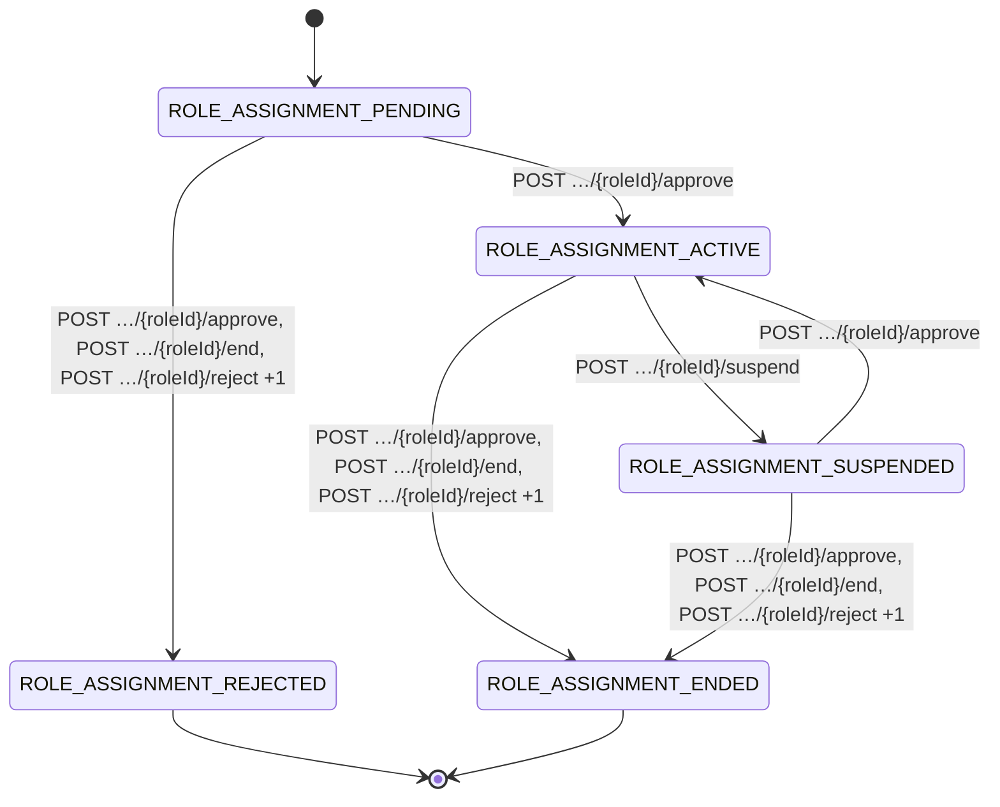

**Operaciones que ejercen esta máquina** _(POR_REFERENCIA: el handler alcanza un método que valida contra la tabla; «sin destino nombrado» significa que el estado de destino llega por el cuerpo de la petición)_:

| Operación | Estados de destino que nombra | A través de |
|---|---|---|
| POST /role-assignments/{roleId}/approve | ROLE_ASSIGNMENT_ACTIVE, ROLE_ASSIGNMENT_ENDED, ROLE_ASSIGNMENT_REJECTED | PracticeWorkforceService.approveAssignment → PracticeWorkforceService.transitionAssignment |
| POST /role-assignments/{roleId}/end | ROLE_ASSIGNMENT_ENDED, ROLE_ASSIGNMENT_REJECTED | PracticeWorkforceService.endAssignment → PracticeWorkforceService.transitionAssignment |
| POST /role-assignments/{roleId}/reject | ROLE_ASSIGNMENT_ENDED, ROLE_ASSIGNMENT_REJECTED | PracticeWorkforceService.rejectAssignment → PracticeWorkforceService.transitionAssignment |
| POST /role-assignments/{roleId}/suspend | ROLE_ASSIGNMENT_ENDED, ROLE_ASSIGNMENT_REJECTED, ROLE_ASSIGNMENT_SUSPENDED | PracticeWorkforceService.suspendAssignment → PracticeWorkforceService.transitionAssignment |

## Árbol de decisión por operación

Cada árbol se deriva del código del handler y de los métodos que invoca (hasta 4 niveles). Una rama que no decide, no escribe y no falla se poda. Los accesos y los efectos consecutivos se agrupan en un solo nodo.

### Operaciones con decisiones propias

#### 1. POST /accreditations/{id}/verify

Verificar o caducar una acreditación (transición de estado)

| HTTP | Código | Cuándo |
|---|---|---|
| 200 | — | Éxito |
| 400 | `VALIDATION_FAILED` | Los parámetros de ruta son UUID válidos; El cuerpo cumple el DTO (sin propiedades extra) |
| 401 | `UNAUTHENTICATED` | Hay una sesión válida (JWT) |
| 403 | `FORBIDDEN` | El rol está permitido; El tenant se resuelve y pertenece al actor |
| 422 | `PRECONDITION_FAILED` | PreconditionFailedException: La acreditación no está pendiente de verificación |
| 429 | `RATE_LIMITED` | No se supera el límite de solicitudes |


#### 2. POST /inventory-items/{itemId}/movements

Registrar un movimiento de inventario (ajuste de stock)

| HTTP | Código | Cuándo |
|---|---|---|
| 201 | — | Éxito |
| 400 | `VALIDATION_FAILED` | Los parámetros de ruta son UUID válidos; El cuerpo cumple el DTO (sin propiedades extra) |
| 401 | `UNAUTHENTICATED` | Hay una sesión válida (JWT) |
| 403 | `FORBIDDEN` | El rol está permitido; El tenant se resuelve y pertenece al actor |
| 422 | `PRECONDITION_FAILED` | PreconditionFailedException: El insumo no está activo; PreconditionFailedException: Stock insuficiente para la salida |
| 429 | `RATE_LIMITED` | No se supera el límite de solicitudes |

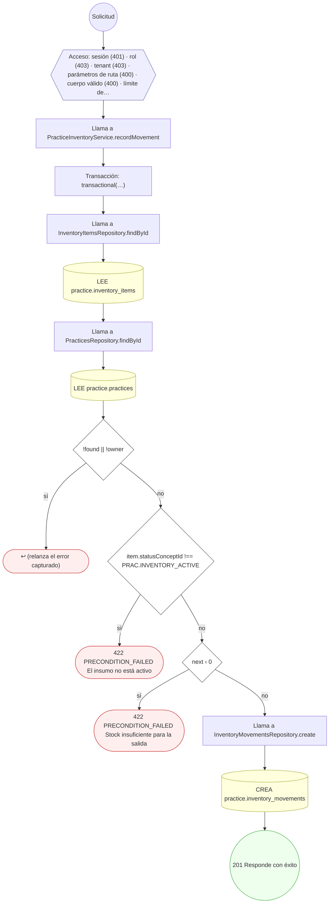

#### 3. GET /practices

Listar las prácticas activas del tenant

| HTTP | Código | Cuándo |
|---|---|---|
| 200 | — | Éxito |
| 401 | `UNAUTHENTICATED` | Hay una sesión válida (JWT) |
| 403 | `FORBIDDEN` | El rol está permitido; El tenant se resuelve y pertenece al actor |
| 429 | `RATE_LIMITED` | No se supera el límite de solicitudes |

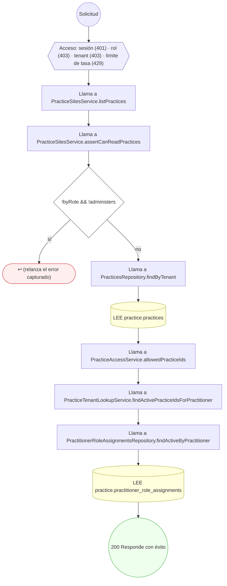

#### 4. POST /practices/{practiceId}/accreditations

Registrar una acreditación con evidencia

| HTTP | Código | Cuándo |
|---|---|---|
| 201 | — | Éxito |
| 400 | `VALIDATION_FAILED` | Los parámetros de ruta son UUID válidos; El cuerpo cumple el DTO (sin propiedades extra) |
| 401 | `UNAUTHENTICATED` | Hay una sesión válida (JWT) |
| 403 | `FORBIDDEN` | El rol está permitido; El tenant se resuelve y pertenece al actor |
| 422 | `PRECONDITION_FAILED` | PreconditionFailedException: El sitio no pertenece a la práctica |
| 429 | `RATE_LIMITED` | No se supera el límite de solicitudes |

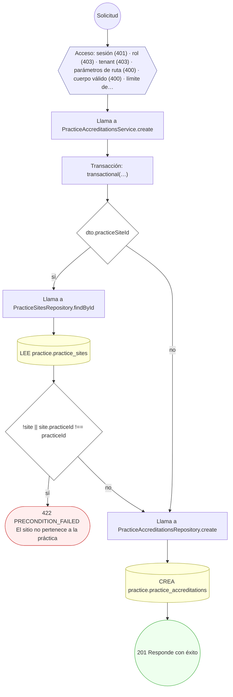

#### 5. GET /practices/{practiceId}/healthcare-services

Listar los procedimientos que ofrecen las sedes de la práctica

| HTTP | Código | Cuándo |
|---|---|---|
| 200 | — | Éxito |
| 400 | `VALIDATION_FAILED` | Los parámetros de ruta son UUID válidos |
| 401 | `UNAUTHENTICATED` | Hay una sesión válida (JWT) |
| 403 | `FORBIDDEN` | El rol está permitido; El tenant se resuelve y pertenece al actor; ForbiddenException: Se requiere ser OWNER o ADMIN de la organización, o administrador de la plataforma |
| 429 | `RATE_LIMITED` | No se supera el límite de solicitudes |

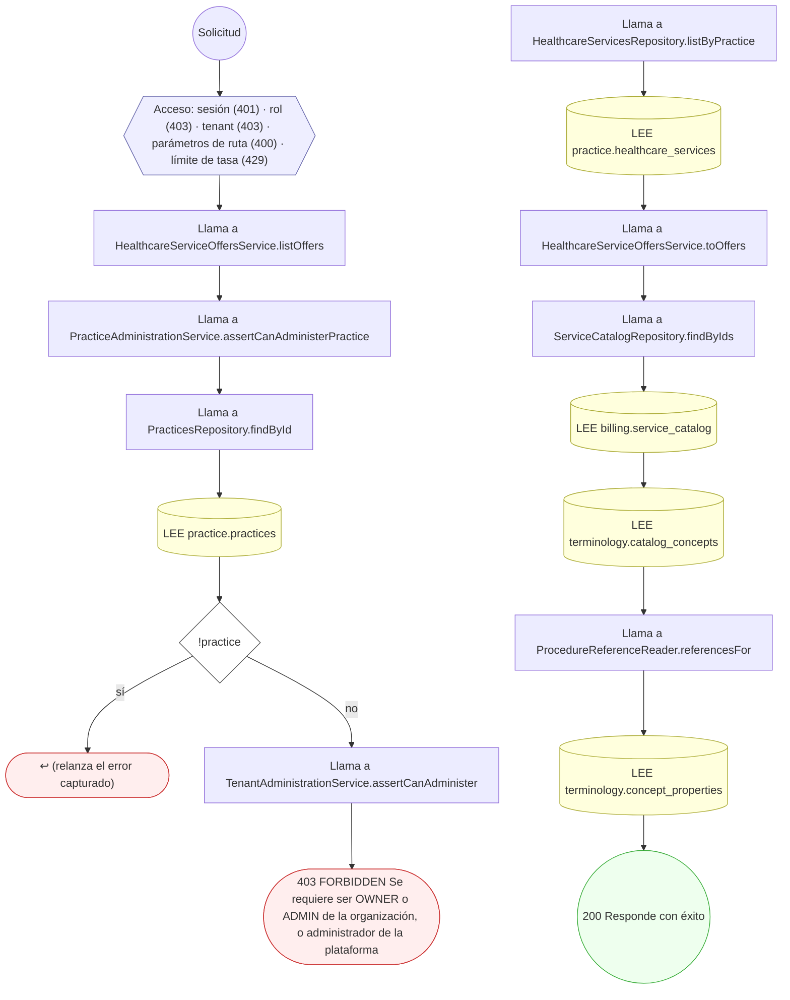

#### 6. POST /practices/{practiceId}/healthcare-services

Publicar un procedimiento del nomenclador en una sede

| HTTP | Código | Cuándo |
|---|---|---|
| 201 | — | Éxito |
| 400 | `VALIDATION_FAILED` | Los parámetros de ruta son UUID válidos; El cuerpo cumple el DTO (sin propiedades extra) |
| 401 | `UNAUTHENTICATED` | Hay una sesión válida (JWT) |
| 403 | `FORBIDDEN` | El rol está permitido; El tenant se resuelve y pertenece al actor; ForbiddenException: Se requiere ser OWNER o ADMIN de la organización, o administrador de la plataforma |
| 422 | `PRECONDITION_FAILED` | PreconditionFailedException: La práctica no está activa; PreconditionFailedException: El sitio no pertenece a la práctica; PreconditionFailedException: La unidad clínica no existe; PreconditionFailedException: El concepto no es un procedimiento del nomenclador |
| 429 | `RATE_LIMITED` | No se supera el límite de solicitudes |

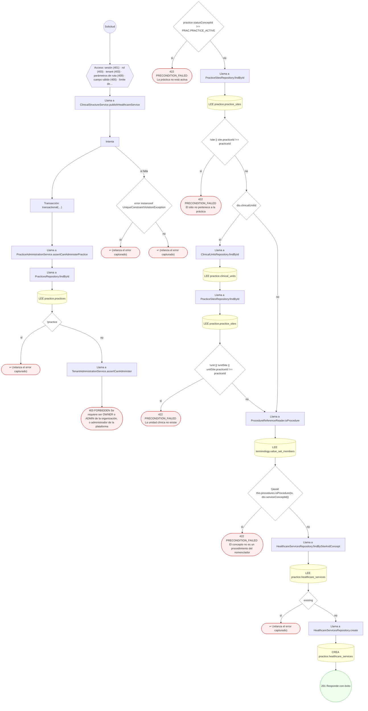

#### 7. PATCH /practices/{practiceId}/healthcare-services/{id}

Actualizar el precio o el estado de un procedimiento de la sede

| HTTP | Código | Cuándo |
|---|---|---|
| 200 | — | Éxito |
| 400 | `VALIDATION_FAILED` | Los parámetros de ruta son UUID válidos; El cuerpo cumple el DTO (sin propiedades extra) |
| 401 | `UNAUTHENTICATED` | Hay una sesión válida (JWT) |
| 403 | `FORBIDDEN` | El rol está permitido; El tenant se resuelve y pertenece al actor; ForbiddenException: Se requiere ser OWNER o ADMIN de la organización, o administrador de la plataforma |
| 429 | `RATE_LIMITED` | No se supera el límite de solicitudes |

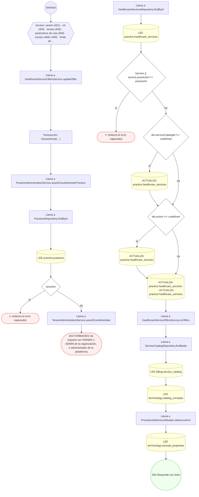

#### 8. GET /practices/{practiceId}/organization

Consola de organización médica: estructura, plantilla y legajo

| HTTP | Código | Cuándo |
|---|---|---|
| 200 | — | Éxito |
| 400 | `VALIDATION_FAILED` | Los parámetros de ruta son UUID válidos |
| 401 | `UNAUTHENTICATED` | Hay una sesión válida (JWT) |
| 403 | `FORBIDDEN` | El rol está permitido; El tenant se resuelve y pertenece al actor |
| 404 | `NOT_FOUND` | ResourceNotFoundException: Práctica no encontrada |
| 429 | `RATE_LIMITED` | No se supera el límite de solicitudes |


#### 9. GET /practices/{practiceId}/role-assignments

Listar las vinculaciones profesional-organización de la práctica

| HTTP | Código | Cuándo |
|---|---|---|
| 200 | — | Éxito |
| 400 | `VALIDATION_FAILED` | Los parámetros de ruta son UUID válidos |
| 401 | `UNAUTHENTICATED` | Hay una sesión válida (JWT) |
| 403 | `FORBIDDEN` | El rol está permitido; El tenant se resuelve y pertenece al actor; ForbiddenException: Se requiere ser OWNER o ADMIN de la organización, o administrador de la plataforma |
| 429 | `RATE_LIMITED` | No se supera el límite de solicitudes |

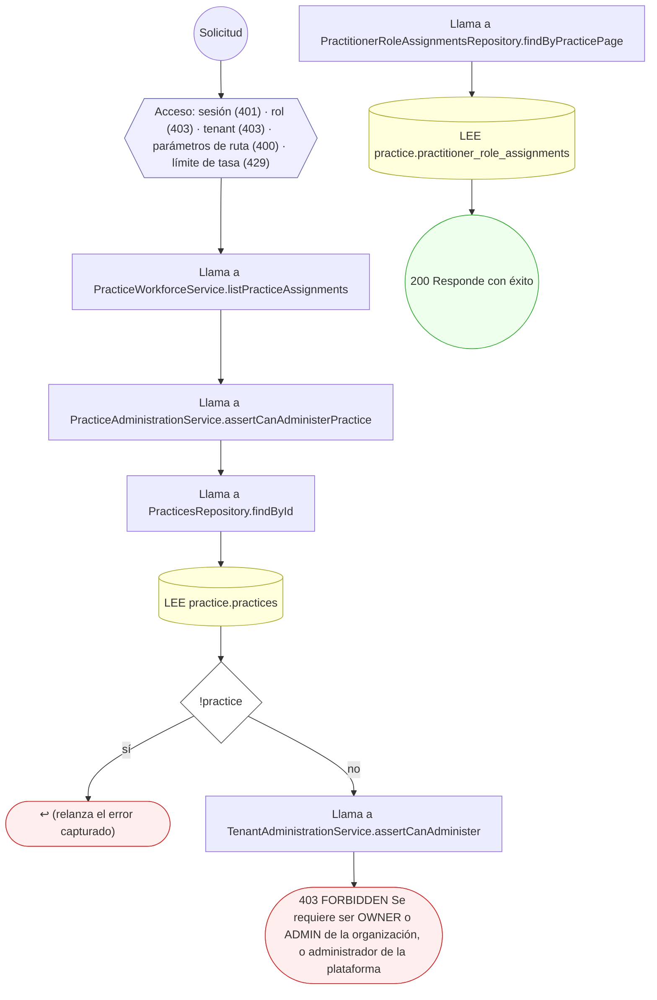

#### 10. POST /practices/{practiceId}/role-assignments

Asignar un rol de profesional a sitio/unidad/servicio

| HTTP | Código | Cuándo |
|---|---|---|
| 201 | — | Éxito |
| 400 | `VALIDATION_FAILED` | Los parámetros de ruta son UUID válidos; El cuerpo cumple el DTO (sin propiedades extra) |
| 401 | `UNAUTHENTICATED` | Hay una sesión válida (JWT) |
| 403 | `FORBIDDEN` | El rol está permitido; El tenant se resuelve y pertenece al actor |
| 422 | `PRECONDITION_FAILED` | PreconditionFailedException: La práctica no está activa; PreconditionFailedException: El sitio no pertenece a la práctica; PreconditionFailedException: La unidad no pertenece a la práctica; PreconditionFailedException: El servicio no pertenece a la práctica |
| 429 | `RATE_LIMITED` | No se supera el límite de solicitudes |

```mermaid
flowchart TD
  n1(("Solicitud")):::inicio
  n2{{"Acceso: sesión (401) · rol (403) · tenant (403) · parámetros de ruta (400) · cuerpo válido (400) · límite de…"}}:::acceso
  n1 --> n2
  n3["Llama a PracticeWorkforceService.assignRole"]:::llamada
  n2 --> n3
  n4["Transacción: transactional(…)"]:::transaccion
  n3 --> n4
  n5{"practice.statusConceptId !== PRAC.PRACTICE_ACTIVE"}:::decision
  n4 --> n5
  n6(["422 PRECONDITION_FAILED La práctica no está activa"]):::error
  n5 -->|"sí"| n6
  n7{"dto.practiceSiteId"}:::decision
  n5 -->|"no"| n7
  n8["Llama a PracticeSitesRepository.findById"]:::llamada
  n7 -->|"sí"| n8
  n9[("LEE practice.practice_sites")]:::efecto
  n8 --> n9
  n10{"!site || site.practiceId !== practiceId"}:::decision
  n9 --> n10
  n11(["422 PRECONDITION_FAILED El sitio no pertenece a la práctica"]):::error
  n10 -->|"sí"| n11
  n12{"dto.clinicalUnitId"}:::decision
  n10 -->|"no"| n12
  n7 -->|"no"| n12
  n13["Llama a ClinicalUnitsRepository.findById"]:::llamada
  n12 -->|"sí"| n13
  n14[("LEE practice.clinical_units")]:::efecto
  n13 --> n14
  n15["Llama a PracticeSitesRepository.findById"]:::llamada
  n14 --> n15
  n16[("LEE practice.practice_sites")]:::efecto
  n15 --> n16
  n17{"!unit || !unitSite || unitSite.practiceId !== practiceId"}:::decision
  n16 --> n17
  n18(["422 PRECONDITION_FAILED La unidad no pertenece a la práctica"]):::error
  n17 -->|"sí"| n18
  n19{"dto.healthcareServiceId"}:::decision
  n17 -->|"no"| n19
  n12 -->|"no"| n19
  n20["Llama a HealthcareServicesRepository.findById"]:::llamada
  n19 -->|"sí"| n20
  n21[("LEE practice.healthcare_services")]:::efecto
  n20 --> n21
  n22{"!service || service.practiceId !== practiceId"}:::decision
  n21 --> n22
  n23(["422 PRECONDITION_FAILED El servicio no pertenece a la práctica"]):::error
  n22 -->|"sí"| n23
  n24["Llama a PractitionerRoleAssignmentsRepository.create"]:::llamada
  n22 -->|"no"| n24
  n19 -->|"no"| n24
  n25[("CREA practice.practitioner_role_assignments")]:::efecto
  n24 --> n25
  n26(("201 Responde con éxito")):::ok
  n25 --> n26
  classDef acceso fill:#eef,stroke:#66a
  classDef error fill:#fee,stroke:#c33
  classDef ok fill:#efe,stroke:#3a3
  classDef efecto fill:#ffd,stroke:#aa3
  classDef decision fill:#fff,stroke:#555
  classDef corte fill:#eee,stroke:#999,stroke-dasharray: 4
```

#### 11. POST /practices/{practiceId}/role-assignments/invitations

Invitar a un profesional a procedimientos de una sede

| HTTP | Código | Cuándo |
|---|---|---|
| 201 | — | Éxito |
| 400 | `VALIDATION_FAILED` | Los parámetros de ruta son UUID válidos; El cuerpo cumple el DTO (sin propiedades extra) |
| 401 | `UNAUTHENTICATED` | Hay una sesión válida (JWT) |
| 403 | `FORBIDDEN` | El rol está permitido; El tenant se resuelve y pertenece al actor; ForbiddenException: Se requiere ser OWNER o ADMIN de la organización, o administrador de la plataforma |
| 409 | `CONFLICT` | ConflictException: El profesional ya tiene una vinculación en curso con ese procedimiento |
| 422 | `PRECONDITION_FAILED` | PreconditionFailedException: La práctica no está activa; PreconditionFailedException: El sitio no pertenece a la práctica; PreconditionFailedException: El profesional no existe; PreconditionFailedException: El procedimiento no está publicado y activo en esa sede |
| 429 | `RATE_LIMITED` | No se supera el límite de solicitudes |

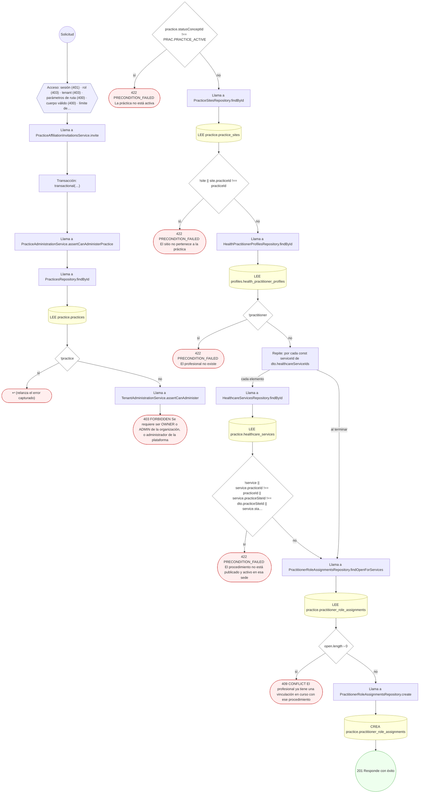

#### 12. POST /practices/{practiceId}/role-assignments/self-request

Solicitar la propia vinculación a una organización

| HTTP | Código | Cuándo |
|---|---|---|
| 201 | — | Éxito |
| 400 | `VALIDATION_FAILED` | Los parámetros de ruta son UUID válidos; El cuerpo cumple el DTO (sin propiedades extra) |
| 401 | `UNAUTHENTICATED` | Hay una sesión válida (JWT) |
| 403 | `FORBIDDEN` | El rol está permitido; El tenant se resuelve y pertenece al actor |
| 404 | `NOT_FOUND` | ResourceNotFoundException: Práctica no encontrada |
| 409 | `CONFLICT` | ConflictException: Ya tenés una vinculación en curso con ese procedimiento |
| 422 | `PRECONDITION_FAILED` | PreconditionFailedException: La cuenta no tiene un perfil profesional asociado; PreconditionFailedException: La práctica no está activa; PreconditionFailedException: El sitio no pertenece a la práctica; PreconditionFailedException: El procedimiento no está publicado y activo en esa sede |
| 429 | `RATE_LIMITED` | No se supera el límite de solicitudes |

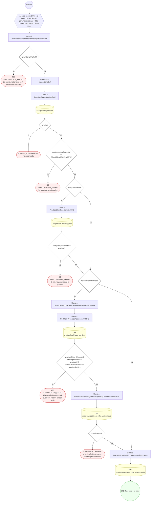

#### 13. PUT /practices/{practiceId}/settings/{settingKey}

Configurar un ajuste de práctica (upsert)

| HTTP | Código | Cuándo |
|---|---|---|
| 200 | — | Éxito |
| 400 | `VALIDATION_FAILED` | Los parámetros de ruta son UUID válidos; El cuerpo cumple el DTO (sin propiedades extra) |
| 401 | `UNAUTHENTICATED` | Hay una sesión válida (JWT) |
| 403 | `FORBIDDEN` | El rol está permitido; El tenant se resuelve y pertenece al actor |
| 429 | `RATE_LIMITED` | No se supera el límite de solicitudes |

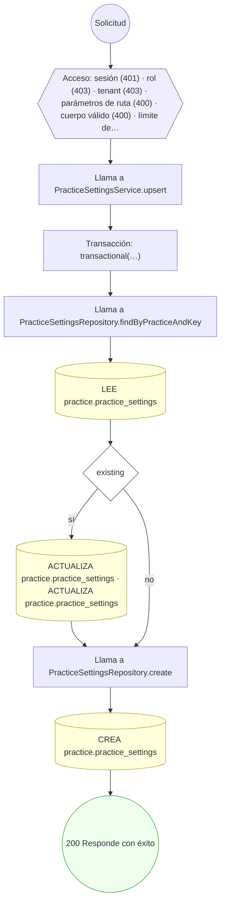

#### 14. GET /practices/{practiceId}/sites

Listar las sedes de una práctica

| HTTP | Código | Cuándo |
|---|---|---|
| 200 | — | Éxito |
| 400 | `VALIDATION_FAILED` | Los parámetros de ruta son UUID válidos |
| 401 | `UNAUTHENTICATED` | Hay una sesión válida (JWT) |
| 403 | `FORBIDDEN` | El rol está permitido; El tenant se resuelve y pertenece al actor |
| 404 | `NOT_FOUND` | ResourceNotFoundException: Práctica no encontrada |
| 429 | `RATE_LIMITED` | No se supera el límite de solicitudes |

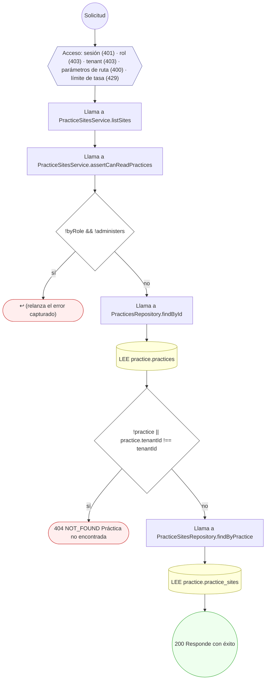

#### 15. POST /practices/{practiceId}/sites

Dar de alta un sitio de práctica

| HTTP | Código | Cuándo |
|---|---|---|
| 201 | — | Éxito |
| 400 | `VALIDATION_FAILED` | Los parámetros de ruta son UUID válidos; El cuerpo cumple el DTO (sin propiedades extra) |
| 401 | `UNAUTHENTICATED` | Hay una sesión válida (JWT) |
| 403 | `FORBIDDEN` | El rol está permitido; El tenant se resuelve y pertenece al actor |
| 409 | `CONFLICT` | ConflictException: Ya existe un sitio con ese código en la práctica |
| 422 | `PRECONDITION_FAILED` | PreconditionFailedException: La práctica no está activa |
| 429 | `RATE_LIMITED` | No se supera el límite de solicitudes |

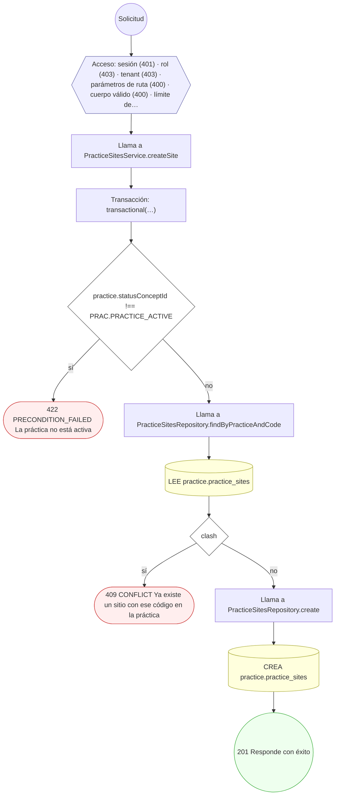

#### 16. DELETE /practices/{practiceId}/sites/{siteId}

Desmantelar un sitio en cascada (soft-delete)

| HTTP | Código | Cuándo |
|---|---|---|
| 200 | — | Éxito |
| 400 | `VALIDATION_FAILED` | Los parámetros de ruta son UUID válidos |
| 401 | `UNAUTHENTICATED` | Hay una sesión válida (JWT) |
| 403 | `FORBIDDEN` | El rol está permitido; El tenant se resuelve y pertenece al actor |
| 404 | `NOT_FOUND` | ResourceNotFoundException: Sitio no encontrado en la práctica |
| 409 | `CONFLICT` | ConflictException: El sitio ya está retirado |
| 429 | `RATE_LIMITED` | No se supera el límite de solicitudes |


#### 17. GET /practitioners/{profileId}/sites

Consultorios donde atiende el profesional

| HTTP | Código | Cuándo |
|---|---|---|
| 200 | — | Éxito |
| 400 | `VALIDATION_FAILED` | Los parámetros de ruta son UUID válidos |
| 401 | `UNAUTHENTICATED` | Hay una sesión válida (JWT) |
| 403 | `FORBIDDEN` | El rol está permitido; El tenant se resuelve y pertenece al actor |
| 429 | `RATE_LIMITED` | No se supera el límite de solicitudes |

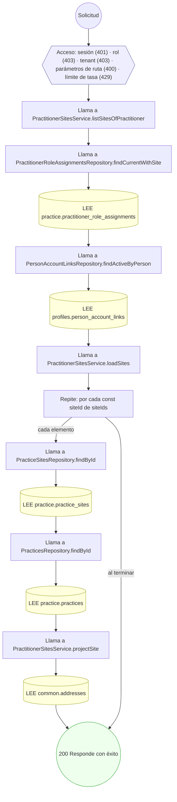

#### 18. GET /practitioners/me/role-assignments

Mis vinculaciones con organizaciones

| HTTP | Código | Cuándo |
|---|---|---|
| 200 | — | Éxito |
| 401 | `UNAUTHENTICATED` | Hay una sesión válida (JWT) |
| 403 | `FORBIDDEN` | El rol está permitido; El tenant se resuelve y pertenece al actor |
| 422 | `PRECONDITION_FAILED` | PreconditionFailedException: La cuenta no tiene un perfil profesional asociado |
| 429 | `RATE_LIMITED` | No se supera el límite de solicitudes |

```mermaid
flowchart TD
  n1(("Solicitud")):::inicio
  n2{{"Acceso: sesión (401) · rol (403) · tenant (403) · límite de tasa (429)"}}:::acceso
  n1 --> n2
  n3["Llama a PracticeWorkforceService.listMyAssignments"]:::llamada
  n2 --> n3
  n4{"!actor.practitionerProfileId"}:::decision
  n3 --> n4
  n5(["422 PRECONDITION_FAILED La cuenta no tiene un perfil profesional asociado"]):::error
  n4 -->|"sí"| n5
  n6["Llama a PractitionerRoleAssignmentsRepository.findByPractitioner"]:::llamada
  n4 -->|"no"| n6
  n7[("LEE practice.practitioner_role_assignments")]:::efecto
  n6 --> n7
  n8["Llama a PracticesRepository.findById"]:::llamada
  n7 --> n8
  n9[("LEE practice.practices")]:::efecto
  n8 --> n9
  n10[("LEE community.public_profiles")]:::efecto
  n9 --> n10
  n11(("200 Responde con éxito")):::ok
  n10 --> n11
  classDef acceso fill:#eef,stroke:#66a
  classDef error fill:#fee,stroke:#c33
  classDef ok fill:#efe,stroke:#3a3
  classDef efecto fill:#ffd,stroke:#aa3
  classDef decision fill:#fff,stroke:#555
  classDef corte fill:#eee,stroke:#999,stroke-dasharray: 4
```

#### 19. POST /practitioners/me/role-assignments/{roleId}/accept

Aceptar una invitación de un centro

| HTTP | Código | Cuándo |
|---|---|---|
| 200 | — | Éxito |
| 400 | `VALIDATION_FAILED` | Los parámetros de ruta son UUID válidos |
| 401 | `UNAUTHENTICATED` | Hay una sesión válida (JWT) |
| 403 | `FORBIDDEN` | El rol está permitido; El tenant se resuelve y pertenece al actor |
| 404 | `NOT_FOUND` | ResourceNotFoundException: Vinculación no encontrada |
| 422 | `PRECONDITION_FAILED` | PreconditionFailedException: La cuenta no tiene un perfil profesional asociado; PreconditionFailedException: La vinculación no admite esa acción desde su estado actual |
| 429 | `RATE_LIMITED` | No se supera el límite de solicitudes |

```mermaid
flowchart TD
  n1(("Solicitud")):::inicio
  n2{{"Acceso: sesión (401) · rol (403) · tenant (403) · parámetros de ruta (400) · límite de tasa (429)"}}:::acceso
  n1 --> n2
  n3["Llama a PracticeAffiliationInvitationsService.accept"]:::llamada
  n2 --> n3
  n4["Llama a PracticeAffiliationInvitationsService.resolve"]:::llamada
  n3 --> n4
  n5{"!practitionerProfileId"}:::decision
  n4 --> n5
  n6(["422 PRECONDITION_FAILED La cuenta no tiene un perfil profesional asociado"]):::error
  n5 -->|"sí"| n6
  n7["Transacción: transactional(…)"]:::transaccion
  n5 -->|"no"| n7
  n8["Llama a PractitionerRoleAssignmentsRepository.findByIdForPractitioner"]:::llamada
  n7 --> n8
  n9[("LEE practice.practitioner_role_assignments")]:::efecto
  n8 --> n9
  n10{"!role"}:::decision
  n9 --> n10
  n11(["404 NOT_FOUND Vinculación no encontrada"]):::error
  n10 -->|"sí"| n11
  n12{"!allowed.includes(toStatus)"}:::decision
  n10 -->|"no"| n12
  n13(["422 PRECONDITION_FAILED La vinculación no admite esa acción desde su estado actual"]):::error
  n12 -->|"sí"| n13
  n14[("ACTUALIZA practice.practitioner_role_assignments · ACTUALIZA practice.practitioner_role_assignments · ACTUALI…")]:::efecto
  n12 -->|"no"| n14
  n15{"toStatus === PRAC.ROLE_ASSIGNMENT_REJECTED"}:::decision
  n14 --> n15
  n16[("ACTUALIZA practice.practitioner_role_assignments")]:::efecto
  n15 -->|"sí"| n16
  n17(("200 Responde con éxito")):::ok
  n16 --> n17
  n15 -->|"no"| n17
  classDef acceso fill:#eef,stroke:#66a
  classDef error fill:#fee,stroke:#c33
  classDef ok fill:#efe,stroke:#3a3
  classDef efecto fill:#ffd,stroke:#aa3
  classDef decision fill:#fff,stroke:#555
  classDef corte fill:#eee,stroke:#999,stroke-dasharray: 4
```

#### 20. POST /practitioners/me/role-assignments/{roleId}/decline

Declinar una invitación de un centro

| HTTP | Código | Cuándo |
|---|---|---|
| 200 | — | Éxito |
| 400 | `VALIDATION_FAILED` | Los parámetros de ruta son UUID válidos |
| 401 | `UNAUTHENTICATED` | Hay una sesión válida (JWT) |
| 403 | `FORBIDDEN` | El rol está permitido; El tenant se resuelve y pertenece al actor |
| 404 | `NOT_FOUND` | ResourceNotFoundException: Vinculación no encontrada |
| 422 | `PRECONDITION_FAILED` | PreconditionFailedException: La cuenta no tiene un perfil profesional asociado; PreconditionFailedException: La vinculación no admite esa acción desde su estado actual |
| 429 | `RATE_LIMITED` | No se supera el límite de solicitudes |

```mermaid
flowchart TD
  n1(("Solicitud")):::inicio
  n2{{"Acceso: sesión (401) · rol (403) · tenant (403) · parámetros de ruta (400) · límite de tasa (429)"}}:::acceso
  n1 --> n2
  n3["Llama a PracticeAffiliationInvitationsService.decline"]:::llamada
  n2 --> n3
  n4["Llama a PracticeAffiliationInvitationsService.resolve"]:::llamada
  n3 --> n4
  n5{"!practitionerProfileId"}:::decision
  n4 --> n5
  n6(["422 PRECONDITION_FAILED La cuenta no tiene un perfil profesional asociado"]):::error
  n5 -->|"sí"| n6
  n7["Transacción: transactional(…)"]:::transaccion
  n5 -->|"no"| n7
  n8["Llama a PractitionerRoleAssignmentsRepository.findByIdForPractitioner"]:::llamada
  n7 --> n8
  n9[("LEE practice.practitioner_role_assignments")]:::efecto
  n8 --> n9
  n10{"!role"}:::decision
  n9 --> n10
  n11(["404 NOT_FOUND Vinculación no encontrada"]):::error
  n10 -->|"sí"| n11
  n12{"!allowed.includes(toStatus)"}:::decision
  n10 -->|"no"| n12
  n13(["422 PRECONDITION_FAILED La vinculación no admite esa acción desde su estado actual"]):::error
  n12 -->|"sí"| n13
  n14[("ACTUALIZA practice.practitioner_role_assignments · ACTUALIZA practice.practitioner_role_assignments · ACTUALI…")]:::efecto
  n12 -->|"no"| n14
  n15{"toStatus === PRAC.ROLE_ASSIGNMENT_REJECTED"}:::decision
  n14 --> n15
  n16[("ACTUALIZA practice.practitioner_role_assignments")]:::efecto
  n15 -->|"sí"| n16
  n17(("200 Responde con éxito")):::ok
  n16 --> n17
  n15 -->|"no"| n17
  classDef acceso fill:#eef,stroke:#66a
  classDef error fill:#fee,stroke:#c33
  classDef ok fill:#efe,stroke:#3a3
  classDef efecto fill:#ffd,stroke:#aa3
  classDef decision fill:#fff,stroke:#555
  classDef corte fill:#eee,stroke:#999,stroke-dasharray: 4
```

#### 21. POST /practitioners/me/sites

Registrar un consultorio propio

| HTTP | Código | Cuándo |
|---|---|---|
| 201 | — | Éxito |
| 400 | `VALIDATION_FAILED` | El cuerpo cumple el DTO (sin propiedades extra) |
| 401 | `UNAUTHENTICATED` | Hay una sesión válida (JWT) |
| 403 | `FORBIDDEN` | El rol está permitido; El tenant se resuelve y pertenece al actor; ForbiddenException: Esta cuenta no tiene un perfil profesional asociado; ForbiddenException: {labels.subject} no le pertenece |
| 404 | `NOT_FOUND` | ResourceNotFoundException: {labels.notFound} |
| 422 | `PRECONDITION_FAILED` | PreconditionFailedException: {labels.subject} está borrado; PreconditionFailedException: {labels.subject} no tiene una versión vigente; PreconditionFailedException: {labels.subject} resultó infectado; PreconditionFailedException: {labels.subject} no es de un formato admitido para este uso; PreconditionFailedException: El logo no es un archivo suyo que se pueda usar; PreconditionFailedException: El logo debe ser una imagen |
| 429 | `RATE_LIMITED` | No se supera el límite de solicitudes |

```mermaid
flowchart TD
  n1(("Solicitud")):::inicio
  n2{{"Acceso: sesión (401) · rol (403) · tenant (403) · cuerpo válido (400) · límite de tasa (429)"}}:::acceso
  n1 --> n2
  n3["Llama a PractitionerSitesService.createOwnSite"]:::llamada
  n2 --> n3
  n4["Transacción: transactional(…)"]:::transaccion
  n3 --> n4
  n5["Llama a ProfileOwnershipService.requireOwnPractitionerProfileId"]:::llamada
  n4 --> n5
  n6["Llama a ProfileOwnershipService.personOf"]:::llamada
  n5 --> n6
  n7["Llama a PersonAccountLinksRepository.findActiveByUser"]:::llamada
  n6 --> n7
  n8[("LEE profiles.person_account_links")]:::efecto
  n7 --> n8
  n9{"personId"}:::decision
  n8 --> n9
  n10["Llama a HealthPractitionerProfilesRepository.findById"]:::llamada
  n9 -->|"sí"| n10
  n11[("LEE profiles.health_practitioner_profiles")]:::efecto
  n10 --> n11
  n12(["403 FORBIDDEN Esta cuenta no tiene un perfil profesional asociado"]):::error
  n11 --> n12
  n9 -->|"no"| n12
  n13{"dto.logoFileId"}:::decision
  n14["Llama a PractitionerSitesService.assertUsableLogo"]:::llamada
  n13 -->|"sí"| n14
  n15["Intenta"]:::intento
  n14 --> n15
  n16["Llama a AttachableFileService.assertUsableBy"]:::llamada
  n15 --> n16
  n17["Llama a FilesRepository.findById"]:::llamada
  n16 --> n17
  n18[("LEE common.files")]:::efecto
  n17 --> n18
  n19{"!file"}:::decision
  n18 --> n19
  n20(["404 NOT_FOUND {labels.notFound}"]):::error
  n19 -->|"sí"| n20
  n21{"file.createdByUserId !== actor.id && !enAllowlist"}:::decision
  n19 -->|"no"| n21
  n22(["403 FORBIDDEN {labels.subject} no le pertenece"]):::error
  n21 -->|"sí"| n22
  n23{"file.deletedAt || file.lifecycleStatusConceptId === CONCEPTS.FILE_DELETED"}:::decision
  n21 -->|"no"| n23
  n24(["422 PRECONDITION_FAILED {labels.subject} está borrado"]):::error
  n23 -->|"sí"| n24
  n25{"!file.currentVersionId"}:::decision
  n23 -->|"no"| n25
  n26(["422 PRECONDITION_FAILED {labels.subject} no tiene una versión vigente"]):::error
  n25 -->|"sí"| n26
  n27["Llama a AttachableFileService.assertVersionUsable"]:::llamada
  n25 -->|"no"| n27
  n28{"file.deletedAt || file.lifecycleStatusConceptId === CONCEPTS.FILE_DELETED"}:::decision
  n27 --> n28
  n29(["422 PRECONDITION_FAILED {labels.subject} está borrado"]):::error
  n28 -->|"sí"| n29
  n30{"!file.currentVersionId"}:::decision
  n28 -->|"no"| n30
  n31(["422 PRECONDITION_FAILED {labels.subject} no tiene una versión vigente"]):::error
  n30 -->|"sí"| n31
  n32{"!version"}:::decision
  n30 -->|"no"| n32
  n33(["422 PRECONDITION_FAILED {labels.subject} no tiene una versión vigente"]):::error
  n32 -->|"sí"| n33
  n34{"version.malwareScanStatusConceptId === CONCEPTS.SCAN_INFECTED"}:::decision
  n32 -->|"no"| n34
  n35(["422 PRECONDITION_FAILED {labels.subject} resultó infectado"]):::error
  n34 -->|"sí"| n35
  n36{"accepted && !accepted.includes(version.mimeType ?? '')"}:::decision
  n34 -->|"no"| n36
  n37(["422 PRECONDITION_FAILED {labels.subject} no es de un formato admitido para este uso"]):::error
  n36 -->|"sí"| n37
  n38{"err instanceof ForbiddenException || err instanceof ResourceNotFoundException"}:::decision
  n15 -->|"si falla"| n38
  n39(["422 PRECONDITION_FAILED El logo no es un archivo suyo que se pueda usar"]):::error
  n38 -->|"sí"| n39
  n40(["↩ (relanza el error capturado)"]):::error
  n38 -->|"no"| n40
  n41{"usable.file.categoryConceptId !== CONCEPTS.FILE_CATEGORY_IMAGE"}:::decision
  n36 -->|"no"| n41
  n42(["422 PRECONDITION_FAILED El logo debe ser una imagen"]):::error
  n41 -->|"sí"| n42
  n43["Llama a OwnSiteProvisioningService.provision"]:::llamada
  n41 -->|"no"| n43
  n13 -->|"no"| n43
  n44["Llama a PracticesRepository.findOwnOffice"]:::llamada
  n43 --> n44
  n45[("LEE practice.practices")]:::efecto
  n44 --> n45
  n46{"!practice"}:::decision
  n45 --> n46
  n47["Llama a PracticesRepository.create"]:::llamada
  n46 -->|"sí"| n47
  n48[("CREA practice.practices")]:::efecto
  n47 --> n48
  n49{"dto.address"}:::decision
  n48 --> n49
  n46 -->|"no"| n49
  n50["Llama a AddressesRepository.create"]:::llamada
  n49 -->|"sí"| n50
  n51[("CREA common.addresses")]:::efecto
  n50 --> n51
  n52["Llama a OwnSiteProvisioningService.uniqueSiteCode"]:::llamada
  n51 --> n52
  n49 -->|"no"| n52
  n53["Llama a PracticeSitesRepository.findByPracticeAndCode"]:::llamada
  n52 --> n53
  n54[("LEE practice.practice_sites")]:::efecto
  n53 --> n54
  n55["Llama a PracticeSitesRepository.create"]:::llamada
  n54 --> n55
  n56[("CREA practice.practice_sites")]:::efecto
  n55 --> n56
  n57["Llama a PractitionerRoleAssignmentsRepository.create"]:::llamada
  n56 --> n57
  n58[("CREA practice.practitioner_role_assignments")]:::efecto
  n57 --> n58
  n59(("201 Responde con éxito")):::ok
  n58 --> n59
  classDef acceso fill:#eef,stroke:#66a
  classDef error fill:#fee,stroke:#c33
  classDef ok fill:#efe,stroke:#3a3
  classDef efecto fill:#ffd,stroke:#aa3
  classDef decision fill:#fff,stroke:#555
  classDef corte fill:#eee,stroke:#999,stroke-dasharray: 4
```

#### 22. DELETE /practitioners/me/sites/{siteId}

Retirar un consultorio propio

| HTTP | Código | Cuándo |
|---|---|---|
| 204 | — | Éxito |
| 400 | `VALIDATION_FAILED` | Los parámetros de ruta son UUID válidos |
| 401 | `UNAUTHENTICATED` | Hay una sesión válida (JWT) |
| 403 | `FORBIDDEN` | El rol está permitido; El tenant se resuelve y pertenece al actor; ForbiddenException: Esta cuenta no tiene un perfil profesional asociado |
| 404 | `NOT_FOUND` | ResourceNotFoundException: No tiene una vinculación vigente con esa sede |
| 429 | `RATE_LIMITED` | No se supera el límite de solicitudes |

```mermaid
flowchart TD
  n1(("Solicitud")):::inicio
  n2{{"Acceso: sesión (401) · rol (403) · tenant (403) · parámetros de ruta (400) · límite de tasa (429)"}}:::acceso
  n1 --> n2
  n3["Llama a PractitionerSitesService.deleteOwnSite"]:::llamada
  n2 --> n3
  n4["Transacción: transactional(…)"]:::transaccion
  n3 --> n4
  n5["Llama a ProfileOwnershipService.requireOwnPractitionerProfileId"]:::llamada
  n4 --> n5
  n6["Llama a ProfileOwnershipService.personOf"]:::llamada
  n5 --> n6
  n7["Llama a PersonAccountLinksRepository.findActiveByUser"]:::llamada
  n6 --> n7
  n8[("LEE profiles.person_account_links")]:::efecto
  n7 --> n8
  n9{"personId"}:::decision
  n8 --> n9
  n10["Llama a HealthPractitionerProfilesRepository.findById"]:::llamada
  n9 -->|"sí"| n10
  n11[("LEE profiles.health_practitioner_profiles")]:::efecto
  n10 --> n11
  n12(["403 FORBIDDEN Esta cuenta no tiene un perfil profesional asociado"]):::error
  n11 --> n12
  n9 -->|"no"| n12
  n13["Llama a PractitionerRoleAssignmentsRepository.findCurrentBySite"]:::llamada
  n14[("LEE practice.practitioner_role_assignments")]:::efecto
  n13 --> n14
  n15{"!assignment"}:::decision
  n14 --> n15
  n16(["404 NOT_FOUND No tiene una vinculación vigente con esa sede"]):::error
  n15 -->|"sí"| n16
  n17[("ACTUALIZA practice.practitioner_role_assignments · ACTUALIZA practice.practitioner_role_assignments · ACTUALI…")]:::efecto
  n15 -->|"no"| n17
  n18(("204 Responde con éxito")):::ok
  n17 --> n18
  classDef acceso fill:#eef,stroke:#66a
  classDef error fill:#fee,stroke:#c33
  classDef ok fill:#efe,stroke:#3a3
  classDef efecto fill:#ffd,stroke:#aa3
  classDef decision fill:#fff,stroke:#555
  classDef corte fill:#eee,stroke:#999,stroke-dasharray: 4
```

#### 23. PATCH /practitioners/me/sites/{siteId}

Corregir un consultorio propio

| HTTP | Código | Cuándo |
|---|---|---|
| 200 | — | Éxito |
| 400 | `VALIDATION_FAILED` | Los parámetros de ruta son UUID válidos; El cuerpo cumple el DTO (sin propiedades extra) |
| 401 | `UNAUTHENTICATED` | Hay una sesión válida (JWT) |
| 403 | `FORBIDDEN` | El rol está permitido; El tenant se resuelve y pertenece al actor; ForbiddenException: Esta cuenta no tiene un perfil profesional asociado |
| 404 | `NOT_FOUND` | ResourceNotFoundException: Esa sede no es un consultorio propio suyo |
| 429 | `RATE_LIMITED` | No se supera el límite de solicitudes |

```mermaid
flowchart TD
  n1(("Solicitud")):::inicio
  n2{{"Acceso: sesión (401) · rol (403) · tenant (403) · parámetros de ruta (400) · cuerpo válido (400) · límite de…"}}:::acceso
  n1 --> n2
  n3["Llama a PractitionerSitesService.updateOwnSite"]:::llamada
  n2 --> n3
  n4["Transacción: transactional(…)"]:::transaccion
  n3 --> n4
  n5["Llama a PractitionerSitesService.requireOwnSite"]:::llamada
  n4 --> n5
  n6["Llama a PracticeSitesRepository.findById"]:::llamada
  n5 --> n6
  n7[("LEE practice.practice_sites")]:::efecto
  n6 --> n7
  n8["Llama a PractitionerSitesService.isOwnPractice"]:::llamada
  n7 --> n8
  n9["Llama a PracticesRepository.findOwnOffice"]:::llamada
  n8 --> n9
  n10[("LEE practice.practices")]:::efecto
  n9 --> n10
  n11{"!site || !isOwn"}:::decision
  n10 --> n11
  n12(["404 NOT_FOUND Esa sede no es un consultorio propio suyo"]):::error
  n11 -->|"sí"| n12
  n13[("ACTUALIZA practice.practice_sites")]:::efecto
  n11 -->|"no"| n13
  n14{"dto.name !== undefined"}:::decision
  n13 --> n14
  n15[("ACTUALIZA practice.practice_sites")]:::efecto
  n14 -->|"sí"| n15
  n16[("ACTUALIZA practice.practice_sites")]:::efecto
  n15 --> n16
  n14 -->|"no"| n16
  n17{"dto.timeZone !== undefined"}:::decision
  n16 --> n17
  n18[("ACTUALIZA practice.practice_sites")]:::efecto
  n17 -->|"sí"| n18
  n19{"dto.address"}:::decision
  n18 --> n19
  n17 -->|"no"| n19
  n20["Llama a PractitionerSitesService.moveAddress"]:::llamada
  n19 -->|"sí"| n20
  n21{"site.addressId"}:::decision
  n20 --> n21
  n22[("LEE common.addresses")]:::efecto
  n21 -->|"sí"| n22
  n23{"current"}:::decision
  n22 --> n23
  n24["Llama a AddressesRepository.closeCurrent"]:::llamada
  n23 -->|"sí"| n24
  n25[("ACTUALIZA common.addresses")]:::efecto
  n24 --> n25
  n26["Llama a AddressesRepository.create"]:::llamada
  n25 --> n26
  n23 -->|"no"| n26
  n21 -->|"no"| n26
  n27[("CREA common.addresses")]:::efecto
  n26 --> n27
  n28[("ACTUALIZA practice.practice_sites")]:::efecto
  n27 --> n28
  n29["Llama a ProfileOwnershipService.requireOwnPractitionerProfileId"]:::llamada
  n28 --> n29
  n19 -->|"no"| n29
  n30["Llama a ProfileOwnershipService.personOf"]:::llamada
  n29 --> n30
  n31["Llama a PersonAccountLinksRepository.findActiveByUser"]:::llamada
  n30 --> n31
  n32[("LEE profiles.person_account_links")]:::efecto
  n31 --> n32
  n33{"personId"}:::decision
  n32 --> n33
  n34["Llama a HealthPractitionerProfilesRepository.findById"]:::llamada
  n33 -->|"sí"| n34
  n35[("LEE profiles.health_practitioner_profiles")]:::efecto
  n34 --> n35
  n36(["403 FORBIDDEN Esta cuenta no tiene un perfil profesional asociado"]):::error
  n35 --> n36
  n33 -->|"no"| n36
  n37["Llama a PractitionerRoleAssignmentsRepository.findCurrentBySite"]:::llamada
  n38[("LEE practice.practitioner_role_assignments")]:::efecto
  n37 --> n38
  n39["Llama a PractitionerSitesService.projectSite"]:::llamada
  n38 --> n39
  n40[("LEE common.addresses")]:::efecto
  n39 --> n40
  n41(("200 Responde con éxito")):::ok
  n40 --> n41
  classDef acceso fill:#eef,stroke:#66a
  classDef error fill:#fee,stroke:#c33
  classDef ok fill:#efe,stroke:#3a3
  classDef efecto fill:#ffd,stroke:#aa3
  classDef decision fill:#fff,stroke:#555
  classDef corte fill:#eee,stroke:#999,stroke-dasharray: 4
```

#### 24. PUT /practitioners/me/sites/{siteId}/bank-qr

Fijar o quitar el QR bancario de una sede

| HTTP | Código | Cuándo |
|---|---|---|
| 200 | — | Éxito |
| 400 | `VALIDATION_FAILED` | Los parámetros de ruta son UUID válidos; El cuerpo cumple el DTO (sin propiedades extra) |
| 401 | `UNAUTHENTICATED` | Hay una sesión válida (JWT) |
| 403 | `FORBIDDEN` | El rol está permitido; El tenant se resuelve y pertenece al actor; ForbiddenException: Esta cuenta no tiene un perfil profesional asociado |
| 404 | `NOT_FOUND` | ResourceNotFoundException: No tiene una vinculación vigente con esa sede |
| 429 | `RATE_LIMITED` | No se supera el límite de solicitudes |

```mermaid
flowchart TD
  n1(("Solicitud")):::inicio
  n2{{"Acceso: sesión (401) · rol (403) · tenant (403) · parámetros de ruta (400) · cuerpo válido (400) · límite de…"}}:::acceso
  n1 --> n2
  n3["Llama a PractitionerSitesService.setSiteBankQr"]:::llamada
  n2 --> n3
  n4["Transacción: transactional(…)"]:::transaccion
  n3 --> n4
  n5["Llama a ProfileOwnershipService.requireOwnPractitionerProfileId"]:::llamada
  n4 --> n5
  n6["Llama a ProfileOwnershipService.personOf"]:::llamada
  n5 --> n6
  n7["Llama a PersonAccountLinksRepository.findActiveByUser"]:::llamada
  n6 --> n7
  n8[("LEE profiles.person_account_links")]:::efecto
  n7 --> n8
  n9{"personId"}:::decision
  n8 --> n9
  n10["Llama a HealthPractitionerProfilesRepository.findById"]:::llamada
  n9 -->|"sí"| n10
  n11[("LEE profiles.health_practitioner_profiles")]:::efecto
  n10 --> n11
  n12(["403 FORBIDDEN Esta cuenta no tiene un perfil profesional asociado"]):::error
  n11 --> n12
  n9 -->|"no"| n12
  n13["Llama a PractitionerRoleAssignmentsRepository.findCurrentBySite"]:::llamada
  n14[("LEE practice.practitioner_role_assignments")]:::efecto
  n13 --> n14
  n15["Llama a PracticeSitesRepository.findById"]:::llamada
  n14 --> n15
  n16[("LEE practice.practice_sites")]:::efecto
  n15 --> n16
  n17{"!site"}:::decision
  n16 --> n17
  n18(["404 NOT_FOUND No tiene una vinculación vigente con esa sede"]):::error
  n17 -->|"sí"| n18
  n19["Llama a PractitionerSitesService.projectSite"]:::llamada
  n17 -->|"no"| n19
  n20[("LEE common.addresses")]:::efecto
  n19 --> n20
  n21["Llama a PractitionerSitesService.isOwnPractice"]:::llamada
  n20 --> n21
  n22["Llama a PracticesRepository.findOwnOffice"]:::llamada
  n21 --> n22
  n23[("LEE practice.practices")]:::efecto
  n22 --> n23
  n24(("200 Responde con éxito")):::ok
  n23 --> n24
  classDef acceso fill:#eef,stroke:#66a
  classDef error fill:#fee,stroke:#c33
  classDef ok fill:#efe,stroke:#3a3
  classDef efecto fill:#ffd,stroke:#aa3
  classDef decision fill:#fff,stroke:#555
  classDef corte fill:#eee,stroke:#999,stroke-dasharray: 4
```

#### 25. PUT /practitioners/me/sites/{siteId}/contact-phone

Guardar o quitar mi teléfono en una sede

| HTTP | Código | Cuándo |
|---|---|---|
| 200 | — | Éxito |
| 400 | `VALIDATION_FAILED` | Los parámetros de ruta son UUID válidos; El cuerpo cumple el DTO (sin propiedades extra) |
| 401 | `UNAUTHENTICATED` | Hay una sesión válida (JWT) |
| 403 | `FORBIDDEN` | El rol está permitido; El tenant se resuelve y pertenece al actor; ForbiddenException: Esta cuenta no tiene un perfil profesional asociado |
| 404 | `NOT_FOUND` | ResourceNotFoundException: No tiene una vinculación vigente con esa sede |
| 429 | `RATE_LIMITED` | No se supera el límite de solicitudes |

```mermaid
flowchart TD
  n1(("Solicitud")):::inicio
  n2{{"Acceso: sesión (401) · rol (403) · tenant (403) · parámetros de ruta (400) · cuerpo válido (400) · límite de…"}}:::acceso
  n1 --> n2
  n3["Llama a PractitionerSitesService.setSiteContactPhone"]:::llamada
  n2 --> n3
  n4["Transacción: transactional(…)"]:::transaccion
  n3 --> n4
  n5["Llama a ProfileOwnershipService.requireOwnPractitionerProfileId"]:::llamada
  n4 --> n5
  n6["Llama a ProfileOwnershipService.personOf"]:::llamada
  n5 --> n6
  n7["Llama a PersonAccountLinksRepository.findActiveByUser"]:::llamada
  n6 --> n7
  n8[("LEE profiles.person_account_links")]:::efecto
  n7 --> n8
  n9{"personId"}:::decision
  n8 --> n9
  n10["Llama a HealthPractitionerProfilesRepository.findById"]:::llamada
  n9 -->|"sí"| n10
  n11[("LEE profiles.health_practitioner_profiles")]:::efecto
  n10 --> n11
  n12(["403 FORBIDDEN Esta cuenta no tiene un perfil profesional asociado"]):::error
  n11 --> n12
  n9 -->|"no"| n12
  n13["Llama a PractitionerRoleAssignmentsRepository.findCurrentBySite"]:::llamada
  n14[("LEE practice.practitioner_role_assignments")]:::efecto
  n13 --> n14
  n15["Llama a PracticeSitesRepository.findById"]:::llamada
  n14 --> n15
  n16[("LEE practice.practice_sites")]:::efecto
  n15 --> n16
  n17["Llama a PracticesRepository.findById"]:::llamada
  n16 --> n17
  n18[("LEE practice.practices")]:::efecto
  n17 --> n18
  n19{"!assignment || !site || !practice"}:::decision
  n18 --> n19
  n20(["404 NOT_FOUND No tiene una vinculación vigente con esa sede"]):::error
  n19 -->|"sí"| n20
  n21[("ACTUALIZA practice.practitioner_role_assignments")]:::efecto
  n19 -->|"no"| n21
  n22["Llama a PractitionerSitesService.projectSite"]:::llamada
  n21 --> n22
  n23[("LEE common.addresses")]:::efecto
  n22 --> n23
  n24["Llama a PractitionerSitesService.isOwnPractice"]:::llamada
  n23 --> n24
  n25["Llama a PracticesRepository.findOwnOffice"]:::llamada
  n24 --> n25
  n26[("LEE practice.practices")]:::efecto
  n25 --> n26
  n27(("200 Responde con éxito")):::ok
  n26 --> n27
  classDef acceso fill:#eef,stroke:#66a
  classDef error fill:#fee,stroke:#c33
  classDef ok fill:#efe,stroke:#3a3
  classDef efecto fill:#ffd,stroke:#aa3
  classDef decision fill:#fff,stroke:#555
  classDef corte fill:#eee,stroke:#999,stroke-dasharray: 4
```

#### 26. PUT /practitioners/me/sites/{siteId}/logo

Fijar o quitar el logo del consultorio propio

| HTTP | Código | Cuándo |
|---|---|---|
| 200 | — | Éxito |
| 400 | `VALIDATION_FAILED` | Los parámetros de ruta son UUID válidos; El cuerpo cumple el DTO (sin propiedades extra) |
| 401 | `UNAUTHENTICATED` | Hay una sesión válida (JWT) |
| 403 | `FORBIDDEN` | El rol está permitido; El tenant se resuelve y pertenece al actor; ForbiddenException: {labels.subject} no le pertenece; ForbiddenException: Esta cuenta no tiene un perfil profesional asociado |
| 404 | `NOT_FOUND` | ResourceNotFoundException: Esa sede no es un consultorio propio suyo; ResourceNotFoundException: {labels.notFound} |
| 422 | `PRECONDITION_FAILED` | PreconditionFailedException: {labels.subject} está borrado; PreconditionFailedException: {labels.subject} no tiene una versión vigente; PreconditionFailedException: {labels.subject} resultó infectado; PreconditionFailedException: {labels.subject} no es de un formato admitido para este uso; PreconditionFailedException: El logo no es un archivo suyo que se pueda usar; PreconditionFailedException: El logo debe ser una imagen |
| 429 | `RATE_LIMITED` | No se supera el límite de solicitudes |

```mermaid
flowchart TD
  n1(("Solicitud")):::inicio
  n2{{"Acceso: sesión (401) · rol (403) · tenant (403) · parámetros de ruta (400) · cuerpo válido (400) · límite de…"}}:::acceso
  n1 --> n2
  n3["Llama a PractitionerSitesService.setSiteLogo"]:::llamada
  n2 --> n3
  n4["Transacción: transactional(…)"]:::transaccion
  n3 --> n4
  n5["Llama a PractitionerSitesService.requireOwnSite"]:::llamada
  n4 --> n5
  n6["Llama a PracticeSitesRepository.findById"]:::llamada
  n5 --> n6
  n7[("LEE practice.practice_sites")]:::efecto
  n6 --> n7
  n8["Llama a PractitionerSitesService.isOwnPractice"]:::llamada
  n7 --> n8
  n9["Llama a PracticesRepository.findOwnOffice"]:::llamada
  n8 --> n9
  n10[("LEE practice.practices")]:::efecto
  n9 --> n10
  n11{"!site || !isOwn"}:::decision
  n10 --> n11
  n12(["404 NOT_FOUND Esa sede no es un consultorio propio suyo"]):::error
  n11 -->|"sí"| n12
  n13{"fileId !== null"}:::decision
  n11 -->|"no"| n13
  n14["Llama a PractitionerSitesService.assertUsableLogo"]:::llamada
  n13 -->|"sí"| n14
  n15["Intenta"]:::intento
  n14 --> n15
  n16["Llama a AttachableFileService.assertUsableBy"]:::llamada
  n15 --> n16
  n17["Llama a FilesRepository.findById"]:::llamada
  n16 --> n17
  n18[("LEE common.files")]:::efecto
  n17 --> n18
  n19{"!file"}:::decision
  n18 --> n19
  n20(["404 NOT_FOUND {labels.notFound}"]):::error
  n19 -->|"sí"| n20
  n21{"file.createdByUserId !== actor.id && !enAllowlist"}:::decision
  n19 -->|"no"| n21
  n22(["403 FORBIDDEN {labels.subject} no le pertenece"]):::error
  n21 -->|"sí"| n22
  n23{"file.deletedAt || file.lifecycleStatusConceptId === CONCEPTS.FILE_DELETED"}:::decision
  n21 -->|"no"| n23
  n24(["422 PRECONDITION_FAILED {labels.subject} está borrado"]):::error
  n23 -->|"sí"| n24
  n25{"!file.currentVersionId"}:::decision
  n23 -->|"no"| n25
  n26(["422 PRECONDITION_FAILED {labels.subject} no tiene una versión vigente"]):::error
  n25 -->|"sí"| n26
  n27["Llama a AttachableFileService.assertVersionUsable"]:::llamada
  n25 -->|"no"| n27
  n28{"file.deletedAt || file.lifecycleStatusConceptId === CONCEPTS.FILE_DELETED"}:::decision
  n27 --> n28
  n29(["422 PRECONDITION_FAILED {labels.subject} está borrado"]):::error
  n28 -->|"sí"| n29
  n30{"!file.currentVersionId"}:::decision
  n28 -->|"no"| n30
  n31(["422 PRECONDITION_FAILED {labels.subject} no tiene una versión vigente"]):::error
  n30 -->|"sí"| n31
  n32{"!version"}:::decision
  n30 -->|"no"| n32
  n33(["422 PRECONDITION_FAILED {labels.subject} no tiene una versión vigente"]):::error
  n32 -->|"sí"| n33
  n34{"version.malwareScanStatusConceptId === CONCEPTS.SCAN_INFECTED"}:::decision
  n32 -->|"no"| n34
  n35(["422 PRECONDITION_FAILED {labels.subject} resultó infectado"]):::error
  n34 -->|"sí"| n35
  n36{"accepted && !accepted.includes(version.mimeType ?? '')"}:::decision
  n34 -->|"no"| n36
  n37(["422 PRECONDITION_FAILED {labels.subject} no es de un formato admitido para este uso"]):::error
  n36 -->|"sí"| n37
  n38{"err instanceof ForbiddenException || err instanceof ResourceNotFoundException"}:::decision
  n15 -->|"si falla"| n38
  n39(["422 PRECONDITION_FAILED El logo no es un archivo suyo que se pueda usar"]):::error
  n38 -->|"sí"| n39
  n40(["↩ (relanza el error capturado)"]):::error
  n38 -->|"no"| n40
  n41{"usable.file.categoryConceptId !== CONCEPTS.FILE_CATEGORY_IMAGE"}:::decision
  n36 -->|"no"| n41
  n42(["422 PRECONDITION_FAILED El logo debe ser una imagen"]):::error
  n41 -->|"sí"| n42
  n43[("ACTUALIZA practice.practice_sites")]:::efecto
  n41 -->|"no"| n43
  n13 -->|"no"| n43
  n44["Llama a ProfileOwnershipService.requireOwnPractitionerProfileId"]:::llamada
  n43 --> n44
  n45["Llama a ProfileOwnershipService.personOf"]:::llamada
  n44 --> n45
  n46["Llama a PersonAccountLinksRepository.findActiveByUser"]:::llamada
  n45 --> n46
  n47[("LEE profiles.person_account_links")]:::efecto
  n46 --> n47
  n48{"personId"}:::decision
  n47 --> n48
  n49["Llama a HealthPractitionerProfilesRepository.findById"]:::llamada
  n48 -->|"sí"| n49
  n50[("LEE profiles.health_practitioner_profiles")]:::efecto
  n49 --> n50
  n51(["403 FORBIDDEN Esta cuenta no tiene un perfil profesional asociado"]):::error
  n50 --> n51
  n48 -->|"no"| n51
  n52["Llama a PractitionerRoleAssignmentsRepository.findCurrentBySite"]:::llamada
  n53[("LEE practice.practitioner_role_assignments")]:::efecto
  n52 --> n53
  n54["Llama a PractitionerSitesService.projectSite"]:::llamada
  n53 --> n54
  n55[("LEE common.addresses")]:::efecto
  n54 --> n55
  n56(("200 Responde con éxito")):::ok
  n55 --> n56
  classDef acceso fill:#eef,stroke:#66a
  classDef error fill:#fee,stroke:#c33
  classDef ok fill:#efe,stroke:#3a3
  classDef efecto fill:#ffd,stroke:#aa3
  classDef decision fill:#fff,stroke:#555
  classDef corte fill:#eee,stroke:#999,stroke-dasharray: 4
```

#### 27. POST /role-assignments/{roleId}/approve

Aprobar una vinculación pendiente

| HTTP | Código | Cuándo |
|---|---|---|
| 200 | — | Éxito |
| 400 | `VALIDATION_FAILED` | Los parámetros de ruta son UUID válidos; El cuerpo cumple el DTO (sin propiedades extra) |
| 401 | `UNAUTHENTICATED` | Hay una sesión válida (JWT) |
| 403 | `FORBIDDEN` | El rol está permitido; El tenant se resuelve y pertenece al actor |
| 422 | `PRECONDITION_FAILED` | PreconditionFailedException: La vinculación no admite esa transición desde su estado actual |
| 429 | `RATE_LIMITED` | No se supera el límite de solicitudes |

```mermaid
flowchart TD
  n1(("Solicitud")):::inicio
  n2{{"Acceso: sesión (401) · rol (403) · tenant (403) · parámetros de ruta (400) · cuerpo válido (400) · límite de…"}}:::acceso
  n1 --> n2
  n3["Llama a PracticeWorkforceService.approveAssignment"]:::llamada
  n2 --> n3
  n4["Llama a PracticeWorkforceService.transitionAssignment"]:::llamada
  n3 --> n4
  n5["Transacción: transactional(…)"]:::transaccion
  n4 --> n5
  n6["Llama a PracticeWorkforceService.loadRoleForAdministrator"]:::llamada
  n5 --> n6
  n7["Llama a PractitionerRoleAssignmentsRepository.findById"]:::llamada
  n6 --> n7
  n8[("LEE practice.practitioner_role_assignments")]:::efecto
  n7 --> n8
  n9{"!role"}:::decision
  n8 --> n9
  n10(["↩ (relanza el error capturado)"]):::error
  n9 -->|"sí"| n10
  n11["Llama a PracticeAdministrationService.assertCanAdministerPractice"]:::llamada
  n9 -->|"no"| n11
  n12{"!practice"}:::decision
  n11 --> n12
  n13(["↩ (relanza el error capturado)"]):::error
  n12 -->|"sí"| n13
  n14["Llama a PracticeWorkforceService.loadRoleInScope"]:::llamada
  n12 -->|"no"| n14
  n15["Llama a PractitionerRoleAssignmentsRepository.findById"]:::llamada
  n14 --> n15
  n16[("LEE practice.practitioner_role_assignments")]:::efecto
  n15 --> n16
  n17["Llama a PracticesRepository.findById"]:::llamada
  n16 --> n17
  n18[("LEE practice.practices")]:::efecto
  n17 --> n18
  n19{"!role || !practice"}:::decision
  n18 --> n19
  n20(["↩ (relanza el error capturado)"]):::error
  n19 -->|"sí"| n20
  n21{"!allowed.includes(toStatus)"}:::decision
  n19 -->|"no"| n21
  n22(["422 PRECONDITION_FAILED La vinculación no admite esa transición desde su estado actual"]):::error
  n21 -->|"sí"| n22
  n23(("200 Responde con éxito")):::ok
  n21 -->|"no"| n23
  classDef acceso fill:#eef,stroke:#66a
  classDef error fill:#fee,stroke:#c33
  classDef ok fill:#efe,stroke:#3a3
  classDef efecto fill:#ffd,stroke:#aa3
  classDef decision fill:#fff,stroke:#555
  classDef corte fill:#eee,stroke:#999,stroke-dasharray: 4
```

#### 28. POST /role-assignments/{roleId}/end

Finalizar una vinculación

| HTTP | Código | Cuándo |
|---|---|---|
| 200 | — | Éxito |
| 400 | `VALIDATION_FAILED` | Los parámetros de ruta son UUID válidos; El cuerpo cumple el DTO (sin propiedades extra) |
| 401 | `UNAUTHENTICATED` | Hay una sesión válida (JWT) |
| 403 | `FORBIDDEN` | El rol está permitido; El tenant se resuelve y pertenece al actor |
| 422 | `PRECONDITION_FAILED` | PreconditionFailedException: La vinculación no admite esa transición desde su estado actual |
| 429 | `RATE_LIMITED` | No se supera el límite de solicitudes |

```mermaid
flowchart TD
  n1(("Solicitud")):::inicio
  n2{{"Acceso: sesión (401) · rol (403) · tenant (403) · parámetros de ruta (400) · cuerpo válido (400) · límite de…"}}:::acceso
  n1 --> n2
  n3["Llama a PracticeWorkforceService.endAssignment"]:::llamada
  n2 --> n3
  n4["Llama a PracticeWorkforceService.transitionAssignment"]:::llamada
  n3 --> n4
  n5["Transacción: transactional(…)"]:::transaccion
  n4 --> n5
  n6["Llama a PracticeWorkforceService.loadRoleForAdministrator"]:::llamada
  n5 --> n6
  n7["Llama a PractitionerRoleAssignmentsRepository.findById"]:::llamada
  n6 --> n7
  n8[("LEE practice.practitioner_role_assignments")]:::efecto
  n7 --> n8
  n9{"!role"}:::decision
  n8 --> n9
  n10(["↩ (relanza el error capturado)"]):::error
  n9 -->|"sí"| n10
  n11["Llama a PracticeAdministrationService.assertCanAdministerPractice"]:::llamada
  n9 -->|"no"| n11
  n12{"!practice"}:::decision
  n11 --> n12
  n13(["↩ (relanza el error capturado)"]):::error
  n12 -->|"sí"| n13
  n14["Llama a PracticeWorkforceService.loadRoleInScope"]:::llamada
  n12 -->|"no"| n14
  n15["Llama a PractitionerRoleAssignmentsRepository.findById"]:::llamada
  n14 --> n15
  n16[("LEE practice.practitioner_role_assignments")]:::efecto
  n15 --> n16
  n17["Llama a PracticesRepository.findById"]:::llamada
  n16 --> n17
  n18[("LEE practice.practices")]:::efecto
  n17 --> n18
  n19{"!role || !practice"}:::decision
  n18 --> n19
  n20(["↩ (relanza el error capturado)"]):::error
  n19 -->|"sí"| n20
  n21{"!allowed.includes(toStatus)"}:::decision
  n19 -->|"no"| n21
  n22(["422 PRECONDITION_FAILED La vinculación no admite esa transición desde su estado actual"]):::error
  n21 -->|"sí"| n22
  n23(("200 Responde con éxito")):::ok
  n21 -->|"no"| n23
  classDef acceso fill:#eef,stroke:#66a
  classDef error fill:#fee,stroke:#c33
  classDef ok fill:#efe,stroke:#3a3
  classDef efecto fill:#ffd,stroke:#aa3
  classDef decision fill:#fff,stroke:#555
  classDef corte fill:#eee,stroke:#999,stroke-dasharray: 4
```

#### 29. POST /role-assignments/{roleId}/reject

Rechazar una vinculación pendiente

| HTTP | Código | Cuándo |
|---|---|---|
| 200 | — | Éxito |
| 400 | `VALIDATION_FAILED` | Los parámetros de ruta son UUID válidos; El cuerpo cumple el DTO (sin propiedades extra) |
| 401 | `UNAUTHENTICATED` | Hay una sesión válida (JWT) |
| 403 | `FORBIDDEN` | El rol está permitido; El tenant se resuelve y pertenece al actor |
| 422 | `PRECONDITION_FAILED` | PreconditionFailedException: La vinculación no admite esa transición desde su estado actual |
| 429 | `RATE_LIMITED` | No se supera el límite de solicitudes |

```mermaid
flowchart TD
  n1(("Solicitud")):::inicio
  n2{{"Acceso: sesión (401) · rol (403) · tenant (403) · parámetros de ruta (400) · cuerpo válido (400) · límite de…"}}:::acceso
  n1 --> n2
  n3["Llama a PracticeWorkforceService.rejectAssignment"]:::llamada
  n2 --> n3
  n4["Llama a PracticeWorkforceService.transitionAssignment"]:::llamada
  n3 --> n4
  n5["Transacción: transactional(…)"]:::transaccion
  n4 --> n5
  n6["Llama a PracticeWorkforceService.loadRoleForAdministrator"]:::llamada
  n5 --> n6
  n7["Llama a PractitionerRoleAssignmentsRepository.findById"]:::llamada
  n6 --> n7
  n8[("LEE practice.practitioner_role_assignments")]:::efecto
  n7 --> n8
  n9{"!role"}:::decision
  n8 --> n9
  n10(["↩ (relanza el error capturado)"]):::error
  n9 -->|"sí"| n10
  n11["Llama a PracticeAdministrationService.assertCanAdministerPractice"]:::llamada
  n9 -->|"no"| n11
  n12{"!practice"}:::decision
  n11 --> n12
  n13(["↩ (relanza el error capturado)"]):::error
  n12 -->|"sí"| n13
  n14["Llama a PracticeWorkforceService.loadRoleInScope"]:::llamada
  n12 -->|"no"| n14
  n15["Llama a PractitionerRoleAssignmentsRepository.findById"]:::llamada
  n14 --> n15
  n16[("LEE practice.practitioner_role_assignments")]:::efecto
  n15 --> n16
  n17["Llama a PracticesRepository.findById"]:::llamada
  n16 --> n17
  n18[("LEE practice.practices")]:::efecto
  n17 --> n18
  n19{"!role || !practice"}:::decision
  n18 --> n19
  n20(["↩ (relanza el error capturado)"]):::error
  n19 -->|"sí"| n20
  n21{"!allowed.includes(toStatus)"}:::decision
  n19 -->|"no"| n21
  n22(["422 PRECONDITION_FAILED La vinculación no admite esa transición desde su estado actual"]):::error
  n21 -->|"sí"| n22
  n23(("200 Responde con éxito")):::ok
  n21 -->|"no"| n23
  classDef acceso fill:#eef,stroke:#66a
  classDef error fill:#fee,stroke:#c33
  classDef ok fill:#efe,stroke:#3a3
  classDef efecto fill:#ffd,stroke:#aa3
  classDef decision fill:#fff,stroke:#555
  classDef corte fill:#eee,stroke:#999,stroke-dasharray: 4
```

#### 30. POST /role-assignments/{roleId}/support-assignments

Adjuntar personal de apoyo a un rol de profesional

| HTTP | Código | Cuándo |
|---|---|---|
| 201 | — | Éxito |
| 400 | `VALIDATION_FAILED` | Los parámetros de ruta son UUID válidos; El cuerpo cumple el DTO (sin propiedades extra) |
| 401 | `UNAUTHENTICATED` | Hay una sesión válida (JWT) |
| 403 | `FORBIDDEN` | El rol está permitido; El tenant se resuelve y pertenece al actor |
| 422 | `PRECONDITION_FAILED` | PreconditionFailedException: El rol de profesional no está activo |
| 429 | `RATE_LIMITED` | No se supera el límite de solicitudes |

```mermaid
flowchart TD
  n1(("Solicitud")):::inicio
  n2{{"Acceso: sesión (401) · rol (403) · tenant (403) · parámetros de ruta (400) · cuerpo válido (400) · límite de…"}}:::acceso
  n1 --> n2
  n3["Llama a PracticeWorkforceService.attachSupport"]:::llamada
  n2 --> n3
  n4["Transacción: transactional(…)"]:::transaccion
  n3 --> n4
  n5["Llama a PracticeWorkforceService.loadRoleInScope"]:::llamada
  n4 --> n5
  n6["Llama a PractitionerRoleAssignmentsRepository.findById"]:::llamada
  n5 --> n6
  n7[("LEE practice.practitioner_role_assignments")]:::efecto
  n6 --> n7
  n8["Llama a PracticesRepository.findById"]:::llamada
  n7 --> n8
  n9[("LEE practice.practices")]:::efecto
  n8 --> n9
  n10{"!role || !practice"}:::decision
  n9 --> n10
  n11(["↩ (relanza el error capturado)"]):::error
  n10 -->|"sí"| n11
  n12{"role.statusConceptId !== PRAC.ROLE_ASSIGNMENT_ACTIVE"}:::decision
  n10 -->|"no"| n12
  n13(["422 PRECONDITION_FAILED El rol de profesional no está activo"]):::error
  n12 -->|"sí"| n13
  n14["Llama a PractitionerSupportAssignmentsRepository.create"]:::llamada
  n12 -->|"no"| n14
  n15[("CREA practice.practitioner_support_assignments")]:::efecto
  n14 --> n15
  n16(("201 Responde con éxito")):::ok
  n15 --> n16
  classDef acceso fill:#eef,stroke:#66a
  classDef error fill:#fee,stroke:#c33
  classDef ok fill:#efe,stroke:#3a3
  classDef efecto fill:#ffd,stroke:#aa3
  classDef decision fill:#fff,stroke:#555
  classDef corte fill:#eee,stroke:#999,stroke-dasharray: 4
```

#### 31. POST /role-assignments/{roleId}/suspend

Suspender una vinculación activa

| HTTP | Código | Cuándo |
|---|---|---|
| 200 | — | Éxito |
| 400 | `VALIDATION_FAILED` | Los parámetros de ruta son UUID válidos; El cuerpo cumple el DTO (sin propiedades extra) |
| 401 | `UNAUTHENTICATED` | Hay una sesión válida (JWT) |
| 403 | `FORBIDDEN` | El rol está permitido; El tenant se resuelve y pertenece al actor |
| 422 | `PRECONDITION_FAILED` | PreconditionFailedException: La vinculación no admite esa transición desde su estado actual |
| 429 | `RATE_LIMITED` | No se supera el límite de solicitudes |

```mermaid
flowchart TD
  n1(("Solicitud")):::inicio
  n2{{"Acceso: sesión (401) · rol (403) · tenant (403) · parámetros de ruta (400) · cuerpo válido (400) · límite de…"}}:::acceso
  n1 --> n2
  n3["Llama a PracticeWorkforceService.suspendAssignment"]:::llamada
  n2 --> n3
  n4["Llama a PracticeWorkforceService.transitionAssignment"]:::llamada
  n3 --> n4
  n5["Transacción: transactional(…)"]:::transaccion
  n4 --> n5
  n6["Llama a PracticeWorkforceService.loadRoleForAdministrator"]:::llamada
  n5 --> n6
  n7["Llama a PractitionerRoleAssignmentsRepository.findById"]:::llamada
  n6 --> n7
  n8[("LEE practice.practitioner_role_assignments")]:::efecto
  n7 --> n8
  n9{"!role"}:::decision
  n8 --> n9
  n10(["↩ (relanza el error capturado)"]):::error
  n9 -->|"sí"| n10
  n11["Llama a PracticeAdministrationService.assertCanAdministerPractice"]:::llamada
  n9 -->|"no"| n11
  n12{"!practice"}:::decision
  n11 --> n12
  n13(["↩ (relanza el error capturado)"]):::error
  n12 -->|"sí"| n13
  n14["Llama a PracticeWorkforceService.loadRoleInScope"]:::llamada
  n12 -->|"no"| n14
  n15["Llama a PractitionerRoleAssignmentsRepository.findById"]:::llamada
  n14 --> n15
  n16[("LEE practice.practitioner_role_assignments")]:::efecto
  n15 --> n16
  n17["Llama a PracticesRepository.findById"]:::llamada
  n16 --> n17
  n18[("LEE practice.practices")]:::efecto
  n17 --> n18
  n19{"!role || !practice"}:::decision
  n18 --> n19
  n20(["↩ (relanza el error capturado)"]):::error
  n19 -->|"sí"| n20
  n21{"!allowed.includes(toStatus)"}:::decision
  n19 -->|"no"| n21
  n22(["422 PRECONDITION_FAILED La vinculación no admite esa transición desde su estado actual"]):::error
  n21 -->|"sí"| n22
  n23(("200 Responde con éxito")):::ok
  n21 -->|"no"| n23
  classDef acceso fill:#eef,stroke:#66a
  classDef error fill:#fee,stroke:#c33
  classDef ok fill:#efe,stroke:#3a3
  classDef efecto fill:#ffd,stroke:#aa3
  classDef decision fill:#fff,stroke:#555
  classDef corte fill:#eee,stroke:#999,stroke-dasharray: 4
```

#### 32. GET /sites/{siteId}/care-spaces

Listar los espacios de atención de la sede

| HTTP | Código | Cuándo |
|---|---|---|
| 200 | — | Éxito |
| 400 | `VALIDATION_FAILED` | Los parámetros de ruta son UUID válidos |
| 401 | `UNAUTHENTICATED` | Hay una sesión válida (JWT) |
| 403 | `FORBIDDEN` | El rol está permitido; El tenant se resuelve y pertenece al actor |
| 404 | `NOT_FOUND` | ResourceNotFoundException: Sede no encontrada |
| 429 | `RATE_LIMITED` | No se supera el límite de solicitudes |

```mermaid
flowchart TD
  n1(("Solicitud")):::inicio
  n2{{"Acceso: sesión (401) · rol (403) · tenant (403) · parámetros de ruta (400) · límite de tasa (429)"}}:::acceso
  n1 --> n2
  n3["Llama a PracticeSitesService.listCareSpaces"]:::llamada
  n2 --> n3
  n4["Llama a PracticeSitesRepository.findById"]:::llamada
  n3 --> n4
  n5[("LEE practice.practice_sites")]:::efecto
  n4 --> n5
  n6{"!site"}:::decision
  n5 --> n6
  n7(["404 NOT_FOUND Sede no encontrada"]):::error
  n6 -->|"sí"| n7
  n8["Llama a PracticesRepository.findById"]:::llamada
  n6 -->|"no"| n8
  n9[("LEE practice.practices")]:::efecto
  n8 --> n9
  n10{"!practice || practice.tenantId !== tenantId"}:::decision
  n9 --> n10
  n11(["404 NOT_FOUND Sede no encontrada"]):::error
  n10 -->|"sí"| n11
  n12["Llama a CareSpacesRepository.findBySite"]:::llamada
  n10 -->|"no"| n12
  n13[("LEE practice.care_spaces")]:::efecto
  n12 --> n13
  n14(("200 Responde con éxito")):::ok
  n13 --> n14
  classDef acceso fill:#eef,stroke:#66a
  classDef error fill:#fee,stroke:#c33
  classDef ok fill:#efe,stroke:#3a3
  classDef efecto fill:#ffd,stroke:#aa3
  classDef decision fill:#fff,stroke:#555
  classDef corte fill:#eee,stroke:#999,stroke-dasharray: 4
```

#### 33. POST /sites/{siteId}/care-spaces

Crear un espacio de atención bajo una unidad/sitio

| HTTP | Código | Cuándo |
|---|---|---|
| 201 | — | Éxito |
| 400 | `VALIDATION_FAILED` | Los parámetros de ruta son UUID válidos; El cuerpo cumple el DTO (sin propiedades extra) |
| 401 | `UNAUTHENTICATED` | Hay una sesión válida (JWT) |
| 403 | `FORBIDDEN` | El rol está permitido; El tenant se resuelve y pertenece al actor |
| 409 | `CONFLICT` | ConflictException: Ya existe un espacio con ese código en el sitio |
| 422 | `PRECONDITION_FAILED` | PreconditionFailedException: El sitio no está activo; PreconditionFailedException: La unidad no pertenece al sitio; PreconditionFailedException: El espacio padre no pertenece al sitio |
| 429 | `RATE_LIMITED` | No se supera el límite de solicitudes |

```mermaid
flowchart TD
  n1(("Solicitud")):::inicio
  n2{{"Acceso: sesión (401) · rol (403) · tenant (403) · parámetros de ruta (400) · cuerpo válido (400) · límite de…"}}:::acceso
  n1 --> n2
  n3["Llama a ClinicalStructureService.createCareSpace"]:::llamada
  n2 --> n3
  n4["Transacción: transactional(…)"]:::transaccion
  n3 --> n4
  n5{"site.statusConceptId !== PRAC.SITE_ACTIVE"}:::decision
  n4 --> n5
  n6(["422 PRECONDITION_FAILED El sitio no está activo"]):::error
  n5 -->|"sí"| n6
  n7{"dto.clinicalUnitId"}:::decision
  n5 -->|"no"| n7
  n8["Llama a ClinicalUnitsRepository.findById"]:::llamada
  n7 -->|"sí"| n8
  n9[("LEE practice.clinical_units")]:::efecto
  n8 --> n9
  n10{"!unit || unit.practiceSiteId !== siteId"}:::decision
  n9 --> n10
  n11(["422 PRECONDITION_FAILED La unidad no pertenece al sitio"]):::error
  n10 -->|"sí"| n11
  n12{"dto.parentSpaceId"}:::decision
  n10 -->|"no"| n12
  n7 -->|"no"| n12
  n13["Llama a CareSpacesRepository.findById"]:::llamada
  n12 -->|"sí"| n13
  n14[("LEE practice.care_spaces")]:::efecto
  n13 --> n14
  n15{"!parent || parent.practiceSiteId !== siteId"}:::decision
  n14 --> n15
  n16(["422 PRECONDITION_FAILED El espacio padre no pertenece al sitio"]):::error
  n15 -->|"sí"| n16
  n17["Llama a CareSpacesRepository.findBySite"]:::llamada
  n15 -->|"no"| n17
  n12 -->|"no"| n17
  n18[("LEE practice.care_spaces")]:::efecto
  n17 --> n18
  n19{"clash"}:::decision
  n18 --> n19
  n20(["409 CONFLICT Ya existe un espacio con ese código en el sitio"]):::error
  n19 -->|"sí"| n20
  n21["Llama a CareSpacesRepository.create"]:::llamada
  n19 -->|"no"| n21
  n22[("CREA practice.care_spaces")]:::efecto
  n21 --> n22
  n23(("201 Responde con éxito")):::ok
  n22 --> n23
  classDef acceso fill:#eef,stroke:#66a
  classDef error fill:#fee,stroke:#c33
  classDef ok fill:#efe,stroke:#3a3
  classDef efecto fill:#ffd,stroke:#aa3
  classDef decision fill:#fff,stroke:#555
  classDef corte fill:#eee,stroke:#999,stroke-dasharray: 4
```

#### 34. POST /sites/{siteId}/clinical-units

Crear una unidad clínica jerárquica

| HTTP | Código | Cuándo |
|---|---|---|
| 201 | — | Éxito |
| 400 | `VALIDATION_FAILED` | Los parámetros de ruta son UUID válidos; El cuerpo cumple el DTO (sin propiedades extra) |
| 401 | `UNAUTHENTICATED` | Hay una sesión válida (JWT) |
| 403 | `FORBIDDEN` | El rol está permitido; El tenant se resuelve y pertenece al actor |
| 409 | `CONFLICT` | ConflictException: Ya existe una unidad con ese código en el sitio |
| 422 | `PRECONDITION_FAILED` | PreconditionFailedException: El sitio no está activo; PreconditionFailedException: La unidad padre no pertenece al sitio |
| 429 | `RATE_LIMITED` | No se supera el límite de solicitudes |

```mermaid
flowchart TD
  n1(("Solicitud")):::inicio
  n2{{"Acceso: sesión (401) · rol (403) · tenant (403) · parámetros de ruta (400) · cuerpo válido (400) · límite de…"}}:::acceso
  n1 --> n2
  n3["Llama a ClinicalStructureService.createClinicalUnit"]:::llamada
  n2 --> n3
  n4["Transacción: transactional(…)"]:::transaccion
  n3 --> n4
  n5{"site.statusConceptId !== PRAC.SITE_ACTIVE"}:::decision
  n4 --> n5
  n6(["422 PRECONDITION_FAILED El sitio no está activo"]):::error
  n5 -->|"sí"| n6
  n7{"dto.parentUnitId"}:::decision
  n5 -->|"no"| n7
  n8["Llama a ClinicalUnitsRepository.findById"]:::llamada
  n7 -->|"sí"| n8
  n9[("LEE practice.clinical_units")]:::efecto
  n8 --> n9
  n10{"!parent || parent.practiceSiteId !== siteId"}:::decision
  n9 --> n10
  n11(["422 PRECONDITION_FAILED La unidad padre no pertenece al sitio"]):::error
  n10 -->|"sí"| n11
  n12["Llama a ClinicalUnitsRepository.findBySite"]:::llamada
  n10 -->|"no"| n12
  n7 -->|"no"| n12
  n13[("LEE practice.clinical_units")]:::efecto
  n12 --> n13
  n14{"clash"}:::decision
  n13 --> n14
  n15(["409 CONFLICT Ya existe una unidad con ese código en el sitio"]):::error
  n14 -->|"sí"| n15
  n16["Llama a ClinicalUnitsRepository.create"]:::llamada
  n14 -->|"no"| n16
  n17[("CREA practice.clinical_units")]:::efecto
  n16 --> n17
  n18(("201 Responde con éxito")):::ok
  n17 --> n18
  classDef acceso fill:#eef,stroke:#66a
  classDef error fill:#fee,stroke:#c33
  classDef ok fill:#efe,stroke:#3a3
  classDef efecto fill:#ffd,stroke:#aa3
  classDef decision fill:#fff,stroke:#555
  classDef corte fill:#eee,stroke:#999,stroke-dasharray: 4
```

#### 35. POST /tenants/{tenantId}/practices

Crear la práctica y la primera sede de una organización

| HTTP | Código | Cuándo |
|---|---|---|
| 201 | — | Éxito |
| 400 | `VALIDATION_FAILED` | Los parámetros de ruta son UUID válidos; El cuerpo cumple el DTO (sin propiedades extra) |
| 401 | `UNAUTHENTICATED` | Hay una sesión válida (JWT) |
| 403 | `FORBIDDEN` | El rol está permitido; El tenant se resuelve y pertenece al actor; ForbiddenException: Se requiere ser OWNER o ADMIN de la organización, o administrador de la plataforma |
| 404 | `NOT_FOUND` | ResourceNotFoundException: Organización no encontrada |
| 409 | `CONFLICT` | ConflictException: La organización ya tiene una práctica con ese nombre |
| 422 | `PRECONDITION_FAILED` | PreconditionFailedException: La organización todavía no fue verificada |
| 429 | `RATE_LIMITED` | No se supera el límite de solicitudes |

```mermaid
flowchart TD
  n1(("Solicitud")):::inicio
  n2{{"Acceso: sesión (401) · rol (403) · tenant (403) · parámetros de ruta (400) · cuerpo válido (400) · límite de…"}}:::acceso
  n1 --> n2
  n3["Llama a OrganizationPracticeProvisioningService.provision"]:::llamada
  n2 --> n3
  n4["Transacción: transactional(…)"]:::transaccion
  n3 --> n4
  n5["Llama a TenantAdministrationService.assertCanAdminister"]:::llamada
  n4 --> n5
  n6(["403 FORBIDDEN Se requiere ser OWNER o ADMIN de la organización, o administrador de la plataforma"]):::error
  n5 --> n6
  n7["Llama a TenantsRepository.findById"]:::llamada
  n8[("LEE directory.tenants")]:::efecto
  n7 --> n8
  n9{"!tenant"}:::decision
  n8 --> n9
  n10(["404 NOT_FOUND Organización no encontrada"]):::error
  n9 -->|"sí"| n10
  n11{"tenant.verificationStatusConceptId !== CONCEPTS.TENANT_VERIFIED"}:::decision
  n9 -->|"no"| n11
  n12(["422 PRECONDITION_FAILED La organización todavía no fue verificada"]):::error
  n11 -->|"sí"| n12
  n13["Llama a PracticesRepository.findByTenantAndCode"]:::llamada
  n11 -->|"no"| n13
  n14[("LEE practice.practices")]:::efecto
  n13 --> n14
  n15{"clash"}:::decision
  n14 --> n15
  n16(["409 CONFLICT La organización ya tiene una práctica con ese nombre"]):::error
  n15 -->|"sí"| n16
  n17["Llama a PracticesRepository.create"]:::llamada
  n15 -->|"no"| n17
  n18[("CREA practice.practices")]:::efecto
  n17 --> n18
  n19["Llama a AddressesRepository.create"]:::llamada
  n18 --> n19
  n20[("CREA common.addresses")]:::efecto
  n19 --> n20
  n21["Llama a PracticeSitesRepository.findByPracticeAndCode"]:::llamada
  n20 --> n21
  n22[("LEE practice.practice_sites")]:::efecto
  n21 --> n22
  n23["Llama a PracticeSitesRepository.create"]:::llamada
  n22 --> n23
  n24[("CREA practice.practice_sites")]:::efecto
  n23 --> n24
  n25(("201 Responde con éxito")):::ok
  n24 --> n25
  classDef acceso fill:#eef,stroke:#66a
  classDef error fill:#fee,stroke:#c33
  classDef ok fill:#efe,stroke:#3a3
  classDef efecto fill:#ffd,stroke:#aa3
  classDef decision fill:#fff,stroke:#555
  classDef corte fill:#eee,stroke:#999,stroke-dasharray: 4
```

### Operaciones sin decisiones propias

Sólo comprueban el acceso y leen o escriben: no tienen ramas que dibujar. Su detalle está en la ficha de endpoints.

| Operación | Respuestas posibles | Tablas |
|---|---|---|
| POST /practices | 201, 400, 401, 403, 429 | 2 |
| POST /practices/{practiceId}/inventory-items | 201, 400, 401, 403, 429 | 1 |
