<!-- AUTOGENERADO por tools/inventario/flujos.mjs. No editar manualmente. -->

# Flujos del módulo `procedures_perioperative`

- **Procesos:** 1 · **Máquinas de estado:** 0
- **Operaciones:** 32 (29 con decisiones propias, 3 sin ellas)
- Inventario de endpoints del módulo: [procedures_perioperative](../endpoints/procedures_perioperative.md)

## Proceso: Módulo 53 — Procedimientos y Perioperatorio

- **Código:** `procedures_perioperative` · **Agrupación:** MIXTO · **Operaciones:** 32
- **Actores:** ANESTHESIOLOGIST · BILLING · CLINICIAN · PERIOP_ADMIN · PERIOP_NURSE · PRACTITIONER · SURGEON · SURGERY_SCHEDULER
- **Revisión:** AUTO_DETECTADA
- **Fuentes:** `src/modules/procedures_perioperative/README.md`

### Para qué sirve

Ciclo completo del caso quirúrgico: programación con reserva de quirófano, valoración y clearance preoperatorio, checklist de seguridad de la OMS, anestesia, intervención con trazabilidad de implantes e insumos, reporte operatorio firmado, recuperación, cancelación y cargos.

_Fuente: `src/modules/procedures_perioperative/README.md:3`_

### Flujo general declarado en el README

```text
caso (scheduled) ── quirófano reservado + cirujano en el equipo + hito programado
   │
   ├─ diagnósticos (un solo principal) + equipo
   ├─ valoración preoperatoria ──> apto ⇒ hito PreopCleared; no apto ⇒ warn, sin hito
   ├─ órdenes verificadas ── ninguna pendiente ⇒ ready-for-surgery
   ├─ checklist WHO: sign-in → time-out (⇒ hito) → sign-out ⇒ completed
   └─ plan de anestesia (draft) ── approve ──> approved + anestesiólogo en el caso
            │
            └─ inducción ──> caso in-progress, actual_start_at, evento OR CaseStart
                 │
                 ├─ pasos + hallazgos (⇒ sitio anatómico al procedimiento)
                 ├─ implantes + identificadores UDI/lote/serie + uso de dispositivo
                 ├─ medicación y muestras
                 └─ reporte vN (draft) ── sign ──> signed ⇒ caso completed + hito CaseEnd
                          │
                          └─ PACU (in-recovery) ── valoraciones ── alta (Aldrete ≥ 9)
                                        └─> órdenes y seguimientos postoperatorios

cancelar (desde scheduled | ready | in-progress) ──> cancelled + quirófano liberado
facturar (sólo completed) ──> cargos + duración real y desviación frente a lo programado
```

_Fuente: `src/modules/procedures_perioperative/README.md:117`_

### Etapas y operaciones

| Etapa | Descripción | Operación | Quién actúa | Riesgo | Tablas |
|---|---|---|---|---|---|
| `UC-53-01` | Programar caso y reservar quirófano | POST /procedure-cases | SURGERY_SCHEDULER · SURGEON · PERIOP_ADMIN | MEDIO | 6 |
| `UC-53-02` | Diagnósticos y equipo | POST /procedure-cases/{id}/diagnoses | SURGEON · PERIOP_ADMIN | MEDIO | 11 |
| `UC-53-03` | Valoración y riesgo | POST /procedure-cases/{id}/preoperative-assessments | ANESTHESIOLOGIST · SURGEON · PERIOP_ADMIN | MEDIO | 11 |
| `UC-53-04` | Clearance de órdenes | POST /procedure-cases/{id}/preoperative-orders/verify | ANESTHESIOLOGIST · PERIOP_NURSE · PERIOP_ADMIN | MEDIO | 2 |
| `UC-53-05` | Checklist por fases | POST /procedure-cases/{id}/safety-checklists/{checklistId}/responses | PERIOP_NURSE · SURGEON · ANESTHESIOLOGIST · PERIOP_ADMIN | MEDIO | 6 |
| `UC-53-06` | Plan de anestesia | POST /procedure-cases/{id}/anesthesia-plans | ANESTHESIOLOGIST · PERIOP_ADMIN | MEDIO | 3 |
| `UC-53-07` | Eventos intraoperatorios | POST /procedure-cases/{id}/anesthesia-events | ANESTHESIOLOGIST · PERIOP_NURSE · PERIOP_ADMIN | MEDIO | 6 |
| `UC-53-08` | Pasos y hallazgos | POST /procedure-cases/{id}/operative-steps | SURGEON · PERIOP_NURSE · PERIOP_ADMIN | MEDIO | 2 |
| `UC-53-09` | Implantes con UDI, lote y serie | POST /procedure-cases/{id}/implants | SURGEON · PERIOP_NURSE · PERIOP_ADMIN | MEDIO | 3 |
| `UC-53-10` | Insumos y muestras | POST /procedure-cases/{id}/medication-uses | ANESTHESIOLOGIST · PERIOP_NURSE · PERIOP_ADMIN | MEDIO | 2 |
| `UC-53-11` | Reporte operatorio | POST /procedure-cases/{id}/operative-reports | SURGEON · PERIOP_ADMIN | MEDIO | 10 |
| `UC-53-12` | Recuperación | POST /procedure-cases/{id}/pacu-stays | PERIOP_NURSE · ANESTHESIOLOGIST · PERIOP_ADMIN | MEDIO | 3 |
| `UC-53-13` | Cancelar y liberar quirófano | POST /procedure-cases/{id}/cancel | SURGERY_SCHEDULER · SURGEON · PERIOP_ADMIN | MEDIO | 3 |
| `UC-53-14` | Cargos y utilización | POST /procedure-cases/{id}/charge-items/post | PERIOP_ADMIN · BILLING | MEDIO | 3 |
| `ctrl:DentalController` | Operaciones de DentalController que el README no asigna a un caso de uso | GET /dental-procedures | CLINICIAN · PRACTITIONER | BAJO | 20 |
|  |  | POST /dental-procedures | CLINICIAN · PRACTITIONER | MEDIO | 24 |
|  |  | GET /dental-procedures/catalog | CLINICIAN · PRACTITIONER | BAJO | 0 |
| `ctrl:PeriopController` | Operaciones de PeriopController que el README no asigna a un caso de uso | POST /pacu-stays/{stayId}/assessments | PERIOP_NURSE · ANESTHESIOLOGIST · PERIOP_ADMIN | MEDIO | 2 |
|  |  | POST /pacu-stays/{stayId}/discharge | ANESTHESIOLOGIST · PERIOP_ADMIN | MEDIO | 6 |
|  |  | GET /procedure-cases | SURGEON · ANESTHESIOLOGIST · PERIOP_NURSE · SURGERY_SCHEDULER · PERIOP_ADMIN | BAJO | 1 |
|  |  | GET /procedure-cases/{id} | SURGEON · ANESTHESIOLOGIST · PERIOP_NURSE · SURGERY_SCHEDULER · PERIOP_ADMIN | BAJO | 30 |
|  |  | PATCH /procedure-cases/{id} | SURGERY_SCHEDULER · SURGEON · PERIOP_ADMIN | MEDIO | 8 |
|  |  | POST /procedure-cases/{id}/anesthesia-plans/{planId}/approve | ANESTHESIOLOGIST · PERIOP_ADMIN | MEDIO | 2 |
|  |  | POST /procedure-cases/{id}/confirm | SURGERY_SCHEDULER · SURGEON · PERIOP_ADMIN | MEDIO | 9 |
|  |  | POST /procedure-cases/{id}/findings | SURGEON · PERIOP_ADMIN | MEDIO | 4 |
|  |  | POST /procedure-cases/{id}/operative-reports/{reportId}/sign | SURGEON · PERIOP_ADMIN | MEDIO | 7 |
|  |  | POST /procedure-cases/{id}/preoperative-orders | ANESTHESIOLOGIST · SURGEON · PERIOP_ADMIN | MEDIO | 30 |
|  |  | POST /procedure-cases/{id}/specimens | SURGEON · PERIOP_NURSE · PERIOP_ADMIN | MEDIO | 2 |
|  |  | GET /procedure-cases/{id}/team-members | SURGEON · ANESTHESIOLOGIST · PERIOP_NURSE · SURGERY_SCHEDULER · PERIOP_ADMIN | BAJO | 2 |
|  |  | POST /procedure-cases/{id}/team-members | SURGERY_SCHEDULER · SURGEON · PERIOP_ADMIN | MEDIO | 8 |
|  |  | POST /procedure-cases/{id}/team-members/{memberId}/accept | SURGEON · ANESTHESIOLOGIST · PERIOP_NURSE · SURGERY_SCHEDULER · PERIOP_ADMIN | BAJO | 2 |
|  |  | POST /procedure-cases/{id}/team-members/{memberId}/respond | SURGEON · ANESTHESIOLOGIST · PERIOP_NURSE · SURGERY_SCHEDULER · PERIOP_ADMIN | MEDIO | 7 |

### Diagrama 1 de 2 — etapas `UC-53-01`, `UC-53-02`, `UC-53-03`…

```mermaid
flowchart LR
  a2(["SURGERY_SCHEDULER · SURGEON · PERIOP_ADMIN"]):::actor
  a9(["SURGEON · PERIOP_ADMIN"]):::actor
  a15(["ANESTHESIOLOGIST · SURGEON · PERIOP_ADMIN"]):::actor
  a23(["ANESTHESIOLOGIST · PERIOP_NURSE · PERIOP_ADMIN"]):::actor
  a26(["PERIOP_NURSE · SURGEON · ANESTHESIOLOGIST · PERIOP_ADMIN"]):::actor
  a31(["ANESTHESIOLOGIST · PERIOP_ADMIN"]):::actor
  a37(["SURGEON · PERIOP_NURSE · PERIOP_ADMIN"]):::actor
  a51(["PERIOP_NURSE · ANESTHESIOLOGIST · PERIOP_ADMIN"]):::actor
  a57(["PERIOP_ADMIN · BILLING"]):::actor
  a60(["CLINICIAN · PRACTITIONER"]):::actor
  t3[("procedures_perioperative.operating_room_utilizati…")]:::tabla
  t4[("procedures_perioperative.procedure_case_milestones")]:::tabla
  t5[("procedures_perioperative.procedure_case_status_hi…")]:::tabla
  t6[("procedures_perioperative.procedure_case_team_memb…")]:::tabla
  t7[("procedures_perioperative.procedure_cases")]:::tabla
  t10[("audit.audit_log")]:::tabla
  t11[("audit.conditions_history")]:::tabla
  t12[("clinical.conditions")]:::tabla
  t16[("messaging.domain_events")]:::tabla
  t17[("messaging.outbox_messages")]:::tabla
  t18[("procedures_perioperative.preoperative_assessments")]:::tabla
  t19[("procedures_perioperative.preoperative_risk_scores")]:::tabla
  e21>"periop.case.reacceptance_required"]:::evento
  t24[("procedures_perioperative.preoperative_orders")]:::tabla
  t27[("procedures_perioperative.surgical_safety_checklis…")]:::tabla
  t28[("procedures_perioperative.surgical_safety_items")]:::tabla
  t29[("procedures_perioperative.surgical_safety_responses")]:::tabla
  t32[("procedures_perioperative.anesthesia_airway_assess…")]:::tabla
  t33[("procedures_perioperative.anesthesia_plans")]:::tabla
  t35[("procedures_perioperative.anesthesia_events")]:::tabla
  t38[("procedures_perioperative.operative_steps")]:::tabla
  t40[("procedures_perioperative.implant_identifiers")]:::tabla
  t41[("procedures_perioperative.procedure_devices")]:::tabla
  t42[("procedures_perioperative.procedure_implants")]:::tabla
  t44[("procedures_perioperative.procedure_medication_uses")]:::tabla
  t46[("clinical.procedures")]:::tabla
  t47[("clinical.received_services")]:::tabla
  t48[("clinical.service_requests")]:::tabla
  t52[("procedures_perioperative.pacu_stays")]:::tabla
  t53[("procedures_perioperative.procedure_case_locations")]:::tabla
  t55[("procedures_perioperative.procedure_cancellations")]:::tabla
  t58[("procedures_perioperative.procedure_charge_items")]:::tabla
  t61[("authz.access_policies")]:::tabla
  t62[("authz.care_relationships")]:::tabla
  t63[("authz.clinical_access_grants")]:::tabla
  t64[("authz.field_permissions")]:::tabla
  t65[("authz.patient_legal_representations")]:::tabla
  t66[("authz.permissions")]:::tabla
  subgraph s0["UC-53-01 · Programar caso y reservar quirófano"]
    o1["POST /procedure-cases"]:::op
  end
  t13[("+5 tablas más")]
  subgraph s1["UC-53-02 · Diagnósticos y equipo"]
    o8["POST /procedure-cases/{id}/diagnoses"]:::op
  end
  t20[("+5 tablas más")]
  subgraph s2["UC-53-03 · Valoración y riesgo"]
    o14["POST /procedure-cases/{id}/preoperative-assessments"]:::op
  end
  subgraph s3["UC-53-04 · Clearance de órdenes"]
    o22["POST /procedure-cases/{id}/preoperative-orders/verify"]:::op
  end
  subgraph s4["UC-53-05 · Checklist por fases"]
    o25["POST /procedure-cases/{id}/safety-checklists/{checklistId}/responses"]:::op
  end
  subgraph s5["UC-53-06 · Plan de anestesia"]
    o30["POST /procedure-cases/{id}/anesthesia-plans"]:::op
  end
  subgraph s6["UC-53-07 · Eventos intraoperatorios"]
    o34["POST /procedure-cases/{id}/anesthesia-events"]:::op
  end
  subgraph s7["UC-53-08 · Pasos y hallazgos"]
    o36["POST /procedure-cases/{id}/operative-steps"]:::op
  end
  subgraph s8["UC-53-09 · Implantes con UDI, lote y serie"]
    o39["POST /procedure-cases/{id}/implants"]:::op
  end
  subgraph s9["UC-53-10 · Insumos y muestras"]
    o43["POST /procedure-cases/{id}/medication-uses"]:::op
  end
  t49[("+4 tablas más")]
  subgraph s10["UC-53-11 · Reporte operatorio"]
    o45["POST /procedure-cases/{id}/operative-reports"]:::op
  end
  subgraph s11["UC-53-12 · Recuperación"]
    o50["POST /procedure-cases/{id}/pacu-stays"]:::op
  end
  subgraph s12["UC-53-13 · Cancelar y liberar quirófano"]
    o54["POST /procedure-cases/{id}/cancel"]:::op
  end
  subgraph s13["UC-53-14 · Cargos y utilización"]
    o56["POST /procedure-cases/{id}/charge-items/post"]:::op
  end
  t67[("+14 tablas más")]
  t69[("+18 tablas más")]
  subgraph s14["ctrl:DentalController · Operaciones de DentalController que el README no asigna…"]
    o59["GET /dental-procedures"]:::op
    o68["POST /dental-procedures"]:::op
    o70["GET /dental-procedures/catalog"]:::op
  end
  a2 --> o1
  o1 -->|"CREA"| t3
  o1 -->|"CREA"| t4
  o1 -->|"CREA"| t5
  o1 -->|"CREA"| t6
  o1 -->|"CREA"| t7
  o1 -->|"LEE"| t7
  a9 --> o8
  o8 -->|"CREA"| t10
  o8 -->|"LEE"| t10
  o8 -->|"ACTUALIZA"| t11
  o8 -->|"CREA"| t11
  o8 -->|"LEE"| t11
  o8 -->|"CREA"| t12
  o8 -.-> t13
  a15 --> o14
  o14 -->|"CREA"| t16
  o14 -->|"CREA"| t17
  o14 -->|"LEE"| t17
  o14 -->|"CREA"| t18
  o14 -->|"LEE"| t18
  o14 -->|"CREA"| t19
  o14 -.-> t20
  o14 -->|"evento"| e21
  a23 --> o22
  o22 -->|"LEE"| t24
  o22 -->|"CREA"| t5
  a26 --> o25
  o25 -->|"CREA"| t4
  o25 -->|"ACTUALIZA"| t27
  o25 -->|"LEE"| t27
  o25 -->|"LEE"| t28
  o25 -->|"CREA"| t29
  o25 -->|"LEE"| t29
  a31 --> o30
  o30 -->|"CREA"| t32
  o30 -->|"CREA"| t33
  o30 -->|"LEE"| t33
  a23 --> o34
  o34 -->|"CREA"| t35
  o34 -->|"LEE"| t33
  o34 -->|"CREA"| t3
  o34 -->|"CREA"| t4
  o34 -->|"LEE"| t4
  o34 -->|"CREA"| t5
  a37 --> o36
  o36 -->|"CREA"| t38
  o36 -->|"LEE"| t38
  a37 --> o39
  o39 -->|"CREA"| t40
  o39 -->|"CREA"| t41
  o39 -->|"CREA"| t42
  a23 --> o43
  o43 -->|"LEE"| t38
  o43 -->|"CREA"| t44
  a9 --> o45
  o45 -->|"CREA"| t46
  o45 -->|"LEE"| t46
  o45 -->|"CREA"| t47
  o45 -->|"LEE"| t47
  o45 -->|"ACTUALIZA"| t48
  o45 -->|"LEE"| t48
  o45 -.-> t49
  a51 --> o50
  o50 -->|"CREA"| t52
  o50 -->|"LEE"| t52
  o50 -->|"CREA"| t53
  a2 --> o54
  o54 -->|"CREA"| t3
  o54 -->|"CREA"| t55
  o54 -->|"CREA"| t5
  a57 --> o56
  o56 -->|"CREA"| t3
  o56 -->|"CREA"| t58
  o56 -->|"LEE"| t58
  a60 --> o59
  o59 -->|"LEE"| t61
  o59 -->|"LEE"| t62
  o59 -->|"LEE"| t63
  o59 -->|"LEE"| t64
  o59 -->|"LEE"| t65
  o59 -->|"LEE"| t66
  o59 -.-> t67
  a60 --> o68
  o68 -->|"CREA"| t10
  o68 -->|"LEE"| t10
  o68 -->|"LEE"| t61
  o68 -->|"LEE"| t62
  o68 -->|"LEE"| t63
  o68 -->|"LEE"| t64
  o68 -.-> t69
  a60 --> o70
  classDef op fill:#fff,stroke:#446
  classDef actor fill:#eef,stroke:#66a
  classDef tabla fill:#ffd,stroke:#aa3
  classDef evento fill:#efe,stroke:#3a3
```

### Diagrama 2 de 2 — etapas `ctrl:PeriopController`

```mermaid
flowchart LR
  a2(["PERIOP_NURSE · ANESTHESIOLOGIST · PERIOP_ADMIN"]):::actor
  a6(["ANESTHESIOLOGIST · PERIOP_ADMIN"]):::actor
  a11(["SURGEON · ANESTHESIOLOGIST · PERIOP_NURSE · SURGERY_SCHEDUL…"]):::actor
  a22(["SURGERY_SCHEDULER · SURGEON · PERIOP_ADMIN"]):::actor
  a38(["SURGEON · PERIOP_ADMIN"]):::actor
  a49(["ANESTHESIOLOGIST · SURGEON · PERIOP_ADMIN"]):::actor
  a59(["SURGEON · PERIOP_NURSE · PERIOP_ADMIN"]):::actor
  t3[("procedures_perioperative.pacu_assessments")]:::tabla
  t4[("procedures_perioperative.pacu_stays")]:::tabla
  t7[("procedures_perioperative.postoperative_followups")]:::tabla
  t8[("procedures_perioperative.postoperative_orders")]:::tabla
  t9[("procedures_perioperative.procedure_case_locations")]:::tabla
  t12[("procedures_perioperative.procedure_cases")]:::tabla
  t14[("authz.access_policies")]:::tabla
  t15[("authz.care_relationships")]:::tabla
  t16[("authz.clinical_access_grants")]:::tabla
  t17[("authz.field_permissions")]:::tabla
  t18[("authz.patient_legal_representations")]:::tabla
  t19[("authz.permissions")]:::tabla
  t23[("messaging.domain_events")]:::tabla
  t24[("messaging.outbox_messages")]:::tabla
  t25[("procedures_perioperative.procedure_case_diagnoses")]:::tabla
  t26[("procedures_perioperative.procedure_case_status_hi…")]:::tabla
  t27[("procedures_perioperative.procedure_case_team_memb…")]:::tabla
  e29>"periop.case.reacceptance_required"]:::evento
  t31[("procedures_perioperative.anesthesia_plans")]:::tabla
  t33[("audit.audit_log")]:::tabla
  t34[("iam.sessions")]:::tabla
  e36>"periop.case.confirmation_blocked"]:::evento
  t39[("procedures_perioperative.operative_findings")]:::tabla
  t40[("procedures_perioperative.operative_steps")]:::tabla
  t41[("procedures_perioperative.procedure_body_sites")]:::tabla
  t43[("clinical.procedures")]:::tabla
  t44[("clinical.received_services")]:::tabla
  t45[("procedures_perioperative.operative_reports")]:::tabla
  t46[("procedures_perioperative.procedure_case_milestones")]:::tabla
  t50[("billing.service_catalog")]:::tabla
  t51[("chart.clinical_note_headers")]:::tabla
  t52[("clinical.diagnostic_reports")]:::tabla
  t53[("clinical.encounters")]:::tabla
  t54[("clinical.service_request_notes")]:::tabla
  t55[("clinical.service_requests")]:::tabla
  e57>"ServiceRequestPlaced"]:::evento
  t60[("procedures_perioperative.procedure_specimens")]:::tabla
  t65[("profiles.professional_credentials")]:::tabla
  e68>"periop.case.team_participation_declined"]:::evento
  t20[("+24 tablas más")]
  t28[("+2 tablas más")]
  t35[("+3 tablas más")]
  t47[("+1 tablas más")]
  t56[("+24 tablas más")]
  t63[("+2 tablas más")]
  t67[("+1 tablas más")]
  subgraph s0["ctrl:PeriopController · Operaciones de PeriopController que el README no asigna…"]
    o1["POST /pacu-stays/{stayId}/assessments"]:::op
    o5["POST /pacu-stays/{stayId}/discharge"]:::op
    o10["GET /procedure-cases"]:::op
    o13["GET /procedure-cases/{id}"]:::op
    o21["PATCH /procedure-cases/{id}"]:::op
    o30["POST /procedure-cases/{id}/anesthesia-plans/{planId}/approve"]:::op
    o32["POST /procedure-cases/{id}/confirm"]:::op
    o37["POST /procedure-cases/{id}/findings"]:::op
    o42["POST /procedure-cases/{id}/operative-reports/{reportId}/sign"]:::op
    o48["POST /procedure-cases/{id}/preoperative-orders"]:::op
    o58["POST /procedure-cases/{id}/specimens"]:::op
    o61["GET /procedure-cases/{id}/team-members"]:::op
    o62["POST /procedure-cases/{id}/team-members"]:::op
    o64["POST /procedure-cases/{id}/team-members/{memberId}/accept"]:::op
    o66["POST /procedure-cases/{id}/team-members/{memberId}/respond"]:::op
  end
  a2 --> o1
  o1 -->|"CREA"| t3
  o1 -->|"LEE"| t4
  a6 --> o5
  o5 -->|"LEE"| t3
  o5 -->|"LEE"| t4
  o5 -->|"CREA"| t7
  o5 -->|"CREA"| t8
  o5 -->|"ACTUALIZA"| t9
  o5 -->|"LEE"| t9
  a11 --> o10
  o10 -->|"LEE"| t12
  a11 --> o13
  o13 -->|"LEE"| t14
  o13 -->|"LEE"| t15
  o13 -->|"LEE"| t16
  o13 -->|"LEE"| t17
  o13 -->|"LEE"| t18
  o13 -->|"LEE"| t19
  o13 -.-> t20
  a22 --> o21
  o21 -->|"CREA"| t23
  o21 -->|"CREA"| t24
  o21 -->|"LEE"| t24
  o21 -->|"LEE"| t25
  o21 -->|"CREA"| t26
  o21 -->|"ACTUALIZA"| t27
  o21 -.-> t28
  o21 -->|"evento"| e29
  a6 --> o30
  o30 -->|"ACTUALIZA"| t31
  o30 -->|"LEE"| t31
  a22 --> o32
  o32 -->|"CREA"| t33
  o32 -->|"LEE"| t33
  o32 -->|"LEE"| t34
  o32 -->|"CREA"| t23
  o32 -->|"CREA"| t24
  o32 -->|"LEE"| t24
  o32 -.-> t35
  o32 -->|"evento"| e36
  a38 --> o37
  o37 -->|"CREA"| t39
  o37 -->|"LEE"| t40
  o37 -->|"CREA"| t41
  o37 -->|"LEE"| t41
  a38 --> o42
  o42 -->|"LEE"| t43
  o42 -->|"CREA"| t44
  o42 -->|"LEE"| t44
  o42 -->|"ACTUALIZA"| t45
  o42 -->|"LEE"| t45
  o42 -->|"CREA"| t46
  o42 -.-> t47
  a49 --> o48
  o48 -->|"LEE"| t50
  o48 -->|"LEE"| t51
  o48 -->|"LEE"| t52
  o48 -->|"LEE"| t53
  o48 -->|"CREA"| t54
  o48 -->|"CREA"| t55
  o48 -.-> t56
  o48 -->|"evento"| e57
  a59 --> o58
  o58 -->|"LEE"| t40
  o58 -->|"CREA"| t60
  a11 --> o61
  o61 -->|"LEE"| t27
  o61 -->|"LEE"| t12
  a22 --> o62
  o62 -->|"CREA"| t23
  o62 -->|"CREA"| t24
  o62 -->|"LEE"| t24
  o62 -->|"CREA"| t26
  o62 -->|"ACTUALIZA"| t27
  o62 -->|"CREA"| t27
  o62 -.-> t63
  o62 -->|"evento"| e29
  a11 --> o64
  o64 -->|"LEE"| t27
  o64 -->|"LEE"| t65
  a11 --> o66
  o66 -->|"CREA"| t33
  o66 -->|"LEE"| t33
  o66 -->|"LEE"| t34
  o66 -->|"CREA"| t23
  o66 -->|"CREA"| t24
  o66 -->|"LEE"| t24
  o66 -.-> t67
  o66 -->|"evento"| e68
  classDef op fill:#fff,stroke:#446
  classDef actor fill:#eef,stroke:#66a
  classDef tabla fill:#ffd,stroke:#aa3
  classDef evento fill:#efe,stroke:#3a3
```

## Árbol de decisión por operación

Cada árbol se deriva del código del handler y de los métodos que invoca (hasta 4 niveles). Una rama que no decide, no escribe y no falla se poda. Los accesos y los efectos consecutivos se agrupan en un solo nodo.

### Operaciones con decisiones propias

#### 1. GET /dental-procedures

Histórico odontológico del paciente

| HTTP | Código | Cuándo |
|---|---|---|
| 200 | — | Éxito |
| 400 | `VALIDATION_FAILED` | Están los parámetros de consulta obligatorios |
| 401 | `UNAUTHENTICATED` | Hay una sesión válida (JWT) |
| 403 | `FORBIDDEN` | El rol está permitido; El tenant se resuelve y pertenece al actor; ForbiddenException: {WITHOUT_ACCESS_TO_HISTORY} |
| 429 | `RATE_LIMITED` | No se supera el límite de solicitudes |


#### 2. POST /dental-procedures

Registrar un procedimiento odontológico

| HTTP | Código | Cuándo |
|---|---|---|
| 201 | — | Éxito |
| 400 | `VALIDATION_FAILED` | El cuerpo cumple el DTO (sin propiedades extra) |
| 401 | `UNAUTHENTICATED` | Hay una sesión válida (JWT) |
| 403 | `FORBIDDEN` | El rol está permitido; El tenant se resuelve y pertenece al actor; ForbiddenException: {WITHOUT_ACCESS_TO_HISTORY} |
| 422 | `PRECONDITION_FAILED` | PreconditionFailedException: El sitio tiene que ser una pieza dentaria o un cuadrante del catálogo odontológico; PreconditionFailedException: No se puede precisar la cara tratada sin decir sobre qué pieza |
| 429 | `RATE_LIMITED` | No se supera el límite de solicitudes |


#### 3. POST /pacu-stays/{stayId}/assessments

Registrar una valoración de recuperación

| HTTP | Código | Cuándo |
|---|---|---|
| 201 | — | Éxito |
| 400 | `VALIDATION_FAILED` | Los parámetros de ruta son UUID válidos; El cuerpo cumple el DTO (sin propiedades extra) |
| 401 | `UNAUTHENTICATED` | Hay una sesión válida (JWT) |
| 403 | `FORBIDDEN` | El rol está permitido; El tenant se resuelve y pertenece al actor |
| 409 | `CONFLICT` | ConflictException: El paciente ya salió de recuperación |
| 429 | `RATE_LIMITED` | No se supera el límite de solicitudes |

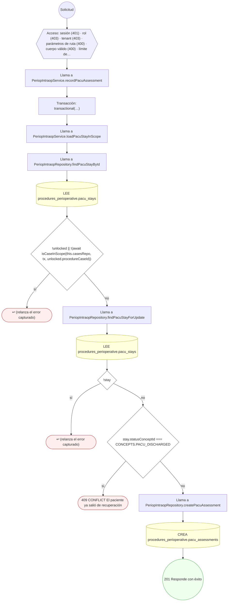

#### 4. POST /pacu-stays/{stayId}/discharge

Dar el alta de recuperación

| HTTP | Código | Cuándo |
|---|---|---|
| 200 | — | Éxito |
| 400 | `VALIDATION_FAILED` | Los parámetros de ruta son UUID válidos; El cuerpo cumple el DTO (sin propiedades extra) |
| 401 | `UNAUTHENTICATED` | Hay una sesión válida (JWT) |
| 403 | `FORBIDDEN` | El rol está permitido; El tenant se resuelve y pertenece al actor |
| 409 | `CONFLICT` | ConflictException: El paciente ya salió de recuperación |
| 422 | `PRECONDITION_FAILED` | PreconditionFailedException: El alta de recuperación exige al menos una valoración; PreconditionFailedException: La última valoración no cumple el criterio de alta |
| 429 | `RATE_LIMITED` | No se supera el límite de solicitudes |

```mermaid
flowchart TD
  n1(("Solicitud")):::inicio
  n2{{"Acceso: sesión (401) · rol (403) · tenant (403) · parámetros de ruta (400) · cuerpo válido (400) · límite de…"}}:::acceso
  n1 --> n2
  n3["Llama a PeriopIntraopService.dischargeFromPacu"]:::llamada
  n2 --> n3
  n4["Transacción: transactional(…)"]:::transaccion
  n3 --> n4
  n5["Llama a PeriopIntraopService.loadPacuStayInScope"]:::llamada
  n4 --> n5
  n6["Llama a PeriopIntraopRepository.findPacuStayById"]:::llamada
  n5 --> n6
  n7[("LEE procedures_perioperative.pacu_stays")]:::efecto
  n6 --> n7
  n8{"!unlocked || !(await isCaseInScope(this.casesRepo, tx, unlocked.procedureCaseId))"}:::decision
  n7 --> n8
  n9(["↩ (relanza el error capturado)"]):::error
  n8 -->|"sí"| n9
  n10["Llama a PeriopIntraopRepository.findPacuStayForUpdate"]:::llamada
  n8 -->|"no"| n10
  n11[("LEE procedures_perioperative.pacu_stays")]:::efecto
  n10 --> n11
  n12{"!stay"}:::decision
  n11 --> n12
  n13(["↩ (relanza el error capturado)"]):::error
  n12 -->|"sí"| n13
  n14{"stay.statusConceptId === CONCEPTS.PACU_DISCHARGED"}:::decision
  n12 -->|"no"| n14
  n15(["409 CONFLICT El paciente ya salió de recuperación"]):::error
  n14 -->|"sí"| n15
  n16["Llama a PeriopIntraopRepository.findAssessmentsByStay"]:::llamada
  n14 -->|"no"| n16
  n17[("LEE procedures_perioperative.pacu_assessments")]:::efecto
  n16 --> n17
  n18{"!latest"}:::decision
  n17 --> n18
  n19(["422 PRECONDITION_FAILED El alta de recuperación exige al menos una valoración"]):::error
  n18 -->|"sí"| n19
  n20{"(latest.aldreteScore ?? 0) ‹ ALDRETE_DISCHARGE_THRESHOLD"}:::decision
  n18 -->|"no"| n20
  n21(["422 PRECONDITION_FAILED La última valoración no cumple el criterio de alta"]):::error
  n20 -->|"sí"| n21
  n22["Llama a PeriopCasesRepository.findOpenLocation"]:::llamada
  n20 -->|"no"| n22
  n23[("LEE procedures_perioperative.procedure_case_locations")]:::efecto
  n22 --> n23
  n24[("ACTUALIZA procedures_perioperative.procedure_case_locations")]:::efecto
  n23 --> n24
  n25{"location"}:::decision
  n24 --> n25
  n26[("ACTUALIZA procedures_perioperative.procedure_case_locations")]:::efecto
  n25 -->|"sí"| n26
  n27["Repite: por cada const order de dto.orders ?? []"]:::bucle
  n26 --> n27
  n25 -->|"no"| n27
  n28["Llama a PeriopIntraopRepository.createPostoperativeOrder"]:::llamada
  n27 -->|"cada elemento"| n28
  n29[("CREA procedures_perioperative.postoperative_orders")]:::efecto
  n28 --> n29
  n30["Repite: por cada const followup de dto.followups ?? []"]:::bucle
  n29 --> n30
  n27 -->|"al terminar"| n30
  n31["Llama a PeriopIntraopRepository.createFollowup"]:::llamada
  n30 -->|"cada elemento"| n31
  n32[("CREA procedures_perioperative.postoperative_followups")]:::efecto
  n31 --> n32
  n33(("200 Responde con éxito")):::ok
  n32 --> n33
  n30 -->|"al terminar"| n33
  classDef acceso fill:#eef,stroke:#66a
  classDef error fill:#fee,stroke:#c33
  classDef ok fill:#efe,stroke:#3a3
  classDef efecto fill:#ffd,stroke:#aa3
  classDef decision fill:#fff,stroke:#555
  classDef corte fill:#eee,stroke:#999,stroke-dasharray: 4
```

#### 5. POST /procedure-cases

Programar un caso quirúrgico y reservar el quirófano

| HTTP | Código | Cuándo |
|---|---|---|
| 201 | — | Éxito |
| 400 | `VALIDATION_FAILED` | El cuerpo cumple el DTO (sin propiedades extra) |
| 401 | `UNAUTHENTICATED` | Hay una sesión válida (JWT) |
| 403 | `FORBIDDEN` | El rol está permitido; El tenant se resuelve y pertenece al actor |
| 409 | `CONFLICT` | ConflictException: El quirófano ya está reservado en esa franja; ConflictException: No se pudo asignar número de caso |
| 422 | `PRECONDITION_FAILED` | PreconditionFailedException: El caso debe terminar después de empezar; PreconditionFailedException: Un caso urgente o de emergencia necesita justificar su urgencia |
| 429 | `RATE_LIMITED` | No se supera el límite de solicitudes |

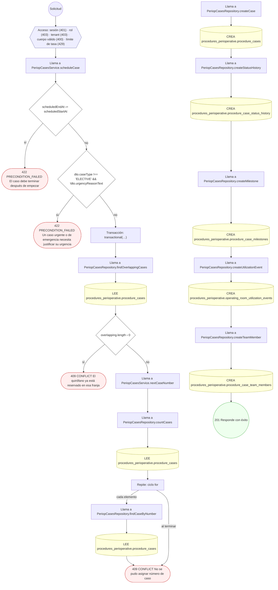

#### 6. GET /procedure-cases/{id}

Detalle completo del caso quirúrgico

| HTTP | Código | Cuándo |
|---|---|---|
| 200 | — | Éxito |
| 400 | `VALIDATION_FAILED` | Los parámetros de ruta son UUID válidos |
| 401 | `UNAUTHENTICATED` | Hay una sesión válida (JWT) |
| 403 | `FORBIDDEN` | El rol está permitido; El tenant se resuelve y pertenece al actor; ForbiddenException: {WITHOUT_ACCESS_TO_HISTORY} |
| 429 | `RATE_LIMITED` | No se supera el límite de solicitudes |

```mermaid
flowchart TD
  n1(("Solicitud")):::inicio
  n2{{"Acceso: sesión (401) · rol (403) · tenant (403) · parámetros de ruta (400) · límite de tasa (429)"}}:::acceso
  n1 --> n2
  n3["Llama a PeriopCasesService.getCaseDetail"]:::llamada
  n2 --> n3
  n4["Llama a PeriopCasesRepository.findCaseById"]:::llamada
  n3 --> n4
  n5[("LEE procedures_perioperative.procedure_cases")]:::efecto
  n4 --> n5
  n6["Llama a PeriopCasesService.assertCanReadCaseDetail"]:::llamada
  n5 --> n6
  n7{"profileId"}:::decision
  n6 --> n7
  n8["Llama a PeriopCasesRepository.findTeamByCase"]:::llamada
  n7 -->|"sí"| n8
  n9[("LEE procedures_perioperative.procedure_case_team_members")]:::efecto
  n8 --> n9
  n10["Intenta"]:::intento
  n9 --> n10
  n7 -->|"no"| n10
  n11["Llama a ClinicalReadService.assertCanReadHistory"]:::llamada
  n10 --> n11
  n12{"!actor.roles.some((role) =› ROLES_THAT_ATTEND.includes(role))"}:::decision
  n11 --> n12
  n13["Llama a ClinicalReadService.assertOwnRecord"]:::llamada
  n12 -->|"sí"| n13
  n14{"!link || !profile || profile.profileId !== link.personId"}:::decision
  n13 --> n14
  n15(["403 FORBIDDEN {WITHOUT_ACCESS_TO_HISTORY}"]):::error
  n14 -->|"sí"| n15
  n16["Llama a PersonAccountLinksRepository.findActiveByUser"]:::llamada
  n14 -->|"no"| n16
  n12 -->|"no"| n16
  n17[("LEE profiles.person_account_links")]:::efecto
  n16 --> n17
  n18["Llama a HealthPractitionerProfilesRepository.findById"]:::llamada
  n17 --> n18
  n19[("LEE profiles.health_practitioner_profiles")]:::efecto
  n18 --> n19
  n20["Llama a ClinicalReadService.assertOwnRecord"]:::llamada
  n19 --> n20
  n21{"!link || !profile || profile.profileId !== link.personId"}:::decision
  n20 --> n21
  n22(["403 FORBIDDEN {WITHOUT_ACCESS_TO_HISTORY}"]):::error
  n21 -->|"sí"| n22
  n23{"error instanceof ForbiddenException"}:::decision
  n10 -->|"si falla"| n23
  n24(["↩ (relanza el error capturado)"]):::error
  n23 -->|"sí"| n24
  n25(["↩ (relanza el error capturado)"]):::error
  n23 -->|"no"| n25
  n26["Llama a PeriopCasesRepository.findDiagnosesByCase"]:::llamada
  n21 -->|"no"| n26
  n27[("LEE procedures_perioperative.procedure_case_diagnoses")]:::efecto
  n26 --> n27
  n28["Llama a PeriopCasesRepository.findTeamByCase"]:::llamada
  n27 --> n28
  n29[("LEE procedures_perioperative.procedure_case_team_members")]:::efecto
  n28 --> n29
  n30["Llama a PeriopCasesRepository.findMilestonesByCase"]:::llamada
  n29 --> n30
  n31[("LEE procedures_perioperative.procedure_case_milestones")]:::efecto
  n30 --> n31
  n32["Llama a PeriopPreopRepository.findOrdersByCase"]:::llamada
  n31 --> n32
  n33[("LEE procedures_perioperative.preoperative_orders")]:::efecto
  n32 --> n33
  n34["Llama a PeriopPreopRepository.findAssessmentByCase"]:::llamada
  n33 --> n34
  n35[("LEE procedures_perioperative.preoperative_assessments")]:::efecto
  n34 --> n35
  n36["Llama a PeriopPreopRepository.findAnesthesiaPlanByCase"]:::llamada
  n35 --> n36
  n37[("LEE procedures_perioperative.anesthesia_plans")]:::efecto
  n36 --> n37
  n38["Llama a PeriopIntraopRepository.findReportsByCase"]:::llamada
  n37 --> n38
  n39[("LEE procedures_perioperative.operative_reports")]:::efecto
  n38 --> n39
  n40["Llama a PeriopIntraopRepository.findStepsByCase"]:::llamada
  n39 --> n40
  n41[("LEE procedures_perioperative.operative_steps")]:::efecto
  n40 --> n41
  n42["Llama a PeriopIntraopRepository.findFindingsByCase"]:::llamada
  n41 --> n42
  n43[("LEE procedures_perioperative.operative_findings")]:::efecto
  n42 --> n43
  n44["Llama a PeriopIntraopRepository.findImplantsByCase"]:::llamada
  n43 --> n44
  n45[("LEE procedures_perioperative.procedure_implants")]:::efecto
  n44 --> n45
  n46["Llama a PeriopIntraopRepository.findIdentifiersByImplants"]:::llamada
  n45 --> n46
  n47[("LEE procedures_perioperative.implant_identifiers")]:::efecto
  n46 --> n47
  n48(("200 Responde con éxito")):::ok
  n47 --> n48
  classDef acceso fill:#eef,stroke:#66a
  classDef error fill:#fee,stroke:#c33
  classDef ok fill:#efe,stroke:#3a3
  classDef efecto fill:#ffd,stroke:#aa3
  classDef decision fill:#fff,stroke:#555
  classDef corte fill:#eee,stroke:#999,stroke-dasharray: 4
```

#### 7. PATCH /procedure-cases/{id}

Modificar el caso quirúrgico

| HTTP | Código | Cuándo |
|---|---|---|
| 200 | — | Éxito |
| 400 | `VALIDATION_FAILED` | Los parámetros de ruta son UUID válidos; El cuerpo cumple el DTO (sin propiedades extra) |
| 401 | `UNAUTHENTICATED` | Hay una sesión válida (JWT) |
| 403 | `FORBIDDEN` | El rol está permitido; El tenant se resuelve y pertenece al actor |
| 422 | `PRECONDITION_FAILED` | PreconditionFailedException: El caso está cancelado; PreconditionFailedException: CAN-INT-001: el paciente de la intervención no puede cambiarse una vez confirmada; cancele el caso y cree uno nuevo; PreconditionFailedException: CAN-INT-001: el paciente no puede cambiarse: el caso ya tiene asignaciones o evidencias asociadas; PreconditionFailedException: El caso debe terminar después de empezar |
| 429 | `RATE_LIMITED` | No se supera el límite de solicitudes |

```mermaid
flowchart TD
  n1(("Solicitud")):::inicio
  n2{{"Acceso: sesión (401) · rol (403) · tenant (403) · parámetros de ruta (400) · cuerpo válido (400) · límite de…"}}:::acceso
  n1 --> n2
  n3["Llama a PeriopCasesService.updateCase"]:::llamada
  n2 --> n3
  n4["Transacción: transactional(…)"]:::transaccion
  n3 --> n4
  n5{"surgicalCase.statusConceptId === CONCEPTS.CASE_CANCELLED"}:::decision
  n4 --> n5
  n6(["422 PRECONDITION_FAILED El caso está cancelado"]):::error
  n5 -->|"sí"| n6
  n7{"dto.patientProfileId && dto.patientProfileId !== surgicalCase.patientProfileId"}:::decision
  n5 -->|"no"| n7
  n8{"surgicalCase.statusConceptId !== CASE_DRAFT_STATE"}:::decision
  n7 -->|"sí"| n8
  n9(["422 PRECONDITION_FAILED CAN-INT-001: el paciente de la intervención no puede cambiarse una vez confirmada; ca…"]):::error
  n8 -->|"sí"| n9
  n10["Llama a PeriopCasesService.caseHasBlockingDependencies"]:::llamada
  n8 -->|"no"| n10
  n11["Llama a PeriopCasesRepository.findTeamByCase"]:::llamada
  n10 --> n11
  n12[("LEE procedures_perioperative.procedure_case_team_members")]:::efecto
  n11 --> n12
  n13["Llama a PeriopCasesRepository.findDiagnosesByCase"]:::llamada
  n12 --> n13
  n14[("LEE procedures_perioperative.procedure_case_diagnoses")]:::efecto
  n13 --> n14
  n15{"await this.caseHasBlockingDependencies(tx, surgicalCase)"}:::decision
  n14 --> n15
  n16(["422 PRECONDITION_FAILED CAN-INT-001: el paciente no puede cambiarse: el caso ya tiene asignaciones o evidenci…"]):::error
  n15 -->|"sí"| n16
  n17{"surgicalCase.scheduledStartAt && surgicalCase.scheduledEndAt && surgicalCase.scheduledEndAt ‹= surgicalCase.s…"}:::decision
  n15 -->|"no"| n17
  n7 -->|"no"| n17
  n18(["422 PRECONDITION_FAILED El caso debe terminar después de empezar"]):::error
  n17 -->|"sí"| n18
  n19["Llama a PeriopReacceptanceService.invalidate"]:::llamada
  n17 -->|"no"| n19
  n20["Llama a PeriopCasesRepository.findTeamByCase"]:::llamada
  n19 --> n20
  n21[("LEE procedures_perioperative.procedure_case_team_members")]:::efecto
  n20 --> n21
  n22["Repite: por cada const member de team"]:::bucle
  n21 --> n22
  n23[("ACTUALIZA procedures_perioperative.procedure_case_team_members · ACTUALIZA procedures_perioperative.procedure…")]:::efecto
  n22 -->|"cada elemento"| n23
  n24{"surgicalCase.statusConceptId === CONCEPTS.CASE_READY_FOR_SURGERY"}:::decision
  n23 --> n24
  n22 -->|"al terminar"| n24
  n25["Llama a PeriopCasesRepository.createStatusHistory"]:::llamada
  n24 -->|"sí"| n25
  n26[("CREA procedures_perioperative.procedure_case_status_history")]:::efecto
  n25 --> n26
  n27[("ACTUALIZA procedures_perioperative.procedure_cases")]:::efecto
  n26 --> n27
  n28["Llama a OutboxService.publishDomainEvent"]:::llamada
  n27 --> n28
  n24 -->|"no"| n28
  n29["Llama a MessagingTraceService.runInProducerSpan"]:::llamada
  n28 --> n29
  n30["Transacción: startActiveSpan(…)"]:::transaccion
  n29 --> n30
  n31["Intenta"]:::intento
  n30 --> n31
  n32(["↩ (relanza el error capturado)"]):::error
  n31 -->|"si falla"| n32
  n33>"Evento periop.case.reacceptance_required"]:::evento
  n31 --> n33
  n34(("200 Responde con éxito")):::ok
  n33 --> n34
  classDef acceso fill:#eef,stroke:#66a
  classDef error fill:#fee,stroke:#c33
  classDef ok fill:#efe,stroke:#3a3
  classDef efecto fill:#ffd,stroke:#aa3
  classDef decision fill:#fff,stroke:#555
  classDef corte fill:#eee,stroke:#999,stroke-dasharray: 4
```

#### 8. POST /procedure-cases/{id}/anesthesia-events

Anotar un evento intraoperatorio de anestesia

| HTTP | Código | Cuándo |
|---|---|---|
| 201 | — | Éxito |
| 400 | `VALIDATION_FAILED` | Los parámetros de ruta son UUID válidos; El cuerpo cumple el DTO (sin propiedades extra) |
| 401 | `UNAUTHENTICATED` | Hay una sesión válida (JWT) |
| 403 | `FORBIDDEN` | El rol está permitido; El tenant se resuelve y pertenece al actor |
| 422 | `PRECONDITION_FAILED` | PreconditionFailedException: El caso está cancelado; PreconditionFailedException: La inducción exige un plan de anestesia aprobado |
| 429 | `RATE_LIMITED` | No se supera el límite de solicitudes |

```mermaid
flowchart TD
  n1(("Solicitud")):::inicio
  n2{{"Acceso: sesión (401) · rol (403) · tenant (403) · parámetros de ruta (400) · cuerpo válido (400) · límite de…"}}:::acceso
  n1 --> n2
  n3["Llama a PeriopPreopService.recordAnesthesiaEvent"]:::llamada
  n2 --> n3
  n4["Transacción: transactional(…)"]:::transaccion
  n3 --> n4
  n5{"surgicalCase.statusConceptId === CONCEPTS.CASE_CANCELLED"}:::decision
  n4 --> n5
  n6(["422 PRECONDITION_FAILED El caso está cancelado"]):::error
  n5 -->|"sí"| n6
  n7["Llama a PeriopPreopRepository.findAnesthesiaPlanByCase"]:::llamada
  n5 -->|"no"| n7
  n8[("LEE procedures_perioperative.anesthesia_plans")]:::efecto
  n7 --> n8
  n9{"dto.eventType === 'INDUCTION' && plan?.statusConceptId !== CONCEPTS.PLAN_APPROVED"}:::decision
  n8 --> n9
  n10(["422 PRECONDITION_FAILED La inducción exige un plan de anestesia aprobado"]):::error
  n9 -->|"sí"| n10
  n11["Llama a PeriopPreopRepository.createAnesthesiaEvent"]:::llamada
  n9 -->|"no"| n11
  n12[("CREA procedures_perioperative.anesthesia_events")]:::efecto
  n11 --> n12
  n13{"milestoneType"}:::decision
  n12 --> n13
  n14["Llama a PeriopCasesRepository.findMilestone"]:::llamada
  n13 -->|"sí"| n14
  n15[("LEE procedures_perioperative.procedure_case_milestones")]:::efecto
  n14 --> n15
  n16{"!existing"}:::decision
  n15 --> n16
  n17["Llama a PeriopCasesRepository.createMilestone"]:::llamada
  n16 -->|"sí"| n17
  n18[("CREA procedures_perioperative.procedure_case_milestones")]:::efecto
  n17 --> n18
  n19{"dto.eventType === 'INDUCTION' && !surgicalCase.actualStartAt"}:::decision
  n18 --> n19
  n16 -->|"no"| n19
  n13 -->|"no"| n19
  n20["Llama a PeriopCasesRepository.createStatusHistory"]:::llamada
  n19 -->|"sí"| n20
  n21[("CREA procedures_perioperative.procedure_case_status_history")]:::efecto
  n20 --> n21
  n22{"surgicalCase.operatingRoomId"}:::decision
  n21 --> n22
  n23["Llama a PeriopCasesRepository.createUtilizationEvent"]:::llamada
  n22 -->|"sí"| n23
  n24[("CREA procedures_perioperative.operating_room_utilization_events")]:::efecto
  n23 --> n24
  n25(("201 Responde con éxito")):::ok
  n24 --> n25
  n22 -->|"no"| n25
  n19 -->|"no"| n25
  classDef acceso fill:#eef,stroke:#66a
  classDef error fill:#fee,stroke:#c33
  classDef ok fill:#efe,stroke:#3a3
  classDef efecto fill:#ffd,stroke:#aa3
  classDef decision fill:#fff,stroke:#555
  classDef corte fill:#eee,stroke:#999,stroke-dasharray: 4
```

#### 9. POST /procedure-cases/{id}/anesthesia-plans

Registrar el plan de anestesia y la valoración de vía aérea

| HTTP | Código | Cuándo |
|---|---|---|
| 201 | — | Éxito |
| 400 | `VALIDATION_FAILED` | Los parámetros de ruta son UUID válidos; El cuerpo cumple el DTO (sin propiedades extra) |
| 401 | `UNAUTHENTICATED` | Hay una sesión válida (JWT) |
| 403 | `FORBIDDEN` | El rol está permitido; El tenant se resuelve y pertenece al actor |
| 409 | `CONFLICT` | ConflictException: El caso ya tiene plan de anestesia |
| 422 | `PRECONDITION_FAILED` | PreconditionFailedException: Una vía aérea difícil anticipada necesita plan de rescate; PreconditionFailedException: El caso está cancelado |
| 429 | `RATE_LIMITED` | No se supera el límite de solicitudes |

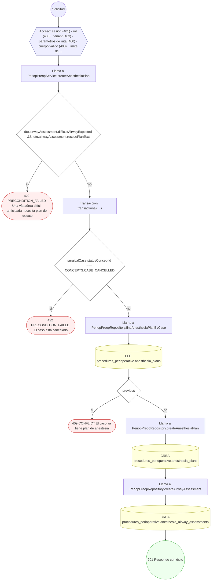

#### 10. POST /procedure-cases/{id}/anesthesia-plans/{planId}/approve

Aprobar el plan de anestesia

| HTTP | Código | Cuándo |
|---|---|---|
| 200 | — | Éxito |
| 400 | `VALIDATION_FAILED` | Los parámetros de ruta son UUID válidos |
| 401 | `UNAUTHENTICATED` | Hay una sesión válida (JWT) |
| 403 | `FORBIDDEN` | El rol está permitido; El tenant se resuelve y pertenece al actor |
| 404 | `NOT_FOUND` | ResourceNotFoundException: Plan de anestesia no encontrado |
| 409 | `CONFLICT` | ConflictException: El plan ya está aprobado |
| 422 | `PRECONDITION_FAILED` | PreconditionFailedException: El plan pertenece a otro caso |
| 429 | `RATE_LIMITED` | No se supera el límite de solicitudes |


#### 11. POST /procedure-cases/{id}/cancel

Cancelar el caso quirúrgico

| HTTP | Código | Cuándo |
|---|---|---|
| 200 | — | Éxito |
| 400 | `VALIDATION_FAILED` | Los parámetros de ruta son UUID válidos; El cuerpo cumple el DTO (sin propiedades extra) |
| 401 | `UNAUTHENTICATED` | Hay una sesión válida (JWT) |
| 403 | `FORBIDDEN` | El rol está permitido; El tenant se resuelve y pertenece al actor |
| 409 | `CONFLICT` | ConflictException: El caso ya está cancelado |
| 422 | `PRECONDITION_FAILED` | PreconditionFailedException: El caso no admite cancelación en su estado actual |
| 429 | `RATE_LIMITED` | No se supera el límite de solicitudes |

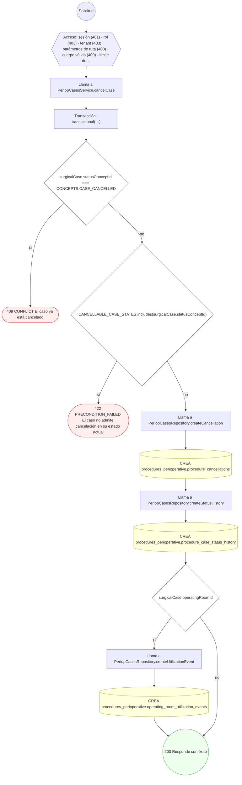

#### 12. POST /procedure-cases/{id}/charge-items/post

Generar los cargos y consolidar el uso del quirófano

| HTTP | Código | Cuándo |
|---|---|---|
| 201 | — | Éxito |
| 400 | `VALIDATION_FAILED` | Los parámetros de ruta son UUID válidos; El cuerpo cumple el DTO (sin propiedades extra) |
| 401 | `UNAUTHENTICATED` | Hay una sesión válida (JWT) |
| 403 | `FORBIDDEN` | El rol está permitido; El tenant se resuelve y pertenece al actor |
| 409 | `CONFLICT` | ConflictException: El caso ya tiene cargos emitidos |
| 422 | `PRECONDITION_FAILED` | PreconditionFailedException: Sólo se factura un caso completado |
| 429 | `RATE_LIMITED` | No se supera el límite de solicitudes |

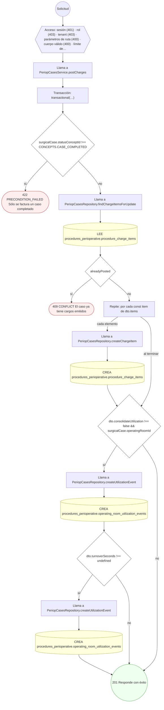

#### 13. POST /procedure-cases/{id}/confirm

Confirmar la intervención verificando las credenciales del equipo

| HTTP | Código | Cuándo |
|---|---|---|
| 200 | — | Éxito |
| 400 | `VALIDATION_FAILED` | Los parámetros de ruta son UUID válidos |
| 401 | `UNAUTHENTICATED` | Hay una sesión válida (JWT) |
| 403 | `FORBIDDEN` | El rol está permitido; El tenant se resuelve y pertenece al actor |
| 422 | `PRECONDITION_FAILED` | PreconditionFailedException: El caso está cancelado; PreconditionFailedException: El caso no admite confirmación en su estado actual; PreconditionFailedException: CAN-INT-002: no puede confirmarse: hay integrantes del equipo sin credencial profesional vigente |
| 429 | `RATE_LIMITED` | No se supera el límite de solicitudes |

```mermaid
flowchart TD
  n1(("Solicitud")):::inicio
  n2{{"Acceso: sesión (401) · rol (403) · tenant (403) · parámetros de ruta (400) · límite de tasa (429)"}}:::acceso
  n1 --> n2
  n3["Llama a PeriopCasesService.confirmCase"]:::llamada
  n2 --> n3
  n4["Transacción: transactional(…)"]:::transaccion
  n3 --> n4
  n5{"surgicalCase.statusConceptId === CONCEPTS.CASE_CANCELLED"}:::decision
  n4 --> n5
  n6(["422 PRECONDITION_FAILED El caso está cancelado"]):::error
  n5 -->|"sí"| n6
  n7{"!CONFIRMABLE_CASE_STATES.includes(surgicalCase.statusConceptId)"}:::decision
  n5 -->|"no"| n7
  n8(["422 PRECONDITION_FAILED El caso no admite confirmación en su estado actual"]):::error
  n7 -->|"sí"| n8
  n9["Llama a PeriopCasesRepository.findTeamByCase"]:::llamada
  n7 -->|"no"| n9
  n10[("LEE procedures_perioperative.procedure_case_team_members")]:::efecto
  n9 --> n10
  n11["Repite: por cada const member de team"]:::bucle
  n10 --> n11
  n12["Llama a ProfessionalCredentialsRepository.hasCurrentCredential"]:::llamada
  n11 -->|"cada elemento"| n12
  n13[("LEE profiles.professional_credentials")]:::efecto
  n12 --> n13
  n14{"withoutCurrentCredential.length › 0"}:::decision
  n13 --> n14
  n11 -->|"al terminar"| n14
  n15["Llama a OutboxService.publishDomainEvent"]:::llamada
  n14 -->|"sí"| n15
  n16["Llama a MessagingTraceService.runInProducerSpan"]:::llamada
  n15 --> n16
  n17["Transacción: startActiveSpan(…)"]:::transaccion
  n16 --> n17
  n18["Intenta"]:::intento
  n17 --> n18
  n19(["↩ (relanza el error capturado)"]):::error
  n18 -->|"si falla"| n19
  n20["Llama a OutboxService.persistDomainEvent"]:::llamada
  n18 --> n20
  n21["Llama a OutboxRepository.findOutboxByIdempotencyKey"]:::llamada
  n20 --> n21
  n22[("LEE messaging.outbox_messages")]:::efecto
  n21 --> n22
  n23["Llama a OutboxRepository.createDomainEvent"]:::llamada
  n22 --> n23
  n24[("CREA messaging.domain_events")]:::efecto
  n23 --> n24
  n25["Llama a OutboxRepository.createOutboxMessage"]:::llamada
  n24 --> n25
  n26[("CREA messaging.outbox_messages")]:::efecto
  n25 --> n26
  n27>"Evento periop.case.confirmation_blocked"]:::evento
  n26 --> n27
  n28["Llama a AuditTrailService.record"]:::llamada
  n27 --> n28
  n29["Llama a AuditLogRepository.append"]:::llamada
  n28 --> n29
  n30["Llama a AuditLogRepository.findChainTip"]:::llamada
  n29 --> n30
  n31[("LEE audit.audit_log")]:::efecto
  n30 --> n31
  n32[("CREA audit.audit_log")]:::efecto
  n31 --> n32
  n33{"statusConceptId === CONCEPTS.CASE_SCHEDULED"}:::decision
  n32 --> n33
  n14 -->|"no"| n33
  n34["Llama a PeriopCasesRepository.createStatusHistory"]:::llamada
  n33 -->|"sí"| n34
  n35[("CREA procedures_perioperative.procedure_case_status_history")]:::efecto
  n34 --> n35
  n36["Llama a AuditTrailService.record"]:::llamada
  n35 --> n36
  n33 -->|"no"| n36
  n37["Llama a AuditLogRepository.append"]:::llamada
  n36 --> n37
  n38["Llama a AuditLogRepository.findChainTip"]:::llamada
  n37 --> n38
  n39[("LEE audit.audit_log")]:::efecto
  n38 --> n39
  n40[("CREA audit.audit_log")]:::efecto
  n39 --> n40
  n41{"result.blocked"}:::decision
  n40 --> n41
  n42(["422 PRECONDITION_FAILED CAN-INT-002: no puede confirmarse: hay integrantes del equipo sin credencial profesio…"]):::error
  n41 -->|"sí"| n42
  n43(("200 Responde con éxito")):::ok
  n41 -->|"no"| n43
  classDef acceso fill:#eef,stroke:#66a
  classDef error fill:#fee,stroke:#c33
  classDef ok fill:#efe,stroke:#3a3
  classDef efecto fill:#ffd,stroke:#aa3
  classDef decision fill:#fff,stroke:#555
  classDef corte fill:#eee,stroke:#999,stroke-dasharray: 4
```

#### 14. POST /procedure-cases/{id}/diagnoses

Registrar los diagnósticos del caso

| HTTP | Código | Cuándo |
|---|---|---|
| 201 | — | Éxito |
| 400 | `VALIDATION_FAILED` | Los parámetros de ruta son UUID válidos; El cuerpo cumple el DTO (sin propiedades extra) |
| 401 | `UNAUTHENTICATED` | Hay una sesión válida (JWT) |
| 403 | `FORBIDDEN` | El rol está permitido; El tenant se resuelve y pertenece al actor |
| 404 | `NOT_FOUND` | ResourceNotFoundException: Encuentro no encontrado |
| 409 | `CONFLICT` | ConflictException: El caso sólo admite un diagnóstico principal; ConflictException: El paciente ya tiene esa condición activa |
| 422 | `PRECONDITION_FAILED` | PreconditionFailedException: El caso está cancelado; PreconditionFailedException: Indique la condición por `conditionId` o por `conditionCodeConceptId`; PreconditionFailedException: Un diagnóstico se registra presuntivo o confirmado. |
| 429 | `RATE_LIMITED` | No se supera el límite de solicitudes |
| 500 | `INTERNAL` | Error: Entidad de historial no registrada: {entity} |

```mermaid
flowchart TD
  n1(("Solicitud")):::inicio
  n2{{"Acceso: sesión (401) · rol (403) · tenant (403) · parámetros de ruta (400) · cuerpo válido (400) · límite de…"}}:::acceso
  n1 --> n2
  n3["Llama a PeriopCasesService.addDiagnoses"]:::llamada
  n2 --> n3
  n4["Transacción: transactional(…)"]:::transaccion
  n3 --> n4
  n5{"surgicalCase.statusConceptId === CONCEPTS.CASE_CANCELLED"}:::decision
  n4 --> n5
  n6(["422 PRECONDITION_FAILED El caso está cancelado"]):::error
  n5 -->|"sí"| n6
  n7["Llama a PeriopCasesRepository.findDiagnosesByCase"]:::llamada
  n5 -->|"no"| n7
  n8[("LEE procedures_perioperative.procedure_case_diagnoses")]:::efecto
  n7 --> n8
  n9{"incomingPrimary › 1 || (incomingPrimary === 1 && hasPrimary)"}:::decision
  n8 --> n9
  n10(["409 CONFLICT El caso sólo admite un diagnóstico principal"]):::error
  n9 -->|"sí"| n10
  n11["Repite: por cada const diagnosis de dto.diagnoses"]:::bucle
  n9 -->|"no"| n11
  n12["Llama a PeriopCasesService.ensureCondition"]:::llamada
  n11 -->|"cada elemento"| n12
  n13{"!diagnosis.conditionCodeConceptId"}:::decision
  n12 --> n13
  n14(["422 PRECONDITION_FAILED Indique la condición por `conditionId` o por `conditionCodeConceptId`"]):::error
  n13 -->|"sí"| n14
  n15["Intenta"]:::intento
  n13 -->|"no"| n15
  n16["Llama a ConditionsService.create"]:::llamada
  n15 --> n16
  n17{"dto.verificationStatusConceptId !== undefined && !CREATION_VERIFICATION_STATUSES.includes(dto.verificationSta…"}:::decision
  n16 --> n17
  n18(["422 PRECONDITION_FAILED Un diagnóstico se registra presuntivo o confirmado."]):::error
  n17 -->|"sí"| n18
  n19["Transacción: transactional(…)"]:::transaccion
  n17 -->|"no"| n19
  n20["Llama a ConditionsService.assertEncounterBelongsToPatient"]:::llamada
  n19 --> n20
  n21{"!encounter || encounter.patientProfileId !== dto.patientProfileId || encounter.tenantId !== dto.custodianTena…"}:::decision
  n20 --> n21
  n22(["404 NOT_FOUND Encuentro no encontrado"]):::error
  n21 -->|"sí"| n22
  n23["Llama a ConditionsRepository.findActiveByCode"]:::llamada
  n21 -->|"no"| n23
  n24[("LEE clinical.conditions")]:::efecto
  n23 --> n24
  n25{"existing"}:::decision
  n24 --> n25
  n26(["409 CONFLICT El paciente ya tiene esa condición activa"]):::error
  n25 -->|"sí"| n26
  n27["Llama a ConditionsRepository.create"]:::llamada
  n25 -->|"no"| n27
  n28[("CREA clinical.conditions")]:::efecto
  n27 --> n28
  n29["Llama a HistoryRepository.append"]:::llamada
  n28 --> n29
  n30{"!binding"}:::decision
  n29 --> n30
  n31(["500 INTERNAL Entidad de historial no registrada: {entity}"]):::error
  n30 -->|"sí"| n31
  n32[("LEE audit.conditions_history · ACTUALIZA audit.conditions_history · CREA audit.conditions_history")]:::efecto
  n30 -->|"no"| n32
  n33{"!(error instanceof ConflictException)"}:::decision
  n15 -->|"si falla"| n33
  n34(["↩ (relanza el error capturado)"]):::error
  n33 -->|"sí"| n34
  n35["Llama a ConditionsService.findActiveByCode"]:::llamada
  n33 -->|"no"| n35
  n36["Llama a ConditionsRepository.findActiveByCode"]:::llamada
  n35 --> n36
  n37[("LEE clinical.conditions")]:::efecto
  n36 --> n37
  n38{"!existing"}:::decision
  n37 --> n38
  n39(["↩ (relanza el error capturado)"]):::error
  n38 -->|"sí"| n39
  n40["Llama a PeriopCasesRepository.createDiagnosis"]:::llamada
  n32 --> n40
  n38 -->|"no"| n40
  n41[("CREA procedures_perioperative.procedure_case_diagnoses")]:::efecto
  n40 --> n41
  n42(("201 Responde con éxito")):::ok
  n41 --> n42
  n11 -->|"al terminar"| n42
  classDef acceso fill:#eef,stroke:#66a
  classDef error fill:#fee,stroke:#c33
  classDef ok fill:#efe,stroke:#3a3
  classDef efecto fill:#ffd,stroke:#aa3
  classDef decision fill:#fff,stroke:#555
  classDef corte fill:#eee,stroke:#999,stroke-dasharray: 4
```

#### 15. POST /procedure-cases/{id}/findings

Registrar un hallazgo operatorio

| HTTP | Código | Cuándo |
|---|---|---|
| 201 | — | Éxito |
| 400 | `VALIDATION_FAILED` | Los parámetros de ruta son UUID válidos; El cuerpo cumple el DTO (sin propiedades extra) |
| 401 | `UNAUTHENTICATED` | Hay una sesión válida (JWT) |
| 403 | `FORBIDDEN` | El rol está permitido; El tenant se resuelve y pertenece al actor |
| 404 | `NOT_FOUND` | ResourceNotFoundException: Paso operatorio no encontrado |
| 422 | `PRECONDITION_FAILED` | PreconditionFailedException: El caso no está en curso; PreconditionFailedException: El paso pertenece a otro caso |
| 429 | `RATE_LIMITED` | No se supera el límite de solicitudes |


#### 16. POST /procedure-cases/{id}/implants

Registrar un implante con su trazabilidad UDI, lote o serie

| HTTP | Código | Cuándo |
|---|---|---|
| 201 | — | Éxito |
| 400 | `VALIDATION_FAILED` | Los parámetros de ruta son UUID válidos; El cuerpo cumple el DTO (sin propiedades extra) |
| 401 | `UNAUTHENTICATED` | Hay una sesión válida (JWT) |
| 403 | `FORBIDDEN` | El rol está permitido; El tenant se resuelve y pertenece al actor |
| 422 | `PRECONDITION_FAILED` | PreconditionFailedException: El caso no está en curso |
| 429 | `RATE_LIMITED` | No se supera el límite de solicitudes |

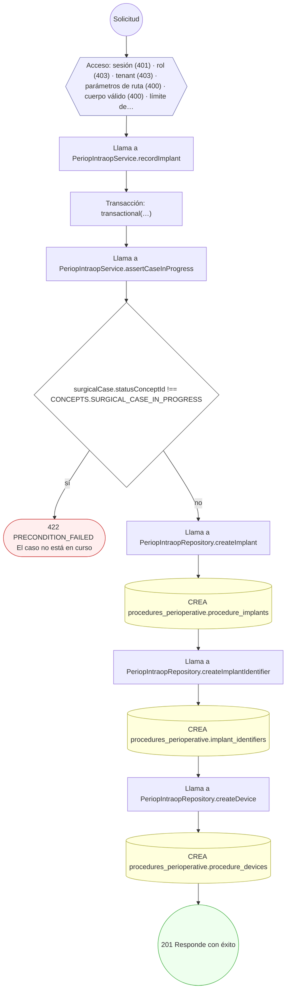

#### 17. POST /procedure-cases/{id}/medication-uses

Registrar el uso de un medicamento en la intervención

| HTTP | Código | Cuándo |
|---|---|---|
| 201 | — | Éxito |
| 400 | `VALIDATION_FAILED` | Los parámetros de ruta son UUID válidos; El cuerpo cumple el DTO (sin propiedades extra) |
| 401 | `UNAUTHENTICATED` | Hay una sesión válida (JWT) |
| 403 | `FORBIDDEN` | El rol está permitido; El tenant se resuelve y pertenece al actor |
| 422 | `PRECONDITION_FAILED` | PreconditionFailedException: El caso no está en curso; PreconditionFailedException: El paso no pertenece al caso |
| 429 | `RATE_LIMITED` | No se supera el límite de solicitudes |

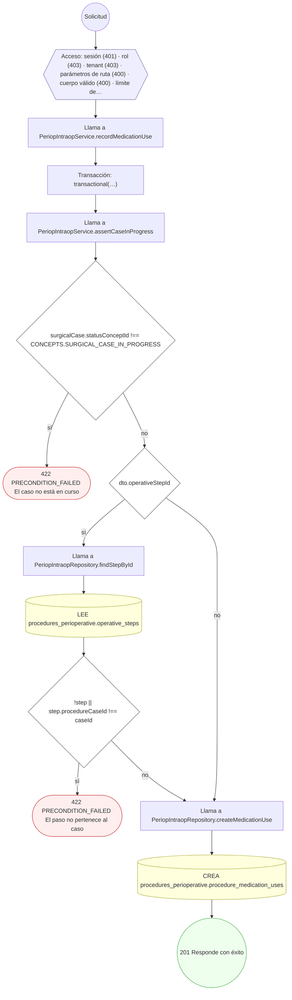

#### 18. POST /procedure-cases/{id}/operative-reports

Redactar el reporte operatorio

| HTTP | Código | Cuándo |
|---|---|---|
| 201 | — | Éxito |
| 400 | `VALIDATION_FAILED` | Los parámetros de ruta son UUID válidos; El cuerpo cumple el DTO (sin propiedades extra) |
| 401 | `UNAUTHENTICATED` | Hay una sesión válida (JWT) |
| 403 | `FORBIDDEN` | El rol está permitido; El tenant se resuelve y pertenece al actor |
| 404 | `NOT_FOUND` | ResourceNotFoundException: Orden de servicio no encontrada; ResourceNotFoundException: Procedimiento padre no encontrado |
| 422 | `PRECONDITION_FAILED` | PreconditionFailedException: El caso está cancelado; PreconditionFailedException: Indique el procedimiento por `procedureId` o por `procedureCodeConceptId` |
| 429 | `RATE_LIMITED` | No se supera el límite de solicitudes |

```mermaid
flowchart TD
  n1(("Solicitud")):::inicio
  n2{{"Acceso: sesión (401) · rol (403) · tenant (403) · parámetros de ruta (400) · cuerpo válido (400) · límite de…"}}:::acceso
  n1 --> n2
  n3["Llama a PeriopIntraopService.draftReport"]:::llamada
  n2 --> n3
  n4["Transacción: transactional(…)"]:::transaccion
  n3 --> n4
  n5{"surgicalCase.statusConceptId === CONCEPTS.CASE_CANCELLED"}:::decision
  n4 --> n5
  n6(["422 PRECONDITION_FAILED El caso está cancelado"]):::error
  n5 -->|"sí"| n6
  n7["Llama a PeriopIntraopRepository.findLastReport"]:::llamada
  n5 -->|"no"| n7
  n8[("LEE procedures_perioperative.operative_reports")]:::efecto
  n7 --> n8
  n9["Llama a PeriopIntraopService.ensureProcedure"]:::llamada
  n8 --> n9
  n10{"!dto.procedureCodeConceptId"}:::decision
  n9 --> n10
  n11(["422 PRECONDITION_FAILED Indique el procedimiento por `procedureId` o por `procedureCodeConceptId`"]):::error
  n10 -->|"sí"| n11
  n12["Llama a ProceduresService.create"]:::llamada
  n10 -->|"no"| n12
  n13["Transacción: transactional(…)"]:::transaccion
  n12 --> n13
  n14{"dto.serviceRequestId"}:::decision
  n13 --> n14
  n15["Llama a ServiceRequestsRepository.findById"]:::llamada
  n14 -->|"sí"| n15
  n16[("LEE clinical.service_requests")]:::efecto
  n15 --> n16
  n17{"!sr"}:::decision
  n16 --> n17
  n18(["404 NOT_FOUND Orden de servicio no encontrada"]):::error
  n17 -->|"sí"| n18
  n19[("ACTUALIZA clinical.service_requests")]:::efecto
  n17 -->|"no"| n19
  n20{"dto.parentProcedureId"}:::decision
  n19 --> n20
  n14 -->|"no"| n20
  n21["Llama a ProceduresRepository.findById"]:::llamada
  n20 -->|"sí"| n21
  n22[("LEE clinical.procedures")]:::efecto
  n21 --> n22
  n23{"!parent"}:::decision
  n22 --> n23
  n24(["404 NOT_FOUND Procedimiento padre no encontrado"]):::error
  n23 -->|"sí"| n24
  n25["Llama a ProceduresRepository.create"]:::llamada
  n23 -->|"no"| n25
  n20 -->|"no"| n25
  n26[("CREA clinical.procedures")]:::efecto
  n25 --> n26
  n27["Llama a PeriopIntraopRepository.createReport"]:::llamada
  n26 --> n27
  n28[("CREA procedures_perioperative.operative_reports")]:::efecto
  n27 --> n28
  n29["Repite: map(…)"]:::bucle
  n28 --> n29
  n30["Llama a PeriopIntraopRepository.createComplication"]:::llamada
  n29 -->|"cada elemento"| n30
  n31[("CREA procedures_perioperative.procedure_complications")]:::efecto
  n30 --> n31
  n32(("201 Responde con éxito")):::ok
  n31 --> n32
  n29 -->|"al terminar"| n32
  classDef acceso fill:#eef,stroke:#66a
  classDef error fill:#fee,stroke:#c33
  classDef ok fill:#efe,stroke:#3a3
  classDef efecto fill:#ffd,stroke:#aa3
  classDef decision fill:#fff,stroke:#555
  classDef corte fill:#eee,stroke:#999,stroke-dasharray: 4
```

#### 19. POST /procedure-cases/{id}/operative-reports/{reportId}/sign

Firmar el reporte operatorio

| HTTP | Código | Cuándo |
|---|---|---|
| 200 | — | Éxito |
| 400 | `VALIDATION_FAILED` | Los parámetros de ruta son UUID válidos; El cuerpo cumple el DTO (sin propiedades extra) |
| 401 | `UNAUTHENTICATED` | Hay una sesión válida (JWT) |
| 403 | `FORBIDDEN` | El rol está permitido; El tenant se resuelve y pertenece al actor |
| 404 | `NOT_FOUND` | ResourceNotFoundException: Reporte operatorio no encontrado |
| 409 | `CONFLICT` | ConflictException: El reporte ya está firmado |
| 422 | `PRECONDITION_FAILED` | PreconditionFailedException: El reporte pertenece a otro caso |
| 429 | `RATE_LIMITED` | No se supera el límite de solicitudes |

```mermaid
flowchart TD
  n1(("Solicitud")):::inicio
  n2{{"Acceso: sesión (401) · rol (403) · tenant (403) · parámetros de ruta (400) · cuerpo válido (400) · límite de…"}}:::acceso
  n1 --> n2
  n3["Llama a PeriopIntraopService.signReport"]:::llamada
  n2 --> n3
  n4["Transacción: transactional(…)"]:::transaccion
  n3 --> n4
  n5["Llama a PeriopIntraopRepository.findReportForUpdate"]:::llamada
  n4 --> n5
  n6[("LEE procedures_perioperative.operative_reports")]:::efecto
  n5 --> n6
  n7{"!report"}:::decision
  n6 --> n7
  n8(["404 NOT_FOUND Reporte operatorio no encontrado"]):::error
  n7 -->|"sí"| n8
  n9{"report.procedureCaseId !== caseId"}:::decision
  n7 -->|"no"| n9
  n10{"!(await isCaseInScope(this.casesRepo, tx, report.procedureCaseId))"}:::decision
  n9 -->|"sí"| n10
  n11(["404 NOT_FOUND Reporte operatorio no encontrado"]):::error
  n10 -->|"sí"| n11
  n12(["422 PRECONDITION_FAILED El reporte pertenece a otro caso"]):::error
  n10 -->|"no"| n12
  n13{"report.statusConceptId === CONCEPTS.OPERATIVE_REPORT_SIGNED"}:::decision
  n9 -->|"no"| n13
  n14(["409 CONFLICT El reporte ya está firmado"]):::error
  n13 -->|"sí"| n14
  n15[("ACTUALIZA procedures_perioperative.operative_reports · ACTUALIZA procedures_perioperative.operative_reports ·…")]:::efecto
  n13 -->|"no"| n15
  n16{"dto.fileId"}:::decision
  n15 --> n16
  n17[("ACTUALIZA procedures_perioperative.operative_reports")]:::efecto
  n16 -->|"sí"| n17
  n18{"surgicalCase.statusConceptId !== CONCEPTS.CASE_COMPLETED"}:::decision
  n17 --> n18
  n16 -->|"no"| n18
  n19["Llama a PeriopCasesRepository.createStatusHistory"]:::llamada
  n18 -->|"sí"| n19
  n20[("CREA procedures_perioperative.procedure_case_status_history")]:::efecto
  n19 --> n20
  n21["Llama a PeriopCasesRepository.createMilestone"]:::llamada
  n20 --> n21
  n22[("CREA procedures_perioperative.procedure_case_milestones")]:::efecto
  n21 --> n22
  n23["Llama a ReceivedServicesProjector.projectCompletedCase"]:::llamada
  n22 --> n23
  n24["Repite: por cada const candidate de [ procedureCase.primaryProcedureId, reportedProce…"]:::bucle
  n23 --> n24
  n25["Llama a ReceivedServicesRepository.isProcedureOf"]:::llamada
  n24 -->|"cada elemento"| n25
  n26[("LEE clinical.procedures")]:::efecto
  n25 --> n26
  n27["Llama a ReceivedServicesRepository.upsert"]:::llamada
  n26 --> n27
  n24 -->|"al terminar"| n27
  n28["Llama a ReceivedServicesRepository.findBySourceProcedure"]:::llamada
  n27 --> n28
  n29[("LEE clinical.received_services")]:::efecto
  n28 --> n29
  n30["Llama a ReceivedServicesRepository.findBySourceImmunization"]:::llamada
  n29 --> n30
  n31[("LEE clinical.received_services")]:::efecto
  n30 --> n31
  n32["Llama a ReceivedServicesRepository.findByProcedureCase"]:::llamada
  n31 --> n32
  n33[("LEE clinical.received_services")]:::efecto
  n32 --> n33
  n34[("CREA clinical.received_services")]:::efecto
  n33 --> n34
  n35(("200 Responde con éxito")):::ok
  n34 --> n35
  n18 -->|"no"| n35
  classDef acceso fill:#eef,stroke:#66a
  classDef error fill:#fee,stroke:#c33
  classDef ok fill:#efe,stroke:#3a3
  classDef efecto fill:#ffd,stroke:#aa3
  classDef decision fill:#fff,stroke:#555
  classDef corte fill:#eee,stroke:#999,stroke-dasharray: 4
```

#### 20. POST /procedure-cases/{id}/operative-steps

Registrar un paso operatorio

| HTTP | Código | Cuándo |
|---|---|---|
| 201 | — | Éxito |
| 400 | `VALIDATION_FAILED` | Los parámetros de ruta son UUID válidos; El cuerpo cumple el DTO (sin propiedades extra) |
| 401 | `UNAUTHENTICATED` | Hay una sesión válida (JWT) |
| 403 | `FORBIDDEN` | El rol está permitido; El tenant se resuelve y pertenece al actor |
| 422 | `PRECONDITION_FAILED` | PreconditionFailedException: El caso no está en curso |
| 429 | `RATE_LIMITED` | No se supera el límite de solicitudes |

```mermaid
flowchart TD
  n1(("Solicitud")):::inicio
  n2{{"Acceso: sesión (401) · rol (403) · tenant (403) · parámetros de ruta (400) · cuerpo válido (400) · límite de…"}}:::acceso
  n1 --> n2
  n3["Llama a PeriopIntraopService.createStep"]:::llamada
  n2 --> n3
  n4["Transacción: transactional(…)"]:::transaccion
  n3 --> n4
  n5["Llama a PeriopIntraopService.assertCaseInProgress"]:::llamada
  n4 --> n5
  n6{"surgicalCase.statusConceptId !== CONCEPTS.SURGICAL_CASE_IN_PROGRESS"}:::decision
  n5 --> n6
  n7(["422 PRECONDITION_FAILED El caso no está en curso"]):::error
  n6 -->|"sí"| n7
  n8["Llama a PeriopIntraopRepository.findStepsByCase"]:::llamada
  n6 -->|"no"| n8
  n9[("LEE procedures_perioperative.operative_steps")]:::efecto
  n8 --> n9
  n10["Llama a PeriopIntraopRepository.createStep"]:::llamada
  n9 --> n10
  n11[("CREA procedures_perioperative.operative_steps")]:::efecto
  n10 --> n11
  n12(("201 Responde con éxito")):::ok
  n11 --> n12
  classDef acceso fill:#eef,stroke:#66a
  classDef error fill:#fee,stroke:#c33
  classDef ok fill:#efe,stroke:#3a3
  classDef efecto fill:#ffd,stroke:#aa3
  classDef decision fill:#fff,stroke:#555
  classDef corte fill:#eee,stroke:#999,stroke-dasharray: 4
```

#### 21. POST /procedure-cases/{id}/pacu-stays

Admitir al paciente en recuperación

| HTTP | Código | Cuándo |
|---|---|---|
| 201 | — | Éxito |
| 400 | `VALIDATION_FAILED` | Los parámetros de ruta son UUID válidos; El cuerpo cumple el DTO (sin propiedades extra) |
| 401 | `UNAUTHENTICATED` | Hay una sesión válida (JWT) |
| 403 | `FORBIDDEN` | El rol está permitido; El tenant se resuelve y pertenece al actor |
| 409 | `CONFLICT` | ConflictException: El caso ya tiene estancia en recuperación |
| 422 | `PRECONDITION_FAILED` | PreconditionFailedException: El caso está cancelado |
| 429 | `RATE_LIMITED` | No se supera el límite de solicitudes |

```mermaid
flowchart TD
  n1(("Solicitud")):::inicio
  n2{{"Acceso: sesión (401) · rol (403) · tenant (403) · parámetros de ruta (400) · cuerpo válido (400) · límite de…"}}:::acceso
  n1 --> n2
  n3["Llama a PeriopIntraopService.admitToPacu"]:::llamada
  n2 --> n3
  n4["Transacción: transactional(…)"]:::transaccion
  n3 --> n4
  n5{"surgicalCase.statusConceptId === CONCEPTS.CASE_CANCELLED"}:::decision
  n4 --> n5
  n6(["422 PRECONDITION_FAILED El caso está cancelado"]):::error
  n5 -->|"sí"| n6
  n7["Llama a PeriopIntraopRepository.findPacuStayByCase"]:::llamada
  n5 -->|"no"| n7
  n8[("LEE procedures_perioperative.pacu_stays")]:::efecto
  n7 --> n8
  n9{"existing"}:::decision
  n8 --> n9
  n10(["409 CONFLICT El caso ya tiene estancia en recuperación"]):::error
  n9 -->|"sí"| n10
  n11["Llama a PeriopIntraopRepository.createPacuStay"]:::llamada
  n9 -->|"no"| n11
  n12[("CREA procedures_perioperative.pacu_stays")]:::efecto
  n11 --> n12
  n13["Llama a PeriopCasesRepository.createLocation"]:::llamada
  n12 --> n13
  n14[("CREA procedures_perioperative.procedure_case_locations")]:::efecto
  n13 --> n14
  n15(("201 Responde con éxito")):::ok
  n14 --> n15
  classDef acceso fill:#eef,stroke:#66a
  classDef error fill:#fee,stroke:#c33
  classDef ok fill:#efe,stroke:#3a3
  classDef efecto fill:#ffd,stroke:#aa3
  classDef decision fill:#fff,stroke:#555
  classDef corte fill:#eee,stroke:#999,stroke-dasharray: 4
```

#### 22. POST /procedure-cases/{id}/preoperative-assessments

Registrar la valoración preoperatoria y sus puntuaciones de riesgo

| HTTP | Código | Cuándo |
|---|---|---|
| 201 | — | Éxito |
| 400 | `VALIDATION_FAILED` | Los parámetros de ruta son UUID válidos; El cuerpo cumple el DTO (sin propiedades extra) |
| 401 | `UNAUTHENTICATED` | Hay una sesión válida (JWT) |
| 403 | `FORBIDDEN` | El rol está permitido; El tenant se resuelve y pertenece al actor |
| 409 | `CONFLICT` | ConflictException: El caso ya tiene valoración preoperatoria |
| 422 | `PRECONDITION_FAILED` | PreconditionFailedException: La valoración exige revisar alergias y medicación; PreconditionFailedException: El caso está cancelado |
| 429 | `RATE_LIMITED` | No se supera el límite de solicitudes |

```mermaid
flowchart TD
  n1(("Solicitud")):::inicio
  n2{{"Acceso: sesión (401) · rol (403) · tenant (403) · parámetros de ruta (400) · cuerpo válido (400) · límite de…"}}:::acceso
  n1 --> n2
  n3["Llama a PeriopPreopService.createAssessment"]:::llamada
  n2 --> n3
  n4{"!dto.allergiesReviewed || !dto.medicationsReviewed"}:::decision
  n3 --> n4
  n5(["422 PRECONDITION_FAILED La valoración exige revisar alergias y medicación"]):::error
  n4 -->|"sí"| n5
  n6["Transacción: transactional(…)"]:::transaccion
  n4 -->|"no"| n6
  n7{"surgicalCase.statusConceptId === CONCEPTS.CASE_CANCELLED"}:::decision
  n6 --> n7
  n8(["422 PRECONDITION_FAILED El caso está cancelado"]):::error
  n7 -->|"sí"| n8
  n9["Llama a PeriopPreopRepository.findAssessmentByCase"]:::llamada
  n7 -->|"no"| n9
  n10[("LEE procedures_perioperative.preoperative_assessments")]:::efecto
  n9 --> n10
  n11{"previous"}:::decision
  n10 --> n11
  n12(["409 CONFLICT El caso ya tiene valoración preoperatoria"]):::error
  n11 -->|"sí"| n12
  n13["Llama a PeriopPreopRepository.createAssessment"]:::llamada
  n11 -->|"no"| n13
  n14[("CREA procedures_perioperative.preoperative_assessments")]:::efecto
  n13 --> n14
  n15["Llama a PeriopPreopRepository.createRiskScore"]:::llamada
  n14 --> n15
  n16[("CREA procedures_perioperative.preoperative_risk_scores")]:::efecto
  n15 --> n16
  n17{"dto.fitnessStatus !== 'UNFIT'"}:::decision
  n16 --> n17
  n18["Llama a PeriopCasesRepository.createMilestone"]:::llamada
  n17 -->|"sí"| n18
  n19[("CREA procedures_perioperative.procedure_case_milestones")]:::efecto
  n18 --> n19
  n20["Llama a PeriopReacceptanceService.invalidateBeforeExecution"]:::llamada
  n19 --> n20
  n17 -->|"no"| n20
  n21["Llama a PeriopCasesRepository.findTeamByCase"]:::llamada
  n20 --> n21
  n22[("LEE procedures_perioperative.procedure_case_team_members")]:::efecto
  n21 --> n22
  n23["Llama a PeriopReacceptanceService.invalidate"]:::llamada
  n22 --> n23
  n24["Llama a PeriopCasesRepository.findTeamByCase"]:::llamada
  n23 --> n24
  n25[("LEE procedures_perioperative.procedure_case_team_members")]:::efecto
  n24 --> n25
  n26["Repite: por cada const member de team"]:::bucle
  n25 --> n26
  n27[("ACTUALIZA procedures_perioperative.procedure_case_team_members · ACTUALIZA procedures_perioperative.procedure…")]:::efecto
  n26 -->|"cada elemento"| n27
  n28{"surgicalCase.statusConceptId === CONCEPTS.CASE_READY_FOR_SURGERY"}:::decision
  n27 --> n28
  n26 -->|"al terminar"| n28
  n29["Llama a PeriopCasesRepository.createStatusHistory"]:::llamada
  n28 -->|"sí"| n29
  n30[("CREA procedures_perioperative.procedure_case_status_history")]:::efecto
  n29 --> n30
  n31[("ACTUALIZA procedures_perioperative.procedure_cases")]:::efecto
  n30 --> n31
  n32>"Evento periop.case.reacceptance_required"]:::evento
  n31 --> n32
  n28 -->|"no"| n32
  n33(("201 Responde con éxito")):::ok
  n32 --> n33
  classDef acceso fill:#eef,stroke:#66a
  classDef error fill:#fee,stroke:#c33
  classDef ok fill:#efe,stroke:#3a3
  classDef efecto fill:#ffd,stroke:#aa3
  classDef decision fill:#fff,stroke:#555
  classDef corte fill:#eee,stroke:#999,stroke-dasharray: 4
```

#### 23. POST /procedure-cases/{id}/preoperative-orders

Indicar una orden preoperatoria para el caso

| HTTP | Código | Cuándo |
|---|---|---|
| 201 | — | Éxito |
| 400 | `VALIDATION_FAILED` | Los parámetros de ruta son UUID válidos; El cuerpo cumple el DTO (sin propiedades extra) |
| 401 | `UNAUTHENTICATED` | Hay una sesión válida (JWT) |
| 403 | `FORBIDDEN` | El rol está permitido; El tenant se resuelve y pertenece al actor |
| 404 | `NOT_FOUND` | ResourceNotFoundException: Encuentro no encontrado |
| 422 | `PRECONDITION_FAILED` | PreconditionFailedException: Indique la orden por `serviceRequestId` o por `serviceRequestCodeConceptId`; PreconditionFailedException: El caso está cancelado; PreconditionFailedException: La categoría indicada no corresponde al concepto de categoría; PreconditionFailedException: La nota médica citada no está disponible como motivo de esta orden; PreconditionFailedException: La nota médica citada pertenece a otra consulta; PreconditionFailedException: El modo de ejecutor no es válido; PreconditionFailedException: Si elige el paciente, la orden no lleva médico ni sede sugeridos; PreconditionFailedException: La orden necesita la sede sugerida; PreconditionFailedException: Si se recomienda un centro, la orden no lleva médico ejecutor; PreconditionFailedException: Si lo hace el médico, la orden necesita el médico ejecutor; PreconditionFailedException: El médico ejecutor debe ser quien pide la orden; PreconditionFailedException: La sede sugerida no ofrece ese procedimiento con precio; PreconditionFailedException: El médico no tiene una afiliación activa para ese procedimiento en la sede sugerida; PreconditionFailedException: El paciente ya tiene este estudio dentro de la ventana; hace falta reutilizar el informe o justificar la repetición; PreconditionFailedException: El informe previo indicado no coincide con el duplicado detectado; PreconditionFailedException: El paciente ya tiene una orden activa de este estudio, sin informe; hace falta justificar la repetición; PreconditionFailedException: No se detectó ningún estudio duplicado para justificar |
| 429 | `RATE_LIMITED` | No se supera el límite de solicitudes |

```mermaid
flowchart TD
  n1(("Solicitud")):::inicio
  n2{{"Acceso: sesión (401) · rol (403) · tenant (403) · parámetros de ruta (400) · cuerpo válido (400) · límite de…"}}:::acceso
  n1 --> n2
  n3["Llama a PeriopPreopService.createOrder"]:::llamada
  n2 --> n3
  n4{"!dto.serviceRequestId && !dto.serviceRequestCodeConceptId"}:::decision
  n3 --> n4
  n5(["422 PRECONDITION_FAILED Indique la orden por `serviceRequestId` o por `serviceRequestCodeConceptId`"]):::error
  n4 -->|"sí"| n5
  n6["Transacción: transactional(…)"]:::transaccion
  n4 -->|"no"| n6
  n7{"surgicalCase.statusConceptId === CONCEPTS.CASE_CANCELLED"}:::decision
  n6 --> n7
  n8(["422 PRECONDITION_FAILED El caso está cancelado"]):::error
  n7 -->|"sí"| n8
  n9["Llama a ServiceRequestsService.create"]:::llamada
  n7 -->|"no"| n9
  n10["Llama a ServiceRequestsService.resolveCategoryConceptId"]:::llamada
  n9 --> n10
  n11{"analysisCategoryOf(dto.categoryConceptId) !== dto.category"}:::decision
  n10 --> n11
  n12(["422 PRECONDITION_FAILED La categoría indicada no corresponde al concepto de categoría"]):::error
  n11 -->|"sí"| n12
  n13["Transacción: transactional(…)"]:::transaccion
  n11 -->|"no"| n13
  n14["Llama a ServiceRequestsService.assertEncounterBelongsToPatient"]:::llamada
  n13 --> n14
  n15["Llama a EncountersRepository.findById"]:::llamada
  n14 --> n15
  n16[("LEE clinical.encounters")]:::efecto
  n15 --> n16
  n17{"!encounter || encounter.patientProfileId !== dto.patientProfileId || encounter.tenantId !== dto.custodianTena…"}:::decision
  n16 --> n17
  n18(["404 NOT_FOUND Encuentro no encontrado"]):::error
  n17 -->|"sí"| n18
  n19{"basedOnNoteIds.length › 0"}:::decision
  n17 -->|"no"| n19
  n20["Llama a ServiceRequestNotesService.assertUsable"]:::llamada
  n19 -->|"sí"| n20
  n21[("LEE chart.clinical_note_headers · LEE clinical.encounters")]:::efecto
  n20 --> n21
  n22["Repite: por cada const noteId de noteIds"]:::bucle
  n21 --> n22
  n23{"!usable"}:::decision
  n22 -->|"cada elemento"| n23
  n24(["422 PRECONDITION_FAILED La nota médica citada no está disponible como motivo de esta orden"]):::error
  n23 -->|"sí"| n24
  n25{"encounterId && note.encounterId !== encounterId"}:::decision
  n23 -->|"no"| n25
  n26(["422 PRECONDITION_FAILED La nota médica citada pertenece a otra consulta"]):::error
  n25 -->|"sí"| n26
  n27{"dto.formInstanceId !== undefined"}:::decision
  n25 -->|"no"| n27
  n22 -->|"al terminar"| n27
  n19 -->|"no"| n27
  n28["Llama a FormInstanceOriginValidator.assertUsableOrigin"]:::llamada
  n27 -->|"sí"| n28
  n29[("LEE forms.form_instances")]:::efecto
  n28 --> n29
  n30{"!instance"}:::decision
  n29 --> n30
  n31(["↩ (relanza el error capturado)"]):::error
  n30 -->|"sí"| n31
  n32{"instance.stateConceptId !== FORMS.INSTANCE_CLOSED"}:::decision
  n30 -->|"no"| n32
  n33(["↩ (relanza el error capturado)"]):::error
  n32 -->|"sí"| n33
  n34{"encounterId && instance.resourceId !== encounterId"}:::decision
  n32 -->|"no"| n34
  n35(["↩ (relanza el error capturado)"]):::error
  n34 -->|"sí"| n35
  n36["Llama a PerformerSelectionValidator.resolve"]:::llamada
  n34 -->|"no"| n36
  n27 -->|"no"| n36
  n37{"!mode"}:::decision
  n36 --> n37
  n38(["422 PRECONDITION_FAILED El modo de ejecutor no es válido"]):::error
  n37 -->|"sí"| n38
  n39{"mode === 'PATIENT_CHOICE'"}:::decision
  n37 -->|"no"| n39
  n40{"doctor !== undefined || suggestedPracticeSiteId !== undefined"}:::decision
  n39 -->|"sí"| n40
  n41(["422 PRECONDITION_FAILED Si elige el paciente, la orden no lleva médico ni sede sugeridos"]):::error
  n40 -->|"sí"| n41
  n42{"suggestedPracticeSiteId === undefined"}:::decision
  n40 -->|"no"| n42
  n39 -->|"no"| n42
  n43(["422 PRECONDITION_FAILED La orden necesita la sede sugerida"]):::error
  n42 -->|"sí"| n43
  n44{"mode === 'ORGANIZATION'"}:::decision
  n42 -->|"no"| n44
  n45{"doctor !== undefined"}:::decision
  n44 -->|"sí"| n45
  n46(["422 PRECONDITION_FAILED Si se recomienda un centro, la orden no lleva médico ejecutor"]):::error
  n45 -->|"sí"| n46
  n47{"doctor === undefined"}:::decision
  n44 -->|"no"| n47
  n48(["422 PRECONDITION_FAILED Si lo hace el médico, la orden necesita el médico ejecutor"]):::error
  n47 -->|"sí"| n48
  n49{"input.requesterProfileId === undefined || doctor !== input.requesterProfileId"}:::decision
  n47 -->|"no"| n49
  n50(["422 PRECONDITION_FAILED El médico ejecutor debe ser quien pide la orden"]):::error
  n49 -->|"sí"| n50
  n51["Llama a PerformerSiteDbReader.offersProcedureWithPrice"]:::llamada
  n45 -->|"no"| n51
  n49 -->|"no"| n51
  n52[("LEE practice.practice_sites · LEE practice.healthcare_services · LEE billing.service_catalog")]:::efecto
  n51 --> n52
  n53{"!offered"}:::decision
  n52 --> n53
  n54(["422 PRECONDITION_FAILED La sede sugerida no ofrece ese procedimiento con precio"]):::error
  n53 -->|"sí"| n54
  n55{"mode === 'SELF'"}:::decision
  n53 -->|"no"| n55
  n56["Llama a PerformerSiteDbReader.isActivelyAffiliated"]:::llamada
  n55 -->|"sí"| n56
  n57[("LEE practice.practitioner_role_assignments · LEE practice.healthcare_services")]:::efecto
  n56 --> n57
  n58{"!affiliated"}:::decision
  n57 --> n58
  n59(["422 PRECONDITION_FAILED El médico no tiene una afiliación activa para ese procedimiento en la sede sugerida"]):::error
  n58 -->|"sí"| n59
  n60["Llama a ServiceRequestsService.resolveDuplicateDecision"]:::llamada
  n58 -->|"no"| n60
  n55 -->|"no"| n60
  n61["Llama a DuplicateStudyDetector.findDuplicate"]:::llamada
  n60 --> n61
  n62[("LEE clinical.diagnostic_reports · LEE diagnostics.diagnostic_report_versions · LEE clinical.service_requests…")]:::efecto
  n61 --> n62
  n63{"match"}:::decision
  n62 --> n63
  n64{"!dto.previousDiagnosticReportId"}:::decision
  n63 -->|"sí"| n64
  n65(["422 PRECONDITION_FAILED El paciente ya tiene este estudio dentro de la ventana; hace falta reutilizar el info…"]):::error
  n64 -->|"sí"| n65
  n66{"dto.previousDiagnosticReportId !== match.report.id"}:::decision
  n64 -->|"no"| n66
  n67(["422 PRECONDITION_FAILED El informe previo indicado no coincide con el duplicado detectado"]):::error
  n66 -->|"sí"| n67
  n68{"!dto.previousDiagnosticReportId"}:::decision
  n66 -->|"no"| n68
  n63 -->|"no"| n68
  n69["Llama a DuplicateStudyDetector.findActiveOrderWithoutReport"]:::llamada
  n68 -->|"sí"| n69
  n70[("LEE clinical.service_requests · LEE clinical.diagnostic_reports")]:::efecto
  n69 --> n70
  n71["… el resto del árbol (3 nodos) está en el JSON del inventario"]:::corte
  n70 --> n71
  classDef acceso fill:#eef,stroke:#66a
  classDef error fill:#fee,stroke:#c33
  classDef ok fill:#efe,stroke:#3a3
  classDef efecto fill:#ffd,stroke:#aa3
  classDef decision fill:#fff,stroke:#555
  classDef corte fill:#eee,stroke:#999,stroke-dasharray: 4
```

#### 24. POST /procedure-cases/{id}/preoperative-orders/verify

Verificar las órdenes preoperatorias

| HTTP | Código | Cuándo |
|---|---|---|
| 200 | — | Éxito |
| 400 | `VALIDATION_FAILED` | Los parámetros de ruta son UUID válidos; El cuerpo cumple el DTO (sin propiedades extra) |
| 401 | `UNAUTHENTICATED` | Hay una sesión válida (JWT) |
| 403 | `FORBIDDEN` | El rol está permitido; El tenant se resuelve y pertenece al actor |
| 404 | `NOT_FOUND` | ResourceNotFoundException: Orden preoperatoria no encontrada en el caso |
| 422 | `PRECONDITION_FAILED` | PreconditionFailedException: Sólo un caso programado admite verificación de órdenes |
| 429 | `RATE_LIMITED` | No se supera el límite de solicitudes |

```mermaid
flowchart TD
  n1(("Solicitud")):::inicio
  n2{{"Acceso: sesión (401) · rol (403) · tenant (403) · parámetros de ruta (400) · cuerpo válido (400) · límite de…"}}:::acceso
  n1 --> n2
  n3["Llama a PeriopPreopService.verifyOrders"]:::llamada
  n2 --> n3
  n4["Transacción: transactional(…)"]:::transaccion
  n3 --> n4
  n5{"surgicalCase.statusConceptId !== CONCEPTS.CASE_SCHEDULED"}:::decision
  n4 --> n5
  n6(["422 PRECONDITION_FAILED Sólo un caso programado admite verificación de órdenes"]):::error
  n5 -->|"sí"| n6
  n7["Llama a PeriopPreopRepository.findOrdersByCaseForUpdate"]:::llamada
  n5 -->|"no"| n7
  n8[("LEE procedures_perioperative.preoperative_orders")]:::efecto
  n7 --> n8
  n9["Repite: por cada const orderId de dto.orderIds"]:::bucle
  n8 --> n9
  n10{"!order"}:::decision
  n9 -->|"cada elemento"| n10
  n11(["404 NOT_FOUND Orden preoperatoria no encontrada en el caso"]):::error
  n10 -->|"sí"| n11
  n12{"pendingMandatory === 0 && orders.length › 0"}:::decision
  n10 -->|"no"| n12
  n9 -->|"al terminar"| n12
  n13["Llama a PeriopCasesRepository.createStatusHistory"]:::llamada
  n12 -->|"sí"| n13
  n14[("CREA procedures_perioperative.procedure_case_status_history")]:::efecto
  n13 --> n14
  n15(("200 Responde con éxito")):::ok
  n14 --> n15
  n12 -->|"no"| n15
  classDef acceso fill:#eef,stroke:#66a
  classDef error fill:#fee,stroke:#c33
  classDef ok fill:#efe,stroke:#3a3
  classDef efecto fill:#ffd,stroke:#aa3
  classDef decision fill:#fff,stroke:#555
  classDef corte fill:#eee,stroke:#999,stroke-dasharray: 4
```

#### 25. POST /procedure-cases/{id}/safety-checklists/{checklistId}/responses

Responder una fase del checklist quirúrgico

| HTTP | Código | Cuándo |
|---|---|---|
| 201 | — | Éxito |
| 400 | `VALIDATION_FAILED` | Los parámetros de ruta son UUID válidos; El cuerpo cumple el DTO (sin propiedades extra) |
| 401 | `UNAUTHENTICATED` | Hay una sesión válida (JWT) |
| 403 | `FORBIDDEN` | El rol está permitido; El tenant se resuelve y pertenece al actor |
| 404 | `NOT_FOUND` | ResourceNotFoundException: Checklist no encontrado |
| 409 | `CONFLICT` | ConflictException: El checklist ya está completo; ConflictException: La fase ya está completa |
| 422 | `PRECONDITION_FAILED` | PreconditionFailedException: Una respuesta de excepción necesita justificación; PreconditionFailedException: El checklist pertenece a otro caso; PreconditionFailedException: La fase no tiene ítems definidos; PreconditionFailedException: El ítem no pertenece a esta fase |
| 429 | `RATE_LIMITED` | No se supera el límite de solicitudes |

```mermaid
flowchart TD
  n1(("Solicitud")):::inicio
  n2{{"Acceso: sesión (401) · rol (403) · tenant (403) · parámetros de ruta (400) · cuerpo válido (400) · límite de…"}}:::acceso
  n1 --> n2
  n3["Llama a PeriopPreopService.submitChecklistPhase"]:::llamada
  n2 --> n3
  n4["Repite: por cada const response de dto.responses"]:::bucle
  n3 --> n4
  n5{"response.status === 'EXCEPTION' && !response.exceptionReason"}:::decision
  n4 -->|"cada elemento"| n5
  n6(["422 PRECONDITION_FAILED Una respuesta de excepción necesita justificación"]):::error
  n5 -->|"sí"| n6
  n7["Transacción: transactional(…)"]:::transaccion
  n5 -->|"no"| n7
  n4 -->|"al terminar"| n7
  n8["Llama a PeriopPreopRepository.findChecklistForUpdate"]:::llamada
  n7 --> n8
  n9[("LEE procedures_perioperative.surgical_safety_checklists")]:::efecto
  n8 --> n9
  n10{"!checklist"}:::decision
  n9 --> n10
  n11(["404 NOT_FOUND Checklist no encontrado"]):::error
  n10 -->|"sí"| n11
  n12{"checklist.procedureCaseId !== caseId"}:::decision
  n10 -->|"no"| n12
  n13{"!(await isCaseInScope(this.casesRepo, tx, checklist.procedureCaseId))"}:::decision
  n12 -->|"sí"| n13
  n14(["404 NOT_FOUND Checklist no encontrado"]):::error
  n13 -->|"sí"| n14
  n15(["422 PRECONDITION_FAILED El checklist pertenece a otro caso"]):::error
  n13 -->|"no"| n15
  n16{"checklist.statusConceptId === CONCEPTS.CHECKLIST_COMPLETED"}:::decision
  n12 -->|"no"| n16
  n17(["409 CONFLICT El checklist ya está completo"]):::error
  n16 -->|"sí"| n17
  n18{"this.phaseCompletedAt(checklist, dto.phase)"}:::decision
  n16 -->|"no"| n18
  n19(["409 CONFLICT La fase ya está completa"]):::error
  n18 -->|"sí"| n19
  n20["Llama a PeriopPreopRepository.findItemsByPhase"]:::llamada
  n18 -->|"no"| n20
  n21[("LEE procedures_perioperative.surgical_safety_items")]:::efecto
  n20 --> n21
  n22{"items.length === 0"}:::decision
  n21 --> n22
  n23(["422 PRECONDITION_FAILED La fase no tiene ítems definidos"]):::error
  n22 -->|"sí"| n23
  n24["Repite: por cada const response de dto.responses"]:::bucle
  n22 -->|"no"| n24
  n25{"!itemIds.has(response.itemId)"}:::decision
  n24 -->|"cada elemento"| n25
  n26(["422 PRECONDITION_FAILED El ítem no pertenece a esta fase"]):::error
  n25 -->|"sí"| n26
  n27["Llama a PeriopPreopRepository.createResponse"]:::llamada
  n25 -->|"no"| n27
  n28[("CREA procedures_perioperative.surgical_safety_responses")]:::efecto
  n27 --> n28
  n29["Llama a PeriopPreopRepository.findResponsesByChecklist"]:::llamada
  n28 --> n29
  n24 -->|"al terminar"| n29
  n30[("LEE procedures_perioperative.surgical_safety_responses")]:::efecto
  n29 --> n30
  n31{"phaseCompleted"}:::decision
  n30 --> n31
  n32[("ACTUALIZA procedures_perioperative.surgical_safety_checklists")]:::efecto
  n31 -->|"sí"| n32
  n33{"dto.phase === 'SIGN_IN'"}:::decision
  n32 --> n33
  n34[("ACTUALIZA procedures_perioperative.surgical_safety_checklists")]:::efecto
  n33 -->|"sí"| n34
  n35{"dto.phase === 'TIME_OUT'"}:::decision
  n34 --> n35
  n33 -->|"no"| n35
  n36[("ACTUALIZA procedures_perioperative.surgical_safety_checklists")]:::efecto
  n35 -->|"sí"| n36
  n37["Llama a PeriopCasesRepository.createMilestone"]:::llamada
  n36 --> n37
  n38[("CREA procedures_perioperative.procedure_case_milestones")]:::efecto
  n37 --> n38
  n39[("ACTUALIZA procedures_perioperative.surgical_safety_checklists")]:::efecto
  n38 --> n39
  n35 -->|"no"| n39
  n40{"dto.phase === 'SIGN_OUT'"}:::decision
  n39 --> n40
  n41[("ACTUALIZA procedures_perioperative.surgical_safety_checklists")]:::efecto
  n40 -->|"sí"| n41
  n42{"checklist.signInCompletedAt && checklist.timeOutCompletedAt && checklist.signOutCompletedAt"}:::decision
  n41 --> n42
  n40 -->|"no"| n42
  n43[("ACTUALIZA procedures_perioperative.surgical_safety_checklists")]:::efecto
  n42 -->|"sí"| n43
  n44[("ACTUALIZA procedures_perioperative.surgical_safety_checklists")]:::efecto
  n43 --> n44
  n42 -->|"no"| n44
  n31 -->|"no"| n44
  n45(("201 Responde con éxito")):::ok
  n44 --> n45
  classDef acceso fill:#eef,stroke:#66a
  classDef error fill:#fee,stroke:#c33
  classDef ok fill:#efe,stroke:#3a3
  classDef efecto fill:#ffd,stroke:#aa3
  classDef decision fill:#fff,stroke:#555
  classDef corte fill:#eee,stroke:#999,stroke-dasharray: 4
```

#### 26. POST /procedure-cases/{id}/specimens

Registrar una muestra tomada en la intervención

| HTTP | Código | Cuándo |
|---|---|---|
| 201 | — | Éxito |
| 400 | `VALIDATION_FAILED` | Los parámetros de ruta son UUID válidos; El cuerpo cumple el DTO (sin propiedades extra) |
| 401 | `UNAUTHENTICATED` | Hay una sesión válida (JWT) |
| 403 | `FORBIDDEN` | El rol está permitido; El tenant se resuelve y pertenece al actor |
| 422 | `PRECONDITION_FAILED` | PreconditionFailedException: El caso no está en curso; PreconditionFailedException: El paso no pertenece al caso |
| 429 | `RATE_LIMITED` | No se supera el límite de solicitudes |

```mermaid
flowchart TD
  n1(("Solicitud")):::inicio
  n2{{"Acceso: sesión (401) · rol (403) · tenant (403) · parámetros de ruta (400) · cuerpo válido (400) · límite de…"}}:::acceso
  n1 --> n2
  n3["Llama a PeriopIntraopService.recordSpecimen"]:::llamada
  n2 --> n3
  n4["Transacción: transactional(…)"]:::transaccion
  n3 --> n4
  n5["Llama a PeriopIntraopService.assertCaseInProgress"]:::llamada
  n4 --> n5
  n6{"surgicalCase.statusConceptId !== CONCEPTS.SURGICAL_CASE_IN_PROGRESS"}:::decision
  n5 --> n6
  n7(["422 PRECONDITION_FAILED El caso no está en curso"]):::error
  n6 -->|"sí"| n7
  n8{"dto.operativeStepId"}:::decision
  n6 -->|"no"| n8
  n9["Llama a PeriopIntraopRepository.findStepById"]:::llamada
  n8 -->|"sí"| n9
  n10[("LEE procedures_perioperative.operative_steps")]:::efecto
  n9 --> n10
  n11{"!step || step.procedureCaseId !== caseId"}:::decision
  n10 --> n11
  n12(["422 PRECONDITION_FAILED El paso no pertenece al caso"]):::error
  n11 -->|"sí"| n12
  n13["Llama a PeriopIntraopRepository.createSpecimen"]:::llamada
  n11 -->|"no"| n13
  n8 -->|"no"| n13
  n14[("CREA procedures_perioperative.procedure_specimens")]:::efecto
  n13 --> n14
  n15(("201 Responde con éxito")):::ok
  n14 --> n15
  classDef acceso fill:#eef,stroke:#66a
  classDef error fill:#fee,stroke:#c33
  classDef ok fill:#efe,stroke:#3a3
  classDef efecto fill:#ffd,stroke:#aa3
  classDef decision fill:#fff,stroke:#555
  classDef corte fill:#eee,stroke:#999,stroke-dasharray: 4
```

#### 27. POST /procedure-cases/{id}/team-members

Asignar un miembro al equipo quirúrgico

| HTTP | Código | Cuándo |
|---|---|---|
| 201 | — | Éxito |
| 400 | `VALIDATION_FAILED` | Los parámetros de ruta son UUID válidos; El cuerpo cumple el DTO (sin propiedades extra) |
| 401 | `UNAUTHENTICATED` | Hay una sesión válida (JWT) |
| 403 | `FORBIDDEN` | El rol está permitido; El tenant se resuelve y pertenece al actor |
| 409 | `CONFLICT` | ConflictException: El profesional ya tiene ese rol en el caso |
| 422 | `PRECONDITION_FAILED` | PreconditionFailedException: El caso está cancelado |
| 429 | `RATE_LIMITED` | No se supera el límite de solicitudes |

```mermaid
flowchart TD
  n1(("Solicitud")):::inicio
  n2{{"Acceso: sesión (401) · rol (403) · tenant (403) · parámetros de ruta (400) · cuerpo válido (400) · límite de…"}}:::acceso
  n1 --> n2
  n3["Llama a PeriopCasesService.assignTeamMember"]:::llamada
  n2 --> n3
  n4["Transacción: transactional(…)"]:::transaccion
  n3 --> n4
  n5{"surgicalCase.statusConceptId === CONCEPTS.CASE_CANCELLED"}:::decision
  n4 --> n5
  n6(["422 PRECONDITION_FAILED El caso está cancelado"]):::error
  n5 -->|"sí"| n6
  n7["Llama a PeriopCasesRepository.findTeamByCase"]:::llamada
  n5 -->|"no"| n7
  n8[("LEE procedures_perioperative.procedure_case_team_members")]:::efecto
  n7 --> n8
  n9{"alreadyIn"}:::decision
  n8 --> n9
  n10(["409 CONFLICT El profesional ya tiene ese rol en el caso"]):::error
  n9 -->|"sí"| n10
  n11["Llama a PeriopReacceptanceService.invalidateBeforeExecution"]:::llamada
  n9 -->|"no"| n11
  n12["Llama a PeriopCasesRepository.findTeamByCase"]:::llamada
  n11 --> n12
  n13[("LEE procedures_perioperative.procedure_case_team_members")]:::efecto
  n12 --> n13
  n14["Llama a PeriopReacceptanceService.invalidate"]:::llamada
  n13 --> n14
  n15["Llama a PeriopCasesRepository.findTeamByCase"]:::llamada
  n14 --> n15
  n16[("LEE procedures_perioperative.procedure_case_team_members")]:::efecto
  n15 --> n16
  n17["Repite: por cada const member de team"]:::bucle
  n16 --> n17
  n18[("ACTUALIZA procedures_perioperative.procedure_case_team_members · ACTUALIZA procedures_perioperative.procedure…")]:::efecto
  n17 -->|"cada elemento"| n18
  n19{"surgicalCase.statusConceptId === CONCEPTS.CASE_READY_FOR_SURGERY"}:::decision
  n18 --> n19
  n17 -->|"al terminar"| n19
  n20["Llama a PeriopCasesRepository.createStatusHistory"]:::llamada
  n19 -->|"sí"| n20
  n21[("CREA procedures_perioperative.procedure_case_status_history")]:::efecto
  n20 --> n21
  n22[("ACTUALIZA procedures_perioperative.procedure_cases")]:::efecto
  n21 --> n22
  n23>"Evento periop.case.reacceptance_required"]:::evento
  n22 --> n23
  n19 -->|"no"| n23
  n24["Llama a PeriopCasesRepository.createTeamMember"]:::llamada
  n23 --> n24
  n25[("CREA procedures_perioperative.procedure_case_team_members")]:::efecto
  n24 --> n25
  n26(("201 Responde con éxito")):::ok
  n25 --> n26
  classDef acceso fill:#eef,stroke:#66a
  classDef error fill:#fee,stroke:#c33
  classDef ok fill:#efe,stroke:#3a3
  classDef efecto fill:#ffd,stroke:#aa3
  classDef decision fill:#fff,stroke:#555
  classDef corte fill:#eee,stroke:#999,stroke-dasharray: 4
```

#### 28. POST /procedure-cases/{id}/team-members/{memberId}/accept

Aceptar la participación en el equipo quirúrgico

| HTTP | Código | Cuándo |
|---|---|---|
| 200 | — | Éxito |
| 400 | `VALIDATION_FAILED` | Los parámetros de ruta son UUID válidos |
| 401 | `UNAUTHENTICATED` | Hay una sesión válida (JWT) |
| 403 | `FORBIDDEN` | El rol está permitido; El tenant se resuelve y pertenece al actor |
| 404 | `NOT_FOUND` | ResourceNotFoundException: El integrante no pertenece al caso |
| 422 | `PRECONDITION_FAILED` | PreconditionFailedException: El caso está cancelado; PreconditionFailedException: Sólo el propio integrante puede aceptar su participación; PreconditionFailedException: CAN-INT-002: el integrante no tiene credencial profesional vigente |
| 429 | `RATE_LIMITED` | No se supera el límite de solicitudes |

```mermaid
flowchart TD
  n1(("Solicitud")):::inicio
  n2{{"Acceso: sesión (401) · rol (403) · tenant (403) · parámetros de ruta (400) · límite de tasa (429)"}}:::acceso
  n1 --> n2
  n3["Llama a PeriopCasesService.acceptTeamMember"]:::llamada
  n2 --> n3
  n4["Transacción: transactional(…)"]:::transaccion
  n3 --> n4
  n5{"surgicalCase.statusConceptId === CONCEPTS.CASE_CANCELLED"}:::decision
  n4 --> n5
  n6(["422 PRECONDITION_FAILED El caso está cancelado"]):::error
  n5 -->|"sí"| n6
  n7["Llama a PeriopCasesRepository.findTeamByCase"]:::llamada
  n5 -->|"no"| n7
  n8[("LEE procedures_perioperative.procedure_case_team_members")]:::efecto
  n7 --> n8
  n9{"!member"}:::decision
  n8 --> n9
  n10(["404 NOT_FOUND El integrante no pertenece al caso"]):::error
  n9 -->|"sí"| n10
  n11{"!isAdministration && actor.practitionerProfileId !== member.practitionerProfileId"}:::decision
  n9 -->|"no"| n11
  n12(["422 PRECONDITION_FAILED Sólo el propio integrante puede aceptar su participación"]):::error
  n11 -->|"sí"| n12
  n13["Llama a ProfessionalCredentialsRepository.hasCurrentCredential"]:::llamada
  n11 -->|"no"| n13
  n14[("LEE profiles.professional_credentials")]:::efecto
  n13 --> n14
  n15{"!currentCredential"}:::decision
  n14 --> n15
  n16(["422 PRECONDITION_FAILED CAN-INT-002: el integrante no tiene credencial profesional vigente"]):::error
  n15 -->|"sí"| n16
  n17(("200 Responde con éxito")):::ok
  n15 -->|"no"| n17
  classDef acceso fill:#eef,stroke:#66a
  classDef error fill:#fee,stroke:#c33
  classDef ok fill:#efe,stroke:#3a3
  classDef efecto fill:#ffd,stroke:#aa3
  classDef decision fill:#fff,stroke:#555
  classDef corte fill:#eee,stroke:#999,stroke-dasharray: 4
```

#### 29. POST /procedure-cases/{id}/team-members/{memberId}/respond

Rechazar, pedir cambios o informar indisponibilidad

| HTTP | Código | Cuándo |
|---|---|---|
| 200 | — | Éxito |
| 400 | `VALIDATION_FAILED` | Los parámetros de ruta son UUID válidos; El cuerpo cumple el DTO (sin propiedades extra) |
| 401 | `UNAUTHENTICATED` | Hay una sesión válida (JWT) |
| 403 | `FORBIDDEN` | El rol está permitido; El tenant se resuelve y pertenece al actor |
| 404 | `NOT_FOUND` | ResourceNotFoundException: El integrante no pertenece al caso |
| 422 | `PRECONDITION_FAILED` | PreconditionFailedException: El caso está cancelado; PreconditionFailedException: Sólo el propio integrante puede responder a su participación |
| 429 | `RATE_LIMITED` | No se supera el límite de solicitudes |

```mermaid
flowchart TD
  n1(("Solicitud")):::inicio
  n2{{"Acceso: sesión (401) · rol (403) · tenant (403) · parámetros de ruta (400) · cuerpo válido (400) · límite de…"}}:::acceso
  n1 --> n2
  n3["Llama a PeriopCasesService.respondTeamMember"]:::llamada
  n2 --> n3
  n4["Transacción: transactional(…)"]:::transaccion
  n3 --> n4
  n5{"surgicalCase.statusConceptId === CONCEPTS.CASE_CANCELLED"}:::decision
  n4 --> n5
  n6(["422 PRECONDITION_FAILED El caso está cancelado"]):::error
  n5 -->|"sí"| n6
  n7["Llama a PeriopCasesRepository.findTeamByCase"]:::llamada
  n5 -->|"no"| n7
  n8[("LEE procedures_perioperative.procedure_case_team_members")]:::efecto
  n7 --> n8
  n9{"!member"}:::decision
  n8 --> n9
  n10(["404 NOT_FOUND El integrante no pertenece al caso"]):::error
  n9 -->|"sí"| n10
  n11{"!isAdministration && actor.practitionerProfileId !== member.practitionerProfileId"}:::decision
  n9 -->|"no"| n11
  n12(["422 PRECONDITION_FAILED Sólo el propio integrante puede responder a su participación"]):::error
  n11 -->|"sí"| n12
  n13["Llama a OutboxService.publishDomainEvent"]:::llamada
  n11 -->|"no"| n13
  n14["Llama a MessagingTraceService.runInProducerSpan"]:::llamada
  n13 --> n14
  n15["Transacción: startActiveSpan(…)"]:::transaccion
  n14 --> n15
  n16["Intenta"]:::intento
  n15 --> n16
  n17(["↩ (relanza el error capturado)"]):::error
  n16 -->|"si falla"| n17
  n18["Llama a OutboxService.persistDomainEvent"]:::llamada
  n16 --> n18
  n19["Llama a OutboxRepository.findOutboxByIdempotencyKey"]:::llamada
  n18 --> n19
  n20[("LEE messaging.outbox_messages")]:::efecto
  n19 --> n20
  n21["Llama a OutboxRepository.createDomainEvent"]:::llamada
  n20 --> n21
  n22[("CREA messaging.domain_events")]:::efecto
  n21 --> n22
  n23["Llama a OutboxRepository.createOutboxMessage"]:::llamada
  n22 --> n23
  n24[("CREA messaging.outbox_messages")]:::efecto
  n23 --> n24
  n25>"Evento periop.case.team_participation_declined"]:::evento
  n24 --> n25
  n26["Llama a AuditTrailService.record"]:::llamada
  n25 --> n26
  n27["Llama a AuditLogRepository.append"]:::llamada
  n26 --> n27
  n28["Llama a AuditLogRepository.findChainTip"]:::llamada
  n27 --> n28
  n29[("LEE audit.audit_log")]:::efecto
  n28 --> n29
  n30[("CREA audit.audit_log")]:::efecto
  n29 --> n30
  n31(("200 Responde con éxito")):::ok
  n30 --> n31
  classDef acceso fill:#eef,stroke:#66a
  classDef error fill:#fee,stroke:#c33
  classDef ok fill:#efe,stroke:#3a3
  classDef efecto fill:#ffd,stroke:#aa3
  classDef decision fill:#fff,stroke:#555
  classDef corte fill:#eee,stroke:#999,stroke-dasharray: 4
```

### Operaciones sin decisiones propias

Sólo comprueban el acceso y leen o escriben: no tienen ramas que dibujar. Su detalle está en la ficha de endpoints.

| Operación | Respuestas posibles | Tablas |
|---|---|---|
| GET /dental-procedures/catalog | 200, 401, 403, 429 | 0 |
| GET /procedure-cases | 200, 401, 403, 429 | 1 |
| GET /procedure-cases/{id}/team-members | 200, 400, 401, 403, 429 | 2 |
