<!-- AUTOGENERADO por tools/inventario/flujos.mjs. No editar manualmente. -->

# Flujos del módulo `procedures_perioperative`

- **Procesos:** 1 · **Máquinas de estado:** 0
- **Operaciones:** 42 (39 con decisiones propias, 3 sin ellas)
- Inventario de endpoints del módulo: [procedures_perioperative](../endpoints/procedures_perioperative.md)

## Proceso: Módulo 53 — Procedimientos y Perioperatorio

- **Código:** `procedures_perioperative` · **Agrupación:** MIXTO · **Operaciones:** 42
- **Actores:** ANESTHESIOLOGIST · BILLING · CLINICIAN · Cualquier sesión válida · PERIOP_ADMIN · PERIOP_NURSE · PRACTITIONER · SURGEON · SURGERY_SCHEDULER · SYSTEM · SYSTEM_WORKER
- **Revisión:** AUTO_DETECTADA
- **Fuentes:** `src/modules/procedures_perioperative/README.md`

### Para qué sirve

Ciclo completo del caso quirúrgico: programación con reserva de quirófano, valoración y clearance preoperatorio, checklist de seguridad de la OMS, anestesia, intervención con trazabilidad de implantes e insumos, reporte operatorio firmado, recuperación, cancelación y cargos.

_Fuente: `src/modules/procedures_perioperative/README.md:3`_

### Flujo general declarado en el README

```text
caso (scheduled) ── quirófano reservado + cirujano en el equipo + hito programado
   │
   ├─ diagnósticos (un solo principal) + equipo
   ├─ valoración preoperatoria ──> apto ⇒ hito PreopCleared; no apto ⇒ warn, sin hito
   ├─ órdenes verificadas ── ninguna pendiente ⇒ ready-for-surgery
   ├─ checklist WHO: sign-in → time-out (⇒ hito) → sign-out ⇒ completed
   └─ plan de anestesia (draft) ── approve ──> approved + anestesiólogo en el caso
            │
            └─ inducción ──> caso in-progress, actual_start_at, evento OR CaseStart
                 │
                 ├─ pasos + hallazgos (⇒ sitio anatómico al procedimiento)
                 ├─ implantes + identificadores UDI/lote/serie + uso de dispositivo
                 ├─ medicación y muestras
                 └─ reporte vN (draft) ── sign ──> signed ⇒ caso completed + hito CaseEnd
                          │
                          └─ PACU (in-recovery) ── valoraciones ── alta (Aldrete ≥ 9)
                                        └─> órdenes y seguimientos postoperatorios

cancelar (desde scheduled | ready | in-progress) ──> cancelled + quirófano liberado
facturar (sólo completed) ──> cargos + duración real y desviación frente a lo programado
```

_Fuente: `src/modules/procedures_perioperative/README.md:117`_

### Etapas y operaciones

| Etapa | Descripción | Operación | Quién actúa | Riesgo | Tablas |
|---|---|---|---|---|---|
| `UC-53-01` | Programar caso y reservar quirófano | POST /procedure-cases | SURGERY_SCHEDULER · SURGEON · PERIOP_ADMIN | MEDIO | 14 |
| `UC-53-02` | Diagnósticos y equipo | POST /procedure-cases/{id}/diagnoses | SURGEON · PERIOP_ADMIN | MEDIO | 11 |
| `UC-53-03` | Valoración y riesgo | POST /procedure-cases/{id}/preoperative-assessments | ANESTHESIOLOGIST · SURGEON · PERIOP_ADMIN | MEDIO | 11 |
| `UC-53-04` | Clearance de órdenes | POST /procedure-cases/{id}/preoperative-orders/verify | ANESTHESIOLOGIST · PERIOP_NURSE · PERIOP_ADMIN | MEDIO | 2 |
| `UC-53-05` | Checklist por fases | POST /procedure-cases/{id}/safety-checklists/{checklistId}/responses | PERIOP_NURSE · SURGEON · ANESTHESIOLOGIST · PERIOP_ADMIN | MEDIO | 6 |
| `UC-53-06` | Plan de anestesia | POST /procedure-cases/{id}/anesthesia-plans | ANESTHESIOLOGIST · PERIOP_ADMIN | MEDIO | 3 |
| `UC-53-07` | Eventos intraoperatorios | POST /procedure-cases/{id}/anesthesia-events | ANESTHESIOLOGIST · PERIOP_NURSE · PERIOP_ADMIN | MEDIO | 6 |
| `UC-53-08` | Pasos y hallazgos | POST /procedure-cases/{id}/operative-steps | SURGEON · PERIOP_NURSE · PERIOP_ADMIN | MEDIO | 2 |
| `UC-53-09` | Implantes con UDI, lote y serie | POST /procedure-cases/{id}/implants | SURGEON · PERIOP_NURSE · PERIOP_ADMIN | MEDIO | 3 |
| `UC-53-10` | Insumos y muestras | POST /procedure-cases/{id}/medication-uses | ANESTHESIOLOGIST · PERIOP_NURSE · PERIOP_ADMIN | MEDIO | 2 |
| `UC-53-11` | Reporte operatorio | POST /procedure-cases/{id}/operative-reports | SURGEON · PERIOP_ADMIN | MEDIO | 10 |
| `UC-53-12` | Recuperación | POST /procedure-cases/{id}/pacu-stays | PERIOP_NURSE · ANESTHESIOLOGIST · PERIOP_ADMIN | MEDIO | 3 |
| `UC-53-13` | Cancelar y liberar quirófano | POST /procedure-cases/{id}/cancel | SURGERY_SCHEDULER · SURGEON · PERIOP_ADMIN | MEDIO | 3 |
| `UC-53-14` | Cargos y utilización | POST /procedure-cases/{id}/charge-items/post | PERIOP_ADMIN · BILLING | MEDIO | 3 |
| `ctrl:DentalController` | Operaciones de DentalController que el README no asigna a un caso de uso | GET /dental-procedures | CLINICIAN · PRACTITIONER | BAJO | 20 |
|  |  | POST /dental-procedures | CLINICIAN · PRACTITIONER | MEDIO | 24 |
|  |  | GET /dental-procedures/catalog | CLINICIAN · PRACTITIONER | BAJO | 0 |
| `ctrl:PeriopController` | Operaciones de PeriopController que el README no asigna a un caso de uso | POST /pacu-stays/{stayId}/assessments | PERIOP_NURSE · ANESTHESIOLOGIST · PERIOP_ADMIN | MEDIO | 2 |
|  |  | POST /pacu-stays/{stayId}/discharge | ANESTHESIOLOGIST · PERIOP_ADMIN | MEDIO | 6 |
|  |  | GET /procedure-cases | SURGEON · ANESTHESIOLOGIST · PERIOP_NURSE · SURGERY_SCHEDULER · PERIOP_ADMIN | BAJO | 5 |
|  |  | GET /procedure-cases/{id} | SURGEON · ANESTHESIOLOGIST · PERIOP_NURSE · SURGERY_SCHEDULER · PERIOP_ADMIN | BAJO | 42 |
|  |  | PATCH /procedure-cases/{id} | SURGERY_SCHEDULER · SURGEON · PERIOP_ADMIN | MEDIO | 16 |
|  |  | POST /procedure-cases/{id}/anesthesia-plans/{planId}/approve | ANESTHESIOLOGIST · PERIOP_ADMIN | MEDIO | 2 |
|  |  | POST /procedure-cases/{id}/confirm | SURGERY_SCHEDULER · SURGEON · PERIOP_ADMIN | MEDIO | 9 |
|  |  | POST /procedure-cases/{id}/findings | SURGEON · PERIOP_ADMIN | MEDIO | 4 |
|  |  | POST /procedure-cases/{id}/operative-reports/{reportId}/sign | SURGEON · PERIOP_ADMIN | MEDIO | 7 |
|  |  | POST /procedure-cases/{id}/preoperative-orders | ANESTHESIOLOGIST · SURGEON · PERIOP_ADMIN | MEDIO | 37 |
|  |  | POST /procedure-cases/{id}/specimens | SURGEON · PERIOP_NURSE · PERIOP_ADMIN | MEDIO | 2 |
|  |  | GET /procedure-cases/{id}/team-members | SURGEON · ANESTHESIOLOGIST · PERIOP_NURSE · SURGERY_SCHEDULER · PERIOP_ADMIN | BAJO | 2 |
|  |  | POST /procedure-cases/{id}/team-members | SURGERY_SCHEDULER · SURGEON · PERIOP_ADMIN | MEDIO | 8 |
|  |  | POST /procedure-cases/{id}/team-members/{memberId}/accept | SURGEON · ANESTHESIOLOGIST · PERIOP_NURSE · SURGERY_SCHEDULER · PERIOP_ADMIN | BAJO | 2 |
|  |  | POST /procedure-cases/{id}/team-members/{memberId}/respond | SURGEON · ANESTHESIOLOGIST · PERIOP_NURSE · SURGERY_SCHEDULER · PERIOP_ADMIN | MEDIO | 7 |
| `ctrl:PeriopOrController` | Operaciones de PeriopOrController que el README no asigna a un caso de uso | POST /internal/periop/or-blocks-release-tick | SYSTEM · SYSTEM_WORKER | MEDIO | 3 |
|  |  | POST /or-blocks/{id}/cancel | Cualquier sesión válida | ALTO | 10 |
|  |  | POST /or-blocks/{id}/release | Cualquier sesión válida | ALTO | 10 |
|  |  | POST /procedure-cases/{id}/room-events | PERIOP_ADMIN · PERIOP_NURSE · SURGEON · ANESTHESIOLOGIST | MEDIO | 12 |
|  |  | POST /procedure-cases/{id}/safety-checklists | PERIOP_ADMIN · PERIOP_NURSE · SURGEON · ANESTHESIOLOGIST · SURGERY_SCHEDULER | MEDIO | 5 |
|  |  | GET /procedure-cases/{id}/safety-checklists/{checklistId} | PERIOP_ADMIN · PERIOP_NURSE · SURGEON · ANESTHESIOLOGIST · SURGERY_SCHEDULER | BAJO | 3 |
|  |  | GET /sites/{siteId}/operating-rooms | Cualquier sesión válida | BAJO | 12 |
|  |  | GET /sites/{siteId}/or-blocks | Cualquier sesión válida | BAJO | 10 |
|  |  | POST /sites/{siteId}/or-blocks | Cualquier sesión válida | ALTO | 12 |
|  |  | GET /sites/{siteId}/or-utilization | Cualquier sesión válida | BAJO | 10 |

### Diagrama 1 de 2 — etapas `UC-53-01`, `UC-53-02`, `UC-53-03`…

```mermaid
flowchart LR
  a2(["SURGERY_SCHEDULER · SURGEON · PERIOP_ADMIN"]):::actor
  a11(["SURGEON · PERIOP_ADMIN"]):::actor
  a17(["ANESTHESIOLOGIST · SURGEON · PERIOP_ADMIN"]):::actor
  a25(["ANESTHESIOLOGIST · PERIOP_NURSE · PERIOP_ADMIN"]):::actor
  a29(["PERIOP_NURSE · SURGEON · ANESTHESIOLOGIST · PERIOP_ADMIN"]):::actor
  a35(["ANESTHESIOLOGIST · PERIOP_ADMIN"]):::actor
  a42(["SURGEON · PERIOP_NURSE · PERIOP_ADMIN"]):::actor
  a56(["PERIOP_NURSE · ANESTHESIOLOGIST · PERIOP_ADMIN"]):::actor
  a62(["PERIOP_ADMIN · BILLING"]):::actor
  a65(["CLINICIAN · PRACTITIONER"]):::actor
  t3[("clinical.encounter_locations")]:::tabla
  t4[("practice.care_space_blocks")]:::tabla
  t5[("practice.care_spaces")]:::tabla
  t6[("practice.practice_settings")]:::tabla
  t7[("practice.practice_sites")]:::tabla
  t8[("procedures_perioperative.operating_room_blocks")]:::tabla
  t12[("audit.audit_log")]:::tabla
  t13[("audit.conditions_history")]:::tabla
  t14[("clinical.conditions")]:::tabla
  t18[("messaging.domain_events")]:::tabla
  t19[("messaging.outbox_messages")]:::tabla
  t20[("procedures_perioperative.preoperative_assessments")]:::tabla
  t21[("procedures_perioperative.preoperative_risk_scores")]:::tabla
  e23>"periop.case.reacceptance_required"]:::evento
  t26[("procedures_perioperative.preoperative_orders")]:::tabla
  t27[("procedures_perioperative.procedure_case_status_hi…")]:::tabla
  t30[("procedures_perioperative.procedure_case_milestones")]:::tabla
  t31[("procedures_perioperative.surgical_safety_checklis…")]:::tabla
  t32[("procedures_perioperative.surgical_safety_items")]:::tabla
  t33[("procedures_perioperative.surgical_safety_responses")]:::tabla
  t36[("procedures_perioperative.anesthesia_airway_assess…")]:::tabla
  t37[("procedures_perioperative.anesthesia_plans")]:::tabla
  t39[("procedures_perioperative.anesthesia_events")]:::tabla
  t40[("procedures_perioperative.operating_room_utilizati…")]:::tabla
  t43[("procedures_perioperative.operative_steps")]:::tabla
  t45[("procedures_perioperative.implant_identifiers")]:::tabla
  t46[("procedures_perioperative.procedure_devices")]:::tabla
  t47[("procedures_perioperative.procedure_implants")]:::tabla
  t49[("procedures_perioperative.procedure_medication_uses")]:::tabla
  t51[("clinical.procedures")]:::tabla
  t52[("clinical.received_services")]:::tabla
  t53[("clinical.service_requests")]:::tabla
  t57[("procedures_perioperative.pacu_stays")]:::tabla
  t58[("procedures_perioperative.procedure_case_locations")]:::tabla
  t60[("procedures_perioperative.procedure_cancellations")]:::tabla
  t63[("procedures_perioperative.procedure_charge_items")]:::tabla
  t66[("authz.access_policies")]:::tabla
  t67[("authz.care_relationships")]:::tabla
  t68[("authz.clinical_access_grants")]:::tabla
  t69[("authz.field_permissions")]:::tabla
  t70[("authz.patient_legal_representations")]:::tabla
  t71[("authz.permissions")]:::tabla
  t9[("+8 tablas más")]
  subgraph s0["UC-53-01 · Programar caso y reservar quirófano"]
    o1["POST /procedure-cases"]:::op
  end
  t15[("+5 tablas más")]
  subgraph s1["UC-53-02 · Diagnósticos y equipo"]
    o10["POST /procedure-cases/{id}/diagnoses"]:::op
  end
  t22[("+5 tablas más")]
  subgraph s2["UC-53-03 · Valoración y riesgo"]
    o16["POST /procedure-cases/{id}/preoperative-assessments"]:::op
  end
  subgraph s3["UC-53-04 · Clearance de órdenes"]
    o24["POST /procedure-cases/{id}/preoperative-orders/verify"]:::op
  end
  subgraph s4["UC-53-05 · Checklist por fases"]
    o28["POST /procedure-cases/{id}/safety-checklists/{checklistId}/responses"]:::op
  end
  subgraph s5["UC-53-06 · Plan de anestesia"]
    o34["POST /procedure-cases/{id}/anesthesia-plans"]:::op
  end
  subgraph s6["UC-53-07 · Eventos intraoperatorios"]
    o38["POST /procedure-cases/{id}/anesthesia-events"]:::op
  end
  subgraph s7["UC-53-08 · Pasos y hallazgos"]
    o41["POST /procedure-cases/{id}/operative-steps"]:::op
  end
  subgraph s8["UC-53-09 · Implantes con UDI, lote y serie"]
    o44["POST /procedure-cases/{id}/implants"]:::op
  end
  subgraph s9["UC-53-10 · Insumos y muestras"]
    o48["POST /procedure-cases/{id}/medication-uses"]:::op
  end
  t54[("+4 tablas más")]
  subgraph s10["UC-53-11 · Reporte operatorio"]
    o50["POST /procedure-cases/{id}/operative-reports"]:::op
  end
  subgraph s11["UC-53-12 · Recuperación"]
    o55["POST /procedure-cases/{id}/pacu-stays"]:::op
  end
  subgraph s12["UC-53-13 · Cancelar y liberar quirófano"]
    o59["POST /procedure-cases/{id}/cancel"]:::op
  end
  subgraph s13["UC-53-14 · Cargos y utilización"]
    o61["POST /procedure-cases/{id}/charge-items/post"]:::op
  end
  t72[("+14 tablas más")]
  t74[("+18 tablas más")]
  subgraph s14["ctrl:DentalController · Operaciones de DentalController que el README no asigna…"]
    o64["GET /dental-procedures"]:::op
    o73["POST /dental-procedures"]:::op
    o75["GET /dental-procedures/catalog"]:::op
  end
  a2 --> o1
  o1 -->|"LEE"| t3
  o1 -->|"LEE"| t4
  o1 -->|"LEE"| t5
  o1 -->|"LEE"| t6
  o1 -->|"LEE"| t7
  o1 -->|"LEE"| t8
  o1 -.-> t9
  a11 --> o10
  o10 -->|"CREA"| t12
  o10 -->|"LEE"| t12
  o10 -->|"ACTUALIZA"| t13
  o10 -->|"CREA"| t13
  o10 -->|"LEE"| t13
  o10 -->|"CREA"| t14
  o10 -.-> t15
  a17 --> o16
  o16 -->|"CREA"| t18
  o16 -->|"CREA"| t19
  o16 -->|"LEE"| t19
  o16 -->|"CREA"| t20
  o16 -->|"LEE"| t20
  o16 -->|"CREA"| t21
  o16 -.-> t22
  o16 -->|"evento"| e23
  a25 --> o24
  o24 -->|"LEE"| t26
  o24 -->|"CREA"| t27
  a29 --> o28
  o28 -->|"CREA"| t30
  o28 -->|"ACTUALIZA"| t31
  o28 -->|"LEE"| t31
  o28 -->|"LEE"| t32
  o28 -->|"CREA"| t33
  o28 -->|"LEE"| t33
  a35 --> o34
  o34 -->|"CREA"| t36
  o34 -->|"CREA"| t37
  o34 -->|"LEE"| t37
  a25 --> o38
  o38 -->|"CREA"| t39
  o38 -->|"LEE"| t37
  o38 -->|"CREA"| t40
  o38 -->|"CREA"| t30
  o38 -->|"LEE"| t30
  o38 -->|"CREA"| t27
  a42 --> o41
  o41 -->|"CREA"| t43
  o41 -->|"LEE"| t43
  a42 --> o44
  o44 -->|"CREA"| t45
  o44 -->|"CREA"| t46
  o44 -->|"CREA"| t47
  a25 --> o48
  o48 -->|"LEE"| t43
  o48 -->|"CREA"| t49
  a11 --> o50
  o50 -->|"CREA"| t51
  o50 -->|"LEE"| t51
  o50 -->|"CREA"| t52
  o50 -->|"LEE"| t52
  o50 -->|"ACTUALIZA"| t53
  o50 -->|"LEE"| t53
  o50 -.-> t54
  a56 --> o55
  o55 -->|"CREA"| t57
  o55 -->|"LEE"| t57
  o55 -->|"CREA"| t58
  a2 --> o59
  o59 -->|"CREA"| t40
  o59 -->|"CREA"| t60
  o59 -->|"CREA"| t27
  a62 --> o61
  o61 -->|"CREA"| t40
  o61 -->|"CREA"| t63
  o61 -->|"LEE"| t63
  a65 --> o64
  o64 -->|"LEE"| t66
  o64 -->|"LEE"| t67
  o64 -->|"LEE"| t68
  o64 -->|"LEE"| t69
  o64 -->|"LEE"| t70
  o64 -->|"LEE"| t71
  o64 -.-> t72
  a65 --> o73
  o73 -->|"CREA"| t12
  o73 -->|"LEE"| t12
  o73 -->|"LEE"| t66
  o73 -->|"LEE"| t67
  o73 -->|"LEE"| t68
  o73 -->|"LEE"| t69
  o73 -.-> t74
  a65 --> o75
  classDef op fill:#fff,stroke:#446
  classDef actor fill:#eef,stroke:#66a
  classDef tabla fill:#ffd,stroke:#aa3
  classDef evento fill:#efe,stroke:#3a3
```

### Diagrama 2 de 2 — etapas `ctrl:PeriopController`, `ctrl:PeriopOrController`

```mermaid
flowchart LR
  a2(["PERIOP_NURSE · ANESTHESIOLOGIST · PERIOP_ADMIN"]):::actor
  a6(["ANESTHESIOLOGIST · PERIOP_ADMIN"]):::actor
  a11(["SURGEON · ANESTHESIOLOGIST · PERIOP_NURSE · SURGERY_SCHEDUL…"]):::actor
  a26(["SURGERY_SCHEDULER · SURGEON · PERIOP_ADMIN"]):::actor
  a41(["SURGEON · PERIOP_ADMIN"]):::actor
  a52(["ANESTHESIOLOGIST · SURGEON · PERIOP_ADMIN"]):::actor
  a62(["SURGEON · PERIOP_NURSE · PERIOP_ADMIN"]):::actor
  a75(["SYSTEM · SYSTEM_WORKER"]):::actor
  a77(["Cualquier sesión válida"]):::actor
  a86(["PERIOP_ADMIN · PERIOP_NURSE · SURGEON · ANESTHESIOLOGIST"]):::actor
  a91(["PERIOP_ADMIN · PERIOP_NURSE · SURGEON · ANESTHESIOLOGIST ·…"]):::actor
  t3[("procedures_perioperative.pacu_assessments")]:::tabla
  t4[("procedures_perioperative.pacu_stays")]:::tabla
  t7[("procedures_perioperative.postoperative_followups")]:::tabla
  t8[("procedures_perioperative.postoperative_orders")]:::tabla
  t9[("procedures_perioperative.procedure_case_locations")]:::tabla
  t12[("practice.care_spaces")]:::tabla
  t13[("practice.clinical_units")]:::tabla
  t14[("procedures_perioperative.operating_room_blocks")]:::tabla
  t15[("procedures_perioperative.procedure_cases")]:::tabla
  t16[("terminology.catalog_concepts")]:::tabla
  t18[("authz.access_policies")]:::tabla
  t19[("authz.care_relationships")]:::tabla
  t20[("authz.clinical_access_grants")]:::tabla
  t21[("authz.field_permissions")]:::tabla
  t22[("authz.patient_legal_representations")]:::tabla
  t23[("authz.permissions")]:::tabla
  t27[("clinical.encounter_locations")]:::tabla
  t28[("messaging.domain_events")]:::tabla
  t29[("messaging.outbox_messages")]:::tabla
  t30[("practice.care_space_blocks")]:::tabla
  e32>"periop.case.reacceptance_required"]:::evento
  t34[("procedures_perioperative.anesthesia_plans")]:::tabla
  t36[("audit.audit_log")]:::tabla
  t37[("iam.sessions")]:::tabla
  e39>"periop.case.confirmation_blocked"]:::evento
  t42[("procedures_perioperative.operative_findings")]:::tabla
  t43[("procedures_perioperative.operative_steps")]:::tabla
  t44[("procedures_perioperative.procedure_body_sites")]:::tabla
  t46[("clinical.procedures")]:::tabla
  t47[("clinical.received_services")]:::tabla
  t48[("procedures_perioperative.operative_reports")]:::tabla
  t49[("procedures_perioperative.procedure_case_milestones")]:::tabla
  t53[("billing.service_catalog")]:::tabla
  t54[("chart.clinical_note_headers")]:::tabla
  t55[("clinical.diagnostic_reports")]:::tabla
  t56[("clinical.encounters")]:::tabla
  t57[("clinical.service_request_components")]:::tabla
  e59>"ServiceRequestPlaced"]:::evento
  e60>"clinical.service_request.collection_point_suggest…"]:::evento
  t63[("procedures_perioperative.procedure_specimens")]:::tabla
  t65[("procedures_perioperative.procedure_case_team_memb…")]:::tabla
  t67[("procedures_perioperative.procedure_case_status_hi…")]:::tabla
  t70[("profiles.professional_credentials")]:::tabla
  e73>"periop.case.team_participation_declined"]:::evento
  t78[("delegated_access.organization_user_assignments")]:::tabla
  t79[("directory.branch_memberships")]:::tabla
  t80[("directory.tenant_memberships")]:::tabla
  t81[("practice.practice_sites")]:::tabla
  t87[("practice.care_space_status_events")]:::tabla
  t88[("practice.cleaning_orders")]:::tabla
  t92[("procedures_perioperative.surgical_safety_checklis…")]:::tabla
  t93[("procedures_perioperative.surgical_safety_items")]:::tabla
  t94[("procedures_perioperative.surgical_safety_responses")]:::tabla
  t24[("+36 tablas más")]
  t31[("+10 tablas más")]
  t38[("+3 tablas más")]
  t50[("+1 tablas más")]
  t58[("+31 tablas más")]
  t68[("+2 tablas más")]
  t72[("+1 tablas más")]
  subgraph s0["ctrl:PeriopController · Operaciones de PeriopController que el README no asigna…"]
    o1["POST /pacu-stays/{stayId}/assessments"]:::op
    o5["POST /pacu-stays/{stayId}/discharge"]:::op
    o10["GET /procedure-cases"]:::op
    o17["GET /procedure-cases/{id}"]:::op
    o25["PATCH /procedure-cases/{id}"]:::op
    o33["POST /procedure-cases/{id}/anesthesia-plans/{planId}/approve"]:::op
    o35["POST /procedure-cases/{id}/confirm"]:::op
    o40["POST /procedure-cases/{id}/findings"]:::op
    o45["POST /procedure-cases/{id}/operative-reports/{reportId}/sign"]:::op
    o51["POST /procedure-cases/{id}/preoperative-orders"]:::op
    o61["POST /procedure-cases/{id}/specimens"]:::op
    o64["GET /procedure-cases/{id}/team-members"]:::op
    o66["POST /procedure-cases/{id}/team-members"]:::op
    o69["POST /procedure-cases/{id}/team-members/{memberId}/accept"]:::op
    o71["POST /procedure-cases/{id}/team-members/{memberId}/respond"]:::op
  end
  t82[("+4 tablas más")]
  t84[("+4 tablas más")]
  t89[("+6 tablas más")]
  t97[("+6 tablas más")]
  t99[("+4 tablas más")]
  t101[("+6 tablas más")]
  t103[("+4 tablas más")]
  subgraph s1["ctrl:PeriopOrController · Operaciones de PeriopOrController que el README no as…"]
    o74["POST /internal/periop/or-blocks-release-tick"]:::op
    o76["POST /or-blocks/{id}/cancel"]:::op
    o83["POST /or-blocks/{id}/release"]:::op
    o85["POST /procedure-cases/{id}/room-events"]:::op
    o90["POST /procedure-cases/{id}/safety-checklists"]:::op
    o95["GET /procedure-cases/{id}/safety-checklists/{checklistId}"]:::op
    o96["GET /sites/{siteId}/operating-rooms"]:::op
    o98["GET /sites/{siteId}/or-blocks"]:::op
    o100["POST /sites/{siteId}/or-blocks"]:::op
    o102["GET /sites/{siteId}/or-utilization"]:::op
  end
  a2 --> o1
  o1 -->|"CREA"| t3
  o1 -->|"LEE"| t4
  a6 --> o5
  o5 -->|"LEE"| t3
  o5 -->|"LEE"| t4
  o5 -->|"CREA"| t7
  o5 -->|"CREA"| t8
  o5 -->|"ACTUALIZA"| t9
  o5 -->|"LEE"| t9
  a11 --> o10
  o10 -->|"LEE"| t12
  o10 -->|"LEE"| t13
  o10 -->|"LEE"| t14
  o10 -->|"LEE"| t15
  o10 -->|"LEE"| t16
  a11 --> o17
  o17 -->|"LEE"| t18
  o17 -->|"LEE"| t19
  o17 -->|"LEE"| t20
  o17 -->|"LEE"| t21
  o17 -->|"LEE"| t22
  o17 -->|"LEE"| t23
  o17 -.-> t24
  a26 --> o25
  o25 -->|"LEE"| t27
  o25 -->|"CREA"| t28
  o25 -->|"CREA"| t29
  o25 -->|"LEE"| t29
  o25 -->|"LEE"| t30
  o25 -->|"LEE"| t12
  o25 -.-> t31
  o25 -->|"evento"| e32
  a6 --> o33
  o33 -->|"ACTUALIZA"| t34
  o33 -->|"LEE"| t34
  a26 --> o35
  o35 -->|"CREA"| t36
  o35 -->|"LEE"| t36
  o35 -->|"LEE"| t37
  o35 -->|"CREA"| t28
  o35 -->|"CREA"| t29
  o35 -->|"LEE"| t29
  o35 -.-> t38
  o35 -->|"evento"| e39
  a41 --> o40
  o40 -->|"CREA"| t42
  o40 -->|"LEE"| t43
  o40 -->|"CREA"| t44
  o40 -->|"LEE"| t44
  a41 --> o45
  o45 -->|"LEE"| t46
  o45 -->|"CREA"| t47
  o45 -->|"LEE"| t47
  o45 -->|"ACTUALIZA"| t48
  o45 -->|"LEE"| t48
  o45 -->|"CREA"| t49
  o45 -.-> t50
  a52 --> o51
  o51 -->|"LEE"| t53
  o51 -->|"LEE"| t54
  o51 -->|"LEE"| t55
  o51 -->|"LEE"| t56
  o51 -->|"CREA"| t57
  o51 -->|"LEE"| t57
  o51 -.-> t58
  o51 -->|"evento"| e59
  o51 -->|"evento"| e60
  a62 --> o61
  o61 -->|"LEE"| t43
  o61 -->|"CREA"| t63
  a11 --> o64
  o64 -->|"LEE"| t65
  o64 -->|"LEE"| t15
  a26 --> o66
  o66 -->|"CREA"| t28
  o66 -->|"CREA"| t29
  o66 -->|"LEE"| t29
  o66 -->|"CREA"| t67
  o66 -->|"ACTUALIZA"| t65
  o66 -->|"CREA"| t65
  o66 -.-> t68
  o66 -->|"evento"| e32
  a11 --> o69
  o69 -->|"LEE"| t65
  o69 -->|"LEE"| t70
  a11 --> o71
  o71 -->|"CREA"| t36
  o71 -->|"LEE"| t36
  o71 -->|"LEE"| t37
  o71 -->|"CREA"| t28
  o71 -->|"CREA"| t29
  o71 -->|"LEE"| t29
  o71 -.-> t72
  o71 -->|"evento"| e73
  a75 --> o74
  o74 -->|"ACTUALIZA"| t14
  o74 -->|"LEE"| t14
  o74 -->|"LEE"| t15
  a77 --> o76
  o76 -->|"LEE"| t78
  o76 -->|"LEE"| t79
  o76 -->|"LEE"| t80
  o76 -->|"LEE"| t12
  o76 -->|"LEE"| t13
  o76 -->|"LEE"| t81
  o76 -.-> t82
  a77 --> o83
  o83 -->|"LEE"| t78
  o83 -->|"LEE"| t79
  o83 -->|"LEE"| t80
  o83 -->|"LEE"| t12
  o83 -->|"LEE"| t13
  o83 -->|"LEE"| t81
  o83 -.-> t84
  a86 --> o85
  o85 -->|"LEE"| t27
  o85 -->|"CREA"| t87
  o85 -->|"ACTUALIZA"| t12
  o85 -->|"LEE"| t12
  o85 -->|"CREA"| t88
  o85 -->|"ACTUALIZA"| t88
  o85 -.-> t89
  a91 --> o90
  o90 -->|"CREA"| t92
  o90 -->|"LEE"| t92
  o90 -->|"CREA"| t93
  o90 -->|"LEE"| t93
  o90 -->|"LEE"| t94
  a91 --> o95
  o95 -->|"LEE"| t92
  o95 -->|"LEE"| t93
  o95 -->|"LEE"| t94
  a77 --> o96
  o96 -->|"LEE"| t27
  o96 -->|"LEE"| t78
  o96 -->|"LEE"| t79
  o96 -->|"LEE"| t80
  o96 -->|"LEE"| t12
  o96 -->|"LEE"| t13
  o96 -.-> t97
  a77 --> o98
  o98 -->|"LEE"| t78
  o98 -->|"LEE"| t79
  o98 -->|"LEE"| t80
  o98 -->|"LEE"| t12
  o98 -->|"LEE"| t13
  o98 -->|"LEE"| t81
  o98 -.-> t99
  a77 --> o100
  o100 -->|"LEE"| t78
  o100 -->|"LEE"| t79
  o100 -->|"LEE"| t80
  o100 -->|"LEE"| t30
  o100 -->|"LEE"| t12
  o100 -->|"LEE"| t13
  o100 -.-> t101
  a77 --> o102
  o102 -->|"LEE"| t78
  o102 -->|"LEE"| t79
  o102 -->|"LEE"| t80
  o102 -->|"LEE"| t12
  o102 -->|"LEE"| t13
  o102 -->|"LEE"| t81
  o102 -.-> t103
  classDef op fill:#fff,stroke:#446
  classDef actor fill:#eef,stroke:#66a
  classDef tabla fill:#ffd,stroke:#aa3
  classDef evento fill:#efe,stroke:#3a3
```

## Árbol de decisión por operación

Cada árbol se deriva del código del handler y de los métodos que invoca (hasta 4 niveles). Una rama que no decide, no escribe y no falla se poda. Los accesos y los efectos consecutivos se agrupan en un solo nodo.

### Operaciones con decisiones propias

#### 1. GET /dental-procedures

Histórico odontológico del paciente

| HTTP | Código | Cuándo |
|---|---|---|
| 200 | — | Éxito |
| 400 | `VALIDATION_FAILED` | Están los parámetros de consulta obligatorios |
| 401 | `UNAUTHENTICATED` | Hay una sesión válida (JWT) |
| 403 | `FORBIDDEN` | El rol está permitido; El tenant se resuelve y pertenece al actor; ForbiddenException: {WITHOUT_ACCESS_TO_HISTORY} |
| 429 | `RATE_LIMITED` | No se supera el límite de solicitudes |

```mermaid
flowchart TD
  n1(("Solicitud")):::inicio
  n2{{"Acceso: sesión (401) · rol (403) · tenant (403) · parámetros de consulta (400) · límite de tasa (429)"}}:::acceso
  n1 --> n2
  n3["Llama a PeriopDentalService.listByPatient"]:::llamada
  n2 --> n3
  n4["Llama a ClinicalReadService.assertCanReadHistory"]:::llamada
  n3 --> n4
  n5{"!actor.roles.some((role) =› ROLES_THAT_ATTEND.includes(role))"}:::decision
  n4 --> n5
  n6["Llama a ClinicalReadService.assertOwnRecord"]:::llamada
  n5 -->|"sí"| n6
  n7["Llama a PersonAccountLinksRepository.findActiveByUser"]:::llamada
  n6 --> n7
  n8[("LEE profiles.person_account_links")]:::efecto
  n7 --> n8
  n9["Llama a PatientProfilesRepository.findById"]:::llamada
  n8 --> n9
  n10[("LEE profiles.patient_profiles")]:::efecto
  n9 --> n10
  n11{"!link || !profile || profile.profileId !== link.personId"}:::decision
  n10 --> n11
  n12(["403 FORBIDDEN {WITHOUT_ACCESS_TO_HISTORY}"]):::error
  n11 -->|"sí"| n12
  n13["Llama a PersonAccountLinksRepository.findActiveByUser"]:::llamada
  n11 -->|"no"| n13
  n5 -->|"no"| n13
  n14[("LEE profiles.person_account_links")]:::efecto
  n13 --> n14
  n15["Llama a HealthPractitionerProfilesRepository.findById"]:::llamada
  n14 --> n15
  n16[("LEE profiles.health_practitioner_profiles")]:::efecto
  n15 --> n16
  n17["Llama a ClinicalReadService.isAttending"]:::llamada
  n16 --> n17
  n18["Llama a SchedulingBookingsRepository.hasConsultationInProgress"]:::llamada
  n17 --> n18
  n19[("LEE scheduling.appointment_bookings · LEE scheduling.schedulable_resources")]:::efecto
  n18 --> n19
  n20["Llama a ClinicalReadService.assertOwnRecord"]:::llamada
  n19 --> n20
  n21["Llama a PersonAccountLinksRepository.findActiveByUser"]:::llamada
  n20 --> n21
  n22[("LEE profiles.person_account_links")]:::efecto
  n21 --> n22
  n23["Llama a PatientProfilesRepository.findById"]:::llamada
  n22 --> n23
  n24[("LEE profiles.patient_profiles")]:::efecto
  n23 --> n24
  n25{"!link || !profile || profile.profileId !== link.personId"}:::decision
  n24 --> n25
  n26(["403 FORBIDDEN {WITHOUT_ACCESS_TO_HISTORY}"]):::error
  n25 -->|"sí"| n26
  n27["Llama a PeriopDentalRepository.findByPatient"]:::llamada
  n25 -->|"no"| n27
  n28[("LEE clinical.procedures")]:::efecto
  n27 --> n28
  n29["Llama a PeriopDentalRepository.countByPatient"]:::llamada
  n28 --> n29
  n30[("LEE clinical.procedures")]:::efecto
  n29 --> n30
  n31["Llama a PeriopDentalRepository.findSitesByProcedures"]:::llamada
  n30 --> n31
  n32[("LEE procedures_perioperative.procedure_body_sites")]:::efecto
  n31 --> n32
  n33(("200 Responde con éxito")):::ok
  n32 --> n33
  classDef acceso fill:#eef,stroke:#66a
  classDef error fill:#fee,stroke:#c33
  classDef ok fill:#efe,stroke:#3a3
  classDef efecto fill:#ffd,stroke:#aa3
  classDef decision fill:#fff,stroke:#555
  classDef corte fill:#eee,stroke:#999,stroke-dasharray: 4
```

#### 2. POST /dental-procedures

Registrar un procedimiento odontológico

| HTTP | Código | Cuándo |
|---|---|---|
| 201 | — | Éxito |
| 400 | `VALIDATION_FAILED` | El cuerpo cumple el DTO (sin propiedades extra) |
| 401 | `UNAUTHENTICATED` | Hay una sesión válida (JWT) |
| 403 | `FORBIDDEN` | El rol está permitido; El tenant se resuelve y pertenece al actor; ForbiddenException: {WITHOUT_ACCESS_TO_HISTORY} |
| 422 | `PRECONDITION_FAILED` | PreconditionFailedException: El sitio tiene que ser una pieza dentaria o un cuadrante del catálogo odontológico; PreconditionFailedException: No se puede precisar la cara tratada sin decir sobre qué pieza |
| 429 | `RATE_LIMITED` | No se supera el límite de solicitudes |

```mermaid
flowchart TD
  n1(("Solicitud")):::inicio
  n2{{"Acceso: sesión (401) · rol (403) · tenant (403) · cuerpo válido (400) · límite de tasa (429)"}}:::acceso
  n1 --> n2
  n3["Llama a PeriopDentalService.record"]:::llamada
  n2 --> n3
  n4{"dto.toothSiteConceptId !== undefined && !DENTAL_SITE_CONCEPT_IDS.has(dto.toothSiteConceptId)"}:::decision
  n3 --> n4
  n5(["422 PRECONDITION_FAILED El sitio tiene que ser una pieza dentaria o un cuadrante del catálogo odontológico"]):::error
  n4 -->|"sí"| n5
  n6{"dto.siteDetail !== undefined && dto.toothSiteConceptId === undefined"}:::decision
  n4 -->|"no"| n6
  n7(["422 PRECONDITION_FAILED No se puede precisar la cara tratada sin decir sobre qué pieza"]):::error
  n6 -->|"sí"| n7
  n8["Llama a ClinicalReadService.assertCanWriteHistory"]:::llamada
  n6 -->|"no"| n8
  n9{"actor.roles.some((role) =› ROLES_THAT_ATTEND.includes(role))"}:::decision
  n8 --> n9
  n10["Llama a PersonAccountLinksRepository.findActiveByUser"]:::llamada
  n9 -->|"sí"| n10
  n11[("LEE profiles.person_account_links")]:::efecto
  n10 --> n11
  n12["Llama a HealthPractitionerProfilesRepository.findById"]:::llamada
  n11 --> n12
  n13[("LEE profiles.health_practitioner_profiles")]:::efecto
  n12 --> n13
  n14["Llama a ClinicalReadService.isAttending"]:::llamada
  n13 --> n14
  n15["Llama a SchedulingBookingsRepository.hasConsultationInProgress"]:::llamada
  n14 --> n15
  n16[("LEE scheduling.appointment_bookings · LEE scheduling.schedulable_resources")]:::efecto
  n15 --> n16
  n17(["403 FORBIDDEN {WITHOUT_ACCESS_TO_HISTORY}"]):::error
  n16 --> n17
  n9 -->|"no"| n17
  n18["Transacción: transactional(…)"]:::transaccion
  n19["Llama a PeriopDentalRepository.createProcedure"]:::llamada
  n18 --> n19
  n20[("CREA clinical.procedures")]:::efecto
  n19 --> n20
  n21["Llama a ReceivedServicesProjector.projectProcedure"]:::llamada
  n20 --> n21
  n22["Llama a ReceivedServicesRepository.findCaseByPrimaryProcedure"]:::llamada
  n21 --> n22
  n23[("LEE procedures_perioperative.procedure_cases")]:::efecto
  n22 --> n23
  n24["Llama a ReceivedServicesRepository.upsert"]:::llamada
  n23 --> n24
  n25["Llama a ReceivedServicesRepository.findBySourceProcedure"]:::llamada
  n24 --> n25
  n26[("LEE clinical.received_services")]:::efecto
  n25 --> n26
  n27["Llama a ReceivedServicesRepository.findBySourceImmunization"]:::llamada
  n26 --> n27
  n28[("LEE clinical.received_services")]:::efecto
  n27 --> n28
  n29["Llama a ReceivedServicesRepository.findByProcedureCase"]:::llamada
  n28 --> n29
  n30[("LEE clinical.received_services")]:::efecto
  n29 --> n30
  n31[("CREA clinical.received_services")]:::efecto
  n30 --> n31
  n32{"dto.toothSiteConceptId !== undefined"}:::decision
  n31 --> n32
  n33["Llama a PeriopDentalRepository.createSite"]:::llamada
  n32 -->|"sí"| n33
  n34[("CREA procedures_perioperative.procedure_body_sites")]:::efecto
  n33 --> n34
  n35["Llama a AuditTrailService.record"]:::llamada
  n34 --> n35
  n32 -->|"no"| n35
  n36["Llama a AuditLogRepository.append"]:::llamada
  n35 --> n36
  n37["Llama a AuditLogRepository.findChainTip"]:::llamada
  n36 --> n37
  n38[("LEE audit.audit_log")]:::efecto
  n37 --> n38
  n39[("CREA audit.audit_log")]:::efecto
  n38 --> n39
  n40(("201 Responde con éxito")):::ok
  n39 --> n40
  classDef acceso fill:#eef,stroke:#66a
  classDef error fill:#fee,stroke:#c33
  classDef ok fill:#efe,stroke:#3a3
  classDef efecto fill:#ffd,stroke:#aa3
  classDef decision fill:#fff,stroke:#555
  classDef corte fill:#eee,stroke:#999,stroke-dasharray: 4
```

#### 3. POST /internal/periop/or-blocks-release-tick

Liberar bloques vencidos (worker)

| HTTP | Código | Cuándo |
|---|---|---|
| 200 | — | Éxito |
| 401 | `UNAUTHENTICATED` | Hay una sesión válida (JWT) |
| 403 | `FORBIDDEN` | El rol está permitido; El tenant se resuelve y pertenece al actor |
| 409 | `CONFLICT` | ConflictException: El bloque no está activo |
| 422 | `PRECONDITION_FAILED` | PreconditionFailedException: El bloque tiene casos ligados: reubicarlos primero |
| 429 | `RATE_LIMITED` | No se supera el límite de solicitudes |

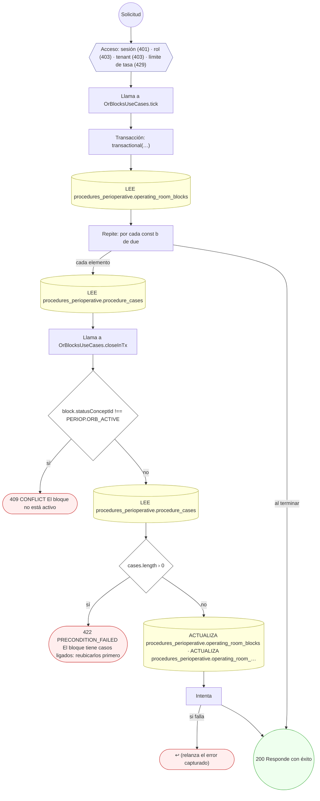

#### 4. POST /or-blocks/{id}/cancel

Cancelar un bloque

| HTTP | Código | Cuándo |
|---|---|---|
| 200 | — | Éxito |
| 400 | `VALIDATION_FAILED` | Los parámetros de ruta son UUID válidos; El cuerpo cumple el DTO (sin propiedades extra) |
| 401 | `UNAUTHENTICATED` | Hay una sesión válida (JWT) |
| 403 | `FORBIDDEN` | El rol está permitido; El tenant se resuelve y pertenece al actor; InsufficientRoleException: Su rol no permite esta acción sobre este espacio |
| 404 | `NOT_FOUND` | ResourceNotFoundException: Bloque no encontrado; ResourceNotFoundException: Espacio no encontrado; ResourceNotFoundException: Unidad clínica no encontrada; ResourceNotFoundException: Sitio no encontrado |
| 409 | `CONFLICT` | ConflictException: El bloque no está activo |
| 422 | `PRECONDITION_FAILED` | PreconditionFailedException: El bloque tiene casos ligados: reubicarlos primero |
| 429 | `RATE_LIMITED` | No se supera el límite de solicitudes |
| 500 | `INTERNAL` | Error: Acción de infraestructura no registrada: {action} |


#### 5. POST /or-blocks/{id}/release

Liberar un bloque

| HTTP | Código | Cuándo |
|---|---|---|
| 200 | — | Éxito |
| 400 | `VALIDATION_FAILED` | Los parámetros de ruta son UUID válidos; El cuerpo cumple el DTO (sin propiedades extra) |
| 401 | `UNAUTHENTICATED` | Hay una sesión válida (JWT) |
| 403 | `FORBIDDEN` | El rol está permitido; El tenant se resuelve y pertenece al actor; InsufficientRoleException: Su rol no permite esta acción sobre este espacio |
| 404 | `NOT_FOUND` | ResourceNotFoundException: Bloque no encontrado; ResourceNotFoundException: Espacio no encontrado; ResourceNotFoundException: Unidad clínica no encontrada; ResourceNotFoundException: Sitio no encontrado |
| 409 | `CONFLICT` | ConflictException: El bloque no está activo |
| 422 | `PRECONDITION_FAILED` | PreconditionFailedException: El bloque tiene casos ligados: reubicarlos primero |
| 429 | `RATE_LIMITED` | No se supera el límite de solicitudes |
| 500 | `INTERNAL` | Error: Acción de infraestructura no registrada: {action} |

```mermaid
flowchart TD
  n1(("Solicitud")):::inicio
  n2{{"Acceso: sesión (401) · rol (403) · tenant (403) · parámetros de ruta (400) · cuerpo válido (400) · límite de…"}}:::acceso
  n1 --> n2
  n3["Llama a OrBlocksUseCases.close"]:::llamada
  n2 --> n3
  n4["Transacción: transactional(…)"]:::transaccion
  n3 --> n4
  n5[("LEE procedures_perioperative.operating_room_blocks")]:::efecto
  n4 --> n5
  n6{"!block || block.tenantId !== req.tenantId"}:::decision
  n5 --> n6
  n7(["404 NOT_FOUND Bloque no encontrado"]):::error
  n6 -->|"sí"| n7
  n8["Llama a InfrastructureAccessService.assertCan"]:::llamada
  n6 -->|"no"| n8
  n9["Llama a InfrastructureAccessService.resolve"]:::llamada
  n8 --> n9
  n10{"'careSpaceId' in target"}:::decision
  n9 --> n10
  n11["Llama a CareSpacesRepository.findById"]:::llamada
  n10 -->|"sí"| n11
  n12[("LEE practice.care_spaces")]:::efecto
  n11 --> n12
  n13{"!found || found.tenantId !== tenantId"}:::decision
  n12 --> n13
  n14(["404 NOT_FOUND Espacio no encontrado"]):::error
  n13 -->|"sí"| n14
  n15{"'unitId' in target"}:::decision
  n10 -->|"no"| n15
  n16["Llama a ClinicalUnitsRepository.findById"]:::llamada
  n15 -->|"sí"| n16
  n17[("LEE practice.clinical_units")]:::efecto
  n16 --> n17
  n18{"!found || found.tenantId !== tenantId"}:::decision
  n17 --> n18
  n19(["404 NOT_FOUND Unidad clínica no encontrada"]):::error
  n18 -->|"sí"| n19
  n20["Llama a PracticeSitesRepository.findById"]:::llamada
  n13 -->|"no"| n20
  n18 -->|"no"| n20
  n15 -->|"no"| n20
  n21[("LEE practice.practice_sites")]:::efecto
  n20 --> n21
  n22{"!site || site.tenantId !== tenantId"}:::decision
  n21 --> n22
  n23(["404 NOT_FOUND Sitio no encontrado"]):::error
  n22 -->|"sí"| n23
  n24["Llama a CareSpaceOpsRepository.chain"]:::llamada
  n22 -->|"no"| n24
  n25[("LEE practice.care_spaces")]:::efecto
  n24 --> n25
  n26["Llama a CareSpaceOpsRepository.unitsOf"]:::llamada
  n25 --> n26
  n27[("LEE practice.space_unit_assignments · LEE practice.care_spaces · LEE practice.clinical_units")]:::efecto
  n26 --> n27
  n28["Llama a InfrastructureAccessService.actorScope"]:::llamada
  n27 --> n28
  n29["Llama a CareSpaceOpsRepository.grants"]:::llamada
  n28 --> n29
  n30[("LEE delegated_access.organization_user_assignments · LEE directory.tenant_memberships · LEE practice.care_spa…")]:::efecto
  n29 --> n30
  n31["Llama a InfrastructureAccessService.decide"]:::llamada
  n30 --> n31
  n32["Llama a InfraPolicyRegistry.rule"]:::llamada
  n31 --> n32
  n33{"!rule"}:::decision
  n32 --> n33
  n34(["500 INTERNAL Acción de infraestructura no registrada: {action}"]):::error
  n33 -->|"sí"| n34
  n35(["403 FORBIDDEN Su rol no permite esta acción sobre este espacio"]):::error
  n33 -->|"no"| n35
  n36["Llama a OrBlocksUseCases.closeInTx"]:::llamada
  n37{"block.statusConceptId !== PERIOP.ORB_ACTIVE"}:::decision
  n36 --> n37
  n38(["409 CONFLICT El bloque no está activo"]):::error
  n37 -->|"sí"| n38
  n39[("LEE procedures_perioperative.procedure_cases")]:::efecto
  n37 -->|"no"| n39
  n40{"cases.length › 0"}:::decision
  n39 --> n40
  n41(["422 PRECONDITION_FAILED El bloque tiene casos ligados: reubicarlos primero"]):::error
  n40 -->|"sí"| n41
  n42[("ACTUALIZA procedures_perioperative.operating_room_blocks · ACTUALIZA procedures_perioperative.operating_room_…")]:::efecto
  n40 -->|"no"| n42
  n43["Intenta"]:::intento
  n42 --> n43
  n44(["↩ (relanza el error capturado)"]):::error
  n43 -->|"si falla"| n44
  n45(("200 Responde con éxito")):::ok
  n43 --> n45
  classDef acceso fill:#eef,stroke:#66a
  classDef error fill:#fee,stroke:#c33
  classDef ok fill:#efe,stroke:#3a3
  classDef efecto fill:#ffd,stroke:#aa3
  classDef decision fill:#fff,stroke:#555
  classDef corte fill:#eee,stroke:#999,stroke-dasharray: 4
```

#### 6. POST /pacu-stays/{stayId}/assessments

Registrar una valoración de recuperación

| HTTP | Código | Cuándo |
|---|---|---|
| 201 | — | Éxito |
| 400 | `VALIDATION_FAILED` | Los parámetros de ruta son UUID válidos; El cuerpo cumple el DTO (sin propiedades extra) |
| 401 | `UNAUTHENTICATED` | Hay una sesión válida (JWT) |
| 403 | `FORBIDDEN` | El rol está permitido; El tenant se resuelve y pertenece al actor |
| 409 | `CONFLICT` | ConflictException: El paciente ya salió de recuperación |
| 429 | `RATE_LIMITED` | No se supera el límite de solicitudes |


#### 7. POST /pacu-stays/{stayId}/discharge

Dar el alta de recuperación

| HTTP | Código | Cuándo |
|---|---|---|
| 200 | — | Éxito |
| 400 | `VALIDATION_FAILED` | Los parámetros de ruta son UUID válidos; El cuerpo cumple el DTO (sin propiedades extra) |
| 401 | `UNAUTHENTICATED` | Hay una sesión válida (JWT) |
| 403 | `FORBIDDEN` | El rol está permitido; El tenant se resuelve y pertenece al actor |
| 409 | `CONFLICT` | ConflictException: El paciente ya salió de recuperación |
| 422 | `PRECONDITION_FAILED` | PreconditionFailedException: El alta de recuperación exige al menos una valoración; PreconditionFailedException: La última valoración no cumple el criterio de alta |
| 429 | `RATE_LIMITED` | No se supera el límite de solicitudes |


#### 8. POST /procedure-cases

Programar un caso quirúrgico y reservar el quirófano

| HTTP | Código | Cuándo |
|---|---|---|
| 201 | — | Éxito |
| 400 | `VALIDATION_FAILED` | El cuerpo cumple el DTO (sin propiedades extra) |
| 401 | `UNAUTHENTICATED` | Hay una sesión válida (JWT) |
| 403 | `FORBIDDEN` | El rol está permitido; El tenant se resuelve y pertenece al actor |
| 404 | `NOT_FOUND` | ResourceNotFoundException: Espacio no encontrado; ResourceNotFoundException: Sitio no encontrado |
| 409 | `CONFLICT` | ConflictException: La ventana cae en un bloque de otro dueño; ConflictException: El quirófano ya está reservado en esa ventana; ConflictException: No se pudo asignar número de caso |
| 422 | `PRECONDITION_FAILED` | PreconditionFailedException: El caso debe terminar después de empezar; PreconditionFailedException: Un caso urgente o de emergencia necesita justificar su urgencia; PreconditionFailedException: El quirófano es de otra sede; PreconditionFailedException: El espacio no es un quirófano; PreconditionFailedException: El quirófano no está disponible en esa ventana; PreconditionFailedException: El quirófano no tiene recurso agendable activo |
| 429 | `RATE_LIMITED` | No se supera el límite de solicitudes |

```mermaid
flowchart TD
  n1(("Solicitud")):::inicio
  n2{{"Acceso: sesión (401) · rol (403) · tenant (403) · cuerpo válido (400) · límite de tasa (429)"}}:::acceso
  n1 --> n2
  n3["Llama a PeriopCasesService.scheduleCase"]:::llamada
  n2 --> n3
  n4{"scheduledEndAt ‹= scheduledStartAt"}:::decision
  n3 --> n4
  n5(["422 PRECONDITION_FAILED El caso debe terminar después de empezar"]):::error
  n4 -->|"sí"| n5
  n6{"dto.caseType !== 'ELECTIVE' && !dto.urgencyReasonText"}:::decision
  n4 -->|"no"| n6
  n7(["422 PRECONDITION_FAILED Un caso urgente o de emergencia necesita justificar su urgencia"]):::error
  n6 -->|"sí"| n7
  n8["Transacción: transactional(…)"]:::transaccion
  n6 -->|"no"| n8
  n9["Llama a OperatingRoomValidator.validate"]:::llamada
  n8 --> n9
  n10["Llama a PracticeCareSpaceOpsAdapter.getOperationalState"]:::llamada
  n9 --> n10
  n11["Llama a PracticeCareSpaceOpsAdapter.load"]:::llamada
  n10 --> n11
  n12{"!space || (tenantId && space.tenantId !== tenantId)"}:::decision
  n11 --> n12
  n13(["404 NOT_FOUND Espacio no encontrado"]):::error
  n12 -->|"sí"| n13
  n14{"!site"}:::decision
  n12 -->|"no"| n14
  n15(["404 NOT_FOUND Sitio no encontrado"]):::error
  n14 -->|"sí"| n15
  n16{"input.practiceSiteId && room.practiceSiteId !== input.practiceSiteId"}:::decision
  n14 -->|"no"| n16
  n17(["422 PRECONDITION_FAILED El quirófano es de otra sede"]):::error
  n16 -->|"sí"| n17
  n18{"room.functionCode !== 'SPACE_FN_OPERATING_ROOM'"}:::decision
  n16 -->|"no"| n18
  n19(["422 PRECONDITION_FAILED El espacio no es un quirófano"]):::error
  n18 -->|"sí"| n19
  n20["Intenta"]:::intento
  n18 -->|"no"| n20
  n21["Llama a PracticeCareSpaceOpsAdapter.assertBookable"]:::llamada
  n20 --> n21
  n22["Llama a PracticeCareSpaceOpsAdapter.load"]:::llamada
  n21 --> n22
  n23{"!space || (tenantId && space.tenantId !== tenantId)"}:::decision
  n22 --> n23
  n24(["404 NOT_FOUND Espacio no encontrado"]):::error
  n23 -->|"sí"| n24
  n25{"!site"}:::decision
  n23 -->|"no"| n25
  n26(["404 NOT_FOUND Sitio no encontrado"]):::error
  n25 -->|"sí"| n26
  n27{"snapAxes.lifecycle !== 'ACTIVE' || !snapAxes.inValidity"}:::decision
  n25 -->|"no"| n27
  n28(["↩ (relanza el error capturado)"]):::error
  n27 -->|"sí"| n28
  n29["Llama a CareSpaceOpsRepository.openBlocks"]:::llamada
  n27 -->|"no"| n29
  n30[("LEE practice.care_space_blocks")]:::efecto
  n29 --> n30
  n31{"hit"}:::decision
  n30 --> n31
  n32(["↩ (relanza el error capturado)"]):::error
  n31 -->|"sí"| n32
  n33{"e.reason !== 'SPACE_NOT_BOOKABLE'"}:::decision
  n20 -->|"si falla"| n33
  n34(["↩ (relanza el error capturado)"]):::error
  n33 -->|"sí"| n34
  n35(["422 PRECONDITION_FAILED El quirófano no está disponible en esa ventana"]):::error
  n33 -->|"no"| n35
  n36[("LEE scheduling.schedulable_resources")]:::efecto
  n31 -->|"no"| n36
  n37{"!resource"}:::decision
  n36 --> n37
  n38(["422 PRECONDITION_FAILED El quirófano no tiene recurso agendable activo"]):::error
  n37 -->|"sí"| n38
  n39[("LEE procedures_perioperative.operating_room_blocks")]:::efecto
  n37 -->|"no"| n39
  n40["Repite: por cada const b de blocks"]:::bucle
  n39 --> n40
  n41{"own"}:::decision
  n40 -->|"cada elemento"| n41
  n42{"input.caseType === 'ELECTIVE'"}:::decision
  n41 -->|"no"| n42
  n43(["409 CONFLICT La ventana cae en un bloque de otro dueño"]):::error
  n42 -->|"sí"| n43
  n44[("LEE procedures_perioperative.procedure_cases")]:::efecto
  n41 -->|"sí"| n44
  n42 -->|"no"| n44
  n40 -->|"al terminar"| n44
  n45{"conflict"}:::decision
  n44 --> n45
  n46(["409 CONFLICT El quirófano ya está reservado en esa ventana"]):::error
  n45 -->|"sí"| n46
  n47["Llama a PeriopCasesService.nextCaseNumber"]:::llamada
  n45 -->|"no"| n47
  n48["Llama a PeriopCasesRepository.countCases"]:::llamada
  n47 --> n48
  n49[("LEE procedures_perioperative.procedure_cases")]:::efecto
  n48 --> n49
  n50["Repite: ciclo for"]:::bucle
  n49 --> n50
  n51["Llama a PeriopCasesRepository.findCaseByNumber"]:::llamada
  n50 -->|"cada elemento"| n51
  n52[("LEE procedures_perioperative.procedure_cases")]:::efecto
  n51 --> n52
  n53(["409 CONFLICT No se pudo asignar número de caso"]):::error
  n52 --> n53
  n50 -->|"al terminar"| n53
  n54["Llama a PeriopCasesRepository.createCase"]:::llamada
  n55[("CREA procedures_perioperative.procedure_cases")]:::efecto
  n54 --> n55
  n56[("ACTUALIZA procedures_perioperative.procedure_cases · ACTUALIZA procedures_perioperative.procedure_cases · ACT…")]:::efecto
  n55 --> n56
  n57["Llama a PeriopCasesRepository.createStatusHistory"]:::llamada
  n56 --> n57
  n58[("CREA procedures_perioperative.procedure_case_status_history")]:::efecto
  n57 --> n58
  n59["Llama a PeriopCasesRepository.createMilestone"]:::llamada
  n58 --> n59
  n60[("CREA procedures_perioperative.procedure_case_milestones")]:::efecto
  n59 --> n60
  n61["Llama a PeriopCasesRepository.createUtilizationEvent"]:::llamada
  n60 --> n61
  n62[("CREA procedures_perioperative.operating_room_utilization_events")]:::efecto
  n61 --> n62
  n63["Llama a PeriopCasesRepository.createTeamMember"]:::llamada
  n62 --> n63
  n64[("CREA procedures_perioperative.procedure_case_team_members")]:::efecto
  n63 --> n64
  n65(("201 Responde con éxito")):::ok
  n64 --> n65
  classDef acceso fill:#eef,stroke:#66a
  classDef error fill:#fee,stroke:#c33
  classDef ok fill:#efe,stroke:#3a3
  classDef efecto fill:#ffd,stroke:#aa3
  classDef decision fill:#fff,stroke:#555
  classDef corte fill:#eee,stroke:#999,stroke-dasharray: 4
```

#### 9. GET /procedure-cases/{id}

Detalle completo del caso quirúrgico

| HTTP | Código | Cuándo |
|---|---|---|
| 200 | — | Éxito |
| 400 | `VALIDATION_FAILED` | Los parámetros de ruta son UUID válidos |
| 401 | `UNAUTHENTICATED` | Hay una sesión válida (JWT) |
| 403 | `FORBIDDEN` | El rol está permitido; El tenant se resuelve y pertenece al actor; ForbiddenException: {WITHOUT_ACCESS_TO_HISTORY} |
| 404 | `NOT_FOUND` | ResourceNotFoundException: Espacio no encontrado; ResourceNotFoundException: Unidad clínica no encontrada; ResourceNotFoundException: Sitio no encontrado |
| 429 | `RATE_LIMITED` | No se supera el límite de solicitudes |

```mermaid
flowchart TD
  n1(("Solicitud")):::inicio
  n2{{"Acceso: sesión (401) · rol (403) · tenant (403) · parámetros de ruta (400) · límite de tasa (429)"}}:::acceso
  n1 --> n2
  n3["Llama a PeriopCasesService.getCaseDetail"]:::llamada
  n2 --> n3
  n4["Llama a PeriopCasesRepository.findCaseById"]:::llamada
  n3 --> n4
  n5[("LEE procedures_perioperative.procedure_cases")]:::efecto
  n4 --> n5
  n6["Llama a PeriopCasesService.assertCanReadCaseDetail"]:::llamada
  n5 --> n6
  n7{"profileId"}:::decision
  n6 --> n7
  n8["Llama a PeriopCasesRepository.findTeamByCase"]:::llamada
  n7 -->|"sí"| n8
  n9[("LEE procedures_perioperative.procedure_case_team_members")]:::efecto
  n8 --> n9
  n10["Intenta"]:::intento
  n9 --> n10
  n7 -->|"no"| n10
  n11["Llama a ClinicalReadService.assertCanReadHistory"]:::llamada
  n10 --> n11
  n12{"!actor.roles.some((role) =› ROLES_THAT_ATTEND.includes(role))"}:::decision
  n11 --> n12
  n13["Llama a ClinicalReadService.assertOwnRecord"]:::llamada
  n12 -->|"sí"| n13
  n14{"!link || !profile || profile.profileId !== link.personId"}:::decision
  n13 --> n14
  n15(["403 FORBIDDEN {WITHOUT_ACCESS_TO_HISTORY}"]):::error
  n14 -->|"sí"| n15
  n16["Llama a PersonAccountLinksRepository.findActiveByUser"]:::llamada
  n14 -->|"no"| n16
  n12 -->|"no"| n16
  n17[("LEE profiles.person_account_links")]:::efecto
  n16 --> n17
  n18["Llama a HealthPractitionerProfilesRepository.findById"]:::llamada
  n17 --> n18
  n19[("LEE profiles.health_practitioner_profiles")]:::efecto
  n18 --> n19
  n20["Llama a ClinicalReadService.assertOwnRecord"]:::llamada
  n19 --> n20
  n21{"!link || !profile || profile.profileId !== link.personId"}:::decision
  n20 --> n21
  n22(["403 FORBIDDEN {WITHOUT_ACCESS_TO_HISTORY}"]):::error
  n21 -->|"sí"| n22
  n23{"error instanceof ForbiddenException"}:::decision
  n10 -->|"si falla"| n23
  n24(["↩ (relanza el error capturado)"]):::error
  n23 -->|"sí"| n24
  n25(["↩ (relanza el error capturado)"]):::error
  n23 -->|"no"| n25
  n26["Llama a PeriopCasesRepository.findDiagnosesByCase"]:::llamada
  n21 -->|"no"| n26
  n27[("LEE procedures_perioperative.procedure_case_diagnoses")]:::efecto
  n26 --> n27
  n28["Llama a PeriopCasesRepository.findTeamByCase"]:::llamada
  n27 --> n28
  n29[("LEE procedures_perioperative.procedure_case_team_members")]:::efecto
  n28 --> n29
  n30["Llama a PeriopCasesRepository.findMilestonesByCase"]:::llamada
  n29 --> n30
  n31[("LEE procedures_perioperative.procedure_case_milestones")]:::efecto
  n30 --> n31
  n32["Llama a PeriopPreopRepository.findOrdersByCase"]:::llamada
  n31 --> n32
  n33[("LEE procedures_perioperative.preoperative_orders")]:::efecto
  n32 --> n33
  n34["Llama a PeriopPreopRepository.findAssessmentByCase"]:::llamada
  n33 --> n34
  n35[("LEE procedures_perioperative.preoperative_assessments")]:::efecto
  n34 --> n35
  n36["Llama a PeriopPreopRepository.findAnesthesiaPlanByCase"]:::llamada
  n35 --> n36
  n37[("LEE procedures_perioperative.anesthesia_plans")]:::efecto
  n36 --> n37
  n38["Llama a PeriopIntraopRepository.findReportsByCase"]:::llamada
  n37 --> n38
  n39[("LEE procedures_perioperative.operative_reports")]:::efecto
  n38 --> n39
  n40["Llama a PeriopIntraopRepository.findStepsByCase"]:::llamada
  n39 --> n40
  n41[("LEE procedures_perioperative.operative_steps")]:::efecto
  n40 --> n41
  n42["Llama a PeriopIntraopRepository.findFindingsByCase"]:::llamada
  n41 --> n42
  n43[("LEE procedures_perioperative.operative_findings")]:::efecto
  n42 --> n43
  n44["Llama a PeriopIntraopRepository.findImplantsByCase"]:::llamada
  n43 --> n44
  n45[("LEE procedures_perioperative.procedure_implants")]:::efecto
  n44 --> n45
  n46["Llama a PeriopIntraopRepository.findIdentifiersByImplants"]:::llamada
  n45 --> n46
  n47[("LEE procedures_perioperative.implant_identifiers")]:::efecto
  n46 --> n47
  n48["Llama a CaseOrViewBuilder.fields"]:::llamada
  n47 --> n48
  n49[("LEE practice.care_spaces")]:::efecto
  n48 --> n49
  n50["Llama a CaseOrViewBuilder.blockLabels"]:::llamada
  n49 --> n50
  n51[("LEE procedures_perioperative.operating_room_blocks · LEE practice.clinical_units · LEE terminology.catalog_co…")]:::efecto
  n50 --> n51
  n52[("LEE terminology.catalog_concepts")]:::efecto
  n51 --> n52
  n53["Llama a CaseOrViewBuilder.detail"]:::llamada
  n52 --> n53
  n54[("LEE procedures_perioperative.surgical_safety_checklists · LEE procedures_perioperative.operating_room_utiliza…")]:::efecto
  n53 --> n54
  n55{"!order && out && c.operatingRoomId"}:::decision
  n54 --> n55
  n56[("LEE practice.cleaning_orders")]:::efecto
  n55 -->|"sí"| n56
  n57{"order && status"}:::decision
  n56 --> n57
  n55 -->|"no"| n57
  n58["Llama a InfrastructureAccessService.actionsOn"]:::llamada
  n57 -->|"sí"| n58
  n59["Llama a InfrastructureAccessService.resolve"]:::llamada
  n58 --> n59
  n60{"'careSpaceId' in target"}:::decision
  n59 --> n60
  n61{"!found || found.tenantId !== tenantId"}:::decision
  n60 -->|"sí"| n61
  n62(["404 NOT_FOUND Espacio no encontrado"]):::error
  n61 -->|"sí"| n62
  n63{"'unitId' in target"}:::decision
  n60 -->|"no"| n63
  n64{"!found || found.tenantId !== tenantId"}:::decision
  n63 -->|"sí"| n64
  n65(["404 NOT_FOUND Unidad clínica no encontrada"]):::error
  n64 -->|"sí"| n65
  n66{"!site || site.tenantId !== tenantId"}:::decision
  n61 -->|"no"| n66
  n64 -->|"no"| n66
  n63 -->|"no"| n66
  n67(["404 NOT_FOUND Sitio no encontrado"]):::error
  n66 -->|"sí"| n67
  n68(("200 Responde con éxito")):::ok
  n66 -->|"no"| n68
  n57 -->|"no"| n68
  classDef acceso fill:#eef,stroke:#66a
  classDef error fill:#fee,stroke:#c33
  classDef ok fill:#efe,stroke:#3a3
  classDef efecto fill:#ffd,stroke:#aa3
  classDef decision fill:#fff,stroke:#555
  classDef corte fill:#eee,stroke:#999,stroke-dasharray: 4
```

#### 10. PATCH /procedure-cases/{id}

Modificar el caso quirúrgico

| HTTP | Código | Cuándo |
|---|---|---|
| 200 | — | Éxito |
| 400 | `VALIDATION_FAILED` | Los parámetros de ruta son UUID válidos; El cuerpo cumple el DTO (sin propiedades extra) |
| 401 | `UNAUTHENTICATED` | Hay una sesión válida (JWT) |
| 403 | `FORBIDDEN` | El rol está permitido; El tenant se resuelve y pertenece al actor |
| 404 | `NOT_FOUND` | ResourceNotFoundException: Espacio no encontrado; ResourceNotFoundException: Sitio no encontrado |
| 409 | `CONFLICT` | ConflictException: La ventana cae en un bloque de otro dueño; ConflictException: El quirófano ya está reservado en esa ventana |
| 422 | `PRECONDITION_FAILED` | PreconditionFailedException: El caso está cancelado; PreconditionFailedException: CAN-INT-001: el paciente de la intervención no puede cambiarse una vez confirmada; cancele el caso y cree uno nuevo; PreconditionFailedException: CAN-INT-001: el paciente no puede cambiarse: el caso ya tiene asignaciones o evidencias asociadas; PreconditionFailedException: El caso debe terminar después de empezar; PreconditionFailedException: El quirófano es de otra sede; PreconditionFailedException: El espacio no es un quirófano; PreconditionFailedException: El quirófano no está disponible en esa ventana; PreconditionFailedException: El quirófano no tiene recurso agendable activo |
| 429 | `RATE_LIMITED` | No se supera el límite de solicitudes |

```mermaid
flowchart TD
  n1(("Solicitud")):::inicio
  n2{{"Acceso: sesión (401) · rol (403) · tenant (403) · parámetros de ruta (400) · cuerpo válido (400) · límite de…"}}:::acceso
  n1 --> n2
  n3["Llama a PeriopCasesService.updateCase"]:::llamada
  n2 --> n3
  n4["Transacción: transactional(…)"]:::transaccion
  n3 --> n4
  n5{"surgicalCase.statusConceptId === CONCEPTS.CASE_CANCELLED"}:::decision
  n4 --> n5
  n6(["422 PRECONDITION_FAILED El caso está cancelado"]):::error
  n5 -->|"sí"| n6
  n7{"dto.patientProfileId && dto.patientProfileId !== surgicalCase.patientProfileId"}:::decision
  n5 -->|"no"| n7
  n8{"surgicalCase.statusConceptId !== CASE_DRAFT_STATE"}:::decision
  n7 -->|"sí"| n8
  n9(["422 PRECONDITION_FAILED CAN-INT-001: el paciente de la intervención no puede cambiarse una vez confirmada; ca…"]):::error
  n8 -->|"sí"| n9
  n10["Llama a PeriopCasesService.caseHasBlockingDependencies"]:::llamada
  n8 -->|"no"| n10
  n11["Llama a PeriopCasesRepository.findTeamByCase"]:::llamada
  n10 --> n11
  n12[("LEE procedures_perioperative.procedure_case_team_members")]:::efecto
  n11 --> n12
  n13["Llama a PeriopCasesRepository.findDiagnosesByCase"]:::llamada
  n12 --> n13
  n14[("LEE procedures_perioperative.procedure_case_diagnoses")]:::efecto
  n13 --> n14
  n15{"await this.caseHasBlockingDependencies(tx, surgicalCase)"}:::decision
  n14 --> n15
  n16(["422 PRECONDITION_FAILED CAN-INT-001: el paciente no puede cambiarse: el caso ya tiene asignaciones o evidenci…"]):::error
  n15 -->|"sí"| n16
  n17{"surgicalCase.scheduledStartAt && surgicalCase.scheduledEndAt && surgicalCase.scheduledEndAt ‹= surgicalCase.s…"}:::decision
  n15 -->|"no"| n17
  n7 -->|"no"| n17
  n18(["422 PRECONDITION_FAILED El caso debe terminar después de empezar"]):::error
  n17 -->|"sí"| n18
  n19{"(dto.scheduledStartAt || dto.scheduledEndAt) && surgicalCase.operatingRoomId && surgicalCase.scheduledStartAt…"}:::decision
  n17 -->|"no"| n19
  n20["Llama a OperatingRoomValidator.validate"]:::llamada
  n19 -->|"sí"| n20
  n21["Llama a PracticeCareSpaceOpsAdapter.getOperationalState"]:::llamada
  n20 --> n21
  n22["Llama a PracticeCareSpaceOpsAdapter.load"]:::llamada
  n21 --> n22
  n23{"!space || (tenantId && space.tenantId !== tenantId)"}:::decision
  n22 --> n23
  n24(["404 NOT_FOUND Espacio no encontrado"]):::error
  n23 -->|"sí"| n24
  n25{"!site"}:::decision
  n23 -->|"no"| n25
  n26(["404 NOT_FOUND Sitio no encontrado"]):::error
  n25 -->|"sí"| n26
  n27{"input.practiceSiteId && room.practiceSiteId !== input.practiceSiteId"}:::decision
  n25 -->|"no"| n27
  n28(["422 PRECONDITION_FAILED El quirófano es de otra sede"]):::error
  n27 -->|"sí"| n28
  n29{"room.functionCode !== 'SPACE_FN_OPERATING_ROOM'"}:::decision
  n27 -->|"no"| n29
  n30(["422 PRECONDITION_FAILED El espacio no es un quirófano"]):::error
  n29 -->|"sí"| n30
  n31["Intenta"]:::intento
  n29 -->|"no"| n31
  n32["Llama a PracticeCareSpaceOpsAdapter.assertBookable"]:::llamada
  n31 --> n32
  n33["Llama a PracticeCareSpaceOpsAdapter.load"]:::llamada
  n32 --> n33
  n34{"!space || (tenantId && space.tenantId !== tenantId)"}:::decision
  n33 --> n34
  n35(["404 NOT_FOUND Espacio no encontrado"]):::error
  n34 -->|"sí"| n35
  n36{"!site"}:::decision
  n34 -->|"no"| n36
  n37(["404 NOT_FOUND Sitio no encontrado"]):::error
  n36 -->|"sí"| n37
  n38{"snapAxes.lifecycle !== 'ACTIVE' || !snapAxes.inValidity"}:::decision
  n36 -->|"no"| n38
  n39(["↩ (relanza el error capturado)"]):::error
  n38 -->|"sí"| n39
  n40["Llama a CareSpaceOpsRepository.openBlocks"]:::llamada
  n38 -->|"no"| n40
  n41[("LEE practice.care_space_blocks")]:::efecto
  n40 --> n41
  n42{"hit"}:::decision
  n41 --> n42
  n43(["↩ (relanza el error capturado)"]):::error
  n42 -->|"sí"| n43
  n44{"e.reason !== 'SPACE_NOT_BOOKABLE'"}:::decision
  n31 -->|"si falla"| n44
  n45(["↩ (relanza el error capturado)"]):::error
  n44 -->|"sí"| n45
  n46(["422 PRECONDITION_FAILED El quirófano no está disponible en esa ventana"]):::error
  n44 -->|"no"| n46
  n47[("LEE scheduling.schedulable_resources")]:::efecto
  n42 -->|"no"| n47
  n48{"!resource"}:::decision
  n47 --> n48
  n49(["422 PRECONDITION_FAILED El quirófano no tiene recurso agendable activo"]):::error
  n48 -->|"sí"| n49
  n50[("LEE procedures_perioperative.operating_room_blocks")]:::efecto
  n48 -->|"no"| n50
  n51["Repite: por cada const b de blocks"]:::bucle
  n50 --> n51
  n52{"own"}:::decision
  n51 -->|"cada elemento"| n52
  n53{"input.caseType === 'ELECTIVE'"}:::decision
  n52 -->|"no"| n53
  n54(["409 CONFLICT La ventana cae en un bloque de otro dueño"]):::error
  n53 -->|"sí"| n54
  n55[("LEE procedures_perioperative.procedure_cases")]:::efecto
  n52 -->|"sí"| n55
  n53 -->|"no"| n55
  n51 -->|"al terminar"| n55
  n56{"conflict"}:::decision
  n55 --> n56
  n57(["409 CONFLICT El quirófano ya está reservado en esa ventana"]):::error
  n56 -->|"sí"| n57
  n58["Llama a PeriopReacceptanceService.invalidate"]:::llamada
  n56 -->|"no"| n58
  n19 -->|"no"| n58
  n59["Llama a PeriopCasesRepository.findTeamByCase"]:::llamada
  n58 --> n59
  n60[("LEE procedures_perioperative.procedure_case_team_members")]:::efecto
  n59 --> n60
  n61["Repite: por cada const member de team"]:::bucle
  n60 --> n61
  n62[("ACTUALIZA procedures_perioperative.procedure_case_team_members · ACTUALIZA procedures_perioperative.procedure…")]:::efecto
  n61 -->|"cada elemento"| n62
  n63{"surgicalCase.statusConceptId === CONCEPTS.CASE_READY_FOR_SURGERY"}:::decision
  n62 --> n63
  n61 -->|"al terminar"| n63
  n64["Llama a PeriopCasesRepository.createStatusHistory"]:::llamada
  n63 -->|"sí"| n64
  n65[("CREA procedures_perioperative.procedure_case_status_history")]:::efecto
  n64 --> n65
  n66[("ACTUALIZA procedures_perioperative.procedure_cases")]:::efecto
  n65 --> n66
  n67["Llama a OutboxService.publishDomainEvent"]:::llamada
  n66 --> n67
  n63 -->|"no"| n67
  n68["Llama a MessagingTraceService.runInProducerSpan"]:::llamada
  n67 --> n68
  n69["Transacción: startActiveSpan(…)"]:::transaccion
  n68 --> n69
  n70["Intenta"]:::intento
  n69 --> n70
  n71["… el resto del árbol (1 nodos) está en el JSON del inventario"]:::corte
  n70 -->|"si falla"| n71
  classDef acceso fill:#eef,stroke:#66a
  classDef error fill:#fee,stroke:#c33
  classDef ok fill:#efe,stroke:#3a3
  classDef efecto fill:#ffd,stroke:#aa3
  classDef decision fill:#fff,stroke:#555
  classDef corte fill:#eee,stroke:#999,stroke-dasharray: 4
```

#### 11. POST /procedure-cases/{id}/anesthesia-events

Anotar un evento intraoperatorio de anestesia

| HTTP | Código | Cuándo |
|---|---|---|
| 201 | — | Éxito |
| 400 | `VALIDATION_FAILED` | Los parámetros de ruta son UUID válidos; El cuerpo cumple el DTO (sin propiedades extra) |
| 401 | `UNAUTHENTICATED` | Hay una sesión válida (JWT) |
| 403 | `FORBIDDEN` | El rol está permitido; El tenant se resuelve y pertenece al actor |
| 422 | `PRECONDITION_FAILED` | PreconditionFailedException: El caso está cancelado; PreconditionFailedException: La inducción exige un plan de anestesia aprobado |
| 429 | `RATE_LIMITED` | No se supera el límite de solicitudes |


#### 12. POST /procedure-cases/{id}/anesthesia-plans

Registrar el plan de anestesia y la valoración de vía aérea

| HTTP | Código | Cuándo |
|---|---|---|
| 201 | — | Éxito |
| 400 | `VALIDATION_FAILED` | Los parámetros de ruta son UUID válidos; El cuerpo cumple el DTO (sin propiedades extra) |
| 401 | `UNAUTHENTICATED` | Hay una sesión válida (JWT) |
| 403 | `FORBIDDEN` | El rol está permitido; El tenant se resuelve y pertenece al actor |
| 409 | `CONFLICT` | ConflictException: El caso ya tiene plan de anestesia |
| 422 | `PRECONDITION_FAILED` | PreconditionFailedException: Una vía aérea difícil anticipada necesita plan de rescate; PreconditionFailedException: El caso está cancelado |
| 429 | `RATE_LIMITED` | No se supera el límite de solicitudes |


#### 13. POST /procedure-cases/{id}/anesthesia-plans/{planId}/approve

Aprobar el plan de anestesia

| HTTP | Código | Cuándo |
|---|---|---|
| 200 | — | Éxito |
| 400 | `VALIDATION_FAILED` | Los parámetros de ruta son UUID válidos |
| 401 | `UNAUTHENTICATED` | Hay una sesión válida (JWT) |
| 403 | `FORBIDDEN` | El rol está permitido; El tenant se resuelve y pertenece al actor |
| 404 | `NOT_FOUND` | ResourceNotFoundException: Plan de anestesia no encontrado |
| 409 | `CONFLICT` | ConflictException: El plan ya está aprobado |
| 422 | `PRECONDITION_FAILED` | PreconditionFailedException: El plan pertenece a otro caso |
| 429 | `RATE_LIMITED` | No se supera el límite de solicitudes |

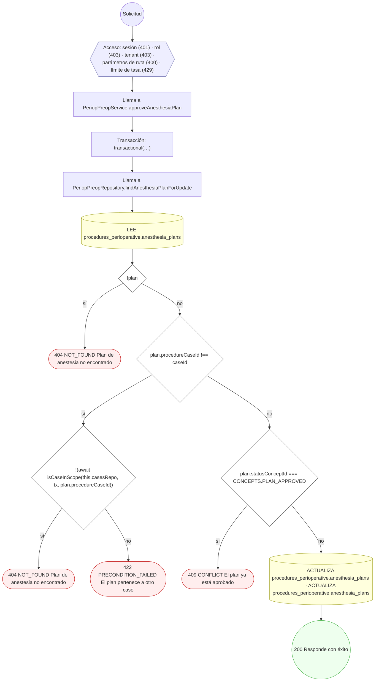

#### 14. POST /procedure-cases/{id}/cancel

Cancelar el caso quirúrgico

| HTTP | Código | Cuándo |
|---|---|---|
| 200 | — | Éxito |
| 400 | `VALIDATION_FAILED` | Los parámetros de ruta son UUID válidos; El cuerpo cumple el DTO (sin propiedades extra) |
| 401 | `UNAUTHENTICATED` | Hay una sesión válida (JWT) |
| 403 | `FORBIDDEN` | El rol está permitido; El tenant se resuelve y pertenece al actor |
| 409 | `CONFLICT` | ConflictException: El caso ya está cancelado |
| 422 | `PRECONDITION_FAILED` | PreconditionFailedException: El caso no admite cancelación en su estado actual |
| 429 | `RATE_LIMITED` | No se supera el límite de solicitudes |


#### 15. POST /procedure-cases/{id}/charge-items/post

Generar los cargos y consolidar el uso del quirófano

| HTTP | Código | Cuándo |
|---|---|---|
| 201 | — | Éxito |
| 400 | `VALIDATION_FAILED` | Los parámetros de ruta son UUID válidos; El cuerpo cumple el DTO (sin propiedades extra) |
| 401 | `UNAUTHENTICATED` | Hay una sesión válida (JWT) |
| 403 | `FORBIDDEN` | El rol está permitido; El tenant se resuelve y pertenece al actor |
| 409 | `CONFLICT` | ConflictException: El caso ya tiene cargos emitidos |
| 422 | `PRECONDITION_FAILED` | PreconditionFailedException: El cargo de sala se genera automáticamente al completar el caso; PreconditionFailedException: Sólo se factura un caso completado |
| 429 | `RATE_LIMITED` | No se supera el límite de solicitudes |

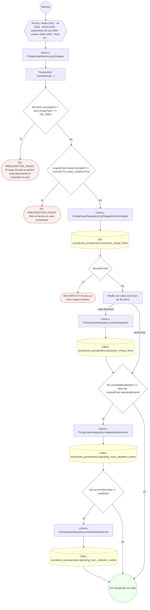

#### 16. POST /procedure-cases/{id}/confirm

Confirmar la intervención verificando las credenciales del equipo

| HTTP | Código | Cuándo |
|---|---|---|
| 200 | — | Éxito |
| 400 | `VALIDATION_FAILED` | Los parámetros de ruta son UUID válidos |
| 401 | `UNAUTHENTICATED` | Hay una sesión válida (JWT) |
| 403 | `FORBIDDEN` | El rol está permitido; El tenant se resuelve y pertenece al actor |
| 422 | `PRECONDITION_FAILED` | PreconditionFailedException: El caso está cancelado; PreconditionFailedException: El caso no admite confirmación en su estado actual; PreconditionFailedException: CAN-INT-002: no puede confirmarse: hay integrantes del equipo sin credencial profesional vigente |
| 429 | `RATE_LIMITED` | No se supera el límite de solicitudes |


#### 17. POST /procedure-cases/{id}/diagnoses

Registrar los diagnósticos del caso

| HTTP | Código | Cuándo |
|---|---|---|
| 201 | — | Éxito |
| 400 | `VALIDATION_FAILED` | Los parámetros de ruta son UUID válidos; El cuerpo cumple el DTO (sin propiedades extra) |
| 401 | `UNAUTHENTICATED` | Hay una sesión válida (JWT) |
| 403 | `FORBIDDEN` | El rol está permitido; El tenant se resuelve y pertenece al actor |
| 404 | `NOT_FOUND` | ResourceNotFoundException: Encuentro no encontrado |
| 409 | `CONFLICT` | ConflictException: El caso sólo admite un diagnóstico principal; ConflictException: El paciente ya tiene esa condición activa |
| 422 | `PRECONDITION_FAILED` | PreconditionFailedException: El caso está cancelado; PreconditionFailedException: Indique la condición por `conditionId` o por `conditionCodeConceptId`; PreconditionFailedException: Un diagnóstico se registra presuntivo o confirmado. |
| 429 | `RATE_LIMITED` | No se supera el límite de solicitudes |
| 500 | `INTERNAL` | Error: Entidad de historial no registrada: {entity} |


#### 18. POST /procedure-cases/{id}/findings

Registrar un hallazgo operatorio

| HTTP | Código | Cuándo |
|---|---|---|
| 201 | — | Éxito |
| 400 | `VALIDATION_FAILED` | Los parámetros de ruta son UUID válidos; El cuerpo cumple el DTO (sin propiedades extra) |
| 401 | `UNAUTHENTICATED` | Hay una sesión válida (JWT) |
| 403 | `FORBIDDEN` | El rol está permitido; El tenant se resuelve y pertenece al actor |
| 404 | `NOT_FOUND` | ResourceNotFoundException: Paso operatorio no encontrado |
| 422 | `PRECONDITION_FAILED` | PreconditionFailedException: El caso no está en curso; PreconditionFailedException: El paso pertenece a otro caso |
| 429 | `RATE_LIMITED` | No se supera el límite de solicitudes |

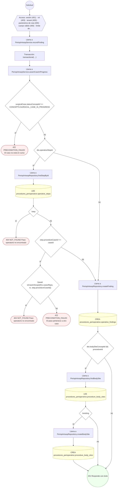

#### 19. POST /procedure-cases/{id}/implants

Registrar un implante con su trazabilidad UDI, lote o serie

| HTTP | Código | Cuándo |
|---|---|---|
| 201 | — | Éxito |
| 400 | `VALIDATION_FAILED` | Los parámetros de ruta son UUID válidos; El cuerpo cumple el DTO (sin propiedades extra) |
| 401 | `UNAUTHENTICATED` | Hay una sesión válida (JWT) |
| 403 | `FORBIDDEN` | El rol está permitido; El tenant se resuelve y pertenece al actor |
| 422 | `PRECONDITION_FAILED` | PreconditionFailedException: El caso no está en curso |
| 429 | `RATE_LIMITED` | No se supera el límite de solicitudes |

```mermaid
flowchart TD
  n1(("Solicitud")):::inicio
  n2{{"Acceso: sesión (401) · rol (403) · tenant (403) · parámetros de ruta (400) · cuerpo válido (400) · límite de…"}}:::acceso
  n1 --> n2
  n3["Llama a PeriopIntraopService.recordImplant"]:::llamada
  n2 --> n3
  n4["Transacción: transactional(…)"]:::transaccion
  n3 --> n4
  n5["Llama a PeriopIntraopService.assertCaseInProgress"]:::llamada
  n4 --> n5
  n6{"surgicalCase.statusConceptId !== CONCEPTS.SURGICAL_CASE_IN_PROGRESS"}:::decision
  n5 --> n6
  n7(["422 PRECONDITION_FAILED El caso no está en curso"]):::error
  n6 -->|"sí"| n7
  n8["Llama a PeriopIntraopRepository.createImplant"]:::llamada
  n6 -->|"no"| n8
  n9[("CREA procedures_perioperative.procedure_implants")]:::efecto
  n8 --> n9
  n10["Llama a PeriopIntraopRepository.createImplantIdentifier"]:::llamada
  n9 --> n10
  n11[("CREA procedures_perioperative.implant_identifiers")]:::efecto
  n10 --> n11
  n12["Llama a PeriopIntraopRepository.createDevice"]:::llamada
  n11 --> n12
  n13[("CREA procedures_perioperative.procedure_devices")]:::efecto
  n12 --> n13
  n14(("201 Responde con éxito")):::ok
  n13 --> n14
  classDef acceso fill:#eef,stroke:#66a
  classDef error fill:#fee,stroke:#c33
  classDef ok fill:#efe,stroke:#3a3
  classDef efecto fill:#ffd,stroke:#aa3
  classDef decision fill:#fff,stroke:#555
  classDef corte fill:#eee,stroke:#999,stroke-dasharray: 4
```

#### 20. POST /procedure-cases/{id}/medication-uses

Registrar el uso de un medicamento en la intervención

| HTTP | Código | Cuándo |
|---|---|---|
| 201 | — | Éxito |
| 400 | `VALIDATION_FAILED` | Los parámetros de ruta son UUID válidos; El cuerpo cumple el DTO (sin propiedades extra) |
| 401 | `UNAUTHENTICATED` | Hay una sesión válida (JWT) |
| 403 | `FORBIDDEN` | El rol está permitido; El tenant se resuelve y pertenece al actor |
| 422 | `PRECONDITION_FAILED` | PreconditionFailedException: El caso no está en curso; PreconditionFailedException: El paso no pertenece al caso |
| 429 | `RATE_LIMITED` | No se supera el límite de solicitudes |

```mermaid
flowchart TD
  n1(("Solicitud")):::inicio
  n2{{"Acceso: sesión (401) · rol (403) · tenant (403) · parámetros de ruta (400) · cuerpo válido (400) · límite de…"}}:::acceso
  n1 --> n2
  n3["Llama a PeriopIntraopService.recordMedicationUse"]:::llamada
  n2 --> n3
  n4["Transacción: transactional(…)"]:::transaccion
  n3 --> n4
  n5["Llama a PeriopIntraopService.assertCaseInProgress"]:::llamada
  n4 --> n5
  n6{"surgicalCase.statusConceptId !== CONCEPTS.SURGICAL_CASE_IN_PROGRESS"}:::decision
  n5 --> n6
  n7(["422 PRECONDITION_FAILED El caso no está en curso"]):::error
  n6 -->|"sí"| n7
  n8{"dto.operativeStepId"}:::decision
  n6 -->|"no"| n8
  n9["Llama a PeriopIntraopRepository.findStepById"]:::llamada
  n8 -->|"sí"| n9
  n10[("LEE procedures_perioperative.operative_steps")]:::efecto
  n9 --> n10
  n11{"!step || step.procedureCaseId !== caseId"}:::decision
  n10 --> n11
  n12(["422 PRECONDITION_FAILED El paso no pertenece al caso"]):::error
  n11 -->|"sí"| n12
  n13["Llama a PeriopIntraopRepository.createMedicationUse"]:::llamada
  n11 -->|"no"| n13
  n8 -->|"no"| n13
  n14[("CREA procedures_perioperative.procedure_medication_uses")]:::efecto
  n13 --> n14
  n15(("201 Responde con éxito")):::ok
  n14 --> n15
  classDef acceso fill:#eef,stroke:#66a
  classDef error fill:#fee,stroke:#c33
  classDef ok fill:#efe,stroke:#3a3
  classDef efecto fill:#ffd,stroke:#aa3
  classDef decision fill:#fff,stroke:#555
  classDef corte fill:#eee,stroke:#999,stroke-dasharray: 4
```

#### 21. POST /procedure-cases/{id}/operative-reports

Redactar el reporte operatorio

| HTTP | Código | Cuándo |
|---|---|---|
| 201 | — | Éxito |
| 400 | `VALIDATION_FAILED` | Los parámetros de ruta son UUID válidos; El cuerpo cumple el DTO (sin propiedades extra) |
| 401 | `UNAUTHENTICATED` | Hay una sesión válida (JWT) |
| 403 | `FORBIDDEN` | El rol está permitido; El tenant se resuelve y pertenece al actor |
| 404 | `NOT_FOUND` | ResourceNotFoundException: Orden de servicio no encontrada; ResourceNotFoundException: Procedimiento padre no encontrado |
| 422 | `PRECONDITION_FAILED` | PreconditionFailedException: El caso está cancelado; PreconditionFailedException: Indique el procedimiento por `procedureId` o por `procedureCodeConceptId` |
| 429 | `RATE_LIMITED` | No se supera el límite de solicitudes |

```mermaid
flowchart TD
  n1(("Solicitud")):::inicio
  n2{{"Acceso: sesión (401) · rol (403) · tenant (403) · parámetros de ruta (400) · cuerpo válido (400) · límite de…"}}:::acceso
  n1 --> n2
  n3["Llama a PeriopIntraopService.draftReport"]:::llamada
  n2 --> n3
  n4["Transacción: transactional(…)"]:::transaccion
  n3 --> n4
  n5{"surgicalCase.statusConceptId === CONCEPTS.CASE_CANCELLED"}:::decision
  n4 --> n5
  n6(["422 PRECONDITION_FAILED El caso está cancelado"]):::error
  n5 -->|"sí"| n6
  n7["Llama a PeriopIntraopRepository.findLastReport"]:::llamada
  n5 -->|"no"| n7
  n8[("LEE procedures_perioperative.operative_reports")]:::efecto
  n7 --> n8
  n9["Llama a PeriopIntraopService.ensureProcedure"]:::llamada
  n8 --> n9
  n10{"!dto.procedureCodeConceptId"}:::decision
  n9 --> n10
  n11(["422 PRECONDITION_FAILED Indique el procedimiento por `procedureId` o por `procedureCodeConceptId`"]):::error
  n10 -->|"sí"| n11
  n12["Llama a ProceduresService.create"]:::llamada
  n10 -->|"no"| n12
  n13["Transacción: transactional(…)"]:::transaccion
  n12 --> n13
  n14{"dto.serviceRequestId"}:::decision
  n13 --> n14
  n15["Llama a ServiceRequestsRepository.findById"]:::llamada
  n14 -->|"sí"| n15
  n16[("LEE clinical.service_requests")]:::efecto
  n15 --> n16
  n17{"!sr"}:::decision
  n16 --> n17
  n18(["404 NOT_FOUND Orden de servicio no encontrada"]):::error
  n17 -->|"sí"| n18
  n19[("ACTUALIZA clinical.service_requests")]:::efecto
  n17 -->|"no"| n19
  n20{"dto.parentProcedureId"}:::decision
  n19 --> n20
  n14 -->|"no"| n20
  n21["Llama a ProceduresRepository.findById"]:::llamada
  n20 -->|"sí"| n21
  n22[("LEE clinical.procedures")]:::efecto
  n21 --> n22
  n23{"!parent"}:::decision
  n22 --> n23
  n24(["404 NOT_FOUND Procedimiento padre no encontrado"]):::error
  n23 -->|"sí"| n24
  n25["Llama a ProceduresRepository.create"]:::llamada
  n23 -->|"no"| n25
  n20 -->|"no"| n25
  n26[("CREA clinical.procedures")]:::efecto
  n25 --> n26
  n27["Llama a PeriopIntraopRepository.createReport"]:::llamada
  n26 --> n27
  n28[("CREA procedures_perioperative.operative_reports")]:::efecto
  n27 --> n28
  n29["Repite: map(…)"]:::bucle
  n28 --> n29
  n30["Llama a PeriopIntraopRepository.createComplication"]:::llamada
  n29 -->|"cada elemento"| n30
  n31[("CREA procedures_perioperative.procedure_complications")]:::efecto
  n30 --> n31
  n32(("201 Responde con éxito")):::ok
  n31 --> n32
  n29 -->|"al terminar"| n32
  classDef acceso fill:#eef,stroke:#66a
  classDef error fill:#fee,stroke:#c33
  classDef ok fill:#efe,stroke:#3a3
  classDef efecto fill:#ffd,stroke:#aa3
  classDef decision fill:#fff,stroke:#555
  classDef corte fill:#eee,stroke:#999,stroke-dasharray: 4
```

#### 22. POST /procedure-cases/{id}/operative-reports/{reportId}/sign

Firmar el reporte operatorio

| HTTP | Código | Cuándo |
|---|---|---|
| 200 | — | Éxito |
| 400 | `VALIDATION_FAILED` | Los parámetros de ruta son UUID válidos; El cuerpo cumple el DTO (sin propiedades extra) |
| 401 | `UNAUTHENTICATED` | Hay una sesión válida (JWT) |
| 403 | `FORBIDDEN` | El rol está permitido; El tenant se resuelve y pertenece al actor |
| 404 | `NOT_FOUND` | ResourceNotFoundException: Reporte operatorio no encontrado |
| 409 | `CONFLICT` | ConflictException: El reporte ya está firmado |
| 422 | `PRECONDITION_FAILED` | PreconditionFailedException: El reporte pertenece a otro caso |
| 429 | `RATE_LIMITED` | No se supera el límite de solicitudes |

```mermaid
flowchart TD
  n1(("Solicitud")):::inicio
  n2{{"Acceso: sesión (401) · rol (403) · tenant (403) · parámetros de ruta (400) · cuerpo válido (400) · límite de…"}}:::acceso
  n1 --> n2
  n3["Llama a PeriopIntraopService.signReport"]:::llamada
  n2 --> n3
  n4["Transacción: transactional(…)"]:::transaccion
  n3 --> n4
  n5["Llama a PeriopIntraopRepository.findReportForUpdate"]:::llamada
  n4 --> n5
  n6[("LEE procedures_perioperative.operative_reports")]:::efecto
  n5 --> n6
  n7{"!report"}:::decision
  n6 --> n7
  n8(["404 NOT_FOUND Reporte operatorio no encontrado"]):::error
  n7 -->|"sí"| n8
  n9{"report.procedureCaseId !== caseId"}:::decision
  n7 -->|"no"| n9
  n10{"!(await isCaseInScope(this.casesRepo, tx, report.procedureCaseId))"}:::decision
  n9 -->|"sí"| n10
  n11(["404 NOT_FOUND Reporte operatorio no encontrado"]):::error
  n10 -->|"sí"| n11
  n12(["422 PRECONDITION_FAILED El reporte pertenece a otro caso"]):::error
  n10 -->|"no"| n12
  n13{"report.statusConceptId === CONCEPTS.OPERATIVE_REPORT_SIGNED"}:::decision
  n9 -->|"no"| n13
  n14(["409 CONFLICT El reporte ya está firmado"]):::error
  n13 -->|"sí"| n14
  n15[("ACTUALIZA procedures_perioperative.operative_reports · ACTUALIZA procedures_perioperative.operative_reports ·…")]:::efecto
  n13 -->|"no"| n15
  n16{"dto.fileId"}:::decision
  n15 --> n16
  n17[("ACTUALIZA procedures_perioperative.operative_reports")]:::efecto
  n16 -->|"sí"| n17
  n18{"surgicalCase.statusConceptId !== CONCEPTS.CASE_COMPLETED"}:::decision
  n17 --> n18
  n16 -->|"no"| n18
  n19["Llama a PeriopCasesRepository.createStatusHistory"]:::llamada
  n18 -->|"sí"| n19
  n20[("CREA procedures_perioperative.procedure_case_status_history")]:::efecto
  n19 --> n20
  n21["Llama a PeriopCasesRepository.createMilestone"]:::llamada
  n20 --> n21
  n22[("CREA procedures_perioperative.procedure_case_milestones")]:::efecto
  n21 --> n22
  n23["Llama a ReceivedServicesProjector.projectCompletedCase"]:::llamada
  n22 --> n23
  n24["Repite: por cada const candidate de [ procedureCase.primaryProcedureId, reportedProce…"]:::bucle
  n23 --> n24
  n25["Llama a ReceivedServicesRepository.isProcedureOf"]:::llamada
  n24 -->|"cada elemento"| n25
  n26[("LEE clinical.procedures")]:::efecto
  n25 --> n26
  n27["Llama a ReceivedServicesRepository.upsert"]:::llamada
  n26 --> n27
  n24 -->|"al terminar"| n27
  n28["Llama a ReceivedServicesRepository.findBySourceProcedure"]:::llamada
  n27 --> n28
  n29[("LEE clinical.received_services")]:::efecto
  n28 --> n29
  n30["Llama a ReceivedServicesRepository.findBySourceImmunization"]:::llamada
  n29 --> n30
  n31[("LEE clinical.received_services")]:::efecto
  n30 --> n31
  n32["Llama a ReceivedServicesRepository.findByProcedureCase"]:::llamada
  n31 --> n32
  n33[("LEE clinical.received_services")]:::efecto
  n32 --> n33
  n34[("CREA clinical.received_services")]:::efecto
  n33 --> n34
  n35(("200 Responde con éxito")):::ok
  n34 --> n35
  n18 -->|"no"| n35
  classDef acceso fill:#eef,stroke:#66a
  classDef error fill:#fee,stroke:#c33
  classDef ok fill:#efe,stroke:#3a3
  classDef efecto fill:#ffd,stroke:#aa3
  classDef decision fill:#fff,stroke:#555
  classDef corte fill:#eee,stroke:#999,stroke-dasharray: 4
```

#### 23. POST /procedure-cases/{id}/operative-steps

Registrar un paso operatorio

| HTTP | Código | Cuándo |
|---|---|---|
| 201 | — | Éxito |
| 400 | `VALIDATION_FAILED` | Los parámetros de ruta son UUID válidos; El cuerpo cumple el DTO (sin propiedades extra) |
| 401 | `UNAUTHENTICATED` | Hay una sesión válida (JWT) |
| 403 | `FORBIDDEN` | El rol está permitido; El tenant se resuelve y pertenece al actor |
| 422 | `PRECONDITION_FAILED` | PreconditionFailedException: El caso no está en curso |
| 429 | `RATE_LIMITED` | No se supera el límite de solicitudes |

```mermaid
flowchart TD
  n1(("Solicitud")):::inicio
  n2{{"Acceso: sesión (401) · rol (403) · tenant (403) · parámetros de ruta (400) · cuerpo válido (400) · límite de…"}}:::acceso
  n1 --> n2
  n3["Llama a PeriopIntraopService.createStep"]:::llamada
  n2 --> n3
  n4["Transacción: transactional(…)"]:::transaccion
  n3 --> n4
  n5["Llama a PeriopIntraopService.assertCaseInProgress"]:::llamada
  n4 --> n5
  n6{"surgicalCase.statusConceptId !== CONCEPTS.SURGICAL_CASE_IN_PROGRESS"}:::decision
  n5 --> n6
  n7(["422 PRECONDITION_FAILED El caso no está en curso"]):::error
  n6 -->|"sí"| n7
  n8["Llama a PeriopIntraopRepository.findStepsByCase"]:::llamada
  n6 -->|"no"| n8
  n9[("LEE procedures_perioperative.operative_steps")]:::efecto
  n8 --> n9
  n10["Llama a PeriopIntraopRepository.createStep"]:::llamada
  n9 --> n10
  n11[("CREA procedures_perioperative.operative_steps")]:::efecto
  n10 --> n11
  n12(("201 Responde con éxito")):::ok
  n11 --> n12
  classDef acceso fill:#eef,stroke:#66a
  classDef error fill:#fee,stroke:#c33
  classDef ok fill:#efe,stroke:#3a3
  classDef efecto fill:#ffd,stroke:#aa3
  classDef decision fill:#fff,stroke:#555
  classDef corte fill:#eee,stroke:#999,stroke-dasharray: 4
```

#### 24. POST /procedure-cases/{id}/pacu-stays

Admitir al paciente en recuperación

| HTTP | Código | Cuándo |
|---|---|---|
| 201 | — | Éxito |
| 400 | `VALIDATION_FAILED` | Los parámetros de ruta son UUID válidos; El cuerpo cumple el DTO (sin propiedades extra) |
| 401 | `UNAUTHENTICATED` | Hay una sesión válida (JWT) |
| 403 | `FORBIDDEN` | El rol está permitido; El tenant se resuelve y pertenece al actor |
| 409 | `CONFLICT` | ConflictException: El caso ya tiene estancia en recuperación |
| 422 | `PRECONDITION_FAILED` | PreconditionFailedException: El caso está cancelado |
| 429 | `RATE_LIMITED` | No se supera el límite de solicitudes |

```mermaid
flowchart TD
  n1(("Solicitud")):::inicio
  n2{{"Acceso: sesión (401) · rol (403) · tenant (403) · parámetros de ruta (400) · cuerpo válido (400) · límite de…"}}:::acceso
  n1 --> n2
  n3["Llama a PeriopIntraopService.admitToPacu"]:::llamada
  n2 --> n3
  n4["Transacción: transactional(…)"]:::transaccion
  n3 --> n4
  n5{"surgicalCase.statusConceptId === CONCEPTS.CASE_CANCELLED"}:::decision
  n4 --> n5
  n6(["422 PRECONDITION_FAILED El caso está cancelado"]):::error
  n5 -->|"sí"| n6
  n7["Llama a PeriopIntraopRepository.findPacuStayByCase"]:::llamada
  n5 -->|"no"| n7
  n8[("LEE procedures_perioperative.pacu_stays")]:::efecto
  n7 --> n8
  n9{"existing"}:::decision
  n8 --> n9
  n10(["409 CONFLICT El caso ya tiene estancia en recuperación"]):::error
  n9 -->|"sí"| n10
  n11["Llama a PeriopIntraopRepository.createPacuStay"]:::llamada
  n9 -->|"no"| n11
  n12[("CREA procedures_perioperative.pacu_stays")]:::efecto
  n11 --> n12
  n13["Llama a PeriopCasesRepository.createLocation"]:::llamada
  n12 --> n13
  n14[("CREA procedures_perioperative.procedure_case_locations")]:::efecto
  n13 --> n14
  n15(("201 Responde con éxito")):::ok
  n14 --> n15
  classDef acceso fill:#eef,stroke:#66a
  classDef error fill:#fee,stroke:#c33
  classDef ok fill:#efe,stroke:#3a3
  classDef efecto fill:#ffd,stroke:#aa3
  classDef decision fill:#fff,stroke:#555
  classDef corte fill:#eee,stroke:#999,stroke-dasharray: 4
```

#### 25. POST /procedure-cases/{id}/preoperative-assessments

Registrar la valoración preoperatoria y sus puntuaciones de riesgo

| HTTP | Código | Cuándo |
|---|---|---|
| 201 | — | Éxito |
| 400 | `VALIDATION_FAILED` | Los parámetros de ruta son UUID válidos; El cuerpo cumple el DTO (sin propiedades extra) |
| 401 | `UNAUTHENTICATED` | Hay una sesión válida (JWT) |
| 403 | `FORBIDDEN` | El rol está permitido; El tenant se resuelve y pertenece al actor |
| 409 | `CONFLICT` | ConflictException: El caso ya tiene valoración preoperatoria |
| 422 | `PRECONDITION_FAILED` | PreconditionFailedException: La valoración exige revisar alergias y medicación; PreconditionFailedException: El caso está cancelado |
| 429 | `RATE_LIMITED` | No se supera el límite de solicitudes |

```mermaid
flowchart TD
  n1(("Solicitud")):::inicio
  n2{{"Acceso: sesión (401) · rol (403) · tenant (403) · parámetros de ruta (400) · cuerpo válido (400) · límite de…"}}:::acceso
  n1 --> n2
  n3["Llama a PeriopPreopService.createAssessment"]:::llamada
  n2 --> n3
  n4{"!dto.allergiesReviewed || !dto.medicationsReviewed"}:::decision
  n3 --> n4
  n5(["422 PRECONDITION_FAILED La valoración exige revisar alergias y medicación"]):::error
  n4 -->|"sí"| n5
  n6["Transacción: transactional(…)"]:::transaccion
  n4 -->|"no"| n6
  n7{"surgicalCase.statusConceptId === CONCEPTS.CASE_CANCELLED"}:::decision
  n6 --> n7
  n8(["422 PRECONDITION_FAILED El caso está cancelado"]):::error
  n7 -->|"sí"| n8
  n9["Llama a PeriopPreopRepository.findAssessmentByCase"]:::llamada
  n7 -->|"no"| n9
  n10[("LEE procedures_perioperative.preoperative_assessments")]:::efecto
  n9 --> n10
  n11{"previous"}:::decision
  n10 --> n11
  n12(["409 CONFLICT El caso ya tiene valoración preoperatoria"]):::error
  n11 -->|"sí"| n12
  n13["Llama a PeriopPreopRepository.createAssessment"]:::llamada
  n11 -->|"no"| n13
  n14[("CREA procedures_perioperative.preoperative_assessments")]:::efecto
  n13 --> n14
  n15["Llama a PeriopPreopRepository.createRiskScore"]:::llamada
  n14 --> n15
  n16[("CREA procedures_perioperative.preoperative_risk_scores")]:::efecto
  n15 --> n16
  n17{"dto.fitnessStatus !== 'UNFIT'"}:::decision
  n16 --> n17
  n18["Llama a PeriopCasesRepository.createMilestone"]:::llamada
  n17 -->|"sí"| n18
  n19[("CREA procedures_perioperative.procedure_case_milestones")]:::efecto
  n18 --> n19
  n20["Llama a PeriopReacceptanceService.invalidateBeforeExecution"]:::llamada
  n19 --> n20
  n17 -->|"no"| n20
  n21["Llama a PeriopCasesRepository.findTeamByCase"]:::llamada
  n20 --> n21
  n22[("LEE procedures_perioperative.procedure_case_team_members")]:::efecto
  n21 --> n22
  n23["Llama a PeriopReacceptanceService.invalidate"]:::llamada
  n22 --> n23
  n24["Llama a PeriopCasesRepository.findTeamByCase"]:::llamada
  n23 --> n24
  n25[("LEE procedures_perioperative.procedure_case_team_members")]:::efecto
  n24 --> n25
  n26["Repite: por cada const member de team"]:::bucle
  n25 --> n26
  n27[("ACTUALIZA procedures_perioperative.procedure_case_team_members · ACTUALIZA procedures_perioperative.procedure…")]:::efecto
  n26 -->|"cada elemento"| n27
  n28{"surgicalCase.statusConceptId === CONCEPTS.CASE_READY_FOR_SURGERY"}:::decision
  n27 --> n28
  n26 -->|"al terminar"| n28
  n29["Llama a PeriopCasesRepository.createStatusHistory"]:::llamada
  n28 -->|"sí"| n29
  n30[("CREA procedures_perioperative.procedure_case_status_history")]:::efecto
  n29 --> n30
  n31[("ACTUALIZA procedures_perioperative.procedure_cases")]:::efecto
  n30 --> n31
  n32>"Evento periop.case.reacceptance_required"]:::evento
  n31 --> n32
  n28 -->|"no"| n32
  n33(("201 Responde con éxito")):::ok
  n32 --> n33
  classDef acceso fill:#eef,stroke:#66a
  classDef error fill:#fee,stroke:#c33
  classDef ok fill:#efe,stroke:#3a3
  classDef efecto fill:#ffd,stroke:#aa3
  classDef decision fill:#fff,stroke:#555
  classDef corte fill:#eee,stroke:#999,stroke-dasharray: 4
```

#### 26. POST /procedure-cases/{id}/preoperative-orders

Indicar una orden preoperatoria para el caso

| HTTP | Código | Cuándo |
|---|---|---|
| 201 | — | Éxito |
| 400 | `VALIDATION_FAILED` | Los parámetros de ruta son UUID válidos; El cuerpo cumple el DTO (sin propiedades extra) |
| 401 | `UNAUTHENTICATED` | Hay una sesión válida (JWT) |
| 403 | `FORBIDDEN` | El rol está permitido; El tenant se resuelve y pertenece al actor |
| 404 | `NOT_FOUND` | ResourceNotFoundException: Encuentro no encontrado |
| 422 | `PRECONDITION_FAILED` | PreconditionFailedException: Indique la orden por `serviceRequestId` o por `serviceRequestCodeConceptId`; PreconditionFailedException: El caso está cancelado; PreconditionFailedException: La categoría indicada no corresponde al concepto de categoría; PreconditionFailedException: {message}; PreconditionFailedException: La nota médica citada no está disponible como motivo de esta orden; PreconditionFailedException: La nota médica citada pertenece a otra consulta; PreconditionFailedException: El modo de ejecutor no es válido; PreconditionFailedException: Si elige el paciente, la orden no lleva médico ni sede sugeridos; PreconditionFailedException: La orden necesita la sede sugerida; PreconditionFailedException: Si se recomienda un centro, la orden no lleva médico ejecutor; PreconditionFailedException: Si lo hace el médico, la orden necesita el médico ejecutor; PreconditionFailedException: El médico ejecutor debe ser quien pide la orden; PreconditionFailedException: La sede sugerida no ofrece ese procedimiento con precio; PreconditionFailedException: El médico no tiene una afiliación activa para ese procedimiento en la sede sugerida; PreconditionFailedException: El paciente ya tiene este estudio dentro de la ventana; hace falta reutilizar el informe o justificar la repetición; PreconditionFailedException: El informe previo indicado no coincide con el duplicado detectado; PreconditionFailedException: El paciente ya tiene una orden activa de este estudio, sin informe; hace falta justificar la repetición; PreconditionFailedException: No se detectó ningún estudio duplicado para justificar; PreconditionFailedException: El punto de toma no es un punto disponible de la sede sugerida |
| 429 | `RATE_LIMITED` | No se supera el límite de solicitudes |

```mermaid
flowchart TD
  n1(("Solicitud")):::inicio
  n2{{"Acceso: sesión (401) · rol (403) · tenant (403) · parámetros de ruta (400) · cuerpo válido (400) · límite de…"}}:::acceso
  n1 --> n2
  n3["Llama a PeriopPreopService.createOrder"]:::llamada
  n2 --> n3
  n4{"!dto.serviceRequestId && !dto.serviceRequestCodeConceptId"}:::decision
  n3 --> n4
  n5(["422 PRECONDITION_FAILED Indique la orden por `serviceRequestId` o por `serviceRequestCodeConceptId`"]):::error
  n4 -->|"sí"| n5
  n6["Transacción: transactional(…)"]:::transaccion
  n4 -->|"no"| n6
  n7{"surgicalCase.statusConceptId === CONCEPTS.CASE_CANCELLED"}:::decision
  n6 --> n7
  n8(["422 PRECONDITION_FAILED El caso está cancelado"]):::error
  n7 -->|"sí"| n8
  n9["Llama a ServiceRequestsService.create"]:::llamada
  n7 -->|"no"| n9
  n10["Llama a ServiceRequestsService.resolveCategoryConceptId"]:::llamada
  n9 --> n10
  n11{"analysisCategoryOf(dto.categoryConceptId) !== dto.category"}:::decision
  n10 --> n11
  n12(["422 PRECONDITION_FAILED La categoría indicada no corresponde al concepto de categoría"]):::error
  n11 -->|"sí"| n12
  n13["Transacción: inTransaction(…)"]:::transaccion
  n11 -->|"no"| n13
  n14["Llama a ServiceRequestsService.assertEncounterBelongsToPatient"]:::llamada
  n13 --> n14
  n15["Llama a EncountersRepository.findById"]:::llamada
  n14 --> n15
  n16[("LEE clinical.encounters")]:::efecto
  n15 --> n16
  n17{"!encounter || encounter.patientProfileId !== dto.patientProfileId || encounter.tenantId !== dto.custodianTena…"}:::decision
  n16 --> n17
  n18(["404 NOT_FOUND Encuentro no encontrado"]):::error
  n17 -->|"sí"| n18
  n19["Llama a ServiceRequestDetailService.prepare"]:::llamada
  n17 -->|"no"| n19
  n20{"enforce && study === null"}:::decision
  n19 --> n20
  n21["Llama a ServiceRequestDetailService.fail"]:::llamada
  n20 -->|"sí"| n21
  n22(["422 PRECONDITION_FAILED {message}"]):::error
  n21 --> n22
  n23{"enforce && study?.family"}:::decision
  n20 -->|"no"| n23
  n24{"declared !== undefined && declared !== study.family"}:::decision
  n23 -->|"sí"| n24
  n25["Llama a ServiceRequestDetailService.fail"]:::llamada
  n24 -->|"sí"| n25
  n26(["422 PRECONDITION_FAILED {message}"]):::error
  n25 --> n26
  n27{"input.specimenTypeConceptId !== undefined"}:::decision
  n24 -->|"no"| n27
  n23 -->|"no"| n27
  n28{"!specimenAllowed && category !== 'LAB'"}:::decision
  n27 -->|"sí"| n28
  n29["Llama a ServiceRequestDetailService.fail"]:::llamada
  n28 -->|"sí"| n29
  n30(["422 PRECONDITION_FAILED {message}"]):::error
  n29 --> n30
  n31["Llama a TerminologyStudyCatalogAdapter.isInValueSet"]:::llamada
  n28 -->|"no"| n31
  n32[("LEE terminology.value_sets · LEE terminology.value_set_versions · LEE terminology.value_set_members")]:::efecto
  n31 --> n32
  n33{"!(await this.catalog.isInValueSet( em, 'specimen-type', input.specimenTypeConceptId, ))"}:::decision
  n32 --> n33
  n34["Llama a ServiceRequestDetailService.fail"]:::llamada
  n33 -->|"sí"| n34
  n35(["422 PRECONDITION_FAILED {message}"]):::error
  n34 --> n35
  n36{"components !== undefined || study?.componentsSelectable"}:::decision
  n33 -->|"no"| n36
  n27 -->|"no"| n36
  n37{"!study?.componentsSelectable"}:::decision
  n36 -->|"sí"| n37
  n38{"components !== undefined && components.length › 0"}:::decision
  n37 -->|"sí"| n38
  n39["Llama a ServiceRequestDetailService.fail"]:::llamada
  n38 -->|"sí"| n39
  n40(["422 PRECONDITION_FAILED {message}"]):::error
  n39 --> n40
  n41{"components === undefined || components.length === 0"}:::decision
  n37 -->|"no"| n41
  n42["Llama a ServiceRequestDetailService.fail"]:::llamada
  n41 -->|"sí"| n42
  n43(["422 PRECONDITION_FAILED {message}"]):::error
  n42 --> n43
  n44["Llama a TerminologyStudyCatalogAdapter.panelComponentIds"]:::llamada
  n41 -->|"no"| n44
  n45["Repite: ciclo for"]:::bucle
  n44 --> n45
  n46[("LEE terminology.concept_relationships")]:::efecto
  n45 -->|"cada elemento"| n46
  n47{"foreign.length › 0"}:::decision
  n46 --> n47
  n45 -->|"al terminar"| n47
  n48["Llama a ServiceRequestDetailService.fail"]:::llamada
  n47 -->|"sí"| n48
  n49(["422 PRECONDITION_FAILED {message}"]):::error
  n48 --> n49
  n50{"category !== 'IMAGING'"}:::decision
  n38 -->|"no"| n50
  n47 -->|"no"| n50
  n36 -->|"no"| n50
  n51{"hasImagingFields"}:::decision
  n50 -->|"sí"| n51
  n52["Llama a ServiceRequestDetailService.fail"]:::llamada
  n51 -->|"sí"| n52
  n53(["422 PRECONDITION_FAILED {message}"]):::error
  n52 --> n53
  n54{"catalogImaging && modalityConceptId === undefined"}:::decision
  n51 -->|"no"| n54
  n50 -->|"no"| n54
  n55["Llama a ServiceRequestDetailService.fail"]:::llamada
  n54 -->|"sí"| n55
  n56(["422 PRECONDITION_FAILED {message}"]):::error
  n55 --> n56
  n57{"modalityConceptId !== undefined"}:::decision
  n54 -->|"no"| n57
  n58["Llama a TerminologyStudyCatalogAdapter.isInValueSet"]:::llamada
  n57 -->|"sí"| n58
  n59[("LEE terminology.value_sets · LEE terminology.value_set_versions · LEE terminology.value_set_members")]:::efecto
  n58 --> n59
  n60{"!(await this.catalog.isInValueSet( em, 'service-request-imaging-modality', modalityConceptId, ))"}:::decision
  n59 --> n60
  n61["Llama a ServiceRequestDetailService.fail"]:::llamada
  n60 -->|"sí"| n61
  n62(["422 PRECONDITION_FAILED {message}"]):::error
  n61 --> n62
  n63{"study?.modalityConceptId && study.modalityConceptId !== modalityConceptId"}:::decision
  n60 -->|"no"| n63
  n64["Llama a ServiceRequestDetailService.fail"]:::llamada
  n63 -->|"sí"| n64
  n65(["422 PRECONDITION_FAILED {message}"]):::error
  n64 --> n65
  n66{"bodySiteConceptId === undefined"}:::decision
  n63 -->|"no"| n66
  n57 -->|"no"| n66
  n67{"catalogImaging"}:::decision
  n66 -->|"sí"| n67
  n68["Llama a ServiceRequestDetailService.fail"]:::llamada
  n67 -->|"sí"| n68
  n69(["422 PRECONDITION_FAILED {message}"]):::error
  n68 --> n69
  n70{"bodySiteConceptId !== undefined && bodySite === null"}:::decision
  n67 -->|"no"| n70
  n66 -->|"no"| n70
  n71["… el resto del árbol (2 nodos) está en el JSON del inventario"]:::corte
  n70 -->|"sí"| n71
  classDef acceso fill:#eef,stroke:#66a
  classDef error fill:#fee,stroke:#c33
  classDef ok fill:#efe,stroke:#3a3
  classDef efecto fill:#ffd,stroke:#aa3
  classDef decision fill:#fff,stroke:#555
  classDef corte fill:#eee,stroke:#999,stroke-dasharray: 4
```

#### 27. POST /procedure-cases/{id}/preoperative-orders/verify

Verificar las órdenes preoperatorias

| HTTP | Código | Cuándo |
|---|---|---|
| 200 | — | Éxito |
| 400 | `VALIDATION_FAILED` | Los parámetros de ruta son UUID válidos; El cuerpo cumple el DTO (sin propiedades extra) |
| 401 | `UNAUTHENTICATED` | Hay una sesión válida (JWT) |
| 403 | `FORBIDDEN` | El rol está permitido; El tenant se resuelve y pertenece al actor |
| 404 | `NOT_FOUND` | ResourceNotFoundException: Orden preoperatoria no encontrada en el caso |
| 422 | `PRECONDITION_FAILED` | PreconditionFailedException: Sólo un caso programado admite verificación de órdenes |
| 429 | `RATE_LIMITED` | No se supera el límite de solicitudes |

```mermaid
flowchart TD
  n1(("Solicitud")):::inicio
  n2{{"Acceso: sesión (401) · rol (403) · tenant (403) · parámetros de ruta (400) · cuerpo válido (400) · límite de…"}}:::acceso
  n1 --> n2
  n3["Llama a PeriopPreopService.verifyOrders"]:::llamada
  n2 --> n3
  n4["Transacción: transactional(…)"]:::transaccion
  n3 --> n4
  n5{"surgicalCase.statusConceptId !== CONCEPTS.CASE_SCHEDULED"}:::decision
  n4 --> n5
  n6(["422 PRECONDITION_FAILED Sólo un caso programado admite verificación de órdenes"]):::error
  n5 -->|"sí"| n6
  n7["Llama a PeriopPreopRepository.findOrdersByCaseForUpdate"]:::llamada
  n5 -->|"no"| n7
  n8[("LEE procedures_perioperative.preoperative_orders")]:::efecto
  n7 --> n8
  n9["Repite: por cada const orderId de dto.orderIds"]:::bucle
  n8 --> n9
  n10{"!order"}:::decision
  n9 -->|"cada elemento"| n10
  n11(["404 NOT_FOUND Orden preoperatoria no encontrada en el caso"]):::error
  n10 -->|"sí"| n11
  n12{"pendingMandatory === 0 && orders.length › 0"}:::decision
  n10 -->|"no"| n12
  n9 -->|"al terminar"| n12
  n13["Llama a PeriopCasesRepository.createStatusHistory"]:::llamada
  n12 -->|"sí"| n13
  n14[("CREA procedures_perioperative.procedure_case_status_history")]:::efecto
  n13 --> n14
  n15(("200 Responde con éxito")):::ok
  n14 --> n15
  n12 -->|"no"| n15
  classDef acceso fill:#eef,stroke:#66a
  classDef error fill:#fee,stroke:#c33
  classDef ok fill:#efe,stroke:#3a3
  classDef efecto fill:#ffd,stroke:#aa3
  classDef decision fill:#fff,stroke:#555
  classDef corte fill:#eee,stroke:#999,stroke-dasharray: 4
```

#### 28. POST /procedure-cases/{id}/room-events

Registrar un evento de sala

| HTTP | Código | Cuándo |
|---|---|---|
| 201 | — | Éxito |
| 400 | `VALIDATION_FAILED` | Los parámetros de ruta son UUID válidos; El cuerpo cumple el DTO (sin propiedades extra) |
| 401 | `UNAUTHENTICATED` | Hay una sesión válida (JWT) |
| 403 | `FORBIDDEN` | El rol está permitido; El tenant se resuelve y pertenece al actor |
| 404 | `NOT_FOUND` | ResourceNotFoundException: Espacio no encontrado; ResourceNotFoundException: Sitio no encontrado |
| 422 | `PRECONDITION_FAILED` | PreconditionFailedException: El caso no tiene quirófano; PreconditionFailedException: La fecha no puede ser futura |
| 429 | `RATE_LIMITED` | No se supera el límite de solicitudes |

```mermaid
flowchart TD
  n1(("Solicitud")):::inicio
  n2{{"Acceso: sesión (401) · rol (403) · tenant (403) · parámetros de ruta (400) · cuerpo válido (400) · límite de…"}}:::acceso
  n1 --> n2
  n3["Llama a RecordRoomEventUseCase.execute"]:::llamada
  n2 --> n3
  n4["Transacción: transactional(…)"]:::transaccion
  n3 --> n4
  n5{"!surgicalCase.operatingRoomId"}:::decision
  n4 --> n5
  n6(["422 PRECONDITION_FAILED El caso no tiene quirófano"]):::error
  n5 -->|"sí"| n6
  n7{"at.getTime() › now.getTime() + 60_000"}:::decision
  n5 -->|"no"| n7
  n8(["422 PRECONDITION_FAILED La fecha no puede ser futura"]):::error
  n7 -->|"sí"| n8
  n9[("LEE procedures_perioperative.operating_room_utilization_events")]:::efecto
  n7 -->|"no"| n9
  n10{"!verdict.ok"}:::decision
  n9 --> n10
  n11(["↩ (relanza el error capturado)"]):::error
  n10 -->|"sí"| n11
  n12[("CREA procedures_perioperative.operating_room_utilization_events")]:::efecto
  n10 -->|"no"| n12
  n13{"milestoneType"}:::decision
  n12 --> n13
  n14["Llama a PeriopCasesRepository.createMilestone"]:::llamada
  n13 -->|"sí"| n14
  n15[("CREA procedures_perioperative.procedure_case_milestones")]:::efecto
  n14 --> n15
  n16{"eventCode === 'PATIENT_OUT_OF_ROOM'"}:::decision
  n15 --> n16
  n13 -->|"no"| n16
  n17["Llama a PracticeCareSpaceOpsAdapter.markDirtyFromSource"]:::llamada
  n16 -->|"sí"| n17
  n18["Llama a CareSpaceOpsCore.lock"]:::llamada
  n17 --> n18
  n19[("LEE practice.care_spaces")]:::efecto
  n18 --> n19
  n20["Llama a PracticeCareSpaceOpsAdapter.load"]:::llamada
  n19 --> n20
  n21["Llama a CareSpacesRepository.findById"]:::llamada
  n20 --> n21
  n22[("LEE practice.care_spaces")]:::efecto
  n21 --> n22
  n23{"!space || (tenantId && space.tenantId !== tenantId)"}:::decision
  n22 --> n23
  n24(["404 NOT_FOUND Espacio no encontrado"]):::error
  n23 -->|"sí"| n24
  n25["Llama a PracticeSitesRepository.findById"]:::llamada
  n23 -->|"no"| n25
  n26[("LEE practice.practice_sites")]:::efecto
  n25 --> n26
  n27{"!site"}:::decision
  n26 --> n27
  n28(["404 NOT_FOUND Sitio no encontrado"]):::error
  n27 -->|"sí"| n28
  n29{"input.terminal && !space.terminalCleaningRequired"}:::decision
  n27 -->|"no"| n29
  n30["Llama a CareSpaceOpsCore.updateOps"]:::llamada
  n29 -->|"sí"| n30
  n31[("ACTUALIZA practice.care_spaces")]:::efecto
  n30 --> n31
  n32["Llama a CareSpaceOpsCore.openCleaningOrder"]:::llamada
  n31 --> n32
  n29 -->|"no"| n32
  n33["Llama a CareSpaceOpsRepository.openCleaningOrders"]:::llamada
  n32 --> n33
  n34[("LEE practice.cleaning_orders")]:::efecto
  n33 --> n34
  n35["Llama a CareSpaceOpsCore.supersedeIfDone"]:::llamada
  n34 --> n35
  n36[("ACTUALIZA practice.cleaning_orders · ACTUALIZA practice.cleaning_orders")]:::efecto
  n35 --> n36
  n37{"open"}:::decision
  n36 --> n37
  n38(["↩ (relanza el error capturado)"]):::error
  n37 -->|"sí"| n38
  n39[("CREA practice.cleaning_orders")]:::efecto
  n37 -->|"no"| n39
  n40{"hygiene !== 'HYG_DIRTY' && hygiene !== 'HYG_CONTAMINATED'"}:::decision
  n39 --> n40
  n41["Llama a CareSpaceOpsCore.changeAxis"]:::llamada
  n40 -->|"sí"| n41
  n42[("CREA practice.care_space_status_events")]:::efecto
  n41 --> n42
  n43(("201 Responde con éxito")):::ok
  n42 --> n43
  n40 -->|"no"| n43
  n16 -->|"no"| n43
  classDef acceso fill:#eef,stroke:#66a
  classDef error fill:#fee,stroke:#c33
  classDef ok fill:#efe,stroke:#3a3
  classDef efecto fill:#ffd,stroke:#aa3
  classDef decision fill:#fff,stroke:#555
  classDef corte fill:#eee,stroke:#999,stroke-dasharray: 4
```

#### 29. POST /procedure-cases/{id}/safety-checklists

Crear el check-list OMS del caso (201; 200 si ya existe)

| HTTP | Código | Cuándo |
|---|---|---|
| 201 | — | Éxito |
| 400 | `VALIDATION_FAILED` | Los parámetros de ruta son UUID válidos |
| 401 | `UNAUTHENTICATED` | Hay una sesión válida (JWT) |
| 403 | `FORBIDDEN` | El rol está permitido; El tenant se resuelve y pertenece al actor |
| 409 | `CONFLICT` | ConflictException: El caso está cancelado |
| 429 | `RATE_LIMITED` | No se supera el límite de solicitudes |

```mermaid
flowchart TD
  n1(("Solicitud")):::inicio
  n2{{"Acceso: sesión (401) · rol (403) · tenant (403) · parámetros de ruta (400) · límite de tasa (429)"}}:::acceso
  n1 --> n2
  n3["Llama a SafetyChecklistUseCases.create"]:::llamada
  n2 --> n3
  n4["Transacción: transactional(…)"]:::transaccion
  n3 --> n4
  n5{"surgicalCase.statusConceptId === CONCEPTS.CASE_CANCELLED"}:::decision
  n4 --> n5
  n6(["409 CONFLICT El caso está cancelado"]):::error
  n5 -->|"sí"| n6
  n7["Llama a PeriopCasesRepository.findSafetyChecklistByCase"]:::llamada
  n5 -->|"no"| n7
  n8[("LEE procedures_perioperative.surgical_safety_checklists")]:::efecto
  n7 --> n8
  n9{"existing"}:::decision
  n8 --> n9
  n10["Llama a SafetyChecklistUseCases.view"]:::llamada
  n9 -->|"sí"| n10
  n11[("LEE procedures_perioperative.surgical_safety_items · LEE procedures_perioperative.surgical_safety_responses")]:::efecto
  n10 --> n11
  n12["Llama a SafetyChecklistUseCases.seedItems"]:::llamada
  n11 --> n12
  n9 -->|"no"| n12
  n13[("LEE procedures_perioperative.surgical_safety_items")]:::efecto
  n12 --> n13
  n14["Repite: forEach(…)"]:::bucle
  n13 --> n14
  n15[("CREA procedures_perioperative.surgical_safety_items")]:::efecto
  n14 -->|"cada elemento"| n15
  n16[("CREA procedures_perioperative.surgical_safety_checklists")]:::efecto
  n15 --> n16
  n14 -->|"al terminar"| n16
  n17["Llama a SafetyChecklistUseCases.view"]:::llamada
  n16 --> n17
  n18[("LEE procedures_perioperative.surgical_safety_items · LEE procedures_perioperative.surgical_safety_responses")]:::efecto
  n17 --> n18
  n19(("201 Responde con éxito")):::ok
  n18 --> n19
  classDef acceso fill:#eef,stroke:#66a
  classDef error fill:#fee,stroke:#c33
  classDef ok fill:#efe,stroke:#3a3
  classDef efecto fill:#ffd,stroke:#aa3
  classDef decision fill:#fff,stroke:#555
  classDef corte fill:#eee,stroke:#999,stroke-dasharray: 4
```

#### 30. GET /procedure-cases/{id}/safety-checklists/{checklistId}

Check-list OMS por fases

| HTTP | Código | Cuándo |
|---|---|---|
| 200 | — | Éxito |
| 400 | `VALIDATION_FAILED` | Los parámetros de ruta son UUID válidos |
| 401 | `UNAUTHENTICATED` | Hay una sesión válida (JWT) |
| 403 | `FORBIDDEN` | El rol está permitido; El tenant se resuelve y pertenece al actor |
| 404 | `NOT_FOUND` | ResourceNotFoundException: Check-list no encontrado |
| 429 | `RATE_LIMITED` | No se supera el límite de solicitudes |

```mermaid
flowchart TD
  n1(("Solicitud")):::inicio
  n2{{"Acceso: sesión (401) · rol (403) · tenant (403) · parámetros de ruta (400) · límite de tasa (429)"}}:::acceso
  n1 --> n2
  n3["Llama a SafetyChecklistUseCases.get"]:::llamada
  n2 --> n3
  n4[("LEE procedures_perioperative.surgical_safety_checklists")]:::efecto
  n3 --> n4
  n5{"!checklist || checklist.procedureCaseId !== caseId"}:::decision
  n4 --> n5
  n6(["404 NOT_FOUND Check-list no encontrado"]):::error
  n5 -->|"sí"| n6
  n7["Llama a SafetyChecklistUseCases.view"]:::llamada
  n5 -->|"no"| n7
  n8[("LEE procedures_perioperative.surgical_safety_items · LEE procedures_perioperative.surgical_safety_responses")]:::efecto
  n7 --> n8
  n9(("200 Responde con éxito")):::ok
  n8 --> n9
  classDef acceso fill:#eef,stroke:#66a
  classDef error fill:#fee,stroke:#c33
  classDef ok fill:#efe,stroke:#3a3
  classDef efecto fill:#ffd,stroke:#aa3
  classDef decision fill:#fff,stroke:#555
  classDef corte fill:#eee,stroke:#999,stroke-dasharray: 4
```

#### 31. POST /procedure-cases/{id}/safety-checklists/{checklistId}/responses

Responder una fase del checklist quirúrgico

| HTTP | Código | Cuándo |
|---|---|---|
| 201 | — | Éxito |
| 400 | `VALIDATION_FAILED` | Los parámetros de ruta son UUID válidos; El cuerpo cumple el DTO (sin propiedades extra) |
| 401 | `UNAUTHENTICATED` | Hay una sesión válida (JWT) |
| 403 | `FORBIDDEN` | El rol está permitido; El tenant se resuelve y pertenece al actor |
| 404 | `NOT_FOUND` | ResourceNotFoundException: Checklist no encontrado |
| 409 | `CONFLICT` | ConflictException: El checklist ya está completo; ConflictException: La fase ya está completa |
| 422 | `PRECONDITION_FAILED` | PreconditionFailedException: Una respuesta de excepción necesita justificación; PreconditionFailedException: El checklist pertenece a otro caso; PreconditionFailedException: La fase no tiene ítems definidos; PreconditionFailedException: El ítem no pertenece a esta fase |
| 429 | `RATE_LIMITED` | No se supera el límite de solicitudes |

```mermaid
flowchart TD
  n1(("Solicitud")):::inicio
  n2{{"Acceso: sesión (401) · rol (403) · tenant (403) · parámetros de ruta (400) · cuerpo válido (400) · límite de…"}}:::acceso
  n1 --> n2
  n3["Llama a PeriopPreopService.submitChecklistPhase"]:::llamada
  n2 --> n3
  n4["Repite: por cada const response de dto.responses"]:::bucle
  n3 --> n4
  n5{"response.status === 'EXCEPTION' && !response.exceptionReason"}:::decision
  n4 -->|"cada elemento"| n5
  n6(["422 PRECONDITION_FAILED Una respuesta de excepción necesita justificación"]):::error
  n5 -->|"sí"| n6
  n7["Transacción: transactional(…)"]:::transaccion
  n5 -->|"no"| n7
  n4 -->|"al terminar"| n7
  n8["Llama a PeriopPreopRepository.findChecklistForUpdate"]:::llamada
  n7 --> n8
  n9[("LEE procedures_perioperative.surgical_safety_checklists")]:::efecto
  n8 --> n9
  n10{"!checklist"}:::decision
  n9 --> n10
  n11(["404 NOT_FOUND Checklist no encontrado"]):::error
  n10 -->|"sí"| n11
  n12{"checklist.procedureCaseId !== caseId"}:::decision
  n10 -->|"no"| n12
  n13{"!(await isCaseInScope(this.casesRepo, tx, checklist.procedureCaseId))"}:::decision
  n12 -->|"sí"| n13
  n14(["404 NOT_FOUND Checklist no encontrado"]):::error
  n13 -->|"sí"| n14
  n15(["422 PRECONDITION_FAILED El checklist pertenece a otro caso"]):::error
  n13 -->|"no"| n15
  n16{"checklist.statusConceptId === CONCEPTS.CHECKLIST_COMPLETED"}:::decision
  n12 -->|"no"| n16
  n17(["409 CONFLICT El checklist ya está completo"]):::error
  n16 -->|"sí"| n17
  n18{"this.phaseCompletedAt(checklist, dto.phase)"}:::decision
  n16 -->|"no"| n18
  n19(["409 CONFLICT La fase ya está completa"]):::error
  n18 -->|"sí"| n19
  n20["Llama a PeriopPreopRepository.findItemsByPhase"]:::llamada
  n18 -->|"no"| n20
  n21[("LEE procedures_perioperative.surgical_safety_items")]:::efecto
  n20 --> n21
  n22{"items.length === 0"}:::decision
  n21 --> n22
  n23(["422 PRECONDITION_FAILED La fase no tiene ítems definidos"]):::error
  n22 -->|"sí"| n23
  n24["Repite: por cada const response de dto.responses"]:::bucle
  n22 -->|"no"| n24
  n25{"!itemIds.has(response.itemId)"}:::decision
  n24 -->|"cada elemento"| n25
  n26(["422 PRECONDITION_FAILED El ítem no pertenece a esta fase"]):::error
  n25 -->|"sí"| n26
  n27["Llama a PeriopPreopRepository.createResponse"]:::llamada
  n25 -->|"no"| n27
  n28[("CREA procedures_perioperative.surgical_safety_responses")]:::efecto
  n27 --> n28
  n29["Llama a PeriopPreopRepository.findResponsesByChecklist"]:::llamada
  n28 --> n29
  n24 -->|"al terminar"| n29
  n30[("LEE procedures_perioperative.surgical_safety_responses")]:::efecto
  n29 --> n30
  n31{"phaseCompleted"}:::decision
  n30 --> n31
  n32[("ACTUALIZA procedures_perioperative.surgical_safety_checklists")]:::efecto
  n31 -->|"sí"| n32
  n33{"dto.phase === 'SIGN_IN'"}:::decision
  n32 --> n33
  n34[("ACTUALIZA procedures_perioperative.surgical_safety_checklists")]:::efecto
  n33 -->|"sí"| n34
  n35{"dto.phase === 'TIME_OUT'"}:::decision
  n34 --> n35
  n33 -->|"no"| n35
  n36[("ACTUALIZA procedures_perioperative.surgical_safety_checklists")]:::efecto
  n35 -->|"sí"| n36
  n37["Llama a PeriopCasesRepository.createMilestone"]:::llamada
  n36 --> n37
  n38[("CREA procedures_perioperative.procedure_case_milestones")]:::efecto
  n37 --> n38
  n39[("ACTUALIZA procedures_perioperative.surgical_safety_checklists")]:::efecto
  n38 --> n39
  n35 -->|"no"| n39
  n40{"dto.phase === 'SIGN_OUT'"}:::decision
  n39 --> n40
  n41[("ACTUALIZA procedures_perioperative.surgical_safety_checklists")]:::efecto
  n40 -->|"sí"| n41
  n42{"checklist.signInCompletedAt && checklist.timeOutCompletedAt && checklist.signOutCompletedAt"}:::decision
  n41 --> n42
  n40 -->|"no"| n42
  n43[("ACTUALIZA procedures_perioperative.surgical_safety_checklists")]:::efecto
  n42 -->|"sí"| n43
  n44[("ACTUALIZA procedures_perioperative.surgical_safety_checklists")]:::efecto
  n43 --> n44
  n42 -->|"no"| n44
  n31 -->|"no"| n44
  n45(("201 Responde con éxito")):::ok
  n44 --> n45
  classDef acceso fill:#eef,stroke:#66a
  classDef error fill:#fee,stroke:#c33
  classDef ok fill:#efe,stroke:#3a3
  classDef efecto fill:#ffd,stroke:#aa3
  classDef decision fill:#fff,stroke:#555
  classDef corte fill:#eee,stroke:#999,stroke-dasharray: 4
```

#### 32. POST /procedure-cases/{id}/specimens

Registrar una muestra tomada en la intervención

| HTTP | Código | Cuándo |
|---|---|---|
| 201 | — | Éxito |
| 400 | `VALIDATION_FAILED` | Los parámetros de ruta son UUID válidos; El cuerpo cumple el DTO (sin propiedades extra) |
| 401 | `UNAUTHENTICATED` | Hay una sesión válida (JWT) |
| 403 | `FORBIDDEN` | El rol está permitido; El tenant se resuelve y pertenece al actor |
| 422 | `PRECONDITION_FAILED` | PreconditionFailedException: El caso no está en curso; PreconditionFailedException: El paso no pertenece al caso |
| 429 | `RATE_LIMITED` | No se supera el límite de solicitudes |

```mermaid
flowchart TD
  n1(("Solicitud")):::inicio
  n2{{"Acceso: sesión (401) · rol (403) · tenant (403) · parámetros de ruta (400) · cuerpo válido (400) · límite de…"}}:::acceso
  n1 --> n2
  n3["Llama a PeriopIntraopService.recordSpecimen"]:::llamada
  n2 --> n3
  n4["Transacción: transactional(…)"]:::transaccion
  n3 --> n4
  n5["Llama a PeriopIntraopService.assertCaseInProgress"]:::llamada
  n4 --> n5
  n6{"surgicalCase.statusConceptId !== CONCEPTS.SURGICAL_CASE_IN_PROGRESS"}:::decision
  n5 --> n6
  n7(["422 PRECONDITION_FAILED El caso no está en curso"]):::error
  n6 -->|"sí"| n7
  n8{"dto.operativeStepId"}:::decision
  n6 -->|"no"| n8
  n9["Llama a PeriopIntraopRepository.findStepById"]:::llamada
  n8 -->|"sí"| n9
  n10[("LEE procedures_perioperative.operative_steps")]:::efecto
  n9 --> n10
  n11{"!step || step.procedureCaseId !== caseId"}:::decision
  n10 --> n11
  n12(["422 PRECONDITION_FAILED El paso no pertenece al caso"]):::error
  n11 -->|"sí"| n12
  n13["Llama a PeriopIntraopRepository.createSpecimen"]:::llamada
  n11 -->|"no"| n13
  n8 -->|"no"| n13
  n14[("CREA procedures_perioperative.procedure_specimens")]:::efecto
  n13 --> n14
  n15(("201 Responde con éxito")):::ok
  n14 --> n15
  classDef acceso fill:#eef,stroke:#66a
  classDef error fill:#fee,stroke:#c33
  classDef ok fill:#efe,stroke:#3a3
  classDef efecto fill:#ffd,stroke:#aa3
  classDef decision fill:#fff,stroke:#555
  classDef corte fill:#eee,stroke:#999,stroke-dasharray: 4
```

#### 33. POST /procedure-cases/{id}/team-members

Asignar un miembro al equipo quirúrgico

| HTTP | Código | Cuándo |
|---|---|---|
| 201 | — | Éxito |
| 400 | `VALIDATION_FAILED` | Los parámetros de ruta son UUID válidos; El cuerpo cumple el DTO (sin propiedades extra) |
| 401 | `UNAUTHENTICATED` | Hay una sesión válida (JWT) |
| 403 | `FORBIDDEN` | El rol está permitido; El tenant se resuelve y pertenece al actor |
| 409 | `CONFLICT` | ConflictException: El profesional ya tiene ese rol en el caso |
| 422 | `PRECONDITION_FAILED` | PreconditionFailedException: El caso está cancelado |
| 429 | `RATE_LIMITED` | No se supera el límite de solicitudes |

```mermaid
flowchart TD
  n1(("Solicitud")):::inicio
  n2{{"Acceso: sesión (401) · rol (403) · tenant (403) · parámetros de ruta (400) · cuerpo válido (400) · límite de…"}}:::acceso
  n1 --> n2
  n3["Llama a PeriopCasesService.assignTeamMember"]:::llamada
  n2 --> n3
  n4["Transacción: transactional(…)"]:::transaccion
  n3 --> n4
  n5{"surgicalCase.statusConceptId === CONCEPTS.CASE_CANCELLED"}:::decision
  n4 --> n5
  n6(["422 PRECONDITION_FAILED El caso está cancelado"]):::error
  n5 -->|"sí"| n6
  n7["Llama a PeriopCasesRepository.findTeamByCase"]:::llamada
  n5 -->|"no"| n7
  n8[("LEE procedures_perioperative.procedure_case_team_members")]:::efecto
  n7 --> n8
  n9{"alreadyIn"}:::decision
  n8 --> n9
  n10(["409 CONFLICT El profesional ya tiene ese rol en el caso"]):::error
  n9 -->|"sí"| n10
  n11["Llama a PeriopReacceptanceService.invalidateBeforeExecution"]:::llamada
  n9 -->|"no"| n11
  n12["Llama a PeriopCasesRepository.findTeamByCase"]:::llamada
  n11 --> n12
  n13[("LEE procedures_perioperative.procedure_case_team_members")]:::efecto
  n12 --> n13
  n14["Llama a PeriopReacceptanceService.invalidate"]:::llamada
  n13 --> n14
  n15["Llama a PeriopCasesRepository.findTeamByCase"]:::llamada
  n14 --> n15
  n16[("LEE procedures_perioperative.procedure_case_team_members")]:::efecto
  n15 --> n16
  n17["Repite: por cada const member de team"]:::bucle
  n16 --> n17
  n18[("ACTUALIZA procedures_perioperative.procedure_case_team_members · ACTUALIZA procedures_perioperative.procedure…")]:::efecto
  n17 -->|"cada elemento"| n18
  n19{"surgicalCase.statusConceptId === CONCEPTS.CASE_READY_FOR_SURGERY"}:::decision
  n18 --> n19
  n17 -->|"al terminar"| n19
  n20["Llama a PeriopCasesRepository.createStatusHistory"]:::llamada
  n19 -->|"sí"| n20
  n21[("CREA procedures_perioperative.procedure_case_status_history")]:::efecto
  n20 --> n21
  n22[("ACTUALIZA procedures_perioperative.procedure_cases")]:::efecto
  n21 --> n22
  n23>"Evento periop.case.reacceptance_required"]:::evento
  n22 --> n23
  n19 -->|"no"| n23
  n24["Llama a PeriopCasesRepository.createTeamMember"]:::llamada
  n23 --> n24
  n25[("CREA procedures_perioperative.procedure_case_team_members")]:::efecto
  n24 --> n25
  n26(("201 Responde con éxito")):::ok
  n25 --> n26
  classDef acceso fill:#eef,stroke:#66a
  classDef error fill:#fee,stroke:#c33
  classDef ok fill:#efe,stroke:#3a3
  classDef efecto fill:#ffd,stroke:#aa3
  classDef decision fill:#fff,stroke:#555
  classDef corte fill:#eee,stroke:#999,stroke-dasharray: 4
```

#### 34. POST /procedure-cases/{id}/team-members/{memberId}/accept

Aceptar la participación en el equipo quirúrgico

| HTTP | Código | Cuándo |
|---|---|---|
| 200 | — | Éxito |
| 400 | `VALIDATION_FAILED` | Los parámetros de ruta son UUID válidos |
| 401 | `UNAUTHENTICATED` | Hay una sesión válida (JWT) |
| 403 | `FORBIDDEN` | El rol está permitido; El tenant se resuelve y pertenece al actor |
| 404 | `NOT_FOUND` | ResourceNotFoundException: El integrante no pertenece al caso |
| 422 | `PRECONDITION_FAILED` | PreconditionFailedException: El caso está cancelado; PreconditionFailedException: Sólo el propio integrante puede aceptar su participación; PreconditionFailedException: CAN-INT-002: el integrante no tiene credencial profesional vigente |
| 429 | `RATE_LIMITED` | No se supera el límite de solicitudes |

```mermaid
flowchart TD
  n1(("Solicitud")):::inicio
  n2{{"Acceso: sesión (401) · rol (403) · tenant (403) · parámetros de ruta (400) · límite de tasa (429)"}}:::acceso
  n1 --> n2
  n3["Llama a PeriopCasesService.acceptTeamMember"]:::llamada
  n2 --> n3
  n4["Transacción: transactional(…)"]:::transaccion
  n3 --> n4
  n5{"surgicalCase.statusConceptId === CONCEPTS.CASE_CANCELLED"}:::decision
  n4 --> n5
  n6(["422 PRECONDITION_FAILED El caso está cancelado"]):::error
  n5 -->|"sí"| n6
  n7["Llama a PeriopCasesRepository.findTeamByCase"]:::llamada
  n5 -->|"no"| n7
  n8[("LEE procedures_perioperative.procedure_case_team_members")]:::efecto
  n7 --> n8
  n9{"!member"}:::decision
  n8 --> n9
  n10(["404 NOT_FOUND El integrante no pertenece al caso"]):::error
  n9 -->|"sí"| n10
  n11{"!isAdministration && actor.practitionerProfileId !== member.practitionerProfileId"}:::decision
  n9 -->|"no"| n11
  n12(["422 PRECONDITION_FAILED Sólo el propio integrante puede aceptar su participación"]):::error
  n11 -->|"sí"| n12
  n13["Llama a ProfessionalCredentialsRepository.hasCurrentCredential"]:::llamada
  n11 -->|"no"| n13
  n14[("LEE profiles.professional_credentials")]:::efecto
  n13 --> n14
  n15{"!currentCredential"}:::decision
  n14 --> n15
  n16(["422 PRECONDITION_FAILED CAN-INT-002: el integrante no tiene credencial profesional vigente"]):::error
  n15 -->|"sí"| n16
  n17(("200 Responde con éxito")):::ok
  n15 -->|"no"| n17
  classDef acceso fill:#eef,stroke:#66a
  classDef error fill:#fee,stroke:#c33
  classDef ok fill:#efe,stroke:#3a3
  classDef efecto fill:#ffd,stroke:#aa3
  classDef decision fill:#fff,stroke:#555
  classDef corte fill:#eee,stroke:#999,stroke-dasharray: 4
```

#### 35. POST /procedure-cases/{id}/team-members/{memberId}/respond

Rechazar, pedir cambios o informar indisponibilidad

| HTTP | Código | Cuándo |
|---|---|---|
| 200 | — | Éxito |
| 400 | `VALIDATION_FAILED` | Los parámetros de ruta son UUID válidos; El cuerpo cumple el DTO (sin propiedades extra) |
| 401 | `UNAUTHENTICATED` | Hay una sesión válida (JWT) |
| 403 | `FORBIDDEN` | El rol está permitido; El tenant se resuelve y pertenece al actor |
| 404 | `NOT_FOUND` | ResourceNotFoundException: El integrante no pertenece al caso |
| 422 | `PRECONDITION_FAILED` | PreconditionFailedException: El caso está cancelado; PreconditionFailedException: Sólo el propio integrante puede responder a su participación |
| 429 | `RATE_LIMITED` | No se supera el límite de solicitudes |

```mermaid
flowchart TD
  n1(("Solicitud")):::inicio
  n2{{"Acceso: sesión (401) · rol (403) · tenant (403) · parámetros de ruta (400) · cuerpo válido (400) · límite de…"}}:::acceso
  n1 --> n2
  n3["Llama a PeriopCasesService.respondTeamMember"]:::llamada
  n2 --> n3
  n4["Transacción: transactional(…)"]:::transaccion
  n3 --> n4
  n5{"surgicalCase.statusConceptId === CONCEPTS.CASE_CANCELLED"}:::decision
  n4 --> n5
  n6(["422 PRECONDITION_FAILED El caso está cancelado"]):::error
  n5 -->|"sí"| n6
  n7["Llama a PeriopCasesRepository.findTeamByCase"]:::llamada
  n5 -->|"no"| n7
  n8[("LEE procedures_perioperative.procedure_case_team_members")]:::efecto
  n7 --> n8
  n9{"!member"}:::decision
  n8 --> n9
  n10(["404 NOT_FOUND El integrante no pertenece al caso"]):::error
  n9 -->|"sí"| n10
  n11{"!isAdministration && actor.practitionerProfileId !== member.practitionerProfileId"}:::decision
  n9 -->|"no"| n11
  n12(["422 PRECONDITION_FAILED Sólo el propio integrante puede responder a su participación"]):::error
  n11 -->|"sí"| n12
  n13["Llama a OutboxService.publishDomainEvent"]:::llamada
  n11 -->|"no"| n13
  n14["Llama a MessagingTraceService.runInProducerSpan"]:::llamada
  n13 --> n14
  n15["Transacción: startActiveSpan(…)"]:::transaccion
  n14 --> n15
  n16["Intenta"]:::intento
  n15 --> n16
  n17(["↩ (relanza el error capturado)"]):::error
  n16 -->|"si falla"| n17
  n18["Llama a OutboxService.persistDomainEvent"]:::llamada
  n16 --> n18
  n19["Llama a OutboxRepository.findOutboxByIdempotencyKey"]:::llamada
  n18 --> n19
  n20[("LEE messaging.outbox_messages")]:::efecto
  n19 --> n20
  n21["Llama a OutboxRepository.createDomainEvent"]:::llamada
  n20 --> n21
  n22[("CREA messaging.domain_events")]:::efecto
  n21 --> n22
  n23["Llama a OutboxRepository.createOutboxMessage"]:::llamada
  n22 --> n23
  n24[("CREA messaging.outbox_messages")]:::efecto
  n23 --> n24
  n25>"Evento periop.case.team_participation_declined"]:::evento
  n24 --> n25
  n26["Llama a AuditTrailService.record"]:::llamada
  n25 --> n26
  n27["Llama a AuditLogRepository.append"]:::llamada
  n26 --> n27
  n28["Llama a AuditLogRepository.findChainTip"]:::llamada
  n27 --> n28
  n29[("LEE audit.audit_log")]:::efecto
  n28 --> n29
  n30[("CREA audit.audit_log")]:::efecto
  n29 --> n30
  n31(("200 Responde con éxito")):::ok
  n30 --> n31
  classDef acceso fill:#eef,stroke:#66a
  classDef error fill:#fee,stroke:#c33
  classDef ok fill:#efe,stroke:#3a3
  classDef efecto fill:#ffd,stroke:#aa3
  classDef decision fill:#fff,stroke:#555
  classDef corte fill:#eee,stroke:#999,stroke-dasharray: 4
```

#### 36. GET /sites/{siteId}/operating-rooms

Quirófanos de una sede

| HTTP | Código | Cuándo |
|---|---|---|
| 200 | — | Éxito |
| 400 | `VALIDATION_FAILED` | Los parámetros de ruta son UUID válidos |
| 401 | `UNAUTHENTICATED` | Hay una sesión válida (JWT) |
| 403 | `FORBIDDEN` | El rol está permitido; El tenant se resuelve y pertenece al actor; InsufficientRoleException: Su rol no permite esta acción sobre este espacio |
| 404 | `NOT_FOUND` | ResourceNotFoundException: Espacio no encontrado; ResourceNotFoundException: Unidad clínica no encontrada; ResourceNotFoundException: Sitio no encontrado |
| 429 | `RATE_LIMITED` | No se supera el límite de solicitudes |
| 500 | `INTERNAL` | Error: Acción de infraestructura no registrada: {action} |

```mermaid
flowchart TD
  n1(("Solicitud")):::inicio
  n2{{"Acceso: sesión (401) · rol (403) · tenant (403) · parámetros de ruta (400) · límite de tasa (429)"}}:::acceso
  n1 --> n2
  n3["Llama a OperatingRoomsReadUseCases.list"]:::llamada
  n2 --> n3
  n4["Llama a InfrastructureAccessService.scopeFilter"]:::llamada
  n3 --> n4
  n5["Llama a InfrastructureAccessService.assertCan"]:::llamada
  n4 --> n5
  n6["Llama a InfrastructureAccessService.resolve"]:::llamada
  n5 --> n6
  n7{"'careSpaceId' in target"}:::decision
  n6 --> n7
  n8{"!found || found.tenantId !== tenantId"}:::decision
  n7 -->|"sí"| n8
  n9(["404 NOT_FOUND Espacio no encontrado"]):::error
  n8 -->|"sí"| n9
  n10{"'unitId' in target"}:::decision
  n7 -->|"no"| n10
  n11{"!found || found.tenantId !== tenantId"}:::decision
  n10 -->|"sí"| n11
  n12(["404 NOT_FOUND Unidad clínica no encontrada"]):::error
  n11 -->|"sí"| n12
  n13{"!site || site.tenantId !== tenantId"}:::decision
  n8 -->|"no"| n13
  n11 -->|"no"| n13
  n10 -->|"no"| n13
  n14(["404 NOT_FOUND Sitio no encontrado"]):::error
  n13 -->|"sí"| n14
  n15["Llama a InfrastructureAccessService.decide"]:::llamada
  n13 -->|"no"| n15
  n16(["403 FORBIDDEN Su rol no permite esta acción sobre este espacio"]):::error
  n15 --> n16
  n17["Llama a CareSpaceOpsRepository.siteScopeIndex"]:::llamada
  n18[("LEE practice.care_spaces · LEE practice.space_unit_assignments · LEE practice.clinical_units")]:::efecto
  n17 --> n18
  n19{"!allSite"}:::decision
  n18 --> n19
  n20["Repite: por cada const sp de index.spaces"]:::bucle
  n19 -->|"sí"| n20
  n21["Llama a InfrastructureAccessService.can"]:::llamada
  n20 -->|"cada elemento"| n21
  n22["Llama a InfraPolicyRegistry.rule"]:::llamada
  n21 --> n22
  n23{"!rule"}:::decision
  n22 --> n23
  n24(["500 INTERNAL Acción de infraestructura no registrada: {action}"]):::error
  n23 -->|"sí"| n24
  n25["Llama a OperatingRoomsReadUseCases.rooms"]:::llamada
  n23 -->|"no"| n25
  n20 -->|"al terminar"| n25
  n19 -->|"no"| n25
  n26[("LEE scheduling.schedulable_resources · LEE practice.care_spaces")]:::efecto
  n25 --> n26
  n27["Repite: por cada const r de rooms"]:::bucle
  n26 --> n27
  n28[("LEE procedures_perioperative.procedure_cases · LEE procedures_perioperative.operating_room_blocks")]:::efecto
  n27 -->|"cada elemento"| n28
  n29["Llama a PracticeCareSpaceOpsAdapter.getOperationalState"]:::llamada
  n28 --> n29
  n30["Llama a PracticeCareSpaceOpsAdapter.load"]:::llamada
  n29 --> n30
  n31["Llama a CareSpacesRepository.findById"]:::llamada
  n30 --> n31
  n32[("LEE practice.care_spaces")]:::efecto
  n31 --> n32
  n33{"!space || (tenantId && space.tenantId !== tenantId)"}:::decision
  n32 --> n33
  n34(["404 NOT_FOUND Espacio no encontrado"]):::error
  n33 -->|"sí"| n34
  n35["Llama a PracticeSitesRepository.findById"]:::llamada
  n33 -->|"no"| n35
  n36[("LEE practice.practice_sites")]:::efecto
  n35 --> n36
  n37{"!site"}:::decision
  n36 --> n37
  n38(["404 NOT_FOUND Sitio no encontrado"]):::error
  n37 -->|"sí"| n38
  n39(("200 Responde con éxito")):::ok
  n37 -->|"no"| n39
  n27 -->|"al terminar"| n39
  classDef acceso fill:#eef,stroke:#66a
  classDef error fill:#fee,stroke:#c33
  classDef ok fill:#efe,stroke:#3a3
  classDef efecto fill:#ffd,stroke:#aa3
  classDef decision fill:#fff,stroke:#555
  classDef corte fill:#eee,stroke:#999,stroke-dasharray: 4
```

#### 37. GET /sites/{siteId}/or-blocks

Bloques de quirófano

| HTTP | Código | Cuándo |
|---|---|---|
| 200 | — | Éxito |
| 400 | `VALIDATION_FAILED` | Los parámetros de ruta son UUID válidos |
| 401 | `UNAUTHENTICATED` | Hay una sesión válida (JWT) |
| 403 | `FORBIDDEN` | El rol está permitido; El tenant se resuelve y pertenece al actor; InsufficientRoleException: Su rol no permite esta acción sobre este espacio |
| 404 | `NOT_FOUND` | ResourceNotFoundException: Espacio no encontrado; ResourceNotFoundException: Unidad clínica no encontrada; ResourceNotFoundException: Sitio no encontrado; ResourceNotFoundException: Quirófano no encontrado |
| 429 | `RATE_LIMITED` | No se supera el límite de solicitudes |
| 500 | `INTERNAL` | Error: Acción de infraestructura no registrada: {action} |

```mermaid
flowchart TD
  n1(("Solicitud")):::inicio
  n2{{"Acceso: sesión (401) · rol (403) · tenant (403) · parámetros de ruta (400) · límite de tasa (429)"}}:::acceso
  n1 --> n2
  n3["Llama a OrBlocksUseCases.list"]:::llamada
  n2 --> n3
  n4["Llama a InfrastructureAccessService.scopeFilter"]:::llamada
  n3 --> n4
  n5["Llama a InfrastructureAccessService.assertCan"]:::llamada
  n4 --> n5
  n6["Llama a InfrastructureAccessService.resolve"]:::llamada
  n5 --> n6
  n7{"'careSpaceId' in target"}:::decision
  n6 --> n7
  n8{"!found || found.tenantId !== tenantId"}:::decision
  n7 -->|"sí"| n8
  n9(["404 NOT_FOUND Espacio no encontrado"]):::error
  n8 -->|"sí"| n9
  n10{"'unitId' in target"}:::decision
  n7 -->|"no"| n10
  n11{"!found || found.tenantId !== tenantId"}:::decision
  n10 -->|"sí"| n11
  n12(["404 NOT_FOUND Unidad clínica no encontrada"]):::error
  n11 -->|"sí"| n12
  n13{"!site || site.tenantId !== tenantId"}:::decision
  n8 -->|"no"| n13
  n11 -->|"no"| n13
  n10 -->|"no"| n13
  n14(["404 NOT_FOUND Sitio no encontrado"]):::error
  n13 -->|"sí"| n14
  n15["Llama a InfrastructureAccessService.decide"]:::llamada
  n13 -->|"no"| n15
  n16(["403 FORBIDDEN Su rol no permite esta acción sobre este espacio"]):::error
  n15 --> n16
  n17["Llama a CareSpaceOpsRepository.siteScopeIndex"]:::llamada
  n18[("LEE practice.care_spaces · LEE practice.space_unit_assignments · LEE practice.clinical_units")]:::efecto
  n17 --> n18
  n19{"!allSite"}:::decision
  n18 --> n19
  n20["Repite: por cada const sp de index.spaces"]:::bucle
  n19 -->|"sí"| n20
  n21["Llama a InfrastructureAccessService.can"]:::llamada
  n20 -->|"cada elemento"| n21
  n22["Llama a InfraPolicyRegistry.rule"]:::llamada
  n21 --> n22
  n23{"!rule"}:::decision
  n22 --> n23
  n24(["500 INTERNAL Acción de infraestructura no registrada: {action}"]):::error
  n23 -->|"sí"| n24
  n25[("LEE practice.care_spaces")]:::efecto
  n23 -->|"no"| n25
  n20 -->|"al terminar"| n25
  n19 -->|"no"| n25
  n26{"q.operatingRoomId && !rooms.includes(q.operatingRoomId)"}:::decision
  n25 --> n26
  n27(["404 NOT_FOUND Quirófano no encontrado"]):::error
  n26 -->|"sí"| n27
  n28[("LEE procedures_perioperative.operating_room_blocks · LEE procedures_perioperative.procedure_cases")]:::efecto
  n26 -->|"no"| n28
  n29["Llama a OrBlocksUseCases.labels"]:::llamada
  n28 --> n29
  n30["Llama a CaseOrViewBuilder.blockLabels"]:::llamada
  n29 --> n30
  n31[("LEE procedures_perioperative.operating_room_blocks · LEE practice.clinical_units · LEE terminology.catalog_co…")]:::efecto
  n30 --> n31
  n32(("200 Responde con éxito")):::ok
  n31 --> n32
  classDef acceso fill:#eef,stroke:#66a
  classDef error fill:#fee,stroke:#c33
  classDef ok fill:#efe,stroke:#3a3
  classDef efecto fill:#ffd,stroke:#aa3
  classDef decision fill:#fff,stroke:#555
  classDef corte fill:#eee,stroke:#999,stroke-dasharray: 4
```

#### 38. POST /sites/{siteId}/or-blocks

Crear un bloque de quirófano

| HTTP | Código | Cuándo |
|---|---|---|
| 201 | — | Éxito |
| 400 | `VALIDATION_FAILED` | Los parámetros de ruta son UUID válidos; El cuerpo cumple el DTO (sin propiedades extra) |
| 401 | `UNAUTHENTICATED` | Hay una sesión válida (JWT) |
| 403 | `FORBIDDEN` | El rol está permitido; El tenant se resuelve y pertenece al actor; InsufficientRoleException: Su rol no permite esta acción sobre este espacio |
| 404 | `NOT_FOUND` | ResourceNotFoundException: Espacio no encontrado; ResourceNotFoundException: Unidad clínica no encontrada; ResourceNotFoundException: Sitio no encontrado |
| 422 | `PRECONDITION_FAILED` | PreconditionFailedException: El espacio no es un quirófano de la sede; PreconditionFailedException: El bloque necesita dueño; PreconditionFailedException: El bloque no puede empezar en el pasado; PreconditionFailedException: El bloque debe terminar después de empezar y durar como mucho 24 h; PreconditionFailedException: La serie necesita días ISO 1–7 sin repetir y un fin dentro del año siguiente; PreconditionFailedException: Máximo 400 instancias; PreconditionFailedException: El quirófano no está disponible |
| 429 | `RATE_LIMITED` | No se supera el límite de solicitudes |
| 500 | `INTERNAL` | Error: Acción de infraestructura no registrada: {action} |

```mermaid
flowchart TD
  n1(("Solicitud")):::inicio
  n2{{"Acceso: sesión (401) · rol (403) · tenant (403) · parámetros de ruta (400) · cuerpo válido (400) · límite de…"}}:::acceso
  n1 --> n2
  n3["Llama a OrBlocksUseCases.create"]:::llamada
  n2 --> n3
  n4["Transacción: transactional(…)"]:::transaccion
  n3 --> n4
  n5["Llama a InfrastructureAccessService.assertCan"]:::llamada
  n4 --> n5
  n6["Llama a InfrastructureAccessService.resolve"]:::llamada
  n5 --> n6
  n7{"'careSpaceId' in target"}:::decision
  n6 --> n7
  n8["Llama a CareSpacesRepository.findById"]:::llamada
  n7 -->|"sí"| n8
  n9[("LEE practice.care_spaces")]:::efecto
  n8 --> n9
  n10{"!found || found.tenantId !== tenantId"}:::decision
  n9 --> n10
  n11(["404 NOT_FOUND Espacio no encontrado"]):::error
  n10 -->|"sí"| n11
  n12{"'unitId' in target"}:::decision
  n7 -->|"no"| n12
  n13["Llama a ClinicalUnitsRepository.findById"]:::llamada
  n12 -->|"sí"| n13
  n14[("LEE practice.clinical_units")]:::efecto
  n13 --> n14
  n15{"!found || found.tenantId !== tenantId"}:::decision
  n14 --> n15
  n16(["404 NOT_FOUND Unidad clínica no encontrada"]):::error
  n15 -->|"sí"| n16
  n17["Llama a PracticeSitesRepository.findById"]:::llamada
  n10 -->|"no"| n17
  n15 -->|"no"| n17
  n12 -->|"no"| n17
  n18[("LEE practice.practice_sites")]:::efecto
  n17 --> n18
  n19{"!site || site.tenantId !== tenantId"}:::decision
  n18 --> n19
  n20(["404 NOT_FOUND Sitio no encontrado"]):::error
  n19 -->|"sí"| n20
  n21["Llama a CareSpaceOpsRepository.chain"]:::llamada
  n19 -->|"no"| n21
  n22[("LEE practice.care_spaces")]:::efecto
  n21 --> n22
  n23["Llama a CareSpaceOpsRepository.unitsOf"]:::llamada
  n22 --> n23
  n24[("LEE practice.space_unit_assignments · LEE practice.care_spaces · LEE practice.clinical_units")]:::efecto
  n23 --> n24
  n25["Llama a InfrastructureAccessService.actorScope"]:::llamada
  n24 --> n25
  n26["Llama a CareSpaceOpsRepository.grants"]:::llamada
  n25 --> n26
  n27[("LEE delegated_access.organization_user_assignments · LEE directory.tenant_memberships · LEE practice.care_spa…")]:::efecto
  n26 --> n27
  n28["Llama a InfrastructureAccessService.decide"]:::llamada
  n27 --> n28
  n29["Llama a InfraPolicyRegistry.rule"]:::llamada
  n28 --> n29
  n30{"!rule"}:::decision
  n29 --> n30
  n31(["500 INTERNAL Acción de infraestructura no registrada: {action}"]):::error
  n30 -->|"sí"| n31
  n32(["403 FORBIDDEN Su rol no permite esta acción sobre este espacio"]):::error
  n30 -->|"no"| n32
  n33{"target.site.id !== siteId || !target.isOperatingRoom"}:::decision
  n34(["422 PRECONDITION_FAILED El espacio no es un quirófano de la sede"]):::error
  n33 -->|"sí"| n34
  n35{"input.clinicalUnitId"}:::decision
  n33 -->|"no"| n35
  n36[("LEE practice.clinical_units")]:::efecto
  n35 -->|"sí"| n36
  n37{"!unit"}:::decision
  n36 --> n37
  n38(["404 NOT_FOUND Unidad clínica no encontrada"]):::error
  n37 -->|"sí"| n38
  n39{"(input.ownerKind === 'SERVICE' && !input.clinicalUnitId && !input.specialtyConceptId) || (input.ownerKind ===…"}:::decision
  n37 -->|"no"| n39
  n35 -->|"no"| n39
  n40(["422 PRECONDITION_FAILED El bloque necesita dueño"]):::error
  n39 -->|"sí"| n40
  n41{"input.startsAt.getTime() ‹ Date.now()"}:::decision
  n39 -->|"no"| n41
  n42(["422 PRECONDITION_FAILED El bloque no puede empezar en el pasado"]):::error
  n41 -->|"sí"| n42
  n43{"input.endsAt.getTime() ‹= input.startsAt.getTime() || durationMs › 24 * 3_600_000"}:::decision
  n41 -->|"no"| n43
  n44(["422 PRECONDITION_FAILED El bloque debe terminar después de empezar y durar como mucho 24 h"]):::error
  n43 -->|"sí"| n44
  n45{"input.recurrence"}:::decision
  n43 -->|"no"| n45
  n46{"!/^\d{4}-\d{2}-\d{2}$/.test(input.recurrence.until) || Number.isNaN(until.getTime()) || until.getTime() ‹ inp…"}:::decision
  n45 -->|"sí"| n46
  n47(["422 PRECONDITION_FAILED La serie necesita días ISO 1–7 sin repetir y un fin dentro del año siguiente"]):::error
  n46 -->|"sí"| n47
  n48{"starts.length › 400"}:::decision
  n46 -->|"no"| n48
  n49(["422 PRECONDITION_FAILED Máximo 400 instancias"]):::error
  n48 -->|"sí"| n49
  n50[("CREA procedures_perioperative.operating_room_block_series")]:::efecto
  n48 -->|"no"| n50
  n51["Repite: por cada const s de starts"]:::bucle
  n50 --> n51
  n45 -->|"no"| n51
  n52["Llama a PracticeCareSpaceOpsAdapter.assertBookable"]:::llamada
  n51 -->|"cada elemento"| n52
  n53["Llama a PracticeCareSpaceOpsAdapter.load"]:::llamada
  n52 --> n53
  n54["Llama a CareSpacesRepository.findById"]:::llamada
  n53 --> n54
  n55[("LEE practice.care_spaces")]:::efecto
  n54 --> n55
  n56{"!space || (tenantId && space.tenantId !== tenantId)"}:::decision
  n55 --> n56
  n57(["404 NOT_FOUND Espacio no encontrado"]):::error
  n56 -->|"sí"| n57
  n58["Llama a PracticeSitesRepository.findById"]:::llamada
  n56 -->|"no"| n58
  n59[("LEE practice.practice_sites")]:::efecto
  n58 --> n59
  n60{"!site"}:::decision
  n59 --> n60
  n61(["404 NOT_FOUND Sitio no encontrado"]):::error
  n60 -->|"sí"| n61
  n62{"snapAxes.lifecycle !== 'ACTIVE' || !snapAxes.inValidity"}:::decision
  n60 -->|"no"| n62
  n63(["↩ (relanza el error capturado)"]):::error
  n62 -->|"sí"| n63
  n64["Llama a CareSpaceOpsRepository.openBlocks"]:::llamada
  n62 -->|"no"| n64
  n65[("LEE practice.care_space_blocks")]:::efecto
  n64 --> n65
  n66{"hit"}:::decision
  n65 --> n66
  n67(["↩ (relanza el error capturado)"]):::error
  n66 -->|"sí"| n67
  n68["Transacción: catch(…)"]:::transaccion
  n66 -->|"no"| n68
  n69{"e.reason === 'SPACE_NOT_BOOKABLE'"}:::decision
  n68 --> n69
  n70(["422 PRECONDITION_FAILED El quirófano no está disponible"]):::error
  n69 -->|"sí"| n70
  n71["… el resto del árbol (1 nodos) está en el JSON del inventario"]:::corte
  n69 -->|"no"| n71
  classDef acceso fill:#eef,stroke:#66a
  classDef error fill:#fee,stroke:#c33
  classDef ok fill:#efe,stroke:#3a3
  classDef efecto fill:#ffd,stroke:#aa3
  classDef decision fill:#fff,stroke:#555
  classDef corte fill:#eee,stroke:#999,stroke-dasharray: 4
```

#### 39. GET /sites/{siteId}/or-utilization

Utilización de quirófanos

| HTTP | Código | Cuándo |
|---|---|---|
| 200 | — | Éxito |
| 400 | `VALIDATION_FAILED` | Están los parámetros de consulta obligatorios; Los parámetros de ruta son UUID válidos |
| 401 | `UNAUTHENTICATED` | Hay una sesión válida (JWT) |
| 403 | `FORBIDDEN` | El rol está permitido; El tenant se resuelve y pertenece al actor; InsufficientRoleException: Su rol no permite esta acción sobre este espacio |
| 404 | `NOT_FOUND` | ResourceNotFoundException: Espacio no encontrado; ResourceNotFoundException: Unidad clínica no encontrada; ResourceNotFoundException: Sitio no encontrado; ResourceNotFoundException: Quirófano no encontrado |
| 422 | `PRECONDITION_FAILED` | PreconditionFailedException: Rango de fechas inválido; PreconditionFailedException: El rango no puede superar 366 días |
| 429 | `RATE_LIMITED` | No se supera el límite de solicitudes |
| 500 | `INTERNAL` | Error: Acción de infraestructura no registrada: {action} |

```mermaid
flowchart TD
  n1(("Solicitud")):::inicio
  n2{{"Acceso: sesión (401) · rol (403) · tenant (403) · parámetros de consulta (400) · parámetros de consulta (400)…"}}:::acceso
  n1 --> n2
  n3["Llama a OperatingRoomsReadUseCases.utilization"]:::llamada
  n2 --> n3
  n4["Llama a InfrastructureAccessService.scopeFilter"]:::llamada
  n3 --> n4
  n5["Llama a InfrastructureAccessService.assertCan"]:::llamada
  n4 --> n5
  n6["Llama a InfrastructureAccessService.resolve"]:::llamada
  n5 --> n6
  n7{"'careSpaceId' in target"}:::decision
  n6 --> n7
  n8{"!found || found.tenantId !== tenantId"}:::decision
  n7 -->|"sí"| n8
  n9(["404 NOT_FOUND Espacio no encontrado"]):::error
  n8 -->|"sí"| n9
  n10{"'unitId' in target"}:::decision
  n7 -->|"no"| n10
  n11{"!found || found.tenantId !== tenantId"}:::decision
  n10 -->|"sí"| n11
  n12(["404 NOT_FOUND Unidad clínica no encontrada"]):::error
  n11 -->|"sí"| n12
  n13{"!site || site.tenantId !== tenantId"}:::decision
  n8 -->|"no"| n13
  n11 -->|"no"| n13
  n10 -->|"no"| n13
  n14(["404 NOT_FOUND Sitio no encontrado"]):::error
  n13 -->|"sí"| n14
  n15["Llama a InfrastructureAccessService.decide"]:::llamada
  n13 -->|"no"| n15
  n16(["403 FORBIDDEN Su rol no permite esta acción sobre este espacio"]):::error
  n15 --> n16
  n17["Llama a CareSpaceOpsRepository.siteScopeIndex"]:::llamada
  n18[("LEE practice.care_spaces · LEE practice.space_unit_assignments · LEE practice.clinical_units")]:::efecto
  n17 --> n18
  n19{"!allSite"}:::decision
  n18 --> n19
  n20["Repite: por cada const sp de index.spaces"]:::bucle
  n19 -->|"sí"| n20
  n21["Llama a InfrastructureAccessService.can"]:::llamada
  n20 -->|"cada elemento"| n21
  n22["Llama a InfraPolicyRegistry.rule"]:::llamada
  n21 --> n22
  n23{"!rule"}:::decision
  n22 --> n23
  n24(["500 INTERNAL Acción de infraestructura no registrada: {action}"]):::error
  n23 -->|"sí"| n24
  n25{"!/^\d{4}-\d{2}-\d{2}$/.test(q.from ?? '') || !/^\d{4}-\d{2}-\d{2}$/.test(q.to ?? '')"}:::decision
  n23 -->|"no"| n25
  n20 -->|"al terminar"| n25
  n19 -->|"no"| n25
  n26(["422 PRECONDITION_FAILED Rango de fechas inválido"]):::error
  n25 -->|"sí"| n26
  n27{"!(to › from) || (to.getTime() - from.getTime()) / 86_400_000 › 366"}:::decision
  n25 -->|"no"| n27
  n28(["422 PRECONDITION_FAILED El rango no puede superar 366 días"]):::error
  n27 -->|"sí"| n28
  n29["Llama a OperatingRoomsReadUseCases.rooms"]:::llamada
  n27 -->|"no"| n29
  n30[("LEE scheduling.schedulable_resources · LEE practice.care_spaces")]:::efecto
  n29 --> n30
  n31{"q.operatingRoomId && !allowed.some((r) =› r.id === q.operatingRoomId)"}:::decision
  n30 --> n31
  n32(["404 NOT_FOUND Quirófano no encontrado"]):::error
  n31 -->|"sí"| n32
  n33["Repite: por cada const r de rooms"]:::bucle
  n31 -->|"no"| n33
  n34[("LEE procedures_perioperative.operating_room_blocks · LEE procedures_perioperative.operating_room_utilization_…")]:::efecto
  n33 -->|"cada elemento"| n34
  n35(("200 Responde con éxito")):::ok
  n34 --> n35
  n33 -->|"al terminar"| n35
  classDef acceso fill:#eef,stroke:#66a
  classDef error fill:#fee,stroke:#c33
  classDef ok fill:#efe,stroke:#3a3
  classDef efecto fill:#ffd,stroke:#aa3
  classDef decision fill:#fff,stroke:#555
  classDef corte fill:#eee,stroke:#999,stroke-dasharray: 4
```

### Operaciones sin decisiones propias

Sólo comprueban el acceso y leen o escriben: no tienen ramas que dibujar. Su detalle está en la ficha de endpoints.

| Operación | Respuestas posibles | Tablas |
|---|---|---|
| GET /dental-procedures/catalog | 200, 401, 403, 429 | 0 |
| GET /procedure-cases | 200, 401, 403, 429 | 5 |
| GET /procedure-cases/{id}/team-members | 200, 400, 401, 403, 429 | 2 |
