<!-- AUTOGENERADO por tools/inventario/flujos.mjs. No editar manualmente. -->

# Flujos del módulo `profiles`

- **Procesos:** 1 · **Máquinas de estado:** 0
- **Operaciones:** 36 (34 con decisiones propias, 2 sin ellas)
- Inventario de endpoints del módulo: [profiles](../endpoints/profiles.md)

## Proceso: Profiles Module (05)

- **Código:** `profiles` · **Agrupación:** MIXTO · **Operaciones:** 36
- **Actores:** CLINICIAN · Cualquier sesión válida · PRACTITIONER · SECURITY_ADMIN · SUPERADMIN
- **Revisión:** AUTO_DETECTADA
- **Fuentes:** `src/modules/profiles/README.md`

### Para qué sirve

Persons, patients and health workforce for the REDESA Health API: person master data, patient profiles, portal-account linking, practitioner onboarding (generalist rule), jurisdiction licences, credential verification, specialties, external identity linking (MPI), patient merge/reversal, related persons, portal proxies and decease/anonymization.

_Fuente: `src/modules/profiles/README.md:3`_

### Etapas y operaciones

| Etapa | Descripción | Operación | Quién actúa | Riesgo | Tablas |
|---|---|---|---|---|---|
| `P5 §3` | Clear the practitioner profile photo (the file is not deleted) | DELETE /profiles/practitioners/{profileId}/photo | Cualquier sesión válida | ALTO | 16 |
|  |  | PUT /profiles/practitioners/{profileId}/photo | Cualquier sesión válida | ALTO | 18 |
| `ctrl:ProfilesPatientsController` | Operaciones de ProfilesPatientsController que el README no asigna a un caso de uso | GET /profiles/patients | SECURITY_ADMIN · SUPERADMIN · CLINICIAN · PRACTITIONER | BAJO | 6 |
|  |  | POST /profiles/patients | SECURITY_ADMIN | MEDIO | 4 |
|  |  | GET /profiles/patients/{profileId} | SECURITY_ADMIN | BAJO | 3 |
|  |  | POST /profiles/patients/{profileId}/identity-links | SECURITY_ADMIN | MEDIO | 5 |
|  |  | POST /profiles/patients/{profileId}/portal-proxies | SECURITY_ADMIN | MEDIO | 4 |
|  |  | POST /profiles/patients/{profileId}/related-persons | Cualquier sesión válida | ALTO | 6 |
|  |  | GET /profiles/patients/me | Cualquier sesión válida | BAJO | 11 |
|  |  | PATCH /profiles/patients/me | Cualquier sesión válida | ALTO | 17 |
|  |  | DELETE /profiles/patients/me/photo | Cualquier sesión válida | BAJO | 11 |
|  |  | PUT /profiles/patients/me/photo | Cualquier sesión válida | BAJO | 13 |
|  |  | GET /profiles/patients/me/summary | Cualquier sesión válida | BAJO | 3 |
|  |  | POST /profiles/patients/merge | SECURITY_ADMIN | MEDIO | 8 |
|  |  | GET /profiles/patients/merge-events | SECURITY_ADMIN | BAJO | 1 |
|  |  | POST /profiles/patients/merge/{eventId}/reverse | SECURITY_ADMIN | MEDIO | 6 |
|  |  | POST /profiles/persons/{personId}/account-links | SECURITY_ADMIN | MEDIO | 3 |
|  |  | POST /profiles/persons/{personId}/decease | SECURITY_ADMIN | MEDIO | 4 |
| `ctrl:ProfilesPractitionersController` | Operaciones de ProfilesPractitionersController que el README no asigna a un caso de uso | POST /profiles/credentials/{credentialId}/verify | SECURITY_ADMIN | MEDIO | 8 |
|  |  | GET /profiles/practitioners | Cualquier sesión válida | BAJO | 3 |
|  |  | POST /profiles/practitioners | SECURITY_ADMIN | MEDIO | 12 |
|  |  | POST /profiles/practitioners/{profileId}/affiliations | SECURITY_ADMIN | MEDIO | 20 |
|  |  | POST /profiles/practitioners/{profileId}/jurisdiction-authorizations | Cualquier sesión válida | ALTO | 3 |
|  |  | POST /profiles/practitioners/{profileId}/specialties | Cualquier sesión válida | ALTO | 9 |
|  |  | GET /profiles/practitioners/{profileId}/summary | Cualquier sesión válida | BAJO | 15 |
|  |  | PATCH /profiles/practitioners/me | Cualquier sesión válida | ALTO | 20 |
|  |  | GET /profiles/practitioners/me/affiliations | Cualquier sesión válida | BAJO | 3 |
|  |  | POST /profiles/practitioners/me/affiliations | Cualquier sesión válida | ALTO | 20 |
|  |  | POST /profiles/practitioners/me/credentials | Cualquier sesión válida | ALTO | 5 |
|  |  | GET /profiles/practitioners/me/linkable-organizations | Cualquier sesión válida | BAJO | 5 |
|  |  | GET /profiles/practitioners/me/onboarding | Cualquier sesión válida | BAJO | 7 |
|  |  | GET /profiles/practitioners/me/summary | Cualquier sesión válida | BAJO | 15 |
| `ctrl:TenantPractitionerRequestsController` | Operaciones de TenantPractitionerRequestsController que el README no asigna a un caso de uso | GET /tenants/{tenantId}/practitioner-requests | Cualquier sesión válida | BAJO | 5 |
|  |  | POST /tenants/{tenantId}/practitioner-requests/{affiliationId}/approve | Cualquier sesión válida | ALTO | 17 |
|  |  | POST /tenants/{tenantId}/practitioner-requests/{affiliationId}/reject | Cualquier sesión válida | ALTO | 17 |
|  |  | POST /tenants/{tenantId}/practitioner-requests/{affiliationId}/revoke | Cualquier sesión válida | ALTO | 17 |

### Diagrama 1 de 2 — etapas `P5 §3`, `ctrl:ProfilesPatientsController`

```mermaid
flowchart LR
  a2(["Cualquier sesión válida"]):::actor
  a13(["SECURITY_ADMIN · SUPERADMIN · CLINICIAN · PRACTITIONER"]):::actor
  a21(["SECURITY_ADMIN"]):::actor
  t3[("chart.clinical_note_headers")]:::tabla
  t4[("chart.document_records")]:::tabla
  t5[("clinical.encounters")]:::tabla
  t6[("clinical.medication_requests")]:::tabla
  t7[("common.addresses")]:::tabla
  t8[("common.contact_points")]:::tabla
  t14[("common.identifiers")]:::tabla
  t15[("profiles.patient_profiles")]:::tabla
  t16[("profiles.persons")]:::tabla
  t17[("terminology.value_set_members")]:::tabla
  t18[("terminology.value_set_versions")]:::tabla
  t19[("terminology.value_sets")]:::tabla
  t22[("profiles.person_profiles")]:::tabla
  t24[("profiles.related_persons")]:::tabla
  t26[("profiles.patient_identity_links")]:::tabla
  t28[("profiles.patient_portal_proxies")]:::tabla
  t30[("profiles.person_account_links")]:::tabla
  t32[("insurance.insurance_carriers")]:::tabla
  t33[("insurance.insurance_plans")]:::tabla
  t34[("insurance.insurance_products")]:::tabla
  t41[("common.file_versions")]:::tabla
  t42[("common.files")]:::tabla
  t46[("profiles.patient_merge_events")]:::tabla
  t9[("+10 tablas más")]
  t11[("+12 tablas más")]
  subgraph s0["P5 §3 · Clear the practitioner profile photo (the file is not deleted)"]
    o1["DELETE /profiles/practitioners/{profileId}/photo"]:::op
    o10["PUT /profiles/practitioners/{profileId}/photo"]:::op
  end
  t35[("+5 tablas más")]
  t37[("+11 tablas más")]
  t39[("+5 tablas más")]
  t43[("+7 tablas más")]
  t47[("+2 tablas más")]
  subgraph s1["ctrl:ProfilesPatientsController · Operaciones de ProfilesPatientsController que…"]
    o12["GET /profiles/patients"]:::op
    o20["POST /profiles/patients"]:::op
    o23["GET /profiles/patients/{profileId}"]:::op
    o25["POST /profiles/patients/{profileId}/identity-links"]:::op
    o27["POST /profiles/patients/{profileId}/portal-proxies"]:::op
    o29["POST /profiles/patients/{profileId}/related-persons"]:::op
    o31["GET /profiles/patients/me"]:::op
    o36["PATCH /profiles/patients/me"]:::op
    o38["DELETE /profiles/patients/me/photo"]:::op
    o40["PUT /profiles/patients/me/photo"]:::op
    o44["GET /profiles/patients/me/summary"]:::op
    o45["POST /profiles/patients/merge"]:::op
    o48["GET /profiles/patients/merge-events"]:::op
    o49["POST /profiles/patients/merge/{eventId}/reverse"]:::op
    o50["POST /profiles/persons/{personId}/account-links"]:::op
    o51["POST /profiles/persons/{personId}/decease"]:::op
  end
  a2 --> o1
  o1 -->|"LEE"| t3
  o1 -->|"LEE"| t4
  o1 -->|"LEE"| t5
  o1 -->|"LEE"| t6
  o1 -->|"LEE"| t7
  o1 -->|"LEE"| t8
  o1 -.-> t9
  a2 --> o10
  o10 -->|"LEE"| t3
  o10 -->|"LEE"| t4
  o10 -->|"LEE"| t5
  o10 -->|"LEE"| t6
  o10 -->|"LEE"| t7
  o10 -->|"LEE"| t8
  o10 -.-> t11
  a13 --> o12
  o12 -->|"LEE"| t14
  o12 -->|"LEE"| t15
  o12 -->|"LEE"| t16
  o12 -->|"LEE"| t17
  o12 -->|"LEE"| t18
  o12 -->|"LEE"| t19
  a21 --> o20
  o20 -->|"CREA"| t15
  o20 -->|"LEE"| t15
  o20 -->|"CREA"| t22
  o20 -->|"CREA"| t16
  a21 --> o23
  o23 -->|"LEE"| t15
  o23 -->|"LEE"| t16
  o23 -->|"LEE"| t24
  a21 --> o25
  o25 -->|"ACTUALIZA"| t26
  o25 -->|"CREA"| t26
  o25 -->|"LEE"| t26
  o25 -->|"ACTUALIZA"| t15
  o25 -->|"LEE"| t15
  a21 --> o27
  o27 -->|"ACTUALIZA"| t28
  o27 -->|"CREA"| t28
  o27 -->|"LEE"| t15
  o27 -->|"LEE"| t24
  a2 --> o29
  o29 -->|"LEE"| t15
  o29 -->|"LEE"| t30
  o29 -->|"CREA"| t16
  o29 -->|"LEE"| t16
  o29 -->|"CREA"| t24
  o29 -->|"LEE"| t24
  a2 --> o31
  o31 -->|"LEE"| t7
  o31 -->|"LEE"| t8
  o31 -->|"LEE"| t14
  o31 -->|"LEE"| t32
  o31 -->|"LEE"| t33
  o31 -->|"LEE"| t34
  o31 -.-> t35
  a2 --> o36
  o36 -->|"ACTUALIZA"| t7
  o36 -->|"CREA"| t7
  o36 -->|"LEE"| t7
  o36 -->|"ACTUALIZA"| t8
  o36 -->|"CREA"| t8
  o36 -->|"LEE"| t8
  o36 -.-> t37
  a2 --> o38
  o38 -->|"LEE"| t7
  o38 -->|"LEE"| t8
  o38 -->|"LEE"| t14
  o38 -->|"LEE"| t32
  o38 -->|"LEE"| t33
  o38 -->|"LEE"| t34
  o38 -.-> t39
  a2 --> o40
  o40 -->|"LEE"| t7
  o40 -->|"LEE"| t8
  o40 -->|"LEE"| t41
  o40 -->|"LEE"| t42
  o40 -->|"LEE"| t14
  o40 -->|"LEE"| t32
  o40 -.-> t43
  a2 --> o44
  o44 -->|"LEE"| t15
  o44 -->|"LEE"| t30
  o44 -->|"LEE"| t16
  a21 --> o45
  o45 -->|"ACTUALIZA"| t26
  o45 -->|"CREA"| t46
  o45 -->|"ACTUALIZA"| t28
  o45 -->|"ACTUALIZA"| t15
  o45 -->|"LEE"| t15
  o45 -->|"ACTUALIZA"| t16
  o45 -.-> t47
  a21 --> o48
  o48 -->|"LEE"| t46
  a21 --> o49
  o49 -->|"CREA"| t46
  o49 -->|"LEE"| t46
  o49 -->|"ACTUALIZA"| t15
  o49 -->|"LEE"| t15
  o49 -->|"ACTUALIZA"| t16
  o49 -->|"LEE"| t16
  a21 --> o50
  o50 -->|"ACTUALIZA"| t30
  o50 -->|"CREA"| t30
  o50 -->|"LEE"| t16
  a21 --> o51
  o51 -->|"ACTUALIZA"| t28
  o51 -->|"ACTUALIZA"| t30
  o51 -->|"ACTUALIZA"| t16
  o51 -->|"LEE"| t16
  classDef op fill:#fff,stroke:#446
  classDef actor fill:#eef,stroke:#66a
  classDef tabla fill:#ffd,stroke:#aa3
  classDef evento fill:#efe,stroke:#3a3
```

### Diagrama 2 de 2 — etapas `ctrl:ProfilesPractitionersController`, `ctrl:TenantPractitionerRequestsController`

```mermaid
flowchart LR
  a2(["SECURITY_ADMIN"]):::actor
  a9(["Cualquier sesión válida"]):::actor
  t3[("authz.roles")]:::tabla
  t4[("authz.user_role_assignments")]:::tabla
  t5[("profiles.health_practitioner_profiles")]:::tabla
  t6[("profiles.person_account_links")]:::tabla
  t10[("profiles.persons")]:::tabla
  t11[("profiles.practitioner_specialties")]:::tabla
  t13[("profiles.jurisdiction_authorizations")]:::tabla
  t14[("profiles.person_profiles")]:::tabla
  t17[("directory.tenant_memberships")]:::tabla
  t18[("messaging.in_app_notifications")]:::tabla
  t19[("messaging.message_channels")]:::tabla
  t20[("messaging.message_templates")]:::tabla
  t21[("messaging.messaging_providers")]:::tabla
  t22[("messaging.notification_deliveries")]:::tabla
  t26[("profiles.professional_credentials")]:::tabla
  t29[("chart.clinical_note_headers")]:::tabla
  t30[("chart.document_records")]:::tabla
  t31[("clinical.encounters")]:::tabla
  t32[("clinical.medication_requests")]:::tabla
  t33[("common.addresses")]:::tabla
  t34[("common.contact_points")]:::tabla
  t39[("profiles.practitioner_affiliations")]:::tabla
  t43[("common.file_versions")]:::tabla
  t44[("common.files")]:::tabla
  t46[("terminology.catalog_concepts")]:::tabla
  t47[("terminology.concept_properties")]:::tabla
  t48[("terminology.value_set_members")]:::tabla
  t49[("terminology.value_set_versions")]:::tabla
  t50[("terminology.value_sets")]:::tabla
  t52[("scheduling.bookable_slots")]:::tabla
  t57[("practice.practice_sites")]:::tabla
  t7[("+2 tablas más")]
  t15[("+6 tablas más")]
  t23[("+14 tablas más")]
  t27[("+3 tablas más")]
  t35[("+9 tablas más")]
  t37[("+14 tablas más")]
  t41[("+14 tablas más")]
  t53[("+1 tablas más")]
  t55[("+9 tablas más")]
  subgraph s0["ctrl:ProfilesPractitionersController · Operaciones de ProfilesPractitionersCont…"]
    o1["POST /profiles/credentials/{credentialId}/verify"]:::op
    o8["GET /profiles/practitioners"]:::op
    o12["POST /profiles/practitioners"]:::op
    o16["POST /profiles/practitioners/{profileId}/affiliations"]:::op
    o24["POST /profiles/practitioners/{profileId}/jurisdiction-authorizations"]:::op
    o25["POST /profiles/practitioners/{profileId}/specialties"]:::op
    o28["GET /profiles/practitioners/{profileId}/summary"]:::op
    o36["PATCH /profiles/practitioners/me"]:::op
    o38["GET /profiles/practitioners/me/affiliations"]:::op
    o40["POST /profiles/practitioners/me/affiliations"]:::op
    o42["POST /profiles/practitioners/me/credentials"]:::op
    o45["GET /profiles/practitioners/me/linkable-organizations"]:::op
    o51["GET /profiles/practitioners/me/onboarding"]:::op
    o54["GET /profiles/practitioners/me/summary"]:::op
  end
  t59[("+11 tablas más")]
  t61[("+11 tablas más")]
  t63[("+11 tablas más")]
  subgraph s1["ctrl:TenantPractitionerRequestsController · Operaciones de TenantPractitionerRe…"]
    o56["GET /tenants/{tenantId}/practitioner-requests"]:::op
    o58["POST /tenants/{tenantId}/practitioner-requests/{affiliationId}/approve"]:::op
    o60["POST /tenants/{tenantId}/practitioner-requests/{affiliationId}/reject"]:::op
    o62["POST /tenants/{tenantId}/practitioner-requests/{affiliationId}/revoke"]:::op
  end
  a2 --> o1
  o1 -->|"LEE"| t3
  o1 -->|"CREA"| t4
  o1 -->|"LEE"| t4
  o1 -->|"ACTUALIZA"| t5
  o1 -->|"LEE"| t5
  o1 -->|"LEE"| t6
  o1 -.-> t7
  a9 --> o8
  o8 -->|"LEE"| t5
  o8 -->|"LEE"| t10
  o8 -->|"LEE"| t11
  a2 --> o12
  o12 -->|"CREA"| t5
  o12 -->|"LEE"| t5
  o12 -->|"CREA"| t13
  o12 -->|"CREA"| t14
  o12 -->|"CREA"| t10
  o12 -->|"LEE"| t10
  o12 -.-> t15
  a2 --> o16
  o16 -->|"LEE"| t17
  o16 -->|"CREA"| t18
  o16 -->|"LEE"| t19
  o16 -->|"LEE"| t20
  o16 -->|"LEE"| t21
  o16 -->|"CREA"| t22
  o16 -.-> t23
  a9 --> o24
  o24 -->|"LEE"| t5
  o24 -->|"CREA"| t13
  o24 -->|"LEE"| t6
  a9 --> o25
  o25 -->|"LEE"| t5
  o25 -->|"LEE"| t6
  o25 -->|"ACTUALIZA"| t11
  o25 -->|"CREA"| t11
  o25 -->|"LEE"| t11
  o25 -->|"LEE"| t26
  o25 -.-> t27
  a9 --> o28
  o28 -->|"LEE"| t29
  o28 -->|"LEE"| t30
  o28 -->|"LEE"| t31
  o28 -->|"LEE"| t32
  o28 -->|"LEE"| t33
  o28 -->|"LEE"| t34
  o28 -.-> t35
  a9 --> o36
  o36 -->|"LEE"| t29
  o36 -->|"LEE"| t30
  o36 -->|"LEE"| t31
  o36 -->|"LEE"| t32
  o36 -->|"ACTUALIZA"| t33
  o36 -->|"LEE"| t33
  o36 -.-> t37
  a9 --> o38
  o38 -->|"LEE"| t5
  o38 -->|"LEE"| t6
  o38 -->|"LEE"| t39
  a9 --> o40
  o40 -->|"LEE"| t17
  o40 -->|"CREA"| t18
  o40 -->|"LEE"| t19
  o40 -->|"LEE"| t20
  o40 -->|"LEE"| t21
  o40 -->|"CREA"| t22
  o40 -.-> t41
  a9 --> o42
  o42 -->|"LEE"| t43
  o42 -->|"LEE"| t44
  o42 -->|"LEE"| t5
  o42 -->|"LEE"| t6
  o42 -->|"CREA"| t26
  a9 --> o45
  o45 -->|"LEE"| t46
  o45 -->|"LEE"| t47
  o45 -->|"LEE"| t48
  o45 -->|"LEE"| t49
  o45 -->|"LEE"| t50
  a9 --> o51
  o51 -->|"LEE"| t5
  o51 -->|"LEE"| t13
  o51 -->|"LEE"| t6
  o51 -->|"LEE"| t39
  o51 -->|"LEE"| t11
  o51 -->|"LEE"| t52
  o51 -.-> t53
  a9 --> o54
  o54 -->|"LEE"| t29
  o54 -->|"LEE"| t30
  o54 -->|"LEE"| t31
  o54 -->|"LEE"| t32
  o54 -->|"LEE"| t33
  o54 -->|"LEE"| t34
  o54 -.-> t55
  a9 --> o56
  o56 -->|"LEE"| t17
  o56 -->|"LEE"| t57
  o56 -->|"LEE"| t13
  o56 -->|"LEE"| t10
  o56 -->|"LEE"| t39
  a9 --> o58
  o58 -->|"CREA"| t17
  o58 -->|"LEE"| t17
  o58 -->|"CREA"| t18
  o58 -->|"LEE"| t19
  o58 -->|"LEE"| t20
  o58 -->|"LEE"| t21
  o58 -.-> t59
  a9 --> o60
  o60 -->|"CREA"| t17
  o60 -->|"LEE"| t17
  o60 -->|"CREA"| t18
  o60 -->|"LEE"| t19
  o60 -->|"LEE"| t20
  o60 -->|"LEE"| t21
  o60 -.-> t61
  a9 --> o62
  o62 -->|"CREA"| t17
  o62 -->|"LEE"| t17
  o62 -->|"CREA"| t18
  o62 -->|"LEE"| t19
  o62 -->|"LEE"| t20
  o62 -->|"LEE"| t21
  o62 -.-> t63
  classDef op fill:#fff,stroke:#446
  classDef actor fill:#eef,stroke:#66a
  classDef tabla fill:#ffd,stroke:#aa3
  classDef evento fill:#efe,stroke:#3a3
```

## Árbol de decisión por operación

Cada árbol se deriva del código del handler y de los métodos que invoca (hasta 4 niveles). Una rama que no decide, no escribe y no falla se poda. Los accesos y los efectos consecutivos se agrupan en un solo nodo.

### Operaciones con decisiones propias

#### 1. POST /profiles/credentials/{credentialId}/verify

Verificar credencial profesional

| HTTP | Código | Cuándo |
|---|---|---|
| 200 | — | Éxito |
| 400 | `VALIDATION_FAILED` | Los parámetros de ruta son UUID válidos; El cuerpo cumple el DTO (sin propiedades extra) |
| 401 | `UNAUTHENTICATED` | Hay una sesión válida (JWT) |
| 403 | `FORBIDDEN` | El rol está permitido; El tenant se resuelve y pertenece al actor |
| 404 | `NOT_FOUND` | ResourceNotFoundException: Credencial no encontrada |
| 422 | `PRECONDITION_FAILED` | PreconditionFailedException: Una credencial verificada debe declarar la fuente consultada; PreconditionFailedException: La credencial no está pendiente de verificación |
| 429 | `RATE_LIMITED` | No se supera el límite de solicitudes |

```mermaid
flowchart TD
  n1(("Solicitud")):::inicio
  n2{{"Acceso: sesión (401) · rol (403) · tenant (403) · parámetros de ruta (400) · cuerpo válido (400) · límite de…"}}:::acceso
  n1 --> n2
  n3["Llama a ProfilesPractitionersService.verifyCredential"]:::llamada
  n2 --> n3
  n4{"dto.decision === 'VERIFIED' && !dto.verificationSourceUri?.trim()"}:::decision
  n3 --> n4
  n5(["422 PRECONDITION_FAILED Una credencial verificada debe declarar la fuente consultada"]):::error
  n4 -->|"sí"| n5
  n6["Transacción: transactional(…)"]:::transaccion
  n4 -->|"no"| n6
  n7["Llama a ProfessionalCredentialsRepository.findById"]:::llamada
  n6 --> n7
  n8[("LEE profiles.professional_credentials")]:::efecto
  n7 --> n8
  n9{"!credential"}:::decision
  n8 --> n9
  n10(["404 NOT_FOUND Credencial no encontrada"]):::error
  n9 -->|"sí"| n10
  n11{"credential.stateConceptId !== PROF.CRED_PENDING"}:::decision
  n9 -->|"no"| n11
  n12(["422 PRECONDITION_FAILED La credencial no está pendiente de verificación"]):::error
  n11 -->|"sí"| n12
  n13[("ACTUALIZA profiles.professional_credentials · ACTUALIZA profiles.professional_credentials · ACTUALIZA profile…")]:::efecto
  n11 -->|"no"| n13
  n14{"dto.verificationSourceUri"}:::decision
  n13 --> n14
  n15[("ACTUALIZA profiles.professional_credentials")]:::efecto
  n14 -->|"sí"| n15
  n16{"verified"}:::decision
  n15 --> n16
  n14 -->|"no"| n16
  n17["Llama a ProfessionalCredentialsRepository.countInStateExcept"]:::llamada
  n16 -->|"sí"| n17
  n18[("LEE profiles.professional_credentials")]:::efecto
  n17 --> n18
  n19{"pending === 0"}:::decision
  n18 --> n19
  n20["Llama a HealthPractitionerProfilesRepository.findById"]:::llamada
  n19 -->|"sí"| n20
  n21[("LEE profiles.health_practitioner_profiles")]:::efecto
  n20 --> n21
  n22{"practitioner"}:::decision
  n21 --> n22
  n23[("ACTUALIZA profiles.health_practitioner_profiles · ACTUALIZA profiles.health_practitioner_profiles · ACTUALIZA…")]:::efecto
  n22 -->|"sí"| n23
  n24["Llama a PersonAccountLinksRepository.findActiveByPerson"]:::llamada
  n23 --> n24
  n25[("LEE profiles.person_account_links")]:::efecto
  n24 --> n25
  n26{"link"}:::decision
  n25 --> n26
  n27["Llama a AuthzEffectiveRolesService.ensureRoleByCode"]:::llamada
  n26 -->|"sí"| n27
  n28[("LEE authz.roles")]:::efecto
  n27 --> n28
  n29["Llama a UserRoleAssignmentsRepository.findActive"]:::llamada
  n28 --> n29
  n30[("LEE authz.user_role_assignments")]:::efecto
  n29 --> n30
  n31["Llama a UserRoleAssignmentsRepository.create"]:::llamada
  n30 --> n31
  n32[("CREA authz.user_role_assignments")]:::efecto
  n31 --> n32
  n33(("200 Responde con éxito")):::ok
  n32 --> n33
  n26 -->|"no"| n33
  n22 -->|"no"| n33
  n19 -->|"no"| n33
  n16 -->|"no"| n33
  classDef acceso fill:#eef,stroke:#66a
  classDef error fill:#fee,stroke:#c33
  classDef ok fill:#efe,stroke:#3a3
  classDef efecto fill:#ffd,stroke:#aa3
  classDef decision fill:#fff,stroke:#555
  classDef corte fill:#eee,stroke:#999,stroke-dasharray: 4
```

#### 2. GET /profiles/patients

UC-05-13: listado paginado de pacientes

| HTTP | Código | Cuándo |
|---|---|---|
| 200 | — | Éxito |
| 401 | `UNAUTHENTICATED` | Hay una sesión válida (JWT) |
| 403 | `FORBIDDEN` | El rol está permitido; El tenant se resuelve y pertenece al actor |
| 422 | `PRECONDITION_FAILED` | PreconditionFailedException: Buscá por nombre, código o documento: no se puede listar el padrón completo de pacientes; PreconditionFailedException: El catálogo de departamentos no está disponible; PreconditionFailedException: El departamento no pertenece al catálogo de departamentos de Bolivia |
| 429 | `RATE_LIMITED` | No se supera el límite de solicitudes |

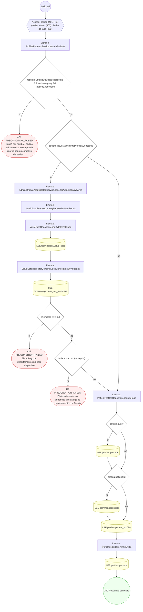

#### 3. POST /profiles/patients

Alta de persona y perfil de paciente

| HTTP | Código | Cuándo |
|---|---|---|
| 201 | — | Éxito |
| 400 | `VALIDATION_FAILED` | El cuerpo cumple el DTO (sin propiedades extra) |
| 401 | `UNAUTHENTICATED` | Hay una sesión válida (JWT) |
| 403 | `FORBIDDEN` | El rol está permitido; El tenant se resuelve y pertenece al actor |
| 409 | `CONFLICT` | ConflictException: El patient_code ya está en uso |
| 429 | `RATE_LIMITED` | No se supera el límite de solicitudes |

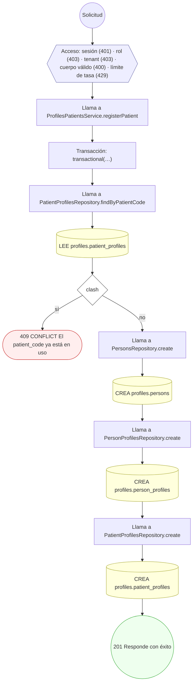

#### 4. GET /profiles/patients/{profileId}

UC-05-14: ficha de filiación de un paciente (F-01)

| HTTP | Código | Cuándo |
|---|---|---|
| 200 | — | Éxito |
| 400 | `VALIDATION_FAILED` | Los parámetros de ruta son UUID válidos |
| 401 | `UNAUTHENTICATED` | Hay una sesión válida (JWT) |
| 403 | `FORBIDDEN` | El rol está permitido; El tenant se resuelve y pertenece al actor |
| 404 | `NOT_FOUND` | ResourceNotFoundException: Paciente no encontrado |
| 429 | `RATE_LIMITED` | No se supera el límite de solicitudes |

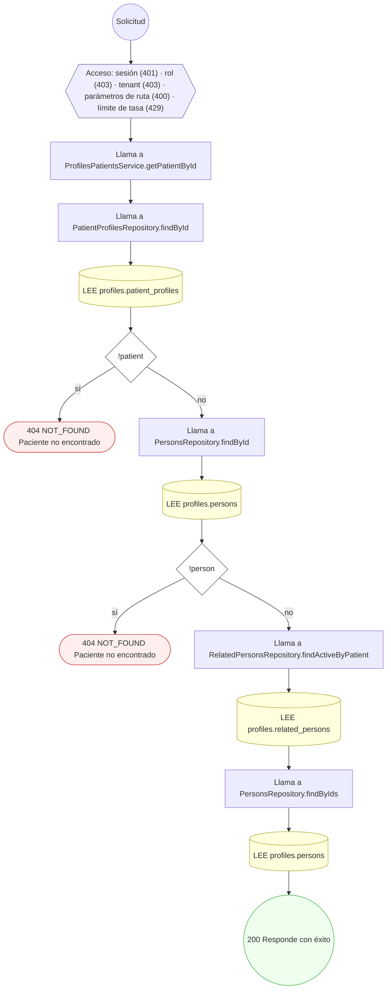

#### 5. POST /profiles/patients/{profileId}/identity-links

Vincular identidad externa de paciente (MPI)

| HTTP | Código | Cuándo |
|---|---|---|
| 201 | — | Éxito |
| 400 | `VALIDATION_FAILED` | Los parámetros de ruta son UUID válidos; El cuerpo cumple el DTO (sin propiedades extra) |
| 401 | `UNAUTHENTICATED` | Hay una sesión válida (JWT) |
| 403 | `FORBIDDEN` | El rol está permitido; El tenant se resuelve y pertenece al actor |
| 404 | `NOT_FOUND` | ResourceNotFoundException: Paciente no encontrado |
| 429 | `RATE_LIMITED` | No se supera el límite de solicitudes |

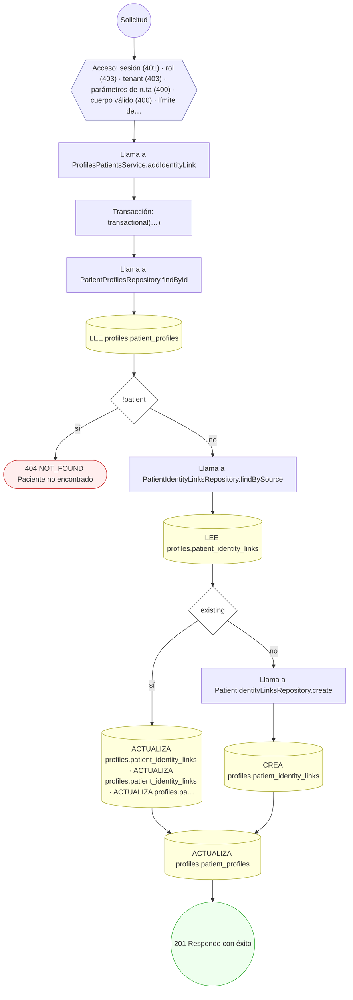

#### 6. POST /profiles/patients/{profileId}/portal-proxies

Otorgar proxy de portal a un representante

| HTTP | Código | Cuándo |
|---|---|---|
| 201 | — | Éxito |
| 400 | `VALIDATION_FAILED` | Los parámetros de ruta son UUID válidos; El cuerpo cumple el DTO (sin propiedades extra) |
| 401 | `UNAUTHENTICATED` | Hay una sesión válida (JWT) |
| 403 | `FORBIDDEN` | El rol está permitido; El tenant se resuelve y pertenece al actor |
| 404 | `NOT_FOUND` | ResourceNotFoundException: Paciente no encontrado |
| 422 | `PRECONDITION_FAILED` | PreconditionFailedException: La persona relacionada no pertenece al paciente |
| 429 | `RATE_LIMITED` | No se supera el límite de solicitudes |

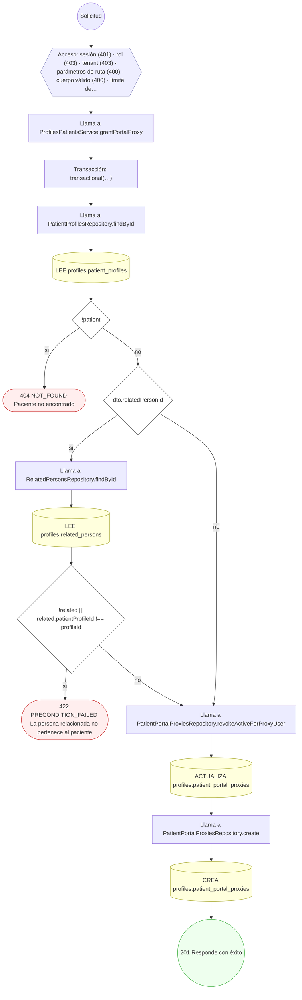

#### 7. POST /profiles/patients/{profileId}/related-persons

Registrar persona relacionada / contacto de emergencia

| HTTP | Código | Cuándo |
|---|---|---|
| 201 | — | Éxito |
| 400 | `VALIDATION_FAILED` | Los parámetros de ruta son UUID válidos; El cuerpo cumple el DTO (sin propiedades extra) |
| 401 | `UNAUTHENTICATED` | Hay una sesión válida (JWT) |
| 403 | `FORBIDDEN` | El rol está permitido; El tenant se resuelve y pertenece al actor; ForbiddenException: Sólo el titular del perfil o la plataforma pueden modificarlo |
| 404 | `NOT_FOUND` | ResourceNotFoundException: Paciente no encontrado; ResourceNotFoundException: Persona relacionada no encontrada |
| 409 | `CONFLICT` | ConflictException: El paciente ya tiene un tutor legal activo |
| 429 | `RATE_LIMITED` | No se supera el límite de solicitudes |

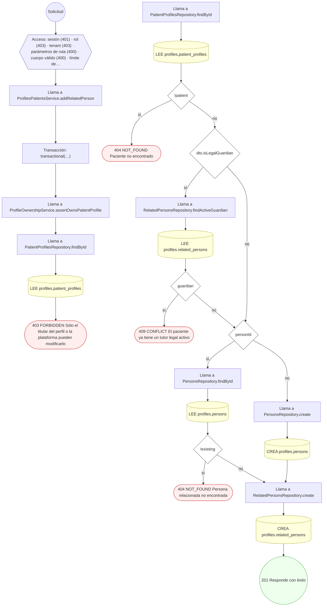

#### 8. GET /profiles/patients/me

Consultar los propios datos de filiación

| HTTP | Código | Cuándo |
|---|---|---|
| 200 | — | Éxito |
| 401 | `UNAUTHENTICATED` | Hay una sesión válida (JWT) |
| 403 | `FORBIDDEN` | El rol está permitido; El tenant se resuelve y pertenece al actor |
| 404 | `NOT_FOUND` | ResourceNotFoundException: Paciente no encontrado |
| 422 | `PRECONDITION_FAILED` | PreconditionFailedException: La cuenta no tiene una persona vinculada |
| 429 | `RATE_LIMITED` | No se supera el límite de solicitudes |

```mermaid
flowchart TD
  n1(("Solicitud")):::inicio
  n2{{"Acceso: sesión (401) · rol (403) · tenant (403) · límite de tasa (429)"}}:::acceso
  n1 --> n2
  n3["Llama a ProfilesPatientsService.getOwnProfile"]:::llamada
  n2 --> n3
  n4["Llama a ProfilesPatientsService.resolveOwnPatient"]:::llamada
  n3 --> n4
  n5["Llama a PersonAccountLinksRepository.findActiveByUser"]:::llamada
  n4 --> n5
  n6[("LEE profiles.person_account_links")]:::efecto
  n5 --> n6
  n7{"!link"}:::decision
  n6 --> n7
  n8(["422 PRECONDITION_FAILED La cuenta no tiene una persona vinculada"]):::error
  n7 -->|"sí"| n8
  n9["Llama a PersonsRepository.findById"]:::llamada
  n7 -->|"no"| n9
  n10[("LEE profiles.persons")]:::efecto
  n9 --> n10
  n11["Llama a PatientProfilesRepository.findById"]:::llamada
  n10 --> n11
  n12[("LEE profiles.patient_profiles")]:::efecto
  n11 --> n12
  n13{"!person || !patient"}:::decision
  n12 --> n13
  n14(["404 NOT_FOUND Paciente no encontrado"]):::error
  n13 -->|"sí"| n14
  n15["Llama a ContactPointsRepository.findVigenteByOwnerAndSystem"]:::llamada
  n13 -->|"no"| n15
  n16[("LEE common.contact_points")]:::efecto
  n15 --> n16
  n17["Llama a AddressesRepository.findVigenteByOwnerAndUse"]:::llamada
  n16 --> n17
  n18[("LEE common.addresses")]:::efecto
  n17 --> n18
  n19["Llama a AddressesRepository.findVigenteByOwnerAndUse"]:::llamada
  n18 --> n19
  n20[("LEE common.addresses")]:::efecto
  n19 --> n20
  n21["Llama a ContactPointsRepository.findVigenteByOwnerAndSystem"]:::llamada
  n20 --> n21
  n22[("LEE common.contact_points")]:::efecto
  n21 --> n22
  n23["Llama a ProfilesPatientsService.leerIdentificadores"]:::llamada
  n22 --> n23
  n24[("LEE common.identifiers")]:::efecto
  n23 --> n24
  n25["Llama a ProfilesPatientsService.leerCoberturas"]:::llamada
  n24 --> n25
  n26[("LEE insurance.patient_coverages · LEE insurance.insurance_plans · LEE insurance.insurance_products · LEE insu…")]:::efecto
  n25 --> n26
  n27["Llama a ProfilesPatientsService.leerTutores"]:::llamada
  n26 --> n27
  n28[("LEE common.contact_points · LEE profiles.related_persons · LEE profiles.persons")]:::efecto
  n27 --> n28
  n29(("200 Responde con éxito")):::ok
  n28 --> n29
  classDef acceso fill:#eef,stroke:#66a
  classDef error fill:#fee,stroke:#c33
  classDef ok fill:#efe,stroke:#3a3
  classDef efecto fill:#ffd,stroke:#aa3
  classDef decision fill:#fff,stroke:#555
  classDef corte fill:#eee,stroke:#999,stroke-dasharray: 4
```

#### 9. PATCH /profiles/patients/me

Editar los propios datos de filiación

| HTTP | Código | Cuándo |
|---|---|---|
| 200 | — | Éxito |
| 400 | `VALIDATION_FAILED` | El cuerpo cumple el DTO (sin propiedades extra) |
| 401 | `UNAUTHENTICATED` | Hay una sesión válida (JWT) |
| 403 | `FORBIDDEN` | El rol está permitido; El tenant se resuelve y pertenece al actor |
| 404 | `NOT_FOUND` | ResourceNotFoundException: Paciente no encontrado |
| 422 | `PRECONDITION_FAILED` | PreconditionFailedException: La cuenta no tiene una persona vinculada |
| 429 | `RATE_LIMITED` | No se supera el límite de solicitudes |

```mermaid
flowchart TD
  n1(("Solicitud")):::inicio
  n2{{"Acceso: sesión (401) · rol (403) · tenant (403) · cuerpo válido (400) · límite de tasa (429)"}}:::acceso
  n1 --> n2
  n3["Llama a ProfilesPatientsService.updateOwnProfile"]:::llamada
  n2 --> n3
  n4["Transacción: transactional(…)"]:::transaccion
  n3 --> n4
  n5["Llama a ProfilesPatientsService.resolveOwnPatient"]:::llamada
  n4 --> n5
  n6["Llama a PersonAccountLinksRepository.findActiveByUser"]:::llamada
  n5 --> n6
  n7[("LEE profiles.person_account_links")]:::efecto
  n6 --> n7
  n8{"!link"}:::decision
  n7 --> n8
  n9(["422 PRECONDITION_FAILED La cuenta no tiene una persona vinculada"]):::error
  n8 -->|"sí"| n9
  n10["Llama a PersonsRepository.findById"]:::llamada
  n8 -->|"no"| n10
  n11[("LEE profiles.persons")]:::efecto
  n10 --> n11
  n12["Llama a PatientProfilesRepository.findById"]:::llamada
  n11 --> n12
  n13[("LEE profiles.patient_profiles")]:::efecto
  n12 --> n13
  n14{"!person || !patient"}:::decision
  n13 --> n14
  n15(["404 NOT_FOUND Paciente no encontrado"]):::error
  n14 -->|"sí"| n15
  n16{"cambiaAlgunaParteDelNombre(dto)"}:::decision
  n14 -->|"no"| n16
  n17["Llama a ProfilesPatientsService.recomponerDisplayName"]:::llamada
  n16 -->|"sí"| n17
  n18{"recompuesto !== undefined"}:::decision
  n17 --> n18
  n19[("ACTUALIZA profiles.persons")]:::efecto
  n18 -->|"sí"| n19
  n20{"dto.phone !== undefined"}:::decision
  n19 --> n20
  n18 -->|"no"| n20
  n16 -->|"no"| n20
  n21["Llama a ProfilesPatientsService.reemplazarTelefono"]:::llamada
  n20 -->|"sí"| n21
  n22["Llama a ContactPointsRepository.findVigenteByOwnerAndSystem"]:::llamada
  n21 --> n22
  n23[("LEE common.contact_points")]:::efecto
  n22 --> n23
  n24{"nuevo === undefined"}:::decision
  n23 --> n24
  n25{"vigente"}:::decision
  n24 -->|"sí"| n25
  n26["Llama a ContactPointsRepository.closeVigente"]:::llamada
  n25 -->|"sí"| n26
  n27[("ACTUALIZA common.contact_points")]:::efecto
  n26 --> n27
  n28{"vigente"}:::decision
  n27 --> n28
  n25 -->|"no"| n28
  n24 -->|"no"| n28
  n29["Llama a ContactPointsRepository.closeVigente"]:::llamada
  n28 -->|"sí"| n29
  n30[("ACTUALIZA common.contact_points")]:::efecto
  n29 --> n30
  n31["Llama a ContactPointsRepository.create"]:::llamada
  n30 --> n31
  n28 -->|"no"| n31
  n32[("CREA common.contact_points")]:::efecto
  n31 --> n32
  n33{"dto.residenceMunicipalityConceptId !== undefined"}:::decision
  n32 --> n33
  n20 -->|"no"| n33
  n34["Llama a ProfilesPatientsService.reemplazarDomicilio"]:::llamada
  n33 -->|"sí"| n34
  n35["Llama a AddressesRepository.findVigenteByOwnerAndUse"]:::llamada
  n34 --> n35
  n36[("LEE common.addresses")]:::efecto
  n35 --> n36
  n37{"vigente"}:::decision
  n36 --> n37
  n38["Llama a AddressesRepository.closeVigente"]:::llamada
  n37 -->|"sí"| n38
  n39[("ACTUALIZA common.addresses")]:::efecto
  n38 --> n39
  n40{"dto.taxId !== undefined || dto.taxHolderName !== undefined"}:::decision
  n39 --> n40
  n37 -->|"no"| n40
  n33 -->|"no"| n40
  n41["Llama a ProfilesPatientsService.reemplazarNit"]:::llamada
  n40 -->|"sí"| n41
  n42[("LEE common.identifiers")]:::efecto
  n41 --> n42
  n43["Llama a IdentifiersRepository.create"]:::llamada
  n42 --> n43
  n44[("CREA common.identifiers")]:::efecto
  n43 --> n44
  n45{"dto.homeAddressLines !== undefined"}:::decision
  n44 --> n45
  n40 -->|"no"| n45
  n46["Llama a ProfilesPatientsService.reemplazarTextoDeDireccion"]:::llamada
  n45 -->|"sí"| n46
  n47["Llama a AddressesRepository.findVigenteByOwnerAndUse"]:::llamada
  n46 --> n47
  n48[("LEE common.addresses")]:::efecto
  n47 --> n48
  n49{"vigente"}:::decision
  n48 --> n49
  n50["Llama a AddressesRepository.closeVigente"]:::llamada
  n49 -->|"sí"| n50
  n51[("ACTUALIZA common.addresses")]:::efecto
  n50 --> n51
  n52["Llama a AddressesRepository.create"]:::llamada
  n51 --> n52
  n49 -->|"no"| n52
  n53[("CREA common.addresses")]:::efecto
  n52 --> n53
  n54{"dto.workAddressLines !== undefined"}:::decision
  n53 --> n54
  n45 -->|"no"| n54
  n55["Llama a ProfilesPatientsService.reemplazarTextoDeDireccion"]:::llamada
  n54 -->|"sí"| n55
  n56["Llama a AddressesRepository.findVigenteByOwnerAndUse"]:::llamada
  n55 --> n56
  n57[("LEE common.addresses")]:::efecto
  n56 --> n57
  n58{"vigente"}:::decision
  n57 --> n58
  n59["Llama a AddressesRepository.closeVigente"]:::llamada
  n58 -->|"sí"| n59
  n60[("ACTUALIZA common.addresses")]:::efecto
  n59 --> n60
  n61["Llama a AddressesRepository.create"]:::llamada
  n60 --> n61
  n58 -->|"no"| n61
  n62[("CREA common.addresses")]:::efecto
  n61 --> n62
  n63["Llama a ProfilesPatientsService.getOwnProfile"]:::llamada
  n62 --> n63
  n54 -->|"no"| n63
  n64["Llama a ProfilesPatientsService.resolveOwnPatient"]:::llamada
  n63 --> n64
  n65["Llama a PersonAccountLinksRepository.findActiveByUser"]:::llamada
  n64 --> n65
  n66[("LEE profiles.person_account_links")]:::efecto
  n65 --> n66
  n67{"!link"}:::decision
  n66 --> n67
  n68(["422 PRECONDITION_FAILED La cuenta no tiene una persona vinculada"]):::error
  n67 -->|"sí"| n68
  n69["Llama a PersonsRepository.findById"]:::llamada
  n67 -->|"no"| n69
  n70[("LEE profiles.persons")]:::efecto
  n69 --> n70
  n71["… el resto del árbol (4 nodos) está en el JSON del inventario"]:::corte
  n70 --> n71
  classDef acceso fill:#eef,stroke:#66a
  classDef error fill:#fee,stroke:#c33
  classDef ok fill:#efe,stroke:#3a3
  classDef efecto fill:#ffd,stroke:#aa3
  classDef decision fill:#fff,stroke:#555
  classDef corte fill:#eee,stroke:#999,stroke-dasharray: 4
```

#### 10. DELETE /profiles/patients/me/photo

Quitar la foto de perfil propia. Quita la referencia; el archivo no se toca. Idempotente.

| HTTP | Código | Cuándo |
|---|---|---|
| 200 | — | Éxito |
| 401 | `UNAUTHENTICATED` | Hay una sesión válida (JWT) |
| 403 | `FORBIDDEN` | El rol está permitido; El tenant se resuelve y pertenece al actor |
| 404 | `NOT_FOUND` | ResourceNotFoundException: Paciente no encontrado |
| 422 | `PRECONDITION_FAILED` | PreconditionFailedException: La cuenta no tiene una persona vinculada |
| 429 | `RATE_LIMITED` | No se supera el límite de solicitudes |

```mermaid
flowchart TD
  n1(("Solicitud")):::inicio
  n2{{"Acceso: sesión (401) · rol (403) · tenant (403) · límite de tasa (429)"}}:::acceso
  n1 --> n2
  n3["Llama a ProfilesPatientsService.removeOwnPhoto"]:::llamada
  n2 --> n3
  n4["Transacción: transactional(…)"]:::transaccion
  n3 --> n4
  n5["Llama a ProfilesPatientsService.resolveOwnPatient"]:::llamada
  n4 --> n5
  n6["Llama a PersonAccountLinksRepository.findActiveByUser"]:::llamada
  n5 --> n6
  n7[("LEE profiles.person_account_links")]:::efecto
  n6 --> n7
  n8{"!link"}:::decision
  n7 --> n8
  n9(["422 PRECONDITION_FAILED La cuenta no tiene una persona vinculada"]):::error
  n8 -->|"sí"| n9
  n10["Llama a PersonsRepository.findById"]:::llamada
  n8 -->|"no"| n10
  n11[("LEE profiles.persons")]:::efecto
  n10 --> n11
  n12["Llama a PatientProfilesRepository.findById"]:::llamada
  n11 --> n12
  n13[("LEE profiles.patient_profiles")]:::efecto
  n12 --> n13
  n14{"!person || !patient"}:::decision
  n13 --> n14
  n15(["404 NOT_FOUND Paciente no encontrado"]):::error
  n14 -->|"sí"| n15
  n16["Llama a ProfilesPatientsService.getOwnProfile"]:::llamada
  n14 -->|"no"| n16
  n17["Llama a ProfilesPatientsService.resolveOwnPatient"]:::llamada
  n16 --> n17
  n18["Llama a PersonAccountLinksRepository.findActiveByUser"]:::llamada
  n17 --> n18
  n19[("LEE profiles.person_account_links")]:::efecto
  n18 --> n19
  n20{"!link"}:::decision
  n19 --> n20
  n21(["422 PRECONDITION_FAILED La cuenta no tiene una persona vinculada"]):::error
  n20 -->|"sí"| n21
  n22["Llama a PersonsRepository.findById"]:::llamada
  n20 -->|"no"| n22
  n23[("LEE profiles.persons")]:::efecto
  n22 --> n23
  n24["Llama a PatientProfilesRepository.findById"]:::llamada
  n23 --> n24
  n25[("LEE profiles.patient_profiles")]:::efecto
  n24 --> n25
  n26{"!person || !patient"}:::decision
  n25 --> n26
  n27(["404 NOT_FOUND Paciente no encontrado"]):::error
  n26 -->|"sí"| n27
  n28["Llama a ContactPointsRepository.findVigenteByOwnerAndSystem"]:::llamada
  n26 -->|"no"| n28
  n29[("LEE common.contact_points")]:::efecto
  n28 --> n29
  n30["Llama a AddressesRepository.findVigenteByOwnerAndUse"]:::llamada
  n29 --> n30
  n31[("LEE common.addresses")]:::efecto
  n30 --> n31
  n32["Llama a AddressesRepository.findVigenteByOwnerAndUse"]:::llamada
  n31 --> n32
  n33[("LEE common.addresses")]:::efecto
  n32 --> n33
  n34["Llama a ContactPointsRepository.findVigenteByOwnerAndSystem"]:::llamada
  n33 --> n34
  n35[("LEE common.contact_points")]:::efecto
  n34 --> n35
  n36["Llama a ProfilesPatientsService.leerIdentificadores"]:::llamada
  n35 --> n36
  n37[("LEE common.identifiers")]:::efecto
  n36 --> n37
  n38["Llama a ProfilesPatientsService.leerCoberturas"]:::llamada
  n37 --> n38
  n39[("LEE insurance.patient_coverages · LEE insurance.insurance_plans · LEE insurance.insurance_products · LEE insu…")]:::efecto
  n38 --> n39
  n40["Llama a ProfilesPatientsService.leerTutores"]:::llamada
  n39 --> n40
  n41[("LEE common.contact_points · LEE profiles.related_persons · LEE profiles.persons")]:::efecto
  n40 --> n41
  n42(("200 Responde con éxito")):::ok
  n41 --> n42
  classDef acceso fill:#eef,stroke:#66a
  classDef error fill:#fee,stroke:#c33
  classDef ok fill:#efe,stroke:#3a3
  classDef efecto fill:#ffd,stroke:#aa3
  classDef decision fill:#fff,stroke:#555
  classDef corte fill:#eee,stroke:#999,stroke-dasharray: 4
```

#### 11. PUT /profiles/patients/me/photo

Fijar la foto de perfil propia. Sin `@Roles` por lo mismo que el resto de `patients/me/*`: el sujeto lo resuelve el servidor desde la sesión y no hay parámetro que apunte a otro. `PUT` porque el resultado no depende de cuántas veces se pida: la persona queda con esa foto.

| HTTP | Código | Cuándo |
|---|---|---|
| 200 | — | Éxito |
| 401 | `UNAUTHENTICATED` | Hay una sesión válida (JWT) |
| 403 | `FORBIDDEN` | El rol está permitido; El tenant se resuelve y pertenece al actor; ForbiddenException: {labels.subject} no le pertenece |
| 404 | `NOT_FOUND` | ResourceNotFoundException: Paciente no encontrado; ResourceNotFoundException: {labels.notFound} |
| 422 | `PRECONDITION_FAILED` | PreconditionFailedException: La cuenta no tiene una persona vinculada; PreconditionFailedException: {labels.subject} está borrado; PreconditionFailedException: {labels.subject} no tiene una versión vigente; PreconditionFailedException: {labels.subject} resultó infectado; PreconditionFailedException: {labels.subject} no es de un formato admitido para este uso |
| 429 | `RATE_LIMITED` | No se supera el límite de solicitudes |

```mermaid
flowchart TD
  n1(("Solicitud")):::inicio
  n2{{"Acceso: sesión (401) · rol (403) · tenant (403) · límite de tasa (429)"}}:::acceso
  n1 --> n2
  n3["Llama a ProfilesPatientsService.setOwnPhoto"]:::llamada
  n2 --> n3
  n4["Transacción: transactional(…)"]:::transaccion
  n3 --> n4
  n5["Llama a ProfilesPatientsService.resolveOwnPatient"]:::llamada
  n4 --> n5
  n6["Llama a PersonAccountLinksRepository.findActiveByUser"]:::llamada
  n5 --> n6
  n7[("LEE profiles.person_account_links")]:::efecto
  n6 --> n7
  n8{"!link"}:::decision
  n7 --> n8
  n9(["422 PRECONDITION_FAILED La cuenta no tiene una persona vinculada"]):::error
  n8 -->|"sí"| n9
  n10["Llama a PersonsRepository.findById"]:::llamada
  n8 -->|"no"| n10
  n11[("LEE profiles.persons")]:::efecto
  n10 --> n11
  n12["Llama a PatientProfilesRepository.findById"]:::llamada
  n11 --> n12
  n13[("LEE profiles.patient_profiles")]:::efecto
  n12 --> n13
  n14{"!person || !patient"}:::decision
  n13 --> n14
  n15(["404 NOT_FOUND Paciente no encontrado"]):::error
  n14 -->|"sí"| n15
  n16["Llama a AttachableFileService.assertUsableBy"]:::llamada
  n14 -->|"no"| n16
  n17["Llama a FilesRepository.findById"]:::llamada
  n16 --> n17
  n18[("LEE common.files")]:::efecto
  n17 --> n18
  n19{"!file"}:::decision
  n18 --> n19
  n20(["404 NOT_FOUND {labels.notFound}"]):::error
  n19 -->|"sí"| n20
  n21{"file.createdByUserId !== actor.id"}:::decision
  n19 -->|"no"| n21
  n22(["403 FORBIDDEN {labels.subject} no le pertenece"]):::error
  n21 -->|"sí"| n22
  n23{"file.deletedAt || file.lifecycleStatusConceptId === CONCEPTS.FILE_DELETED"}:::decision
  n21 -->|"no"| n23
  n24(["422 PRECONDITION_FAILED {labels.subject} está borrado"]):::error
  n23 -->|"sí"| n24
  n25{"!file.currentVersionId"}:::decision
  n23 -->|"no"| n25
  n26(["422 PRECONDITION_FAILED {labels.subject} no tiene una versión vigente"]):::error
  n25 -->|"sí"| n26
  n27["Llama a FileVersionsRepository.findById"]:::llamada
  n25 -->|"no"| n27
  n28[("LEE common.file_versions")]:::efecto
  n27 --> n28
  n29{"!version"}:::decision
  n28 --> n29
  n30(["422 PRECONDITION_FAILED {labels.subject} no tiene una versión vigente"]):::error
  n29 -->|"sí"| n30
  n31{"version.malwareScanStatusConceptId === CONCEPTS.SCAN_INFECTED"}:::decision
  n29 -->|"no"| n31
  n32(["422 PRECONDITION_FAILED {labels.subject} resultó infectado"]):::error
  n31 -->|"sí"| n32
  n33{"admitidos && !admitidos.includes(version.mimeType ?? '')"}:::decision
  n31 -->|"no"| n33
  n34(["422 PRECONDITION_FAILED {labels.subject} no es de un formato admitido para este uso"]):::error
  n33 -->|"sí"| n34
  n35["Llama a ProfilesPatientsService.getOwnProfile"]:::llamada
  n33 -->|"no"| n35
  n36["Llama a ProfilesPatientsService.resolveOwnPatient"]:::llamada
  n35 --> n36
  n37["Llama a PersonAccountLinksRepository.findActiveByUser"]:::llamada
  n36 --> n37
  n38[("LEE profiles.person_account_links")]:::efecto
  n37 --> n38
  n39{"!link"}:::decision
  n38 --> n39
  n40(["422 PRECONDITION_FAILED La cuenta no tiene una persona vinculada"]):::error
  n39 -->|"sí"| n40
  n41["Llama a PersonsRepository.findById"]:::llamada
  n39 -->|"no"| n41
  n42[("LEE profiles.persons")]:::efecto
  n41 --> n42
  n43["Llama a PatientProfilesRepository.findById"]:::llamada
  n42 --> n43
  n44[("LEE profiles.patient_profiles")]:::efecto
  n43 --> n44
  n45{"!person || !patient"}:::decision
  n44 --> n45
  n46(["404 NOT_FOUND Paciente no encontrado"]):::error
  n45 -->|"sí"| n46
  n47["Llama a ContactPointsRepository.findVigenteByOwnerAndSystem"]:::llamada
  n45 -->|"no"| n47
  n48[("LEE common.contact_points")]:::efecto
  n47 --> n48
  n49["Llama a AddressesRepository.findVigenteByOwnerAndUse"]:::llamada
  n48 --> n49
  n50[("LEE common.addresses")]:::efecto
  n49 --> n50
  n51["Llama a AddressesRepository.findVigenteByOwnerAndUse"]:::llamada
  n50 --> n51
  n52[("LEE common.addresses")]:::efecto
  n51 --> n52
  n53["Llama a ContactPointsRepository.findVigenteByOwnerAndSystem"]:::llamada
  n52 --> n53
  n54[("LEE common.contact_points")]:::efecto
  n53 --> n54
  n55["Llama a ProfilesPatientsService.leerIdentificadores"]:::llamada
  n54 --> n55
  n56[("LEE common.identifiers")]:::efecto
  n55 --> n56
  n57["Llama a ProfilesPatientsService.leerCoberturas"]:::llamada
  n56 --> n57
  n58[("LEE insurance.patient_coverages · LEE insurance.insurance_plans · LEE insurance.insurance_products · LEE insu…")]:::efecto
  n57 --> n58
  n59["Llama a ProfilesPatientsService.leerTutores"]:::llamada
  n58 --> n59
  n60[("LEE common.contact_points · LEE profiles.related_persons · LEE profiles.persons")]:::efecto
  n59 --> n60
  n61(("200 Responde con éxito")):::ok
  n60 --> n61
  classDef acceso fill:#eef,stroke:#66a
  classDef error fill:#fee,stroke:#c33
  classDef ok fill:#efe,stroke:#3a3
  classDef efecto fill:#ffd,stroke:#aa3
  classDef decision fill:#fff,stroke:#555
  classDef corte fill:#eee,stroke:#999,stroke-dasharray: 4
```

#### 12. GET /profiles/patients/me/summary

Consultar el resumen propio

| HTTP | Código | Cuándo |
|---|---|---|
| 200 | — | Éxito |
| 401 | `UNAUTHENTICATED` | Hay una sesión válida (JWT) |
| 403 | `FORBIDDEN` | El rol está permitido; El tenant se resuelve y pertenece al actor |
| 404 | `NOT_FOUND` | ResourceNotFoundException: Paciente no encontrado |
| 422 | `PRECONDITION_FAILED` | PreconditionFailedException: La cuenta no tiene una persona vinculada |
| 429 | `RATE_LIMITED` | No se supera el límite de solicitudes |

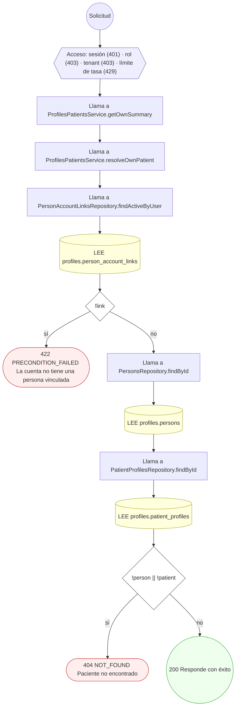

#### 13. POST /profiles/patients/merge

Fusionar pacientes duplicados

| HTTP | Código | Cuándo |
|---|---|---|
| 201 | — | Éxito |
| 400 | `VALIDATION_FAILED` | El cuerpo cumple el DTO (sin propiedades extra) |
| 401 | `UNAUTHENTICATED` | Hay una sesión válida (JWT) |
| 403 | `FORBIDDEN` | El rol está permitido; El tenant se resuelve y pertenece al actor |
| 404 | `NOT_FOUND` | ResourceNotFoundException: Paciente sobreviviente no encontrado; ResourceNotFoundException: Paciente a fusionar no encontrado |
| 409 | `CONFLICT` | ConflictException: El paciente ya fue fusionado |
| 422 | `PRECONDITION_FAILED` | PreconditionFailedException: No se puede fusionar un paciente consigo mismo |
| 429 | `RATE_LIMITED` | No se supera el límite de solicitudes |

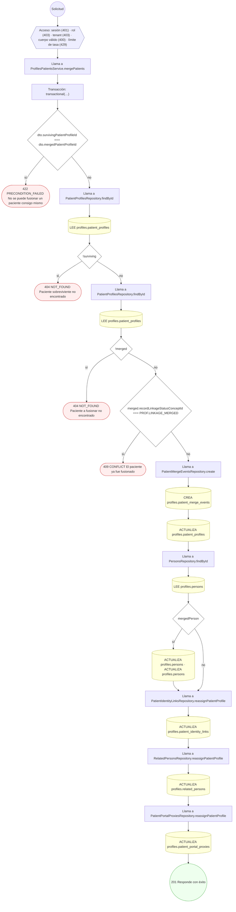

#### 14. POST /profiles/patients/merge/{eventId}/reverse

Revertir una fusión de pacientes

| HTTP | Código | Cuándo |
|---|---|---|
| 201 | — | Éxito |
| 400 | `VALIDATION_FAILED` | Los parámetros de ruta son UUID válidos; El cuerpo cumple el DTO (sin propiedades extra) |
| 401 | `UNAUTHENTICATED` | Hay una sesión válida (JWT) |
| 403 | `FORBIDDEN` | El rol está permitido; El tenant se resuelve y pertenece al actor |
| 404 | `NOT_FOUND` | ResourceNotFoundException: Evento de fusión no encontrado |
| 409 | `CONFLICT` | ConflictException: La fusión ya fue revertida |
| 422 | `PRECONDITION_FAILED` | PreconditionFailedException: Solo se puede revertir una fusión aprobada |
| 429 | `RATE_LIMITED` | No se supera el límite de solicitudes |

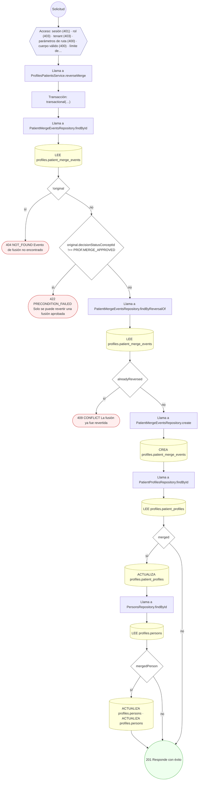

#### 15. POST /profiles/persons/{personId}/account-links

Vincular cuenta de portal a una persona

| HTTP | Código | Cuándo |
|---|---|---|
| 201 | — | Éxito |
| 400 | `VALIDATION_FAILED` | Los parámetros de ruta son UUID válidos; El cuerpo cumple el DTO (sin propiedades extra) |
| 401 | `UNAUTHENTICATED` | Hay una sesión válida (JWT) |
| 403 | `FORBIDDEN` | El rol está permitido; El tenant se resuelve y pertenece al actor |
| 404 | `NOT_FOUND` | ResourceNotFoundException: Persona no encontrada |
| 422 | `PRECONDITION_FAILED` | PreconditionFailedException: La persona no está activa |
| 429 | `RATE_LIMITED` | No se supera el límite de solicitudes |

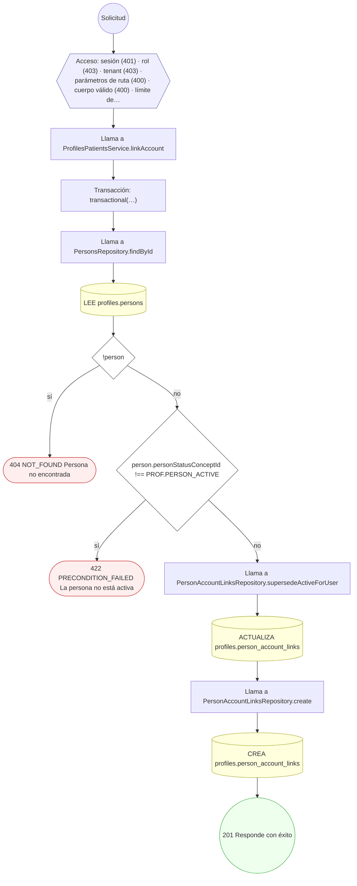

#### 16. POST /profiles/persons/{personId}/decease

Registrar defunción y anonimización de una persona

| HTTP | Código | Cuándo |
|---|---|---|
| 200 | — | Éxito |
| 400 | `VALIDATION_FAILED` | Los parámetros de ruta son UUID válidos; El cuerpo cumple el DTO (sin propiedades extra) |
| 401 | `UNAUTHENTICATED` | Hay una sesión válida (JWT) |
| 403 | `FORBIDDEN` | El rol está permitido; El tenant se resuelve y pertenece al actor |
| 404 | `NOT_FOUND` | ResourceNotFoundException: Persona no encontrada |
| 409 | `CONFLICT` | ConflictException: La persona ya está registrada como fallecida |
| 429 | `RATE_LIMITED` | No se supera el límite de solicitudes |

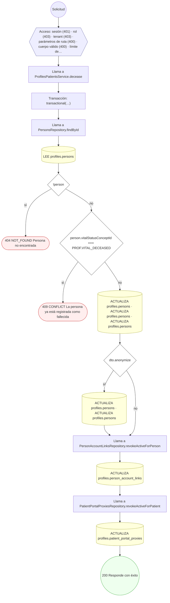

#### 17. GET /profiles/practitioners

Listar profesionales para la guía, con sus especialidades

| HTTP | Código | Cuándo |
|---|---|---|
| 200 | — | Éxito |
| 401 | `UNAUTHENTICATED` | Hay una sesión válida (JWT) |
| 403 | `FORBIDDEN` | El rol está permitido; El tenant se resuelve y pertenece al actor |
| 429 | `RATE_LIMITED` | No se supera el límite de solicitudes |

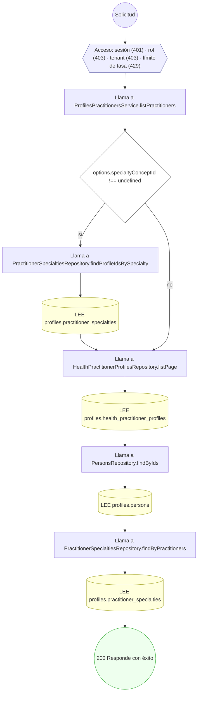

#### 18. POST /profiles/practitioners

Alta de profesional de salud (workforce generalista)

| HTTP | Código | Cuándo |
|---|---|---|
| 201 | — | Éxito |
| 400 | `VALIDATION_FAILED` | El cuerpo cumple el DTO (sin propiedades extra) |
| 401 | `UNAUTHENTICATED` | Hay una sesión válida (JWT) |
| 403 | `FORBIDDEN` | El rol está permitido; El tenant se resuelve y pertenece al actor |
| 404 | `NOT_FOUND` | ResourceNotFoundException: Persona no encontrada |
| 409 | `CONFLICT` | ConflictException: El practitioner_code ya está en uso |
| 422 | `PRECONDITION_FAILED` | PreconditionFailedException: Un profesional puede declarar hasta {MAX_SPECIALTIES_PER_PRACTITIO…} especialidades; PreconditionFailedException: El catálogo de especialidades médicas no está disponible; PreconditionFailedException: La especialidad no pertenece al catálogo de especialidades médicas |
| 429 | `RATE_LIMITED` | No se supera el límite de solicitudes |

```mermaid
flowchart TD
  n1(("Solicitud")):::inicio
  n2{{"Acceso: sesión (401) · rol (403) · tenant (403) · cuerpo válido (400) · límite de tasa (429)"}}:::acceso
  n1 --> n2
  n3["Llama a ProfilesPractitionersService.onboardPractitioner"]:::llamada
  n2 --> n3
  n4["Transacción: transactional(…)"]:::transaccion
  n3 --> n4
  n5["Llama a HealthPractitionerProfilesRepository.findByCode"]:::llamada
  n4 --> n5
  n6[("LEE profiles.health_practitioner_profiles")]:::efecto
  n5 --> n6
  n7{"clash"}:::decision
  n6 --> n7
  n8(["409 CONFLICT El practitioner_code ya está en uso"]):::error
  n7 -->|"sí"| n8
  n9{"personId"}:::decision
  n7 -->|"no"| n9
  n10["Llama a PersonsRepository.findById"]:::llamada
  n9 -->|"sí"| n10
  n11[("LEE profiles.persons")]:::efecto
  n10 --> n11
  n12{"!existing"}:::decision
  n11 --> n12
  n13(["404 NOT_FOUND Persona no encontrada"]):::error
  n12 -->|"sí"| n13
  n14["Llama a PersonsRepository.create"]:::llamada
  n9 -->|"no"| n14
  n15[("CREA profiles.persons")]:::efecto
  n14 --> n15
  n16["Llama a PersonProfilesRepository.create"]:::llamada
  n12 -->|"no"| n16
  n15 --> n16
  n17[("CREA profiles.person_profiles")]:::efecto
  n16 --> n17
  n18["Llama a HealthPractitionerProfilesRepository.create"]:::llamada
  n17 --> n18
  n19[("CREA profiles.health_practitioner_profiles")]:::efecto
  n18 --> n19
  n20["Llama a JurisdictionAuthorizationsRepository.create"]:::llamada
  n19 --> n20
  n21[("CREA profiles.jurisdiction_authorizations")]:::efecto
  n20 --> n21
  n22["Llama a ProfessionalCredentialsRepository.create"]:::llamada
  n21 --> n22
  n23[("CREA profiles.professional_credentials")]:::efecto
  n22 --> n23
  n24["Llama a PractitionerLanguagesRepository.create"]:::llamada
  n23 --> n24
  n25[("CREA profiles.practitioner_languages")]:::efecto
  n24 --> n25
  n26["Llama a ProfilesPractitionersService.declareSpecialties"]:::llamada
  n25 --> n26
  n27{"unicas.length › MAX_SPECIALTIES_PER_PRACTITIONER"}:::decision
  n26 --> n27
  n28(["422 PRECONDITION_FAILED Un profesional puede declarar hasta {MAX_SPECIALTIES_PER_PRACTITIO…} especialidades"]):::error
  n27 -->|"sí"| n28
  n29["Repite: por cada const [orden, specialtyConceptId] de unicas.entries()"]:::bucle
  n27 -->|"no"| n29
  n30["Llama a MedicalSpecialtyCatalogService.assertIsMedicalSpecialty"]:::llamada
  n29 -->|"cada elemento"| n30
  n31["Llama a MedicalSpecialtyCatalogService.listMemberIds"]:::llamada
  n30 --> n31
  n32{"miembros === null"}:::decision
  n31 --> n32
  n33(["422 PRECONDITION_FAILED El catálogo de especialidades médicas no está disponible"]):::error
  n32 -->|"sí"| n33
  n34{"!miembros.has(specialtyConceptId)"}:::decision
  n32 -->|"no"| n34
  n35(["422 PRECONDITION_FAILED La especialidad no pertenece al catálogo de especialidades médicas"]):::error
  n34 -->|"sí"| n35
  n36["Llama a PractitionerSpecialtiesRepository.create"]:::llamada
  n34 -->|"no"| n36
  n37[("CREA profiles.practitioner_specialties")]:::efecto
  n36 --> n37
  n38(("201 Responde con éxito")):::ok
  n37 --> n38
  n29 -->|"al terminar"| n38
  classDef acceso fill:#eef,stroke:#66a
  classDef error fill:#fee,stroke:#c33
  classDef ok fill:#efe,stroke:#3a3
  classDef efecto fill:#ffd,stroke:#aa3
  classDef decision fill:#fff,stroke:#555
  classDef corte fill:#eee,stroke:#999,stroke-dasharray: 4
```

#### 19. POST /profiles/practitioners/{profileId}/affiliations

Un consultorio de OTRO profesional — las fichas de directorio. Los profesionales que publican las redes de las aseguradoras no tienen cuenta —no traen correo— y por eso no pueden declarar dónde atienden. Sin esta ruta, un médico con tres consultorios se veía sin ninguno. Pide rol administrativo: escribir el historial laboral de alguien que no está mirando es otra cosa que escribir el propio.

| HTTP | Código | Cuándo |
|---|---|---|
| 201 | — | Éxito |
| 400 | `VALIDATION_FAILED` | Los parámetros de ruta son UUID válidos |
| 401 | `UNAUTHENTICATED` | Hay una sesión válida (JWT) |
| 403 | `FORBIDDEN` | El rol está permitido; El tenant se resuelve y pertenece al actor; ForbiddenException: Esta cuenta no tiene un perfil profesional asociado |
| 404 | `NOT_FOUND` | ResourceNotFoundException: Profesional no encontrado; ResourceNotFoundException: La sede indicada no existe |
| 409 | `CONFLICT` | ConflictException: Ese vínculo ya está en el historial laboral; ConflictException: Ya pediste vincularte a esa sede |
| 422 | `PRECONDITION_FAILED` | PreconditionFailedException: El fin del vínculo no puede ser anterior a su inicio |
| 429 | `RATE_LIMITED` | No se supera el límite de solicitudes |

```mermaid
flowchart TD
  n1(("Solicitud")):::inicio
  n2{{"Acceso: sesión (401) · rol (403) · tenant (403) · parámetros de ruta (400) · límite de tasa (429)"}}:::acceso
  n1 --> n2
  n3["Llama a ProfilesPractitionersService.addAffiliationFor"]:::llamada
  n2 --> n3
  n4["Llama a ProfilesPractitionersService.agregarAfiliacion"]:::llamada
  n3 --> n4
  n5{"endDate && endDate ‹ startDate"}:::decision
  n4 --> n5
  n6(["422 PRECONDITION_FAILED El fin del vínculo no puede ser anterior a su inicio"]):::error
  n5 -->|"sí"| n6
  n7["Transacción: transactional(…)"]:::transaccion
  n5 -->|"no"| n7
  n8["Llama a ProfileOwnershipService.requireOwnPractitionerProfileId"]:::llamada
  n7 --> n8
  n9{"personId"}:::decision
  n8 --> n9
  n10["Llama a HealthPractitionerProfilesRepository.findById"]:::llamada
  n9 -->|"sí"| n10
  n11[("LEE profiles.health_practitioner_profiles")]:::efecto
  n10 --> n11
  n12(["403 FORBIDDEN Esta cuenta no tiene un perfil profesional asociado"]):::error
  n11 --> n12
  n9 -->|"no"| n12
  n13{"perfilExplicito !== null"}:::decision
  n14["Llama a HealthPractitionerProfilesRepository.findById"]:::llamada
  n13 -->|"sí"| n14
  n15[("LEE profiles.health_practitioner_profiles")]:::efecto
  n14 --> n15
  n16{"!existe"}:::decision
  n15 --> n16
  n17(["404 NOT_FOUND Profesional no encontrado"]):::error
  n16 -->|"sí"| n17
  n18["Llama a PractitionerAffiliationsRepository.findSame"]:::llamada
  n16 -->|"no"| n18
  n13 -->|"no"| n18
  n19[("LEE profiles.practitioner_affiliations")]:::efecto
  n18 --> n19
  n20{"duplicate"}:::decision
  n19 --> n20
  n21(["409 CONFLICT Ese vínculo ya está en el historial laboral"]):::error
  n20 -->|"sí"| n21
  n22{"dto.practiceSiteId"}:::decision
  n20 -->|"no"| n22
  n23["Llama a PractitionerAffiliationsRepository.findByPractitionerAndSite"]:::llamada
  n22 -->|"sí"| n23
  n24[("LEE profiles.practitioner_affiliations")]:::efecto
  n23 --> n24
  n25{"yaPedida"}:::decision
  n24 --> n25
  n26(["409 CONFLICT Ya pediste vincularte a esa sede"]):::error
  n25 -->|"sí"| n26
  n27["Llama a PractitionerAffiliationsRepository.create"]:::llamada
  n25 -->|"no"| n27
  n22 -->|"no"| n27
  n28[("CREA profiles.practitioner_affiliations")]:::efecto
  n27 --> n28
  n29["Llama a ProfilesAffiliationsService.estadoInicial"]:::llamada
  n28 --> n29
  n30[("LEE practice.practice_sites")]:::efecto
  n29 --> n30
  n31{"!site"}:::decision
  n30 --> n31
  n32(["404 NOT_FOUND La sede indicada no existe"]):::error
  n31 -->|"sí"| n32
  n33{"creado.statusKind === 'pendiente' && dto.practiceSiteId !== undefined"}:::decision
  n31 -->|"no"| n33
  n34["Llama a ProfilesPractitionersService.avisarDelPedido"]:::llamada
  n33 -->|"sí"| n34
  n35[("LEE practice.practice_sites")]:::efecto
  n34 --> n35
  n36["Llama a ProfilesAffiliationsService.avisarDelPedido"]:::llamada
  n35 --> n36
  n37[("LEE directory.tenant_memberships · LEE terminology.catalog_concepts")]:::efecto
  n36 --> n37
  n38(("201 Responde con éxito")):::ok
  n37 --> n38
  n33 -->|"no"| n38
  classDef acceso fill:#eef,stroke:#66a
  classDef error fill:#fee,stroke:#c33
  classDef ok fill:#efe,stroke:#3a3
  classDef efecto fill:#ffd,stroke:#aa3
  classDef decision fill:#fff,stroke:#555
  classDef corte fill:#eee,stroke:#999,stroke-dasharray: 4
```

#### 20. POST /profiles/practitioners/{profileId}/jurisdiction-authorizations

Registrar/renovar autorización jurisdiccional (licencia)

| HTTP | Código | Cuándo |
|---|---|---|
| 201 | — | Éxito |
| 400 | `VALIDATION_FAILED` | Los parámetros de ruta son UUID válidos; El cuerpo cumple el DTO (sin propiedades extra) |
| 401 | `UNAUTHENTICATED` | Hay una sesión válida (JWT) |
| 403 | `FORBIDDEN` | El rol está permitido; El tenant se resuelve y pertenece al actor; ForbiddenException: Sólo el titular del perfil profesional o la plataforma pueden modificarlo |
| 404 | `NOT_FOUND` | ResourceNotFoundException: Profesional no encontrado |
| 429 | `RATE_LIMITED` | No se supera el límite de solicitudes |

```mermaid
flowchart TD
  n1(("Solicitud")):::inicio
  n2{{"Acceso: sesión (401) · rol (403) · tenant (403) · parámetros de ruta (400) · cuerpo válido (400) · límite de…"}}:::acceso
  n1 --> n2
  n3["Llama a ProfilesPractitionersService.addJurisdictionAuthorization"]:::llamada
  n2 --> n3
  n4["Transacción: transactional(…)"]:::transaccion
  n3 --> n4
  n5["Llama a ProfileOwnershipService.assertOwnsPractitionerProfile"]:::llamada
  n4 --> n5
  n6["Llama a HealthPractitionerProfilesRepository.findById"]:::llamada
  n5 --> n6
  n7[("LEE profiles.health_practitioner_profiles")]:::efecto
  n6 --> n7
  n8(["403 FORBIDDEN Sólo el titular del perfil profesional o la plataforma pueden modificarlo"]):::error
  n7 --> n8
  n9["Llama a HealthPractitionerProfilesRepository.findById"]:::llamada
  n10[("LEE profiles.health_practitioner_profiles")]:::efecto
  n9 --> n10
  n11{"!practitioner"}:::decision
  n10 --> n11
  n12(["404 NOT_FOUND Profesional no encontrado"]):::error
  n11 -->|"sí"| n12
  n13["Llama a JurisdictionAuthorizationsRepository.create"]:::llamada
  n11 -->|"no"| n13
  n14[("CREA profiles.jurisdiction_authorizations")]:::efecto
  n13 --> n14
  n15(("201 Responde con éxito")):::ok
  n14 --> n15
  classDef acceso fill:#eef,stroke:#66a
  classDef error fill:#fee,stroke:#c33
  classDef ok fill:#efe,stroke:#3a3
  classDef efecto fill:#ffd,stroke:#aa3
  classDef decision fill:#fff,stroke:#555
  classDef corte fill:#eee,stroke:#999,stroke-dasharray: 4
```

#### 21. DELETE /profiles/practitioners/{profileId}/photo

Quitar la foto del perfil profesional

| HTTP | Código | Cuándo |
|---|---|---|
| 200 | — | Éxito |
| 400 | `VALIDATION_FAILED` | Los parámetros de ruta son UUID válidos |
| 401 | `UNAUTHENTICATED` | Hay una sesión válida (JWT) |
| 403 | `FORBIDDEN` | El rol está permitido; El tenant se resuelve y pertenece al actor; ForbiddenException: Sólo el titular del perfil profesional o la plataforma pueden modificarlo |
| 404 | `NOT_FOUND` | ResourceNotFoundException: Profesional no encontrado; ResourceNotFoundException: Perfil profesional no encontrado |
| 429 | `RATE_LIMITED` | No se supera el límite de solicitudes |

```mermaid
flowchart TD
  n1(("Solicitud")):::inicio
  n2{{"Acceso: sesión (401) · rol (403) · tenant (403) · parámetros de ruta (400) · límite de tasa (429)"}}:::acceso
  n1 --> n2
  n3["Llama a ProfilesPractitionersService.removePractitionerPhoto"]:::llamada
  n2 --> n3
  n4["Transacción: transactional(…)"]:::transaccion
  n3 --> n4
  n5["Llama a ProfileOwnershipService.assertOwnsPractitionerProfile"]:::llamada
  n4 --> n5
  n6["Llama a HealthPractitionerProfilesRepository.findById"]:::llamada
  n5 --> n6
  n7[("LEE profiles.health_practitioner_profiles")]:::efecto
  n6 --> n7
  n8(["403 FORBIDDEN Sólo el titular del perfil profesional o la plataforma pueden modificarlo"]):::error
  n7 --> n8
  n9["Llama a HealthPractitionerProfilesRepository.findById"]:::llamada
  n10[("LEE profiles.health_practitioner_profiles")]:::efecto
  n9 --> n10
  n11{"!practitioner"}:::decision
  n10 --> n11
  n12(["404 NOT_FOUND Profesional no encontrado"]):::error
  n11 -->|"sí"| n12
  n13[("ACTUALIZA profiles.health_practitioner_profiles")]:::efecto
  n11 -->|"no"| n13
  n14["Llama a ProfilesPractitionersService.getPractitionerSummary"]:::llamada
  n13 --> n14
  n15["Llama a PersonAccountLinksRepository.findActiveByPerson"]:::llamada
  n14 --> n15
  n16[("LEE profiles.person_account_links")]:::efecto
  n15 --> n16
  n17["Llama a ProfilesPractitionersService.buildSummary"]:::llamada
  n16 --> n17
  n18["Llama a PersonsRepository.findById"]:::llamada
  n17 --> n18
  n19[("LEE profiles.persons")]:::efecto
  n18 --> n19
  n20["Llama a HealthPractitionerProfilesRepository.findById"]:::llamada
  n19 --> n20
  n21[("LEE profiles.health_practitioner_profiles")]:::efecto
  n20 --> n21
  n22{"!person || !practitioner"}:::decision
  n21 --> n22
  n23(["404 NOT_FOUND Perfil profesional no encontrado"]):::error
  n22 -->|"sí"| n23
  n24["Llama a PractitionerSpecialtiesRepository.findAllByPractitioner"]:::llamada
  n22 -->|"no"| n24
  n25[("LEE profiles.practitioner_specialties")]:::efecto
  n24 --> n25
  n26["Llama a ProfessionalCredentialsRepository.findByPractitioner"]:::llamada
  n25 --> n26
  n27[("LEE profiles.professional_credentials")]:::efecto
  n26 --> n27
  n28["Llama a JurisdictionAuthorizationsRepository.findByPractitioner"]:::llamada
  n27 --> n28
  n29[("LEE profiles.jurisdiction_authorizations")]:::efecto
  n28 --> n29
  n30["Llama a PractitionerLanguagesRepository.findByPractitioner"]:::llamada
  n29 --> n30
  n31[("LEE profiles.practitioner_languages")]:::efecto
  n30 --> n31
  n32["Llama a PractitionerAffiliationsRepository.findByPractitioner"]:::llamada
  n31 --> n32
  n33[("LEE profiles.practitioner_affiliations")]:::efecto
  n32 --> n33
  n34["Llama a ProfilesPractitionersService.countActivity"]:::llamada
  n33 --> n34
  n35[("LEE clinical.encounters · LEE clinical.medication_requests · LEE chart.clinical_note_headers · LEE chart.docu…")]:::efecto
  n34 --> n35
  n36["Llama a ContactPointsRepository.findVigentesByOwner"]:::llamada
  n35 --> n36
  n37[("LEE common.contact_points")]:::efecto
  n36 --> n37
  n38["Llama a ProfilesPractitionersService.leerDocumentoYDomicilio"]:::llamada
  n37 --> n38
  n39[("LEE common.identifiers")]:::efecto
  n38 --> n39
  n40(("200 Responde con éxito")):::ok
  n39 --> n40
  classDef acceso fill:#eef,stroke:#66a
  classDef error fill:#fee,stroke:#c33
  classDef ok fill:#efe,stroke:#3a3
  classDef efecto fill:#ffd,stroke:#aa3
  classDef decision fill:#fff,stroke:#555
  classDef corte fill:#eee,stroke:#999,stroke-dasharray: 4
```

#### 22. PUT /profiles/practitioners/{profileId}/photo

Fijar la foto del perfil profesional

| HTTP | Código | Cuándo |
|---|---|---|
| 200 | — | Éxito |
| 400 | `VALIDATION_FAILED` | Los parámetros de ruta son UUID válidos; El cuerpo cumple el DTO (sin propiedades extra) |
| 401 | `UNAUTHENTICATED` | Hay una sesión válida (JWT) |
| 403 | `FORBIDDEN` | El rol está permitido; El tenant se resuelve y pertenece al actor; ForbiddenException: Sólo el titular del perfil profesional o la plataforma pueden modificarlo; ForbiddenException: {labels.subject} no le pertenece |
| 404 | `NOT_FOUND` | ResourceNotFoundException: Profesional no encontrado; ResourceNotFoundException: {labels.notFound}; ResourceNotFoundException: Perfil profesional no encontrado |
| 422 | `PRECONDITION_FAILED` | PreconditionFailedException: {labels.subject} está borrado; PreconditionFailedException: {labels.subject} no tiene una versión vigente; PreconditionFailedException: {labels.subject} resultó infectado; PreconditionFailedException: {labels.subject} no es de un formato admitido para este uso |
| 429 | `RATE_LIMITED` | No se supera el límite de solicitudes |

```mermaid
flowchart TD
  n1(("Solicitud")):::inicio
  n2{{"Acceso: sesión (401) · rol (403) · tenant (403) · parámetros de ruta (400) · cuerpo válido (400) · límite de…"}}:::acceso
  n1 --> n2
  n3["Llama a ProfilesPractitionersService.setPractitionerPhoto"]:::llamada
  n2 --> n3
  n4["Transacción: transactional(…)"]:::transaccion
  n3 --> n4
  n5["Llama a ProfileOwnershipService.assertOwnsPractitionerProfile"]:::llamada
  n4 --> n5
  n6["Llama a HealthPractitionerProfilesRepository.findById"]:::llamada
  n5 --> n6
  n7[("LEE profiles.health_practitioner_profiles")]:::efecto
  n6 --> n7
  n8(["403 FORBIDDEN Sólo el titular del perfil profesional o la plataforma pueden modificarlo"]):::error
  n7 --> n8
  n9["Llama a HealthPractitionerProfilesRepository.findById"]:::llamada
  n10[("LEE profiles.health_practitioner_profiles")]:::efecto
  n9 --> n10
  n11{"!practitioner"}:::decision
  n10 --> n11
  n12(["404 NOT_FOUND Profesional no encontrado"]):::error
  n11 -->|"sí"| n12
  n13["Llama a AttachableFileService.assertUsableBy"]:::llamada
  n11 -->|"no"| n13
  n14["Llama a FilesRepository.findById"]:::llamada
  n13 --> n14
  n15[("LEE common.files")]:::efecto
  n14 --> n15
  n16{"!file"}:::decision
  n15 --> n16
  n17(["404 NOT_FOUND {labels.notFound}"]):::error
  n16 -->|"sí"| n17
  n18{"file.createdByUserId !== actor.id"}:::decision
  n16 -->|"no"| n18
  n19(["403 FORBIDDEN {labels.subject} no le pertenece"]):::error
  n18 -->|"sí"| n19
  n20{"file.deletedAt || file.lifecycleStatusConceptId === CONCEPTS.FILE_DELETED"}:::decision
  n18 -->|"no"| n20
  n21(["422 PRECONDITION_FAILED {labels.subject} está borrado"]):::error
  n20 -->|"sí"| n21
  n22{"!file.currentVersionId"}:::decision
  n20 -->|"no"| n22
  n23(["422 PRECONDITION_FAILED {labels.subject} no tiene una versión vigente"]):::error
  n22 -->|"sí"| n23
  n24["Llama a FileVersionsRepository.findById"]:::llamada
  n22 -->|"no"| n24
  n25[("LEE common.file_versions")]:::efecto
  n24 --> n25
  n26{"!version"}:::decision
  n25 --> n26
  n27(["422 PRECONDITION_FAILED {labels.subject} no tiene una versión vigente"]):::error
  n26 -->|"sí"| n27
  n28{"version.malwareScanStatusConceptId === CONCEPTS.SCAN_INFECTED"}:::decision
  n26 -->|"no"| n28
  n29(["422 PRECONDITION_FAILED {labels.subject} resultó infectado"]):::error
  n28 -->|"sí"| n29
  n30{"admitidos && !admitidos.includes(version.mimeType ?? '')"}:::decision
  n28 -->|"no"| n30
  n31(["422 PRECONDITION_FAILED {labels.subject} no es de un formato admitido para este uso"]):::error
  n30 -->|"sí"| n31
  n32[("ACTUALIZA profiles.health_practitioner_profiles")]:::efecto
  n30 -->|"no"| n32
  n33["Llama a ProfilesPractitionersService.getPractitionerSummary"]:::llamada
  n32 --> n33
  n34["Llama a PersonAccountLinksRepository.findActiveByPerson"]:::llamada
  n33 --> n34
  n35[("LEE profiles.person_account_links")]:::efecto
  n34 --> n35
  n36["Llama a ProfilesPractitionersService.buildSummary"]:::llamada
  n35 --> n36
  n37["Llama a PersonsRepository.findById"]:::llamada
  n36 --> n37
  n38[("LEE profiles.persons")]:::efecto
  n37 --> n38
  n39["Llama a HealthPractitionerProfilesRepository.findById"]:::llamada
  n38 --> n39
  n40[("LEE profiles.health_practitioner_profiles")]:::efecto
  n39 --> n40
  n41{"!person || !practitioner"}:::decision
  n40 --> n41
  n42(["404 NOT_FOUND Perfil profesional no encontrado"]):::error
  n41 -->|"sí"| n42
  n43["Llama a PractitionerSpecialtiesRepository.findAllByPractitioner"]:::llamada
  n41 -->|"no"| n43
  n44[("LEE profiles.practitioner_specialties")]:::efecto
  n43 --> n44
  n45["Llama a ProfessionalCredentialsRepository.findByPractitioner"]:::llamada
  n44 --> n45
  n46[("LEE profiles.professional_credentials")]:::efecto
  n45 --> n46
  n47["Llama a JurisdictionAuthorizationsRepository.findByPractitioner"]:::llamada
  n46 --> n47
  n48[("LEE profiles.jurisdiction_authorizations")]:::efecto
  n47 --> n48
  n49["Llama a PractitionerLanguagesRepository.findByPractitioner"]:::llamada
  n48 --> n49
  n50[("LEE profiles.practitioner_languages")]:::efecto
  n49 --> n50
  n51["Llama a PractitionerAffiliationsRepository.findByPractitioner"]:::llamada
  n50 --> n51
  n52[("LEE profiles.practitioner_affiliations")]:::efecto
  n51 --> n52
  n53["Llama a ProfilesPractitionersService.countActivity"]:::llamada
  n52 --> n53
  n54[("LEE clinical.encounters · LEE clinical.medication_requests · LEE chart.clinical_note_headers · LEE chart.docu…")]:::efecto
  n53 --> n54
  n55["Llama a ContactPointsRepository.findVigentesByOwner"]:::llamada
  n54 --> n55
  n56[("LEE common.contact_points")]:::efecto
  n55 --> n56
  n57["Llama a ProfilesPractitionersService.leerDocumentoYDomicilio"]:::llamada
  n56 --> n57
  n58[("LEE common.identifiers")]:::efecto
  n57 --> n58
  n59(("200 Responde con éxito")):::ok
  n58 --> n59
  classDef acceso fill:#eef,stroke:#66a
  classDef error fill:#fee,stroke:#c33
  classDef ok fill:#efe,stroke:#3a3
  classDef efecto fill:#ffd,stroke:#aa3
  classDef decision fill:#fff,stroke:#555
  classDef corte fill:#eee,stroke:#999,stroke-dasharray: 4
```

#### 23. POST /profiles/practitioners/{profileId}/specialties

Agregar especialidad con credencial de soporte

| HTTP | Código | Cuándo |
|---|---|---|
| 201 | — | Éxito |
| 400 | `VALIDATION_FAILED` | Los parámetros de ruta son UUID válidos; El cuerpo cumple el DTO (sin propiedades extra) |
| 401 | `UNAUTHENTICATED` | Hay una sesión válida (JWT) |
| 403 | `FORBIDDEN` | El rol está permitido; El tenant se resuelve y pertenece al actor; ForbiddenException: Sólo el titular del perfil profesional o la plataforma pueden modificarlo |
| 404 | `NOT_FOUND` | ResourceNotFoundException: Profesional no encontrado |
| 409 | `CONFLICT` | ConflictException: El profesional ya tiene esa especialidad activa |
| 422 | `PRECONDITION_FAILED` | PreconditionFailedException: La credencial de soporte no pertenece al profesional; PreconditionFailedException: La credencial de soporte no está verificada; PreconditionFailedException: Falta indicar la especialidad; PreconditionFailedException: El catálogo de especialidades médicas no está disponible; PreconditionFailedException: La especialidad no pertenece al catálogo de especialidades médicas; PreconditionFailedException: Un profesional puede declarar hasta {MAX_SPECIALTIES_PER_PRACTITIO…} especialidades |
| 429 | `RATE_LIMITED` | No se supera el límite de solicitudes |

```mermaid
flowchart TD
  n1(("Solicitud")):::inicio
  n2{{"Acceso: sesión (401) · rol (403) · tenant (403) · parámetros de ruta (400) · cuerpo válido (400) · límite de…"}}:::acceso
  n1 --> n2
  n3["Llama a ProfilesPractitionersService.addSpecialty"]:::llamada
  n2 --> n3
  n4["Transacción: transactional(…)"]:::transaccion
  n3 --> n4
  n5["Llama a ProfileOwnershipService.assertOwnsPractitionerProfile"]:::llamada
  n4 --> n5
  n6["Llama a HealthPractitionerProfilesRepository.findById"]:::llamada
  n5 --> n6
  n7[("LEE profiles.health_practitioner_profiles")]:::efecto
  n6 --> n7
  n8(["403 FORBIDDEN Sólo el titular del perfil profesional o la plataforma pueden modificarlo"]):::error
  n7 --> n8
  n9["Llama a HealthPractitionerProfilesRepository.findById"]:::llamada
  n10[("LEE profiles.health_practitioner_profiles")]:::efecto
  n9 --> n10
  n11{"!practitioner"}:::decision
  n10 --> n11
  n12(["404 NOT_FOUND Profesional no encontrado"]):::error
  n11 -->|"sí"| n12
  n13{"dto.supportingCredentialId"}:::decision
  n11 -->|"no"| n13
  n14["Llama a ProfessionalCredentialsRepository.findById"]:::llamada
  n13 -->|"sí"| n14
  n15[("LEE profiles.professional_credentials")]:::efecto
  n14 --> n15
  n16{"!credential || credential.practitionerProfileId !== profileId"}:::decision
  n15 --> n16
  n17(["422 PRECONDITION_FAILED La credencial de soporte no pertenece al profesional"]):::error
  n16 -->|"sí"| n17
  n18{"credential.stateConceptId !== PROF.CRED_VERIFIED"}:::decision
  n16 -->|"no"| n18
  n19(["422 PRECONDITION_FAILED La credencial de soporte no está verificada"]):::error
  n18 -->|"sí"| n19
  n20{"specialtyConceptId === undefined"}:::decision
  n18 -->|"no"| n20
  n13 -->|"no"| n20
  n21(["422 PRECONDITION_FAILED Falta indicar la especialidad"]):::error
  n20 -->|"sí"| n21
  n22["Llama a MedicalSpecialtyCatalogService.assertIsMedicalSpecialty"]:::llamada
  n20 -->|"no"| n22
  n23["Llama a MedicalSpecialtyCatalogService.listMemberIds"]:::llamada
  n22 --> n23
  n24["Llama a ValueSetsRepository.findByInternalCode"]:::llamada
  n23 --> n24
  n25[("LEE terminology.value_sets")]:::efecto
  n24 --> n25
  n26["Llama a ValueSetsRepository.findIncludedConceptIdsByValueSet"]:::llamada
  n25 --> n26
  n27[("LEE terminology.value_set_members")]:::efecto
  n26 --> n27
  n28{"miembros === null"}:::decision
  n27 --> n28
  n29(["422 PRECONDITION_FAILED El catálogo de especialidades médicas no está disponible"]):::error
  n28 -->|"sí"| n29
  n30{"!miembros.has(specialtyConceptId)"}:::decision
  n28 -->|"no"| n30
  n31(["422 PRECONDITION_FAILED La especialidad no pertenece al catálogo de especialidades médicas"]):::error
  n30 -->|"sí"| n31
  n32["Llama a PractitionerSpecialtiesRepository.findAllByPractitioner"]:::llamada
  n30 -->|"no"| n32
  n33[("LEE profiles.practitioner_specialties")]:::efecto
  n32 --> n33
  n34{"activas.length ›= MAX_SPECIALTIES_PER_PRACTITIONER"}:::decision
  n33 --> n34
  n35(["422 PRECONDITION_FAILED Un profesional puede declarar hasta {MAX_SPECIALTIES_PER_PRACTITIO…} especialidades"]):::error
  n34 -->|"sí"| n35
  n36["Llama a PractitionerSpecialtiesRepository.findActive"]:::llamada
  n34 -->|"no"| n36
  n37[("LEE profiles.practitioner_specialties")]:::efecto
  n36 --> n37
  n38{"duplicate"}:::decision
  n37 --> n38
  n39(["409 CONFLICT El profesional ya tiene esa especialidad activa"]):::error
  n38 -->|"sí"| n39
  n40{"dto.isPrimary"}:::decision
  n38 -->|"no"| n40
  n41["Llama a PractitionerSpecialtiesRepository.demotePrimary"]:::llamada
  n40 -->|"sí"| n41
  n42[("ACTUALIZA profiles.practitioner_specialties")]:::efecto
  n41 --> n42
  n43["Llama a PractitionerSpecialtiesRepository.create"]:::llamada
  n42 --> n43
  n40 -->|"no"| n43
  n44[("CREA profiles.practitioner_specialties")]:::efecto
  n43 --> n44
  n45(("201 Responde con éxito")):::ok
  n44 --> n45
  classDef acceso fill:#eef,stroke:#66a
  classDef error fill:#fee,stroke:#c33
  classDef ok fill:#efe,stroke:#3a3
  classDef efecto fill:#ffd,stroke:#aa3
  classDef decision fill:#fff,stroke:#555
  classDef corte fill:#eee,stroke:#999,stroke-dasharray: 4
```

#### 24. GET /profiles/practitioners/{profileId}/summary

Consultar el perfil profesional de un colega (ficha de la guía)

| HTTP | Código | Cuándo |
|---|---|---|
| 200 | — | Éxito |
| 400 | `VALIDATION_FAILED` | Los parámetros de ruta son UUID válidos |
| 401 | `UNAUTHENTICATED` | Hay una sesión válida (JWT) |
| 403 | `FORBIDDEN` | El rol está permitido; El tenant se resuelve y pertenece al actor |
| 404 | `NOT_FOUND` | ResourceNotFoundException: Perfil profesional no encontrado |
| 429 | `RATE_LIMITED` | No se supera el límite de solicitudes |

```mermaid
flowchart TD
  n1(("Solicitud")):::inicio
  n2{{"Acceso: sesión (401) · rol (403) · tenant (403) · parámetros de ruta (400) · límite de tasa (429)"}}:::acceso
  n1 --> n2
  n3["Llama a ProfilesPractitionersService.getPractitionerSummary"]:::llamada
  n2 --> n3
  n4["Llama a PersonAccountLinksRepository.findActiveByPerson"]:::llamada
  n3 --> n4
  n5[("LEE profiles.person_account_links")]:::efecto
  n4 --> n5
  n6["Llama a ProfilesPractitionersService.buildSummary"]:::llamada
  n5 --> n6
  n7["Llama a PersonsRepository.findById"]:::llamada
  n6 --> n7
  n8[("LEE profiles.persons")]:::efecto
  n7 --> n8
  n9["Llama a HealthPractitionerProfilesRepository.findById"]:::llamada
  n8 --> n9
  n10[("LEE profiles.health_practitioner_profiles")]:::efecto
  n9 --> n10
  n11{"!person || !practitioner"}:::decision
  n10 --> n11
  n12(["404 NOT_FOUND Perfil profesional no encontrado"]):::error
  n11 -->|"sí"| n12
  n13["Llama a PractitionerSpecialtiesRepository.findAllByPractitioner"]:::llamada
  n11 -->|"no"| n13
  n14[("LEE profiles.practitioner_specialties")]:::efecto
  n13 --> n14
  n15["Llama a ProfessionalCredentialsRepository.findByPractitioner"]:::llamada
  n14 --> n15
  n16[("LEE profiles.professional_credentials")]:::efecto
  n15 --> n16
  n17["Llama a JurisdictionAuthorizationsRepository.findByPractitioner"]:::llamada
  n16 --> n17
  n18[("LEE profiles.jurisdiction_authorizations")]:::efecto
  n17 --> n18
  n19["Llama a PractitionerLanguagesRepository.findByPractitioner"]:::llamada
  n18 --> n19
  n20[("LEE profiles.practitioner_languages")]:::efecto
  n19 --> n20
  n21["Llama a ProfilesAffiliationsService.visiblesDeTerceros"]:::llamada
  n20 --> n21
  n22["Llama a PractitionerAffiliationsRepository.findByPractitionerInStatus"]:::llamada
  n21 --> n22
  n23[("LEE profiles.practitioner_affiliations")]:::efecto
  n22 --> n23
  n24["Llama a PractitionerAffiliationsRepository.findByPractitioner"]:::llamada
  n23 --> n24
  n25[("LEE profiles.practitioner_affiliations")]:::efecto
  n24 --> n25
  n26["Llama a ProfilesPractitionersService.countActivity"]:::llamada
  n25 --> n26
  n27[("LEE clinical.encounters · LEE clinical.medication_requests · LEE chart.clinical_note_headers · LEE chart.docu…")]:::efecto
  n26 --> n27
  n28["Llama a ContactPointsRepository.findVigentesByOwner"]:::llamada
  n27 --> n28
  n29[("LEE common.contact_points")]:::efecto
  n28 --> n29
  n30["Llama a ProfilesPractitionersService.leerDocumentoYDomicilio"]:::llamada
  n29 --> n30
  n31[("LEE common.identifiers")]:::efecto
  n30 --> n31
  n32["Llama a AddressesRepository.findVigenteByOwnerAndUse"]:::llamada
  n31 --> n32
  n33[("LEE common.addresses")]:::efecto
  n32 --> n33
  n34(("200 Responde con éxito")):::ok
  n33 --> n34
  classDef acceso fill:#eef,stroke:#66a
  classDef error fill:#fee,stroke:#c33
  classDef ok fill:#efe,stroke:#3a3
  classDef efecto fill:#ffd,stroke:#aa3
  classDef decision fill:#fff,stroke:#555
  classDef corte fill:#eee,stroke:#999,stroke-dasharray: 4
```

#### 25. PATCH /profiles/practitioners/me

Editar la presentación del propio perfil profesional

| HTTP | Código | Cuándo |
|---|---|---|
| 200 | — | Éxito |
| 400 | `VALIDATION_FAILED` | El cuerpo cumple el DTO (sin propiedades extra) |
| 401 | `UNAUTHENTICATED` | Hay una sesión válida (JWT) |
| 403 | `FORBIDDEN` | El rol está permitido; El tenant se resuelve y pertenece al actor |
| 404 | `NOT_FOUND` | ResourceNotFoundException: Perfil profesional no encontrado |
| 422 | `PRECONDITION_FAILED` | PreconditionFailedException: La cuenta no tiene una persona vinculada |
| 429 | `RATE_LIMITED` | No se supera el límite de solicitudes |

```mermaid
flowchart TD
  n1(("Solicitud")):::inicio
  n2{{"Acceso: sesión (401) · rol (403) · tenant (403) · cuerpo válido (400) · límite de tasa (429)"}}:::acceso
  n1 --> n2
  n3["Llama a ProfilesPractitionersService.updateOwnPractitionerProfile"]:::llamada
  n2 --> n3
  n4["Transacción: transactional(…)"]:::transaccion
  n3 --> n4
  n5["Llama a PersonAccountLinksRepository.findActiveByUser"]:::llamada
  n4 --> n5
  n6[("LEE profiles.person_account_links")]:::efecto
  n5 --> n6
  n7{"!link"}:::decision
  n6 --> n7
  n8(["422 PRECONDITION_FAILED La cuenta no tiene una persona vinculada"]):::error
  n7 -->|"sí"| n8
  n9["Llama a HealthPractitionerProfilesRepository.findById"]:::llamada
  n7 -->|"no"| n9
  n10[("LEE profiles.health_practitioner_profiles")]:::efecto
  n9 --> n10
  n11{"!practitioner"}:::decision
  n10 --> n11
  n12(["404 NOT_FOUND Perfil profesional no encontrado"]):::error
  n11 -->|"sí"| n12
  n13{"dto.professionalTitle !== undefined"}:::decision
  n11 -->|"no"| n13
  n14[("ACTUALIZA profiles.health_practitioner_profiles")]:::efecto
  n13 -->|"sí"| n14
  n15{"dto.professionalBio !== undefined"}:::decision
  n14 --> n15
  n13 -->|"no"| n15
  n16[("ACTUALIZA profiles.health_practitioner_profiles")]:::efecto
  n15 -->|"sí"| n16
  n17{"dto.acceptsNewPatients !== undefined"}:::decision
  n16 --> n17
  n15 -->|"no"| n17
  n18[("ACTUALIZA profiles.health_practitioner_profiles")]:::efecto
  n17 -->|"sí"| n18
  n19{"dto.telehealthAvailable !== undefined"}:::decision
  n18 --> n19
  n17 -->|"no"| n19
  n20[("ACTUALIZA profiles.health_practitioner_profiles")]:::efecto
  n19 -->|"sí"| n20
  n21["Llama a PersonsRepository.findById"]:::llamada
  n20 --> n21
  n19 -->|"no"| n21
  n22[("LEE profiles.persons")]:::efecto
  n21 --> n22
  n23{"person"}:::decision
  n22 --> n23
  n24[("ACTUALIZA profiles.persons")]:::efecto
  n23 -->|"sí"| n24
  n25{"dto.name !== undefined"}:::decision
  n24 --> n25
  n26[("ACTUALIZA profiles.persons")]:::efecto
  n25 -->|"sí"| n26
  n27{"dto.middleName !== undefined"}:::decision
  n26 --> n27
  n25 -->|"no"| n27
  n28[("ACTUALIZA profiles.persons")]:::efecto
  n27 -->|"sí"| n28
  n29[("ACTUALIZA profiles.persons")]:::efecto
  n28 --> n29
  n27 -->|"no"| n29
  n30{"dto.lastName !== undefined"}:::decision
  n29 --> n30
  n31[("ACTUALIZA profiles.persons")]:::efecto
  n30 -->|"sí"| n31
  n32{"dto.motherLastName !== undefined"}:::decision
  n31 --> n32
  n30 -->|"no"| n32
  n33[("ACTUALIZA profiles.persons")]:::efecto
  n32 -->|"sí"| n33
  n34{"dto.name !== undefined || dto.middleName !== undefined || dto.lastName !== undefined || dto.motherLastName !=…"}:::decision
  n33 --> n34
  n32 -->|"no"| n34
  n35[("ACTUALIZA profiles.persons")]:::efecto
  n34 -->|"sí"| n35
  n36{"dto.birthDate !== undefined"}:::decision
  n35 --> n36
  n34 -->|"no"| n36
  n37[("ACTUALIZA profiles.persons")]:::efecto
  n36 -->|"sí"| n37
  n38{"dto.phone !== undefined"}:::decision
  n37 --> n38
  n36 -->|"no"| n38
  n39["Llama a ProfilesPractitionersService.reemplazarTelefono"]:::llamada
  n38 -->|"sí"| n39
  n40["Llama a ContactPointsRepository.findVigenteByOwnerAndSystem"]:::llamada
  n39 --> n40
  n41[("LEE common.contact_points")]:::efecto
  n40 --> n41
  n42{"nuevo === undefined"}:::decision
  n41 --> n42
  n43{"vigente"}:::decision
  n42 -->|"sí"| n43
  n44["Llama a ContactPointsRepository.closeVigente"]:::llamada
  n43 -->|"sí"| n44
  n45[("ACTUALIZA common.contact_points")]:::efecto
  n44 --> n45
  n46{"vigente"}:::decision
  n45 --> n46
  n43 -->|"no"| n46
  n42 -->|"no"| n46
  n47["Llama a ContactPointsRepository.closeVigente"]:::llamada
  n46 -->|"sí"| n47
  n48[("ACTUALIZA common.contact_points")]:::efecto
  n47 --> n48
  n49["Llama a ContactPointsRepository.create"]:::llamada
  n48 --> n49
  n46 -->|"no"| n49
  n50[("CREA common.contact_points")]:::efecto
  n49 --> n50
  n51{"dto.residenceMunicipalityConceptId !== undefined"}:::decision
  n50 --> n51
  n38 -->|"no"| n51
  n52["Llama a ProfilesPractitionersService.reemplazarDomicilio"]:::llamada
  n51 -->|"sí"| n52
  n53["Llama a AddressesRepository.findVigenteByOwnerAndUse"]:::llamada
  n52 --> n53
  n54[("LEE common.addresses")]:::efecto
  n53 --> n54
  n55["Llama a AddressesRepository.closeVigente"]:::llamada
  n54 --> n55
  n56[("ACTUALIZA common.addresses")]:::efecto
  n55 --> n56
  n57{"vigente"}:::decision
  n56 --> n57
  n58["Llama a AddressesRepository.closeVigente"]:::llamada
  n57 -->|"sí"| n58
  n59[("ACTUALIZA common.addresses")]:::efecto
  n58 --> n59
  n60["Llama a ProfilesPractitionersService.getOwnPractitionerProfile"]:::llamada
  n59 --> n60
  n57 -->|"no"| n60
  n51 -->|"no"| n60
  n23 -->|"no"| n60
  n61["Llama a PersonAccountLinksRepository.findActiveByUser"]:::llamada
  n60 --> n61
  n62[("LEE profiles.person_account_links")]:::efecto
  n61 --> n62
  n63{"!link"}:::decision
  n62 --> n63
  n64(["422 PRECONDITION_FAILED La cuenta no tiene una persona vinculada"]):::error
  n63 -->|"sí"| n64
  n65["Llama a ProfilesPractitionersService.buildSummary"]:::llamada
  n63 -->|"no"| n65
  n66["Llama a PersonsRepository.findById"]:::llamada
  n65 --> n66
  n67[("LEE profiles.persons")]:::efecto
  n66 --> n67
  n68["Llama a HealthPractitionerProfilesRepository.findById"]:::llamada
  n67 --> n68
  n69[("LEE profiles.health_practitioner_profiles")]:::efecto
  n68 --> n69
  n70{"!person || !practitioner"}:::decision
  n69 --> n70
  n71["… el resto del árbol (1 nodos) está en el JSON del inventario"]:::corte
  n70 -->|"sí"| n71
  classDef acceso fill:#eef,stroke:#66a
  classDef error fill:#fee,stroke:#c33
  classDef ok fill:#efe,stroke:#3a3
  classDef efecto fill:#ffd,stroke:#aa3
  classDef decision fill:#fff,stroke:#555
  classDef corte fill:#eee,stroke:#999,stroke-dasharray: 4
```

#### 26. GET /profiles/practitioners/me/affiliations

Historial laboral propio (instituciones donde trabajó)

| HTTP | Código | Cuándo |
|---|---|---|
| 200 | — | Éxito |
| 401 | `UNAUTHENTICATED` | Hay una sesión válida (JWT) |
| 403 | `FORBIDDEN` | El rol está permitido; El tenant se resuelve y pertenece al actor; ForbiddenException: Esta cuenta no tiene un perfil profesional asociado |
| 429 | `RATE_LIMITED` | No se supera el límite de solicitudes |

```mermaid
flowchart TD
  n1(("Solicitud")):::inicio
  n2{{"Acceso: sesión (401) · rol (403) · tenant (403) · límite de tasa (429)"}}:::acceso
  n1 --> n2
  n3["Llama a ProfilesPractitionersService.listOwnAffiliations"]:::llamada
  n2 --> n3
  n4["Llama a ProfileOwnershipService.requireOwnPractitionerProfileId"]:::llamada
  n3 --> n4
  n5["Llama a ProfileOwnershipService.personOf"]:::llamada
  n4 --> n5
  n6["Llama a PersonAccountLinksRepository.findActiveByUser"]:::llamada
  n5 --> n6
  n7[("LEE profiles.person_account_links")]:::efecto
  n6 --> n7
  n8{"personId"}:::decision
  n7 --> n8
  n9["Llama a HealthPractitionerProfilesRepository.findById"]:::llamada
  n8 -->|"sí"| n9
  n10[("LEE profiles.health_practitioner_profiles")]:::efecto
  n9 --> n10
  n11(["403 FORBIDDEN Esta cuenta no tiene un perfil profesional asociado"]):::error
  n10 --> n11
  n8 -->|"no"| n11
  n12["Llama a PractitionerAffiliationsRepository.findByPractitioner"]:::llamada
  n13[("LEE profiles.practitioner_affiliations")]:::efecto
  n12 --> n13
  n14(("200 Responde con éxito")):::ok
  n13 --> n14
  classDef acceso fill:#eef,stroke:#66a
  classDef error fill:#fee,stroke:#c33
  classDef ok fill:#efe,stroke:#3a3
  classDef efecto fill:#ffd,stroke:#aa3
  classDef decision fill:#fff,stroke:#555
  classDef corte fill:#eee,stroke:#999,stroke-dasharray: 4
```

#### 27. POST /profiles/practitioners/me/affiliations

Registrar una afiliación institucional en el historial propio

| HTTP | Código | Cuándo |
|---|---|---|
| 201 | — | Éxito |
| 400 | `VALIDATION_FAILED` | El cuerpo cumple el DTO (sin propiedades extra) |
| 401 | `UNAUTHENTICATED` | Hay una sesión válida (JWT) |
| 403 | `FORBIDDEN` | El rol está permitido; El tenant se resuelve y pertenece al actor; ForbiddenException: Esta cuenta no tiene un perfil profesional asociado |
| 404 | `NOT_FOUND` | ResourceNotFoundException: Profesional no encontrado; ResourceNotFoundException: La sede indicada no existe |
| 409 | `CONFLICT` | ConflictException: Ese vínculo ya está en el historial laboral; ConflictException: Ya pediste vincularte a esa sede |
| 422 | `PRECONDITION_FAILED` | PreconditionFailedException: El fin del vínculo no puede ser anterior a su inicio |
| 429 | `RATE_LIMITED` | No se supera el límite de solicitudes |

```mermaid
flowchart TD
  n1(("Solicitud")):::inicio
  n2{{"Acceso: sesión (401) · rol (403) · tenant (403) · cuerpo válido (400) · límite de tasa (429)"}}:::acceso
  n1 --> n2
  n3["Llama a ProfilesPractitionersService.addOwnAffiliation"]:::llamada
  n2 --> n3
  n4["Llama a ProfilesPractitionersService.agregarAfiliacion"]:::llamada
  n3 --> n4
  n5{"endDate && endDate ‹ startDate"}:::decision
  n4 --> n5
  n6(["422 PRECONDITION_FAILED El fin del vínculo no puede ser anterior a su inicio"]):::error
  n5 -->|"sí"| n6
  n7["Transacción: transactional(…)"]:::transaccion
  n5 -->|"no"| n7
  n8["Llama a ProfileOwnershipService.requireOwnPractitionerProfileId"]:::llamada
  n7 --> n8
  n9{"personId"}:::decision
  n8 --> n9
  n10["Llama a HealthPractitionerProfilesRepository.findById"]:::llamada
  n9 -->|"sí"| n10
  n11[("LEE profiles.health_practitioner_profiles")]:::efecto
  n10 --> n11
  n12(["403 FORBIDDEN Esta cuenta no tiene un perfil profesional asociado"]):::error
  n11 --> n12
  n9 -->|"no"| n12
  n13{"perfilExplicito !== null"}:::decision
  n14["Llama a HealthPractitionerProfilesRepository.findById"]:::llamada
  n13 -->|"sí"| n14
  n15[("LEE profiles.health_practitioner_profiles")]:::efecto
  n14 --> n15
  n16{"!existe"}:::decision
  n15 --> n16
  n17(["404 NOT_FOUND Profesional no encontrado"]):::error
  n16 -->|"sí"| n17
  n18["Llama a PractitionerAffiliationsRepository.findSame"]:::llamada
  n16 -->|"no"| n18
  n13 -->|"no"| n18
  n19[("LEE profiles.practitioner_affiliations")]:::efecto
  n18 --> n19
  n20{"duplicate"}:::decision
  n19 --> n20
  n21(["409 CONFLICT Ese vínculo ya está en el historial laboral"]):::error
  n20 -->|"sí"| n21
  n22{"dto.practiceSiteId"}:::decision
  n20 -->|"no"| n22
  n23["Llama a PractitionerAffiliationsRepository.findByPractitionerAndSite"]:::llamada
  n22 -->|"sí"| n23
  n24[("LEE profiles.practitioner_affiliations")]:::efecto
  n23 --> n24
  n25{"yaPedida"}:::decision
  n24 --> n25
  n26(["409 CONFLICT Ya pediste vincularte a esa sede"]):::error
  n25 -->|"sí"| n26
  n27["Llama a PractitionerAffiliationsRepository.create"]:::llamada
  n25 -->|"no"| n27
  n22 -->|"no"| n27
  n28[("CREA profiles.practitioner_affiliations")]:::efecto
  n27 --> n28
  n29["Llama a ProfilesAffiliationsService.estadoInicial"]:::llamada
  n28 --> n29
  n30[("LEE practice.practice_sites")]:::efecto
  n29 --> n30
  n31{"!site"}:::decision
  n30 --> n31
  n32(["404 NOT_FOUND La sede indicada no existe"]):::error
  n31 -->|"sí"| n32
  n33{"creado.statusKind === 'pendiente' && dto.practiceSiteId !== undefined"}:::decision
  n31 -->|"no"| n33
  n34["Llama a ProfilesPractitionersService.avisarDelPedido"]:::llamada
  n33 -->|"sí"| n34
  n35[("LEE practice.practice_sites")]:::efecto
  n34 --> n35
  n36["Llama a ProfilesAffiliationsService.avisarDelPedido"]:::llamada
  n35 --> n36
  n37[("LEE directory.tenant_memberships · LEE terminology.catalog_concepts")]:::efecto
  n36 --> n37
  n38(("201 Responde con éxito")):::ok
  n37 --> n38
  n33 -->|"no"| n38
  classDef acceso fill:#eef,stroke:#66a
  classDef error fill:#fee,stroke:#c33
  classDef ok fill:#efe,stroke:#3a3
  classDef efecto fill:#ffd,stroke:#aa3
  classDef decision fill:#fff,stroke:#555
  classDef corte fill:#eee,stroke:#999,stroke-dasharray: 4
```

#### 28. POST /profiles/practitioners/me/credentials

Los títulos propios, uno por llamada. Va bajo `practitioners/me` y no bajo `practitioners/:profileId` porque el sujeto sale de la sesión: así no existe la forma de escribir la formación de otro profesional, ni siquiera equivocándose de id.

| HTTP | Código | Cuándo |
|---|---|---|
| 201 | — | Éxito |
| 401 | `UNAUTHENTICATED` | Hay una sesión válida (JWT) |
| 403 | `FORBIDDEN` | El rol está permitido; El tenant se resuelve y pertenece al actor; ForbiddenException: Esta cuenta no tiene un perfil profesional asociado; ForbiddenException: {labels.subject} no le pertenece |
| 404 | `NOT_FOUND` | ResourceNotFoundException: {labels.notFound} |
| 422 | `PRECONDITION_FAILED` | PreconditionFailedException: Ese concepto no es un tipo de credencial profesional; PreconditionFailedException: {labels.subject} está borrado; PreconditionFailedException: {labels.subject} no tiene una versión vigente; PreconditionFailedException: {labels.subject} resultó infectado; PreconditionFailedException: {labels.subject} no es de un formato admitido para este uso |
| 429 | `RATE_LIMITED` | No se supera el límite de solicitudes |

```mermaid
flowchart TD
  n1(("Solicitud")):::inicio
  n2{{"Acceso: sesión (401) · rol (403) · tenant (403) · límite de tasa (429)"}}:::acceso
  n1 --> n2
  n3["Llama a ProfilesPractitionersService.addOwnCredential"]:::llamada
  n2 --> n3
  n4{"!ProfilesPractitionersService.TIPOS_DE_CREDENCIAL.includes( dto.credentialTypeConceptId, )"}:::decision
  n3 --> n4
  n5(["422 PRECONDITION_FAILED Ese concepto no es un tipo de credencial profesional"]):::error
  n4 -->|"sí"| n5
  n6["Transacción: transactional(…)"]:::transaccion
  n4 -->|"no"| n6
  n7["Llama a ProfileOwnershipService.requireOwnPractitionerProfileId"]:::llamada
  n6 --> n7
  n8["Llama a ProfileOwnershipService.personOf"]:::llamada
  n7 --> n8
  n9["Llama a PersonAccountLinksRepository.findActiveByUser"]:::llamada
  n8 --> n9
  n10[("LEE profiles.person_account_links")]:::efecto
  n9 --> n10
  n11{"personId"}:::decision
  n10 --> n11
  n12["Llama a HealthPractitionerProfilesRepository.findById"]:::llamada
  n11 -->|"sí"| n12
  n13[("LEE profiles.health_practitioner_profiles")]:::efecto
  n12 --> n13
  n14(["403 FORBIDDEN Esta cuenta no tiene un perfil profesional asociado"]):::error
  n13 --> n14
  n11 -->|"no"| n14
  n15{"dto.fileId !== undefined"}:::decision
  n16["Llama a AttachableFileService.assertUsableBy"]:::llamada
  n15 -->|"sí"| n16
  n17["Llama a FilesRepository.findById"]:::llamada
  n16 --> n17
  n18[("LEE common.files")]:::efecto
  n17 --> n18
  n19{"!file"}:::decision
  n18 --> n19
  n20(["404 NOT_FOUND {labels.notFound}"]):::error
  n19 -->|"sí"| n20
  n21{"file.createdByUserId !== actor.id"}:::decision
  n19 -->|"no"| n21
  n22(["403 FORBIDDEN {labels.subject} no le pertenece"]):::error
  n21 -->|"sí"| n22
  n23{"file.deletedAt || file.lifecycleStatusConceptId === CONCEPTS.FILE_DELETED"}:::decision
  n21 -->|"no"| n23
  n24(["422 PRECONDITION_FAILED {labels.subject} está borrado"]):::error
  n23 -->|"sí"| n24
  n25{"!file.currentVersionId"}:::decision
  n23 -->|"no"| n25
  n26(["422 PRECONDITION_FAILED {labels.subject} no tiene una versión vigente"]):::error
  n25 -->|"sí"| n26
  n27["Llama a FileVersionsRepository.findById"]:::llamada
  n25 -->|"no"| n27
  n28[("LEE common.file_versions")]:::efecto
  n27 --> n28
  n29{"!version"}:::decision
  n28 --> n29
  n30(["422 PRECONDITION_FAILED {labels.subject} no tiene una versión vigente"]):::error
  n29 -->|"sí"| n30
  n31{"version.malwareScanStatusConceptId === CONCEPTS.SCAN_INFECTED"}:::decision
  n29 -->|"no"| n31
  n32(["422 PRECONDITION_FAILED {labels.subject} resultó infectado"]):::error
  n31 -->|"sí"| n32
  n33{"admitidos && !admitidos.includes(version.mimeType ?? '')"}:::decision
  n31 -->|"no"| n33
  n34(["422 PRECONDITION_FAILED {labels.subject} no es de un formato admitido para este uso"]):::error
  n33 -->|"sí"| n34
  n35["Llama a ProfessionalCredentialsRepository.create"]:::llamada
  n33 -->|"no"| n35
  n15 -->|"no"| n35
  n36[("CREA profiles.professional_credentials")]:::efecto
  n35 --> n36
  n37(("201 Responde con éxito")):::ok
  n36 --> n37
  classDef acceso fill:#eef,stroke:#66a
  classDef error fill:#fee,stroke:#c33
  classDef ok fill:#efe,stroke:#3a3
  classDef efecto fill:#ffd,stroke:#aa3
  classDef decision fill:#fff,stroke:#555
  classDef corte fill:#eee,stroke:#999,stroke-dasharray: 4
```

#### 29. GET /profiles/practitioners/me/onboarding

Qué le falta al profesional para completar su alta

| HTTP | Código | Cuándo |
|---|---|---|
| 200 | — | Éxito |
| 401 | `UNAUTHENTICATED` | Hay una sesión válida (JWT) |
| 403 | `FORBIDDEN` | El rol está permitido; El tenant se resuelve y pertenece al actor |
| 422 | `PRECONDITION_FAILED` | PreconditionFailedException: La cuenta no tiene una persona vinculada; PreconditionFailedException: La cuenta no tiene perfil profesional |
| 429 | `RATE_LIMITED` | No se supera el límite de solicitudes |

```mermaid
flowchart TD
  n1(("Solicitud")):::inicio
  n2{{"Acceso: sesión (401) · rol (403) · tenant (403) · límite de tasa (429)"}}:::acceso
  n1 --> n2
  n3["Llama a ProfilesPractitionersService.getOwnOnboarding"]:::llamada
  n2 --> n3
  n4["Llama a PersonAccountLinksRepository.findActiveByUser"]:::llamada
  n3 --> n4
  n5[("LEE profiles.person_account_links")]:::efecto
  n4 --> n5
  n6{"!link"}:::decision
  n5 --> n6
  n7(["422 PRECONDITION_FAILED La cuenta no tiene una persona vinculada"]):::error
  n6 -->|"sí"| n7
  n8["Llama a HealthPractitionerProfilesRepository.findById"]:::llamada
  n6 -->|"no"| n8
  n9[("LEE profiles.health_practitioner_profiles")]:::efecto
  n8 --> n9
  n10{"!perfil"}:::decision
  n9 --> n10
  n11(["422 PRECONDITION_FAILED La cuenta no tiene perfil profesional"]):::error
  n10 -->|"sí"| n11
  n12["Llama a JurisdictionAuthorizationsRepository.findByPractitioner"]:::llamada
  n10 -->|"no"| n12
  n13[("LEE profiles.jurisdiction_authorizations")]:::efecto
  n12 --> n13
  n14["Llama a PractitionerSpecialtiesRepository.findAllByPractitioner"]:::llamada
  n13 --> n14
  n15[("LEE profiles.practitioner_specialties")]:::efecto
  n14 --> n15
  n16[("LEE profiles.practitioner_affiliations · LEE scheduling.schedulable_resources · LEE scheduling.bookable_slots")]:::efecto
  n15 --> n16
  n17(("200 Responde con éxito")):::ok
  n16 --> n17
  classDef acceso fill:#eef,stroke:#66a
  classDef error fill:#fee,stroke:#c33
  classDef ok fill:#efe,stroke:#3a3
  classDef efecto fill:#ffd,stroke:#aa3
  classDef decision fill:#fff,stroke:#555
  classDef corte fill:#eee,stroke:#999,stroke-dasharray: 4
```

#### 30. GET /profiles/practitioners/me/summary

Consultar el perfil profesional propio (trayectoria y actividad)

| HTTP | Código | Cuándo |
|---|---|---|
| 200 | — | Éxito |
| 401 | `UNAUTHENTICATED` | Hay una sesión válida (JWT) |
| 403 | `FORBIDDEN` | El rol está permitido; El tenant se resuelve y pertenece al actor |
| 404 | `NOT_FOUND` | ResourceNotFoundException: Perfil profesional no encontrado |
| 422 | `PRECONDITION_FAILED` | PreconditionFailedException: La cuenta no tiene una persona vinculada |
| 429 | `RATE_LIMITED` | No se supera el límite de solicitudes |

```mermaid
flowchart TD
  n1(("Solicitud")):::inicio
  n2{{"Acceso: sesión (401) · rol (403) · tenant (403) · límite de tasa (429)"}}:::acceso
  n1 --> n2
  n3["Llama a ProfilesPractitionersService.getOwnPractitionerProfile"]:::llamada
  n2 --> n3
  n4["Llama a PersonAccountLinksRepository.findActiveByUser"]:::llamada
  n3 --> n4
  n5[("LEE profiles.person_account_links")]:::efecto
  n4 --> n5
  n6{"!link"}:::decision
  n5 --> n6
  n7(["422 PRECONDITION_FAILED La cuenta no tiene una persona vinculada"]):::error
  n6 -->|"sí"| n7
  n8["Llama a ProfilesPractitionersService.buildSummary"]:::llamada
  n6 -->|"no"| n8
  n9["Llama a PersonsRepository.findById"]:::llamada
  n8 --> n9
  n10[("LEE profiles.persons")]:::efecto
  n9 --> n10
  n11["Llama a HealthPractitionerProfilesRepository.findById"]:::llamada
  n10 --> n11
  n12[("LEE profiles.health_practitioner_profiles")]:::efecto
  n11 --> n12
  n13{"!person || !practitioner"}:::decision
  n12 --> n13
  n14(["404 NOT_FOUND Perfil profesional no encontrado"]):::error
  n13 -->|"sí"| n14
  n15["Llama a PractitionerSpecialtiesRepository.findAllByPractitioner"]:::llamada
  n13 -->|"no"| n15
  n16[("LEE profiles.practitioner_specialties")]:::efecto
  n15 --> n16
  n17["Llama a ProfessionalCredentialsRepository.findByPractitioner"]:::llamada
  n16 --> n17
  n18[("LEE profiles.professional_credentials")]:::efecto
  n17 --> n18
  n19["Llama a JurisdictionAuthorizationsRepository.findByPractitioner"]:::llamada
  n18 --> n19
  n20[("LEE profiles.jurisdiction_authorizations")]:::efecto
  n19 --> n20
  n21["Llama a PractitionerLanguagesRepository.findByPractitioner"]:::llamada
  n20 --> n21
  n22[("LEE profiles.practitioner_languages")]:::efecto
  n21 --> n22
  n23["Llama a ProfilesAffiliationsService.visiblesDeTerceros"]:::llamada
  n22 --> n23
  n24["Llama a PractitionerAffiliationsRepository.findByPractitionerInStatus"]:::llamada
  n23 --> n24
  n25[("LEE profiles.practitioner_affiliations")]:::efecto
  n24 --> n25
  n26["Llama a PractitionerAffiliationsRepository.findByPractitioner"]:::llamada
  n25 --> n26
  n27[("LEE profiles.practitioner_affiliations")]:::efecto
  n26 --> n27
  n28["Llama a ProfilesPractitionersService.countActivity"]:::llamada
  n27 --> n28
  n29[("LEE clinical.encounters · LEE clinical.medication_requests · LEE chart.clinical_note_headers · LEE chart.docu…")]:::efecto
  n28 --> n29
  n30["Llama a ContactPointsRepository.findVigentesByOwner"]:::llamada
  n29 --> n30
  n31[("LEE common.contact_points")]:::efecto
  n30 --> n31
  n32["Llama a ProfilesPractitionersService.leerDocumentoYDomicilio"]:::llamada
  n31 --> n32
  n33[("LEE common.identifiers")]:::efecto
  n32 --> n33
  n34["Llama a AddressesRepository.findVigenteByOwnerAndUse"]:::llamada
  n33 --> n34
  n35[("LEE common.addresses")]:::efecto
  n34 --> n35
  n36(("200 Responde con éxito")):::ok
  n35 --> n36
  classDef acceso fill:#eef,stroke:#66a
  classDef error fill:#fee,stroke:#c33
  classDef ok fill:#efe,stroke:#3a3
  classDef efecto fill:#ffd,stroke:#aa3
  classDef decision fill:#fff,stroke:#555
  classDef corte fill:#eee,stroke:#999,stroke-dasharray: 4
```

#### 31. GET /tenants/{tenantId}/practitioner-requests

Solicitudes de médicos que piden atender en la organización

| HTTP | Código | Cuándo |
|---|---|---|
| 200 | — | Éxito |
| 400 | `VALIDATION_FAILED` | Los parámetros de ruta son UUID válidos |
| 401 | `UNAUTHENTICATED` | Hay una sesión válida (JWT) |
| 403 | `FORBIDDEN` | El rol está permitido; El tenant se resuelve y pertenece al actor; ForbiddenException: Se requiere ser OWNER o ADMIN de la organización, o administrador de la plataforma |
| 429 | `RATE_LIMITED` | No se supera el límite de solicitudes |

```mermaid
flowchart TD
  n1(("Solicitud")):::inicio
  n2{{"Acceso: sesión (401) · rol (403) · tenant (403) · parámetros de ruta (400) · límite de tasa (429)"}}:::acceso
  n1 --> n2
  n3["Llama a ProfilesAffiliationsService.listarSolicitudes"]:::llamada
  n2 --> n3
  n4["Llama a TenantAdministrationService.assertCanAdminister"]:::llamada
  n3 --> n4
  n5["Llama a TenantAdministrationService.activeMembershipOf"]:::llamada
  n4 --> n5
  n6["Llama a TenantMembershipsRepository.findActiveByUserTenant"]:::llamada
  n5 --> n6
  n7[("LEE directory.tenant_memberships")]:::efecto
  n6 --> n7
  n8(["403 FORBIDDEN Se requiere ser OWNER o ADMIN de la organización, o administrador de la plataforma"]):::error
  n7 --> n8
  n9[("LEE practice.practice_sites")]:::efecto
  n10["Llama a PractitionerAffiliationsRepository.findBySites"]:::llamada
  n9 --> n10
  n11[("LEE profiles.practitioner_affiliations")]:::efecto
  n10 --> n11
  n12["Llama a ProfilesAffiliationsService.identidadDe"]:::llamada
  n11 --> n12
  n13[("LEE profiles.persons · LEE profiles.jurisdiction_authorizations")]:::efecto
  n12 --> n13
  n14(("200 Responde con éxito")):::ok
  n13 --> n14
  classDef acceso fill:#eef,stroke:#66a
  classDef error fill:#fee,stroke:#c33
  classDef ok fill:#efe,stroke:#3a3
  classDef efecto fill:#ffd,stroke:#aa3
  classDef decision fill:#fff,stroke:#555
  classDef corte fill:#eee,stroke:#999,stroke-dasharray: 4
```

#### 32. POST /tenants/{tenantId}/practitioner-requests/{affiliationId}/approve

Aprobar la solicitud de un profesional

| HTTP | Código | Cuándo |
|---|---|---|
| 204 | — | Éxito |
| 400 | `VALIDATION_FAILED` | Los parámetros de ruta son UUID válidos |
| 401 | `UNAUTHENTICATED` | Hay una sesión válida (JWT) |
| 403 | `FORBIDDEN` | El rol está permitido; El tenant se resuelve y pertenece al actor; ForbiddenException: Se requiere ser OWNER o ADMIN de la organización, o administrador de la plataforma |
| 404 | `NOT_FOUND` | ResourceNotFoundException: Solicitud no encontrada |
| 422 | `PRECONDITION_FAILED` | PreconditionFailedException: {decision.siNoEsta} |
| 429 | `RATE_LIMITED` | No se supera el límite de solicitudes |

```mermaid
flowchart TD
  n1(("Solicitud")):::inicio
  n2{{"Acceso: sesión (401) · rol (403) · tenant (403) · parámetros de ruta (400) · límite de tasa (429)"}}:::acceso
  n1 --> n2
  n3["Llama a ProfilesAffiliationsService.aprobar"]:::llamada
  n2 --> n3
  n4["Llama a ProfilesAffiliationsService.decidir"]:::llamada
  n3 --> n4
  n5["Transacción: transactional(…)"]:::transaccion
  n4 --> n5
  n6["Llama a TenantAdministrationService.assertCanAdminister"]:::llamada
  n5 --> n6
  n7(["403 FORBIDDEN Se requiere ser OWNER o ADMIN de la organización, o administrador de la plataforma"]):::error
  n6 --> n7
  n8["Llama a PractitionerAffiliationsRepository.findById"]:::llamada
  n9[("LEE profiles.practitioner_affiliations")]:::efecto
  n8 --> n9
  n10{"!solicitud"}:::decision
  n9 --> n10
  n11(["404 NOT_FOUND Solicitud no encontrada"]):::error
  n10 -->|"sí"| n11
  n12[("LEE practice.practice_sites")]:::efecto
  n10 -->|"no"| n12
  n13{"!sede"}:::decision
  n12 --> n13
  n14(["404 NOT_FOUND Solicitud no encontrada"]):::error
  n13 -->|"sí"| n14
  n15{"!esEstado(solicitud.statusConceptId, decision.desde)"}:::decision
  n13 -->|"no"| n15
  n16(["422 PRECONDITION_FAILED {decision.siNoEsta}"]):::error
  n15 -->|"sí"| n16
  n17[("ACTUALIZA profiles.practitioner_affiliations")]:::efecto
  n15 -->|"no"| n17
  n18{"decision.motivo !== undefined && decision.motivo.trim() !== ''"}:::decision
  n17 --> n18
  n19[("ACTUALIZA profiles.practitioner_affiliations")]:::efecto
  n18 -->|"sí"| n19
  n20{"decision.destino === ESTADO_DEL_VINCULO.APROBADO"}:::decision
  n19 --> n20
  n18 -->|"no"| n20
  n21["Llama a ProfilesAffiliationsService.concederMembresia"]:::llamada
  n20 -->|"sí"| n21
  n22["Llama a PersonAccountLinksRepository.findActiveByPerson"]:::llamada
  n21 --> n22
  n23[("LEE profiles.person_account_links")]:::efecto
  n22 --> n23
  n24["Llama a ProfilesAffiliationsService.avisar"]:::llamada
  n23 --> n24
  n20 -->|"no"| n24
  n25["Llama a ProfilesAffiliationsService.cuentaDelProfesional"]:::llamada
  n24 --> n25
  n26[("LEE profiles.person_account_links")]:::efecto
  n25 --> n26
  n27(("204 Responde con éxito")):::ok
  n26 --> n27
  classDef acceso fill:#eef,stroke:#66a
  classDef error fill:#fee,stroke:#c33
  classDef ok fill:#efe,stroke:#3a3
  classDef efecto fill:#ffd,stroke:#aa3
  classDef decision fill:#fff,stroke:#555
  classDef corte fill:#eee,stroke:#999,stroke-dasharray: 4
```

#### 33. POST /tenants/{tenantId}/practitioner-requests/{affiliationId}/reject

Rechazar la solicitud de un profesional

| HTTP | Código | Cuándo |
|---|---|---|
| 204 | — | Éxito |
| 400 | `VALIDATION_FAILED` | Los parámetros de ruta son UUID válidos; El cuerpo cumple el DTO (sin propiedades extra) |
| 401 | `UNAUTHENTICATED` | Hay una sesión válida (JWT) |
| 403 | `FORBIDDEN` | El rol está permitido; El tenant se resuelve y pertenece al actor; ForbiddenException: Se requiere ser OWNER o ADMIN de la organización, o administrador de la plataforma |
| 404 | `NOT_FOUND` | ResourceNotFoundException: Solicitud no encontrada |
| 422 | `PRECONDITION_FAILED` | PreconditionFailedException: {decision.siNoEsta} |
| 429 | `RATE_LIMITED` | No se supera el límite de solicitudes |

```mermaid
flowchart TD
  n1(("Solicitud")):::inicio
  n2{{"Acceso: sesión (401) · rol (403) · tenant (403) · parámetros de ruta (400) · cuerpo válido (400) · límite de…"}}:::acceso
  n1 --> n2
  n3["Llama a ProfilesAffiliationsService.rechazar"]:::llamada
  n2 --> n3
  n4["Llama a ProfilesAffiliationsService.decidir"]:::llamada
  n3 --> n4
  n5["Transacción: transactional(…)"]:::transaccion
  n4 --> n5
  n6["Llama a TenantAdministrationService.assertCanAdminister"]:::llamada
  n5 --> n6
  n7(["403 FORBIDDEN Se requiere ser OWNER o ADMIN de la organización, o administrador de la plataforma"]):::error
  n6 --> n7
  n8["Llama a PractitionerAffiliationsRepository.findById"]:::llamada
  n9[("LEE profiles.practitioner_affiliations")]:::efecto
  n8 --> n9
  n10{"!solicitud"}:::decision
  n9 --> n10
  n11(["404 NOT_FOUND Solicitud no encontrada"]):::error
  n10 -->|"sí"| n11
  n12[("LEE practice.practice_sites")]:::efecto
  n10 -->|"no"| n12
  n13{"!sede"}:::decision
  n12 --> n13
  n14(["404 NOT_FOUND Solicitud no encontrada"]):::error
  n13 -->|"sí"| n14
  n15{"!esEstado(solicitud.statusConceptId, decision.desde)"}:::decision
  n13 -->|"no"| n15
  n16(["422 PRECONDITION_FAILED {decision.siNoEsta}"]):::error
  n15 -->|"sí"| n16
  n17[("ACTUALIZA profiles.practitioner_affiliations")]:::efecto
  n15 -->|"no"| n17
  n18{"decision.motivo !== undefined && decision.motivo.trim() !== ''"}:::decision
  n17 --> n18
  n19[("ACTUALIZA profiles.practitioner_affiliations")]:::efecto
  n18 -->|"sí"| n19
  n20{"decision.destino === ESTADO_DEL_VINCULO.APROBADO"}:::decision
  n19 --> n20
  n18 -->|"no"| n20
  n21["Llama a ProfilesAffiliationsService.concederMembresia"]:::llamada
  n20 -->|"sí"| n21
  n22["Llama a PersonAccountLinksRepository.findActiveByPerson"]:::llamada
  n21 --> n22
  n23[("LEE profiles.person_account_links")]:::efecto
  n22 --> n23
  n24["Llama a ProfilesAffiliationsService.avisar"]:::llamada
  n23 --> n24
  n20 -->|"no"| n24
  n25["Llama a ProfilesAffiliationsService.cuentaDelProfesional"]:::llamada
  n24 --> n25
  n26[("LEE profiles.person_account_links")]:::efecto
  n25 --> n26
  n27(("204 Responde con éxito")):::ok
  n26 --> n27
  classDef acceso fill:#eef,stroke:#66a
  classDef error fill:#fee,stroke:#c33
  classDef ok fill:#efe,stroke:#3a3
  classDef efecto fill:#ffd,stroke:#aa3
  classDef decision fill:#fff,stroke:#555
  classDef corte fill:#eee,stroke:#999,stroke-dasharray: 4
```

#### 34. POST /tenants/{tenantId}/practitioner-requests/{affiliationId}/revoke

Dar de baja un vínculo ya aprobado

| HTTP | Código | Cuándo |
|---|---|---|
| 204 | — | Éxito |
| 400 | `VALIDATION_FAILED` | Los parámetros de ruta son UUID válidos; El cuerpo cumple el DTO (sin propiedades extra) |
| 401 | `UNAUTHENTICATED` | Hay una sesión válida (JWT) |
| 403 | `FORBIDDEN` | El rol está permitido; El tenant se resuelve y pertenece al actor; ForbiddenException: Se requiere ser OWNER o ADMIN de la organización, o administrador de la plataforma |
| 404 | `NOT_FOUND` | ResourceNotFoundException: Solicitud no encontrada |
| 422 | `PRECONDITION_FAILED` | PreconditionFailedException: {decision.siNoEsta} |
| 429 | `RATE_LIMITED` | No se supera el límite de solicitudes |

```mermaid
flowchart TD
  n1(("Solicitud")):::inicio
  n2{{"Acceso: sesión (401) · rol (403) · tenant (403) · parámetros de ruta (400) · cuerpo válido (400) · límite de…"}}:::acceso
  n1 --> n2
  n3["Llama a ProfilesAffiliationsService.revocar"]:::llamada
  n2 --> n3
  n4["Llama a ProfilesAffiliationsService.decidir"]:::llamada
  n3 --> n4
  n5["Transacción: transactional(…)"]:::transaccion
  n4 --> n5
  n6["Llama a TenantAdministrationService.assertCanAdminister"]:::llamada
  n5 --> n6
  n7(["403 FORBIDDEN Se requiere ser OWNER o ADMIN de la organización, o administrador de la plataforma"]):::error
  n6 --> n7
  n8["Llama a PractitionerAffiliationsRepository.findById"]:::llamada
  n9[("LEE profiles.practitioner_affiliations")]:::efecto
  n8 --> n9
  n10{"!solicitud"}:::decision
  n9 --> n10
  n11(["404 NOT_FOUND Solicitud no encontrada"]):::error
  n10 -->|"sí"| n11
  n12[("LEE practice.practice_sites")]:::efecto
  n10 -->|"no"| n12
  n13{"!sede"}:::decision
  n12 --> n13
  n14(["404 NOT_FOUND Solicitud no encontrada"]):::error
  n13 -->|"sí"| n14
  n15{"!esEstado(solicitud.statusConceptId, decision.desde)"}:::decision
  n13 -->|"no"| n15
  n16(["422 PRECONDITION_FAILED {decision.siNoEsta}"]):::error
  n15 -->|"sí"| n16
  n17[("ACTUALIZA profiles.practitioner_affiliations")]:::efecto
  n15 -->|"no"| n17
  n18{"decision.motivo !== undefined && decision.motivo.trim() !== ''"}:::decision
  n17 --> n18
  n19[("ACTUALIZA profiles.practitioner_affiliations")]:::efecto
  n18 -->|"sí"| n19
  n20{"decision.destino === ESTADO_DEL_VINCULO.APROBADO"}:::decision
  n19 --> n20
  n18 -->|"no"| n20
  n21["Llama a ProfilesAffiliationsService.concederMembresia"]:::llamada
  n20 -->|"sí"| n21
  n22["Llama a PersonAccountLinksRepository.findActiveByPerson"]:::llamada
  n21 --> n22
  n23[("LEE profiles.person_account_links")]:::efecto
  n22 --> n23
  n24["Llama a ProfilesAffiliationsService.avisar"]:::llamada
  n23 --> n24
  n20 -->|"no"| n24
  n25["Llama a ProfilesAffiliationsService.cuentaDelProfesional"]:::llamada
  n24 --> n25
  n26[("LEE profiles.person_account_links")]:::efecto
  n25 --> n26
  n27(("204 Responde con éxito")):::ok
  n26 --> n27
  classDef acceso fill:#eef,stroke:#66a
  classDef error fill:#fee,stroke:#c33
  classDef ok fill:#efe,stroke:#3a3
  classDef efecto fill:#ffd,stroke:#aa3
  classDef decision fill:#fff,stroke:#555
  classDef corte fill:#eee,stroke:#999,stroke-dasharray: 4
```

### Operaciones sin decisiones propias

Sólo comprueban el acceso y leen o escriben: no tienen ramas que dibujar. Su detalle está en la ficha de endpoints.

| Operación | Respuestas posibles | Tablas |
|---|---|---|
| GET /profiles/patients/merge-events | 200, 401, 403, 429 | 1 |
| GET /profiles/practitioners/me/linkable-organizations | 200, 401, 403, 429 | 5 |
