<!-- AUTOGENERADO por tools/inventario/flujos.mjs. No editar manualmente. -->

# Flujos del módulo `profiles`

- **Procesos:** 1 · **Máquinas de estado:** 0
- **Operaciones:** 85 (78 con decisiones propias, 7 sin ellas)
- Inventario de endpoints del módulo: [profiles](../endpoints/profiles.md)

## Proceso: Profiles Module (05)

- **Código:** `profiles` · **Agrupación:** MIXTO · **Operaciones:** 85
- **Actores:** ADMISSIONS_APPROVER · ADMISSIONS_REVIEWER · CLINICIAN · Cualquier sesión válida · PRACTITIONER · SECURITY_ADMIN · SUPERADMIN · SYSTEM
- **Revisión:** AUTO_DETECTADA
- **Fuentes:** `src/modules/profiles/README.md`

### Para qué sirve

Persons, patients and health workforce for the ALOVIDA Health API: person master data, patient profiles, portal-account linking, practitioner onboarding (generalist rule), jurisdiction licences, credential verification, specialties, external identity linking (MPI), patient merge/reversal, related persons, portal proxies and decease/anonymization.

_Fuente: `src/modules/profiles/README.md:3`_

### Etapas y operaciones

| Etapa | Descripción | Operación | Quién actúa | Riesgo | Tablas |
|---|---|---|---|---|---|
| `H4 §C` | Search accounts by name to choose whom to ask (≥3 letters, ≤8 rows, CI masked) | GET /profiles/patients/me/dependent-candidates | Cualquier sesión válida | BAJO | 5 |
|  |  | POST /profiles/patients/me/dependent-requests | Cualquier sesión válida | ALTO | 16 |
|  |  | POST /profiles/patients/me/dependent-requests/{id}/accept | Cualquier sesión válida | ALTO | 15 |
|  |  | POST /profiles/patients/me/dependent-requests/{id}/reject | Cualquier sesión válida | ALTO | 14 |
|  |  | GET /profiles/patients/me/dependent-requests/incoming | Cualquier sesión válida | BAJO | 4 |
|  |  | POST /profiles/patients/search | SECURITY_ADMIN · SUPERADMIN · CLINICIAN · PRACTITIONER | BAJO | 6 |
| `P5 §3` | Clear the practitioner profile photo (the file is not deleted) | DELETE /profiles/practitioners/{profileId}/photo | Cualquier sesión válida | ALTO | 17 |
|  |  | PUT /profiles/practitioners/{profileId}/photo | Cualquier sesión válida | ALTO | 19 |
| `ctrl:AdmissionsController` | Operaciones de AdmissionsController que el README no asigna a un caso de uso | DESCONOCIDO /admissions | Cualquier sesión válida | BAJO | 0 |
|  |  | GET /admissions | ADMISSIONS_REVIEWER · ADMISSIONS_APPROVER · SECURITY_ADMIN | BAJO | 17 |
|  |  | GET /admissions/{id} | ADMISSIONS_REVIEWER · ADMISSIONS_APPROVER · SECURITY_ADMIN | BAJO | 18 |
|  |  | POST /admissions/{id}/claim | ADMISSIONS_REVIEWER · SECURITY_ADMIN | ALTO | 40 |
|  |  | POST /admissions/{id}/decision | ADMISSIONS_APPROVER · SECURITY_ADMIN | ALTO | 50 |
|  |  | GET /admissions/{id}/documents/{fileId}/content | ADMISSIONS_REVIEWER · ADMISSIONS_APPROVER · SECURITY_ADMIN | BAJO | 12 |
|  |  | POST /admissions/{id}/documents/{fileId}/download-url | ADMISSIONS_REVIEWER · ADMISSIONS_APPROVER · SECURITY_ADMIN | BAJO | 12 |
|  |  | POST /admissions/{id}/items/{itemId}/review | ADMISSIONS_REVIEWER · SECURITY_ADMIN | MEDIO | 20 |
|  |  | POST /admissions/{id}/reassign | ADMISSIONS_APPROVER · SECURITY_ADMIN | ALTO | 27 |
|  |  | POST /admissions/{id}/reinstate | ADMISSIONS_APPROVER · SECURITY_ADMIN | MEDIO | 44 |
|  |  | POST /admissions/{id}/release | ADMISSIONS_REVIEWER · ADMISSIONS_APPROVER · SECURITY_ADMIN | MEDIO | 20 |
|  |  | POST /admissions/{id}/request-info | ADMISSIONS_REVIEWER · SECURITY_ADMIN | ALTO | 40 |
|  |  | POST /admissions/{id}/suspend | ADMISSIONS_APPROVER · SECURITY_ADMIN | MEDIO | 40 |
|  |  | POST /admissions/expire-sweep | SYSTEM · SECURITY_ADMIN | MEDIO | 25 |
|  |  | POST /admissions/search | ADMISSIONS_REVIEWER · ADMISSIONS_APPROVER · SECURITY_ADMIN | BAJO | 17 |
| `ctrl:OwnAdmissionController` | Operaciones de OwnAdmissionController que el README no asigna a un caso de uso | GET /profiles/practitioners/me/admission | Cualquier sesión válida | BAJO | 16 |
|  |  | POST /profiles/practitioners/me/admission/resubmit | Cualquier sesión válida | ALTO | 38 |
|  |  | POST /profiles/practitioners/me/admission/withdraw | Cualquier sesión válida | ALTO | 32 |
| `ctrl:PatientAddressBookController` | Operaciones de PatientAddressBookController que el README no asigna a un caso de uso | GET /profiles/patients/me/addresses | Cualquier sesión válida | BAJO | 3 |
|  |  | POST /profiles/patients/me/addresses | Cualquier sesión válida | BAJO | 3 |
|  |  | DELETE /profiles/patients/me/addresses/{id} | Cualquier sesión válida | ALTO | 4 |
|  |  | PATCH /profiles/patients/me/addresses/{id} | Cualquier sesión válida | ALTO | 4 |
|  |  | PUT /profiles/patients/me/addresses/{id}/preferred | Cualquier sesión válida | BAJO | 3 |
| `ctrl:PractitionerSignatureAssetsController` | Operaciones de PractitionerSignatureAssetsController que el README no asigna a un caso de uso | GET /profiles/practitioners/me/signature-assets | Cualquier sesión válida | BAJO | 2 |
|  |  | PUT /profiles/practitioners/me/signature-assets | Cualquier sesión válida | ALTO | 5 |
| `ctrl:PrimaryPractitionerController` | Operaciones de PrimaryPractitionerController que el README no asigna a un caso de uso | DELETE /profiles/patients/me/primary-practitioner | Cualquier sesión válida | ALTO | 5 |
|  |  | GET /profiles/patients/me/primary-practitioner | Cualquier sesión válida | BAJO | 4 |
|  |  | PUT /profiles/patients/me/primary-practitioner | Cualquier sesión válida | ALTO | 6 |
|  |  | GET /profiles/practitioners/me/primary-patients | Cualquier sesión válida | BAJO | 5 |
| `ctrl:ProfilesPatientsController` | Operaciones de ProfilesPatientsController que el README no asigna a un caso de uso | GET /profiles/patients | SECURITY_ADMIN · SUPERADMIN · CLINICIAN · PRACTITIONER | BAJO | 6 |
|  |  | POST /profiles/patients | SECURITY_ADMIN | MEDIO | 4 |
|  |  | GET /profiles/patients/{profileId} | SECURITY_ADMIN · CLINICIAN · PRACTITIONER | BAJO | 3 |
|  |  | POST /profiles/patients/{profileId}/identity-links | SECURITY_ADMIN | MEDIO | 5 |
|  |  | POST /profiles/patients/{profileId}/portal-proxies | SECURITY_ADMIN | MEDIO | 4 |
|  |  | POST /profiles/patients/{profileId}/related-persons | Cualquier sesión válida | ALTO | 6 |
|  |  | GET /profiles/patients/me | Cualquier sesión válida | BAJO | 14 |
|  |  | PATCH /profiles/patients/me | Cualquier sesión válida | ALTO | 20 |
|  |  | GET /profiles/patients/me/dependents | Cualquier sesión válida | BAJO | 5 |
|  |  | POST /profiles/patients/me/dependents | Cualquier sesión válida | ALTO | 13 |
|  |  | DELETE /profiles/patients/me/photo | Cualquier sesión válida | BAJO | 14 |
|  |  | PUT /profiles/patients/me/photo | Cualquier sesión válida | BAJO | 16 |
|  |  | GET /profiles/patients/me/summary | Cualquier sesión válida | BAJO | 3 |
|  |  | POST /profiles/patients/merge | SECURITY_ADMIN | MEDIO | 8 |
|  |  | GET /profiles/patients/merge-events | SECURITY_ADMIN | BAJO | 1 |
|  |  | POST /profiles/patients/merge/{eventId}/reverse | SECURITY_ADMIN | MEDIO | 6 |
|  |  | POST /profiles/persons/{personId}/account-links | SECURITY_ADMIN | MEDIO | 3 |
|  |  | POST /profiles/persons/{personId}/decease | SECURITY_ADMIN | MEDIO | 4 |
| `ctrl:ProfilesPractitionersController` | Operaciones de ProfilesPractitionersController que el README no asigna a un caso de uso | GET /profiles/credentials | SECURITY_ADMIN | BAJO | 1 |
|  |  | POST /profiles/credentials/{credentialId}/verify | SECURITY_ADMIN | ALTO | 24 |
|  |  | GET /profiles/practitioners | Cualquier sesión válida | BAJO | 12 |
|  |  | POST /profiles/practitioners | SECURITY_ADMIN | ALTO | 35 |
|  |  | PATCH /profiles/practitioners/{profileId} | Cualquier sesión válida | ALTO | 27 |
|  |  | POST /profiles/practitioners/{profileId}/affiliations | SECURITY_ADMIN | MEDIO | 25 |
|  |  | POST /profiles/practitioners/{profileId}/jurisdiction-authorizations | Cualquier sesión válida | ALTO | 5 |
|  |  | POST /profiles/practitioners/{profileId}/specialties | Cualquier sesión válida | ALTO | 9 |
|  |  | GET /profiles/practitioners/{profileId}/summary | Cualquier sesión válida | BAJO | 16 |
|  |  | PATCH /profiles/practitioners/me | Cualquier sesión válida | ALTO | 27 |
|  |  | GET /profiles/practitioners/me/affiliations | Cualquier sesión válida | BAJO | 3 |
|  |  | POST /profiles/practitioners/me/affiliations | Cualquier sesión válida | ALTO | 25 |
|  |  | DELETE /profiles/practitioners/me/affiliations/{affiliationId} | Cualquier sesión válida | ALTO | 4 |
|  |  | PATCH /profiles/practitioners/me/affiliations/{affiliationId} | Cualquier sesión válida | ALTO | 4 |
|  |  | POST /profiles/practitioners/me/credentials | Cualquier sesión válida | ALTO | 5 |
|  |  | DELETE /profiles/practitioners/me/credentials/{credentialId} | Cualquier sesión válida | ALTO | 4 |
|  |  | PATCH /profiles/practitioners/me/credentials/{credentialId} | Cualquier sesión válida | ALTO | 6 |
|  |  | DELETE /profiles/practitioners/me/jurisdiction-authorizations/{licenseId} | Cualquier sesión válida | ALTO | 6 |
|  |  | PATCH /profiles/practitioners/me/jurisdiction-authorizations/{licenseId} | Cualquier sesión válida | BAJO | 6 |
|  |  | GET /profiles/practitioners/me/linkable-organizations | Cualquier sesión válida | BAJO | 5 |
|  |  | GET /profiles/practitioners/me/onboarding | Cualquier sesión válida | BAJO | 7 |
|  |  | DELETE /profiles/practitioners/me/specialties/{specialtyId} | Cualquier sesión válida | ALTO | 4 |
|  |  | PATCH /profiles/practitioners/me/specialties/{specialtyId} | Cualquier sesión válida | ALTO | 7 |
|  |  | PATCH /profiles/practitioners/me/specialties/{specialtyId}/primary | Cualquier sesión válida | ALTO | 4 |
|  |  | GET /profiles/practitioners/me/summary | Cualquier sesión válida | BAJO | 16 |
|  |  | GET /profiles/practitioners/specialty-counts | Cualquier sesión válida | BAJO | 2 |
| `ctrl:TenantPractitionerRequestsController` | Operaciones de TenantPractitionerRequestsController que el README no asigna a un caso de uso | GET /tenants/{tenantId}/practitioner-requests | Cualquier sesión válida | BAJO | 5 |
|  |  | POST /tenants/{tenantId}/practitioner-requests/{affiliationId}/approve | Cualquier sesión válida | ALTO | 19 |
|  |  | POST /tenants/{tenantId}/practitioner-requests/{affiliationId}/reject | Cualquier sesión válida | ALTO | 19 |
|  |  | POST /tenants/{tenantId}/practitioner-requests/{affiliationId}/revoke | Cualquier sesión válida | ALTO | 19 |

### Diagrama 1 de 5 — etapas `H4 §C`, `P5 §3`, `ctrl:AdmissionsController`…

```mermaid
flowchart LR
  a2(["Cualquier sesión válida"]):::actor
  a20(["SECURITY_ADMIN · SUPERADMIN · CLINICIAN · PRACTITIONER"]):::actor
  a36(["ADMISSIONS_REVIEWER · ADMISSIONS_APPROVER · SECURITY_ADMIN"]):::actor
  a45(["ADMISSIONS_REVIEWER · SECURITY_ADMIN"]):::actor
  a48(["ADMISSIONS_APPROVER · SECURITY_ADMIN"]):::actor
  a71(["SYSTEM · SECURITY_ADMIN"]):::actor
  t3[("common.identifiers")]:::tabla
  t4[("profiles.patient_portal_proxies")]:::tabla
  t5[("profiles.patient_profiles")]:::tabla
  t6[("profiles.person_account_links")]:::tabla
  t7[("profiles.persons")]:::tabla
  t9[("iam.devices")]:::tabla
  t10[("messaging.in_app_notifications")]:::tabla
  t11[("messaging.message_channels")]:::tabla
  t14[("messaging.messaging_providers")]:::tabla
  t21[("terminology.value_set_members")]:::tabla
  t22[("terminology.value_set_versions")]:::tabla
  t23[("terminology.value_sets")]:::tabla
  t25[("chart.clinical_note_headers")]:::tabla
  t26[("chart.document_records")]:::tabla
  t27[("clinical.encounters")]:::tabla
  t28[("clinical.medication_requests")]:::tabla
  t29[("common.addresses")]:::tabla
  t30[("common.contact_points")]:::tabla
  t37[("common.file_versions")]:::tabla
  t38[("common.files")]:::tabla
  t39[("iam.users")]:::tabla
  t40[("practice.practice_sites")]:::tabla
  t49[("audit.verified_badges_history")]:::tabla
  t50[("authz.roles")]:::tabla
  t51[("authz.user_role_assignments")]:::tabla
  t54[("practice.practitioner_role_assignments")]:::tabla
  t72[("community.public_profiles")]:::tabla
  t73[("community.verified_badges")]:::tabla
  t12[("+10 tablas más")]
  t15[("+9 tablas más")]
  t17[("+8 tablas más")]
  subgraph s0["H4 §C · Search accounts by name to choose whom to ask (≥3 letters, ≤8 rows, CI…"]
    o1["GET /profiles/patients/me/dependent-candidates"]:::op
    o8["POST /profiles/patients/me/dependent-requests"]:::op
    o13["POST /profiles/patients/me/dependent-requests/{id}/accept"]:::op
    o16["POST /profiles/patients/me/dependent-requests/{id}/reject"]:::op
    o18["GET /profiles/patients/me/dependent-requests/incoming"]:::op
    o19["POST /profiles/patients/search"]:::op
  end
  t31[("+11 tablas más")]
  t33[("+13 tablas más")]
  subgraph s1["P5 §3 · Clear the practitioner profile photo (the file is not deleted)"]
    o24["DELETE /profiles/practitioners/{profileId}/photo"]:::op
    o32["PUT /profiles/practitioners/{profileId}/photo"]:::op
  end
  t41[("+11 tablas más")]
  t43[("+12 tablas más")]
  t46[("+34 tablas más")]
  t52[("+44 tablas más")]
  t55[("+6 tablas más")]
  t57[("+6 tablas más")]
  t59[("+14 tablas más")]
  t61[("+21 tablas más")]
  t63[("+38 tablas más")]
  t65[("+14 tablas más")]
  t67[("+34 tablas más")]
  t69[("+34 tablas más")]
  t74[("+19 tablas más")]
  t76[("+11 tablas más")]
  subgraph s2["ctrl:AdmissionsController · Operaciones de AdmissionsController que el README n…"]
    o34["DESCONOCIDO /admissions"]:::op
    o35["GET /admissions"]:::op
    o42["GET /admissions/{id}"]:::op
    o44["POST /admissions/{id}/claim"]:::op
    o47["POST /admissions/{id}/decision"]:::op
    o53["GET /admissions/{id}/documents/{fileId}/content"]:::op
    o56["POST /admissions/{id}/documents/{fileId}/download-url"]:::op
    o58["POST /admissions/{id}/items/{itemId}/review"]:::op
    o60["POST /admissions/{id}/reassign"]:::op
    o62["POST /admissions/{id}/reinstate"]:::op
    o64["POST /admissions/{id}/release"]:::op
    o66["POST /admissions/{id}/request-info"]:::op
    o68["POST /admissions/{id}/suspend"]:::op
    o70["POST /admissions/expire-sweep"]:::op
    o75["POST /admissions/search"]:::op
  end
  t78[("+10 tablas más")]
  t80[("+32 tablas más")]
  t82[("+26 tablas más")]
  subgraph s3["ctrl:OwnAdmissionController · Operaciones de OwnAdmissionController que el READ…"]
    o77["GET /profiles/practitioners/me/admission"]:::op
    o79["POST /profiles/practitioners/me/admission/resubmit"]:::op
    o81["POST /profiles/practitioners/me/admission/withdraw"]:::op
  end
  a2 --> o1
  o1 -->|"LEE"| t3
  o1 -->|"LEE"| t4
  o1 -->|"LEE"| t5
  o1 -->|"LEE"| t6
  o1 -->|"LEE"| t7
  a2 --> o8
  o8 -->|"LEE"| t3
  o8 -->|"ACTUALIZA"| t9
  o8 -->|"LEE"| t9
  o8 -->|"CREA"| t10
  o8 -->|"LEE"| t10
  o8 -->|"LEE"| t11
  o8 -.-> t12
  a2 --> o13
  o13 -->|"ACTUALIZA"| t9
  o13 -->|"LEE"| t9
  o13 -->|"CREA"| t10
  o13 -->|"LEE"| t10
  o13 -->|"LEE"| t11
  o13 -->|"LEE"| t14
  o13 -.-> t15
  a2 --> o16
  o16 -->|"ACTUALIZA"| t9
  o16 -->|"LEE"| t9
  o16 -->|"CREA"| t10
  o16 -->|"LEE"| t10
  o16 -->|"LEE"| t11
  o16 -->|"LEE"| t14
  o16 -.-> t17
  a2 --> o18
  o18 -->|"LEE"| t4
  o18 -->|"LEE"| t5
  o18 -->|"LEE"| t6
  o18 -->|"LEE"| t7
  a20 --> o19
  o19 -->|"LEE"| t3
  o19 -->|"LEE"| t5
  o19 -->|"LEE"| t7
  o19 -->|"LEE"| t21
  o19 -->|"LEE"| t22
  o19 -->|"LEE"| t23
  a2 --> o24
  o24 -->|"LEE"| t25
  o24 -->|"LEE"| t26
  o24 -->|"LEE"| t27
  o24 -->|"LEE"| t28
  o24 -->|"LEE"| t29
  o24 -->|"LEE"| t30
  o24 -.-> t31
  a2 --> o32
  o32 -->|"LEE"| t25
  o32 -->|"LEE"| t26
  o32 -->|"LEE"| t27
  o32 -->|"LEE"| t28
  o32 -->|"LEE"| t29
  o32 -->|"LEE"| t30
  o32 -.-> t33
  a2 --> o34
  a36 --> o35
  o35 -->|"LEE"| t29
  o35 -->|"LEE"| t37
  o35 -->|"LEE"| t38
  o35 -->|"LEE"| t3
  o35 -->|"LEE"| t39
  o35 -->|"LEE"| t40
  o35 -.-> t41
  a36 --> o42
  o42 -->|"LEE"| t29
  o42 -->|"LEE"| t30
  o42 -->|"LEE"| t37
  o42 -->|"LEE"| t38
  o42 -->|"LEE"| t3
  o42 -->|"LEE"| t39
  o42 -.-> t43
  a45 --> o44
  o44 -->|"LEE"| t29
  o44 -->|"LEE"| t30
  o44 -->|"LEE"| t37
  o44 -->|"LEE"| t38
  o44 -->|"LEE"| t3
  o44 -->|"ACTUALIZA"| t9
  o44 -.-> t46
  a48 --> o47
  o47 -->|"CREA"| t49
  o47 -->|"LEE"| t50
  o47 -->|"CREA"| t51
  o47 -->|"LEE"| t51
  o47 -->|"LEE"| t29
  o47 -->|"LEE"| t30
  o47 -.-> t52
  a36 --> o53
  o53 -->|"LEE"| t29
  o53 -->|"LEE"| t37
  o53 -->|"LEE"| t38
  o53 -->|"LEE"| t3
  o53 -->|"LEE"| t40
  o53 -->|"LEE"| t54
  o53 -.-> t55
  a36 --> o56
  o56 -->|"LEE"| t29
  o56 -->|"LEE"| t37
  o56 -->|"LEE"| t38
  o56 -->|"LEE"| t3
  o56 -->|"LEE"| t40
  o56 -->|"LEE"| t54
  o56 -.-> t57
  a45 --> o58
  o58 -->|"LEE"| t29
  o58 -->|"LEE"| t30
  o58 -->|"LEE"| t37
  o58 -->|"LEE"| t38
  o58 -->|"LEE"| t3
  o58 -->|"LEE"| t39
  o58 -.-> t59
  a48 --> o60
  o60 -->|"LEE"| t29
  o60 -->|"LEE"| t30
  o60 -->|"LEE"| t37
  o60 -->|"LEE"| t38
  o60 -->|"LEE"| t3
  o60 -->|"LEE"| t39
  o60 -.-> t61
  a48 --> o62
  o62 -->|"CREA"| t49
  o62 -->|"LEE"| t50
  o62 -->|"CREA"| t51
  o62 -->|"LEE"| t51
  o62 -->|"LEE"| t29
  o62 -->|"LEE"| t30
  o62 -.-> t63
  a36 --> o64
  o64 -->|"LEE"| t29
  o64 -->|"LEE"| t30
  o64 -->|"LEE"| t37
  o64 -->|"LEE"| t38
  o64 -->|"LEE"| t3
  o64 -->|"LEE"| t39
  o64 -.-> t65
  a45 --> o66
  o66 -->|"LEE"| t29
  o66 -->|"LEE"| t30
  o66 -->|"LEE"| t37
  o66 -->|"LEE"| t38
  o66 -->|"LEE"| t3
  o66 -->|"ACTUALIZA"| t9
  o66 -.-> t67
  a48 --> o68
  o68 -->|"CREA"| t49
  o68 -->|"LEE"| t29
  o68 -->|"LEE"| t30
  o68 -->|"LEE"| t37
  o68 -->|"LEE"| t38
  o68 -->|"LEE"| t3
  o68 -.-> t69
  a71 --> o70
  o70 -->|"CREA"| t49
  o70 -->|"LEE"| t30
  o70 -->|"ACTUALIZA"| t72
  o70 -->|"LEE"| t72
  o70 -->|"ACTUALIZA"| t73
  o70 -->|"LEE"| t73
  o70 -.-> t74
  a36 --> o75
  o75 -->|"LEE"| t29
  o75 -->|"LEE"| t37
  o75 -->|"LEE"| t38
  o75 -->|"LEE"| t3
  o75 -->|"LEE"| t39
  o75 -->|"LEE"| t40
  o75 -.-> t76
  a2 --> o77
  o77 -->|"LEE"| t29
  o77 -->|"LEE"| t37
  o77 -->|"LEE"| t38
  o77 -->|"LEE"| t3
  o77 -->|"LEE"| t40
  o77 -->|"LEE"| t54
  o77 -.-> t78
  a2 --> o79
  o79 -->|"LEE"| t29
  o79 -->|"LEE"| t30
  o79 -->|"LEE"| t37
  o79 -->|"LEE"| t38
  o79 -->|"LEE"| t3
  o79 -->|"ACTUALIZA"| t9
  o79 -.-> t80
  a2 --> o81
  o81 -->|"LEE"| t29
  o81 -->|"LEE"| t30
  o81 -->|"LEE"| t37
  o81 -->|"LEE"| t38
  o81 -->|"LEE"| t3
  o81 -->|"ACTUALIZA"| t9
  o81 -.-> t82
  classDef op fill:#fff,stroke:#446
  classDef actor fill:#eef,stroke:#66a
  classDef tabla fill:#ffd,stroke:#aa3
  classDef evento fill:#efe,stroke:#3a3
```

### Diagrama 2 de 5 — etapas `ctrl:PatientAddressBookController`, `ctrl:PractitionerSignatureAssetsController`, `ctrl:PrimaryPractitionerController`

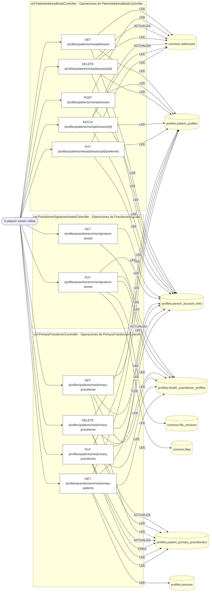

### Diagrama 3 de 5 — etapas `ctrl:ProfilesPatientsController`

```mermaid
flowchart LR
  a2(["SECURITY_ADMIN · SUPERADMIN · CLINICIAN · PRACTITIONER"]):::actor
  a10(["SECURITY_ADMIN"]):::actor
  a13(["SECURITY_ADMIN · CLINICIAN · PRACTITIONER"]):::actor
  a20(["Cualquier sesión válida"]):::actor
  t3[("common.identifiers")]:::tabla
  t4[("profiles.patient_profiles")]:::tabla
  t5[("profiles.persons")]:::tabla
  t6[("terminology.value_set_members")]:::tabla
  t7[("terminology.value_set_versions")]:::tabla
  t8[("terminology.value_sets")]:::tabla
  t11[("profiles.person_profiles")]:::tabla
  t14[("profiles.related_persons")]:::tabla
  t16[("profiles.patient_identity_links")]:::tabla
  t18[("profiles.patient_portal_proxies")]:::tabla
  t21[("profiles.person_account_links")]:::tabla
  t23[("common.addresses")]:::tabla
  t24[("common.contact_points")]:::tabla
  t25[("insurance.insurance_carriers")]:::tabla
  t26[("insurance.insurance_plan_benefits")]:::tabla
  t27[("insurance.insurance_plans")]:::tabla
  t37[("common.file_versions")]:::tabla
  t38[("common.files")]:::tabla
  t42[("profiles.patient_merge_events")]:::tabla
  t28[("+8 tablas más")]
  t30[("+14 tablas más")]
  t33[("+7 tablas más")]
  t35[("+8 tablas más")]
  t39[("+10 tablas más")]
  t43[("+2 tablas más")]
  subgraph s0["ctrl:ProfilesPatientsController · Operaciones de ProfilesPatientsController que…"]
    o1["GET /profiles/patients"]:::op
    o9["POST /profiles/patients"]:::op
    o12["GET /profiles/patients/{profileId}"]:::op
    o15["POST /profiles/patients/{profileId}/identity-links"]:::op
    o17["POST /profiles/patients/{profileId}/portal-proxies"]:::op
    o19["POST /profiles/patients/{profileId}/related-persons"]:::op
    o22["GET /profiles/patients/me"]:::op
    o29["PATCH /profiles/patients/me"]:::op
    o31["GET /profiles/patients/me/dependents"]:::op
    o32["POST /profiles/patients/me/dependents"]:::op
    o34["DELETE /profiles/patients/me/photo"]:::op
    o36["PUT /profiles/patients/me/photo"]:::op
    o40["GET /profiles/patients/me/summary"]:::op
    o41["POST /profiles/patients/merge"]:::op
    o44["GET /profiles/patients/merge-events"]:::op
    o45["POST /profiles/patients/merge/{eventId}/reverse"]:::op
    o46["POST /profiles/persons/{personId}/account-links"]:::op
    o47["POST /profiles/persons/{personId}/decease"]:::op
  end
  a2 --> o1
  o1 -->|"LEE"| t3
  o1 -->|"LEE"| t4
  o1 -->|"LEE"| t5
  o1 -->|"LEE"| t6
  o1 -->|"LEE"| t7
  o1 -->|"LEE"| t8
  a10 --> o9
  o9 -->|"CREA"| t4
  o9 -->|"LEE"| t4
  o9 -->|"CREA"| t11
  o9 -->|"CREA"| t5
  a13 --> o12
  o12 -->|"LEE"| t4
  o12 -->|"LEE"| t5
  o12 -->|"LEE"| t14
  a10 --> o15
  o15 -->|"ACTUALIZA"| t16
  o15 -->|"CREA"| t16
  o15 -->|"LEE"| t16
  o15 -->|"ACTUALIZA"| t4
  o15 -->|"LEE"| t4
  a10 --> o17
  o17 -->|"ACTUALIZA"| t18
  o17 -->|"CREA"| t18
  o17 -->|"LEE"| t4
  o17 -->|"LEE"| t14
  a20 --> o19
  o19 -->|"LEE"| t4
  o19 -->|"LEE"| t21
  o19 -->|"CREA"| t5
  o19 -->|"LEE"| t5
  o19 -->|"CREA"| t14
  o19 -->|"LEE"| t14
  a20 --> o22
  o22 -->|"LEE"| t23
  o22 -->|"LEE"| t24
  o22 -->|"LEE"| t3
  o22 -->|"LEE"| t25
  o22 -->|"LEE"| t26
  o22 -->|"LEE"| t27
  o22 -.-> t28
  a20 --> o29
  o29 -->|"ACTUALIZA"| t23
  o29 -->|"LEE"| t23
  o29 -->|"ACTUALIZA"| t24
  o29 -->|"CREA"| t24
  o29 -->|"LEE"| t24
  o29 -->|"CREA"| t3
  o29 -.-> t30
  a20 --> o31
  o31 -->|"LEE"| t3
  o31 -->|"LEE"| t18
  o31 -->|"LEE"| t4
  o31 -->|"LEE"| t5
  o31 -->|"LEE"| t14
  a20 --> o32
  o32 -->|"CREA"| t3
  o32 -->|"LEE"| t3
  o32 -->|"CREA"| t18
  o32 -->|"CREA"| t4
  o32 -->|"LEE"| t4
  o32 -->|"LEE"| t21
  o32 -.-> t33
  a20 --> o34
  o34 -->|"LEE"| t23
  o34 -->|"LEE"| t24
  o34 -->|"LEE"| t3
  o34 -->|"LEE"| t25
  o34 -->|"LEE"| t26
  o34 -->|"LEE"| t27
  o34 -.-> t35
  a20 --> o36
  o36 -->|"LEE"| t23
  o36 -->|"LEE"| t24
  o36 -->|"LEE"| t37
  o36 -->|"LEE"| t38
  o36 -->|"LEE"| t3
  o36 -->|"LEE"| t25
  o36 -.-> t39
  a20 --> o40
  o40 -->|"LEE"| t4
  o40 -->|"LEE"| t21
  o40 -->|"LEE"| t5
  a10 --> o41
  o41 -->|"ACTUALIZA"| t16
  o41 -->|"CREA"| t42
  o41 -->|"ACTUALIZA"| t18
  o41 -->|"ACTUALIZA"| t4
  o41 -->|"LEE"| t4
  o41 -->|"ACTUALIZA"| t5
  o41 -.-> t43
  a10 --> o44
  o44 -->|"LEE"| t42
  a10 --> o45
  o45 -->|"CREA"| t42
  o45 -->|"LEE"| t42
  o45 -->|"ACTUALIZA"| t4
  o45 -->|"LEE"| t4
  o45 -->|"ACTUALIZA"| t5
  o45 -->|"LEE"| t5
  a10 --> o46
  o46 -->|"ACTUALIZA"| t21
  o46 -->|"CREA"| t21
  o46 -->|"LEE"| t5
  a10 --> o47
  o47 -->|"ACTUALIZA"| t18
  o47 -->|"ACTUALIZA"| t21
  o47 -->|"ACTUALIZA"| t5
  o47 -->|"LEE"| t5
  classDef op fill:#fff,stroke:#446
  classDef actor fill:#eef,stroke:#66a
  classDef tabla fill:#ffd,stroke:#aa3
  classDef evento fill:#efe,stroke:#3a3
```

### Diagrama 4 de 5 — etapas `ctrl:ProfilesPractitionersController`

```mermaid
flowchart LR
  a2(["SECURITY_ADMIN"]):::actor
  a13(["Cualquier sesión válida"]):::actor
  t3[("profiles.professional_credentials")]:::tabla
  t5[("common.addresses")]:::tabla
  t6[("common.contact_points")]:::tabla
  t7[("common.file_versions")]:::tabla
  t8[("common.files")]:::tabla
  t9[("common.identifiers")]:::tabla
  t10[("practice.practice_sites")]:::tabla
  t14[("chart.clinical_note_headers")]:::tabla
  t15[("chart.document_records")]:::tabla
  t16[("clinical.encounters")]:::tabla
  t17[("clinical.medication_requests")]:::tabla
  t18[("community.public_profiles")]:::tabla
  t19[("community.service_reviews")]:::tabla
  t26[("directory.tenant_memberships")]:::tabla
  t27[("iam.devices")]:::tabla
  t28[("messaging.in_app_notifications")]:::tabla
  t29[("messaging.message_channels")]:::tabla
  t30[("messaging.message_templates")]:::tabla
  t33[("profiles.health_practitioner_profiles")]:::tabla
  t34[("profiles.jurisdiction_authorizations")]:::tabla
  t35[("profiles.person_account_links")]:::tabla
  t37[("profiles.practitioner_specialties")]:::tabla
  t44[("profiles.practitioner_affiliations")]:::tabla
  t53[("audit.jurisdiction_authorizations_history")]:::tabla
  t54[("identity_assurance.identity_verification_cases")]:::tabla
  t57[("terminology.catalog_concepts")]:::tabla
  t58[("terminology.concept_properties")]:::tabla
  t59[("terminology.value_set_members")]:::tabla
  t60[("terminology.value_set_versions")]:::tabla
  t61[("terminology.value_sets")]:::tabla
  t63[("scheduling.bookable_slots")]:::tabla
  t11[("+18 tablas más")]
  t20[("+6 tablas más")]
  t22[("+29 tablas más")]
  t24[("+21 tablas más")]
  t31[("+19 tablas más")]
  t38[("+3 tablas más")]
  t40[("+10 tablas más")]
  t42[("+21 tablas más")]
  t46[("+19 tablas más")]
  t64[("+1 tablas más")]
  t67[("+1 tablas más")]
  t70[("+10 tablas más")]
  subgraph s0["ctrl:ProfilesPractitionersController · Operaciones de ProfilesPractitionersCont…"]
    o1["GET /profiles/credentials"]:::op
    o4["POST /profiles/credentials/{credentialId}/verify"]:::op
    o12["GET /profiles/practitioners"]:::op
    o21["POST /profiles/practitioners"]:::op
    o23["PATCH /profiles/practitioners/{profileId}"]:::op
    o25["POST /profiles/practitioners/{profileId}/affiliations"]:::op
    o32["POST /profiles/practitioners/{profileId}/jurisdiction-authorizations"]:::op
    o36["POST /profiles/practitioners/{profileId}/specialties"]:::op
    o39["GET /profiles/practitioners/{profileId}/summary"]:::op
    o41["PATCH /profiles/practitioners/me"]:::op
    o43["GET /profiles/practitioners/me/affiliations"]:::op
    o45["POST /profiles/practitioners/me/affiliations"]:::op
    o47["DELETE /profiles/practitioners/me/affiliations/{affiliationId}"]:::op
    o48["PATCH /profiles/practitioners/me/affiliations/{affiliationId}"]:::op
    o49["POST /profiles/practitioners/me/credentials"]:::op
    o50["DELETE /profiles/practitioners/me/credentials/{credentialId}"]:::op
    o51["PATCH /profiles/practitioners/me/credentials/{credentialId}"]:::op
    o52["DELETE /profiles/practitioners/me/jurisdiction-authorizations/{licens…"]:::op
    o55["PATCH /profiles/practitioners/me/jurisdiction-authorizations/{license…"]:::op
    o56["GET /profiles/practitioners/me/linkable-organizations"]:::op
    o62["GET /profiles/practitioners/me/onboarding"]:::op
    o65["DELETE /profiles/practitioners/me/specialties/{specialtyId}"]:::op
    o66["PATCH /profiles/practitioners/me/specialties/{specialtyId}"]:::op
    o68["PATCH /profiles/practitioners/me/specialties/{specialtyId}/primary"]:::op
    o69["GET /profiles/practitioners/me/summary"]:::op
    o71["GET /profiles/practitioners/specialty-counts"]:::op
  end
  a2 --> o1
  o1 -->|"LEE"| t3
  a2 --> o4
  o4 -->|"LEE"| t5
  o4 -->|"LEE"| t6
  o4 -->|"LEE"| t7
  o4 -->|"LEE"| t8
  o4 -->|"LEE"| t9
  o4 -->|"LEE"| t10
  o4 -.-> t11
  a13 --> o12
  o12 -->|"LEE"| t14
  o12 -->|"LEE"| t15
  o12 -->|"LEE"| t16
  o12 -->|"LEE"| t17
  o12 -->|"LEE"| t18
  o12 -->|"LEE"| t19
  o12 -.-> t20
  a2 --> o21
  o21 -->|"LEE"| t5
  o21 -->|"LEE"| t6
  o21 -->|"LEE"| t7
  o21 -->|"LEE"| t8
  o21 -->|"LEE"| t9
  o21 -->|"LEE"| t10
  o21 -.-> t22
  a13 --> o23
  o23 -->|"LEE"| t14
  o23 -->|"LEE"| t15
  o23 -->|"LEE"| t16
  o23 -->|"LEE"| t17
  o23 -->|"LEE"| t5
  o23 -->|"ACTUALIZA"| t6
  o23 -.-> t24
  a2 --> o25
  o25 -->|"LEE"| t26
  o25 -->|"ACTUALIZA"| t27
  o25 -->|"LEE"| t27
  o25 -->|"CREA"| t28
  o25 -->|"LEE"| t29
  o25 -->|"LEE"| t30
  o25 -.-> t31
  a13 --> o32
  o32 -->|"LEE"| t7
  o32 -->|"LEE"| t8
  o32 -->|"LEE"| t33
  o32 -->|"CREA"| t34
  o32 -->|"LEE"| t35
  a13 --> o36
  o36 -->|"LEE"| t33
  o36 -->|"LEE"| t35
  o36 -->|"ACTUALIZA"| t37
  o36 -->|"CREA"| t37
  o36 -->|"LEE"| t37
  o36 -->|"LEE"| t3
  o36 -.-> t38
  a13 --> o39
  o39 -->|"LEE"| t14
  o39 -->|"LEE"| t15
  o39 -->|"LEE"| t16
  o39 -->|"LEE"| t17
  o39 -->|"LEE"| t5
  o39 -->|"LEE"| t6
  o39 -.-> t40
  a13 --> o41
  o41 -->|"LEE"| t14
  o41 -->|"LEE"| t15
  o41 -->|"LEE"| t16
  o41 -->|"LEE"| t17
  o41 -->|"LEE"| t5
  o41 -->|"ACTUALIZA"| t6
  o41 -.-> t42
  a13 --> o43
  o43 -->|"LEE"| t33
  o43 -->|"LEE"| t35
  o43 -->|"LEE"| t44
  a13 --> o45
  o45 -->|"LEE"| t26
  o45 -->|"ACTUALIZA"| t27
  o45 -->|"LEE"| t27
  o45 -->|"CREA"| t28
  o45 -->|"LEE"| t29
  o45 -->|"LEE"| t30
  o45 -.-> t46
  a13 --> o47
  o47 -->|"LEE"| t33
  o47 -->|"LEE"| t35
  o47 -->|"BORRA"| t44
  o47 -->|"LEE"| t44
  a13 --> o48
  o48 -->|"LEE"| t33
  o48 -->|"LEE"| t35
  o48 -->|"ACTUALIZA"| t44
  o48 -->|"LEE"| t44
  a13 --> o49
  o49 -->|"LEE"| t7
  o49 -->|"LEE"| t8
  o49 -->|"LEE"| t33
  o49 -->|"LEE"| t35
  o49 -->|"CREA"| t3
  a13 --> o50
  o50 -->|"LEE"| t33
  o50 -->|"LEE"| t35
  o50 -->|"BORRA"| t3
  o50 -->|"LEE"| t3
  a13 --> o51
  o51 -->|"LEE"| t7
  o51 -->|"LEE"| t8
  o51 -->|"LEE"| t33
  o51 -->|"LEE"| t35
  o51 -->|"ACTUALIZA"| t3
  o51 -->|"LEE"| t3
  a13 --> o52
  o52 -->|"LEE"| t53
  o52 -->|"LEE"| t54
  o52 -->|"LEE"| t33
  o52 -->|"BORRA"| t34
  o52 -->|"LEE"| t34
  o52 -->|"LEE"| t35
  a13 --> o55
  o55 -->|"LEE"| t7
  o55 -->|"LEE"| t8
  o55 -->|"LEE"| t54
  o55 -->|"LEE"| t33
  o55 -->|"LEE"| t34
  o55 -->|"LEE"| t35
  a13 --> o56
  o56 -->|"LEE"| t57
  o56 -->|"LEE"| t58
  o56 -->|"LEE"| t59
  o56 -->|"LEE"| t60
  o56 -->|"LEE"| t61
  a13 --> o62
  o62 -->|"LEE"| t33
  o62 -->|"LEE"| t34
  o62 -->|"LEE"| t35
  o62 -->|"LEE"| t44
  o62 -->|"LEE"| t37
  o62 -->|"LEE"| t63
  o62 -.-> t64
  a13 --> o65
  o65 -->|"LEE"| t33
  o65 -->|"LEE"| t35
  o65 -->|"BORRA"| t37
  o65 -->|"LEE"| t37
  a13 --> o66
  o66 -->|"LEE"| t33
  o66 -->|"LEE"| t35
  o66 -->|"ACTUALIZA"| t37
  o66 -->|"LEE"| t37
  o66 -->|"LEE"| t59
  o66 -->|"LEE"| t60
  o66 -.-> t67
  a13 --> o68
  o68 -->|"LEE"| t33
  o68 -->|"LEE"| t35
  o68 -->|"ACTUALIZA"| t37
  o68 -->|"LEE"| t37
  a13 --> o69
  o69 -->|"LEE"| t14
  o69 -->|"LEE"| t15
  o69 -->|"LEE"| t16
  o69 -->|"LEE"| t17
  o69 -->|"LEE"| t5
  o69 -->|"LEE"| t6
  o69 -.-> t70
  a13 --> o71
  o71 -->|"LEE"| t33
  o71 -->|"LEE"| t37
  classDef op fill:#fff,stroke:#446
  classDef actor fill:#eef,stroke:#66a
  classDef tabla fill:#ffd,stroke:#aa3
  classDef evento fill:#efe,stroke:#3a3
```

### Diagrama 5 de 5 — etapas `ctrl:TenantPractitionerRequestsController`

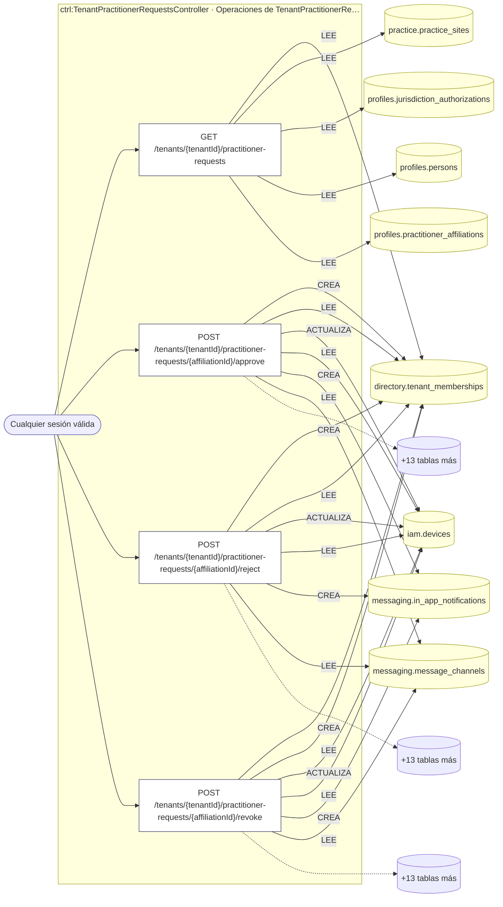

## Árbol de decisión por operación

Cada árbol se deriva del código del handler y de los métodos que invoca (hasta 4 niveles). Una rama que no decide, no escribe y no falla se poda. Los accesos y los efectos consecutivos se agrupan en un solo nodo.

### Operaciones con decisiones propias

#### 1. GET /admissions

Bandeja de admisiones

| HTTP | Código | Cuándo |
|---|---|---|
| 200 | — | Éxito |
| 401 | `UNAUTHENTICATED` | Hay una sesión válida (JWT) |
| 403 | `FORBIDDEN` | El rol está permitido; El tenant se resuelve y pertenece al actor |
| 429 | `RATE_LIMITED` | No se supera el límite de solicitudes |


#### 2. GET /admissions/{id}

Detalle de una admisión

| HTTP | Código | Cuándo |
|---|---|---|
| 200 | — | Éxito |
| 400 | `VALIDATION_FAILED` | Los parámetros de ruta son UUID válidos |
| 401 | `UNAUTHENTICATED` | Hay una sesión válida (JWT) |
| 403 | `FORBIDDEN` | El rol está permitido; El tenant se resuelve y pertenece al actor |
| 429 | `RATE_LIMITED` | No se supera el límite de solicitudes |

```mermaid
flowchart TD
  n1(("Solicitud")):::inicio
  n2{{"Acceso: sesión (401) · rol (403) · tenant (403) · parámetros de ruta (400) · límite de tasa (429)"}}:::acceso
  n1 --> n2
  n3["Llama a PractitionerAdmissionsReadService.detail"]:::llamada
  n2 --> n3
  n4["Llama a PractitionerAdmissionsRepository.findById"]:::llamada
  n3 --> n4
  n5[("LEE profiles.practitioner_admissions")]:::efecto
  n4 --> n5
  n6{"!admission"}:::decision
  n5 --> n6
  n7(["↩ (relanza el error capturado)"]):::error
  n6 -->|"sí"| n7
  n8["Llama a PractitionerAdmissionsReadService.detailOf"]:::llamada
  n6 -->|"no"| n8
  n9["Llama a PractitionerAdmissionChecklistService.buildView"]:::llamada
  n8 --> n9
  n10["Llama a PractitionerAdmissionEvidenceService.collect"]:::llamada
  n9 --> n10
  n11[("LEE profiles.jurisdiction_authorizations · LEE profiles.professional_credentials · LEE profiles.practitioner_…")]:::efecto
  n10 --> n11
  n12["Llama a PractitionerAdmissionReviewsRepository.findByAdmission"]:::llamada
  n11 --> n12
  n13[("LEE profiles.practitioner_admission_reviews")]:::efecto
  n12 --> n13
  n14["Llama a PractitionerAdmissionEventsRepository.findByAdmission"]:::llamada
  n13 --> n14
  n15[("LEE profiles.practitioner_admission_events")]:::efecto
  n14 --> n15
  n16["Llama a PractitionerAdmissionEvidenceService.fileFacts"]:::llamada
  n15 --> n16
  n17["Llama a AdmissionForeignReadsAdapter.fileFacts"]:::llamada
  n16 --> n17
  n18[("LEE common.files · LEE common.file_versions")]:::efecto
  n17 --> n18
  n19["Llama a PractitionerAdmissionsReadService.practitionerBasics"]:::llamada
  n18 --> n19
  n20[("LEE profiles.persons")]:::efecto
  n19 --> n20
  n21["Llama a AdmissionForeignReadsAdapter.nationalIds"]:::llamada
  n20 --> n21
  n22[("LEE common.identifiers")]:::efecto
  n21 --> n22
  n23[("LEE profiles.professional_credentials · LEE profiles.health_practitioner_profiles")]:::efecto
  n22 --> n23
  n24["Llama a PractitionerAdmissionsReadService.userNames"]:::llamada
  n23 --> n24
  n25["Llama a AdmissionForeignReadsAdapter.userNames"]:::llamada
  n24 --> n25
  n26[("LEE iam.users")]:::efecto
  n25 --> n26
  n27["Llama a PractitionerAdmissionEvidenceService.buildSnapshot"]:::llamada
  n26 --> n27
  n28[("LEE profiles.persons")]:::efecto
  n27 --> n28
  n29["Llama a AdmissionForeignReadsAdapter.nationalIds"]:::llamada
  n28 --> n29
  n30[("LEE common.identifiers")]:::efecto
  n29 --> n30
  n31["Llama a AdmissionForeignReadsAdapter.contactPoints"]:::llamada
  n30 --> n31
  n32[("LEE common.contact_points")]:::efecto
  n31 --> n32
  n33["Llama a AdmissionForeignReadsAdapter.addresses"]:::llamada
  n32 --> n33
  n34[("LEE common.addresses")]:::efecto
  n33 --> n34
  n35[("LEE profiles.jurisdiction_authorizations · LEE profiles.professional_credentials · LEE profiles.practitioner_…")]:::efecto
  n34 --> n35
  n36[("LEE profiles.jurisdiction_authorizations · LEE profiles.professional_credentials · LEE profiles.practitioner_…")]:::efecto
  n35 --> n36
  n37(("200 Responde con éxito")):::ok
  n36 --> n37
  classDef acceso fill:#eef,stroke:#66a
  classDef error fill:#fee,stroke:#c33
  classDef ok fill:#efe,stroke:#3a3
  classDef efecto fill:#ffd,stroke:#aa3
  classDef decision fill:#fff,stroke:#555
  classDef corte fill:#eee,stroke:#999,stroke-dasharray: 4
```

#### 3. POST /admissions/{id}/claim

Tomar la admisión para revisarla

| HTTP | Código | Cuándo |
|---|---|---|
| 200 | — | Éxito |
| 400 | `VALIDATION_FAILED` | Los parámetros de ruta son UUID válidos; El cuerpo cumple el DTO (sin propiedades extra) |
| 401 | `UNAUTHENTICATED` | Hay una sesión válida (JWT) |
| 403 | `FORBIDDEN` | El rol está permitido; El tenant se resuelve y pertenece al actor; InsufficientRoleException: Su rol no alcanza para esta acción de admisiones |
| 404 | `NOT_FOUND` | ResourceNotFoundException: Admisión no encontrada |
| 422 | `PRECONDITION_FAILED` | PreconditionFailedException: La acción no es válida desde el estado {from} |
| 429 | `RATE_LIMITED` | No se supera el límite de solicitudes |

```mermaid
flowchart TD
  n1(("Solicitud")):::inicio
  n2{{"Acceso: sesión (401) · rol (403) · tenant (403) · parámetros de ruta (400) · cuerpo válido (400) · límite de…"}}:::acceso
  n1 --> n2
  n3["Llama a PractitionerAdmissionsService.claim"]:::llamada
  n2 --> n3
  n4["Transacción: transactional(…)"]:::transaccion
  n3 --> n4
  n5["Llama a PractitionerAdmissionsService.roleFor"]:::llamada
  n4 --> n5
  n6(["403 FORBIDDEN Su rol no alcanza para esta acción de admisiones"]):::error
  n5 --> n6
  n7["Llama a PractitionerAdmissionsService.loadLocked"]:::llamada
  n8["Llama a PractitionerAdmissionsRepository.findByIdForUpdate"]:::llamada
  n7 --> n8
  n9[("LEE profiles.practitioner_admissions")]:::efecto
  n8 --> n9
  n10{"!admission"}:::decision
  n9 --> n10
  n11(["404 NOT_FOUND Admisión no encontrada"]):::error
  n10 -->|"sí"| n11
  n12{"status === 'EN_REVISION' && admission.assignedToUserId === caller.user.id"}:::decision
  n10 -->|"no"| n12
  n13["Llama a PractitionerAdmissionsReadService.detailOf"]:::llamada
  n12 -->|"sí"| n13
  n14["Llama a PractitionerAdmissionChecklistService.buildView"]:::llamada
  n13 --> n14
  n15["Llama a PractitionerAdmissionEvidenceService.collect"]:::llamada
  n14 --> n15
  n16[("LEE profiles.jurisdiction_authorizations · LEE profiles.professional_credentials · LEE profiles.practitioner_…")]:::efecto
  n15 --> n16
  n17["Llama a PractitionerAdmissionReviewsRepository.findByAdmission"]:::llamada
  n16 --> n17
  n18[("LEE profiles.practitioner_admission_reviews")]:::efecto
  n17 --> n18
  n19["Llama a PractitionerAdmissionEventsRepository.findByAdmission"]:::llamada
  n18 --> n19
  n20[("LEE profiles.practitioner_admission_events")]:::efecto
  n19 --> n20
  n21["Llama a PractitionerAdmissionEvidenceService.fileFacts"]:::llamada
  n20 --> n21
  n22["Llama a AdmissionForeignReadsAdapter.fileFacts"]:::llamada
  n21 --> n22
  n23[("LEE common.files · LEE common.file_versions")]:::efecto
  n22 --> n23
  n24["Llama a PractitionerAdmissionsReadService.practitionerBasics"]:::llamada
  n23 --> n24
  n25[("LEE profiles.persons")]:::efecto
  n24 --> n25
  n26["Llama a AdmissionForeignReadsAdapter.nationalIds"]:::llamada
  n25 --> n26
  n27[("LEE common.identifiers")]:::efecto
  n26 --> n27
  n28[("LEE profiles.professional_credentials · LEE profiles.health_practitioner_profiles")]:::efecto
  n27 --> n28
  n29["Llama a PractitionerAdmissionsReadService.userNames"]:::llamada
  n28 --> n29
  n30["Llama a AdmissionForeignReadsAdapter.userNames"]:::llamada
  n29 --> n30
  n31[("LEE iam.users")]:::efecto
  n30 --> n31
  n32["Llama a PractitionerAdmissionEvidenceService.buildSnapshot"]:::llamada
  n31 --> n32
  n33[("LEE profiles.persons")]:::efecto
  n32 --> n33
  n34["Llama a AdmissionForeignReadsAdapter.nationalIds"]:::llamada
  n33 --> n34
  n35[("LEE common.identifiers")]:::efecto
  n34 --> n35
  n36["Llama a AdmissionForeignReadsAdapter.contactPoints"]:::llamada
  n35 --> n36
  n37[("LEE common.contact_points")]:::efecto
  n36 --> n37
  n38["Llama a AdmissionForeignReadsAdapter.addresses"]:::llamada
  n37 --> n38
  n39[("LEE common.addresses")]:::efecto
  n38 --> n39
  n40[("LEE profiles.jurisdiction_authorizations · LEE profiles.professional_credentials · LEE profiles.practitioner_…")]:::efecto
  n39 --> n40
  n41[("LEE profiles.jurisdiction_authorizations · LEE profiles.professional_credentials · LEE profiles.practitioner_…")]:::efecto
  n40 --> n41
  n42["Llama a PractitionerAdmissionsService.assertVersion"]:::llamada
  n41 --> n42
  n12 -->|"no"| n42
  n43{"admission.rowVersion !== expected"}:::decision
  n42 --> n43
  n44(["↩ (relanza el error capturado)"]):::error
  n43 -->|"sí"| n44
  n45["Llama a PractitionerAdmissionsService.assertTransition"]:::llamada
  n43 -->|"no"| n45
  n46{"!canTransition(action, from)"}:::decision
  n45 --> n46
  n47(["422 PRECONDITION_FAILED La acción no es válida desde el estado {from}"]):::error
  n46 -->|"sí"| n47
  n48["Llama a PractitionerAdmissionsRepository.setStatus"]:::llamada
  n46 -->|"no"| n48
  n49[("ACTUALIZA profiles.practitioner_admissions · ACTUALIZA profiles.practitioner_admissions · ACTUALIZA profiles.…")]:::efecto
  n48 --> n49
  n50[("ACTUALIZA profiles.practitioner_admissions")]:::efecto
  n49 --> n50
  n51["Llama a PractitionerAdmissionsService.appendEvent"]:::llamada
  n50 --> n51
  n52["Llama a PractitionerAdmissionEventsRepository.append"]:::llamada
  n51 --> n52
  n53[("CREA profiles.practitioner_admission_events")]:::efecto
  n52 --> n53
  n54["Llama a PractitionerAdmissionChecklistService.materialize"]:::llamada
  n53 --> n54
  n55["Llama a PractitionerAdmissionChecklistService.buildView"]:::llamada
  n54 --> n55
  n56["Llama a PractitionerAdmissionEvidenceService.collect"]:::llamada
  n55 --> n56
  n57[("LEE profiles.jurisdiction_authorizations · LEE profiles.professional_credentials · LEE profiles.practitioner_…")]:::efecto
  n56 --> n57
  n58["Llama a PractitionerAdmissionReviewsRepository.findByAdmission"]:::llamada
  n57 --> n58
  n59[("LEE profiles.practitioner_admission_reviews")]:::efecto
  n58 --> n59
  n60["Repite: por cada const row de view.evaluation.rows"]:::bucle
  n59 --> n60
  n61["Repite: por cada const item de row.items"]:::bucle
  n60 -->|"cada elemento"| n61
  n62{"!item.review"}:::decision
  n61 -->|"cada elemento"| n62
  n63["Llama a PractitionerAdmissionReviewsRepository.create"]:::llamada
  n62 -->|"sí"| n63
  n64[("CREA profiles.practitioner_admission_reviews")]:::efecto
  n63 --> n64
  n65{"mustReset"}:::decision
  n64 --> n65
  n62 -->|"no"| n65
  n66["Llama a PractitionerAdmissionChecklistService.clearReview"]:::llamada
  n65 -->|"sí"| n66
  n67[("ACTUALIZA profiles.practitioner_admission_reviews · ACTUALIZA profiles.practitioner_admission_reviews · ACTUA…")]:::efecto
  n66 --> n67
  n68["Llama a PractitionerAdmissionChecklistService.applyEntityDecision"]:::llamada
  n67 --> n68
  n69{"type === 'LICENSE'"}:::decision
  n68 --> n69
  n70[("LEE profiles.jurisdiction_authorizations · ACTUALIZA profiles.jurisdiction_authorizations")]:::efecto
  n69 -->|"sí"| n70
  n71["… el resto del árbol (9 nodos) está en el JSON del inventario"]:::corte
  n70 --> n71
  classDef acceso fill:#eef,stroke:#66a
  classDef error fill:#fee,stroke:#c33
  classDef ok fill:#efe,stroke:#3a3
  classDef efecto fill:#ffd,stroke:#aa3
  classDef decision fill:#fff,stroke:#555
  classDef corte fill:#eee,stroke:#999,stroke-dasharray: 4
```

#### 4. POST /admissions/{id}/decision

Resolver la admisión: VERIFIED o REJECTED

| HTTP | Código | Cuándo |
|---|---|---|
| 200 | — | Éxito |
| 400 | `VALIDATION_FAILED` | Los parámetros de ruta son UUID válidos; El cuerpo cumple el DTO (sin propiedades extra) |
| 401 | `UNAUTHENTICATED` | Hay una sesión válida (JWT) |
| 403 | `FORBIDDEN` | El rol está permitido; El tenant se resuelve y pertenece al actor; InsufficientRoleException: Su rol no alcanza para esta acción de admisiones; InsufficientRoleException: Cuatro ojos: la resolución debe hacerla una persona distinta de quien revisó |
| 404 | `NOT_FOUND` | ResourceNotFoundException: Admisión no encontrada |
| 422 | `PRECONDITION_FAILED` | PreconditionFailedException: La resolución no recibe ítems: se revisan uno por uno en .../items/:itemId/review; PreconditionFailedException: La acción no es válida desde el estado {from}; PreconditionFailedException: El checklist no está completo: hay requisitos sin verificar o rechazados; PreconditionFailedException: Una matrícula verificada ya venció: no se puede verificar con ella |
| 429 | `RATE_LIMITED` | No se supera el límite de solicitudes |

```mermaid
flowchart TD
  n1(("Solicitud")):::inicio
  n2{{"Acceso: sesión (401) · rol (403) · tenant (403) · parámetros de ruta (400) · cuerpo válido (400) · límite de…"}}:::acceso
  n1 --> n2
  n3["Llama a PractitionerAdmissionsService.decide"]:::llamada
  n2 --> n3
  n4{"dto.items !== undefined && dto.items.length › 0"}:::decision
  n3 --> n4
  n5(["422 PRECONDITION_FAILED La resolución no recibe ítems: se revisan uno por uno en .../items/:itemId/review"]):::error
  n4 -->|"sí"| n5
  n6["Transacción: transactional(…)"]:::transaccion
  n4 -->|"no"| n6
  n7["Llama a PractitionerAdmissionsService.roleFor"]:::llamada
  n6 --> n7
  n8(["403 FORBIDDEN Su rol no alcanza para esta acción de admisiones"]):::error
  n7 --> n8
  n9["Llama a PractitionerAdmissionsService.loadLocked"]:::llamada
  n10["Llama a PractitionerAdmissionsRepository.findByIdForUpdate"]:::llamada
  n9 --> n10
  n11[("LEE profiles.practitioner_admissions")]:::efecto
  n10 --> n11
  n12{"!admission"}:::decision
  n11 --> n12
  n13(["404 NOT_FOUND Admisión no encontrada"]):::error
  n12 -->|"sí"| n13
  n14["Llama a PractitionerAdmissionsReadService.detailOf"]:::llamada
  n12 -->|"no"| n14
  n15["Llama a PractitionerAdmissionChecklistService.buildView"]:::llamada
  n14 --> n15
  n16["Llama a PractitionerAdmissionEvidenceService.collect"]:::llamada
  n15 --> n16
  n17[("LEE profiles.jurisdiction_authorizations · LEE profiles.professional_credentials · LEE profiles.practitioner_…")]:::efecto
  n16 --> n17
  n18["Llama a PractitionerAdmissionReviewsRepository.findByAdmission"]:::llamada
  n17 --> n18
  n19[("LEE profiles.practitioner_admission_reviews")]:::efecto
  n18 --> n19
  n20["Llama a PractitionerAdmissionEventsRepository.findByAdmission"]:::llamada
  n19 --> n20
  n21[("LEE profiles.practitioner_admission_events")]:::efecto
  n20 --> n21
  n22["Llama a PractitionerAdmissionEvidenceService.fileFacts"]:::llamada
  n21 --> n22
  n23["Llama a AdmissionForeignReadsAdapter.fileFacts"]:::llamada
  n22 --> n23
  n24[("LEE common.files · LEE common.file_versions")]:::efecto
  n23 --> n24
  n25["Llama a PractitionerAdmissionsReadService.practitionerBasics"]:::llamada
  n24 --> n25
  n26[("LEE profiles.persons")]:::efecto
  n25 --> n26
  n27["Llama a AdmissionForeignReadsAdapter.nationalIds"]:::llamada
  n26 --> n27
  n28[("LEE common.identifiers")]:::efecto
  n27 --> n28
  n29[("LEE profiles.professional_credentials · LEE profiles.health_practitioner_profiles")]:::efecto
  n28 --> n29
  n30["Llama a PractitionerAdmissionsReadService.userNames"]:::llamada
  n29 --> n30
  n31["Llama a AdmissionForeignReadsAdapter.userNames"]:::llamada
  n30 --> n31
  n32[("LEE iam.users")]:::efecto
  n31 --> n32
  n33["Llama a PractitionerAdmissionEvidenceService.buildSnapshot"]:::llamada
  n32 --> n33
  n34[("LEE profiles.persons")]:::efecto
  n33 --> n34
  n35["Llama a AdmissionForeignReadsAdapter.nationalIds"]:::llamada
  n34 --> n35
  n36[("LEE common.identifiers")]:::efecto
  n35 --> n36
  n37["Llama a AdmissionForeignReadsAdapter.contactPoints"]:::llamada
  n36 --> n37
  n38[("LEE common.contact_points")]:::efecto
  n37 --> n38
  n39["Llama a AdmissionForeignReadsAdapter.addresses"]:::llamada
  n38 --> n39
  n40[("LEE common.addresses")]:::efecto
  n39 --> n40
  n41[("LEE profiles.jurisdiction_authorizations · LEE profiles.professional_credentials · LEE profiles.practitioner_…")]:::efecto
  n40 --> n41
  n42[("LEE profiles.jurisdiction_authorizations · LEE profiles.professional_credentials · LEE profiles.practitioner_…")]:::efecto
  n41 --> n42
  n43{"status === target"}:::decision
  n42 --> n43
  n44["Llama a PractitionerAdmissionsReadService.detailOf"]:::llamada
  n43 -->|"sí"| n44
  n45["Llama a PractitionerAdmissionChecklistService.buildView"]:::llamada
  n44 --> n45
  n46["Llama a PractitionerAdmissionEvidenceService.collect"]:::llamada
  n45 --> n46
  n47[("LEE profiles.jurisdiction_authorizations · LEE profiles.professional_credentials · LEE profiles.practitioner_…")]:::efecto
  n46 --> n47
  n48["Llama a PractitionerAdmissionReviewsRepository.findByAdmission"]:::llamada
  n47 --> n48
  n49[("LEE profiles.practitioner_admission_reviews")]:::efecto
  n48 --> n49
  n50["Llama a PractitionerAdmissionEventsRepository.findByAdmission"]:::llamada
  n49 --> n50
  n51[("LEE profiles.practitioner_admission_events")]:::efecto
  n50 --> n51
  n52["Llama a PractitionerAdmissionEvidenceService.fileFacts"]:::llamada
  n51 --> n52
  n53["Llama a AdmissionForeignReadsAdapter.fileFacts"]:::llamada
  n52 --> n53
  n54[("LEE common.files · LEE common.file_versions")]:::efecto
  n53 --> n54
  n55["Llama a PractitionerAdmissionsReadService.practitionerBasics"]:::llamada
  n54 --> n55
  n56[("LEE profiles.persons")]:::efecto
  n55 --> n56
  n57["Llama a AdmissionForeignReadsAdapter.nationalIds"]:::llamada
  n56 --> n57
  n58[("LEE common.identifiers")]:::efecto
  n57 --> n58
  n59[("LEE profiles.professional_credentials · LEE profiles.health_practitioner_profiles")]:::efecto
  n58 --> n59
  n60["Llama a PractitionerAdmissionsReadService.userNames"]:::llamada
  n59 --> n60
  n61["Llama a AdmissionForeignReadsAdapter.userNames"]:::llamada
  n60 --> n61
  n62[("LEE iam.users")]:::efecto
  n61 --> n62
  n63["Llama a PractitionerAdmissionEvidenceService.buildSnapshot"]:::llamada
  n62 --> n63
  n64[("LEE profiles.persons")]:::efecto
  n63 --> n64
  n65["Llama a AdmissionForeignReadsAdapter.nationalIds"]:::llamada
  n64 --> n65
  n66[("LEE common.identifiers")]:::efecto
  n65 --> n66
  n67["Llama a AdmissionForeignReadsAdapter.contactPoints"]:::llamada
  n66 --> n67
  n68[("LEE common.contact_points")]:::efecto
  n67 --> n68
  n69["Llama a AdmissionForeignReadsAdapter.addresses"]:::llamada
  n68 --> n69
  n70[("LEE common.addresses")]:::efecto
  n69 --> n70
  n71["… el resto del árbol (3 nodos) está en el JSON del inventario"]:::corte
  n70 --> n71
  classDef acceso fill:#eef,stroke:#66a
  classDef error fill:#fee,stroke:#c33
  classDef ok fill:#efe,stroke:#3a3
  classDef efecto fill:#ffd,stroke:#aa3
  classDef decision fill:#fff,stroke:#555
  classDef corte fill:#eee,stroke:#999,stroke-dasharray: 4
```

#### 5. GET /admissions/{id}/documents/{fileId}/content

Contenido de un documento de la admisión (URL firmada)

| HTTP | Código | Cuándo |
|---|---|---|
| 200 | — | Éxito |
| 400 | `VALIDATION_FAILED` | Los parámetros de ruta son UUID válidos |
| 401 | `UNAUTHENTICATED` | Hay una sesión válida (JWT) |
| 403 | `FORBIDDEN` | El rol está permitido; El tenant se resuelve y pertenece al actor; InsufficientRoleException: Su rol no alcanza para abrir documentos de admisiones |
| 404 | `NOT_FOUND` | ResourceNotFoundException: Archivo no encontrado |
| 410 | — | GoneException: {{ code: ErrorCode.PRECONDITION_FAILED, message: 'La URL del…} |
| 429 | `RATE_LIMITED` | No se supera el límite de solicitudes |

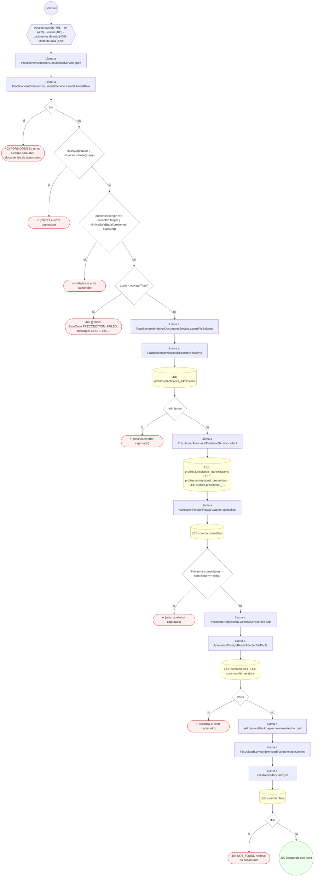

#### 6. POST /admissions/{id}/documents/{fileId}/download-url

URL firmada para abrir un documento de la admisión

| HTTP | Código | Cuándo |
|---|---|---|
| 201 | — | Éxito |
| 400 | `VALIDATION_FAILED` | Los parámetros de ruta son UUID válidos |
| 401 | `UNAUTHENTICATED` | Hay una sesión válida (JWT) |
| 403 | `FORBIDDEN` | El rol está permitido; El tenant se resuelve y pertenece al actor; InsufficientRoleException: Su rol no alcanza para abrir documentos de admisiones |
| 429 | `RATE_LIMITED` | No se supera el límite de solicitudes |

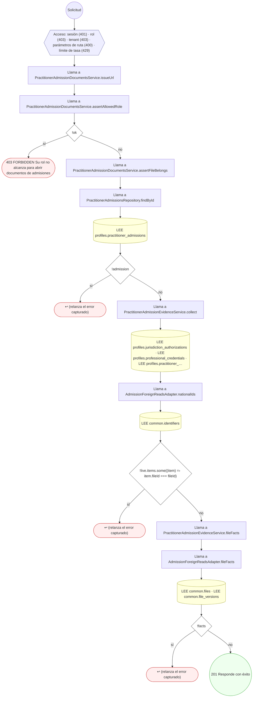

#### 7. POST /admissions/{id}/items/{itemId}/review

Revisar un ítem del checklist

| HTTP | Código | Cuándo |
|---|---|---|
| 200 | — | Éxito |
| 400 | `VALIDATION_FAILED` | Los parámetros de ruta son UUID válidos; El cuerpo cumple el DTO (sin propiedades extra) |
| 401 | `UNAUTHENTICATED` | Hay una sesión válida (JWT) |
| 403 | `FORBIDDEN` | El rol está permitido; El tenant se resuelve y pertenece al actor; InsufficientRoleException: Su rol no alcanza para esta acción de admisiones; InsufficientRoleException: Sólo quien tomó la revisión puede actuar sobre sus ítems |
| 404 | `NOT_FOUND` | ResourceNotFoundException: Ítem de la admisión no encontrado; ResourceNotFoundException: Admisión no encontrada |
| 409 | `CONCURRENCY_CONFLICT` | ConcurrencyConflictException: La evidencia del ítem cambió desde que la revisó: vuelva a abrirla |
| 422 | `PRECONDITION_FAILED` | PreconditionFailedException: La admisión no está en revisión; PreconditionFailedException: La fecha de consulta de la fuente no puede ser futura; PreconditionFailedException: Verificar este ítem exige declarar la fuente consultada |
| 429 | `RATE_LIMITED` | No se supera el límite de solicitudes |

```mermaid
flowchart TD
  n1(("Solicitud")):::inicio
  n2{{"Acceso: sesión (401) · rol (403) · tenant (403) · parámetros de ruta (400) · cuerpo válido (400) · límite de…"}}:::acceso
  n1 --> n2
  n3["Llama a PractitionerAdmissionsService.reviewItem"]:::llamada
  n2 --> n3
  n4["Transacción: transactional(…)"]:::transaccion
  n3 --> n4
  n5["Llama a PractitionerAdmissionsService.roleFor"]:::llamada
  n4 --> n5
  n6(["403 FORBIDDEN Su rol no alcanza para esta acción de admisiones"]):::error
  n5 --> n6
  n7["Llama a PractitionerAdmissionReviewsRepository.findByIdForUpdate"]:::llamada
  n8[("LEE profiles.practitioner_admission_reviews")]:::efecto
  n7 --> n8
  n9{"!review || review.admissionId !== admissionId"}:::decision
  n8 --> n9
  n10(["404 NOT_FOUND Ítem de la admisión no encontrado"]):::error
  n9 -->|"sí"| n10
  n11["Llama a PractitionerAdmissionsRepository.findById"]:::llamada
  n9 -->|"no"| n11
  n12[("LEE profiles.practitioner_admissions")]:::efecto
  n11 --> n12
  n13{"!admission"}:::decision
  n12 --> n13
  n14(["404 NOT_FOUND Admisión no encontrada"]):::error
  n13 -->|"sí"| n14
  n15["Llama a PractitionerAdmissionEvidenceService.collect"]:::llamada
  n13 -->|"no"| n15
  n16[("LEE profiles.jurisdiction_authorizations · LEE profiles.professional_credentials · LEE profiles.practitioner_…")]:::efecto
  n15 --> n16
  n17["Llama a AdmissionForeignReadsAdapter.nationalIds"]:::llamada
  n16 --> n17
  n18[("LEE common.identifiers")]:::efecto
  n17 --> n18
  n19["Llama a PractitionerAdmissionEvidenceService.fileFacts"]:::llamada
  n18 --> n19
  n20["Llama a AdmissionForeignReadsAdapter.fileFacts"]:::llamada
  n19 --> n20
  n21[("LEE common.files · LEE common.file_versions")]:::efecto
  n20 --> n21
  n22["Llama a PractitionerAdmissionEvidenceService.conceptNames"]:::llamada
  n21 --> n22
  n23["Llama a AdmissionForeignReadsAdapter.conceptNames"]:::llamada
  n22 --> n23
  n24[("LEE terminology.catalog_concepts")]:::efecto
  n23 --> n24
  n25["Llama a PractitionerAdmissionEvidenceService.practiceSites"]:::llamada
  n24 --> n25
  n26["Llama a AdmissionForeignReadsAdapter.practiceSites"]:::llamada
  n25 --> n26
  n27[("LEE practice.practitioner_role_assignments · LEE practice.practice_sites · LEE common.addresses")]:::efecto
  n26 --> n27
  n28{"recorded === dto.decision && this.sameReview(review, dto) && live?.evidenceSha256 === review.evidenceSha256"}:::decision
  n27 --> n28
  n29["Llama a PractitionerAdmissionsReadService.detailOf"]:::llamada
  n28 -->|"sí"| n29
  n30["Llama a PractitionerAdmissionChecklistService.buildView"]:::llamada
  n29 --> n30
  n31["Llama a PractitionerAdmissionEvidenceService.collect"]:::llamada
  n30 --> n31
  n32[("LEE profiles.jurisdiction_authorizations · LEE profiles.professional_credentials · LEE profiles.practitioner_…")]:::efecto
  n31 --> n32
  n33["Llama a PractitionerAdmissionReviewsRepository.findByAdmission"]:::llamada
  n32 --> n33
  n34[("LEE profiles.practitioner_admission_reviews")]:::efecto
  n33 --> n34
  n35["Llama a PractitionerAdmissionEventsRepository.findByAdmission"]:::llamada
  n34 --> n35
  n36[("LEE profiles.practitioner_admission_events")]:::efecto
  n35 --> n36
  n37["Llama a PractitionerAdmissionEvidenceService.fileFacts"]:::llamada
  n36 --> n37
  n38["Llama a AdmissionForeignReadsAdapter.fileFacts"]:::llamada
  n37 --> n38
  n39[("LEE common.files · LEE common.file_versions")]:::efecto
  n38 --> n39
  n40["Llama a PractitionerAdmissionsReadService.practitionerBasics"]:::llamada
  n39 --> n40
  n41[("LEE profiles.persons")]:::efecto
  n40 --> n41
  n42["Llama a AdmissionForeignReadsAdapter.nationalIds"]:::llamada
  n41 --> n42
  n43[("LEE common.identifiers")]:::efecto
  n42 --> n43
  n44[("LEE profiles.professional_credentials · LEE profiles.health_practitioner_profiles")]:::efecto
  n43 --> n44
  n45["Llama a PractitionerAdmissionsReadService.userNames"]:::llamada
  n44 --> n45
  n46["Llama a AdmissionForeignReadsAdapter.userNames"]:::llamada
  n45 --> n46
  n47[("LEE iam.users")]:::efecto
  n46 --> n47
  n48["Llama a PractitionerAdmissionEvidenceService.buildSnapshot"]:::llamada
  n47 --> n48
  n49[("LEE profiles.persons")]:::efecto
  n48 --> n49
  n50["Llama a AdmissionForeignReadsAdapter.nationalIds"]:::llamada
  n49 --> n50
  n51[("LEE common.identifiers")]:::efecto
  n50 --> n51
  n52["Llama a AdmissionForeignReadsAdapter.contactPoints"]:::llamada
  n51 --> n52
  n53[("LEE common.contact_points")]:::efecto
  n52 --> n53
  n54["Llama a AdmissionForeignReadsAdapter.addresses"]:::llamada
  n53 --> n54
  n55[("LEE common.addresses")]:::efecto
  n54 --> n55
  n56[("LEE profiles.jurisdiction_authorizations · LEE profiles.professional_credentials · LEE profiles.practitioner_…")]:::efecto
  n55 --> n56
  n57[("LEE profiles.jurisdiction_authorizations · LEE profiles.professional_credentials · LEE profiles.practitioner_…")]:::efecto
  n56 --> n57
  n58{"review.rowVersion !== dto.expectedRowVersion"}:::decision
  n57 --> n58
  n28 -->|"no"| n58
  n59(["↩ (relanza el error capturado)"]):::error
  n58 -->|"sí"| n59
  n60{"status !== 'EN_REVISION'"}:::decision
  n58 -->|"no"| n60
  n61(["422 PRECONDITION_FAILED La admisión no está en revisión"]):::error
  n60 -->|"sí"| n61
  n62["Llama a PractitionerAdmissionsService.assertAssignee"]:::llamada
  n60 -->|"no"| n62
  n63{"admission.assignedToUserId !== user.id"}:::decision
  n62 --> n63
  n64(["403 FORBIDDEN Sólo quien tomó la revisión puede actuar sobre sus ítems"]):::error
  n63 -->|"sí"| n64
  n65{"evidenceMoved"}:::decision
  n63 -->|"no"| n65
  n66(["409 CONCURRENCY_CONFLICT La evidencia del ítem cambió desde que la revisó: vuelva a abrirla"]):::error
  n65 -->|"sí"| n66
  n67["Llama a PractitionerAdmissionChecklistService.requirementsOf"]:::llamada
  n65 -->|"no"| n67
  n68["Llama a AdmissionRequirementsRepository.findActiveByType"]:::llamada
  n67 --> n68
  n69[("LEE profiles.admission_requirements")]:::efecto
  n68 --> n69
  n70["Llama a PractitionerAdmissionsService.sourceOf"]:::llamada
  n69 --> n70
  n71["… el resto del árbol (3 nodos) está en el JSON del inventario"]:::corte
  n70 --> n71
  classDef acceso fill:#eef,stroke:#66a
  classDef error fill:#fee,stroke:#c33
  classDef ok fill:#efe,stroke:#3a3
  classDef efecto fill:#ffd,stroke:#aa3
  classDef decision fill:#fff,stroke:#555
  classDef corte fill:#eee,stroke:#999,stroke-dasharray: 4
```

#### 8. POST /admissions/{id}/reassign

Pasar la revisión a otro revisor

| HTTP | Código | Cuándo |
|---|---|---|
| 200 | — | Éxito |
| 400 | `VALIDATION_FAILED` | Los parámetros de ruta son UUID válidos; El cuerpo cumple el DTO (sin propiedades extra) |
| 401 | `UNAUTHENTICATED` | Hay una sesión válida (JWT) |
| 403 | `FORBIDDEN` | El rol está permitido; El tenant se resuelve y pertenece al actor; InsufficientRoleException: Su rol no alcanza para esta acción de admisiones |
| 404 | `NOT_FOUND` | ResourceNotFoundException: Admisión no encontrada |
| 422 | `PRECONDITION_FAILED` | PreconditionFailedException: La acción no es válida desde el estado {from}; PreconditionFailedException: El revisor indicado no existe o es el propio solicitante |
| 429 | `RATE_LIMITED` | No se supera el límite de solicitudes |

```mermaid
flowchart TD
  n1(("Solicitud")):::inicio
  n2{{"Acceso: sesión (401) · rol (403) · tenant (403) · parámetros de ruta (400) · cuerpo válido (400) · límite de…"}}:::acceso
  n1 --> n2
  n3["Llama a PractitionerAdmissionsService.reassign"]:::llamada
  n2 --> n3
  n4["Transacción: transactional(…)"]:::transaccion
  n3 --> n4
  n5["Llama a PractitionerAdmissionsService.roleFor"]:::llamada
  n4 --> n5
  n6(["403 FORBIDDEN Su rol no alcanza para esta acción de admisiones"]):::error
  n5 --> n6
  n7["Llama a PractitionerAdmissionsService.loadLocked"]:::llamada
  n8["Llama a PractitionerAdmissionsRepository.findByIdForUpdate"]:::llamada
  n7 --> n8
  n9[("LEE profiles.practitioner_admissions")]:::efecto
  n8 --> n9
  n10{"!admission"}:::decision
  n9 --> n10
  n11(["404 NOT_FOUND Admisión no encontrada"]):::error
  n10 -->|"sí"| n11
  n12["Llama a PractitionerAdmissionsService.assertVersion"]:::llamada
  n10 -->|"no"| n12
  n13{"admission.rowVersion !== expected"}:::decision
  n12 --> n13
  n14(["↩ (relanza el error capturado)"]):::error
  n13 -->|"sí"| n14
  n15["Llama a PractitionerAdmissionsService.assertTransition"]:::llamada
  n13 -->|"no"| n15
  n16{"!canTransition(action, from)"}:::decision
  n15 --> n16
  n17(["422 PRECONDITION_FAILED La acción no es válida desde el estado {from}"]):::error
  n16 -->|"sí"| n17
  n18{"status !== 'EN_REVISION'"}:::decision
  n16 -->|"no"| n18
  n19["Llama a PractitionerAdmissionsService.assertTransition"]:::llamada
  n18 -->|"sí"| n19
  n20{"!canTransition(action, from)"}:::decision
  n19 --> n20
  n21(["422 PRECONDITION_FAILED La acción no es válida desde el estado {from}"]):::error
  n20 -->|"sí"| n21
  n22["Llama a PractitionerAdmissionsReadService.userExists"]:::llamada
  n20 -->|"no"| n22
  n18 -->|"no"| n22
  n23["Llama a AdmissionForeignReadsAdapter.userExists"]:::llamada
  n22 --> n23
  n24[("LEE iam.users")]:::efecto
  n23 --> n24
  n25["Llama a PersonAccountLinksRepository.hasActiveLink"]:::llamada
  n24 --> n25
  n26[("LEE profiles.person_account_links")]:::efecto
  n25 --> n26
  n27{"!targetExists || targetIsApplicant"}:::decision
  n26 --> n27
  n28(["422 PRECONDITION_FAILED El revisor indicado no existe o es el propio solicitante"]):::error
  n27 -->|"sí"| n28
  n29{"status === 'ENVIADA'"}:::decision
  n27 -->|"no"| n29
  n30["Llama a PractitionerAdmissionsRepository.setStatus"]:::llamada
  n29 -->|"sí"| n30
  n31[("ACTUALIZA profiles.practitioner_admissions · ACTUALIZA profiles.practitioner_admissions · ACTUALIZA profiles.…")]:::efecto
  n30 --> n31
  n32[("ACTUALIZA profiles.practitioner_admissions")]:::efecto
  n31 --> n32
  n29 -->|"no"| n32
  n33["Llama a PractitionerAdmissionsService.appendEvent"]:::llamada
  n32 --> n33
  n34["Llama a PractitionerAdmissionEventsRepository.append"]:::llamada
  n33 --> n34
  n35[("CREA profiles.practitioner_admission_events")]:::efecto
  n34 --> n35
  n36["Llama a PractitionerAdmissionChecklistService.materialize"]:::llamada
  n35 --> n36
  n37["Llama a PractitionerAdmissionChecklistService.buildView"]:::llamada
  n36 --> n37
  n38["Llama a PractitionerAdmissionEvidenceService.collect"]:::llamada
  n37 --> n38
  n39[("LEE profiles.jurisdiction_authorizations · LEE profiles.professional_credentials · LEE profiles.practitioner_…")]:::efecto
  n38 --> n39
  n40["Llama a PractitionerAdmissionReviewsRepository.findByAdmission"]:::llamada
  n39 --> n40
  n41[("LEE profiles.practitioner_admission_reviews")]:::efecto
  n40 --> n41
  n42["Repite: por cada const row de view.evaluation.rows"]:::bucle
  n41 --> n42
  n43["Repite: por cada const item de row.items"]:::bucle
  n42 -->|"cada elemento"| n43
  n44{"!item.review"}:::decision
  n43 -->|"cada elemento"| n44
  n45["Llama a PractitionerAdmissionReviewsRepository.create"]:::llamada
  n44 -->|"sí"| n45
  n46[("CREA profiles.practitioner_admission_reviews")]:::efecto
  n45 --> n46
  n47{"mustReset"}:::decision
  n46 --> n47
  n44 -->|"no"| n47
  n48["Llama a PractitionerAdmissionChecklistService.clearReview"]:::llamada
  n47 -->|"sí"| n48
  n49[("ACTUALIZA profiles.practitioner_admission_reviews · ACTUALIZA profiles.practitioner_admission_reviews · ACTUA…")]:::efecto
  n48 --> n49
  n50["Llama a PractitionerAdmissionChecklistService.applyEntityDecision"]:::llamada
  n49 --> n50
  n51{"type === 'LICENSE'"}:::decision
  n50 --> n51
  n52[("LEE profiles.jurisdiction_authorizations · ACTUALIZA profiles.jurisdiction_authorizations")]:::efecto
  n51 -->|"sí"| n52
  n53{"decision === 'PENDING'"}:::decision
  n52 --> n53
  n54[("ACTUALIZA profiles.jurisdiction_authorizations · ACTUALIZA profiles.jurisdiction_authorizations · ACTUALIZA p…")]:::efecto
  n53 -->|"sí"| n54
  n55[("ACTUALIZA profiles.jurisdiction_authorizations · ACTUALIZA profiles.jurisdiction_authorizations · ACTUALIZA p…")]:::efecto
  n53 -->|"no"| n55
  n56{"type === 'CREDENTIAL'"}:::decision
  n51 -->|"no"| n56
  n57[("LEE profiles.professional_credentials · ACTUALIZA profiles.professional_credentials")]:::efecto
  n56 -->|"sí"| n57
  n58{"decision === 'PENDING'"}:::decision
  n57 --> n58
  n59[("ACTUALIZA profiles.professional_credentials · ACTUALIZA profiles.professional_credentials · ACTUALIZA profile…")]:::efecto
  n58 -->|"sí"| n59
  n60[("ACTUALIZA profiles.professional_credentials · ACTUALIZA profiles.professional_credentials · ACTUALIZA profile…")]:::efecto
  n58 -->|"no"| n60
  n61{"type === 'SPECIALTY'"}:::decision
  n56 -->|"no"| n61
  n62[("LEE profiles.practitioner_specialties · ACTUALIZA profiles.practitioner_specialties · ACTUALIZA profiles.prac…")]:::efecto
  n61 -->|"sí"| n62
  n63["Repite: por cada const review de view.reviews"]:::bucle
  n54 --> n63
  n55 --> n63
  n59 --> n63
  n60 --> n63
  n62 --> n63
  n61 -->|"no"| n63
  n47 -->|"no"| n63
  n43 -->|"al terminar"| n63
  n42 -->|"al terminar"| n63
  n64{"!wanted.has(`${review.requirementId}:${review.itemId}`)"}:::decision
  n63 -->|"cada elemento"| n64
  n65["Llama a PractitionerAdmissionReviewsRepository.remove"]:::llamada
  n64 -->|"sí"| n65
  n66[("BORRA profiles.practitioner_admission_reviews")]:::efecto
  n65 --> n66
  n67["Llama a PractitionerAdmissionChecklistService.buildView"]:::llamada
  n66 --> n67
  n64 -->|"no"| n67
  n63 -->|"al terminar"| n67
  n68["Llama a PractitionerAdmissionEvidenceService.collect"]:::llamada
  n67 --> n68
  n69[("LEE profiles.jurisdiction_authorizations · LEE profiles.professional_credentials · LEE profiles.practitioner_…")]:::efecto
  n68 --> n69
  n70["Llama a PractitionerAdmissionReviewsRepository.findByAdmission"]:::llamada
  n69 --> n70
  n71["… el resto del árbol (1 nodos) está en el JSON del inventario"]:::corte
  n70 --> n71
  classDef acceso fill:#eef,stroke:#66a
  classDef error fill:#fee,stroke:#c33
  classDef ok fill:#efe,stroke:#3a3
  classDef efecto fill:#ffd,stroke:#aa3
  classDef decision fill:#fff,stroke:#555
  classDef corte fill:#eee,stroke:#999,stroke-dasharray: 4
```

#### 9. POST /admissions/{id}/reinstate

Reponer una verificación suspendida (devuelve el check)

| HTTP | Código | Cuándo |
|---|---|---|
| 200 | — | Éxito |
| 400 | `VALIDATION_FAILED` | Los parámetros de ruta son UUID válidos; El cuerpo cumple el DTO (sin propiedades extra) |
| 401 | `UNAUTHENTICATED` | Hay una sesión válida (JWT) |
| 403 | `FORBIDDEN` | El rol está permitido; El tenant se resuelve y pertenece al actor; InsufficientRoleException: Su rol no alcanza para esta acción de admisiones |
| 404 | `NOT_FOUND` | ResourceNotFoundException: Admisión no encontrada |
| 422 | `PRECONDITION_FAILED` | PreconditionFailedException: La acción no es válida desde el estado {from}; PreconditionFailedException: La verificación ya venció: el médico debe renovarla |
| 429 | `RATE_LIMITED` | No se supera el límite de solicitudes |

```mermaid
flowchart TD
  n1(("Solicitud")):::inicio
  n2{{"Acceso: sesión (401) · rol (403) · tenant (403) · parámetros de ruta (400) · cuerpo válido (400) · límite de…"}}:::acceso
  n1 --> n2
  n3["Llama a PractitionerAdmissionsService.reinstate"]:::llamada
  n2 --> n3
  n4["Transacción: transactional(…)"]:::transaccion
  n3 --> n4
  n5["Llama a PractitionerAdmissionsService.roleFor"]:::llamada
  n4 --> n5
  n6(["403 FORBIDDEN Su rol no alcanza para esta acción de admisiones"]):::error
  n5 --> n6
  n7["Llama a PractitionerAdmissionsService.loadLocked"]:::llamada
  n8["Llama a PractitionerAdmissionsRepository.findByIdForUpdate"]:::llamada
  n7 --> n8
  n9[("LEE profiles.practitioner_admissions")]:::efecto
  n8 --> n9
  n10{"!admission"}:::decision
  n9 --> n10
  n11(["404 NOT_FOUND Admisión no encontrada"]):::error
  n10 -->|"sí"| n11
  n12["Llama a PractitionerAdmissionsReadService.detailOf"]:::llamada
  n10 -->|"no"| n12
  n13["Llama a PractitionerAdmissionChecklistService.buildView"]:::llamada
  n12 --> n13
  n14["Llama a PractitionerAdmissionEvidenceService.collect"]:::llamada
  n13 --> n14
  n15[("LEE profiles.jurisdiction_authorizations · LEE profiles.professional_credentials · LEE profiles.practitioner_…")]:::efecto
  n14 --> n15
  n16["Llama a PractitionerAdmissionReviewsRepository.findByAdmission"]:::llamada
  n15 --> n16
  n17[("LEE profiles.practitioner_admission_reviews")]:::efecto
  n16 --> n17
  n18["Llama a PractitionerAdmissionEventsRepository.findByAdmission"]:::llamada
  n17 --> n18
  n19[("LEE profiles.practitioner_admission_events")]:::efecto
  n18 --> n19
  n20["Llama a PractitionerAdmissionEvidenceService.fileFacts"]:::llamada
  n19 --> n20
  n21["Llama a AdmissionForeignReadsAdapter.fileFacts"]:::llamada
  n20 --> n21
  n22[("LEE common.files · LEE common.file_versions")]:::efecto
  n21 --> n22
  n23["Llama a PractitionerAdmissionsReadService.practitionerBasics"]:::llamada
  n22 --> n23
  n24[("LEE profiles.persons")]:::efecto
  n23 --> n24
  n25["Llama a AdmissionForeignReadsAdapter.nationalIds"]:::llamada
  n24 --> n25
  n26[("LEE common.identifiers")]:::efecto
  n25 --> n26
  n27[("LEE profiles.professional_credentials · LEE profiles.health_practitioner_profiles")]:::efecto
  n26 --> n27
  n28["Llama a PractitionerAdmissionsReadService.userNames"]:::llamada
  n27 --> n28
  n29["Llama a AdmissionForeignReadsAdapter.userNames"]:::llamada
  n28 --> n29
  n30[("LEE iam.users")]:::efecto
  n29 --> n30
  n31["Llama a PractitionerAdmissionEvidenceService.buildSnapshot"]:::llamada
  n30 --> n31
  n32[("LEE profiles.persons")]:::efecto
  n31 --> n32
  n33["Llama a AdmissionForeignReadsAdapter.nationalIds"]:::llamada
  n32 --> n33
  n34[("LEE common.identifiers")]:::efecto
  n33 --> n34
  n35["Llama a AdmissionForeignReadsAdapter.contactPoints"]:::llamada
  n34 --> n35
  n36[("LEE common.contact_points")]:::efecto
  n35 --> n36
  n37["Llama a AdmissionForeignReadsAdapter.addresses"]:::llamada
  n36 --> n37
  n38[("LEE common.addresses")]:::efecto
  n37 --> n38
  n39[("LEE profiles.jurisdiction_authorizations · LEE profiles.professional_credentials · LEE profiles.practitioner_…")]:::efecto
  n38 --> n39
  n40[("LEE profiles.jurisdiction_authorizations · LEE profiles.professional_credentials · LEE profiles.practitioner_…")]:::efecto
  n39 --> n40
  n41{"status === 'VERIFICADA'"}:::decision
  n40 --> n41
  n42["Llama a PractitionerAdmissionsReadService.detailOf"]:::llamada
  n41 -->|"sí"| n42
  n43["Llama a PractitionerAdmissionChecklistService.buildView"]:::llamada
  n42 --> n43
  n44["Llama a PractitionerAdmissionEvidenceService.collect"]:::llamada
  n43 --> n44
  n45[("LEE profiles.jurisdiction_authorizations · LEE profiles.professional_credentials · LEE profiles.practitioner_…")]:::efecto
  n44 --> n45
  n46["Llama a PractitionerAdmissionReviewsRepository.findByAdmission"]:::llamada
  n45 --> n46
  n47[("LEE profiles.practitioner_admission_reviews")]:::efecto
  n46 --> n47
  n48["Llama a PractitionerAdmissionEventsRepository.findByAdmission"]:::llamada
  n47 --> n48
  n49[("LEE profiles.practitioner_admission_events")]:::efecto
  n48 --> n49
  n50["Llama a PractitionerAdmissionEvidenceService.fileFacts"]:::llamada
  n49 --> n50
  n51["Llama a AdmissionForeignReadsAdapter.fileFacts"]:::llamada
  n50 --> n51
  n52[("LEE common.files · LEE common.file_versions")]:::efecto
  n51 --> n52
  n53["Llama a PractitionerAdmissionsReadService.practitionerBasics"]:::llamada
  n52 --> n53
  n54[("LEE profiles.persons")]:::efecto
  n53 --> n54
  n55["Llama a AdmissionForeignReadsAdapter.nationalIds"]:::llamada
  n54 --> n55
  n56[("LEE common.identifiers")]:::efecto
  n55 --> n56
  n57[("LEE profiles.professional_credentials · LEE profiles.health_practitioner_profiles")]:::efecto
  n56 --> n57
  n58["Llama a PractitionerAdmissionsReadService.userNames"]:::llamada
  n57 --> n58
  n59["Llama a AdmissionForeignReadsAdapter.userNames"]:::llamada
  n58 --> n59
  n60[("LEE iam.users")]:::efecto
  n59 --> n60
  n61["Llama a PractitionerAdmissionEvidenceService.buildSnapshot"]:::llamada
  n60 --> n61
  n62[("LEE profiles.persons")]:::efecto
  n61 --> n62
  n63["Llama a AdmissionForeignReadsAdapter.nationalIds"]:::llamada
  n62 --> n63
  n64[("LEE common.identifiers")]:::efecto
  n63 --> n64
  n65["Llama a AdmissionForeignReadsAdapter.contactPoints"]:::llamada
  n64 --> n65
  n66[("LEE common.contact_points")]:::efecto
  n65 --> n66
  n67["Llama a AdmissionForeignReadsAdapter.addresses"]:::llamada
  n66 --> n67
  n68[("LEE common.addresses")]:::efecto
  n67 --> n68
  n69[("LEE profiles.jurisdiction_authorizations · LEE profiles.professional_credentials · LEE profiles.practitioner_…")]:::efecto
  n68 --> n69
  n70[("LEE profiles.jurisdiction_authorizations · LEE profiles.professional_credentials · LEE profiles.practitioner_…")]:::efecto
  n69 --> n70
  n71["… el resto del árbol (73 nodos) está en el JSON del inventario"]:::corte
  n70 --> n71
  n41 -->|"no"| n71
  classDef acceso fill:#eef,stroke:#66a
  classDef error fill:#fee,stroke:#c33
  classDef ok fill:#efe,stroke:#3a3
  classDef efecto fill:#ffd,stroke:#aa3
  classDef decision fill:#fff,stroke:#555
  classDef corte fill:#eee,stroke:#999,stroke-dasharray: 4
```

#### 10. POST /admissions/{id}/release

Soltar una revisión tomada para que otro la tome

| HTTP | Código | Cuándo |
|---|---|---|
| 200 | — | Éxito |
| 400 | `VALIDATION_FAILED` | Los parámetros de ruta son UUID válidos; El cuerpo cumple el DTO (sin propiedades extra) |
| 401 | `UNAUTHENTICATED` | Hay una sesión válida (JWT) |
| 403 | `FORBIDDEN` | El rol está permitido; El tenant se resuelve y pertenece al actor; InsufficientRoleException: Su rol no alcanza para esta acción de admisiones |
| 404 | `NOT_FOUND` | ResourceNotFoundException: Admisión no encontrada |
| 422 | `PRECONDITION_FAILED` | PreconditionFailedException: La acción no es válida desde el estado {from} |
| 429 | `RATE_LIMITED` | No se supera el límite de solicitudes |

```mermaid
flowchart TD
  n1(("Solicitud")):::inicio
  n2{{"Acceso: sesión (401) · rol (403) · tenant (403) · parámetros de ruta (400) · cuerpo válido (400) · límite de…"}}:::acceso
  n1 --> n2
  n3["Llama a PractitionerAdmissionsService.release"]:::llamada
  n2 --> n3
  n4["Transacción: transactional(…)"]:::transaccion
  n3 --> n4
  n5["Llama a PractitionerAdmissionsService.loadLocked"]:::llamada
  n4 --> n5
  n6["Llama a PractitionerAdmissionsRepository.findByIdForUpdate"]:::llamada
  n5 --> n6
  n7[("LEE profiles.practitioner_admissions")]:::efecto
  n6 --> n7
  n8{"!admission"}:::decision
  n7 --> n8
  n9(["404 NOT_FOUND Admisión no encontrada"]):::error
  n8 -->|"sí"| n9
  n10["Llama a PractitionerAdmissionsService.roleFor"]:::llamada
  n8 -->|"no"| n10
  n11(["403 FORBIDDEN Su rol no alcanza para esta acción de admisiones"]):::error
  n10 --> n11
  n12["Llama a PractitionerAdmissionsService.roleFor"]:::llamada
  n13(["403 FORBIDDEN Su rol no alcanza para esta acción de admisiones"]):::error
  n12 --> n13
  n14["Llama a PractitionerAdmissionsService.assertVersion"]:::llamada
  n15{"admission.rowVersion !== expected"}:::decision
  n14 --> n15
  n16(["↩ (relanza el error capturado)"]):::error
  n15 -->|"sí"| n16
  n17["Llama a PractitionerAdmissionsService.assertTransition"]:::llamada
  n15 -->|"no"| n17
  n18{"!canTransition(action, from)"}:::decision
  n17 --> n18
  n19(["422 PRECONDITION_FAILED La acción no es válida desde el estado {from}"]):::error
  n18 -->|"sí"| n19
  n20["Llama a PractitionerAdmissionsRepository.setStatus"]:::llamada
  n18 -->|"no"| n20
  n21[("ACTUALIZA profiles.practitioner_admissions · ACTUALIZA profiles.practitioner_admissions · ACTUALIZA profiles.…")]:::efecto
  n20 --> n21
  n22[("ACTUALIZA profiles.practitioner_admissions")]:::efecto
  n21 --> n22
  n23["Llama a PractitionerAdmissionsService.appendEvent"]:::llamada
  n22 --> n23
  n24["Llama a PractitionerAdmissionEventsRepository.append"]:::llamada
  n23 --> n24
  n25[("CREA profiles.practitioner_admission_events")]:::efecto
  n24 --> n25
  n26["Llama a PractitionerAdmissionsReadService.detailOf"]:::llamada
  n25 --> n26
  n27["Llama a PractitionerAdmissionChecklistService.buildView"]:::llamada
  n26 --> n27
  n28["Llama a PractitionerAdmissionEvidenceService.collect"]:::llamada
  n27 --> n28
  n29[("LEE profiles.jurisdiction_authorizations · LEE profiles.professional_credentials · LEE profiles.practitioner_…")]:::efecto
  n28 --> n29
  n30["Llama a PractitionerAdmissionReviewsRepository.findByAdmission"]:::llamada
  n29 --> n30
  n31[("LEE profiles.practitioner_admission_reviews")]:::efecto
  n30 --> n31
  n32["Llama a PractitionerAdmissionEventsRepository.findByAdmission"]:::llamada
  n31 --> n32
  n33[("LEE profiles.practitioner_admission_events")]:::efecto
  n32 --> n33
  n34["Llama a PractitionerAdmissionEvidenceService.fileFacts"]:::llamada
  n33 --> n34
  n35["Llama a AdmissionForeignReadsAdapter.fileFacts"]:::llamada
  n34 --> n35
  n36[("LEE common.files · LEE common.file_versions")]:::efecto
  n35 --> n36
  n37["Llama a PractitionerAdmissionsReadService.practitionerBasics"]:::llamada
  n36 --> n37
  n38[("LEE profiles.persons")]:::efecto
  n37 --> n38
  n39["Llama a AdmissionForeignReadsAdapter.nationalIds"]:::llamada
  n38 --> n39
  n40[("LEE common.identifiers")]:::efecto
  n39 --> n40
  n41[("LEE profiles.professional_credentials · LEE profiles.health_practitioner_profiles")]:::efecto
  n40 --> n41
  n42["Llama a PractitionerAdmissionsReadService.userNames"]:::llamada
  n41 --> n42
  n43["Llama a AdmissionForeignReadsAdapter.userNames"]:::llamada
  n42 --> n43
  n44[("LEE iam.users")]:::efecto
  n43 --> n44
  n45["Llama a PractitionerAdmissionEvidenceService.buildSnapshot"]:::llamada
  n44 --> n45
  n46[("LEE profiles.persons")]:::efecto
  n45 --> n46
  n47["Llama a AdmissionForeignReadsAdapter.nationalIds"]:::llamada
  n46 --> n47
  n48[("LEE common.identifiers")]:::efecto
  n47 --> n48
  n49["Llama a AdmissionForeignReadsAdapter.contactPoints"]:::llamada
  n48 --> n49
  n50[("LEE common.contact_points")]:::efecto
  n49 --> n50
  n51["Llama a AdmissionForeignReadsAdapter.addresses"]:::llamada
  n50 --> n51
  n52[("LEE common.addresses")]:::efecto
  n51 --> n52
  n53[("LEE profiles.jurisdiction_authorizations · LEE profiles.professional_credentials · LEE profiles.practitioner_…")]:::efecto
  n52 --> n53
  n54[("LEE profiles.jurisdiction_authorizations · LEE profiles.professional_credentials · LEE profiles.practitioner_…")]:::efecto
  n53 --> n54
  n55(("200 Responde con éxito")):::ok
  n54 --> n55
  classDef acceso fill:#eef,stroke:#66a
  classDef error fill:#fee,stroke:#c33
  classDef ok fill:#efe,stroke:#3a3
  classDef efecto fill:#ffd,stroke:#aa3
  classDef decision fill:#fff,stroke:#555
  classDef corte fill:#eee,stroke:#999,stroke-dasharray: 4
```

#### 11. POST /admissions/{id}/request-info

Pedir información al médico

| HTTP | Código | Cuándo |
|---|---|---|
| 200 | — | Éxito |
| 400 | `VALIDATION_FAILED` | Los parámetros de ruta son UUID válidos; El cuerpo cumple el DTO (sin propiedades extra) |
| 401 | `UNAUTHENTICATED` | Hay una sesión válida (JWT) |
| 403 | `FORBIDDEN` | El rol está permitido; El tenant se resuelve y pertenece al actor; InsufficientRoleException: Su rol no alcanza para esta acción de admisiones; InsufficientRoleException: Sólo quien tomó la revisión puede actuar sobre sus ítems |
| 404 | `NOT_FOUND` | ResourceNotFoundException: Admisión no encontrada |
| 422 | `PRECONDITION_FAILED` | PreconditionFailedException: La acción no es válida desde el estado {from} |
| 429 | `RATE_LIMITED` | No se supera el límite de solicitudes |

```mermaid
flowchart TD
  n1(("Solicitud")):::inicio
  n2{{"Acceso: sesión (401) · rol (403) · tenant (403) · parámetros de ruta (400) · cuerpo válido (400) · límite de…"}}:::acceso
  n1 --> n2
  n3["Llama a PractitionerAdmissionsService.requestInfo"]:::llamada
  n2 --> n3
  n4["Transacción: transactional(…)"]:::transaccion
  n3 --> n4
  n5["Llama a PractitionerAdmissionsService.roleFor"]:::llamada
  n4 --> n5
  n6(["403 FORBIDDEN Su rol no alcanza para esta acción de admisiones"]):::error
  n5 --> n6
  n7["Llama a PractitionerAdmissionsService.loadLocked"]:::llamada
  n8["Llama a PractitionerAdmissionsRepository.findByIdForUpdate"]:::llamada
  n7 --> n8
  n9[("LEE profiles.practitioner_admissions")]:::efecto
  n8 --> n9
  n10{"!admission"}:::decision
  n9 --> n10
  n11(["404 NOT_FOUND Admisión no encontrada"]):::error
  n10 -->|"sí"| n11
  n12["Llama a PractitionerAdmissionsService.assertVersion"]:::llamada
  n10 -->|"no"| n12
  n13{"admission.rowVersion !== expected"}:::decision
  n12 --> n13
  n14(["↩ (relanza el error capturado)"]):::error
  n13 -->|"sí"| n14
  n15["Llama a PractitionerAdmissionsService.assertTransition"]:::llamada
  n13 -->|"no"| n15
  n16{"!canTransition(action, from)"}:::decision
  n15 --> n16
  n17(["422 PRECONDITION_FAILED La acción no es válida desde el estado {from}"]):::error
  n16 -->|"sí"| n17
  n18["Llama a PractitionerAdmissionsService.assertAssignee"]:::llamada
  n16 -->|"no"| n18
  n19{"admission.assignedToUserId !== user.id"}:::decision
  n18 --> n19
  n20(["403 FORBIDDEN Sólo quien tomó la revisión puede actuar sobre sus ítems"]):::error
  n19 -->|"sí"| n20
  n21{"!NOT_BLANK(reason)"}:::decision
  n19 -->|"no"| n21
  n22(["↩ (relanza el error capturado)"]):::error
  n21 -->|"sí"| n22
  n23["Llama a PractitionerAdmissionChecklistService.materialize"]:::llamada
  n21 -->|"no"| n23
  n24["Llama a PractitionerAdmissionChecklistService.buildView"]:::llamada
  n23 --> n24
  n25["Llama a PractitionerAdmissionEvidenceService.collect"]:::llamada
  n24 --> n25
  n26[("LEE profiles.jurisdiction_authorizations · LEE profiles.professional_credentials · LEE profiles.practitioner_…")]:::efecto
  n25 --> n26
  n27["Llama a PractitionerAdmissionReviewsRepository.findByAdmission"]:::llamada
  n26 --> n27
  n28[("LEE profiles.practitioner_admission_reviews")]:::efecto
  n27 --> n28
  n29["Repite: por cada const row de view.evaluation.rows"]:::bucle
  n28 --> n29
  n30["Repite: por cada const item de row.items"]:::bucle
  n29 -->|"cada elemento"| n30
  n31{"!item.review"}:::decision
  n30 -->|"cada elemento"| n31
  n32["Llama a PractitionerAdmissionReviewsRepository.create"]:::llamada
  n31 -->|"sí"| n32
  n33[("CREA profiles.practitioner_admission_reviews")]:::efecto
  n32 --> n33
  n34{"mustReset"}:::decision
  n33 --> n34
  n31 -->|"no"| n34
  n35["Llama a PractitionerAdmissionChecklistService.clearReview"]:::llamada
  n34 -->|"sí"| n35
  n36[("ACTUALIZA profiles.practitioner_admission_reviews · ACTUALIZA profiles.practitioner_admission_reviews · ACTUA…")]:::efecto
  n35 --> n36
  n37["Llama a PractitionerAdmissionChecklistService.applyEntityDecision"]:::llamada
  n36 --> n37
  n38{"type === 'LICENSE'"}:::decision
  n37 --> n38
  n39[("LEE profiles.jurisdiction_authorizations · ACTUALIZA profiles.jurisdiction_authorizations")]:::efecto
  n38 -->|"sí"| n39
  n40{"decision === 'PENDING'"}:::decision
  n39 --> n40
  n41[("ACTUALIZA profiles.jurisdiction_authorizations · ACTUALIZA profiles.jurisdiction_authorizations · ACTUALIZA p…")]:::efecto
  n40 -->|"sí"| n41
  n42[("ACTUALIZA profiles.jurisdiction_authorizations · ACTUALIZA profiles.jurisdiction_authorizations · ACTUALIZA p…")]:::efecto
  n40 -->|"no"| n42
  n43{"type === 'CREDENTIAL'"}:::decision
  n38 -->|"no"| n43
  n44[("LEE profiles.professional_credentials · ACTUALIZA profiles.professional_credentials")]:::efecto
  n43 -->|"sí"| n44
  n45{"decision === 'PENDING'"}:::decision
  n44 --> n45
  n46[("ACTUALIZA profiles.professional_credentials · ACTUALIZA profiles.professional_credentials · ACTUALIZA profile…")]:::efecto
  n45 -->|"sí"| n46
  n47[("ACTUALIZA profiles.professional_credentials · ACTUALIZA profiles.professional_credentials · ACTUALIZA profile…")]:::efecto
  n45 -->|"no"| n47
  n48{"type === 'SPECIALTY'"}:::decision
  n43 -->|"no"| n48
  n49[("LEE profiles.practitioner_specialties · ACTUALIZA profiles.practitioner_specialties · ACTUALIZA profiles.prac…")]:::efecto
  n48 -->|"sí"| n49
  n50["Repite: por cada const review de view.reviews"]:::bucle
  n41 --> n50
  n42 --> n50
  n46 --> n50
  n47 --> n50
  n49 --> n50
  n48 -->|"no"| n50
  n34 -->|"no"| n50
  n30 -->|"al terminar"| n50
  n29 -->|"al terminar"| n50
  n51{"!wanted.has(`${review.requirementId}:${review.itemId}`)"}:::decision
  n50 -->|"cada elemento"| n51
  n52["Llama a PractitionerAdmissionReviewsRepository.remove"]:::llamada
  n51 -->|"sí"| n52
  n53[("BORRA profiles.practitioner_admission_reviews")]:::efecto
  n52 --> n53
  n54["Llama a PractitionerAdmissionChecklistService.buildView"]:::llamada
  n53 --> n54
  n51 -->|"no"| n54
  n50 -->|"al terminar"| n54
  n55["Llama a PractitionerAdmissionEvidenceService.collect"]:::llamada
  n54 --> n55
  n56[("LEE profiles.jurisdiction_authorizations · LEE profiles.professional_credentials · LEE profiles.practitioner_…")]:::efecto
  n55 --> n56
  n57["Llama a PractitionerAdmissionReviewsRepository.findByAdmission"]:::llamada
  n56 --> n57
  n58[("LEE profiles.practitioner_admission_reviews")]:::efecto
  n57 --> n58
  n59["Repite: por cada const row de view.evaluation.rows"]:::bucle
  n58 --> n59
  n60["Repite: por cada const item de row.items"]:::bucle
  n59 -->|"cada elemento"| n60
  n61["Llama a PractitionerAdmissionsService.applyReview"]:::llamada
  n60 -->|"cada elemento"| n61
  n62[("ACTUALIZA profiles.practitioner_admission_reviews · ACTUALIZA profiles.practitioner_admission_reviews · ACTUA…")]:::efecto
  n61 --> n62
  n63{"state === 'VERIFIED' && detail.source"}:::decision
  n62 --> n63
  n64[("ACTUALIZA profiles.practitioner_admission_reviews · ACTUALIZA profiles.practitioner_admission_reviews · ACTUA…")]:::efecto
  n63 -->|"sí"| n64
  n65{"state !== 'VERIFIED'"}:::decision
  n63 -->|"no"| n65
  n66[("ACTUALIZA profiles.practitioner_admission_reviews · ACTUALIZA profiles.practitioner_admission_reviews · ACTUA…")]:::efecto
  n65 -->|"sí"| n66
  n67["Llama a PractitionerAdmissionsService.appendEvent"]:::llamada
  n64 --> n67
  n66 --> n67
  n65 -->|"no"| n67
  n68["Llama a PractitionerAdmissionEventsRepository.append"]:::llamada
  n67 --> n68
  n69[("CREA profiles.practitioner_admission_events")]:::efecto
  n68 --> n69
  n70["Llama a PractitionerAdmissionsRepository.setStatus"]:::llamada
  n69 --> n70
  n60 -->|"al terminar"| n70
  n59 -->|"al terminar"| n70
  n71["… el resto del árbol (3 nodos) está en el JSON del inventario"]:::corte
  n70 --> n71
  classDef acceso fill:#eef,stroke:#66a
  classDef error fill:#fee,stroke:#c33
  classDef ok fill:#efe,stroke:#3a3
  classDef efecto fill:#ffd,stroke:#aa3
  classDef decision fill:#fff,stroke:#555
  classDef corte fill:#eee,stroke:#999,stroke-dasharray: 4
```

#### 12. POST /admissions/{id}/suspend

Suspender una verificación (quita el check)

| HTTP | Código | Cuándo |
|---|---|---|
| 200 | — | Éxito |
| 400 | `VALIDATION_FAILED` | Los parámetros de ruta son UUID válidos; El cuerpo cumple el DTO (sin propiedades extra) |
| 401 | `UNAUTHENTICATED` | Hay una sesión válida (JWT) |
| 403 | `FORBIDDEN` | El rol está permitido; El tenant se resuelve y pertenece al actor; InsufficientRoleException: Su rol no alcanza para esta acción de admisiones |
| 404 | `NOT_FOUND` | ResourceNotFoundException: Admisión no encontrada |
| 422 | `PRECONDITION_FAILED` | PreconditionFailedException: La acción no es válida desde el estado {from} |
| 429 | `RATE_LIMITED` | No se supera el límite de solicitudes |

```mermaid
flowchart TD
  n1(("Solicitud")):::inicio
  n2{{"Acceso: sesión (401) · rol (403) · tenant (403) · parámetros de ruta (400) · cuerpo válido (400) · límite de…"}}:::acceso
  n1 --> n2
  n3["Llama a PractitionerAdmissionsService.suspend"]:::llamada
  n2 --> n3
  n4["Transacción: transactional(…)"]:::transaccion
  n3 --> n4
  n5["Llama a PractitionerAdmissionsService.roleFor"]:::llamada
  n4 --> n5
  n6(["403 FORBIDDEN Su rol no alcanza para esta acción de admisiones"]):::error
  n5 --> n6
  n7["Llama a PractitionerAdmissionsService.loadLocked"]:::llamada
  n8["Llama a PractitionerAdmissionsRepository.findByIdForUpdate"]:::llamada
  n7 --> n8
  n9[("LEE profiles.practitioner_admissions")]:::efecto
  n8 --> n9
  n10{"!admission"}:::decision
  n9 --> n10
  n11(["404 NOT_FOUND Admisión no encontrada"]):::error
  n10 -->|"sí"| n11
  n12["Llama a PractitionerAdmissionsReadService.detailOf"]:::llamada
  n10 -->|"no"| n12
  n13["Llama a PractitionerAdmissionChecklistService.buildView"]:::llamada
  n12 --> n13
  n14["Llama a PractitionerAdmissionEvidenceService.collect"]:::llamada
  n13 --> n14
  n15[("LEE profiles.jurisdiction_authorizations · LEE profiles.professional_credentials · LEE profiles.practitioner_…")]:::efecto
  n14 --> n15
  n16["Llama a PractitionerAdmissionReviewsRepository.findByAdmission"]:::llamada
  n15 --> n16
  n17[("LEE profiles.practitioner_admission_reviews")]:::efecto
  n16 --> n17
  n18["Llama a PractitionerAdmissionEventsRepository.findByAdmission"]:::llamada
  n17 --> n18
  n19[("LEE profiles.practitioner_admission_events")]:::efecto
  n18 --> n19
  n20["Llama a PractitionerAdmissionEvidenceService.fileFacts"]:::llamada
  n19 --> n20
  n21["Llama a AdmissionForeignReadsAdapter.fileFacts"]:::llamada
  n20 --> n21
  n22[("LEE common.files · LEE common.file_versions")]:::efecto
  n21 --> n22
  n23["Llama a PractitionerAdmissionsReadService.practitionerBasics"]:::llamada
  n22 --> n23
  n24[("LEE profiles.persons")]:::efecto
  n23 --> n24
  n25["Llama a AdmissionForeignReadsAdapter.nationalIds"]:::llamada
  n24 --> n25
  n26[("LEE common.identifiers")]:::efecto
  n25 --> n26
  n27[("LEE profiles.professional_credentials · LEE profiles.health_practitioner_profiles")]:::efecto
  n26 --> n27
  n28["Llama a PractitionerAdmissionsReadService.userNames"]:::llamada
  n27 --> n28
  n29["Llama a AdmissionForeignReadsAdapter.userNames"]:::llamada
  n28 --> n29
  n30[("LEE iam.users")]:::efecto
  n29 --> n30
  n31["Llama a PractitionerAdmissionEvidenceService.buildSnapshot"]:::llamada
  n30 --> n31
  n32[("LEE profiles.persons")]:::efecto
  n31 --> n32
  n33["Llama a AdmissionForeignReadsAdapter.nationalIds"]:::llamada
  n32 --> n33
  n34[("LEE common.identifiers")]:::efecto
  n33 --> n34
  n35["Llama a AdmissionForeignReadsAdapter.contactPoints"]:::llamada
  n34 --> n35
  n36[("LEE common.contact_points")]:::efecto
  n35 --> n36
  n37["Llama a AdmissionForeignReadsAdapter.addresses"]:::llamada
  n36 --> n37
  n38[("LEE common.addresses")]:::efecto
  n37 --> n38
  n39[("LEE profiles.jurisdiction_authorizations · LEE profiles.professional_credentials · LEE profiles.practitioner_…")]:::efecto
  n38 --> n39
  n40[("LEE profiles.jurisdiction_authorizations · LEE profiles.professional_credentials · LEE profiles.practitioner_…")]:::efecto
  n39 --> n40
  n41{"status === 'SUSPENDIDA'"}:::decision
  n40 --> n41
  n42["Llama a PractitionerAdmissionsReadService.detailOf"]:::llamada
  n41 -->|"sí"| n42
  n43["Llama a PractitionerAdmissionChecklistService.buildView"]:::llamada
  n42 --> n43
  n44["Llama a PractitionerAdmissionEvidenceService.collect"]:::llamada
  n43 --> n44
  n45[("LEE profiles.jurisdiction_authorizations · LEE profiles.professional_credentials · LEE profiles.practitioner_…")]:::efecto
  n44 --> n45
  n46["Llama a PractitionerAdmissionReviewsRepository.findByAdmission"]:::llamada
  n45 --> n46
  n47[("LEE profiles.practitioner_admission_reviews")]:::efecto
  n46 --> n47
  n48["Llama a PractitionerAdmissionEventsRepository.findByAdmission"]:::llamada
  n47 --> n48
  n49[("LEE profiles.practitioner_admission_events")]:::efecto
  n48 --> n49
  n50["Llama a PractitionerAdmissionEvidenceService.fileFacts"]:::llamada
  n49 --> n50
  n51["Llama a AdmissionForeignReadsAdapter.fileFacts"]:::llamada
  n50 --> n51
  n52[("LEE common.files · LEE common.file_versions")]:::efecto
  n51 --> n52
  n53["Llama a PractitionerAdmissionsReadService.practitionerBasics"]:::llamada
  n52 --> n53
  n54[("LEE profiles.persons")]:::efecto
  n53 --> n54
  n55["Llama a AdmissionForeignReadsAdapter.nationalIds"]:::llamada
  n54 --> n55
  n56[("LEE common.identifiers")]:::efecto
  n55 --> n56
  n57[("LEE profiles.professional_credentials · LEE profiles.health_practitioner_profiles")]:::efecto
  n56 --> n57
  n58["Llama a PractitionerAdmissionsReadService.userNames"]:::llamada
  n57 --> n58
  n59["Llama a AdmissionForeignReadsAdapter.userNames"]:::llamada
  n58 --> n59
  n60[("LEE iam.users")]:::efecto
  n59 --> n60
  n61["Llama a PractitionerAdmissionEvidenceService.buildSnapshot"]:::llamada
  n60 --> n61
  n62[("LEE profiles.persons")]:::efecto
  n61 --> n62
  n63["Llama a AdmissionForeignReadsAdapter.nationalIds"]:::llamada
  n62 --> n63
  n64[("LEE common.identifiers")]:::efecto
  n63 --> n64
  n65["Llama a AdmissionForeignReadsAdapter.contactPoints"]:::llamada
  n64 --> n65
  n66[("LEE common.contact_points")]:::efecto
  n65 --> n66
  n67["Llama a AdmissionForeignReadsAdapter.addresses"]:::llamada
  n66 --> n67
  n68[("LEE common.addresses")]:::efecto
  n67 --> n68
  n69[("LEE profiles.jurisdiction_authorizations · LEE profiles.professional_credentials · LEE profiles.practitioner_…")]:::efecto
  n68 --> n69
  n70[("LEE profiles.jurisdiction_authorizations · LEE profiles.professional_credentials · LEE profiles.practitioner_…")]:::efecto
  n69 --> n70
  n71["… el resto del árbol (64 nodos) está en el JSON del inventario"]:::corte
  n70 --> n71
  n41 -->|"no"| n71
  classDef acceso fill:#eef,stroke:#66a
  classDef error fill:#fee,stroke:#c33
  classDef ok fill:#efe,stroke:#3a3
  classDef efecto fill:#ffd,stroke:#aa3
  classDef decision fill:#fff,stroke:#555
  classDef corte fill:#eee,stroke:#999,stroke-dasharray: 4
```

#### 13. POST /admissions/expire-sweep

Barrido de vencimientos

| HTTP | Código | Cuándo |
|---|---|---|
| 200 | — | Éxito |
| 401 | `UNAUTHENTICATED` | Hay una sesión válida (JWT) |
| 403 | `FORBIDDEN` | El rol está permitido; El tenant se resuelve y pertenece al actor |
| 429 | `RATE_LIMITED` | No se supera el límite de solicitudes |

```mermaid
flowchart TD
  n1(("Solicitud")):::inicio
  n2{{"Acceso: sesión (401) · rol (403) · tenant (403) · límite de tasa (429)"}}:::acceso
  n1 --> n2
  n3["Llama a PractitionerAdmissionsService.expireSweep"]:::llamada
  n2 --> n3
  n4["Intenta"]:::intento
  n3 --> n4
  n5["Llama a PractitionerAdmissionsService.sweepLocked"]:::llamada
  n4 --> n5
  n6["Llama a PractitionerAdmissionsRepository.findExpired"]:::llamada
  n5 --> n6
  n7[("LEE profiles.practitioner_admissions")]:::efecto
  n6 --> n7
  n8["Llama a PractitionerAdmissionsRepository.findAbandoned"]:::llamada
  n7 --> n8
  n9[("LEE profiles.practitioner_admissions")]:::efecto
  n8 --> n9
  n10["Repite: por cada const id de expiredIds"]:::bucle
  n9 --> n10
  n11["Transacción: transactional(…)"]:::transaccion
  n10 -->|"cada elemento"| n11
  n12["Llama a PractitionerAdmissionsRepository.findByIdForUpdate"]:::llamada
  n11 --> n12
  n13[("LEE profiles.practitioner_admissions")]:::efecto
  n12 --> n13
  n14["Llama a PractitionerAdmissionsRepository.setStatus"]:::llamada
  n13 --> n14
  n15[("ACTUALIZA profiles.practitioner_admissions · ACTUALIZA profiles.practitioner_admissions · ACTUALIZA profiles.…")]:::efecto
  n14 --> n15
  n16["Llama a PractitionerVerificationProjector.projectNotVerified"]:::llamada
  n15 --> n16
  n17["Llama a HealthPractitionerProfilesRepository.findById"]:::llamada
  n16 --> n17
  n18[("LEE profiles.health_practitioner_profiles")]:::efecto
  n17 --> n18
  n19{"practitioner.verificationStatusConceptId === PROF.PRACT_VERIF_VERIFIED"}:::decision
  n18 --> n19
  n20[("ACTUALIZA profiles.health_practitioner_profiles · ACTUALIZA profiles.health_practitioner_profiles")]:::efecto
  n19 -->|"sí"| n20
  n21["Llama a PractitionerAdmissionsService.appendEvent"]:::llamada
  n20 --> n21
  n19 -->|"no"| n21
  n22["Llama a PractitionerAdmissionEventsRepository.append"]:::llamada
  n21 --> n22
  n23[("CREA profiles.practitioner_admission_events")]:::efecto
  n22 --> n23
  n24["Repite: por cada const id de abandonedIds"]:::bucle
  n23 --> n24
  n10 -->|"al terminar"| n24
  n25["Transacción: transactional(…)"]:::transaccion
  n24 -->|"cada elemento"| n25
  n26["Llama a PractitionerAdmissionsRepository.findByIdForUpdate"]:::llamada
  n25 --> n26
  n27[("LEE profiles.practitioner_admissions")]:::efecto
  n26 --> n27
  n28["Llama a PractitionerAdmissionsRepository.setStatus"]:::llamada
  n27 --> n28
  n29[("ACTUALIZA profiles.practitioner_admissions · ACTUALIZA profiles.practitioner_admissions · ACTUALIZA profiles.…")]:::efecto
  n28 --> n29
  n30["Llama a PractitionerAdmissionsService.appendEvent"]:::llamada
  n29 --> n30
  n31["Llama a PractitionerAdmissionEventsRepository.append"]:::llamada
  n30 --> n31
  n32[("CREA profiles.practitioner_admission_events")]:::efecto
  n31 --> n32
  n33(("200 Responde con éxito")):::ok
  n32 --> n33
  n24 -->|"al terminar"| n33
  classDef acceso fill:#eef,stroke:#66a
  classDef error fill:#fee,stroke:#c33
  classDef ok fill:#efe,stroke:#3a3
  classDef efecto fill:#ffd,stroke:#aa3
  classDef decision fill:#fff,stroke:#555
  classDef corte fill:#eee,stroke:#999,stroke-dasharray: 4
```

#### 14. POST /admissions/search

Bandeja de admisiones con los filtros en el cuerpo

| HTTP | Código | Cuándo |
|---|---|---|
| 200 | — | Éxito |
| 400 | `VALIDATION_FAILED` | El cuerpo cumple el DTO (sin propiedades extra) |
| 401 | `UNAUTHENTICATED` | Hay una sesión válida (JWT) |
| 403 | `FORBIDDEN` | El rol está permitido; El tenant se resuelve y pertenece al actor |
| 429 | `RATE_LIMITED` | No se supera el límite de solicitudes |

```mermaid
flowchart TD
  n1(("Solicitud")):::inicio
  n2{{"Acceso: sesión (401) · rol (403) · tenant (403) · cuerpo válido (400) · límite de tasa (429)"}}:::acceso
  n1 --> n2
  n3["Llama a PractitionerAdmissionsReadService.list"]:::llamada
  n2 --> n3
  n4["Llama a PersonAccountLinksRepository.findActivePersonIdsByUser"]:::llamada
  n3 --> n4
  n5[("LEE profiles.person_account_links")]:::efecto
  n4 --> n5
  n6{"q !== undefined && q !== '' && q.length ‹ 2"}:::decision
  n5 --> n6
  n7(["↩ (relanza el error capturado)"]):::error
  n6 -->|"sí"| n7
  n8["Llama a PractitionerAdmissionsReadService.assignmentFilter"]:::llamada
  n6 -->|"no"| n8
  n9{"!/^[0-9a-f]{8}-[0-9a-f]{4}-[0-9a-f]{4}-[0-9a-f]{4}-[0-9a-f]{12}$/i.test( assignedTo, )"}:::decision
  n8 --> n9
  n10(["↩ (relanza el error capturado)"]):::error
  n9 -->|"sí"| n10
  n11{"query.cursor"}:::decision
  n9 -->|"no"| n11
  n12{"typeof key.d !== 'string' || typeof key.i !== 'string'"}:::decision
  n11 -->|"sí"| n12
  n13(["↩ (relanza el error capturado)"]):::error
  n12 -->|"sí"| n13
  n14["Llama a PractitionerAdmissionsRepository.listPage"]:::llamada
  n12 -->|"no"| n14
  n11 -->|"no"| n14
  n15["Llama a PractitionerAdmissionsRepository.buildWhere"]:::llamada
  n14 --> n15
  n16{"filters.q"}:::decision
  n15 --> n16
  n17[("LEE common.identifiers · LEE profiles.jurisdiction_authorizations · LEE profiles.professional_credentials")]:::efecto
  n16 -->|"sí"| n17
  n18[("LEE profiles.professional_credentials · LEE terminology.catalog_concepts · LEE common.identifiers · LEE profi…")]:::efecto
  n17 --> n18
  n16 -->|"no"| n18
  n19["Llama a PractitionerAdmissionsRepository.countByStatus"]:::llamada
  n18 --> n19
  n20["Llama a PractitionerAdmissionsRepository.buildWhere"]:::llamada
  n19 --> n20
  n21{"filters.q"}:::decision
  n20 --> n21
  n22[("LEE common.identifiers · LEE profiles.jurisdiction_authorizations · LEE profiles.professional_credentials")]:::efecto
  n21 -->|"sí"| n22
  n23[("LEE profiles.practitioner_admissions · LEE profiles.persons · LEE profiles.health_practitioner_profiles")]:::efecto
  n22 --> n23
  n21 -->|"no"| n23
  n24["Llama a PractitionerAdmissionsReadService.summaries"]:::llamada
  n23 --> n24
  n25["Llama a PractitionerAdmissionReviewsRepository.findByAdmissions"]:::llamada
  n24 --> n25
  n26[("LEE profiles.practitioner_admission_reviews")]:::efecto
  n25 --> n26
  n27["Llama a PractitionerAdmissionChecklistService.requirementsOf"]:::llamada
  n26 --> n27
  n28["Llama a AdmissionRequirementsRepository.findActiveByType"]:::llamada
  n27 --> n28
  n29[("LEE profiles.admission_requirements")]:::efecto
  n28 --> n29
  n30["Llama a PractitionerAdmissionsReadService.userNames"]:::llamada
  n29 --> n30
  n31["Llama a AdmissionForeignReadsAdapter.userNames"]:::llamada
  n30 --> n31
  n32[("LEE iam.users")]:::efecto
  n31 --> n32
  n33["Llama a PractitionerAdmissionsReadService.professionGroups"]:::llamada
  n32 --> n33
  n34[("LEE profiles.professional_credentials")]:::efecto
  n33 --> n34
  n35["Repite: por cada const row de rows"]:::bucle
  n34 --> n35
  n36{"own && own.length › 0"}:::decision
  n35 -->|"cada elemento"| n36
  n37["Llama a PractitionerAdmissionsReadService.liveSummary"]:::llamada
  n36 -->|"no"| n37
  n38["Llama a PractitionerAdmissionsRepository.findById"]:::llamada
  n37 --> n38
  n39[("LEE profiles.practitioner_admissions")]:::efecto
  n38 --> n39
  n40(("200 Responde con éxito")):::ok
  n36 -->|"sí"| n40
  n39 --> n40
  n35 -->|"al terminar"| n40
  classDef acceso fill:#eef,stroke:#66a
  classDef error fill:#fee,stroke:#c33
  classDef ok fill:#efe,stroke:#3a3
  classDef efecto fill:#ffd,stroke:#aa3
  classDef decision fill:#fff,stroke:#555
  classDef corte fill:#eee,stroke:#999,stroke-dasharray: 4
```

#### 15. POST /profiles/credentials/{credentialId}/verify

Verificar credencial profesional

| HTTP | Código | Cuándo |
|---|---|---|
| 200 | — | Éxito |
| 400 | `VALIDATION_FAILED` | Los parámetros de ruta son UUID válidos; El cuerpo cumple el DTO (sin propiedades extra) |
| 401 | `UNAUTHENTICATED` | Hay una sesión válida (JWT) |
| 403 | `FORBIDDEN` | El rol está permitido; El tenant se resuelve y pertenece al actor; InsufficientRoleException: Su rol no alcanza para esta acción de admisiones; InsufficientRoleException: Sólo quien tomó la revisión puede actuar sobre sus ítems |
| 404 | `NOT_FOUND` | ResourceNotFoundException: Credencial no encontrada |
| 422 | `PRECONDITION_FAILED` | PreconditionFailedException: Una credencial verificada debe declarar la fuente consultada; PreconditionFailedException: La credencial no está pendiente de verificación; PreconditionFailedException: Un título de una admisión abierta se verifica desde la revisión de la admisión (POST /admissions/:id/items/:itemId/review), con la huella de lo que se vio; PreconditionFailedException: La admisión no está en revisión: tómela antes de verificar sus títulos |
| 429 | `RATE_LIMITED` | No se supera el límite de solicitudes |

```mermaid
flowchart TD
  n1(("Solicitud")):::inicio
  n2{{"Acceso: sesión (401) · rol (403) · tenant (403) · parámetros de ruta (400) · cuerpo válido (400) · límite de…"}}:::acceso
  n1 --> n2
  n3["Llama a ProfilesPractitionersService.verifyCredential"]:::llamada
  n2 --> n3
  n4{"dto.decision === 'VERIFIED' && !dto.verificationSourceUri?.trim()"}:::decision
  n3 --> n4
  n5(["422 PRECONDITION_FAILED Una credencial verificada debe declarar la fuente consultada"]):::error
  n4 -->|"sí"| n5
  n6["Transacción: transactional(…)"]:::transaccion
  n4 -->|"no"| n6
  n7["Llama a ProfessionalCredentialsRepository.findByIdForUpdate"]:::llamada
  n6 --> n7
  n8[("LEE profiles.professional_credentials")]:::efecto
  n7 --> n8
  n9{"!credential"}:::decision
  n8 --> n9
  n10(["404 NOT_FOUND Credencial no encontrada"]):::error
  n9 -->|"sí"| n10
  n11{"credential.stateConceptId !== PROF.CRED_PENDING"}:::decision
  n9 -->|"no"| n11
  n12(["422 PRECONDITION_FAILED La credencial no está pendiente de verificación"]):::error
  n11 -->|"sí"| n12
  n13[("ACTUALIZA profiles.professional_credentials · ACTUALIZA profiles.professional_credentials · ACTUALIZA profile…")]:::efecto
  n11 -->|"no"| n13
  n14{"dto.verificationSourceUri"}:::decision
  n13 --> n14
  n15[("ACTUALIZA profiles.professional_credentials")]:::efecto
  n14 -->|"sí"| n15
  n16{"!verified && dto.reason?.trim()"}:::decision
  n15 --> n16
  n14 -->|"no"| n16
  n17[("ACTUALIZA profiles.professional_credentials")]:::efecto
  n16 -->|"sí"| n17
  n18["Llama a PractitionerAdmissionsService.recordCredentialReview"]:::llamada
  n17 --> n18
  n16 -->|"no"| n18
  n19["Llama a PractitionerAdmissionsService.recordItemOutcome"]:::llamada
  n18 --> n19
  n20["Llama a PractitionerAdmissionsRepository.findOpenByPractitionerForUpdate"]:::llamada
  n19 --> n20
  n21[("LEE profiles.practitioner_admissions")]:::efecto
  n20 --> n21
  n22{"!admission"}:::decision
  n21 --> n22
  n23[("LEE profiles.health_practitioner_profiles")]:::efecto
  n22 -->|"sí"| n23
  n24{"input.gate"}:::decision
  n23 --> n24
  n22 -->|"no"| n24
  n25["Llama a PractitionerAdmissionsService.roleFor"]:::llamada
  n24 -->|"sí"| n25
  n26(["403 FORBIDDEN Su rol no alcanza para esta acción de admisiones"]):::error
  n25 --> n26
  n27{"input.state === 'VERIFIED'"}:::decision
  n28(["422 PRECONDITION_FAILED Un título de una admisión abierta se verifica desde la revisión de la admisión (POST…"]):::error
  n27 -->|"sí"| n28
  n29{"status !== 'EN_REVISION'"}:::decision
  n27 -->|"no"| n29
  n30(["422 PRECONDITION_FAILED La admisión no está en revisión: tómela antes de verificar sus títulos"]):::error
  n29 -->|"sí"| n30
  n31["Llama a PractitionerAdmissionsService.assertAssignee"]:::llamada
  n29 -->|"no"| n31
  n32{"admission.assignedToUserId !== user.id"}:::decision
  n31 --> n32
  n33(["403 FORBIDDEN Sólo quien tomó la revisión puede actuar sobre sus ítems"]):::error
  n32 -->|"sí"| n33
  n34["Repite: por cada const row de view.evaluation.rows"]:::bucle
  n32 -->|"no"| n34
  n24 -->|"no"| n34
  n35["Repite: por cada const item de row.items"]:::bucle
  n34 -->|"cada elemento"| n35
  n36["Llama a PractitionerAdmissionsService.applyReview"]:::llamada
  n35 -->|"cada elemento"| n36
  n37[("ACTUALIZA profiles.practitioner_admission_reviews · ACTUALIZA profiles.practitioner_admission_reviews · ACTUA…")]:::efecto
  n36 --> n37
  n38{"state === 'VERIFIED' && detail.source"}:::decision
  n37 --> n38
  n39[("ACTUALIZA profiles.practitioner_admission_reviews · ACTUALIZA profiles.practitioner_admission_reviews · ACTUA…")]:::efecto
  n38 -->|"sí"| n39
  n40{"state !== 'VERIFIED'"}:::decision
  n38 -->|"no"| n40
  n41[("ACTUALIZA profiles.practitioner_admission_reviews · ACTUALIZA profiles.practitioner_admission_reviews · ACTUA…")]:::efecto
  n40 -->|"sí"| n41
  n42(("200 Responde con éxito")):::ok
  n39 --> n42
  n41 --> n42
  n40 -->|"no"| n42
  n35 -->|"al terminar"| n42
  n34 -->|"al terminar"| n42
  classDef acceso fill:#eef,stroke:#66a
  classDef error fill:#fee,stroke:#c33
  classDef ok fill:#efe,stroke:#3a3
  classDef efecto fill:#ffd,stroke:#aa3
  classDef decision fill:#fff,stroke:#555
  classDef corte fill:#eee,stroke:#999,stroke-dasharray: 4
```

#### 16. GET /profiles/patients

UC-05-13: listado paginado de pacientes

| HTTP | Código | Cuándo |
|---|---|---|
| 200 | — | Éxito |
| 401 | `UNAUTHENTICATED` | Hay una sesión válida (JWT) |
| 403 | `FORBIDDEN` | El rol está permitido; El tenant se resuelve y pertenece al actor |
| 422 | `PRECONDITION_FAILED` | PreconditionFailedException: Busque por nombre, código o documento: no se puede listar el padrón completo de pacientes; PreconditionFailedException: El catálogo de departamentos no está disponible; PreconditionFailedException: El departamento no pertenece al catálogo de departamentos de Bolivia |
| 429 | `RATE_LIMITED` | No se supera el límite de solicitudes |

```mermaid
flowchart TD
  n1(("Solicitud")):::inicio
  n2{{"Acceso: sesión (401) · rol (403) · tenant (403) · límite de tasa (429)"}}:::acceso
  n1 --> n2
  n3["Llama a ProfilesPatientsService.searchPatients"]:::llamada
  n2 --> n3
  n4{"searchRequiresCriterion(actor) && !options.query && !options.nationalId"}:::decision
  n3 --> n4
  n5(["422 PRECONDITION_FAILED Busque por nombre, código o documento: no se puede listar el padrón completo de pacie…"]):::error
  n4 -->|"sí"| n5
  n6{"options.issuerAdministrativeAreaConceptId"}:::decision
  n4 -->|"no"| n6
  n7["Llama a AdministrativeAreaCatalogService.assertIsAdministrativeArea"]:::llamada
  n6 -->|"sí"| n7
  n8["Llama a AdministrativeAreaCatalogService.listMemberIds"]:::llamada
  n7 --> n8
  n9{"members === null"}:::decision
  n8 --> n9
  n10(["422 PRECONDITION_FAILED El catálogo de departamentos no está disponible"]):::error
  n9 -->|"sí"| n10
  n11{"!members.has(conceptId)"}:::decision
  n9 -->|"no"| n11
  n12(["422 PRECONDITION_FAILED El departamento no pertenece al catálogo de departamentos de Bolivia"]):::error
  n11 -->|"sí"| n12
  n13["Llama a PatientProfilesRepository.searchPage"]:::llamada
  n11 -->|"no"| n13
  n6 -->|"no"| n13
  n14{"criteria.query"}:::decision
  n13 --> n14
  n15[("LEE profiles.persons")]:::efecto
  n14 -->|"sí"| n15
  n16{"criteria.nationalId"}:::decision
  n15 --> n16
  n14 -->|"no"| n16
  n17[("LEE common.identifiers")]:::efecto
  n16 -->|"sí"| n17
  n18[("LEE profiles.patient_profiles")]:::efecto
  n17 --> n18
  n16 -->|"no"| n18
  n19["Llama a PersonsRepository.findByIds"]:::llamada
  n18 --> n19
  n20[("LEE profiles.persons")]:::efecto
  n19 --> n20
  n21(("200 Responde con éxito")):::ok
  n20 --> n21
  classDef acceso fill:#eef,stroke:#66a
  classDef error fill:#fee,stroke:#c33
  classDef ok fill:#efe,stroke:#3a3
  classDef efecto fill:#ffd,stroke:#aa3
  classDef decision fill:#fff,stroke:#555
  classDef corte fill:#eee,stroke:#999,stroke-dasharray: 4
```

#### 17. POST /profiles/patients

Alta de persona y perfil de paciente

| HTTP | Código | Cuándo |
|---|---|---|
| 201 | — | Éxito |
| 400 | `VALIDATION_FAILED` | El cuerpo cumple el DTO (sin propiedades extra) |
| 401 | `UNAUTHENTICATED` | Hay una sesión válida (JWT) |
| 403 | `FORBIDDEN` | El rol está permitido; El tenant se resuelve y pertenece al actor |
| 409 | `CONFLICT` | ConflictException: El patient_code ya está en uso |
| 429 | `RATE_LIMITED` | No se supera el límite de solicitudes |

```mermaid
flowchart TD
  n1(("Solicitud")):::inicio
  n2{{"Acceso: sesión (401) · rol (403) · tenant (403) · cuerpo válido (400) · límite de tasa (429)"}}:::acceso
  n1 --> n2
  n3["Llama a ProfilesPatientsService.registerPatient"]:::llamada
  n2 --> n3
  n4["Transacción: transactional(…)"]:::transaccion
  n3 --> n4
  n5["Llama a PatientProfilesRepository.findByPatientCode"]:::llamada
  n4 --> n5
  n6[("LEE profiles.patient_profiles")]:::efecto
  n5 --> n6
  n7{"clash"}:::decision
  n6 --> n7
  n8(["409 CONFLICT El patient_code ya está en uso"]):::error
  n7 -->|"sí"| n8
  n9["Llama a PersonsRepository.create"]:::llamada
  n7 -->|"no"| n9
  n10[("CREA profiles.persons")]:::efecto
  n9 --> n10
  n11["Llama a PersonProfilesRepository.create"]:::llamada
  n10 --> n11
  n12[("CREA profiles.person_profiles")]:::efecto
  n11 --> n12
  n13["Llama a PatientProfilesRepository.create"]:::llamada
  n12 --> n13
  n14[("CREA profiles.patient_profiles")]:::efecto
  n13 --> n14
  n15(("201 Responde con éxito")):::ok
  n14 --> n15
  classDef acceso fill:#eef,stroke:#66a
  classDef error fill:#fee,stroke:#c33
  classDef ok fill:#efe,stroke:#3a3
  classDef efecto fill:#ffd,stroke:#aa3
  classDef decision fill:#fff,stroke:#555
  classDef corte fill:#eee,stroke:#999,stroke-dasharray: 4
```

#### 18. GET /profiles/patients/{profileId}

UC-05-14: ficha de filiación de un paciente (F-01)

| HTTP | Código | Cuándo |
|---|---|---|
| 200 | — | Éxito |
| 400 | `VALIDATION_FAILED` | Los parámetros de ruta son UUID válidos |
| 401 | `UNAUTHENTICATED` | Hay una sesión válida (JWT) |
| 403 | `FORBIDDEN` | El rol está permitido; El tenant se resuelve y pertenece al actor |
| 404 | `NOT_FOUND` | ResourceNotFoundException: Paciente no encontrado |
| 429 | `RATE_LIMITED` | No se supera el límite de solicitudes |

```mermaid
flowchart TD
  n1(("Solicitud")):::inicio
  n2{{"Acceso: sesión (401) · rol (403) · tenant (403) · parámetros de ruta (400) · límite de tasa (429)"}}:::acceso
  n1 --> n2
  n3["Llama a ProfilesPatientsService.getPatientById"]:::llamada
  n2 --> n3
  n4["Llama a PatientProfilesRepository.findById"]:::llamada
  n3 --> n4
  n5[("LEE profiles.patient_profiles")]:::efecto
  n4 --> n5
  n6{"!patient"}:::decision
  n5 --> n6
  n7(["404 NOT_FOUND Paciente no encontrado"]):::error
  n6 -->|"sí"| n7
  n8["Llama a PersonsRepository.findById"]:::llamada
  n6 -->|"no"| n8
  n9[("LEE profiles.persons")]:::efecto
  n8 --> n9
  n10{"!person"}:::decision
  n9 --> n10
  n11(["404 NOT_FOUND Paciente no encontrado"]):::error
  n10 -->|"sí"| n11
  n12["Llama a RelatedPersonsRepository.findActiveByPatient"]:::llamada
  n10 -->|"no"| n12
  n13[("LEE profiles.related_persons")]:::efecto
  n12 --> n13
  n14["Llama a PersonsRepository.findByIds"]:::llamada
  n13 --> n14
  n15[("LEE profiles.persons")]:::efecto
  n14 --> n15
  n16(("200 Responde con éxito")):::ok
  n15 --> n16
  classDef acceso fill:#eef,stroke:#66a
  classDef error fill:#fee,stroke:#c33
  classDef ok fill:#efe,stroke:#3a3
  classDef efecto fill:#ffd,stroke:#aa3
  classDef decision fill:#fff,stroke:#555
  classDef corte fill:#eee,stroke:#999,stroke-dasharray: 4
```

#### 19. POST /profiles/patients/{profileId}/identity-links

Vincular identidad externa de paciente (MPI)

| HTTP | Código | Cuándo |
|---|---|---|
| 201 | — | Éxito |
| 400 | `VALIDATION_FAILED` | Los parámetros de ruta son UUID válidos; El cuerpo cumple el DTO (sin propiedades extra) |
| 401 | `UNAUTHENTICATED` | Hay una sesión válida (JWT) |
| 403 | `FORBIDDEN` | El rol está permitido; El tenant se resuelve y pertenece al actor |
| 404 | `NOT_FOUND` | ResourceNotFoundException: Paciente no encontrado |
| 429 | `RATE_LIMITED` | No se supera el límite de solicitudes |

```mermaid
flowchart TD
  n1(("Solicitud")):::inicio
  n2{{"Acceso: sesión (401) · rol (403) · tenant (403) · parámetros de ruta (400) · cuerpo válido (400) · límite de…"}}:::acceso
  n1 --> n2
  n3["Llama a ProfilesPatientsService.addIdentityLink"]:::llamada
  n2 --> n3
  n4["Transacción: transactional(…)"]:::transaccion
  n3 --> n4
  n5["Llama a PatientProfilesRepository.findById"]:::llamada
  n4 --> n5
  n6[("LEE profiles.patient_profiles")]:::efecto
  n5 --> n6
  n7{"!patient"}:::decision
  n6 --> n7
  n8(["404 NOT_FOUND Paciente no encontrado"]):::error
  n7 -->|"sí"| n8
  n9["Llama a PatientIdentityLinksRepository.findBySource"]:::llamada
  n7 -->|"no"| n9
  n10[("LEE profiles.patient_identity_links")]:::efecto
  n9 --> n10
  n11{"existing"}:::decision
  n10 --> n11
  n12[("ACTUALIZA profiles.patient_identity_links · ACTUALIZA profiles.patient_identity_links · ACTUALIZA profiles.pa…")]:::efecto
  n11 -->|"sí"| n12
  n13["Llama a PatientIdentityLinksRepository.create"]:::llamada
  n11 -->|"no"| n13
  n14[("CREA profiles.patient_identity_links")]:::efecto
  n13 --> n14
  n15[("ACTUALIZA profiles.patient_profiles")]:::efecto
  n12 --> n15
  n14 --> n15
  n16(("201 Responde con éxito")):::ok
  n15 --> n16
  classDef acceso fill:#eef,stroke:#66a
  classDef error fill:#fee,stroke:#c33
  classDef ok fill:#efe,stroke:#3a3
  classDef efecto fill:#ffd,stroke:#aa3
  classDef decision fill:#fff,stroke:#555
  classDef corte fill:#eee,stroke:#999,stroke-dasharray: 4
```

#### 20. POST /profiles/patients/{profileId}/portal-proxies

Otorgar proxy de portal a un representante

| HTTP | Código | Cuándo |
|---|---|---|
| 201 | — | Éxito |
| 400 | `VALIDATION_FAILED` | Los parámetros de ruta son UUID válidos; El cuerpo cumple el DTO (sin propiedades extra) |
| 401 | `UNAUTHENTICATED` | Hay una sesión válida (JWT) |
| 403 | `FORBIDDEN` | El rol está permitido; El tenant se resuelve y pertenece al actor |
| 404 | `NOT_FOUND` | ResourceNotFoundException: Paciente no encontrado |
| 422 | `PRECONDITION_FAILED` | PreconditionFailedException: La persona relacionada no pertenece al paciente |
| 429 | `RATE_LIMITED` | No se supera el límite de solicitudes |

```mermaid
flowchart TD
  n1(("Solicitud")):::inicio
  n2{{"Acceso: sesión (401) · rol (403) · tenant (403) · parámetros de ruta (400) · cuerpo válido (400) · límite de…"}}:::acceso
  n1 --> n2
  n3["Llama a ProfilesPatientsService.grantPortalProxy"]:::llamada
  n2 --> n3
  n4["Transacción: transactional(…)"]:::transaccion
  n3 --> n4
  n5["Llama a PatientProfilesRepository.findById"]:::llamada
  n4 --> n5
  n6[("LEE profiles.patient_profiles")]:::efecto
  n5 --> n6
  n7{"!patient"}:::decision
  n6 --> n7
  n8(["404 NOT_FOUND Paciente no encontrado"]):::error
  n7 -->|"sí"| n8
  n9{"dto.relatedPersonId"}:::decision
  n7 -->|"no"| n9
  n10["Llama a RelatedPersonsRepository.findById"]:::llamada
  n9 -->|"sí"| n10
  n11[("LEE profiles.related_persons")]:::efecto
  n10 --> n11
  n12{"!related || related.patientProfileId !== profileId"}:::decision
  n11 --> n12
  n13(["422 PRECONDITION_FAILED La persona relacionada no pertenece al paciente"]):::error
  n12 -->|"sí"| n13
  n14["Llama a PatientPortalProxiesRepository.revokeActiveForProxyUser"]:::llamada
  n12 -->|"no"| n14
  n9 -->|"no"| n14
  n15[("ACTUALIZA profiles.patient_portal_proxies")]:::efecto
  n14 --> n15
  n16["Llama a PatientPortalProxiesRepository.create"]:::llamada
  n15 --> n16
  n17[("CREA profiles.patient_portal_proxies")]:::efecto
  n16 --> n17
  n18(("201 Responde con éxito")):::ok
  n17 --> n18
  classDef acceso fill:#eef,stroke:#66a
  classDef error fill:#fee,stroke:#c33
  classDef ok fill:#efe,stroke:#3a3
  classDef efecto fill:#ffd,stroke:#aa3
  classDef decision fill:#fff,stroke:#555
  classDef corte fill:#eee,stroke:#999,stroke-dasharray: 4
```

#### 21. POST /profiles/patients/{profileId}/related-persons

Registrar persona relacionada / contacto de emergencia

| HTTP | Código | Cuándo |
|---|---|---|
| 201 | — | Éxito |
| 400 | `VALIDATION_FAILED` | Los parámetros de ruta son UUID válidos; El cuerpo cumple el DTO (sin propiedades extra) |
| 401 | `UNAUTHENTICATED` | Hay una sesión válida (JWT) |
| 403 | `FORBIDDEN` | El rol está permitido; El tenant se resuelve y pertenece al actor; ForbiddenException: Sólo el titular del perfil o la plataforma pueden modificarlo |
| 404 | `NOT_FOUND` | ResourceNotFoundException: Paciente no encontrado; ResourceNotFoundException: Persona relacionada no encontrada |
| 409 | `CONFLICT` | ConflictException: El paciente ya tiene un tutor legal activo |
| 429 | `RATE_LIMITED` | No se supera el límite de solicitudes |

```mermaid
flowchart TD
  n1(("Solicitud")):::inicio
  n2{{"Acceso: sesión (401) · rol (403) · tenant (403) · parámetros de ruta (400) · cuerpo válido (400) · límite de…"}}:::acceso
  n1 --> n2
  n3["Llama a ProfilesPatientsService.addRelatedPerson"]:::llamada
  n2 --> n3
  n4["Transacción: transactional(…)"]:::transaccion
  n3 --> n4
  n5["Llama a ProfileOwnershipService.assertOwnsPatientProfile"]:::llamada
  n4 --> n5
  n6["Llama a PatientProfilesRepository.findById"]:::llamada
  n5 --> n6
  n7[("LEE profiles.patient_profiles")]:::efecto
  n6 --> n7
  n8(["403 FORBIDDEN Sólo el titular del perfil o la plataforma pueden modificarlo"]):::error
  n7 --> n8
  n9["Llama a PatientProfilesRepository.findById"]:::llamada
  n10[("LEE profiles.patient_profiles")]:::efecto
  n9 --> n10
  n11{"!patient"}:::decision
  n10 --> n11
  n12(["404 NOT_FOUND Paciente no encontrado"]):::error
  n11 -->|"sí"| n12
  n13{"dto.isLegalGuardian"}:::decision
  n11 -->|"no"| n13
  n14["Llama a RelatedPersonsRepository.findActiveGuardian"]:::llamada
  n13 -->|"sí"| n14
  n15[("LEE profiles.related_persons")]:::efecto
  n14 --> n15
  n16{"guardian"}:::decision
  n15 --> n16
  n17(["409 CONFLICT El paciente ya tiene un tutor legal activo"]):::error
  n16 -->|"sí"| n17
  n18{"personId"}:::decision
  n16 -->|"no"| n18
  n13 -->|"no"| n18
  n19["Llama a PersonsRepository.findById"]:::llamada
  n18 -->|"sí"| n19
  n20[("LEE profiles.persons")]:::efecto
  n19 --> n20
  n21{"!existing"}:::decision
  n20 --> n21
  n22(["404 NOT_FOUND Persona relacionada no encontrada"]):::error
  n21 -->|"sí"| n22
  n23["Llama a PersonsRepository.create"]:::llamada
  n18 -->|"no"| n23
  n24[("CREA profiles.persons")]:::efecto
  n23 --> n24
  n25["Llama a RelatedPersonsRepository.create"]:::llamada
  n21 -->|"no"| n25
  n24 --> n25
  n26[("CREA profiles.related_persons")]:::efecto
  n25 --> n26
  n27(("201 Responde con éxito")):::ok
  n26 --> n27
  classDef acceso fill:#eef,stroke:#66a
  classDef error fill:#fee,stroke:#c33
  classDef ok fill:#efe,stroke:#3a3
  classDef efecto fill:#ffd,stroke:#aa3
  classDef decision fill:#fff,stroke:#555
  classDef corte fill:#eee,stroke:#999,stroke-dasharray: 4
```

#### 22. GET /profiles/patients/me

Consultar los propios datos de filiación

| HTTP | Código | Cuándo |
|---|---|---|
| 200 | — | Éxito |
| 401 | `UNAUTHENTICATED` | Hay una sesión válida (JWT) |
| 403 | `FORBIDDEN` | El rol está permitido; El tenant se resuelve y pertenece al actor |
| 404 | `NOT_FOUND` | ResourceNotFoundException: Paciente no encontrado |
| 422 | `PRECONDITION_FAILED` | PreconditionFailedException: La cuenta no tiene una persona vinculada |
| 429 | `RATE_LIMITED` | No se supera el límite de solicitudes |

```mermaid
flowchart TD
  n1(("Solicitud")):::inicio
  n2{{"Acceso: sesión (401) · rol (403) · tenant (403) · límite de tasa (429)"}}:::acceso
  n1 --> n2
  n3["Llama a ProfilesPatientsService.getOwnProfile"]:::llamada
  n2 --> n3
  n4["Llama a ProfilesPatientsService.resolveOwnPatient"]:::llamada
  n3 --> n4
  n5["Llama a PersonAccountLinksRepository.findActiveByUser"]:::llamada
  n4 --> n5
  n6[("LEE profiles.person_account_links")]:::efecto
  n5 --> n6
  n7{"!link"}:::decision
  n6 --> n7
  n8(["422 PRECONDITION_FAILED La cuenta no tiene una persona vinculada"]):::error
  n7 -->|"sí"| n8
  n9["Llama a PersonsRepository.findById"]:::llamada
  n7 -->|"no"| n9
  n10[("LEE profiles.persons")]:::efecto
  n9 --> n10
  n11["Llama a PatientProfilesRepository.findById"]:::llamada
  n10 --> n11
  n12[("LEE profiles.patient_profiles")]:::efecto
  n11 --> n12
  n13{"!person || !patient"}:::decision
  n12 --> n13
  n14(["404 NOT_FOUND Paciente no encontrado"]):::error
  n13 -->|"sí"| n14
  n15["Llama a PersonRecordsAdapter.findCurrentContact"]:::llamada
  n13 -->|"no"| n15
  n16["Llama a ContactPointsRepository.findCurrentByOwnerAndSystem"]:::llamada
  n15 --> n16
  n17[("LEE common.contact_points")]:::efecto
  n16 --> n17
  n18["Llama a ContactPointsRepository.findCurrentByOwnerSystemAndUse"]:::llamada
  n17 --> n18
  n19[("LEE common.contact_points")]:::efecto
  n18 --> n19
  n20["Llama a PersonRecordsAdapter.findCurrentAddress"]:::llamada
  n19 --> n20
  n21["Llama a AddressesRepository.findCurrentByOwnerAndUse"]:::llamada
  n20 --> n21
  n22[("LEE common.addresses")]:::efecto
  n21 --> n22
  n23["Llama a PersonRecordsAdapter.findCurrentAddress"]:::llamada
  n22 --> n23
  n24["Llama a AddressesRepository.findCurrentByOwnerAndUse"]:::llamada
  n23 --> n24
  n25[("LEE common.addresses")]:::efecto
  n24 --> n25
  n26["Llama a PersonRecordsAdapter.findCurrentContact"]:::llamada
  n25 --> n26
  n27["Llama a ContactPointsRepository.findCurrentByOwnerAndSystem"]:::llamada
  n26 --> n27
  n28[("LEE common.contact_points")]:::efecto
  n27 --> n28
  n29["Llama a ContactPointsRepository.findCurrentByOwnerSystemAndUse"]:::llamada
  n28 --> n29
  n30[("LEE common.contact_points")]:::efecto
  n29 --> n30
  n31["Llama a ProfilesPatientsService.readIdentifiers"]:::llamada
  n30 --> n31
  n32["Llama a PersonRecordsAdapter.findCurrentIdentifiers"]:::llamada
  n31 --> n32
  n33[("LEE common.identifiers")]:::efecto
  n32 --> n33
  n34["Llama a ProfilesPatientsService.readCoverages"]:::llamada
  n33 --> n34
  n35["Llama a PatientCoveragesAdapter.read"]:::llamada
  n34 --> n35
  n36["Llama a DeclaredCoveragesReader.read"]:::llamada
  n35 --> n36
  n37[("LEE insurance.patient_coverages · LEE insurance.insurance_plans · LEE insurance.insurance_products · LEE insu…")]:::efecto
  n36 --> n37
  n38["Llama a ProfilesPatientsService.emergencyReadContacts"]:::llamada
  n37 --> n38
  n39["Llama a RelatedPersonsRepository.listActiveEmergencyContactsOfPatient"]:::llamada
  n38 --> n39
  n40[("LEE common.contact_points · LEE profiles.related_persons · LEE profiles.persons")]:::efecto
  n39 --> n40
  n41["Llama a ProfilesPatientsService.readGuardians"]:::llamada
  n40 --> n41
  n42["Llama a PatientPortalProxiesRepository.listActiveGuardiansOfPatient"]:::llamada
  n41 --> n42
  n43[("LEE common.contact_points · LEE profiles.patient_portal_proxies · LEE profiles.person_account_links · LEE pro…")]:::efecto
  n42 --> n43
  n44(("200 Responde con éxito")):::ok
  n43 --> n44
  classDef acceso fill:#eef,stroke:#66a
  classDef error fill:#fee,stroke:#c33
  classDef ok fill:#efe,stroke:#3a3
  classDef efecto fill:#ffd,stroke:#aa3
  classDef decision fill:#fff,stroke:#555
  classDef corte fill:#eee,stroke:#999,stroke-dasharray: 4
```

#### 23. PATCH /profiles/patients/me

Editar los propios datos de filiación

| HTTP | Código | Cuándo |
|---|---|---|
| 200 | — | Éxito |
| 400 | `VALIDATION_FAILED` | El cuerpo cumple el DTO (sin propiedades extra) |
| 401 | `UNAUTHENTICATED` | Hay una sesión válida (JWT) |
| 403 | `FORBIDDEN` | El rol está permitido; El tenant se resuelve y pertenece al actor |
| 404 | `NOT_FOUND` | ResourceNotFoundException: Paciente no encontrado |
| 422 | `PRECONDITION_FAILED` | PreconditionFailedException: La cuenta no tiene una persona vinculada |
| 429 | `RATE_LIMITED` | No se supera el límite de solicitudes |

```mermaid
flowchart TD
  n1(("Solicitud")):::inicio
  n2{{"Acceso: sesión (401) · rol (403) · tenant (403) · cuerpo válido (400) · límite de tasa (429)"}}:::acceso
  n1 --> n2
  n3["Llama a ProfilesPatientsService.updateOwnProfile"]:::llamada
  n2 --> n3
  n4["Transacción: transactional(…)"]:::transaccion
  n3 --> n4
  n5["Llama a ProfilesPatientsService.resolveOwnPatient"]:::llamada
  n4 --> n5
  n6["Llama a PersonAccountLinksRepository.findActiveByUser"]:::llamada
  n5 --> n6
  n7[("LEE profiles.person_account_links")]:::efecto
  n6 --> n7
  n8{"!link"}:::decision
  n7 --> n8
  n9(["422 PRECONDITION_FAILED La cuenta no tiene una persona vinculada"]):::error
  n8 -->|"sí"| n9
  n10["Llama a PersonsRepository.findById"]:::llamada
  n8 -->|"no"| n10
  n11[("LEE profiles.persons")]:::efecto
  n10 --> n11
  n12["Llama a PatientProfilesRepository.findById"]:::llamada
  n11 --> n12
  n13[("LEE profiles.patient_profiles")]:::efecto
  n12 --> n13
  n14{"!person || !patient"}:::decision
  n13 --> n14
  n15(["404 NOT_FOUND Paciente no encontrado"]):::error
  n14 -->|"sí"| n15
  n16{"anyNamePartChanges(dto)"}:::decision
  n14 -->|"no"| n16
  n17["Llama a ProfilesPatientsService.rebuildDisplayName"]:::llamada
  n16 -->|"sí"| n17
  n18{"rebuilt !== undefined"}:::decision
  n17 --> n18
  n19[("ACTUALIZA profiles.persons")]:::efecto
  n18 -->|"sí"| n19
  n20{"dto.phone !== undefined"}:::decision
  n19 --> n20
  n18 -->|"no"| n20
  n16 -->|"no"| n20
  n21["Llama a ProfilesPatientsService.replacePhone"]:::llamada
  n20 -->|"sí"| n21
  n22["Llama a PersonRecordsAdapter.findCurrentContact"]:::llamada
  n21 --> n22
  n23["Llama a ContactPointsRepository.findCurrentByOwnerAndSystem"]:::llamada
  n22 --> n23
  n24[("LEE common.contact_points")]:::efecto
  n23 --> n24
  n25["Llama a ContactPointsRepository.findCurrentByOwnerSystemAndUse"]:::llamada
  n24 --> n25
  n26[("LEE common.contact_points")]:::efecto
  n25 --> n26
  n27{"fresh === undefined"}:::decision
  n26 --> n27
  n28{"current"}:::decision
  n27 -->|"sí"| n28
  n29["Llama a PersonRecordsAdapter.closeContact"]:::llamada
  n28 -->|"sí"| n29
  n30["Llama a ContactPointsRepository.closeCurrent"]:::llamada
  n29 --> n30
  n31[("ACTUALIZA common.contact_points")]:::efecto
  n30 --> n31
  n32{"current"}:::decision
  n31 --> n32
  n28 -->|"no"| n32
  n27 -->|"no"| n32
  n33["Llama a PersonRecordsAdapter.closeContact"]:::llamada
  n32 -->|"sí"| n33
  n34["Llama a ContactPointsRepository.closeCurrent"]:::llamada
  n33 --> n34
  n35[("ACTUALIZA common.contact_points")]:::efecto
  n34 --> n35
  n36["Llama a PersonRecordsAdapter.createContact"]:::llamada
  n35 --> n36
  n32 -->|"no"| n36
  n37["Llama a ContactPointsRepository.create"]:::llamada
  n36 --> n37
  n38[("CREA common.contact_points")]:::efecto
  n37 --> n38
  n39{"dto.taxId !== undefined || dto.taxHolderName !== undefined"}:::decision
  n38 --> n39
  n20 -->|"no"| n39
  n40["Llama a ProfilesPatientsService.replaceNit"]:::llamada
  n39 -->|"sí"| n40
  n41["Llama a PersonRecordsAdapter.findCurrentIdentifiers"]:::llamada
  n40 --> n41
  n42[("LEE common.identifiers")]:::efecto
  n41 --> n42
  n43["Llama a PersonRecordsAdapter.createIdentifier"]:::llamada
  n42 --> n43
  n44["Llama a IdentifiersRepository.create"]:::llamada
  n43 --> n44
  n45[("CREA common.identifiers")]:::efecto
  n44 --> n45
  n46{"dto.residenceMunicipalityConceptId !== undefined || dto.homeAddressLines !== undefined || dto.homeDistrict !=…"}:::decision
  n45 --> n46
  n39 -->|"no"| n46
  n47["Llama a ProfilesPatientsService.replaceAddress"]:::llamada
  n46 -->|"sí"| n47
  n48["Llama a PersonRecordsAdapter.findCurrentAddress"]:::llamada
  n47 --> n48
  n49["Llama a AddressesRepository.findCurrentByOwnerAndUse"]:::llamada
  n48 --> n49
  n50[("LEE common.addresses")]:::efecto
  n49 --> n50
  n51{"current"}:::decision
  n50 --> n51
  n52["Llama a PersonRecordsAdapter.closeAddress"]:::llamada
  n51 -->|"sí"| n52
  n53["Llama a AddressesRepository.closeCurrent"]:::llamada
  n52 --> n53
  n54[("ACTUALIZA common.addresses")]:::efecto
  n53 --> n54
  n55{"dto.workMunicipalityConceptId !== undefined || dto.workAddressLines !== undefined || dto.workDistrict !== und…"}:::decision
  n54 --> n55
  n51 -->|"no"| n55
  n46 -->|"no"| n55
  n56["Llama a ProfilesPatientsService.replaceAddress"]:::llamada
  n55 -->|"sí"| n56
  n57["Llama a PersonRecordsAdapter.findCurrentAddress"]:::llamada
  n56 --> n57
  n58["Llama a AddressesRepository.findCurrentByOwnerAndUse"]:::llamada
  n57 --> n58
  n59[("LEE common.addresses")]:::efecto
  n58 --> n59
  n60{"current"}:::decision
  n59 --> n60
  n61["Llama a PersonRecordsAdapter.closeAddress"]:::llamada
  n60 -->|"sí"| n61
  n62["Llama a AddressesRepository.closeCurrent"]:::llamada
  n61 --> n62
  n63[("ACTUALIZA common.addresses")]:::efecto
  n62 --> n63
  n64{"dto.issuerAdministrativeAreaConceptId !== undefined"}:::decision
  n63 --> n64
  n60 -->|"no"| n64
  n55 -->|"no"| n64
  n65["Llama a ProfilesPatientsService.replaceIssuance"]:::llamada
  n64 -->|"sí"| n65
  n66["Llama a PersonRecordsAdapter.findCurrentIdentifiers"]:::llamada
  n65 --> n66
  n67[("LEE common.identifiers")]:::efecto
  n66 --> n67
  n68{"dto.guardianName !== undefined || dto.guardianPhone !== undefined || dto.guardianRelationshipConceptId !== un…"}:::decision
  n67 --> n68
  n64 -->|"no"| n68
  n69["Llama a ProfilesPatientsService.replaceTutor"]:::llamada
  n68 -->|"sí"| n69
  n70["Llama a RelatedPersonsRepository.findActiveDeclaredGuardian"]:::llamada
  n69 --> n70
  n71["… el resto del árbol (1 nodos) está en el JSON del inventario"]:::corte
  n70 --> n71
  classDef acceso fill:#eef,stroke:#66a
  classDef error fill:#fee,stroke:#c33
  classDef ok fill:#efe,stroke:#3a3
  classDef efecto fill:#ffd,stroke:#aa3
  classDef decision fill:#fff,stroke:#555
  classDef corte fill:#eee,stroke:#999,stroke-dasharray: 4
```

#### 24. GET /profiles/patients/me/addresses

Listar las propias direcciones (la preferida primero)

| HTTP | Código | Cuándo |
|---|---|---|
| 200 | — | Éxito |
| 401 | `UNAUTHENTICATED` | Hay una sesión válida (JWT) |
| 403 | `FORBIDDEN` | El rol está permitido; El tenant se resuelve y pertenece al actor |
| 404 | `NOT_FOUND` | ResourceNotFoundException: Paciente no encontrado |
| 422 | `PRECONDITION_FAILED` | PreconditionFailedException: La cuenta no tiene una persona vinculada |
| 429 | `RATE_LIMITED` | No se supera el límite de solicitudes |

```mermaid
flowchart TD
  n1(("Solicitud")):::inicio
  n2{{"Acceso: sesión (401) · rol (403) · tenant (403) · límite de tasa (429)"}}:::acceso
  n1 --> n2
  n3["Llama a PatientAddressBookService.list"]:::llamada
  n2 --> n3
  n4["Llama a PatientAddressBookService.resolveOwnPersonId"]:::llamada
  n3 --> n4
  n5["Llama a PersonAccountLinksRepository.findActiveByUser"]:::llamada
  n4 --> n5
  n6[("LEE profiles.person_account_links")]:::efecto
  n5 --> n6
  n7{"!link"}:::decision
  n6 --> n7
  n8(["422 PRECONDITION_FAILED La cuenta no tiene una persona vinculada"]):::error
  n7 -->|"sí"| n8
  n9["Llama a PatientProfilesRepository.findById"]:::llamada
  n7 -->|"no"| n9
  n10[("LEE profiles.patient_profiles")]:::efecto
  n9 --> n10
  n11{"!patient"}:::decision
  n10 --> n11
  n12(["404 NOT_FOUND Paciente no encontrado"]):::error
  n11 -->|"sí"| n12
  n13["Llama a PatientAddressBookAdapter.listCurrent"]:::llamada
  n11 -->|"no"| n13
  n14["Llama a AddressesRepository.findCurrentByOwnerAndUses"]:::llamada
  n13 --> n14
  n15[("LEE common.addresses")]:::efecto
  n14 --> n15
  n16(("200 Responde con éxito")):::ok
  n15 --> n16
  classDef acceso fill:#eef,stroke:#66a
  classDef error fill:#fee,stroke:#c33
  classDef ok fill:#efe,stroke:#3a3
  classDef efecto fill:#ffd,stroke:#aa3
  classDef decision fill:#fff,stroke:#555
  classDef corte fill:#eee,stroke:#999,stroke-dasharray: 4
```

#### 25. POST /profiles/patients/me/addresses

Guardar una dirección nueva

| HTTP | Código | Cuándo |
|---|---|---|
| 201 | — | Éxito |
| 400 | `VALIDATION_FAILED` | El cuerpo cumple el DTO (sin propiedades extra) |
| 401 | `UNAUTHENTICATED` | Hay una sesión válida (JWT) |
| 403 | `FORBIDDEN` | El rol está permitido; El tenant se resuelve y pertenece al actor |
| 422 | `PRECONDITION_FAILED` | QuotaExceededException: Puede guardar hasta {SAVED_ADDRESSES_MAX} direcciones además de su domicilio. |
| 429 | `RATE_LIMITED` | No se supera el límite de solicitudes |
| 500 | `INTERNAL` | Error: createSavedAddress no creó fila con municipio declarado |

```mermaid
flowchart TD
  n1(("Solicitud")):::inicio
  n2{{"Acceso: sesión (401) · rol (403) · tenant (403) · cuerpo válido (400) · límite de tasa (429)"}}:::acceso
  n1 --> n2
  n3["Llama a PatientAddressBookService.create"]:::llamada
  n2 --> n3
  n4["Transacción: write(…)"]:::transaccion
  n3 --> n4
  n5{"saved.length ›= SAVED_ADDRESSES_MAX"}:::decision
  n4 --> n5
  n6(["422 PRECONDITION_FAILED Puede guardar hasta {SAVED_ADDRESSES_MAX} direcciones además de su domicilio."]):::error
  n5 -->|"sí"| n6
  n7["Llama a PatientAddressBookAdapter.createSaved"]:::llamada
  n5 -->|"no"| n7
  n8{"fila === null"}:::decision
  n7 --> n8
  n9(["500 INTERNAL createSavedAddress no creó fila con municipio declarado"]):::error
  n8 -->|"sí"| n9
  n10(("201 Responde con éxito")):::ok
  n8 -->|"no"| n10
  classDef acceso fill:#eef,stroke:#66a
  classDef error fill:#fee,stroke:#c33
  classDef ok fill:#efe,stroke:#3a3
  classDef efecto fill:#ffd,stroke:#aa3
  classDef decision fill:#fff,stroke:#555
  classDef corte fill:#eee,stroke:#999,stroke-dasharray: 4
```

#### 26. DELETE /profiles/patients/me/addresses/{id}

Quitar una dirección guardada o la del trabajo

| HTTP | Código | Cuándo |
|---|---|---|
| 200 | — | Éxito |
| 400 | `VALIDATION_FAILED` | Los parámetros de ruta son UUID válidos |
| 401 | `UNAUTHENTICATED` | Hay una sesión válida (JWT) |
| 403 | `FORBIDDEN` | El rol está permitido; El tenant se resuelve y pertenece al actor |
| 404 | `NOT_FOUND` | ResourceNotFoundException: Dirección no encontrada |
| 422 | `PRECONDITION_FAILED` | PreconditionFailedException: Su domicilio no se puede quitar: puede corregirlo. |
| 429 | `RATE_LIMITED` | No se supera el límite de solicitudes |

```mermaid
flowchart TD
  n1(("Solicitud")):::inicio
  n2{{"Acceso: sesión (401) · rol (403) · tenant (403) · parámetros de ruta (400) · límite de tasa (429)"}}:::acceso
  n1 --> n2
  n3["Llama a PatientAddressBookService.remove"]:::llamada
  n2 --> n3
  n4["Transacción: write(…)"]:::transaccion
  n3 --> n4
  n5["Llama a PatientAddressBookService.findOwn"]:::llamada
  n4 --> n5
  n6{"!row"}:::decision
  n5 --> n6
  n7(["404 NOT_FOUND Dirección no encontrada"]):::error
  n6 -->|"sí"| n7
  n8{"kindOf(row) === 'HOME'"}:::decision
  n6 -->|"no"| n8
  n9(["422 PRECONDITION_FAILED Su domicilio no se puede quitar: puede corregirlo."]):::error
  n8 -->|"sí"| n9
  n10["Llama a PatientAddressBookAdapter.close"]:::llamada
  n8 -->|"no"| n10
  n11["Llama a AddressesRepository.closeCurrent"]:::llamada
  n10 --> n11
  n12[("ACTUALIZA common.addresses")]:::efecto
  n11 --> n12
  n13(("200 Responde con éxito")):::ok
  n12 --> n13
  classDef acceso fill:#eef,stroke:#66a
  classDef error fill:#fee,stroke:#c33
  classDef ok fill:#efe,stroke:#3a3
  classDef efecto fill:#ffd,stroke:#aa3
  classDef decision fill:#fff,stroke:#555
  classDef corte fill:#eee,stroke:#999,stroke-dasharray: 4
```

#### 27. PATCH /profiles/patients/me/addresses/{id}

Corregir una dirección (cierra la vigente y abre otra)

| HTTP | Código | Cuándo |
|---|---|---|
| 200 | — | Éxito |
| 400 | `VALIDATION_FAILED` | Los parámetros de ruta son UUID válidos; El cuerpo cumple el DTO (sin propiedades extra) |
| 401 | `UNAUTHENTICATED` | Hay una sesión válida (JWT) |
| 403 | `FORBIDDEN` | El rol está permitido; El tenant se resuelve y pertenece al actor |
| 404 | `NOT_FOUND` | ResourceNotFoundException: Dirección no encontrada |
| 422 | `PRECONDITION_FAILED` | PreconditionFailedException: El domicilio y el trabajo tienen nombre fijo. |
| 429 | `RATE_LIMITED` | No se supera el límite de solicitudes |
| 500 | `INTERNAL` | Error: createSavedAddress no creó fila con municipio declarado |

```mermaid
flowchart TD
  n1(("Solicitud")):::inicio
  n2{{"Acceso: sesión (401) · rol (403) · tenant (403) · parámetros de ruta (400) · cuerpo válido (400) · límite de…"}}:::acceso
  n1 --> n2
  n3["Llama a PatientAddressBookService.update"]:::llamada
  n2 --> n3
  n4["Transacción: write(…)"]:::transaccion
  n3 --> n4
  n5["Llama a PatientAddressBookService.findOwn"]:::llamada
  n4 --> n5
  n6{"!row"}:::decision
  n5 --> n6
  n7(["404 NOT_FOUND Dirección no encontrada"]):::error
  n6 -->|"sí"| n7
  n8{"kind !== 'SAVED'"}:::decision
  n6 -->|"no"| n8
  n9{"dto.label !== undefined"}:::decision
  n8 -->|"sí"| n9
  n10(["422 PRECONDITION_FAILED El domicilio y el trabajo tienen nombre fijo."]):::error
  n9 -->|"sí"| n10
  n11{"row.isPreferred"}:::decision
  n9 -->|"no"| n11
  n12["Llama a PatientAddressBookAdapter.listCurrent"]:::llamada
  n11 -->|"sí"| n12
  n13["Llama a AddressesRepository.findCurrentByOwnerAndUses"]:::llamada
  n12 --> n13
  n14[("LEE common.addresses")]:::efecto
  n13 --> n14
  n15["Llama a PatientAddressBookAdapter.close"]:::llamada
  n14 --> n15
  n11 -->|"no"| n15
  n8 -->|"no"| n15
  n16["Llama a AddressesRepository.closeCurrent"]:::llamada
  n15 --> n16
  n17[("ACTUALIZA common.addresses")]:::efecto
  n16 --> n17
  n18["Llama a PatientAddressBookAdapter.createSaved"]:::llamada
  n17 --> n18
  n19{"fila === null"}:::decision
  n18 --> n19
  n20(["500 INTERNAL createSavedAddress no creó fila con municipio declarado"]):::error
  n19 -->|"sí"| n20
  n21(("200 Responde con éxito")):::ok
  n19 -->|"no"| n21
  classDef acceso fill:#eef,stroke:#66a
  classDef error fill:#fee,stroke:#c33
  classDef ok fill:#efe,stroke:#3a3
  classDef efecto fill:#ffd,stroke:#aa3
  classDef decision fill:#fff,stroke:#555
  classDef corte fill:#eee,stroke:#999,stroke-dasharray: 4
```

#### 28. PUT /profiles/patients/me/addresses/{id}/preferred

Marcar la dirección que se ofrece primero

| HTTP | Código | Cuándo |
|---|---|---|
| 200 | — | Éxito |
| 400 | `VALIDATION_FAILED` | Los parámetros de ruta son UUID válidos |
| 401 | `UNAUTHENTICATED` | Hay una sesión válida (JWT) |
| 403 | `FORBIDDEN` | El rol está permitido; El tenant se resuelve y pertenece al actor |
| 404 | `NOT_FOUND` | ResourceNotFoundException: Dirección no encontrada |
| 429 | `RATE_LIMITED` | No se supera el límite de solicitudes |

```mermaid
flowchart TD
  n1(("Solicitud")):::inicio
  n2{{"Acceso: sesión (401) · rol (403) · tenant (403) · parámetros de ruta (400) · límite de tasa (429)"}}:::acceso
  n1 --> n2
  n3["Llama a PatientAddressBookService.prefer"]:::llamada
  n2 --> n3
  n4["Transacción: write(…)"]:::transaccion
  n3 --> n4
  n5["Llama a PatientAddressBookService.findOwn"]:::llamada
  n4 --> n5
  n6{"!row"}:::decision
  n5 --> n6
  n7(["404 NOT_FOUND Dirección no encontrada"]):::error
  n6 -->|"sí"| n7
  n8(("200 Responde con éxito")):::ok
  n6 -->|"no"| n8
  classDef acceso fill:#eef,stroke:#66a
  classDef error fill:#fee,stroke:#c33
  classDef ok fill:#efe,stroke:#3a3
  classDef efecto fill:#ffd,stroke:#aa3
  classDef decision fill:#fff,stroke:#555
  classDef corte fill:#eee,stroke:#999,stroke-dasharray: 4
```

#### 29. GET /profiles/patients/me/dependent-candidates

Buscar por nombre a quién pedirle que deje representarla

| HTTP | Código | Cuándo |
|---|---|---|
| 200 | — | Éxito |
| 401 | `UNAUTHENTICATED` | Hay una sesión válida (JWT) |
| 403 | `FORBIDDEN` | El rol está permitido; El tenant se resuelve y pertenece al actor; ForbiddenException: Esta cuenta no tiene perfil de paciente |
| 429 | `RATE_LIMITED` | No se supera el límite de solicitudes |

```mermaid
flowchart TD
  n1(("Solicitud")):::inicio
  n2{{"Acceso: sesión (401) · rol (403) · tenant (403) · límite de tasa (429)"}}:::acceso
  n1 --> n2
  n3["Llama a DependentLinkRequestsService.findCandidates"]:::llamada
  n2 --> n3
  n4["Llama a DependentLinkRequestsService.ownPatient"]:::llamada
  n3 --> n4
  n5["Llama a PersonAccountLinksRepository.findActiveByUser"]:::llamada
  n4 --> n5
  n6[("LEE profiles.person_account_links")]:::efecto
  n5 --> n6
  n7["Llama a PersonsRepository.findById"]:::llamada
  n6 --> n7
  n8[("LEE profiles.persons")]:::efecto
  n7 --> n8
  n9["Llama a PatientProfilesRepository.findById"]:::llamada
  n8 --> n9
  n10[("LEE profiles.patient_profiles")]:::efecto
  n9 --> n10
  n11{"!titular"}:::decision
  n10 --> n11
  n12(["403 FORBIDDEN Esta cuenta no tiene perfil de paciente"]):::error
  n11 -->|"sí"| n12
  n13["Llama a PatientPortalProxiesRepository.searchRepresentableByName"]:::llamada
  n11 -->|"no"| n13
  n14[("LEE common.identifiers · LEE profiles.persons · LEE profiles.patient_profiles · LEE profiles.person_account_l…")]:::efecto
  n13 --> n14
  n15(("200 Responde con éxito")):::ok
  n14 --> n15
  classDef acceso fill:#eef,stroke:#66a
  classDef error fill:#fee,stroke:#c33
  classDef ok fill:#efe,stroke:#3a3
  classDef efecto fill:#ffd,stroke:#aa3
  classDef decision fill:#fff,stroke:#555
  classDef corte fill:#eee,stroke:#999,stroke-dasharray: 4
```

#### 30. POST /profiles/patients/me/dependent-requests

Pedir representar a una persona que ya tiene cuenta

| HTTP | Código | Cuándo |
|---|---|---|
| 201 | — | Éxito |
| 400 | `VALIDATION_FAILED` | El cuerpo cumple el DTO (sin propiedades extra) |
| 401 | `UNAUTHENTICATED` | Hay una sesión válida (JWT) |
| 403 | `FORBIDDEN` | El rol está permitido; El tenant se resuelve y pertenece al actor; ForbiddenException: Esta cuenta no tiene perfil de paciente |
| 404 | `NOT_FOUND` | ResourceNotFoundException: Esa persona ya no tiene una cuenta registrada.; ResourceNotFoundException: El proveedor configurado para el canal in-app no existe |
| 409 | `CONFLICT` | ConflictException: Esa persona ya es su dependiente.; ConflictException: Ya le envió una solicitud a esa persona. Falta que la acepte. |
| 422 | `PRECONDITION_FAILED` | PreconditionFailedException: Ese CI es el suyo: no puede registrarse como su propio dependiente.; PreconditionFailedException: No hay canal in-app activo: falta correr el seed de mensajería; PreconditionFailedException: El canal in-app no tiene configuración de proveedor activa |
| 429 | `RATE_LIMITED` | No se supera el límite de solicitudes |

```mermaid
flowchart TD
  n1(("Solicitud")):::inicio
  n2{{"Acceso: sesión (401) · rol (403) · tenant (403) · cuerpo válido (400) · límite de tasa (429)"}}:::acceso
  n1 --> n2
  n3["Llama a DependentLinkRequestsService.request"]:::llamada
  n2 --> n3
  n4["Transacción: transactional(…)"]:::transaccion
  n3 --> n4
  n5["Llama a DependentLinkRequestsService.ownPatient"]:::llamada
  n4 --> n5
  n6["Llama a PersonAccountLinksRepository.findActiveByUser"]:::llamada
  n5 --> n6
  n7[("LEE profiles.person_account_links")]:::efecto
  n6 --> n7
  n8["Llama a PersonsRepository.findById"]:::llamada
  n7 --> n8
  n9[("LEE profiles.persons")]:::efecto
  n8 --> n9
  n10["Llama a PatientProfilesRepository.findById"]:::llamada
  n9 --> n10
  n11[("LEE profiles.patient_profiles")]:::efecto
  n10 --> n11
  n12{"!titular"}:::decision
  n11 --> n12
  n13(["403 FORBIDDEN Esta cuenta no tiene perfil de paciente"]):::error
  n12 -->|"sí"| n13
  n14["Llama a DependentLinkRequestsService.recipientByDocument"]:::llamada
  n12 -->|"no"| n14
  n15["Llama a DependentLinkContextAdapter.findActiveDuplicate"]:::llamada
  n14 --> n15
  n16["Llama a IdentifiersRepository.findActiveDuplicate"]:::llamada
  n15 --> n16
  n17[("LEE common.identifiers")]:::efecto
  n16 --> n17
  n18{"identifier?.ownerId === titular.person.id"}:::decision
  n17 --> n18
  n19(["422 PRECONDITION_FAILED Ese CI es el suyo: no puede registrarse como su propio dependiente."]):::error
  n18 -->|"sí"| n19
  n20{"!identifier"}:::decision
  n18 -->|"no"| n20
  n21(["↩ (relanza el error capturado)"]):::error
  n20 -->|"sí"| n21
  n22["Llama a PersonAccountLinksRepository.findActiveByPerson"]:::llamada
  n20 -->|"no"| n22
  n23[("LEE profiles.person_account_links")]:::efecto
  n22 --> n23
  n24["Llama a PatientProfilesRepository.findById"]:::llamada
  n23 --> n24
  n25[("LEE profiles.patient_profiles")]:::efecto
  n24 --> n25
  n26{"!account || !patient"}:::decision
  n25 --> n26
  n27(["↩ (relanza el error capturado)"]):::error
  n26 -->|"sí"| n27
  n28{"account.userId === actor.id"}:::decision
  n26 -->|"no"| n28
  n29(["422 PRECONDITION_FAILED Ese CI es el suyo: no puede registrarse como su propio dependiente."]):::error
  n28 -->|"sí"| n29
  n30["Llama a DependentLinkRequestsService.recipientByProfile"]:::llamada
  n28 -->|"no"| n30
  n31{"patientProfileId === titular.patientProfileId"}:::decision
  n30 --> n31
  n32(["↩ (relanza el error capturado)"]):::error
  n31 -->|"sí"| n32
  n33["Llama a PersonAccountLinksRepository.findActiveByPerson"]:::llamada
  n31 -->|"no"| n33
  n34[("LEE profiles.person_account_links")]:::efecto
  n33 --> n34
  n35["Llama a PatientProfilesRepository.findById"]:::llamada
  n34 --> n35
  n36[("LEE profiles.patient_profiles")]:::efecto
  n35 --> n36
  n37{"!account || !patient"}:::decision
  n36 --> n37
  n38(["404 NOT_FOUND Esa persona ya no tiene una cuenta registrada."]):::error
  n37 -->|"sí"| n38
  n39{"account.userId === actor.id"}:::decision
  n37 -->|"no"| n39
  n40(["↩ (relanza el error capturado)"]):::error
  n39 -->|"sí"| n40
  n41["Llama a PatientPortalProxiesRepository.findActiveByProxyUserAndPatient"]:::llamada
  n39 -->|"no"| n41
  n42[("LEE profiles.patient_portal_proxies")]:::efecto
  n41 --> n42
  n43{"current"}:::decision
  n42 --> n43
  n44(["409 CONFLICT Esa persona ya es su dependiente."]):::error
  n43 -->|"sí"| n44
  n45["Llama a PatientPortalProxiesRepository.findPendingByProxyUserAndPatient"]:::llamada
  n43 -->|"no"| n45
  n46[("LEE profiles.patient_portal_proxies")]:::efecto
  n45 --> n46
  n47{"pending"}:::decision
  n46 --> n47
  n48(["409 CONFLICT Ya le envió una solicitud a esa persona. Falta que la acepte."]):::error
  n47 -->|"sí"| n48
  n49["Llama a PatientPortalProxiesRepository.create"]:::llamada
  n47 -->|"no"| n49
  n50[("CREA profiles.patient_portal_proxies")]:::efecto
  n49 --> n50
  n51["Llama a DependentLinkContextAdapter.emitInApp"]:::llamada
  n50 --> n51
  n52["Llama a NotificationsService.emitInApp"]:::llamada
  n51 --> n52
  n53["Intenta"]:::intento
  n52 --> n53
  n54["Llama a NotificationsService.writeInApp"]:::llamada
  n53 --> n54
  n55{"!channel"}:::decision
  n54 --> n55
  n56(["422 PRECONDITION_FAILED No hay canal in-app activo: falta correr el seed de mensajería"]):::error
  n55 -->|"sí"| n56
  n57{"!config"}:::decision
  n55 -->|"no"| n57
  n58(["422 PRECONDITION_FAILED El canal in-app no tiene configuración de proveedor activa"]):::error
  n57 -->|"sí"| n58
  n59{"!provider"}:::decision
  n57 -->|"no"| n59
  n60(["404 NOT_FOUND El proveedor configurado para el canal in-app no existe"]):::error
  n59 -->|"sí"| n60
  n61{"!result.suppressed && result.inAppNotificationId && result.availableAt && new Date(result.availableAt).getTim…"}:::decision
  n59 -->|"no"| n61
  n62["Llama a WebPushService.pushToUser"]:::llamada
  n61 -->|"sí"| n62
  n63["Intenta"]:::intento
  n62 --> n63
  n64[("LEE iam.devices")]:::efecto
  n63 --> n64
  n65(("201 Responde con éxito")):::ok
  n64 --> n65
  n61 -->|"no"| n65
  classDef acceso fill:#eef,stroke:#66a
  classDef error fill:#fee,stroke:#c33
  classDef ok fill:#efe,stroke:#3a3
  classDef efecto fill:#ffd,stroke:#aa3
  classDef decision fill:#fff,stroke:#555
  classDef corte fill:#eee,stroke:#999,stroke-dasharray: 4
```

#### 31. POST /profiles/patients/me/dependent-requests/{id}/accept

Aceptar una solicitud de dependiente

| HTTP | Código | Cuándo |
|---|---|---|
| 200 | — | Éxito |
| 400 | `VALIDATION_FAILED` | Los parámetros de ruta son UUID válidos; El cuerpo cumple el DTO (sin propiedades extra) |
| 401 | `UNAUTHENTICATED` | Hay una sesión válida (JWT) |
| 403 | `FORBIDDEN` | El rol está permitido; El tenant se resuelve y pertenece al actor |
| 404 | `NOT_FOUND` | ResourceNotFoundException: Solicitud no encontrada |
| 409 | `CONFLICT` | ConflictException: Esa solicitud ya fue respondida.; ConflictException: Esa persona ya le representa. Puede rechazar esta solicitud.; ConflictException: La cuenta que lo pidió ya no está activa. Puede rechazar esta solicitud. |
| 429 | `RATE_LIMITED` | No se supera el límite de solicitudes |

```mermaid
flowchart TD
  n1(("Solicitud")):::inicio
  n2{{"Acceso: sesión (401) · rol (403) · tenant (403) · parámetros de ruta (400) · cuerpo válido (400) · límite de…"}}:::acceso
  n1 --> n2
  n3["Llama a DependentLinkRequestsService.accept"]:::llamada
  n2 --> n3
  n4["Transacción: transactional(…)"]:::transaccion
  n3 --> n4
  n5["Llama a DependentLinkRequestsService.pendingRequest"]:::llamada
  n4 --> n5
  n6["Llama a DependentLinkRequestsService.ownPatient"]:::llamada
  n5 --> n6
  n7["Llama a PersonAccountLinksRepository.findActiveByUser"]:::llamada
  n6 --> n7
  n8[("LEE profiles.person_account_links")]:::efecto
  n7 --> n8
  n9["Llama a PersonsRepository.findById"]:::llamada
  n8 --> n9
  n10[("LEE profiles.persons")]:::efecto
  n9 --> n10
  n11["Llama a PatientProfilesRepository.findById"]:::llamada
  n10 --> n11
  n12[("LEE profiles.patient_profiles")]:::efecto
  n11 --> n12
  n13["Llama a PatientPortalProxiesRepository.findById"]:::llamada
  n12 --> n13
  n14[("LEE profiles.patient_portal_proxies")]:::efecto
  n13 --> n14
  n15{"!isTheirs"}:::decision
  n14 --> n15
  n16(["404 NOT_FOUND Solicitud no encontrada"]):::error
  n15 -->|"sí"| n16
  n17{"request.statusConceptId !== PROF.PROXY_PENDING"}:::decision
  n15 -->|"no"| n17
  n18(["409 CONFLICT Esa solicitud ya fue respondida."]):::error
  n17 -->|"sí"| n18
  n19["Llama a PatientPortalProxiesRepository.findActiveByProxyUserAndPatient"]:::llamada
  n17 -->|"no"| n19
  n20[("LEE profiles.patient_portal_proxies")]:::efecto
  n19 --> n20
  n21{"alreadyRepresentsIt"}:::decision
  n20 --> n21
  n22(["409 CONFLICT Esa persona ya le representa. Puede rechazar esta solicitud."]):::error
  n21 -->|"sí"| n22
  n23["Llama a PersonAccountLinksRepository.findActiveByUser"]:::llamada
  n21 -->|"no"| n23
  n24[("LEE profiles.person_account_links")]:::efecto
  n23 --> n24
  n25{"!link"}:::decision
  n24 --> n25
  n26(["409 CONFLICT La cuenta que lo pidió ya no está activa. Puede rechazar esta solicitud."]):::error
  n25 -->|"sí"| n26
  n27["Llama a RelatedPersonsRepository.create"]:::llamada
  n25 -->|"no"| n27
  n28[("CREA profiles.related_persons")]:::efecto
  n27 --> n28
  n29(("200 Responde con éxito")):::ok
  n28 --> n29
  classDef acceso fill:#eef,stroke:#66a
  classDef error fill:#fee,stroke:#c33
  classDef ok fill:#efe,stroke:#3a3
  classDef efecto fill:#ffd,stroke:#aa3
  classDef decision fill:#fff,stroke:#555
  classDef corte fill:#eee,stroke:#999,stroke-dasharray: 4
```

#### 32. POST /profiles/patients/me/dependent-requests/{id}/reject

Rechazar una solicitud de dependiente

| HTTP | Código | Cuándo |
|---|---|---|
| 200 | — | Éxito |
| 400 | `VALIDATION_FAILED` | Los parámetros de ruta son UUID válidos |
| 401 | `UNAUTHENTICATED` | Hay una sesión válida (JWT) |
| 403 | `FORBIDDEN` | El rol está permitido; El tenant se resuelve y pertenece al actor |
| 404 | `NOT_FOUND` | ResourceNotFoundException: Solicitud no encontrada |
| 409 | `CONFLICT` | ConflictException: Esa solicitud ya fue respondida. |
| 429 | `RATE_LIMITED` | No se supera el límite de solicitudes |

```mermaid
flowchart TD
  n1(("Solicitud")):::inicio
  n2{{"Acceso: sesión (401) · rol (403) · tenant (403) · parámetros de ruta (400) · límite de tasa (429)"}}:::acceso
  n1 --> n2
  n3["Llama a DependentLinkRequestsService.reject"]:::llamada
  n2 --> n3
  n4["Transacción: transactional(…)"]:::transaccion
  n3 --> n4
  n5["Llama a DependentLinkRequestsService.pendingRequest"]:::llamada
  n4 --> n5
  n6["Llama a DependentLinkRequestsService.ownPatient"]:::llamada
  n5 --> n6
  n7["Llama a PersonAccountLinksRepository.findActiveByUser"]:::llamada
  n6 --> n7
  n8[("LEE profiles.person_account_links")]:::efecto
  n7 --> n8
  n9["Llama a PersonsRepository.findById"]:::llamada
  n8 --> n9
  n10[("LEE profiles.persons")]:::efecto
  n9 --> n10
  n11["Llama a PatientProfilesRepository.findById"]:::llamada
  n10 --> n11
  n12[("LEE profiles.patient_profiles")]:::efecto
  n11 --> n12
  n13["Llama a PatientPortalProxiesRepository.findById"]:::llamada
  n12 --> n13
  n14[("LEE profiles.patient_portal_proxies")]:::efecto
  n13 --> n14
  n15{"!isTheirs"}:::decision
  n14 --> n15
  n16(["404 NOT_FOUND Solicitud no encontrada"]):::error
  n15 -->|"sí"| n16
  n17{"request.statusConceptId !== PROF.PROXY_PENDING"}:::decision
  n15 -->|"no"| n17
  n18(["409 CONFLICT Esa solicitud ya fue respondida."]):::error
  n17 -->|"sí"| n18
  n19(("200 Responde con éxito")):::ok
  n17 -->|"no"| n19
  classDef acceso fill:#eef,stroke:#66a
  classDef error fill:#fee,stroke:#c33
  classDef ok fill:#efe,stroke:#3a3
  classDef efecto fill:#ffd,stroke:#aa3
  classDef decision fill:#fff,stroke:#555
  classDef corte fill:#eee,stroke:#999,stroke-dasharray: 4
```

#### 33. POST /profiles/patients/me/dependents

Registrar un dependiente (menor o adulto mayor tutelado)

| HTTP | Código | Cuándo |
|---|---|---|
| 201 | — | Éxito |
| 400 | `VALIDATION_FAILED` | El cuerpo cumple el DTO (sin propiedades extra) |
| 401 | `UNAUTHENTICATED` | Hay una sesión válida (JWT) |
| 403 | `FORBIDDEN` | El rol está permitido; El tenant se resuelve y pertenece al actor |
| 404 | `NOT_FOUND` | ResourceNotFoundException: Paciente no encontrado |
| 409 | `CONFLICT` | ConflictException: Ese documento ya está registrado en la plataforma |
| 422 | `PRECONDITION_FAILED` | PreconditionFailedException: La fecha de nacimiento no es una fecha válida; PreconditionFailedException: La fecha de nacimiento no puede ser futura; PreconditionFailedException: La cuenta no tiene una persona vinculada; PreconditionFailedException: El catálogo de departamentos no está disponible; PreconditionFailedException: El departamento no pertenece al catálogo de departamentos de Bolivia |
| 429 | `RATE_LIMITED` | No se supera el límite de solicitudes |

```mermaid
flowchart TD
  n1(("Solicitud")):::inicio
  n2{{"Acceso: sesión (401) · rol (403) · tenant (403) · cuerpo válido (400) · límite de tasa (429)"}}:::acceso
  n1 --> n2
  n3["Llama a ProfilesPatientsService.registerOwnDependent"]:::llamada
  n2 --> n3
  n4{"Number.isNaN(birthDate.getTime())"}:::decision
  n3 --> n4
  n5(["422 PRECONDITION_FAILED La fecha de nacimiento no es una fecha válida"]):::error
  n4 -->|"sí"| n5
  n6{"birthDate.getTime() › Date.now()"}:::decision
  n4 -->|"no"| n6
  n7(["422 PRECONDITION_FAILED La fecha de nacimiento no puede ser futura"]):::error
  n6 -->|"sí"| n7
  n8["Transacción: transactional(…)"]:::transaccion
  n6 -->|"no"| n8
  n9["Llama a ProfilesPatientsService.resolveOwnPatient"]:::llamada
  n8 --> n9
  n10["Llama a PersonAccountLinksRepository.findActiveByUser"]:::llamada
  n9 --> n10
  n11[("LEE profiles.person_account_links")]:::efecto
  n10 --> n11
  n12{"!link"}:::decision
  n11 --> n12
  n13(["422 PRECONDITION_FAILED La cuenta no tiene una persona vinculada"]):::error
  n12 -->|"sí"| n13
  n14["Llama a PersonsRepository.findById"]:::llamada
  n12 -->|"no"| n14
  n15[("LEE profiles.persons")]:::efecto
  n14 --> n15
  n16["Llama a PatientProfilesRepository.findById"]:::llamada
  n15 --> n16
  n17[("LEE profiles.patient_profiles")]:::efecto
  n16 --> n17
  n18{"!person || !patient"}:::decision
  n17 --> n18
  n19(["404 NOT_FOUND Paciente no encontrado"]):::error
  n18 -->|"sí"| n19
  n20{"dto.issuerAdministrativeAreaConceptId !== undefined"}:::decision
  n18 -->|"no"| n20
  n21["Llama a AdministrativeAreaCatalogService.assertIsAdministrativeArea"]:::llamada
  n20 -->|"sí"| n21
  n22["Llama a AdministrativeAreaCatalogService.listMemberIds"]:::llamada
  n21 --> n22
  n23{"members === null"}:::decision
  n22 --> n23
  n24(["422 PRECONDITION_FAILED El catálogo de departamentos no está disponible"]):::error
  n23 -->|"sí"| n24
  n25{"!members.has(conceptId)"}:::decision
  n23 -->|"no"| n25
  n26(["422 PRECONDITION_FAILED El departamento no pertenece al catálogo de departamentos de Bolivia"]):::error
  n25 -->|"sí"| n26
  n27{"dto.nationalId !== undefined"}:::decision
  n25 -->|"no"| n27
  n20 -->|"no"| n27
  n28["Llama a PersonRecordsAdapter.findActiveDuplicate"]:::llamada
  n27 -->|"sí"| n28
  n29["Llama a IdentifiersRepository.findActiveDuplicate"]:::llamada
  n28 --> n29
  n30[("LEE common.identifiers")]:::efecto
  n29 --> n30
  n31{"duplicate"}:::decision
  n30 --> n31
  n32(["409 CONFLICT Ese documento ya está registrado en la plataforma"]):::error
  n31 -->|"sí"| n32
  n33["Llama a PersonsRepository.create"]:::llamada
  n31 -->|"no"| n33
  n27 -->|"no"| n33
  n34[("CREA profiles.persons")]:::efecto
  n33 --> n34
  n35["Llama a PersonProfilesRepository.create"]:::llamada
  n34 --> n35
  n36[("CREA profiles.person_profiles")]:::efecto
  n35 --> n36
  n37["Llama a PatientProfilesRepository.create"]:::llamada
  n36 --> n37
  n38[("CREA profiles.patient_profiles")]:::efecto
  n37 --> n38
  n39{"dto.nationalId !== undefined"}:::decision
  n38 --> n39
  n40["Llama a PersonRecordsAdapter.createIdentifier"]:::llamada
  n39 -->|"sí"| n40
  n41["Llama a IdentifiersRepository.create"]:::llamada
  n40 --> n41
  n42[("CREA common.identifiers")]:::efecto
  n41 --> n42
  n43["Llama a RelatedPersonsRepository.create"]:::llamada
  n42 --> n43
  n39 -->|"no"| n43
  n44[("CREA profiles.related_persons")]:::efecto
  n43 --> n44
  n45["Llama a PatientPortalProxiesRepository.create"]:::llamada
  n44 --> n45
  n46[("CREA profiles.patient_portal_proxies")]:::efecto
  n45 --> n46
  n47(("201 Responde con éxito")):::ok
  n46 --> n47
  classDef acceso fill:#eef,stroke:#66a
  classDef error fill:#fee,stroke:#c33
  classDef ok fill:#efe,stroke:#3a3
  classDef efecto fill:#ffd,stroke:#aa3
  classDef decision fill:#fff,stroke:#555
  classDef corte fill:#eee,stroke:#999,stroke-dasharray: 4
```

#### 34. DELETE /profiles/patients/me/photo

Quitar la propia foto de perfil

| HTTP | Código | Cuándo |
|---|---|---|
| 200 | — | Éxito |
| 401 | `UNAUTHENTICATED` | Hay una sesión válida (JWT) |
| 403 | `FORBIDDEN` | El rol está permitido; El tenant se resuelve y pertenece al actor |
| 404 | `NOT_FOUND` | ResourceNotFoundException: Paciente no encontrado |
| 422 | `PRECONDITION_FAILED` | PreconditionFailedException: La cuenta no tiene una persona vinculada |
| 429 | `RATE_LIMITED` | No se supera el límite de solicitudes |

```mermaid
flowchart TD
  n1(("Solicitud")):::inicio
  n2{{"Acceso: sesión (401) · rol (403) · tenant (403) · límite de tasa (429)"}}:::acceso
  n1 --> n2
  n3["Llama a ProfilesPatientsService.removeOwnPhoto"]:::llamada
  n2 --> n3
  n4["Transacción: transactional(…)"]:::transaccion
  n3 --> n4
  n5["Llama a ProfilesPatientsService.resolveOwnPatient"]:::llamada
  n4 --> n5
  n6["Llama a PersonAccountLinksRepository.findActiveByUser"]:::llamada
  n5 --> n6
  n7[("LEE profiles.person_account_links")]:::efecto
  n6 --> n7
  n8{"!link"}:::decision
  n7 --> n8
  n9(["422 PRECONDITION_FAILED La cuenta no tiene una persona vinculada"]):::error
  n8 -->|"sí"| n9
  n10["Llama a PersonsRepository.findById"]:::llamada
  n8 -->|"no"| n10
  n11[("LEE profiles.persons")]:::efecto
  n10 --> n11
  n12["Llama a PatientProfilesRepository.findById"]:::llamada
  n11 --> n12
  n13[("LEE profiles.patient_profiles")]:::efecto
  n12 --> n13
  n14{"!person || !patient"}:::decision
  n13 --> n14
  n15(["404 NOT_FOUND Paciente no encontrado"]):::error
  n14 -->|"sí"| n15
  n16["Llama a ProfilesPatientsService.getOwnProfile"]:::llamada
  n14 -->|"no"| n16
  n17["Llama a ProfilesPatientsService.resolveOwnPatient"]:::llamada
  n16 --> n17
  n18["Llama a PersonAccountLinksRepository.findActiveByUser"]:::llamada
  n17 --> n18
  n19[("LEE profiles.person_account_links")]:::efecto
  n18 --> n19
  n20{"!link"}:::decision
  n19 --> n20
  n21(["422 PRECONDITION_FAILED La cuenta no tiene una persona vinculada"]):::error
  n20 -->|"sí"| n21
  n22["Llama a PersonsRepository.findById"]:::llamada
  n20 -->|"no"| n22
  n23[("LEE profiles.persons")]:::efecto
  n22 --> n23
  n24["Llama a PatientProfilesRepository.findById"]:::llamada
  n23 --> n24
  n25[("LEE profiles.patient_profiles")]:::efecto
  n24 --> n25
  n26{"!person || !patient"}:::decision
  n25 --> n26
  n27(["404 NOT_FOUND Paciente no encontrado"]):::error
  n26 -->|"sí"| n27
  n28["Llama a PersonRecordsAdapter.findCurrentContact"]:::llamada
  n26 -->|"no"| n28
  n29["Llama a ContactPointsRepository.findCurrentByOwnerAndSystem"]:::llamada
  n28 --> n29
  n30[("LEE common.contact_points")]:::efecto
  n29 --> n30
  n31["Llama a ContactPointsRepository.findCurrentByOwnerSystemAndUse"]:::llamada
  n30 --> n31
  n32[("LEE common.contact_points")]:::efecto
  n31 --> n32
  n33["Llama a PersonRecordsAdapter.findCurrentAddress"]:::llamada
  n32 --> n33
  n34["Llama a AddressesRepository.findCurrentByOwnerAndUse"]:::llamada
  n33 --> n34
  n35[("LEE common.addresses")]:::efecto
  n34 --> n35
  n36["Llama a PersonRecordsAdapter.findCurrentAddress"]:::llamada
  n35 --> n36
  n37["Llama a AddressesRepository.findCurrentByOwnerAndUse"]:::llamada
  n36 --> n37
  n38[("LEE common.addresses")]:::efecto
  n37 --> n38
  n39["Llama a PersonRecordsAdapter.findCurrentContact"]:::llamada
  n38 --> n39
  n40["Llama a ContactPointsRepository.findCurrentByOwnerAndSystem"]:::llamada
  n39 --> n40
  n41[("LEE common.contact_points")]:::efecto
  n40 --> n41
  n42["Llama a ContactPointsRepository.findCurrentByOwnerSystemAndUse"]:::llamada
  n41 --> n42
  n43[("LEE common.contact_points")]:::efecto
  n42 --> n43
  n44["Llama a ProfilesPatientsService.readIdentifiers"]:::llamada
  n43 --> n44
  n45["Llama a PersonRecordsAdapter.findCurrentIdentifiers"]:::llamada
  n44 --> n45
  n46[("LEE common.identifiers")]:::efecto
  n45 --> n46
  n47["Llama a ProfilesPatientsService.emergencyReadContacts"]:::llamada
  n46 --> n47
  n48["Llama a RelatedPersonsRepository.listActiveEmergencyContactsOfPatient"]:::llamada
  n47 --> n48
  n49[("LEE common.contact_points · LEE profiles.related_persons · LEE profiles.persons")]:::efecto
  n48 --> n49
  n50["Llama a ProfilesPatientsService.readGuardians"]:::llamada
  n49 --> n50
  n51["Llama a PatientPortalProxiesRepository.listActiveGuardiansOfPatient"]:::llamada
  n50 --> n51
  n52[("LEE common.contact_points · LEE profiles.patient_portal_proxies · LEE profiles.person_account_links · LEE pro…")]:::efecto
  n51 --> n52
  n53(("200 Responde con éxito")):::ok
  n52 --> n53
  classDef acceso fill:#eef,stroke:#66a
  classDef error fill:#fee,stroke:#c33
  classDef ok fill:#efe,stroke:#3a3
  classDef efecto fill:#ffd,stroke:#aa3
  classDef decision fill:#fff,stroke:#555
  classDef corte fill:#eee,stroke:#999,stroke-dasharray: 4
```

#### 35. PUT /profiles/patients/me/photo

Fijar la propia foto de perfil

| HTTP | Código | Cuándo |
|---|---|---|
| 200 | — | Éxito |
| 400 | `VALIDATION_FAILED` | El cuerpo cumple el DTO (sin propiedades extra) |
| 401 | `UNAUTHENTICATED` | Hay una sesión válida (JWT) |
| 403 | `FORBIDDEN` | El rol está permitido; El tenant se resuelve y pertenece al actor; ForbiddenException: {labels.subject} no le pertenece |
| 404 | `NOT_FOUND` | ResourceNotFoundException: Paciente no encontrado; ResourceNotFoundException: {labels.notFound} |
| 422 | `PRECONDITION_FAILED` | PreconditionFailedException: La cuenta no tiene una persona vinculada; PreconditionFailedException: {labels.subject} está borrado; PreconditionFailedException: {labels.subject} no tiene una versión vigente; PreconditionFailedException: {labels.subject} resultó infectado; PreconditionFailedException: {labels.subject} no es de un formato admitido para este uso |
| 429 | `RATE_LIMITED` | No se supera el límite de solicitudes |

```mermaid
flowchart TD
  n1(("Solicitud")):::inicio
  n2{{"Acceso: sesión (401) · rol (403) · tenant (403) · cuerpo válido (400) · límite de tasa (429)"}}:::acceso
  n1 --> n2
  n3["Llama a ProfilesPatientsService.setOwnPhoto"]:::llamada
  n2 --> n3
  n4["Transacción: transactional(…)"]:::transaccion
  n3 --> n4
  n5["Llama a ProfilesPatientsService.resolveOwnPatient"]:::llamada
  n4 --> n5
  n6["Llama a PersonAccountLinksRepository.findActiveByUser"]:::llamada
  n5 --> n6
  n7[("LEE profiles.person_account_links")]:::efecto
  n6 --> n7
  n8{"!link"}:::decision
  n7 --> n8
  n9(["422 PRECONDITION_FAILED La cuenta no tiene una persona vinculada"]):::error
  n8 -->|"sí"| n9
  n10["Llama a PersonsRepository.findById"]:::llamada
  n8 -->|"no"| n10
  n11[("LEE profiles.persons")]:::efecto
  n10 --> n11
  n12["Llama a PatientProfilesRepository.findById"]:::llamada
  n11 --> n12
  n13[("LEE profiles.patient_profiles")]:::efecto
  n12 --> n13
  n14{"!person || !patient"}:::decision
  n13 --> n14
  n15(["404 NOT_FOUND Paciente no encontrado"]):::error
  n14 -->|"sí"| n15
  n16["Llama a AttachableFilesAdapter.assertUsableBy"]:::llamada
  n14 -->|"no"| n16
  n17["Llama a AttachableFileService.assertUsableBy"]:::llamada
  n16 --> n17
  n18["Llama a FilesRepository.findById"]:::llamada
  n17 --> n18
  n19[("LEE common.files")]:::efecto
  n18 --> n19
  n20{"!file"}:::decision
  n19 --> n20
  n21(["404 NOT_FOUND {labels.notFound}"]):::error
  n20 -->|"sí"| n21
  n22{"file.createdByUserId !== actor.id && !enAllowlist"}:::decision
  n20 -->|"no"| n22
  n23(["403 FORBIDDEN {labels.subject} no le pertenece"]):::error
  n22 -->|"sí"| n23
  n24{"file.deletedAt || file.lifecycleStatusConceptId === CONCEPTS.FILE_DELETED"}:::decision
  n22 -->|"no"| n24
  n25(["422 PRECONDITION_FAILED {labels.subject} está borrado"]):::error
  n24 -->|"sí"| n25
  n26{"!file.currentVersionId"}:::decision
  n24 -->|"no"| n26
  n27(["422 PRECONDITION_FAILED {labels.subject} no tiene una versión vigente"]):::error
  n26 -->|"sí"| n27
  n28["Llama a AttachableFileService.assertVersionUsable"]:::llamada
  n26 -->|"no"| n28
  n29{"file.deletedAt || file.lifecycleStatusConceptId === CONCEPTS.FILE_DELETED"}:::decision
  n28 --> n29
  n30(["422 PRECONDITION_FAILED {labels.subject} está borrado"]):::error
  n29 -->|"sí"| n30
  n31{"!file.currentVersionId"}:::decision
  n29 -->|"no"| n31
  n32(["422 PRECONDITION_FAILED {labels.subject} no tiene una versión vigente"]):::error
  n31 -->|"sí"| n32
  n33{"!version"}:::decision
  n31 -->|"no"| n33
  n34(["422 PRECONDITION_FAILED {labels.subject} no tiene una versión vigente"]):::error
  n33 -->|"sí"| n34
  n35{"version.malwareScanStatusConceptId === CONCEPTS.SCAN_INFECTED"}:::decision
  n33 -->|"no"| n35
  n36(["422 PRECONDITION_FAILED {labels.subject} resultó infectado"]):::error
  n35 -->|"sí"| n36
  n37{"accepted && !accepted.includes(version.mimeType ?? '')"}:::decision
  n35 -->|"no"| n37
  n38(["422 PRECONDITION_FAILED {labels.subject} no es de un formato admitido para este uso"]):::error
  n37 -->|"sí"| n38
  n39["Llama a ProfilesPatientsService.getOwnProfile"]:::llamada
  n37 -->|"no"| n39
  n40["Llama a ProfilesPatientsService.resolveOwnPatient"]:::llamada
  n39 --> n40
  n41["Llama a PersonAccountLinksRepository.findActiveByUser"]:::llamada
  n40 --> n41
  n42[("LEE profiles.person_account_links")]:::efecto
  n41 --> n42
  n43{"!link"}:::decision
  n42 --> n43
  n44(["422 PRECONDITION_FAILED La cuenta no tiene una persona vinculada"]):::error
  n43 -->|"sí"| n44
  n45["Llama a PersonsRepository.findById"]:::llamada
  n43 -->|"no"| n45
  n46[("LEE profiles.persons")]:::efecto
  n45 --> n46
  n47["Llama a PatientProfilesRepository.findById"]:::llamada
  n46 --> n47
  n48[("LEE profiles.patient_profiles")]:::efecto
  n47 --> n48
  n49{"!person || !patient"}:::decision
  n48 --> n49
  n50(["404 NOT_FOUND Paciente no encontrado"]):::error
  n49 -->|"sí"| n50
  n51["Llama a PersonRecordsAdapter.findCurrentContact"]:::llamada
  n49 -->|"no"| n51
  n52["Llama a ContactPointsRepository.findCurrentByOwnerAndSystem"]:::llamada
  n51 --> n52
  n53[("LEE common.contact_points")]:::efecto
  n52 --> n53
  n54["Llama a ContactPointsRepository.findCurrentByOwnerSystemAndUse"]:::llamada
  n53 --> n54
  n55[("LEE common.contact_points")]:::efecto
  n54 --> n55
  n56["Llama a PersonRecordsAdapter.findCurrentAddress"]:::llamada
  n55 --> n56
  n57["Llama a AddressesRepository.findCurrentByOwnerAndUse"]:::llamada
  n56 --> n57
  n58[("LEE common.addresses")]:::efecto
  n57 --> n58
  n59["Llama a PersonRecordsAdapter.findCurrentAddress"]:::llamada
  n58 --> n59
  n60["Llama a AddressesRepository.findCurrentByOwnerAndUse"]:::llamada
  n59 --> n60
  n61[("LEE common.addresses")]:::efecto
  n60 --> n61
  n62["Llama a PersonRecordsAdapter.findCurrentContact"]:::llamada
  n61 --> n62
  n63["Llama a ContactPointsRepository.findCurrentByOwnerAndSystem"]:::llamada
  n62 --> n63
  n64[("LEE common.contact_points")]:::efecto
  n63 --> n64
  n65["Llama a ContactPointsRepository.findCurrentByOwnerSystemAndUse"]:::llamada
  n64 --> n65
  n66[("LEE common.contact_points")]:::efecto
  n65 --> n66
  n67["Llama a ProfilesPatientsService.readIdentifiers"]:::llamada
  n66 --> n67
  n68["Llama a PersonRecordsAdapter.findCurrentIdentifiers"]:::llamada
  n67 --> n68
  n69[("LEE common.identifiers")]:::efecto
  n68 --> n69
  n70["Llama a ProfilesPatientsService.emergencyReadContacts"]:::llamada
  n69 --> n70
  n71["… el resto del árbol (4 nodos) está en el JSON del inventario"]:::corte
  n70 --> n71
  classDef acceso fill:#eef,stroke:#66a
  classDef error fill:#fee,stroke:#c33
  classDef ok fill:#efe,stroke:#3a3
  classDef efecto fill:#ffd,stroke:#aa3
  classDef decision fill:#fff,stroke:#555
  classDef corte fill:#eee,stroke:#999,stroke-dasharray: 4
```

#### 36. DELETE /profiles/patients/me/primary-practitioner

Quitar el propio médico de cabecera

| HTTP | Código | Cuándo |
|---|---|---|
| 200 | — | Éxito |
| 401 | `UNAUTHENTICATED` | Hay una sesión válida (JWT) |
| 403 | `FORBIDDEN` | El rol está permitido; El tenant se resuelve y pertenece al actor |
| 429 | `RATE_LIMITED` | No se supera el límite de solicitudes |

```mermaid
flowchart TD
  n1(("Solicitud")):::inicio
  n2{{"Acceso: sesión (401) · rol (403) · tenant (403) · límite de tasa (429)"}}:::acceso
  n1 --> n2
  n3["Llama a PrimaryPractitionerService.removeOwn"]:::llamada
  n2 --> n3
  n4["Transacción: write(…)"]:::transaccion
  n3 --> n4
  n5["Llama a PatientPrimaryPractitionersRepository.close"]:::llamada
  n4 --> n5
  n6[("ACTUALIZA profiles.patient_primary_practitioners")]:::efecto
  n5 --> n6
  n7{"current"}:::decision
  n6 --> n7
  n8["Llama a PatientPrimaryPractitionersRepository.close"]:::llamada
  n7 -->|"sí"| n8
  n9[("ACTUALIZA profiles.patient_primary_practitioners")]:::efecto
  n8 --> n9
  n10(("200 Responde con éxito")):::ok
  n9 --> n10
  n7 -->|"no"| n10
  classDef acceso fill:#eef,stroke:#66a
  classDef error fill:#fee,stroke:#c33
  classDef ok fill:#efe,stroke:#3a3
  classDef efecto fill:#ffd,stroke:#aa3
  classDef decision fill:#fff,stroke:#555
  classDef corte fill:#eee,stroke:#999,stroke-dasharray: 4
```

#### 37. GET /profiles/patients/me/primary-practitioner

Consultar el propio médico de cabecera

| HTTP | Código | Cuándo |
|---|---|---|
| 200 | — | Éxito |
| 401 | `UNAUTHENTICATED` | Hay una sesión válida (JWT) |
| 403 | `FORBIDDEN` | El rol está permitido; El tenant se resuelve y pertenece al actor |
| 404 | `NOT_FOUND` | ResourceNotFoundException: Paciente no encontrado |
| 422 | `PRECONDITION_FAILED` | PreconditionFailedException: La cuenta no tiene una persona vinculada |
| 429 | `RATE_LIMITED` | No se supera el límite de solicitudes |

```mermaid
flowchart TD
  n1(("Solicitud")):::inicio
  n2{{"Acceso: sesión (401) · rol (403) · tenant (403) · límite de tasa (429)"}}:::acceso
  n1 --> n2
  n3["Llama a PrimaryPractitionerService.getOwn"]:::llamada
  n2 --> n3
  n4["Llama a PrimaryPractitionerService.resolveOwnPatientId"]:::llamada
  n3 --> n4
  n5["Llama a PrimaryPractitionerService.resolveOwnPersonId"]:::llamada
  n4 --> n5
  n6["Llama a PersonAccountLinksRepository.findActiveByUser"]:::llamada
  n5 --> n6
  n7[("LEE profiles.person_account_links")]:::efecto
  n6 --> n7
  n8{"!link"}:::decision
  n7 --> n8
  n9(["422 PRECONDITION_FAILED La cuenta no tiene una persona vinculada"]):::error
  n8 -->|"sí"| n9
  n10["Llama a PatientProfilesRepository.findById"]:::llamada
  n8 -->|"no"| n10
  n11[("LEE profiles.patient_profiles")]:::efecto
  n10 --> n11
  n12{"!patient"}:::decision
  n11 --> n12
  n13(["404 NOT_FOUND Paciente no encontrado"]):::error
  n12 -->|"sí"| n13
  n14["Llama a PrimaryPractitionerService.present"]:::llamada
  n12 -->|"no"| n14
  n15["Llama a HealthPractitionerProfilesRepository.findById"]:::llamada
  n14 --> n15
  n16[("LEE profiles.health_practitioner_profiles")]:::efecto
  n15 --> n16
  n17["Llama a PatientPrimaryPractitionersRepository.findCurrentByPatient"]:::llamada
  n16 --> n17
  n18[("LEE profiles.patient_primary_practitioners")]:::efecto
  n17 --> n18
  n19(("200 Responde con éxito")):::ok
  n18 --> n19
  classDef acceso fill:#eef,stroke:#66a
  classDef error fill:#fee,stroke:#c33
  classDef ok fill:#efe,stroke:#3a3
  classDef efecto fill:#ffd,stroke:#aa3
  classDef decision fill:#fff,stroke:#555
  classDef corte fill:#eee,stroke:#999,stroke-dasharray: 4
```

#### 38. PUT /profiles/patients/me/primary-practitioner

Elegir o cambiar el propio médico de cabecera

| HTTP | Código | Cuándo |
|---|---|---|
| 200 | — | Éxito |
| 400 | `VALIDATION_FAILED` | El cuerpo cumple el DTO (sin propiedades extra) |
| 401 | `UNAUTHENTICATED` | Hay una sesión válida (JWT) |
| 403 | `FORBIDDEN` | El rol está permitido; El tenant se resuelve y pertenece al actor |
| 404 | `NOT_FOUND` | ResourceNotFoundException: Profesional no encontrado |
| 422 | `PRECONDITION_FAILED` | PreconditionFailedException: No puede elegirse a sí mismo como médico de cabecera.; PreconditionFailedException: Este profesional no está aceptando pacientes nuevos. |
| 429 | `RATE_LIMITED` | No se supera el límite de solicitudes |

```mermaid
flowchart TD
  n1(("Solicitud")):::inicio
  n2{{"Acceso: sesión (401) · rol (403) · tenant (403) · cuerpo válido (400) · límite de tasa (429)"}}:::acceso
  n1 --> n2
  n3["Llama a PrimaryPractitionerService.setOwn"]:::llamada
  n2 --> n3
  n4["Transacción: write(…)"]:::transaccion
  n3 --> n4
  n5{"practitionerProfileId === patientId"}:::decision
  n4 --> n5
  n6(["422 PRECONDITION_FAILED No puede elegirse a sí mismo como médico de cabecera."]):::error
  n5 -->|"sí"| n6
  n7["Llama a HealthPractitionerProfilesRepository.findById"]:::llamada
  n5 -->|"no"| n7
  n8[("LEE profiles.health_practitioner_profiles")]:::efecto
  n7 --> n8
  n9{"!practitioner"}:::decision
  n8 --> n9
  n10(["404 NOT_FOUND Profesional no encontrado"]):::error
  n9 -->|"sí"| n10
  n11{"practitioner.acceptsNewPatients === false"}:::decision
  n9 -->|"no"| n11
  n12(["422 PRECONDITION_FAILED Este profesional no está aceptando pacientes nuevos."]):::error
  n11 -->|"sí"| n12
  n13{"current"}:::decision
  n11 -->|"no"| n13
  n14["Llama a PatientPrimaryPractitionersRepository.close"]:::llamada
  n13 -->|"sí"| n14
  n15[("ACTUALIZA profiles.patient_primary_practitioners")]:::efecto
  n14 --> n15
  n16["Llama a PatientPrimaryPractitionersRepository.open"]:::llamada
  n15 --> n16
  n13 -->|"no"| n16
  n17[("CREA profiles.patient_primary_practitioners")]:::efecto
  n16 --> n17
  n18(("200 Responde con éxito")):::ok
  n17 --> n18
  classDef acceso fill:#eef,stroke:#66a
  classDef error fill:#fee,stroke:#c33
  classDef ok fill:#efe,stroke:#3a3
  classDef efecto fill:#ffd,stroke:#aa3
  classDef decision fill:#fff,stroke:#555
  classDef corte fill:#eee,stroke:#999,stroke-dasharray: 4
```

#### 39. GET /profiles/patients/me/summary

Consultar el resumen propio

| HTTP | Código | Cuándo |
|---|---|---|
| 200 | — | Éxito |
| 401 | `UNAUTHENTICATED` | Hay una sesión válida (JWT) |
| 403 | `FORBIDDEN` | El rol está permitido; El tenant se resuelve y pertenece al actor |
| 404 | `NOT_FOUND` | ResourceNotFoundException: Paciente no encontrado |
| 422 | `PRECONDITION_FAILED` | PreconditionFailedException: La cuenta no tiene una persona vinculada |
| 429 | `RATE_LIMITED` | No se supera el límite de solicitudes |

```mermaid
flowchart TD
  n1(("Solicitud")):::inicio
  n2{{"Acceso: sesión (401) · rol (403) · tenant (403) · límite de tasa (429)"}}:::acceso
  n1 --> n2
  n3["Llama a ProfilesPatientsService.getOwnSummary"]:::llamada
  n2 --> n3
  n4["Llama a ProfilesPatientsService.resolveOwnPatient"]:::llamada
  n3 --> n4
  n5["Llama a PersonAccountLinksRepository.findActiveByUser"]:::llamada
  n4 --> n5
  n6[("LEE profiles.person_account_links")]:::efecto
  n5 --> n6
  n7{"!link"}:::decision
  n6 --> n7
  n8(["422 PRECONDITION_FAILED La cuenta no tiene una persona vinculada"]):::error
  n7 -->|"sí"| n8
  n9["Llama a PersonsRepository.findById"]:::llamada
  n7 -->|"no"| n9
  n10[("LEE profiles.persons")]:::efecto
  n9 --> n10
  n11["Llama a PatientProfilesRepository.findById"]:::llamada
  n10 --> n11
  n12[("LEE profiles.patient_profiles")]:::efecto
  n11 --> n12
  n13{"!person || !patient"}:::decision
  n12 --> n13
  n14(["404 NOT_FOUND Paciente no encontrado"]):::error
  n13 -->|"sí"| n14
  n15(("200 Responde con éxito")):::ok
  n13 -->|"no"| n15
  classDef acceso fill:#eef,stroke:#66a
  classDef error fill:#fee,stroke:#c33
  classDef ok fill:#efe,stroke:#3a3
  classDef efecto fill:#ffd,stroke:#aa3
  classDef decision fill:#fff,stroke:#555
  classDef corte fill:#eee,stroke:#999,stroke-dasharray: 4
```

#### 40. POST /profiles/patients/merge

Fusionar pacientes duplicados

| HTTP | Código | Cuándo |
|---|---|---|
| 201 | — | Éxito |
| 400 | `VALIDATION_FAILED` | El cuerpo cumple el DTO (sin propiedades extra) |
| 401 | `UNAUTHENTICATED` | Hay una sesión válida (JWT) |
| 403 | `FORBIDDEN` | El rol está permitido; El tenant se resuelve y pertenece al actor |
| 404 | `NOT_FOUND` | ResourceNotFoundException: Paciente sobreviviente no encontrado; ResourceNotFoundException: Paciente a fusionar no encontrado |
| 409 | `CONFLICT` | ConflictException: El paciente ya fue fusionado |
| 422 | `PRECONDITION_FAILED` | PreconditionFailedException: No se puede fusionar un paciente consigo mismo |
| 429 | `RATE_LIMITED` | No se supera el límite de solicitudes |

```mermaid
flowchart TD
  n1(("Solicitud")):::inicio
  n2{{"Acceso: sesión (401) · rol (403) · tenant (403) · cuerpo válido (400) · límite de tasa (429)"}}:::acceso
  n1 --> n2
  n3["Llama a ProfilesPatientsService.mergePatients"]:::llamada
  n2 --> n3
  n4["Transacción: transactional(…)"]:::transaccion
  n3 --> n4
  n5{"dto.survivingPatientProfileId === dto.mergedPatientProfileId"}:::decision
  n4 --> n5
  n6(["422 PRECONDITION_FAILED No se puede fusionar un paciente consigo mismo"]):::error
  n5 -->|"sí"| n6
  n7["Llama a PatientProfilesRepository.findById"]:::llamada
  n5 -->|"no"| n7
  n8[("LEE profiles.patient_profiles")]:::efecto
  n7 --> n8
  n9{"!surviving"}:::decision
  n8 --> n9
  n10(["404 NOT_FOUND Paciente sobreviviente no encontrado"]):::error
  n9 -->|"sí"| n10
  n11["Llama a PatientProfilesRepository.findById"]:::llamada
  n9 -->|"no"| n11
  n12[("LEE profiles.patient_profiles")]:::efecto
  n11 --> n12
  n13{"!merged"}:::decision
  n12 --> n13
  n14(["404 NOT_FOUND Paciente a fusionar no encontrado"]):::error
  n13 -->|"sí"| n14
  n15{"merged.recordLinkageStatusConceptId === PROF.LINKAGE_MERGED"}:::decision
  n13 -->|"no"| n15
  n16(["409 CONFLICT El paciente ya fue fusionado"]):::error
  n15 -->|"sí"| n16
  n17["Llama a PatientMergeEventsRepository.create"]:::llamada
  n15 -->|"no"| n17
  n18[("CREA profiles.patient_merge_events")]:::efecto
  n17 --> n18
  n19[("ACTUALIZA profiles.patient_profiles")]:::efecto
  n18 --> n19
  n20["Llama a PersonsRepository.findById"]:::llamada
  n19 --> n20
  n21[("LEE profiles.persons")]:::efecto
  n20 --> n21
  n22{"mergedPerson"}:::decision
  n21 --> n22
  n23[("ACTUALIZA profiles.persons · ACTUALIZA profiles.persons")]:::efecto
  n22 -->|"sí"| n23
  n24["Llama a PatientIdentityLinksRepository.reassignPatientProfile"]:::llamada
  n23 --> n24
  n22 -->|"no"| n24
  n25[("ACTUALIZA profiles.patient_identity_links")]:::efecto
  n24 --> n25
  n26["Llama a RelatedPersonsRepository.reassignPatientProfile"]:::llamada
  n25 --> n26
  n27[("ACTUALIZA profiles.related_persons")]:::efecto
  n26 --> n27
  n28["Llama a PatientPortalProxiesRepository.reassignPatientProfile"]:::llamada
  n27 --> n28
  n29[("ACTUALIZA profiles.patient_portal_proxies")]:::efecto
  n28 --> n29
  n30(("201 Responde con éxito")):::ok
  n29 --> n30
  classDef acceso fill:#eef,stroke:#66a
  classDef error fill:#fee,stroke:#c33
  classDef ok fill:#efe,stroke:#3a3
  classDef efecto fill:#ffd,stroke:#aa3
  classDef decision fill:#fff,stroke:#555
  classDef corte fill:#eee,stroke:#999,stroke-dasharray: 4
```

#### 41. POST /profiles/patients/merge/{eventId}/reverse

Revertir una fusión de pacientes

| HTTP | Código | Cuándo |
|---|---|---|
| 201 | — | Éxito |
| 400 | `VALIDATION_FAILED` | Los parámetros de ruta son UUID válidos; El cuerpo cumple el DTO (sin propiedades extra) |
| 401 | `UNAUTHENTICATED` | Hay una sesión válida (JWT) |
| 403 | `FORBIDDEN` | El rol está permitido; El tenant se resuelve y pertenece al actor |
| 404 | `NOT_FOUND` | ResourceNotFoundException: Evento de fusión no encontrado |
| 409 | `CONFLICT` | ConflictException: La fusión ya fue revertida |
| 422 | `PRECONDITION_FAILED` | PreconditionFailedException: Solo se puede revertir una fusión aprobada |
| 429 | `RATE_LIMITED` | No se supera el límite de solicitudes |

```mermaid
flowchart TD
  n1(("Solicitud")):::inicio
  n2{{"Acceso: sesión (401) · rol (403) · tenant (403) · parámetros de ruta (400) · cuerpo válido (400) · límite de…"}}:::acceso
  n1 --> n2
  n3["Llama a ProfilesPatientsService.reverseMerge"]:::llamada
  n2 --> n3
  n4["Transacción: transactional(…)"]:::transaccion
  n3 --> n4
  n5["Llama a PatientMergeEventsRepository.findById"]:::llamada
  n4 --> n5
  n6[("LEE profiles.patient_merge_events")]:::efecto
  n5 --> n6
  n7{"!original"}:::decision
  n6 --> n7
  n8(["404 NOT_FOUND Evento de fusión no encontrado"]):::error
  n7 -->|"sí"| n8
  n9{"original.decisionStatusConceptId !== PROF.MERGE_APPROVED"}:::decision
  n7 -->|"no"| n9
  n10(["422 PRECONDITION_FAILED Solo se puede revertir una fusión aprobada"]):::error
  n9 -->|"sí"| n10
  n11["Llama a PatientMergeEventsRepository.findByReversalOf"]:::llamada
  n9 -->|"no"| n11
  n12[("LEE profiles.patient_merge_events")]:::efecto
  n11 --> n12
  n13{"alreadyReversed"}:::decision
  n12 --> n13
  n14(["409 CONFLICT La fusión ya fue revertida"]):::error
  n13 -->|"sí"| n14
  n15["Llama a PatientMergeEventsRepository.create"]:::llamada
  n13 -->|"no"| n15
  n16[("CREA profiles.patient_merge_events")]:::efecto
  n15 --> n16
  n17["Llama a PatientProfilesRepository.findById"]:::llamada
  n16 --> n17
  n18[("LEE profiles.patient_profiles")]:::efecto
  n17 --> n18
  n19{"merged"}:::decision
  n18 --> n19
  n20[("ACTUALIZA profiles.patient_profiles")]:::efecto
  n19 -->|"sí"| n20
  n21["Llama a PersonsRepository.findById"]:::llamada
  n20 --> n21
  n22[("LEE profiles.persons")]:::efecto
  n21 --> n22
  n23{"mergedPerson"}:::decision
  n22 --> n23
  n24[("ACTUALIZA profiles.persons · ACTUALIZA profiles.persons")]:::efecto
  n23 -->|"sí"| n24
  n25(("201 Responde con éxito")):::ok
  n24 --> n25
  n23 -->|"no"| n25
  n19 -->|"no"| n25
  classDef acceso fill:#eef,stroke:#66a
  classDef error fill:#fee,stroke:#c33
  classDef ok fill:#efe,stroke:#3a3
  classDef efecto fill:#ffd,stroke:#aa3
  classDef decision fill:#fff,stroke:#555
  classDef corte fill:#eee,stroke:#999,stroke-dasharray: 4
```

#### 42. POST /profiles/patients/search

UC-05-13: listado paginado de pacientes, con los filtros en el cuerpo

| HTTP | Código | Cuándo |
|---|---|---|
| 200 | — | Éxito |
| 400 | `VALIDATION_FAILED` | El cuerpo cumple el DTO (sin propiedades extra) |
| 401 | `UNAUTHENTICATED` | Hay una sesión válida (JWT) |
| 403 | `FORBIDDEN` | El rol está permitido; El tenant se resuelve y pertenece al actor |
| 422 | `PRECONDITION_FAILED` | PreconditionFailedException: Busque por nombre, código o documento: no se puede listar el padrón completo de pacientes; PreconditionFailedException: El catálogo de departamentos no está disponible; PreconditionFailedException: El departamento no pertenece al catálogo de departamentos de Bolivia |
| 429 | `RATE_LIMITED` | No se supera el límite de solicitudes |

```mermaid
flowchart TD
  n1(("Solicitud")):::inicio
  n2{{"Acceso: sesión (401) · rol (403) · tenant (403) · cuerpo válido (400) · límite de tasa (429)"}}:::acceso
  n1 --> n2
  n3["Llama a ProfilesPatientsController.searchPatients"]:::llamada
  n2 --> n3
  n4["Llama a ProfilesPatientsService.searchPatients"]:::llamada
  n3 --> n4
  n5{"searchRequiresCriterion(actor) && !options.query && !options.nationalId"}:::decision
  n4 --> n5
  n6(["422 PRECONDITION_FAILED Busque por nombre, código o documento: no se puede listar el padrón completo de pacie…"]):::error
  n5 -->|"sí"| n6
  n7{"options.issuerAdministrativeAreaConceptId"}:::decision
  n5 -->|"no"| n7
  n8["Llama a AdministrativeAreaCatalogService.assertIsAdministrativeArea"]:::llamada
  n7 -->|"sí"| n8
  n9["Llama a AdministrativeAreaCatalogService.listMemberIds"]:::llamada
  n8 --> n9
  n10{"members === null"}:::decision
  n9 --> n10
  n11(["422 PRECONDITION_FAILED El catálogo de departamentos no está disponible"]):::error
  n10 -->|"sí"| n11
  n12{"!members.has(conceptId)"}:::decision
  n10 -->|"no"| n12
  n13(["422 PRECONDITION_FAILED El departamento no pertenece al catálogo de departamentos de Bolivia"]):::error
  n12 -->|"sí"| n13
  n14["Llama a PatientProfilesRepository.searchPage"]:::llamada
  n12 -->|"no"| n14
  n7 -->|"no"| n14
  n15{"criteria.query"}:::decision
  n14 --> n15
  n16[("LEE profiles.persons")]:::efecto
  n15 -->|"sí"| n16
  n17{"criteria.nationalId"}:::decision
  n16 --> n17
  n15 -->|"no"| n17
  n18[("LEE common.identifiers")]:::efecto
  n17 -->|"sí"| n18
  n19[("LEE profiles.patient_profiles")]:::efecto
  n18 --> n19
  n17 -->|"no"| n19
  n20["Llama a PersonsRepository.findByIds"]:::llamada
  n19 --> n20
  n21[("LEE profiles.persons")]:::efecto
  n20 --> n21
  n22(("200 Responde con éxito")):::ok
  n21 --> n22
  classDef acceso fill:#eef,stroke:#66a
  classDef error fill:#fee,stroke:#c33
  classDef ok fill:#efe,stroke:#3a3
  classDef efecto fill:#ffd,stroke:#aa3
  classDef decision fill:#fff,stroke:#555
  classDef corte fill:#eee,stroke:#999,stroke-dasharray: 4
```

#### 43. POST /profiles/persons/{personId}/account-links

Vincular cuenta de portal a una persona

| HTTP | Código | Cuándo |
|---|---|---|
| 201 | — | Éxito |
| 400 | `VALIDATION_FAILED` | Los parámetros de ruta son UUID válidos; El cuerpo cumple el DTO (sin propiedades extra) |
| 401 | `UNAUTHENTICATED` | Hay una sesión válida (JWT) |
| 403 | `FORBIDDEN` | El rol está permitido; El tenant se resuelve y pertenece al actor |
| 404 | `NOT_FOUND` | ResourceNotFoundException: Persona no encontrada |
| 422 | `PRECONDITION_FAILED` | PreconditionFailedException: La persona no está activa |
| 429 | `RATE_LIMITED` | No se supera el límite de solicitudes |

```mermaid
flowchart TD
  n1(("Solicitud")):::inicio
  n2{{"Acceso: sesión (401) · rol (403) · tenant (403) · parámetros de ruta (400) · cuerpo válido (400) · límite de…"}}:::acceso
  n1 --> n2
  n3["Llama a ProfilesPatientsService.linkAccount"]:::llamada
  n2 --> n3
  n4["Transacción: transactional(…)"]:::transaccion
  n3 --> n4
  n5["Llama a PersonsRepository.findById"]:::llamada
  n4 --> n5
  n6[("LEE profiles.persons")]:::efecto
  n5 --> n6
  n7{"!person"}:::decision
  n6 --> n7
  n8(["404 NOT_FOUND Persona no encontrada"]):::error
  n7 -->|"sí"| n8
  n9{"person.personStatusConceptId !== PROF.PERSON_ACTIVE"}:::decision
  n7 -->|"no"| n9
  n10(["422 PRECONDITION_FAILED La persona no está activa"]):::error
  n9 -->|"sí"| n10
  n11["Llama a PersonAccountLinksRepository.supersedeActiveForUser"]:::llamada
  n9 -->|"no"| n11
  n12[("ACTUALIZA profiles.person_account_links")]:::efecto
  n11 --> n12
  n13["Llama a PersonAccountLinksRepository.create"]:::llamada
  n12 --> n13
  n14[("CREA profiles.person_account_links")]:::efecto
  n13 --> n14
  n15(("201 Responde con éxito")):::ok
  n14 --> n15
  classDef acceso fill:#eef,stroke:#66a
  classDef error fill:#fee,stroke:#c33
  classDef ok fill:#efe,stroke:#3a3
  classDef efecto fill:#ffd,stroke:#aa3
  classDef decision fill:#fff,stroke:#555
  classDef corte fill:#eee,stroke:#999,stroke-dasharray: 4
```

#### 44. POST /profiles/persons/{personId}/decease

Registrar defunción y anonimización de una persona

| HTTP | Código | Cuándo |
|---|---|---|
| 200 | — | Éxito |
| 400 | `VALIDATION_FAILED` | Los parámetros de ruta son UUID válidos; El cuerpo cumple el DTO (sin propiedades extra) |
| 401 | `UNAUTHENTICATED` | Hay una sesión válida (JWT) |
| 403 | `FORBIDDEN` | El rol está permitido; El tenant se resuelve y pertenece al actor |
| 404 | `NOT_FOUND` | ResourceNotFoundException: Persona no encontrada |
| 409 | `CONFLICT` | ConflictException: La persona ya está registrada como fallecida |
| 429 | `RATE_LIMITED` | No se supera el límite de solicitudes |

```mermaid
flowchart TD
  n1(("Solicitud")):::inicio
  n2{{"Acceso: sesión (401) · rol (403) · tenant (403) · parámetros de ruta (400) · cuerpo válido (400) · límite de…"}}:::acceso
  n1 --> n2
  n3["Llama a ProfilesPatientsService.decease"]:::llamada
  n2 --> n3
  n4["Transacción: transactional(…)"]:::transaccion
  n3 --> n4
  n5["Llama a PersonsRepository.findById"]:::llamada
  n4 --> n5
  n6[("LEE profiles.persons")]:::efecto
  n5 --> n6
  n7{"!person"}:::decision
  n6 --> n7
  n8(["404 NOT_FOUND Persona no encontrada"]):::error
  n7 -->|"sí"| n8
  n9{"person.vitalStatusConceptId === PROF.VITAL_DECEASED"}:::decision
  n7 -->|"no"| n9
  n10(["409 CONFLICT La persona ya está registrada como fallecida"]):::error
  n9 -->|"sí"| n10
  n11[("ACTUALIZA profiles.persons · ACTUALIZA profiles.persons · ACTUALIZA profiles.persons")]:::efecto
  n9 -->|"no"| n11
  n12{"dto.anonymize"}:::decision
  n11 --> n12
  n13[("ACTUALIZA profiles.persons · ACTUALIZA profiles.persons")]:::efecto
  n12 -->|"sí"| n13
  n14["Llama a PersonAccountLinksRepository.revokeActiveForPerson"]:::llamada
  n13 --> n14
  n12 -->|"no"| n14
  n15[("ACTUALIZA profiles.person_account_links")]:::efecto
  n14 --> n15
  n16["Llama a PatientPortalProxiesRepository.revokeActiveForPatient"]:::llamada
  n15 --> n16
  n17[("ACTUALIZA profiles.patient_portal_proxies")]:::efecto
  n16 --> n17
  n18(("200 Responde con éxito")):::ok
  n17 --> n18
  classDef acceso fill:#eef,stroke:#66a
  classDef error fill:#fee,stroke:#c33
  classDef ok fill:#efe,stroke:#3a3
  classDef efecto fill:#ffd,stroke:#aa3
  classDef decision fill:#fff,stroke:#555
  classDef corte fill:#eee,stroke:#999,stroke-dasharray: 4
```

#### 45. GET /profiles/practitioners

Listar profesionales para la guía, con sus especialidades

| HTTP | Código | Cuándo |
|---|---|---|
| 200 | — | Éxito |
| 401 | `UNAUTHENTICATED` | Hay una sesión válida (JWT) |
| 403 | `FORBIDDEN` | El rol está permitido; El tenant se resuelve y pertenece al actor |
| 429 | `RATE_LIMITED` | No se supera el límite de solicitudes |

```mermaid
flowchart TD
  n1(("Solicitud")):::inicio
  n2{{"Acceso: sesión (401) · rol (403) · tenant (403) · límite de tasa (429)"}}:::acceso
  n1 --> n2
  n3["Llama a ProfilesPractitionersService.listPractitioners"]:::llamada
  n2 --> n3
  n4{"options.withoutSpecialty === true"}:::decision
  n3 --> n4
  n5["Llama a HealthPractitionerProfilesRepository.findVisibleProfileIds"]:::llamada
  n4 -->|"sí"| n5
  n6[("LEE profiles.health_practitioner_profiles")]:::efecto
  n5 --> n6
  n7["Llama a PractitionerSpecialtiesRepository.findCurrentSpecialtyPairs"]:::llamada
  n6 --> n7
  n8[("LEE profiles.practitioner_specialties")]:::efecto
  n7 --> n8
  n9{"options.specialtyConceptId !== undefined"}:::decision
  n4 -->|"no"| n9
  n10["Llama a PractitionerSpecialtiesRepository.findProfileIdsBySpecialty"]:::llamada
  n9 -->|"sí"| n10
  n11[("LEE profiles.practitioner_specialties")]:::efecto
  n10 --> n11
  n12["Llama a HealthPractitionerProfilesRepository.listPage"]:::llamada
  n8 --> n12
  n11 --> n12
  n9 -->|"no"| n12
  n13[("LEE profiles.health_practitioner_profiles")]:::efecto
  n12 --> n13
  n14["Llama a PersonsRepository.findByIds"]:::llamada
  n13 --> n14
  n15[("LEE profiles.persons")]:::efecto
  n14 --> n15
  n16["Llama a PractitionerSpecialtiesRepository.findByPractitioners"]:::llamada
  n15 --> n16
  n17[("LEE profiles.practitioner_specialties")]:::efecto
  n16 --> n17
  n18["Llama a PractitionerAffiliationsRepository.findByPractitioners"]:::llamada
  n17 --> n18
  n19[("LEE profiles.practitioner_affiliations")]:::efecto
  n18 --> n19
  n20["Llama a PractitionerContextAdapter.directoryStats"]:::llamada
  n19 --> n20
  n21[("LEE clinical.encounters · LEE clinical.medication_requests · LEE chart.clinical_note_headers · LEE chart.docu…")]:::efecto
  n20 --> n21
  n22["Llama a PractitionerAdmissionsReadService.verificationOf"]:::llamada
  n21 --> n22
  n23["Llama a PractitionerAdmissionsRepository.findCurrentByPractitioners"]:::llamada
  n22 --> n23
  n24[("LEE profiles.practitioner_admissions")]:::efecto
  n23 --> n24
  n25(("200 Responde con éxito")):::ok
  n24 --> n25
  classDef acceso fill:#eef,stroke:#66a
  classDef error fill:#fee,stroke:#c33
  classDef ok fill:#efe,stroke:#3a3
  classDef efecto fill:#ffd,stroke:#aa3
  classDef decision fill:#fff,stroke:#555
  classDef corte fill:#eee,stroke:#999,stroke-dasharray: 4
```

#### 46. POST /profiles/practitioners

Alta de profesional de salud (workforce generalista)

| HTTP | Código | Cuándo |
|---|---|---|
| 201 | — | Éxito |
| 400 | `VALIDATION_FAILED` | El cuerpo cumple el DTO (sin propiedades extra) |
| 401 | `UNAUTHENTICATED` | Hay una sesión válida (JWT) |
| 403 | `FORBIDDEN` | El rol está permitido; El tenant se resuelve y pertenece al actor |
| 404 | `NOT_FOUND` | ResourceNotFoundException: Persona no encontrada |
| 409 | `CONFLICT` | ConflictException: El practitioner_code ya está en uso |
| 422 | `PRECONDITION_FAILED` | PreconditionFailedException: Un profesional puede declarar hasta {MAX_SPECIALTIES_PER_PRACTITIO…} especialidades; PreconditionFailedException: El catálogo de especialidades médicas no está disponible; PreconditionFailedException: La especialidad no pertenece al catálogo de especialidades médicas |
| 429 | `RATE_LIMITED` | No se supera el límite de solicitudes |

```mermaid
flowchart TD
  n1(("Solicitud")):::inicio
  n2{{"Acceso: sesión (401) · rol (403) · tenant (403) · cuerpo válido (400) · límite de tasa (429)"}}:::acceso
  n1 --> n2
  n3["Llama a ProfilesPractitionersService.onboardPractitioner"]:::llamada
  n2 --> n3
  n4["Transacción: transactional(…)"]:::transaccion
  n3 --> n4
  n5["Llama a HealthPractitionerProfilesRepository.findByCode"]:::llamada
  n4 --> n5
  n6[("LEE profiles.health_practitioner_profiles")]:::efecto
  n5 --> n6
  n7{"clash"}:::decision
  n6 --> n7
  n8(["409 CONFLICT El practitioner_code ya está en uso"]):::error
  n7 -->|"sí"| n8
  n9{"personId"}:::decision
  n7 -->|"no"| n9
  n10["Llama a PersonsRepository.findById"]:::llamada
  n9 -->|"sí"| n10
  n11[("LEE profiles.persons")]:::efecto
  n10 --> n11
  n12{"!existing"}:::decision
  n11 --> n12
  n13(["404 NOT_FOUND Persona no encontrada"]):::error
  n12 -->|"sí"| n13
  n14["Llama a PersonsRepository.create"]:::llamada
  n9 -->|"no"| n14
  n15[("CREA profiles.persons")]:::efecto
  n14 --> n15
  n16["Llama a PersonProfilesRepository.create"]:::llamada
  n12 -->|"no"| n16
  n15 --> n16
  n17[("CREA profiles.person_profiles")]:::efecto
  n16 --> n17
  n18["Llama a HealthPractitionerProfilesRepository.create"]:::llamada
  n17 --> n18
  n19[("CREA profiles.health_practitioner_profiles")]:::efecto
  n18 --> n19
  n20["Llama a JurisdictionAuthorizationsRepository.create"]:::llamada
  n19 --> n20
  n21[("CREA profiles.jurisdiction_authorizations")]:::efecto
  n20 --> n21
  n22["Llama a ProfessionalCredentialsRepository.create"]:::llamada
  n21 --> n22
  n23[("CREA profiles.professional_credentials")]:::efecto
  n22 --> n23
  n24["Llama a PractitionerLanguagesRepository.create"]:::llamada
  n23 --> n24
  n25[("CREA profiles.practitioner_languages")]:::efecto
  n24 --> n25
  n26["Llama a ProfilesPractitionersService.declareSpecialties"]:::llamada
  n25 --> n26
  n27{"unique.length › MAX_SPECIALTIES_PER_PRACTITIONER"}:::decision
  n26 --> n27
  n28(["422 PRECONDITION_FAILED Un profesional puede declarar hasta {MAX_SPECIALTIES_PER_PRACTITIO…} especialidades"]):::error
  n27 -->|"sí"| n28
  n29["Repite: por cada const [order, specialtyConceptId] de unique.entries()"]:::bucle
  n27 -->|"no"| n29
  n30["Llama a MedicalSpecialtyCatalogService.assertIsMedicalSpecialty"]:::llamada
  n29 -->|"cada elemento"| n30
  n31["Llama a MedicalSpecialtyCatalogService.listMemberIds"]:::llamada
  n30 --> n31
  n32{"members === null"}:::decision
  n31 --> n32
  n33(["422 PRECONDITION_FAILED El catálogo de especialidades médicas no está disponible"]):::error
  n32 -->|"sí"| n33
  n34{"!members.has(specialtyConceptId)"}:::decision
  n32 -->|"no"| n34
  n35(["422 PRECONDITION_FAILED La especialidad no pertenece al catálogo de especialidades médicas"]):::error
  n34 -->|"sí"| n35
  n36["Llama a PractitionerSpecialtiesRepository.create"]:::llamada
  n34 -->|"no"| n36
  n37[("CREA profiles.practitioner_specialties")]:::efecto
  n36 --> n37
  n38["Llama a PersonAccountLinksRepository.findActiveByPerson"]:::llamada
  n37 --> n38
  n29 -->|"al terminar"| n38
  n39[("LEE profiles.person_account_links")]:::efecto
  n38 --> n39
  n40{"hasAccount"}:::decision
  n39 --> n40
  n41["Llama a PractitionerAdmissionsService.openForRegistration"]:::llamada
  n40 -->|"sí"| n41
  n42["Llama a PractitionerAdmissionsRepository.findOpenByPractitioner"]:::llamada
  n41 --> n42
  n43[("LEE profiles.practitioner_admissions")]:::efecto
  n42 --> n43
  n44["Llama a PractitionerAdmissionEvidenceService.collect"]:::llamada
  n43 --> n44
  n45[("LEE profiles.jurisdiction_authorizations · LEE profiles.professional_credentials · LEE profiles.practitioner_…")]:::efecto
  n44 --> n45
  n46["Llama a AdmissionForeignReadsAdapter.nationalIds"]:::llamada
  n45 --> n46
  n47[("LEE common.identifiers")]:::efecto
  n46 --> n47
  n48["Llama a PractitionerAdmissionEvidenceService.buildSnapshot"]:::llamada
  n47 --> n48
  n49[("LEE profiles.persons")]:::efecto
  n48 --> n49
  n50["Llama a AdmissionForeignReadsAdapter.nationalIds"]:::llamada
  n49 --> n50
  n51[("LEE common.identifiers")]:::efecto
  n50 --> n51
  n52["Llama a AdmissionForeignReadsAdapter.contactPoints"]:::llamada
  n51 --> n52
  n53[("LEE common.contact_points")]:::efecto
  n52 --> n53
  n54["Llama a AdmissionForeignReadsAdapter.addresses"]:::llamada
  n53 --> n54
  n55[("LEE common.addresses")]:::efecto
  n54 --> n55
  n56[("LEE profiles.jurisdiction_authorizations · LEE profiles.professional_credentials · LEE profiles.practitioner_…")]:::efecto
  n55 --> n56
  n57["Llama a PractitionerAdmissionsRepository.create"]:::llamada
  n56 --> n57
  n58[("CREA profiles.practitioner_admissions")]:::efecto
  n57 --> n58
  n59["Llama a PractitionerAdmissionsService.appendEvent"]:::llamada
  n58 --> n59
  n60["Llama a PractitionerAdmissionEventsRepository.append"]:::llamada
  n59 --> n60
  n61[("CREA profiles.practitioner_admission_events")]:::efecto
  n60 --> n61
  n62["Llama a PractitionerAdmissionChecklistService.materialize"]:::llamada
  n61 --> n62
  n63["Repite: por cada const row de view.evaluation.rows"]:::bucle
  n62 --> n63
  n64["Repite: por cada const item de row.items"]:::bucle
  n63 -->|"cada elemento"| n64
  n65{"!item.review"}:::decision
  n64 -->|"cada elemento"| n65
  n66["Llama a PractitionerAdmissionReviewsRepository.create"]:::llamada
  n65 -->|"sí"| n66
  n67[("CREA profiles.practitioner_admission_reviews")]:::efecto
  n66 --> n67
  n68{"mustReset"}:::decision
  n67 --> n68
  n65 -->|"no"| n68
  n69["Llama a PractitionerAdmissionChecklistService.clearReview"]:::llamada
  n68 -->|"sí"| n69
  n70[("ACTUALIZA profiles.practitioner_admission_reviews · ACTUALIZA profiles.practitioner_admission_reviews · ACTUA…")]:::efecto
  n69 --> n70
  n71["… el resto del árbol (29 nodos) está en el JSON del inventario"]:::corte
  n70 --> n71
  classDef acceso fill:#eef,stroke:#66a
  classDef error fill:#fee,stroke:#c33
  classDef ok fill:#efe,stroke:#3a3
  classDef efecto fill:#ffd,stroke:#aa3
  classDef decision fill:#fff,stroke:#555
  classDef corte fill:#eee,stroke:#999,stroke-dasharray: 4
```

#### 47. PATCH /profiles/practitioners/{profileId}

Corregir el perfil profesional de otro (titular o plataforma)

| HTTP | Código | Cuándo |
|---|---|---|
| 200 | — | Éxito |
| 400 | `VALIDATION_FAILED` | Los parámetros de ruta son UUID válidos; El cuerpo cumple el DTO (sin propiedades extra) |
| 401 | `UNAUTHENTICATED` | Hay una sesión válida (JWT) |
| 403 | `FORBIDDEN` | El rol está permitido; El tenant se resuelve y pertenece al actor; ForbiddenException: Sólo el titular del perfil profesional o la plataforma pueden modificarlo |
| 404 | `NOT_FOUND` | ResourceNotFoundException: Perfil profesional no encontrado |
| 409 | `CONFLICT` | ConflictException: El documento no se puede corregir desde el perfil: su identidad ya está verificada, o en verificación, con ese número |
| 422 | `PRECONDITION_FAILED` | PreconditionFailedException: Un idioma no puede declararse dos veces; PreconditionFailedException: El departamento no pertenece al catálogo de departamentos de Bolivia |
| 429 | `RATE_LIMITED` | No se supera el límite de solicitudes |

```mermaid
flowchart TD
  n1(("Solicitud")):::inicio
  n2{{"Acceso: sesión (401) · rol (403) · tenant (403) · parámetros de ruta (400) · cuerpo válido (400) · límite de…"}}:::acceso
  n1 --> n2
  n3["Llama a ProfilesPractitionersService.updatePractitionerProfile"]:::llamada
  n2 --> n3
  n4["Transacción: transactional(…)"]:::transaccion
  n3 --> n4
  n5["Llama a ProfileOwnershipService.assertOwnsPractitionerProfile"]:::llamada
  n4 --> n5
  n6["Llama a HealthPractitionerProfilesRepository.findById"]:::llamada
  n5 --> n6
  n7[("LEE profiles.health_practitioner_profiles")]:::efecto
  n6 --> n7
  n8(["403 FORBIDDEN Sólo el titular del perfil profesional o la plataforma pueden modificarlo"]):::error
  n7 --> n8
  n9["Llama a ProfilesPractitionersService.applyProfileUpdate"]:::llamada
  n10["Llama a HealthPractitionerProfilesRepository.findById"]:::llamada
  n9 --> n10
  n11[("LEE profiles.health_practitioner_profiles")]:::efecto
  n10 --> n11
  n12{"!practitioner"}:::decision
  n11 --> n12
  n13(["404 NOT_FOUND Perfil profesional no encontrado"]):::error
  n12 -->|"sí"| n13
  n14{"dto.professionalTitle !== undefined"}:::decision
  n12 -->|"no"| n14
  n15[("ACTUALIZA profiles.health_practitioner_profiles")]:::efecto
  n14 -->|"sí"| n15
  n16{"dto.professionalBio !== undefined"}:::decision
  n15 --> n16
  n14 -->|"no"| n16
  n17[("ACTUALIZA profiles.health_practitioner_profiles")]:::efecto
  n16 -->|"sí"| n17
  n18{"dto.acceptsNewPatients !== undefined"}:::decision
  n17 --> n18
  n16 -->|"no"| n18
  n19[("ACTUALIZA profiles.health_practitioner_profiles")]:::efecto
  n18 -->|"sí"| n19
  n20{"dto.telehealthAvailable !== undefined"}:::decision
  n19 --> n20
  n18 -->|"no"| n20
  n21[("ACTUALIZA profiles.health_practitioner_profiles")]:::efecto
  n20 -->|"sí"| n21
  n22{"dto.languages !== undefined"}:::decision
  n21 --> n22
  n20 -->|"no"| n22
  n23["Llama a ProfilesPractitionersService.replaceLanguages"]:::llamada
  n22 -->|"sí"| n23
  n24["Repite: por cada const language de languages"]:::bucle
  n23 --> n24
  n25{"declared.has(language.languageConceptId)"}:::decision
  n24 -->|"cada elemento"| n25
  n26(["422 PRECONDITION_FAILED Un idioma no puede declararse dos veces"]):::error
  n25 -->|"sí"| n26
  n27["Llama a PractitionerLanguagesRepository.findByPractitioner"]:::llamada
  n25 -->|"no"| n27
  n24 -->|"al terminar"| n27
  n28[("LEE profiles.practitioner_languages")]:::efecto
  n27 --> n28
  n29["Repite: por cada const row de current"]:::bucle
  n28 --> n29
  n30{"!wanted"}:::decision
  n29 -->|"cada elemento"| n30
  n31["Llama a PractitionerLanguagesRepository.remove"]:::llamada
  n30 -->|"sí"| n31
  n32[("BORRA profiles.practitioner_languages")]:::efecto
  n31 --> n32
  n33[("ACTUALIZA profiles.practitioner_languages · ACTUALIZA profiles.practitioner_languages")]:::efecto
  n32 --> n33
  n30 -->|"no"| n33
  n34["Repite: por cada const language de declared.values()"]:::bucle
  n33 --> n34
  n29 -->|"al terminar"| n34
  n35["Llama a PractitionerLanguagesRepository.create"]:::llamada
  n34 -->|"cada elemento"| n35
  n36[("CREA profiles.practitioner_languages")]:::efecto
  n35 --> n36
  n37["Llama a PersonsRepository.findById"]:::llamada
  n36 --> n37
  n34 -->|"al terminar"| n37
  n22 -->|"no"| n37
  n38[("LEE profiles.persons")]:::efecto
  n37 --> n38
  n39{"person"}:::decision
  n38 --> n39
  n40[("ACTUALIZA profiles.persons")]:::efecto
  n39 -->|"sí"| n40
  n41{"dto.name !== undefined"}:::decision
  n40 --> n41
  n42[("ACTUALIZA profiles.persons")]:::efecto
  n41 -->|"sí"| n42
  n43{"dto.middleName !== undefined"}:::decision
  n42 --> n43
  n41 -->|"no"| n43
  n44[("ACTUALIZA profiles.persons")]:::efecto
  n43 -->|"sí"| n44
  n45[("ACTUALIZA profiles.persons")]:::efecto
  n44 --> n45
  n43 -->|"no"| n45
  n46{"dto.lastName !== undefined"}:::decision
  n45 --> n46
  n47[("ACTUALIZA profiles.persons")]:::efecto
  n46 -->|"sí"| n47
  n48{"dto.motherLastName !== undefined"}:::decision
  n47 --> n48
  n46 -->|"no"| n48
  n49[("ACTUALIZA profiles.persons")]:::efecto
  n48 -->|"sí"| n49
  n50{"dto.name !== undefined || dto.middleName !== undefined || dto.lastName !== undefined || dto.motherLastName !=…"}:::decision
  n49 --> n50
  n48 -->|"no"| n50
  n51[("ACTUALIZA profiles.persons")]:::efecto
  n50 -->|"sí"| n51
  n52{"dto.sexAtBirth !== undefined"}:::decision
  n51 --> n52
  n50 -->|"no"| n52
  n53[("ACTUALIZA profiles.persons")]:::efecto
  n52 -->|"sí"| n53
  n54{"dto.birthDate !== undefined"}:::decision
  n53 --> n54
  n52 -->|"no"| n54
  n55[("ACTUALIZA profiles.persons")]:::efecto
  n54 -->|"sí"| n55
  n56["Llama a ProfilesPractitionersService.fixNationalId"]:::llamada
  n55 --> n56
  n54 -->|"no"| n56
  n57["Llama a PersonRecordsAdapter.findCurrentIdentifiers"]:::llamada
  n56 --> n57
  n58[("LEE common.identifiers")]:::efecto
  n57 --> n58
  n59{"(await this.personRecords.hasCurrentIdentityAssertion(tx, personId)) || (await this.personRecords.hasOpenIden…"}:::decision
  n58 --> n59
  n60(["409 CONFLICT El documento no se puede corregir desde el perfil: su identidad ya está verificada, o en verific…"]):::error
  n59 -->|"sí"| n60
  n61{"issuerAdministrativeAreaConceptId !== undefined"}:::decision
  n59 -->|"no"| n61
  n62["Llama a AdministrativeAreaCatalogService.assertIsAdministrativeArea"]:::llamada
  n61 -->|"sí"| n62
  n63{"!members.has(conceptId)"}:::decision
  n62 --> n63
  n64(["422 PRECONDITION_FAILED El departamento no pertenece al catálogo de departamentos de Bolivia"]):::error
  n63 -->|"sí"| n64
  n65{"!documentReplaced && dto.issuerAdministrativeAreaConceptId !== undefined"}:::decision
  n63 -->|"no"| n65
  n61 -->|"no"| n65
  n66["Llama a ProfilesPractitionersService.fixIssuance"]:::llamada
  n65 -->|"sí"| n66
  n67["Llama a AdministrativeAreaCatalogService.assertIsAdministrativeArea"]:::llamada
  n66 --> n67
  n68{"!members.has(conceptId)"}:::decision
  n67 --> n68
  n69(["422 PRECONDITION_FAILED El departamento no pertenece al catálogo de departamentos de Bolivia"]):::error
  n68 -->|"sí"| n69
  n70["Llama a PersonRecordsAdapter.findCurrentIdentifiers"]:::llamada
  n68 -->|"no"| n70
  n71["… el resto del árbol (1 nodos) está en el JSON del inventario"]:::corte
  n70 --> n71
  classDef acceso fill:#eef,stroke:#66a
  classDef error fill:#fee,stroke:#c33
  classDef ok fill:#efe,stroke:#3a3
  classDef efecto fill:#ffd,stroke:#aa3
  classDef decision fill:#fff,stroke:#555
  classDef corte fill:#eee,stroke:#999,stroke-dasharray: 4
```

#### 48. POST /profiles/practitioners/{profileId}/affiliations

Registrar un consultorio de un profesional sin cuenta

| HTTP | Código | Cuándo |
|---|---|---|
| 201 | — | Éxito |
| 400 | `VALIDATION_FAILED` | Los parámetros de ruta son UUID válidos; El cuerpo cumple el DTO (sin propiedades extra) |
| 401 | `UNAUTHENTICATED` | Hay una sesión válida (JWT) |
| 403 | `FORBIDDEN` | El rol está permitido; El tenant se resuelve y pertenece al actor; ForbiddenException: Esta cuenta no tiene un perfil profesional asociado |
| 404 | `NOT_FOUND` | ResourceNotFoundException: Profesional no encontrado; ResourceNotFoundException: La sede indicada no existe |
| 409 | `CONFLICT` | ConflictException: Ese vínculo ya está en el historial laboral; ConflictException: Ese vínculo con el establecimiento ya está en el historial laboral; ConflictException: Ya pidió vincularse a esa sede |
| 422 | `PRECONDITION_FAILED` | PreconditionFailedException: El fin del vínculo no puede ser anterior a su inicio; PreconditionFailedException: El padrón de establecimientos no está disponible; PreconditionFailedException: El establecimiento no pertenece al padrón oficial de establecimientos de salud |
| 429 | `RATE_LIMITED` | No se supera el límite de solicitudes |

```mermaid
flowchart TD
  n1(("Solicitud")):::inicio
  n2{{"Acceso: sesión (401) · rol (403) · tenant (403) · parámetros de ruta (400) · cuerpo válido (400) · límite de…"}}:::acceso
  n1 --> n2
  n3["Llama a ProfilesPractitionersService.addAffiliationFor"]:::llamada
  n2 --> n3
  n4["Llama a ProfilesPractitionersService.addAffiliation"]:::llamada
  n3 --> n4
  n5{"endDate && endDate ‹ startDate"}:::decision
  n4 --> n5
  n6(["422 PRECONDITION_FAILED El fin del vínculo no puede ser anterior a su inicio"]):::error
  n5 -->|"sí"| n6
  n7["Transacción: transactional(…)"]:::transaccion
  n5 -->|"no"| n7
  n8["Llama a ProfileOwnershipService.requireOwnPractitionerProfileId"]:::llamada
  n7 --> n8
  n9{"personId"}:::decision
  n8 --> n9
  n10["Llama a HealthPractitionerProfilesRepository.findById"]:::llamada
  n9 -->|"sí"| n10
  n11[("LEE profiles.health_practitioner_profiles")]:::efecto
  n10 --> n11
  n12(["403 FORBIDDEN Esta cuenta no tiene un perfil profesional asociado"]):::error
  n11 --> n12
  n9 -->|"no"| n12
  n13{"explicitProfile !== null"}:::decision
  n14["Llama a HealthPractitionerProfilesRepository.findById"]:::llamada
  n13 -->|"sí"| n14
  n15[("LEE profiles.health_practitioner_profiles")]:::efecto
  n14 --> n15
  n16{"!exists"}:::decision
  n15 --> n16
  n17(["404 NOT_FOUND Profesional no encontrado"]):::error
  n16 -->|"sí"| n17
  n18{"dto.healthFacilityConceptId !== undefined"}:::decision
  n16 -->|"no"| n18
  n13 -->|"no"| n18
  n19["Llama a HealthFacilityCatalogService.assertIsHealthFacility"]:::llamada
  n18 -->|"sí"| n19
  n20{"members === null"}:::decision
  n19 --> n20
  n21(["422 PRECONDITION_FAILED El padrón de establecimientos no está disponible"]):::error
  n20 -->|"sí"| n21
  n22{"!members.includes(conceptId)"}:::decision
  n20 -->|"no"| n22
  n23(["422 PRECONDITION_FAILED El establecimiento no pertenece al padrón oficial de establecimientos de salud"]):::error
  n22 -->|"sí"| n23
  n24["Llama a PractitionerAffiliationsRepository.findSame"]:::llamada
  n22 -->|"no"| n24
  n18 -->|"no"| n24
  n25[("LEE profiles.practitioner_affiliations")]:::efecto
  n24 --> n25
  n26{"duplicate"}:::decision
  n25 --> n26
  n27(["409 CONFLICT Ese vínculo ya está en el historial laboral"]):::error
  n26 -->|"sí"| n27
  n28{"dto.healthFacilityConceptId !== undefined"}:::decision
  n26 -->|"no"| n28
  n29["Llama a PractitionerAffiliationsRepository.findSameFacility"]:::llamada
  n28 -->|"sí"| n29
  n30[("LEE profiles.practitioner_affiliations")]:::efecto
  n29 --> n30
  n31{"sameFacility"}:::decision
  n30 --> n31
  n32(["409 CONFLICT Ese vínculo con el establecimiento ya está en el historial laboral"]):::error
  n31 -->|"sí"| n32
  n33{"dto.practiceSiteId"}:::decision
  n31 -->|"no"| n33
  n28 -->|"no"| n33
  n34["Llama a PractitionerAffiliationsRepository.findByPractitionerAndSite"]:::llamada
  n33 -->|"sí"| n34
  n35[("LEE profiles.practitioner_affiliations")]:::efecto
  n34 --> n35
  n36{"alreadyRequested"}:::decision
  n35 --> n36
  n37(["409 CONFLICT Ya pidió vincularse a esa sede"]):::error
  n36 -->|"sí"| n37
  n38["Llama a PractitionerAffiliationsRepository.create"]:::llamada
  n36 -->|"no"| n38
  n33 -->|"no"| n38
  n39[("CREA profiles.practitioner_affiliations")]:::efecto
  n38 --> n39
  n40["Llama a ProfilesAffiliationsService.initialState"]:::llamada
  n39 --> n40
  n41["Llama a AffiliationOrganizationsAdapter.findSite"]:::llamada
  n40 --> n41
  n42[("LEE practice.practice_sites")]:::efecto
  n41 --> n42
  n43{"!site"}:::decision
  n42 --> n43
  n44(["404 NOT_FOUND La sede indicada no existe"]):::error
  n43 -->|"sí"| n44
  n45{"created.statusKind === 'pendiente' && dto.practiceSiteId !== undefined"}:::decision
  n43 -->|"no"| n45
  n46["Llama a ProfilesPractitionersService.orderNotify"]:::llamada
  n45 -->|"sí"| n46
  n47["Llama a PractitionerContextAdapter.managingTenantId"]:::llamada
  n46 --> n47
  n48[("LEE practice.practice_sites")]:::efecto
  n47 --> n48
  n49["Llama a ProfilesAffiliationsService.orderNotify"]:::llamada
  n48 --> n49
  n50[("LEE directory.tenant_memberships · LEE terminology.catalog_concepts")]:::efecto
  n49 --> n50
  n51(("201 Responde con éxito")):::ok
  n50 --> n51
  n45 -->|"no"| n51
  classDef acceso fill:#eef,stroke:#66a
  classDef error fill:#fee,stroke:#c33
  classDef ok fill:#efe,stroke:#3a3
  classDef efecto fill:#ffd,stroke:#aa3
  classDef decision fill:#fff,stroke:#555
  classDef corte fill:#eee,stroke:#999,stroke-dasharray: 4
```

#### 49. POST /profiles/practitioners/{profileId}/jurisdiction-authorizations

Registrar/renovar autorización jurisdiccional (licencia)

| HTTP | Código | Cuándo |
|---|---|---|
| 201 | — | Éxito |
| 400 | `VALIDATION_FAILED` | Los parámetros de ruta son UUID válidos; El cuerpo cumple el DTO (sin propiedades extra) |
| 401 | `UNAUTHENTICATED` | Hay una sesión válida (JWT) |
| 403 | `FORBIDDEN` | El rol está permitido; El tenant se resuelve y pertenece al actor; ForbiddenException: Sólo el titular del perfil profesional o la plataforma pueden modificarlo; ForbiddenException: {labels.subject} no le pertenece |
| 404 | `NOT_FOUND` | ResourceNotFoundException: Profesional no encontrado; ResourceNotFoundException: {labels.notFound} |
| 422 | `PRECONDITION_FAILED` | PreconditionFailedException: {labels.subject} está borrado; PreconditionFailedException: {labels.subject} no tiene una versión vigente; PreconditionFailedException: {labels.subject} resultó infectado; PreconditionFailedException: {labels.subject} no es de un formato admitido para este uso |
| 429 | `RATE_LIMITED` | No se supera el límite de solicitudes |

```mermaid
flowchart TD
  n1(("Solicitud")):::inicio
  n2{{"Acceso: sesión (401) · rol (403) · tenant (403) · parámetros de ruta (400) · cuerpo válido (400) · límite de…"}}:::acceso
  n1 --> n2
  n3["Llama a ProfilesPractitionersService.addJurisdictionAuthorization"]:::llamada
  n2 --> n3
  n4["Transacción: transactional(…)"]:::transaccion
  n3 --> n4
  n5["Llama a ProfileOwnershipService.assertOwnsPractitionerProfile"]:::llamada
  n4 --> n5
  n6["Llama a HealthPractitionerProfilesRepository.findById"]:::llamada
  n5 --> n6
  n7[("LEE profiles.health_practitioner_profiles")]:::efecto
  n6 --> n7
  n8(["403 FORBIDDEN Sólo el titular del perfil profesional o la plataforma pueden modificarlo"]):::error
  n7 --> n8
  n9["Llama a HealthPractitionerProfilesRepository.findById"]:::llamada
  n10[("LEE profiles.health_practitioner_profiles")]:::efecto
  n9 --> n10
  n11{"!practitioner"}:::decision
  n10 --> n11
  n12(["404 NOT_FOUND Profesional no encontrado"]):::error
  n11 -->|"sí"| n12
  n13{"dto.fileId !== undefined"}:::decision
  n11 -->|"no"| n13
  n14["Llama a AttachableFilesAdapter.assertUsableBy"]:::llamada
  n13 -->|"sí"| n14
  n15["Llama a AttachableFileService.assertUsableBy"]:::llamada
  n14 --> n15
  n16["Llama a FilesRepository.findById"]:::llamada
  n15 --> n16
  n17[("LEE common.files")]:::efecto
  n16 --> n17
  n18{"!file"}:::decision
  n17 --> n18
  n19(["404 NOT_FOUND {labels.notFound}"]):::error
  n18 -->|"sí"| n19
  n20{"file.createdByUserId !== actor.id && !enAllowlist"}:::decision
  n18 -->|"no"| n20
  n21(["403 FORBIDDEN {labels.subject} no le pertenece"]):::error
  n20 -->|"sí"| n21
  n22{"file.deletedAt || file.lifecycleStatusConceptId === CONCEPTS.FILE_DELETED"}:::decision
  n20 -->|"no"| n22
  n23(["422 PRECONDITION_FAILED {labels.subject} está borrado"]):::error
  n22 -->|"sí"| n23
  n24{"!file.currentVersionId"}:::decision
  n22 -->|"no"| n24
  n25(["422 PRECONDITION_FAILED {labels.subject} no tiene una versión vigente"]):::error
  n24 -->|"sí"| n25
  n26["Llama a AttachableFileService.assertVersionUsable"]:::llamada
  n24 -->|"no"| n26
  n27{"file.deletedAt || file.lifecycleStatusConceptId === CONCEPTS.FILE_DELETED"}:::decision
  n26 --> n27
  n28(["422 PRECONDITION_FAILED {labels.subject} está borrado"]):::error
  n27 -->|"sí"| n28
  n29{"!file.currentVersionId"}:::decision
  n27 -->|"no"| n29
  n30(["422 PRECONDITION_FAILED {labels.subject} no tiene una versión vigente"]):::error
  n29 -->|"sí"| n30
  n31{"!version"}:::decision
  n29 -->|"no"| n31
  n32(["422 PRECONDITION_FAILED {labels.subject} no tiene una versión vigente"]):::error
  n31 -->|"sí"| n32
  n33{"version.malwareScanStatusConceptId === CONCEPTS.SCAN_INFECTED"}:::decision
  n31 -->|"no"| n33
  n34(["422 PRECONDITION_FAILED {labels.subject} resultó infectado"]):::error
  n33 -->|"sí"| n34
  n35{"accepted && !accepted.includes(version.mimeType ?? '')"}:::decision
  n33 -->|"no"| n35
  n36(["422 PRECONDITION_FAILED {labels.subject} no es de un formato admitido para este uso"]):::error
  n35 -->|"sí"| n36
  n37["Llama a JurisdictionAuthorizationsRepository.create"]:::llamada
  n35 -->|"no"| n37
  n13 -->|"no"| n37
  n38[("CREA profiles.jurisdiction_authorizations")]:::efecto
  n37 --> n38
  n39(("201 Responde con éxito")):::ok
  n38 --> n39
  classDef acceso fill:#eef,stroke:#66a
  classDef error fill:#fee,stroke:#c33
  classDef ok fill:#efe,stroke:#3a3
  classDef efecto fill:#ffd,stroke:#aa3
  classDef decision fill:#fff,stroke:#555
  classDef corte fill:#eee,stroke:#999,stroke-dasharray: 4
```

#### 50. DELETE /profiles/practitioners/{profileId}/photo

Quitar la foto del perfil profesional

| HTTP | Código | Cuándo |
|---|---|---|
| 200 | — | Éxito |
| 400 | `VALIDATION_FAILED` | Los parámetros de ruta son UUID válidos |
| 401 | `UNAUTHENTICATED` | Hay una sesión válida (JWT) |
| 403 | `FORBIDDEN` | El rol está permitido; El tenant se resuelve y pertenece al actor; ForbiddenException: Sólo el titular del perfil profesional o la plataforma pueden modificarlo |
| 404 | `NOT_FOUND` | ResourceNotFoundException: Profesional no encontrado; ResourceNotFoundException: Perfil profesional no encontrado |
| 429 | `RATE_LIMITED` | No se supera el límite de solicitudes |

```mermaid
flowchart TD
  n1(("Solicitud")):::inicio
  n2{{"Acceso: sesión (401) · rol (403) · tenant (403) · parámetros de ruta (400) · límite de tasa (429)"}}:::acceso
  n1 --> n2
  n3["Llama a ProfilesPractitionersService.removePractitionerPhoto"]:::llamada
  n2 --> n3
  n4["Transacción: transactional(…)"]:::transaccion
  n3 --> n4
  n5["Llama a ProfileOwnershipService.assertOwnsPractitionerProfile"]:::llamada
  n4 --> n5
  n6["Llama a HealthPractitionerProfilesRepository.findById"]:::llamada
  n5 --> n6
  n7[("LEE profiles.health_practitioner_profiles")]:::efecto
  n6 --> n7
  n8(["403 FORBIDDEN Sólo el titular del perfil profesional o la plataforma pueden modificarlo"]):::error
  n7 --> n8
  n9["Llama a HealthPractitionerProfilesRepository.findById"]:::llamada
  n10[("LEE profiles.health_practitioner_profiles")]:::efecto
  n9 --> n10
  n11{"!practitioner"}:::decision
  n10 --> n11
  n12(["404 NOT_FOUND Profesional no encontrado"]):::error
  n11 -->|"sí"| n12
  n13[("ACTUALIZA profiles.health_practitioner_profiles")]:::efecto
  n11 -->|"no"| n13
  n14["Llama a ProfilesPractitionersService.getPractitionerSummary"]:::llamada
  n13 --> n14
  n15["Llama a PersonAccountLinksRepository.findActiveByPerson"]:::llamada
  n14 --> n15
  n16[("LEE profiles.person_account_links")]:::efecto
  n15 --> n16
  n17["Llama a ProfilesPractitionersService.buildSummary"]:::llamada
  n16 --> n17
  n18["Llama a PersonsRepository.findById"]:::llamada
  n17 --> n18
  n19[("LEE profiles.persons")]:::efecto
  n18 --> n19
  n20["Llama a HealthPractitionerProfilesRepository.findById"]:::llamada
  n19 --> n20
  n21[("LEE profiles.health_practitioner_profiles")]:::efecto
  n20 --> n21
  n22{"!person || !practitioner"}:::decision
  n21 --> n22
  n23(["404 NOT_FOUND Perfil profesional no encontrado"]):::error
  n22 -->|"sí"| n23
  n24["Llama a PractitionerSpecialtiesRepository.findAllByPractitioner"]:::llamada
  n22 -->|"no"| n24
  n25[("LEE profiles.practitioner_specialties")]:::efecto
  n24 --> n25
  n26["Llama a ProfessionalCredentialsRepository.findByPractitioner"]:::llamada
  n25 --> n26
  n27[("LEE profiles.professional_credentials")]:::efecto
  n26 --> n27
  n28["Llama a JurisdictionAuthorizationsRepository.findByPractitioner"]:::llamada
  n27 --> n28
  n29[("LEE profiles.jurisdiction_authorizations")]:::efecto
  n28 --> n29
  n30["Llama a PractitionerLanguagesRepository.findByPractitioner"]:::llamada
  n29 --> n30
  n31[("LEE profiles.practitioner_languages")]:::efecto
  n30 --> n31
  n32["Llama a PractitionerAffiliationsRepository.findByPractitioner"]:::llamada
  n31 --> n32
  n33[("LEE profiles.practitioner_affiliations")]:::efecto
  n32 --> n33
  n34(("200 Responde con éxito")):::ok
  n33 --> n34
  classDef acceso fill:#eef,stroke:#66a
  classDef error fill:#fee,stroke:#c33
  classDef ok fill:#efe,stroke:#3a3
  classDef efecto fill:#ffd,stroke:#aa3
  classDef decision fill:#fff,stroke:#555
  classDef corte fill:#eee,stroke:#999,stroke-dasharray: 4
```

#### 51. PUT /profiles/practitioners/{profileId}/photo

Fijar la foto del perfil profesional

| HTTP | Código | Cuándo |
|---|---|---|
| 200 | — | Éxito |
| 400 | `VALIDATION_FAILED` | Los parámetros de ruta son UUID válidos; El cuerpo cumple el DTO (sin propiedades extra) |
| 401 | `UNAUTHENTICATED` | Hay una sesión válida (JWT) |
| 403 | `FORBIDDEN` | El rol está permitido; El tenant se resuelve y pertenece al actor; ForbiddenException: Sólo el titular del perfil profesional o la plataforma pueden modificarlo; ForbiddenException: {labels.subject} no le pertenece |
| 404 | `NOT_FOUND` | ResourceNotFoundException: Profesional no encontrado; ResourceNotFoundException: {labels.notFound}; ResourceNotFoundException: Perfil profesional no encontrado |
| 422 | `PRECONDITION_FAILED` | PreconditionFailedException: {labels.subject} está borrado; PreconditionFailedException: {labels.subject} no tiene una versión vigente; PreconditionFailedException: {labels.subject} resultó infectado; PreconditionFailedException: {labels.subject} no es de un formato admitido para este uso |
| 429 | `RATE_LIMITED` | No se supera el límite de solicitudes |

```mermaid
flowchart TD
  n1(("Solicitud")):::inicio
  n2{{"Acceso: sesión (401) · rol (403) · tenant (403) · parámetros de ruta (400) · cuerpo válido (400) · límite de…"}}:::acceso
  n1 --> n2
  n3["Llama a ProfilesPractitionersService.setPractitionerPhoto"]:::llamada
  n2 --> n3
  n4["Transacción: transactional(…)"]:::transaccion
  n3 --> n4
  n5["Llama a ProfileOwnershipService.assertOwnsPractitionerProfile"]:::llamada
  n4 --> n5
  n6["Llama a HealthPractitionerProfilesRepository.findById"]:::llamada
  n5 --> n6
  n7[("LEE profiles.health_practitioner_profiles")]:::efecto
  n6 --> n7
  n8(["403 FORBIDDEN Sólo el titular del perfil profesional o la plataforma pueden modificarlo"]):::error
  n7 --> n8
  n9["Llama a HealthPractitionerProfilesRepository.findById"]:::llamada
  n10[("LEE profiles.health_practitioner_profiles")]:::efecto
  n9 --> n10
  n11{"!practitioner"}:::decision
  n10 --> n11
  n12(["404 NOT_FOUND Profesional no encontrado"]):::error
  n11 -->|"sí"| n12
  n13["Llama a AttachableFilesAdapter.assertUsableBy"]:::llamada
  n11 -->|"no"| n13
  n14["Llama a AttachableFileService.assertUsableBy"]:::llamada
  n13 --> n14
  n15["Llama a FilesRepository.findById"]:::llamada
  n14 --> n15
  n16[("LEE common.files")]:::efecto
  n15 --> n16
  n17{"!file"}:::decision
  n16 --> n17
  n18(["404 NOT_FOUND {labels.notFound}"]):::error
  n17 -->|"sí"| n18
  n19{"file.createdByUserId !== actor.id && !enAllowlist"}:::decision
  n17 -->|"no"| n19
  n20(["403 FORBIDDEN {labels.subject} no le pertenece"]):::error
  n19 -->|"sí"| n20
  n21{"file.deletedAt || file.lifecycleStatusConceptId === CONCEPTS.FILE_DELETED"}:::decision
  n19 -->|"no"| n21
  n22(["422 PRECONDITION_FAILED {labels.subject} está borrado"]):::error
  n21 -->|"sí"| n22
  n23{"!file.currentVersionId"}:::decision
  n21 -->|"no"| n23
  n24(["422 PRECONDITION_FAILED {labels.subject} no tiene una versión vigente"]):::error
  n23 -->|"sí"| n24
  n25["Llama a AttachableFileService.assertVersionUsable"]:::llamada
  n23 -->|"no"| n25
  n26{"file.deletedAt || file.lifecycleStatusConceptId === CONCEPTS.FILE_DELETED"}:::decision
  n25 --> n26
  n27(["422 PRECONDITION_FAILED {labels.subject} está borrado"]):::error
  n26 -->|"sí"| n27
  n28{"!file.currentVersionId"}:::decision
  n26 -->|"no"| n28
  n29(["422 PRECONDITION_FAILED {labels.subject} no tiene una versión vigente"]):::error
  n28 -->|"sí"| n29
  n30{"!version"}:::decision
  n28 -->|"no"| n30
  n31(["422 PRECONDITION_FAILED {labels.subject} no tiene una versión vigente"]):::error
  n30 -->|"sí"| n31
  n32{"version.malwareScanStatusConceptId === CONCEPTS.SCAN_INFECTED"}:::decision
  n30 -->|"no"| n32
  n33(["422 PRECONDITION_FAILED {labels.subject} resultó infectado"]):::error
  n32 -->|"sí"| n33
  n34{"accepted && !accepted.includes(version.mimeType ?? '')"}:::decision
  n32 -->|"no"| n34
  n35(["422 PRECONDITION_FAILED {labels.subject} no es de un formato admitido para este uso"]):::error
  n34 -->|"sí"| n35
  n36[("ACTUALIZA profiles.health_practitioner_profiles")]:::efecto
  n34 -->|"no"| n36
  n37["Llama a ProfilesPractitionersService.getPractitionerSummary"]:::llamada
  n36 --> n37
  n38["Llama a PersonAccountLinksRepository.findActiveByPerson"]:::llamada
  n37 --> n38
  n39[("LEE profiles.person_account_links")]:::efecto
  n38 --> n39
  n40["Llama a ProfilesPractitionersService.buildSummary"]:::llamada
  n39 --> n40
  n41["Llama a PersonsRepository.findById"]:::llamada
  n40 --> n41
  n42[("LEE profiles.persons")]:::efecto
  n41 --> n42
  n43["Llama a HealthPractitionerProfilesRepository.findById"]:::llamada
  n42 --> n43
  n44[("LEE profiles.health_practitioner_profiles")]:::efecto
  n43 --> n44
  n45{"!person || !practitioner"}:::decision
  n44 --> n45
  n46(["404 NOT_FOUND Perfil profesional no encontrado"]):::error
  n45 -->|"sí"| n46
  n47["Llama a PractitionerSpecialtiesRepository.findAllByPractitioner"]:::llamada
  n45 -->|"no"| n47
  n48[("LEE profiles.practitioner_specialties")]:::efecto
  n47 --> n48
  n49["Llama a ProfessionalCredentialsRepository.findByPractitioner"]:::llamada
  n48 --> n49
  n50[("LEE profiles.professional_credentials")]:::efecto
  n49 --> n50
  n51["Llama a JurisdictionAuthorizationsRepository.findByPractitioner"]:::llamada
  n50 --> n51
  n52[("LEE profiles.jurisdiction_authorizations")]:::efecto
  n51 --> n52
  n53["Llama a PractitionerLanguagesRepository.findByPractitioner"]:::llamada
  n52 --> n53
  n54[("LEE profiles.practitioner_languages")]:::efecto
  n53 --> n54
  n55["Llama a PractitionerAffiliationsRepository.findByPractitioner"]:::llamada
  n54 --> n55
  n56[("LEE profiles.practitioner_affiliations")]:::efecto
  n55 --> n56
  n57(("200 Responde con éxito")):::ok
  n56 --> n57
  classDef acceso fill:#eef,stroke:#66a
  classDef error fill:#fee,stroke:#c33
  classDef ok fill:#efe,stroke:#3a3
  classDef efecto fill:#ffd,stroke:#aa3
  classDef decision fill:#fff,stroke:#555
  classDef corte fill:#eee,stroke:#999,stroke-dasharray: 4
```

#### 52. POST /profiles/practitioners/{profileId}/specialties

Agregar especialidad con credencial de soporte

| HTTP | Código | Cuándo |
|---|---|---|
| 201 | — | Éxito |
| 400 | `VALIDATION_FAILED` | Los parámetros de ruta son UUID válidos; El cuerpo cumple el DTO (sin propiedades extra) |
| 401 | `UNAUTHENTICATED` | Hay una sesión válida (JWT) |
| 403 | `FORBIDDEN` | El rol está permitido; El tenant se resuelve y pertenece al actor; ForbiddenException: Sólo el titular del perfil profesional o la plataforma pueden modificarlo |
| 404 | `NOT_FOUND` | ResourceNotFoundException: Profesional no encontrado |
| 409 | `CONFLICT` | ConflictException: El profesional ya tiene esa especialidad activa |
| 422 | `PRECONDITION_FAILED` | PreconditionFailedException: La credencial de soporte no pertenece al profesional; PreconditionFailedException: La credencial de soporte no está verificada; PreconditionFailedException: Falta indicar la especialidad; PreconditionFailedException: El catálogo de especialidades médicas no está disponible; PreconditionFailedException: La especialidad no pertenece al catálogo de especialidades médicas; PreconditionFailedException: Un profesional puede declarar hasta {MAX_SPECIALTIES_PER_PRACTITIO…} especialidades |
| 429 | `RATE_LIMITED` | No se supera el límite de solicitudes |

```mermaid
flowchart TD
  n1(("Solicitud")):::inicio
  n2{{"Acceso: sesión (401) · rol (403) · tenant (403) · parámetros de ruta (400) · cuerpo válido (400) · límite de…"}}:::acceso
  n1 --> n2
  n3["Llama a ProfilesPractitionersService.addSpecialty"]:::llamada
  n2 --> n3
  n4["Transacción: transactional(…)"]:::transaccion
  n3 --> n4
  n5["Llama a ProfileOwnershipService.assertOwnsPractitionerProfile"]:::llamada
  n4 --> n5
  n6["Llama a HealthPractitionerProfilesRepository.findById"]:::llamada
  n5 --> n6
  n7[("LEE profiles.health_practitioner_profiles")]:::efecto
  n6 --> n7
  n8(["403 FORBIDDEN Sólo el titular del perfil profesional o la plataforma pueden modificarlo"]):::error
  n7 --> n8
  n9["Llama a HealthPractitionerProfilesRepository.findById"]:::llamada
  n10[("LEE profiles.health_practitioner_profiles")]:::efecto
  n9 --> n10
  n11{"!practitioner"}:::decision
  n10 --> n11
  n12(["404 NOT_FOUND Profesional no encontrado"]):::error
  n11 -->|"sí"| n12
  n13{"dto.supportingCredentialId"}:::decision
  n11 -->|"no"| n13
  n14["Llama a ProfessionalCredentialsRepository.findById"]:::llamada
  n13 -->|"sí"| n14
  n15[("LEE profiles.professional_credentials")]:::efecto
  n14 --> n15
  n16{"!credential || credential.practitionerProfileId !== profileId"}:::decision
  n15 --> n16
  n17(["422 PRECONDITION_FAILED La credencial de soporte no pertenece al profesional"]):::error
  n16 -->|"sí"| n17
  n18{"credential.stateConceptId !== PROF.CRED_VERIFIED"}:::decision
  n16 -->|"no"| n18
  n19(["422 PRECONDITION_FAILED La credencial de soporte no está verificada"]):::error
  n18 -->|"sí"| n19
  n20{"specialtyConceptId === undefined"}:::decision
  n18 -->|"no"| n20
  n13 -->|"no"| n20
  n21(["422 PRECONDITION_FAILED Falta indicar la especialidad"]):::error
  n20 -->|"sí"| n21
  n22["Llama a MedicalSpecialtyCatalogService.assertIsMedicalSpecialty"]:::llamada
  n20 -->|"no"| n22
  n23["Llama a MedicalSpecialtyCatalogService.listMemberIds"]:::llamada
  n22 --> n23
  n24{"members === null"}:::decision
  n23 --> n24
  n25(["422 PRECONDITION_FAILED El catálogo de especialidades médicas no está disponible"]):::error
  n24 -->|"sí"| n25
  n26{"!members.has(specialtyConceptId)"}:::decision
  n24 -->|"no"| n26
  n27(["422 PRECONDITION_FAILED La especialidad no pertenece al catálogo de especialidades médicas"]):::error
  n26 -->|"sí"| n27
  n28["Llama a PractitionerSpecialtiesRepository.findAllByPractitioner"]:::llamada
  n26 -->|"no"| n28
  n29[("LEE profiles.practitioner_specialties")]:::efecto
  n28 --> n29
  n30{"active.length ›= MAX_SPECIALTIES_PER_PRACTITIONER"}:::decision
  n29 --> n30
  n31(["422 PRECONDITION_FAILED Un profesional puede declarar hasta {MAX_SPECIALTIES_PER_PRACTITIO…} especialidades"]):::error
  n30 -->|"sí"| n31
  n32["Llama a PractitionerSpecialtiesRepository.findActive"]:::llamada
  n30 -->|"no"| n32
  n33[("LEE profiles.practitioner_specialties")]:::efecto
  n32 --> n33
  n34{"duplicate"}:::decision
  n33 --> n34
  n35(["409 CONFLICT El profesional ya tiene esa especialidad activa"]):::error
  n34 -->|"sí"| n35
  n36{"dto.isPrimary"}:::decision
  n34 -->|"no"| n36
  n37["Llama a PractitionerSpecialtiesRepository.demotePrimary"]:::llamada
  n36 -->|"sí"| n37
  n38[("ACTUALIZA profiles.practitioner_specialties")]:::efecto
  n37 --> n38
  n39["Llama a PractitionerSpecialtiesRepository.create"]:::llamada
  n38 --> n39
  n36 -->|"no"| n39
  n40[("CREA profiles.practitioner_specialties")]:::efecto
  n39 --> n40
  n41(("201 Responde con éxito")):::ok
  n40 --> n41
  classDef acceso fill:#eef,stroke:#66a
  classDef error fill:#fee,stroke:#c33
  classDef ok fill:#efe,stroke:#3a3
  classDef efecto fill:#ffd,stroke:#aa3
  classDef decision fill:#fff,stroke:#555
  classDef corte fill:#eee,stroke:#999,stroke-dasharray: 4
```

#### 53. GET /profiles/practitioners/{profileId}/summary

Consultar el perfil profesional de un colega (ficha de la guía)

| HTTP | Código | Cuándo |
|---|---|---|
| 200 | — | Éxito |
| 400 | `VALIDATION_FAILED` | Los parámetros de ruta son UUID válidos |
| 401 | `UNAUTHENTICATED` | Hay una sesión válida (JWT) |
| 403 | `FORBIDDEN` | El rol está permitido; El tenant se resuelve y pertenece al actor |
| 404 | `NOT_FOUND` | ResourceNotFoundException: Perfil profesional no encontrado |
| 429 | `RATE_LIMITED` | No se supera el límite de solicitudes |

```mermaid
flowchart TD
  n1(("Solicitud")):::inicio
  n2{{"Acceso: sesión (401) · rol (403) · tenant (403) · parámetros de ruta (400) · límite de tasa (429)"}}:::acceso
  n1 --> n2
  n3["Llama a ProfilesPractitionersService.getPractitionerSummary"]:::llamada
  n2 --> n3
  n4["Llama a PersonAccountLinksRepository.findActiveByPerson"]:::llamada
  n3 --> n4
  n5[("LEE profiles.person_account_links")]:::efecto
  n4 --> n5
  n6["Llama a ProfilesPractitionersService.buildSummary"]:::llamada
  n5 --> n6
  n7["Llama a PersonsRepository.findById"]:::llamada
  n6 --> n7
  n8[("LEE profiles.persons")]:::efecto
  n7 --> n8
  n9["Llama a HealthPractitionerProfilesRepository.findById"]:::llamada
  n8 --> n9
  n10[("LEE profiles.health_practitioner_profiles")]:::efecto
  n9 --> n10
  n11{"!person || !practitioner"}:::decision
  n10 --> n11
  n12(["404 NOT_FOUND Perfil profesional no encontrado"]):::error
  n11 -->|"sí"| n12
  n13["Llama a PractitionerSpecialtiesRepository.findAllByPractitioner"]:::llamada
  n11 -->|"no"| n13
  n14[("LEE profiles.practitioner_specialties")]:::efecto
  n13 --> n14
  n15["Llama a ProfessionalCredentialsRepository.findByPractitioner"]:::llamada
  n14 --> n15
  n16[("LEE profiles.professional_credentials")]:::efecto
  n15 --> n16
  n17["Llama a JurisdictionAuthorizationsRepository.findByPractitioner"]:::llamada
  n16 --> n17
  n18[("LEE profiles.jurisdiction_authorizations")]:::efecto
  n17 --> n18
  n19["Llama a PractitionerLanguagesRepository.findByPractitioner"]:::llamada
  n18 --> n19
  n20[("LEE profiles.practitioner_languages")]:::efecto
  n19 --> n20
  n21["Llama a ProfilesAffiliationsService.visibleThird"]:::llamada
  n20 --> n21
  n22["Llama a PractitionerAffiliationsRepository.findByPractitionerInStatus"]:::llamada
  n21 --> n22
  n23[("LEE profiles.practitioner_affiliations")]:::efecto
  n22 --> n23
  n24["Llama a PractitionerAffiliationsRepository.findByPractitioner"]:::llamada
  n23 --> n24
  n25[("LEE profiles.practitioner_affiliations")]:::efecto
  n24 --> n25
  n26["Llama a ProfilesPractitionersService.countActivity"]:::llamada
  n25 --> n26
  n27["Llama a PractitionerContextAdapter.activity"]:::llamada
  n26 --> n27
  n28[("LEE clinical.encounters · LEE clinical.medication_requests · LEE chart.clinical_note_headers · LEE chart.docu…")]:::efecto
  n27 --> n28
  n29["Llama a PersonRecordsAdapter.findAllCurrentContacts"]:::llamada
  n28 --> n29
  n30["Llama a ContactPointsRepository.findAllCurrentByOwner"]:::llamada
  n29 --> n30
  n31[("LEE common.contact_points")]:::efecto
  n30 --> n31
  n32["Llama a ProfilesPractitionersService.readDocumentAndAddresses"]:::llamada
  n31 --> n32
  n33["Llama a PersonRecordsAdapter.findCurrentIdentifiers"]:::llamada
  n32 --> n33
  n34[("LEE common.identifiers")]:::efecto
  n33 --> n34
  n35["Llama a PractitionerAdmissionsReadService.verificationOf"]:::llamada
  n34 --> n35
  n36["Llama a PractitionerAdmissionsRepository.findCurrentByPractitioners"]:::llamada
  n35 --> n36
  n37[("LEE profiles.practitioner_admissions")]:::efecto
  n36 --> n37
  n38(("200 Responde con éxito")):::ok
  n37 --> n38
  classDef acceso fill:#eef,stroke:#66a
  classDef error fill:#fee,stroke:#c33
  classDef ok fill:#efe,stroke:#3a3
  classDef efecto fill:#ffd,stroke:#aa3
  classDef decision fill:#fff,stroke:#555
  classDef corte fill:#eee,stroke:#999,stroke-dasharray: 4
```

#### 54. PATCH /profiles/practitioners/me

Editar la presentación del propio perfil profesional

| HTTP | Código | Cuándo |
|---|---|---|
| 200 | — | Éxito |
| 400 | `VALIDATION_FAILED` | El cuerpo cumple el DTO (sin propiedades extra) |
| 401 | `UNAUTHENTICATED` | Hay una sesión válida (JWT) |
| 403 | `FORBIDDEN` | El rol está permitido; El tenant se resuelve y pertenece al actor |
| 404 | `NOT_FOUND` | ResourceNotFoundException: Perfil profesional no encontrado |
| 409 | `CONFLICT` | ConflictException: El documento no se puede corregir desde el perfil: su identidad ya está verificada, o en verificación, con ese número |
| 422 | `PRECONDITION_FAILED` | PreconditionFailedException: La cuenta no tiene una persona vinculada; PreconditionFailedException: Un idioma no puede declararse dos veces; PreconditionFailedException: El departamento no pertenece al catálogo de departamentos de Bolivia |
| 429 | `RATE_LIMITED` | No se supera el límite de solicitudes |

```mermaid
flowchart TD
  n1(("Solicitud")):::inicio
  n2{{"Acceso: sesión (401) · rol (403) · tenant (403) · cuerpo válido (400) · límite de tasa (429)"}}:::acceso
  n1 --> n2
  n3["Llama a ProfilesPractitionersService.updateOwnPractitionerProfile"]:::llamada
  n2 --> n3
  n4["Transacción: transactional(…)"]:::transaccion
  n3 --> n4
  n5["Llama a PersonAccountLinksRepository.findActiveByUser"]:::llamada
  n4 --> n5
  n6[("LEE profiles.person_account_links")]:::efecto
  n5 --> n6
  n7{"!link"}:::decision
  n6 --> n7
  n8(["422 PRECONDITION_FAILED La cuenta no tiene una persona vinculada"]):::error
  n7 -->|"sí"| n8
  n9["Llama a ProfilesPractitionersService.applyProfileUpdate"]:::llamada
  n7 -->|"no"| n9
  n10["Llama a HealthPractitionerProfilesRepository.findById"]:::llamada
  n9 --> n10
  n11[("LEE profiles.health_practitioner_profiles")]:::efecto
  n10 --> n11
  n12{"!practitioner"}:::decision
  n11 --> n12
  n13(["404 NOT_FOUND Perfil profesional no encontrado"]):::error
  n12 -->|"sí"| n13
  n14{"dto.professionalTitle !== undefined"}:::decision
  n12 -->|"no"| n14
  n15[("ACTUALIZA profiles.health_practitioner_profiles")]:::efecto
  n14 -->|"sí"| n15
  n16{"dto.professionalBio !== undefined"}:::decision
  n15 --> n16
  n14 -->|"no"| n16
  n17[("ACTUALIZA profiles.health_practitioner_profiles")]:::efecto
  n16 -->|"sí"| n17
  n18{"dto.acceptsNewPatients !== undefined"}:::decision
  n17 --> n18
  n16 -->|"no"| n18
  n19[("ACTUALIZA profiles.health_practitioner_profiles")]:::efecto
  n18 -->|"sí"| n19
  n20{"dto.telehealthAvailable !== undefined"}:::decision
  n19 --> n20
  n18 -->|"no"| n20
  n21[("ACTUALIZA profiles.health_practitioner_profiles")]:::efecto
  n20 -->|"sí"| n21
  n22{"dto.languages !== undefined"}:::decision
  n21 --> n22
  n20 -->|"no"| n22
  n23["Llama a ProfilesPractitionersService.replaceLanguages"]:::llamada
  n22 -->|"sí"| n23
  n24["Repite: por cada const language de languages"]:::bucle
  n23 --> n24
  n25{"declared.has(language.languageConceptId)"}:::decision
  n24 -->|"cada elemento"| n25
  n26(["422 PRECONDITION_FAILED Un idioma no puede declararse dos veces"]):::error
  n25 -->|"sí"| n26
  n27["Llama a PractitionerLanguagesRepository.findByPractitioner"]:::llamada
  n25 -->|"no"| n27
  n24 -->|"al terminar"| n27
  n28[("LEE profiles.practitioner_languages")]:::efecto
  n27 --> n28
  n29["Repite: por cada const row de current"]:::bucle
  n28 --> n29
  n30{"!wanted"}:::decision
  n29 -->|"cada elemento"| n30
  n31["Llama a PractitionerLanguagesRepository.remove"]:::llamada
  n30 -->|"sí"| n31
  n32[("BORRA profiles.practitioner_languages")]:::efecto
  n31 --> n32
  n33[("ACTUALIZA profiles.practitioner_languages · ACTUALIZA profiles.practitioner_languages")]:::efecto
  n32 --> n33
  n30 -->|"no"| n33
  n34["Repite: por cada const language de declared.values()"]:::bucle
  n33 --> n34
  n29 -->|"al terminar"| n34
  n35["Llama a PractitionerLanguagesRepository.create"]:::llamada
  n34 -->|"cada elemento"| n35
  n36[("CREA profiles.practitioner_languages")]:::efecto
  n35 --> n36
  n37["Llama a PersonsRepository.findById"]:::llamada
  n36 --> n37
  n34 -->|"al terminar"| n37
  n22 -->|"no"| n37
  n38[("LEE profiles.persons")]:::efecto
  n37 --> n38
  n39{"person"}:::decision
  n38 --> n39
  n40[("ACTUALIZA profiles.persons")]:::efecto
  n39 -->|"sí"| n40
  n41{"dto.name !== undefined"}:::decision
  n40 --> n41
  n42[("ACTUALIZA profiles.persons")]:::efecto
  n41 -->|"sí"| n42
  n43{"dto.middleName !== undefined"}:::decision
  n42 --> n43
  n41 -->|"no"| n43
  n44[("ACTUALIZA profiles.persons")]:::efecto
  n43 -->|"sí"| n44
  n45[("ACTUALIZA profiles.persons")]:::efecto
  n44 --> n45
  n43 -->|"no"| n45
  n46{"dto.lastName !== undefined"}:::decision
  n45 --> n46
  n47[("ACTUALIZA profiles.persons")]:::efecto
  n46 -->|"sí"| n47
  n48{"dto.motherLastName !== undefined"}:::decision
  n47 --> n48
  n46 -->|"no"| n48
  n49[("ACTUALIZA profiles.persons")]:::efecto
  n48 -->|"sí"| n49
  n50{"dto.name !== undefined || dto.middleName !== undefined || dto.lastName !== undefined || dto.motherLastName !=…"}:::decision
  n49 --> n50
  n48 -->|"no"| n50
  n51[("ACTUALIZA profiles.persons")]:::efecto
  n50 -->|"sí"| n51
  n52{"dto.sexAtBirth !== undefined"}:::decision
  n51 --> n52
  n50 -->|"no"| n52
  n53[("ACTUALIZA profiles.persons")]:::efecto
  n52 -->|"sí"| n53
  n54{"dto.birthDate !== undefined"}:::decision
  n53 --> n54
  n52 -->|"no"| n54
  n55[("ACTUALIZA profiles.persons")]:::efecto
  n54 -->|"sí"| n55
  n56["Llama a ProfilesPractitionersService.fixNationalId"]:::llamada
  n55 --> n56
  n54 -->|"no"| n56
  n57["Llama a PersonRecordsAdapter.findCurrentIdentifiers"]:::llamada
  n56 --> n57
  n58[("LEE common.identifiers")]:::efecto
  n57 --> n58
  n59{"(await this.personRecords.hasCurrentIdentityAssertion(tx, personId)) || (await this.personRecords.hasOpenIden…"}:::decision
  n58 --> n59
  n60(["409 CONFLICT El documento no se puede corregir desde el perfil: su identidad ya está verificada, o en verific…"]):::error
  n59 -->|"sí"| n60
  n61{"issuerAdministrativeAreaConceptId !== undefined"}:::decision
  n59 -->|"no"| n61
  n62["Llama a AdministrativeAreaCatalogService.assertIsAdministrativeArea"]:::llamada
  n61 -->|"sí"| n62
  n63{"!members.has(conceptId)"}:::decision
  n62 --> n63
  n64(["422 PRECONDITION_FAILED El departamento no pertenece al catálogo de departamentos de Bolivia"]):::error
  n63 -->|"sí"| n64
  n65{"!documentReplaced && dto.issuerAdministrativeAreaConceptId !== undefined"}:::decision
  n63 -->|"no"| n65
  n61 -->|"no"| n65
  n66["Llama a ProfilesPractitionersService.fixIssuance"]:::llamada
  n65 -->|"sí"| n66
  n67["Llama a AdministrativeAreaCatalogService.assertIsAdministrativeArea"]:::llamada
  n66 --> n67
  n68{"!members.has(conceptId)"}:::decision
  n67 --> n68
  n69(["422 PRECONDITION_FAILED El departamento no pertenece al catálogo de departamentos de Bolivia"]):::error
  n68 -->|"sí"| n69
  n70["Llama a PersonRecordsAdapter.findCurrentIdentifiers"]:::llamada
  n68 -->|"no"| n70
  n71["… el resto del árbol (1 nodos) está en el JSON del inventario"]:::corte
  n70 --> n71
  classDef acceso fill:#eef,stroke:#66a
  classDef error fill:#fee,stroke:#c33
  classDef ok fill:#efe,stroke:#3a3
  classDef efecto fill:#ffd,stroke:#aa3
  classDef decision fill:#fff,stroke:#555
  classDef corte fill:#eee,stroke:#999,stroke-dasharray: 4
```

#### 55. GET /profiles/practitioners/me/admission

Estado de mi verificación

| HTTP | Código | Cuándo |
|---|---|---|
| 200 | — | Éxito |
| 401 | `UNAUTHENTICATED` | Hay una sesión válida (JWT) |
| 403 | `FORBIDDEN` | El rol está permitido; El tenant se resuelve y pertenece al actor |
| 429 | `RATE_LIMITED` | No se supera el límite de solicitudes |

```mermaid
flowchart TD
  n1(("Solicitud")):::inicio
  n2{{"Acceso: sesión (401) · rol (403) · tenant (403) · límite de tasa (429)"}}:::acceso
  n1 --> n2
  n3["Llama a PractitionerAdmissionsReadService.own"]:::llamada
  n2 --> n3
  n4["Llama a PractitionerAdmissionsReadService.currentOf"]:::llamada
  n3 --> n4
  n5["Llama a PractitionerAdmissionsReadService.ownPersonId"]:::llamada
  n4 --> n5
  n6["Llama a PersonAccountLinksRepository.findSelfActiveByUser"]:::llamada
  n5 --> n6
  n7[("LEE profiles.person_account_links")]:::efecto
  n6 --> n7
  n8[("LEE profiles.health_practitioner_profiles")]:::efecto
  n7 --> n8
  n9["Llama a PractitionerAdmissionsRepository.findCurrentByPractitioners"]:::llamada
  n8 --> n9
  n10[("LEE profiles.practitioner_admissions")]:::efecto
  n9 --> n10
  n11{"!admission"}:::decision
  n10 --> n11
  n12(["↩ (relanza el error capturado)"]):::error
  n11 -->|"sí"| n12
  n13["Llama a PractitionerAdmissionsReadService.ownOf"]:::llamada
  n11 -->|"no"| n13
  n14["Llama a PractitionerAdmissionChecklistService.buildView"]:::llamada
  n13 --> n14
  n15["Llama a PractitionerAdmissionEvidenceService.collect"]:::llamada
  n14 --> n15
  n16[("LEE profiles.jurisdiction_authorizations · LEE profiles.professional_credentials · LEE profiles.practitioner_…")]:::efecto
  n15 --> n16
  n17["Llama a PractitionerAdmissionReviewsRepository.findByAdmission"]:::llamada
  n16 --> n17
  n18[("LEE profiles.practitioner_admission_reviews")]:::efecto
  n17 --> n18
  n19(("200 Responde con éxito")):::ok
  n18 --> n19
  classDef acceso fill:#eef,stroke:#66a
  classDef error fill:#fee,stroke:#c33
  classDef ok fill:#efe,stroke:#3a3
  classDef efecto fill:#ffd,stroke:#aa3
  classDef decision fill:#fff,stroke:#555
  classDef corte fill:#eee,stroke:#999,stroke-dasharray: 4
```

#### 56. POST /profiles/practitioners/me/admission/resubmit

Reenviar mi solicitud

| HTTP | Código | Cuándo |
|---|---|---|
| 200 | — | Éxito |
| 400 | `VALIDATION_FAILED` | El cuerpo cumple el DTO (sin propiedades extra) |
| 401 | `UNAUTHENTICATED` | Hay una sesión válida (JWT) |
| 403 | `FORBIDDEN` | El rol está permitido; El tenant se resuelve y pertenece al actor |
| 404 | `NOT_FOUND` | ResourceNotFoundException: No tiene una solicitud de verificación; ResourceNotFoundException: Admisión no encontrada |
| 422 | `PRECONDITION_FAILED` | PreconditionFailedException: La acción no es válida desde el estado {from}; PreconditionFailedException: Llegó al tope de reenvíos de la solicitud; PreconditionFailedException: Debe aceptar la declaración para reenviar la solicitud |
| 429 | `RATE_LIMITED` | No se supera el límite de solicitudes |

```mermaid
flowchart TD
  n1(("Solicitud")):::inicio
  n2{{"Acceso: sesión (401) · rol (403) · tenant (403) · cuerpo válido (400) · límite de tasa (429)"}}:::acceso
  n1 --> n2
  n3["Llama a PractitionerAdmissionsService.resubmit"]:::llamada
  n2 --> n3
  n4["Transacción: transactional(…)"]:::transaccion
  n3 --> n4
  n5["Llama a PractitionerAdmissionsService.ownLocked"]:::llamada
  n4 --> n5
  n6["Llama a PractitionerAdmissionsReadService.currentOf"]:::llamada
  n5 --> n6
  n7["Llama a PractitionerAdmissionsReadService.ownPersonId"]:::llamada
  n6 --> n7
  n8[("LEE profiles.health_practitioner_profiles")]:::efecto
  n7 --> n8
  n9["Llama a PractitionerAdmissionsRepository.findCurrentByPractitioners"]:::llamada
  n8 --> n9
  n10[("LEE profiles.practitioner_admissions")]:::efecto
  n9 --> n10
  n11{"!current"}:::decision
  n10 --> n11
  n12(["404 NOT_FOUND No tiene una solicitud de verificación"]):::error
  n11 -->|"sí"| n12
  n13["Llama a PractitionerAdmissionsService.loadLocked"]:::llamada
  n11 -->|"no"| n13
  n14["Llama a PractitionerAdmissionsRepository.findByIdForUpdate"]:::llamada
  n13 --> n14
  n15[("LEE profiles.practitioner_admissions")]:::efecto
  n14 --> n15
  n16{"!admission"}:::decision
  n15 --> n16
  n17(["404 NOT_FOUND Admisión no encontrada"]):::error
  n16 -->|"sí"| n17
  n18["Llama a PractitionerAdmissionsService.assertTransition"]:::llamada
  n16 -->|"no"| n18
  n19{"!canTransition(action, from)"}:::decision
  n18 --> n19
  n20(["422 PRECONDITION_FAILED La acción no es válida desde el estado {from}"]):::error
  n19 -->|"sí"| n20
  n21{"admission.resubmissionCount ›= config.maxResubmissions"}:::decision
  n19 -->|"no"| n21
  n22(["422 PRECONDITION_FAILED Llegó al tope de reenvíos de la solicitud"]):::error
  n21 -->|"sí"| n22
  n23{"!attestation"}:::decision
  n21 -->|"no"| n23
  n24(["422 PRECONDITION_FAILED Debe aceptar la declaración para reenviar la solicitud"]):::error
  n23 -->|"sí"| n24
  n25["Llama a PractitionerAdmissionChecklistService.materialize"]:::llamada
  n23 -->|"no"| n25
  n26["Llama a PractitionerAdmissionChecklistService.buildView"]:::llamada
  n25 --> n26
  n27["Llama a PractitionerAdmissionEvidenceService.collect"]:::llamada
  n26 --> n27
  n28[("LEE profiles.jurisdiction_authorizations · LEE profiles.professional_credentials · LEE profiles.practitioner_…")]:::efecto
  n27 --> n28
  n29["Llama a PractitionerAdmissionReviewsRepository.findByAdmission"]:::llamada
  n28 --> n29
  n30[("LEE profiles.practitioner_admission_reviews")]:::efecto
  n29 --> n30
  n31["Repite: por cada const row de view.evaluation.rows"]:::bucle
  n30 --> n31
  n32["Repite: por cada const item de row.items"]:::bucle
  n31 -->|"cada elemento"| n32
  n33{"!item.review"}:::decision
  n32 -->|"cada elemento"| n33
  n34["Llama a PractitionerAdmissionReviewsRepository.create"]:::llamada
  n33 -->|"sí"| n34
  n35[("CREA profiles.practitioner_admission_reviews")]:::efecto
  n34 --> n35
  n36{"mustReset"}:::decision
  n35 --> n36
  n33 -->|"no"| n36
  n37["Llama a PractitionerAdmissionChecklistService.clearReview"]:::llamada
  n36 -->|"sí"| n37
  n38[("ACTUALIZA profiles.practitioner_admission_reviews · ACTUALIZA profiles.practitioner_admission_reviews · ACTUA…")]:::efecto
  n37 --> n38
  n39["Llama a PractitionerAdmissionChecklistService.applyEntityDecision"]:::llamada
  n38 --> n39
  n40{"type === 'LICENSE'"}:::decision
  n39 --> n40
  n41[("LEE profiles.jurisdiction_authorizations · ACTUALIZA profiles.jurisdiction_authorizations")]:::efecto
  n40 -->|"sí"| n41
  n42{"decision === 'PENDING'"}:::decision
  n41 --> n42
  n43[("ACTUALIZA profiles.jurisdiction_authorizations · ACTUALIZA profiles.jurisdiction_authorizations · ACTUALIZA p…")]:::efecto
  n42 -->|"sí"| n43
  n44[("ACTUALIZA profiles.jurisdiction_authorizations · ACTUALIZA profiles.jurisdiction_authorizations · ACTUALIZA p…")]:::efecto
  n42 -->|"no"| n44
  n45{"type === 'CREDENTIAL'"}:::decision
  n40 -->|"no"| n45
  n46[("LEE profiles.professional_credentials · ACTUALIZA profiles.professional_credentials")]:::efecto
  n45 -->|"sí"| n46
  n47{"decision === 'PENDING'"}:::decision
  n46 --> n47
  n48[("ACTUALIZA profiles.professional_credentials · ACTUALIZA profiles.professional_credentials · ACTUALIZA profile…")]:::efecto
  n47 -->|"sí"| n48
  n49[("ACTUALIZA profiles.professional_credentials · ACTUALIZA profiles.professional_credentials · ACTUALIZA profile…")]:::efecto
  n47 -->|"no"| n49
  n50{"type === 'SPECIALTY'"}:::decision
  n45 -->|"no"| n50
  n51[("LEE profiles.practitioner_specialties · ACTUALIZA profiles.practitioner_specialties · ACTUALIZA profiles.prac…")]:::efecto
  n50 -->|"sí"| n51
  n52["Repite: por cada const review de view.reviews"]:::bucle
  n43 --> n52
  n44 --> n52
  n48 --> n52
  n49 --> n52
  n51 --> n52
  n50 -->|"no"| n52
  n36 -->|"no"| n52
  n32 -->|"al terminar"| n52
  n31 -->|"al terminar"| n52
  n53{"!wanted.has(`${review.requirementId}:${review.itemId}`)"}:::decision
  n52 -->|"cada elemento"| n53
  n54["Llama a PractitionerAdmissionReviewsRepository.remove"]:::llamada
  n53 -->|"sí"| n54
  n55[("BORRA profiles.practitioner_admission_reviews")]:::efecto
  n54 --> n55
  n56["Llama a PractitionerAdmissionChecklistService.buildView"]:::llamada
  n55 --> n56
  n53 -->|"no"| n56
  n52 -->|"al terminar"| n56
  n57["Llama a PractitionerAdmissionEvidenceService.collect"]:::llamada
  n56 --> n57
  n58[("LEE profiles.jurisdiction_authorizations · LEE profiles.professional_credentials · LEE profiles.practitioner_…")]:::efecto
  n57 --> n58
  n59["Llama a PractitionerAdmissionReviewsRepository.findByAdmission"]:::llamada
  n58 --> n59
  n60[("LEE profiles.practitioner_admission_reviews")]:::efecto
  n59 --> n60
  n61["Llama a PractitionerAdmissionEvidenceService.buildSnapshot"]:::llamada
  n60 --> n61
  n62[("LEE profiles.persons")]:::efecto
  n61 --> n62
  n63["Llama a AdmissionForeignReadsAdapter.nationalIds"]:::llamada
  n62 --> n63
  n64[("LEE common.identifiers")]:::efecto
  n63 --> n64
  n65["Llama a AdmissionForeignReadsAdapter.contactPoints"]:::llamada
  n64 --> n65
  n66[("LEE common.contact_points")]:::efecto
  n65 --> n66
  n67["Llama a AdmissionForeignReadsAdapter.addresses"]:::llamada
  n66 --> n67
  n68[("LEE common.addresses")]:::efecto
  n67 --> n68
  n69[("LEE profiles.jurisdiction_authorizations · LEE profiles.professional_credentials · LEE profiles.practitioner_…")]:::efecto
  n68 --> n69
  n70["Llama a PractitionerAdmissionEvidenceService.conceptNames"]:::llamada
  n69 --> n70
  n71["… el resto del árbol (2 nodos) está en el JSON del inventario"]:::corte
  n70 --> n71
  classDef acceso fill:#eef,stroke:#66a
  classDef error fill:#fee,stroke:#c33
  classDef ok fill:#efe,stroke:#3a3
  classDef efecto fill:#ffd,stroke:#aa3
  classDef decision fill:#fff,stroke:#555
  classDef corte fill:#eee,stroke:#999,stroke-dasharray: 4
```

#### 57. POST /profiles/practitioners/me/admission/withdraw

Retirar mi solicitud (ENVIADA o INFORMACION_REQUERIDA)

| HTTP | Código | Cuándo |
|---|---|---|
| 200 | — | Éxito |
| 401 | `UNAUTHENTICATED` | Hay una sesión válida (JWT) |
| 403 | `FORBIDDEN` | El rol está permitido; El tenant se resuelve y pertenece al actor |
| 404 | `NOT_FOUND` | ResourceNotFoundException: No tiene una solicitud de verificación; ResourceNotFoundException: Admisión no encontrada |
| 422 | `PRECONDITION_FAILED` | PreconditionFailedException: La acción no es válida desde el estado {from} |
| 429 | `RATE_LIMITED` | No se supera el límite de solicitudes |

```mermaid
flowchart TD
  n1(("Solicitud")):::inicio
  n2{{"Acceso: sesión (401) · rol (403) · tenant (403) · límite de tasa (429)"}}:::acceso
  n1 --> n2
  n3["Llama a PractitionerAdmissionsService.withdraw"]:::llamada
  n2 --> n3
  n4["Transacción: transactional(…)"]:::transaccion
  n3 --> n4
  n5["Llama a PractitionerAdmissionsService.ownLocked"]:::llamada
  n4 --> n5
  n6["Llama a PractitionerAdmissionsReadService.currentOf"]:::llamada
  n5 --> n6
  n7["Llama a PractitionerAdmissionsReadService.ownPersonId"]:::llamada
  n6 --> n7
  n8[("LEE profiles.health_practitioner_profiles")]:::efecto
  n7 --> n8
  n9["Llama a PractitionerAdmissionsRepository.findCurrentByPractitioners"]:::llamada
  n8 --> n9
  n10[("LEE profiles.practitioner_admissions")]:::efecto
  n9 --> n10
  n11{"!current"}:::decision
  n10 --> n11
  n12(["404 NOT_FOUND No tiene una solicitud de verificación"]):::error
  n11 -->|"sí"| n12
  n13["Llama a PractitionerAdmissionsService.loadLocked"]:::llamada
  n11 -->|"no"| n13
  n14["Llama a PractitionerAdmissionsRepository.findByIdForUpdate"]:::llamada
  n13 --> n14
  n15[("LEE profiles.practitioner_admissions")]:::efecto
  n14 --> n15
  n16{"!admission"}:::decision
  n15 --> n16
  n17(["404 NOT_FOUND Admisión no encontrada"]):::error
  n16 -->|"sí"| n17
  n18["Llama a PractitionerAdmissionsReadService.ownOf"]:::llamada
  n16 -->|"no"| n18
  n19["Llama a PractitionerAdmissionChecklistService.buildView"]:::llamada
  n18 --> n19
  n20["Llama a PractitionerAdmissionEvidenceService.collect"]:::llamada
  n19 --> n20
  n21[("LEE profiles.jurisdiction_authorizations · LEE profiles.professional_credentials · LEE profiles.practitioner_…")]:::efecto
  n20 --> n21
  n22["Llama a PractitionerAdmissionReviewsRepository.findByAdmission"]:::llamada
  n21 --> n22
  n23[("LEE profiles.practitioner_admission_reviews")]:::efecto
  n22 --> n23
  n24{"status === 'RETIRADA'"}:::decision
  n23 --> n24
  n25["Llama a PractitionerAdmissionsReadService.ownOf"]:::llamada
  n24 -->|"sí"| n25
  n26["Llama a PractitionerAdmissionChecklistService.buildView"]:::llamada
  n25 --> n26
  n27["Llama a PractitionerAdmissionEvidenceService.collect"]:::llamada
  n26 --> n27
  n28[("LEE profiles.jurisdiction_authorizations · LEE profiles.professional_credentials · LEE profiles.practitioner_…")]:::efecto
  n27 --> n28
  n29["Llama a PractitionerAdmissionReviewsRepository.findByAdmission"]:::llamada
  n28 --> n29
  n30[("LEE profiles.practitioner_admission_reviews")]:::efecto
  n29 --> n30
  n31["Llama a PractitionerAdmissionsService.assertTransition"]:::llamada
  n30 --> n31
  n24 -->|"no"| n31
  n32{"!canTransition(action, from)"}:::decision
  n31 --> n32
  n33(["422 PRECONDITION_FAILED La acción no es válida desde el estado {from}"]):::error
  n32 -->|"sí"| n33
  n34["Llama a PractitionerAdmissionsRepository.setStatus"]:::llamada
  n32 -->|"no"| n34
  n35[("ACTUALIZA profiles.practitioner_admissions · ACTUALIZA profiles.practitioner_admissions · ACTUALIZA profiles.…")]:::efecto
  n34 --> n35
  n36[("ACTUALIZA profiles.practitioner_admissions · ACTUALIZA profiles.practitioner_admissions")]:::efecto
  n35 --> n36
  n37["Llama a PractitionerAdmissionsService.appendEvent"]:::llamada
  n36 --> n37
  n38["Llama a PractitionerAdmissionEventsRepository.append"]:::llamada
  n37 --> n38
  n39[("CREA profiles.practitioner_admission_events")]:::efecto
  n38 --> n39
  n40["Llama a PractitionerAdmissionsReadService.ownOf"]:::llamada
  n39 --> n40
  n41["Llama a PractitionerAdmissionChecklistService.buildView"]:::llamada
  n40 --> n41
  n42["Llama a PractitionerAdmissionEvidenceService.collect"]:::llamada
  n41 --> n42
  n43[("LEE profiles.jurisdiction_authorizations · LEE profiles.professional_credentials · LEE profiles.practitioner_…")]:::efecto
  n42 --> n43
  n44["Llama a PractitionerAdmissionReviewsRepository.findByAdmission"]:::llamada
  n43 --> n44
  n45[("LEE profiles.practitioner_admission_reviews")]:::efecto
  n44 --> n45
  n46(("200 Responde con éxito")):::ok
  n45 --> n46
  classDef acceso fill:#eef,stroke:#66a
  classDef error fill:#fee,stroke:#c33
  classDef ok fill:#efe,stroke:#3a3
  classDef efecto fill:#ffd,stroke:#aa3
  classDef decision fill:#fff,stroke:#555
  classDef corte fill:#eee,stroke:#999,stroke-dasharray: 4
```

#### 58. GET /profiles/practitioners/me/affiliations

Historial laboral propio (instituciones donde trabajó)

| HTTP | Código | Cuándo |
|---|---|---|
| 200 | — | Éxito |
| 401 | `UNAUTHENTICATED` | Hay una sesión válida (JWT) |
| 403 | `FORBIDDEN` | El rol está permitido; El tenant se resuelve y pertenece al actor; ForbiddenException: Esta cuenta no tiene un perfil profesional asociado |
| 429 | `RATE_LIMITED` | No se supera el límite de solicitudes |

```mermaid
flowchart TD
  n1(("Solicitud")):::inicio
  n2{{"Acceso: sesión (401) · rol (403) · tenant (403) · límite de tasa (429)"}}:::acceso
  n1 --> n2
  n3["Llama a ProfilesPractitionersService.listOwnAffiliations"]:::llamada
  n2 --> n3
  n4["Llama a ProfileOwnershipService.requireOwnPractitionerProfileId"]:::llamada
  n3 --> n4
  n5["Llama a ProfileOwnershipService.personOf"]:::llamada
  n4 --> n5
  n6["Llama a PersonAccountLinksRepository.findActiveByUser"]:::llamada
  n5 --> n6
  n7[("LEE profiles.person_account_links")]:::efecto
  n6 --> n7
  n8{"personId"}:::decision
  n7 --> n8
  n9["Llama a HealthPractitionerProfilesRepository.findById"]:::llamada
  n8 -->|"sí"| n9
  n10[("LEE profiles.health_practitioner_profiles")]:::efecto
  n9 --> n10
  n11(["403 FORBIDDEN Esta cuenta no tiene un perfil profesional asociado"]):::error
  n10 --> n11
  n8 -->|"no"| n11
  n12["Llama a PractitionerAffiliationsRepository.findByPractitioner"]:::llamada
  n13[("LEE profiles.practitioner_affiliations")]:::efecto
  n12 --> n13
  n14(("200 Responde con éxito")):::ok
  n13 --> n14
  classDef acceso fill:#eef,stroke:#66a
  classDef error fill:#fee,stroke:#c33
  classDef ok fill:#efe,stroke:#3a3
  classDef efecto fill:#ffd,stroke:#aa3
  classDef decision fill:#fff,stroke:#555
  classDef corte fill:#eee,stroke:#999,stroke-dasharray: 4
```

#### 59. POST /profiles/practitioners/me/affiliations

Registrar una afiliación institucional en el historial propio

| HTTP | Código | Cuándo |
|---|---|---|
| 201 | — | Éxito |
| 400 | `VALIDATION_FAILED` | El cuerpo cumple el DTO (sin propiedades extra) |
| 401 | `UNAUTHENTICATED` | Hay una sesión válida (JWT) |
| 403 | `FORBIDDEN` | El rol está permitido; El tenant se resuelve y pertenece al actor; ForbiddenException: Esta cuenta no tiene un perfil profesional asociado |
| 404 | `NOT_FOUND` | ResourceNotFoundException: Profesional no encontrado; ResourceNotFoundException: La sede indicada no existe |
| 409 | `CONFLICT` | ConflictException: Ese vínculo ya está en el historial laboral; ConflictException: Ese vínculo con el establecimiento ya está en el historial laboral; ConflictException: Ya pidió vincularse a esa sede |
| 422 | `PRECONDITION_FAILED` | PreconditionFailedException: El fin del vínculo no puede ser anterior a su inicio; PreconditionFailedException: El padrón de establecimientos no está disponible; PreconditionFailedException: El establecimiento no pertenece al padrón oficial de establecimientos de salud |
| 429 | `RATE_LIMITED` | No se supera el límite de solicitudes |

```mermaid
flowchart TD
  n1(("Solicitud")):::inicio
  n2{{"Acceso: sesión (401) · rol (403) · tenant (403) · cuerpo válido (400) · límite de tasa (429)"}}:::acceso
  n1 --> n2
  n3["Llama a ProfilesPractitionersService.addOwnAffiliation"]:::llamada
  n2 --> n3
  n4["Llama a ProfilesPractitionersService.addAffiliation"]:::llamada
  n3 --> n4
  n5{"endDate && endDate ‹ startDate"}:::decision
  n4 --> n5
  n6(["422 PRECONDITION_FAILED El fin del vínculo no puede ser anterior a su inicio"]):::error
  n5 -->|"sí"| n6
  n7["Transacción: transactional(…)"]:::transaccion
  n5 -->|"no"| n7
  n8["Llama a ProfileOwnershipService.requireOwnPractitionerProfileId"]:::llamada
  n7 --> n8
  n9{"personId"}:::decision
  n8 --> n9
  n10["Llama a HealthPractitionerProfilesRepository.findById"]:::llamada
  n9 -->|"sí"| n10
  n11[("LEE profiles.health_practitioner_profiles")]:::efecto
  n10 --> n11
  n12(["403 FORBIDDEN Esta cuenta no tiene un perfil profesional asociado"]):::error
  n11 --> n12
  n9 -->|"no"| n12
  n13{"explicitProfile !== null"}:::decision
  n14["Llama a HealthPractitionerProfilesRepository.findById"]:::llamada
  n13 -->|"sí"| n14
  n15[("LEE profiles.health_practitioner_profiles")]:::efecto
  n14 --> n15
  n16{"!exists"}:::decision
  n15 --> n16
  n17(["404 NOT_FOUND Profesional no encontrado"]):::error
  n16 -->|"sí"| n17
  n18{"dto.healthFacilityConceptId !== undefined"}:::decision
  n16 -->|"no"| n18
  n13 -->|"no"| n18
  n19["Llama a HealthFacilityCatalogService.assertIsHealthFacility"]:::llamada
  n18 -->|"sí"| n19
  n20{"members === null"}:::decision
  n19 --> n20
  n21(["422 PRECONDITION_FAILED El padrón de establecimientos no está disponible"]):::error
  n20 -->|"sí"| n21
  n22{"!members.includes(conceptId)"}:::decision
  n20 -->|"no"| n22
  n23(["422 PRECONDITION_FAILED El establecimiento no pertenece al padrón oficial de establecimientos de salud"]):::error
  n22 -->|"sí"| n23
  n24["Llama a PractitionerAffiliationsRepository.findSame"]:::llamada
  n22 -->|"no"| n24
  n18 -->|"no"| n24
  n25[("LEE profiles.practitioner_affiliations")]:::efecto
  n24 --> n25
  n26{"duplicate"}:::decision
  n25 --> n26
  n27(["409 CONFLICT Ese vínculo ya está en el historial laboral"]):::error
  n26 -->|"sí"| n27
  n28{"dto.healthFacilityConceptId !== undefined"}:::decision
  n26 -->|"no"| n28
  n29["Llama a PractitionerAffiliationsRepository.findSameFacility"]:::llamada
  n28 -->|"sí"| n29
  n30[("LEE profiles.practitioner_affiliations")]:::efecto
  n29 --> n30
  n31{"sameFacility"}:::decision
  n30 --> n31
  n32(["409 CONFLICT Ese vínculo con el establecimiento ya está en el historial laboral"]):::error
  n31 -->|"sí"| n32
  n33{"dto.practiceSiteId"}:::decision
  n31 -->|"no"| n33
  n28 -->|"no"| n33
  n34["Llama a PractitionerAffiliationsRepository.findByPractitionerAndSite"]:::llamada
  n33 -->|"sí"| n34
  n35[("LEE profiles.practitioner_affiliations")]:::efecto
  n34 --> n35
  n36{"alreadyRequested"}:::decision
  n35 --> n36
  n37(["409 CONFLICT Ya pidió vincularse a esa sede"]):::error
  n36 -->|"sí"| n37
  n38["Llama a PractitionerAffiliationsRepository.create"]:::llamada
  n36 -->|"no"| n38
  n33 -->|"no"| n38
  n39[("CREA profiles.practitioner_affiliations")]:::efecto
  n38 --> n39
  n40["Llama a ProfilesAffiliationsService.initialState"]:::llamada
  n39 --> n40
  n41["Llama a AffiliationOrganizationsAdapter.findSite"]:::llamada
  n40 --> n41
  n42[("LEE practice.practice_sites")]:::efecto
  n41 --> n42
  n43{"!site"}:::decision
  n42 --> n43
  n44(["404 NOT_FOUND La sede indicada no existe"]):::error
  n43 -->|"sí"| n44
  n45{"created.statusKind === 'pendiente' && dto.practiceSiteId !== undefined"}:::decision
  n43 -->|"no"| n45
  n46["Llama a ProfilesPractitionersService.orderNotify"]:::llamada
  n45 -->|"sí"| n46
  n47["Llama a PractitionerContextAdapter.managingTenantId"]:::llamada
  n46 --> n47
  n48[("LEE practice.practice_sites")]:::efecto
  n47 --> n48
  n49["Llama a ProfilesAffiliationsService.orderNotify"]:::llamada
  n48 --> n49
  n50[("LEE directory.tenant_memberships · LEE terminology.catalog_concepts")]:::efecto
  n49 --> n50
  n51(("201 Responde con éxito")):::ok
  n50 --> n51
  n45 -->|"no"| n51
  classDef acceso fill:#eef,stroke:#66a
  classDef error fill:#fee,stroke:#c33
  classDef ok fill:#efe,stroke:#3a3
  classDef efecto fill:#ffd,stroke:#aa3
  classDef decision fill:#fff,stroke:#555
  classDef corte fill:#eee,stroke:#999,stroke-dasharray: 4
```

#### 60. DELETE /profiles/practitioners/me/affiliations/{affiliationId}

Quitar una afiliación del historial laboral propio

| HTTP | Código | Cuándo |
|---|---|---|
| 204 | — | Éxito |
| 400 | `VALIDATION_FAILED` | Los parámetros de ruta son UUID válidos |
| 401 | `UNAUTHENTICATED` | Hay una sesión válida (JWT) |
| 403 | `FORBIDDEN` | El rol está permitido; El tenant se resuelve y pertenece al actor; ForbiddenException: Esta cuenta no tiene un perfil profesional asociado |
| 404 | `NOT_FOUND` | ResourceNotFoundException: Afiliación no encontrada |
| 429 | `RATE_LIMITED` | No se supera el límite de solicitudes |

```mermaid
flowchart TD
  n1(("Solicitud")):::inicio
  n2{{"Acceso: sesión (401) · rol (403) · tenant (403) · parámetros de ruta (400) · límite de tasa (429)"}}:::acceso
  n1 --> n2
  n3["Llama a ProfilesPractitionersService.removeOwnAffiliation"]:::llamada
  n2 --> n3
  n4["Transacción: transactional(…)"]:::transaccion
  n3 --> n4
  n5["Llama a ProfilesPractitionersService.ownOrNothing"]:::llamada
  n4 --> n5
  n6["Llama a ProfileOwnershipService.requireOwnPractitionerProfileId"]:::llamada
  n5 --> n6
  n7{"personId"}:::decision
  n6 --> n7
  n8["Llama a HealthPractitionerProfilesRepository.findById"]:::llamada
  n7 -->|"sí"| n8
  n9[("LEE profiles.health_practitioner_profiles")]:::efecto
  n8 --> n9
  n10(["403 FORBIDDEN Esta cuenta no tiene un perfil profesional asociado"]):::error
  n9 --> n10
  n7 -->|"no"| n10
  n11["Llama a PractitionerAffiliationsRepository.findOwn"]:::llamada
  n12[("LEE profiles.practitioner_affiliations")]:::efecto
  n11 --> n12
  n13{"!affiliation"}:::decision
  n12 --> n13
  n14(["404 NOT_FOUND Afiliación no encontrada"]):::error
  n13 -->|"sí"| n14
  n15["Llama a PractitionerAffiliationsRepository.remove"]:::llamada
  n13 -->|"no"| n15
  n16[("BORRA profiles.practitioner_affiliations")]:::efecto
  n15 --> n16
  n17(("204 Responde con éxito")):::ok
  n16 --> n17
  classDef acceso fill:#eef,stroke:#66a
  classDef error fill:#fee,stroke:#c33
  classDef ok fill:#efe,stroke:#3a3
  classDef efecto fill:#ffd,stroke:#aa3
  classDef decision fill:#fff,stroke:#555
  classDef corte fill:#eee,stroke:#999,stroke-dasharray: 4
```

#### 61. PATCH /profiles/practitioners/me/affiliations/{affiliationId}

Corregir una afiliación del historial laboral propio

| HTTP | Código | Cuándo |
|---|---|---|
| 200 | — | Éxito |
| 400 | `VALIDATION_FAILED` | Los parámetros de ruta son UUID válidos; El cuerpo cumple el DTO (sin propiedades extra) |
| 401 | `UNAUTHENTICATED` | Hay una sesión válida (JWT) |
| 403 | `FORBIDDEN` | El rol está permitido; El tenant se resuelve y pertenece al actor; ForbiddenException: Esta cuenta no tiene un perfil profesional asociado |
| 404 | `NOT_FOUND` | ResourceNotFoundException: Afiliación no encontrada |
| 409 | `CONFLICT` | ConflictException: Ese vínculo ya está en el historial laboral |
| 422 | `PRECONDITION_FAILED` | PreconditionFailedException: El fin del vínculo no puede ser anterior a su inicio |
| 429 | `RATE_LIMITED` | No se supera el límite de solicitudes |

```mermaid
flowchart TD
  n1(("Solicitud")):::inicio
  n2{{"Acceso: sesión (401) · rol (403) · tenant (403) · parámetros de ruta (400) · cuerpo válido (400) · límite de…"}}:::acceso
  n1 --> n2
  n3["Llama a ProfilesPractitionersService.updateOwnAffiliation"]:::llamada
  n2 --> n3
  n4["Transacción: transactional(…)"]:::transaccion
  n3 --> n4
  n5["Llama a ProfilesPractitionersService.ownOrNothing"]:::llamada
  n4 --> n5
  n6["Llama a ProfileOwnershipService.requireOwnPractitionerProfileId"]:::llamada
  n5 --> n6
  n7{"personId"}:::decision
  n6 --> n7
  n8["Llama a HealthPractitionerProfilesRepository.findById"]:::llamada
  n7 -->|"sí"| n8
  n9[("LEE profiles.health_practitioner_profiles")]:::efecto
  n8 --> n9
  n10(["403 FORBIDDEN Esta cuenta no tiene un perfil profesional asociado"]):::error
  n9 --> n10
  n7 -->|"no"| n10
  n11["Llama a PractitionerAffiliationsRepository.findOwn"]:::llamada
  n12[("LEE profiles.practitioner_affiliations")]:::efecto
  n11 --> n12
  n13{"!affiliation"}:::decision
  n12 --> n13
  n14(["404 NOT_FOUND Afiliación no encontrada"]):::error
  n13 -->|"sí"| n14
  n15{"endDate && endDate ‹ startDate"}:::decision
  n13 -->|"no"| n15
  n16(["422 PRECONDITION_FAILED El fin del vínculo no puede ser anterior a su inicio"]):::error
  n15 -->|"sí"| n16
  n17["Llama a PractitionerAffiliationsRepository.findSame"]:::llamada
  n15 -->|"no"| n17
  n18[("LEE profiles.practitioner_affiliations")]:::efecto
  n17 --> n18
  n19{"equal && equal.id !== affiliation.id"}:::decision
  n18 --> n19
  n20(["409 CONFLICT Ese vínculo ya está en el historial laboral"]):::error
  n19 -->|"sí"| n20
  n21[("ACTUALIZA profiles.practitioner_affiliations · ACTUALIZA profiles.practitioner_affiliations · ACTUALIZA profi…")]:::efecto
  n19 -->|"no"| n21
  n22{"dto.affiliationTypeConceptId !== undefined"}:::decision
  n21 --> n22
  n23[("ACTUALIZA profiles.practitioner_affiliations")]:::efecto
  n22 -->|"sí"| n23
  n24(("200 Responde con éxito")):::ok
  n23 --> n24
  n22 -->|"no"| n24
  classDef acceso fill:#eef,stroke:#66a
  classDef error fill:#fee,stroke:#c33
  classDef ok fill:#efe,stroke:#3a3
  classDef efecto fill:#ffd,stroke:#aa3
  classDef decision fill:#fff,stroke:#555
  classDef corte fill:#eee,stroke:#999,stroke-dasharray: 4
```

#### 62. POST /profiles/practitioners/me/credentials

Agregar un título propio (diplomado, maestría, doctorado…)

| HTTP | Código | Cuándo |
|---|---|---|
| 201 | — | Éxito |
| 400 | `VALIDATION_FAILED` | El cuerpo cumple el DTO (sin propiedades extra) |
| 401 | `UNAUTHENTICATED` | Hay una sesión válida (JWT) |
| 403 | `FORBIDDEN` | El rol está permitido; El tenant se resuelve y pertenece al actor; ForbiddenException: Esta cuenta no tiene un perfil profesional asociado; ForbiddenException: {labels.subject} no le pertenece |
| 404 | `NOT_FOUND` | ResourceNotFoundException: {labels.notFound} |
| 422 | `PRECONDITION_FAILED` | PreconditionFailedException: Ese concepto no es un tipo de credencial profesional; PreconditionFailedException: {labels.subject} está borrado; PreconditionFailedException: {labels.subject} no tiene una versión vigente; PreconditionFailedException: {labels.subject} resultó infectado; PreconditionFailedException: {labels.subject} no es de un formato admitido para este uso |
| 429 | `RATE_LIMITED` | No se supera el límite de solicitudes |

```mermaid
flowchart TD
  n1(("Solicitud")):::inicio
  n2{{"Acceso: sesión (401) · rol (403) · tenant (403) · cuerpo válido (400) · límite de tasa (429)"}}:::acceso
  n1 --> n2
  n3["Llama a ProfilesPractitionersService.addOwnCredential"]:::llamada
  n2 --> n3
  n4{"!ProfilesPractitionersService.CREDENTIAL_TYPES.includes( dto.credentialTypeConceptId, )"}:::decision
  n3 --> n4
  n5(["422 PRECONDITION_FAILED Ese concepto no es un tipo de credencial profesional"]):::error
  n4 -->|"sí"| n5
  n6["Transacción: transactional(…)"]:::transaccion
  n4 -->|"no"| n6
  n7["Llama a ProfileOwnershipService.requireOwnPractitionerProfileId"]:::llamada
  n6 --> n7
  n8["Llama a ProfileOwnershipService.personOf"]:::llamada
  n7 --> n8
  n9["Llama a PersonAccountLinksRepository.findActiveByUser"]:::llamada
  n8 --> n9
  n10[("LEE profiles.person_account_links")]:::efecto
  n9 --> n10
  n11{"personId"}:::decision
  n10 --> n11
  n12["Llama a HealthPractitionerProfilesRepository.findById"]:::llamada
  n11 -->|"sí"| n12
  n13[("LEE profiles.health_practitioner_profiles")]:::efecto
  n12 --> n13
  n14(["403 FORBIDDEN Esta cuenta no tiene un perfil profesional asociado"]):::error
  n13 --> n14
  n11 -->|"no"| n14
  n15{"dto.fileId !== undefined"}:::decision
  n16["Llama a AttachableFilesAdapter.assertUsableBy"]:::llamada
  n15 -->|"sí"| n16
  n17["Llama a AttachableFileService.assertUsableBy"]:::llamada
  n16 --> n17
  n18["Llama a FilesRepository.findById"]:::llamada
  n17 --> n18
  n19[("LEE common.files")]:::efecto
  n18 --> n19
  n20{"!file"}:::decision
  n19 --> n20
  n21(["404 NOT_FOUND {labels.notFound}"]):::error
  n20 -->|"sí"| n21
  n22{"file.createdByUserId !== actor.id && !enAllowlist"}:::decision
  n20 -->|"no"| n22
  n23(["403 FORBIDDEN {labels.subject} no le pertenece"]):::error
  n22 -->|"sí"| n23
  n24{"file.deletedAt || file.lifecycleStatusConceptId === CONCEPTS.FILE_DELETED"}:::decision
  n22 -->|"no"| n24
  n25(["422 PRECONDITION_FAILED {labels.subject} está borrado"]):::error
  n24 -->|"sí"| n25
  n26{"!file.currentVersionId"}:::decision
  n24 -->|"no"| n26
  n27(["422 PRECONDITION_FAILED {labels.subject} no tiene una versión vigente"]):::error
  n26 -->|"sí"| n27
  n28["Llama a AttachableFileService.assertVersionUsable"]:::llamada
  n26 -->|"no"| n28
  n29{"file.deletedAt || file.lifecycleStatusConceptId === CONCEPTS.FILE_DELETED"}:::decision
  n28 --> n29
  n30(["422 PRECONDITION_FAILED {labels.subject} está borrado"]):::error
  n29 -->|"sí"| n30
  n31{"!file.currentVersionId"}:::decision
  n29 -->|"no"| n31
  n32(["422 PRECONDITION_FAILED {labels.subject} no tiene una versión vigente"]):::error
  n31 -->|"sí"| n32
  n33{"!version"}:::decision
  n31 -->|"no"| n33
  n34(["422 PRECONDITION_FAILED {labels.subject} no tiene una versión vigente"]):::error
  n33 -->|"sí"| n34
  n35{"version.malwareScanStatusConceptId === CONCEPTS.SCAN_INFECTED"}:::decision
  n33 -->|"no"| n35
  n36(["422 PRECONDITION_FAILED {labels.subject} resultó infectado"]):::error
  n35 -->|"sí"| n36
  n37{"accepted && !accepted.includes(version.mimeType ?? '')"}:::decision
  n35 -->|"no"| n37
  n38(["422 PRECONDITION_FAILED {labels.subject} no es de un formato admitido para este uso"]):::error
  n37 -->|"sí"| n38
  n39["Llama a ProfessionalCredentialsRepository.create"]:::llamada
  n37 -->|"no"| n39
  n15 -->|"no"| n39
  n40[("CREA profiles.professional_credentials")]:::efecto
  n39 --> n40
  n41(("201 Responde con éxito")):::ok
  n40 --> n41
  classDef acceso fill:#eef,stroke:#66a
  classDef error fill:#fee,stroke:#c33
  classDef ok fill:#efe,stroke:#3a3
  classDef efecto fill:#ffd,stroke:#aa3
  classDef decision fill:#fff,stroke:#555
  classDef corte fill:#eee,stroke:#999,stroke-dasharray: 4
```

#### 63. DELETE /profiles/practitioners/me/credentials/{credentialId}

Retirar un título propio pendiente

| HTTP | Código | Cuándo |
|---|---|---|
| 204 | — | Éxito |
| 400 | `VALIDATION_FAILED` | Los parámetros de ruta son UUID válidos |
| 401 | `UNAUTHENTICATED` | Hay una sesión válida (JWT) |
| 403 | `FORBIDDEN` | El rol está permitido; El tenant se resuelve y pertenece al actor; ForbiddenException: Esta cuenta no tiene un perfil profesional asociado |
| 404 | `NOT_FOUND` | ResourceNotFoundException: Título no encontrado |
| 422 | `PRECONDITION_FAILED` | PreconditionFailedException: Ese título ya fue verificado o rechazado; no se puede retirar |
| 429 | `RATE_LIMITED` | No se supera el límite de solicitudes |

```mermaid
flowchart TD
  n1(("Solicitud")):::inicio
  n2{{"Acceso: sesión (401) · rol (403) · tenant (403) · parámetros de ruta (400) · límite de tasa (429)"}}:::acceso
  n1 --> n2
  n3["Llama a ProfilesPractitionersService.removeOwnCredential"]:::llamada
  n2 --> n3
  n4["Transacción: transactional(…)"]:::transaccion
  n3 --> n4
  n5["Llama a ProfileOwnershipService.requireOwnPractitionerProfileId"]:::llamada
  n4 --> n5
  n6["Llama a ProfileOwnershipService.personOf"]:::llamada
  n5 --> n6
  n7["Llama a PersonAccountLinksRepository.findActiveByUser"]:::llamada
  n6 --> n7
  n8[("LEE profiles.person_account_links")]:::efecto
  n7 --> n8
  n9{"personId"}:::decision
  n8 --> n9
  n10["Llama a HealthPractitionerProfilesRepository.findById"]:::llamada
  n9 -->|"sí"| n10
  n11[("LEE profiles.health_practitioner_profiles")]:::efecto
  n10 --> n11
  n12(["403 FORBIDDEN Esta cuenta no tiene un perfil profesional asociado"]):::error
  n11 --> n12
  n9 -->|"no"| n12
  n13["Llama a ProfessionalCredentialsRepository.findByIdForUpdate"]:::llamada
  n14[("LEE profiles.professional_credentials")]:::efecto
  n13 --> n14
  n15{"!credential || credential.practitionerProfileId !== profileId"}:::decision
  n14 --> n15
  n16(["404 NOT_FOUND Título no encontrado"]):::error
  n15 -->|"sí"| n16
  n17{"credential.stateConceptId !== PROF.CRED_PENDING"}:::decision
  n15 -->|"no"| n17
  n18(["422 PRECONDITION_FAILED Ese título ya fue verificado o rechazado; no se puede retirar"]):::error
  n17 -->|"sí"| n18
  n19["Llama a ProfessionalCredentialsRepository.remove"]:::llamada
  n17 -->|"no"| n19
  n20[("BORRA profiles.professional_credentials")]:::efecto
  n19 --> n20
  n21(("204 Responde con éxito")):::ok
  n20 --> n21
  classDef acceso fill:#eef,stroke:#66a
  classDef error fill:#fee,stroke:#c33
  classDef ok fill:#efe,stroke:#3a3
  classDef efecto fill:#ffd,stroke:#aa3
  classDef decision fill:#fff,stroke:#555
  classDef corte fill:#eee,stroke:#999,stroke-dasharray: 4
```

#### 64. PATCH /profiles/practitioners/me/credentials/{credentialId}

Editar un título propio pendiente de verificación

| HTTP | Código | Cuándo |
|---|---|---|
| 204 | — | Éxito |
| 400 | `VALIDATION_FAILED` | Los parámetros de ruta son UUID válidos; El cuerpo cumple el DTO (sin propiedades extra) |
| 401 | `UNAUTHENTICATED` | Hay una sesión válida (JWT) |
| 403 | `FORBIDDEN` | El rol está permitido; El tenant se resuelve y pertenece al actor; ForbiddenException: Esta cuenta no tiene un perfil profesional asociado; ForbiddenException: {labels.subject} no le pertenece |
| 404 | `NOT_FOUND` | ResourceNotFoundException: Título no encontrado; ResourceNotFoundException: {labels.notFound} |
| 422 | `PRECONDITION_FAILED` | PreconditionFailedException: Ese concepto no es un tipo de credencial profesional; PreconditionFailedException: Ese título ya fue verificado o rechazado; no se puede editar; PreconditionFailedException: {labels.subject} está borrado; PreconditionFailedException: {labels.subject} no tiene una versión vigente; PreconditionFailedException: {labels.subject} resultó infectado; PreconditionFailedException: {labels.subject} no es de un formato admitido para este uso |
| 429 | `RATE_LIMITED` | No se supera el límite de solicitudes |

```mermaid
flowchart TD
  n1(("Solicitud")):::inicio
  n2{{"Acceso: sesión (401) · rol (403) · tenant (403) · parámetros de ruta (400) · cuerpo válido (400) · límite de…"}}:::acceso
  n1 --> n2
  n3["Llama a ProfilesPractitionersService.updateOwnCredential"]:::llamada
  n2 --> n3
  n4{"dto.credentialTypeConceptId !== undefined && !ProfilesPractitionersService.CREDENTIAL_TYPES.includes( dto.cre…"}:::decision
  n3 --> n4
  n5(["422 PRECONDITION_FAILED Ese concepto no es un tipo de credencial profesional"]):::error
  n4 -->|"sí"| n5
  n6["Transacción: transactional(…)"]:::transaccion
  n4 -->|"no"| n6
  n7["Llama a ProfileOwnershipService.requireOwnPractitionerProfileId"]:::llamada
  n6 --> n7
  n8["Llama a ProfileOwnershipService.personOf"]:::llamada
  n7 --> n8
  n9["Llama a PersonAccountLinksRepository.findActiveByUser"]:::llamada
  n8 --> n9
  n10[("LEE profiles.person_account_links")]:::efecto
  n9 --> n10
  n11{"personId"}:::decision
  n10 --> n11
  n12["Llama a HealthPractitionerProfilesRepository.findById"]:::llamada
  n11 -->|"sí"| n12
  n13[("LEE profiles.health_practitioner_profiles")]:::efecto
  n12 --> n13
  n14(["403 FORBIDDEN Esta cuenta no tiene un perfil profesional asociado"]):::error
  n13 --> n14
  n11 -->|"no"| n14
  n15["Llama a ProfessionalCredentialsRepository.findByIdForUpdate"]:::llamada
  n16[("LEE profiles.professional_credentials")]:::efecto
  n15 --> n16
  n17{"!credential || credential.practitionerProfileId !== profileId"}:::decision
  n16 --> n17
  n18(["404 NOT_FOUND Título no encontrado"]):::error
  n17 -->|"sí"| n18
  n19{"credential.stateConceptId !== PROF.CRED_PENDING"}:::decision
  n17 -->|"no"| n19
  n20(["422 PRECONDITION_FAILED Ese título ya fue verificado o rechazado; no se puede editar"]):::error
  n19 -->|"sí"| n20
  n21{"dto.fileId !== undefined"}:::decision
  n19 -->|"no"| n21
  n22["Llama a AttachableFilesAdapter.assertUsableBy"]:::llamada
  n21 -->|"sí"| n22
  n23["Llama a AttachableFileService.assertUsableBy"]:::llamada
  n22 --> n23
  n24["Llama a FilesRepository.findById"]:::llamada
  n23 --> n24
  n25[("LEE common.files")]:::efecto
  n24 --> n25
  n26{"!file"}:::decision
  n25 --> n26
  n27(["404 NOT_FOUND {labels.notFound}"]):::error
  n26 -->|"sí"| n27
  n28{"file.createdByUserId !== actor.id && !enAllowlist"}:::decision
  n26 -->|"no"| n28
  n29(["403 FORBIDDEN {labels.subject} no le pertenece"]):::error
  n28 -->|"sí"| n29
  n30{"file.deletedAt || file.lifecycleStatusConceptId === CONCEPTS.FILE_DELETED"}:::decision
  n28 -->|"no"| n30
  n31(["422 PRECONDITION_FAILED {labels.subject} está borrado"]):::error
  n30 -->|"sí"| n31
  n32{"!file.currentVersionId"}:::decision
  n30 -->|"no"| n32
  n33(["422 PRECONDITION_FAILED {labels.subject} no tiene una versión vigente"]):::error
  n32 -->|"sí"| n33
  n34["Llama a AttachableFileService.assertVersionUsable"]:::llamada
  n32 -->|"no"| n34
  n35{"file.deletedAt || file.lifecycleStatusConceptId === CONCEPTS.FILE_DELETED"}:::decision
  n34 --> n35
  n36(["422 PRECONDITION_FAILED {labels.subject} está borrado"]):::error
  n35 -->|"sí"| n36
  n37{"!file.currentVersionId"}:::decision
  n35 -->|"no"| n37
  n38(["422 PRECONDITION_FAILED {labels.subject} no tiene una versión vigente"]):::error
  n37 -->|"sí"| n38
  n39{"!version"}:::decision
  n37 -->|"no"| n39
  n40(["422 PRECONDITION_FAILED {labels.subject} no tiene una versión vigente"]):::error
  n39 -->|"sí"| n40
  n41{"version.malwareScanStatusConceptId === CONCEPTS.SCAN_INFECTED"}:::decision
  n39 -->|"no"| n41
  n42(["422 PRECONDITION_FAILED {labels.subject} resultó infectado"]):::error
  n41 -->|"sí"| n42
  n43{"accepted && !accepted.includes(version.mimeType ?? '')"}:::decision
  n41 -->|"no"| n43
  n44(["422 PRECONDITION_FAILED {labels.subject} no es de un formato admitido para este uso"]):::error
  n43 -->|"sí"| n44
  n45{"dto.credentialTypeConceptId !== undefined"}:::decision
  n43 -->|"no"| n45
  n21 -->|"no"| n45
  n46[("ACTUALIZA profiles.professional_credentials")]:::efecto
  n45 -->|"sí"| n46
  n47[("ACTUALIZA profiles.professional_credentials")]:::efecto
  n46 --> n47
  n45 -->|"no"| n47
  n48{"dto.number !== undefined"}:::decision
  n47 --> n48
  n49[("ACTUALIZA profiles.professional_credentials")]:::efecto
  n48 -->|"sí"| n49
  n50{"dto.issuingInstitutionText !== undefined"}:::decision
  n49 --> n50
  n48 -->|"no"| n50
  n51[("ACTUALIZA profiles.professional_credentials")]:::efecto
  n50 -->|"sí"| n51
  n52{"dto.issuingCityText !== undefined"}:::decision
  n51 --> n52
  n50 -->|"no"| n52
  n53[("ACTUALIZA profiles.professional_credentials")]:::efecto
  n52 -->|"sí"| n53
  n54{"dto.issuingCountryText !== undefined"}:::decision
  n53 --> n54
  n52 -->|"no"| n54
  n55[("ACTUALIZA profiles.professional_credentials")]:::efecto
  n54 -->|"sí"| n55
  n56{"dto.professionConceptId !== undefined"}:::decision
  n55 --> n56
  n54 -->|"no"| n56
  n57[("ACTUALIZA profiles.professional_credentials")]:::efecto
  n56 -->|"sí"| n57
  n58{"dto.titleText !== undefined"}:::decision
  n57 --> n58
  n56 -->|"no"| n58
  n59[("ACTUALIZA profiles.professional_credentials")]:::efecto
  n58 -->|"sí"| n59
  n60{"dto.issueDate !== undefined"}:::decision
  n59 --> n60
  n58 -->|"no"| n60
  n61[("ACTUALIZA profiles.professional_credentials")]:::efecto
  n60 -->|"sí"| n61
  n62[("ACTUALIZA profiles.professional_credentials")]:::efecto
  n61 --> n62
  n60 -->|"no"| n62
  n63{"dto.fileId !== undefined"}:::decision
  n62 --> n63
  n64[("ACTUALIZA profiles.professional_credentials")]:::efecto
  n63 -->|"sí"| n64
  n65(("204 Responde con éxito")):::ok
  n64 --> n65
  n63 -->|"no"| n65
  classDef acceso fill:#eef,stroke:#66a
  classDef error fill:#fee,stroke:#c33
  classDef ok fill:#efe,stroke:#3a3
  classDef efecto fill:#ffd,stroke:#aa3
  classDef decision fill:#fff,stroke:#555
  classDef corte fill:#eee,stroke:#999,stroke-dasharray: 4
```

#### 65. DELETE /profiles/practitioners/me/jurisdiction-authorizations/{licenseId}

Retirar una matrícula propia pendiente de verificación

| HTTP | Código | Cuándo |
|---|---|---|
| 204 | — | Éxito |
| 400 | `VALIDATION_FAILED` | Los parámetros de ruta son UUID válidos |
| 401 | `UNAUTHENTICATED` | Hay una sesión válida (JWT) |
| 403 | `FORBIDDEN` | El rol está permitido; El tenant se resuelve y pertenece al actor; ForbiddenException: Esta cuenta no tiene un perfil profesional asociado |
| 404 | `NOT_FOUND` | ResourceNotFoundException: Matrícula no encontrada |
| 422 | `PRECONDITION_FAILED` | PreconditionFailedException: Esa matrícula ya no está pendiente; no se puede {verb}; PreconditionFailedException: Esa matrícula tiene una verificación en curso; no se puede {verb}; PreconditionFailedException: Esa matrícula ya tiene historial de auditoría; no se puede borrar |
| 429 | `RATE_LIMITED` | No se supera el límite de solicitudes |

```mermaid
flowchart TD
  n1(("Solicitud")):::inicio
  n2{{"Acceso: sesión (401) · rol (403) · tenant (403) · parámetros de ruta (400) · límite de tasa (429)"}}:::acceso
  n1 --> n2
  n3["Llama a ProfilesPractitionersService.removeOwnLicense"]:::llamada
  n2 --> n3
  n4["Transacción: transactional(…)"]:::transaccion
  n3 --> n4
  n5["Llama a ProfilesPractitionersService.lockOwnEditableLicense"]:::llamada
  n4 --> n5
  n6["Llama a ProfileOwnershipService.requireOwnPractitionerProfileId"]:::llamada
  n5 --> n6
  n7{"personId"}:::decision
  n6 --> n7
  n8["Llama a HealthPractitionerProfilesRepository.findById"]:::llamada
  n7 -->|"sí"| n8
  n9[("LEE profiles.health_practitioner_profiles")]:::efecto
  n8 --> n9
  n10(["403 FORBIDDEN Esta cuenta no tiene un perfil profesional asociado"]):::error
  n9 --> n10
  n7 -->|"no"| n10
  n11["Llama a JurisdictionAuthorizationsRepository.findByIdForUpdate"]:::llamada
  n12[("LEE profiles.jurisdiction_authorizations")]:::efecto
  n11 --> n12
  n13{"!license || license.practitionerProfileId !== profileId"}:::decision
  n12 --> n13
  n14(["404 NOT_FOUND Matrícula no encontrada"]):::error
  n13 -->|"sí"| n14
  n15{"license.stateConceptId !== PROF.AUTH_PENDING"}:::decision
  n13 -->|"no"| n15
  n16(["422 PRECONDITION_FAILED Esa matrícula ya no está pendiente; no se puede {verb}"]):::error
  n15 -->|"sí"| n16
  n17["Llama a PractitionerContextAdapter.hasOpenIdentityCase"]:::llamada
  n15 -->|"no"| n17
  n18[("LEE identity_assurance.identity_verification_cases")]:::efecto
  n17 --> n18
  n19{"await this.practitionerContext.hasOpenIdentityCase(tx, licenseId)"}:::decision
  n18 --> n19
  n20(["422 PRECONDITION_FAILED Esa matrícula tiene una verificación en curso; no se puede {verb}"]):::error
  n19 -->|"sí"| n20
  n21["Llama a PractitionerContextAdapter.hasAuthorizationHistory"]:::llamada
  n19 -->|"no"| n21
  n22[("LEE audit.jurisdiction_authorizations_history")]:::efecto
  n21 --> n22
  n23{"await this.practitionerContext.hasAuthorizationHistory(tx, licenseId)"}:::decision
  n22 --> n23
  n24(["422 PRECONDITION_FAILED Esa matrícula ya tiene historial de auditoría; no se puede borrar"]):::error
  n23 -->|"sí"| n24
  n25["Llama a JurisdictionAuthorizationsRepository.remove"]:::llamada
  n23 -->|"no"| n25
  n26[("BORRA profiles.jurisdiction_authorizations")]:::efecto
  n25 --> n26
  n27(("204 Responde con éxito")):::ok
  n26 --> n27
  classDef acceso fill:#eef,stroke:#66a
  classDef error fill:#fee,stroke:#c33
  classDef ok fill:#efe,stroke:#3a3
  classDef efecto fill:#ffd,stroke:#aa3
  classDef decision fill:#fff,stroke:#555
  classDef corte fill:#eee,stroke:#999,stroke-dasharray: 4
```

#### 66. PATCH /profiles/practitioners/me/jurisdiction-authorizations/{licenseId}

Corregir una matrícula propia pendiente de verificación

| HTTP | Código | Cuándo |
|---|---|---|
| 204 | — | Éxito |
| 400 | `VALIDATION_FAILED` | Los parámetros de ruta son UUID válidos; El cuerpo cumple el DTO (sin propiedades extra) |
| 401 | `UNAUTHENTICATED` | Hay una sesión válida (JWT) |
| 403 | `FORBIDDEN` | El rol está permitido; El tenant se resuelve y pertenece al actor; ForbiddenException: Esta cuenta no tiene un perfil profesional asociado; ForbiddenException: {labels.subject} no le pertenece |
| 404 | `NOT_FOUND` | ResourceNotFoundException: Matrícula no encontrada; ResourceNotFoundException: {labels.notFound} |
| 422 | `PRECONDITION_FAILED` | PreconditionFailedException: Esa matrícula ya no está pendiente; no se puede {verb}; PreconditionFailedException: Esa matrícula tiene una verificación en curso; no se puede {verb}; PreconditionFailedException: {labels.subject} está borrado; PreconditionFailedException: {labels.subject} no tiene una versión vigente; PreconditionFailedException: {labels.subject} resultó infectado; PreconditionFailedException: {labels.subject} no es de un formato admitido para este uso |
| 429 | `RATE_LIMITED` | No se supera el límite de solicitudes |

```mermaid
flowchart TD
  n1(("Solicitud")):::inicio
  n2{{"Acceso: sesión (401) · rol (403) · tenant (403) · parámetros de ruta (400) · cuerpo válido (400) · límite de…"}}:::acceso
  n1 --> n2
  n3["Llama a ProfilesPractitionersService.updateOwnLicense"]:::llamada
  n2 --> n3
  n4["Transacción: transactional(…)"]:::transaccion
  n3 --> n4
  n5["Llama a ProfilesPractitionersService.lockOwnEditableLicense"]:::llamada
  n4 --> n5
  n6["Llama a ProfileOwnershipService.requireOwnPractitionerProfileId"]:::llamada
  n5 --> n6
  n7{"personId"}:::decision
  n6 --> n7
  n8["Llama a HealthPractitionerProfilesRepository.findById"]:::llamada
  n7 -->|"sí"| n8
  n9[("LEE profiles.health_practitioner_profiles")]:::efecto
  n8 --> n9
  n10(["403 FORBIDDEN Esta cuenta no tiene un perfil profesional asociado"]):::error
  n9 --> n10
  n7 -->|"no"| n10
  n11["Llama a JurisdictionAuthorizationsRepository.findByIdForUpdate"]:::llamada
  n12[("LEE profiles.jurisdiction_authorizations")]:::efecto
  n11 --> n12
  n13{"!license || license.practitionerProfileId !== profileId"}:::decision
  n12 --> n13
  n14(["404 NOT_FOUND Matrícula no encontrada"]):::error
  n13 -->|"sí"| n14
  n15{"license.stateConceptId !== PROF.AUTH_PENDING"}:::decision
  n13 -->|"no"| n15
  n16(["422 PRECONDITION_FAILED Esa matrícula ya no está pendiente; no se puede {verb}"]):::error
  n15 -->|"sí"| n16
  n17["Llama a PractitionerContextAdapter.hasOpenIdentityCase"]:::llamada
  n15 -->|"no"| n17
  n18[("LEE identity_assurance.identity_verification_cases")]:::efecto
  n17 --> n18
  n19{"await this.practitionerContext.hasOpenIdentityCase(tx, licenseId)"}:::decision
  n18 --> n19
  n20(["422 PRECONDITION_FAILED Esa matrícula tiene una verificación en curso; no se puede {verb}"]):::error
  n19 -->|"sí"| n20
  n21{"dto.fileId !== undefined"}:::decision
  n19 -->|"no"| n21
  n22["Llama a AttachableFilesAdapter.assertUsableBy"]:::llamada
  n21 -->|"sí"| n22
  n23["Llama a AttachableFileService.assertUsableBy"]:::llamada
  n22 --> n23
  n24["Llama a FilesRepository.findById"]:::llamada
  n23 --> n24
  n25[("LEE common.files")]:::efecto
  n24 --> n25
  n26{"!file"}:::decision
  n25 --> n26
  n27(["404 NOT_FOUND {labels.notFound}"]):::error
  n26 -->|"sí"| n27
  n28{"file.createdByUserId !== actor.id && !enAllowlist"}:::decision
  n26 -->|"no"| n28
  n29(["403 FORBIDDEN {labels.subject} no le pertenece"]):::error
  n28 -->|"sí"| n29
  n30{"file.deletedAt || file.lifecycleStatusConceptId === CONCEPTS.FILE_DELETED"}:::decision
  n28 -->|"no"| n30
  n31(["422 PRECONDITION_FAILED {labels.subject} está borrado"]):::error
  n30 -->|"sí"| n31
  n32{"!file.currentVersionId"}:::decision
  n30 -->|"no"| n32
  n33(["422 PRECONDITION_FAILED {labels.subject} no tiene una versión vigente"]):::error
  n32 -->|"sí"| n33
  n34["Llama a AttachableFileService.assertVersionUsable"]:::llamada
  n32 -->|"no"| n34
  n35{"file.deletedAt || file.lifecycleStatusConceptId === CONCEPTS.FILE_DELETED"}:::decision
  n34 --> n35
  n36(["422 PRECONDITION_FAILED {labels.subject} está borrado"]):::error
  n35 -->|"sí"| n36
  n37{"!file.currentVersionId"}:::decision
  n35 -->|"no"| n37
  n38(["422 PRECONDITION_FAILED {labels.subject} no tiene una versión vigente"]):::error
  n37 -->|"sí"| n38
  n39{"!version"}:::decision
  n37 -->|"no"| n39
  n40(["422 PRECONDITION_FAILED {labels.subject} no tiene una versión vigente"]):::error
  n39 -->|"sí"| n40
  n41{"version.malwareScanStatusConceptId === CONCEPTS.SCAN_INFECTED"}:::decision
  n39 -->|"no"| n41
  n42(["422 PRECONDITION_FAILED {labels.subject} resultó infectado"]):::error
  n41 -->|"sí"| n42
  n43{"accepted && !accepted.includes(version.mimeType ?? '')"}:::decision
  n41 -->|"no"| n43
  n44(["422 PRECONDITION_FAILED {labels.subject} no es de un formato admitido para este uso"]):::error
  n43 -->|"sí"| n44
  n45(("204 Responde con éxito")):::ok
  n43 -->|"no"| n45
  n21 -->|"no"| n45
  classDef acceso fill:#eef,stroke:#66a
  classDef error fill:#fee,stroke:#c33
  classDef ok fill:#efe,stroke:#3a3
  classDef efecto fill:#ffd,stroke:#aa3
  classDef decision fill:#fff,stroke:#555
  classDef corte fill:#eee,stroke:#999,stroke-dasharray: 4
```

#### 67. GET /profiles/practitioners/me/onboarding

Qué le falta al profesional para completar su alta

| HTTP | Código | Cuándo |
|---|---|---|
| 200 | — | Éxito |
| 401 | `UNAUTHENTICATED` | Hay una sesión válida (JWT) |
| 403 | `FORBIDDEN` | El rol está permitido; El tenant se resuelve y pertenece al actor |
| 422 | `PRECONDITION_FAILED` | PreconditionFailedException: La cuenta no tiene una persona vinculada; PreconditionFailedException: La cuenta no tiene perfil profesional |
| 429 | `RATE_LIMITED` | No se supera el límite de solicitudes |

```mermaid
flowchart TD
  n1(("Solicitud")):::inicio
  n2{{"Acceso: sesión (401) · rol (403) · tenant (403) · límite de tasa (429)"}}:::acceso
  n1 --> n2
  n3["Llama a ProfilesPractitionersService.getOwnOnboarding"]:::llamada
  n2 --> n3
  n4["Llama a PersonAccountLinksRepository.findActiveByUser"]:::llamada
  n3 --> n4
  n5[("LEE profiles.person_account_links")]:::efecto
  n4 --> n5
  n6{"!link"}:::decision
  n5 --> n6
  n7(["422 PRECONDITION_FAILED La cuenta no tiene una persona vinculada"]):::error
  n6 -->|"sí"| n7
  n8["Llama a HealthPractitionerProfilesRepository.findById"]:::llamada
  n6 -->|"no"| n8
  n9[("LEE profiles.health_practitioner_profiles")]:::efecto
  n8 --> n9
  n10{"!profile"}:::decision
  n9 --> n10
  n11(["422 PRECONDITION_FAILED La cuenta no tiene perfil profesional"]):::error
  n10 -->|"sí"| n11
  n12["Llama a JurisdictionAuthorizationsRepository.findByPractitioner"]:::llamada
  n10 -->|"no"| n12
  n13[("LEE profiles.jurisdiction_authorizations")]:::efecto
  n12 --> n13
  n14["Llama a PractitionerSpecialtiesRepository.findAllByPractitioner"]:::llamada
  n13 --> n14
  n15[("LEE profiles.practitioner_specialties")]:::efecto
  n14 --> n15
  n16["Llama a PractitionerAffiliationsRepository.findByPractitioner"]:::llamada
  n15 --> n16
  n17[("LEE profiles.practitioner_affiliations")]:::efecto
  n16 --> n17
  n18["Llama a PractitionerContextAdapter.onboardingContext"]:::llamada
  n17 --> n18
  n19[("LEE scheduling.schedulable_resources · LEE scheduling.bookable_slots")]:::efecto
  n18 --> n19
  n20(("200 Responde con éxito")):::ok
  n19 --> n20
  classDef acceso fill:#eef,stroke:#66a
  classDef error fill:#fee,stroke:#c33
  classDef ok fill:#efe,stroke:#3a3
  classDef efecto fill:#ffd,stroke:#aa3
  classDef decision fill:#fff,stroke:#555
  classDef corte fill:#eee,stroke:#999,stroke-dasharray: 4
```

#### 68. GET /profiles/practitioners/me/primary-patients

Listar los pacientes que me eligieron como médico de cabecera

| HTTP | Código | Cuándo |
|---|---|---|
| 200 | — | Éxito |
| 401 | `UNAUTHENTICATED` | Hay una sesión válida (JWT) |
| 403 | `FORBIDDEN` | El rol está permitido; El tenant se resuelve y pertenece al actor |
| 422 | `PRECONDITION_FAILED` | PreconditionFailedException: La cuenta no tiene una persona vinculada; PreconditionFailedException: La cuenta no tiene perfil profesional |
| 429 | `RATE_LIMITED` | No se supera el límite de solicitudes |

```mermaid
flowchart TD
  n1(("Solicitud")):::inicio
  n2{{"Acceso: sesión (401) · rol (403) · tenant (403) · límite de tasa (429)"}}:::acceso
  n1 --> n2
  n3["Llama a PrimaryPractitionerService.listOwnPatients"]:::llamada
  n2 --> n3
  n4["Llama a PrimaryPractitionerService.resolveOwnPractitionerId"]:::llamada
  n3 --> n4
  n5["Llama a PrimaryPractitionerService.resolveOwnPersonId"]:::llamada
  n4 --> n5
  n6["Llama a PersonAccountLinksRepository.findActiveByUser"]:::llamada
  n5 --> n6
  n7[("LEE profiles.person_account_links")]:::efecto
  n6 --> n7
  n8{"!link"}:::decision
  n7 --> n8
  n9(["422 PRECONDITION_FAILED La cuenta no tiene una persona vinculada"]):::error
  n8 -->|"sí"| n9
  n10["Llama a HealthPractitionerProfilesRepository.findById"]:::llamada
  n8 -->|"no"| n10
  n11[("LEE profiles.health_practitioner_profiles")]:::efecto
  n10 --> n11
  n12{"!practitioner"}:::decision
  n11 --> n12
  n13(["422 PRECONDITION_FAILED La cuenta no tiene perfil profesional"]):::error
  n12 -->|"sí"| n13
  n14["Llama a PatientPrimaryPractitionersRepository.listCurrentPatients"]:::llamada
  n12 -->|"no"| n14
  n15[("LEE profiles.patient_primary_practitioners · LEE profiles.persons · LEE profiles.patient_profiles")]:::efecto
  n14 --> n15
  n16(("200 Responde con éxito")):::ok
  n15 --> n16
  classDef acceso fill:#eef,stroke:#66a
  classDef error fill:#fee,stroke:#c33
  classDef ok fill:#efe,stroke:#3a3
  classDef efecto fill:#ffd,stroke:#aa3
  classDef decision fill:#fff,stroke:#555
  classDef corte fill:#eee,stroke:#999,stroke-dasharray: 4
```

#### 69. GET /profiles/practitioners/me/signature-assets

Consultar las imágenes de firma y sello propias

| HTTP | Código | Cuándo |
|---|---|---|
| 200 | — | Éxito |
| 401 | `UNAUTHENTICATED` | Hay una sesión válida (JWT) |
| 403 | `FORBIDDEN` | El rol está permitido; El tenant se resuelve y pertenece al actor; ForbiddenException: Esta cuenta no tiene un perfil profesional asociado |
| 404 | `NOT_FOUND` | ResourceNotFoundException: Perfil profesional no encontrado |
| 429 | `RATE_LIMITED` | No se supera el límite de solicitudes |

```mermaid
flowchart TD
  n1(("Solicitud")):::inicio
  n2{{"Acceso: sesión (401) · rol (403) · tenant (403) · límite de tasa (429)"}}:::acceso
  n1 --> n2
  n3["Llama a PractitionerSignatureAssetsService.getOwn"]:::llamada
  n2 --> n3
  n4["Llama a ProfileOwnershipService.requireOwnPractitionerProfileId"]:::llamada
  n3 --> n4
  n5["Llama a ProfileOwnershipService.personOf"]:::llamada
  n4 --> n5
  n6["Llama a PersonAccountLinksRepository.findActiveByUser"]:::llamada
  n5 --> n6
  n7[("LEE profiles.person_account_links")]:::efecto
  n6 --> n7
  n8{"personId"}:::decision
  n7 --> n8
  n9["Llama a HealthPractitionerProfilesRepository.findById"]:::llamada
  n8 -->|"sí"| n9
  n10[("LEE profiles.health_practitioner_profiles")]:::efecto
  n9 --> n10
  n11(["403 FORBIDDEN Esta cuenta no tiene un perfil profesional asociado"]):::error
  n10 --> n11
  n8 -->|"no"| n11
  n12[("LEE profiles.health_practitioner_profiles")]:::efecto
  n13{"!profile"}:::decision
  n12 --> n13
  n14(["404 NOT_FOUND Perfil profesional no encontrado"]):::error
  n13 -->|"sí"| n14
  n15(("200 Responde con éxito")):::ok
  n13 -->|"no"| n15
  classDef acceso fill:#eef,stroke:#66a
  classDef error fill:#fee,stroke:#c33
  classDef ok fill:#efe,stroke:#3a3
  classDef efecto fill:#ffd,stroke:#aa3
  classDef decision fill:#fff,stroke:#555
  classDef corte fill:#eee,stroke:#999,stroke-dasharray: 4
```

#### 70. PUT /profiles/practitioners/me/signature-assets

Guardar o quitar las imágenes de firma y sello propias

| HTTP | Código | Cuándo |
|---|---|---|
| 200 | — | Éxito |
| 400 | `VALIDATION_FAILED` | El cuerpo cumple el DTO (sin propiedades extra) |
| 401 | `UNAUTHENTICATED` | Hay una sesión válida (JWT) |
| 403 | `FORBIDDEN` | El rol está permitido; El tenant se resuelve y pertenece al actor; ForbiddenException: Esta cuenta no tiene un perfil profesional asociado; ForbiddenException: {labels.subject} no le pertenece |
| 404 | `NOT_FOUND` | ResourceNotFoundException: Perfil profesional no encontrado; ResourceNotFoundException: {labels.notFound} |
| 422 | `PRECONDITION_FAILED` | PreconditionFailedException: {labels.subject} está borrado; PreconditionFailedException: {labels.subject} no tiene una versión vigente; PreconditionFailedException: {labels.subject} resultó infectado; PreconditionFailedException: {labels.subject} no es de un formato admitido para este uso; PreconditionFailedException: La imagen supera el límite de 2 MB |
| 429 | `RATE_LIMITED` | No se supera el límite de solicitudes |

```mermaid
flowchart TD
  n1(("Solicitud")):::inicio
  n2{{"Acceso: sesión (401) · rol (403) · tenant (403) · cuerpo válido (400) · límite de tasa (429)"}}:::acceso
  n1 --> n2
  n3["Llama a PractitionerSignatureAssetsService.setOwn"]:::llamada
  n2 --> n3
  n4["Transacción: transactional(…)"]:::transaccion
  n3 --> n4
  n5["Llama a ProfileOwnershipService.requireOwnPractitionerProfileId"]:::llamada
  n4 --> n5
  n6["Llama a ProfileOwnershipService.personOf"]:::llamada
  n5 --> n6
  n7["Llama a PersonAccountLinksRepository.findActiveByUser"]:::llamada
  n6 --> n7
  n8[("LEE profiles.person_account_links")]:::efecto
  n7 --> n8
  n9{"personId"}:::decision
  n8 --> n9
  n10["Llama a HealthPractitionerProfilesRepository.findById"]:::llamada
  n9 -->|"sí"| n10
  n11[("LEE profiles.health_practitioner_profiles")]:::efecto
  n10 --> n11
  n12(["403 FORBIDDEN Esta cuenta no tiene un perfil profesional asociado"]):::error
  n11 --> n12
  n9 -->|"no"| n12
  n13[("LEE profiles.health_practitioner_profiles")]:::efecto
  n14{"!profile"}:::decision
  n13 --> n14
  n15(["404 NOT_FOUND Perfil profesional no encontrado"]):::error
  n14 -->|"sí"| n15
  n16["Repite: por cada const fileId de [dto.signatureFileId, dto.sealFileId]"]:::bucle
  n14 -->|"no"| n16
  n17["Llama a AttachableFilesAdapter.assertUsableBy"]:::llamada
  n16 -->|"cada elemento"| n17
  n18["Llama a AttachableFileService.assertUsableBy"]:::llamada
  n17 --> n18
  n19["Llama a FilesRepository.findById"]:::llamada
  n18 --> n19
  n20[("LEE common.files")]:::efecto
  n19 --> n20
  n21{"!file"}:::decision
  n20 --> n21
  n22(["404 NOT_FOUND {labels.notFound}"]):::error
  n21 -->|"sí"| n22
  n23{"file.createdByUserId !== actor.id && !enAllowlist"}:::decision
  n21 -->|"no"| n23
  n24(["403 FORBIDDEN {labels.subject} no le pertenece"]):::error
  n23 -->|"sí"| n24
  n25{"file.deletedAt || file.lifecycleStatusConceptId === CONCEPTS.FILE_DELETED"}:::decision
  n23 -->|"no"| n25
  n26(["422 PRECONDITION_FAILED {labels.subject} está borrado"]):::error
  n25 -->|"sí"| n26
  n27{"!file.currentVersionId"}:::decision
  n25 -->|"no"| n27
  n28(["422 PRECONDITION_FAILED {labels.subject} no tiene una versión vigente"]):::error
  n27 -->|"sí"| n28
  n29["Llama a AttachableFileService.assertVersionUsable"]:::llamada
  n27 -->|"no"| n29
  n30{"file.deletedAt || file.lifecycleStatusConceptId === CONCEPTS.FILE_DELETED"}:::decision
  n29 --> n30
  n31(["422 PRECONDITION_FAILED {labels.subject} está borrado"]):::error
  n30 -->|"sí"| n31
  n32{"!file.currentVersionId"}:::decision
  n30 -->|"no"| n32
  n33(["422 PRECONDITION_FAILED {labels.subject} no tiene una versión vigente"]):::error
  n32 -->|"sí"| n33
  n34{"!version"}:::decision
  n32 -->|"no"| n34
  n35(["422 PRECONDITION_FAILED {labels.subject} no tiene una versión vigente"]):::error
  n34 -->|"sí"| n35
  n36{"version.malwareScanStatusConceptId === CONCEPTS.SCAN_INFECTED"}:::decision
  n34 -->|"no"| n36
  n37(["422 PRECONDITION_FAILED {labels.subject} resultó infectado"]):::error
  n36 -->|"sí"| n37
  n38{"accepted && !accepted.includes(version.mimeType ?? '')"}:::decision
  n36 -->|"no"| n38
  n39(["422 PRECONDITION_FAILED {labels.subject} no es de un formato admitido para este uso"]):::error
  n38 -->|"sí"| n39
  n40{"BigInt(version.sizeBytes) › BigInt(MAX_IMAGE_BYTES)"}:::decision
  n38 -->|"no"| n40
  n41(["422 PRECONDITION_FAILED La imagen supera el límite de 2 MB"]):::error
  n40 -->|"sí"| n41
  n42{"dto.signatureFileId !== undefined"}:::decision
  n40 -->|"no"| n42
  n16 -->|"al terminar"| n42
  n43[("ACTUALIZA profiles.health_practitioner_profiles")]:::efecto
  n42 -->|"sí"| n43
  n44{"dto.sealFileId !== undefined"}:::decision
  n43 --> n44
  n42 -->|"no"| n44
  n45[("ACTUALIZA profiles.health_practitioner_profiles")]:::efecto
  n44 -->|"sí"| n45
  n46(("200 Responde con éxito")):::ok
  n45 --> n46
  n44 -->|"no"| n46
  classDef acceso fill:#eef,stroke:#66a
  classDef error fill:#fee,stroke:#c33
  classDef ok fill:#efe,stroke:#3a3
  classDef efecto fill:#ffd,stroke:#aa3
  classDef decision fill:#fff,stroke:#555
  classDef corte fill:#eee,stroke:#999,stroke-dasharray: 4
```

#### 71. DELETE /profiles/practitioners/me/specialties/{specialtyId}

Retirar una especialidad propia pendiente de verificación

| HTTP | Código | Cuándo |
|---|---|---|
| 204 | — | Éxito |
| 400 | `VALIDATION_FAILED` | Los parámetros de ruta son UUID válidos |
| 401 | `UNAUTHENTICATED` | Hay una sesión válida (JWT) |
| 403 | `FORBIDDEN` | El rol está permitido; El tenant se resuelve y pertenece al actor; ForbiddenException: Esta cuenta no tiene un perfil profesional asociado |
| 404 | `NOT_FOUND` | ResourceNotFoundException: Especialidad no encontrada |
| 422 | `PRECONDITION_FAILED` | PreconditionFailedException: Esa especialidad ya no está pendiente de verificación; no se puede {verb} |
| 429 | `RATE_LIMITED` | No se supera el límite de solicitudes |

```mermaid
flowchart TD
  n1(("Solicitud")):::inicio
  n2{{"Acceso: sesión (401) · rol (403) · tenant (403) · parámetros de ruta (400) · límite de tasa (429)"}}:::acceso
  n1 --> n2
  n3["Llama a ProfilesPractitionersService.removeOwnSpecialty"]:::llamada
  n2 --> n3
  n4["Transacción: transactional(…)"]:::transaccion
  n3 --> n4
  n5["Llama a ProfileOwnershipService.requireOwnPractitionerProfileId"]:::llamada
  n4 --> n5
  n6["Llama a ProfileOwnershipService.personOf"]:::llamada
  n5 --> n6
  n7["Llama a PersonAccountLinksRepository.findActiveByUser"]:::llamada
  n6 --> n7
  n8[("LEE profiles.person_account_links")]:::efecto
  n7 --> n8
  n9{"personId"}:::decision
  n8 --> n9
  n10["Llama a HealthPractitionerProfilesRepository.findById"]:::llamada
  n9 -->|"sí"| n10
  n11[("LEE profiles.health_practitioner_profiles")]:::efecto
  n10 --> n11
  n12(["403 FORBIDDEN Esta cuenta no tiene un perfil profesional asociado"]):::error
  n11 --> n12
  n9 -->|"no"| n12
  n13["Llama a PractitionerSpecialtiesRepository.findByIdForUpdate"]:::llamada
  n14[("LEE profiles.practitioner_specialties")]:::efecto
  n13 --> n14
  n15{"!specialty || specialty.practitionerProfileId !== profileId"}:::decision
  n14 --> n15
  n16(["404 NOT_FOUND Especialidad no encontrada"]):::error
  n15 -->|"sí"| n16
  n17["Llama a ProfilesPractitionersService.assertSpecialtyEditable"]:::llamada
  n15 -->|"no"| n17
  n18{"specialty.verificationStatusConceptId !== PROF.SPEC_VERIF_PENDING || specialty.validTo"}:::decision
  n17 --> n18
  n19(["422 PRECONDITION_FAILED Esa especialidad ya no está pendiente de verificación; no se puede {verb}"]):::error
  n18 -->|"sí"| n19
  n20["Llama a PractitionerSpecialtiesRepository.remove"]:::llamada
  n18 -->|"no"| n20
  n21[("BORRA profiles.practitioner_specialties")]:::efecto
  n20 --> n21
  n22(("204 Responde con éxito")):::ok
  n21 --> n22
  classDef acceso fill:#eef,stroke:#66a
  classDef error fill:#fee,stroke:#c33
  classDef ok fill:#efe,stroke:#3a3
  classDef efecto fill:#ffd,stroke:#aa3
  classDef decision fill:#fff,stroke:#555
  classDef corte fill:#eee,stroke:#999,stroke-dasharray: 4
```

#### 72. PATCH /profiles/practitioners/me/specialties/{specialtyId}

Corregir una especialidad propia pendiente de verificación

| HTTP | Código | Cuándo |
|---|---|---|
| 204 | — | Éxito |
| 400 | `VALIDATION_FAILED` | Los parámetros de ruta son UUID válidos; El cuerpo cumple el DTO (sin propiedades extra) |
| 401 | `UNAUTHENTICATED` | Hay una sesión válida (JWT) |
| 403 | `FORBIDDEN` | El rol está permitido; El tenant se resuelve y pertenece al actor; ForbiddenException: Esta cuenta no tiene un perfil profesional asociado |
| 404 | `NOT_FOUND` | ResourceNotFoundException: Especialidad no encontrada |
| 409 | `CONFLICT` | ConflictException: El profesional ya tiene esa especialidad activa |
| 422 | `PRECONDITION_FAILED` | PreconditionFailedException: Esa especialidad ya no está pendiente de verificación; no se puede {verb}; PreconditionFailedException: El catálogo de especialidades médicas no está disponible; PreconditionFailedException: La especialidad no pertenece al catálogo de especialidades médicas |
| 429 | `RATE_LIMITED` | No se supera el límite de solicitudes |

```mermaid
flowchart TD
  n1(("Solicitud")):::inicio
  n2{{"Acceso: sesión (401) · rol (403) · tenant (403) · parámetros de ruta (400) · cuerpo válido (400) · límite de…"}}:::acceso
  n1 --> n2
  n3["Llama a ProfilesPractitionersService.updateOwnSpecialty"]:::llamada
  n2 --> n3
  n4["Transacción: transactional(…)"]:::transaccion
  n3 --> n4
  n5["Llama a ProfileOwnershipService.requireOwnPractitionerProfileId"]:::llamada
  n4 --> n5
  n6["Llama a ProfileOwnershipService.personOf"]:::llamada
  n5 --> n6
  n7["Llama a PersonAccountLinksRepository.findActiveByUser"]:::llamada
  n6 --> n7
  n8[("LEE profiles.person_account_links")]:::efecto
  n7 --> n8
  n9{"personId"}:::decision
  n8 --> n9
  n10["Llama a HealthPractitionerProfilesRepository.findById"]:::llamada
  n9 -->|"sí"| n10
  n11[("LEE profiles.health_practitioner_profiles")]:::efecto
  n10 --> n11
  n12(["403 FORBIDDEN Esta cuenta no tiene un perfil profesional asociado"]):::error
  n11 --> n12
  n9 -->|"no"| n12
  n13["Llama a PractitionerSpecialtiesRepository.findByIdForUpdate"]:::llamada
  n14[("LEE profiles.practitioner_specialties")]:::efecto
  n13 --> n14
  n15{"!specialty || specialty.practitionerProfileId !== profileId"}:::decision
  n14 --> n15
  n16(["404 NOT_FOUND Especialidad no encontrada"]):::error
  n15 -->|"sí"| n16
  n17["Llama a ProfilesPractitionersService.assertSpecialtyEditable"]:::llamada
  n15 -->|"no"| n17
  n18{"specialty.verificationStatusConceptId !== PROF.SPEC_VERIF_PENDING || specialty.validTo"}:::decision
  n17 --> n18
  n19(["422 PRECONDITION_FAILED Esa especialidad ya no está pendiente de verificación; no se puede {verb}"]):::error
  n18 -->|"sí"| n19
  n20{"dto.specialtyConceptId !== undefined && dto.specialtyConceptId !== specialty.specialtyConceptId"}:::decision
  n18 -->|"no"| n20
  n21["Llama a MedicalSpecialtyCatalogService.assertIsMedicalSpecialty"]:::llamada
  n20 -->|"sí"| n21
  n22["Llama a MedicalSpecialtyCatalogService.listMemberIds"]:::llamada
  n21 --> n22
  n23{"members === null"}:::decision
  n22 --> n23
  n24(["422 PRECONDITION_FAILED El catálogo de especialidades médicas no está disponible"]):::error
  n23 -->|"sí"| n24
  n25{"!members.has(specialtyConceptId)"}:::decision
  n23 -->|"no"| n25
  n26(["422 PRECONDITION_FAILED La especialidad no pertenece al catálogo de especialidades médicas"]):::error
  n25 -->|"sí"| n26
  n27["Llama a PractitionerSpecialtiesRepository.findActive"]:::llamada
  n25 -->|"no"| n27
  n28[("LEE profiles.practitioner_specialties")]:::efecto
  n27 --> n28
  n29{"duplicate"}:::decision
  n28 --> n29
  n30(["409 CONFLICT El profesional ya tiene esa especialidad activa"]):::error
  n29 -->|"sí"| n30
  n31[("ACTUALIZA profiles.practitioner_specialties")]:::efecto
  n29 -->|"no"| n31
  n32{"dto.boardCertified !== undefined"}:::decision
  n31 --> n32
  n20 -->|"no"| n32
  n33[("ACTUALIZA profiles.practitioner_specialties")]:::efecto
  n32 -->|"sí"| n33
  n34(("204 Responde con éxito")):::ok
  n33 --> n34
  n32 -->|"no"| n34
  classDef acceso fill:#eef,stroke:#66a
  classDef error fill:#fee,stroke:#c33
  classDef ok fill:#efe,stroke:#3a3
  classDef efecto fill:#ffd,stroke:#aa3
  classDef decision fill:#fff,stroke:#555
  classDef corte fill:#eee,stroke:#999,stroke-dasharray: 4
```

#### 73. PATCH /profiles/practitioners/me/specialties/{specialtyId}/primary

Marcar una especialidad propia como la principal

| HTTP | Código | Cuándo |
|---|---|---|
| 200 | — | Éxito |
| 400 | `VALIDATION_FAILED` | Los parámetros de ruta son UUID válidos |
| 401 | `UNAUTHENTICATED` | Hay una sesión válida (JWT) |
| 403 | `FORBIDDEN` | El rol está permitido; El tenant se resuelve y pertenece al actor; ForbiddenException: Esta cuenta no tiene un perfil profesional asociado |
| 404 | `NOT_FOUND` | ResourceNotFoundException: Especialidad no encontrada |
| 422 | `PRECONDITION_FAILED` | PreconditionFailedException: Una especialidad que ya no ejerce no puede ser la principal |
| 429 | `RATE_LIMITED` | No se supera el límite de solicitudes |

```mermaid
flowchart TD
  n1(("Solicitud")):::inicio
  n2{{"Acceso: sesión (401) · rol (403) · tenant (403) · parámetros de ruta (400) · límite de tasa (429)"}}:::acceso
  n1 --> n2
  n3["Llama a ProfilesPractitionersService.setOwnPrimarySpecialty"]:::llamada
  n2 --> n3
  n4["Transacción: transactional(…)"]:::transaccion
  n3 --> n4
  n5["Llama a ProfileOwnershipService.requireOwnPractitionerProfileId"]:::llamada
  n4 --> n5
  n6["Llama a ProfileOwnershipService.personOf"]:::llamada
  n5 --> n6
  n7["Llama a PersonAccountLinksRepository.findActiveByUser"]:::llamada
  n6 --> n7
  n8[("LEE profiles.person_account_links")]:::efecto
  n7 --> n8
  n9{"personId"}:::decision
  n8 --> n9
  n10["Llama a HealthPractitionerProfilesRepository.findById"]:::llamada
  n9 -->|"sí"| n10
  n11[("LEE profiles.health_practitioner_profiles")]:::efecto
  n10 --> n11
  n12(["403 FORBIDDEN Esta cuenta no tiene un perfil profesional asociado"]):::error
  n11 --> n12
  n9 -->|"no"| n12
  n13["Llama a PractitionerSpecialtiesRepository.findById"]:::llamada
  n14[("LEE profiles.practitioner_specialties")]:::efecto
  n13 --> n14
  n15{"!specialty || specialty.practitionerProfileId !== profileId"}:::decision
  n14 --> n15
  n16(["404 NOT_FOUND Especialidad no encontrada"]):::error
  n15 -->|"sí"| n16
  n17{"specialty.validTo"}:::decision
  n15 -->|"no"| n17
  n18(["422 PRECONDITION_FAILED Una especialidad que ya no ejerce no puede ser la principal"]):::error
  n17 -->|"sí"| n18
  n19{"specialty.isPrimary !== true"}:::decision
  n17 -->|"no"| n19
  n20["Llama a PractitionerSpecialtiesRepository.demotePrimary"]:::llamada
  n19 -->|"sí"| n20
  n21[("ACTUALIZA profiles.practitioner_specialties")]:::efecto
  n20 --> n21
  n22[("ACTUALIZA profiles.practitioner_specialties")]:::efecto
  n21 --> n22
  n23(("200 Responde con éxito")):::ok
  n22 --> n23
  n19 -->|"no"| n23
  classDef acceso fill:#eef,stroke:#66a
  classDef error fill:#fee,stroke:#c33
  classDef ok fill:#efe,stroke:#3a3
  classDef efecto fill:#ffd,stroke:#aa3
  classDef decision fill:#fff,stroke:#555
  classDef corte fill:#eee,stroke:#999,stroke-dasharray: 4
```

#### 74. GET /profiles/practitioners/me/summary

Consultar el perfil profesional propio (trayectoria y actividad)

| HTTP | Código | Cuándo |
|---|---|---|
| 200 | — | Éxito |
| 401 | `UNAUTHENTICATED` | Hay una sesión válida (JWT) |
| 403 | `FORBIDDEN` | El rol está permitido; El tenant se resuelve y pertenece al actor |
| 404 | `NOT_FOUND` | ResourceNotFoundException: Perfil profesional no encontrado |
| 422 | `PRECONDITION_FAILED` | PreconditionFailedException: La cuenta no tiene una persona vinculada |
| 429 | `RATE_LIMITED` | No se supera el límite de solicitudes |

```mermaid
flowchart TD
  n1(("Solicitud")):::inicio
  n2{{"Acceso: sesión (401) · rol (403) · tenant (403) · límite de tasa (429)"}}:::acceso
  n1 --> n2
  n3["Llama a ProfilesPractitionersService.getOwnPractitionerProfile"]:::llamada
  n2 --> n3
  n4["Llama a PersonAccountLinksRepository.findActiveByUser"]:::llamada
  n3 --> n4
  n5[("LEE profiles.person_account_links")]:::efecto
  n4 --> n5
  n6{"!link"}:::decision
  n5 --> n6
  n7(["422 PRECONDITION_FAILED La cuenta no tiene una persona vinculada"]):::error
  n6 -->|"sí"| n7
  n8["Llama a ProfilesPractitionersService.buildSummary"]:::llamada
  n6 -->|"no"| n8
  n9["Llama a PersonsRepository.findById"]:::llamada
  n8 --> n9
  n10[("LEE profiles.persons")]:::efecto
  n9 --> n10
  n11["Llama a HealthPractitionerProfilesRepository.findById"]:::llamada
  n10 --> n11
  n12[("LEE profiles.health_practitioner_profiles")]:::efecto
  n11 --> n12
  n13{"!person || !practitioner"}:::decision
  n12 --> n13
  n14(["404 NOT_FOUND Perfil profesional no encontrado"]):::error
  n13 -->|"sí"| n14
  n15["Llama a PractitionerSpecialtiesRepository.findAllByPractitioner"]:::llamada
  n13 -->|"no"| n15
  n16[("LEE profiles.practitioner_specialties")]:::efecto
  n15 --> n16
  n17["Llama a ProfessionalCredentialsRepository.findByPractitioner"]:::llamada
  n16 --> n17
  n18[("LEE profiles.professional_credentials")]:::efecto
  n17 --> n18
  n19["Llama a JurisdictionAuthorizationsRepository.findByPractitioner"]:::llamada
  n18 --> n19
  n20[("LEE profiles.jurisdiction_authorizations")]:::efecto
  n19 --> n20
  n21["Llama a PractitionerLanguagesRepository.findByPractitioner"]:::llamada
  n20 --> n21
  n22[("LEE profiles.practitioner_languages")]:::efecto
  n21 --> n22
  n23["Llama a ProfilesAffiliationsService.visibleThird"]:::llamada
  n22 --> n23
  n24["Llama a PractitionerAffiliationsRepository.findByPractitionerInStatus"]:::llamada
  n23 --> n24
  n25[("LEE profiles.practitioner_affiliations")]:::efecto
  n24 --> n25
  n26["Llama a PractitionerAffiliationsRepository.findByPractitioner"]:::llamada
  n25 --> n26
  n27[("LEE profiles.practitioner_affiliations")]:::efecto
  n26 --> n27
  n28["Llama a ProfilesPractitionersService.countActivity"]:::llamada
  n27 --> n28
  n29["Llama a PractitionerContextAdapter.activity"]:::llamada
  n28 --> n29
  n30[("LEE clinical.encounters · LEE clinical.medication_requests · LEE chart.clinical_note_headers · LEE chart.docu…")]:::efecto
  n29 --> n30
  n31["Llama a PersonRecordsAdapter.findAllCurrentContacts"]:::llamada
  n30 --> n31
  n32["Llama a ContactPointsRepository.findAllCurrentByOwner"]:::llamada
  n31 --> n32
  n33[("LEE common.contact_points")]:::efecto
  n32 --> n33
  n34["Llama a ProfilesPractitionersService.readDocumentAndAddresses"]:::llamada
  n33 --> n34
  n35["Llama a PersonRecordsAdapter.findCurrentIdentifiers"]:::llamada
  n34 --> n35
  n36[("LEE common.identifiers")]:::efecto
  n35 --> n36
  n37["Llama a PractitionerAdmissionsReadService.verificationOf"]:::llamada
  n36 --> n37
  n38["Llama a PractitionerAdmissionsRepository.findCurrentByPractitioners"]:::llamada
  n37 --> n38
  n39[("LEE profiles.practitioner_admissions")]:::efecto
  n38 --> n39
  n40(("200 Responde con éxito")):::ok
  n39 --> n40
  classDef acceso fill:#eef,stroke:#66a
  classDef error fill:#fee,stroke:#c33
  classDef ok fill:#efe,stroke:#3a3
  classDef efecto fill:#ffd,stroke:#aa3
  classDef decision fill:#fff,stroke:#555
  classDef corte fill:#eee,stroke:#999,stroke-dasharray: 4
```

#### 75. GET /tenants/{tenantId}/practitioner-requests

Solicitudes de médicos que piden atender en la organización

| HTTP | Código | Cuándo |
|---|---|---|
| 200 | — | Éxito |
| 400 | `VALIDATION_FAILED` | Los parámetros de ruta son UUID válidos |
| 401 | `UNAUTHENTICATED` | Hay una sesión válida (JWT) |
| 403 | `FORBIDDEN` | El rol está permitido; El tenant se resuelve y pertenece al actor; ForbiddenException: Se requiere ser OWNER o ADMIN de la organización, o administrador de la plataforma |
| 429 | `RATE_LIMITED` | No se supera el límite de solicitudes |

```mermaid
flowchart TD
  n1(("Solicitud")):::inicio
  n2{{"Acceso: sesión (401) · rol (403) · tenant (403) · parámetros de ruta (400) · límite de tasa (429)"}}:::acceso
  n1 --> n2
  n3["Llama a ProfilesAffiliationsService.listRequests"]:::llamada
  n2 --> n3
  n4["Llama a AffiliationOrganizationsAdapter.assertCanAdminister"]:::llamada
  n3 --> n4
  n5["Llama a TenantAdministrationService.assertCanAdminister"]:::llamada
  n4 --> n5
  n6(["403 FORBIDDEN Se requiere ser OWNER o ADMIN de la organización, o administrador de la plataforma"]):::error
  n5 --> n6
  n7["Llama a AffiliationOrganizationsAdapter.findSitesByTenant"]:::llamada
  n8[("LEE practice.practice_sites")]:::efecto
  n7 --> n8
  n9["Llama a PractitionerAffiliationsRepository.findBySites"]:::llamada
  n8 --> n9
  n10[("LEE profiles.practitioner_affiliations")]:::efecto
  n9 --> n10
  n11["Llama a ProfilesAffiliationsService.identity"]:::llamada
  n10 --> n11
  n12[("LEE profiles.persons · LEE profiles.jurisdiction_authorizations")]:::efecto
  n11 --> n12
  n13(("200 Responde con éxito")):::ok
  n12 --> n13
  classDef acceso fill:#eef,stroke:#66a
  classDef error fill:#fee,stroke:#c33
  classDef ok fill:#efe,stroke:#3a3
  classDef efecto fill:#ffd,stroke:#aa3
  classDef decision fill:#fff,stroke:#555
  classDef corte fill:#eee,stroke:#999,stroke-dasharray: 4
```

#### 76. POST /tenants/{tenantId}/practitioner-requests/{affiliationId}/approve

Aprobar la solicitud de un profesional

| HTTP | Código | Cuándo |
|---|---|---|
| 204 | — | Éxito |
| 400 | `VALIDATION_FAILED` | Los parámetros de ruta son UUID válidos |
| 401 | `UNAUTHENTICATED` | Hay una sesión válida (JWT) |
| 403 | `FORBIDDEN` | El rol está permitido; El tenant se resuelve y pertenece al actor; ForbiddenException: Se requiere ser OWNER o ADMIN de la organización, o administrador de la plataforma |
| 404 | `NOT_FOUND` | ResourceNotFoundException: Solicitud no encontrada |
| 422 | `PRECONDITION_FAILED` | PreconditionFailedException: {decision.siNoEsta} |
| 429 | `RATE_LIMITED` | No se supera el límite de solicitudes |

```mermaid
flowchart TD
  n1(("Solicitud")):::inicio
  n2{{"Acceso: sesión (401) · rol (403) · tenant (403) · parámetros de ruta (400) · límite de tasa (429)"}}:::acceso
  n1 --> n2
  n3["Llama a ProfilesAffiliationsService.approve"]:::llamada
  n2 --> n3
  n4["Llama a ProfilesAffiliationsService.decide"]:::llamada
  n3 --> n4
  n5["Transacción: transactional(…)"]:::transaccion
  n4 --> n5
  n6["Llama a AffiliationOrganizationsAdapter.assertCanAdminister"]:::llamada
  n5 --> n6
  n7["Llama a TenantAdministrationService.assertCanAdminister"]:::llamada
  n6 --> n7
  n8(["403 FORBIDDEN Se requiere ser OWNER o ADMIN de la organización, o administrador de la plataforma"]):::error
  n7 --> n8
  n9["Llama a PractitionerAffiliationsRepository.findById"]:::llamada
  n10[("LEE profiles.practitioner_affiliations")]:::efecto
  n9 --> n10
  n11{"!request"}:::decision
  n10 --> n11
  n12(["404 NOT_FOUND Solicitud no encontrada"]):::error
  n11 -->|"sí"| n12
  n13["Llama a AffiliationOrganizationsAdapter.findSiteForTenant"]:::llamada
  n11 -->|"no"| n13
  n14[("LEE practice.practice_sites")]:::efecto
  n13 --> n14
  n15{"!site"}:::decision
  n14 --> n15
  n16(["404 NOT_FOUND Solicitud no encontrada"]):::error
  n15 -->|"sí"| n16
  n17{"!isStatus(request.statusConceptId, decision.desde)"}:::decision
  n15 -->|"no"| n17
  n18(["422 PRECONDITION_FAILED {decision.siNoEsta}"]):::error
  n17 -->|"sí"| n18
  n19[("ACTUALIZA profiles.practitioner_affiliations")]:::efecto
  n17 -->|"no"| n19
  n20{"decision.motivo !== undefined && decision.motivo.trim() !== ''"}:::decision
  n19 --> n20
  n21[("ACTUALIZA profiles.practitioner_affiliations")]:::efecto
  n20 -->|"sí"| n21
  n22{"decision.destino === LINK_STATUS.APROBADO"}:::decision
  n21 --> n22
  n20 -->|"no"| n22
  n23["Llama a ProfilesAffiliationsService.grantMembership"]:::llamada
  n22 -->|"sí"| n23
  n24["Llama a PersonAccountLinksRepository.findActiveByPerson"]:::llamada
  n23 --> n24
  n25[("LEE profiles.person_account_links")]:::efecto
  n24 --> n25
  n26["Llama a ProfilesAffiliationsService.notify"]:::llamada
  n25 --> n26
  n22 -->|"no"| n26
  n27["Llama a ProfilesAffiliationsService.professionalAccount"]:::llamada
  n26 --> n27
  n28[("LEE profiles.person_account_links")]:::efecto
  n27 --> n28
  n29(("204 Responde con éxito")):::ok
  n28 --> n29
  classDef acceso fill:#eef,stroke:#66a
  classDef error fill:#fee,stroke:#c33
  classDef ok fill:#efe,stroke:#3a3
  classDef efecto fill:#ffd,stroke:#aa3
  classDef decision fill:#fff,stroke:#555
  classDef corte fill:#eee,stroke:#999,stroke-dasharray: 4
```

#### 77. POST /tenants/{tenantId}/practitioner-requests/{affiliationId}/reject

Rechazar la solicitud de un profesional

| HTTP | Código | Cuándo |
|---|---|---|
| 204 | — | Éxito |
| 400 | `VALIDATION_FAILED` | Los parámetros de ruta son UUID válidos; El cuerpo cumple el DTO (sin propiedades extra) |
| 401 | `UNAUTHENTICATED` | Hay una sesión válida (JWT) |
| 403 | `FORBIDDEN` | El rol está permitido; El tenant se resuelve y pertenece al actor; ForbiddenException: Se requiere ser OWNER o ADMIN de la organización, o administrador de la plataforma |
| 404 | `NOT_FOUND` | ResourceNotFoundException: Solicitud no encontrada |
| 422 | `PRECONDITION_FAILED` | PreconditionFailedException: {decision.siNoEsta} |
| 429 | `RATE_LIMITED` | No se supera el límite de solicitudes |

```mermaid
flowchart TD
  n1(("Solicitud")):::inicio
  n2{{"Acceso: sesión (401) · rol (403) · tenant (403) · parámetros de ruta (400) · cuerpo válido (400) · límite de…"}}:::acceso
  n1 --> n2
  n3["Llama a ProfilesAffiliationsService.reject"]:::llamada
  n2 --> n3
  n4["Llama a ProfilesAffiliationsService.decide"]:::llamada
  n3 --> n4
  n5["Transacción: transactional(…)"]:::transaccion
  n4 --> n5
  n6["Llama a AffiliationOrganizationsAdapter.assertCanAdminister"]:::llamada
  n5 --> n6
  n7["Llama a TenantAdministrationService.assertCanAdminister"]:::llamada
  n6 --> n7
  n8(["403 FORBIDDEN Se requiere ser OWNER o ADMIN de la organización, o administrador de la plataforma"]):::error
  n7 --> n8
  n9["Llama a PractitionerAffiliationsRepository.findById"]:::llamada
  n10[("LEE profiles.practitioner_affiliations")]:::efecto
  n9 --> n10
  n11{"!request"}:::decision
  n10 --> n11
  n12(["404 NOT_FOUND Solicitud no encontrada"]):::error
  n11 -->|"sí"| n12
  n13["Llama a AffiliationOrganizationsAdapter.findSiteForTenant"]:::llamada
  n11 -->|"no"| n13
  n14[("LEE practice.practice_sites")]:::efecto
  n13 --> n14
  n15{"!site"}:::decision
  n14 --> n15
  n16(["404 NOT_FOUND Solicitud no encontrada"]):::error
  n15 -->|"sí"| n16
  n17{"!isStatus(request.statusConceptId, decision.desde)"}:::decision
  n15 -->|"no"| n17
  n18(["422 PRECONDITION_FAILED {decision.siNoEsta}"]):::error
  n17 -->|"sí"| n18
  n19[("ACTUALIZA profiles.practitioner_affiliations")]:::efecto
  n17 -->|"no"| n19
  n20{"decision.motivo !== undefined && decision.motivo.trim() !== ''"}:::decision
  n19 --> n20
  n21[("ACTUALIZA profiles.practitioner_affiliations")]:::efecto
  n20 -->|"sí"| n21
  n22{"decision.destino === LINK_STATUS.APROBADO"}:::decision
  n21 --> n22
  n20 -->|"no"| n22
  n23["Llama a ProfilesAffiliationsService.grantMembership"]:::llamada
  n22 -->|"sí"| n23
  n24["Llama a PersonAccountLinksRepository.findActiveByPerson"]:::llamada
  n23 --> n24
  n25[("LEE profiles.person_account_links")]:::efecto
  n24 --> n25
  n26["Llama a ProfilesAffiliationsService.notify"]:::llamada
  n25 --> n26
  n22 -->|"no"| n26
  n27["Llama a ProfilesAffiliationsService.professionalAccount"]:::llamada
  n26 --> n27
  n28[("LEE profiles.person_account_links")]:::efecto
  n27 --> n28
  n29(("204 Responde con éxito")):::ok
  n28 --> n29
  classDef acceso fill:#eef,stroke:#66a
  classDef error fill:#fee,stroke:#c33
  classDef ok fill:#efe,stroke:#3a3
  classDef efecto fill:#ffd,stroke:#aa3
  classDef decision fill:#fff,stroke:#555
  classDef corte fill:#eee,stroke:#999,stroke-dasharray: 4
```

#### 78. POST /tenants/{tenantId}/practitioner-requests/{affiliationId}/revoke

Dar de baja un vínculo ya aprobado

| HTTP | Código | Cuándo |
|---|---|---|
| 204 | — | Éxito |
| 400 | `VALIDATION_FAILED` | Los parámetros de ruta son UUID válidos; El cuerpo cumple el DTO (sin propiedades extra) |
| 401 | `UNAUTHENTICATED` | Hay una sesión válida (JWT) |
| 403 | `FORBIDDEN` | El rol está permitido; El tenant se resuelve y pertenece al actor; ForbiddenException: Se requiere ser OWNER o ADMIN de la organización, o administrador de la plataforma |
| 404 | `NOT_FOUND` | ResourceNotFoundException: Solicitud no encontrada |
| 422 | `PRECONDITION_FAILED` | PreconditionFailedException: {decision.siNoEsta} |
| 429 | `RATE_LIMITED` | No se supera el límite de solicitudes |

```mermaid
flowchart TD
  n1(("Solicitud")):::inicio
  n2{{"Acceso: sesión (401) · rol (403) · tenant (403) · parámetros de ruta (400) · cuerpo válido (400) · límite de…"}}:::acceso
  n1 --> n2
  n3["Llama a ProfilesAffiliationsService.revoke"]:::llamada
  n2 --> n3
  n4["Llama a ProfilesAffiliationsService.decide"]:::llamada
  n3 --> n4
  n5["Transacción: transactional(…)"]:::transaccion
  n4 --> n5
  n6["Llama a AffiliationOrganizationsAdapter.assertCanAdminister"]:::llamada
  n5 --> n6
  n7["Llama a TenantAdministrationService.assertCanAdminister"]:::llamada
  n6 --> n7
  n8(["403 FORBIDDEN Se requiere ser OWNER o ADMIN de la organización, o administrador de la plataforma"]):::error
  n7 --> n8
  n9["Llama a PractitionerAffiliationsRepository.findById"]:::llamada
  n10[("LEE profiles.practitioner_affiliations")]:::efecto
  n9 --> n10
  n11{"!request"}:::decision
  n10 --> n11
  n12(["404 NOT_FOUND Solicitud no encontrada"]):::error
  n11 -->|"sí"| n12
  n13["Llama a AffiliationOrganizationsAdapter.findSiteForTenant"]:::llamada
  n11 -->|"no"| n13
  n14[("LEE practice.practice_sites")]:::efecto
  n13 --> n14
  n15{"!site"}:::decision
  n14 --> n15
  n16(["404 NOT_FOUND Solicitud no encontrada"]):::error
  n15 -->|"sí"| n16
  n17{"!isStatus(request.statusConceptId, decision.desde)"}:::decision
  n15 -->|"no"| n17
  n18(["422 PRECONDITION_FAILED {decision.siNoEsta}"]):::error
  n17 -->|"sí"| n18
  n19[("ACTUALIZA profiles.practitioner_affiliations")]:::efecto
  n17 -->|"no"| n19
  n20{"decision.motivo !== undefined && decision.motivo.trim() !== ''"}:::decision
  n19 --> n20
  n21[("ACTUALIZA profiles.practitioner_affiliations")]:::efecto
  n20 -->|"sí"| n21
  n22{"decision.destino === LINK_STATUS.APROBADO"}:::decision
  n21 --> n22
  n20 -->|"no"| n22
  n23["Llama a ProfilesAffiliationsService.grantMembership"]:::llamada
  n22 -->|"sí"| n23
  n24["Llama a PersonAccountLinksRepository.findActiveByPerson"]:::llamada
  n23 --> n24
  n25[("LEE profiles.person_account_links")]:::efecto
  n24 --> n25
  n26["Llama a ProfilesAffiliationsService.notify"]:::llamada
  n25 --> n26
  n22 -->|"no"| n26
  n27["Llama a ProfilesAffiliationsService.professionalAccount"]:::llamada
  n26 --> n27
  n28[("LEE profiles.person_account_links")]:::efecto
  n27 --> n28
  n29(("204 Responde con éxito")):::ok
  n28 --> n29
  classDef acceso fill:#eef,stroke:#66a
  classDef error fill:#fee,stroke:#c33
  classDef ok fill:#efe,stroke:#3a3
  classDef efecto fill:#ffd,stroke:#aa3
  classDef decision fill:#fff,stroke:#555
  classDef corte fill:#eee,stroke:#999,stroke-dasharray: 4
```

### Operaciones sin decisiones propias

Sólo comprueban el acceso y leen o escriben: no tienen ramas que dibujar. Su detalle está en la ficha de endpoints.

| Operación | Respuestas posibles | Tablas |
|---|---|---|
| DESCONOCIDO /admissions | 200, 401, 403, 429 | 0 |
| GET /profiles/credentials | 200, 401, 403, 429 | 1 |
| GET /profiles/patients/me/dependent-requests/incoming | 200, 401, 403, 429 | 4 |
| GET /profiles/patients/me/dependents | 200, 401, 403, 429 | 5 |
| GET /profiles/patients/merge-events | 200, 401, 403, 429 | 1 |
| GET /profiles/practitioners/me/linkable-organizations | 200, 401, 403, 429 | 5 |
| GET /profiles/practitioners/specialty-counts | 200, 401, 403, 429 | 2 |
