<!-- AUTOGENERADO por tools/inventario/flujos.mjs. No editar manualmente. -->

# Flujos del módulo `promotions`

- **Procesos:** 1 · **Máquinas de estado:** 0
- **Operaciones:** 20 (19 con decisiones propias, 1 sin ellas)
- Inventario de endpoints del módulo: [promotions](../endpoints/promotions.md)

## Proceso: Módulo 51 — Lealtad, Descuentos, Cupones y Referidos

- **Código:** `promotions` · **Agrupación:** MIXTO · **Operaciones:** 20
- **Actores:** CASHIER · Cualquier sesión válida · MARKETING_MANAGER · MEMBER · PATIENT · PROMOTIONS_ADMIN · SYSTEM
- **Revisión:** AUTO_DETECTADA
- **Fuentes:** `src/modules/promotions/README.md`

### Para qué sirve

Programas de lealtad con niveles y ledger de puntos, promociones con reglas de descuento, cupones, redenciones sobre el checkout y programa de referidos.

_Fuente: `src/modules/promotions/README.md:3`_

### Flujo general declarado en el README

```text
programa (draft) ── activar ──> active ── inscripción ──> membresía (active) en nivel base
                                                  │
      ledger append-only  ├─ earn   (+puntos × multiplicador del nivel, expira si ROLLING)
      = fuente de verdad  ├─ redeem (−puntos, nunca por debajo de 0)
                          ├─ expire (barrido, una vez por entrada vencida)
                          └─ adjust (compensación de una reversa)
                                     │
                                     └─ recompute ──> saldo, puntos de por vida y nivel

promoción (draft) ── activar ──> active ── coupons/batch ──> cupones (active)
                                              │
   validate (no muta) ──> ¿sirve? ¿cuánto?    ├─ redemptions ──> redención (applied), uso consumido
                                              └─ checkout/apply-discount ──> redención + importe neto
                                                          │
                                                          └─ reverse ──> reversed, uso liberado
                                                                         + adjust en el ledger

referido (pending) ── qualify ──> qualified + puntos al referidor y al referido
```

_Fuente: `src/modules/promotions/README.md:69`_

### Etapas y operaciones

| Etapa | Descripción | Operación | Quién actúa | Riesgo | Tablas |
|---|---|---|---|---|---|
| `UC-51-01` | Programa de lealtad con niveles y reglas | POST /loyalty/programs | PROMOTIONS_ADMIN · MARKETING_MANAGER | MEDIO | 4 |
| `UC-51-02` | Inscribir miembro | POST /loyalty/programs/{id}/memberships | PROMOTIONS_ADMIN · MEMBER | MEDIO | 6 |
| `UC-51-03` | Acumular puntos (idempotente) | POST /loyalty/memberships/{id}/points/earn | SYSTEM · PROMOTIONS_ADMIN | MEDIO | 7 |
| `UC-51-04` | Canjear puntos (idempotente) | POST /loyalty/memberships/{id}/points/redeem | MEMBER · PROMOTIONS_ADMIN | MEDIO | 4 |
| `UC-51-05` | Reproyectar saldo y nivel | POST /loyalty/memberships/{id}/recompute | SYSTEM · PROMOTIONS_ADMIN | MEDIO | 4 |
| `UC-51-06` | Barrido de puntos vencidos | POST /loyalty/jobs/expire-points | SYSTEM | MEDIO | 4 |
| `UC-51-07` | Promoción con reglas de descuento | POST /promotions | PROMOTIONS_ADMIN · MARKETING_MANAGER | MEDIO | 3 |
| `UC-51-08` | Emitir lote de cupones | POST /promotions/{id}/coupons/batch | PROMOTIONS_ADMIN · MARKETING_MANAGER | MEDIO | 3 |
| `UC-51-09` | Validar y redimir cupón | POST /coupons/validate | CASHIER · PROMOTIONS_ADMIN | BAJO | 4 |
|  |  | POST /redemptions | CASHIER · PROMOTIONS_ADMIN | MEDIO | 5 |
| `UC-51-10` | Descuento en checkout | POST /checkout/{orderId}/apply-discount | CASHIER · PROMOTIONS_ADMIN | MEDIO | 6 |
| `UC-51-11` | Revertir redención | POST /redemptions/{id}/reverse | CASHIER · PROMOTIONS_ADMIN | MEDIO | 8 |
| `UC-51-12` | Generar código de referido | POST /referral-programs/{id}/referrals | MEMBER · PROMOTIONS_ADMIN | MEDIO | 3 |
| `UC-51-13` | Calificar y recompensar | POST /referrals/{id}/qualify | SYSTEM · PROMOTIONS_ADMIN | MEDIO | 13 |
| `ctrl:LoyaltyController` | Operaciones de LoyaltyController que el README no asigna a un caso de uso | DESCONOCIDO / | Cualquier sesión válida | BAJO | 0 |
|  |  | GET /loyalty/me | PATIENT | BAJO | 3 |
|  |  | GET /loyalty/me/points | PATIENT | BAJO | 3 |
|  |  | POST /loyalty/me/points/redeem | PATIENT | MEDIO | 5 |
|  |  | GET /loyalty/programs | SYSTEM · PROMOTIONS_ADMIN · MARKETING_MANAGER | BAJO | 1 |
| `ctrl:PromotionsController` | Operaciones de PromotionsController que el README no asigna a un caso de uso | GET /promotions/me | PATIENT | BAJO | 4 |

### Diagrama — etapas `UC-51-01`, `UC-51-02`, `UC-51-03`…

```mermaid
flowchart LR
  a2(["PROMOTIONS_ADMIN · MARKETING_MANAGER"]):::actor
  a7(["PROMOTIONS_ADMIN · MEMBER"]):::actor
  a11(["SYSTEM · PROMOTIONS_ADMIN"]):::actor
  a14(["MEMBER · PROMOTIONS_ADMIN"]):::actor
  a17(["SYSTEM"]):::actor
  a24(["CASHIER · PROMOTIONS_ADMIN"]):::actor
  a38(["Cualquier sesión válida"]):::actor
  a40(["PATIENT"]):::actor
  a44(["SYSTEM · PROMOTIONS_ADMIN · MARKETING_MANAGER"]):::actor
  t3[("promotions.earning_rules")]:::tabla
  t4[("promotions.loyalty_programs")]:::tabla
  t5[("promotions.loyalty_tiers")]:::tabla
  t8[("promotions.loyalty_memberships")]:::tabla
  t9[("promotions.points_ledger_entries")]:::tabla
  t19[("promotions.discount_rules")]:::tabla
  t20[("promotions.promotions")]:::tabla
  t22[("promotions.coupons")]:::tabla
  t25[("promotions.redemptions")]:::tabla
  t31[("promotions.member_referrals")]:::tabla
  t32[("promotions.referral_programs")]:::tabla
  t34[("payments.wallet_ledger_entries")]:::tabla
  t35[("payments.wallets")]:::tabla
  t46[("terminology.catalog_concepts")]:::tabla
  subgraph s0["UC-51-01 · Programa de lealtad con niveles y reglas"]
    o1["POST /loyalty/programs"]:::op
  end
  subgraph s1["UC-51-02 · Inscribir miembro"]
    o6["POST /loyalty/programs/{id}/memberships"]:::op
  end
  t12[("+1 tablas más")]
  subgraph s2["UC-51-03 · Acumular puntos (idempotente)"]
    o10["POST /loyalty/memberships/{id}/points/earn"]:::op
  end
  subgraph s3["UC-51-04 · Canjear puntos (idempotente)"]
    o13["POST /loyalty/memberships/{id}/points/redeem"]:::op
  end
  subgraph s4["UC-51-05 · Reproyectar saldo y nivel"]
    o15["POST /loyalty/memberships/{id}/recompute"]:::op
  end
  subgraph s5["UC-51-06 · Barrido de puntos vencidos"]
    o16["POST /loyalty/jobs/expire-points"]:::op
  end
  subgraph s6["UC-51-07 · Promoción con reglas de descuento"]
    o18["POST /promotions"]:::op
  end
  subgraph s7["UC-51-08 · Emitir lote de cupones"]
    o21["POST /promotions/{id}/coupons/batch"]:::op
  end
  subgraph s8["UC-51-09 · Validar y redimir cupón"]
    o23["POST /coupons/validate"]:::op
    o26["POST /redemptions"]:::op
  end
  subgraph s9["UC-51-10 · Descuento en checkout"]
    o27["POST /checkout/{orderId}/apply-discount"]:::op
  end
  t29[("+2 tablas más")]
  subgraph s10["UC-51-11 · Revertir redención"]
    o28["POST /redemptions/{id}/reverse"]:::op
  end
  subgraph s11["UC-51-12 · Generar código de referido"]
    o30["POST /referral-programs/{id}/referrals"]:::op
  end
  t36[("+7 tablas más")]
  subgraph s12["UC-51-13 · Calificar y recompensar"]
    o33["POST /referrals/{id}/qualify"]:::op
  end
  subgraph s13["ctrl:LoyaltyController · Operaciones de LoyaltyController que el README no asig…"]
    o37["DESCONOCIDO /"]:::op
    o39["GET /loyalty/me"]:::op
    o41["GET /loyalty/me/points"]:::op
    o42["POST /loyalty/me/points/redeem"]:::op
    o43["GET /loyalty/programs"]:::op
  end
  subgraph s14["ctrl:PromotionsController · Operaciones de PromotionsController que el README n…"]
    o45["GET /promotions/me"]:::op
  end
  a2 --> o1
  o1 -->|"CREA"| t3
  o1 -->|"CREA"| t4
  o1 -->|"LEE"| t4
  o1 -->|"CREA"| t5
  a7 --> o6
  o6 -->|"ACTUALIZA"| t8
  o6 -->|"CREA"| t8
  o6 -->|"LEE"| t8
  o6 -->|"LEE"| t4
  o6 -->|"LEE"| t5
  o6 -->|"CREA"| t9
  a11 --> o10
  o10 -->|"LEE"| t3
  o10 -->|"ACTUALIZA"| t8
  o10 -->|"LEE"| t8
  o10 -->|"LEE"| t4
  o10 -->|"LEE"| t5
  o10 -->|"CREA"| t9
  o10 -.-> t12
  a14 --> o13
  o13 -->|"ACTUALIZA"| t8
  o13 -->|"LEE"| t8
  o13 -->|"CREA"| t9
  o13 -->|"LEE"| t9
  a11 --> o15
  o15 -->|"ACTUALIZA"| t8
  o15 -->|"LEE"| t8
  o15 -->|"LEE"| t5
  o15 -->|"LEE"| t9
  a17 --> o16
  o16 -->|"ACTUALIZA"| t8
  o16 -->|"LEE"| t8
  o16 -->|"CREA"| t9
  o16 -->|"LEE"| t9
  a2 --> o18
  o18 -->|"CREA"| t19
  o18 -->|"CREA"| t20
  o18 -->|"LEE"| t20
  a2 --> o21
  o21 -->|"CREA"| t22
  o21 -->|"LEE"| t22
  o21 -->|"LEE"| t20
  a24 --> o23
  o23 -->|"LEE"| t22
  o23 -->|"LEE"| t19
  o23 -->|"LEE"| t20
  o23 -->|"LEE"| t25
  a24 --> o26
  o26 -->|"LEE"| t22
  o26 -->|"LEE"| t19
  o26 -->|"LEE"| t20
  o26 -->|"CREA"| t25
  o26 -->|"LEE"| t25
  a24 --> o27
  o27 -->|"ACTUALIZA"| t22
  o27 -->|"LEE"| t22
  o27 -->|"LEE"| t19
  o27 -->|"LEE"| t20
  o27 -->|"CREA"| t25
  o27 -->|"LEE"| t25
  a24 --> o28
  o28 -->|"ACTUALIZA"| t22
  o28 -->|"LEE"| t22
  o28 -->|"ACTUALIZA"| t8
  o28 -->|"LEE"| t8
  o28 -->|"CREA"| t9
  o28 -->|"LEE"| t9
  o28 -.-> t29
  a14 --> o30
  o30 -->|"CREA"| t31
  o30 -->|"LEE"| t31
  o30 -->|"LEE"| t32
  a11 --> o33
  o33 -->|"CREA"| t34
  o33 -->|"LEE"| t34
  o33 -->|"ACTUALIZA"| t35
  o33 -->|"CREA"| t35
  o33 -->|"LEE"| t35
  o33 -->|"ACTUALIZA"| t8
  o33 -.-> t36
  a38 --> o37
  a40 --> o39
  o39 -->|"LEE"| t8
  o39 -->|"LEE"| t4
  o39 -->|"LEE"| t5
  a40 --> o41
  o41 -->|"LEE"| t8
  o41 -->|"LEE"| t4
  o41 -->|"LEE"| t9
  a40 --> o42
  o42 -->|"ACTUALIZA"| t8
  o42 -->|"LEE"| t8
  o42 -->|"LEE"| t4
  o42 -->|"CREA"| t9
  o42 -->|"LEE"| t9
  a44 --> o43
  o43 -->|"LEE"| t4
  a40 --> o45
  o45 -->|"LEE"| t22
  o45 -->|"LEE"| t19
  o45 -->|"LEE"| t20
  o45 -->|"LEE"| t46
  classDef op fill:#fff,stroke:#446
  classDef actor fill:#eef,stroke:#66a
  classDef tabla fill:#ffd,stroke:#aa3
  classDef evento fill:#efe,stroke:#3a3
```

## Árbol de decisión por operación

Cada árbol se deriva del código del handler y de los métodos que invoca (hasta 4 niveles). Una rama que no decide, no escribe y no falla se poda. Los accesos y los efectos consecutivos se agrupan en un solo nodo.

### Operaciones con decisiones propias

#### 1. DESCONOCIDO /

El tenant del contexto, que acota el programa del portal. Mismo criterio que el listado de programas: sin `X-Tenant-Id` no se sabe de qué programa se está hablando, y elegir uno por nosotros sería inventar.

| HTTP | Código | Cuándo |
|---|---|---|
| 200 | — | Éxito |
| 401 | `UNAUTHENTICATED` | Hay una sesión válida (JWT) |
| 403 | `FORBIDDEN` | El rol está permitido; El tenant se resuelve y pertenece al actor |
| 422 | `PRECONDITION_FAILED` | PreconditionFailedException: Se requiere X-Tenant-Id para operar sobre la membresía de lealtad |
| 429 | `RATE_LIMITED` | No se supera el límite de solicitudes |

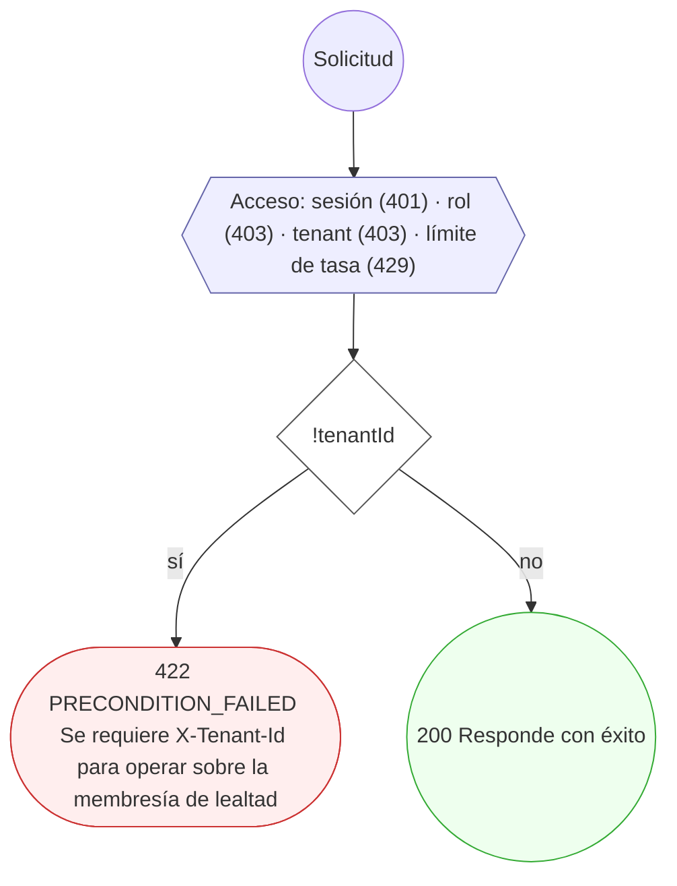

#### 2. POST /checkout/{orderId}/apply-discount

Aplicar un descuento al intento de pago del checkout

| HTTP | Código | Cuándo |
|---|---|---|
| 200 | — | Éxito |
| 400 | `VALIDATION_FAILED` | Los parámetros de ruta son UUID válidos; El cuerpo cumple el DTO (sin propiedades extra) |
| 401 | `UNAUTHENTICATED` | Hay una sesión válida (JWT) |
| 403 | `FORBIDDEN` | El rol está permitido; El tenant se resuelve y pertenece al actor |
| 404 | `NOT_FOUND` | ResourceNotFoundException: Cupón no encontrado; ResourceNotFoundException: Promoción del cupón no encontrada; ResourceNotFoundException: Promoción no encontrada |
| 422 | `PRECONDITION_FAILED` | PreconditionFailedException: Hay que indicar el cupón o la promoción automática a aplicar; PreconditionFailedException: {rejection}; PreconditionFailedException: Ninguna regla aplica al importe de la orden; PreconditionFailedException: La promoción alcanzó su límite de redenciones; PreconditionFailedException: El usuario alcanzó su límite de redenciones en la promoción; PreconditionFailedException: La promoción agotó su presupuesto; PreconditionFailedException: La promoción no está activa; PreconditionFailedException: La promoción está fuera de vigencia; PreconditionFailedException: Ninguna regla de la promoción aplica al importe de la orden |
| 429 | `RATE_LIMITED` | No se supera el límite de solicitudes |

```mermaid
flowchart TD
  n1(("Solicitud")):::inicio
  n2{{"Acceso: sesión (401) · rol (403) · tenant (403) · parámetros de ruta (400) · cuerpo válido (400) · límite de…"}}:::acceso
  n1 --> n2
  n3["Llama a PromotionsDiscountsService.applyDiscount"]:::llamada
  n2 --> n3
  n4{"!dto.couponCode && !dto.promotionId"}:::decision
  n3 --> n4
  n5(["422 PRECONDITION_FAILED Hay que indicar el cupón o la promoción automática a aplicar"]):::error
  n4 -->|"sí"| n5
  n6["Transacción: transactional(…)"]:::transaccion
  n4 -->|"no"| n6
  n7{"dto.couponCode"}:::decision
  n6 --> n7
  n8["Llama a PromotionsDiscountsService.evaluateCouponForUpdate"]:::llamada
  n7 -->|"sí"| n8
  n9["Llama a PromotionsDiscountsRepository.findCouponByCodeForUpdate"]:::llamada
  n8 --> n9
  n10[("LEE promotions.coupons")]:::efecto
  n9 --> n10
  n11{"!coupon"}:::decision
  n10 --> n11
  n12(["404 NOT_FOUND Cupón no encontrado"]):::error
  n11 -->|"sí"| n12
  n13["Llama a PromotionsDiscountsRepository.findPromotionForUpdate"]:::llamada
  n11 -->|"no"| n13
  n14[("LEE promotions.promotions")]:::efecto
  n13 --> n14
  n15{"!promotion"}:::decision
  n14 --> n15
  n16(["404 NOT_FOUND Promoción del cupón no encontrada"]):::error
  n15 -->|"sí"| n16
  n17{"rejection"}:::decision
  n15 -->|"no"| n17
  n18(["422 PRECONDITION_FAILED {rejection}"]):::error
  n17 -->|"sí"| n18
  n19["Llama a PromotionsDiscountsRepository.findRulesByPromotion"]:::llamada
  n17 -->|"no"| n19
  n20[("LEE promotions.discount_rules")]:::efecto
  n19 --> n20
  n21{"!best"}:::decision
  n20 --> n21
  n22(["422 PRECONDITION_FAILED Ninguna regla aplica al importe de la orden"]):::error
  n21 -->|"sí"| n22
  n23["Llama a PromotionsDiscountsService.assertLimits"]:::llamada
  n21 -->|"no"| n23
  n24["Llama a PromotionsDiscountsRepository.findAppliedRedemptions"]:::llamada
  n23 --> n24
  n25[("LEE promotions.redemptions")]:::efecto
  n24 --> n25
  n26{"promotion.totalRedemptionLimit && applied.length ›= promotion.totalRedemptionLimit"}:::decision
  n25 --> n26
  n27(["422 PRECONDITION_FAILED La promoción alcanzó su límite de redenciones"]):::error
  n26 -->|"sí"| n27
  n28{"promotion.perUserLimit"}:::decision
  n26 -->|"no"| n28
  n29{"mine.length ›= promotion.perUserLimit"}:::decision
  n28 -->|"sí"| n29
  n30(["422 PRECONDITION_FAILED El usuario alcanzó su límite de redenciones en la promoción"]):::error
  n29 -->|"sí"| n30
  n31{"promotion.budgetAmount"}:::decision
  n29 -->|"no"| n31
  n28 -->|"no"| n31
  n32{"consumed ›= Number(promotion.budgetAmount)"}:::decision
  n31 -->|"sí"| n32
  n33(["422 PRECONDITION_FAILED La promoción agotó su presupuesto"]):::error
  n32 -->|"sí"| n33
  n34["Llama a PromotionsDiscountsRepository.findPromotionForUpdate"]:::llamada
  n7 -->|"no"| n34
  n35[("LEE promotions.promotions")]:::efecto
  n34 --> n35
  n36{"!found"}:::decision
  n35 --> n36
  n37(["404 NOT_FOUND Promoción no encontrada"]):::error
  n36 -->|"sí"| n37
  n38["Llama a PromotionsDiscountsService.assertPromotionUsable"]:::llamada
  n36 -->|"no"| n38
  n39{"promotion.statusConceptId !== CONCEPTS.PROMOTION_ACTIVE"}:::decision
  n38 --> n39
  n40(["422 PRECONDITION_FAILED La promoción no está activa"]):::error
  n39 -->|"sí"| n40
  n41{"(promotion.validFrom && promotion.validFrom › now) || (promotion.validTo && promotion.validTo ‹ now)"}:::decision
  n39 -->|"no"| n41
  n42(["422 PRECONDITION_FAILED La promoción está fuera de vigencia"]):::error
  n41 -->|"sí"| n42
  n43["Llama a PromotionsDiscountsRepository.findRulesByPromotion"]:::llamada
  n41 -->|"no"| n43
  n44[("LEE promotions.discount_rules")]:::efecto
  n43 --> n44
  n45{"!best"}:::decision
  n44 --> n45
  n46(["422 PRECONDITION_FAILED Ninguna regla de la promoción aplica al importe de la orden"]):::error
  n45 -->|"sí"| n46
  n47["Llama a PromotionsDiscountsService.assertLimits"]:::llamada
  n45 -->|"no"| n47
  n48["Llama a PromotionsDiscountsRepository.findAppliedRedemptions"]:::llamada
  n47 --> n48
  n49[("LEE promotions.redemptions")]:::efecto
  n48 --> n49
  n50{"promotion.totalRedemptionLimit && applied.length ›= promotion.totalRedemptionLimit"}:::decision
  n49 --> n50
  n51(["422 PRECONDITION_FAILED La promoción alcanzó su límite de redenciones"]):::error
  n50 -->|"sí"| n51
  n52{"promotion.perUserLimit"}:::decision
  n50 -->|"no"| n52
  n53{"mine.length ›= promotion.perUserLimit"}:::decision
  n52 -->|"sí"| n53
  n54(["422 PRECONDITION_FAILED El usuario alcanzó su límite de redenciones en la promoción"]):::error
  n53 -->|"sí"| n54
  n55{"promotion.budgetAmount"}:::decision
  n53 -->|"no"| n55
  n52 -->|"no"| n55
  n56{"consumed ›= Number(promotion.budgetAmount)"}:::decision
  n55 -->|"sí"| n56
  n57(["422 PRECONDITION_FAILED La promoción agotó su presupuesto"]):::error
  n56 -->|"sí"| n57
  n58["Llama a PromotionsDiscountsRepository.findRedemptionByIntent"]:::llamada
  n32 -->|"no"| n58
  n31 -->|"no"| n58
  n56 -->|"no"| n58
  n55 -->|"no"| n58
  n59[("LEE promotions.redemptions")]:::efecto
  n58 --> n59
  n60{"coupon"}:::decision
  n59 --> n60
  n61[("ACTUALIZA promotions.coupons")]:::efecto
  n60 -->|"sí"| n61
  n62{"coupon.maxRedemptions && coupon.redemptionCount ›= coupon.maxRedemptions"}:::decision
  n61 --> n62
  n63[("ACTUALIZA promotions.coupons")]:::efecto
  n62 -->|"sí"| n63
  n64["Llama a PromotionsDiscountsRepository.createRedemption"]:::llamada
  n63 --> n64
  n62 -->|"no"| n64
  n60 -->|"no"| n64
  n65[("CREA promotions.redemptions")]:::efecto
  n64 --> n65
  n66(("200 Responde con éxito")):::ok
  n65 --> n66
  classDef acceso fill:#eef,stroke:#66a
  classDef error fill:#fee,stroke:#c33
  classDef ok fill:#efe,stroke:#3a3
  classDef efecto fill:#ffd,stroke:#aa3
  classDef decision fill:#fff,stroke:#555
  classDef corte fill:#eee,stroke:#999,stroke-dasharray: 4
```

#### 3. POST /loyalty/jobs/expire-points

Barrer los puntos vencidos de un programa

| HTTP | Código | Cuándo |
|---|---|---|
| 200 | — | Éxito |
| 400 | `VALIDATION_FAILED` | El cuerpo cumple el DTO (sin propiedades extra) |
| 401 | `UNAUTHENTICATED` | Hay una sesión válida (JWT) |
| 403 | `FORBIDDEN` | El rol está permitido; El tenant se resuelve y pertenece al actor |
| 429 | `RATE_LIMITED` | No se supera el límite de solicitudes |

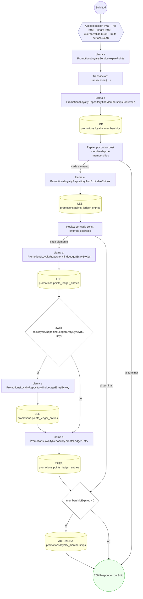

#### 4. GET /loyalty/me

Mi membresía de lealtad y mi saldo de puntos

| HTTP | Código | Cuándo |
|---|---|---|
| 200 | — | Éxito |
| 401 | `UNAUTHENTICATED` | Hay una sesión válida (JWT) |
| 403 | `FORBIDDEN` | El rol está permitido; El tenant se resuelve y pertenece al actor |
| 422 | `PRECONDITION_FAILED` | PreconditionFailedException: La cuenta no tiene perfil de paciente; PreconditionFailedException: Se requiere X-Tenant-Id para operar sobre la membresía de lealtad |
| 429 | `RATE_LIMITED` | No se supera el límite de solicitudes |

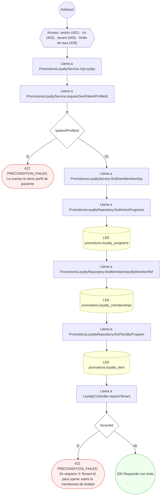

#### 5. GET /loyalty/me/points

Mis movimientos de puntos, más nuevos primero

| HTTP | Código | Cuándo |
|---|---|---|
| 200 | — | Éxito |
| 401 | `UNAUTHENTICATED` | Hay una sesión válida (JWT) |
| 403 | `FORBIDDEN` | El rol está permitido; El tenant se resuelve y pertenece al actor |
| 422 | `PRECONDITION_FAILED` | PreconditionFailedException: La cuenta no tiene perfil de paciente; PreconditionFailedException: Cursor de movimientos inválido; PreconditionFailedException: Se requiere X-Tenant-Id para operar sobre la membresía de lealtad |
| 429 | `RATE_LIMITED` | No se supera el límite de solicitudes |

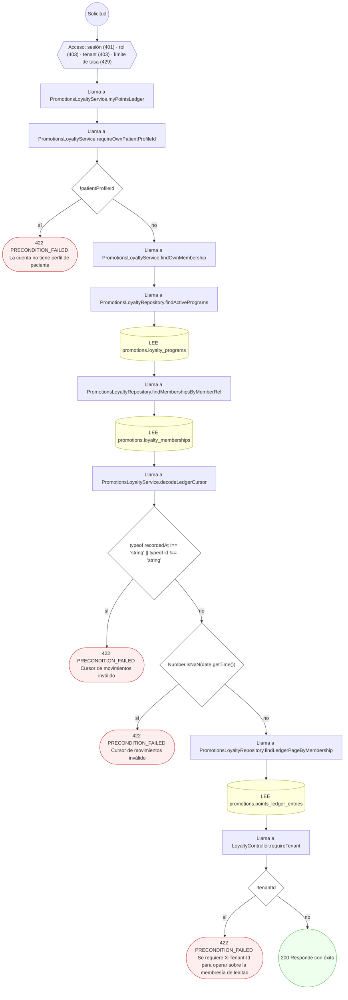

#### 6. POST /loyalty/me/points/redeem

Canjear puntos de mi propia membresía

| HTTP | Código | Cuándo |
|---|---|---|
| 201 | — | Éxito |
| 400 | `VALIDATION_FAILED` | El cuerpo cumple el DTO (sin propiedades extra) |
| 401 | `UNAUTHENTICATED` | Hay una sesión válida (JWT) |
| 403 | `FORBIDDEN` | El rol está permitido; El tenant se resuelve y pertenece al actor |
| 404 | `NOT_FOUND` | ResourceNotFoundException: Membresía no encontrada |
| 409 | `CONFLICT` | ConflictException: La clave de idempotencia pertenece a otro canje |
| 422 | `PRECONDITION_FAILED` | PreconditionFailedException: La cuenta no tiene perfil de paciente; PreconditionFailedException: No tiene una membresía de lealtad en este programa; PreconditionFailedException: El canje debe ser de puntos positivos; PreconditionFailedException: La membresía no está activa; PreconditionFailedException: Saldo de puntos insuficiente; PreconditionFailedException: Se requiere X-Tenant-Id para operar sobre la membresía de lealtad |
| 429 | `RATE_LIMITED` | No se supera el límite de solicitudes |

```mermaid
flowchart TD
  n1(("Solicitud")):::inicio
  n2{{"Acceso: sesión (401) · rol (403) · tenant (403) · cuerpo válido (400) · límite de tasa (429)"}}:::acceso
  n1 --> n2
  n3["Llama a PromotionsLoyaltyService.redeemOwnPoints"]:::llamada
  n2 --> n3
  n4["Llama a PromotionsLoyaltyService.requireOwnPatientProfileId"]:::llamada
  n3 --> n4
  n5{"!patientProfileId"}:::decision
  n4 --> n5
  n6(["422 PRECONDITION_FAILED La cuenta no tiene perfil de paciente"]):::error
  n5 -->|"sí"| n6
  n7["Llama a PromotionsLoyaltyService.findOwnMembership"]:::llamada
  n5 -->|"no"| n7
  n8["Llama a PromotionsLoyaltyRepository.findActivePrograms"]:::llamada
  n7 --> n8
  n9[("LEE promotions.loyalty_programs")]:::efecto
  n8 --> n9
  n10["Llama a PromotionsLoyaltyRepository.findMembershipsByMemberRef"]:::llamada
  n9 --> n10
  n11[("LEE promotions.loyalty_memberships")]:::efecto
  n10 --> n11
  n12{"!own"}:::decision
  n11 --> n12
  n13(["422 PRECONDITION_FAILED No tiene una membresía de lealtad en este programa"]):::error
  n12 -->|"sí"| n13
  n14["Llama a PromotionsLoyaltyRepository.findLedgerEntryByKey"]:::llamada
  n12 -->|"no"| n14
  n15[("LEE promotions.points_ledger_entries")]:::efecto
  n14 --> n15
  n16{"previous && previous.loyaltyMembershipId !== own.membership.id"}:::decision
  n15 --> n16
  n17(["409 CONFLICT La clave de idempotencia pertenece a otro canje"]):::error
  n16 -->|"sí"| n17
  n18["Llama a PromotionsLoyaltyService.redeemPoints"]:::llamada
  n16 -->|"no"| n18
  n19{"Number(dto.points) ‹= 0"}:::decision
  n18 --> n19
  n20(["422 PRECONDITION_FAILED El canje debe ser de puntos positivos"]):::error
  n19 -->|"sí"| n20
  n21["Transacción: transactional(…)"]:::transaccion
  n19 -->|"no"| n21
  n22["Llama a PromotionsLoyaltyRepository.findLedgerEntryByKey"]:::llamada
  n21 --> n22
  n23[("LEE promotions.points_ledger_entries")]:::efecto
  n22 --> n23
  n24{"previous"}:::decision
  n23 --> n24
  n25["Llama a PromotionsLoyaltyRepository.findMembershipForUpdate"]:::llamada
  n24 -->|"sí"| n25
  n26[("LEE promotions.loyalty_memberships")]:::efecto
  n25 --> n26
  n27["Llama a PromotionsLoyaltyRepository.findMembershipForUpdate"]:::llamada
  n26 --> n27
  n24 -->|"no"| n27
  n28[("LEE promotions.loyalty_memberships")]:::efecto
  n27 --> n28
  n29{"!membership"}:::decision
  n28 --> n29
  n30(["404 NOT_FOUND Membresía no encontrada"]):::error
  n29 -->|"sí"| n30
  n31{"membership.statusConceptId !== CONCEPTS.MEMBERSHIP_ACTIVE"}:::decision
  n29 -->|"no"| n31
  n32(["422 PRECONDITION_FAILED La membresía no está activa"]):::error
  n31 -->|"sí"| n32
  n33{"balance ‹ Number(dto.points)"}:::decision
  n31 -->|"no"| n33
  n34(["422 PRECONDITION_FAILED Saldo de puntos insuficiente"]):::error
  n33 -->|"sí"| n34
  n35["Llama a PromotionsLoyaltyRepository.createLedgerEntry"]:::llamada
  n33 -->|"no"| n35
  n36[("CREA promotions.points_ledger_entries")]:::efecto
  n35 --> n36
  n37[("ACTUALIZA promotions.loyalty_memberships")]:::efecto
  n36 --> n37
  n38["Llama a LoyaltyController.requireTenant"]:::llamada
  n37 --> n38
  n39{"!tenantId"}:::decision
  n38 --> n39
  n40(["422 PRECONDITION_FAILED Se requiere X-Tenant-Id para operar sobre la membresía de lealtad"]):::error
  n39 -->|"sí"| n40
  n41(("201 Responde con éxito")):::ok
  n39 -->|"no"| n41
  classDef acceso fill:#eef,stroke:#66a
  classDef error fill:#fee,stroke:#c33
  classDef ok fill:#efe,stroke:#3a3
  classDef efecto fill:#ffd,stroke:#aa3
  classDef decision fill:#fff,stroke:#555
  classDef corte fill:#eee,stroke:#999,stroke-dasharray: 4
```

#### 7. POST /loyalty/memberships/{id}/points/earn

Acumular puntos por un evento de la aplicación

| HTTP | Código | Cuándo |
|---|---|---|
| 201 | — | Éxito |
| 400 | `VALIDATION_FAILED` | Los parámetros de ruta son UUID válidos; El cuerpo cumple el DTO (sin propiedades extra) |
| 401 | `UNAUTHENTICATED` | Hay una sesión válida (JWT) |
| 403 | `FORBIDDEN` | El rol está permitido; El tenant se resuelve y pertenece al actor |
| 404 | `NOT_FOUND` | ResourceNotFoundException: Membresía no encontrada; ResourceNotFoundException: Regla de acumulación no encontrada |
| 422 | `PRECONDITION_FAILED` | PreconditionFailedException: La membresía no está activa; PreconditionFailedException: La regla pertenece a otro programa; PreconditionFailedException: La regla de acumulación no está activa; PreconditionFailedException: La regla de acumulación está fuera de vigencia; PreconditionFailedException: La regla no otorga puntos; PreconditionFailedException: La regla alcanzó su tope en el periodo |
| 429 | `RATE_LIMITED` | No se supera el límite de solicitudes |

```mermaid
flowchart TD
  n1(("Solicitud")):::inicio
  n2{{"Acceso: sesión (401) · rol (403) · tenant (403) · parámetros de ruta (400) · cuerpo válido (400) · límite de…"}}:::acceso
  n1 --> n2
  n3["Llama a PromotionsLoyaltyService.earnPoints"]:::llamada
  n2 --> n3
  n4["Transacción: transactional(…)"]:::transaccion
  n3 --> n4
  n5["Llama a PromotionsLoyaltyRepository.findLedgerEntryByKey"]:::llamada
  n4 --> n5
  n6[("LEE promotions.points_ledger_entries")]:::efecto
  n5 --> n6
  n7{"previous"}:::decision
  n6 --> n7
  n8["Llama a PromotionsLoyaltyRepository.findMembershipForUpdate"]:::llamada
  n7 -->|"sí"| n8
  n9[("LEE promotions.loyalty_memberships")]:::efecto
  n8 --> n9
  n10["Llama a PromotionsLoyaltyRepository.findMembershipForUpdate"]:::llamada
  n9 --> n10
  n7 -->|"no"| n10
  n11[("LEE promotions.loyalty_memberships")]:::efecto
  n10 --> n11
  n12{"!membership"}:::decision
  n11 --> n12
  n13(["404 NOT_FOUND Membresía no encontrada"]):::error
  n12 -->|"sí"| n13
  n14{"membership.statusConceptId !== CONCEPTS.MEMBERSHIP_ACTIVE"}:::decision
  n12 -->|"no"| n14
  n15(["422 PRECONDITION_FAILED La membresía no está activa"]):::error
  n14 -->|"sí"| n15
  n16["Llama a PromotionsLoyaltyRepository.findEarningRuleById"]:::llamada
  n14 -->|"no"| n16
  n17[("LEE promotions.earning_rules")]:::efecto
  n16 --> n17
  n18{"!rule"}:::decision
  n17 --> n18
  n19(["404 NOT_FOUND Regla de acumulación no encontrada"]):::error
  n18 -->|"sí"| n19
  n20{"rule.loyaltyProgramId !== membership.loyaltyProgramId"}:::decision
  n18 -->|"no"| n20
  n21(["422 PRECONDITION_FAILED La regla pertenece a otro programa"]):::error
  n20 -->|"sí"| n21
  n22{"!rule.isActive"}:::decision
  n20 -->|"no"| n22
  n23(["422 PRECONDITION_FAILED La regla de acumulación no está activa"]):::error
  n22 -->|"sí"| n23
  n24{"(rule.validFrom && rule.validFrom › now) || (rule.validTo && rule.validTo ‹ now)"}:::decision
  n22 -->|"no"| n24
  n25(["422 PRECONDITION_FAILED La regla de acumulación está fuera de vigencia"]):::error
  n24 -->|"sí"| n25
  n26{"!rule.pointsAmount || Number(rule.pointsAmount) ‹= 0"}:::decision
  n24 -->|"no"| n26
  n27(["422 PRECONDITION_FAILED La regla no otorga puntos"]):::error
  n26 -->|"sí"| n27
  n28["Llama a PromotionsLoyaltyService.assertUnderCap"]:::llamada
  n26 -->|"no"| n28
  n29["Llama a PromotionsLoyaltyRepository.findEarnEntriesInPeriod"]:::llamada
  n28 --> n29
  n30[("LEE promotions.points_ledger_entries")]:::efecto
  n29 --> n30
  n31{"entries.length ›= capPerPeriod"}:::decision
  n30 --> n31
  n32(["422 PRECONDITION_FAILED La regla alcanzó su tope en el periodo"]):::error
  n31 -->|"sí"| n32
  n33["Llama a PromotionsLoyaltyRepository.findProgramById"]:::llamada
  n31 -->|"no"| n33
  n34[("LEE promotions.loyalty_programs")]:::efecto
  n33 --> n34
  n35["Llama a PromotionsLoyaltyRepository.findTiersByProgram"]:::llamada
  n34 --> n35
  n36[("LEE promotions.loyalty_tiers")]:::efecto
  n35 --> n36
  n37["Llama a PromotionsLoyaltyRepository.createLedgerEntry"]:::llamada
  n36 --> n37
  n38[("CREA promotions.points_ledger_entries")]:::efecto
  n37 --> n38
  n39[("ACTUALIZA promotions.loyalty_memberships · ACTUALIZA promotions.loyalty_memberships · ACTUALIZA promotions.lo…")]:::efecto
  n38 --> n39
  n40(("201 Responde con éxito")):::ok
  n39 --> n40
  classDef acceso fill:#eef,stroke:#66a
  classDef error fill:#fee,stroke:#c33
  classDef ok fill:#efe,stroke:#3a3
  classDef efecto fill:#ffd,stroke:#aa3
  classDef decision fill:#fff,stroke:#555
  classDef corte fill:#eee,stroke:#999,stroke-dasharray: 4
```

#### 8. POST /loyalty/memberships/{id}/points/redeem

Canjear puntos

| HTTP | Código | Cuándo |
|---|---|---|
| 201 | — | Éxito |
| 400 | `VALIDATION_FAILED` | Los parámetros de ruta son UUID válidos; El cuerpo cumple el DTO (sin propiedades extra) |
| 401 | `UNAUTHENTICATED` | Hay una sesión válida (JWT) |
| 403 | `FORBIDDEN` | El rol está permitido; El tenant se resuelve y pertenece al actor |
| 404 | `NOT_FOUND` | ResourceNotFoundException: Membresía no encontrada |
| 422 | `PRECONDITION_FAILED` | PreconditionFailedException: El canje debe ser de puntos positivos; PreconditionFailedException: La membresía no está activa; PreconditionFailedException: Saldo de puntos insuficiente |
| 429 | `RATE_LIMITED` | No se supera el límite de solicitudes |

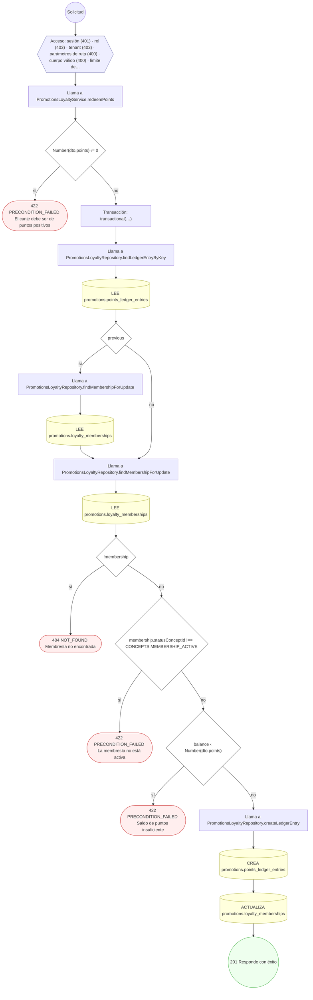

#### 9. POST /loyalty/memberships/{id}/recompute

Reproyectar saldo y nivel desde el ledger

| HTTP | Código | Cuándo |
|---|---|---|
| 200 | — | Éxito |
| 400 | `VALIDATION_FAILED` | Los parámetros de ruta son UUID válidos |
| 401 | `UNAUTHENTICATED` | Hay una sesión válida (JWT) |
| 403 | `FORBIDDEN` | El rol está permitido; El tenant se resuelve y pertenece al actor |
| 404 | `NOT_FOUND` | ResourceNotFoundException: Membresía no encontrada |
| 429 | `RATE_LIMITED` | No se supera el límite de solicitudes |

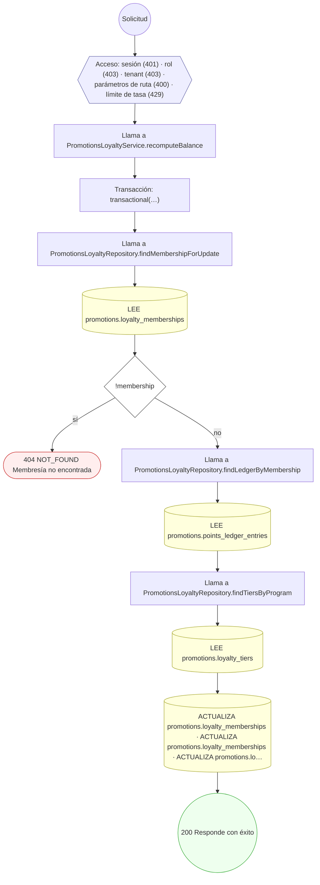

#### 10. GET /loyalty/programs

Listar programas de lealtad activos

| HTTP | Código | Cuándo |
|---|---|---|
| 200 | — | Éxito |
| 401 | `UNAUTHENTICATED` | Hay una sesión válida (JWT) |
| 403 | `FORBIDDEN` | El rol está permitido; El tenant se resuelve y pertenece al actor |
| 422 | `PRECONDITION_FAILED` | PreconditionFailedException: Se requiere X-Tenant-Id para listar programas de lealtad |
| 429 | `RATE_LIMITED` | No se supera el límite de solicitudes |

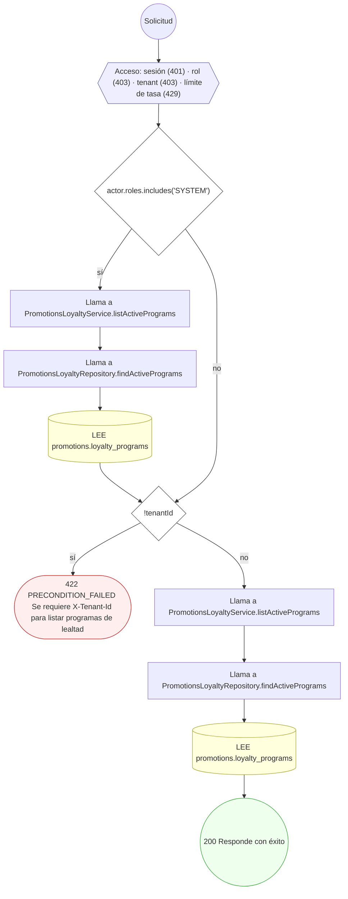

#### 11. POST /loyalty/programs

Crear un programa de lealtad con niveles y reglas

| HTTP | Código | Cuándo |
|---|---|---|
| 201 | — | Éxito |
| 400 | `VALIDATION_FAILED` | El cuerpo cumple el DTO (sin propiedades extra) |
| 401 | `UNAUTHENTICATED` | Hay una sesión válida (JWT) |
| 403 | `FORBIDDEN` | El rol está permitido; El tenant se resuelve y pertenece al actor |
| 409 | `CONFLICT` | ConflictException: Ya existe un programa con ese código |
| 422 | `PRECONDITION_FAILED` | PreconditionFailedException: Una política de vencimiento ROLLING necesita días de vigencia; PreconditionFailedException: Una regla de puntos necesita pointsAmount; PreconditionFailedException: Una regla de crédito necesita creditAmount |
| 429 | `RATE_LIMITED` | No se supera el límite de solicitudes |

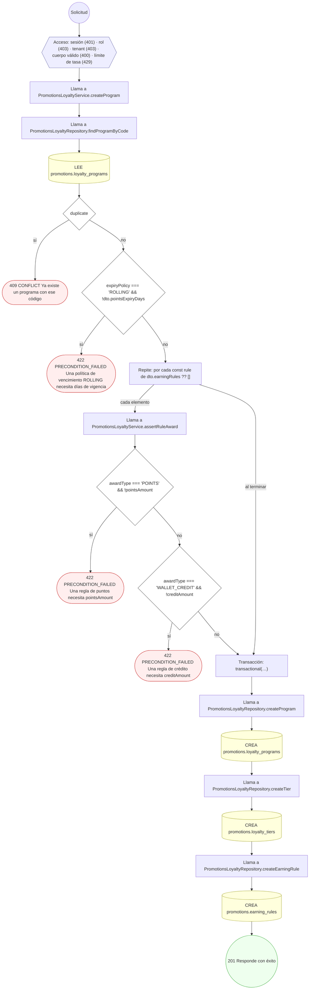

#### 12. POST /loyalty/programs/{id}/memberships

Inscribir a un miembro en el programa

| HTTP | Código | Cuándo |
|---|---|---|
| 201 | — | Éxito |
| 400 | `VALIDATION_FAILED` | Los parámetros de ruta son UUID válidos; El cuerpo cumple el DTO (sin propiedades extra) |
| 401 | `UNAUTHENTICATED` | Hay una sesión válida (JWT) |
| 403 | `FORBIDDEN` | El rol está permitido; El tenant se resuelve y pertenece al actor |
| 404 | `NOT_FOUND` | ResourceNotFoundException: Programa de lealtad no encontrado |
| 422 | `PRECONDITION_FAILED` | PreconditionFailedException: El programa no está activo; PreconditionFailedException: El programa no tiene niveles definidos |
| 429 | `RATE_LIMITED` | No se supera el límite de solicitudes |

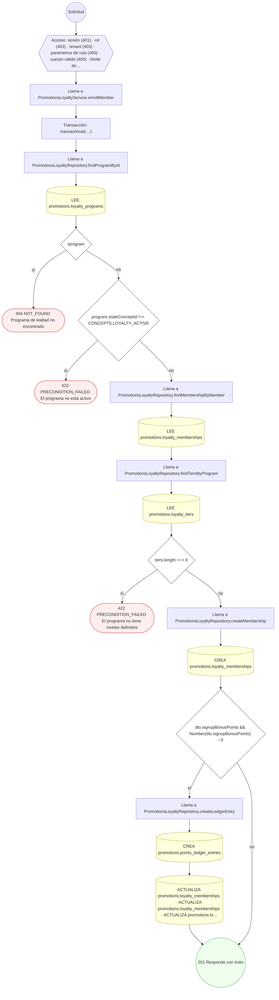

#### 13. POST /promotions

Crear una promoción con sus reglas de descuento

| HTTP | Código | Cuándo |
|---|---|---|
| 201 | — | Éxito |
| 400 | `VALIDATION_FAILED` | El cuerpo cumple el DTO (sin propiedades extra) |
| 401 | `UNAUTHENTICATED` | Hay una sesión válida (JWT) |
| 403 | `FORBIDDEN` | El rol está permitido; El tenant se resuelve y pertenece al actor |
| 409 | `CONFLICT` | ConflictException: Ya existe una promoción con ese código |
| 422 | `PRECONDITION_FAILED` | PreconditionFailedException: La promoción debe terminar después de empezar; PreconditionFailedException: Una regla PERCENTAGE necesita porcentaje; PreconditionFailedException: El porcentaje debe estar entre 0 y 100; PreconditionFailedException: Una regla FIXED necesita importe; PreconditionFailedException: Una regla BOGO necesita buyQuantity y getQuantity |
| 429 | `RATE_LIMITED` | No se supera el límite de solicitudes |

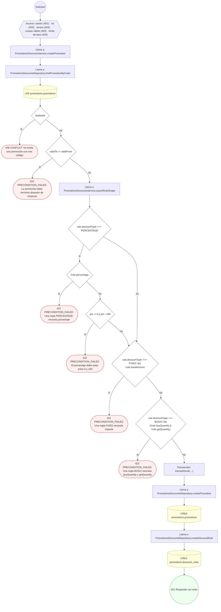

#### 14. POST /promotions/{id}/coupons/batch

Emitir un lote de cupones

| HTTP | Código | Cuándo |
|---|---|---|
| 201 | — | Éxito |
| 400 | `VALIDATION_FAILED` | Los parámetros de ruta son UUID válidos; El cuerpo cumple el DTO (sin propiedades extra) |
| 401 | `UNAUTHENTICATED` | Hay una sesión válida (JWT) |
| 403 | `FORBIDDEN` | El rol está permitido; El tenant se resuelve y pertenece al actor |
| 404 | `NOT_FOUND` | ResourceNotFoundException: Promoción no encontrada |
| 409 | `CONFLICT` | ConflictException: No se pudieron generar códigos de cupón libres |
| 422 | `PRECONDITION_FAILED` | PreconditionFailedException: Un cupón PERSONAL necesita miembro asignado; PreconditionFailedException: Un cupón PERSONAL se emite de uno en uno; PreconditionFailedException: La promoción no está activa |
| 429 | `RATE_LIMITED` | No se supera el límite de solicitudes |

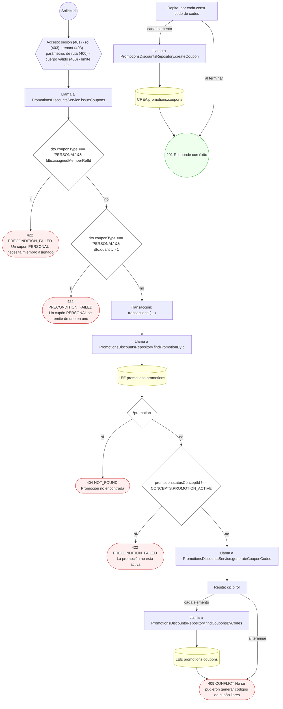

#### 15. GET /promotions/me

Mis promociones vigentes

| HTTP | Código | Cuándo |
|---|---|---|
| 200 | — | Éxito |
| 401 | `UNAUTHENTICATED` | Hay una sesión válida (JWT) |
| 403 | `FORBIDDEN` | El rol está permitido; El tenant se resuelve y pertenece al actor |
| 422 | `PRECONDITION_FAILED` | PreconditionFailedException: La cuenta no tiene perfil de paciente |
| 429 | `RATE_LIMITED` | No se supera el límite de solicitudes |

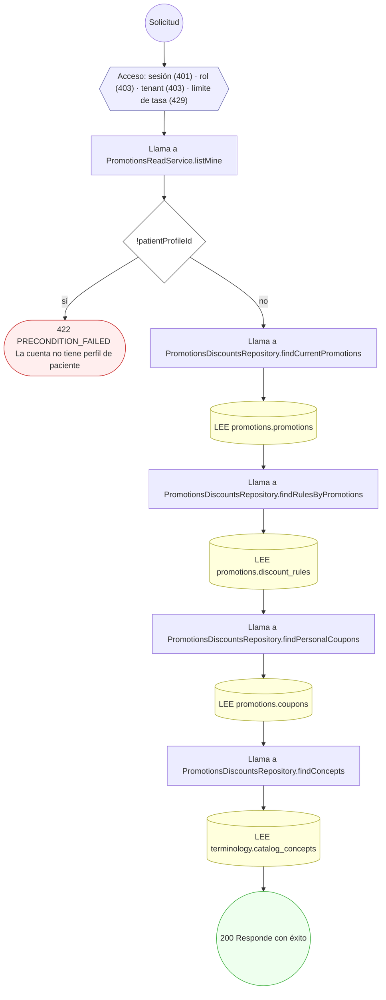

#### 16. POST /redemptions

Redimir un cupón y registrar la redención

| HTTP | Código | Cuándo |
|---|---|---|
| 201 | — | Éxito |
| 400 | `VALIDATION_FAILED` | El cuerpo cumple el DTO (sin propiedades extra) |
| 401 | `UNAUTHENTICATED` | Hay una sesión válida (JWT) |
| 403 | `FORBIDDEN` | El rol está permitido; El tenant se resuelve y pertenece al actor |
| 404 | `NOT_FOUND` | ResourceNotFoundException: Cupón no encontrado; ResourceNotFoundException: Promoción del cupón no encontrada |
| 422 | `PRECONDITION_FAILED` | PreconditionFailedException: {rejection}; PreconditionFailedException: Ninguna regla aplica al importe de la orden; PreconditionFailedException: La promoción alcanzó su límite de redenciones; PreconditionFailedException: El usuario alcanzó su límite de redenciones en la promoción; PreconditionFailedException: La promoción agotó su presupuesto |
| 429 | `RATE_LIMITED` | No se supera el límite de solicitudes |

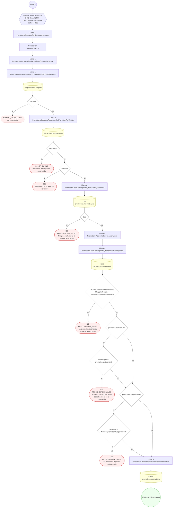

#### 17. POST /redemptions/{id}/reverse

Revertir una redención por devolución o cancelación

| HTTP | Código | Cuándo |
|---|---|---|
| 200 | — | Éxito |
| 400 | `VALIDATION_FAILED` | Los parámetros de ruta son UUID válidos; El cuerpo cumple el DTO (sin propiedades extra) |
| 401 | `UNAUTHENTICATED` | Hay una sesión válida (JWT) |
| 403 | `FORBIDDEN` | El rol está permitido; El tenant se resuelve y pertenece al actor |
| 404 | `NOT_FOUND` | ResourceNotFoundException: Redención no encontrada; ResourceNotFoundException: Membresía no encontrada |
| 409 | `CONFLICT` | ConflictException: La redención ya no está aplicada |
| 429 | `RATE_LIMITED` | No se supera el límite de solicitudes |

```mermaid
flowchart TD
  n1(("Solicitud")):::inicio
  n2{{"Acceso: sesión (401) · rol (403) · tenant (403) · parámetros de ruta (400) · cuerpo válido (400) · límite de…"}}:::acceso
  n1 --> n2
  n3["Llama a PromotionsDiscountsService.reverseRedemption"]:::llamada
  n2 --> n3
  n4["Transacción: transactional(…)"]:::transaccion
  n3 --> n4
  n5["Llama a PromotionsDiscountsRepository.findRedemptionForUpdate"]:::llamada
  n4 --> n5
  n6[("LEE promotions.redemptions")]:::efecto
  n5 --> n6
  n7{"!redemption"}:::decision
  n6 --> n7
  n8(["404 NOT_FOUND Redención no encontrada"]):::error
  n7 -->|"sí"| n8
  n9{"redemption.statusConceptId !== CONCEPTS.REDEMPTION_APPLIED"}:::decision
  n7 -->|"no"| n9
  n10(["409 CONFLICT La redención ya no está aplicada"]):::error
  n9 -->|"sí"| n10
  n11{"redemption.couponId"}:::decision
  n9 -->|"no"| n11
  n12["Llama a PromotionsDiscountsRepository.findCouponForUpdate"]:::llamada
  n11 -->|"sí"| n12
  n13[("LEE promotions.coupons")]:::efecto
  n12 --> n13
  n14{"coupon"}:::decision
  n13 --> n14
  n15[("ACTUALIZA promotions.coupons")]:::efecto
  n14 -->|"sí"| n15
  n16{"coupon.statusConceptId === CONCEPTS.COUPON_EXHAUSTED"}:::decision
  n15 --> n16
  n17[("ACTUALIZA promotions.coupons")]:::efecto
  n16 -->|"sí"| n17
  n18{"dto.membershipId && dto.restorePoints && Number(dto.restorePoints) › 0"}:::decision
  n17 --> n18
  n16 -->|"no"| n18
  n14 -->|"no"| n18
  n11 -->|"no"| n18
  n19["Llama a PromotionsLoyaltyRepository.findLedgerEntryByKey"]:::llamada
  n18 -->|"sí"| n19
  n20[("LEE promotions.points_ledger_entries")]:::efecto
  n19 --> n20
  n21{"previous"}:::decision
  n20 --> n21
  n22["Llama a PromotionsLoyaltyRepository.findMembershipForUpdate"]:::llamada
  n21 -->|"no"| n22
  n23[("LEE promotions.loyalty_memberships")]:::efecto
  n22 --> n23
  n24{"!membership"}:::decision
  n23 --> n24
  n25(["404 NOT_FOUND Membresía no encontrada"]):::error
  n24 -->|"sí"| n25
  n26["Llama a PromotionsLoyaltyRepository.createLedgerEntry"]:::llamada
  n24 -->|"no"| n26
  n27[("CREA promotions.points_ledger_entries")]:::efecto
  n26 --> n27
  n28[("ACTUALIZA promotions.loyalty_memberships")]:::efecto
  n27 --> n28
  n29[("ACTUALIZA promotions.redemptions")]:::efecto
  n21 -->|"sí"| n29
  n28 --> n29
  n18 -->|"no"| n29
  n30(("200 Responde con éxito")):::ok
  n29 --> n30
  classDef acceso fill:#eef,stroke:#66a
  classDef error fill:#fee,stroke:#c33
  classDef ok fill:#efe,stroke:#3a3
  classDef efecto fill:#ffd,stroke:#aa3
  classDef decision fill:#fff,stroke:#555
  classDef corte fill:#eee,stroke:#999,stroke-dasharray: 4
```

#### 18. POST /referral-programs/{id}/referrals

Generar el código de referido del miembro

| HTTP | Código | Cuándo |
|---|---|---|
| 201 | — | Éxito |
| 400 | `VALIDATION_FAILED` | Los parámetros de ruta son UUID válidos; El cuerpo cumple el DTO (sin propiedades extra) |
| 401 | `UNAUTHENTICATED` | Hay una sesión válida (JWT) |
| 403 | `FORBIDDEN` | El rol está permitido; El tenant se resuelve y pertenece al actor |
| 404 | `NOT_FOUND` | ResourceNotFoundException: Programa de referidos no encontrado |
| 409 | `CONFLICT` | ConflictException: No se pudo generar un código de referido libre |
| 422 | `PRECONDITION_FAILED` | PreconditionFailedException: El programa de referidos no está activo; PreconditionFailedException: El programa de referidos está fuera de vigencia; PreconditionFailedException: El usuario alcanzó su máximo de referidos en el programa |
| 429 | `RATE_LIMITED` | No se supera el límite de solicitudes |

```mermaid
flowchart TD
  n1(("Solicitud")):::inicio
  n2{{"Acceso: sesión (401) · rol (403) · tenant (403) · parámetros de ruta (400) · cuerpo válido (400) · límite de…"}}:::acceso
  n1 --> n2
  n3["Llama a PromotionsLoyaltyService.createReferral"]:::llamada
  n2 --> n3
  n4["Transacción: transactional(…)"]:::transaccion
  n3 --> n4
  n5["Llama a PromotionsLoyaltyRepository.findReferralProgramById"]:::llamada
  n4 --> n5
  n6[("LEE promotions.referral_programs")]:::efecto
  n5 --> n6
  n7{"!program"}:::decision
  n6 --> n7
  n8(["404 NOT_FOUND Programa de referidos no encontrado"]):::error
  n7 -->|"sí"| n8
  n9{"program.stateConceptId !== CONCEPTS.STATE_ACTIVE"}:::decision
  n7 -->|"no"| n9
  n10(["422 PRECONDITION_FAILED El programa de referidos no está activo"]):::error
  n9 -->|"sí"| n10
  n11{"(program.validFrom && program.validFrom › now) || (program.validTo && program.validTo ‹ now)"}:::decision
  n9 -->|"no"| n11
  n12(["422 PRECONDITION_FAILED El programa de referidos está fuera de vigencia"]):::error
  n11 -->|"sí"| n12
  n13{"program.maxReferralsPerUser"}:::decision
  n11 -->|"no"| n13
  n14["Llama a PromotionsLoyaltyRepository.findReferralsByReferrer"]:::llamada
  n13 -->|"sí"| n14
  n15[("LEE promotions.member_referrals")]:::efecto
  n14 --> n15
  n16{"issued.length ›= program.maxReferralsPerUser"}:::decision
  n15 --> n16
  n17(["422 PRECONDITION_FAILED El usuario alcanzó su máximo de referidos en el programa"]):::error
  n16 -->|"sí"| n17
  n18["Llama a PromotionsLoyaltyService.generateReferralCode"]:::llamada
  n16 -->|"no"| n18
  n13 -->|"no"| n18
  n19["Repite: ciclo for"]:::bucle
  n18 --> n19
  n20["Llama a PromotionsLoyaltyRepository.findReferralByCode"]:::llamada
  n19 -->|"cada elemento"| n20
  n21[("LEE promotions.member_referrals")]:::efecto
  n20 --> n21
  n22{"!(await this.loyaltyRepo.findReferralByCode(tx, code))"}:::decision
  n21 --> n22
  n23["Llama a PromotionsLoyaltyRepository.findReferralByCode"]:::llamada
  n22 -->|"sí"| n23
  n24[("LEE promotions.member_referrals")]:::efecto
  n23 --> n24
  n25(["409 CONFLICT No se pudo generar un código de referido libre"]):::error
  n24 --> n25
  n22 -->|"no"| n25
  n19 -->|"al terminar"| n25
  n26["Llama a PromotionsLoyaltyRepository.createReferral"]:::llamada
  n27[("CREA promotions.member_referrals")]:::efecto
  n26 --> n27
  n28(("201 Responde con éxito")):::ok
  n27 --> n28
  classDef acceso fill:#eef,stroke:#66a
  classDef error fill:#fee,stroke:#c33
  classDef ok fill:#efe,stroke:#3a3
  classDef efecto fill:#ffd,stroke:#aa3
  classDef decision fill:#fff,stroke:#555
  classDef corte fill:#eee,stroke:#999,stroke-dasharray: 4
```

#### 19. POST /referrals/{id}/qualify

Calificar el referido y premiar a ambas partes

| HTTP | Código | Cuándo |
|---|---|---|
| 200 | — | Éxito |
| 400 | `VALIDATION_FAILED` | Los parámetros de ruta son UUID válidos; El cuerpo cumple el DTO (sin propiedades extra) |
| 401 | `UNAUTHENTICATED` | Hay una sesión válida (JWT) |
| 403 | `FORBIDDEN` | El rol está permitido; El tenant se resuelve y pertenece al actor |
| 404 | `NOT_FOUND` | ResourceNotFoundException: Referido no encontrado; ResourceNotFoundException: Programa de referidos no encontrado; ResourceNotFoundException: Membresía de la recompensa no encontrada |
| 409 | `CONFLICT` | ConflictException: El referido ya fue calificado |
| 422 | `PRECONDITION_FAILED` | PreconditionFailedException: Un usuario no puede referirse a sí mismo; PreconditionFailedException: El evento recibido no es el que califica en este programa; PreconditionFailedException: El programa de referidos no define moneda para el crédito de billetera |
| 429 | `RATE_LIMITED` | No se supera el límite de solicitudes |

```mermaid
flowchart TD
  n1(("Solicitud")):::inicio
  n2{{"Acceso: sesión (401) · rol (403) · tenant (403) · parámetros de ruta (400) · cuerpo válido (400) · límite de…"}}:::acceso
  n1 --> n2
  n3["Llama a PromotionsLoyaltyService.qualifyReferral"]:::llamada
  n2 --> n3
  n4["Transacción: transactional(…)"]:::transaccion
  n3 --> n4
  n5["Llama a PromotionsLoyaltyRepository.findReferralForUpdate"]:::llamada
  n4 --> n5
  n6[("LEE promotions.member_referrals")]:::efecto
  n5 --> n6
  n7{"!referral"}:::decision
  n6 --> n7
  n8(["404 NOT_FOUND Referido no encontrado"]):::error
  n7 -->|"sí"| n8
  n9{"referral.statusConceptId !== CONCEPTS.REFERRAL_PENDING"}:::decision
  n7 -->|"no"| n9
  n10(["409 CONFLICT El referido ya fue calificado"]):::error
  n9 -->|"sí"| n10
  n11{"referral.referrerUserId === dto.refereeUserId"}:::decision
  n9 -->|"no"| n11
  n12(["422 PRECONDITION_FAILED Un usuario no puede referirse a sí mismo"]):::error
  n11 -->|"sí"| n12
  n13["Llama a PromotionsLoyaltyRepository.findReferralProgramById"]:::llamada
  n11 -->|"no"| n13
  n14[("LEE promotions.referral_programs")]:::efecto
  n13 --> n14
  n15{"!program"}:::decision
  n14 --> n15
  n16(["404 NOT_FOUND Programa de referidos no encontrado"]):::error
  n15 -->|"sí"| n16
  n17{"program.qualifyingEventConceptId && program.qualifyingEventConceptId !== eventConceptId"}:::decision
  n15 -->|"no"| n17
  n18(["422 PRECONDITION_FAILED El evento recibido no es el que califica en este programa"]):::error
  n17 -->|"sí"| n18
  n19["Llama a PromotionsLoyaltyService.awardReferral"]:::llamada
  n17 -->|"no"| n19
  n20{"awardTypeConceptId === CONCEPTS.AWARD_POINTS"}:::decision
  n19 --> n20
  n21["Llama a PromotionsLoyaltyService.awardReferralPoints"]:::llamada
  n20 -->|"sí"| n21
  n22["Llama a PromotionsLoyaltyRepository.findLedgerEntryByKey"]:::llamada
  n21 --> n22
  n23[("LEE promotions.points_ledger_entries")]:::efecto
  n22 --> n23
  n24["Llama a PromotionsLoyaltyRepository.findMembershipForUpdate"]:::llamada
  n23 --> n24
  n25[("LEE promotions.loyalty_memberships")]:::efecto
  n24 --> n25
  n26{"!membership"}:::decision
  n25 --> n26
  n27(["404 NOT_FOUND Membresía de la recompensa no encontrada"]):::error
  n26 -->|"sí"| n27
  n28["Llama a PromotionsLoyaltyRepository.createLedgerEntry"]:::llamada
  n26 -->|"no"| n28
  n29[("CREA promotions.points_ledger_entries")]:::efecto
  n28 --> n29
  n30["Llama a PromotionsLoyaltyRepository.findTiersByProgram"]:::llamada
  n29 --> n30
  n31[("LEE promotions.loyalty_tiers")]:::efecto
  n30 --> n31
  n32[("ACTUALIZA promotions.loyalty_memberships · ACTUALIZA promotions.loyalty_memberships · ACTUALIZA promotions.lo…")]:::efecto
  n31 --> n32
  n33{"awardTypeConceptId === CONCEPTS.AWARD_WALLET_CREDIT"}:::decision
  n32 --> n33
  n20 -->|"no"| n33
  n34["Llama a PromotionsLoyaltyService.awardReferralWalletCredit"]:::llamada
  n33 -->|"sí"| n34
  n35{"!currencyConceptId"}:::decision
  n34 --> n35
  n36(["422 PRECONDITION_FAILED El programa de referidos no define moneda para el crédito de billetera"]):::error
  n35 -->|"sí"| n36
  n37["Llama a PromotionsLoyaltyRepository.findMembershipForUpdate"]:::llamada
  n35 -->|"no"| n37
  n38[("LEE promotions.loyalty_memberships")]:::efecto
  n37 --> n38
  n39{"!membership"}:::decision
  n38 --> n39
  n40(["404 NOT_FOUND Membresía de la recompensa no encontrada"]):::error
  n39 -->|"sí"| n40
  n41["Llama a WalletsService.creditWallet"]:::llamada
  n39 -->|"no"| n41
  n42[("ACTUALIZA payments.wallets")]:::efecto
  n41 --> n42
  n43["Llama a PromotionsLoyaltyService.awardReferral"]:::llamada
  n42 --> n43
  n33 -->|"no"| n43
  n44{"awardTypeConceptId === CONCEPTS.AWARD_POINTS"}:::decision
  n43 --> n44
  n45["Llama a PromotionsLoyaltyService.awardReferralPoints"]:::llamada
  n44 -->|"sí"| n45
  n46["Llama a PromotionsLoyaltyRepository.findLedgerEntryByKey"]:::llamada
  n45 --> n46
  n47[("LEE promotions.points_ledger_entries")]:::efecto
  n46 --> n47
  n48["Llama a PromotionsLoyaltyRepository.findMembershipForUpdate"]:::llamada
  n47 --> n48
  n49[("LEE promotions.loyalty_memberships")]:::efecto
  n48 --> n49
  n50{"!membership"}:::decision
  n49 --> n50
  n51(["404 NOT_FOUND Membresía de la recompensa no encontrada"]):::error
  n50 -->|"sí"| n51
  n52["Llama a PromotionsLoyaltyRepository.createLedgerEntry"]:::llamada
  n50 -->|"no"| n52
  n53[("CREA promotions.points_ledger_entries")]:::efecto
  n52 --> n53
  n54["Llama a PromotionsLoyaltyRepository.findTiersByProgram"]:::llamada
  n53 --> n54
  n55[("LEE promotions.loyalty_tiers")]:::efecto
  n54 --> n55
  n56[("ACTUALIZA promotions.loyalty_memberships · ACTUALIZA promotions.loyalty_memberships · ACTUALIZA promotions.lo…")]:::efecto
  n55 --> n56
  n57{"awardTypeConceptId === CONCEPTS.AWARD_WALLET_CREDIT"}:::decision
  n56 --> n57
  n44 -->|"no"| n57
  n58["Llama a PromotionsLoyaltyService.awardReferralWalletCredit"]:::llamada
  n57 -->|"sí"| n58
  n59{"!currencyConceptId"}:::decision
  n58 --> n59
  n60(["422 PRECONDITION_FAILED El programa de referidos no define moneda para el crédito de billetera"]):::error
  n59 -->|"sí"| n60
  n61["Llama a PromotionsLoyaltyRepository.findMembershipForUpdate"]:::llamada
  n59 -->|"no"| n61
  n62[("LEE promotions.loyalty_memberships")]:::efecto
  n61 --> n62
  n63{"!membership"}:::decision
  n62 --> n63
  n64(["404 NOT_FOUND Membresía de la recompensa no encontrada"]):::error
  n63 -->|"sí"| n64
  n65["Llama a WalletsService.creditWallet"]:::llamada
  n63 -->|"no"| n65
  n66[("ACTUALIZA payments.wallets")]:::efecto
  n65 --> n66
  n67[("ACTUALIZA promotions.member_referrals · ACTUALIZA promotions.member_referrals · ACTUALIZA promotions.member_r…")]:::efecto
  n66 --> n67
  n57 -->|"no"| n67
  n68(("200 Responde con éxito")):::ok
  n67 --> n68
  classDef acceso fill:#eef,stroke:#66a
  classDef error fill:#fee,stroke:#c33
  classDef ok fill:#efe,stroke:#3a3
  classDef efecto fill:#ffd,stroke:#aa3
  classDef decision fill:#fff,stroke:#555
  classDef corte fill:#eee,stroke:#999,stroke-dasharray: 4
```

### Operaciones sin decisiones propias

Sólo comprueban el acceso y leen o escriben: no tienen ramas que dibujar. Su detalle está en la ficha de endpoints.

| Operación | Respuestas posibles | Tablas |
|---|---|---|
| POST /coupons/validate | 200, 400, 401, 403, 429 | 4 |
