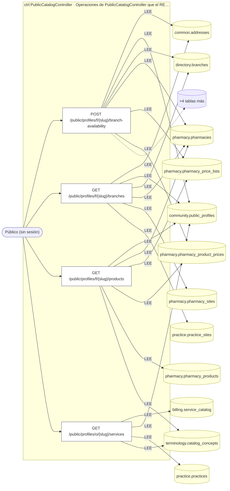
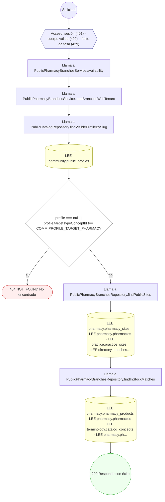
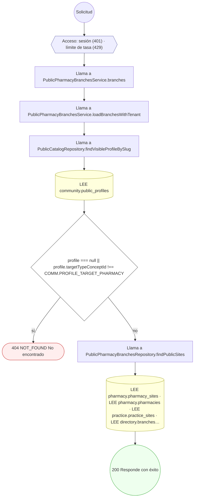
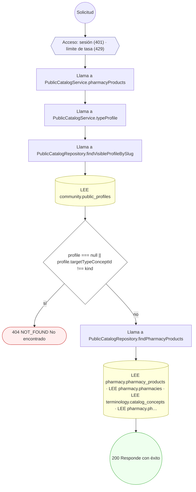
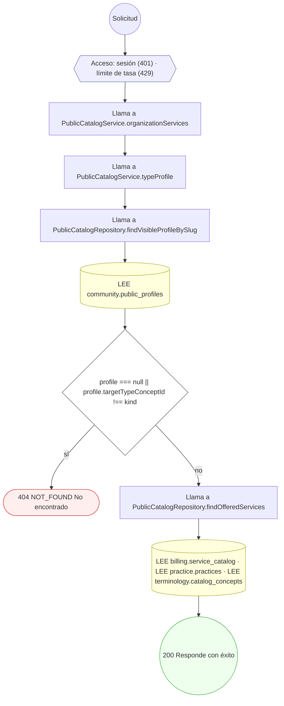

<!-- AUTOGENERADO por tools/inventario/flujos.mjs. No editar manualmente. -->

# Flujos del módulo `public`

- **Procesos:** 1 · **Máquinas de estado:** 0
- **Operaciones:** 4 (4 con decisiones propias, 0 sin ellas)
- Inventario de endpoints del módulo: [public](../endpoints/public.md)

## Proceso: Public catalog module

- **Código:** `public` · **Agrupación:** AGRUPACION_POR_CONTROLADOR · **Operaciones:** 4
- **Actores:** Público (sin sesión)
- **Revisión:** AUTO_DETECTADA
- **Fuentes:** `src/modules/public/README.md`

### Para qué sirve

Expone sin sesión los catálogos de servicios de organizaciones y de productos de farmacias que tienen una ficha pública activa. Las consultas usan paginación por cursor, límite de 50 y rate limit de 60 solicitudes por minuto.

_Fuente: `src/modules/public/README.md:3`_

### Etapas y operaciones

| Etapa | Descripción | Operación | Quién actúa | Riesgo | Tablas |
|---|---|---|---|---|---|
| `ctrl:PublicCatalogController` | Operaciones de PublicCatalogController que el README no asigna a un caso de uso | POST /public/profiles/f/{slug}/branch-availability | Público (sin sesión) | BAJO | 10 |
|  |  | GET /public/profiles/f/{slug}/branches | Público (sin sesión) | BAJO | 6 |
|  |  | GET /public/profiles/f/{slug}/products | Público (sin sesión) | BAJO | 6 |
|  |  | GET /public/profiles/o/{slug}/services | Público (sin sesión) | BAJO | 4 |

### Diagrama — etapas `ctrl:PublicCatalogController`

## Árbol de decisión por operación

Cada árbol se deriva del código del handler y de los métodos que invoca (hasta 4 niveles). Una rama que no decide, no escribe y no falla se poda. Los accesos y los efectos consecutivos se agrupan en un solo nodo.

### Operaciones con decisiones propias

#### 1. POST /public/profiles/f/{slug}/branch-availability

Disponibilidad de una receta en las sucursales de una farmacia

| HTTP | Código | Cuándo |
|---|---|---|
| 200 | — | Éxito |
| 400 | `VALIDATION_FAILED` | El cuerpo cumple el DTO (sin propiedades extra) |
| 401 | `UNAUTHENTICATED` | Hay una sesión válida (JWT) |
| 404 | `NOT_FOUND` | ResourceNotFoundException: No encontrado |
| 429 | `RATE_LIMITED` | No se supera el límite de solicitudes |

#### 2. GET /public/profiles/f/{slug}/branches

Sucursales de una farmacia, desde su ficha pública

| HTTP | Código | Cuándo |
|---|---|---|
| 200 | — | Éxito |
| 401 | `UNAUTHENTICATED` | Hay una sesión válida (JWT) |
| 404 | `NOT_FOUND` | ResourceNotFoundException: No encontrado |
| 429 | `RATE_LIMITED` | No se supera el límite de solicitudes |

#### 3. GET /public/profiles/f/{slug}/products

Productos que ofrece una farmacia, desde su ficha pública

| HTTP | Código | Cuándo |
|---|---|---|
| 200 | — | Éxito |
| 401 | `UNAUTHENTICATED` | Hay una sesión válida (JWT) |
| 404 | `NOT_FOUND` | ResourceNotFoundException: No encontrado |
| 429 | `RATE_LIMITED` | No se supera el límite de solicitudes |

#### 4. GET /public/profiles/o/{slug}/services

Servicios que ofrece una organización, desde su ficha pública

| HTTP | Código | Cuándo |
|---|---|---|
| 200 | — | Éxito |
| 401 | `UNAUTHENTICATED` | Hay una sesión válida (JWT) |
| 404 | `NOT_FOUND` | ResourceNotFoundException: No encontrado |
| 429 | `RATE_LIMITED` | No se supera el límite de solicitudes |

