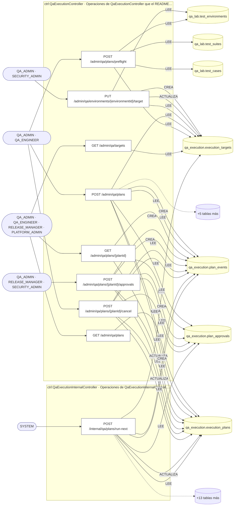
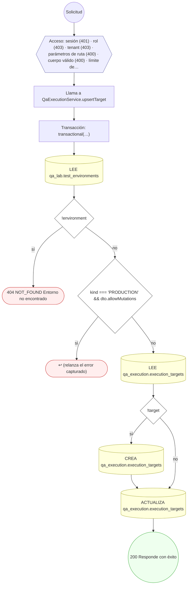
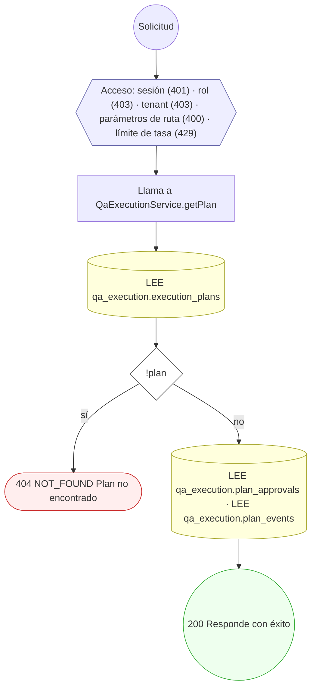
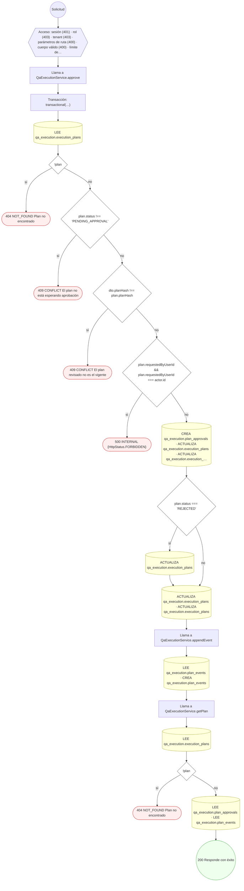
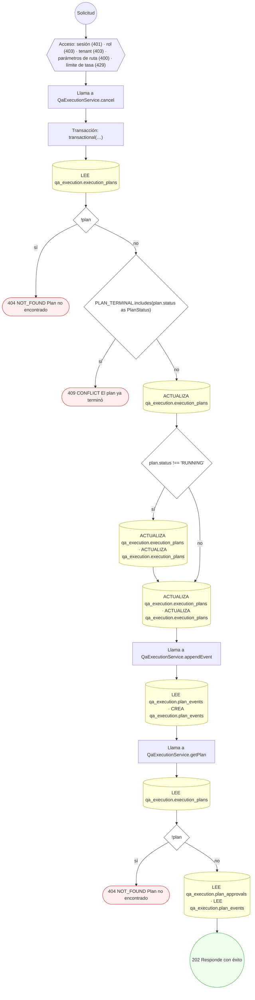
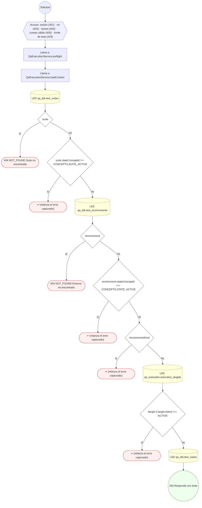

<!-- AUTOGENERADO por tools/inventario/flujos.mjs. No editar manualmente. -->

# Flujos del módulo `qa_execution`

- **Procesos:** 1 · **Máquinas de estado:** 0
- **Operaciones:** 9 (7 con decisiones propias, 2 sin ellas)
- Inventario de endpoints del módulo: [qa_execution](../endpoints/qa_execution.md)

## Proceso: Módulo 68 — Plano de ejecución de QA en el servidor

- **Código:** `qa_execution` · **Agrupación:** AGRUPACION_POR_CONTROLADOR · **Operaciones:** 9
- **Actores:** PLATFORM_ADMIN · QA_ADMIN · QA_ENGINEER · RELEASE_MANAGER · SECURITY_ADMIN · SYSTEM
- **Revisión:** AUTO_DETECTADA
- **Fuentes:** `src/modules/qa_execution/README.md`

### Para qué sirve

El laboratorio (módulo 36) define suites, casos y aserciones y guarda la evidencia; este módulo decide **qué se llama, contra qué destino, con qué límites y con qué aprobación**, y lo ejecuta desde el worker `qa_lab`. El navegador pide, aprueba y observa; no ejecuta. Decisiones en [ADR-0025](https://github.com/mdavila-2001/mantra-core-health-api/blob/dev/docs/adr/ADR-0025-qa-runner-en-servidor.md).

_Fuente: `src/modules/qa_execution/README.md:3`_

### Etapas y operaciones

| Etapa | Descripción | Operación | Quién actúa | Riesgo | Tablas |
|---|---|---|---|---|---|
| `ctrl:QaExecutionController` | Operaciones de QaExecutionController que el README no asigna a un caso de uso | PUT /admin/qa/environments/{environmentId}/target | QA_ADMIN · SECURITY_ADMIN | MEDIO | 4 |
|  |  | GET /admin/qa/plans | QA_ADMIN · QA_ENGINEER · RELEASE_MANAGER · PLATFORM_ADMIN | BAJO | 1 |
|  |  | POST /admin/qa/plans | QA_ADMIN · QA_ENGINEER | MEDIO | 11 |
|  |  | GET /admin/qa/plans/{planId} | QA_ADMIN · QA_ENGINEER · RELEASE_MANAGER · PLATFORM_ADMIN | BAJO | 3 |
|  |  | POST /admin/qa/plans/{planId}/approvals | QA_ADMIN · RELEASE_MANAGER · SECURITY_ADMIN | MEDIO | 6 |
|  |  | POST /admin/qa/plans/{planId}/cancel | QA_ADMIN · QA_ENGINEER | MEDIO | 5 |
|  |  | POST /admin/qa/plans/preflight | QA_ADMIN · QA_ENGINEER | BAJO | 4 |
|  |  | GET /admin/qa/targets | QA_ADMIN · QA_ENGINEER · RELEASE_MANAGER · PLATFORM_ADMIN | BAJO | 1 |
| `ctrl:QaExecutionInternalController` | Operaciones de QaExecutionInternalController que el README no asigna a un caso de uso | POST /internal/qa/plans/run-next | SYSTEM | MEDIO | 19 |

### Diagrama — etapas `ctrl:QaExecutionController`, `ctrl:QaExecutionInternalController`

## Árbol de decisión por operación

Cada árbol se deriva del código del handler y de los métodos que invoca (hasta 4 niveles). Una rama que no decide, no escribe y no falla se poda. Los accesos y los efectos consecutivos se agrupan en un solo nodo.

### Operaciones con decisiones propias

#### 1. PUT /admin/qa/environments/{environmentId}/target

Registrar o cambiar el destino de un entorno (cambiarlo invalida planes aprobados)

| HTTP | Código | Cuándo |
|---|---|---|
| 200 | — | Éxito |
| 400 | `VALIDATION_FAILED` | Los parámetros de ruta son UUID válidos; El cuerpo cumple el DTO (sin propiedades extra) |
| 401 | `UNAUTHENTICATED` | Hay una sesión válida (JWT) |
| 403 | `FORBIDDEN` | El rol está permitido; El tenant se resuelve y pertenece al actor |
| 404 | `NOT_FOUND` | ResourceNotFoundException: Entorno no encontrado |
| 429 | `RATE_LIMITED` | No se supera el límite de solicitudes |

#### 2. POST /admin/qa/plans

Pedir un plan (202). Queda QUEUED o PENDING_APPROVAL; lo ejecuta el worker qa_lab

| HTTP | Código | Cuándo |
|---|---|---|
| 202 | — | Éxito |
| 400 | `VALIDATION_FAILED` | El cuerpo cumple el DTO (sin propiedades extra) |
| 401 | `UNAUTHENTICATED` | Hay una sesión válida (JWT) |
| 403 | `FORBIDDEN` | El rol está permitido; El tenant se resuelve y pertenece al actor |
| 404 | `NOT_FOUND` | ResourceNotFoundException: Plan no encontrado; ResourceNotFoundException: Suite no encontrada; ResourceNotFoundException: Entorno no encontrado |
| 409 | `CONFLICT` | ConflictException: La suite ya tiene una corrida en marcha; ConflictException: No se pudo asignar número de corrida |
| 422 | `PRECONDITION_FAILED` | PreconditionFailedException: La suite no está publicada; PreconditionFailedException: El entorno no está activo; PreconditionFailedException: La suite no tiene casos activos |
| 429 | `RATE_LIMITED` | No se supera el límite de solicitudes |

```mermaid
flowchart TD
  n1(("Solicitud")):::inicio
  n2{{"Acceso: sesión (401) · rol (403) · tenant (403) · cuerpo válido (400) · límite de tasa (429)"}}:::acceso
  n1 --> n2
  n3["Llama a QaExecutionService.createPlan"]:::llamada
  n2 --> n3
  n4{"idempotencyKey"}:::decision
  n3 --> n4
  n5[("LEE qa_execution.execution_plans")]:::efecto
  n4 -->|"sí"| n5
  n6{"existing"}:::decision
  n5 --> n6
  n7["Llama a QaExecutionService.getPlan"]:::llamada
  n6 -->|"sí"| n7
  n8[("LEE qa_execution.execution_plans")]:::efecto
  n7 --> n8
  n9{"!plan"}:::decision
  n8 --> n9
  n10(["404 NOT_FOUND Plan no encontrado"]):::error
  n9 -->|"sí"| n10
  n11[("LEE qa_execution.plan_approvals · LEE qa_execution.plan_events")]:::efecto
  n9 -->|"no"| n11
  n12["Llama a QaExecutionService.loadContext"]:::llamada
  n11 --> n12
  n6 -->|"no"| n12
  n4 -->|"no"| n12
  n13[("LEE qa_lab.test_suites")]:::efecto
  n12 --> n13
  n14{"!suite"}:::decision
  n13 --> n14
  n15(["404 NOT_FOUND Suite no encontrada"]):::error
  n14 -->|"sí"| n15
  n16{"suite.stateConceptId !== CONCEPTS.SUITE_ACTIVE"}:::decision
  n14 -->|"no"| n16
  n17(["↩ (relanza el error capturado)"]):::error
  n16 -->|"sí"| n17
  n18[("LEE qa_lab.test_environments")]:::efecto
  n16 -->|"no"| n18
  n19{"!environment"}:::decision
  n18 --> n19
  n20(["404 NOT_FOUND Entorno no encontrado"]):::error
  n19 -->|"sí"| n20
  n21{"environment.stateConceptId !== CONCEPTS.STATE_ACTIVE"}:::decision
  n19 -->|"no"| n21
  n22(["↩ (relanza el error capturado)"]):::error
  n21 -->|"sí"| n22
  n23{"!environmentKind"}:::decision
  n21 -->|"no"| n23
  n24(["↩ (relanza el error capturado)"]):::error
  n23 -->|"sí"| n24
  n25[("LEE qa_execution.execution_targets")]:::efecto
  n23 -->|"no"| n25
  n26{"!target || target.status !== 'ACTIVE'"}:::decision
  n25 --> n26
  n27(["↩ (relanza el error capturado)"]):::error
  n26 -->|"sí"| n27
  n28[("LEE qa_lab.test_cases")]:::efecto
  n26 -->|"no"| n28
  n29{"plan.violations.length › 0"}:::decision
  n28 --> n29
  n30(["↩ (relanza el error capturado)"]):::error
  n29 -->|"sí"| n30
  n31["Llama a QaRunsService.createRun"]:::llamada
  n29 -->|"no"| n31
  n32["Transacción: transactional(…)"]:::transaccion
  n31 --> n32
  n33["Llama a QaCatalogRepository.findSuiteForUpdate"]:::llamada
  n32 --> n33
  n34[("LEE qa_lab.test_suites")]:::efecto
  n33 --> n34
  n35{"!suite"}:::decision
  n34 --> n35
  n36(["404 NOT_FOUND Suite no encontrada"]):::error
  n35 -->|"sí"| n36
  n37{"suite.stateConceptId !== CONCEPTS.SUITE_ACTIVE"}:::decision
  n35 -->|"no"| n37
  n38(["422 PRECONDITION_FAILED La suite no está publicada"]):::error
  n37 -->|"sí"| n38
  n39["Llama a QaCatalogRepository.findEnvironmentById"]:::llamada
  n37 -->|"no"| n39
  n40[("LEE qa_lab.test_environments")]:::efecto
  n39 --> n40
  n41{"!environment"}:::decision
  n40 --> n41
  n42(["404 NOT_FOUND Entorno no encontrado"]):::error
  n41 -->|"sí"| n42
  n43{"environment.stateConceptId !== CONCEPTS.STATE_ACTIVE"}:::decision
  n41 -->|"no"| n43
  n44(["422 PRECONDITION_FAILED El entorno no está activo"]):::error
  n43 -->|"sí"| n44
  n45{"policy === 'FORBID'"}:::decision
  n43 -->|"no"| n45
  n46["Llama a QaRunsRepository.findRunsInProgress"]:::llamada
  n45 -->|"sí"| n46
  n47[("LEE qa_lab.test_runs")]:::efecto
  n46 --> n47
  n48{"running.length › 0"}:::decision
  n47 --> n48
  n49(["409 CONFLICT La suite ya tiene una corrida en marcha"]):::error
  n48 -->|"sí"| n49
  n50["Llama a QaCatalogRepository.countActiveCases"]:::llamada
  n48 -->|"no"| n50
  n45 -->|"no"| n50
  n51[("LEE qa_lab.test_cases")]:::efecto
  n50 --> n51
  n52{"totalCases === 0"}:::decision
  n51 --> n52
  n53(["422 PRECONDITION_FAILED La suite no tiene casos activos"]):::error
  n52 -->|"sí"| n53
  n54["Llama a QaRunsService.nextRunNumber"]:::llamada
  n52 -->|"no"| n54
  n55["Llama a QaRunsRepository.findLastRun"]:::llamada
  n54 --> n55
  n56[("LEE qa_lab.test_runs")]:::efecto
  n55 --> n56
  n57["Repite: ciclo for"]:::bucle
  n56 --> n57
  n58["Llama a QaRunsRepository.findRunByNumber"]:::llamada
  n57 -->|"cada elemento"| n58
  n59[("LEE qa_lab.test_runs")]:::efecto
  n58 --> n59
  n60(["409 CONFLICT No se pudo asignar número de corrida"]):::error
  n59 --> n60
  n57 -->|"al terminar"| n60
  n61["Llama a QaRunsRepository.createRun"]:::llamada
  n62[("CREA qa_lab.test_runs")]:::efecto
  n61 --> n62
  n63["Transacción: transactional(…)"]:::transaccion
  n62 --> n63
  n64[("CREA qa_execution.execution_plans")]:::efecto
  n63 --> n64
  n65["Llama a QaExecutionService.appendEvent"]:::llamada
  n64 --> n65
  n66[("LEE qa_execution.plan_events · CREA qa_execution.plan_events")]:::efecto
  n65 --> n66
  n67["Llama a QaExecutionService.getPlan"]:::llamada
  n66 --> n67
  n68[("LEE qa_execution.execution_plans")]:::efecto
  n67 --> n68
  n69{"!plan"}:::decision
  n68 --> n69
  n70(["404 NOT_FOUND Plan no encontrado"]):::error
  n69 -->|"sí"| n70
  n71["… el resto del árbol (2 nodos) está en el JSON del inventario"]:::corte
  n69 -->|"no"| n71
  classDef acceso fill:#eef,stroke:#66a
  classDef error fill:#fee,stroke:#c33
  classDef ok fill:#efe,stroke:#3a3
  classDef efecto fill:#ffd,stroke:#aa3
  classDef decision fill:#fff,stroke:#555
  classDef corte fill:#eee,stroke:#999,stroke-dasharray: 4
```

#### 3. GET /admin/qa/plans/{planId}

Plan con pasos, límites, aprobaciones y bitácora ordenada

| HTTP | Código | Cuándo |
|---|---|---|
| 200 | — | Éxito |
| 400 | `VALIDATION_FAILED` | Los parámetros de ruta son UUID válidos |
| 401 | `UNAUTHENTICATED` | Hay una sesión válida (JWT) |
| 403 | `FORBIDDEN` | El rol está permitido; El tenant se resuelve y pertenece al actor |
| 404 | `NOT_FOUND` | ResourceNotFoundException: Plan no encontrado |
| 429 | `RATE_LIMITED` | No se supera el límite de solicitudes |

#### 4. POST /admin/qa/plans/{planId}/approvals

Aprobar o rechazar el hash vigente del plan, con vencimiento

| HTTP | Código | Cuándo |
|---|---|---|
| 200 | — | Éxito |
| 400 | `VALIDATION_FAILED` | Los parámetros de ruta son UUID válidos; El cuerpo cumple el DTO (sin propiedades extra) |
| 401 | `UNAUTHENTICATED` | Hay una sesión válida (JWT) |
| 403 | `FORBIDDEN` | El rol está permitido; El tenant se resuelve y pertenece al actor |
| 404 | `NOT_FOUND` | ResourceNotFoundException: Plan no encontrado |
| 409 | `CONFLICT` | ConflictException: El plan no está esperando aprobación; ConflictException: El plan revisado no es el vigente |
| 429 | `RATE_LIMITED` | No se supera el límite de solicitudes |
| 500 | `INTERNAL` | DomainException: {HttpStatus.FORBIDDEN} |

#### 5. POST /admin/qa/plans/{planId}/cancel

Pedir la cancelación (el runner la confirma entre casos)

| HTTP | Código | Cuándo |
|---|---|---|
| 202 | — | Éxito |
| 400 | `VALIDATION_FAILED` | Los parámetros de ruta son UUID válidos |
| 401 | `UNAUTHENTICATED` | Hay una sesión válida (JWT) |
| 403 | `FORBIDDEN` | El rol está permitido; El tenant se resuelve y pertenece al actor |
| 404 | `NOT_FOUND` | ResourceNotFoundException: Plan no encontrado |
| 409 | `CONFLICT` | ConflictException: El plan ya terminó |
| 429 | `RATE_LIMITED` | No se supera el límite de solicitudes |

#### 6. POST /admin/qa/plans/preflight

Dry-run: pasos, URL resueltas, límites recortados, hash y si requiere aprobación. No llama a nada

| HTTP | Código | Cuándo |
|---|---|---|
| 200 | — | Éxito |
| 400 | `VALIDATION_FAILED` | El cuerpo cumple el DTO (sin propiedades extra) |
| 401 | `UNAUTHENTICATED` | Hay una sesión válida (JWT) |
| 403 | `FORBIDDEN` | El rol está permitido; El tenant se resuelve y pertenece al actor |
| 404 | `NOT_FOUND` | ResourceNotFoundException: Suite no encontrada; ResourceNotFoundException: Entorno no encontrado |
| 429 | `RATE_LIMITED` | No se supera el límite de solicitudes |

#### 7. POST /internal/qa/plans/run-next

Reclamar y ejecutar el siguiente plan (worker)

| HTTP | Código | Cuándo |
|---|---|---|
| 200 | — | Éxito |
| 401 | `UNAUTHENTICATED` | Hay una sesión válida (JWT) |
| 403 | `FORBIDDEN` | El rol está permitido; El tenant se resuelve y pertenece al actor |
| 404 | `NOT_FOUND` | ResourceNotFoundException: Corrida no encontrada; ResourceNotFoundException: Suite no encontrada; ResourceNotFoundException: Entorno no encontrado; ResourceNotFoundException: Caso no encontrado; ResourceNotFoundException: Resultado no encontrado |
| 409 | `CONFLICT` | ConflictException: La corrida ya está cerrada; ConflictException: El caso ya se ejecutó en esta corrida; ConflictException: El resultado ya fue evaluado |
| 422 | `PRECONDITION_FAILED` | PreconditionFailedException: El caso pertenece a otra suite; PreconditionFailedException: El caso falló en transporte: no hay respuesta que evaluar; PreconditionFailedException: El caso no tiene aserciones |
| 429 | `RATE_LIMITED` | No se supera el límite de solicitudes |

```mermaid
flowchart TD
  n1(("Solicitud")):::inicio
  n2{{"Acceso: sesión (401) · rol (403) · tenant (403) · límite de tasa (429)"}}:::acceso
  n1 --> n2
  n3["Llama a QaExecutionService.runNext"]:::llamada
  n2 --> n3
  n4["Llama a QaExecutionService.claim"]:::llamada
  n3 --> n4
  n5["Transacción: transactional(…)"]:::transaccion
  n4 --> n5
  n6[("ACTUALIZA qa_execution.execution_plans · LEE qa_execution.execution_plans")]:::efecto
  n5 --> n6
  n7{"claimed.attempt › 1"}:::decision
  n6 --> n7
  n8["Llama a QaExecutionService.close"]:::llamada
  n7 -->|"sí"| n8
  n9["Transacción: transactional(…)"]:::transaccion
  n8 --> n9
  n10[("LEE qa_execution.execution_plans · ACTUALIZA qa_execution.execution_plans · ACTUALIZA qa_execution.execution_…")]:::efecto
  n9 --> n10
  n11{"error"}:::decision
  n10 --> n11
  n12[("ACTUALIZA qa_execution.execution_plans · ACTUALIZA qa_execution.execution_plans")]:::efecto
  n11 -->|"sí"| n12
  n13{"counters"}:::decision
  n12 --> n13
  n11 -->|"no"| n13
  n14[("ACTUALIZA qa_execution.execution_plans · ACTUALIZA qa_execution.execution_plans · ACTUALIZA qa_execution.exec…")]:::efecto
  n13 -->|"sí"| n14
  n15["Llama a QaExecutionService.appendEvent"]:::llamada
  n14 --> n15
  n13 -->|"no"| n15
  n16[("LEE qa_execution.plan_events · CREA qa_execution.plan_events")]:::efecto
  n15 --> n16
  n17["Llama a QaExecutionService.finalizeQuietly"]:::llamada
  n16 --> n17
  n18[("LEE qa_execution.execution_plans")]:::efecto
  n17 --> n18
  n19["Intenta"]:::intento
  n18 --> n19
  n20["Llama a QaRunsService.finalizeRun"]:::llamada
  n19 --> n20
  n21["Transacción: transactional(…)"]:::transaccion
  n20 --> n21
  n22["Llama a QaRunsRepository.findRunForUpdate"]:::llamada
  n21 --> n22
  n23[("LEE qa_lab.test_runs")]:::efecto
  n22 --> n23
  n24{"!run"}:::decision
  n23 --> n24
  n25(["404 NOT_FOUND Corrida no encontrada"]):::error
  n24 -->|"sí"| n25
  n26{"run.statusConceptId === CONCEPTS.RUN_PASSED || run.statusConceptId === CONCEPTS.RUN_FAILED_STATUS"}:::decision
  n24 -->|"no"| n26
  n27(["409 CONFLICT La corrida ya está cerrada"]):::error
  n26 -->|"sí"| n27
  n28["Llama a QaRunsRepository.findResultsByRun"]:::llamada
  n26 -->|"no"| n28
  n29[("LEE qa_lab.test_case_results")]:::efecto
  n28 --> n29
  n30[("ACTUALIZA qa_lab.test_runs · ACTUALIZA qa_lab.test_runs · ACTUALIZA qa_lab.test_runs · ACTUALIZA qa_lab.test_…")]:::efecto
  n29 --> n30
  n31[("LEE qa_execution.execution_plans")]:::efecto
  n30 --> n31
  n7 -->|"no"| n31
  n32["Intenta"]:::intento
  n31 --> n32
  n33["Llama a QaExecutionService.loadContext"]:::llamada
  n32 --> n33
  n34[("LEE qa_lab.test_suites")]:::efecto
  n33 --> n34
  n35{"!suite"}:::decision
  n34 --> n35
  n36(["404 NOT_FOUND Suite no encontrada"]):::error
  n35 -->|"sí"| n36
  n37{"suite.stateConceptId !== CONCEPTS.SUITE_ACTIVE"}:::decision
  n35 -->|"no"| n37
  n38(["↩ (relanza el error capturado)"]):::error
  n37 -->|"sí"| n38
  n39[("LEE qa_lab.test_environments")]:::efecto
  n37 -->|"no"| n39
  n40{"!environment"}:::decision
  n39 --> n40
  n41(["404 NOT_FOUND Entorno no encontrado"]):::error
  n40 -->|"sí"| n41
  n42{"environment.stateConceptId !== CONCEPTS.STATE_ACTIVE"}:::decision
  n40 -->|"no"| n42
  n43(["↩ (relanza el error capturado)"]):::error
  n42 -->|"sí"| n43
  n44{"!environmentKind"}:::decision
  n42 -->|"no"| n44
  n45(["↩ (relanza el error capturado)"]):::error
  n44 -->|"sí"| n45
  n46[("LEE qa_execution.execution_targets")]:::efecto
  n44 -->|"no"| n46
  n47{"!target || target.status !== 'ACTIVE'"}:::decision
  n46 --> n47
  n48(["↩ (relanza el error capturado)"]):::error
  n47 -->|"sí"| n48
  n49[("LEE qa_lab.test_cases")]:::efecto
  n47 -->|"no"| n49
  n50["Llama a QaExecutionService.close"]:::llamada
  n32 -->|"si falla"| n50
  n51["Transacción: transactional(…)"]:::transaccion
  n50 --> n51
  n52[("LEE qa_execution.execution_plans · ACTUALIZA qa_execution.execution_plans · ACTUALIZA qa_execution.execution_…")]:::efecto
  n51 --> n52
  n53{"error"}:::decision
  n52 --> n53
  n54[("ACTUALIZA qa_execution.execution_plans · ACTUALIZA qa_execution.execution_plans")]:::efecto
  n53 -->|"sí"| n54
  n55{"counters"}:::decision
  n54 --> n55
  n53 -->|"no"| n55
  n56[("ACTUALIZA qa_execution.execution_plans · ACTUALIZA qa_execution.execution_plans · ACTUALIZA qa_execution.exec…")]:::efecto
  n55 -->|"sí"| n56
  n57["Llama a QaExecutionService.appendEvent"]:::llamada
  n56 --> n57
  n55 -->|"no"| n57
  n58[("LEE qa_execution.plan_events · CREA qa_execution.plan_events")]:::efecto
  n57 --> n58
  n59{"current.hash !== plan.planHash || current.violations.length › 0"}:::decision
  n49 --> n59
  n58 --> n59
  n60["Llama a QaExecutionService.close"]:::llamada
  n59 -->|"sí"| n60
  n61["Transacción: transactional(…)"]:::transaccion
  n60 --> n61
  n62[("LEE qa_execution.execution_plans · ACTUALIZA qa_execution.execution_plans · ACTUALIZA qa_execution.execution_…")]:::efecto
  n61 --> n62
  n63{"error"}:::decision
  n62 --> n63
  n64[("ACTUALIZA qa_execution.execution_plans · ACTUALIZA qa_execution.execution_plans")]:::efecto
  n63 -->|"sí"| n64
  n65{"counters"}:::decision
  n64 --> n65
  n63 -->|"no"| n65
  n66[("ACTUALIZA qa_execution.execution_plans · ACTUALIZA qa_execution.execution_plans · ACTUALIZA qa_execution.exec…")]:::efecto
  n65 -->|"sí"| n66
  n67["Llama a QaExecutionService.appendEvent"]:::llamada
  n66 --> n67
  n65 -->|"no"| n67
  n68[("LEE qa_execution.plan_events · CREA qa_execution.plan_events")]:::efecto
  n67 --> n68
  n69["Llama a QaExecutionService.finalizeQuietly"]:::llamada
  n68 --> n69
  n70[("LEE qa_execution.execution_plans")]:::efecto
  n69 --> n70
  n71["… el resto del árbol (17 nodos) está en el JSON del inventario"]:::corte
  n70 --> n71
  classDef acceso fill:#eef,stroke:#66a
  classDef error fill:#fee,stroke:#c33
  classDef ok fill:#efe,stroke:#3a3
  classDef efecto fill:#ffd,stroke:#aa3
  classDef decision fill:#fff,stroke:#555
  classDef corte fill:#eee,stroke:#999,stroke-dasharray: 4
```

### Operaciones sin decisiones propias

Sólo comprueban el acceso y leen o escriben: no tienen ramas que dibujar. Su detalle está en la ficha de endpoints.

| Operación | Respuestas posibles | Tablas |
|---|---|---|
| GET /admin/qa/plans | 200, 401, 403, 429 | 1 |
| GET /admin/qa/targets | 200, 401, 403, 429 | 1 |
