<!-- AUTOGENERADO por tools/inventario/flujos.mjs. No editar manualmente. -->

# Flujos del módulo `qa_lab`

- **Procesos:** 1 · **Máquinas de estado:** 1
- **Operaciones:** 13 (13 con decisiones propias, 0 sin ellas)
- Inventario de endpoints del módulo: [qa_lab](../endpoints/qa_lab.md)

## Proceso: Módulo 36 — Laboratorio de Pruebas y Defectos

- **Código:** `qa_lab` · **Agrupación:** MIXTO · **Operaciones:** 13
- **Actores:** QA_ADMIN · QA_ENGINEER · RELEASE_MANAGER · SYSTEM
- **Revisión:** AUTO_DETECTADA
- **Fuentes:** `src/modules/qa_lab/README.md`

### Para qué sirve

Entornos gobernados, suites con casos y aserciones, corridas con evidencia inmutable, defectos deduplicados por firma de fallo y enlace de evidencia a un release.

_Fuente: `src/modules/qa_lab/README.md:3`_

### Flujo general declarado en el README

```text
entorno (active, isProductionSafe) ── suite ── casos (draft) + aserciones
                                          │
                                          └─ publish ──> suite active, casos active, versión++

corrida (queued) ── execute caso ──> running + payloads inmutables (hash del original)
                          │                     └─ enmascarados si el entorno no es seguro
                          ├─ evaluate ──> passed | failed + firma del fallo
                          ├─ artifacts ──> log | har | screenshot | junit
                          └─ finalize ──> passed | failed + totales agregados
                                              │
                                              └─ link-release (sólo si passed) ──> sello de evidencia

defecto: firma nueva ──> open        firma repetida ──> occurrences++ (y reabre si estaba resuelto)
         open → triaged → in_progress → resolved → closed
              ↘ rejected        ↘ triaged        ↘ in_progress
```

_Fuente: `src/modules/qa_lab/README.md:31`_

### Etapas y operaciones

| Etapa | Descripción | Operación | Quién actúa | Riesgo | Tablas |
|---|---|---|---|---|---|
| `UC-36-01` | Registrar entorno gobernado | POST /qa/environments | QA_ADMIN | MEDIO | 2 |
| `UC-36-02` | Definir caso con aserciones | POST /qa/suites/{suiteId}/cases | QA_ADMIN · QA_ENGINEER | MEDIO | 4 |
| `UC-36-03` | Publicar suite y activar casos | POST /qa/suites/{suiteId}/publish | QA_ADMIN · QA_ENGINEER | MEDIO | 4 |
| `UC-36-04` | Disparar corrida | POST /qa/runs | QA_ADMIN · QA_ENGINEER · SYSTEM | MEDIO | 5 |
| `UC-36-05` | Capturar ejecución y payloads | POST /qa/runs/{runId}/cases/{caseId}/execute | SYSTEM · QA_ENGINEER | MEDIO | 8 |
| `UC-36-06` | Evaluar aserciones | POST /qa/case-results/{resultId}/evaluate | SYSTEM · QA_ENGINEER | MEDIO | 5 |
| `UC-36-07` | Cerrar corrida y consolidar | POST /qa/runs/{runId}/finalize | SYSTEM · QA_ENGINEER | MEDIO | 3 |
| `UC-36-08` | Adjuntar evidencia | POST /qa/runs/{runId}/artifacts | SYSTEM · QA_ENGINEER | MEDIO | 3 |
| `UC-36-09` | Registrar y deduplicar defecto | POST /qa/defects | SYSTEM · QA_ENGINEER · QA_ADMIN | MEDIO | 4 |
| `UC-36-10` | Triage y transición | PATCH /qa/defects/{defectId} | QA_ADMIN · QA_ENGINEER | MEDIO | 2 |
| `UC-36-11` | Programar ejecución automática | POST /qa/schedules | QA_ADMIN · QA_ENGINEER | MEDIO | 4 |
| `UC-36-12` | Enlazar evidencia a release | POST /qa/runs/{runId}/link-release | RELEASE_MANAGER · QA_ADMIN | MEDIO | 3 |
| `ctrl:QaLabInternalController` | Operaciones de QaLabInternalController que el README no asigna a un caso de uso | POST /internal/qa/schedules/run-due | SYSTEM · QA_ADMIN | MEDIO | 7 |

### Diagrama — etapas `UC-36-01`, `UC-36-02`, `UC-36-03`…

```mermaid
flowchart LR
  a2(["QA_ADMIN"]):::actor
  a5(["QA_ADMIN · QA_ENGINEER"]):::actor
  a11(["QA_ADMIN · QA_ENGINEER · SYSTEM"]):::actor
  a14(["SYSTEM · QA_ENGINEER"]):::actor
  a25(["SYSTEM · QA_ENGINEER · QA_ADMIN"]):::actor
  a31(["RELEASE_MANAGER · QA_ADMIN"]):::actor
  a33(["SYSTEM · QA_ADMIN"]):::actor
  t3[("qa_lab.test_environments")]:::tabla
  t6[("qa_lab.test_assertions")]:::tabla
  t7[("qa_lab.test_cases")]:::tabla
  t8[("qa_lab.test_suites")]:::tabla
  t12[("qa_lab.test_runs")]:::tabla
  t15[("qa_lab.request_payloads")]:::tabla
  t16[("qa_lab.response_payloads")]:::tabla
  t17[("qa_lab.test_case_results")]:::tabla
  t20[("qa_lab.assertion_results")]:::tabla
  t23[("qa_lab.run_artifacts")]:::tabla
  t26[("qa_lab.test_defects")]:::tabla
  t29[("qa_lab.test_schedules")]:::tabla
  subgraph s0["UC-36-01 · Registrar entorno gobernado"]
    o1["POST /qa/environments"]:::op
  end
  subgraph s1["UC-36-02 · Definir caso con aserciones"]
    o4["POST /qa/suites/{suiteId}/cases"]:::op
  end
  subgraph s2["UC-36-03 · Publicar suite y activar casos"]
    o9["POST /qa/suites/{suiteId}/publish"]:::op
  end
  subgraph s3["UC-36-04 · Disparar corrida"]
    o10["POST /qa/runs"]:::op
  end
  t18[("+2 tablas más")]
  subgraph s4["UC-36-05 · Capturar ejecución y payloads"]
    o13["POST /qa/runs/{runId}/cases/{caseId}/execute"]:::op
  end
  subgraph s5["UC-36-06 · Evaluar aserciones"]
    o19["POST /qa/case-results/{resultId}/evaluate"]:::op
  end
  subgraph s6["UC-36-07 · Cerrar corrida y consolidar"]
    o21["POST /qa/runs/{runId}/finalize"]:::op
  end
  subgraph s7["UC-36-08 · Adjuntar evidencia"]
    o22["POST /qa/runs/{runId}/artifacts"]:::op
  end
  subgraph s8["UC-36-09 · Registrar y deduplicar defecto"]
    o24["POST /qa/defects"]:::op
  end
  subgraph s9["UC-36-10 · Triage y transición"]
    o27["PATCH /qa/defects/{defectId}"]:::op
  end
  subgraph s10["UC-36-11 · Programar ejecución automática"]
    o28["POST /qa/schedules"]:::op
  end
  subgraph s11["UC-36-12 · Enlazar evidencia a release"]
    o30["POST /qa/runs/{runId}/link-release"]:::op
  end
  t34[("+1 tablas más")]
  subgraph s12["ctrl:QaLabInternalController · Operaciones de QaLabInternalController que el RE…"]
    o32["POST /internal/qa/schedules/run-due"]:::op
  end
  a2 --> o1
  o1 -->|"CREA"| t3
  o1 -->|"LEE"| t3
  a5 --> o4
  o4 -->|"CREA"| t6
  o4 -->|"CREA"| t7
  o4 -->|"LEE"| t7
  o4 -->|"LEE"| t8
  a5 --> o9
  o9 -->|"ACTUALIZA"| t7
  o9 -->|"LEE"| t7
  o9 -->|"ACTUALIZA"| t8
  o9 -->|"LEE"| t8
  a11 --> o10
  o10 -->|"LEE"| t7
  o10 -->|"LEE"| t3
  o10 -->|"CREA"| t12
  o10 -->|"LEE"| t12
  o10 -->|"LEE"| t8
  a14 --> o13
  o13 -->|"CREA"| t15
  o13 -->|"CREA"| t16
  o13 -->|"CREA"| t17
  o13 -->|"LEE"| t17
  o13 -->|"LEE"| t7
  o13 -->|"LEE"| t3
  o13 -.-> t18
  a14 --> o19
  o19 -->|"CREA"| t20
  o19 -->|"LEE"| t20
  o19 -->|"LEE"| t6
  o19 -->|"ACTUALIZA"| t17
  o19 -->|"LEE"| t17
  a14 --> o21
  o21 -->|"LEE"| t17
  o21 -->|"ACTUALIZA"| t12
  o21 -->|"LEE"| t12
  a14 --> o22
  o22 -->|"CREA"| t23
  o22 -->|"LEE"| t17
  o22 -->|"LEE"| t12
  a25 --> o24
  o24 -->|"LEE"| t7
  o24 -->|"ACTUALIZA"| t26
  o24 -->|"CREA"| t26
  o24 -->|"LEE"| t26
  a5 --> o27
  o27 -->|"ACTUALIZA"| t26
  o27 -->|"LEE"| t26
  a5 --> o28
  o28 -->|"LEE"| t3
  o28 -->|"CREA"| t29
  o28 -->|"LEE"| t29
  o28 -->|"LEE"| t8
  a31 --> o30
  o30 -->|"LEE"| t23
  o30 -->|"ACTUALIZA"| t12
  o30 -->|"LEE"| t12
  a33 --> o32
  o32 -->|"LEE"| t7
  o32 -->|"LEE"| t3
  o32 -->|"CREA"| t12
  o32 -->|"LEE"| t12
  o32 -->|"ACTUALIZA"| t29
  o32 -->|"LEE"| t29
  o32 -.-> t34
  classDef op fill:#fff,stroke:#446
  classDef actor fill:#eef,stroke:#66a
  classDef tabla fill:#ffd,stroke:#aa3
  classDef evento fill:#efe,stroke:#3a3
```

## Máquinas de estado

### Máquina de estados `DEFECT_TRANSITIONS`

Declarada en `src/modules/qa_lab/services/qa-runs.service.ts:78`. Los estados llevan el nombre del identificador del código; no se resuelven al catálogo de conceptos.

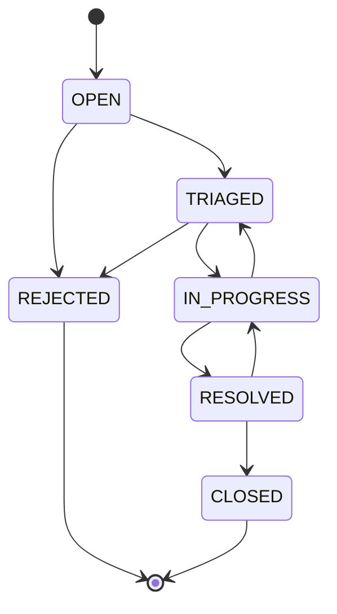

**Operaciones que ejercen esta máquina** _(POR_REFERENCIA: el handler alcanza un método que valida contra la tabla; «sin destino nombrado» significa que el estado de destino llega por el cuerpo de la petición)_:

| Operación | Estados de destino que nombra | A través de |
|---|---|---|
| PATCH /qa/defects/{defectId} | IN_PROGRESS | QaRunsService.triageDefect |

## Árbol de decisión por operación

Cada árbol se deriva del código del handler y de los métodos que invoca (hasta 4 niveles). Una rama que no decide, no escribe y no falla se poda. Los accesos y los efectos consecutivos se agrupan en un solo nodo.

### Operaciones con decisiones propias

#### 1. POST /internal/qa/schedules/run-due

Evaluar programaciones vencidas y encolar sus corridas

| HTTP | Código | Cuándo |
|---|---|---|
| 200 | — | Éxito |
| 400 | `VALIDATION_FAILED` | El cuerpo cumple el DTO (sin propiedades extra) |
| 401 | `UNAUTHENTICATED` | Hay una sesión válida (JWT) |
| 403 | `FORBIDDEN` | El rol está permitido; El tenant se resuelve y pertenece al actor |
| 409 | `CONFLICT` | ConflictException: No se pudo asignar número de corrida |
| 429 | `RATE_LIMITED` | No se supera el límite de solicitudes |

```mermaid
flowchart TD
  n1(("Solicitud")):::inicio
  n2{{"Acceso: sesión (401) · rol (403) · tenant (403) · cuerpo válido (400) · límite de tasa (429)"}}:::acceso
  n1 --> n2
  n3["Llama a QaCatalogService.runDueSchedules"]:::llamada
  n2 --> n3
  n4["Transacción: transactional(…)"]:::transaccion
  n3 --> n4
  n5["Llama a QaCatalogRepository.claimDueSchedules"]:::llamada
  n4 --> n5
  n6[("LEE qa_lab.test_schedules")]:::efecto
  n5 --> n6
  n7["Repite: por cada const schedule de due"]:::bucle
  n6 --> n7
  n8["Llama a QaCatalogService.runDueSchedule"]:::llamada
  n7 -->|"cada elemento"| n8
  n9["Llama a QaCatalogRepository.findSuiteById"]:::llamada
  n8 --> n9
  n10[("LEE qa_lab.test_suites")]:::efecto
  n9 --> n10
  n11["Llama a QaCatalogRepository.findEnvironmentById"]:::llamada
  n10 --> n11
  n12[("LEE qa_lab.test_environments")]:::efecto
  n11 --> n12
  n13{"!suite || suite.stateConceptId !== CONCEPTS.SUITE_ACTIVE"}:::decision
  n12 --> n13
  n14{"!environment || environment.stateConceptId !== CONCEPTS.STATE_ACTIVE"}:::decision
  n13 -->|"no"| n14
  n15{"policy === 'FORBID'"}:::decision
  n14 -->|"no"| n15
  n16["Llama a QaRunsRepository.findRunsInProgress"]:::llamada
  n15 -->|"sí"| n16
  n17[("LEE qa_lab.test_runs")]:::efecto
  n16 --> n17
  n18{"!skippedReason"}:::decision
  n17 --> n18
  n15 -->|"no"| n18
  n19["Llama a QaCatalogRepository.countActiveCases"]:::llamada
  n18 -->|"sí"| n19
  n20[("LEE qa_lab.test_cases")]:::efecto
  n19 --> n20
  n21{"totalCases === 0"}:::decision
  n20 --> n21
  n22["Llama a QaCatalogService.nextRunNumber"]:::llamada
  n21 -->|"no"| n22
  n23["Llama a QaRunsRepository.findLastRun"]:::llamada
  n22 --> n23
  n24[("LEE qa_lab.test_runs")]:::efecto
  n23 --> n24
  n25["Repite: ciclo for"]:::bucle
  n24 --> n25
  n26["Llama a QaRunsRepository.findRunByNumber"]:::llamada
  n25 -->|"cada elemento"| n26
  n27[("LEE qa_lab.test_runs")]:::efecto
  n26 --> n27
  n28(["409 CONFLICT No se pudo asignar número de corrida"]):::error
  n27 --> n28
  n25 -->|"al terminar"| n28
  n29["Llama a QaRunsRepository.createRun"]:::llamada
  n30[("CREA qa_lab.test_runs")]:::efecto
  n29 --> n30
  n31{"nextRunAt"}:::decision
  n13 -->|"sí"| n31
  n14 -->|"sí"| n31
  n21 -->|"sí"| n31
  n30 --> n31
  n18 -->|"no"| n31
  n32[("ACTUALIZA qa_lab.test_schedules")]:::efecto
  n31 -->|"sí"| n32
  n33[("ACTUALIZA qa_lab.test_schedules")]:::efecto
  n31 -->|"no"| n33
  n34{"runId"}:::decision
  n32 --> n34
  n33 --> n34
  n35[("ACTUALIZA qa_lab.test_schedules · ACTUALIZA qa_lab.test_schedules")]:::efecto
  n34 -->|"sí"| n35
  n36(("200 Responde con éxito")):::ok
  n35 --> n36
  n34 -->|"no"| n36
  n7 -->|"al terminar"| n36
  classDef acceso fill:#eef,stroke:#66a
  classDef error fill:#fee,stroke:#c33
  classDef ok fill:#efe,stroke:#3a3
  classDef efecto fill:#ffd,stroke:#aa3
  classDef decision fill:#fff,stroke:#555
  classDef corte fill:#eee,stroke:#999,stroke-dasharray: 4
```

#### 2. POST /qa/case-results/{resultId}/evaluate

Evaluar las aserciones y fijar el resultado del caso

| HTTP | Código | Cuándo |
|---|---|---|
| 200 | — | Éxito |
| 400 | `VALIDATION_FAILED` | Los parámetros de ruta son UUID válidos |
| 401 | `UNAUTHENTICATED` | Hay una sesión válida (JWT) |
| 403 | `FORBIDDEN` | El rol está permitido; El tenant se resuelve y pertenece al actor |
| 404 | `NOT_FOUND` | ResourceNotFoundException: Resultado no encontrado |
| 409 | `CONFLICT` | ConflictException: El resultado ya fue evaluado |
| 422 | `PRECONDITION_FAILED` | PreconditionFailedException: El caso falló en transporte: no hay respuesta que evaluar; PreconditionFailedException: El caso no tiene aserciones |
| 429 | `RATE_LIMITED` | No se supera el límite de solicitudes |

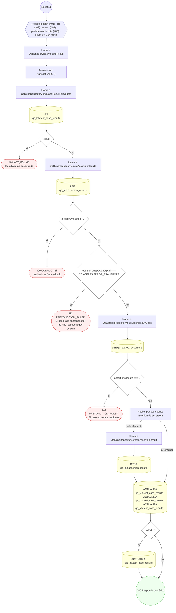

#### 3. POST /qa/defects

Registrar un defecto detectado

| HTTP | Código | Cuándo |
|---|---|---|
| 201 | — | Éxito |
| 400 | `VALIDATION_FAILED` | El cuerpo cumple el DTO (sin propiedades extra) |
| 401 | `UNAUTHENTICATED` | Hay una sesión válida (JWT) |
| 403 | `FORBIDDEN` | El rol está permitido; El tenant se resuelve y pertenece al actor |
| 404 | `NOT_FOUND` | ResourceNotFoundException: Caso no encontrado |
| 409 | `CONFLICT` | ConflictException: No se pudo asignar número de defecto |
| 429 | `RATE_LIMITED` | No se supera el límite de solicitudes |

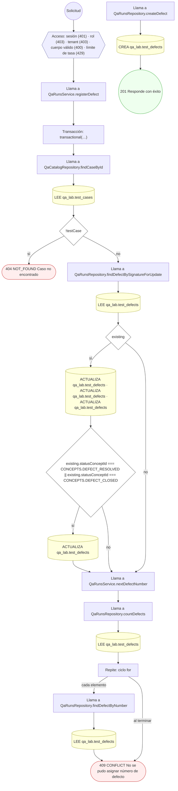

#### 4. PATCH /qa/defects/{defectId}

Triage y transición de estado del defecto

| HTTP | Código | Cuándo |
|---|---|---|
| 200 | — | Éxito |
| 400 | `VALIDATION_FAILED` | Los parámetros de ruta son UUID válidos; El cuerpo cumple el DTO (sin propiedades extra) |
| 401 | `UNAUTHENTICATED` | Hay una sesión válida (JWT) |
| 403 | `FORBIDDEN` | El rol está permitido; El tenant se resuelve y pertenece al actor |
| 404 | `NOT_FOUND` | ResourceNotFoundException: Defecto no encontrado |
| 422 | `PRECONDITION_FAILED` | PreconditionFailedException: El defecto está en un estado desconocido; PreconditionFailedException: La transición de estado no está permitida; PreconditionFailedException: Un defecto en curso necesita responsable |
| 429 | `RATE_LIMITED` | No se supera el límite de solicitudes |

```mermaid
flowchart TD
  n1(("Solicitud")):::inicio
  n2{{"Acceso: sesión (401) · rol (403) · tenant (403) · parámetros de ruta (400) · cuerpo válido (400) · límite de…"}}:::acceso
  n1 --> n2
  n3["Llama a QaRunsService.triageDefect"]:::llamada
  n2 --> n3
  n4["Transacción: transactional(…)"]:::transaccion
  n3 --> n4
  n5["Llama a QaRunsRepository.findDefectForUpdate"]:::llamada
  n4 --> n5
  n6[("LEE qa_lab.test_defects")]:::efecto
  n5 --> n6
  n7{"!defect"}:::decision
  n6 --> n7
  n8(["404 NOT_FOUND Defecto no encontrado"]):::error
  n7 -->|"sí"| n8
  n9{"!current"}:::decision
  n7 -->|"no"| n9
  n10(["422 PRECONDITION_FAILED El defecto está en un estado desconocido"]):::error
  n9 -->|"sí"| n10
  n11{"current !== dto.status && !DEFECT_TRANSITIONS[current].includes(dto.status)"}:::decision
  n9 -->|"no"| n11
  n12(["422 PRECONDITION_FAILED La transición de estado no está permitida"]):::error
  n11 -->|"sí"| n12
  n13{"dto.status === 'IN_PROGRESS' && !dto.assignedToUserId && !defect.assignedToUserId"}:::decision
  n11 -->|"no"| n13
  n14(["422 PRECONDITION_FAILED Un defecto en curso necesita responsable"]):::error
  n13 -->|"sí"| n14
  n15[("ACTUALIZA qa_lab.test_defects")]:::efecto
  n13 -->|"no"| n15
  n16{"dto.severity"}:::decision
  n15 --> n16
  n17[("ACTUALIZA qa_lab.test_defects")]:::efecto
  n16 -->|"sí"| n17
  n18[("ACTUALIZA qa_lab.test_defects")]:::efecto
  n17 --> n18
  n16 -->|"no"| n18
  n19{"dto.assignedToUserId"}:::decision
  n18 --> n19
  n20[("ACTUALIZA qa_lab.test_defects")]:::efecto
  n19 -->|"sí"| n20
  n21[("ACTUALIZA qa_lab.test_defects")]:::efecto
  n20 --> n21
  n19 -->|"no"| n21
  n22{"dto.isFlaky !== undefined"}:::decision
  n21 --> n22
  n23[("ACTUALIZA qa_lab.test_defects")]:::efecto
  n22 -->|"sí"| n23
  n24[("ACTUALIZA qa_lab.test_defects")]:::efecto
  n23 --> n24
  n22 -->|"no"| n24
  n25{"dto.externalIssueRef"}:::decision
  n24 --> n25
  n26[("ACTUALIZA qa_lab.test_defects")]:::efecto
  n25 -->|"sí"| n26
  n27(("200 Responde con éxito")):::ok
  n26 --> n27
  n25 -->|"no"| n27
  classDef acceso fill:#eef,stroke:#66a
  classDef error fill:#fee,stroke:#c33
  classDef ok fill:#efe,stroke:#3a3
  classDef efecto fill:#ffd,stroke:#aa3
  classDef decision fill:#fff,stroke:#555
  classDef corte fill:#eee,stroke:#999,stroke-dasharray: 4
```

#### 5. POST /qa/environments

Registrar un entorno de pruebas gobernado

| HTTP | Código | Cuándo |
|---|---|---|
| 201 | — | Éxito |
| 400 | `VALIDATION_FAILED` | El cuerpo cumple el DTO (sin propiedades extra) |
| 401 | `UNAUTHENTICATED` | Hay una sesión válida (JWT) |
| 403 | `FORBIDDEN` | El rol está permitido; El tenant se resuelve y pertenece al actor |
| 409 | `CONFLICT` | ConflictException: Ya existe un entorno con ese código |
| 422 | `PRECONDITION_FAILED` | PreconditionFailedException: Un entorno de producción no puede declararse seguro para capturar payloads |
| 429 | `RATE_LIMITED` | No se supera el límite de solicitudes |

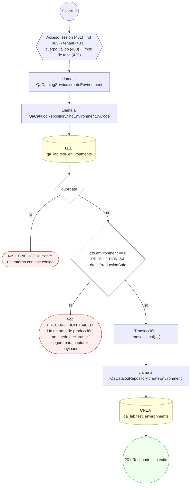

#### 6. POST /qa/runs

Disparar una corrida de pruebas

| HTTP | Código | Cuándo |
|---|---|---|
| 201 | — | Éxito |
| 400 | `VALIDATION_FAILED` | El cuerpo cumple el DTO (sin propiedades extra) |
| 401 | `UNAUTHENTICATED` | Hay una sesión válida (JWT) |
| 403 | `FORBIDDEN` | El rol está permitido; El tenant se resuelve y pertenece al actor |
| 404 | `NOT_FOUND` | ResourceNotFoundException: Suite no encontrada; ResourceNotFoundException: Entorno no encontrado |
| 409 | `CONFLICT` | ConflictException: La suite ya tiene una corrida en marcha; ConflictException: No se pudo asignar número de corrida |
| 422 | `PRECONDITION_FAILED` | PreconditionFailedException: La suite no está publicada; PreconditionFailedException: El entorno no está activo; PreconditionFailedException: La suite no tiene casos activos |
| 429 | `RATE_LIMITED` | No se supera el límite de solicitudes |

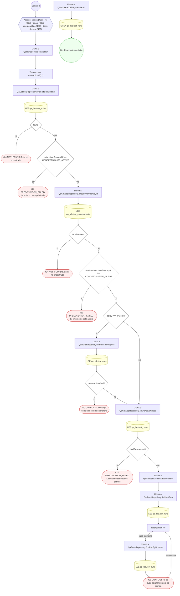

#### 7. POST /qa/runs/{runId}/artifacts

Adjuntar un artefacto de evidencia a la corrida

| HTTP | Código | Cuándo |
|---|---|---|
| 201 | — | Éxito |
| 400 | `VALIDATION_FAILED` | Los parámetros de ruta son UUID válidos; El cuerpo cumple el DTO (sin propiedades extra) |
| 401 | `UNAUTHENTICATED` | Hay una sesión válida (JWT) |
| 403 | `FORBIDDEN` | El rol está permitido; El tenant se resuelve y pertenece al actor |
| 404 | `NOT_FOUND` | ResourceNotFoundException: Corrida no encontrada; ResourceNotFoundException: Resultado no encontrado |
| 422 | `PRECONDITION_FAILED` | PreconditionFailedException: El resultado pertenece a otra corrida |
| 429 | `RATE_LIMITED` | No se supera el límite de solicitudes |

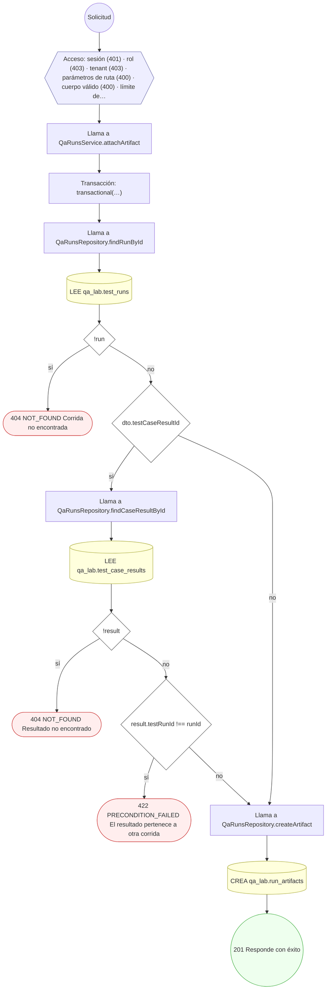

#### 8. POST /qa/runs/{runId}/cases/{caseId}/execute

Registrar la ejecución del caso con sus payloads

| HTTP | Código | Cuándo |
|---|---|---|
| 201 | — | Éxito |
| 400 | `VALIDATION_FAILED` | Los parámetros de ruta son UUID válidos; El cuerpo cumple el DTO (sin propiedades extra) |
| 401 | `UNAUTHENTICATED` | Hay una sesión válida (JWT) |
| 403 | `FORBIDDEN` | El rol está permitido; El tenant se resuelve y pertenece al actor |
| 404 | `NOT_FOUND` | ResourceNotFoundException: Corrida no encontrada; ResourceNotFoundException: Caso no encontrado |
| 409 | `CONFLICT` | ConflictException: La corrida ya está cerrada; ConflictException: El caso ya se ejecutó en esta corrida |
| 422 | `PRECONDITION_FAILED` | PreconditionFailedException: El caso pertenece a otra suite |
| 429 | `RATE_LIMITED` | No se supera el límite de solicitudes |

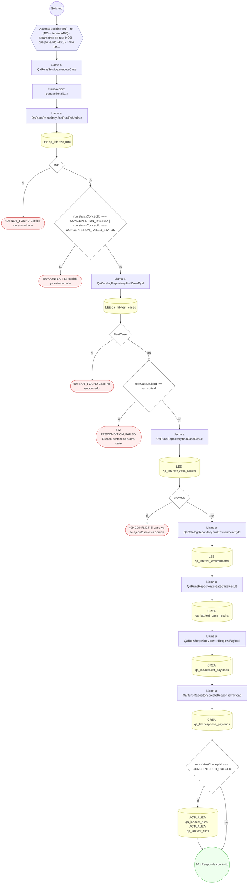

#### 9. POST /qa/runs/{runId}/finalize

Cerrar la corrida y consolidar totales

| HTTP | Código | Cuándo |
|---|---|---|
| 200 | — | Éxito |
| 400 | `VALIDATION_FAILED` | Los parámetros de ruta son UUID válidos |
| 401 | `UNAUTHENTICATED` | Hay una sesión válida (JWT) |
| 403 | `FORBIDDEN` | El rol está permitido; El tenant se resuelve y pertenece al actor |
| 404 | `NOT_FOUND` | ResourceNotFoundException: Corrida no encontrada |
| 409 | `CONFLICT` | ConflictException: La corrida ya está cerrada |
| 429 | `RATE_LIMITED` | No se supera el límite de solicitudes |

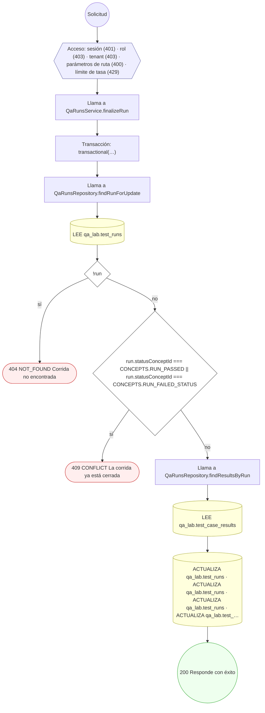

#### 10. POST /qa/runs/{runId}/link-release

Enlazar la evidencia de la corrida a un release

| HTTP | Código | Cuándo |
|---|---|---|
| 200 | — | Éxito |
| 400 | `VALIDATION_FAILED` | Los parámetros de ruta son UUID válidos; El cuerpo cumple el DTO (sin propiedades extra) |
| 401 | `UNAUTHENTICATED` | Hay una sesión válida (JWT) |
| 403 | `FORBIDDEN` | El rol está permitido; El tenant se resuelve y pertenece al actor |
| 404 | `NOT_FOUND` | ResourceNotFoundException: Corrida no encontrada |
| 422 | `PRECONDITION_FAILED` | PreconditionFailedException: Sólo una corrida que pasó puede respaldar un release; PreconditionFailedException: La corrida no tiene evidencia adjunta |
| 429 | `RATE_LIMITED` | No se supera el límite de solicitudes |

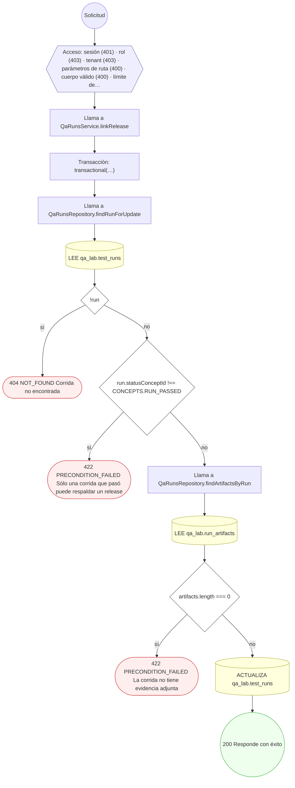

#### 11. POST /qa/schedules

Programar la ejecución automática de la suite

| HTTP | Código | Cuándo |
|---|---|---|
| 201 | — | Éxito |
| 400 | `VALIDATION_FAILED` | El cuerpo cumple el DTO (sin propiedades extra) |
| 401 | `UNAUTHENTICATED` | Hay una sesión válida (JWT) |
| 403 | `FORBIDDEN` | El rol está permitido; El tenant se resuelve y pertenece al actor |
| 404 | `NOT_FOUND` | ResourceNotFoundException: Suite no encontrada; ResourceNotFoundException: Entorno no encontrado |
| 409 | `CONFLICT` | ConflictException: Ya existe una programación con ese código para la suite y el entorno |
| 422 | `PRECONDITION_FAILED` | PreconditionFailedException: La suite no está publicada; PreconditionFailedException: El entorno no está activo |
| 429 | `RATE_LIMITED` | No se supera el límite de solicitudes |

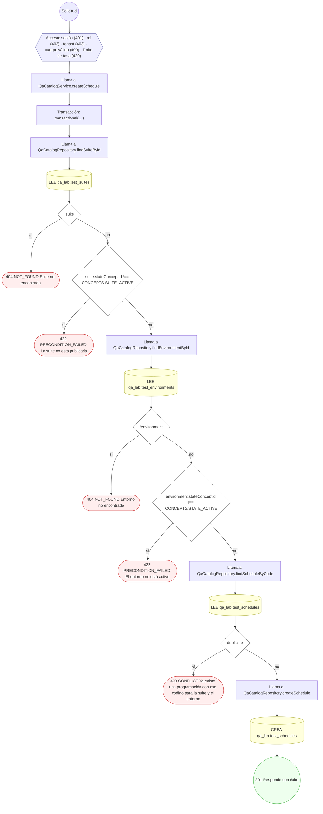

#### 12. POST /qa/suites/{suiteId}/cases

Definir un caso de prueba con sus aserciones

| HTTP | Código | Cuándo |
|---|---|---|
| 201 | — | Éxito |
| 400 | `VALIDATION_FAILED` | Los parámetros de ruta son UUID válidos; El cuerpo cumple el DTO (sin propiedades extra) |
| 401 | `UNAUTHENTICATED` | Hay una sesión válida (JWT) |
| 403 | `FORBIDDEN` | El rol está permitido; El tenant se resuelve y pertenece al actor |
| 404 | `NOT_FOUND` | ResourceNotFoundException: Suite no encontrada |
| 409 | `CONFLICT` | ConflictException: Ya existe un caso con ese código en la suite |
| 422 | `PRECONDITION_FAILED` | PreconditionFailedException: Una aserción JSON_PATH necesita su ruta; PreconditionFailedException: La aserción necesita valor esperado |
| 429 | `RATE_LIMITED` | No se supera el límite de solicitudes |

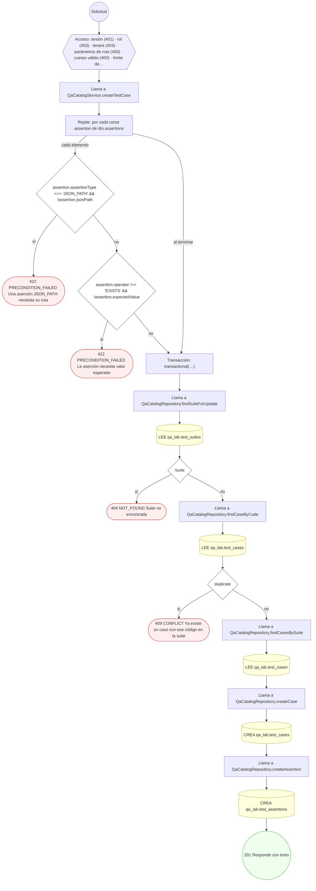

#### 13. POST /qa/suites/{suiteId}/publish

Publicar la suite y activar sus casos

| HTTP | Código | Cuándo |
|---|---|---|
| 200 | — | Éxito |
| 400 | `VALIDATION_FAILED` | Los parámetros de ruta son UUID válidos; El cuerpo cumple el DTO (sin propiedades extra) |
| 401 | `UNAUTHENTICATED` | Hay una sesión válida (JWT) |
| 403 | `FORBIDDEN` | El rol está permitido; El tenant se resuelve y pertenece al actor |
| 404 | `NOT_FOUND` | ResourceNotFoundException: Suite no encontrada |
| 422 | `PRECONDITION_FAILED` | PreconditionFailedException: Una suite sin casos no puede publicarse |
| 429 | `RATE_LIMITED` | No se supera el límite de solicitudes |

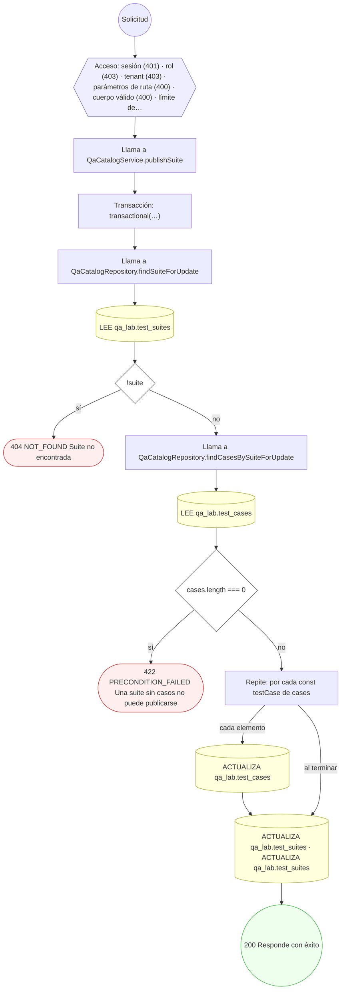

