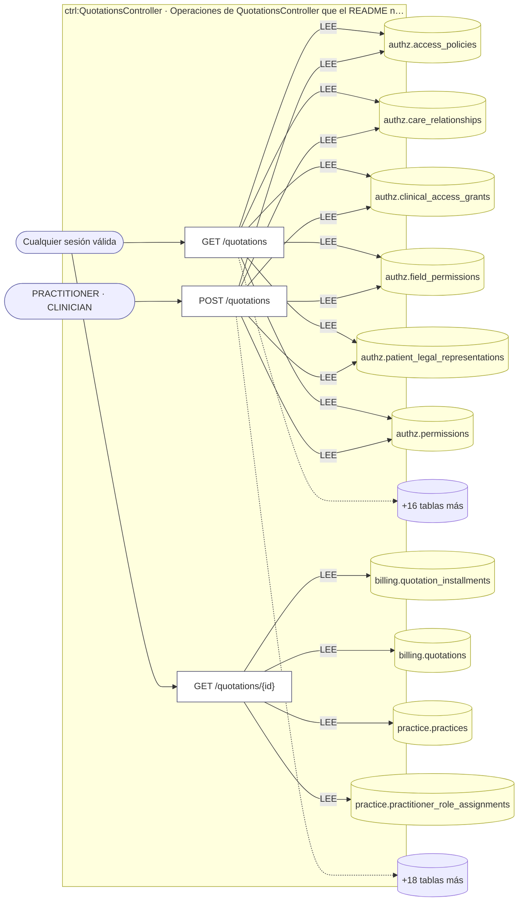
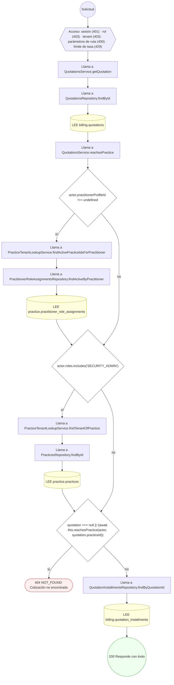

<!-- AUTOGENERADO por tools/inventario/flujos.mjs. No editar manualmente. -->

# Flujos del módulo `quotations`

- **Procesos:** 1 · **Máquinas de estado:** 0
- **Operaciones:** 3 (3 con decisiones propias, 0 sin ellas)
- Inventario de endpoints del módulo: [quotations](../endpoints/quotations.md)

## Proceso: Módulo Quotations — Cotizaciones con plan de pagos (FT-24)

- **Código:** `quotations` · **Agrupación:** AGRUPACION_POR_CONTROLADOR · **Operaciones:** 3
- **Actores:** CLINICIAN · Cualquier sesión válida · PRACTITIONER
- **Revisión:** AUTO_DETECTADA
- **Fuentes:** `src/modules/quotations/README.md`

### Para qué sirve

Arma un **presupuesto** sobre un servicio del catálogo (FT-22) con un plan de pagos **flexible y sin interés**, y **congela** las condiciones ofertadas al momento de crearlo: si el precio del servicio cambia después, la cotización conserva el suyo.

_Fuente: `src/modules/quotations/README.md:3`_

### Etapas y operaciones

| Etapa | Descripción | Operación | Quién actúa | Riesgo | Tablas |
|---|---|---|---|---|---|
| `ctrl:QuotationsController` | Operaciones de QuotationsController que el README no asigna a un caso de uso | GET /quotations | Cualquier sesión válida | BAJO | 22 |
|  |  | POST /quotations | PRACTITIONER · CLINICIAN | MEDIO | 24 |
|  |  | GET /quotations/{id} | Cualquier sesión válida | BAJO | 4 |

### Diagrama — etapas `ctrl:QuotationsController`

## Árbol de decisión por operación

Cada árbol se deriva del código del handler y de los métodos que invoca (hasta 4 niveles). Una rama que no decide, no escribe y no falla se poda. Los accesos y los efectos consecutivos se agrupan en un solo nodo.

### Operaciones con decisiones propias

#### 1. GET /quotations

Listar las cotizaciones de un paciente

| HTTP | Código | Cuándo |
|---|---|---|
| 200 | — | Éxito |
| 400 | `VALIDATION_FAILED` | Están los parámetros de consulta obligatorios |
| 401 | `UNAUTHENTICATED` | Hay una sesión válida (JWT) |
| 403 | `FORBIDDEN` | El rol está permitido; El tenant se resuelve y pertenece al actor |
| 404 | `NOT_FOUND` | ResourceNotFoundException: {PATIENT_NOT_AVAILABLE.message} |
| 429 | `RATE_LIMITED` | No se supera el límite de solicitudes |

```mermaid
flowchart TD
  n1(("Solicitud")):::inicio
  n2{{"Acceso: sesión (401) · rol (403) · tenant (403) · parámetros de consulta (400) · límite de tasa (429)"}}:::acceso
  n1 --> n2
  n3["Llama a QuotationsService.listQuotationsByPatient"]:::llamada
  n2 --> n3
  n4["Llama a QuotationsService.reachablePracticesForPatient"]:::llamada
  n3 --> n4
  n5{"actor.roles.includes('SECURITY_ADMIN')"}:::decision
  n4 --> n5
  n6{"tenantId !== undefined"}:::decision
  n5 -->|"sí"| n6
  n7["Llama a PracticeTenantLookupService.findActivePracticeIdsForTenant"]:::llamada
  n6 -->|"sí"| n7
  n8["Llama a PracticesRepository.findByTenant"]:::llamada
  n7 --> n8
  n9[("LEE practice.practices")]:::efecto
  n8 --> n9
  n10{"actor.practitionerProfileId !== undefined"}:::decision
  n9 --> n10
  n6 -->|"no"| n10
  n5 -->|"no"| n10
  n11["Llama a QuotationsService.hasClinicalBasis"]:::llamada
  n10 -->|"sí"| n11
  n12["Intenta"]:::intento
  n11 --> n12
  n13(["↩ (relanza el error capturado)"]):::error
  n12 -->|"si falla"| n13
  n14{"await this.hasClinicalBasis(patientProfileId, actor)"}:::decision
  n12 --> n14
  n15["Llama a PracticeTenantLookupService.findActivePracticeIdsForPractitioner"]:::llamada
  n14 -->|"sí"| n15
  n16["Llama a PractitionerRoleAssignmentsRepository.findActiveByPractitioner"]:::llamada
  n15 --> n16
  n17[("LEE practice.practitioner_role_assignments")]:::efecto
  n16 --> n17
  n18{"!administrativeScope"}:::decision
  n14 -->|"no"| n18
  n19(["404 NOT_FOUND {PATIENT_NOT_AVAILABLE.message}"]):::error
  n18 -->|"sí"| n19
  n20["Llama a QuotationsRepository.findByPatient"]:::llamada
  n17 --> n20
  n18 -->|"no"| n20
  n10 -->|"no"| n20
  n21[("LEE billing.quotations")]:::efecto
  n20 --> n21
  n22["Llama a QuotationInstallmentsRepository.findByQuotationIds"]:::llamada
  n21 --> n22
  n23[("LEE billing.quotation_installments")]:::efecto
  n22 --> n23
  n24(("200 Responde con éxito")):::ok
  n23 --> n24
  classDef acceso fill:#eef,stroke:#66a
  classDef error fill:#fee,stroke:#c33
  classDef ok fill:#efe,stroke:#3a3
  classDef efecto fill:#ffd,stroke:#aa3
  classDef decision fill:#fff,stroke:#555
  classDef corte fill:#eee,stroke:#999,stroke-dasharray: 4
```

#### 2. POST /quotations

Crear una cotización

| HTTP | Código | Cuándo |
|---|---|---|
| 201 | — | Éxito |
| 400 | `VALIDATION_FAILED` | El cuerpo cumple el DTO (sin propiedades extra) |
| 401 | `UNAUTHENTICATED` | Hay una sesión válida (JWT) |
| 403 | `FORBIDDEN` | El rol está permitido; El tenant se resuelve y pertenece al actor |
| 404 | `NOT_FOUND` | ResourceNotFoundException: Servicio no encontrado en el catálogo |
| 422 | `PRECONDITION_FAILED` | PreconditionFailedException: Se requiere un perfil profesional para crear una cotización; PreconditionFailedException: El profesional no tiene una vinculación activa con esa práctica; PreconditionFailedException: validUntil debe ser posterior a attentionDate |
| 429 | `RATE_LIMITED` | No se supera el límite de solicitudes |

```mermaid
flowchart TD
  n1(("Solicitud")):::inicio
  n2{{"Acceso: sesión (401) · rol (403) · tenant (403) · cuerpo válido (400) · límite de tasa (429)"}}:::acceso
  n1 --> n2
  n3["Llama a QuotationsService.createQuotation"]:::llamada
  n2 --> n3
  n4{"!practitionerProfileId"}:::decision
  n3 --> n4
  n5(["422 PRECONDITION_FAILED Se requiere un perfil profesional para crear una cotización"]):::error
  n4 -->|"sí"| n5
  n6["Llama a QuotationsService.reachesPractice"]:::llamada
  n4 -->|"no"| n6
  n7{"actor.practitionerProfileId !== undefined"}:::decision
  n6 --> n7
  n8["Llama a PracticeTenantLookupService.findActivePracticeIdsForPractitioner"]:::llamada
  n7 -->|"sí"| n8
  n9["Llama a PractitionerRoleAssignmentsRepository.findActiveByPractitioner"]:::llamada
  n8 --> n9
  n10[("LEE practice.practitioner_role_assignments")]:::efecto
  n9 --> n10
  n11{"actor.roles.includes('SECURITY_ADMIN')"}:::decision
  n10 --> n11
  n7 -->|"no"| n11
  n12["Llama a PracticeTenantLookupService.findTenantOfPractice"]:::llamada
  n11 -->|"sí"| n12
  n13["Llama a PracticesRepository.findById"]:::llamada
  n12 --> n13
  n14[("LEE practice.practices")]:::efecto
  n13 --> n14
  n15{"!(await this.reachesPractice(actor, dto.practiceId))"}:::decision
  n14 --> n15
  n11 -->|"no"| n15
  n16(["422 PRECONDITION_FAILED El profesional no tiene una vinculación activa con esa práctica"]):::error
  n15 -->|"sí"| n16
  n17{"validUntil ‹= attentionDate"}:::decision
  n15 -->|"no"| n17
  n18(["422 PRECONDITION_FAILED validUntil debe ser posterior a attentionDate"]):::error
  n17 -->|"sí"| n18
  n19["Llama a QuotationsService.assertPatientAndAppointmentAvailable"]:::llamada
  n17 -->|"no"| n19
  n20["Llama a QuotationsService.hasClinicalBasis"]:::llamada
  n19 --> n20
  n21["Intenta"]:::intento
  n20 --> n21
  n22(["↩ (relanza el error capturado)"]):::error
  n21 -->|"si falla"| n22
  n23{"!(await this.hasClinicalBasis(patientProfileId, actor))"}:::decision
  n21 --> n23
  n24(["↩ (relanza el error capturado)"]):::error
  n23 -->|"sí"| n24
  n25["Llama a QuotationsRepository.findAppointmentById"]:::llamada
  n23 -->|"no"| n25
  n26[("LEE clinical.appointments")]:::efecto
  n25 --> n26
  n27{"appointment === null || appointment.patientProfileId !== patientProfileId || (tenantId !== undefined && appoi…"}:::decision
  n26 --> n27
  n28(["↩ (relanza el error capturado)"]):::error
  n27 -->|"sí"| n28
  n29["Transacción: transactional(…)"]:::transaccion
  n27 -->|"no"| n29
  n30["Llama a ServiceCatalogRepository.findById"]:::llamada
  n29 --> n30
  n31[("LEE billing.service_catalog")]:::efecto
  n30 --> n31
  n32{"service === null || service.practiceId !== dto.practiceId"}:::decision
  n31 --> n32
  n33(["404 NOT_FOUND Servicio no encontrado en el catálogo"]):::error
  n32 -->|"sí"| n33
  n34["Llama a QuotationsRepository.create"]:::llamada
  n32 -->|"no"| n34
  n35[("CREA billing.quotations")]:::efecto
  n34 --> n35
  n36["Llama a QuotationInstallmentsRepository.createMany"]:::llamada
  n35 --> n36
  n37[("CREA billing.quotation_installments")]:::efecto
  n36 --> n37
  n38(("201 Responde con éxito")):::ok
  n37 --> n38
  classDef acceso fill:#eef,stroke:#66a
  classDef error fill:#fee,stroke:#c33
  classDef ok fill:#efe,stroke:#3a3
  classDef efecto fill:#ffd,stroke:#aa3
  classDef decision fill:#fff,stroke:#555
  classDef corte fill:#eee,stroke:#999,stroke-dasharray: 4
```

#### 3. GET /quotations/{id}

Buscar una cotización por id

| HTTP | Código | Cuándo |
|---|---|---|
| 200 | — | Éxito |
| 400 | `VALIDATION_FAILED` | Los parámetros de ruta son UUID válidos |
| 401 | `UNAUTHENTICATED` | Hay una sesión válida (JWT) |
| 403 | `FORBIDDEN` | El rol está permitido; El tenant se resuelve y pertenece al actor |
| 404 | `NOT_FOUND` | ResourceNotFoundException: Cotización no encontrada |
| 429 | `RATE_LIMITED` | No se supera el límite de solicitudes |

